# The Gupta Empire - Complete Topic Package

> **Subject:** Ancient Indian History | **GS:** Prelims GS-I; GS-I culture/analysis support | **Topic:** 20  
> **Export date:** 2026-08-14 | **Approval:** false - awaiting explicit user approval  
> **Source order used:** repository Markdown -> OCR-searchable R.S. Sharma and Upinder Singh PDFs -> no forced live current-affairs claim -> Qdrant not used.  
> **Tag rule:** [FACT] directly sourced; [ANALYSIS] evidence-led synthesis; [LIMIT] evidentiary, regional or chronological boundary.

## BASIC LEARNING SESSION

### DEEP-REVIEW LEARNING CONTRACT

| Control | Binding rule for this package |
|---|---|
| Syllabus boundary | Complete Ancient History Core is taught before optional enrichment. |
| Evidence method | Claim → named site/text/inscription/coin/example → analysis → qualification. |
| Source hierarchy | Archaeology, textual testimony, inscriptions, coins and scholarly interpretation remain visibly distinct. |
| Contested issues | Competing interpretations are attributed, evidenced and bounded; certainty is not manufactured. |
| Practice contract | Every solved item has demand decoding, an examiner-grade model, an executable answer/compression plan, marks rationale and answer-specific improvement. |
| Approval | This immutable successor remains `approved: false` pending explicit approval. |

**Canonical Basic/Core owner:** `upsc-ai-kit\knowledge\Ancient-Indian-History\basic\20_Gupta-Empire.md`  
**Canonical topic owner:** `upsc-ai-kit\knowledge\Ancient-Indian-History\basic\20_Gupta-Empire.md`  
**Optional Advanced owner:** `upsc-ai-kit\knowledge\Ancient-Indian-History\advanced\20_Gupta-Empire.md`  
**Official syllabus mapping:** `upsc-ai-kit\knowledge\Ancient-Indian-History\OFFICIAL-UPSC-SYLLABUS-MAPPING.md`

### EVIDENCE, PYQ AND CURRENT-STATUS CONTROL

- **Archaeological inference:** material context supports bounded reconstruction; absence is not automatic proof of non-existence.
- **Textual testimony:** genre, authorship, redaction, patronage and temporal distance control what a text can prove.
- **Inscription and coin evidence:** contemporary names, titles, claims and circulation are powerful but do not by themselves map uniform territorial control.
- **Scholarly interpretation:** historian labels are arguments to test, not facts to memorise without evidence.
- **PYQ discipline:** repository ledgers and locally held official papers control wording and metadata; reconstructed wording and unavailable official keys must be labelled.
- **Current-status note, rechecked 2026-09-03:** UNESCO's serial tentative listing of Gupta temples was rechecked on 29 August 2026 and is used only for heritage attribution and conservation linkage.

**Live/primary context sources recorded by the predecessor generation:**

- `https://whc.unesco.org/en/tentativelists/6805/`
- `https://culture.gov.in/ministry/our-groups/archaeology`


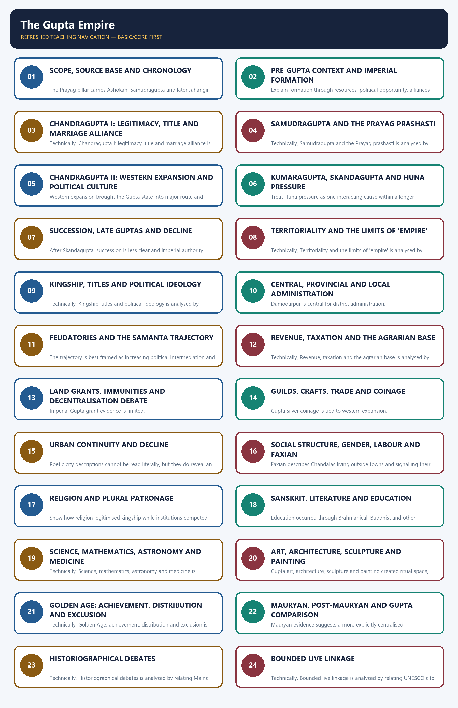

*Distinct embedded teaching-navigation image. The separate continuous Cārvāka-style flowchart package remains an independent at-a-glance artifact.*

#### Package counts, provenance and honest limitations

- Complete learning sections: 24; integrated verified/routed PYQs: 6; main-package learning-check MCQs: 16 (non-duplicative loop); standalone workbook hard MCQs: 32 (128 tagged option explanations, remediation integrated); solved original Mains: 6; final register modules: 6.
- Original PNG visuals: 12, all deterministic and fact-checked against the named sources. The territorial visual is explicitly schematic and not to scale.
- Direct topic-owned Mains PYQ: none found. The 2022 Gupta-Chola culture question is cross-owned and labelled accordingly.
- Prelims 2019 and 2020 official keys are not held locally; answers are prominently labelled inferred rather than official.
- No dated current-affairs claim was necessary. Heritage linkage is bounded to source criticism, conservation and attribution.

#### Original visual asset index

- `notes/Ancient-Indian-History/assets/20_Gupta-Empire/01_evidence_led_chronology.png`
- `notes/Ancient-Indian-History/assets/20_Gupta-Empire/02_territorial_influence_schematic_map.png`
- `notes/Ancient-Indian-History/assets/20_Gupta-Empire/03_ruler_achievement_evidence_matrix.png`
- `notes/Ancient-Indian-History/assets/20_Gupta-Empire/04_administration_hierarchy.png`
- `notes/Ancient-Indian-History/assets/20_Gupta-Empire/05_land_grant_decentralisation_process.png`
- `notes/Ancient-Indian-History/assets/20_Gupta-Empire/06_agrarian_fiscal_system_flow.png`
- `notes/Ancient-Indian-History/assets/20_Gupta-Empire/07_trade_coinage_transformation_matrix.png`
- `notes/Ancient-Indian-History/assets/20_Gupta-Empire/08_social_order_evidence_diagram.png`
- `notes/Ancient-Indian-History/assets/20_Gupta-Empire/09_science_literature_art_ecosystem.png`
- `notes/Ancient-Indian-History/assets/20_Gupta-Empire/10_huna_late_gupta_pressure_chain.png`
- `notes/Ancient-Indian-History/assets/20_Gupta-Empire/11_historiography_debate_map.png`
- `notes/Ancient-Indian-History/assets/20_Gupta-Empire/12_gs1_answer_spine.png`

### SESSION 1 — SCOPE, SOURCE BASE AND CHRONOLOGY

#### DEFINITION / WHAT THIS IS CALLED

**Plain-language definition:** Reconstructing the Gupta polity means triangulating inscriptions, coins, copper plates/seals and Faxian, since each source class proves a different, limited slice of the past.

**Technical definition:** The Prayag pillar carries Ashokan, Samudragupta and later Jahangir inscriptions; Samudragupta's Sanskrit prashasti was composed by Harishena.

#### ANSWER-GRABBING OPENING — WRITE/ADAPT IN THE EXAM

> Reconstructing the Gupta polity means triangulating inscriptions, coins, copper plates/seals and Faxian, since each source class proves a different, limited slice of the past.

#### MUST-WRITE KEYWORDS

- **Scope**
- **source base**
- **chronology**
- **Harishena**
- **Faxian**
- **Prayag prashasti**

**How to use them:** Frame the answer through Scope; define source base, connect chronology with Harishena to explain the mechanism, and use Faxian for the decisive comparison or qualification.

[FACT] The Gupta political phase is conventionally placed c. 319-550 CE. Its reconstruction is inscription- and coin-led, supplemented by seals, sculpture, architecture, legal-literary texts and Faxian.

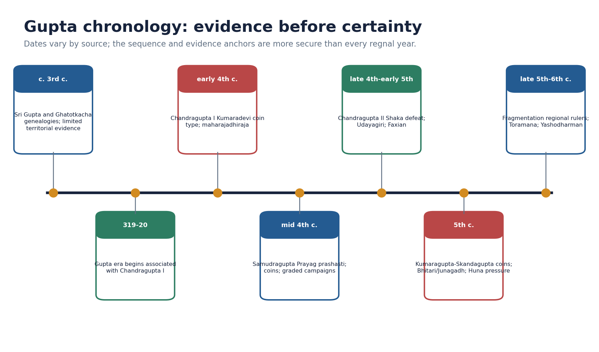

*Original deterministic teaching schematic; any scale or attribution caveat is printed on the visual.*

| Source | Best use | Limit |
|---|---|---|
| Prayag prashasti | campaign categories and royal ideology | eulogistic; identifications disputed |
| Coins | titles, images, ritual and monetary zones | circulation is uneven |
| Copper plates / seals | administration, land and local actors | regionally concentrated |
| Faxian | Buddhist sites and selected social observations | idealising pilgrim perspective |
| Sites / art | patronage, technique and religious landscape | dating and attribution require care |

#### Core teaching / solved practice

- [FACT] The Prayag pillar carries Ashokan, Samudragupta and later Jahangir inscriptions; Samudragupta's Sanskrit prashasti was composed by Harishena.
- [FACT] Coins communicate titles, ritual claims, marriage, martial prowess, sectarian emblems and monetary choices; they do not by themselves map exact borders.
- [FACT] Damodarpur copper plates and Vaishali/Bhita seals illuminate offices and land transactions, especially in Bengal.
- [LIMIT] Prashastis are courtly eulogies, Smritis are prescriptive, coins are selective royal media and Faxian wrote for a Buddhist audience.
- [ANALYSIS] A safe answer triangulates at least two source classes and states what each can and cannot prove.

#### PARAGRAPH DEMONSTRATION — CLAIM → NAMED EVIDENCE → ANALYSIS → QUALIFICATION

[CLAIM] Gupta political history cannot be read off any single record. [NAMED EVIDENCE] The Prayag pillar carries Ashokan, Samudragupta and a later Jahangir inscription on one shaft, Samudragupta's own prashasti was composed by the court official Harishena, and the Chinese pilgrim Faxian travelled through the Gangetic heartland during Chandragupta II's reign. [ANALYSIS] Each source class does different work: the pillar shows layered political memory, the prashasti supplies campaign categories and royal ideology, and Faxian supplies dated, if selective, social observation. [QUALIFICATION] None of the three is a neutral chronicle - the prashasti is eulogy, the pillar's later additions are unrelated to Gupta rule, and Faxian wrote for a Buddhist audience - so a safe answer always names at least two source classes and states what each can and cannot prove.

#### Must-know facts

- Gupta era begins in 319-20 CE.
- Harishena composed the Prayag prashasti.
- Evidence categories must not be collapsed.

#### UPSC traps

- WRONG: Every inscription is a neutral chronicle.
  CORRECT: Prashasti genre amplifies conquest and virtue.
- WRONG: One date sequence is uncontested.
  CORRECT: Regnal dates vary across scholarly reconstructions.

**Mains angle:** Open with method: 'Gupta history is visible through royal media, but its social reach requires non-royal and material evidence.'

**Study link:** Master Chronology; basic/20; advanced/20; Topic 21 culture files.

#### CLOSING RECALL FLOW — SCOPE, SOURCE BASE AND CHRONOLOGY

```text
START / CONCEPT: Scope, source base and chronology
        |
        v
EXACT TERMS: Scope · source base · chronology · Harishena · Faxian · Prayag prashasti
        |
        v
MECHANISM / ARGUMENT: The Prayag pillar carries Ashokan, Samudragupta and later Jahangir inscriptions; Samudragupta's Sanskrit prashasti was composed by Harishena.
        |
        v
CONSEQUENCE / CONTRAST: Coins communicate titles, ritual claims, marriage, martial prowess, sectarian emblems and monetary choices; they do not by themselves map exact borders.
        |
        v
UPSC TRAP / ANSWER-USE: Open with method: 'Gupta history is visible through royal media, but its social reach requires non-royal and material evidence.'.
        |
        v
ANSWER-GRABBING FORMULATION: Reconstructing the Gupta polity means triangulating inscriptions, coins, copper plates/seals and Faxian, since each source class proves a different, limited slice of the past.
```
### SESSION 2 — PRE-GUPTA CONTEXT AND IMPERIAL FORMATION

#### DEFINITION / WHAT THIS IS CALLED

**Plain-language definition:** The Guptas emerged after centuries of post-Mauryan regional state formation, commercial integration and Sanskrit political expression.

**Technical definition:** Explain formation through resources, political opportunity, alliances and symbolic legitimacy rather than a founder-only story.

#### ANSWER-GRABBING OPENING — WRITE/ADAPT IN THE EXAM

> Explain formation through resources, political opportunity, alliances and symbolic legitimacy rather than a founder-only story.

#### MUST-WRITE KEYWORDS

- **Pre-Gupta context**
- **imperial formation**
- **Sri Gupta and Ghatotkacha**
- **Commercial integration**
- **The Guptas**
- **Mauryan**

**How to use them:** Frame the answer through Pre-Gupta context; define imperial formation, connect Sri Gupta and Ghatotkacha with Commercial integration to explain the mechanism, and use The Guptas for the decisive comparison or qualification.

[FACT] The Guptas emerged after centuries of post-Mauryan regional state formation, commercial integration and Sanskrit political expression. Their early base lay in the middle Ganga region, but the precise homeland and early territorial extent remain debated.

#### Core teaching / solved practice

- [FACT] Genealogies name Sri Gupta and Ghatotkacha before Chandragupta I; their title maharaja does not prove a large empire.
- [ANALYSIS] Gupta consolidation benefited from a productive Ganga agrarian core, older urban-route networks, political fragmentation and alliance-building.
- [LIMIT] 'Second empire after the Mauryas' is a textbook comparison of scale and prestige, not proof of identical institutions.
- [ANALYSIS] The transition was cumulative: earlier coinage, Sanskrit inscriptions, devotional cults and regional elites supplied reusable political resources.

#### PARAGRAPH DEMONSTRATION — CLAIM → NAMED EVIDENCE → ANALYSIS → QUALIFICATION

[CLAIM] Gupta imperial formation was not a founder myth appearing from nowhere. [NAMED EVIDENCE] Genealogies name Sri Gupta and Ghatotkacha with the modest title maharaja before Chandragupta I adopted maharajadhiraja, and the family built on centuries of post-Mauryan coinage, Sanskrit political idiom and Ganga-basin agrarian and commercial networks. [ANALYSIS] Reading the founders alongside this inherited context shows that Gupta power was assembled cumulatively from resources, alliances and symbolic capital already in circulation, not created solely by one dynasty's genius. [QUALIFICATION] 'Second empire after the Mauryas' is therefore a scale-and-prestige comparison, not a claim that Gupta administration replicated Mauryan institutions.

#### Must-know facts

- Early Guptas preceded the imperial title maharajadhiraja.
- Pre-Gupta institutions shaped Gupta state formation.

#### UPSC traps

- WRONG: The Guptas rose in an institutional vacuum.
  CORRECT: They inherited post-Mauryan political, commercial and cultural developments.

**Mains angle:** Explain formation through resources, political opportunity, alliances and symbolic legitimacy rather than a founder-only story.

**Study link:** Topics 16-19; Mauryan comparison.

#### CLOSING RECALL FLOW — PRE-GUPTA CONTEXT AND IMPERIAL FORMATION

```text
START / CONCEPT: Pre-Gupta context and imperial formation
        |
        v
EXACT TERMS: Pre-Gupta context · imperial formation · Sri Gupta and Ghatotkacha · Commercial integration · The Guptas · Mauryan
        |
        v
MECHANISM / ARGUMENT: The Guptas emerged after centuries of post-Mauryan regional state formation, commercial integration and Sanskrit political expression.
        |
        v
CONSEQUENCE / CONTRAST: Genealogies name Sri Gupta and Ghatotkacha before Chandragupta I; their title maharaja does not prove a large empire.
        |
        v
UPSC TRAP / ANSWER-USE: 'Second empire after the Mauryas' is a textbook comparison of scale and prestige, not proof of identical institutions.
        |
        v
ANSWER-GRABBING FORMULATION: Explain formation through resources, political opportunity, alliances and symbolic legitimacy rather than a founder-only story.
```
### SESSION 3 — CHANDRAGUPTA I: LEGITIMACY, TITLE AND MARRIAGE ALLIANCE

#### DEFINITION / WHAT THIS IS CALLED

**Plain-language definition:** The proposition that Chandragupta I directly controlled every territory later held by Samudragupta is unsupported.

**Technical definition:** Chandragupta I's adoption of maharajadhiraja and his Kumaradevi-Lichchhavi marriage, publicised on a distinct coin type, jointly signal a strategy of combining coercive title with alliance-based legitimacy.

#### ANSWER-GRABBING OPENING — WRITE/ADAPT IN THE EXAM

> The proposition that Chandragupta I directly controlled every territory later held by Samudragupta is unsupported.

#### MUST-WRITE KEYWORDS

- **Chandragupta I**
- **legitimacy**
- **title**
- **marriage alliance**
- **Kumaradevi coin type**
- **Gupta era 319-20 CE**

**How to use them:** Frame the answer through Chandragupta I; define legitimacy, connect title with marriage alliance to explain the mechanism, and use Kumaradevi coin type for the decisive comparison or qualification.

[FACT] Chandragupta I marks the imperial phase. He used maharajadhiraja and is associated with the Gupta era beginning 319-20 CE and with Kumaradevi-Lichchhavi coin imagery.

#### Core teaching / solved practice

- [FACT] The king-and-queen coin type names Kumaradevi and the Lichchhavis, showing that the alliance was publicly commemorated.
- [ANALYSIS] Marriage supplied legitimacy, alliance and possibly access to networks or territory, but the exact material gain cannot be calculated.
- [LIMIT] The proposition that Chandragupta I directly controlled every territory later held by Samudragupta is unsupported.
- [ANALYSIS] Use the marriage coin as evidence of dynastic politics, not as a romantic anecdote.

#### PARAGRAPH DEMONSTRATION — CLAIM → NAMED EVIDENCE → ANALYSIS → QUALIFICATION

[CLAIM] Chandragupta I's legitimacy rested on title and alliance together, not conquest alone. [NAMED EVIDENCE] He adopted maharajadhiraja, married the Lichchhavi princess Kumaradevi, and had the alliance commemorated on a distinctive king-and-queen coin type associated with the start of the Gupta era in 319-20 CE. [ANALYSIS] Publicising a marriage on coinage converts a private dynastic tie into a public claim of enhanced status and resources. [QUALIFICATION] The coin proves that the alliance was advertised as politically valuable; it does not quantify any territorial or material gain, so a candidate should not invent a dowry or annexation that the source does not state.

#### Must-know facts

- Kumaradevi was a Lichchhavi princess.
- Marriage imagery was political communication.

#### UPSC traps

- WRONG: A marriage coin proves the precise dowry or border change.
  CORRECT: It proves advertised alliance and status, not quantified transfer.

**Mains angle:** Claim: imperial formation joined coercive capacity with alliance-based legitimacy.

**Study link:** Dynastic alliances; Prabhavatigupta-Vakataka bridge.

#### CLOSING RECALL FLOW — CHANDRAGUPTA I: LEGITIMACY, TITLE AND MARRIAGE ALLIANCE

```text
START / CONCEPT: Chandragupta I: legitimacy, title and marriage alliance
        |
        v
EXACT TERMS: Chandragupta I · legitimacy · title · marriage alliance · Kumaradevi coin type · Gupta era 319-20 CE
        |
        v
MECHANISM / ARGUMENT: The king-and-queen coin type names Kumaradevi and the Lichchhavis, showing that the alliance was publicly commemorated.
        |
        v
CONSEQUENCE / CONTRAST: Use the marriage coin as evidence of dynastic politics, not as a romantic anecdote.
        |
        v
UPSC TRAP / ANSWER-USE: CORRECT: It proves advertised alliance and status, not quantified transfer.
        |
        v
ANSWER-GRABBING FORMULATION: The proposition that Chandragupta I directly controlled every territory later held by Samudragupta is unsupported.
```
### SESSION 4 — SAMUDRAGUPTA AND THE PRAYAG PRASHASTI

#### DEFINITION / WHAT THIS IS CALLED

**Plain-language definition:** Samudragupta's reign is reconstructed chiefly from coins and the Prayag prashasti.

**Technical definition:** Harishena's Prayag prashasti sorts Samudragupta's relationships into distinct categories - annexed Aryavarta kings, subordinated forest rulers, tributary frontier states, reinstated southern kings and prestige-seeking distant rulers - so 'conquest' cannot be read as one uniform category.

#### ANSWER-GRABBING OPENING — WRITE/ADAPT IN THE EXAM

> Samudragupta's reign is reconstructed chiefly from coins and the Prayag prashasti.

#### MUST-WRITE KEYWORDS

- **Samudragupta**
- **the Prayag prashasti**
- **Prashasti categories**
- **Dakshinapatha reinstatement**
- **Aryavarta**
- **uprooted / exterminated**

**How to use them:** Frame the answer through Samudragupta; define the Prayag prashasti, connect Aryavarta with Dakshinapatha reinstatement to explain the mechanism, and use Aryavarta for the decisive comparison or qualification.

[FACT] Samudragupta's reign is reconstructed chiefly from coins and the Prayag prashasti. The inscription presents the Gupta centre within a web of differentiated political relationships.

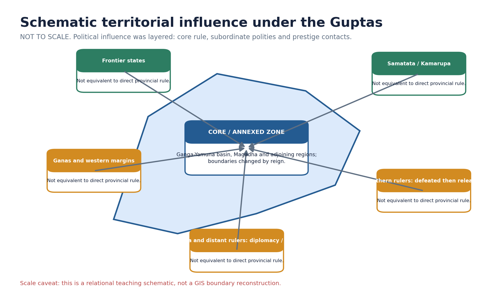

*Original deterministic teaching schematic; any scale or attribution caveat is printed on the visual.*

| Campaign category | Prashasti treatment | Safe inference |
|---|---|---|
| Aryavarta | uprooted / exterminated | stronger incorporation into core |
| Atavika rulers | made servants | subordination; exact machinery unclear |
| Frontier states and ganas | tribute, orders, obeisance | layered dependence |
| Dakshinapatha | captured then released | demonstration and reinstatement |
| Distant rulers / islands | service, gifts, seal, alliances | prestige diplomacy, not provinces |

#### Core teaching / solved practice

- [FACT] Aryavarta rulers are described as violently uprooted; their territories appear to have been incorporated into the northern core.
- [FACT] Forest rulers were made servants/subordinates, while frontier states and ganas offered tribute, obeyed orders and performed obeisance.
- [FACT] Southern rulers were captured and released; this is not the language of permanent provincial annexation.
- [FACT] Distant north-western rulers and Sri Lanka appear in a prestige-diplomatic category involving service, seal requests, gifts or alliance.
- [LIMIT] Place identifications and court claims are debated; 'conquered India' is an overstatement.
- [ANALYSIS] Samudragupta's significance lies in graded sovereignty: annexation, subordination, reinstatement and prestige coexisted.

#### PARAGRAPH DEMONSTRATION — CLAIM → NAMED EVIDENCE → ANALYSIS → QUALIFICATION

[CLAIM] Samudragupta's reign is best reconstructed through graded categories of political relationship rather than a single map of conquest. [NAMED EVIDENCE] Harishena's Prayag prashasti separately lists Aryavarta kings who were uprooted, atavika forest rulers reduced to servitude, frontier states and ganas that paid tribute and obeyed orders, Dakshinapatha rulers who were captured and reinstated, and distant or island rulers who sought favour through gifts and service. [ANALYSIS] These five categories show a layered system combining direct annexation, subordination, tributary dependence and prestige diplomacy within one reign. [QUALIFICATION] Because the prashasti is a courtly eulogy composed to celebrate the king, place identifications and precise campaign order remain disputed, so 'Samudragupta conquered India' overstates what the inscription itself claims.

#### Must-know facts

- Harishena held multiple high titles.
- Southern campaign did not yield uniform annexation.
- The pillar is a layered archive.

#### UPSC traps

- WRONG: Every named ruler became a provincial subject.
  CORRECT: The inscription itself distinguishes modes of relationship.
- WRONG: The prashasti is useless because it is praise.
  CORRECT: Genre-aware reading still yields names, categories and ideology.

**Mains angle:** Use campaign categories as the body headings of any territoriality answer.

**Study link:** Source criticism; layered sovereignty.

#### CLOSING RECALL FLOW — SAMUDRAGUPTA AND THE PRAYAG PRASHASTI

```text
START / CONCEPT: Samudragupta and the Prayag prashasti
        |
        v
EXACT TERMS: Samudragupta · the Prayag prashasti · Prashasti categories · Dakshinapatha reinstatement · Aryavarta · uprooted / exterminated
        |
        v
MECHANISM / ARGUMENT: WRONG: The prashasti is useless because it is praise.
        |
        v
CONSEQUENCE / CONTRAST: Forest rulers were made servants/subordinates, while frontier states and ganas offered tribute, obeyed orders and performed obeisance.
        |
        v
UPSC TRAP / ANSWER-USE: Southern rulers were captured and released; this is not the language of permanent provincial annexation.
        |
        v
ANSWER-GRABBING FORMULATION: Samudragupta's reign is reconstructed chiefly from coins and the Prayag prashasti.
```
### SESSION 5 — CHANDRAGUPTA II: WESTERN EXPANSION AND POLITICAL CULTURE

#### DEFINITION / WHAT THIS IS CALLED

**Plain-language definition:** Western Shaka defeat is a central achievement.

**Technical definition:** Western expansion brought the Gupta state into major route and coastal zones; Ujjain was an important political-commercial centre.

#### ANSWER-GRABBING OPENING — WRITE/ADAPT IN THE EXAM

> Western Shaka defeat is a central achievement.

#### MUST-WRITE KEYWORDS

- **Chandragupta II**
- **western expansion**
- **political culture**
- **Udayagiri**
- **Amrakardava**
- **Western**

**How to use them:** Frame the answer through Chandragupta II; define western expansion, connect political culture with Udayagiri to explain the mechanism, and use Amrakardava for the decisive comparison or qualification.

[FACT] Chandragupta II defeated the western Kshatrapas, issued silver coins in a western monetary idiom and strengthened Gupta power in Malwa and Gujarat.

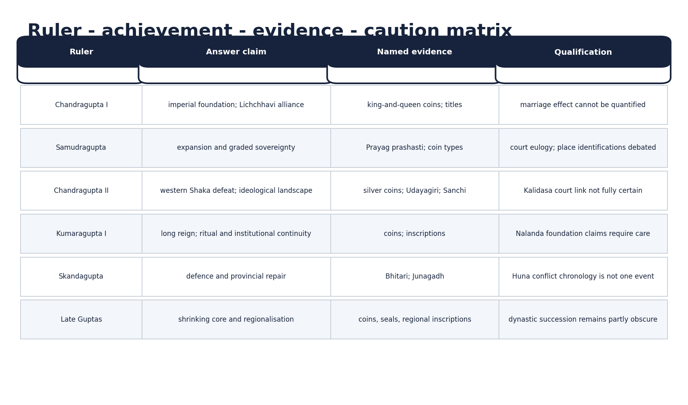

*Original deterministic teaching schematic; any scale or attribution caveat is printed on the visual.*

#### Core teaching / solved practice

- [FACT] Western expansion brought the Gupta state into major route and coastal zones; Ujjain was an important political-commercial centre.
- [FACT] Udayagiri's early fifth-century complex links Vaishnava imagery, royal presence and conquest symbolism; it also contains Shaiva and Jaina evidence.
- [FACT] A Sanchi inscription records land and money support connected with Chandragupta II and commander Amrakardava.
- [FACT] Faxian travelled in India during this broad reign-context.
- [LIMIT] Kalidasa's exact date and identification as a formal court 'navaratna' are not securely established.
- [ANALYSIS] Chandragupta II combined expansion, monetary adaptation and sacred-political communication.

#### PARAGRAPH DEMONSTRATION — CLAIM → NAMED EVIDENCE → ANALYSIS → QUALIFICATION

[CLAIM] Chandragupta II's western campaign reshaped Gupta political geography and self-representation together. [NAMED EVIDENCE] He defeated the Western Kshatrapas in Malwa-Gujarat, adapted their silver coinage after the conquest, is linked with the Udayagiri Varaha and cave complex, and a Sanchi inscription records land and money support connected with him and commander Amrakardava. [ANALYSIS] Read together, conquest, coinage and monument show that western expansion produced access to trade routes, a new monetary idiom and a fresh site for royal-religious messaging. [QUALIFICATION] The traditional link between this reign and Kalidasa or a formal 'navaratna' court is a later literary tradition, not an inscriptionally verified fact, so it must be flagged as debated rather than asserted.

#### Must-know facts

- Western Shaka defeat is a central achievement.
- Silver coinage reflects regional adaptation.
- Udayagiri is ideological and plural, not only decorative.

#### UPSC traps

- WRONG: Vikramaditya proves every later Vikrama legend belongs to this king.
  CORRECT: The title and later legendary cycles must be separated.
- WRONG: Udayagiri shows exclusive religious intolerance.
  CORRECT: Its landscape contains multiple traditions and multidirectional gifts.

**Mains angle:** Connect western conquest to routes, coinage and Udayagiri rather than listing victories alone.

**Study link:** Trade transformation; royal ideology.

#### CLOSING RECALL FLOW — CHANDRAGUPTA II: WESTERN EXPANSION AND POLITICAL CULTURE

```text
START / CONCEPT: Chandragupta II: western expansion and political culture
        |
        v
EXACT TERMS: Chandragupta II · western expansion · political culture · Udayagiri · Amrakardava · Western
        |
        v
MECHANISM / ARGUMENT: Western expansion brought the Gupta state into major route and coastal zones; Ujjain was an important political-commercial centre.
        |
        v
CONSEQUENCE / CONTRAST: Kalidasa's exact date and identification as a formal court 'navaratna' are not securely established.
        |
        v
UPSC TRAP / ANSWER-USE: Udayagiri is ideological and plural, not only decorative.
        |
        v
ANSWER-GRABBING FORMULATION: Western Shaka defeat is a central achievement.
```
### SESSION 6 — KUMARAGUPTA, SKANDAGUPTA AND HUNA PRESSURE

#### DEFINITION / WHAT THIS IS CALLED

**Plain-language definition:** Kumaragupta I's long, coin-rich reign and Skandagupta's inscriptions of restoration and defence mark the transition from imperial routine to sustained frontier pressure.

**Technical definition:** Treat Huna pressure as one interacting cause within a longer fragmentation process.

#### ANSWER-GRABBING OPENING — WRITE/ADAPT IN THE EXAM

> Early Huna pressure could be checked, but sustained frontier warfare increased military and fiscal strain.

#### MUST-WRITE KEYWORDS

- **Kumaragupta**
- **Skandagupta**
- **Huna pressure**
- **Junagadh inscription**
- **Bhitari inscription**
- **456-57 CE**

**How to use them:** Frame the answer through Kumaragupta; define Skandagupta, connect Huna pressure with Junagadh inscription to explain the mechanism, and use Bhitari inscription for the decisive comparison or qualification.

[FACT] Kumaragupta I's long reign continued imperial authority and coin-ritual communication. Skandagupta's inscriptions emphasise restoration, defence and provincial public works.

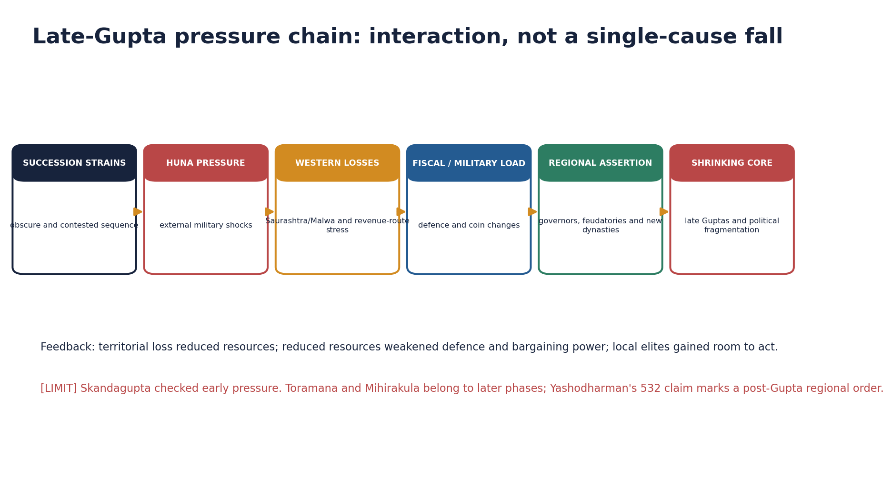

*Original deterministic teaching schematic; any scale or attribution caveat is printed on the visual.*

#### Core teaching / solved practice

- [FACT] Kumaragupta issued varied gold coin types, including ashvamedha imagery; ritual claims should be read as royal communication.
- [FACT] Skandagupta's Junagadh inscription records appointment of Parnadatta and repair of the Sudarshana lake breach by Chakrapalita in 456-57 CE.
- [FACT] Bhitari evidence presents Skandagupta as restoring family fortune amid enemies; exact identification and sequence of every conflict require caution.
- [ANALYSIS] Early Huna pressure could be checked, but sustained frontier warfare increased military and fiscal strain.
- [LIMIT] Hunas did not end the empire in one invasion, and Toramana-Mihirakula belong to later stages of north Indian power change.

#### PARAGRAPH DEMONSTRATION — CLAIM → NAMED EVIDENCE → ANALYSIS → QUALIFICATION

[CLAIM] Kumaragupta I and Skandagupta together mark the shift from sustained imperial routine to active crisis management. [NAMED EVIDENCE] Kumaragupta issued varied gold coin types including ashvamedha imagery across a long reign, while Skandagupta's Junagadh inscription records the appointment of Parnadatta and the 456-57 CE repair of the Sudarshana lake breach by Chakrapalita, and Bhitari evidence presents him restoring the family's fortune against unnamed enemies. [ANALYSIS] The coin evidence shows continuity of royal ritual communication, while the inscriptions show a ruler actively managing provincial infrastructure and defence rather than presiding over automatic decline. [QUALIFICATION] Skandagupta's recorded successes do not mean Huna pressure ended; later Huna rulers such as Toramana and Mihirakula show that an early check could still be followed by deeper penetration.

#### Must-know facts

- Junagadh links provincial delegation with waterwork repair.
- Huna pressure was prolonged and phased.

#### UPSC traps

- WRONG: Skandagupta's success means no later Huna impact.
  CORRECT: A checked incursion can precede later penetration.
- WRONG: Every late coin change has one cause.
  CORRECT: Weight, purity, metal supply, territory and fiscal needs must be assessed together.

**Mains angle:** Treat Huna pressure as one interacting cause within a longer fragmentation process.

**Study link:** Late-Gupta decline; post-Gupta Topic 22.

#### CLOSING RECALL FLOW — KUMARAGUPTA, SKANDAGUPTA AND HUNA PRESSURE

```text
START / CONCEPT: Kumaragupta, Skandagupta and Huna pressure
        |
        v
EXACT TERMS: Kumaragupta · Skandagupta · Huna pressure · Junagadh inscription · Bhitari inscription · 456-57 CE
        |
        v
MECHANISM / ARGUMENT: Treat Huna pressure as one interacting cause within a longer fragmentation process.
        |
        v
CONSEQUENCE / CONTRAST: WRONG: Skandagupta's success means no later Huna impact.
        |
        v
UPSC TRAP / ANSWER-USE: Do not miss this limiting distinction: huna pressure was prolonged and phased.
        |
        v
ANSWER-GRABBING FORMULATION: Early Huna pressure could be checked, but sustained frontier warfare increased military and fiscal strain.
```
### SESSION 7 — SUCCESSION, LATE GUPTAS AND DECLINE

#### DEFINITION / WHAT THIS IS CALLED

**Plain-language definition:** 'Decline' describes contraction and political regionalisation, not disappearance of Gupta lineages, culture or institutions.

**Technical definition:** After Skandagupta, succession is less clear and imperial authority contracted.

#### ANSWER-GRABBING OPENING — WRITE/ADAPT IN THE EXAM

> 'Decline' describes contraction and political regionalisation, not disappearance of Gupta lineages, culture or institutions.

#### MUST-WRITE KEYWORDS

- **Succession**
- **late Guptas**
- **decline**
- **Toramana and Mihirakula**
- **Yashodharman 532 CE**
- **After Skandagupta, succession**

**How to use them:** Frame the answer through Succession; define late Guptas, connect decline with Toramana and Mihirakula to explain the mechanism, and use Yashodharman 532 CE for the decisive comparison or qualification.

[FACT] After Skandagupta, succession is less clear and imperial authority contracted. Western losses, external pressure and regional rulers changed the balance of power.

#### Core teaching / solved practice

- [FACT] Coin and inscription finds become sparse in western Malwa and Saurashtra after the later fifth century, consistent with loss of western authority.
- [FACT] Toramana and Mihirakula represent Huna power in north and central India; Yashodharman's 532 inscription marks a later regional challenge.
- [ANALYSIS] Causes interacted: succession disputes, military costs, territorial revenue loss, changing trade, delegated power and regional assertion.
- [LIMIT] 'Decline' describes contraction and political regionalisation, not disappearance of Gupta lineages, culture or institutions.
- [ANALYSIS] The strongest causal answer uses a feedback loop, not a shopping list.

#### PARAGRAPH DEMONSTRATION — CLAIM → NAMED EVIDENCE → ANALYSIS → QUALIFICATION

[CLAIM] Gupta 'decline' names a prolonged, multi-causal contraction, not a single terminal event. [NAMED EVIDENCE] Coin and inscription evidence thins in western Malwa and Saurashtra after the later fifth century, Toramana and Mihirakula represent phased Huna power in north-central India, and Yashodharman's 532 CE inscription records a rival regional claim to conquest. [ANALYSIS] Succession uncertainty after Skandagupta, territorial and revenue loss, and the rise of competing regional powers interacted rather than operating as isolated shocks. [QUALIFICATION] The conventional c. 550 CE end date is a periodisation marker for historians, not an event date for the instantaneous disappearance of Gupta lineages, culture or institutions.

#### Must-know facts

- Decline was gradual and uneven.
- Political fragmentation did not erase cultural continuities.

#### UPSC traps

- WRONG: A single invasion gives a complete explanation.
  CORRECT: Multi-causal interaction is required.
- WRONG: The year 550 is an event-date for total collapse.
  CORRECT: It is a periodisation marker.

**Mains angle:** Organise causes as external pressure, internal political strain, fiscal-territorial change and regionalisation.

**Study link:** Topic 22; early-medieval transition.

#### CLOSING RECALL FLOW — SUCCESSION, LATE GUPTAS AND DECLINE

```text
START / CONCEPT: Succession, late Guptas and decline
        |
        v
EXACT TERMS: Succession · late Guptas · decline · Toramana and Mihirakula · Yashodharman 532 CE · After Skandagupta, succession
        |
        v
MECHANISM / ARGUMENT: After Skandagupta, succession is less clear and imperial authority contracted.
        |
        v
CONSEQUENCE / CONTRAST: The strongest causal answer uses a feedback loop, not a shopping list.
        |
        v
UPSC TRAP / ANSWER-USE: WRONG: The year 550 is an event-date for total collapse.
        |
        v
ANSWER-GRABBING FORMULATION: 'Decline' describes contraction and political regionalisation, not disappearance of Gupta lineages, culture or institutions.
```
### SESSION 8 — TERRITORIALITY AND THE LIMITS OF 'EMPIRE'

#### DEFINITION / WHAT THIS IS CALLED

**Plain-language definition:** Gupta territoriality was not one uniform colour on a map: it graded from directly administered core provinces to tributary frontier states and prestige relationships with distant rulers.

**Technical definition:** The operational test for 'empire' combines a substantial directly-ruled core, military capacity, paramount titles recognised beyond that core, and a differentiated periphery of subordinate, tributary and prestige relations.

#### ANSWER-GRABBING OPENING — WRITE/ADAPT IN THE EXAM

> The Gupta order was an empire because it possessed a substantial core, military capacity, paramount titles and a wide hierarchy of subordinate relations; it was not a uniform map of direct administration.

#### MUST-WRITE KEYWORDS

- **Territoriality**
- **the limits of 'empire'**
- **Layered hegemony**
- **Graded sovereignty**
- **The Gupta**
- **Subordinate**

**How to use them:** Frame the answer through Territoriality; define the limits of 'empire', connect Layered hegemony with Graded sovereignty to explain the mechanism, and use The Gupta for the decisive comparison or qualification.

[ANALYSIS] The Gupta order was an empire because it possessed a substantial core, military capacity, paramount titles and a wide hierarchy of subordinate relations; it was not a uniform map of direct administration.


*Original deterministic teaching schematic; any scale or attribution caveat is printed on the visual.*

#### Core teaching / solved practice

- [FACT] Samudragupta's own prashasti differentiates annexed northern lands, frontier tribute, ganas, forest rulers, reinstated southern kings and distant prestige relations.
- [FACT] Subordinate rulers could be powerful in their own domains and reproduce imperial-style praise.
- [ANALYSIS] 'Layered hegemony' or 'graded sovereignty' describes this structure better than either a Mauryan clone or a loose cultural sphere.
- [LIMIT] Modern border lines and continuous territorial colour falsely imply equivalent control everywhere.
- [ANALYSIS] Territoriality changed by reign: Chandragupta II's westward expansion and late-Gupta western losses matter.

#### PARAGRAPH DEMONSTRATION — CLAIM → NAMED EVIDENCE → ANALYSIS → QUALIFICATION

[CLAIM] The Gupta polity was a genuine empire whose control graded outward rather than one uniform territorial block. [NAMED EVIDENCE] Samudragupta's own prashasti differentiates annexed Aryavarta lands, subordinated forest rulers, tribute-paying frontier states and ganas, reinstated southern kings, and prestige-seeking distant rulers, while subordinate kings could retain local power and even imitate imperial titles. [ANALYSIS] 'Layered hegemony' or 'graded sovereignty' captures this structure better than either a Mauryan-style uniform administration or a loose cultural sphere with no coercive core. [QUALIFICATION] A modern map with one continuous colour for the 'Gupta Empire' therefore misrepresents evidence that itself distinguishes core rule from tribute and prestige relationships.

#### Must-know facts

- Core and periphery differed in control.
- The empire's reach was relational as well as territorial.

#### UPSC traps

- WRONG: Political influence equals direct tax administration.
  CORRECT: Tribute and prestige relations may lack provincial machinery.

**Mains angle:** Define empire operationally: core extraction + military superiority + recognised paramountcy + differentiated peripheries.

**Study link:** Mauryan and post-Mauryan comparison.

#### CLOSING RECALL FLOW — TERRITORIALITY AND THE LIMITS OF 'EMPIRE'

```text
START / CONCEPT: Territoriality and the limits of 'empire'
        |
        v
EXACT TERMS: Territoriality · the limits of 'empire' · Layered hegemony · Graded sovereignty · The Gupta · Subordinate
        |
        v
MECHANISM / ARGUMENT: Subordinate rulers could be powerful in their own domains and reproduce imperial-style praise.
        |
        v
CONSEQUENCE / CONTRAST: 'Layered hegemony' or 'graded sovereignty' describes this structure better than either a Mauryan clone or a loose cultural sphere.
        |
        v
UPSC TRAP / ANSWER-USE: Do not miss this limiting distinction: the empire's reach was relational as well as territorial.
        |
        v
ANSWER-GRABBING FORMULATION: The Gupta order was an empire because it possessed a substantial core, military capacity, paramount titles and a wide hierarchy of subordinate relations; it was not a uniform map of direct administration.
```
### SESSION 9 — KINGSHIP, TITLES AND POLITICAL IDEOLOGY

#### DEFINITION / WHAT THIS IS CALLED

**Plain-language definition:** Ideology was productive: it converted military success, piety and prosperity into legitimate paramountcy.

**Technical definition:** Gupta kingship combined paramount titles such as maharajadhiraja and parama-bhattaraka with Sanskrit prashasti, ritual coin imagery and sectarian affiliation to project an exceptional but not literally divine ruler.

#### ANSWER-GRABBING OPENING — WRITE/ADAPT IN THE EXAM

> Ideology was productive: it converted military success, piety and prosperity into legitimate paramountcy.

#### MUST-WRITE KEYWORDS

- **Kingship**
- **titles**
- **political ideology**
- **Udayagiri Varaha**
- **Paramabhagavata**
- **Comparison with gods**

**How to use them:** Frame the answer through Kingship; define titles, connect political ideology with Udayagiri Varaha to explain the mechanism, and use Paramabhagavata for the decisive comparison or qualification.

[FACT] Gupta kingship used paramount titles, Sanskrit prashasti, coins, ritual, genealogy and sectarian affiliation to represent exceptional but not simply divine rulers.

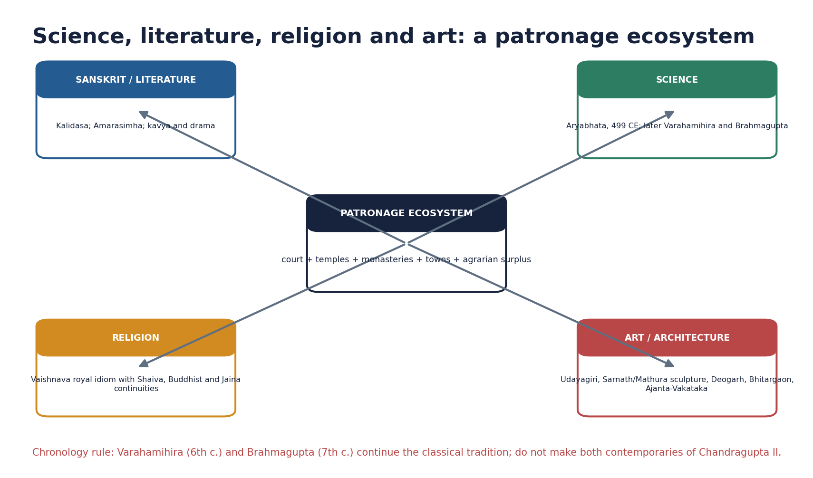

*Original deterministic teaching schematic; any scale or attribution caveat is printed on the visual.*

#### Core teaching / solved practice

- [FACT] Maharajadhiraja, parama-bhattaraka and related titles articulated hierarchy; title meanings depend on context.
- [FACT] Coins portray kings as warriors, hunters, sacrificers, musicians and recipients of Shri/Lakshmi's favour; Garuda communicates Vaishnava association.
- [FACT] Udayagiri's Varaha imagery entwines cosmic rescue, conquest and royal power while leaving room for interpretive ambiguity.
- [LIMIT] Comparison with gods is not identical to a formal claim that the king is a god.
- [ANALYSIS] Ideology was productive: it converted military success, piety and prosperity into legitimate paramountcy.

#### PARAGRAPH DEMONSTRATION — CLAIM → NAMED EVIDENCE → ANALYSIS → QUALIFICATION

[CLAIM] Gupta kingship converted military success, piety and prosperity into ideological legitimacy through repeated, deliberate media choices. [NAMED EVIDENCE] Titles such as maharajadhiraja and parama-bhattaraka articulated hierarchy, gold coins portrayed kings as warriors, hunters, sacrificers and musicians favoured by Shri/Lakshmi, Garuda imagery signalled Vaishnava association, and the Udayagiri Varaha programme fused cosmic rescue with conquest symbolism. [ANALYSIS] Because coins circulated far more widely than any single monumental inscription, they were probably the most socially effective vehicle for this royal messaging. [QUALIFICATION] Being called 'paramabhagavata' identifies the ruler as the foremost devotee of Vishnu, not a formal theological claim to divinity, so exam answers should not equate Gupta political religion with total exclusivity toward rival traditions.

#### Must-know facts

- Coins had wider physical circulation than monumental prashastis.
- Inclusive sectarianism is safer than blanket 'tolerance'.

#### UPSC traps

- WRONG: Paramabhagavata means worship by subjects as a god.
  CORRECT: It identifies the ruler as foremost devotee.
- WRONG: Political religion excluded every rival tradition.
  CORRECT: Donative and site evidence shows plural patronage.

**Mains angle:** Use one coin image and Udayagiri as named evidence for the political work of culture.

**Study link:** Religion, art and legitimacy.

#### CLOSING RECALL FLOW — KINGSHIP, TITLES AND POLITICAL IDEOLOGY

```text
START / CONCEPT: Kingship, titles and political ideology
        |
        v
EXACT TERMS: Kingship · titles · political ideology · Udayagiri Varaha · Paramabhagavata · Comparison with gods
        |
        v
MECHANISM / ARGUMENT: WRONG: Paramabhagavata means worship by subjects as a god.
        |
        v
CONSEQUENCE / CONTRAST: Comparison with gods is not identical to a formal claim that the king is a god.
        |
        v
UPSC TRAP / ANSWER-USE: Do not miss this limiting distinction: use one coin image and Udayagiri as named evidence for the political work of...
        |
        v
ANSWER-GRABBING FORMULATION: Ideology was productive: it converted military success, piety and prosperity into legitimate paramountcy.
```
### SESSION 10 — CENTRAL, PROVINCIAL AND LOCAL ADMINISTRATION

#### DEFINITION / WHAT THIS IS CALLED

**Plain-language definition:** Gupta administration had central officers, provinces (desha/bhukti), districts (vishaya), sub-district units and village institutions, but the exact function of many titles is uncertain and regionally variable.

**Technical definition:** Damodarpur is central for district administration.

#### ANSWER-GRABBING OPENING — WRITE/ADAPT IN THE EXAM

> Gupta administration had central officers, provinces (desha/bhukti), districts (vishaya), sub-district units and village institutions, but the exact function of many titles is uncertain and regionally variable.

#### MUST-WRITE KEYWORDS

- **Central**
- **provincial**
- **local administration**
- **Damodarpur**
- **Kumaramatya**
- **Court**

**How to use them:** Frame the answer through Central; define provincial, connect local administration with Damodarpur to explain the mechanism, and use Kumaramatya for the decisive comparison or qualification.

[FACT] Gupta administration had central officers, provinces (desha/bhukti), districts (vishaya), sub-district units and village institutions, but the exact function of many titles is uncertain and regionally variable.

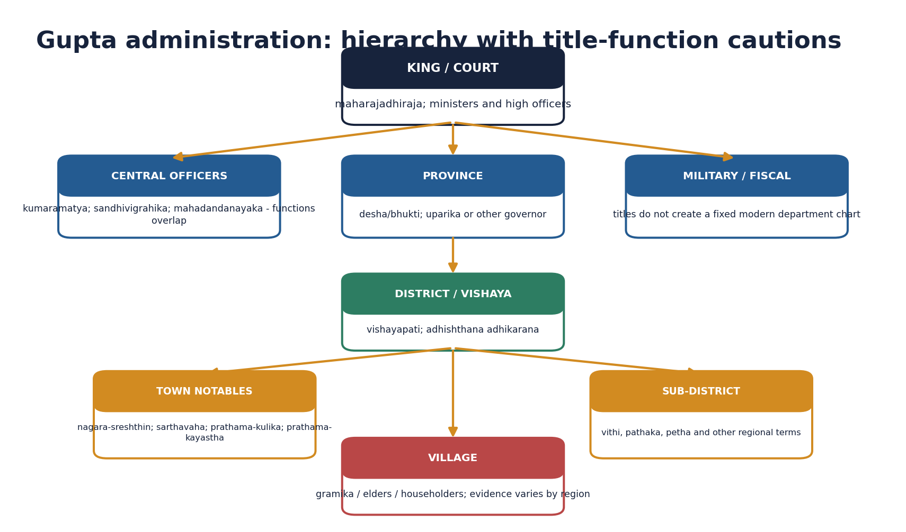

*Original deterministic teaching schematic; any scale or attribution caveat is printed on the visual.*

| Level | Common term / actor | Caution |
|---|---|---|
| Court | kumaramatya, sandhivigrahika, mahadandanayaka | rank and function can overlap |
| Province | desha/bhukti; uparika/goptri/lokapala | terminology varies |
| District | vishaya; vishayapati; adhikarana | Bengal evidence is unusually rich |
| Town board | sreshthin, sarthavaha, kulika, kayastha | elite participation, not mass franchise |
| Village | gramika, elders, householders | local practice is uneven |

#### Core teaching / solved practice

- [FACT] Kumaramatya was a high rank; Harishena also held sandhivigrahika and mahadandanayaka, demonstrating multiple titles.
- [FACT] Uparikas governed provinces and often appointed district heads; Damodarpur records provide detailed Bengal examples.
- [FACT] District boards could include the chief merchant/banker, caravan leader, chief artisan and chief scribe alongside the official head.
- [FACT] Village elders, gramika/gramadhyaksha and record-keeping actors appear, but no single all-India panchayat template is proven.
- [ANALYSIS] Participation of notables can indicate administrative incorporation of local wealth, not democratic representation.
- [LIMIT] Translating every Sanskrit title into a fixed modern ministry creates false precision.

#### PARAGRAPH DEMONSTRATION — CLAIM → NAMED EVIDENCE → ANALYSIS → QUALIFICATION

[CLAIM] Gupta administration combined a court hierarchy with delegated provincial, district and local institutions of uneven documentation. [NAMED EVIDENCE] Harishena himself held the titles kumaramatya, sandhivigrahika and mahadandanayaka together, uparikas governed provinces and appointed district heads in the well-documented Damodarpur records, and district boards there could include the chief merchant/banker, caravan leader, chief artisan and chief scribe. [ANALYSIS] The participation of commercial and scribal notables alongside royal appointees suggests administrative incorporation of local wealth and expertise rather than an impersonal bureaucratic ladder. [QUALIFICATION] Because Bengal's epigraphy is unusually rich, its administrative detail cannot be mechanically generalised to every Gupta province, and no single all-India village-panchayat template is proven.

#### Must-know facts

- Damodarpur is central for district administration.
- Junagadh shows delegated provincial works.

#### UPSC traps

- WRONG: The Guptas had no bureaucracy.
  CORRECT: They had offices and records, though less elaborate than Mauryan descriptions.
- WRONG: All offices were hereditary.
  CORRECT: Some family continuities exist; universal heredity is unproven.

**Mains angle:** Compare administrative depth, local notables and delegation; avoid a static organogram.

**Study link:** Mauryan comparison; land transactions.

#### CLOSING RECALL FLOW — CENTRAL, PROVINCIAL AND LOCAL ADMINISTRATION

```text
START / CONCEPT: Central, provincial and local administration
        |
        v
EXACT TERMS: Central · provincial · local administration · Damodarpur · Kumaramatya · Court
        |
        v
MECHANISM / ARGUMENT: Damodarpur is central for district administration.
        |
        v
CONSEQUENCE / CONTRAST: Participation of notables can indicate administrative incorporation of local wealth, not democratic representation.
        |
        v
UPSC TRAP / ANSWER-USE: Village elders, gramika/gramadhyaksha and record-keeping actors appear, but no single all-India panchayat template is proven.
        |
        v
ANSWER-GRABBING FORMULATION: Gupta administration had central officers, provinces (desha/bhukti), districts (vishaya), sub-district units and village institutions, but the exact function of many titles is uncertain and regionally variable.
```
### SESSION 11 — FEUDATORIES AND THE SAMANTA TRAJECTORY

#### DEFINITION / WHAT THIS IS CALLED

**Plain-language definition:** 'Feudatory' is an analytical translation; specific obligations such as troop supply should be stated only where the source supports them.

**Technical definition:** The trajectory is best framed as increasing political intermediation and regional assertion, not a completed system born on one date.

#### ANSWER-GRABBING OPENING — WRITE/ADAPT IN THE EXAM

> Gupta political hierarchy included subordinate rulers, but the fully developed early-medieval samanta system should not be projected backwards without evidence.

#### MUST-WRITE KEYWORDS

- **Feudatories**
- **the samanta trajectory**
- **Political intermediation**
- **Hereditary offices**
- **Gupta**
- **The Prayag inscription**

**How to use them:** Frame the answer through Feudatories; define the samanta trajectory, connect Political intermediation with Hereditary offices to explain the mechanism, and use Gupta for the decisive comparison or qualification.

[ANALYSIS] Gupta political hierarchy included subordinate rulers, but the fully developed early-medieval samanta system should not be projected backwards without evidence.

#### Core teaching / solved practice

- [FACT] The Prayag inscription describes frontier rulers and ganas offering tribute and obeying orders; later records show maharajas under Gupta paramountcy.
- [FACT] Subordinate rulers could retain local power, imitate imperial titles and become autonomous as central power weakened.
- [LIMIT] 'Feudatory' is an analytical translation; specific obligations such as troop supply should be stated only where the source supports them.
- [ANALYSIS] The trajectory is best framed as increasing political intermediation and regional assertion, not a completed system born on one date.
- [ANALYSIS] Compare the language of subordination with actual fiscal, military and territorial evidence.

#### PARAGRAPH DEMONSTRATION — CLAIM → NAMED EVIDENCE → ANALYSIS → QUALIFICATION

[CLAIM] Gupta subordinate rulers occupied a widening, but not yet fully systematised, hierarchy of political intermediation. [NAMED EVIDENCE] The Prayag prashasti already describes frontier rulers and ganas offering tribute and obeying orders, while later inscriptions record maharajas ruling under Gupta paramountcy who could imitate imperial titles and, as central power weakened, act with growing independence. [ANALYSIS] Read across the whole period, this evidence traces a trajectory of increasing intermediation and regional assertion rather than a completed institution present from the outset. [QUALIFICATION] 'Feudatory' is therefore an analytical translation convenient for comparison; specific obligations such as compulsory troop supply should be claimed only where a particular source actually supports them.

#### Must-know facts

- Hierarchy was fluid.
- Subordinate status did not mean administrative insignificance.

#### UPSC traps

- WRONG: Every local ruler was a samanta with identical duties.
  CORRECT: Status and obligations differed by source and region.

**Mains angle:** Use 'trajectory' and 'intermediation' to remain accurate in feudalism debates.

**Study link:** Land grants; decline; Topic 26.

#### CLOSING RECALL FLOW — FEUDATORIES AND THE SAMANTA TRAJECTORY

```text
START / CONCEPT: Feudatories and the samanta trajectory
        |
        v
EXACT TERMS: Feudatories · the samanta trajectory · Political intermediation · Hereditary offices · Gupta · The Prayag inscription
        |
        v
MECHANISM / ARGUMENT: 'Feudatory' is an analytical translation; specific obligations such as troop supply should be stated only where the source supports them.
        |
        v
CONSEQUENCE / CONTRAST: The trajectory is best framed as increasing political intermediation and regional assertion, not a completed system born on one date.
        |
        v
UPSC TRAP / ANSWER-USE: WRONG: Every local ruler was a samanta with identical duties.
        |
        v
ANSWER-GRABBING FORMULATION: Gupta political hierarchy included subordinate rulers, but the fully developed early-medieval samanta system should not be projected backwards without evidence.
```
### SESSION 12 — REVENUE, TAXATION AND THE AGRARIAN BASE

#### DEFINITION / WHAT THIS IS CALLED

**Plain-language definition:** Gupta fiscal power rested on agriculture: texts and inscriptions record cultivated, waste and pasture land, irrigation works, land measures, produce shares, cash dues and labour obligations.

**Technical definition:** Eastern land-measure terms such as adhavapa, dronavapa and kulyavapa, the Junagadh waterwork repair, and vishti obligations recorded alongside taxes together reconstruct a regionally variable revenue system, not one uniform pan-Indian code.

#### ANSWER-GRABBING OPENING — WRITE/ADAPT IN THE EXAM

> Gupta fiscal power rested on agriculture: texts and inscriptions record cultivated, waste and pasture land, irrigation works, land measures, produce shares, cash dues and labour obligations.

#### MUST-WRITE KEYWORDS

- **Revenue**
- **taxation**
- **the agrarian base**
- **Kulyavapa**
- **Junagadh repair**
- **Texts**

**How to use them:** Frame the answer through Revenue; define taxation, connect the agrarian base with Kulyavapa to explain the mechanism, and use Junagadh repair for the decisive comparison or qualification.

[FACT] Agriculture remained the principal fiscal base. Texts and inscriptions mention cultivated, waste, pasture and habitat land, irrigation works, measures, produce shares, cash dues and labour obligations.

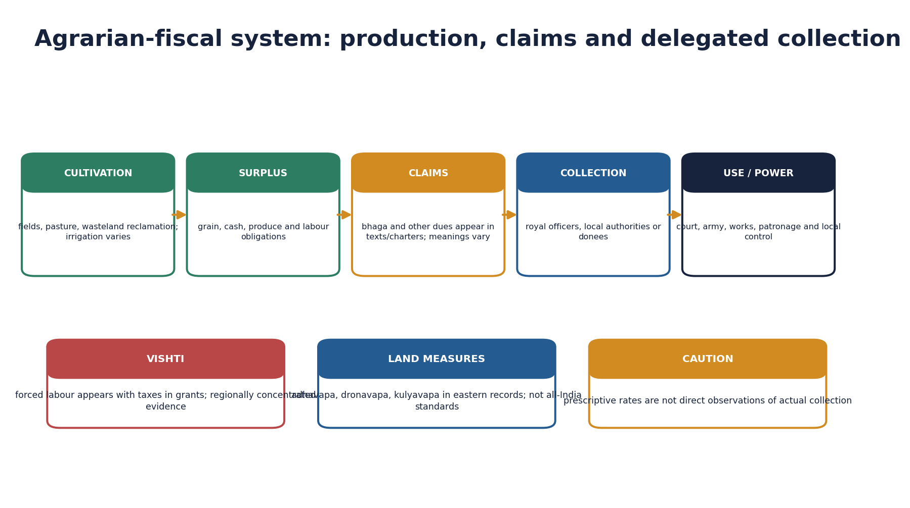

*Original deterministic teaching schematic; any scale or attribution caveat is printed on the visual.*

#### Core teaching / solved practice

- [FACT] Eastern records use adhavapa, dronavapa and kulyavapa; their values and use are regional, not universal.
- [FACT] The Junagadh repair record shows provincial responsibility for a major waterwork.
- [FACT] Land-sale records show application, record consultation, payment, inspection, demarcation and public notification.
- [FACT] Vishti appears with taxes in grant inscriptions and can be treated as a labour contribution; evidence is concentrated in central and western regions.
- [LIMIT] Textual tax rates are prescriptions, not direct accounts of actual collection.
- [ANALYSIS] Fiscal power concerned control over streams of produce, cash and labour as much as abstract ownership of soil.

#### PARAGRAPH DEMONSTRATION — CLAIM → NAMED EVIDENCE → ANALYSIS → QUALIFICATION

[CLAIM] Gupta revenue rested on a regionally variable agrarian system rather than one uniform code of measures and dues. [NAMED EVIDENCE] Eastern inscriptions use land-measure terms such as adhavapa, dronavapa and kulyavapa, the Junagadh record shows a province repairing the Sudarshana lake breach, and vishti appears alongside taxes in several grant inscriptions concentrated in central and western India. [ANALYSIS] Together these show a fiscal system built from produce shares, cash dues, labour obligations and infrastructure responsibility distributed across regions rather than one arithmetic standard. [QUALIFICATION] Textual tax rates are prescriptive ideals, not verified records of what was actually collected, and kulyavapa cannot be converted into one fixed all-India acre-equivalent.

#### Must-know facts

- Land measures varied regionally.
- Vishti was a burden and fiscal resource.
- Private rights coexisted with overarching royal claims.

#### UPSC traps

- WRONG: Kulyavapa was a uniform all-India acre.
  CORRECT: It was an eastern sowing-based measure with variable conversion.
- WRONG: The king legally owned every field absolutely.
  CORRECT: Sources show layered and sometimes conflicting rights.

**Mains angle:** Build the answer from production -> assessment -> collection -> use -> social burden.

**Study link:** Topic 21; agrarian transition.

#### CLOSING RECALL FLOW — REVENUE, TAXATION AND THE AGRARIAN BASE

```text
START / CONCEPT: Revenue, taxation and the agrarian base
        |
        v
EXACT TERMS: Revenue · taxation · the agrarian base · Kulyavapa · Junagadh repair · Texts
        |
        v
MECHANISM / ARGUMENT: Texts and inscriptions mention cultivated, waste, pasture and habitat land, irrigation works, measures, produce shares, cash dues and labour obligations.
        |
        v
CONSEQUENCE / CONTRAST: Textual tax rates are prescriptions, not direct accounts of actual collection.
        |
        v
UPSC TRAP / ANSWER-USE: Do not miss this limiting distinction: the Junagadh repair record shows provincial responsibility for a major waterwork.
        |
        v
ANSWER-GRABBING FORMULATION: Gupta fiscal power rested on agriculture: texts and inscriptions record cultivated, waste and pasture land, irrigation works, land measures, produce shares, cash dues and labour obligations.
```
### SESSION 13 — LAND GRANTS, IMMUNITIES AND DECENTRALISATION DEBATE

#### DEFINITION / WHAT THIS IS CALLED

**Plain-language definition:** Royal land grants expanded from the fourth-fifth centuries, but the imperial Guptas themselves are not represented by a large body of secure grant charters.

**Technical definition:** Imperial Gupta grant evidence is limited.

#### ANSWER-GRABBING OPENING — WRITE/ADAPT IN THE EXAM

> Royal land grants expanded from the fourth-fifth centuries, but the imperial Guptas themselves are not represented by a large body of secure grant charters.

#### MUST-WRITE KEYWORDS

- **Land grants**
- **immunities**
- **decentralisation debate**
- **Bhitari grant**
- **Vakataka charters**
- **Royal**

**How to use them:** Frame the answer through Land grants; define immunities, connect decentralisation debate with Bhitari grant to explain the mechanism, and use Vakataka charters for the decisive comparison or qualification.

[FACT] Royal land grants expanded from the fourth-fifth centuries, but the imperial Guptas themselves are not represented by a large body of secure grant charters.

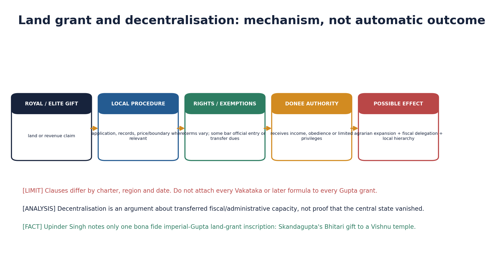

*Original deterministic teaching schematic; any scale or attribution caveat is printed on the visual.*

#### Core teaching / solved practice

- [FACT] Upinder Singh identifies Skandagupta's Bhitari temple gift as the one bona fide imperial-Gupta grant inscription; Gaya and Nalanda plates attributed to Samudragupta are disputed.
- [FACT] Vakataka and subordinate-ruler charters provide richer evidence for exemptions, non-entry clauses, rights and agrarian expansion.
- [ANALYSIS] Grants could reclaim wasteland, support Brahmanas or institutions, transfer revenue, build local authority and extend cultural-political integration.
- [LIMIT] Not every grant transferred police, judicial, mineral, labour and tax rights; clauses must be charter-specific.
- [ANALYSIS] Decentralisation is strongest when demonstrated as cumulative fiscal and administrative delegation, not assumed from the existence of a pious gift.
- [ANALYSIS] The same instrument could strengthen royal integration in the short run and empower intermediaries over time.

#### PARAGRAPH DEMONSTRATION — CLAIM → NAMED EVIDENCE → ANALYSIS → QUALIFICATION

[CLAIM] Land grants expanded markedly from the fourth-fifth centuries, but the imperial Guptas themselves supply only a thin, contested slice of that evidence. [NAMED EVIDENCE] Upinder Singh identifies Skandagupta's Bhitari temple gift as the one secure imperial-Gupta grant inscription, while the Gaya and Nalanda plates attributed to Samudragupta are disputed, and richer exemption and non-entry clauses instead survive in Vakataka and other subordinate-ruler charters. [ANALYSIS] Grants could simultaneously extend cultivation, reward service and integrate frontier zones while also transferring revenue and building the local authority of intermediaries. [QUALIFICATION] Because famous immunity clauses often come from related but distinct polities, they must not be silently relabelled as imperial Gupta practice.

#### Must-know facts

- Imperial Gupta grant evidence is limited.
- Vakataka evidence cannot be silently relabelled Gupta.
- Effects could be integrative and decentralising.

#### UPSC traps

- WRONG: All Gupta grants contained full fiscal immunities.
  CORRECT: Terms vary and many famous clauses come from related or later polities.
- WRONG: Every grant immediately caused feudalism.
  CORRECT: Mechanism, scale and regional chronology must be shown.

**Mains angle:** Present a two-sided verdict: agrarian-cultural integration versus delegated fiscal power and hierarchy.

**Study link:** Feudalism debate; Topic 26.

#### CLOSING RECALL FLOW — LAND GRANTS, IMMUNITIES AND DECENTRALISATION DEBATE

```text
START / CONCEPT: Land grants, immunities and decentralisation debate
        |
        v
EXACT TERMS: Land grants · immunities · decentralisation debate · Bhitari grant · Vakataka charters · Royal
        |
        v
MECHANISM / ARGUMENT: CORRECT: Mechanism, scale and regional chronology must be shown.
        |
        v
CONSEQUENCE / CONTRAST: Not every grant transferred police, judicial, mineral, labour and tax rights; clauses must be charter-specific.
        |
        v
UPSC TRAP / ANSWER-USE: Decentralisation is strongest when demonstrated as cumulative fiscal and administrative delegation, not assumed from the existence of a pious gift.
        |
        v
ANSWER-GRABBING FORMULATION: Royal land grants expanded from the fourth-fifth centuries, but the imperial Guptas themselves are not represented by a large body of secure grant charters.
```
### SESSION 14 — GUILDS, CRAFTS, TRADE AND COINAGE

#### DEFINITION / WHAT THIS IS CALLED

**Plain-language definition:** The question is transformation: trade circuits and media changed rather than commerce simply ending.

**Technical definition:** Gupta silver coinage is tied to western expansion.

#### ANSWER-GRABBING OPENING — WRITE/ADAPT IN THE EXAM

> The question is transformation: trade circuits and media changed rather than commerce simply ending.

#### MUST-WRITE KEYWORDS

- **Guilds**
- **crafts**
- **trade**
- **coinage**
- **Tamralipti**
- **Western silver coinage**

**How to use them:** Frame the answer through Guilds; define crafts, connect trade with coinage to explain the mechanism, and use Tamralipti for the decisive comparison or qualification.

[FACT] Gupta economic history combines continued craft skill, guild and endowment evidence, long-distance routes and impressive coinage with signs of regional commercial change.

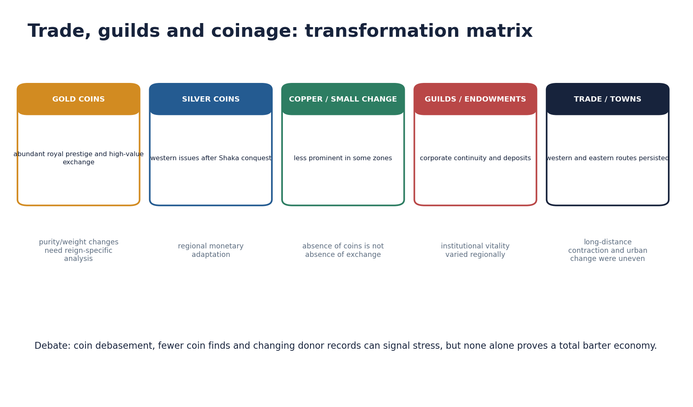

*Original deterministic teaching schematic; any scale or attribution caveat is printed on the visual.*

#### Core teaching / solved practice

- [FACT] Gold coins carried royal iconography and high-value functions; Chandragupta II adapted western silver coin traditions after defeating the Shakas.
- [FACT] Faxian's Tamralipti and links with Sri Lanka, China, Southeast Asia, Persia, Arabia and Byzantium indicate continuing exchange.
- [FACT] Texts and art attest textiles, jewellery, stone work, architecture, painting and other specialist crafts.
- [ANALYSIS] Changes in gold purity/weight, fewer low-denomination finds or declining donor references can indicate stress but require regional and chronological control.
- [LIMIT] Coin abundance among royal issues does not prove a uniformly monetised peasant economy.
- [ANALYSIS] The question is transformation: trade circuits and media changed rather than commerce simply ending.

#### PARAGRAPH DEMONSTRATION — CLAIM → NAMED EVIDENCE → ANALYSIS → QUALIFICATION

[CLAIM] Gupta commercial life shows transformation of routes and media, not the simple ending of trade. [NAMED EVIDENCE] Chandragupta II adapted western silver-coin traditions after defeating the Shakas, Faxian describes Tamralipti's continuing links with Sri Lanka, China, Southeast Asia, Persia, Arabia and Byzantium, and texts and art attest continuing textile, jewellery, stonework and architectural craft skill. [ANALYSIS] Falling gold purity, fewer low-denomination coin finds or fewer donor references in some regions can indicate commercial stress, but only when checked against region and period rather than assumed automatically. [QUALIFICATION] Abundant royal gold coinage reflects elite and state-level transactions and cannot, by itself, prove a uniformly monetised peasant economy.

#### Must-know facts

- Gupta silver coinage is tied to western expansion.
- Tamralipti remained an eastern maritime node.

#### UPSC traps

- WRONG: Gold coinage proves universal prosperity.
  CORRECT: It disproportionately reflects elite/state transactions.
- WRONG: Trade decline means zero overseas contact.
  CORRECT: Multiple circuits continued.

**Mains angle:** Use a matrix of coin type, route, guild/craft evidence and regional variation.

**Study link:** Topic 19 continuity; urban debate.

#### CLOSING RECALL FLOW — GUILDS, CRAFTS, TRADE AND COINAGE

```text
START / CONCEPT: Guilds, crafts, trade and coinage
        |
        v
EXACT TERMS: Guilds · crafts · trade · coinage · Tamralipti · Western silver coinage
        |
        v
MECHANISM / ARGUMENT: Use a matrix of coin type, route, guild/craft evidence and regional variation.
        |
        v
CONSEQUENCE / CONTRAST: Changes in gold purity/weight, fewer low-denomination finds or declining donor references can indicate stress but require regional and chronological control.
        |
        v
UPSC TRAP / ANSWER-USE: Coin abundance among royal issues does not prove a uniformly monetised peasant economy.
        |
        v
ANSWER-GRABBING FORMULATION: The question is transformation: trade circuits and media changed rather than commerce simply ending.
```
### SESSION 15 — URBAN CONTINUITY AND DECLINE

#### DEFINITION / WHAT THIS IS CALLED

**Plain-language definition:** Sharma links reduced long-distance trade, fewer merchant/artisan references and archaeological contraction to urban decay.

**Technical definition:** Poetic city descriptions cannot be read literally, but they do reveal an urban social imagination and audience.

#### ANSWER-GRABBING OPENING — WRITE/ADAPT IN THE EXAM

> Poetic city descriptions cannot be read literally, but they do reveal an urban social imagination and audience.

#### MUST-WRITE KEYWORDS

- **Urban continuity**
- **decline**
- **Upinder Singh's counter-evidence**
- **Site-specific change**
- **Sharma**
- **Upinder Singh**
- **R.S. Sharma**

**How to use them:** Frame the answer through Urban continuity; define decline, connect Upinder Singh's counter-evidence with Site-specific change to explain the mechanism, and use Sharma for the decisive comparison or qualification.

[ANALYSIS] The urban-decline thesis identifies contraction after the early-historic peak, but a subcontinental, simultaneous collapse is difficult to sustain.

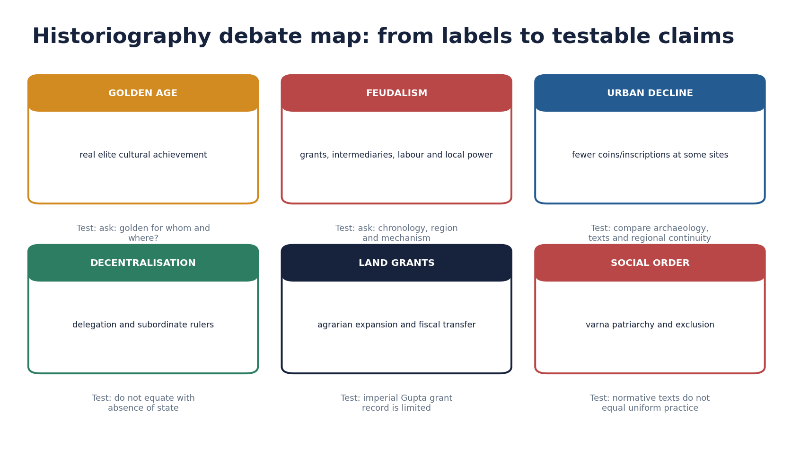

*Original deterministic teaching schematic; any scale or attribution caveat is printed on the visual.*

#### Core teaching / solved practice

- [FACT] R.S. Sharma links reduced long-distance trade, fewer merchant/artisan references and archaeological contraction to urban decay.
- [FACT] Upinder Singh notes counter-evidence: urban Sanskrit literary worlds, continued craft production, Sanchi/Sarnath/Nalanda/Ajanta activity and flourishing southern cities.
- [LIMIT] Land-grant inscriptions naturally describe rural land and are a biased corpus for counting cities.
- [LIMIT] Poetic city descriptions cannot be read literally, but they do reveal an urban social imagination and audience.
- [ANALYSIS] Best verdict: decline, continuity and relocation occurred at different sites and times; ask which urban functions changed.

#### PARAGRAPH DEMONSTRATION — CLAIM → NAMED EVIDENCE → ANALYSIS → QUALIFICATION

[CLAIM] Gupta-period urban history is a debate between contraction and continuity rather than a settled verdict of universal decline. [NAMED EVIDENCE] R.S. Sharma links reduced long-distance trade, fewer merchant and artisan references and archaeological contraction to urban decay, while Upinder Singh cites continuing Sanskrit literary urban worlds, ongoing craft production and active sites such as Sanchi, Sarnath, Nalanda, Ajanta and flourishing southern cities. [ANALYSIS] Because land-grant inscriptions are naturally a rural-biased corpus and poetic city descriptions are stylised rather than literal, both bodies of evidence must be read for genre before being used to count cities. [QUALIFICATION] The safest verdict is that decline, continuity and relocation all occurred, at different sites and times, so a strong answer asks which urban function - administrative, sacred, commercial or productive - is actually under discussion.

#### Must-know facts

- Urban change was regional and functional.
- Literature and archaeology must be read by genre and context.

#### UPSC traps

- WRONG: Every Gupta city declined.
  CORRECT: Site histories diverge.
- WRONG: Literary cities directly measure population.
  CORRECT: They are stylised but historically informative.

**Mains angle:** Define urban function - administration, craft, sacred centre, market, port - before judging decline.

**Study link:** Topic 19; historiography.

#### CLOSING RECALL FLOW — URBAN CONTINUITY AND DECLINE

```text
START / CONCEPT: Urban continuity and decline
        |
        v
EXACT TERMS: Urban continuity · decline · Upinder Singh's counter-evidence · Site-specific change · Sharma · Land-grant inscriptions naturally describe rural land and
        |
        v
MECHANISM / ARGUMENT: Literature and archaeology must be read by genre and context.
        |
        v
CONSEQUENCE / CONTRAST: The urban-decline thesis identifies contraction after the early-historic peak, but a subcontinental, simultaneous collapse is difficult to sustain.
        |
        v
UPSC TRAP / ANSWER-USE: CORRECT: They are stylised but historically informative.
        |
        v
ANSWER-GRABBING FORMULATION: Poetic city descriptions cannot be read literally, but they do reveal an urban social imagination and audience.
```
### SESSION 16 — SOCIAL STRUCTURE, GENDER, LABOUR AND FAXIAN

#### DEFINITION / WHAT THIS IS CALLED

**Plain-language definition:** Vishti, hired labour and slavery are distinct categories and should not be merged.

**Technical definition:** Faxian describes Chandalas living outside towns and signalling their approach, important evidence for untouchability.

#### ANSWER-GRABBING OPENING — WRITE/ADAPT IN THE EXAM

> Gupta-period sources show Brahmanical varna norms, multiplying jati and occupational distinctions, patriarchy, labour dependence, slavery and untouchability alongside elite female agency and varied lived practice.

#### MUST-WRITE KEYWORDS

- **Social structure**
- **gender**
- **labour**
- **Faxian**
- **Prabhavatigupta**
- **Chandala passage**

**How to use them:** Frame the answer through Social structure; define gender, connect labour with Faxian to explain the mechanism, and use Prabhavatigupta for the decisive comparison or qualification.

[FACT] Gupta-period sources show Brahmanical varna norms, multiplying jati and occupational distinctions, patriarchy, labour dependence, slavery and untouchability alongside elite female agency and varied lived practice.

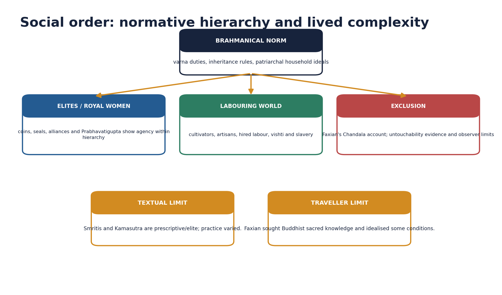

*Original deterministic teaching schematic; any scale or attribution caveat is printed on the visual.*

#### Core teaching / solved practice

- [FACT] Smritis discuss inheritance, property, wages, slavery and gender from a normative Brahmanical perspective.
- [FACT] Royal women appear on coins and seals; Prabhavatigupta exercised regency and issued grants in the Vakataka realm.
- [FACT] Vishti, hired labour and slavery are distinct categories and should not be merged.
- [FACT] Faxian describes Chandalas living outside towns and signalling their approach, important evidence for untouchability.
- [LIMIT] Faxian idealises peace and prosperity and selects details relevant to Buddhist pilgrimage; his silence is not proof of absence.
- [LIMIT] Prescriptive subordination of women does not erase agency, and exceptional royal women do not prove general equality.
- [ANALYSIS] The Golden Age label must be tested against peasants, labourers, women and excluded communities.

#### PARAGRAPH DEMONSTRATION — CLAIM → NAMED EVIDENCE → ANALYSIS → QUALIFICATION

[CLAIM] Gupta-period social evidence combines prescriptive hierarchy with documented individual agency. [NAMED EVIDENCE] Smritis prescribe inheritance, property, wage and slavery norms from a Brahmanical perspective, Prabhavatigupta exercised regency and issued her own grants in the Vakataka realm, and Faxian describes Chandalas living outside towns and signalling their approach, valuable evidence for untouchability. [ANALYSIS] Reading normative text, epigraphic agency and traveller observation together shows norm, practice and exclusion operating at the same time rather than replacing one another. [QUALIFICATION] Faxian idealises peace and selects Buddhist-relevant detail, so his silences cannot be read as proof of absence, and one exceptional royal woman does not establish general gender equality.

#### Must-know facts

- Faxian visited during Chandragupta II's broad reign context.
- Chandala evidence must retain traveller-source limits.
- Prabhavatigupta is a named example of political agency.

#### UPSC traps

- WRONG: Faxian gives a census-like social report.
  CORRECT: His account is selective and religiously purposed.
- WRONG: Golden Age equals egalitarian age.
  CORRECT: Cultural achievement coexisted with hierarchy.

**Mains angle:** Write social history through norm, practice, agency and exclusion.

**Study link:** Topic 21; Golden Age debate.

#### CLOSING RECALL FLOW — SOCIAL STRUCTURE, GENDER, LABOUR AND FAXIAN

```text
START / CONCEPT: Social structure, gender, labour and Faxian
        |
        v
EXACT TERMS: Social structure · gender · labour · Faxian · Prabhavatigupta · Chandala passage
        |
        v
MECHANISM / ARGUMENT: Vishti, hired labour and slavery are distinct categories and should not be merged.
        |
        v
CONSEQUENCE / CONTRAST: Faxian idealises peace and prosperity and selects details relevant to Buddhist pilgrimage; his silence is not proof of absence.
        |
        v
UPSC TRAP / ANSWER-USE: Prescriptive subordination of women does not erase agency, and exceptional royal women do not prove general equality.
        |
        v
ANSWER-GRABBING FORMULATION: Gupta-period sources show Brahmanical varna norms, multiplying jati and occupational distinctions, patriarchy, labour dependence, slavery and untouchability alongside elite female agency and varied lived practice.
```
### SESSION 17 — RELIGION AND PLURAL PATRONAGE

#### DEFINITION / WHAT THIS IS CALLED

**Plain-language definition:** Plural patronage does not prove absence of competition or hierarchy among traditions.

**Technical definition:** Show how religion legitimised kingship while institutions competed and coexisted.

#### ANSWER-GRABBING OPENING — WRITE/ADAPT IN THE EXAM

> Plural patronage does not prove absence of competition or hierarchy among traditions.

#### MUST-WRITE KEYWORDS

- **Religion**
- **plural patronage**
- **Inclusive sectarianism**
- **Sanchi**
- **Udayagiri**
- **Vishnu**

**How to use them:** Frame the answer through Religion; define plural patronage, connect Inclusive sectarianism with Sanchi to explain the mechanism, and use Udayagiri for the decisive comparison or qualification.

[FACT] Gupta rulers prominently used Vaishnava titles and Garuda imagery, while Shaiva, Buddhist, Jaina and local traditions continued to receive patronage.


*Original deterministic teaching schematic; any scale or attribution caveat is printed on the visual.*

#### Core teaching / solved practice

- [FACT] Udayagiri combines dominant Vishnu imagery with Shaiva, Durga, Ganesha and Jaina remains.
- [FACT] Chandragupta II-associated support at Sanchi and Sri Lankan monastery diplomacy at Bodh Gaya complicate a single-sect patronage story.
- [FACT] Puranic Hinduism consolidated temple-based devotional traditions while Buddhism and Jainism remained institutionally active.
- [ANALYSIS] 'Inclusive sectarianism' captures rulers' strong affiliations combined with accommodation better than assuming modern secularism.
- [LIMIT] Plural patronage does not prove absence of competition or hierarchy among traditions.

#### PARAGRAPH DEMONSTRATION — CLAIM → NAMED EVIDENCE → ANALYSIS → QUALIFICATION

[CLAIM] Gupta religious life combined strong royal Vaishnava affiliation with continuing multi-tradition patronage. [NAMED EVIDENCE] Rulers prominently used Vaishnava titles and Garuda imagery, yet Udayagiri itself combines dominant Vishnu imagery with Shaiva, Durga, Ganesha and Jaina remains, and Chandragupta II-associated support appears at the Buddhist site of Sanchi alongside Sri Lankan monastery diplomacy at Bodh Gaya. [ANALYSIS] 'Inclusive sectarianism' better captures this pattern than either a claim of modern secular tolerance or a claim of exclusive state religion. [QUALIFICATION] Plural patronage across sites does not prove an absence of hierarchy or competition among traditions, so a strong answer names both the affiliation and the coexistence.

#### Must-know facts

- Garuda was a royal Vaishnava emblem.
- Plural patronage and strong sectarian affiliation coexisted.

#### UPSC traps

- WRONG: Brahmanical consolidation means Buddhism vanished.
  CORRECT: Major monasteries and donations continued.
- WRONG: Tolerance is self-explanatory.
  CORRECT: Specify the evidence and its limits.

**Mains angle:** Show how religion legitimised kingship while institutions competed and coexisted.

**Study link:** Udayagiri; Sanchi; Nalanda.

#### CLOSING RECALL FLOW — RELIGION AND PLURAL PATRONAGE

```text
START / CONCEPT: Religion and plural patronage
        |
        v
EXACT TERMS: Religion · plural patronage · Inclusive sectarianism · Sanchi · Udayagiri · Vishnu
        |
        v
MECHANISM / ARGUMENT: Show how religion legitimised kingship while institutions competed and coexisted.
        |
        v
CONSEQUENCE / CONTRAST: Udayagiri combines dominant Vishnu imagery with Shaiva, Durga, Ganesha and Jaina remains.
        |
        v
UPSC TRAP / ANSWER-USE: Do not miss this limiting distinction: 'Inclusive sectarianism' captures rulers' strong affiliations combined with accommodation better than assuming modern secularism.
        |
        v
ANSWER-GRABBING FORMULATION: Plural patronage does not prove absence of competition or hierarchy among traditions.
```
### SESSION 18 — SANSKRIT, LITERATURE AND EDUCATION

#### DEFINITION / WHAT THIS IS CALLED

**Plain-language definition:** Kalidasa's dramas and poems are central to classical Sanskrit literature; his precise date and Chandragupta II court link remain debated.

**Technical definition:** Education occurred through Brahmanical, Buddhist and other institutions; Nalanda's early Gupta-period development should be stated without inventing a single founder claim.

#### ANSWER-GRABBING OPENING — WRITE/ADAPT IN THE EXAM

> Kalidasa's dramas and poems are central to classical Sanskrit literature; his precise date and Chandragupta II court link remain debated.

#### MUST-WRITE KEYWORDS

- **Sanskrit**
- **literature**
- **education**
- **Kalidasa**
- **Amarakosha**
- **Prakrit**

**How to use them:** Frame the answer through Sanskrit; define literature, connect education with Kalidasa to explain the mechanism, and use Amarakosha for the decisive comparison or qualification.

[FACT] Sanskrit became the principal language of royal eulogy and elite literary culture, though Prakrit and regional languages did not disappear.

#### Core teaching / solved practice

- [FACT] Kalidasa's dramas and poems are central to classical Sanskrit literature; his precise date and Chandragupta II court link remain debated.
- [FACT] Amarasimha is associated with the Amarakosha, an important lexicon; the popular 'nine gems' list is later tradition, not a secure court roster.
- [FACT] Education occurred through Brahmanical, Buddhist and other institutions; Nalanda's early Gupta-period development should be stated without inventing a single founder claim.
- [ANALYSIS] Sanskrit served aesthetic, intellectual and political integration across regional courts.
- [LIMIT] Elite literary florescence does not directly reveal mass literacy or vernacular cultural absence.

#### PARAGRAPH DEMONSTRATION — CLAIM → NAMED EVIDENCE → ANALYSIS → QUALIFICATION

[CLAIM] Sanskrit became the dominant idiom of Gupta elite and political culture without erasing other languages. [NAMED EVIDENCE] Kalidasa's dramas and poems anchor classical Sanskrit literature, Amarasimha is associated with the lexicon Amarakosha, and education continued through Brahmanical, Buddhist and other institutions including Nalanda's early Gupta-period growth. [ANALYSIS] Political prashastis, courtly poetry and institutional learning together show Sanskrit operating as an integrative idiom across regional courts. [QUALIFICATION] Kalidasa's precise date and court affiliation, and the popular 'navaratna' roster, remain later or debated traditions, and elite literary florescence does not by itself prove mass literacy or the absence of Prakrit and regional languages.

#### Must-know facts

- Kalidasa chronology needs caution.
- Amarakosha is linked with Amarasimha.
- Nalanda grew through stages.

#### UPSC traps

- WRONG: Panini was a Gupta scholar.
  CORRECT: Panini predates the Guptas by many centuries.
- WRONG: Navaratnas are an inscriptionally verified cabinet.
  CORRECT: The roster is a later literary tradition.

**Mains angle:** Connect language, patronage, political communication and education, then qualify social reach.

**Study link:** Topic 21; Art and Culture literature.

#### CLOSING RECALL FLOW — SANSKRIT, LITERATURE AND EDUCATION

```text
START / CONCEPT: Sanskrit, literature and education
        |
        v
EXACT TERMS: Sanskrit · literature · education · Kalidasa · Amarakosha · Prakrit
        |
        v
MECHANISM / ARGUMENT: Education occurred through Brahmanical, Buddhist and other institutions; Nalanda's early Gupta-period development should be stated without inventing a single founder claim.
        |
        v
CONSEQUENCE / CONTRAST: Sanskrit became the principal language of royal eulogy and elite literary culture, though Prakrit and regional languages did not disappear.
        |
        v
UPSC TRAP / ANSWER-USE: Amarasimha is associated with the Amarakosha, an important lexicon; the popular 'nine gems' list is later tradition, not a secure court roster.
        |
        v
ANSWER-GRABBING FORMULATION: Kalidasa's dramas and poems are central to classical Sanskrit literature; his precise date and Chandragupta II court link remain debated.
```
### SESSION 19 — SCIENCE, MATHEMATICS, ASTRONOMY AND MEDICINE

#### DEFINITION / WHAT THIS IS CALLED

**Plain-language definition:** Aryabhata completed the Aryabhatiya in 499 CE; it treats mathematics and astronomy and explains the apparent daily motion of the heavens through Earth's rotation.

**Technical definition:** Aryabhata's 499 CE Aryabhatiya, Varahamihira's sixth-century synthesis and Brahmagupta's seventh-century post-Gupta work must be placed on an exact chronology rather than treated as one undifferentiated 'ancient Indian science'.

#### ANSWER-GRABBING OPENING — WRITE/ADAPT IN THE EXAM

> Aryabhata completed the Aryabhatiya in 499 CE; it treats mathematics and astronomy and explains the apparent daily motion of the heavens through Earth's rotation.

#### MUST-WRITE KEYWORDS

- **Science**
- **mathematics**
- **astronomy**
- **medicine**
- **Aryabhatiya**
- **Varahamihira**

**How to use them:** Frame the answer through Science; define mathematics, connect astronomy with medicine to explain the mechanism, and use Aryabhatiya for the decisive comparison or qualification.

[FACT] The Gupta and immediately post-Gupta centuries produced major mathematical-astronomical texts, but chronology and attribution must be exact.


*Original deterministic teaching schematic; any scale or attribution caveat is printed on the visual.*

#### Core teaching / solved practice

- [FACT] Aryabhata completed the Aryabhatiya in 499 CE; it treats mathematics and astronomy and explains the apparent daily motion of the heavens through Earth's rotation.
- [FACT] Aryabhata's procedures presuppose decimal place value; this must be distinguished from the separate history of zero as a numeral and number.
- [FACT] Varahamihira belongs to the sixth century and synthesised astronomical traditions; Brahmagupta belongs to the seventh century and is post-Gupta.
- [FACT] Medical traditions continued through Ayurveda and compendia, but sweeping claims about a specific 'Gupta invention' require named texts and dates.
- [LIMIT] Scientific achievements were cumulative and connected with earlier Indian and Greek-inspired streams; civilisational isolation claims are inaccurate.
- [ANALYSIS] Use 'classical scientific tradition' rather than assigning every later scholar to the Gupta court.

#### PARAGRAPH DEMONSTRATION — CLAIM → NAMED EVIDENCE → ANALYSIS → QUALIFICATION

[CLAIM] Gupta-and-adjoining-period scientific achievement must be dated exactly, not treated as one undifferentiated 'ancient Indian science'. [NAMED EVIDENCE] Aryabhata completed the Aryabhatiya in 499 CE, explaining the daily motion of the heavens through Earth's rotation and presupposing decimal place value; Varahamihira belongs to the sixth century; Brahmagupta belongs to the seventh century and is explicitly post-Gupta. [ANALYSIS] Sequencing these three figures shows a cumulative scientific tradition extending beyond any single reign rather than one court's isolated invention. [QUALIFICATION] Decimal place value must be distinguished from the separate historical question of zero as a full numeral, and none of the three scholars should be assigned uniformly to Chandragupta II's court.

#### Must-know facts

- Aryabhatiya: 499 CE.
- Varahamihira: sixth century.
- Brahmagupta: seventh century, post-Gupta.

#### UPSC traps

- WRONG: Aryabhata invented every aspect of zero.
  CORRECT: Place value, placeholder notation and zero as number have distinct histories.
- WRONG: All three scholars served Chandragupta II.
  CORRECT: Their chronologies differ.

**Mains angle:** Score with accurate chronology, one named contribution and a cumulative-knowledge qualification.

**Study link:** Topic 21; history of science.

#### CLOSING RECALL FLOW — SCIENCE, MATHEMATICS, ASTRONOMY AND MEDICINE

```text
START / CONCEPT: Science, mathematics, astronomy and medicine
        |
        v
EXACT TERMS: Science · mathematics · astronomy · medicine · Aryabhatiya · Varahamihira
        |
        v
MECHANISM / ARGUMENT: The Gupta and immediately post-Gupta centuries produced major mathematical-astronomical texts, but chronology and attribution must be exact.
        |
        v
CONSEQUENCE / CONTRAST: Aryabhata's procedures presuppose decimal place value; this must be distinguished from the separate history of zero as a numeral and number.
        |
        v
UPSC TRAP / ANSWER-USE: Do not miss this limiting distinction: varahamihira belongs to the sixth century and synthesised astronomical traditions.
        |
        v
ANSWER-GRABBING FORMULATION: Aryabhata completed the Aryabhatiya in 499 CE; it treats mathematics and astronomy and explains the apparent daily motion of the heavens through Earth's rotation.
```
### SESSION 20 — ART, ARCHITECTURE, SCULPTURE AND PAINTING

#### DEFINITION / WHAT THIS IS CALLED

**Plain-language definition:** Bagh paintings are broadly associated with the Gupta-Vakataka cultural horizon, with site-specific chronology.

**Technical definition:** Gupta art, architecture, sculpture and painting created ritual space, political meaning and durable cultural models.

#### ANSWER-GRABBING OPENING — WRITE/ADAPT IN THE EXAM

> Gupta art, architecture, sculpture and painting created ritual space, political meaning and durable cultural models.

#### MUST-WRITE KEYWORDS

- **Art**
- **architecture**
- **sculpture**
- **painting**
- **Bhitargaon temple**
- **Ajanta Vakataka**

**How to use them:** Frame the answer through Art; define architecture, connect sculpture with painting to explain the mechanism, and use Bhitargaon temple for the decisive comparison or qualification.

[FACT] Gupta-period art is marked by refined sculptural idioms, early structural temples and powerful religious-political imagery, while major Vakataka Ajanta work belongs to a connected but distinct patronage context.


*Original deterministic teaching schematic; any scale or attribution caveat is printed on the visual.*

| Form | Named example | Safe significance |
|---|---|---|
| Rock-cut sacred landscape | Udayagiri Varaha | royal-religious ideology |
| Structural temple | Bhitargaon | early brick shikhara-form evidence |
| Stone temple | Deogarh Dashavatara | early developed temple iconographic programme |
| Buddha sculpture | Sarnath / Mathura | distinct regional idioms |
| Painting | Ajanta; Bagh | courtly-monastic narratives; patronage must be distinguished |

#### Core teaching / solved practice

- [FACT] Named temple examples include the brick temple at Bhitargaon and the stone Dashavatara temple at Deogarh; dating and reconstruction details should follow specialist art-history evidence.
- [FACT] Udayagiri Varaha connects sacred landscape with kingship; Sarnath and Mathura developed influential Buddha-image styles.
- [FACT] Ajanta's fifth-century phase flourished under Vakataka Harishena and elite donors, not directly as an imperial Gupta court project.
- [FACT] Bagh paintings are broadly associated with the Gupta-Vakataka cultural horizon, with site-specific chronology.
- [LIMIT] 'Gupta style' is a useful art-historical category but can hide regional workshops and non-Gupta patrons.
- [ANALYSIS] Gupta art, architecture, sculpture and painting created ritual space, political meaning and durable cultural models.

#### PARAGRAPH DEMONSTRATION — CLAIM → NAMED EVIDENCE → ANALYSIS → QUALIFICATION

[CLAIM] Gupta-period visual and architectural culture created ritual space and political meaning through named, datable works. [NAMED EVIDENCE] The brick temple at Bhitargaon and the stone Dashavatara temple at Deogarh supply early structural examples, Udayagiri's Varaha programme fuses sacred landscape with kingship, and Ajanta's major fifth-century phase flourished under Vakataka patronage rather than direct imperial Gupta sponsorship. [ANALYSIS] 'Gupta style' is a useful art-historical shorthand, but naming site, patron and date shows that a connected cultural horizon can still involve distinct political sponsors. [QUALIFICATION] Bagh's paintings share this horizon but have their own site-specific chronology, so a strong answer credits the correct patron rather than folding every fifth-century masterpiece into one imperial Gupta court project.

#### Must-know facts

- Ajanta's major fifth-century patronage is Vakataka.
- Deogarh and Bhitargaon are named structural examples.

#### UPSC traps

- WRONG: All Ajanta caves were made by Gupta emperors.
  CORRECT: Major fifth-century work is Vakataka and donor-led.
- WRONG: Gupta temples already had the scale of later complexes.
  CORRECT: They are formative structural examples.

**Mains angle:** Name forms and sites, explain innovation, then distinguish political patronage and regional workshop.

**Study link:** Indian Art and Culture owners; Topic 21.

#### CLOSING RECALL FLOW — ART, ARCHITECTURE, SCULPTURE AND PAINTING

```text
START / CONCEPT: Art, architecture, sculpture and painting
        |
        v
EXACT TERMS: Art · architecture · sculpture · painting · Bhitargaon temple · Ajanta Vakataka
        |
        v
MECHANISM / ARGUMENT: Gupta-period art is marked by refined sculptural idioms, early structural temples and powerful religious-political imagery, while major Vakataka Ajanta work belongs to a connected but distinct patronage context.
        |
        v
CONSEQUENCE / CONTRAST: 'Gupta style' is a useful art-historical category but can hide regional workshops and non-Gupta patrons.
        |
        v
UPSC TRAP / ANSWER-USE: Do not miss this limiting distinction: bagh paintings are broadly associated with the Gupta-Vakataka cultural horizon, with site-specific chronology.
        |
        v
ANSWER-GRABBING FORMULATION: Gupta art, architecture, sculpture and painting created ritual space, political meaning and durable cultural models.
```
### SESSION 21 — GOLDEN AGE: ACHIEVEMENT, DISTRIBUTION AND EXCLUSION

#### DEFINITION / WHAT THIS IS CALLED

**Plain-language definition:** Golden Age is an evaluative label, not a date.

**Technical definition:** A defensible Golden Age claim must specify the domain of achievement, the social group that enjoyed it, the region involved and the duration for which it held, rather than asserting one undifferentiated label.

#### ANSWER-GRABBING OPENING — WRITE/ADAPT IN THE EXAM

> 'Golden Age' captures exceptional elite literary, artistic, scientific and political production, but becomes misleading when converted into universal prosperity or equality.

#### MUST-WRITE KEYWORDS

- **Golden Age**
- **achievement**
- **distribution**
- **exclusion**
- **Untouchability evidence**
- **Elite production**

**How to use them:** Frame the answer through Golden Age; define achievement, connect distribution with exclusion to explain the mechanism, and use Untouchability evidence for the decisive comparison or qualification.

[ANALYSIS] 'Golden Age' captures exceptional elite literary, artistic, scientific and political production, but becomes misleading when converted into universal prosperity or equality.


*Original deterministic teaching schematic; any scale or attribution caveat is printed on the visual.*

#### Core teaching / solved practice

- [FACT] Evidence supports major Sanskrit works, mathematics-astronomy, refined sculpture, early temples, coin artistry and broad political prestige.
- [FACT] The same period provides evidence for forced labour, slavery, untouchability, patriarchal norms, fiscal delegation and uneven urban change.
- [ANALYSIS] Ask four questions: golden in which domain, for which group, in which region and for how long?
- [LIMIT] Rejecting the label entirely can obscure real achievement; accepting it uncritically erases social distribution.
- [ANALYSIS] Best verdict: a classical age of high culture and knowledge, socially selective and regionally uneven.

#### PARAGRAPH DEMONSTRATION — CLAIM → NAMED EVIDENCE → ANALYSIS → QUALIFICATION

[CLAIM] 'Golden Age' is a defensible label for elite cultural production but becomes misleading when generalised to the whole society. [NAMED EVIDENCE] The same decades that produced Kalidasa's poetry, Aryabhata's mathematics-astronomy and Udayagiri's sculpture also generated evidence of vishti, slavery, untouchability, patriarchal norms and uneven urban change. [ANALYSIS] Asking which domain, which social group, which region and for how long an achievement held converts a slogan into a graded, examinable judgement. [QUALIFICATION] Rejecting the label outright erases real classical achievement, while accepting it uncritically erases the social-distribution evidence in the very same sources.

#### Must-know facts

- Golden Age is an evaluative label, not a date.
- Achievement and inequality must appear in the same answer.

#### UPSC traps

- WRONG: Critical evaluation means only criticism.
  CORRECT: It requires achievement, counter-evidence and a graded verdict.

**Mains angle:** Use domain-group-region-duration as the four-part test.

**Study link:** Historiography; Topic 21.

#### CLOSING RECALL FLOW — GOLDEN AGE: ACHIEVEMENT, DISTRIBUTION AND EXCLUSION

```text
START / CONCEPT: Golden Age: achievement, distribution and exclusion
        |
        v
EXACT TERMS: Golden Age · achievement · distribution · exclusion · Untouchability evidence · Elite production
        |
        v
MECHANISM / ARGUMENT: Rejecting the label entirely can obscure real achievement; accepting it uncritically erases social distribution.
        |
        v
CONSEQUENCE / CONTRAST: Golden Age is an evaluative label, not a date.
        |
        v
UPSC TRAP / ANSWER-USE: Do not miss this limiting distinction: achievement and inequality must appear in the same answer.
        |
        v
ANSWER-GRABBING FORMULATION: 'Golden Age' captures exceptional elite literary, artistic, scientific and political production, but becomes misleading when converted into universal prosperity or equality.
```
### SESSION 22 — MAURYAN, POST-MAURYAN AND GUPTA COMPARISON

#### DEFINITION / WHAT THIS IS CALLED

**Plain-language definition:** Arthashastra prescriptions are not a photograph of Mauryan practice, just as Gupta grants are not a complete administrative census.

**Technical definition:** Mauryan evidence suggests a more explicitly centralised fiscal-administrative ideal and empire-wide edict communication; Gupta evidence shows strong cores with more visible local notables and subordinate rulers.

#### ANSWER-GRABBING OPENING — WRITE/ADAPT IN THE EXAM

> Mauryan evidence suggests a more explicitly centralised fiscal-administrative ideal and empire-wide edict communication; Gupta evidence shows strong cores with more visible local notables and subordinate rulers.

#### MUST-WRITE KEYWORDS

- **Mauryan**
- **post-Mauryan**
- **Gupta comparison**
- **Arthashastra**
- **Edict communication**
- **Territorial form**

**How to use them:** Frame the answer through Mauryan; define post-Mauryan, connect Gupta comparison with Arthashastra to explain the mechanism, and use Edict communication for the decisive comparison or qualification.

[ANALYSIS] Comparison should identify dimensions rather than rank dynasties on a single scale.

| Dimension | Mauryan | Post-Mauryan | Gupta |
|---|---|---|---|
| Territorial form | large directly articulated imperial project | regional polities and networks | substantial core plus layered hegemony |
| Public ideology | dhamma edicts and royal orders | plural titles, coin languages, donations | Sanskrit prashasti, coins, sectarian kingship |
| Administration | elaborate textual/epigraphic ideal | regional institutions | provinces/districts plus notables/delegation |
| Economy | agrarian-tax base and routes | commercial and coinage expansion | agrarian base with commercial transformation |
| Legacy | imperial governance model | cultural-economic interaction | classical culture and regionalisation trajectory |

#### Core teaching / solved practice

- [FACT] Mauryan evidence suggests a more explicitly centralised fiscal-administrative ideal and empire-wide edict communication; Gupta evidence shows strong cores with more visible local notables and subordinate rulers.
- [FACT] Post-Mauryan centuries expanded coinage, trade, Sanskrit-Prakrit political forms, devotional cults and regional state traditions inherited by the Guptas.
- [ANALYSIS] Gupta rule was less bureaucratically documented than Mauryan rule but more than a mere ritual confederacy.
- [LIMIT] Arthashastra prescriptions are not a photograph of Mauryan practice, just as Gupta grants are not a complete administrative census.
- [ANALYSIS] Compare evidence, territorial form, ideology, economy, local institutions and legacy.

#### PARAGRAPH DEMONSTRATION — CLAIM → NAMED EVIDENCE → ANALYSIS → QUALIFICATION

[CLAIM] Comparing the Mauryan and Gupta polities requires naming dimensions rather than ranking dynasties on one scale. [NAMED EVIDENCE] Mauryan evidence, filtered through the Arthashastra and edicts, suggests a more explicitly centralised fiscal-administrative ideal and empire-wide communication, while Gupta evidence shows a strong Ganga core combined with more visible local notables, subordinate rulers and delegated provincial administration. [ANALYSIS] Post-Mauryan centuries of expanding coinage, trade, Sanskrit-Prakrit political idiom and regional state traditions were themselves inherited resources that the Guptas built upon. [QUALIFICATION] Arthashastra prescriptions are not a photograph of Mauryan practice, and Gupta land grants are not a complete administrative census, so both empires must be compared through their own source limits.

#### Must-know facts

- Comparison must be evidence-aware.
- Gupta was neither Mauryan copy nor powerless shell.

#### UPSC traps

- WRONG: Less centralised means weak everywhere.
  CORRECT: Core power and delegated systems can coexist.

**Mains angle:** Use a dimension table and end with a non-teleological verdict.

**Study link:** Topics 14-19.

#### CLOSING RECALL FLOW — MAURYAN, POST-MAURYAN AND GUPTA COMPARISON

```text
START / CONCEPT: Mauryan, post-Mauryan and Gupta comparison
        |
        v
EXACT TERMS: Mauryan · post-Mauryan · Gupta comparison · Arthashastra · Edict communication · Territorial form
        |
        v
MECHANISM / ARGUMENT: Gupta rule was less bureaucratically documented than Mauryan rule but more than a mere ritual confederacy.
        |
        v
CONSEQUENCE / CONTRAST: Arthashastra prescriptions are not a photograph of Mauryan practice, just as Gupta grants are not a complete administrative census.
        |
        v
UPSC TRAP / ANSWER-USE: Do not miss this limiting distinction: gupta was neither Mauryan copy nor powerless shell.
        |
        v
ANSWER-GRABBING FORMULATION: Mauryan evidence suggests a more explicitly centralised fiscal-administrative ideal and empire-wide edict communication; Gupta evidence shows strong cores with more visible local notables and subordinate rulers.
```
### SESSION 23 — HISTORIOGRAPHICAL DEBATES

#### DEFINITION / WHAT THIS IS CALLED

**Plain-language definition:** Gupta history is a field of debates over feudalism, land grants, urban decline, decentralisation, empire and social distribution.

**Technical definition:** A historiographical debate answer names the proposition (for example, Gupta 'feudalism'), states the supporting evidence, states the counter-evidence, and closes with a region- and time-qualified verdict rather than citing a historian's name as if it settled the question.

#### ANSWER-GRABBING OPENING — WRITE/ADAPT IN THE EXAM

> Gupta history is a field of debates over feudalism, land grants, urban decline, decentralisation, empire and social distribution.

#### MUST-WRITE KEYWORDS

- **Historiographical debates**
- **Urban-decline thesis**
- **Land-grant decentralisation**
- **Gupta history**
- **Gupta**
- **Feudalism**

**How to use them:** Frame the answer through Historiographical debates; define Urban-decline thesis, connect Land-grant decentralisation with Gupta history to explain the mechanism, and use Gupta for the decisive comparison or qualification.

[ANALYSIS] Gupta history is a field of debates over feudalism, land grants, urban decline, decentralisation, empire and social distribution.


*Original deterministic teaching schematic; any scale or attribution caveat is printed on the visual.*

#### Core teaching / solved practice

- [ANALYSIS] Feudalism thesis: grants, intermediaries, vishti, agrarian dependence and reduced monetisation are linked into a structural transition.
- [LIMIT] Critics stress regional diversity, continuing trade/towns, varied grant clauses and the danger of importing a rigid European model.
- [ANALYSIS] Urban-decline thesis is strongest at specific sites and functions, weakest as a simultaneous all-India disappearance.
- [ANALYSIS] Land grants may expand cultivation and integrate frontier zones while also transferring fiscal authority and strengthening hierarchy.
- [ANALYSIS] Decentralisation may be an intended mode of imperial governance before becoming a route to autonomy.
- [ANALYSIS] The answer should name the mechanism and counter-evidence, not merely cite historians as labels.

#### PARAGRAPH DEMONSTRATION — CLAIM → NAMED EVIDENCE → ANALYSIS → QUALIFICATION

[CLAIM] Gupta historiography is organised around named debates rather than one settled textbook narrative. [NAMED EVIDENCE] The feudalism thesis links grants, intermediaries, vishti and reduced monetisation into a structural transition, while critics point to regional diversity, continuing trade and towns, and varied grant clauses; the urban-decline thesis is strongest at specific sites and weakest as a claim of simultaneous all-India disappearance. [ANALYSIS] Each debate requires a named mechanism and named counter-evidence, not a historian's name cited as though it settled the question by itself. [QUALIFICATION] A strong answer treats decentralisation as potentially both an intended mode of governance and, over time, a route to greater regional autonomy, then reaches a graded verdict rather than an indecisive one.

#### Must-know facts

- A debate answer needs thesis, evidence, counter-evidence and scale.
- Regional variation is a central qualification.

#### UPSC traps

- WRONG: One historian's model is a settled fact.
  CORRECT: Historiographical claims must be tested against evidence.
- WRONG: Debate means indecision.
  CORRECT: A graded conclusion is expected.

**Mains angle:** For each debate: define proposition -> evidence -> criticism -> regional/time qualification -> verdict.

**Study link:** Topic 26 transition.

#### CLOSING RECALL FLOW — HISTORIOGRAPHICAL DEBATES

```text
START / CONCEPT: Historiographical debates
        |
        v
EXACT TERMS: Historiographical debates · Urban-decline thesis · Land-grant decentralisation · Gupta history · Gupta · Feudalism
        |
        v
MECHANISM / ARGUMENT: The answer should name the mechanism and counter-evidence, not merely cite historians as labels.
        |
        v
CONSEQUENCE / CONTRAST: Feudalism thesis: grants, intermediaries, vishti, agrarian dependence and reduced monetisation are linked into a structural transition.
        |
        v
UPSC TRAP / ANSWER-USE: Do not miss this limiting distinction: historiographical claims must be tested against evidence.
        |
        v
ANSWER-GRABBING FORMULATION: Gupta history is a field of debates over feudalism, land grants, urban decline, decentralisation, empire and social distribution.
```
### SESSION 24 — BOUNDED HERITAGE-LINKAGE AND ANSWER ARCHITECTURE

#### DEFINITION / WHAT THIS IS CALLED

**Plain-language definition:** UNESCO's serial tentative listing of Gupta temples, rechecked on 29 August 2026, is used only for heritage attribution and conservation linkage, never as evidence for an ancient political or economic claim.

**Technical definition:** A bounded rechecked heritage source names the exact listing consulted, states what it is allowed to support, and pairs that limit with a fixed answer-architecture rule of two to three named units at 10 marks, four to six at 15 marks and five to eight plus counterpoint at 20 marks.

#### ANSWER-GRABBING OPENING — WRITE/ADAPT IN THE EXAM

> Every Gupta answer should scale its named evidence to the marks on offer and keep any live heritage linkage strictly bounded to attribution and conservation.

#### MUST-WRITE KEYWORDS

- **UNESCO tentative list**
- **conservation linkage**
- **evidence-to-marks scaling**
- **claim-evidence-significance-limitation**
- **counterpoint**
- **historiography**

**How to use them:** Frame the answer through the UNESCO tentative list only for conservation linkage; define evidence-to-marks scaling, connect claim-evidence-significance-limitation with counterpoint to explain the mechanism, and use historiography for the decisive comparison or qualification.

[LIMIT] No current-affairs story is forced into this export. The useful contemporary linkage is methodological: conservation, provenance, museum interpretation and public claims about Udayagiri, Sanchi, Deogarh, Ajanta, inscriptions and coins must preserve chronology and patronage distinctions.

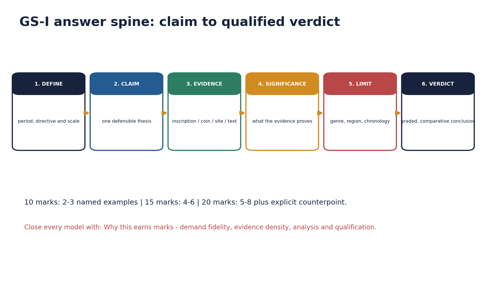

*Original deterministic teaching schematic; any scale or attribution caveat is printed on the visual.*

#### Core teaching / solved practice

- [FACT] UNESCO's serial tentative listing of Gupta temples was rechecked on 29 August 2026; it is used only for heritage attribution and conservation linkage.
- [ANALYSIS] Heritage linkage is strongest when it shows why source criticism matters: reused pillars, disputed attributions, conservation layers and illicit-provenance risks.
- [LIMIT] A modern heritage label cannot prove an ancient political claim, and this linkage does not override the repository's chronology or book-sourced evidence.
- [ANALYSIS] For 10 marks use 2-3 named pieces of evidence; 15 marks use 4-6; 20 marks use 5-8 plus counterpoint and historiography.
- [ANALYSIS] Every paragraph should follow claim -> named evidence -> significance -> limitation/qualification, and every conclusion should answer the directive rather than repeat the introduction.

#### PARAGRAPH DEMONSTRATION — CLAIM → NAMED EVIDENCE → ANALYSIS → QUALIFICATION

[CLAIM] A bounded current-affairs linkage strengthens a Gupta answer only if it stays inside its own evidentiary lane. [NAMED EVIDENCE] UNESCO's serial tentative listing of Gupta temples, rechecked on 29 August 2026, and the Ministry of Culture/ASI conservation record are the two live sources this package permits. [ANALYSIS] Both sources can support heritage attribution, provenance discussion and conservation status; neither can supply an ancient tax rate, ruler date or campaign fact that the inscriptions, coins and texts do not already state. [QUALIFICATION] A candidate who cites a tentative-list entry as if it proved a political claim converts a conservation fact into an evidentiary overreach, so the safe rule is: name the source, state exactly what it supports, and stop there.

#### Must-know facts

- No dated current-affairs claim beyond the rechecked UNESCO tentative list was required for this package.
- Named evidence must scale to marks: 2-3 units at 10 marks, 4-6 at 15 marks, 5-8 plus counterpoint at 20 marks.
- Every paragraph follows claim -> named evidence -> significance -> limitation.

#### UPSC traps

- WRONG: More names automatically mean analysis.
  CORRECT: Each example must prove a specific claim.
- WRONG: Conclusion can repeat the introduction.
  CORRECT: It must weigh evidence and answer the directive.
- WRONG: A conservation/heritage listing can stand in for missing ancient evidence.
  CORRECT: It supports only attribution and conservation status.

**Mains angle:** Use the six-stage visual spine (source -> formation -> polity -> economy -> culture -> qualified verdict) for every Gupta answer, and scale named evidence to the marks on offer.

**Study link:** Workbook and final consolidated register notes.

#### CLOSING RECALL FLOW — BOUNDED CURRENT-AFFAIRS LINKAGE AND ANSWER ARCHITECTURE

```text
START / CONCEPT: Bounded heritage-linkage and answer architecture
        |
        v
EXACT TERMS: UNESCO tentative list · conservation linkage · evidence-to-marks scaling · claim-evidence-significance-limitation · counterpoint · historiography
        |
        v
MECHANISM / ARGUMENT: A rechecked UNESCO tentative-list entry supports heritage attribution and conservation status only.
        |
        v
CONSEQUENCE / CONTRAST: Named evidence must scale to marks - 2-3 units at 10 marks, 4-6 at 15 marks, 5-8 plus counterpoint at 20 marks.
        |
        v
UPSC TRAP / ANSWER-USE: A conservation listing cannot substitute for missing ancient political or economic evidence.
        |
        v
ANSWER-GRABBING FORMULATION: Every Gupta answer should scale its named evidence to the marks on offer and keep any live heritage linkage strictly bounded to attribution and conservation.
```

## BASIC MCQS / REMEDIATION

> This is a non-duplicative 16-question learning-check loop for rapid recall
> after the 24 sessions above. The complete 32-question hard MCQ bank, with
> 128 option-level explanations and 32 unique examiner traps, lives once, in
> the standalone Solved Practice Workbook, so it is not repeated here.

#### MCQ 01 - Q1

Who composed the Prayag/Allahabad prashasti of Samudragupta?

A. Harishena
B. Kalidasa
C. Amarasimha
D. Chakrapalita

**Answer: A.** Harishena, a courtier who also held sandhivigrahika and mahadandanayaka rank, composed the eulogy.

#### MCQ 02 - Q2

Chandragupta I's alliance advertised on a distinct coin type was with which Lichchhavi princess?

A. Prabhavatigupta
B. Kumaradevi
C. Dhruvadevi
D. Anantadevi

**Answer: B.** The king-and-queen coin type names Kumaradevi and the Lichchhavis.

#### MCQ 03 - Q3

In Samudragupta's prashasti, Dakshinapatha rulers were generally described as:

A. permanently annexed
B. wholly ignored
C. captured and reinstated
D. exiled overseas

**Answer: C.** Capture-and-release signals demonstration and reinstatement, not uniform annexation.

#### MCQ 04 - Q4

Which of these is NOT a secure fact about Chandragupta II's western campaign?

A. defeat of the Western Kshatrapas
B. adaptation of silver coinage after the conquest
C. strengthened access to Ujjain and western routes
D. formal annexation of the Vakataka kingdom

**Answer: D.** Marriage and regency linked the Vakatakas to the Guptas; they were not annexed as a province.

#### MCQ 05 - Q5

Skandagupta's Junagadh inscription primarily records:

A. repair of the Sudarshana lake breach under provincial officials
B. Faxian's itinerary through Buddhist sites
C. the Aryabhatiya's date of composition
D. Samudragupta's southern campaign route

**Answer: A.** Parnadatta and Chakrapalita illustrate delegated provincial responsibility for the 456-57 CE repair.

#### MCQ 06 - Q6

Which title/rank did Harishena hold in addition to composing the prashasti?

A. vishayapati only
B. sandhivigrahika and mahadandanayaka
C. gramika
D. uparika of Bengal

**Answer: B.** His multiple titles show overlapping high ranks rather than one fixed department.

#### MCQ 07 - Q7

A Gupta 'vishaya' is best translated as a:

A. village
B. province
C. district
D. guild

**Answer: C.** Bhukti/desha were provincial terms; vishaya was the district administered by a vishayapati.

#### MCQ 08 - Q8

Which statement about Gupta land grants is LEAST defensible?

A. Vakataka charters preserve richer exemption clauses
B. Skandagupta's Bhitari gift is a secure imperial example
C. the Gaya/Nalanda plates attributed to Samudragupta are disputed
D. every Gupta emperor issued a large, secure corpus of grants

**Answer: D.** Upinder Singh stresses that the bona fide imperial-Gupta grant corpus is limited, not large and secure.

#### MCQ 09 - Q9

Chandragupta II's silver coinage most directly reflects:

A. adaptation after the Shaka defeat in Malwa-Gujarat
B. Huna minting practice
C. a ban on gold currency
D. Roman provincial administration

**Answer: A.** Western monetary adaptation followed the Western Kshatrapa conquest.

#### MCQ 10 - Q10

Faxian's account of Chandalas living outside towns is chiefly used as evidence for:

A. Gupta naval power
B. untouchability, read with traveller-source limits
C. Gupta taxation rates
D. Aryabhata's chronology

**Answer: B.** The passage is important evidence for exclusion, but Faxian's selective pilgrim purpose bounds its use.

#### MCQ 11 - Q11

Aryabhata's Aryabhatiya, dated 499 CE, is best known for explaining:

A. the invention of the zero symbol
B. the Sudarshana lake repair
C. the apparent daily motion of the heavens through Earth's rotation
D. the Amarakosha lexicon

**Answer: C.** The text presupposes decimal place value and explains apparent daily motion through Earth's rotation; it must not be conflated with the separate history of zero as a numeral.

#### MCQ 12 - Q12

Which named site/work is WRONGLY paired with its patronage?

A. Bhitargaon - early brick temple
B. Deogarh Dashavatara - stone temple
C. Udayagiri Varaha - royal-religious ideology
D. Ajanta's major fifth-century phase - imperial Gupta court project

**Answer: D.** Ajanta's major fifth-century phase is Vakataka and elite-donor patronage, not a direct imperial Gupta project.

#### MCQ 13 - Q13

The safest description of the Gupta polity's territorial control is:

A. a strong core with graded, differentiated peripheries
B. uniform direct administration everywhere
C. a purely symbolic confederacy with no coercive power
D. identical to Mauryan provincial administration

**Answer: A.** Layered hegemony/graded sovereignty fits the prashasti's own categories best.

#### MCQ 14 - Q14

Which pair of scholars is correctly sequenced by century?

A. Brahmagupta (sixth century) before Varahamihira (seventh century)
B. Varahamihira (sixth century) before Brahmagupta (seventh century, post-Gupta)
C. both belong to the same decade
D. both predate Aryabhata

**Answer: B.** Varahamihira is sixth century; Brahmagupta is seventh century and explicitly post-Gupta.

#### MCQ 15 - Q15

'Golden Age' is a defensible label only when it also specifies:

A. one dated event
B. a single royal patron
C. domain, social group, region and duration
D. a single UNESCO listing

**Answer: C.** The four-part test converts a slogan into a graded, examinable judgement.

#### MCQ 16 - Q16

Which is the correct cross-ownership status of the 2022 GS-I Q12 PYQ on Gupta and Chola culture?

A. exclusively owned by Topic 20
B. exclusively owned by Topic 21
C. unrelated to any Ancient History topic
D. cross-routed: the Gupta half here, the Chola half with the imperial-Chola owner, and full Gupta-culture depth with Topic 21

**Answer: D.** The 15-mark question is cross-cutting; this package supplies bounded Gupta polity/culture context and preserves the other owners.

## PYQS AND ANSWER PRACTICE

#### Solved PYQ 1 — UPSC Prelims 2019 Q10 (direct owner: *vishti*)

With reference to forced labour (*vishti*) in India during the Gupta period, which one of the following statements is correct?

- A. It was considered a source of income for the State, a sort of tax paid by the people.
- B. It was totally absent in the Madhya Pradesh and Kathiawar regions of the Gupta Empire.
- C. The forced labourer was entitled to weekly wages.
- D. The eldest son of the labourer was sent as the forced labourer.

**Answer: A.** INFERRED FROM AUTHORITATIVE SUBJECT KNOWLEDGE — the official 2019 key is not held locally. *Vishti* appears with taxes and could operate as labour-form revenue. Evidence from Madhya Pradesh and Kathiawar defeats B; the sources do not establish the wage entitlement or eldest-son rule asserted in C and D. Confidence: high.

#### Solved PYQ 2 — UPSC Prelims 2020 Q36 (direct owner: scholar-dynasty matching)

With reference to the scholars/litterateurs of ancient India, consider the following statements:

1. Panini is associated with Pushyamitra Shunga.
2. Amarasimha is associated with Harshavardhana.
3. Kalidasa is associated with Chandragupta II.

Which of the statements given above is/are correct?

- A. 1 and 2 only
- B. 2 and 3 only
- C. 3 only
- D. 1, 2 and 3

**Answer: C.** INFERRED FROM AUTHORITATIVE SUBJECT KNOWLEDGE — the official 2020 key is not held locally. Panini predates Pushyamitra; Amarasimha belongs to the Gupta/Vikramaditya milieu rather than Harsha; the examination convention accepts Kalidasa's association with Chandragupta II, while exact court biography remains debated. Confidence: high for elimination.

#### Solved PYQ 3 — UPSC Prelims 2025 Q15 (direct owner: Faxian)

Fa-hien (Faxian), the Chinese pilgrim, travelled to India during the reign of

- A. Samudragupta
- B. Chandragupta II
- C. Kumaragupta I
- D. Skandagupta

**Answer: B (official Set-A key held locally).** Faxian travelled in the early fifth century during Chandragupta II's reign. Samudragupta precedes the visit; Kumaragupta I and Skandagupta are later. His account remains selective pilgrim evidence, not an empire-wide census.

#### Solved PYQ 4 — UPSC Mains 2022 GS-I Q12 (cross-owner Gupta and Chola culture)

**Question / demand:** Discuss the main contributions of Gupta period and Chola period to Indian heritage and culture. (15 marks, 250 words)

**Solution:** **Model (15 marks).** [CLAIM] The Gupta and Chola periods created two durable but regionally distinct classical repertoires: the former in Sanskritic literature, science, sculpture and formative temples; the latter in monumental Dravida temples, bronzes, inscriptions and temple-centred institutions. [EVIDENCE AND ANALYSIS] 1. Gupta Sanskrit production is represented by Kalidasa and Amarasimha, while Aryabhata's 499 CE Aryabhatiya anchors mathematical-astronomical achievement. 2. Udayagiri, Sarnath/Mathura sculpture, Bhitargaon and Deogarh show Gupta innovation in sacred imagery and structural temple forms. 3. Chola Brihadishvara at Thanjavur demonstrates mature Dravida architecture and imperial inscriptional patronage. 4. Chola Nataraja bronzes join metallurgical skill, bhakti theology and mobile ritual practice. 5. Temple institutions under the Cholas linked land, craft, performance and local society, while Gupta-Vakataka patronage connected courts, temples and monasteries. [LIMIT] Neither period was culturally uniform or socially golden; Ajanta's major fifth-century phase is Vakataka, and Chola achievements must not erase regional patrons or labour. [VERDICT] Together they shaped literary, scientific, visual and institutional traditions, but a high-scoring answer preserves chronology, region and patronage. **Why this earns marks:** It answers the directive directly, uses 5 named evidence units, states what each proves, adds a qualification and closes with a graded judgement.

**Demand decoding:** The directive **answer** requires a direct position on “PYQ 4. UPSC Mains 2022 GS-I Q12 - cross-owner Gupta and Chola culture”, coverage of every clause, evidence-led analysis and a qualified verdict.

**Executable exam-length answer / compression plan:** For a 15-mark answer, open with a two-sentence thesis; organise five named evidence units as claim → evidence → inference → qualification; reserve the final lines for a graded conclusion.

**How to improve this answer:** For “PYQ 4. UPSC Mains 2022 GS-I Q12 - cross-owner Gupta and Chola culture”, replace the weakest generalisation with one additional named site, text, inscription, coin, ruler or scholarly position and state exactly what that evidence cannot prove.

#### Solved PYQ 5 — UPSC Prelims 2020 Q82 (adjacent; true owner Topic 19)

With reference to the period of the Gupta dynasty in ancient India, the towns Ghantasala, Kadura and Chaul were well known as

- A. ports handling foreign trade
- B. capitals of powerful kingdoms
- C. places of exquisite stone art and architecture
- D. important Buddhist pilgrimage centres

**Answer: A.** INFERRED FROM AUTHORITATIVE SUBJECT KNOWLEDGE — the official 2020 key is not held locally. All three were maritime trading nodes. This adjacent continuity question does not establish uniform urban prosperity across the Gupta realm. Confidence: high.

#### Solved PYQ 6 — UPSC Prelims 2020 Q29 (adjacent; true owner Topic 21)

Kulyavapa and dronavapa denote

- A. measurements of land
- B. coins of different monetary value
- C. classification of urban land
- D. religious rituals

**Answer: A.** INFERRED FROM AUTHORITATIVE SUBJECT KNOWLEDGE — the official 2020 key is not held locally. The terms denote sowing-based land measures in eastern records; their exact area varied regionally and should not be converted into one fixed all-India acre standard. Confidence: high.

### Original solved Mains practice

#### M1. 10 marks - Examine the evidentiary value and limits of the Prayag prashasti for reconstructing Samudragupta's empire.

**Model (10 marks).** The Prayag prashasti, composed by Harishena and inscribed on the Allahabad pillar, is indispensable for reconstructing Samudragupta's reign, yet it reconstructs an imperial self-image rather than a neutral territorial survey. Harishena's list of uprooted Aryavarta rulers supports direct incorporation of a northern core, while captured-and-released Dakshinapatha rulers show a different, non-annexationist policy toward the south. Frontier states, ganas and distant rulers who sent gifts or sought alliance reveal a further layer of tributary and prestige diplomacy rather than provincial rule. Read together, these three registers show graded sovereignty rather than one uniform conquest. However, the inscription is a court eulogy: several named places and rulers remain disputed, and its silences cannot be read as an absence of resistance. Used cautiously alongside coins and regional inscriptions, the prashasti supports layered hegemony, not an all-India province map. **Why this earns marks:** It answers the directive directly, uses three named evidence registers, states what each proves, adds a genre-based qualification and closes with a graded judgement.

**Demand decoding:** The directive **examine** requires a direct position on “M1. 10 marks - Examine the evidentiary value and limits of the Prayag prashasti for…”, coverage of every clause, evidence-led analysis and a qualified verdict.

**Executable exam-length answer / compression plan:** For a 10-mark answer, open with a two-sentence thesis; organise three named evidence units as claim → evidence → inference → qualification; reserve the final lines for a graded conclusion.

**How to improve this answer:** For “M1. 10 marks - Examine the evidentiary value and limits of the Prayag prashasti for…”, replace the weakest generalisation with one additional named site, text, inscription, coin, ruler or scholarly position and state exactly what that evidence cannot prove.

#### M2. 10 marks - Why should the Gupta age be described as a qualified Golden Age?

**Model (10 marks).** The label 'Golden Age' is defensible for elite cultural production but not as a description of universal social conditions. Kalidasa and Amarasimha represent a flowering of Sanskrit literature, while Aryabhata's Aryabhatiya of 499 CE anchors a genuine, precisely dated mathematical-astronomical achievement. Visually, Udayagiri's royal-religious sculpture, the brick temple at Bhitargaon and the stone Dashavatara temple at Deogarh mark early, innovative structural and iconographic development. Set against this record, the same age also produced vishti as a labour obligation, continuing untouchability documented in Faxian's account of Chandalas, entrenched patriarchal norms and uneven urban change across regions. A qualified verdict credits the Gupta period as a classical age of high culture and scientific advance in selected domains, while insisting that this achievement was socially selective and unevenly distributed rather than a universal golden condition for every group. **Why this earns marks:** It answers the directive directly, uses three named evidence units on each side of the ledger, states what each proves, adds a distributional qualification and closes with a graded judgement.

**Demand decoding:** The directive **answer** requires a direct position on “M2. 10 marks - Why should the Gupta age be described as a qualified Golden Age?”, coverage of every clause, evidence-led analysis and a qualified verdict.

**Executable exam-length answer / compression plan:** For a 10-mark answer, open with a two-sentence thesis; organise three named evidence units as claim → evidence → inference → qualification; reserve the final lines for a graded conclusion.

**How to improve this answer:** For “M2. 10 marks - Why should the Gupta age be described as a qualified Golden Age?”, replace the weakest generalisation with one additional named site, text, inscription, coin, ruler or scholarly position and state exactly what that evidence cannot prove.

#### M3. 15 marks - Analyse the Gupta administrative system and the role of local notables.

**Model (15 marks).** Gupta government combined royal appointment and provincial hierarchy with the incorporation of local commercial and scribal elites, producing a system that was real but unevenly documented. At the provincial level, uparikas were appointed by the king and, in turn, appointed district heads; the Damodarpur copper plates from Bengal supply the most detailed surviving record of this arrangement. Below the province, the vishaya or district was headed by a vishayapati, and district boards such as that of Kotivarsha included not only officials but also the nagara-shreshthin (chief merchant/banker), sarthavaha (caravan leader), prathama-kulika (chief artisan) and prathama-kayastha (chief scribe). Skandagupta's Junagadh inscription further shows Parnadatta and Chakrapalita handling provincial and city responsibilities, including repair of the Sudarshana lake breach in 456-57 CE. At the village level, elders and record-keeping actors appear, though no single all-India panchayat template is proven. Harishena's own combination of sandhivigrahika, mahadandanayaka and kumaramatya ranks shows offices overlapping rather than forming rigid departments. Because Bengal's epigraphy is unusually rich, this detail cannot be mechanically generalised to every province. Overall, the system was layered and real, less uniformly centralised than the Mauryan ideal but far from administratively empty. **Why this earns marks:** It answers the directive directly, uses five named evidence units, states what each proves, adds a regional-generalisation qualification and closes with a graded judgement.

**Demand decoding:** The directive **analyse** requires a direct position on “M3. 15 marks - Analyse the Gupta administrative system and the role of local notables.”, coverage of every clause, evidence-led analysis and a qualified verdict.

**Executable exam-length answer / compression plan:** For a 15-mark answer, open with a two-sentence thesis; organise five named evidence units as claim → evidence → inference → qualification; reserve the final lines for a graded conclusion.

**How to improve this answer:** For “M3. 15 marks - Analyse the Gupta administrative system and the role of local notables.”, replace the weakest generalisation with one additional named site, text, inscription, coin, ruler or scholarly position and state exactly what that evidence cannot prove.

#### M4. 15 marks - Discuss land grants as instruments of agrarian expansion and decentralisation.

**Model (15 marks).** Land grants could simultaneously extend cultivation and integration while transferring revenue and strengthening intermediaries, and their effects must be judged charter by charter rather than assumed. Applications for wasteland, followed by record consultation, payment, survey, boundary demarcation and public notification, show a regulated process capable of extending settled agriculture into new areas. Agrahara and institutional gifts directed resources toward Brahmanas, temples and monasteries, while Vakataka charters preserve exemption and non-entry clauses that illuminate fiscal delegation more richly than the thin imperial-Gupta corpus itself; Upinder Singh identifies Skandagupta's Bhitari temple gift as the one secure imperial example, since the Gaya and Nalanda plates attributed to Samudragupta remain disputed. Subordinate rulers also issued grants, showing that this instrument of governance operated below the imperial level as well as at it, and some charters redirected vishti and other dues toward beneficiaries rather than the crown. Taken together, this evidence supports two simultaneous readings: grants integrated frontier zones, rewarded service and spread Brahmanical and religious institutions, while also reducing direct royal revenue in granted areas and building the local authority of donees and intermediaries over time. Land grants were therefore neither harmless piety nor an automatic feudal transformation; their consequences depended on the specific rights transferred, the scale involved, and the region and period in question. **Why this earns marks:** It answers the directive directly, uses five named evidence units, states what each proves, adds a charter-specificity qualification and closes with a two-sided graded verdict.

**Demand decoding:** The directive **discuss** requires a direct position on “M4. 15 marks - Discuss land grants as instruments of agrarian expansion and…”, coverage of every clause, evidence-led analysis and a qualified verdict.

**Executable exam-length answer / compression plan:** For a 15-mark answer, open with a two-sentence thesis; organise five named evidence units as claim → evidence → inference → qualification; reserve the final lines for a graded conclusion.

**How to improve this answer:** For “M4. 15 marks - Discuss land grants as instruments of agrarian expansion and…”, replace the weakest generalisation with one additional named site, text, inscription, coin, ruler or scholarly position and state exactly what that evidence cannot prove.

#### M5. 20 marks - Evaluate the nature and causes of Gupta decline.

**Model (20 marks).** Gupta decline was a prolonged contraction produced by interacting external, fiscal and regional pressures rather than the result of a single Huna invasion. Skandagupta's Bhitari and Junagadh inscriptions present him defending the dynasty and repairing provincial infrastructure, showing that early pressure could be checked rather than immediately fatal. Later Huna power under Toramana and Mihirakula, however, altered the balance of north and central Indian politics more decisively, and coin and inscription evidence for direct Gupta authority thins across western Malwa and Saurashtra after the later fifth century, indicating a real loss of western territory, routes and associated revenue. Succession after Skandagupta is not fully clear, and this uncertainty likely weakened coherent dynastic authority at a critical moment. Subordinate rulers, uparikas and hereditary local officeholders possessed resources and standing that could support growing autonomy once central power weakened, while changes in gold purity, weight and the frequency of low-denomination coin finds suggest fiscal and commercial strain, though these must be checked regionally rather than treated as one uniform collapse. Yashodharman's 532 CE inscription, itself further prashasti rhetoric, marks the assertive rise of a new regional power in Malwa, illustrating how former subordinates and neighbours capitalised on Gupta weakness. Even so, decline must not be mistaken for instantaneous disappearance: regional Gupta branches, cultural production and many local institutions persisted well after the loss of pan-regional paramountcy. The most defensible verdict treats Gupta contraction as a feedback loop in which military cost, territorial and revenue loss, weakened succession and the corresponding rise of regional powers reinforced one another over roughly a century, rather than as a single catastrophic event with one identifiable cause. **Why this earns marks:** It answers the directive directly, uses seven named evidence units across military, fiscal, succession and regional-power strands, states what each proves, adds a regional-uniformity qualification and closes with a graded, multi-causal judgement.

**Demand decoding:** The directive **evaluate** requires a direct position on “M5. 20 marks - Evaluate the nature and causes of Gupta decline.”, coverage of every clause, evidence-led analysis and a qualified verdict.

**Executable exam-length answer / compression plan:** For a 20-mark answer, open with a two-sentence thesis; organise six to eight named evidence units as claim → evidence → inference → qualification; reserve the final lines for a graded conclusion.

**How to improve this answer:** For “M5. 20 marks - Evaluate the nature and causes of Gupta decline.”, replace the weakest generalisation with one additional named site, text, inscription, coin, ruler or scholarly position and state exactly what that evidence cannot prove.

#### M6. 20 marks - Critically examine whether the Gupta state was a centralised empire or a layered hegemony.

**Model (20 marks).** The Guptas built a genuine empire with a powerful core and widely recognised paramountcy, yet their own evidence describes differentiated control that is better termed layered hegemony than uniform centralisation. Samudragupta's Prayag prashasti itself distinguishes Aryavarta rulers who were uprooted and incorporated into the northern core from atavika forest rulers reduced to subordination, frontier states and ganas that paid tribute and obeyed orders, and southern Dakshinapatha kings who were captured and released rather than annexed. This graded structure is reinforced by direct administrative machinery in the core: bhukti-vishaya provincial and district administration, illustrated by the Damodarpur records, and Skandagupta's Junagadh inscription showing named officials repairing the Sudarshana lake. At the same time, subordinate maharajas retained substantial local authority, could reproduce imperial-style titles, and became visibly more autonomous once central power weakened in the fifth and sixth centuries, which is exactly what a purely centralised model would not predict. Coins and monuments such as Udayagiri projected sovereignty through ritual and ideological means that went well beyond routine tax administration, supplementing rather than replacing coercive capacity. The common comparison with a supposedly fully centralised Mauryan state is itself source-skewed, since the Arthashastra and the edicts are prescriptive or ideological texts and not a complete administrative census either. On balance, Gupta power is best read as a core-centred imperial network: strong and militarily backed at the centre, but organised through graded sovereignty, tributary relationships and delegated authority rather than one uniform administrative colour across the map. **Why this earns marks:** It answers the directive directly, uses seven named evidence units, states what each proves, adds a source-symmetry qualification comparing Gupta and Mauryan evidence, and closes with a graded judgement.

**Demand decoding:** The directive **critically examine** requires a direct position on “M6. 20 marks - Critically examine whether the Gupta state was a centralised empire or a…”, coverage of every clause, evidence-led analysis and a qualified verdict.

**Executable exam-length answer / compression plan:** For a 20-mark answer, open with a two-sentence thesis; organise six to eight named evidence units as claim → evidence → inference → qualification; reserve the final lines for a graded conclusion.

**How to improve this answer:** For “M6. 20 marks - Critically examine whether the Gupta state was a centralised empire or a…”, replace the weakest generalisation with one additional named site, text, inscription, coin, ruler or scholarly position and state exactly what that evidence cannot prove.

## OPTIONAL ADVANCED DEPTH — NOT REQUIRED FOR A CORE ANSWER

### The Gupta Empire — ADVANCED

> **Subject:** History (Ancient India) · **Tier:** Advanced (analytical + historiographical) · **GS Paper:** GS-I (also Prelims).
> **Grounded in:** Upinder Singh, *A History of Ancient & Early Medieval India*, sections on Gupta political history, inscriptions and ideology + current affairs (📰).
> ✅ = from source book · ⚠️ = inference / standard knowledge · 📰 = current affairs.
> *Companion (foundation): `basic/20_Gupta-Empire.md`. Chronology: `00_Master-Chronology.md`.*

---

### Mini-timeline

| Phase | Date | Marker |
|---|---|---|
| ✅ Chandragupta I | 319–335/36 CE | Maharajadhiraja; Lichchhavi marriage |
| ✅ Samudragupta | c. 350–370 CE in Upinder's discussion | Allahabad pillar prashasti; coins |
| ✅ Chandragupta II | c. late 4th–early 5th c. CE | Shaka defeat; Udayagiri; Fa-hien context |
| ✅ Kumaragupta-Skandagupta | 5th c. CE | Ashvamedha, Huna pressure |
| ✅ Post-Gupta fragmentation | 6th c. CE | Yashodharman and regional powers |

### 1. Snapshot & core idea

**Advanced — empire through epigraphy, coins and ideology.**

✅ Upinder Singh treats Gupta political history as inscription-led: the Allahabad/Prayagraj pillar is crucial because it carries Ashokan, Gupta and later Mughal layers, while Samudragupta's prashasti in prose and verse eulogizes conquest and personality.
- ✅ The composer was **Harishena**, a court figure; therefore the inscription is both evidence and ideology.
- ✅ Chandragupta I's **maharajadhiraja** title signals imperial aspiration; the Lichchhavi marriage was important enough to be commemorated on coins.
- ✅ Some inscriptions attributed to Samudragupta are considered spurious by many historians, reminding us to verify provenance.

**Advanced — conquest model and political integration.**

✅ Samudragupta did not annex every conquered region in the same way. The prashasti distinguishes directly conquered territories, defeated rulers, frontier states and rulers who submitted or paid homage.
- ✅ This shows a flexible imperial system: core control, tributary relations and prestige diplomacy.
- ✅ Chandragupta II's western campaign against Shakas gave access to rich trade zones and strengthened Ujjain's importance.
- ✅ Decline involved Huna invasions, succession strains and regional feudatories; it was not a single collapse event.

### 2. Key classification / data

| Source / category | Use in answers |
|---|---|
| ✅ Allahabad/Prayag Prashasti | Samudragupta's campaigns, imperial ideology, Harishena's eulogy |
| ✅ Coins | Lichchhavi marriage, ashvamedha claims, royal titles and images |
| ✅ Udayagiri inscriptions/art | Chandragupta II-period Vaishnava royal symbolism |
| ✅ Fa-hien | Social-religious observations during Gupta age |
| ✅ Huna evidence | Regional weakening and post-Gupta transition |

### 3. Study links

> **Study link:** ✅ Upinder Singh → Gupta political ideology, prashastis, coins and inscriptions.
> **Study link:** ⚠️ Gupta society/culture → `advanced/21_Life-and-Culture-in-Gupta-Age.md`; primary-source caution → Harappan undeciphered evidence contrast.

### 4. Must-Know Facts (Prelims)

- ✅ Chandragupta I is the third Gupta ruler in Upinder's sequence and lays imperial foundations.
- ✅ The Allahabad pillar inscription of Samudragupta was composed by **Harishena**.
- ✅ The pillar also carries Ashokan inscriptions and a later Jahangir inscription.
- ✅ Gupta claims used Sanskrit prashasti, titles, coins and ritual symbolism.
- ✅ Chandragupta II is associated with the defeat of western Shakas and the title Vikramaditya.
- ✅ Huna pressure and feudatory autonomy weakened Gupta power in the 5th–6th centuries.

### 5. UPSC Traps

> 🔑 Trap: Prashasti categories are political language; do not convert every claim into direct annexation.

- ❌ Samudragupta directly ruled every defeated territory. → The prashasti shows multiple modes of subordination.
- ❌ All inscriptions attributed to a ruler are equally reliable. → Upinder notes some are considered spurious.
- ❌ Gupta imperial ideology was only military. → It used marriage, titles, coins, Sanskrit and religion.
- ❌ Decline equals one Huna invasion. → It was a process of pressure and fragmentation.

### 6. 📰 Current link

⚠️ **Current-link discipline:** Verify digitisation totals from the responsible mission. The safe linkage is that cataloguing coins, inscriptions and sculpture improves provenance and source criticism.

### 7. Mains angles

- ⚠️ Evaluate the Gupta Empire as a **ritual-symbolic empire** as much as a territorial state.
- ⚠️ Use Samudragupta to explain graded sovereignty: annexation, tribute, frontier submission and prestige diplomacy.
- ⚠️ Discuss how source criticism changes Gupta history: prashasti exaggeration, coin evidence and spurious inscriptions.

### ➕ Concept — Allahabad pillar as layered archive

- ⚠️ The same pillar carrying Ashokan and Gupta records is a perfect mains example for the reuse of political space and memory across Indian history.

<!-- BEGIN GENERATED PYQ INTEGRATION: 2018-2023 -->
### Historical PYQ Integration (2018-2023)

> **Status:** Question-level PYQ demand is integrated into this owner.
> **Provenance:** Audited local official-paper routing ledgers: `_PYQ-ROUTING-MAINS-GS1-GS2-ESSAY-2018-2023.md`.

- **Years represented:** 2022
- **Paper(s):** GS-I
- **Routed question demands:** 1

| Year | Paper | Q | PYQ demand (neutral rendering) | Directive / format | Source status | Owner requirement |
|---:|---|---:|---|---|---|---|
| 2022 | GS-I | 12 | Gupta and Chola contributions to Indian heritage and culture | Discuss · 15 marks · 250 words | Cross-cutting; the question names two dynastic periods | Prepare context, core dimensions, evidence/examples, counterpoint and a concise conclusion. |

#### What this owner must now support

- Gupta and Chola contributions to Indian heritage and culture

> The table integrates the examinable demand and paper metadata. It does not turn an unkeyed objective question into a solved answer, and it does not claim that lexical presence alone proves full conceptual sufficiency.
<!-- END GENERATED PYQ INTEGRATION: 2018-2023 -->

## CONSOLIDATED REGISTER NOTES

### Final Register 1 - Chronology and ruler anchors

[FACT] Rapid sequence for revision.


*Original deterministic teaching schematic; any scale or attribution caveat is printed on the visual.*

#### Core teaching / solved practice

- 319-20: Gupta era; Chandragupta I imperial phase.
- Mid-fourth century: Samudragupta and Prayag categories.
- Late fourth-early fifth: Chandragupta II, Shaka defeat, Udayagiri, Faxian.
- Fifth century: Kumaragupta and Skandagupta; Junagadh repair; Huna pressure.
- Late fifth-sixth: western loss, Huna states, regionalisation and late Guptas.

#### Must-know facts

- Kumaradevi coin = alliance legitimacy.
- Harishena = Prayag composer.
- Faxian = Chandragupta II context.

#### UPSC traps

- WRONG: Treat dates as perfectly fixed.
  CORRECT: Use source-aware ranges where scholarship differs.

**Mains angle:** Chronology should support causation, not replace it.

**Study link:** Sections 1-7.

### Final Register 2 - Empire, ideology and administration

[ANALYSIS] Core formula: substantial core + differentiated peripheries + symbolic paramountcy.


*Original deterministic teaching schematic; any scale or attribution caveat is printed on the visual.*

#### Core teaching / solved practice

- Campaign categories: Aryavarta annexation; atavika subordination; frontier tribute; southern release; distant prestige.
- Ideology: titles + Sanskrit prashasti + coins + ritual + Garuda/Lakshmi + Udayagiri.
- Administration: court ranks -> bhukti/desha -> vishaya -> sub-district -> village.
- Title caution: rank and function overlap; Bengal evidence is not automatically all-India.
- Notables on district board reveal elite incorporation, not democracy.

#### Must-know facts

- Uparika = common provincial designation.
- Vishayapati = district head.
- Damodarpur = key record set.

#### UPSC traps

- WRONG: Empire means one intensity of rule.
  CORRECT: Gupta sovereignty was graded.

**Mains angle:** Compare with Mauryas dimension by dimension.

**Study link:** Sections 8-11.

### Final Register 3 - Agrarian fiscal order and grants

[FACT] Agrarian surplus, land transactions and delegated claims form the fiscal spine.


*Original deterministic teaching schematic; any scale or attribution caveat is printed on the visual.*

#### Core teaching / solved practice

- Land categories and measures were regionally varied; kulyavapa/dronavapa are eastern terms.
- Vishti = forced labour obligation appearing with taxes; do not merge with hired labour or slavery.
- Grant process can include application, records, price, survey, boundaries and public notice.
- Imperial Gupta secure grant corpus is limited; Vakataka/subordinate evidence must retain labels.
- Grant verdict: cultivation/integration plus fiscal intermediation and possible decentralisation.

#### Must-know facts

- Junagadh = waterwork and provincial delegation.
- Private rights coexisted with overarching royal claims.

#### UPSC traps

- WRONG: Every grant had every immunity.
  CORRECT: Use charter-specific clauses.

**Mains angle:** Show mechanism and two-sided effect.

**Study link:** Sections 12-13.

### Final Register 4 - Economy, towns and society

[ANALYSIS] Transformation and unevenness are the safe master terms.


*Original deterministic teaching schematic; any scale or attribution caveat is printed on the visual.*

#### Core teaching / solved practice

- Gold and silver coinage show royal communication and regional monetary adaptation, not universal prosperity.
- Tamralipti and other routes indicate continuing exchange; trade contraction was not total.
- Urban debate: site-specific decline, continuity, relocation and sacred/administrative functions.
- Society: varna-jati norms, patriarchy, vishti, slavery, untouchability and elite female agency.
- Faxian is valuable but selective and idealising.

#### Must-know facts

- Prabhavatigupta = political agency.
- Chandala passage = exclusion evidence with source limits.

#### UPSC traps

- WRONG: Gold coins describe peasant daily life.
  CORRECT: High-value media are socially selective.

**Mains angle:** Always ask region, social group and evidence genre.

**Study link:** Sections 14-16.

### Final Register 5 - Culture, science and Golden Age

[ANALYSIS] Classical achievement must be chronologically exact and socially qualified.


*Original deterministic teaching schematic; any scale or attribution caveat is printed on the visual.*

#### Core teaching / solved practice

- Religion: Vaishnava kingship with plural Shaiva, Buddhist and Jaina patronage.
- Literature: Kalidasa and Amarasimha; Navaratna roster and exact court claims need caution.
- Science: Aryabhata 499; Varahamihira sixth century; Brahmagupta seventh/post-Gupta.
- Art: Udayagiri, Sarnath/Mathura, Bhitargaon, Deogarh; Ajanta major phase is Vakataka.
- Golden Age verdict: elite cultural florescence, unequal distribution, regional variation.

#### Must-know facts

- Place value is not identical to the full history of zero.
- Nalanda developed in stages.

#### UPSC traps

- WRONG: All classical scholars served one Gupta king.
  CORRECT: Chronology disproves this.

**Mains angle:** Use domain-group-region-duration test.

**Study link:** Sections 17-21.

### Final Register 6 - Historiography, traps and answer spine

[ANALYSIS] Debate formula: proposition -> named evidence -> counter-evidence -> scale -> verdict.


*Original deterministic teaching schematic; any scale or attribution caveat is printed on the visual.*

#### Core teaching / solved practice

- Feudalism: grants/intermediaries/labour versus regional continuity and model caution.
- Urban decline: archaeological contraction versus continuing literary, sacred and southern urban worlds.
- Decentralisation: delegated integration can later enable autonomy.
- Top traps: prashasti = fact; all conquests = annexation; all grants = full immunity; all Ajanta = Gupta; Golden Age = all people.
- Answer rule: claim -> named evidence -> significance -> limitation; scale examples to marks.

#### Must-know facts

- No direct owned Mains PYQ exists beyond the cross-owned 2022 culture question.
- Adjacent PYQs retain true owners.

#### UPSC traps

- WRONG: A debate answer may remain neutral.
  CORRECT: UPSC needs a reasoned, graded conclusion.

**Mains angle:** Finish with the directive and a qualified judgement.

**Study link:** Workbook and Topics 21, 22, 26.

### COMPLETE TOPIC ASCII MASTER FLOW DIAGRAM

#### ASCII MASTER FLOW — PANEL 1/12: Source-led chronology

```ascii-master
GUPTA ERA 319-20 CE -> conventional imperial phase
PRAYAG PRASHASTI -> campaign categories + royal ideology
COINS -> titles, images, ritual and monetary zones
COPPER PLATES / SEALS -> offices, grants and local actors
FAXIAN -> selected Buddhist and social observations
RULE: triangulate sources; prashasti praise and coin circulation are not border maps.
```

#### ASCII MASTER FLOW — PANEL 2/12: Formation and Chandragupta I

```ascii-master
SRI GUPTA -> GHATOTKACHA -> CHANDRAGUPTA I
maharaja                  maharajadhiraja
                              |
Kumaradevi-Lichchhavi alliance represented on coin type
                              |
Ganga core + alliance + inherited routes + symbolic legitimacy
LIMIT: the coin proves advertised alliance, not a measurable dowry or exact border.
```

#### ASCII MASTER FLOW — PANEL 3/12: Samudragupta's graded sovereignty

```ascii-master
ARYAVARTA -> rulers uprooted -> stronger core incorporation
ATAVIKA -> subordinated forest rulers
FRONTIER STATES / GANAS -> tribute, orders and obeisance
DAKSHINAPATHA -> captured, released and reinstated
DISTANT RULERS / ISLANDS -> gifts, service and prestige diplomacy
VERDICT: annexation, subordination and hegemony coexisted; not every name was a province.
```

#### ASCII MASTER FLOW — PANEL 4/12: Chandragupta II and western expansion

```ascii-master
SUCCESSION AND ALLIANCE CAPACITY
          |
defeat of western Kshatrapas in Malwa-Gujarat
          |
access to western routes, silver-coin zone and prestige centres
          |
Udayagiri and royal imagery strengthen Vaishnava political communication
CAUTION: Vikramaditya/Navaratna traditions require source and chronology control.
```

#### ASCII MASTER FLOW — PANEL 5/12: Late Guptas, Hunas and decline

```ascii-master
KUMARAGUPTA -> SKANDAGUPTA -> LATER GUPTAS
                         |
succession strains + Huna pressure + feudatory autonomy
                         |
fiscal and military burdens + regional powers + changing networks
                         |
contracting imperial authority
VERDICT: decline was cumulative and regional, not one invasion or instant collapse.
```

#### ASCII MASTER FLOW — PANEL 6/12: Territoriality and administration

```ascii-master
KING / COURT
   -> bhukti provincial level
   -> vishaya district level
   -> town / village bodies and local notables
   -> feudatories and frontier rulers
OFFICES and practice varied by region; Bengal plates are especially visible.
EMPIRE = directly ruled core + delegated administration + layered hegemony.
```

#### ASCII MASTER FLOW — PANEL 7/12: Land grants and fiscal decentralisation

```ascii-master
ROYAL CHARTER
    -> land / revenue rights + exemptions + boundary record
    -> Brahmana or religious beneficiary
    -> local cultivators, labour and intermediaries
    -> agrarian expansion + legitimation + fiscal reallocation
DEBATE: grants could strengthen frontier integration while also enlarging local autonomy.
RULE: read the exact rights; do not assume every grant transferred total sovereignty.
```

#### ASCII MASTER FLOW — PANEL 8/12: Economy, coinage and urban change

```ascii-master
GOLD COINS -> royal high-value capacity and imagery
SILVER ISSUES -> western zone after Kshatrapa conquest
COPPER SCARCITY / REGIONAL MEDIA -> uneven everyday monetisation
GUILDS / CRAFTS / PORTS -> continuity in selected nodes
URBAN EVIDENCE -> contraction in some centres, persistence or relocation in others
VERDICT: neither universal prosperity nor total urban collapse fits the evidence.
```

#### ASCII MASTER FLOW — PANEL 9/12: Society, Faxian and religion

```ascii-master
VARNA / JATI / OCCUPATION -> norm and lived diversity
VISHTI -> labour obligation in selected grants
FAXIAN -> Buddhist pilgrim lens; Chandala passage and institutional observations
VAISHNAVA / SHAIVA / SHAKTA patronage + Buddhist and Jain continuities
ROYAL AND NON-ROYAL DONORS -> plural religious landscape
LIMIT: normative texts and traveller accounts are not censuses.
```

#### ASCII MASTER FLOW — PANEL 10/12: Literature, science and arts

```ascii-master
SANSKRIT COURT CULTURE -> Kalidasa / Amarasimha traditions
MATHEMATICS-ASTRONOMY -> Aryabhatiya, 499 CE
METALLURGY -> Mehrauli iron pillar with attribution caution
ARCHITECTURE -> Udayagiri, Sanchi 17, Bhitargaon and Deogarh
SCULPTURE / PAINTING -> Mathura, Sarnath and Vakataka-context Ajanta
RULE: name work, date, patronage context and ownership limit.
```

#### ASCII MASTER FLOW — PANEL 11/12: Golden Age and historiography

```ascii-master
FOR: durable literature + science + sculpture + temple forms + political prestige
AGAINST UNIVERSAL LABEL:
  |-- regional production beyond direct Gupta rule
  |-- hierarchy, exclusion, vishti and patriarchal norms
  |-- uneven urban and monetary conditions
  `-- elite-source bias
VERDICT: a bounded classical florescence, not a census judgement on all society.
```

#### ASCII MASTER FLOW — PANEL 12/12: Gupta answer spine

```ascii-master
OPEN: inscription- and coin-led layered empire, c. 319-550 CE
RULERS: formation -> Samudragupta -> Chandragupta II -> late pressures
POLITY: graded sovereignty + administration + feudatories
ECONOMY: grants + agrarian base + coins + urban variation
CULTURE: use only bounded examples; Topic 21 owns social-cultural depth
QUALIFY: genre, region, attribution and distribution
VERDICT: high-capacity core with negotiated and changing peripheries.
```
