# Life & Culture in the Gupta Age - Complete Topic Package

> **Subject:** Ancient Indian History | **Topic:** 21 | **Export date:** 2026-08-14
>
> **Approval:** false - awaiting explicit user approval.
>
> **Source order:** repository Markdown -> local OCR-searchable R.S. Sharma, Upinder Singh and Nitin Singhania PDFs -> no forced live current-affairs claim -> Qdrant not used.
>
> **Tag rule:** [FACT] source-grounded statement; [ANALYSIS] evidence-led synthesis; [LIMIT] boundary, uncertainty or representativeness caution.

## BASIC LEARNING SESSION

### DEEP-REVIEW LEARNING CONTRACT

| Control | Binding rule for this package |
|---|---|
| Syllabus boundary | Complete Ancient History Core is taught before optional enrichment. |
| Evidence method | Claim → named site/text/inscription/coin/example → analysis → qualification. |
| Source hierarchy | Archaeology, textual testimony, inscriptions, coins and scholarly interpretation remain visibly distinct. |
| Contested issues | Competing interpretations are attributed, evidenced and bounded; certainty is not manufactured. |
| Practice contract | Every solved item has demand decoding, an examiner-grade model, an executable answer/compression plan, marks rationale and answer-specific improvement. |
| Approval | This immutable successor remains `approved: false` pending explicit approval. |

**Canonical Basic/Core owner:** `upsc-ai-kit\knowledge\Ancient-Indian-History\basic\21_Life-and-Culture-in-Gupta-Age.md`  
**Canonical topic owner:** `upsc-ai-kit\knowledge\Ancient-Indian-History\basic\21_Life-and-Culture-in-Gupta-Age.md`  
**Optional Advanced owner:** `upsc-ai-kit\knowledge\Ancient-Indian-History\advanced\21_Life-and-Culture-in-Gupta-Age.md`  
**Official syllabus mapping:** `upsc-ai-kit\knowledge\Ancient-Indian-History\OFFICIAL-UPSC-SYLLABUS-MAPPING.md`

### EVIDENCE, PYQ AND CURRENT-STATUS CONTROL

- **Archaeological inference:** material context supports bounded reconstruction; absence is not automatic proof of non-existence.
- **Textual testimony:** genre, authorship, redaction, patronage and temporal distance control what a text can prove.
- **Inscription and coin evidence:** contemporary names, titles, claims and circulation are powerful but do not by themselves map uniform territorial control.
- **Scholarly interpretation:** historian labels are arguments to test, not facts to memorise without evidence.
- **PYQ discipline:** repository ledgers and locally held official papers control wording and metadata; reconstructed wording and unavailable official keys must be labelled.
- **Current-status note, rechecked 2026-09-03:** The UNESCO Gupta-temple listing and Ministry of Culture Gyan Bharatam update were rechecked on 29 August 2026 for bounded heritage and manuscript linkages.

**Live/primary context sources recorded by the predecessor generation:**

- `https://whc.unesco.org/en/tentativelists/6805/`
- `https://culture.gov.in/events/ministry-culture-showcases-confluence-heritage-and-technology-india-ai-impact-summit-2026`


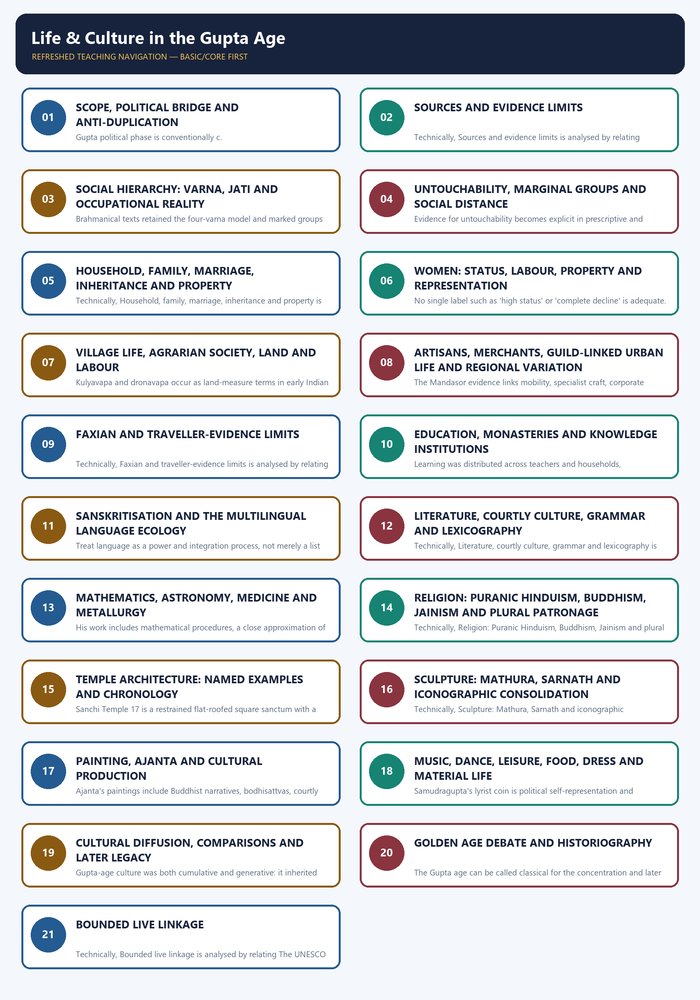

*Distinct embedded teaching-navigation image. The separate continuous Cārvāka-style flowchart package remains an independent at-a-glance artifact.*

#### Package counts and honest limitations

- Learning sections: 21; main learning MCQs: 16; main solved Mains: 6.
- Workbook: 5 verified/routed PYQs, 32 original hard MCQs (key rotation `ABCD` x8) and 6 original solved Mains.
- Original PNG visuals: 14.
- Direct topic-owned Mains PYQ: none. The 2022 Gupta-Chola culture question is cross-owned and labelled.
- Official 2020-2021 Prelims keys are not held locally; inferred/provisional solutions are explicitly labelled. The 2025 Faxian item has a local official Set A key.
- No dated current-affairs item was necessary. Heritage references are bounded historical/conservation links, not a manufactured current hook.
- Topic 20 remains the owner of Gupta chronology, campaigns, administration, land-grant machinery and decline; repetition is intentionally restricted.

#### Original visual asset index

- `notes/Ancient-Indian-History/assets/21_Life-Culture-Gupta-Age/01_social_hierarchy_evidence_map.png`
- `notes/Ancient-Indian-History/assets/21_Life-Culture-Gupta-Age/02_varna_jati_occupation_matrix.png`
- `notes/Ancient-Indian-History/assets/21_Life-Culture-Gupta-Age/03_women_status_source_comparison.png`
- `notes/Ancient-Indian-History/assets/21_Life-Culture-Gupta-Age/04_village_town_household_flow.png`
- `notes/Ancient-Indian-History/assets/21_Life-Culture-Gupta-Age/05_education_knowledge_ecosystem.png`
- `notes/Ancient-Indian-History/assets/21_Life-Culture-Gupta-Age/06_sanskrit_literature_genre_map.png`
- `notes/Ancient-Indian-History/assets/21_Life-Culture-Gupta-Age/07_science_chronology_attribution.png`
- `notes/Ancient-Indian-History/assets/21_Life-Culture-Gupta-Age/08_religion_plural_patronage.png`
- `notes/Ancient-Indian-History/assets/21_Life-Culture-Gupta-Age/09_temple_architecture_evolution.png`
- `notes/Ancient-Indian-History/assets/21_Life-Culture-Gupta-Age/10_sculpture_school_comparison.png`
- `notes/Ancient-Indian-History/assets/21_Life-Culture-Gupta-Age/11_painting_cultural_map.png`
- `notes/Ancient-Indian-History/assets/21_Life-Culture-Gupta-Age/12_golden_age_distribution_debate.png`
- `notes/Ancient-Indian-History/assets/21_Life-Culture-Gupta-Age/13_daily_life_evidence_wheel.png`
- `notes/Ancient-Indian-History/assets/21_Life-Culture-Gupta-Age/14_gs1_answer_spine.png`

### SESSION 1 — SCOPE, POLITICAL BRIDGE AND ANTI-DUPLICATION

#### DEFINITION / WHAT THIS IS CALLED

**Plain-language definition:** Topic 21 is the social-cultural companion to Topic 20: it reconstructs Gupta-age economy, society, religion, intellectual life, literature, science, art and daily culture, using the c. 319-550 CE Gupta political frame only as a scaffold, not as its subject.

**Technical definition:** The anti-duplication boundary means rulers, campaigns, administrative offices, land-grant machinery and dynastic decline remain Topic 20's exclusive content; Topic 21 uses that chronology only to date its own cultural, economic and social evidence.

#### ANSWER-GRABBING OPENING — WRITE/ADAPT IN THE EXAM

> Gupta-age culture must be read as a socially and economically grounded reconstruction, not a ruler-by-ruler chronicle repeated from the political topic.

#### MUST-WRITE KEYWORDS

- **Scope**
- **political bridge**
- **anti-duplication**
- **Gupta-Vakataka age**
- **agrarian surplus**
- **319-550 CE**

**How to use them:** Frame the answer through Scope; define political bridge, connect anti-duplication with Gupta-Vakataka age to explain the mechanism, and use agrarian surplus for the decisive comparison or qualification.

[FACT] Topic 21 is the social-cultural companion to Topic 20. The political frame is limited to c. 319-550 CE, Gupta-Vakataka patronage, agrarian surplus and regional networks; rulers, campaigns, administration, land-grant machinery and decline remain owned by Topic 20.

- [ANALYSIS] The organising question is not 'what did the Guptas conquer?' but 'how were hierarchy, work, belief and patronage converted into cultural production?'
- [FACT] Court Sanskrit, Puranic devotional formations, early structural temples, mature iconic sculpture and major mathematical-astronomical works make the period culturally consequential.
- [LIMIT] 'Gupta age' is a chronological-cultural shorthand. Important production occurred under Vakatakas and other regional powers, and not every part of India shared the same institutions.
- [LIMIT] This package cross-references, rather than repeats, Topic 20 on chronology, Samudragupta, Chandragupta II, offices, revenue, land grants and political decline.
- [ANALYSIS] The answer method throughout is claim -> named evidence -> what it proves -> source or distribution limit.

#### PARAGRAPH DEMONSTRATION — CLAIM → NAMED EVIDENCE → ANALYSIS → QUALIFICATION

[CLAIM] Topic 21 answers a different question from Topic 20 even though both sit inside the same c. 319-550 CE frame. [NAMED EVIDENCE] Court Sanskrit production, Puranic devotional formations, early structural temples such as Deogarh, mature iconic sculpture at Sarnath and Mathura, and Aryabhata's 499 CE Aryabhatiya are all cultural-economic outputs, not administrative facts. [ANALYSIS] Each output depended on agrarian surplus, land grants and patronage networks that Topic 20 documents administratively but that this package reads for its social and cultural consequences. [QUALIFICATION] A candidate who answers a Topic 21 demand with ruler names and campaign dates has answered the wrong question; the safe method opens with the social-cultural scope statement before naming any evidence.

#### Must-know facts
- Gupta political phase is conventionally c. 319-550 CE.
- Ajanta's principal late phase is Vakataka-context culture of the Gupta age, not simply Gupta-imperial art.
- Cultural history must name its social and economic base.

#### UPSC traps
- **Wrong:** Topic 21 is another ruler-by-ruler Gupta history. **Correct:** It is a social-cultural reconstruction with only a concise political bridge.
- **Wrong:** All classical production occurred under direct Gupta patronage. **Correct:** Regional courts, monasteries, guilds and donors also mattered.

**Mains angle:** Open with the anti-duplication boundary, then connect social base to cultural forms.

**Study / ownership link:** Primary political owner: Ancient History Topic 20.

#### CLOSING RECALL FLOW — SCOPE, POLITICAL BRIDGE AND ANTI-DUPLICATION

```text
START / CONCEPT: Scope, political bridge and anti-duplication
        |
        v
EXACT TERMS: Scope · political bridge · anti-duplication · Mains angle · Study / ownership link · 319-550 CE
        |
        v
MECHANISM / ARGUMENT: Wrong: Topic 21 is another ruler-by-ruler Gupta history.
        |
        v
CONSEQUENCE / CONTRAST: The answer method throughout is claim - named evidence - what it proves - source or distribution limit.
        |
        v
UPSC TRAP / ANSWER-USE: Ajanta's principal late phase is Vakataka-context culture of the Gupta age, not simply Gupta-imperial art.
        |
        v
ANSWER-GRABBING FORMULATION: Gupta-age culture must be read as a socially and economically grounded reconstruction, not a ruler-by-ruler chronicle repeated from the political topic.
```
### SESSION 2 — SOURCES AND EVIDENCE LIMITS

#### DEFINITION / WHAT THIS IS CALLED

**Plain-language definition:** Gupta-age society and culture must be reconstructed by triangulating prescriptive texts, literary works, inscriptions and grants, coins, Faxian, and material/art evidence, since no single source answers every question.

**Technical definition:** Each evidence class carries its own genre logic: Smriti prescribes norms, inscriptions record selected public claims, kavya expresses courtly ideals, Faxian reports a Buddhist pilgrim's itinerary, and archaeology preserves practice unevenly across sites and periods.

#### ANSWER-GRABBING OPENING — WRITE/ADAPT IN THE EXAM

> A source-method sentence should open any Gupta-age social-history answer: no single text, inscription or traveller account can stand for the whole society.

#### MUST-WRITE KEYWORDS

- **Sources**
- **evidence limits**
- **triangulation**
- **Smriti / law text**
- **Norm, kinship, hierarchy**
- **genre caution**

**How to use them:** Frame the answer through Sources; define evidence limits, connect triangulation with Smriti / law text to explain the mechanism, and use Norm, kinship, hierarchy for the decisive comparison or qualification.

[FACT] Gupta-age society is reconstructed from prescriptive texts, literary works, inscriptions and grants, coins and seals, Faxian, temples, sculpture, paintings, settlements and objects. Each source answers a different question.

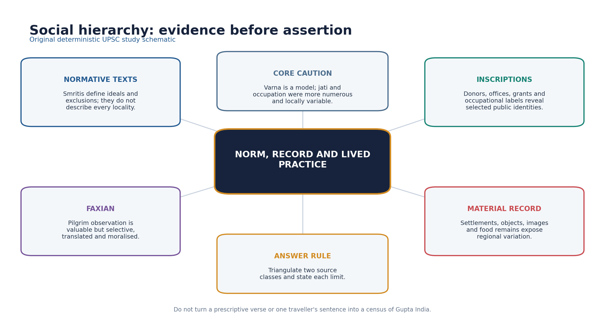

*Original deterministic schematic; factual and chronology limits remain in the surrounding text.*

| Source | Best use | Primary limit |
|---|---|---|
| Smriti / law text | Norm, kinship, hierarchy | Prescriptive and layered |
| Inscription / grant | Patron, office, right, donor | Public and regionally uneven |
| Kavya / drama | Ideals, genre, court culture | Aesthetic convention |
| Faxian | Selected observation | Pilgrim lens |
| Art / archaeology | Material and visual practice | Dating and survival |

- [FACT] Smritis and legal-didactic texts reveal normative ordering, permissible conduct and elite anxieties; they do not prove uniform enforcement.
- [FACT] Prashastis and royal images communicate legitimacy; donative inscriptions reveal selected patrons, institutions and occupational identities.
- [FACT] Literary kavya and drama reveal aesthetic ideals, courtly language and social imagination, but genre conventions shape their worlds.
- [FACT] Faxian offers observations linked to a Buddhist pilgrimage itinerary and translation history; he is not a neutral administrator.
- [FACT] Archaeology and art expose material practice, workshop technique and regional diversity, but dating, survival and representativeness remain problems.
- [ANALYSIS] Triangulation is compulsory: use at least two source classes and state what each cannot establish.

#### PARAGRAPH DEMONSTRATION — CLAIM → NAMED EVIDENCE → ANALYSIS → QUALIFICATION

[CLAIM] A Gupta-age social-cultural answer is only as strong as its named source method. [NAMED EVIDENCE] Smriti and legal-didactic texts state Brahmanical norms, prashastis and donative inscriptions record selected patrons and officers, Kalidasa's kavya expresses courtly ideals, and Faxian describes Buddhist institutions and the Chandala passage during his c. 399-414 CE journey. [ANALYSIS] Each source class proves a bounded claim: the Smriti proves a norm existed, the inscription proves a named actor and transaction, the kavya proves an aesthetic ideal, and Faxian proves a situated pilgrim observation. [QUALIFICATION] None of these four proves a uniform, empire-wide social condition on its own, so the safe method triangulates at least two source classes and states explicitly what each cannot establish.

#### Must-know facts
- Traveller evidence is situated.
- Material survival is selective.

#### UPSC traps
- **Wrong:** A Smriti statement proves universal custom. **Correct:** It establishes a norm or debate, which must be tested against other evidence.
- **Wrong:** Faxian described every social group and region. **Correct:** His route, purpose and interests were selective.

**Mains angle:** A high-scoring social-history answer begins with a source-method sentence.

**Study / ownership link:** Sources method: Ancient History Topics 01-02.

#### CLOSING RECALL FLOW — SOURCES AND EVIDENCE LIMITS

```text
START / CONCEPT: Sources and evidence limits
        |
        v
EXACT TERMS: Sources · evidence limits · Mains angle · Study / ownership link · Smriti / law text · Norm, kinship, hierarchy
        |
        v
MECHANISM / ARGUMENT: Gupta-age society is reconstructed from prescriptive texts, literary works, inscriptions and grants, coins and seals, Faxian, temples, sculpture, paintings, settlements and objects.
        |
        v
CONSEQUENCE / CONTRAST: Smritis and legal-didactic texts reveal normative ordering, permissible conduct and elite anxieties; they do not prove uniform enforcement.
        |
        v
UPSC TRAP / ANSWER-USE: Faxian offers observations linked to a Buddhist pilgrimage itinerary and translation history; he is not a neutral administrator.
        |
        v
ANSWER-GRABBING FORMULATION: A source-method sentence should open any Gupta-age social-history answer: no single text, inscription or traveller account can stand for the whole society.
```
### SESSION 3 — SOCIAL HIERARCHY: VARNA, JATI AND OCCUPATIONAL REALITY

#### DEFINITION / WHAT THIS IS CALLED

**Plain-language definition:** Varna is the fourfold Brahmanical model of social order, while jati and occupation reflect the many more numerous, locally variable communities that inscriptions and literature actually record.

**Technical definition:** Brahmanical texts retained the four-varna model and marked groups beyond it, while inscriptions and social practice disclose many occupational and local identities that cannot be compressed into four boxes.

#### ANSWER-GRABBING OPENING — WRITE/ADAPT IN THE EXAM

> Brahmanical texts retained the four-varna model and marked groups beyond it, while inscriptions and social practice disclose many occupational and local identities that cannot be compressed into four boxes.

#### MUST-WRITE KEYWORDS

- **Social hierarchy**
- **varna**
- **jati**
- **occupational reality**
- **Kshatriya status claims**
- **Kayastha caution**

**How to use them:** Frame the answer through Social hierarchy; define varna, connect jati with occupational reality to explain the mechanism, and use Kshatriya status claims for the decisive comparison or qualification.

[FACT] Brahmanical texts retained the four-varna model and marked groups beyond it, while inscriptions and social practice disclose many occupational and local identities that cannot be compressed into four boxes.

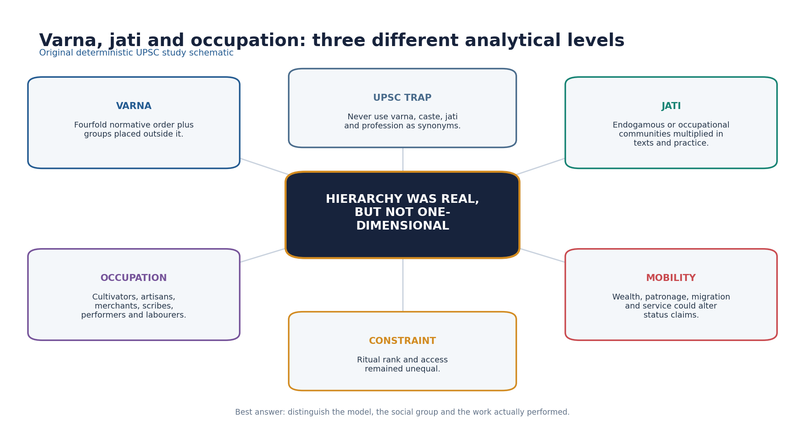

*Original deterministic schematic; factual and chronology limits remain in the surrounding text.*

- [FACT] Brahmanas enjoyed ideological prestige and benefited from patronage and land grants, but Brahmanas themselves were internally differentiated by learning, locality and livelihood.
- [FACT] Kshatriya status was claimed through genealogy, conquest and ritual language; social rank could be politically negotiated.
- [FACT] Vaishya and Shudra labels in texts do not map neatly onto every merchant, cultivator or artisan in inscriptions.
- [ANALYSIS] Jati proliferation reflected occupation, migration, incorporation of communities, inter-group marriage classifications and local ranking.
- [FACT] Scribes appear in administrative and inscriptional settings; later Kayastha caste consolidation must not be projected fully into the fourth-fifth centuries.
- [LIMIT] Mobility and status claims coexisted with entrenched inequality; evidence for exceptional advancement does not dissolve the hierarchy.

#### PARAGRAPH DEMONSTRATION — CLAIM → NAMED EVIDENCE → ANALYSIS → QUALIFICATION

[CLAIM] Varna, jati and occupation are analytically distinct categories that Gupta-age evidence keeps separate even when they overlap in practice. [NAMED EVIDENCE] Brahmanical Smritis retain the fourfold varna model, while inscriptions record scribes in administrative settings, artisans by named craft and Kshatriya status claimed through genealogy and conquest rather than birth alone. [ANALYSIS] This shows that a normative macro-model (varna) coexisted with a much larger and more fluid set of occupational and local jati identities that inscriptions, not Smritis, actually document. [QUALIFICATION] Evidence of negotiated status or Kshatriya-claiming lineages does not dissolve the underlying hierarchy; a safe answer keeps model, community and livelihood as three separate lines of evidence before drawing a conclusion.

#### Must-know facts
- Jati and occupation were more numerous and locally variable.
- Status could be claimed, but access remained unequal.

#### UPSC traps
- **Wrong:** Varna, jati and profession are identical. **Correct:** They are analytically distinct even when they overlap.
- **Wrong:** Some mobility means caste hierarchy was absent. **Correct:** Negotiated rank operated within an unequal order.

**Mains angle:** Distinguish model, community and livelihood before discussing social change.

**Study / ownership link:** Compare Topic 13 (Buddha-age varna society) and Topic 26 (later transition).

#### CLOSING RECALL FLOW — SOCIAL HIERARCHY: VARNA, JATI AND OCCUPATIONAL REALITY

```text
START / CONCEPT: Social hierarchy: varna, jati and occupational reality
        |
        v
EXACT TERMS: Social hierarchy · varna · jati · occupational reality · Mains angle · Study / ownership link
        |
        v
MECHANISM / ARGUMENT: Kshatriya status was claimed through genealogy, conquest and ritual language; social rank could be politically negotiated.
        |
        v
CONSEQUENCE / CONTRAST: Mobility and status claims coexisted with entrenched inequality; evidence for exceptional advancement does not dissolve the hierarchy.
        |
        v
UPSC TRAP / ANSWER-USE: Brahmanas enjoyed ideological prestige and benefited from patronage and land grants, but Brahmanas themselves were internally differentiated by learning, locality and livelihood.
        |
        v
ANSWER-GRABBING FORMULATION: Brahmanical texts retained the four-varna model and marked groups beyond it, while inscriptions and social practice disclose many occupational and local identities that cannot be compressed into four boxes.
```
### SESSION 4 — UNTOUCHABILITY, MARGINAL GROUPS AND SOCIAL DISTANCE

#### DEFINITION / WHAT THIS IS CALLED

**Plain-language definition:** 'Untouchable' is a modern umbrella for historically varied named groups; avoid inventing a fixed Gupta-period pan-Indian caste list.

**Technical definition:** Evidence for untouchability becomes explicit in prescriptive and traveller accounts, but terminology, practice and regional intensity must be handled cautiously.

#### ANSWER-GRABBING OPENING — WRITE/ADAPT IN THE EXAM

> Evidence for untouchability becomes explicit in prescriptive and traveller accounts, but terminology, practice and regional intensity must be handled cautiously.

#### MUST-WRITE KEYWORDS

- **Untouchability**
- **marginal groups**
- **social distance**
- **Chandala evidence**
- **occupational stigma**
- **Faxian's account**

**How to use them:** Frame the answer through Untouchability; define marginal groups, connect social distance with Chandala evidence to explain the mechanism, and use occupational stigma for the decisive comparison or qualification.

[FACT] Evidence for untouchability becomes explicit in prescriptive and traveller accounts, but terminology, practice and regional intensity must be handled cautiously.

- [FACT] Faxian's account describes Chandalas as living apart and signalling their presence when entering a town; this is important evidence of social exclusion.
- [LIMIT] Faxian's statement is a pilgrim observation transmitted through texts and translations; it cannot quantify all communities or all regions.
- [FACT] Brahmanical texts associated some occupations, birth categories and forms of contact with impurity and exclusion.
- [ANALYSIS] Occupational stigma, spatial separation and ritual avoidance reinforced one another, but the exact relationship differed locally.
- [LIMIT] 'Untouchable' is a modern umbrella for historically varied named groups; avoid inventing a fixed Gupta-period pan-Indian caste list.
- [ANALYSIS] The Golden Age label must be tested against the visibility of exclusion, not merely elite achievement.

#### PARAGRAPH DEMONSTRATION — CLAIM → NAMED EVIDENCE → ANALYSIS → QUALIFICATION

[CLAIM] Untouchability evidence in the Gupta age is real but must be handled with source-specific care rather than projected as one uniform pan-Indian system. [NAMED EVIDENCE] Faxian's account describes Chandalas living apart and announcing their presence on entering a town, while Brahmanical legal-literary texts attach impurity to certain occupations and birth categories. [ANALYSIS] Occupational stigma, spatial separation and ritual avoidance reinforced one another in Faxian's report, but his route, purpose and translation history mean the account cannot be read as a census of every region. [QUALIFICATION] The safest formulation treats this as strong situated evidence of exclusion, not proof that untouchability began uniformly in Gupta times or applied identically across all of India.

#### Must-know facts
- Spatial and ritual distance could overlap.
- Named groups require source-specific use.

#### UPSC traps
- **Wrong:** Faxian proves identical untouchability throughout India. **Correct:** He supplies strong but situated evidence.
- **Wrong:** Marginal groups left no history. **Correct:** Texts, travellers, labour relations and archaeology offer indirect, unequal access.

**Mains angle:** Use the Chandala evidence as a limitation on universal Golden Age claims.

**Study / ownership link:** Traveller method in Section 09; Golden Age debate in Section 20.

#### CLOSING RECALL FLOW — UNTOUCHABILITY, MARGINAL GROUPS AND SOCIAL DISTANCE

```text
START / CONCEPT: Untouchability, marginal groups and social distance
        |
        v
EXACT TERMS: Untouchability · marginal groups · social distance · Mains angle · Study / ownership link · Faxian's account
        |
        v
MECHANISM / ARGUMENT: Faxian's statement is a pilgrim observation transmitted through texts and translations; it cannot quantify all communities or all regions.
        |
        v
CONSEQUENCE / CONTRAST: The Golden Age label must be tested against the visibility of exclusion, not merely elite achievement.
        |
        v
UPSC TRAP / ANSWER-USE: Faxian's Chandala passage is evidence of exclusion, not a census.
        |
        v
ANSWER-GRABBING FORMULATION: Evidence for untouchability becomes explicit in prescriptive and traveller accounts, but terminology, practice and regional intensity must be handled cautiously.
```
### SESSION 5 — HOUSEHOLD, FAMILY, MARRIAGE, INHERITANCE AND PROPERTY

#### DEFINITION / WHAT THIS IS CALLED

**Plain-language definition:** Stridhana was a recognised category of women's property, although definitions, control and inheritance varied across legal texts and circumstances.

**Technical definition:** Mitakshara and Dayabhaga are later medieval commentarial schools of Hindu law routed here as an inheritance-continuity PYQ; they are not Gupta-period institutions and must not be backdated.

#### ANSWER-GRABBING OPENING — WRITE/ADAPT IN THE EXAM

> Stridhana was a recognised category of women's property, although definitions, control and inheritance varied across legal texts and circumstances.

#### MUST-WRITE KEYWORDS

- **Household**
- **family**
- **marriage**
- **inheritance**
- **property**
- **stridhana**

**How to use them:** Frame the answer through Household; define family, connect marriage with inheritance to explain the mechanism, and use stridhana for the decisive comparison or qualification.

[FACT] Gupta-age family history is text-heavy. Smritis discuss marriage forms, guardianship, lineage, property and inheritance, but lived arrangements varied by region, class and community.

- [FACT] Patrilineal descent and patriarchal household authority remained the dominant normative framework.
- [FACT] Stridhana was a recognised category of women's property, although definitions, control and inheritance varied across legal texts and circumstances.
- [LIMIT] Widow inheritance and women's claims cannot be summarised by one timeless Hindu-law rule; texts differ and later commentarial schools belong to later centuries.
- [FACT] Mitakshara is the later commentary of Vijnaneshwara on the Yajnavalkya Smriti; Dayabhaga is associated with Jimutavahana. They are not Gupta-period legal codes.
- [ANALYSIS] The 2021 Prelims route tests the contrast between joint birthright under Mitakshara and succession after the father's death in Dayabhaga, not a Gupta-age custom claim.
- [LIMIT] Literary marriages, royal genealogies and legal prescriptions disproportionately represent elites.

#### PARAGRAPH DEMONSTRATION — CLAIM → NAMED EVIDENCE → ANALYSIS → QUALIFICATION

[CLAIM] Gupta-age family law recognised women's property while keeping it inside a patriarchal, patrilineal framework. [NAMED EVIDENCE] Smritis discuss stridhana as a category of women's property, and the routed 2021 Prelims item asks the reader to separate Mitakshara, which recognises a son's interest by birth in joint ancestral property, from Dayabhaga, which opens inheritance only after the father's death. [ANALYSIS] Recognising stridhana proves that women's property existed as a legal category, but Mitakshara and Dayabhaga are Vijnaneshwara's and Jimutavahana's later medieval commentarial schools, so their doctrinal contrast cannot be read backward as a Gupta-age social fact. [QUALIFICATION] The safe answer keeps three things distinct: the Gupta-period normative category (stridhana), the later legal-school debate (Mitakshara/Dayabhaga), and the caution that literary/legal elites disproportionately represent the evidence.

#### Must-know facts
- Mitakshara and Dayabhaga are later schools.
- Kinship evidence must be source-dated.

#### UPSC traps
- **Wrong:** Mitakshara and Dayabhaga were two Gupta royal codes. **Correct:** They are later commentarial schools of Hindu law.
- **Wrong:** Recognition of stridhana proves gender-equal property relations. **Correct:** Recognition existed within a patriarchal and textually variable framework.

**Mains angle:** When asked about women or inheritance, separate norm, property category, legal school chronology and lived evidence.

**Study / ownership link:** PYQ route: 2021 Prelims Q40, neutral demand locally audited.

#### CLOSING RECALL FLOW — HOUSEHOLD, FAMILY, MARRIAGE, INHERITANCE AND PROPERTY

```text
START / CONCEPT: Household, family, marriage, inheritance and property
        |
        v
EXACT TERMS: Household · family · marriage · inheritance · property · stridhana
        |
        v
MECHANISM / ARGUMENT: Smritis discuss marriage forms, guardianship, lineage, property and inheritance, but lived arrangements varied by region, class and community.
        |
        v
CONSEQUENCE / CONTRAST: Mitakshara and Dayabhaga are later commentarial schools, not Gupta-period legal codes.
        |
        v
UPSC TRAP / ANSWER-USE: Stridhana is not identical to equal coparcenary rights.
        |
        v
ANSWER-GRABBING FORMULATION: Stridhana was a recognised category of women's property, although definitions, control and inheritance varied across legal texts and circumstances.
```
### SESSION 6 — WOMEN: STATUS, LABOUR, PROPERTY AND REPRESENTATION

#### DEFINITION / WHAT THIS IS CALLED

**Plain-language definition:** Household, agricultural, craft and service labour by women is under-described in elite literary texts; absence of description is not evidence of absence.

**Technical definition:** No single label such as 'high status' or 'complete decline' is adequate.

#### ANSWER-GRABBING OPENING — WRITE/ADAPT IN THE EXAM

> Household, agricultural, craft and service labour by women is under-described in elite literary texts; absence of description is not evidence of absence.

#### MUST-WRITE KEYWORDS

- **Women**
- **status**
- **labour**
- **property**
- **representation**
- **Prabhavatigupta**

**How to use them:** Frame the answer through Women; define status, connect labour with property to explain the mechanism, and use representation and Prabhavatigupta for the decisive comparison or qualification.

[FACT] The evidence shows patriarchal constraint alongside differentiated forms of agency. No single label such as 'high status' or 'complete decline' is adequate.

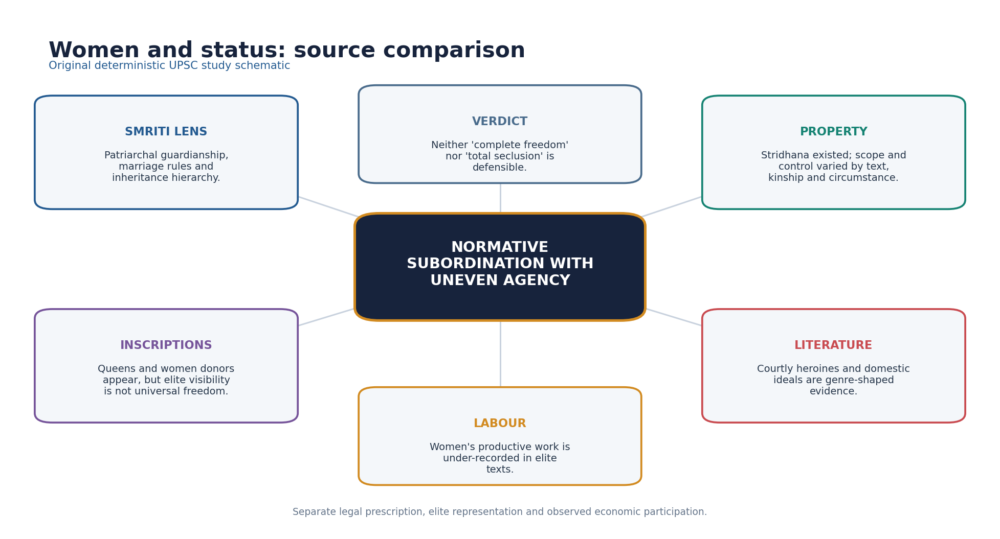

*Original deterministic schematic; factual and chronology limits remain in the surrounding text.*

- [FACT] Smriti norms emphasised male guardianship, patriliny and controlled sexuality; these are evidence of normative hierarchy.
- [FACT] Queens such as Prabhavatigupta could exercise political and donative authority, but elite regency cannot stand for all women.
- [FACT] Women appear as donors and participants in religious life in inscriptions across early historic India; the surviving Gupta-age record remains selective.
- [ANALYSIS] Household, agricultural, craft and service labour by women is under-described in elite literary texts; absence of description is not evidence of absence.
- [FACT] Courtly literature gives women narrative intelligence, desire and aesthetic centrality while still operating inside elite gender conventions.
- [LIMIT] Claims about universal child marriage, purdah, sati frequency or educational exclusion require precise sources; this package does not generalise them.

#### PARAGRAPH DEMONSTRATION — CLAIM → NAMED EVIDENCE → ANALYSIS → QUALIFICATION

[CLAIM] Gupta-age women's status cannot be captured by one label of decline or high status. [NAMED EVIDENCE] Prabhavatigupta exercised political and donative authority as Vakataka regent, women appear as religious donors in inscriptions, and Smriti norms simultaneously emphasised male guardianship and controlled female sexuality. [ANALYSIS] Prabhavatigupta and donor inscriptions prove that elite women could hold real authority and agency, while the same normative texts show that patriarchal constraint was the dominant legal framework within which that agency operated. [QUALIFICATION] An elite regent's authority cannot be generalised into a claim about all women's status, and the near-total silence on ordinary women's agricultural and craft labour must be read as an evidentiary gap, not proof of their absence from production.

#### Must-know facts
- Literary visibility is genre-shaped.
- Women's labour is under-recorded.

#### UPSC traps
- **Wrong:** Prabhavatigupta proves all women held political power. **Correct:** She proves possible elite female authority under specific dynastic conditions.
- **Wrong:** Courtly heroines transparently depict ordinary women. **Correct:** They reveal aesthetic and social ideals, not representative daily life.

**Mains angle:** Build a three-column answer: normative position, observed agency, evidentiary limit.

**Study / ownership link:** Political details remain in Topic 20; gender method links Indian Society.

#### CLOSING RECALL FLOW — WOMEN: STATUS, LABOUR, PROPERTY AND REPRESENTATION

```text
START / CONCEPT: Women: status, labour, property and representation
        |
        v
EXACT TERMS: Women · status · labour · property · representation · Mains angle
        |
        v
MECHANISM / ARGUMENT: No single label such as 'high status' or 'complete decline' is adequate.
        |
        v
CONSEQUENCE / CONTRAST: Queens such as Prabhavatigupta could exercise political and donative authority, but elite regency cannot stand for all women.
        |
        v
UPSC TRAP / ANSWER-USE: Claims about universal child marriage, purdah, sati frequency or educational exclusion require precise sources; this package does not generalise them.
        |
        v
ANSWER-GRABBING FORMULATION: Household, agricultural, craft and service labour by women is under-described in elite literary texts; absence of description is not evidence of absence.
```
### SESSION 7 — VILLAGE LIFE, AGRARIAN SOCIETY, LAND AND LABOUR

#### DEFINITION / WHAT THIS IS CALLED

**Plain-language definition:** Grants could expand cultivation and transmit agrarian techniques while also strengthening beneficiaries' claims over revenue and labour.

**Technical definition:** Kulyavapa and dronavapa occur as land-measure terms in early Indian epigraphic contexts; the 2020 official paper identifies them as measurements of land.

#### ANSWER-GRABBING OPENING — WRITE/ADAPT IN THE EXAM

> Grants could expand cultivation and transmit agrarian techniques while also strengthening beneficiaries' claims over revenue and labour.

#### MUST-WRITE KEYWORDS

- **Village life**
- **agrarian society**
- **land**
- **labour**
- **kulyavapa / dronavapa**
- **vishti**

**How to use them:** Frame the answer through Village life; define agrarian society, connect land with labour to explain the mechanism, and use kulyavapa / dronavapa and vishti for the decisive comparison or qualification.

[FACT] The village and agrarian household generated much of the surplus that supported courts, religious institutions, learning and artistic production.

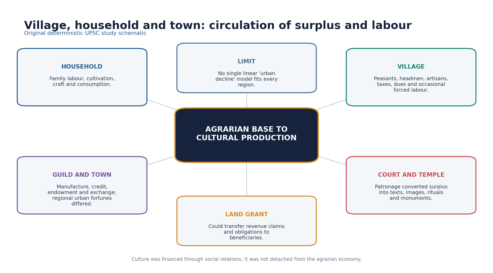

*Original deterministic schematic; factual and chronology limits remain in the surrounding text.*

- [FACT] Land grants recorded plots, boundaries, revenue claims and exemptions; the administrative mechanics and political debate remain owned by Topic 20.
- [FACT] Kulyavapa and dronavapa occur as land-measure terms in early Indian epigraphic contexts; the 2020 official paper identifies them as measurements of land.
- [FACT] Cultivators faced taxes, shares, dues and, in some contexts, vishti or forced labour obligations.
- [ANALYSIS] Grants could expand cultivation and transmit agrarian techniques while also strengthening beneficiaries' claims over revenue and labour.
- [LIMIT] 'Feudalism' is a historiographical model, not a label to substitute for evidence; regional chronology and the bundle of transferred rights matter.
- [ANALYSIS] Village society included landholders, tenants or dependent cultivators, artisans, servants and officials in varying combinations.

#### PARAGRAPH DEMONSTRATION — CLAIM → NAMED EVIDENCE → ANALYSIS → QUALIFICATION

[CLAIM] Cultural florescence rested on an agrarian base whose benefits were unevenly shared. [NAMED EVIDENCE] Land grants recorded in kulyavapa and dronavapa seed-capacity measures expanded cultivation and financed donees, while cultivators simultaneously bore bhaga, bhoga and udranga dues and, in some contexts, vishti forced labour. [ANALYSIS] Grants could expand cultivation and transmit agrarian technique while also strengthening beneficiaries' claims over revenue and labour, so the same instrument produced growth and new obligation at once. [QUALIFICATION] 'Feudalism' is a historiographical model, not a fact to be asserted outright; the safe answer names the exact transferred right, dates the charter and specifies the region before invoking any wider structural label.

#### Must-know facts
- Vishti was a labour obligation, not a tax coin.
- Land grants could have expansionary and coercive effects.

#### UPSC traps
- **Wrong:** Every grant transferred full private ownership. **Correct:** Rights transferred varied by charter and region.
- **Wrong:** Agrarian expansion benefited all cultivators equally. **Correct:** Expansion could coexist with new obligations and unequal control.

**Mains angle:** Connect cultural florescence to the agrarian surplus and labour relations that sustained it.

**Study / ownership link:** Topic 20 owns grant administration; Topic 26 owns longer early-medieval debate.

#### CLOSING RECALL FLOW — VILLAGE LIFE, AGRARIAN SOCIETY, LAND AND LABOUR

```text
START / CONCEPT: Village life, agrarian society, land and labour
        |
        v
EXACT TERMS: Village life · agrarian society · land · labour · kulyavapa / dronavapa · vishti
        |
        v
MECHANISM / ARGUMENT: Kulyavapa and dronavapa occur as land-measure terms in early Indian epigraphic contexts; the 2020 official paper identifies them as measurements of land.
        |
        v
CONSEQUENCE / CONTRAST: Vishti was a labour obligation, not a tax coin.
        |
        v
UPSC TRAP / ANSWER-USE: 'Feudalism' is a historiographical model, not a label to substitute for evidence; regional chronology and the bundle of transferred rights matter.
        |
        v
ANSWER-GRABBING FORMULATION: Grants could expand cultivation and transmit agrarian techniques while also strengthening beneficiaries' claims over revenue and labour.
```
### SESSION 8 — ARTISANS, MERCHANTS, GUILD-LINKED URBAN LIFE AND REGIONAL VARIATION

#### DEFINITION / WHAT THIS IS CALLED

**Plain-language definition:** Regional variation is central: route shifts, ports, courts, pilgrimage and agrarian hinterlands produced different urban trajectories.

**Technical definition:** The Mandasor evidence links mobility, specialist craft, corporate identity, religion and urban patronage.

#### ANSWER-GRABBING OPENING — WRITE/ADAPT IN THE EXAM

> Regional variation is central: route shifts, ports, courts, pilgrimage and agrarian hinterlands produced different urban trajectories.

#### MUST-WRITE KEYWORDS

- **Artisans**
- **merchants**
- **guild-linked urban life**
- **regional variation**
- **Mandasor silk weavers**
- **shreni**

**How to use them:** Frame the answer through Artisans; define merchants, connect guild-linked urban life with regional variation to explain the mechanism, and use Mandasor silk weavers and shreni for the decisive comparison or qualification.

[FACT] Gupta-age urban history was uneven: some older towns contracted, while political, pilgrimage, craft and exchange centres persisted or changed function.

- [FACT] The Mandasor inscriptions of silk weavers record a migrant corporate group, temple patronage and the repair or renewal of a Sun temple.
- [ANALYSIS] The Mandasor evidence links mobility, specialist craft, corporate identity, religion and urban patronage.
- [FACT] Guilds and occupational corporations could receive endowments and manage funds, but they were not modern banks or democratic trade unions.
- [FACT] Artisans worked in textiles, metal, ivory, terracotta, stone, brick and other materials; archaeological visibility varies sharply by craft.
- [LIMIT] Coin finds and textual comments suggest monetary and commercial change, but a uniform collapse of trade cannot be inferred.
- [ANALYSIS] Regional variation is central: route shifts, ports, courts, pilgrimage and agrarian hinterlands produced different urban trajectories.

#### PARAGRAPH DEMONSTRATION — CLAIM → NAMED EVIDENCE → ANALYSIS → QUALIFICATION

[CLAIM] Gupta-age urban and craft life shows regional variation rather than one uniform trajectory. [NAMED EVIDENCE] The Mandsaur silk-weavers' inscriptions record a migrant corporate group that changed occupation, retained collective identity and funded a Sun-temple's repair, while guild (shreni) bodies elsewhere managed endowments and craft standards. [ANALYSIS] The Mandasor evidence links mobility, specialist craft, corporate identity, religion and urban patronage in one traceable chain: migration to guild identity to wealth to temple patronage to cultural production. [QUALIFICATION] Coin and textual evidence for change in some regions does not establish a uniform, pan-Indian urban collapse; route shifts, ports, courts and pilgrimage centres produced different local trajectories that must be read town by town.

#### Must-know facts
- Guild endowments show institutional capacity.
- Urban change was regional, not one-directional.

#### UPSC traps
- **Wrong:** All Gupta towns declined simultaneously. **Correct:** Urban contraction, persistence and functional change varied by region.
- **Wrong:** A guild was identical to a modern corporation. **Correct:** It was a historically specific occupational-corporate institution.

**Mains angle:** Use Mandasor as a compact evidence chain: migration -> guild identity -> wealth -> temple patronage -> cultural production.

**Study / ownership link:** Economic baseline: Topic 19; political economy: Topic 20.

#### CLOSING RECALL FLOW — ARTISANS, MERCHANTS, GUILD-LINKED URBAN LIFE AND REGIONAL VARIATION

```text
START / CONCEPT: Artisans, merchants, guild-linked urban life and regional variation
        |
        v
EXACT TERMS: Artisans · merchants · guild-linked urban life · regional variation · Mains angle · Study / ownership link
        |
        v
MECHANISM / ARGUMENT: Urban change was regional, not one-directional.
        |
        v
CONSEQUENCE / CONTRAST: Gupta-age urban history was uneven: some older towns contracted, while political, pilgrimage, craft and exchange centres persisted or changed function.
        |
        v
UPSC TRAP / ANSWER-USE: Guilds and occupational corporations could receive endowments and manage funds, but they were not modern banks or democratic trade unions.
        |
        v
ANSWER-GRABBING FORMULATION: Regional variation is central: route shifts, ports, courts, pilgrimage and agrarian hinterlands produced different urban trajectories.
```
### SESSION 9 — FAXIAN AND TRAVELLER-EVIDENCE LIMITS

#### DEFINITION / WHAT THIS IS CALLED

**Plain-language definition:** His account is especially valuable for Buddhist geography, monastic conditions, pilgrimage and selected social observations.

**Technical definition:** Faxian's names and observations pass through Chinese transcription and translation history, so his account is best used as corroborating, situated evidence rather than a stand-alone administrative or social record.

#### ANSWER-GRABBING OPENING — WRITE/ADAPT IN THE EXAM

> His account is especially valuable for Buddhist geography, monastic conditions, pilgrimage and selected social observations.

#### MUST-WRITE KEYWORDS

- **Faxian**
- **traveller-evidence limits**
- **pilgrim itinerary**
- **corroboration**
- **His account**
- **399-414 CE**

**How to use them:** Frame the answer through Faxian; define traveller-evidence limits, connect pilgrim itinerary with corroboration to explain the mechanism, and use His account for the decisive comparison or qualification.

[FACT] Faxian travelled in India c. 399-414 CE, broadly during Chandragupta II's reign, to obtain Buddhist texts and visit sacred sites.

- [FACT] The official 2025 Prelims Set A question asks which reign Faxian visited; the official key route identifies Chandragupta II.
- [FACT] His account is especially valuable for Buddhist geography, monastic conditions, pilgrimage and selected social observations.
- [FACT] His Chandala passage is frequently used for social exclusion; his descriptions of punishment or prosperity must be read in route and purpose context.
- [LIMIT] Silence about an institution does not prove its absence, and praise of a region does not establish empire-wide conditions.
- [LIMIT] Names and details pass through Chinese transcription and later translation; exact equivalences require scholarly care.
- [ANALYSIS] Best practice is corroboration with inscriptions, archaeology or legal-literary evidence.

#### PARAGRAPH DEMONSTRATION — CLAIM → NAMED EVIDENCE → ANALYSIS → QUALIFICATION

[CLAIM] Faxian is an indispensable but bounded source for Gupta-age social history. [NAMED EVIDENCE] He travelled in India c. 399-414 CE broadly during Chandragupta II's reign, recorded the Chandala passage on exclusion, and described Buddhist monasteries and pilgrimage routes across the sites he visited. [ANALYSIS] His account is especially valuable precisely where his Buddhist pilgrimage purpose aligned with his interests: monastic conditions, sacred geography and selected social observation; elsewhere his silence or brevity reflects itinerary and genre, not the absence of an institution. [QUALIFICATION] Because his names and details pass through Chinese transcription and later translation, best practice corroborates any Faxian-based claim with inscriptions, archaeology or legal-literary evidence rather than quoting him as a stand-alone census.

#### Must-know facts
- He was a Buddhist pilgrim, not a Gupta official.
- His account is selective but indispensable.

#### UPSC traps
- **Wrong:** Faxian's silence disproves a practice. **Correct:** Silence may reflect route, genre or interest.
- **Wrong:** Traveller bias makes the account useless. **Correct:** Source-aware use preserves its strong observational value.

**Mains angle:** State both value and limit in the same paragraph.

**Study / ownership link:** Official 2025 Prelims owner is Topic 20; this section owns traveller methodology.

#### CLOSING RECALL FLOW — FAXIAN AND TRAVELLER-EVIDENCE LIMITS

```text
START / CONCEPT: Faxian and traveller-evidence limits
        |
        v
EXACT TERMS: Faxian · traveller-evidence limits · pilgrim itinerary · corroboration · His account · 399-414 CE
        |
        v
MECHANISM / ARGUMENT: His account is especially valuable for Buddhist geography, monastic conditions, pilgrimage and selected social observations.
        |
        v
CONSEQUENCE / CONTRAST: Silence about an institution does not prove its absence, and praise of a region does not establish empire-wide conditions.
        |
        v
UPSC TRAP / ANSWER-USE: His account is selective but indispensable.
        |
        v
ANSWER-GRABBING FORMULATION: His account is especially valuable for Buddhist geography, monastic conditions, pilgrimage and selected social observations.
```
### SESSION 10 — EDUCATION, MONASTERIES AND KNOWLEDGE INSTITUTIONS

#### DEFINITION / WHAT THIS IS CALLED

**Plain-language definition:** Monasteries were learning nodes, not the only institutions.

**Technical definition:** Learning was distributed across teachers and households, Brahmanical centres, monasteries, courts and specialist communities rather than concentrated in one modern university system.

#### ANSWER-GRABBING OPENING — WRITE/ADAPT IN THE EXAM

> Monasteries were learning nodes, not the only institutions.

#### MUST-WRITE KEYWORDS

- **Education**
- **monasteries**
- **knowledge institutions**
- **Nalanda chronology**
- **gradual institutional growth**
- **Learning**

**How to use them:** Frame the answer through Education; define monasteries, connect knowledge institutions with Nalanda chronology to explain the mechanism, and use gradual institutional growth for the decisive comparison or qualification.

[FACT] Learning was distributed across teachers and households, Brahmanical centres, monasteries, courts and specialist communities rather than concentrated in one modern university system.

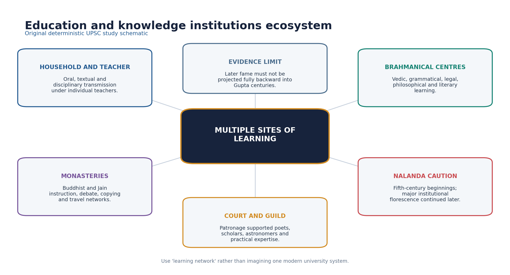

*Original deterministic schematic; factual and chronology limits remain in the surrounding text.*

- [FACT] Vedic, grammatical, legal, philosophical and literary learning relied strongly on oral-textual transmission under teachers.
- [FACT] Buddhist monasteries supported instruction, debate, manuscript movement and pilgrim networks; Jain institutions also sustained textual traditions.
- [FACT] Nalanda's beginnings are associated with the fifth century, but its great institutional prominence and Xuanzang-Yijing descriptions belong substantially to later centuries.
- [LIMIT] 'Founded by Kumaragupta as a fully developed university' compresses uncertain foundation traditions and later expansion.
- [ANALYSIS] Court patronage, religious endowment and agrarian resources created the material conditions for specialist learning.
- [LIMIT] Literacy levels, access by gender and class, curricula and student numbers cannot be safely quantified.

#### PARAGRAPH DEMONSTRATION — CLAIM → NAMED EVIDENCE → ANALYSIS → QUALIFICATION

[CLAIM] Gupta-age learning was distributed across several institution types rather than concentrated in one modern-style university. [NAMED EVIDENCE] Teachers and households sustained Vedic, grammatical and philosophical transmission, Buddhist and Jain monasteries supported instruction and manuscript movement, and Nalanda's archaeological and patronage associations begin in the fifth century. [ANALYSIS] Court patronage, religious endowment and agrarian resources created the material conditions for specialist learning across these different nodes, so no single institution can represent the whole ecosystem. [QUALIFICATION] Nalanda's great institutional prominence and the detailed Xuanzang-Yijing descriptions belong substantially to later centuries, so 'founded as a fully developed university by Kumaragupta' compresses an uncertain foundation tradition and later cumulative expansion into one false single date.

#### Must-know facts
- Monasteries were learning nodes, not the only institutions.
- Later fame cannot be projected backward.

#### UPSC traps
- **Wrong:** Fifth-century Nalanda already had every seventh-century feature. **Correct:** Institutional development was cumulative.
- **Wrong:** Education was exclusively Brahmanical. **Correct:** Buddhist, Jain, courtly and practical knowledge networks also operated.

**Mains angle:** Explain the ecosystem and then add the Nalanda chronology caution.

**Study / ownership link:** Post-Gupta institutional detail: Topic 22.

#### CLOSING RECALL FLOW — EDUCATION, MONASTERIES AND KNOWLEDGE INSTITUTIONS

```text
START / CONCEPT: Education, monasteries and knowledge institutions
        |
        v
EXACT TERMS: Education · monasteries · knowledge institutions · Nalanda chronology · gradual institutional growth · Learning
        |
        v
MECHANISM / ARGUMENT: 'Founded by Kumaragupta as a fully developed university' compresses uncertain foundation traditions and later expansion.
        |
        v
CONSEQUENCE / CONTRAST: Nalanda's beginnings are associated with the fifth century, but its great institutional prominence and Xuanzang-Yijing descriptions belong substantially to later centuries.
        |
        v
UPSC TRAP / ANSWER-USE: Learning was distributed across teachers and households, Brahmanical centres, monasteries, courts and specialist communities rather than concentrated in one modern university system.
        |
        v
ANSWER-GRABBING FORMULATION: Monasteries were learning nodes, not the only institutions.
```
### SESSION 11 — SANSKRITISATION AND THE MULTILINGUAL LANGUAGE ECOLOGY

#### DEFINITION / WHAT THIS IS CALLED

**Plain-language definition:** Sanskritisation involved adoption and adaptation of Brahmanical idioms, genealogies, rituals and social claims by rulers and communities; it was not simple top-down homogenisation.

**Technical definition:** Treat language as a power and integration process, not merely a list of texts.

#### ANSWER-GRABBING OPENING — WRITE/ADAPT IN THE EXAM

> Sanskritisation involved adoption and adaptation of Brahmanical idioms, genealogies, rituals and social claims by rulers and communities; it was not simple top-down homogenisation.

#### MUST-WRITE KEYWORDS

- **Sanskritisation**
- **the multilingual language ecology**
- **prestige idiom**
- **Prakrit continuity**
- **Sanskrit**
- **Brahmanical**

**How to use them:** Frame the answer through Sanskritisation; define the multilingual language ecology, connect prestige idiom with Prakrit continuity to explain the mechanism, and use Sanskrit for the decisive comparison or qualification.

[FACT] Sanskrit became a major transregional language of royal inscription, courtly literature and Brahmanical learning, but it did not replace Prakrits or spoken regional languages.

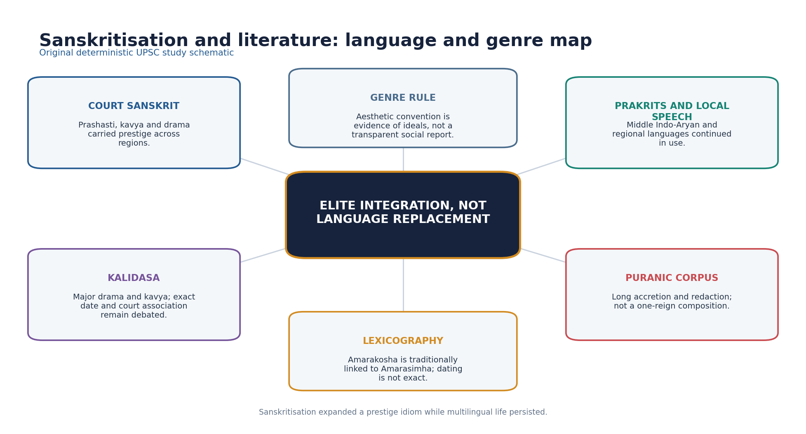

*Original deterministic schematic; factual and chronology limits remain in the surrounding text.*

- [FACT] Gupta inscriptions and prashastis demonstrate the prestige and political reach of polished Sanskrit.
- [ANALYSIS] Sanskritisation involved adoption and adaptation of Brahmanical idioms, genealogies, rituals and social claims by rulers and communities; it was not simple top-down homogenisation.
- [FACT] Prakrit literary and inscriptional traditions continued, while vernacular speech remained the medium of ordinary communication.
- [FACT] Buddhist authors used Sanskrit and hybrid registers alongside Middle Indo-Aryan traditions.
- [LIMIT] A Sanskrit inscription proves public elite communication, not the mother tongue of the entire population.
- [ANALYSIS] Regional courts could use Sanskrit to join a wider prestige world while maintaining local identities.

#### PARAGRAPH DEMONSTRATION — CLAIM → NAMED EVIDENCE → ANALYSIS → QUALIFICATION

[CLAIM] Sanskrit's Gupta-age prominence was a process of negotiated adoption, not linguistic replacement. [NAMED EVIDENCE] Gupta inscriptions and prashastis were composed in polished courtly Sanskrit, while Prakrit literary and inscriptional traditions continued and Buddhist authors used Sanskrit and hybrid registers alongside Middle Indo-Aryan forms. [ANALYSIS] Sanskritisation involved rulers and communities adopting and adapting Brahmanical idioms, genealogies and ritual language for prestige and integration, which explains why regional courts used Sanskrit without abandoning local speech. [QUALIFICATION] A Sanskrit inscription proves public elite communication and political prestige; it does not prove that Sanskrit was the spoken mother tongue of the wider population, so multilingualism must be stated alongside any Sanskritisation claim.

#### Must-know facts
- Multilingualism persisted.
- Sanskritisation was negotiated and regionally adapted.

#### UPSC traps
- **Wrong:** Sanskrit became the sole language of Gupta India. **Correct:** Courtly prominence coexisted with Prakrits and regional speech.
- **Wrong:** Sanskritisation erased all local culture. **Correct:** It often produced hybrid and locally reworked forms.

**Mains angle:** Treat language as a power and integration process, not merely a list of texts.

**Study / ownership link:** Literature and manuscript form ownership also links Indian Art and Culture Topic 11.

#### CLOSING RECALL FLOW — SANSKRITISATION AND THE MULTILINGUAL LANGUAGE ECOLOGY

```text
START / CONCEPT: Sanskritisation and the multilingual language ecology
        |
        v
EXACT TERMS: Sanskritisation · the multilingual language ecology · prestige idiom · Prakrit continuity · Sanskrit · Brahmanical
        |
        v
MECHANISM / ARGUMENT: Sanskrit became a major transregional language of royal inscription, courtly literature and Brahmanical learning, but it did not replace Prakrits or spoken regional languages.
        |
        v
CONSEQUENCE / CONTRAST: Treat language as a power and integration process, not merely a list of texts.
        |
        v
UPSC TRAP / ANSWER-USE: A Sanskrit inscription proves public elite communication, not the mother tongue of the entire population.
        |
        v
ANSWER-GRABBING FORMULATION: Sanskritisation involved adoption and adaptation of Brahmanical idioms, genealogies, rituals and social claims by rulers and communities; it was not simple top-down homogenisation.
```
### SESSION 12 — LITERATURE, COURTLY CULTURE, GRAMMAR AND LEXICOGRAPHY

#### DEFINITION / WHAT THIS IS CALLED

**Plain-language definition:** Gupta-age literary culture centres on Kalidasa's securely attributed works, Amarasimha's lexicography and long Puranic redaction, even though exact court biographies remain debated.

**Technical definition:** Literary-historical use requires separating a securely attributed work from its author's court biography: genre, manuscript transmission and later legend can inflate a writer's documented royal association.

#### ANSWER-GRABBING OPENING — WRITE/ADAPT IN THE EXAM

> Kalidasa's works are secure evidence of classical Sanskrit literary achievement; his exact date and court membership under Chandragupta II remain a separate, debated question.

#### MUST-WRITE KEYWORDS

- **Literature**
- **courtly culture**
- **grammar**
- **lexicography**
- **Amarakosha**
- **navaratna caution**

**How to use them:** Frame the answer through Literature; define courtly culture, connect grammar with lexicography to explain the mechanism, and use Amarakosha and navaratna caution for the decisive comparison or qualification.

[FACT] Kalidasa is the central literary figure associated with the broad Gupta age, but his exact date and formal membership of Chandragupta II's court are not securely established.

- [FACT] Kalidasa's securely attributed major dramas include Abhijnanashakuntala, Malavikagnimitra and Vikramorvashiya; major poems include Raghuvamsha, Kumarasambhava and Meghaduta.
- [LIMIT] Literary plots, dynastic allusions and later Vikramaditya traditions do not fix an uncontested biography.
- [FACT] The 2020 official paper's scholar association item treats Kalidasa with Chandragupta II as the defensible pair while Panini-Pushyamitra and Amarasimha-Harsha are incorrect.
- [FACT] Vishakhadatta's Mudrarakshasa is historically valuable as political drama, but its precise date remains debated.
- [FACT] Amarakosha is a major Sanskrit lexicon traditionally attributed to Amarasimha; exact dating and 'navaratna' claims need caution.
- [LIMIT] Bhasa is earlier or uncertain and should not be presented as a securely documented Gupta court poet; Bharavi is often placed around the sixth century.
- [ANALYSIS] Puranic texts underwent long compilation and redaction, supporting devotional, genealogical and sacred-geographical integration without being products of one reign.

#### PARAGRAPH DEMONSTRATION — CLAIM → NAMED EVIDENCE → ANALYSIS → QUALIFICATION

[CLAIM] Gupta-age literary achievement is best proven through named works, not through court-biography legend. [NAMED EVIDENCE] Kalidasa's securely attributed dramas Abhijnanashakuntala, Malavikagnimitra and Vikramorvashiya, his poems Raghuvamsha, Kumarasambhava and Meghaduta, and Amarasimha's lexicon Amarakosha anchor the classical canon. [ANALYSIS] The 2020 official paper's scholar-association item tests exactly this distinction, treating Kalidasa-Chandragupta II as the exam-accepted pairing while Panini-Pushyamitra and Amarasimha-Harsha are chronologically incorrect. [QUALIFICATION] The later 'navaratna' (nine jewels) tradition listing multiple luminaries as Vikramaditya's contemporaries is a later legend, not a securely documented Gupta-court roster, so a safe answer cites the work first and treats the court biography as debated.

#### Must-know facts
- Amarakosha is lexicography, not grammar.
- Puranas are layered texts.

#### UPSC traps
- **Wrong:** All nine jewels of Vikramaditya are securely documented contemporaries. **Correct:** The navaratna list is later tradition.
- **Wrong:** A literary work is a transparent chronicle. **Correct:** Genre and date must be established before historical use.

**Mains angle:** Name work, genre, cultural function and chronology limit.

**Study / ownership link:** Form-centric literature owner: Indian Art and Culture Topic 11.

#### CLOSING RECALL FLOW — LITERATURE, COURTLY CULTURE, GRAMMAR AND LEXICOGRAPHY

```text
START / CONCEPT: Literature, courtly culture, grammar and lexicography
        |
        v
EXACT TERMS: Literature · courtly culture · grammar · lexicography · Amarakosha · navaratna caution
        |
        v
MECHANISM / ARGUMENT: Kalidasa's securely attributed major dramas include Abhijnanashakuntala, Malavikagnimitra and Vikramorvashiya; major poems include Raghuvamsha, Kumarasambhava and Meghaduta.
        |
        v
CONSEQUENCE / CONTRAST: Literary plots, dynastic allusions and later Vikramaditya traditions do not fix an uncontested biography.
        |
        v
UPSC TRAP / ANSWER-USE: The 2020 official paper's scholar association item treats Kalidasa with Chandragupta II as the defensible pair while Panini-Pushyamitra and Amarasimha-Harsha are incorrect.
        |
        v
ANSWER-GRABBING FORMULATION: Kalidasa's works are secure evidence of classical Sanskrit literary achievement; his exact date and court membership under Chandragupta II remain a separate, debated question.
```
### SESSION 13 — MATHEMATICS, ASTRONOMY, MEDICINE AND METALLURGY

#### DEFINITION / WHAT THIS IS CALLED

**Plain-language definition:** Vagbhata's date is debated, usually around the sixth-seventh centuries; medicine should be presented as a broader classical tradition rather than a secure Gupta-court achievement.

**Technical definition:** His work includes mathematical procedures, a close approximation of pi, trigonometric methods, astronomy, an explanation of eclipses through shadows and the rotation of the earth.

#### ANSWER-GRABBING OPENING — WRITE/ADAPT IN THE EXAM

> Vagbhata's date is debated, usually around the sixth-seventh centuries; medicine should be presented as a broader classical tradition rather than a secure Gupta-court achievement.

#### MUST-WRITE KEYWORDS

- **Mathematics**
- **astronomy**
- **medicine**
- **metallurgy**
- **Aryabhata 499 CE**
- **post-Gupta science**

**How to use them:** Frame the answer through Mathematics; define astronomy, connect medicine with metallurgy to explain the mechanism, and use Aryabhata 499 CE and post-Gupta science for the decisive comparison or qualification.

[FACT] Gupta-age scientific importance rests most securely on Aryabhata and on material evidence such as the Mehrauli iron pillar; later scientists should be placed in correct chronology.

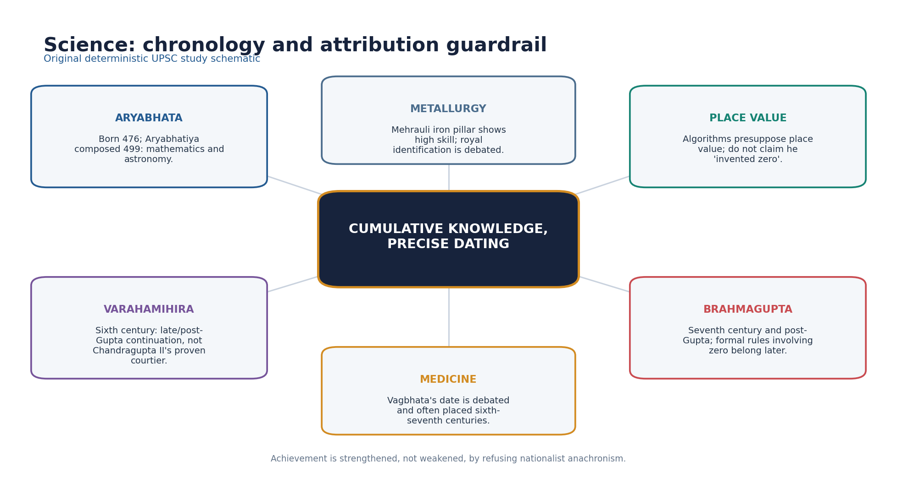

*Original deterministic schematic; factual and chronology limits remain in the surrounding text.*

| Figure / evidence | Secure contribution | Chronology caution |
|---|---|---|
| Aryabhata | Aryabhatiya; maths and astronomy | 499 CE |
| Varahamihira | Panchasiddhantika; Brihatsamhita | Sixth century |
| Brahmagupta | Rules including zero; astronomy | 628 CE, post-Gupta |
| Vagbhata | Medical synthesis tradition | Date debated |
| Iron pillar | Advanced wrought iron | King Chandra identification debated |

- [FACT] Aryabhata was born in 476 CE and composed the Aryabhatiya in 499 CE.
- [FACT] His work includes mathematical procedures, a close approximation of pi, trigonometric methods, astronomy, an explanation of eclipses through shadows and the rotation of the earth.
- [LIMIT] Aryabhata's algorithms presuppose decimal place value; this is not evidence that he single-handedly invented the numeral zero.
- [FACT] Varahamihira's Panchasiddhantika and Brihatsamhita belong to the sixth century, a late/post-Gupta continuation.
- [FACT] Brahmagupta's Brahmasphutasiddhanta dates to 628 CE and is post-Gupta; formal arithmetic rules involving zero must not be backdated.
- [LIMIT] Vagbhata's date is debated, usually around the sixth-seventh centuries; medicine should be presented as a broader classical tradition rather than a secure Gupta-court achievement.
- [FACT] The Mehrauli iron pillar displays sophisticated wrought-iron production and corrosion resistance; the king 'Chandra' is often identified with Chandragupta II, but identification is debated.

#### PARAGRAPH DEMONSTRATION — CLAIM → NAMED EVIDENCE → ANALYSIS → QUALIFICATION

[CLAIM] Gupta-age scientific achievement is securely proven by Aryabhata but must be sequenced correctly against later figures. [NAMED EVIDENCE] Aryabhata composed the Aryabhatiya in 499 CE with pi approximation, trigonometric procedures and an eclipse explanation through shadows, while Varahamihira's Panchasiddhantika/Brihatsamhita belong to the sixth century and Brahmagupta's Brahmasphutasiddhanta is dated 628 CE. [ANALYSIS] Placing these three in chronological sequence shows a cumulative scientific tradition rather than one isolated genius, and it also shows that formal zero-arithmetic rules belong to Brahmagupta, after the main Gupta imperial phase, not to Aryabhata. [QUALIFICATION] Aryabhata's procedures presuppose decimal place value, which is not the same claim as inventing zero; the Mehrauli iron pillar likewise proves advanced wrought-iron technique while its king 'Chandra' identification with Chandragupta II remains debated, so precision about chronology and attribution is the argument itself.

#### Must-know facts
- Varahamihira: sixth century.
- Brahmagupta: seventh century.
- Iron pillar attribution requires caution.

#### UPSC traps
- **Wrong:** Aryabhata invented zero. **Correct:** His procedures use place-value logic; zero's conceptual and epigraphic histories are separate.
- **Wrong:** All major classical scientists were Chandragupta II's nine jewels. **Correct:** That is a later, chronologically impossible tradition.

**Mains angle:** Chronology is the argument: sequence Aryabhata -> Varahamihira -> Brahmagupta and mark the political-period boundary.

**Study / ownership link:** Scientific heritage current links are unnecessary unless officially verified.

#### CLOSING RECALL FLOW — MATHEMATICS, ASTRONOMY, MEDICINE AND METALLURGY

```text
START / CONCEPT: Mathematics, astronomy, medicine and metallurgy
        |
        v
EXACT TERMS: Mathematics · astronomy · medicine · metallurgy · Aryabhata 499 CE · post-Gupta science
        |
        v
MECHANISM / ARGUMENT: His work includes mathematical procedures, a close approximation of pi, trigonometric methods, astronomy, an explanation of eclipses through shadows and the rotation of the earth.
        |
        v
CONSEQUENCE / CONTRAST: Aryabhata's algorithms presuppose decimal place value; this is not evidence that he single-handedly invented the numeral zero.
        |
        v
UPSC TRAP / ANSWER-USE: Brahmagupta's Brahmasphutasiddhanta dates to 628 CE and is post-Gupta; formal arithmetic rules involving zero must not be backdated.
        |
        v
ANSWER-GRABBING FORMULATION: Vagbhata's date is debated, usually around the sixth-seventh centuries; medicine should be presented as a broader classical tradition rather than a secure Gupta-court achievement.
```
### SESSION 14 — RELIGION: PURANIC HINDUISM, BUDDHISM, JAINISM AND PLURAL PATRONAGE

#### DEFINITION / WHAT THIS IS CALLED

**Plain-language definition:** Puranic Vaishnava, Shaiva and Shakta traditions expanded through image worship and temple patronage during the Gupta age, while Buddhism and Jainism continued as active, patronised traditions rather than declining sects.

**Technical definition:** Religious patronage operated at multiple levels simultaneously: royal, feudatory, guild and lay donation supported different traditions at once, so prominent royal Vaishnavism cannot be read as evidence of a single enforced state religion.

#### ANSWER-GRABBING OPENING — WRITE/ADAPT IN THE EXAM

> Gupta-age religion is best described as plural and multiply patronised: royal Vaishnava symbolism was prominent, but Shaiva, Shakta, Buddhist and Jain institutions continued to receive support from courts, guilds and lay donors.

#### MUST-WRITE KEYWORDS

- **Religion**
- **Puranic Hinduism**
- **Buddhism**
- **Jainism**
- **plural patronage**
- **Udayagiri**

**How to use them:** Frame the answer through Religion; define Puranic Hinduism, connect Buddhism with Jainism to explain the mechanism, and use plural patronage for the decisive comparison or qualification.

[FACT] Puranic Vaishnava, Shaiva and goddess traditions expanded through image worship, myth, pilgrimage, ritual and temple patronage while Buddhism and Jainism continued.

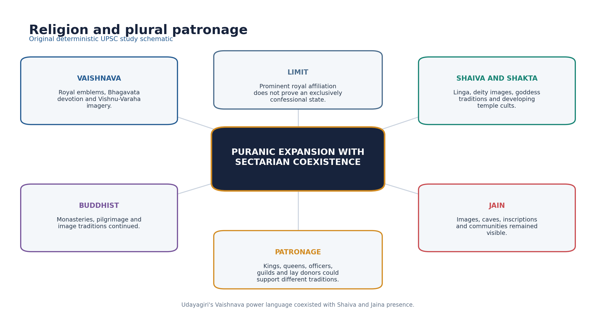

*Original deterministic schematic; factual and chronology limits remain in the surrounding text.*

- [FACT] Gupta royal symbolism prominently used Vaishnava forms, including Garuda and Vishnu-Varaha imagery.
- [FACT] Udayagiri's Varaha relief joined cosmic rescue, sacred landscape and royal power; the complex also preserves Shaiva and Jaina evidence.
- [FACT] Linga worship, Shiva images and goddess traditions developed alongside Vaishnava cults; 'Hinduism' should not be written as one uniform sect.
- [FACT] Buddhist monasteries, sacred sites and image production continued; Faxian's journey itself demonstrates active Buddhist networks.
- [FACT] Jain communities and images remained present, including at Udayagiri and other regional sites.
- [ANALYSIS] Patronage was multi-level: kings, queens, officers, guilds and lay donors could support different traditions.
- [LIMIT] Prominent royal Vaishnavism does not establish forced religious uniformity or the disappearance of heterodox traditions.

#### PARAGRAPH DEMONSTRATION — CLAIM → NAMED EVIDENCE → ANALYSIS → QUALIFICATION

[CLAIM] Gupta royal religious preference coexisted with a genuinely plural religious landscape. [NAMED EVIDENCE] Gupta royal symbolism prominently used Vaishnava forms such as Garuda and Vishnu-Varaha imagery, Udayagiri's Varaha relief joins cosmic rescue with royal power, and the same Udayagiri complex preserves Shaiva and Jaina evidence while Faxian's journey documents active Buddhist monastic networks. [ANALYSIS] Patronage operated at multiple levels - kings, queens, officers, guilds and lay donors - so different traditions could receive support simultaneously rather than in strict royal sequence. [QUALIFICATION] Prominent royal Vaishnavism at one site does not establish forced religious uniformity or the disappearance of Buddhist, Jain, Shaiva or Shakta traditions elsewhere; 'Hinduism' itself must be written as plural, not one uniform sect.

#### Must-know facts
- Puranic Hinduism included multiple sectarian traditions.
- Buddhism and Jainism continued.

#### UPSC traps
- **Wrong:** Gupta rulers suppressed all non-Vaishnava religion. **Correct:** Evidence shows plural landscapes and patronage.
- **Wrong:** Puranic religion was unchanged Vedic ritualism. **Correct:** Image, myth, bhakti, pilgrimage and temple worship marked significant developments.

**Mains angle:** Use belief -> patronage -> image/temple -> social integration -> plurality.

**Study / ownership link:** Doctrinal depth: Philosophy Topic 24; form ownership: Indian Art and Culture.

#### CLOSING RECALL FLOW — RELIGION: PURANIC HINDUISM, BUDDHISM, JAINISM AND PLURAL PATRONAGE

```text
START / CONCEPT: Religion: Puranic Hinduism, Buddhism, Jainism and plural patronage
        |
        v
EXACT TERMS: Religion · Puranic Hinduism · Buddhism · Jainism · plural patronage · Udayagiri
        |
        v
MECHANISM / ARGUMENT: Puranic Vaishnava, Shaiva and goddess traditions expanded through image worship, myth, pilgrimage, ritual and temple patronage while Buddhism and Jainism continued.
        |
        v
CONSEQUENCE / CONTRAST: Linga worship, Shiva images and goddess traditions developed alongside Vaishnava cults; 'Hinduism' should not be written as one uniform sect.
        |
        v
UPSC TRAP / ANSWER-USE: Prominent royal Vaishnavism does not establish forced religious uniformity or the disappearance of heterodox traditions.
        |
        v
ANSWER-GRABBING FORMULATION: Gupta-age religion is best described as plural and multiply patronised: royal Vaishnava symbolism was prominent, but Shaiva, Shakta, Buddhist and Jain institutions continued to receive support from courts, guilds and lay donors.
```
### SESSION 15 — TEMPLE ARCHITECTURE: NAMED EXAMPLES AND CHRONOLOGY

#### DEFINITION / WHAT THIS IS CALLED

**Plain-language definition:** Gupta and Gupta-age architecture is important for experimentation with free-standing structural temples and integrated iconographic programmes, not for the scale of later temple cities.

**Technical definition:** Sanchi Temple 17 is a restrained flat-roofed square sanctum with a pillared porch, often used to illustrate an early structural form.

#### ANSWER-GRABBING OPENING — WRITE/ADAPT IN THE EXAM

> Gupta and Gupta-age architecture is important for experimentation with free-standing structural temples and integrated iconographic programmes, not for the scale of later temple cities.

#### MUST-WRITE KEYWORDS

- **Temple architecture**
- **named examples**
- **chronology**
- **Sanchi Temple 17**
- **Deogarh**
- **Bhitargaon**

**How to use them:** Frame the answer through Temple architecture; define named examples, connect chronology with Sanchi Temple 17 to explain the mechanism, and use Deogarh and Bhitargaon for the decisive comparison or qualification.

[FACT] Gupta and Gupta-age architecture is important for experimentation with free-standing structural temples and integrated iconographic programmes, not for the scale of later temple cities.

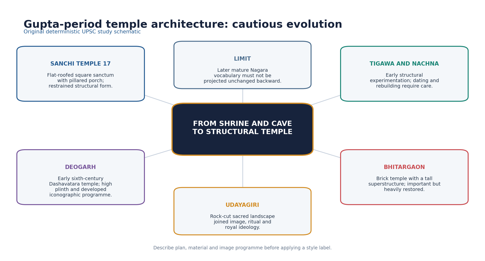

*Original deterministic schematic; factual and chronology limits remain in the surrounding text.*

- [FACT] Sanchi Temple 17 is a restrained flat-roofed square sanctum with a pillared porch, often used to illustrate an early structural form.
- [FACT] Tigawa and Nachna provide early structural examples, though precise dating, alterations and labels require care.
- [FACT] Deogarh's Dashavatara temple is generally placed in the early sixth century and has a high plinth and important Vaishnava relief programme.
- [FACT] Bhitargaon is a major brick temple, commonly placed in the fifth century; restoration complicates reading its original superstructure.
- [FACT] Udayagiri is a rock-cut sacred-political landscape rather than a free-standing structural-temple type.
- [LIMIT] The fully developed Nagara vocabulary and later panchayatana complexes should not be projected mechanically onto every early shrine.
- [ANALYSIS] Temple development linked durable sacred space, deity image, patronage and regional workshop innovation.

#### PARAGRAPH DEMONSTRATION — CLAIM → NAMED EVIDENCE → ANALYSIS → QUALIFICATION

[CLAIM] Gupta and Gupta-age temple architecture matters for early structural experimentation, not for monumental scale. [NAMED EVIDENCE] Sanchi Temple 17 is a restrained flat-roofed square sanctum with a pillared porch, Deogarh's Dashavatara temple is generally placed in the early sixth century with a high plinth and Vaishnava relief programme, and Bhitargaon is a major fifth-century brick temple. [ANALYSIS] These named examples show a durable garbhagriha-plus-porch plan and integrated iconographic programme emerging for the first time, which is the historically significant development, rather than proof of later temple-city scale. [QUALIFICATION] The fully developed Nagara vocabulary and later panchayatana complexes belong to subsequent centuries and must not be projected mechanically onto every early shrine; dating for each site rests on style, inscription and archaeological sequence rather than one uncontested date.

#### Must-know facts
- Deogarh: early sixth-century Vaishnava temple.
- Bhitargaon: major brick temple.
- Udayagiri: rock-cut complex.

#### UPSC traps
- **Wrong:** Gupta temples matched later Khajuraho in scale and form. **Correct:** They are earlier and generally more modest experiments.
- **Wrong:** Every named structure has an uncontested exact date. **Correct:** Dating often rests on style, inscription and archaeological sequence.

**Mains angle:** Describe plan, material, superstructure and iconographic programme; then state chronology.

**Study / ownership link:** Primary form owner: Indian Art and Culture Topic 03.

#### CLOSING RECALL FLOW — TEMPLE ARCHITECTURE: NAMED EXAMPLES AND CHRONOLOGY

```text
START / CONCEPT: Temple architecture: named examples and chronology
        |
        v
EXACT TERMS: Temple architecture · named examples · chronology · Sanchi Temple 17 · Deogarh · Bhitargaon
        |
        v
MECHANISM / ARGUMENT: Sanchi Temple 17 is a restrained flat-roofed square sanctum with a pillared porch, often used to illustrate an early structural form.
        |
        v
CONSEQUENCE / CONTRAST: The fully developed Nagara vocabulary and later panchayatana complexes should not be projected mechanically onto every early shrine.
        |
        v
UPSC TRAP / ANSWER-USE: Do not miss this limiting distinction: deogarh's Dashavatara temple is generally placed in the early sixth century and has a...
        |
        v
ANSWER-GRABBING FORMULATION: Gupta and Gupta-age architecture is important for experimentation with free-standing structural temples and integrated iconographic programmes, not for the scale of later temple cities.
```
### SESSION 16 — SCULPTURE: MATHURA, SARNATH AND ICONOGRAPHIC CONSOLIDATION

#### DEFINITION / WHAT THIS IS CALLED

**Plain-language definition:** Gupta sculpture refined inherited Mathura workshop traditions while Sarnath developed a distinct, subtly modelled convention for the Buddha image, and Brahmanical iconography matured alongside both.

**Technical definition:** School labels such as 'Mathura' and 'Sarnath' name workshop conventions defined by material, modelling and robe treatment; they describe regional practice, not one single, uniform 'Gupta style'.

#### ANSWER-GRABBING OPENING — WRITE/ADAPT IN THE EXAM

> Gupta sculpture refined inherited Mathura and other early-CE traditions while Sarnath became especially associated with subtly modelled Buddha images.

#### MUST-WRITE KEYWORDS

- **Sculpture**
- **Mathura**
- **Sarnath**
- **iconographic consolidation**
- **red sandstone**
- **robe convention**

**How to use them:** Frame the answer through Sculpture; define Mathura, connect Sarnath with iconographic consolidation to explain the mechanism, and use red sandstone and robe convention for the decisive comparison or qualification.

[FACT] Gupta sculpture refined inherited Mathura and other early-CE traditions while Sarnath became especially associated with subtly modelled Buddha images.

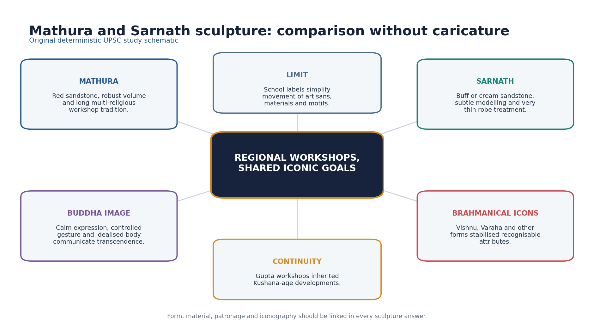

*Original deterministic schematic; factual and chronology limits remain in the surrounding text.*

- [FACT] Mathura workshops used red sandstone and served Buddhist, Jain and Brahmanical patrons across a long chronology.
- [FACT] Sarnath sculpture often uses buff or cream sandstone, a smooth body treatment, controlled modelling and an almost transparent robe convention.
- [ANALYSIS] Calm expression, mudra, halo and idealised body converted doctrine into a legible visual language.
- [FACT] Brahmanical iconography developed recognisable Vishnu, Varaha, Shiva and goddess forms through attributes, posture and narrative panels.
- [FACT] Udayagiri's Varaha and Deogarh's Vaishnava reliefs connect theology, political symbolism and workshop practice.
- [LIMIT] 'Gupta style' was not one workshop or one material; school labels simplify exchange among artisans and regions.

#### PARAGRAPH DEMONSTRATION — CLAIM → NAMED EVIDENCE → ANALYSIS → QUALIFICATION

[CLAIM] 'Gupta sculpture' names a family of related regional workshop conventions, not one uniform style. [NAMED EVIDENCE] Mathura workshops used red sandstone and served Buddhist, Jain and Brahmanical patrons across a long chronology, while Sarnath sculpture typically uses buff or cream sandstone with a smooth body treatment and an almost transparent robe convention. [ANALYSIS] Calm expression, mudra, halo and idealised body converted doctrine into a legible visual language at both centres, while Brahmanical iconography simultaneously developed recognisable Vishnu, Varaha, Shiva and goddess forms through attribute and posture. [QUALIFICATION] Material and modelling distinguish Mathura from Sarnath even though both belong to the same broad period; a single school label simplifies exchange among artisans and regions and should be replaced with named material and technique evidence.

#### Must-know facts
- Sarnath: refined Buddha image convention.
- Iconography linked belief and patronage.

#### UPSC traps
- **Wrong:** Sarnath and Mathura are identical schools. **Correct:** They share broad developments but differ in material and treatment.
- **Wrong:** Every iconographic meaning is obvious and uncontested. **Correct:** Meaning must be grounded in attribute, context and source.

**Mains angle:** Compare material + bodily treatment + religious function + limitation.

**Study / ownership link:** Primary sculpture owner: Indian Art and Culture Topic 06.

#### CLOSING RECALL FLOW — SCULPTURE: MATHURA, SARNATH AND ICONOGRAPHIC CONSOLIDATION

```text
START / CONCEPT: Sculpture: Mathura, Sarnath and iconographic consolidation
        |
        v
EXACT TERMS: Sculpture · Mathura · Sarnath · iconographic consolidation · red sandstone · robe convention
        |
        v
MECHANISM / ARGUMENT: Sarnath sculpture often uses buff or cream sandstone, a smooth body treatment, controlled modelling and an almost transparent robe convention.
        |
        v
CONSEQUENCE / CONTRAST: 'Gupta style' was not one workshop or one material; school labels simplify exchange among artisans and regions.
        |
        v
UPSC TRAP / ANSWER-USE: Wrong: Sarnath and Mathura are identical schools.
        |
        v
ANSWER-GRABBING FORMULATION: Gupta sculpture refined inherited Mathura and other early-CE traditions while Sarnath became especially associated with subtly modelled Buddha images.
```
### SESSION 17 — PAINTING, AJANTA AND CULTURAL PRODUCTION

#### DEFINITION / WHAT THIS IS CALLED

**Plain-language definition:** Painting is evidence filtered by convention.

**Technical definition:** Ajanta's paintings include Buddhist narratives, bodhisattvas, courtly interiors, processions, dress, gesture, landscape and performance.

#### ANSWER-GRABBING OPENING — WRITE/ADAPT IN THE EXAM

> Painting is evidence filtered by convention.

#### MUST-WRITE KEYWORDS

- **Painting**
- **Ajanta**
- **cultural production**
- **Vakataka patronage**
- **fresco secco/tempera**
- **Bagh murals**

**How to use them:** Frame the answer through Painting; define Ajanta, connect cultural production with Vakataka patronage to explain the mechanism, and use fresco secco/tempera and Bagh murals for the decisive comparison or qualification.

[FACT] The great late fifth-century phase at Ajanta belongs chiefly to Vakataka patronage within the broader Gupta-Vakataka cultural age.

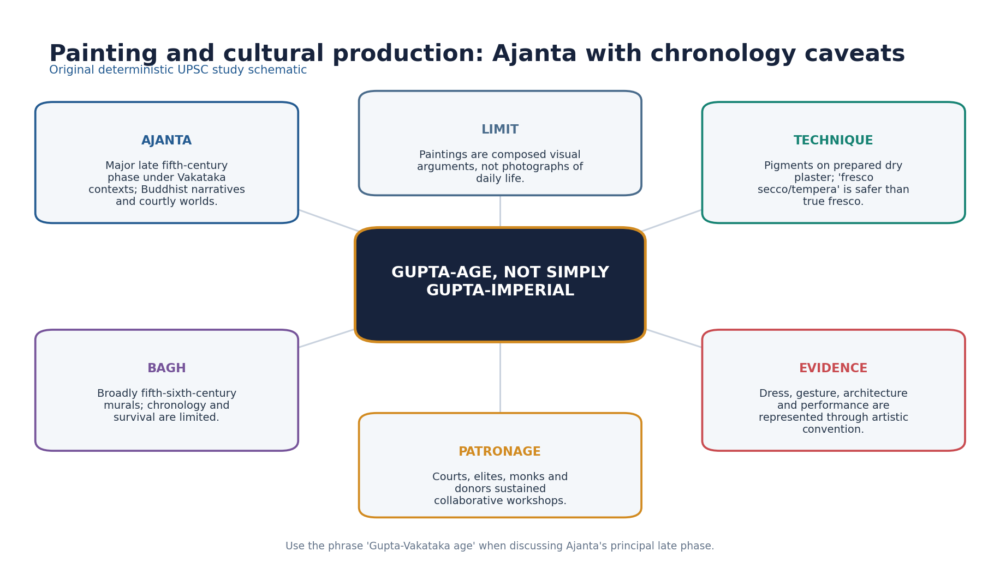

*Original deterministic schematic; factual and chronology limits remain in the surrounding text.*

- [FACT] Ajanta's paintings include Buddhist narratives, bodhisattvas, courtly interiors, processions, dress, gesture, landscape and performance.
- [LIMIT] These are composed religious-aesthetic images, not direct photographs of social life.
- [FACT] Pigments were applied to prepared plaster after drying; 'fresco secco/tempera' is safer than calling the method true wet fresco.
- [FACT] Bagh murals are broadly placed in the fifth-sixth centuries, but survival and exact chronology are limited.
- [ANALYSIS] Murals reveal collaborative workshops, patronage, narrative intelligence and exchanges among courtly and monastic worlds.
- [LIMIT] Calling Ajanta simply 'Gupta painting' erases Vakataka political context and complex cave chronologies.

#### PARAGRAPH DEMONSTRATION — CLAIM → NAMED EVIDENCE → ANALYSIS → QUALIFICATION

[CLAIM] Ajanta is the age's finest painting, but its ownership label must stay precise. [NAMED EVIDENCE] The great late fifth-century phase at Ajanta belongs chiefly to Vakataka patronage within the broader Gupta-Vakataka cultural age, executed in a fresco secco/tempera technique on prepared dry plaster, with Bagh murals broadly placed in the fifth-sixth centuries. [ANALYSIS] The murals reveal collaborative workshops, patronage, narrative intelligence and exchange among courtly and monastic worlds, showing painting as composed religious-aesthetic production rather than a neutral photograph of daily life. [QUALIFICATION] Calling Ajanta simply 'Gupta painting' erases its Vakataka political context and complex multi-phase cave chronology; the safe formulation is 'Gupta-Vakataka age' with the patronage caveat stated explicitly.

#### Must-know facts
- Technique: prepared dry plaster.
- Painting is evidence filtered by convention.

#### UPSC traps
- **Wrong:** Ajanta was commissioned as one Gupta imperial project. **Correct:** Caves have multiple phases and the principal late phase is Vakataka-context.
- **Wrong:** Paintings give unmediated everyday-life data. **Correct:** They require genre and iconographic criticism.

**Mains angle:** Use the formulation 'Gupta-Vakataka age' and name the patronage caveat.

**Study / ownership link:** Primary painting owner: Indian Art and Culture Topic 07.

#### CLOSING RECALL FLOW — PAINTING, AJANTA AND CULTURAL PRODUCTION

```text
START / CONCEPT: Painting, Ajanta and cultural production
        |
        v
EXACT TERMS: Painting · Ajanta · cultural production · Vakataka patronage · fresco secco/tempera · Bagh murals
        |
        v
MECHANISM / ARGUMENT: Ajanta's paintings include Buddhist narratives, bodhisattvas, courtly interiors, processions, dress, gesture, landscape and performance.
        |
        v
CONSEQUENCE / CONTRAST: These are composed religious-aesthetic images, not direct photographs of social life.
        |
        v
UPSC TRAP / ANSWER-USE: Bagh murals are broadly placed in the fifth-sixth centuries, but survival and exact chronology are limited.
        |
        v
ANSWER-GRABBING FORMULATION: Painting is evidence filtered by convention.
```
### SESSION 18 — MUSIC, DANCE, LEISURE, FOOD, DRESS AND MATERIAL LIFE

#### DEFINITION / WHAT THIS IS CALLED

**Plain-language definition:** Kalidasa's works and Ajanta paintings depict music, dance, courtly leisure, seasons, dress and adornment, but both are elite aesthetic sources.

**Technical definition:** Samudragupta's lyrist coin is political self-representation and evidence of musical kingship imagery, not a survey of popular music.

#### ANSWER-GRABBING OPENING — WRITE/ADAPT IN THE EXAM

> Kalidasa's works and Ajanta paintings depict music, dance, courtly leisure, seasons, dress and adornment, but both are elite aesthetic sources.

#### MUST-WRITE KEYWORDS

- **Music**
- **dance**
- **leisure**
- **food**
- **dress**
- **material life**

**How to use them:** Frame the answer through Music; define dance, connect leisure with food to explain the mechanism, and use dress for the decisive comparison or qualification.

[FACT] Daily and performative life can be reconstructed only through securely sourced, socially located evidence from texts, images and objects.

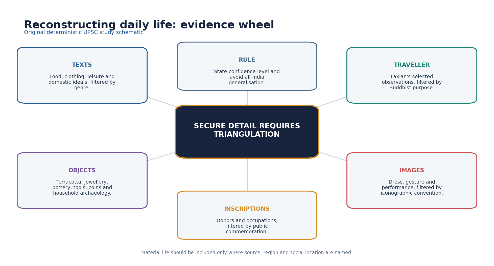

*Original deterministic schematic; factual and chronology limits remain in the surrounding text.*

- [FACT] Kalidasa's works and Ajanta paintings depict music, dance, courtly leisure, seasons, dress and adornment, but both are elite aesthetic sources.
- [FACT] Samudragupta's lyrist coin is political self-representation and evidence of musical kingship imagery, not a survey of popular music.
- [FACT] Jewellery, textiles, terracottas, pottery and household objects show skilled material production; survival biases favour durable materials.
- [FACT] Kalidasa mentions chinamshuka, Chinese silk, as a luxury textile, indicating elite consumption and long-distance cultural-economic links.
- [LIMIT] Food taboos and diet varied by community, region, livelihood and text; avoid universal vegetarian or meat-eating claims.
- [LIMIT] No all-India Gupta dress code or leisure pattern can be reconstructed.

#### PARAGRAPH DEMONSTRATION — CLAIM → NAMED EVIDENCE → ANALYSIS → QUALIFICATION

[CLAIM] Gupta-age daily and performative life can be reconstructed only through securely sourced, socially located evidence. [NAMED EVIDENCE] Kalidasa's works and Ajanta paintings depict music, dance, courtly leisure, seasons, dress and adornment; Kalidasa mentions chinamshuka (Chinese silk) as a luxury textile; and Samudragupta's lyrist coin shows a king playing a vina. [ANALYSIS] The lyrist coin is political self-representation and evidence of musical kingship imagery, and the silk reference shows elite consumption linked to long-distance trade, but neither is a survey of popular practice. [QUALIFICATION] Food taboos, dress and leisure varied by community, region, livelihood and text, so no all-India Gupta dress code, diet or leisure pattern can be reconstructed from courtly and monastic sources alone.

#### Must-know facts
- Chinese silk was a luxury reference.
- Durable objects overrepresent some aspects of life.

#### UPSC traps
- **Wrong:** Ajanta clothing represents every class and region. **Correct:** It is valuable but composed and patronage-specific.
- **Wrong:** One text proves a universal Gupta diet. **Correct:** Dietary practice was plural and evidence must be located.

**Mains angle:** Include material-life detail only when source, social location and confidence are stated.

**Study / ownership link:** Visual reading method: Indian Art and Culture Topics 06-09.

#### CLOSING RECALL FLOW — MUSIC, DANCE, LEISURE, FOOD, DRESS AND MATERIAL LIFE

```text
START / CONCEPT: Music, dance, leisure, food, dress and material life
        |
        v
EXACT TERMS: Music · dance · leisure · food · dress · material life
        |
        v
MECHANISM / ARGUMENT: Daily and performative life can be reconstructed only through securely sourced, socially located evidence from texts, images and objects.
        |
        v
CONSEQUENCE / CONTRAST: Samudragupta's lyrist coin is political self-representation and evidence of musical kingship imagery, not a survey of popular music.
        |
        v
UPSC TRAP / ANSWER-USE: Do not miss this limiting distinction: no all-India Gupta dress code or leisure pattern can be reconstructed.
        |
        v
ANSWER-GRABBING FORMULATION: Kalidasa's works and Ajanta paintings depict music, dance, courtly leisure, seasons, dress and adornment, but both are elite aesthetic sources.
```
### SESSION 19 — CULTURAL DIFFUSION, COMPARISONS AND LATER LEGACY

#### DEFINITION / WHAT THIS IS CALLED

**Plain-language definition:** Later legacy was adaptive, not copied whole.

**Technical definition:** Gupta-age culture was both cumulative and generative: it inherited post-Mauryan forms and influenced later regional traditions without creating them from nothing.

#### ANSWER-GRABBING OPENING — WRITE/ADAPT IN THE EXAM

> Later legacy was adaptive, not copied whole.

#### MUST-WRITE KEYWORDS

- **Cultural diffusion**
- **comparisons**
- **later legacy**
- **reciprocal translation**
- **Southeast Asian courts**
- **Gupta-age**

**How to use them:** Frame the answer through Cultural diffusion; define comparisons, connect later legacy with reciprocal translation to explain the mechanism, and use Southeast Asian courts for the decisive comparison or qualification.

[ANALYSIS] Gupta-age culture was both cumulative and generative: it inherited post-Mauryan forms and influenced later regional traditions without creating them from nothing.

- [FACT] Compared with Mauryan culture, Gupta-age patronage was less centred on a single imperial edict-and-pillar idiom and more visible in Sanskrit court expression, sectarian icons and structural temples.
- [FACT] Compared with Kushana/post-Mauryan art, Gupta sculpture refined already established anthropomorphic and regional workshop traditions.
- [ANALYSIS] Sanskrit political and literary culture travelled across regional courts, including into Southeast Asian inscriptional and courtly worlds, but local adaptation mattered.
- [ANALYSIS] Puranic myths, temple forms and iconographies provided repertoires later kingdoms expanded rather than fixed blueprints.
- [FACT] Aryabhata's scientific tradition continued through Varahamihira and Brahmagupta, with changing chronology and problems.
- [LIMIT] 'Diffusion' must not imply one-way civilising export; merchants, monks, artisans, texts and local patrons produced reciprocal translation.

#### PARAGRAPH DEMONSTRATION — CLAIM → NAMED EVIDENCE → ANALYSIS → QUALIFICATION

[CLAIM] Gupta-age culture was both cumulative and generative rather than either wholly original or a simple continuation. [NAMED EVIDENCE] Compared with Kushana/post-Mauryan art, Gupta sculpture refined already established anthropomorphic and workshop traditions, and Sanskrit political-literary culture travelled into Southeast Asian inscriptional and courtly worlds while Aryabhata's tradition continued through Varahamihira and Brahmagupta. [ANALYSIS] Reading this as reciprocal translation rather than one-way export shows that merchants, monks, artisans, texts and local patrons adapted Puranic myths, temple forms and iconographies as repertoires rather than fixed blueprints. [QUALIFICATION] The Guptas consolidated and transformed earlier and regional developments; crediting them with inventing all classical Indian culture erases both the antecedents they inherited and the local agency of the regions that later adapted their forms.

#### Must-know facts
- Later legacy was adaptive, not copied whole.
- Regional agency matters.

#### UPSC traps
- **Wrong:** The Guptas invented all classical Indian culture. **Correct:** They consolidated and transformed earlier and regional developments.
- **Wrong:** Indian cultural circulation was one-way export. **Correct:** Transmission involved selection, translation and local patronage.

**Mains angle:** Compare one earlier baseline, one Gupta transformation and one later adaptation.

**Study / ownership link:** Asian circulation: Topic 25; transition: Topic 26.

#### CLOSING RECALL FLOW — CULTURAL DIFFUSION, COMPARISONS AND LATER LEGACY

```text
START / CONCEPT: Cultural diffusion, comparisons and later legacy
        |
        v
EXACT TERMS: Cultural diffusion · comparisons · later legacy · reciprocal translation · Southeast Asian courts · Gupta-age
        |
        v
MECHANISM / ARGUMENT: Gupta-age culture was both cumulative and generative: it inherited post-Mauryan forms and influenced later regional traditions without creating them from nothing.
        |
        v
CONSEQUENCE / CONTRAST: 'Diffusion' must not imply one-way civilising export; merchants, monks, artisans, texts and local patrons produced reciprocal translation.
        |
        v
UPSC TRAP / ANSWER-USE: Do not miss this limiting distinction: compared with Mauryan culture, Gupta-age patronage was less centred on a single imperial edict-and-pillar...
        |
        v
ANSWER-GRABBING FORMULATION: Later legacy was adaptive, not copied whole.
```
### SESSION 20 — GOLDEN AGE DEBATE AND HISTORIOGRAPHY

#### DEFINITION / WHAT THIS IS CALLED

**Plain-language definition:** The Golden Age debate asks whether 'classical' achievement in literature, art and science can be generalised into a social verdict about the whole Gupta-age population; the answer graded here is no.

**Technical definition:** The Gupta age can be called classical for the concentration and later influence of elite literary, artistic and scientific production, but 'Golden Age' is indefensible as a universal social verdict.

#### ANSWER-GRABBING OPENING — WRITE/ADAPT IN THE EXAM

> The Gupta age can be called classical for the concentration and later influence of elite literary, artistic and scientific production, but 'Golden Age' is indefensible as a universal social verdict.

#### MUST-WRITE KEYWORDS

- **Golden Age debate**
- **historiography**
- **distribution test**
- **nationalist historiography**
- **The Gupta**
- **Golden Age**

**How to use them:** Frame the answer through Golden Age debate; define historiography, connect distribution test with nationalist historiography to explain the mechanism, and use The Gupta and Golden Age for the decisive comparison or qualification.

[ANALYSIS] The Gupta age can be called classical for the concentration and later influence of elite literary, artistic and scientific production, but 'Golden Age' is indefensible as a universal social verdict.

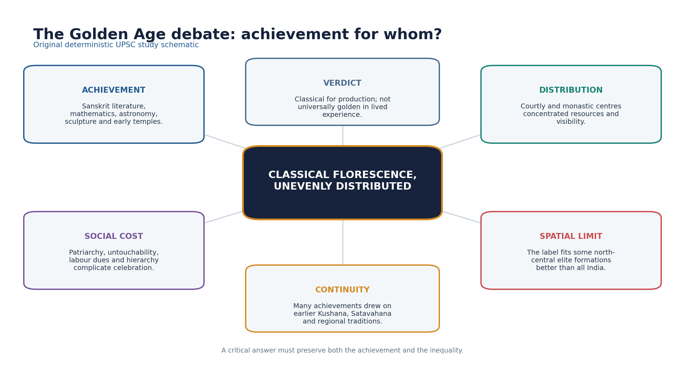

*Original deterministic schematic; factual and chronology limits remain in the surrounding text.*

- [FACT] The achievement case rests on Kalidasa, Aryabhata, Sanskrit inscriptions, iconic sculpture, early structural temples, murals and plural intellectual-religious production.
- [ANALYSIS] The distribution question asks who had access to patronage, education, property, mobility and representation.
- [FACT] Patriarchal norms, untouchability evidence, vishti and agrarian inequality complicate civilisational celebration.
- [LIMIT] Spatially, the label privileges north-central and allied elite formations while peninsular and regional histories followed distinct trajectories.
- [ANALYSIS] Nationalist historiography used Golden Age language to counter colonial denigration; materialist and social histories exposed class, caste and gender limits.
- [LIMIT] Rejecting the label must not become denial of genuine achievement; critique should grade, not invert, the evidence.
- [ANALYSIS] Best verdict: a classical florescence of enduring importance whose benefits, visibility and freedoms were socially and spatially unequal.

#### PARAGRAPH DEMONSTRATION — CLAIM → NAMED EVIDENCE → ANALYSIS → QUALIFICATION

[CLAIM] The Gupta age deserves the label 'classical' but not an unqualified 'Golden Age'. [NAMED EVIDENCE] The achievement case rests on Kalidasa, Aryabhata, Sanskrit inscriptions, iconic sculpture at Sarnath and Mathura, and early structural temples, while the limiting case rests on patriarchal norms, Faxian's Chandala evidence, vishti and agrarian inequality. [ANALYSIS] Nationalist historiography used Golden Age language to counter colonial denigration, while materialist and social histories exposed the same period's class, caste and gender limits, showing that the label itself is an evaluative historiographical argument, not a neutral chronological marker. [QUALIFICATION] Rejecting the label must not become denial of genuine achievement, and celebrating the achievement must not erase its exclusions; the graded verdict is a classical florescence of enduring importance whose benefits were socially and spatially unequal.

#### Must-know facts
- Universal social goldenness is not.
- Historiography explains why the label became powerful.

#### UPSC traps
- **Wrong:** Critical history requires dismissing Gupta achievement. **Correct:** It requires locating achievement and testing its distribution.
- **Wrong:** Golden Age is a neutral chronological term. **Correct:** It is an evaluative historiographical label.

**Mains angle:** Organise the answer as achievement -> social base -> exclusions -> spatial limits -> graded verdict.

**Study / ownership link:** Stress test route: Ancient History Answer-Worthiness Audit.

#### CLOSING RECALL FLOW — GOLDEN AGE DEBATE AND HISTORIOGRAPHY

```text
START / CONCEPT: Golden Age debate and historiography
        |
        v
EXACT TERMS: Golden Age debate · historiography · distribution test · nationalist historiography · The Gupta · Golden Age
        |
        v
MECHANISM / ARGUMENT: Historiography explains why the label became powerful.
        |
        v
CONSEQUENCE / CONTRAST: Spatially, the label privileges north-central and allied elite formations while peninsular and regional histories followed distinct trajectories.
        |
        v
UPSC TRAP / ANSWER-USE: Rejecting the label must not become denial of genuine achievement; critique should grade, not invert, the evidence.
        |
        v
ANSWER-GRABBING FORMULATION: The Gupta age can be called classical for the concentration and later influence of elite literary, artistic and scientific production, but 'Golden Age' is indefensible as a universal social verdict.
```
### SESSION 21 — UPSC TRAPS, PYQ OWNERSHIP AND ANSWER ARCHITECTURE

#### DEFINITION / WHAT THIS IS CALLED

**Plain-language definition:** This closing session fixes exactly which PYQs Topic 21 owns, routes or shares, and states the evidence-density and answer-architecture rules that every solved item in this package follows.

**Technical definition:** PYQ ownership is assigned by demand content, not by chronology alone: an objective question about land measures or inheritance schools belongs here even though its official key may sit with a paper Topic 21 does not hold locally, while a ruler-reign or art-form question is routed to Topic 20 or Indian Art and Culture respectively.

#### ANSWER-GRABBING OPENING — WRITE/ADAPT IN THE EXAM

> A social-cultural answer earns marks only when every named example is followed by what it proves and what it cannot prove; ownership discipline and evidence density are as important as the facts themselves.

#### MUST-WRITE KEYWORDS

- **PYQ ownership**
- **evidence density**
- **answer architecture**
- **inferred key**
- **official key**
- **graded verdict**

**How to use them:** Frame the answer through PYQ ownership; define evidence density, connect answer architecture with inferred key to explain the mechanism, and use official key and graded verdict for the decisive comparison or qualification.

[FACT] Topic 21 directly owns social-cultural reconstruction. Political chronology and the 2025 Faxian-reign question remain Topic 20; form-heavy art and architecture questions remain primarily Indian Art and Culture.

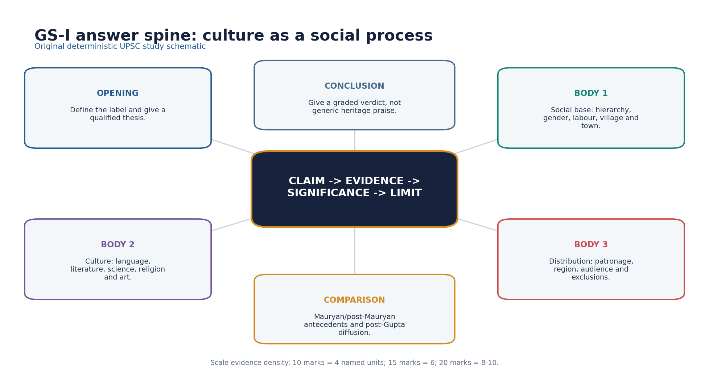

*Original deterministic schematic; factual and chronology limits remain in the surrounding text.*

- [FACT] Direct/routed objective demands: 2020 Q29 kulyavapa-dronavapa; 2020 Q36 ancient scholar associations; 2021 Q40 Mitakshara-Dayabhaga.
- [FACT] The 2022 GS-I Gupta-Chola heritage question is cross-owned: Gupta cultural evidence is supported here, the political Gupta comparison in Topic 20, Chola context in Ancient Topic 27, and form depth in Indian Art and Culture.
- [FACT] The 2025 Faxian question is locally verified with official Set A key and owned by Topic 20; this package uses it only for traveller method.
- [LIMIT] Official 2020-2021 keys are not held locally. Q29 can be solved directly from the official stem and source knowledge; Q36 and Q40 answers are labelled inferred/provisional where appropriate.
- [ANALYSIS] A 10-mark answer should deploy about four named evidence units; 15 marks about six; 20 marks eight to ten, each linked to significance.
- [ANALYSIS] Every model answer follows claim -> named evidence -> significance -> limitation and ends with 'Why this earns marks'.

#### PARAGRAPH DEMONSTRATION — CLAIM → NAMED EVIDENCE → ANALYSIS → QUALIFICATION

[CLAIM] Ownership discipline prevents a Topic 21 answer from silently borrowing marks that belong to a different topic's evidence base. [NAMED EVIDENCE] The 2020 Q29 kulyavapa/dronavapa item and the 2021 Q40 Mitakshara/Dayabhaga item are directly owned here, the 2022 GS-I Gupta-Chola question is explicitly cross-owned with Topics 20, 27 and Indian Art and Culture, and the 2025 Faxian-reign question is owned by Topic 20 even though this package uses it to teach traveller method. [ANALYSIS] Sorting each PYQ this way shows that evidence density should scale with marks - about four named units at 10 marks, six at 15, eight to ten at 20 - and that every unit must state what it proves and its limit, not merely appear as a name-drop. [QUALIFICATION] Naming an example is not sufficient by itself; a graded verdict following claim, named evidence, significance and limitation is what converts a fact list into an examiner-grade answer.

#### Must-know facts
- No fabricated PYQ ownership.
- Unavailable official keys are labelled.
- Answer evidence must be analytical, not decorative.

#### UPSC traps
- **Wrong:** Any Gupta art PYQ belongs only to Ancient History. **Correct:** Form-centric ownership remains Indian Art and Culture.
- **Wrong:** A named example automatically earns marks. **Correct:** The answer must explain what the example proves and its limit.

**Mains angle:** Use the visual spine and finish with a graded verdict answering the directive.

**Study / ownership link:** Practice follows; final register notes are last.

#### CLOSING RECALL FLOW — UPSC TRAPS, PYQ OWNERSHIP AND ANSWER ARCHITECTURE

```text
START / CONCEPT: UPSC traps, PYQ ownership and answer architecture
        |
        v
EXACT TERMS: PYQ ownership · evidence density · answer architecture · inferred key · official key · graded verdict
        |
        v
MECHANISM / ARGUMENT: Topic 21 directly owns social-cultural reconstruction; political chronology and the 2025 Faxian-reign question remain Topic 20.
        |
        v
CONSEQUENCE / CONTRAST: The 2022 GS-I Gupta-Chola heritage question is cross-owned across Topics 20, 21, 27 and Indian Art and Culture.
        |
        v
UPSC TRAP / ANSWER-USE: A named example automatically earns marks is wrong; the answer must explain what the example proves and its limit.
        |
        v
ANSWER-GRABBING FORMULATION: A social-cultural answer earns marks only when every named example is followed by what it proves and what it cannot prove; ownership discipline and evidence density are as important as the facts themselves.
```
## BASIC MCQS / REMEDIATION

### Learning MCQ 01

Which source pairing best tests a claim about Gupta social hierarchy?

- A. Smriti and inscription
- B. Only one coin type
- C. Only a modern textbook label
- D. Only a later legend

**Answer: A.** A prescriptive text establishes the norm; an inscription can test selected public practice.

### Learning MCQ 02

Kulyavapa and dronavapa are best understood as

- A. marriage forms
- B. land-measure terms
- C. coin denominations
- D. guild offices

**Answer: B.** The official 2020 paper asks this exact distinction; they denote measurement of land.

### Learning MCQ 03

Which statement is safest regarding Gupta-age women?

- A. Purdah was universal
- B. Women were absent from production
- C. Patriarchal norms coexisted with uneven agency
- D. All women enjoyed equal inheritance

**Answer: C.** The evidence supports a differentiated, source-aware conclusion.

### Learning MCQ 04

Faxian's account should primarily be read as

- A. a Gupta revenue manual
- B. a complete census
- C. a neutral legal code
- D. a Buddhist pilgrim's situated account

**Answer: D.** His route and religious purpose shape both observation and silence.

### Learning MCQ 05

The Mandasor silk-weaver inscriptions are especially useful for linking

- A. migration, corporate craft identity and patronage
- B. only village taxation
- C. only royal conquest
- D. only Buddhist doctrine

**Answer: A.** They connect mobility, guild identity, wealth and temple support.

### Learning MCQ 06

Which is the correct chronology?

- A. Brahmagupta before Aryabhata
- B. Aryabhata before Varahamihira
- C. Vagbhata securely under Samudragupta
- D. Varahamihira before Kalidasa with certainty

**Answer: B.** Aryabhatiya is 499 CE; Varahamihira belongs to the sixth century.

### Learning MCQ 07

The strongest caution about Aryabhata is that

- A. he wrote no mathematical work
- B. he lived in the Mauryan age
- C. place-value use is not the same as inventing zero
- D. he denied astronomy

**Answer: C.** Zero, place value and epigraphic notation have distinct histories.

### Learning MCQ 08

Ajanta's major late phase is best described as

- A. Gupta imperial only
- B. Mauryan imperial
- C. Kushana court
- D. Vakataka-context within the Gupta-Vakataka age

**Answer: D.** This preserves the political and chronological caveat.

### Learning MCQ 09

Sanskritisation in this period is best treated as

- A. adoption and local adaptation of prestige idioms
- B. one royal language law
- C. extinction of all Prakrits
- D. proof of universal literacy

**Answer: A.** It was negotiated and multilingual.

### Learning MCQ 10

Sarnath Gupta sculpture is especially associated with

- A. blue-grey schist
- B. buff/cream sandstone and subtle robe treatment
- C. black basalt only
- D. bronze Nataraja

**Answer: B.** The material and modelling distinguish the Sarnath convention.

### Learning MCQ 11

Which temple claim is safest?

- A. Bhitargaon is a rock-cut cave
- B. All Gupta temples had later Khajuraho scale
- C. Deogarh is an early sixth-century Vaishnava structural temple
- D. Sanchi Temple 17 is a Chola gopuram

**Answer: C.** Deogarh is a key early structural and iconographic example.

### Learning MCQ 12

The Golden Age label is best evaluated as

- A. equally valid for every region and class
- B. a neutral census term
- C. false because no achievements occurred
- D. useful for classical production but socially uneven

**Answer: D.** This is the required graded verdict.

### Learning MCQ 13

Which evidence most directly demonstrates plural patronage?

- A. Udayagiri's multiple religious presences and varied donors
- B. absence of all Buddhist sites
- C. one later court legend
- D. one modern nationalist slogan

**Answer: A.** Udayagiri combines Vaishnava royal imagery with Shaiva and Jaina presence.

### Learning MCQ 14

Mitakshara and Dayabhaga should be treated as

- A. two Buddhist monasteries
- B. later Hindu-law commentarial schools
- C. two Gupta coin series
- D. two Gupta temple plans

**Answer: B.** They are later legal schools and must not be backdated.

### Learning MCQ 15

Which claim about Kalidasa is most defensible?

- A. His date is fixed by a birth inscription
- B. Every navaratna legend is contemporary
- C. His works are secure but exact court association is debated
- D. He wrote the Aryabhatiya

**Answer: C.** The works are firmer evidence than the later biography.

### Learning MCQ 16

A social-history answer should conclude with

- A. a ruler list
- B. a generic heritage slogan
- C. an unsupported quotation
- D. a graded verdict tied to distribution and evidence limits

**Answer: D.** The directive requires evaluation, not celebration.

## PYQS AND ANSWER PRACTICE

The separate workbook repeats the solved PYQs and Mains practice below, but carries a distinct full 32-question MCQ bank rather than duplicating this 16-question learning loop.

#### Solved PYQ 1 — UPSC Prelims 2020 Q29 (direct owner)

With reference to the history of India, the terms "kulyavapa" and "dronavapa" denote

- A. measurement of land
- B. coins of different monetary value
- C. classification of urban land
- D. religious rituals

**Status:** INFERRED FROM AUTHORITATIVE SUBJECT KNOWLEDGE - OFFICIAL 2020 KEY NOT HELD LOCALLY.

**Answer / route:** A - measurement of land.

The terms occur in land-recording and agrarian-measure contexts. The distractors shift them into coinage, urban classification or ritual. Confidence: high.

**Why this earns marks:** ownership, answer-key status, evidence and limitation are explicit.

**Demand decoding:** Treat “Verified PYQ 1 - Prelims 2020 Q29 (direct owner)” as a source-and-elimination problem: verify each statement independently, preserve the official wording where available, and separate an inferred key from an official key.

**Executable exam-length answer / compression plan:** Identify the tested chronology, site, text, inscription or institution; eliminate each option with one named fact; then state the evidence limit or key-verification status.

**How to improve this answer:** For “Verified PYQ 1 - Prelims 2020 Q29 (direct owner)”, add one explicit sentence explaining why the closest distractor fails on chronology, geography, source class or degree of certainty.

#### Solved PYQ 2 — UPSC Prelims 2020 Q36 (literature bridge; primary owner Topic 20)

With reference to scholars/litterateurs of ancient India, consider the following statements:

1. Panini is associated with Pushyamitra Shunga.
2. Amarasimha is associated with Harshavardhana.
3. Kalidasa is associated with Chandragupta II.

Which of the statements given above is/are correct?

- A. 1 and 2 only
- B. 2 and 3 only
- C. 3 only
- D. 1, 2 and 3

**Status:** INFERRED ANSWER - OFFICIAL 2020 KEY NOT HELD LOCALLY.

**Answer / route:** Statement 3 only; option C in the locally extracted Set A paper.

Panini predates Pushyamitra; Amarasimha is traditionally associated with the Gupta/Vikramaditya milieu rather than Harsha; the exam convention accepts Kalidasa-Chandragupta II while scholarship still cautions that exact court biography is debated. Confidence: high for exam elimination.

**Why this earns marks:** ownership, answer-key status, evidence and limitation are explicit.

**Demand decoding:** Treat “Verified PYQ 2 - Prelims 2020 Q36 (literature bridge)” as a source-and-elimination problem: verify each statement independently, preserve the official wording where available, and separate an inferred key from an official key.

**Executable exam-length answer / compression plan:** Identify the tested chronology, site, text, inscription or institution; eliminate each option with one named fact; then state the evidence limit or key-verification status.

**How to improve this answer:** For “Verified PYQ 2 - Prelims 2020 Q36 (literature bridge)”, add one explicit sentence explaining why the closest distractor fails on chronology, geography, source class or degree of certainty.

#### Solved PYQ 3 — UPSC Prelims 2021 Q40 (direct social-law route)

With reference to the history of ancient India, which of the following statements is/are correct?

1. Mitakshara was the civil law for upper castes and Dayabhaga was the civil law for lower castes.
2. In the Mitakshara system, the sons can claim right to the property during the lifetime of the father.
3. The Dayabhaga system was prevalent in eastern India.

Select the correct answer using the code given below:

- A. 1 and 2 only
- B. 2 and 3 only
- C. 1 and 3 only
- D. 3 only

**Status:** Exact question wording independently verified from the public 2021 paper; the official key is not held locally.

**Answer / route:** B — 2 and 3 only. HIGH-CONFIDENCE INFERENCE, NOT LOCALLY OFFICIAL. Statement 1 falsely divides the schools by caste. Mitakshara generally recognises a son's interest by birth in joint ancestral property, while Dayabhaga prevailed especially in eastern India.

Do not treat the schools as Gupta codes. Mitakshara is Vijnaneshwara's later commentary on Yajnavalkya Smriti; Dayabhaga is associated with Jimutavahana. The question is cross-temporal legal history.

**Why this earns marks:** ownership, answer-key status, evidence and limitation are explicit.

**Demand decoding:** Treat “Verified PYQ 3 - Prelims 2021 Q40 (routed demand)” as a source-and-elimination problem: verify each statement independently, preserve the official wording where available, and separate an inferred key from an official key.

**Executable exam-length answer / compression plan:** Identify the tested chronology, site, text, inscription or institution; eliminate each option with one named fact; then state the evidence limit or key-verification status.

**How to improve this answer:** For “Verified PYQ 3 - Prelims 2021 Q40 (routed demand)”, add one explicit sentence explaining why the closest distractor fails on chronology, geography, source class or degree of certainty.

#### Solved PYQ 4 — UPSC Mains 2022 GS-I Q12 (cross-owned)

Discuss the main contributions of Gupta period and Chola period to Indian heritage and culture. (15 marks, 250 words)

**Status:** VERIFIED ROUTING; Gupta culture supported here, Gupta polity Topic 20, Chola context Topic 27, form depth Indian Art and Culture.

**Solution:** **Model (15 marks).** [CLAIM] The Gupta and Chola periods created two durable but regionally distinct classical repertoires: the former in Sanskritic literature, science, sculpture and formative temples; the latter in monumental Dravida temples, bronzes, inscriptions and temple-centred institutions. [EVIDENCE AND ANALYSIS] 1. Gupta Sanskrit production is represented by Kalidasa and Amarasimha, while Aryabhata's 499 CE *Aryabhatiya* anchors mathematical-astronomical achievement. 2. Udayagiri, Sarnath/Mathura sculpture, Bhitargaon and Deogarh show Gupta innovation in sacred imagery and structural temple forms. 3. Chola Brihadishvara at Thanjavur demonstrates mature Dravida architecture and imperial inscriptional patronage. 4. Chola Nataraja bronzes join metallurgical skill, bhakti theology and mobile ritual practice. 5. Temple institutions under the Cholas linked land, craft, performance and local society, while Gupta-Vakataka patronage connected courts, temples and monasteries. [LIMIT] Neither period was culturally uniform or socially golden; Ajanta's major fifth-century phase is Vakataka, and Chola achievements must not erase regional patrons or labour. [VERDICT] Together they shaped literary, scientific, visual and institutional traditions, but a high-scoring answer preserves chronology, region and patronage. **Why this earns marks:** It answers the directive directly, uses five named evidence units, states what each proves, adds a qualification and closes with a graded judgement.

**Why this earns marks:** ownership, answer-key status, evidence and limitation are explicit.

**Demand decoding:** The directive **answer** requires a direct position on “Verified PYQ 4 - GS-I Mains 2022 Q12 (cross-owned)”, coverage of every clause, evidence-led analysis and a qualified verdict.

**Executable exam-length answer / compression plan:** For a 15-mark answer, open with a two-sentence thesis; organise five named evidence units as claim → evidence → inference → qualification; reserve the final lines for a graded conclusion.

**How to improve this answer:** For “Verified PYQ 4 - GS-I Mains 2022 Q12 (cross-owned)”, replace the weakest generalisation with one additional named site, text, inscription, coin, ruler or scholarly position and state exactly what that evidence cannot prove.

#### Solved PYQ 5 — UPSC Prelims 2025 Q15 (cross-owned official key)

Fa-hien (Faxian), the Chinese pilgrim, travelled to India during the reign of

- A. Samudragupta
- B. Chandragupta II
- C. Kumaragupta I
- D. Skandagupta

**Status:** OFFICIAL 2025 SET A QUESTION AND KEY LOCALLY AVAILABLE; PRIMARY OWNER TOPIC 20.

**Answer / route:** B - Chandragupta II.

Faxian travelled c. 399-414 CE, overlapping Chandragupta II. Topic 21 uses the item to teach traveller-source limits.

**Why this earns marks:** ownership, answer-key status, evidence and limitation are explicit.

**Demand decoding:** Treat “Adjacent PYQ 5 - Prelims 2025 Q15 (cross-owned official key)” as a source-and-elimination problem: verify each statement independently, preserve the official wording where available, and separate an inferred key from an official key.

**Executable exam-length answer / compression plan:** Identify the tested chronology, site, text, inscription or institution; eliminate each option with one named fact; then state the evidence limit or key-verification status.

**How to improve this answer:** For “Adjacent PYQ 5 - Prelims 2025 Q15 (cross-owned official key)”, add one explicit sentence explaining why the closest distractor fails on chronology, geography, source class or degree of certainty.

#### M1. 10 marks - Explain the contribution of Gupta-age mathematics, astronomy and metallurgy, with chronology cautions.

**Model (10 marks).** Aryabhata anchors the secure Gupta-age scientific record: his Aryabhatiya of 499 CE supplies a close approximation of pi, trigonometric procedures, an eclipse explanation through shadows and an argument for the earth's rotation, and his computational method presupposes decimal place value without amounting to a claim that he invented zero. The tradition continued rather than stopped with him: Varahamihira's Panchasiddhantika and Brihatsamhita belong to the sixth century, and Brahmagupta's Brahmasphutasiddhanta, which states explicit arithmetic rules for zero, is dated 628 CE and falls after the main Gupta imperial phase. The Mehrauli iron pillar demonstrates sophisticated wrought-iron forging and corrosion resistance, though its king 'Chandra' is only debatably identified with Chandragupta II. Sequencing these three correctly turns a triumphalist list into a defensible, cumulative history of classical Indian science. **Why this earns marks:** it names three evidence units, dates each precisely, and states the exact chronology caution the directive requires.

**Demand decoding:** The directive **explain** requires a direct position on “M1. 10 marks - Explain the contribution of Gupta-age mathematics, astronomy and metallurgy…”, coverage of every clause, evidence-led analysis and a qualified verdict.

**Executable exam-length answer / compression plan:** For a 10-mark answer, open with a two-sentence thesis; organise three named evidence units as claim → evidence → inference → qualification; reserve the final lines for a graded conclusion.

**How to improve this answer:** For “M1. 10 marks - Explain the contribution of Gupta-age mathematics, astronomy and metallurgy…”, replace the weakest generalisation with one additional named site, text, inscription, coin, ruler or scholarly position and state exactly what that evidence cannot prove.

#### M2. 10 marks - Explain how sources shape our understanding of daily life in the Gupta age.

**Model (10 marks).** Daily life in the Gupta age is recoverable only through triangulation, because every surviving source overrepresents a particular social world. Smriti rules on guardianship, marriage and property disclose an elite normative order rather than lived behaviour across classes. Faxian's Chandala passage, written during his c. 399-414 CE pilgrimage, records a specific and valuable but route-bound observation of exclusion, not a general census. Ajanta's painted dress, gesture and courtly interiors, together with terracotta and pottery finds, widen the record beyond law and travel narrative, but remain shaped by artistic convention, patronage and survival bias. The strongest reconstruction of daily life therefore names the source, states its social location, and attaches an explicit confidence level to every claimed detail. **Why this earns marks:** it separates three source classes, states what each can and cannot prove, and closes with an evidence-discipline rule rather than an unqualified description.

**Demand decoding:** The directive **explain** requires a direct position on “M2. 10 marks - Explain how sources shape our understanding of daily life…”, coverage of every clause, evidence-led analysis and a qualified verdict.

**Executable exam-length answer / compression plan:** For a 10-mark answer, open with a two-sentence thesis; organise three named evidence units as claim → evidence → inference → qualification; reserve the final lines for a graded conclusion.

**How to improve this answer:** For “M2. 10 marks - Explain how sources shape our understanding of daily life…”, replace the weakest generalisation with one additional named site, text, inscription, coin, ruler or scholarly position and state exactly what that evidence cannot prove.

#### M3. 15 marks - Discuss the relationship between social hierarchy and cultural production in the Gupta age.

**Model (15 marks).** Gupta-age cultural production drew its resources and legitimacy from a hierarchical agrarian order even as it created new integrative languages and institutions. Land-grant charters recording kulyavapa and dronavapa seed-capacity measures financed courts, temples and specialists, but the same charters increased cultivators' revenue and, in some contexts, vishti labour obligations, so surplus and burden expanded together. The Mandsaur silk-weavers' inscriptions show that corporate wealth, not only royal patronage, widened cultural production: a migrant guild funded a Sun-temple's repair, proving that artisans and merchants were active cultural agents rather than passive subjects, though one inscription cannot be read as an all-India guild map. Hierarchy also shaped access and representation: Smriti norms on stridhana and Faxian's Chandala passage show that education, property and public visibility were unequally distributed, even though both kinds of evidence are normative or traveller-based and require corroboration. At the same time, culture integrated diverse regions: Sanskrit inscriptions, Puranic redaction and shared iconographic vocabularies let elites communicate across polities, while Prakrit and local languages continued alongside this prestige idiom. Gupta culture was therefore neither detached genius nor mere ideological cover: it was an unequal social process in which agrarian surplus, rank, corporate wealth and plural patronage interacted to produce both durable achievement and durable exclusion. **Why this earns marks:** it names four evidence units across economy, corporate life, hierarchy and integration, states each one's significance and limit, and reaches a graded two-sided verdict.

**Demand decoding:** The directive **discuss** requires a direct position on “M3. 15 marks - Discuss the relationship between social hierarchy and cultural production…”, coverage of every clause, evidence-led analysis and a qualified verdict.

**Executable exam-length answer / compression plan:** For a 15-mark answer, open with a two-sentence thesis; organise five named evidence units as claim → evidence → inference → qualification; reserve the final lines for a graded conclusion.

**How to improve this answer:** For “M3. 15 marks - Discuss the relationship between social hierarchy and cultural production…”, replace the weakest generalisation with one additional named site, text, inscription, coin, ruler or scholarly position and state exactly what that evidence cannot prove.

#### M4. 15 marks - Analyse the role of Sanskritisation in Gupta-age cultural integration.

**Model (15 marks).** Sanskritisation in the Gupta age created a shared elite idiom through negotiated adoption, not through language replacement. Prashastis and kavya connected royal courts to a transregional political-aesthetic field, since inscriptions such as Samudragupta's Prayag prashasti and Kalidasa's courtly poetry used polished Sanskrit to communicate legitimacy and refinement, though an inscription proves elite public communication rather than popular speech. Puranic myths and sectarian icons widened the shared cultural repertoire: Udayagiri's Varaha relief and Deogarh's Vaishnava programme made belief, kingship and sacred space mutually legible across regions, while Shaiva, Shakta, Buddhist and Jain traditions continued to draw their own patronage. Regional courts, donors and workshops actively adapted this idiom rather than receiving it passively, which is why Sanskritisation should not be described as a frictionless, one-way imposition. Multilingualism persisted throughout: Prakrit literary and inscriptional traditions and spoken regional languages continued alongside Sanskrit's prestige, and literacy or actual language use across the wider population cannot be quantified from surviving evidence. Sanskritisation was therefore powerful precisely because it was portable and locally adaptable, not because it produced cultural uniformity across the Gupta-Vakataka world. **Why this earns marks:** it names four evidence units - courtly inscription, sacred iconography, regional adaptation and multilingual continuity - states each one's significance, and qualifies the process against uniformity.

**Demand decoding:** The directive **analyse** requires a direct position on “M4. 15 marks - Analyse the role of Sanskritisation in Gupta-age cultural integration.”, coverage of every clause, evidence-led analysis and a qualified verdict.

**Executable exam-length answer / compression plan:** For a 15-mark answer, open with a two-sentence thesis; organise five named evidence units as claim → evidence → inference → qualification; reserve the final lines for a graded conclusion.

**How to improve this answer:** For “M4. 15 marks - Analyse the role of Sanskritisation in Gupta-age cultural integration.”, replace the weakest generalisation with one additional named site, text, inscription, coin, ruler or scholarly position and state exactly what that evidence cannot prove.

#### M5. 20 marks - Critically examine the description of the Gupta age as a Golden Age.

**Model (20 marks).** The 'Golden Age' label captures a genuine classical florescence in the Gupta period but fails as a universal social judgement. Literary and scientific production was exceptional: Kalidasa's drama and kavya and Aryabhata's Aryabhatiya of 499 CE created influential literary and mathematical-astronomical canons, though both belonged to specialist, largely elite knowledge worlds. Art and sacred architecture developed durable forms: Sarnath's Buddha images, Udayagiri's Varaha relief, Sanchi Temple 17, Bhitargaon and Deogarh integrated image, deity, patron and structural shrine, even though their dating is not equally secure and later Nagara-temple scale must not be projected backward onto them. Cultural integration widened through Sanskrit prashastis, Puranic redaction and coexisting Vaishnava, Shaiva, Shakta, Buddhist and Jain traditions, producing a transregional prestige idiom that nonetheless did not erase Prakrit and regional multilingualism. Against this record, the same age's social base was demonstrably unequal: Faxian's Chandala passage, vishti labour obligations, patriarchal Smriti norms and expanding agrarian grants show that exclusion and labour financed or accompanied elite cultural visibility, even though these sources are normative or regionally uneven and inequality must be demonstrated rather than merely asserted. The label is also spatially selective, since Ajanta's finest painting belongs to Vakataka patronage and peninsular India followed distinct trajectories that 'Gupta age' cannot subsume. The Gupta age was therefore classical in its enduring literary, artistic and scientific production, but golden only as a bounded historiographical description of selected elite achievements, not as a verdict on every region, caste or gender. **Why this earns marks:** it deploys five named evidence clusters across literature-science, art, integration, inequality and geography, states each one's significance and limit, and closes with a graded, non-celebratory verdict.

**Demand decoding:** The directive **critically examine** requires a direct position on “M5. 20 marks - Critically examine the description of the Gupta age as a Golden Age.”, coverage of every clause, evidence-led analysis and a qualified verdict.

**Executable exam-length answer / compression plan:** For a 20-mark answer, open with a two-sentence thesis; organise six to eight named evidence units as claim → evidence → inference → qualification; reserve the final lines for a graded conclusion.

**How to improve this answer:** For “M5. 20 marks - Critically examine the description of the Gupta age as a Golden Age.”, replace the weakest generalisation with one additional named site, text, inscription, coin, ruler or scholarly position and state exactly what that evidence cannot prove.

#### M6. 20 marks - Assess the relationship between religion, royal power and artistic production in the Gupta-Vakataka age.

**Model (20 marks).** Religion supplied symbols of sovereignty and fields of patronage in the Gupta-Vakataka age, while artistic production depended on plural donors, workshops and regional courts rather than one imperial programme. Royal Vaishnavism translated power into cosmic order: Udayagiri's Varaha relief and associated Garuda symbolism associated the king with cosmic rescue and protection, though such iconography records political ideology, not a literal reported event. Structural temples stabilised deity-centred sacred space: Sanchi Temple 17, Deogarh and Bhitargaon joined image, ritual and architecture into durable institutions, even though their chronology and reconstruction differ from site to site. Plural traditions remained productive alongside royal Vaishnavism: Shaiva and Jaina evidence survive at Udayagiri itself, and Faxian's account documents active Buddhist monastic networks, showing that royal preference did not eliminate multiple religious communities, although surviving monuments are unevenly distributed. Regional courts, not the imperial centre alone, were decisive for the age's finest art: Ajanta's major painted phase belongs to Vakataka patronage, so the period's outstanding pictorial achievement cannot be filed simply as Gupta-imperial output, and cave phases and patrons require individual care. Non-royal patrons mattered as much as kings: the Mandsaur silk-weavers' inscriptions and other lay donative traditions show merchants and artisans converting corporate wealth into sacred culture, even though such corporate inscriptions are themselves selective survivals. Gupta-Vakataka art was therefore a negotiated field where sovereignty, devotion, corporate wealth and workshop skill converged, without producing one uniform religious or artistic programme. **Why this earns marks:** it deploys five named evidence units across royal, institutional, plural-religious, regional and corporate patronage, states each unit's significance and limit, and reaches a graded synthesis rather than a single-cause account.

**Demand decoding:** The directive **assess** requires a direct position on “M6. 20 marks - Assess the relationship between religion, royal power and artistic production…”, coverage of every clause, evidence-led analysis and a qualified verdict.

**Executable exam-length answer / compression plan:** For a 20-mark answer, open with a two-sentence thesis; organise six to eight named evidence units as claim → evidence → inference → qualification; reserve the final lines for a graded conclusion.

**How to improve this answer:** For “M6. 20 marks - Assess the relationship between religion, royal power and artistic production…”, replace the weakest generalisation with one additional named site, text, inscription, coin, ruler or scholarly position and state exactly what that evidence cannot prove.

## OPTIONAL ADVANCED DEPTH — NOT REQUIRED FOR A CORE ANSWER

### Life & Culture in the Gupta Age — ADVANCED

> **Subject:** History (Ancient India) · **Tier:** Advanced (analytical + historiographical) · **GS Paper:** GS-I (also Prelims).
> **Grounded in:** Upinder Singh, *A History of Ancient & Early Medieval India*, sections on Gupta-Vakataka administration, society, art, textual production and science + current affairs (📰).
> ✅ = from source book · ⚠️ = inference / standard knowledge · 📰 = current affairs.
> *Companion (foundation): `basic/21_Life-and-Culture-in-Gupta-Age.md`. Chronology: `00_Master-Chronology.md`.*

---

### Mini-timeline

| Phase | Date | Marker |
|---|---|---|
| ✅ Gupta-Vakataka age | 4th–6th c. CE | Royal ideology, land grants, Sanskritization |
| ✅ Udayagiri horizon | early 5th c. CE | Varaha relief and royal Vaishnava symbolism |
| ✅ Kalidasa | uncertain exact date | Major kavya/drama figure of the period |
| ✅ Aryabhata | late 5th–early 6th c. CE tradition | Astronomy-mathematics synthesis |
| ✅ Post-Gupta science | 6th–7th c. CE | Varahamihira, Brahmagupta continue tradition |

### 1. Snapshot & core idea

**Advanced — culture as power, not decoration.**

✅ Upinder Singh frames Gupta-Vakataka culture through royal ideology, land ownership, revenue, grants, urban patterns, guilds, gender, labour and religious art. Culture is therefore linked to power and economy, not merely "golden" achievements.
- ✅ Land grants record types of land, rights, exemptions and local authority.
- ✅ Royal imagery, such as the **Varaha relief at Udayagiri**, expressed kingship through Vaishnava cosmic order.
- ✅ Sanskrit inscriptions and kavya show elite cultural integration across regions.

**Advanced — classical age debate.**

✅ Upinder asks whether this was a "classical age of art" rather than assuming it. The answer is balanced: major achievements existed, but they were courtly, elite and regionally uneven.
- ✅ Kalidasa is counted among the greatest playwrights/poets, but his exact date and association with Chandragupta II's court are not certain.
- ✅ Aryabhata brought together Greek-inspired astronomy and Shulbasutra geometry with decimal arithmetic as a binding element.
- ✅ Social history includes hierarchy, gender constraints, labour forms, slavery and untouchability, which complicate a simple golden-age label.

### 2. Key classification / data

| Domain | Advanced framing |
|---|---|
| ✅ Administration | Governors + local notables; grants reshape authority |
| ✅ Economy | Agrarian expansion, land measures, tenures, revenue rights |
| ✅ Society | Varna hierarchy, gender and labour questions; not uniformly golden |
| ✅ Religion | Vaishnava royal ideology with Buddhist/Jain continuities |
| ✅ Art | Udayagiri, sculpture, early temple forms, symbolic kingship |
| ✅ Texts | Sanskrit kavya, political/didactic literature, drama |
| ✅ Science | Aryabhata's astronomy-mathematics synthesis; later Varahamihira/Brahmagupta |

### 3. Study links

> **Study link:** ✅ Upinder Singh → Gupta-Vakataka royal ideology, land grants, art, textual production and science.
> **Study link:** ⚠️ Political frame → `advanced/20_Gupta-Empire.md`; source criticism → inscriptions/coins/prashastis.

### 4. Must-Know Facts (Prelims)

- ✅ Udayagiri's Varaha relief is a key Gupta-period royal-religious artwork.
- ✅ Kalidasa wrote *Abhijnanashakuntala*, *Malavikagnimitra*, *Vikramorvashiya* and major poems, though exact chronology is debated.
- ✅ Aryabhata's work joined astronomy and mathematics; Upinder notes Greek-inspired astronomy and Shulbasutra geometry streams.
- ✅ Upinder distinguishes a decimal system (counting by tens), decimal **place value**, and zero as a number/placeholder. Aryabhata's algorithms presuppose place value, while epigraphic diffusion must be dated separately.
- ✅ Gupta-Vakataka land grants reveal land categories, revenue rights and local authority.
- ✅ "Classical age" should be used analytically, not as blanket praise.
- ✅ Social history includes gender, labour, slavery and untouchability themes.

### 5. UPSC Traps

> 🔑 Trap: Cultural achievement and social progress are not identical.

- ❌ Kalidasa's exact court position under Chandragupta II is fully certain. → Tradition links him with Vikramaditya, but dating is debated.
- ❌ Gupta art was only Buddhist or only Hindu. → Multiple religious traditions continued, though Vaishnava royal ideology was prominent.
- ❌ Land grants were harmless piety. → They transferred fiscal/administrative rights and reshaped rural society.
- ❌ Aryabhata worked in isolation from earlier/global knowledge. → Upinder notes a synthesis of Indian and Greek-inspired traditions.

### 6. 📰 Current link

⚠️ **Current-link discipline:** The satellite named Aryabhata is a valid legacy bridge, but dated anniversaries should be checked from ISRO/PIB. Keep the historical mathematician and the modern satellite analytically distinct.

### 7. Mains angles

- ⚠️ Critically examine the Gupta age as "classical": elite Sanskrit culture and science flourished alongside hierarchy and agrarian subordination.
- ⚠️ Use Udayagiri to show how art, religion and kingship formed one political language.
- ⚠️ Explain Gupta science as cumulative and connected: Shulbasutra geometry, Greek-inspired astronomy, decimal arithmetic and later developments.

### ➕ Concept — Golden age with a critical note

- ⚠️ Best UPSC line: "The Gupta age was classical in elite literary-artistic-scientific production, but not golden in a universal social sense."

## CONSOLIDATED REGISTER NOTES

### FINAL REGISTER 1/5 - Evidence base and political boundary

[FACT] c. 319-550 CE is only the frame. Topic 20 owns rulers, campaigns, administration, grants and decline; Topic 21 owns society, everyday life and culture.

- Source ladder: normative text -> inscription/coin -> traveller -> art/archaeology.
- Method: claim -> named evidence -> significance -> limitation.
- Faxian is situated; Smriti is prescriptive; kavya is genre-shaped; material survival is selective.
- Use Gupta-Vakataka age for Ajanta's principal late phase.

#### Must-know facts
- Never duplicate Topic 20.
- Triangulate at least two source classes.

#### UPSC traps
- **Wrong:** One source gives a total social picture. **Correct:** Every source has a different field of vision.

**Mains angle:** Open with source method and scope.

**Study / ownership link:** Sections 01-02.

### FINAL REGISTER 2/5 - Society, household, women and exclusion

[ANALYSIS] Varna was a normative macro-model; jatis, occupations and regional rankings were more complex.

- Brahmana prestige and political status claims coexisted with occupational diversity.
- Faxian's Chandala passage: strong evidence of exclusion, not a pan-Indian census.
- Patriliny and guardianship shaped norms; stridhana existed within unequal property relations.
- Prabhavatigupta proves specific elite female authority, not universal equality.
- Mitakshara and Dayabhaga are later schools; do not backdate them.

#### Must-know facts
- Women answer = norm + agency + labour invisibility + limit.
- Untouchability qualifies Golden Age.

#### UPSC traps
- **Wrong:** Elite example equals general status. **Correct:** State social location and representativeness.

**Mains angle:** Use three columns: norm, observed practice, evidence limit.

**Study / ownership link:** Sections 03-06.

### FINAL REGISTER 3/5 - Agrarian base, labour, craft and urban life

[FACT] Cultural production rested on agrarian surplus, labour, corporate wealth and patronage.

- Kulyavapa and dronavapa = land measures.
- Vishti = labour obligation.
- Grant effects: cultivation and integration plus transferred revenue/labour claims.
- Mandasor silk weavers = migration + guild identity + Sun-temple patronage.
- Urban change was regionally uneven; avoid a single collapse thesis.

#### Must-know facts
- Culture has a material base.
- Guilds are historical corporations, not modern banks.

#### UPSC traps
- **Wrong:** Every grant conveyed identical ownership. **Correct:** Read the specific bundle of rights.

**Mains angle:** Link surplus to institutions and forms.

**Study / ownership link:** Sections 07-08.

### FINAL REGISTER 4/5 - Learning, languages, literature and science

[FACT] Learning moved through teachers, Brahmanical centres, monasteries, courts and specialist communities; Sanskrit prestige coexisted with multilingual life.

- Nalanda: fifth-century beginnings; later institutional fame must be phased.
- Kalidasa: works secure, exact date/court debated; Amarakosha: lexicon with dating caution; Puranas: layered texts.
- Aryabhata: born 476, Aryabhatiya 499; place value is not identical to inventing zero.
- Varahamihira: sixth century; Brahmagupta: 628 CE and post-Gupta; Vagbhata dating debated.
- Mehrauli iron pillar: advanced metallurgy; king Chandra identification debated.

#### Must-know facts
- Language answer = prestige + multilingualism + adaptation.
- Science answer = attribution + sequence + caution.

#### UPSC traps
- **Wrong:** Later navaratna lists are contemporary evidence. **Correct:** Test every author and scientist against chronology.
- **Wrong:** Nalanda's later scale existed fully in the fifth century. **Correct:** Institutional development was cumulative.

**Mains angle:** Name text/work, date, contribution, significance and limit.

**Study / ownership link:** Sections 10-13.

### FINAL REGISTER 5/5 - Religion, arts, Golden Age and answer routes

[ANALYSIS] Puranic expansion, plural patronage and durable artistic forms support a classical-age claim; hierarchy and uneven distribution prevent a universal Golden Age verdict.

- Udayagiri: Vaishnava royal symbolism plus Shaiva/Jaina presence; Buddhism continued through monasteries, pilgrimage and images.
- Architecture: Sanchi 17, Tigawa/Nachna, Deogarh, Bhitargaon; describe plan and material before style label.
- Sculpture: Mathura red sandstone and multi-religious continuity; Sarnath buff/cream sandstone and refined Buddha convention.
- Painting: Ajanta late phase is Vakataka-context; use Gupta-Vakataka age and dry-plaster technique caution.
- Achievement: Kalidasa, Aryabhata, Sanskrit, sculpture, temples and murals; limits: patriarchy, untouchability, vishti and spatial selectivity.
- PYQ routes: direct/routed 2020 Q29, 2020 Q36, 2021 Q40; cross-owned 2022 Gupta-Chola culture and 2025 Faxian.
- Answer spine: claim -> evidence -> significance -> limitation -> graded verdict; end every solution with Why this earns marks.

#### Must-know facts
- Classical production was real.
- Social goldenness was not universal.
- Never fabricate an official key or ownership.

#### UPSC traps
- **Wrong:** Ajanta is simply Gupta imperial art. **Correct:** Use its Vakataka and cave-phase context.
- **Wrong:** Golden Age can be asserted without a distribution test. **Correct:** Ask achievement for whom and where.

**Mains angle:** 10 marks: 4-5 evidence units; 15: 6-7; 20: 8-10.

**Study / ownership link:** End of complete main package.

### COMPLETE TOPIC ASCII MASTER FLOW DIAGRAM

#### ASCII MASTER FLOW — PANEL 1/12: Topic boundary and source matrix

```ascii-master
OWNER: society, daily life, knowledge, religion and arts in the Gupta age
TOPIC 20 RETAINS: rulers, campaigns, offices, grants machinery and decline
SOURCES: Smriti | literature | inscriptions | coins | Faxian | art | archaeology
TEXT -> norm / imagination; INSCRIPTION -> selected public actor
TRAVELLER -> situated observation; MATERIAL -> practice with dating limits
METHOD: use at least two source classes and state each limitation.
```

#### ASCII MASTER FLOW — PANEL 2/12: Varna, jati and exclusion

```ascii-master
VARNA -> normative four-fold macro-model
JATI / OCCUPATION -> numerous local and professional identities
STATUS CLAIM -> genealogy, office, patronage and Sanskritic idiom
EXCLUSION -> Chandala evidence, occupational stigma and spatial distance
MOBILITY and hierarchy coexisted.
RULE: one Smriti norm or Faxian passage cannot become a uniform all-India census.
```

#### ASCII MASTER FLOW — PANEL 3/12: Family, women and property

```ascii-master
PATRILINEAL / PATRIARCHAL NORM -> dominant prescriptive frame
MARRIAGE / INHERITANCE -> text-specific and socially varied
STRIDHANA -> recognized category with differing control and succession rules
WOMEN'S AGENCY -> queens, donors, workers and literary representations
LIMIT: elite visibility does not prove general equality.
TRAP: Mitakshara and Dayabhaga are later schools, not Gupta legal codes.
```

#### ASCII MASTER FLOW — PANEL 4/12: Village, labour, craft and urban life

```ascii-master
VILLAGE -> cultivators + land + taxes + vishti + household production
                           |
                 food / fibre / revenue
                           v
TOWN -> artisans + merchants + guild-linked groups + markets + sacred institutions
MANDASOR SILK WEAVERS -> migration, corporate identity and patronage
VERDICT: agrarian surplus and urban craft networks interacted, but regionally unevenly.
```

#### ASCII MASTER FLOW — PANEL 5/12: Faxian and daily-life reconstruction

```ascii-master
FAXIAN c. 399-414 CE -> Buddhist pilgrimage purpose
        |
monasteries, routes, selected customs and Chandala passage
        |
valuable near-contemporary social and religious observations
        |
LIMITS: itinerary + audience + translation + silence + idealisation
USE: corroborate with inscriptions, texts and archaeology; never quote as a census.
```

#### ASCII MASTER FLOW — PANEL 6/12: Education, Sanskrit and multilingualism

```ascii-master
COURTS + BRAHMANICAL CENTRES + MONASTERIES + TEACHER-PUPIL NETWORKS
                              |
Sanskrit prestige in kavya, prashasti, theology and science
                              |
Prakrits, regional speech and local inscriptions continue
                              |
SANSKRITISATION = adoption + negotiation + local adaptation
NOT: one royal language law, universal literacy or extinction of other languages.
```

#### ASCII MASTER FLOW — PANEL 7/12: Literature and genre map

```ascii-master
KAVYA / DRAMA -> Kalidasa and courtly aesthetic worlds
LEXICOGRAPHY -> Amarasimha / Amarakosha tradition
PURANIC TEXTS -> layered redaction and devotional-cosmological synthesis
SMRITI -> prescriptive law and social norm
BUDDHIST / JAIN WRITING -> continuing intellectual plurality
RULE: secure work and genre are stronger than later court-biography legends.
```

#### ASCII MASTER FLOW — PANEL 8/12: Mathematics, astronomy and metallurgy

```ascii-master
499 CE -> ARYABHATIYA: computation, astronomy, pi and earth-rotation argument
6th c. -> VARAHAMIHIRA: post-main-Gupta continuation
628 CE -> BRAHMAGUPTA: explicitly post-Gupta chronology
MEHRAULI IRON PILLAR -> large wrought iron and corrosion resistance
CAUTION: place value != sole invention of zero; King Chandra identification debated.
VERDICT: cumulative specialist traditions, not isolated miracle claims.
```

#### ASCII MASTER FLOW — PANEL 9/12: Religious plurality and patronage

```ascii-master
VAISHNAVA + SHAIVA + SHAKTA Puranic formations
BUDDHIST monasteries, images and pilgrimage networks
JAIN communities, images and sites
ROYAL COURTS + regional rulers + guilds + households + monks -> patrons
Udayagiri joins royal Vaishnava imagery with wider sacred presence.
RULE: plural patronage was unequal and strategic; it is not modern secular neutrality.
```

#### ASCII MASTER FLOW — PANEL 10/12: Temples, sculpture, painting and Ajanta

```ascii-master
TEMPLES -> Sanchi 17 | Udayagiri | Bhitargaon | Deogarh
SCULPTURE -> Mathura and Sarnath materials, modelling and robe conventions
PAINTING -> Ajanta narrative, courtly, devotional and workshop production
ARCHITECTURAL TREND -> garbhagriha + porch/mandapa + emerging superstructure
OWNERSHIP LIMIT: major fifth-century Ajanta phase is Vakataka-context.
RULE: name object/site, form, date, patronage and attribution caution.
```

#### ASCII MASTER FLOW — PANEL 11/12: Golden Age and social distribution

```ascii-master
CLASSICAL ACHIEVEMENT
literature + science + iconic art + structural temples + prestige language
                         |
TEST DISTRIBUTION
region | class | caste | gender | labour | literacy | patronage
                         |
COUNTER-EVIDENCE: exclusion, vishti, patriarchal norms and elite archives
VERDICT: culturally consequential and enduring, but neither uniform nor universally golden.
```

#### ASCII MASTER FLOW — PANEL 12/12: Culture answer spine

```ascii-master
OPEN: social-cultural companion to Gupta polity, reconstructed through mixed sources
BODY 1: hierarchy + household + women + labour
BODY 2: village-town and patronage institutions
BODY 3: language + literature + science + religion + arts
EACH EXAMPLE: claim -> named evidence -> significance -> limit
QUALIFY: chronology, regional ownership, source genre and social distribution
VERDICT: classical production emerged from plural but unequal social worlds.
```
