# Post-Gupta India: Harsha & Eastern India - Complete Topic Package

> **Subject:** Ancient Indian History | **Topic:** 22 | **Export date:** 2026-08-15
>
> **Approval:** false - awaiting explicit user approval.
>
> **Source order:** repository Markdown -> local OCR-searchable R.S. Sharma and Upinder Singh PDFs -> no forced live current-affairs claim -> Qdrant not used.
>
> **Tag rule:** [FACT] source-grounded statement; [ANALYSIS] evidence-led synthesis; [LIMIT] evidentiary, chronological or historiographical caution.

## BASIC LEARNING SESSION

### DEEP-REVIEW LEARNING CONTRACT

| Control | Binding rule for this package |
|---|---|
| Syllabus boundary | Complete Ancient History Core is taught before optional enrichment. |
| Evidence method | Claim → named site/text/inscription/coin/example → analysis → qualification. |
| Source hierarchy | Archaeology, textual testimony, inscriptions, coins and scholarly interpretation remain visibly distinct. |
| Contested issues | Competing interpretations are attributed, evidenced and bounded; certainty is not manufactured. |
| Practice contract | Every solved item has demand decoding, an examiner-grade model, an executable answer/compression plan, marks rationale and answer-specific improvement. |
| Approval | This immutable successor remains `approved: false` pending explicit approval. |

**Canonical Basic/Core owner:** `upsc-ai-kit\knowledge\Ancient-Indian-History\basic\22_Post-Gupta-Harsha-and-Eastern-India.md`  
**Canonical topic owner:** `upsc-ai-kit\knowledge\Ancient-Indian-History\basic\22_Post-Gupta-Harsha-and-Eastern-India.md`  
**Optional Advanced owner:** `upsc-ai-kit\knowledge\Ancient-Indian-History\advanced\22_Post-Gupta-Harsha-and-Eastern-India.md`  
**Official syllabus mapping:** `upsc-ai-kit\knowledge\Ancient-Indian-History\OFFICIAL-UPSC-SYLLABUS-MAPPING.md`

### EVIDENCE, PYQ AND CURRENT-STATUS CONTROL

- **Archaeological inference:** material context supports bounded reconstruction; absence is not automatic proof of non-existence.
- **Textual testimony:** genre, authorship, redaction, patronage and temporal distance control what a text can prove.
- **Inscription and coin evidence:** contemporary names, titles, claims and circulation are powerful but do not by themselves map uniform territorial control.
- **Scholarly interpretation:** historian labels are arguments to test, not facts to memorise without evidence.
- **PYQ discipline:** repository ledgers and locally held official papers control wording and metadata; reconstructed wording and unavailable official keys must be labelled.
- **Current-status note, rechecked 2026-09-03:** UNESCO's Nalanda Mahavihara record and the Ministry of Culture's 2026 heritage-technology update were rechecked on 30 August 2026. They are used only for present conservation, manuscript access and evidence-method linkages; they do not alter the post-Gupta chronology.

**Live/primary context sources recorded by the predecessor generation:**

- `https://whc.unesco.org/en/list/1502`
- `https://culture.gov.in/events/ministry-culture-showcases-confluence-heritage-and-technology-india-ai-impact-summit-2026`


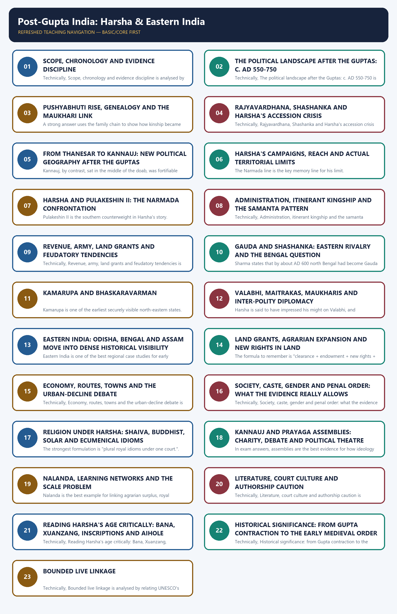

*Distinct embedded teaching-navigation image. The separate continuous Cārvāka-style flowchart package remains an independent at-a-glance artifact.*

#### Package counts, provenance and honest limitations

- Learning sections: 23; learning MCQ loops: 16.
- Workbook content: 4 verified or audited-routed PYQs; 32 original hard MCQs with remediation integrated in rotation; 6 original solved Mains questions; final register modules: 6.
- Original PNG visuals: 14. All maps are schematic and explicitly marked not to scale.
- Exact local wording is securely available for 1 topic-owned or topic-routed Mains PYQ: 2020 GS-I Q2 on Pala Buddhism, preserved inside the repository's Jainism-Buddhism package and routing ledgers. Three relevant Prelims demands are locally routed but the original 2020-2021 papers and official keys are not held here.
- OCR caveat: the Sharma OCR is serviceable but noisy; Upinder's Harsha pages sometimes truncate line ends in automated extraction. Claims below are therefore bounded to named evidence and repeated across source types where possible.
- No dated current-affairs item was necessary. The historical topic is taught through texts, inscriptions, coins, archaeology and historiography rather than manufactured news linkage.

#### Original visual asset index

- `notes/Ancient-Indian-History/assets/22_Post-Gupta-Harsha-and-Eastern-India/01_post_gupta_evidence_chronology.png`
- `notes/Ancient-Indian-History/assets/22_Post-Gupta-Harsha-and-Eastern-India/02_fragmentation_schematic_map.png`
- `notes/Ancient-Indian-History/assets/22_Post-Gupta-Harsha-and-Eastern-India/03_pushyabhuti_genealogy_rise.png`
- `notes/Ancient-Indian-History/assets/22_Post-Gupta-Harsha-and-Eastern-India/04_harsha_expansion_limits_map.png`
- `notes/Ancient-Indian-History/assets/22_Post-Gupta-Harsha-and-Eastern-India/05_thanesar_kannauj_shift.png`
- `notes/Ancient-Indian-History/assets/22_Post-Gupta-Harsha-and-Eastern-India/06_narmada_confrontation_matrix.png`
- `notes/Ancient-Indian-History/assets/22_Post-Gupta-Harsha-and-Eastern-India/07_administration_feudatory_hierarchy.png`
- `notes/Ancient-Indian-History/assets/22_Post-Gupta-Harsha-and-Eastern-India/08_land_grant_agrarian_change_flow.png`
- `notes/Ancient-Indian-History/assets/22_Post-Gupta-Harsha-and-Eastern-India/09_economy_society_transition_matrix.png`
- `notes/Ancient-Indian-History/assets/22_Post-Gupta-Harsha-and-Eastern-India/10_religion_cultural_patronage.png`
- `notes/Ancient-Indian-History/assets/22_Post-Gupta-Harsha-and-Eastern-India/11_nalanda_learning_networks.png`
- `notes/Ancient-Indian-History/assets/22_Post-Gupta-Harsha-and-Eastern-India/12_xuanzang_bana_source_criticism_matrix.png`
- `notes/Ancient-Indian-History/assets/22_Post-Gupta-Harsha-and-Eastern-India/13_eastern_india_transition_network.png`
- `notes/Ancient-Indian-History/assets/22_Post-Gupta-Harsha-and-Eastern-India/14_gs1_answer_spine.png`

### SESSION 1 — SCOPE, CHRONOLOGY AND EVIDENCE DISCIPLINE

#### DEFINITION / WHAT THIS IS CALLED

**Plain-language definition:** Topic 22 is the bridge package that takes north and eastern India from late Gupta contraction (c. AD 550) to the threshold of the early medieval regional order (c. AD 750), using Harsha's hegemony and eastern state formation as its two anchor case studies.

**Technical definition:** The package's method is evidence-graded chronology: every claim is dated only as precisely as Bana, Xuanzang, inscriptions, coins or archaeology allow, and routed PYQ demands without a locally held official key are explicitly labelled rather than silently answered.

#### ANSWER-GRABBING OPENING — WRITE/ADAPT IN THE EXAM

> Between Gupta contraction and the early medieval order lies a century of regional reorganisation, best read through Harsha's graded hegemony in the north and dense new state formation in the east.

#### MUST-WRITE KEYWORDS

- **c. AD 550-750**
- **regional reorganisation**
- **Bana's Harshacharita**
- **Xuanzang**
- **evidence discipline**
- **eastern transition**

**How to use them:** Frame the answer through the c. AD 550-750 bridge; define regional reorganisation as the governing thesis; connect Bana's Harshacharita with Xuanzang to show the evidentiary method, and use eastern transition for the decisive comparison with the "dark age" trap.

[FACT] This package owns the bridge between late Gupta contraction and the early medieval regional order in north and eastern India, especially c. AD 550-750. It extends briefly to the mid-8th century only where that is necessary to explain eastern transition and the routed 2020 Pala-Buddhism PYQ.

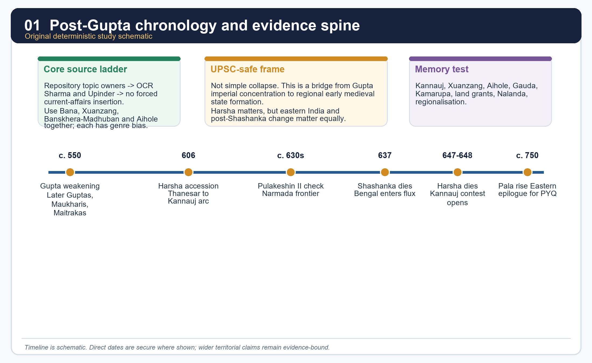

*Original deterministic schematic prepared for this package; dates and borders remain evidence-bound in the surrounding text.*

#### Evidence map

| Source family | Best use | Main limit |
|---|---|---|
| Bana's *Harshacharita* | accession crisis, court world, political self-image | literary selection and eulogy |
| Xuanzang | routes, monasteries, court encounter, selected customs | Buddhist purpose, later writing, occasional hearsay |
| Banskhera and Madhuban inscriptions | offices, taxes, grant procedure, royal camp | issue-specific, not a total social census |
| Aihole inscription | southern check on Harsha | rival Chalukya victory rhetoric |
| Bengal and eastern copper plates | land sales, agrarian expansion, local administration | region-bound archive |

#### Core teaching / solved practice

- [FACT] Repository source owners read first: basic/22, advanced/22, 00_Master-Chronology, revision chart, README, answer-worthiness audit, Topic 20 Gupta polity, Topic 21 Gupta society/culture, Topic 23 Pallava-Chalukya bridge and Topic 26 transition debate.
- [FACT] OCR evidence used from R.S. Sharma includes the chapters "Spread of Civilization in Eastern India" and "Harsha and His Times," especially the sections on Pundravardhanabhukti plates, Gauda under Shashanka, Kamarupa, the rise of Kannauj and Nalanda.
- [FACT] OCR evidence used from Upinder Singh includes the post-Gupta political matrix (Later Guptas, Maukharis, Pushyabhutis, Maitrakas), Harsha's accession, expansion, Banskhera-Madhuban records, Xuanzang's travel account, and eastern India after Shashanka.
- [ANALYSIS] The safe thesis is neither "Harsha restored empire" nor "everything declined after the Guptas." The stronger frame is regional reorganisation: Harsha created a major north Indian hegemony, while eastern India moved into dense inscriptional, agrarian and political visibility.
- [LIMIT] The package deliberately distinguishes secure evidence from contested reconstruction. Where the repository holds only a routed PYQ demand and not the original paper or official key, it says so explicitly.

#### PARAGRAPH DEMONSTRATION — CLAIM → NAMED EVIDENCE → ANALYSIS → QUALIFICATION

[CLAIM] Topic 22 should be answered as regional reorganisation, not as a simple story of imperial collapse followed by darkness. [NAMED EVIDENCE] Bana's *Harshacharita* documents a real north Indian hegemony built from Thanesar and Kannauj; the Banskhera and Madhuban inscriptions independently confirm administrative continuity through *bhukti*-*vishaya* units and royal camp records; and the Pundravardhanabhukti copper plates from Bengal show coin-purchased land, tax remission and expanding cultivation in the same century. [ANALYSIS] Each evidence family proves a different half of the same process: Harsha's court sources prove renewed north Indian power, while the eastern charters prove that fragmentation elsewhere was simultaneously generative, producing new fiscal districts, agrarian expansion and regional courts. [QUALIFICATION] Neither strand should be generalised beyond its source base: Harsha's reach must stop at the Narmada on Aihole's rival evidence, and eastern state formation must be written region by region rather than as one uniform "eastern awakening."

#### Must-know facts

- Topic 22 is a bridge topic: north Indian power, eastern integration and the early medieval threshold.
- Harsha is central, but Gauda, Kamarupa, Odisha and land-grant society are not side notes.
- Source criticism is not optional; it is part of the content.

#### UPSC traps

- **Wrong:** Post-Gupta means only political collapse. **Correct:** It means political fragmentation, agrarian expansion, new centres and reworked sovereignty.
- **Wrong:** One court source can settle every question. **Correct:** Harsha's age must be triangulated through literary, epigraphic and rival evidence.

**Mains angle:** Open with the phrase "regional reorganisation after Gupta contraction" and then anchor it in named evidence.

**Study link:** Topic 20 for Gupta decline; Topic 23 for the southern frontier; Topic 26 for the larger transition debate.

#### CLOSING RECALL FLOW — SCOPE, CHRONOLOGY AND EVIDENCE DISCIPLINE

```text
START / CONCEPT: Scope, chronology and evidence discipline for Post-Gupta India
        |
        v
EXACT TERMS: c. AD 550-750 · regional reorganisation · Bana's Harshacharita · Xuanzang · evidence discipline · eastern transition
        |
        v
MECHANISM / ARGUMENT: Correct: Harsha's age must be triangulated through literary, epigraphic and rival evidence.
        |
        v
CONSEQUENCE / CONTRAST: The safe thesis is neither "Harsha restored empire" nor "everything declined after the Guptas." The stronger frame is regional reorganisation: Harsha created a major north Indian hegemony, while eastern India moved into dense inscriptional, agrarian and political visibility.
        |
        v
UPSC TRAP / ANSWER-USE: Where the repository holds only a routed PYQ demand and not the original paper or official key, it says so explicitly.
        |
        v
ANSWER-GRABBING FORMULATION: Between Gupta contraction and the early medieval order lies a century of regional reorganisation, best read through Harsha's graded hegemony in the north and dense new state formation in the east.
```
### SESSION 2 — THE POLITICAL LANDSCAPE AFTER THE GUPTAS: C. AD 550-750

#### DEFINITION / WHAT THIS IS CALLED

**Plain-language definition:** Post-Gupta North India is plural: Later Guptas, Maukharis, Pushyabhutis and Maitrakas all matter.

**Technical definition:** The correct exam model treats c. AD 550-750 north India as a competitive multi-polity field in which direct rule contracted, layered sovereignty grew and strategic capitals replaced the older all-India centre.

#### ANSWER-GRABBING OPENING — WRITE/ADAPT IN THE EXAM

> Post-Gupta North India is plural: Later Guptas, Maukharis, Pushyabhutis and Maitrakas all matter.

#### MUST-WRITE KEYWORDS

- **Later Guptas**
- **Maukharis**
- **Pushyabhutis**
- **Maitrakas**
- **middle Ganga belt**
- **layered sovereignty**

**How to use them:** Frame the answer through the Later Guptas' imperial afterlife; define the Maukhari and Pushyabhuti positions at Kannauj and Thanesar; connect the Maitrakas as the western counterpoint, and use layered sovereignty for the decisive comparison against a single successor-state model.

[FACT] Upinder Singh's post-Gupta matrix explicitly places Later Guptas, Maukharis, Pushyabhutis and Maitrakas in the north-western and middle Ganga political field, alongside Gauda in Bengal, Kamarupa in Assam and Chalukya power pressing from the Deccan.

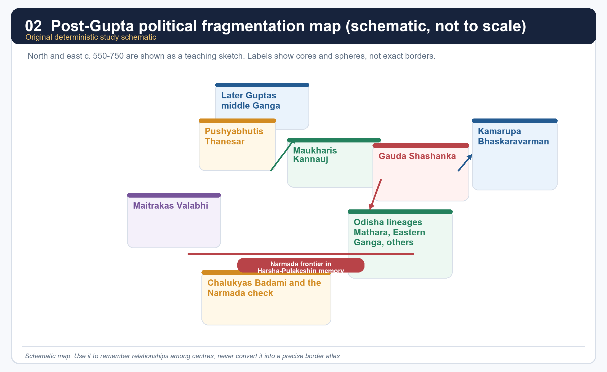

*Teaching map only. It is not a scale map and does not claim exact borders.*

#### Polity grid

| Polity | Main centre | Why it matters here | Core caution |
|---|---|---|---|
| Later Guptas | middle Ganga belt | shows imperial afterlife rather than instant disappearance | not the same as the imperial Gupta apex |
| Maukharis | Kannauj | connect the post-Gupta field to Harsha through marriage and inheritance politics | separate line before absorption |
| Pushyabhutis | Thanesar -> Kannauj | Harsha's dynasty | early pedigree is not fully transparent |
| Maitrakas | Valabhi | western counterpoint and possible allegiance relation | do not convert influence into annexation |
| Gauda | Bengal under Shashanka | Harsha's major eastern rival | post-Shashanka Bengal remains unstable |
| Kamarupa | Assam | major eastern state, especially under Bhaskaravarman | not a Harsha province |
| Chalukyas | Badami | Deccan check on Harsha | southern frontier remembered through a rival inscription |

#### Core teaching / solved practice

- [FACT] After the imperial Guptas, subordinate rulers increasingly asserted autonomy. Upinder links this world to several coexisting royal houses rather than to one clear successor state.
- [FACT] Sharma also sees north and west India passing under multiple feudatories, one of whose lines - the Thanesar dynasty - gradually overshadowed others under Harsha.
- [ANALYSIS] The key UPSC move is to convert this list of dynasties into a pattern: direct rule shrank, layered sovereignty grew, marriage and alliance mattered more, and strategic capitals replaced older all-India centres.
- [FACT] The eastern belt did not merely receive this process from the Gangetic core; by the 5th-7th centuries it generated its own military camps, land charters, districts, endowments and regional courts.
- [LIMIT] Do not write this period as if all polities were equal in scale or evidence density. Harsha's world is richly illuminated; many eastern dynasties are known more fragmentarily.

#### PARAGRAPH DEMONSTRATION — CLAIM → NAMED EVIDENCE → ANALYSIS → QUALIFICATION

[CLAIM] The post-Gupta political field is best written as a crowded, competitive arena rather than a single relay race from Gupta to Harsha. [NAMED EVIDENCE] Upinder Singh's matrix places Later Guptas and Maukharis in the middle Ganga belt, Pushyabhutis moving from Thanesar toward Kannauj, and Maitrakas holding Valabhi in the west, while Gauda under Shashanka and Kamarupa under Bhaskaravarman anchor the east. [ANALYSIS] The presence of so many simultaneously attested lines shows that direct imperial rule shrank while layered sovereignty, marriage alliance and strategic capitals became the new organising logic of north Indian politics. [QUALIFICATION] This plurality must not be flattened into a single narrative of decline: some lines (Pushyabhutis) consolidated power while others (Later Guptas) persisted only as regional afterlives, so the answer must name each polity's actual scale rather than treat them as interchangeable footnotes.

#### Must-know facts

- Post-Gupta North India is plural: Later Guptas, Maukharis, Pushyabhutis and Maitrakas all matter.
- Gauda and Kamarupa are part of the core story, not merely eastern appendices.
- The south appears here mainly as the frontier of Harsha's limits through Pulakeshin II.

#### UPSC traps

- **Wrong:** Treat the post-Gupta field as a simple relay from Guptas to Harsha. **Correct:** It is a crowded and competitive political arena.
- **Wrong:** Put every named polity inside Harsha's empire. **Correct:** Distinguish direct core, wider influence and autonomous rivals.

**Mains angle:** A 15- or 20-marker should present this landscape as the context for Harsha, not as a list to be memorised separately.

**Study link:** Topic 20 on Gupta weakening; Topic 26 on regional state formation.

#### CLOSING RECALL FLOW — THE POLITICAL LANDSCAPE AFTER THE GUPTAS: C. AD 550-750

```text
START / CONCEPT: The political landscape after the Guptas: c. AD 550-750
        |
        v
EXACT TERMS: The political landscape after the Guptas · c. AD 550-750 · Later Guptas · Maukharis · Pushyabhutis · Maitrakas
        |
        v
MECHANISM / ARGUMENT: The key UPSC move is to convert this list of dynasties into a pattern: direct rule shrank, layered sovereignty grew, marriage and alliance mattered more, and strategic capitals replaced older all-India centres.
        |
        v
CONSEQUENCE / CONTRAST: A 15- or 20-marker should present this landscape as the context for Harsha, not as a list to be memorised separately.
        |
        v
UPSC TRAP / ANSWER-USE: Do not write this period as if all polities were equal in scale or evidence density.
        |
        v
ANSWER-GRABBING FORMULATION: Post-Gupta North India is plural: Later Guptas, Maukharis, Pushyabhutis and Maitrakas all matter.
```
### SESSION 3 — PUSHYABHUTI RISE, GENEALOGY AND THE MAUKHARI LINK

#### DEFINITION / WHAT THIS IS CALLED

**Plain-language definition:** Prabhakaravardhana is presented in Harshacharita as a powerful general and the turning point in the rise of the dynasty.

**Technical definition:** A strong answer uses the family chain to show how kinship became statecraft: military rise at Thanesar + alliance with Maukharis + crisis in Kannauj = Harsha's political opening.

#### ANSWER-GRABBING OPENING — WRITE/ADAPT IN THE EXAM

> A strong answer uses the family chain to show how kinship became statecraft: military rise at Thanesar + alliance with Maukharis + crisis in Kannauj = Harsha's political opening.

#### MUST-WRITE KEYWORDS

- **Prabhakaravardhana**
- **Rajyashri-Grahavarman marriage**
- **Maukhari link**
- **Thanesar**
- **Kannauj crisis**
- **Bana's literary caution**

**How to use them:** Frame the answer through Prabhakaravardhana as the decisive power-builder; define the Rajyashri-Grahavarman marriage as the Maukhari link; connect the Kannauj crisis to Harsha's opening, and use Bana's literary caution for the decisive source qualification.

[FACT] The politically secure Pushyabhuti story begins with Prabhakaravardhana, Rajyavardhana, Harsha and Rajyashri. Upinder explicitly cautions that Bana's court biography is indispensable but literary, and the earlier lineage before Prabhakaravardhana is not transparent enough for overconfident reconstruction.

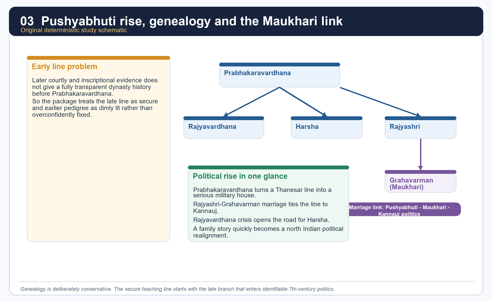

*This schematic intentionally privileges the secure late branch over dim early pedigree.*

#### Core teaching / solved practice

- [FACT] Prabhakaravardhana is presented in *Harshacharita* as a powerful general and the turning point in the rise of the dynasty.
- [FACT] The marriage of Rajyashri to the Maukhari ruler Grahavarman forged a crucial political alliance between Thanesar and Kanyakubja (Kannauj).
- [ANALYSIS] This marriage link is not biographical ornament. It explains why the Pushyabhutis could move from a Haryana base into the centre of the middle Ganga political world.
- [LIMIT] Do not turn uncertain early genealogy into a false certainty. For UPSC, the late secure branch matters more than speculative dynastic antiquity.
- [ANALYSIS] A strong answer uses the family chain to show how kinship became statecraft: military rise at Thanesar + alliance with Maukharis + crisis in Kannauj = Harsha's political opening.

#### PARAGRAPH DEMONSTRATION — CLAIM → NAMED EVIDENCE → ANALYSIS → QUALIFICATION

[CLAIM] The Pushyabhuti rise is best explained as kinship converted into statecraft rather than as an ancient, uninterrupted royal lineage. [NAMED EVIDENCE] *Harshacharita* names Prabhakaravardhana as the general who first made the dynasty formidable, and records Rajyashri's marriage to the Maukhari ruler Grahavarman as the alliance that tied Thanesar to Kanyakubja. [ANALYSIS] This marriage explains, more than any claimed antiquity, why the Pushyabhutis could later inherit Kannauj: an alliance built for security became the very channel through which Harsha's dynasty acquired the middle Ganga's most strategic city. [QUALIFICATION] Upinder Singh cautions that Bana's biography is indispensable but literary and selective, and that genealogy before Prabhakaravardhana is too thin for confident reconstruction, so the safe answer privileges the secure late branch over any impressive-sounding early pedigree.

#### Must-know facts

- Prabhakaravardhana is the decisive pre-Harsha figure in the secure political narrative.
- Rajyashri's marriage ties the Pushyabhutis to Kannauj.
- The package intentionally avoids overclaiming earlier genealogy.

#### UPSC traps

- **Wrong:** Memorise a long early pedigree without evidentiary caution. **Correct:** Use the late branch where politics becomes securely visible.
- **Wrong:** Treat Rajyashri's marriage as a personal anecdote. **Correct:** It is a state-building alliance.

**Mains angle:** Kinship, marriage and succession are political mechanisms, not side stories.

**Study link:** Sections 4-6 below; source-criticism section on Bana.

#### CLOSING RECALL FLOW — PUSHYABHUTI RISE, GENEALOGY AND THE MAUKHARI LINK

```text
START / CONCEPT: Pushyabhuti rise, genealogy and the Maukhari link
        |
        v
EXACT TERMS: Pushyabhuti rise · genealogy · the Maukhari link · Prabhakaravardhana · Rajyashri-Grahavarman marriage · Kannauj crisis
        |
        v
MECHANISM / ARGUMENT: It explains why the Pushyabhutis could move from a Haryana base into the centre of the middle Ganga political world.
        |
        v
CONSEQUENCE / CONTRAST: Do not turn uncertain early genealogy into a false certainty.
        |
        v
UPSC TRAP / ANSWER-USE: Upinder explicitly cautions that Bana's court biography is indispensable but literary, and the earlier lineage before Prabhakaravardhana is not transparent enough for overconfident reconstruction.
        |
        v
ANSWER-GRABBING FORMULATION: A strong answer uses the family chain to show how kinship became statecraft: military rise at Thanesar + alliance with Maukharis + crisis in Kannauj = Harsha's political opening.
```
### SESSION 4 — RAJYAVARDHANA, SHASHANKA AND HARSHA'S ACCESSION CRISIS

#### DEFINITION / WHAT THIS IS CALLED

**Plain-language definition:** Harsha's accession is rooted in crisis, not smooth dynastic continuity.

**Technical definition:** The accession sequence runs death → succession → marriage-alliance breakdown → eastern rival intervention → rescue, and each link in that chain is attested through Bana rather than through an independent administrative record.

#### ANSWER-GRABBING OPENING — WRITE/ADAPT IN THE EXAM

> Harsha's accession is rooted in crisis, not smooth dynastic continuity.

#### MUST-WRITE KEYWORDS

- **Rajyavardhana**
- **Shashanka**
- **Grahavarman's killing**
- **Rajyashri's imprisonment**
- **605 CE**
- **crisis-driven consolidation**

**How to use them:** Frame the answer through Rajyavardhana's brief reign; define Shashanka's intervention as the eastern-rival element; connect Grahavarman's killing with Rajyashri's imprisonment to explain the crisis mechanism, and use crisis-driven consolidation for the decisive framing of Harsha's rise.

[FACT] Upinder's reconstruction from Bana states that Prabhakaravardhana died around 605 CE; Rajyavardhana succeeded him; Grahavarman was killed by the king of Malava; Rajyashri was imprisoned; Rajyavardhana marched east, defeated the Malava force and then encountered Shashanka of Gauda; according to *Harshacharita*, Rajyavardhana was killed by stratagem.

#### Core teaching / solved practice

- [FACT] Harsha's accession is rooted in crisis, not smooth dynastic continuity. The chain of events includes death, captivity, alliance breakdown and an eastern rival.
- [FACT] Bana's narrative ends with Harsha rescuing Rajyashri and securing the thrones of Thanesar and Kannauj. Upinder notes debate over whether the work is incomplete or complete by literary design.
- [ANALYSIS] This matters because the accession story is both history and political theatre. Rajyashri is not only a sister to be rescued; scholars have also read her symbolically as royal fortune or legitimacy.
- [LIMIT] The manner of Rajyavardhana's death comes through courtly narration. It should be cited as Bana's story, not as a forensically verified fact.
- [ANALYSIS] For exam purposes, Harsha's rise should be written as "crisis-driven consolidation" rather than as a miraculous hero episode.

#### PARAGRAPH DEMONSTRATION — CLAIM → NAMED EVIDENCE → ANALYSIS → QUALIFICATION

[CLAIM] Harsha's accession must be written as crisis-driven consolidation, not as inherited imperial continuity. [NAMED EVIDENCE] Bana's *Harshacharita* records Prabhakaravardhana's death around 605 CE, Grahavarman's killing by the Malava king, Rajyashri's imprisonment, Rajyavardhana's eastern march against Shashanka and his death by stratagem, and finally Harsha's rescue of Rajyashri. [ANALYSIS] Each link converts a dynastic emergency into a legitimation opportunity: Harsha does not inherit a functioning throne but assembles authority out of a captivity crisis, an eastern rival's intervention and a sister's rescue, which is precisely why Bana frames the accession as moral and political drama together. [QUALIFICATION] The stratagem behind Rajyavardhana's death and the symbolic reading of Rajyashri as royal fortune come through a court-composed narrative, so the safe exam phrase is "Bana's narrative states," not an unqualified forensic claim.

#### Must-know facts

- Grahavarman's killing and Rajyashri's imprisonment trigger the Kannauj crisis.
- Shashanka enters the story before Harsha's eastern career fully develops.
- Bana is indispensable for this sequence but cannot be read as a neutral chronicle.

#### UPSC traps

- **Wrong:** Harsha simply inherited a ready-made empire. **Correct:** He inherited a crisis and converted it into a kingdom.
- **Wrong:** Quote the stratagem story as uncontested fact. **Correct:** Attribute it to Bana and mark the source limit.

**Mains angle:** This episode is the best place to show how literary narrative and political history overlap.

**Study link:** Section 21 on source criticism.

#### CLOSING RECALL FLOW — RAJYAVARDHANA, SHASHANKA AND HARSHA'S ACCESSION CRISIS

```text
START / CONCEPT: Rajyavardhana, Shashanka and Harsha's accession crisis
        |
        v
EXACT TERMS: Rajyavardhana · Shashanka · Grahavarman's killing · Rajyashri's imprisonment · 605 CE · crisis-driven consolidation
        |
        v
MECHANISM / ARGUMENT: Upinder's reconstruction from Bana states that Prabhakaravardhana died around 605 CE; Rajyavardhana succeeded him; Grahavarman was killed by the king of Malava; Rajyashri was imprisoned; Rajyavardhana marched east, defeated the Malava force and then encountered Shashanka of Gauda; according to Harshacharita, Rajyavardhana was killed by stratagem.
        |
        v
CONSEQUENCE / CONTRAST: Rajyashri is not only a sister to be rescued; scholars have also read her symbolically as royal fortune or legitimacy.
        |
        v
UPSC TRAP / ANSWER-USE: It should be cited as Bana's story, not as a forensically verified fact.
        |
        v
ANSWER-GRABBING FORMULATION: Harsha's accession is rooted in crisis, not smooth dynastic continuity.
```
### SESSION 5 — FROM THANESAR TO KANNAUJ: NEW POLITICAL GEOGRAPHY AFTER THE GUPTAS

#### DEFINITION / WHAT THIS IS CALLED

**Plain-language definition:** Sharma's explanation for Kannauj's rise is structural: Pataliputra had flourished in a money-rich, trade-linked imperial order, while Kannauj rose in an age of military camps, land grants, fortifiable nodes and middle-doab control.

**Technical definition:** Kannauj, by contrast, sat in the middle of the doab, was fortifiable and could control eastern and western movement by both land and water.

#### ANSWER-GRABBING OPENING — WRITE/ADAPT IN THE EXAM

> Sharma's explanation for Kannauj's rise is structural: Pataliputra had flourished in a money-rich, trade-linked imperial order, while Kannauj rose in an age of military camps, land grants, fortifiable nodes and middle-doab control.

#### MUST-WRITE KEYWORDS

- **Thanesar to Kannauj**
- **Sharma's structural thesis**
- **middle-doab control**
- **Maukhari inheritance**
- **fortifiable node**
- **military-camp age**

**How to use them:** Frame the answer through the Thanesar-to-Kannauj shift; define Sharma's structural thesis on Pataliputra's decline; connect middle-doab control with the Maukhari inheritance to explain why Kannauj suited Harsha, and use the military-camp age for the decisive contrast with the older trade-rich imperial order.

[FACT] Sharma's explanation for Kannauj's rise is structural: Pataliputra had flourished in a money-rich, trade-linked imperial order, while Kannauj rose in an age of military camps, land grants, fortifiable nodes and middle-doab control.

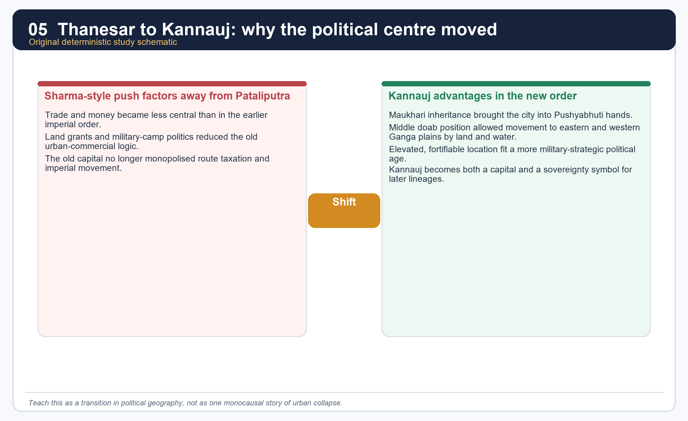

*This visual summarises Sharma's argument but the package later balances it with the uneven-change model.*

#### Core teaching / solved practice

- [FACT] Sharma directly connects the loss of Pataliputra's importance with reduced trade prominence, reduced coined exchange and the spread of land-based remuneration.
- [FACT] Kannauj, by contrast, sat in the middle of the doab, was fortifiable and could control eastern and western movement by both land and water.
- [FACT] The Maukhari connection gave Harsha a political right as well as an opportunity to take over Kannauj.
- [ANALYSIS] The capital shift therefore joins political inheritance to strategic geography. It is not just personal preference by Harsha.
- [LIMIT] A capital shift does not prove uniform urban collapse across India. Later sections show continued coin use, monastic wealth and regional state activity in the east.

#### PARAGRAPH DEMONSTRATION — CLAIM → NAMED EVIDENCE → ANALYSIS → QUALIFICATION

[CLAIM] Kannauj's rise over Pataliputra reflects a structural change in political geography, not a personal preference of Harsha's. [NAMED EVIDENCE] Sharma links Pataliputra's earlier centrality to a money-rich, trade-linked imperial order, while Kannauj's middle-doab position made it fortifiable and able to command both eastern and western Ganga movement by land and water; the Maukhari connection additionally gave Harsha an inherited claim to the city. [ANALYSIS] The combination of strategic geography and inheritance politics explains why the capital shift stuck: Harsha did not merely choose a favourite city, he occupied the node that a military-camp-centred, land-grant political order actually required. [QUALIFICATION] The shift is evidence of one imperial capital's changing fortunes, not proof that every Indian town collapsed in the same period; eastern towns and monastic centres show continuing wealth in the same century.

#### Must-know facts

- Kannauj becomes the signature post-Gupta capital.
- Sharma treats this shift as a marker of the emerging early medieval order.
- Strategy and alliance matter as much as economics.

#### UPSC traps

- **Wrong:** Kannauj rose only because Harsha moved there. **Correct:** Harsha's move worked because the city already mattered strategically and politically.
- **Wrong:** Sharma's thesis proves every town declined. **Correct:** It highlights a broad tendency, not a uniform rule.

**Mains angle:** Compare Pataliputra and Kannauj as two political geographies tied to two different state logics.

**Study link:** Section 15 on the urban-decline debate.

#### CLOSING RECALL FLOW — FROM THANESAR TO KANNAUJ: NEW POLITICAL GEOGRAPHY AFTER THE GUPTAS

```text
START / CONCEPT: From Thanesar to Kannauj: new political geography after the Guptas
        |
        v
EXACT TERMS: From Thanesar to Kannauj · Sharma's structural thesis · middle-doab control · Maukhari inheritance · fortifiable node · military-camp age
        |
        v
MECHANISM / ARGUMENT: Kannauj, by contrast, sat in the middle of the doab, was fortifiable and could control eastern and western movement by both land and water.
        |
        v
CONSEQUENCE / CONTRAST: A capital shift does not prove uniform urban collapse across India.
        |
        v
UPSC TRAP / ANSWER-USE: It is not just personal preference by Harsha.
        |
        v
ANSWER-GRABBING FORMULATION: Sharma's explanation for Kannauj's rise is structural: Pataliputra had flourished in a money-rich, trade-linked imperial order, while Kannauj rose in an age of military camps, land grants, fortifiable nodes and middle-doab control.
```
### SESSION 6 — HARSHA'S CAMPAIGNS, REACH AND ACTUAL TERRITORIAL LIMITS

#### DEFINITION / WHAT THIS IS CALLED

**Plain-language definition:** The right exam formula is "direct core + peripheral allegiance + frontier limit." This is stronger than both extreme claims: total empire or merely symbolic kingship.

**Technical definition:** The Narmada line is the key memory line for his limit.

#### ANSWER-GRABBING OPENING — WRITE/ADAPT IN THE EXAM

> The right exam formula is "direct core + peripheral allegiance + frontier limit." This is stronger than both extreme claims: total empire or merely symbolic kingship.

#### MUST-WRITE KEYWORDS

- **direct core**
- **peripheral allegiance**
- **frontier limit**
- **graded sovereignty**
- **Odisha extension**
- **north Indian hegemon**

**How to use them:** Frame the answer through direct core; define peripheral allegiance, connect frontier limit with graded sovereignty to explain the mechanism, and use north Indian hegemon for the decisive verdict on Harsha's actual scale.

[FACT] Upinder's summary is restrained: Harsha defeated Shashanka but the latter seems to have recovered lost territories; Harsha impressed his might on Sindh, Valabhi and Kashmir; he was checked by Pulakeshin II; his direct core included Haryana, parts of southern Punjab and eastern Rajasthan, and with Maukhari inheritance it extended over much of Uttar Pradesh and parts of Bihar; Odisha also seems to have fallen within his effective reach.

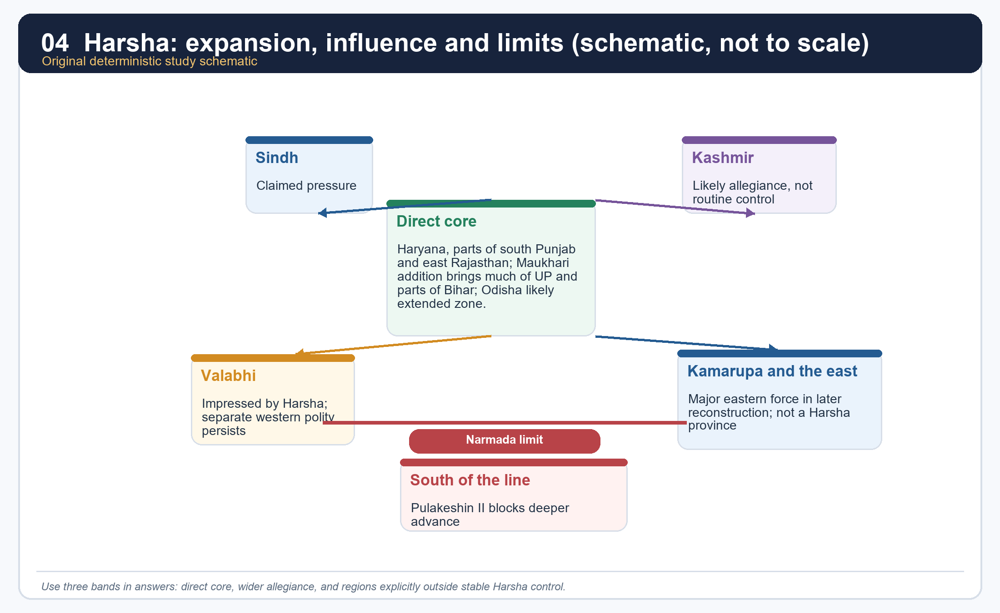

*Use this as a graded-sovereignty map, not as a province map.*

#### Territorial grid

| Zone | What the package treats as safe | What not to claim |
|---|---|---|
| Direct core | Thanesar-Haryana base; much of UP; parts of Bihar; likely Odisha extension | a pan-Indian empire |
| Wider influence | Kamarupa, Kashmir, Valabhi, Malava may have acknowledged superiority or attended assemblies | routine provincial administration |
| Outside stable control | Deccan south of the Narmada after Pulakeshin's resistance | Harsha's conquest of the Chalukya south |

#### Core teaching / solved practice

- [FACT] Harsha's power was real and extensive in north India, but his own evidence and rival evidence point to layered sovereignty rather than uniform annexation.
- [ANALYSIS] The right exam formula is "direct core + peripheral allegiance + frontier limit." This is stronger than both extreme claims: total empire or merely symbolic kingship.
- [FACT] Some subordinate rulers using titles such as *raja*, *samanta* and *mahasamanta* dated inscriptions in the Harsha era, suggesting broad recognition of his authority.
- [LIMIT] Presence at an assembly, diplomatic contact or tributary language does not equal incorporation into a standardised province.
- [ANALYSIS] Harsha is therefore best read as a north Indian hegemon with wider prestige, not as a Mauryan-style all-India emperor.

#### PARAGRAPH DEMONSTRATION — CLAIM → NAMED EVIDENCE → ANALYSIS → QUALIFICATION

[CLAIM] Harsha's territorial reach is best described through graded sovereignty rather than a single label of "empire" or "kingdom." [NAMED EVIDENCE] Upinder Singh's summary places his direct core in Haryana, southern Punjab, eastern Rajasthan and, through Maukhari inheritance, most of Uttar Pradesh and parts of Bihar with a probable Odisha extension, while subordinate rulers using titles such as *raja*, *samanta* and *mahasamanta* dated inscriptions in his era. [ANALYSIS] The layering matters because assembly attendance and dated deference do not equal administrative incorporation; a candidate who collapses this gradient into either "pan-Indian emperor" or "merely symbolic king" fails the demand. [QUALIFICATION] The Narmada frontier, discussed next, shows that even this graded reach had a hard southern limit checked by Pulakeshin II, so "direct core plus peripheral allegiance plus frontier limit" is the only formula that survives cross-examination by rival evidence.

#### Must-know facts

- Harsha's direct core is north Indian and Ganga-based.
- Peripheral acknowledgement matters, but it must be distinguished from annexation.
- The Narmada line is the key memory line for his limit.

#### UPSC traps

- **Wrong:** Harsha ruled the whole subcontinent. **Correct:** His authority was large but graded and bounded.
- **Wrong:** If a ruler attended his assembly, the area became a province. **Correct:** assembly politics can express hierarchy without direct administration.

**Mains angle:** Use the vocabulary of graded sovereignty and bound the map carefully.

**Study link:** Section 7 for the Narmada confrontation; Section 8 for subordinate rulers and assemblies.

#### CLOSING RECALL FLOW — HARSHA'S CAMPAIGNS, REACH AND ACTUAL TERRITORIAL LIMITS

```text
START / CONCEPT: Harsha's campaigns, reach and actual territorial limits
        |
        v
EXACT TERMS: direct core · peripheral allegiance · frontier limit · graded sovereignty · Odisha extension · north Indian hegemon
        |
        v
MECHANISM / ARGUMENT: Upinder's summary is restrained: Harsha defeated Shashanka but the latter seems to have recovered lost territories; Harsha impressed his might on Sindh, Valabhi and Kashmir; he was checked by Pulakeshin II; his direct core included Haryana, parts of southern Punjab and eastern Rajasthan, and with Maukhari inheritance it extended over much of Uttar Pradesh and parts of Bihar; Odisha also seems to have fallen within his effective reach.
        |
        v
CONSEQUENCE / CONTRAST: Harsha's power was real and extensive in north India, but his own evidence and rival evidence point to layered sovereignty rather than uniform annexation.
        |
        v
UPSC TRAP / ANSWER-USE: The Narmada line is the key memory line for his limit.
        |
        v
ANSWER-GRABBING FORMULATION: The right exam formula is "direct core + peripheral allegiance + frontier limit." This is stronger than both extreme claims: total empire or merely symbolic kingship.
```
### SESSION 7 — HARSHA AND PULAKESHIN II: THE NARMADA CONFRONTATION

#### DEFINITION / WHAT THIS IS CALLED

**Plain-language definition:** Pulakeshin II's check on Harsha at the Narmada is the clearest rival-evidence limit on his hegemony.

**Technical definition:** Pulakeshin II is the southern counterweight in Harsha's story.

#### ANSWER-GRABBING OPENING — WRITE/ADAPT IN THE EXAM

> Upinder states that Harsha received a crushing defeat at the hands of Pulakeshin II, but also notes scholarly differences over the exact date and even over whether the event was a full defeat or a forced retreat.

#### MUST-WRITE KEYWORDS

- **Pulakeshin II**
- **Narmada frontier**
- **Aihole inscription of Ravikirti**
- **rival prashasti**
- **evidentiary balance**
- **Chalukya check**

**How to use them:** Frame the answer through Pulakeshin II's check; define the Narmada frontier as the remembered limit; connect the Aihole inscription of Ravikirti with rival prashasti to explain the evidentiary method, and use evidentiary balance for the decisive qualification.

[FACT] The Aihole inscription of Ravikirti is the crucial counter-source. Upinder states that Harsha received a crushing defeat at the hands of Pulakeshin II, but also notes scholarly differences over the exact date and even over whether the event was a full defeat or a forced retreat.

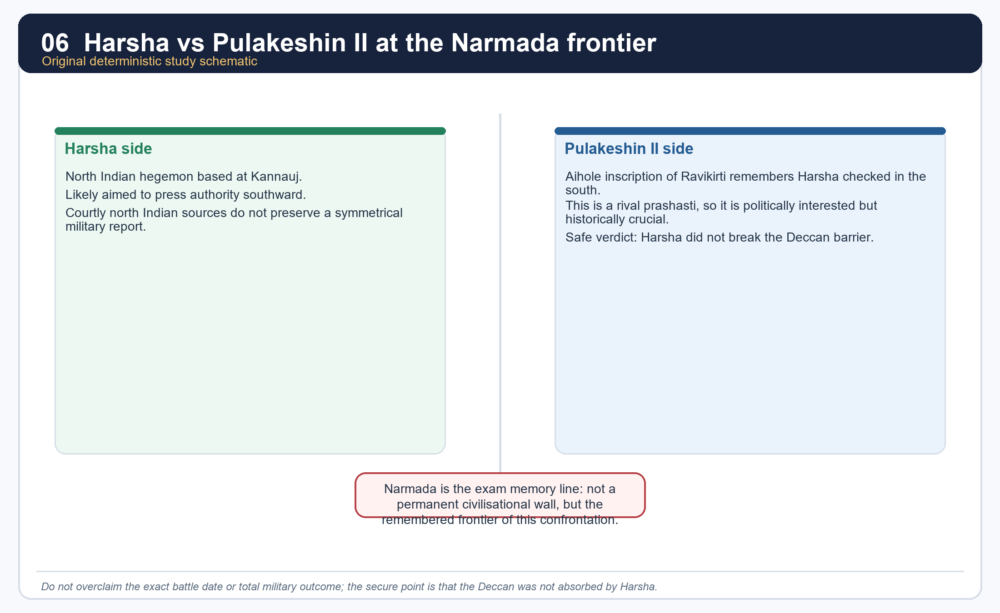

*The point of the image is evidentiary balance, not battle-map precision.*

#### Core teaching / solved practice

- [FACT] The confrontation survives in memory above all because the Chalukya record preserves it as a southern check on Harsha.
- [FACT] Sharma also presents Pulakeshin II as the ruler who stopped Harsha at the Narmada.
- [ANALYSIS] The Narmada becomes a remembered frontier here not because it was a timeless civilisational wall, but because it marks the limit of Harsha's expansion in this specific contest.
- [LIMIT] Aihole is a royal eulogy. It must be used critically, just as Bana must be used critically from the opposite side.
- [ANALYSIS] This confrontation is one of the best UPSC examples of why rival inscriptions are historically precious: they puncture unilateral imperial memory.

#### PARAGRAPH DEMONSTRATION — CLAIM → NAMED EVIDENCE → ANALYSIS → QUALIFICATION

[CLAIM] The Narmada confrontation is the single clearest rival-evidence proof that Harsha's hegemony had a hard southern limit. [NAMED EVIDENCE] The Aihole inscription of Ravikirti, composed for the Chalukya court, states that Harsha suffered defeat at Pulakeshin II's hands, while Sharma independently treats Pulakeshin II as the ruler who stopped Harsha at the Narmada. [ANALYSIS] Because this evidence comes from the losing side's rival rather than from Harsha's own court, it cannot be dismissed as court flattery, which is exactly why it is the strongest available check on Bana's picture of continuous northern success. [QUALIFICATION] Aihole is itself a royal eulogy for Pulakeshin II, so the exact date and whether the outcome was total defeat or a forced retreat remain debated; the safe formulation is that a 7th-century confrontation near the Narmada is secure while its precise details are not.

#### Must-know facts

- Pulakeshin II is the southern counterweight in Harsha's story.
- The Aihole inscription is the key rival text.
- Safe verdict: Harsha did not absorb the Deccan.

#### UPSC traps

- **Wrong:** Fix one exact year and one absolute battle description without caution. **Correct:** say the broad 7th-century confrontation is secure; details remain debated.
- **Wrong:** Use only Bana for Harsha's political reach. **Correct:** bring in Aihole as the essential check.

**Mains angle:** This episode is the model answer for "use rival evidence to limit imperial overclaim."

**Study link:** Topic 23 for Pulakeshin II and the Chalukya side of the story.

#### CLOSING RECALL FLOW — HARSHA AND PULAKESHIN II: THE NARMADA CONFRONTATION

```text
START / CONCEPT: Harsha and Pulakeshin II: the Narmada confrontation
        |
        v
EXACT TERMS: Pulakeshin II · Narmada frontier · Aihole inscription of Ravikirti · rival prashasti · evidentiary balance · Chalukya check
        |
        v
MECHANISM / ARGUMENT: Sharma also presents Pulakeshin II as the ruler who stopped Harsha at the Narmada.
        |
        v
CONSEQUENCE / CONTRAST: The Narmada becomes a remembered frontier here not because it was a timeless civilisational wall, but because it marks the limit of Harsha's expansion in this specific contest.
        |
        v
UPSC TRAP / ANSWER-USE: This episode is the model answer for "use rival evidence to limit imperial overclaim.".
        |
        v
ANSWER-GRABBING FORMULATION: Upinder states that Harsha received a crushing defeat at the hands of Pulakeshin II, but also notes scholarly differences over the exact date and even over whether the event was a full defeat or a forced retreat.
```
### SESSION 8 — ADMINISTRATION, ITINERANT KINGSHIP AND THE SAMANTA PATTERN

#### DEFINITION / WHAT THIS IS CALLED

**Plain-language definition:** Harsha's administration blends inherited Gupta-style units, royal touring and delegated subordinate power rather than one uniform bureaucracy.

**Technical definition:** The kingdom was organised into *bhuktis* subdivided into *vishayas*, staffed by named officials, but sovereignty was also exercised through a mobile royal camp and a hierarchy of *samanta* and *mahasamanta* subordinates.

#### ANSWER-GRABBING OPENING — WRITE/ADAPT IN THE EXAM

> This is a vivid sign of itinerant kingship and military presence.

#### MUST-WRITE KEYWORDS

- **bhukti and vishaya**
- **itinerant kingship**
- **samanta and mahasamanta**
- **Banskhera and Madhuban inscriptions**
- **camp of victory**
- **sarva-palli-pati**

**How to use them:** Frame the answer through bhukti and vishaya continuity; define itinerant kingship through the camp of victory; connect samanta and mahasamanta titles with the Banskhera and Madhuban inscriptions to show delegated power, and use sarva-palli-pati for the decisive local-administration detail.

[FACT] Upinder says Harsha's kingdom broadly continued Gupta administrative units and many older official designations. The kingdom was divided into *bhuktis*, which were in turn divided into *vishayas*; inscriptions mention high officials, revenue terms and a camp-centred royal presence.

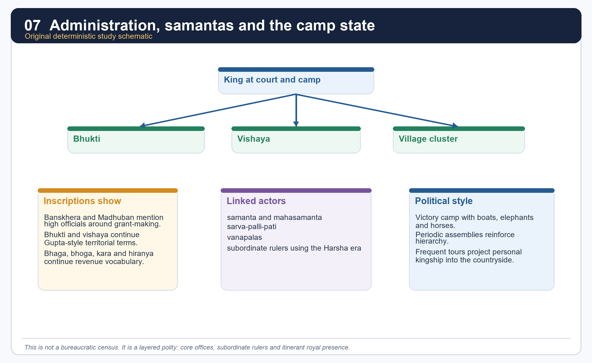

*This hierarchy is conceptual, not a claim that every office is equally documented in every region.*

#### Core teaching / solved practice

- [FACT] Banskhera and Madhuban inscriptions are key administrative windows. They mention high-level officials associated with grant-making.
- [FACT] Bana mentions *vanapalas* (forest guards), and Upinder notes the official *sarva-palli-pati* (chief of all villages).
- [FACT] The inscriptions refer to the royal "camp of victory" containing boats, horses and elephants. This is a vivid sign of itinerant kingship and military presence.
- [FACT] Subordinate rulers using titles such as *raja*, *samanta* and *mahasamanta* also dated records in the Harsha era.
- [ANALYSIS] The polity was therefore neither empty nor uniformly bureaucratic. It worked through a blend of inherited units, royal movement, subordinate chiefs and event-specific record keeping.

#### PARAGRAPH DEMONSTRATION — CLAIM → NAMED EVIDENCE → ANALYSIS → QUALIFICATION

[CLAIM] Harsha's state combined inherited administrative continuity with mobile, personally exercised kingship rather than functioning as a fixed bureaucratic machine. [NAMED EVIDENCE] The Banskhera and Madhuban inscriptions preserve *bhukti* and *vishaya* divisions, name high officials and the local officer *sarva-palli-pati*, and describe a royal "camp of victory" stocked with boats, horses and elephants; subordinate rulers styled *raja*, *samanta* and *mahasamanta* separately dated records in his era. [ANALYSIS] Camp-based kingship and delegated samanta authority show that Harsha's reach was administered as much through royal movement and negotiated loyalty as through fixed offices, which is why "continuity plus layered delegation" is a stronger formula than either "no administration" or "a full Mauryan-style machine." [QUALIFICATION] Because the inscriptional record is issue-specific rather than a general administrative census, the exact density of officialdom outside these documented camps and grants cannot be assumed to be uniform across Harsha's core.

#### Must-know facts

- *Bhukti* and *vishaya* continue into Harsha's age.
- Camp, tour and assembly are as important as office names.
- The samanta pattern is visible in the language of subordinate rulers.

#### UPSC traps

- **Wrong:** Assume Harsha's state had no administration because evidence is thin. **Correct:** the evidence is selective, not absent.
- **Wrong:** Translate every title into a modern fixed department. **Correct:** many ranks overlapped and varied in real scope.

**Mains angle:** Write administration as "continuity plus layered delegation," not as a full Mauryan-style machine.

**Study link:** Section 9 for revenue and grants.

#### CLOSING RECALL FLOW — ADMINISTRATION, ITINERANT KINGSHIP AND THE SAMANTA PATTERN

```text
START / CONCEPT: Administration, itinerant kingship and the samanta pattern
        |
        v
EXACT TERMS: bhukti and vishaya · itinerant kingship · samanta and mahasamanta · Banskhera and Madhuban inscriptions · camp of victory · sarva-palli-pati
        |
        v
MECHANISM / ARGUMENT: Wrong: Assume Harsha's state had no administration because evidence is thin.
        |
        v
CONSEQUENCE / CONTRAST: The samanta pattern is visible in the language of subordinate rulers.
        |
        v
UPSC TRAP / ANSWER-USE: Do not miss this limiting distinction: the polity was therefore neither empty nor uniformly bureaucratic.
        |
        v
ANSWER-GRABBING FORMULATION: This is a vivid sign of itinerant kingship and military presence.
```
### SESSION 9 — REVENUE, ARMY, LAND GRANTS AND FEUDATORY TENDENCIES

#### DEFINITION / WHAT THIS IS CALLED

**Plain-language definition:** Harsha's revenue and army increasingly rested on land-based reward and delegated feudatory support rather than only on centrally salaried resources.

**Technical definition:** The claimed army totals of 100,000 horses and 60,000 elephants are best read as feudatory-inflated figures, tied to the same land-grant logic that endowed ministers and officers with revenue rights.

#### ANSWER-GRABBING OPENING — WRITE/ADAPT IN THE EXAM

> This is a critical link in the "feudatory tendency" argument: military capacity increasingly rested on the support of subordinate landed powers rather than only on centrally salaried troops.

#### MUST-WRITE KEYWORDS

- **bhaga, bhoga, kara, hiranya**
- **land-based endowment**
- **feudatory tendency**
- **one-sixth grain share**
- **army inflation**
- **delegated power**

**How to use them:** Frame the answer through the continuing bhaga-bhoga-kara-hiranya vocabulary; define land-based endowment of officers as the key transition clue; connect feudatory tendency with the one-sixth grain share to explain revenue logic, and use army inflation for the decisive caution on Harsha's reported troop numbers.

[FACT] Xuanzang says people were taxed lightly and that the king took one-sixth of the farmer's produce as grain share. Inscriptions preserve earlier revenue vocabulary such as *bhaga*, *bhoga*, *kara* and *hiranya*. Sharma additionally argues that the practice of endowing ministers and officers with land became more visible under Harsha.

#### Core teaching / solved practice

- [FACT] Upinder connects Harsha's grant records to the continuing use of older dues and tax terms.
- [FACT] Sharma reports that one part of Harsha's revenues went to officials and public servants, and that ministers and high officers could be endowed with land.
- [FACT] Sharma also treats the huge army numbers attributed to Harsha - 100,000 horses and 60,000 elephants - as unrealistic unless feudatory contingents were being mobilised.
- [ANALYSIS] This is a critical link in the "feudatory tendency" argument: military capacity increasingly rested on the support of subordinate landed powers rather than only on centrally salaried troops.
- [LIMIT] Because much of this argument comes through Xuanzang and later historical reconstruction, it is safer to write "suggests growing land-based payment and delegation" rather than "proves a fully developed feudal order under Harsha."
- [FACT] Xuanzang's own experience of robbery also cautions against an over-idealised picture of law and order.

#### PARAGRAPH DEMONSTRATION — CLAIM → NAMED EVIDENCE → ANALYSIS → QUALIFICATION

[CLAIM] Harsha's fiscal-military structure shows an emerging feudatory tendency: revenue and army capacity increasingly ran through landed intermediaries rather than only through a central treasury and standing force. [NAMED EVIDENCE] Xuanzang records light taxation with a one-sixth grain share; inscriptions preserve continuing terms such as *bhaga*, *bhoga*, *kara* and *hiranya*; and Sharma notes that ministers and officers could be endowed with land while Harsha's claimed strength of 100,000 horses and 60,000 elephants is implausible unless feudatory contingents were being counted in. [ANALYSIS] Land-based endowment of officials and inflated army figures point to the same mechanism: military and administrative service was increasingly rewarded with land rights rather than salary, which is the structural seed of later feudatory tendencies. [QUALIFICATION] Because this argument depends heavily on Xuanzang's testimony and later historical reconstruction, the safer exam phrase is "suggests growing land-based payment and delegation," not "proves a fully developed feudal order under Harsha."

#### Must-know facts

- Revenue vocabulary continues from earlier inscriptions.
- Land-based endowment of officers is a key transition clue.
- Army size should be treated critically.

#### UPSC traps

- **Wrong:** One-sixth grain share means a fully quantified all-India fiscal manual survives. **Correct:** it is one strand in a mixed evidentiary picture.
- **Wrong:** Harsha's army figures are literal standing-strength numbers. **Correct:** they likely incorporate feudatory support and rhetorical inflation.

**Mains angle:** The safer phrase is "expanding land-based reward and delegated power" rather than the stronger unqualified word "feudalism."

**Study link:** Topic 26 for the historiographical debate on feudal tendency versus regionalisation.

#### CLOSING RECALL FLOW — REVENUE, ARMY, LAND GRANTS AND FEUDATORY TENDENCIES

```text
START / CONCEPT: Revenue, army, land grants and feudatory tendencies
        |
        v
EXACT TERMS: bhaga, bhoga, kara, hiranya · land-based endowment · feudatory tendency · one-sixth grain share · army inflation · delegated power
        |
        v
MECHANISM / ARGUMENT: Xuanzang says people were taxed lightly and that the king took one-sixth of the farmer's produce as grain share.
        |
        v
CONSEQUENCE / CONTRAST: Sharma reports that one part of Harsha's revenues went to officials and public servants, and that ministers and high officers could be endowed with land.
        |
        v
UPSC TRAP / ANSWER-USE: Do not miss this limiting distinction: sharma also treats the huge army numbers attributed to Harsha - 100,000 horses and...
        |
        v
ANSWER-GRABBING FORMULATION: This is a critical link in the "feudatory tendency" argument: military capacity increasingly rested on the support of subordinate landed powers rather than only on centrally salaried troops.
```
### SESSION 10 — GAUDA AND SHASHANKA: EASTERN RIVALRY AND THE BENGAL QUESTION

#### DEFINITION / WHAT THIS IS CALLED

**Plain-language definition:** Gauda under Shashanka is one of the best fixed political labels in the eastern field.

**Technical definition:** Sharma states that by about AD 600 north Bengal had become Gauda under Shashanka, the adversary of Harsha.

#### ANSWER-GRABBING OPENING — WRITE/ADAPT IN THE EXAM

> Gauda under Shashanka is one of the best fixed political labels in the eastern field.

#### MUST-WRITE KEYWORDS

- **Gauda**
- **Shashanka**
- **north Bengal, c. AD 600**
- **gold coin issues**
- **Odisha feudatories**
- **eastern rivalry**

**How to use them:** Frame the answer through Gauda's formation under Shashanka; define north Bengal, c. AD 600 as the fixed political label; connect gold coin issues with Odisha feudatories to show state capacity, and use eastern rivalry for the decisive contrast with a passive-frontier reading of Bengal.

[FACT] Sharma states that by about AD 600 north Bengal had become Gauda under Shashanka, the adversary of Harsha. Upinder places Shashanka at the centre of Harsha's accession crisis and later eastern conflict.

#### Core teaching / solved practice

- [FACT] Rajyavardhana's last encounter in Bana's narrative is with Shashanka's army.
- [FACT] Upinder says Harsha defeated Shashanka but that the latter seems to have recovered lost territories soon after.
- [FACT] Upinder also notes that 6th-7th century kings of Bengal such as Shashanka issued gold coins. This is a useful anti-simplification point in economic debate.
- [FACT] In parts of Odisha, Upinder mentions feudatories of Shashanka such as Shubhakirti and the Dattas.
- [ANALYSIS] Shashanka matters because he turns Bengal from a vague frontier into a named counter-power in north Indian politics.
- [LIMIT] The exact sequence of Harsha's eastern gains and Shashanka's recoveries is not fully transparent. Do not oversimplify the east into a one-battle result.

#### PARAGRAPH DEMONSTRATION — CLAIM → NAMED EVIDENCE → ANALYSIS → QUALIFICATION

[CLAIM] Shashanka's Gauda turns Bengal from a vague frontier into a named counter-power that limits any "Harsha the restorer" narrative. [NAMED EVIDENCE] Sharma dates Gauda under Shashanka to about AD 600; Bana's narrative has Rajyavardhana's last encounter with Shashanka's army; Upinder records that Shashanka issued his own gold coins; and feudatories such as Shubhakirti and the Dattas are named in parts of Odisha. [ANALYSIS] Coinage, feudatory naming and sustained military confrontation together show Bengal as an organised rival state rather than a passive periphery, which is why Harsha's eastern gains cannot be written as permanent annexation. [QUALIFICATION] Upinder notes that Harsha defeated Shashanka but that the latter seems to have recovered lost territory soon after, so the exact sequence of gains and recoveries remains uncertain and should not be compressed into a single decisive battle.

#### Must-know facts

- Gauda under Shashanka is one of the best fixed political labels in the eastern field.
- Shashanka is not merely Harsha's villain in Bana; he is a ruler with his own territorial and numismatic profile.
- Post-Shashanka Bengal does not immediately stabilise.

#### UPSC traps

- **Wrong:** Harsha permanently annexed Gauda. **Correct:** eastern control was contested and unstable.
- **Wrong:** Bengal had no monetised or organised state activity in this period. **Correct:** coin issues, camps and charters point otherwise.

**Mains angle:** Use Shashanka to widen the frame beyond "Harsha the restorer."

**Study link:** Section 13 on eastern state formation; Section 15 on coin and urban debate.

#### CLOSING RECALL FLOW — GAUDA AND SHASHANKA: EASTERN RIVALRY AND THE BENGAL QUESTION

```text
START / CONCEPT: Gauda and Shashanka: eastern rivalry and the Bengal question
        |
        v
EXACT TERMS: Gauda · Shashanka · north Bengal, c. AD 600 · gold coin issues · Odisha feudatories · eastern rivalry
        |
        v
MECHANISM / ARGUMENT: Sharma states that by about AD 600 north Bengal had become Gauda under Shashanka, the adversary of Harsha.
        |
        v
CONSEQUENCE / CONTRAST: Upinder says Harsha defeated Shashanka but that the latter seems to have recovered lost territories soon after.
        |
        v
UPSC TRAP / ANSWER-USE: The exact sequence of Harsha's eastern gains and Shashanka's recoveries is not fully transparent.
        |
        v
ANSWER-GRABBING FORMULATION: Gauda under Shashanka is one of the best fixed political labels in the eastern field.
```
### SESSION 11 — KAMARUPA AND BHASKARAVARMAN

#### DEFINITION / WHAT THIS IS CALLED

**Plain-language definition:** Sharma places Kamarupa in the Brahmaputra basin and notes that by the 6th century Sanskrit and writing are clearly visible there; the ruling line used the suffix varman.

**Technical definition:** Kamarupa is one of the earliest securely visible north-eastern states.

#### ANSWER-GRABBING OPENING — WRITE/ADAPT IN THE EXAM

> Sharma places Kamarupa in the Brahmaputra basin and notes that by the 6th century Sanskrit and writing are clearly visible there; the ruling line used the suffix varman.

#### MUST-WRITE KEYWORDS

- **Kamarupa**
- **Bhaskaravarman**
- **Brahmaputra basin**
- **varman suffix**
- **Samudragupta's frontier list**
- **Sanskritic state formation**

**How to use them:** Frame the answer through Kamarupa's early visibility; define Bhaskaravarman as the 7th-century consolidator; connect the Brahmaputra basin with the varman suffix to show dynastic identity, and use Samudragupta's frontier list with Sanskritic state formation for the decisive chronology anchor.

[FACT] Kamarupa had already appeared in Samudragupta's frontier list, and Upinder notes that in the Brahmaputra valley the kingdoms of Kamarupa and Davaka emerged in the 4th century CE. By the 7th century Bhaskaravarman had become the major ruler of a large Kamarupa state.

#### Core teaching / solved practice

- [FACT] Sharma places Kamarupa in the Brahmaputra basin and notes that by the 6th century Sanskrit and writing are clearly visible there; the ruling line used the suffix *varman*.
- [FACT] Land grants to Brahmanas, along with settlement growth, strengthened state formation in Assam.
- [FACT] Upinder says that beyond Harsha's areas of direct control, rulers of Kamarupa may have owed him allegiance; after Shashanka's death much of Bengal passed into Bhaskaravarman's hands.
- [ANALYSIS] Kamarupa is therefore not a remote frontier. It is an expanding eastern state that can act in Bengal and in the Harsha world.
- [LIMIT] Standard textbook narratives often speak of a firm Harsha-Bhaskaravarman alliance against Shashanka. Because the locally extracted source base here is more cautious, the package states the political intersection firmly but does not over-elaborate unquoted diplomacy.

#### PARAGRAPH DEMONSTRATION — CLAIM → NAMED EVIDENCE → ANALYSIS → QUALIFICATION

[CLAIM] Kamarupa proves that eastern India was a politically generative zone rather than a passive frontier absorbed by others. [NAMED EVIDENCE] Samudragupta's Prayaga prashasti already lists Kamarupa among frontier states in the 4th century; by the 6th century Sharma finds Sanskrit and writing clearly visible there under a *varman*-titled line; and by the 7th century Bhaskaravarman had built it into a major state that, after Shashanka's death, extended into much of Bengal. [ANALYSIS] This near-four-century span of continuous attestation, from frontier listing to independent regional power, shows sustained state formation driven by land grants and Sanskritic kingship rather than a sudden late appearance. [QUALIFICATION] The commonly repeated claim of a firm Harsha-Bhaskaravarman military alliance against Shashanka rests on textbook tradition more than on secure local citation, so the package states their political intersection without over-elaborating unquoted diplomacy.

#### Must-know facts

- Kamarupa is one of the earliest securely visible north-eastern states.
- Bhaskaravarman is the crucial 7th-century eastern ruler to remember.
- Assam enters the mainstream early medieval map through inscriptions, grants and regional politics.

#### UPSC traps

- **Wrong:** Kamarupa was simply absorbed by Harsha. **Correct:** it was a strong eastern polity with its own agency.
- **Wrong:** Assam becomes historically visible only in much later centuries. **Correct:** the 4th-7th centuries already provide a substantial state-formation record.

**Mains angle:** Kamarupa proves that eastern India was politically generative, not merely receptive.

**Study link:** Section 13 and Topic 26's regional-state model.

#### CLOSING RECALL FLOW — KAMARUPA AND BHASKARAVARMAN

```text
START / CONCEPT: Kamarupa and Bhaskaravarman
        |
        v
EXACT TERMS: Kamarupa · Bhaskaravarman · Brahmaputra basin · varman suffix · Samudragupta's frontier list · Sanskritic state formation
        |
        v
MECHANISM / ARGUMENT: By the 7th century Bhaskaravarman had become the major ruler of a large Kamarupa state.
        |
        v
CONSEQUENCE / CONTRAST: Kamarupa proves that eastern India was politically generative, not merely receptive.
        |
        v
UPSC TRAP / ANSWER-USE: Kamarupa is therefore not a remote frontier.
        |
        v
ANSWER-GRABBING FORMULATION: Sharma places Kamarupa in the Brahmaputra basin and notes that by the 6th century Sanskrit and writing are clearly visible there; the ruling line used the suffix varman.
```
### SESSION 12 — VALABHI, MAITRAKAS, MAUKHARIS AND INTER-POLITY DIPLOMACY

#### DEFINITION / WHAT THIS IS CALLED

**Plain-language definition:** Inter-polity diplomacy is the connective tissue of this age.

**Technical definition:** Harsha is said to have impressed his might on Valabhi, and Xuanzang's account of Prayaga describes kings including those of Assam and Valabhi attending the assembly.

#### ANSWER-GRABBING OPENING — WRITE/ADAPT IN THE EXAM

> Harsha's world includes western Maitrakas of Valabhi, absorbed Maukharis of Kannauj and subordinate rulers performing allegiance politics.

#### MUST-WRITE KEYWORDS

- **Valabhi**
- **Maitrakas**
- **Maukharis**
- **Prayaga assembly attendance**
- **inter-polity diplomacy**
- **allegiance politics**

**How to use them:** Frame the answer through Valabhi as the western comparator; define the Maitrakas' position; connect the Maukharis with Prayaga assembly attendance to show inter-polity diplomacy, and use allegiance politics for the decisive distinction from direct annexation.

[FACT] Post-Gupta political order is best understood through interconnected houses rather than isolated kingdoms. Harsha's world includes western Maitrakas of Valabhi, absorbed Maukharis of Kannauj and subordinate rulers performing allegiance politics.

#### Core teaching / solved practice

- [FACT] Upinder lists the Maitrakas of Valabhi among the important post-Gupta lines.
- [FACT] Harsha is said to have impressed his might on Valabhi, and Xuanzang's account of Prayaga describes kings including those of Assam and Valabhi attending the assembly.
- [FACT] The Maukharis matter not only as a pre-Harsha line but as the political bridge by which the Pushyabhutis acquire Kannauj.
- [ANALYSIS] Together these examples show that post-Gupta diplomacy is inseparable from kinship, assembly, era-dating, alliance and controlled prestige.
- [LIMIT] Attendance at an assembly or acknowledgement of superiority does not settle the question of durable administrative control.

#### PARAGRAPH DEMONSTRATION — CLAIM → NAMED EVIDENCE → ANALYSIS → QUALIFICATION

[CLAIM] Post-Gupta politics worked through interconnected networks of kinship, assembly and prestige rather than through isolated, self-contained kingdoms. [NAMED EVIDENCE] Upinder lists the Maitrakas of Valabhi among the important post-Gupta lines; Harsha is said to have impressed his might on Valabhi while Xuanzang's account of the Prayaga assembly names attending rulers including those of Assam and Valabhi; and the Maukharis provide the marriage bridge by which Kannauj passes into Pushyabhuti hands. [ANALYSIS] Each of these links shows a different diplomatic mechanism at work: military pressure, ceremonial attendance and inherited alliance all converted a plural landscape into one loosely bound around Harsha's prestige. [QUALIFICATION] None of these mechanisms by itself proves administrative incorporation; attendance at an assembly or an acknowledgement of superiority is compatible with continued local autonomy, so the safe reading is diplomatic hierarchy, not annexation.

#### Must-know facts

- Valabhi is a western comparator and occasional subordinate or allied node in Harsha's world.
- Maukharis are indispensable for explaining why Kannauj passes to Harsha.
- Post-Gupta politics works through networks, not just conquests.

#### UPSC traps

- **Wrong:** Treat every named kingdom as either fully independent or fully annexed. **Correct:** many relationships lie in between.
- **Wrong:** Forget the Maukharis once Harsha appears. **Correct:** they are the hinge of his expansion eastward.

**Mains angle:** Inter-polity diplomacy is the connective tissue of this age.

**Study link:** Sections 3-6 and 18.

#### CLOSING RECALL FLOW — VALABHI, MAITRAKAS, MAUKHARIS AND INTER-POLITY DIPLOMACY

```text
START / CONCEPT: Valabhi, Maitrakas, Maukharis and inter-polity diplomacy
        |
        v
EXACT TERMS: Valabhi · Maitrakas · Maukharis · Prayaga assembly attendance · inter-polity diplomacy · allegiance politics
        |
        v
MECHANISM / ARGUMENT: Post-Gupta political order is best understood through interconnected houses rather than isolated kingdoms.
        |
        v
CONSEQUENCE / CONTRAST: Attendance at an assembly or acknowledgement of superiority does not settle the question of durable administrative control.
        |
        v
UPSC TRAP / ANSWER-USE: Do not miss this limiting distinction: inter-polity diplomacy is the connective tissue of this age.
        |
        v
ANSWER-GRABBING FORMULATION: Harsha's world includes western Maitrakas of Valabhi, absorbed Maukharis of Kannauj and subordinate rulers performing allegiance politics.
```
### SESSION 13 — EASTERN INDIA: ODISHA, BENGAL AND ASSAM MOVE INTO DENSE HISTORICAL VISIBILITY

#### DEFINITION / WHAT THIS IS CALLED

**Plain-language definition:** He explicitly describes the 4th-7th centuries as the period in which eastern Madhya Pradesh, Odisha, Bengal, south-east Bengal and Assam entered the orbit of advanced rural economy, inscriptional culture, state systems and social differentiation.

**Technical definition:** Eastern India is one of the best regional case studies for early medieval state formation.

#### ANSWER-GRABBING OPENING — WRITE/ADAPT IN THE EXAM

> He explicitly describes the 4th-7th centuries as the period in which eastern Madhya Pradesh, Odisha, Bengal, south-east Bengal and Assam entered the orbit of advanced rural economy, inscriptional culture, state systems and social differentiation.

#### MUST-WRITE KEYWORDS

- **Odisha, Bengal, Assam**
- **Pundravardhanabhukti plates**
- **agraharas**
- **military camps**
- **fiscal districts**
- **regional state formation**

**How to use them:** Frame the answer through Odisha, Bengal, Assam as parallel case studies; define the Pundravardhanabhukti plates as the Bengal anchor; connect agraharas with military camps to show state capacity, and use fiscal districts with regional state formation for the decisive structural verdict.

[FACT] Sharma's eastern chapters are central here. He explicitly describes the 4th-7th centuries as the period in which eastern Madhya Pradesh, Odisha, Bengal, south-east Bengal and Assam entered the orbit of advanced rural economy, inscriptional culture, state systems and social differentiation.

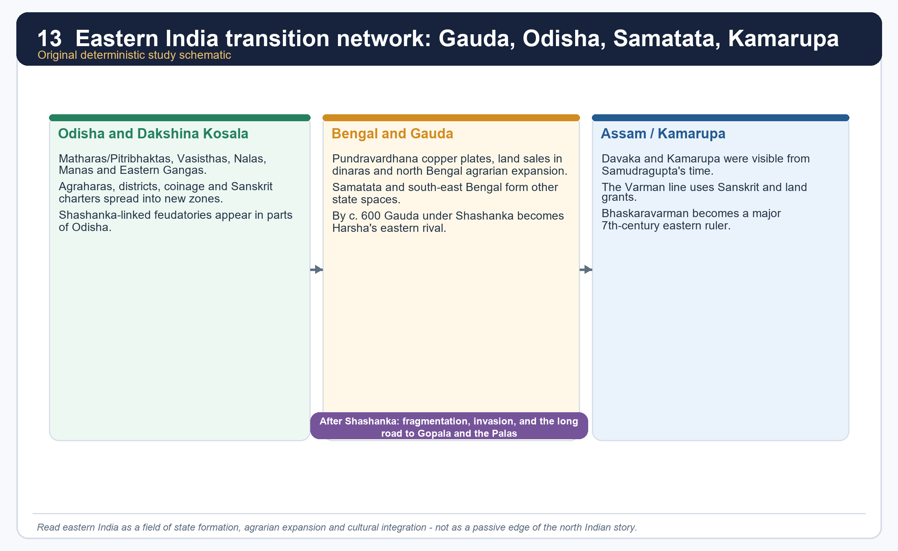

*The eastern panels summarise state formation, not exact dynastic sequence or exact territorial shape.*

#### Region matrix

| Region | Named evidence | Main process | Key caution |
|---|---|---|---|
| Odisha and Dakshina Kosala | Matharas/Pitribhaktas, Vasisthas, Nalas, Manas, Eastern Gangas | districts, coinage, agraharas, Sanskrit spread, cultivation into new zones | dynasties are many and unevenly documented |
| Bengal and Samatata | Pundravardhanabhukti copper plates, Gauda under Shashanka, Khadgas, Dandabhukti | land sales, dinara payments, military camps, local administration, agrarian expansion | north and south-east Bengal differ |
| Assam/Kamarupa | Ambari settlement, Davaka and Kamarupa, Varman line, Bhaskaravarman | grants, Sanskritic state formation, Brahmaputra basin consolidation | not all of Assam is equally documented |

#### Core teaching / solved practice

- [FACT] Sharma treats the eastern centuries from the mid-5th onward as momentous because multiple states, fiscal districts and military camps emerge in Bengal.
- [FACT] In Bengal, land sale documents in Pundravardhanabhukti from AD 432-33 onward show gold coin purchase, tax remission after endowment and the participation of scribes, merchants and landholders in local administration.
- [FACT] Odisha generated several states with taxation, military organisation, coinage and agrahara endowments; Sanskrit charters spread beyond the old coastal belt.
- [FACT] Assam/Kamarupa shows clear settlement, script, Sanskrit and grant evidence by the 6th-7th centuries.
- [ANALYSIS] Eastern India therefore exemplifies a historically powerful pattern: agrarian expansion, cultural integration and new political centres develop together.
- [LIMIT] A fully connected dynastic narrative is difficult; the stronger answer stresses process rather than pretending to know every royal succession equally well.

#### PARAGRAPH DEMONSTRATION — CLAIM → NAMED EVIDENCE → ANALYSIS → QUALIFICATION

[CLAIM] Eastern India's post-Gupta centuries should be answered as a structural process of regional state formation, not as a scattered dynastic list. [NAMED EVIDENCE] Pundravardhanabhukti copper plates from AD 432-33 onward record gold-coin land purchase and tax-remitted endowment; Odisha generates multiple lines with taxation, coinage and agrahara grants; and Assam/Kamarupa shows settlement, script and grants by the 6th-7th centuries under the Varman line. [ANALYSIS] Land sale documentation, agrahara endowment and Sanskritic grant culture recur across all three regions, showing that agrarian expansion, cultural integration and new political centres developed together rather than in isolated pockets. [QUALIFICATION] The three regions are not identical: Odisha, Bengal and Assam differ in chronology, ecology and political scale, so the answer should compare them rather than compress the east into a single uniform narrative.

#### Must-know facts

- Eastern India is one of the best regional case studies for early medieval state formation.
- Military camps with horses, elephants and boats are a repeated Bengal marker in Sharma.
- Sanskritisation and agrarian expansion move together in the record.

#### UPSC traps

- **Wrong:** Eastern India appears suddenly only under the Palas. **Correct:** the post-Gupta centuries already show dense political and agrarian change.
- **Wrong:** One eastern model fits Odisha, Bengal and Assam equally. **Correct:** write the east comparatively.

**Mains angle:** This section is where Topic 22 becomes more than Harsha biography; it becomes a structural regional history answer.

**Study link:** Sections 14-16; Topic 26 on regionalisation.

#### CLOSING RECALL FLOW — EASTERN INDIA: ODISHA, BENGAL AND ASSAM MOVE INTO DENSE HISTORICAL VISIBILITY

```text
START / CONCEPT: Eastern India: Odisha, Bengal and Assam move into dense historical visibility
        |
        v
EXACT TERMS: Odisha, Bengal, Assam · Pundravardhanabhukti plates · agraharas · military camps · fiscal districts · regional state formation
        |
        v
MECHANISM / ARGUMENT: Sharma treats the eastern centuries from the mid-5th onward as momentous because multiple states, fiscal districts and military camps emerge in Bengal.
        |
        v
CONSEQUENCE / CONTRAST: Eastern India is one of the best regional case studies for early medieval state formation.
        |
        v
UPSC TRAP / ANSWER-USE: Do not miss this limiting distinction: in Bengal, land sale documents in Pundravardhanabhukti from AD 432-33 onward show gold coin...
        |
        v
ANSWER-GRABBING FORMULATION: He explicitly describes the 4th-7th centuries as the period in which eastern Madhya Pradesh, Odisha, Bengal, south-east Bengal and Assam entered the orbit of advanced rural economy, inscriptional culture, state systems and social differentiation.
```
### SESSION 14 — LAND GRANTS, AGRARIAN EXPANSION AND NEW RIGHTS IN LAND

#### DEFINITION / WHAT THIS IS CALLED

**Plain-language definition:** The historical importance of grants is social and agrarian, not merely religious.

**Technical definition:** The formula to remember is "clearance + endowment + new rights + hierarchy.".

#### ANSWER-GRABBING OPENING — WRITE/ADAPT IN THE EXAM

> The historical importance of grants is social and agrarian, not merely religious.

#### MUST-WRITE KEYWORDS

- **land grants**
- **agrarian expansion**
- **new rights in land**
- **dinaras**
- **waste and fallow land**
- **clearance-endowment-hierarchy**

**How to use them:** Frame the answer through land grants as social-agrarian technology; define agrarian expansion through cleared or fallow land; connect new rights in land with dinaras to show the monetised transaction, and use waste and fallow land with clearance-endowment-hierarchy for the decisive process formula.

[FACT] Sharma's eastern evidence shows land sale, purchase and endowment working together. Fallow or uncultivated plots were often purchased for religious endowments; once granted, donees did not pay tax. Upinder's broader synthesis adds that grants must be read as part of larger agrarian, caste and cultural processes rather than as isolated pious acts.

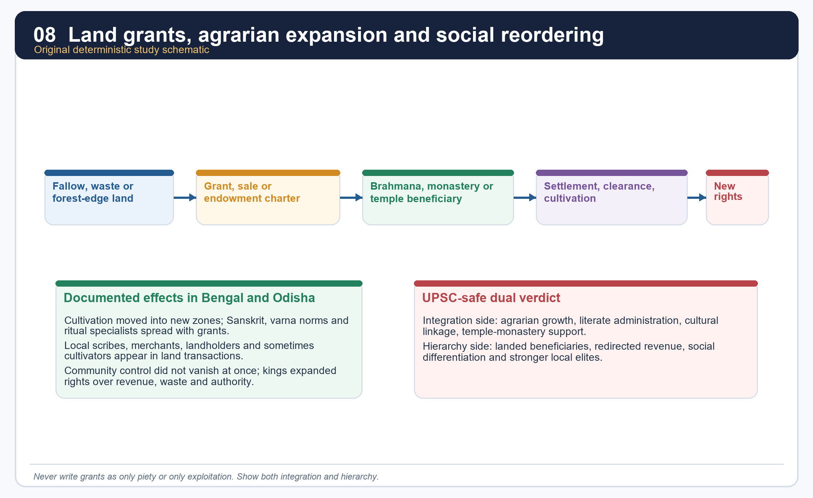

*This is a process diagram, not a claim that every grant followed one identical script.*

#### Core teaching / solved practice

- [FACT] Pundravardhanabhukti records show land bought with *dinaras*, then reclassified through religious endowment.
- [FACT] Sharma notes that ordinary cultivators could be consulted in village land-sale matters, even while leading artisans, merchants, landowners and scribes dominated community authority.
- [FACT] The king increasingly claimed rights over waste and fallow land, making large-scale grants possible.
- [FACT] Odisha's agraharas and Bengal's charters demonstrate the spread of new rights in land and revenue.
- [ANALYSIS] The grants did two things at once: they extended cultivation and they strengthened beneficiary control over resources, labour and status.
- [LIMIT] Neither "all land was privately owned" nor "all land remained communally held" fits the evidence. Rights were layered and in transition.

#### PARAGRAPH DEMONSTRATION — CLAIM → NAMED EVIDENCE → ANALYSIS → QUALIFICATION

[CLAIM] Land grants in the post-Gupta east are best read as social and agrarian technology, not merely as pious religious gifts. [NAMED EVIDENCE] Pundravardhanabhukti records show land purchased with *dinaras* and then reclassified as tax-exempt religious endowment; Sharma notes that ordinary cultivators could be consulted in village land-sale matters even as artisans, merchants and scribes dominated community authority; and kings increasingly claimed rights over waste and fallow land to make large grants possible. [ANALYSIS] The clearance-endowment-hierarchy sequence did two things simultaneously: it extended cultivation into new zones and it strengthened donee and royal control over resources, labour and local status, which is why grants are political-economic instruments as much as acts of piety. [QUALIFICATION] The evidence does not support either extreme: land was neither uniformly private property nor uniformly communal, and rights over it were layered and actively being renegotiated during this transition.

#### Must-know facts

- Grants often targeted uncultivated or frontier land.
- Communities retained some say, but royal and donee rights expanded.
- The historical importance of grants is social and agrarian, not merely religious.

#### UPSC traps

- **Wrong:** Land grants were only harmless charity. **Correct:** they reorganised rural power.
- **Wrong:** All communal authority disappeared immediately. **Correct:** local participation and layered rights remained visible.

**Mains angle:** The formula to remember is "clearance + endowment + new rights + hierarchy."

**Study link:** Section 15 on the economy debate; Topic 26 on grant historiography.

#### CLOSING RECALL FLOW — LAND GRANTS, AGRARIAN EXPANSION AND NEW RIGHTS IN LAND

```text
START / CONCEPT: Land grants, agrarian expansion and new rights in land
        |
        v
EXACT TERMS: land grants · agrarian expansion · new rights in land · dinaras · waste and fallow land · clearance-endowment-hierarchy
        |
        v
MECHANISM / ARGUMENT: Pundravardhanabhukti records show land bought with dinaras, then reclassified through religious endowment.
        |
        v
CONSEQUENCE / CONTRAST: Communities retained some say, but royal and donee rights expanded.
        |
        v
UPSC TRAP / ANSWER-USE: Fallow or uncultivated plots were often purchased for religious endowments; once granted, donees did not pay tax.
        |
        v
ANSWER-GRABBING FORMULATION: The historical importance of grants is social and agrarian, not merely religious.
```
### SESSION 15 — ECONOMY, ROUTES, TOWNS AND THE URBAN-DECLINE DEBATE

#### DEFINITION / WHAT THIS IS CALLED

**Plain-language definition:** The post-Gupta economy shows regional unevenness: contracting older imperial centres alongside newly monetised, institutionally wealthy eastern zones.

**Technical definition:** Sharma's capital-shift argument documents reduced money use and trade centrality around Pataliputra, but eastern gold-coin land purchases, Nalanda's agrarian support base and continuing camp-based commerce require a regionally differentiated verdict rather than one uniform decline curve.

#### ANSWER-GRABBING OPENING — WRITE/ADAPT IN THE EXAM

> Post-Gupta economic change is regionally uneven: some older centres contracted while eastern institutions and coin use flourished.

#### MUST-WRITE KEYWORDS

- **Pataliputra-Kannauj contrast**
- **gold-coin land purchase**
- **Nalanda's agrarian support**
- **regionalisation**
- **uneven transformation**
- **monetisation debate**

**How to use them:** Frame the answer through the Pataliputra-Kannauj contrast; define gold-coin land purchase as the eastern counter-indicator; connect Nalanda's agrarian support with regionalisation to explain uneven transformation, and use monetisation debate for the decisive qualification against a single decline model.

[FACT] Sharma's capital-shift argument is important, but Topic 22 cannot stop there. The same eastern record also shows coin purchase of land, organised military camps, tax machinery, monastic wealth and state activity. Upinder's regional-state approach helps correct the overly uniform decline model.

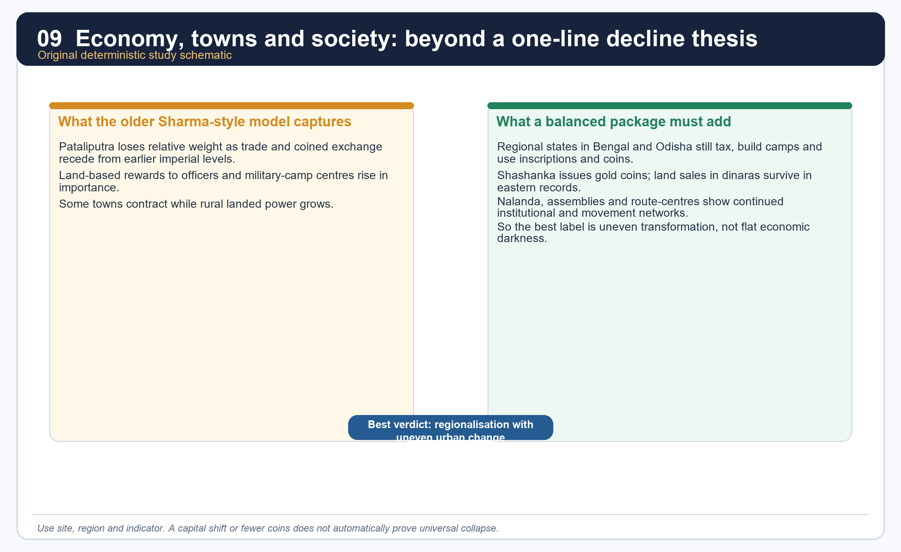

*The matrix contrasts a useful older model with a more balanced synthetic reading.*

#### Core teaching / solved practice

- [FACT] Sharma reads the decline of Pataliputra and the rise of Kannauj as tied to reduced money use, land grants and the greater importance of strategic-camp centres.
- [FACT] Yet eastern Bengal plates show land purchased with gold coin, and Upinder notes that kings such as Shashanka issued gold coins in Bengal.
- [FACT] Nalanda was supported by revenues from many villages, showing the concentration of agrarian surplus into large institutions.
- [ANALYSIS] Uneven transformation denotes the coexistence of declining older urban centrality with growing regional nodes, monasteries and political centres.
- [LIMIT] Do not infer trade volume, urban population or monetisation level from one type of evidence alone.
- [ANALYSIS] Topic 22 is a good place to demonstrate the difference between "urban contraction in some zones" and "civilisational darkness everywhere."

#### PARAGRAPH DEMONSTRATION — CLAIM → NAMED EVIDENCE → ANALYSIS → QUALIFICATION

[CLAIM] The post-Gupta economy must be written as regionally uneven transformation, not as a single all-India decline curve. [NAMED EVIDENCE] Sharma reads Pataliputra's fall and Kannauj's rise as tied to reduced money use and greater land-based reward; yet Bengal plates show land purchased with gold *dinaras*, Shashanka issued his own gold coinage, and Nalanda was supported by revenues drawn from some 200 villages. [ANALYSIS] The coexistence of a contracting old imperial centre with a monetised, institutionally wealthy east proves that "decline" and "growth" operated simultaneously in different places, so a single blanket verdict misreads the evidence. [QUALIFICATION] Trade volume, urban population or monetisation intensity cannot be inferred from any one indicator alone; the safest exam method compares multiple indicators before reaching a regional verdict.

#### Must-know facts

- Sharma's decline thesis remains useful, especially for Pataliputra versus Kannauj.
- Coin use and institutional wealth did not disappear uniformly.
- Regionalisation is the key corrective category.

#### UPSC traps

- **Wrong:** Harsha's age was either fully prosperous or fully collapsed. **Correct:** it was regionally uneven.
- **Wrong:** One capital shift proves a total subcontinental economic law. **Correct:** compare multiple indicators.

**Mains angle:** Use one line from Sharma, one eastern counter-indicator, and one balanced verdict.

**Study link:** Topic 19 on crafts and commerce; Topic 26 on transition debate.

#### CLOSING RECALL FLOW — ECONOMY, ROUTES, TOWNS AND THE URBAN-DECLINE DEBATE

```text
START / CONCEPT: Economy, routes, towns and the urban-decline debate
        |
        v
EXACT TERMS: Pataliputra-Kannauj contrast · gold-coin land purchase · Nalanda's agrarian support · regionalisation · uneven transformation · monetisation debate
        |
        v
MECHANISM / ARGUMENT: Nalanda was supported by revenues from many villages, showing the concentration of agrarian surplus into large institutions.
        |
        v
CONSEQUENCE / CONTRAST: Do not infer trade volume, urban population or monetisation level from one type of evidence alone.
        |
        v
UPSC TRAP / ANSWER-USE: Coin use and institutional wealth did not disappear uniformly.
        |
        v
ANSWER-GRABBING FORMULATION: Post-Gupta economic change is regionally uneven: some older centres contracted while eastern institutions and coin use flourished.
```
### SESSION 16 — SOCIETY, CASTE, GENDER AND PENAL ORDER: WHAT THE EVIDENCE REALLY ALLOWS

#### DEFINITION / WHAT THIS IS CALLED

**Plain-language definition:** Post-Gupta social evidence is more agrarian and administrative than domestic, showing landed differentiation, Brahmanical integration and elite women's political visibility, alongside large gaps on common life.

**Technical definition:** The social record must be read at the level each source can actually support: eastern charters reveal landholding groups and revenue relations, Bana's Rajyashri episode reveals elite court politics, and Xuanzang's penal descriptions reveal a foreign observer's selective, occasionally idealised lens.

#### ANSWER-GRABBING OPENING — WRITE/ADAPT IN THE EXAM

> Social answers here should move from visible landed and elite groups to the invisible gaps in common experience, not claim equal evidence for everyone.

#### MUST-WRITE KEYWORDS

- **landed differentiation**
- **Brahmanical integration**
- **Rajyashri's near-sati episode**
- **Xuanzang's penal account**
- **elite-source bias**
- **peasant consultation**

**How to use them:** Frame the answer through landed differentiation and Brahmanical integration; define Rajyashri's near-sati episode as elite evidence; connect Xuanzang's penal account with elite-source bias to show the source limit, and use peasant consultation for the decisive counter-example of local agency.

[FACT] The eastern charters, Bana and Xuanzang together suggest a society of cultivators, scribes, merchants, beneficiaries, subordinate rulers and growing Brahmanical normativity. But the evidence is uneven and often elite.

#### Core teaching / solved practice

- [FACT] Sharma repeatedly notes the spread of Sanskrit, varna ideology and Brahmanical learning into eastern regions through grants and official culture.
- [FACT] Local records reveal scribes, merchants, landholders and peasants participating in land transactions and administration.
- [FACT] Rajyashri's near-sati episode is an important narrative detail, but it is the experience of an elite princess in a courtly text, not a social census.
- [FACT] Xuanzang reports severe punishments and legal order, but he also seems at times to idealise or translate Indian social reality for a Chinese audience.
- [ANALYSIS] The best social answer therefore balances what is visible - landed differentiation, Brahmanical integration, peasant consultation, elite women in dynastic politics - against what remains opaque, especially common women's work and subaltern voices.
- [LIMIT] Topic 22 should not import without care all the Gupta-age social evidence of Topic 21. The overlap exists, but the post-Gupta archive has its own regional emphases.

#### PARAGRAPH DEMONSTRATION — CLAIM → NAMED EVIDENCE → ANALYSIS → QUALIFICATION

[CLAIM] Post-Gupta social evidence is visible mainly at the landed, administrative and elite-court levels, with common life remaining comparatively opaque. [NAMED EVIDENCE] Local eastern records name scribes, merchants, landholders and peasants participating in land transactions; Rajyashri's near-sati episode dramatises an elite princess's crisis within a courtly text; and Xuanzang reports severe legal punishments while also seeming, at points, to idealise Indian order for a Chinese audience. [ANALYSIS] Reading these together shows growing Brahmanical integration and landed differentiation at the visible tiers, while common women's work and subaltern experience remain largely outside the surviving record. [QUALIFICATION] A single dramatic elite episode such as Rajyashri's crisis cannot be generalised into a social custom, and Xuanzang's penal account needs the same audience-and-purpose caution applied elsewhere in this package.

#### Must-know facts

- Social evidence here is more agrarian and administrative than literary-domestic.
- Rajyashri is politically central but socially unrepresentative.
- Penal descriptions in Xuanzang need source caution.

#### UPSC traps

- **Wrong:** One dramatic elite episode proves a general social custom. **Correct:** state the social level and source type.
- **Wrong:** Eastern grants only show institutions, not society. **Correct:** they reveal social groups and changing landed relations.

**Mains angle:** Social answers should move from visible groups to invisible gaps, not pretend equal evidence for everyone.

**Study link:** Topic 21 for the earlier Gupta social archive.

#### CLOSING RECALL FLOW — SOCIETY, CASTE, GENDER AND PENAL ORDER: WHAT THE EVIDENCE REALLY ALLOWS

```text
START / CONCEPT: Society, caste, gender and penal order: what the evidence really allows
        |
        v
EXACT TERMS: landed differentiation · Brahmanical integration · Rajyashri's near-sati episode · Xuanzang's penal account · elite-source bias · peasant consultation
        |
        v
MECHANISM / ARGUMENT: Social answers should move from visible groups to invisible gaps, not pretend equal evidence for everyone.
        |
        v
CONSEQUENCE / CONTRAST: Rajyashri's near-sati episode is an important narrative detail, but it is the experience of an elite princess in a courtly text, not a social census.
        |
        v
UPSC TRAP / ANSWER-USE: Do not miss this limiting distinction: the best social answer therefore balances what is visible - landed differentiation, Brahmanical integration...
        |
        v
ANSWER-GRABBING FORMULATION: Social answers here should move from visible landed and elite groups to the invisible gaps in common experience, not claim equal evidence for everyone.
```
### SESSION 17 — RELIGION UNDER HARSHA: SHAIVA, BUDDHIST, SOLAR AND ECUMENICAL IDIOMS

#### DEFINITION / WHAT THIS IS CALLED

**Plain-language definition:** Sharma describes Harsha as tolerant: initially Shaiva, later a great patron of Buddhism.

**Technical definition:** The strongest formulation is "plural royal idioms under one court.".

#### ANSWER-GRABBING OPENING — WRITE/ADAPT IN THE EXAM

> His inscriptions and Bana point Shaiva; Xuanzang points Buddhist preference; the assemblies show Buddha, Shiva and Sun worship on successive days.

#### MUST-WRITE KEYWORDS

- **Religion under Harsha**
- **Shaiva**
- **Buddhist**
- **solar**
- **ecumenical idioms**
- **strategic multi-sect legitimation**

**How to use them:** Frame the answer through Religion under Harsha; define Shaiva, connect Buddhist with solar to explain the mechanism, and use strategic multi-sect legitimation for the decisive comparison or qualification.

[FACT] Upinder provides a nuanced religious profile: early Pushyabhuti rulers seem to have been worshippers of Surya; Rajyavardhana was a devotee of the Buddha; Harsha appears as a devotee of Shiva in *Harshacharita* and his inscriptions, while Xuanzang depicts him as especially inclined toward Buddhism.

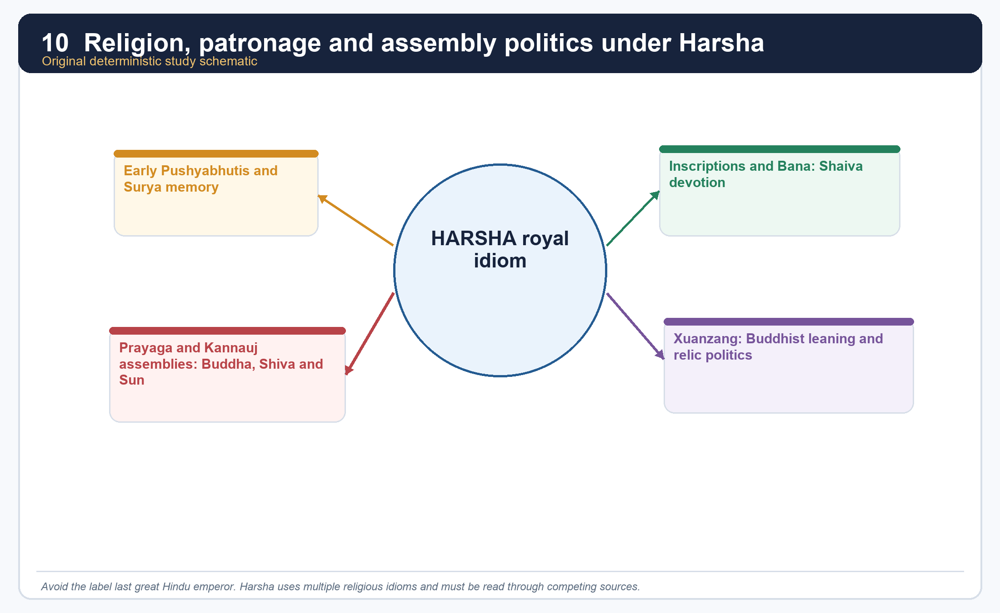

*This diagram emphasises overlapping idioms, not a single label.*

#### Core teaching / solved practice

- [FACT] Harsha's religious image cannot be reduced to one term. His inscriptions and Bana point Shaiva; Xuanzang points Buddhist preference; the assemblies show Buddha, Shiva and Sun worship on successive days.
- [FACT] Sharma describes Harsha as tolerant: initially Shaiva, later a great patron of Buddhism.
- [FACT] Upinder also records Harsha's aggressive demand from the king of Kashmir for a Buddha tooth relic, showing that Buddhist patronage could also take competitive political form.
- [ANALYSIS] The word "eclectic" is useful if it means strategic multi-sect legitimation, not vague syncretism.
- [LIMIT] Do not call Harsha secular in a modern constitutional sense. His religious patronage is explicitly political and royal.

#### PARAGRAPH DEMONSTRATION — CLAIM → NAMED EVIDENCE → ANALYSIS → QUALIFICATION

[CLAIM] Harsha's religious profile is best described as plural royal idioms held together under one court, not as membership in a single sect. [NAMED EVIDENCE] Upinder records early Pushyabhuti solar association, Rajyavardhana's Buddhist devotion, Harsha's own inscriptions and Bana pointing to Shaiva worship, Xuanzang's depiction of strong Buddhist inclination, and his demand for a Buddha-tooth relic from Kashmir's king. [ANALYSIS] Rather than contradicting each other, these strands show strategic multi-sect legitimation: a ruler who worships and patronises across Surya, Shiva and Buddha idioms extends his claim to authority across multiple constituencies at once. [QUALIFICATION] This plurality should not be read as modern secular neutrality; each act of patronage, including the aggressive relic demand, remains an assertion of royal and political prestige rather than disinterested tolerance.

#### Must-know facts

- Surya, Shiva and Buddha all appear in the Pushyabhuti-Harsha record.
- Harsha's profile changes depending on which source one reads.
- Religious policy is part of kingship, not separate from it.

#### UPSC traps

- **Wrong:** Harsha was only a Buddhist ruler. **Correct:** Buddhist preference coexists with Shaiva and solar idioms.
- **Wrong:** "Tolerant" means politically neutral. **Correct:** patronage and assembly ritual also stage royal hierarchy.

**Mains angle:** The strongest formulation is "plural royal idioms under one court."

**Study link:** Section 18 on assemblies and Section 19 on Nalanda.

#### CLOSING RECALL FLOW — RELIGION UNDER HARSHA: SHAIVA, BUDDHIST, SOLAR AND ECUMENICAL IDIOMS

```text
START / CONCEPT: Religion under Harsha: Shaiva, Buddhist, solar and ecumenical idioms
        |
        v
EXACT TERMS: Religion under Harsha · Shaiva · Buddhist · solar · ecumenical idioms · strategic multi-sect legitimation
        |
        v
MECHANISM / ARGUMENT: Sharma describes Harsha as tolerant: initially Shaiva, later a great patron of Buddhism.
        |
        v
CONSEQUENCE / CONTRAST: Do not call Harsha secular in a modern constitutional sense.
        |
        v
UPSC TRAP / ANSWER-USE: Upinder provides a nuanced religious profile: early Pushyabhuti rulers seem to have been worshippers of Surya; Rajyavardhana was a devotee of the Buddha; Harsha appears as a devotee of Shiva in Harshacharita and his inscriptions, while Xuanzang depicts him as especially inclined toward Buddhism.
        |
        v
ANSWER-GRABBING FORMULATION: His inscriptions and Bana point Shaiva; Xuanzang points Buddhist preference; the assemblies show Buddha, Shiva and Sun worship on successive days.
```
### SESSION 18 — KANNAUJ AND PRAYAGA ASSEMBLIES: CHARITY, DEBATE AND POLITICAL THEATRE

#### DEFINITION / WHAT THIS IS CALLED

**Plain-language definition:** Prayaga assembly is a key memory site of Harsha's kingship.

**Technical definition:** In exam answers, assemblies are the best evidence for how ideology and hierarchy were performed before a multi-polity audience.

#### ANSWER-GRABBING OPENING — WRITE/ADAPT IN THE EXAM

> Prayaga assembly is a key memory site of Harsha's kingship.

#### MUST-WRITE KEYWORDS

- **Kannauj**
- **Prayaga assemblies**
- **charity**
- **debate**
- **political theatre**
- **quinquennial distribution**

**How to use them:** Frame the answer through Kannauj; define Prayaga assemblies, connect charity with debate to explain the mechanism, and use quinquennial distribution with political theatre for the decisive comparison or qualification.

[FACT] Upinder says Harsha convened a great assembly at Kannauj and quinquennial assemblies at Prayaga; Xuanzang personally attended one of the latter. Many kings including those of Assam and Valabhi were present, along with shramanas, Brahmanas and adherents of various sects.

#### Core teaching / solved practice

- [FACT] Xuanzang describes religious discourses, lavish distribution of gifts and worship of the Buddha, Shiva and the Sun on consecutive days.
- [FACT] Sharma echoes the image of extraordinary royal generosity at Prayaga.
- [ANALYSIS] These assemblies were not only acts of piety. They were imperial spectacles where subordinate presence, doctrinal display, charity and public ranking fused into one event.
- [ANALYSIS] In exam answers, assemblies are the best evidence for how ideology and hierarchy were performed before a multi-polity audience.
- [LIMIT] Xuanzang admired Harsha; therefore the generosity and harmony of the occasion should be read as both observation and political idealisation.

#### PARAGRAPH DEMONSTRATION — CLAIM → NAMED EVIDENCE → ANALYSIS → QUALIFICATION

[CLAIM] Harsha's Kannauj and Prayaga assemblies functioned as political theatre that converted religious charity into visible sovereignty. [NAMED EVIDENCE] Upinder records a great assembly at Kannauj and quinquennial assemblies at Prayaga, one of which Xuanzang personally attended; he describes religious discourses, lavish gift distribution and worship of the Buddha, Shiva and the Sun on consecutive days, with kings of Assam and Valabhi among those present. [ANALYSIS] Multi-sect ritual, subordinate attendance and public charity fused into a single spectacle in which doctrinal display and princely ranking reinforced each other, so the assemblies should be read as soft power made visible, not simply as pious festivals. [QUALIFICATION] Xuanzang admired Harsha, so his account of harmony and generosity should be read as both direct observation and political idealisation of an ideal Buddhist king.

#### Must-know facts

- Prayaga assembly is a key memory site of Harsha's kingship.
- Valabhi and Assam are named in the assembly context.
- Multi-sect presence does not erase royal hierarchy; it dramatizes it.

#### UPSC traps

- **Wrong:** Treat the assemblies as only religious festivals. **Correct:** they are political theatre as well.
- **Wrong:** Assume all attendees were equal partners. **Correct:** the event reinforces graded power.

**Mains angle:** Assemblies convert soft power into visible sovereignty.

**Study link:** Sections 6, 12 and 17.

#### CLOSING RECALL FLOW — KANNAUJ AND PRAYAGA ASSEMBLIES: CHARITY, DEBATE AND POLITICAL THEATRE

```text
START / CONCEPT: Kannauj and Prayaga assemblies: charity, debate and political theatre
        |
        v
EXACT TERMS: Kannauj · Prayaga assemblies · charity · debate · political theatre · quinquennial distribution
        |
        v
MECHANISM / ARGUMENT: Correct: they are political theatre as well.
        |
        v
CONSEQUENCE / CONTRAST: Xuanzang admired Harsha; therefore the generosity and harmony of the occasion should be read as both observation and political idealisation.
        |
        v
UPSC TRAP / ANSWER-USE: These assemblies were not only acts of piety.
        |
        v
ANSWER-GRABBING FORMULATION: Prayaga assembly is a key memory site of Harsha's kingship.
```
### SESSION 19 — NALANDA, LEARNING NETWORKS AND THE SCALE PROBLEM

#### DEFINITION / WHAT THIS IS CALLED

**Plain-language definition:** Nalanda is central to Harsha's age, but it must be dated carefully.

**Technical definition:** Nalanda is the best example for linking agrarian surplus, royal patronage and intellectual prestige.

#### ANSWER-GRABBING OPENING — WRITE/ADAPT IN THE EXAM

> Nalanda is central to Harsha's age, but it must be dated carefully.

#### MUST-WRITE KEYWORDS

- **Nalanda**
- **200-village support**
- **10,000 vs 3,000 figure**
- **Xuanzang, 627-645 CE**
- **Yijing's correction**
- **trans-Asian learning network**

**How to use them:** Frame the answer through Nalanda's institutional scale; define 200-village support as its agrarian base; connect the 10,000 vs 3,000 figure with Yijing's correction to show numerical caution, and use Xuanzang's 627-645 CE journey with trans-Asian learning network for the decisive intellectual-exchange point.

[FACT] Nalanda is central to Harsha's age, but it must be dated carefully. Topic 21 already warns that Nalanda's beginnings lie in the 5th century; Topic 22 adds that its institutional fame is fully visible in the 7th century through Xuanzang and later Yijing.

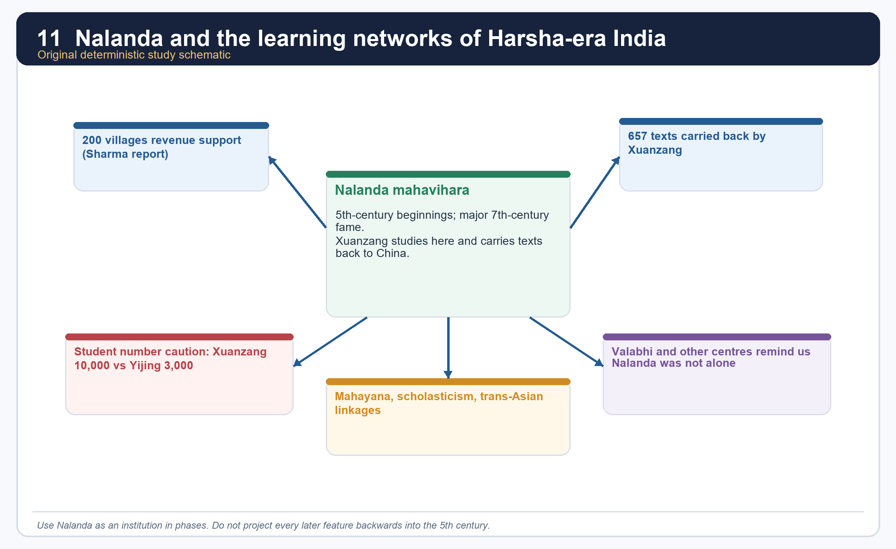

*The numbers in the image are comparative teaching aids, not a claim of exact campus census.*

#### Core teaching / solved practice

- [FACT] Sharma says Nalanda was the most famous Buddhist centre in the time of the Chinese pilgrim and that it was supported by revenues from 200 villages.
- [FACT] Sharma also notes the famous claim of 10,000 students, all monks, but uses archaeology and Yijing's later figure of 3,000 monks to question the literal magnitude.
- [FACT] Upinder records Xuanzang's long scholarly journey, his departure from China in 627 CE, his return in 645 CE and the transport of 657 Buddhist texts back to China.
- [FACT] Upinder also points to Valabhi as another important centre in the wider scholastic world.
- [ANALYSIS] Nalanda therefore teaches three exam lessons at once: institutional scale, agrarian support base and trans-Asian intellectual movement.
- [LIMIT] Do not project all later Buddhist institutional features backward into Harsha's precise moment, and do not repeat the 10,000 figure uncritically.

#### PARAGRAPH DEMONSTRATION — CLAIM → NAMED EVIDENCE → ANALYSIS → QUALIFICATION

[CLAIM] Nalanda demonstrates the convergence of agrarian surplus, royal patronage and trans-Asian intellectual prestige, but its exact scale must be handled critically. [NAMED EVIDENCE] Sharma records that Nalanda was supported by revenues from 200 villages and was famed as the leading Buddhist centre in Xuanzang's time, who departed China in 627 CE and returned in 645 CE carrying 657 Buddhist texts; the often-quoted figure of 10,000 monk-students is checked against Yijing's later count of about 3,000. [ANALYSIS] The 200-village support figure is as historically significant as the enrolment claim, because it shows institutional scale resting on land revenue rather than on charity alone, while the 10,000-versus-3,000 gap teaches the specific skill of weighing traveller testimony against later corroboration. [QUALIFICATION] Nalanda's fifth-century origins and seventh-century fame are not the same moment; institutional features visible under later Pala patronage should not be read back into Harsha's precise period.

#### Must-know facts

- Nalanda's support base was agrarian as well as scholastic.
- Xuanzang's journey made India-China intellectual exchange visible.
- Student numbers require caution.

#### UPSC traps

- **Wrong:** Nalanda was already identical in the 5th and 7th centuries. **Correct:** institutional development was cumulative.
- **Wrong:** One giant student number is more important than the support structure. **Correct:** the 200-village support claim is equally revealing.

**Mains angle:** Nalanda is the best example for linking agrarian surplus, royal patronage and intellectual prestige.

**Study link:** Topic 10 on Buddhism; Section 17 on religious patronage.

#### CLOSING RECALL FLOW — NALANDA, LEARNING NETWORKS AND THE SCALE PROBLEM

```text
START / CONCEPT: Nalanda, learning networks and the scale problem
        |
        v
EXACT TERMS: Nalanda · 200-village support · 10,000 vs 3,000 figure · Xuanzang, 627-645 CE · Yijing's correction · trans-Asian learning network
        |
        v
MECHANISM / ARGUMENT: Sharma says Nalanda was the most famous Buddhist centre in the time of the Chinese pilgrim and that it was supported by revenues from 200 villages.
        |
        v
CONSEQUENCE / CONTRAST: Sharma also notes the famous claim of 10,000 students, all monks, but uses archaeology and Yijing's later figure of 3,000 monks to question the literal magnitude.
        |
        v
UPSC TRAP / ANSWER-USE: Do not project all later Buddhist institutional features backward into Harsha's precise moment, and do not repeat the 10,000 figure uncritically.
        |
        v
ANSWER-GRABBING FORMULATION: Nalanda is central to Harsha's age, but it must be dated carefully.
```
### SESSION 20 — LITERATURE, COURT CULTURE AND AUTHORSHIP CAUTION

#### DEFINITION / WHAT THIS IS CALLED

**Plain-language definition:** Court association is meaningful, but ancient authorship traditions are not modern publication contracts.

**Technical definition:** Harsha's literary aura functions as political communication: Bana's biography, the attributed plays and the personally signed Banskhera charter all extend royal prestige through cultural production, even where exact authorship cannot be verified with modern certainty.

#### ANSWER-GRABBING OPENING — WRITE/ADAPT IN THE EXAM

> Court association is meaningful, but ancient authorship traditions are not modern publication contracts.

#### MUST-WRITE KEYWORDS

- **Bana's Harshacharita and Kadambari**
- **attributed plays**
- **Banskhera signature**
- **court poets**
- **authorship caution**
- **literary patronage as politics**

**How to use them:** Frame the answer through Bana's *Harshacharita* and *Kadambari*; define the attributed plays cautiously; connect the Banskhera signature with court poets to show royal literary self-fashioning, and use authorship caution with literary patronage as politics for the decisive qualification.

[FACT] Harsha's age is rich in literary association: Bana's *Harshacharita* and *Kadambari*; Harsha's attributed plays *Ratnavali*, *Priyadarshika* and *Nagananda*; and the courtly association of writers such as Bana, Mayura and Matanga Divakara.

#### Core teaching / solved practice

- [FACT] Upinder says Harsha was a patron of learning and arts and that he may himself have composed the text of the Banskhera and Madhuban inscriptions; the Banskhera charter carries the king's signature and reflects calligraphic skill.
- [FACT] Upinder also reports the literary tradition that Harsha wrote three dramas, a work on grammar and at least two sutra works.
- [ANALYSIS] The correct exam posture is respect plus caution. Court association is meaningful, but ancient authorship traditions are not modern publication contracts.
- [FACT] Sharma also preserves the image of Harsha as a literary ruler and generous patron.
- [LIMIT] Do not write as if every attributed text and every court association is equally certain. The safer phrase is "texts attributed to Harsha" or "the courtly tradition associates Harsha with..."

#### PARAGRAPH DEMONSTRATION — CLAIM → NAMED EVIDENCE → ANALYSIS → QUALIFICATION

[CLAIM] Harsha's literary aura is itself a political instrument, not a separate cultural footnote to his reign. [NAMED EVIDENCE] Bana's *Harshacharita* and *Kadambari* anchor his court's literary prestige; the plays *Ratnavali*, *Priyadarshika* and *Nagananda* are traditionally attributed to Harsha himself; and Upinder notes he may have personally composed the Banskhera and Madhuban inscriptions, with the Banskhera charter carrying his own signature. [ANALYSIS] A king who drafts and signs his own charters while patronising poets and dramatists is converting literary skill directly into royal legitimacy, which is why court literature belongs inside political history, not beside it. [QUALIFICATION] Ancient authorship traditions are not modern publication contracts, so the safe phrasing is "texts attributed to Harsha" or "the courtly tradition associates Harsha with," never an unqualified claim of sole authorship.

#### Must-know facts

- Bana is both source and stylistic monument.
- Harsha's literary aura is part of kingship, not only cultural trivia.
- Authorship caution is essential.

#### UPSC traps

- **Wrong:** Treat attributed plays as unquestioned autograph manuscripts of the king. **Correct:** state the attribution carefully.
- **Wrong:** Separate culture from politics. **Correct:** court literature is political communication too.

**Mains angle:** The court is a cultural machine: inscription, drama, biography and patronage reinforce kingship.

**Study link:** Section 21 on source criticism.

#### CLOSING RECALL FLOW — LITERATURE, COURT CULTURE AND AUTHORSHIP CAUTION

```text
START / CONCEPT: Literature, court culture and authorship caution
        |
        v
EXACT TERMS: Bana's Harshacharita and Kadambari · attributed plays · Banskhera signature · court poets · authorship caution · literary patronage as politics
        |
        v
MECHANISM / ARGUMENT: Correct: court literature is political communication too.
        |
        v
CONSEQUENCE / CONTRAST: Do not write as if every attributed text and every court association is equally certain.
        |
        v
UPSC TRAP / ANSWER-USE: Harsha's literary aura is part of kingship, not only cultural trivia.
        |
        v
ANSWER-GRABBING FORMULATION: Court association is meaningful, but ancient authorship traditions are not modern publication contracts.
```
### SESSION 21 — READING HARSHA'S AGE CRITICALLY: BANA, XUANZANG, INSCRIPTIONS AND AIHOLE TOGETHER

#### DEFINITION / WHAT THIS IS CALLED

**Plain-language definition:** Bana and Xuanzang are not to be rejected; they are to be triangulated.

**Technical definition:** Reading Harsha's age critically means naming each source's genre and audience before using it: Bana's courtly biography, Xuanzang's Buddhist pilgrim account, the Banskhera-Madhuban charters' administrative purpose and Aihole's rival Chalukya eulogy each prove a different, bounded slice of the same world.

#### ANSWER-GRABBING OPENING — WRITE/ADAPT IN THE EXAM

> Bana and Xuanzang are not to be rejected; they are to be triangulated.

#### MUST-WRITE KEYWORDS

- **source triangulation**
- **Bana's courtly genre**
- **Xuanzang's audience and purpose**
- **Banskhera-Madhuban documentary limit**
- **Aihole's rival rhetoric**
- **claim-source-corroboration-limitation**

**How to use them:** Frame the answer through source triangulation; define Bana's courtly genre as literary praise; connect Xuanzang's audience and purpose with the Banskhera-Madhuban documentary limit to show method, and use Aihole's rival rhetoric with claim-source-corroboration-limitation for the decisive answer-writing formula.

[FACT] This topic is one of the clearest UPSC training grounds for source criticism. Bana, Xuanzang, the Banskhera-Madhuban charters and the Aihole inscription illuminate the same world from different angles.

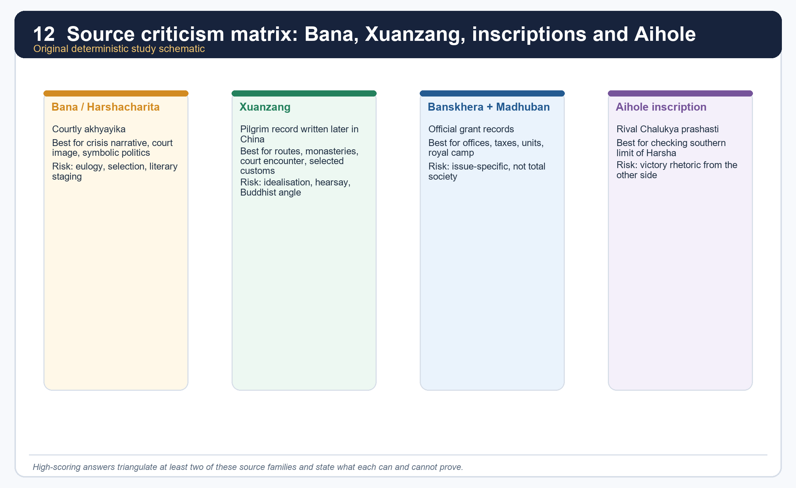

*The matrix is meant to be used directly in answer writing.*

#### Comparison matrix

| Source | Best for | Main problem | Safe use formula |
|---|---|---|---|
| *Harshacharita* | accession crisis, courtly ideals, symbolic politics | praise, selective narration, literary design | "Bana suggests..." |
| Xuanzang | routes, monasteries, royal encounter, selected customs | Buddhist agenda, later composition, occasional hearsay | "Xuanzang reports..." |
| Banskhera/Madhuban | offices, dues, administrative vocabulary, grant context | narrow documentary purpose | "inscriptions indicate..." |
| Aihole | Pulakeshin's memory of checking Harsha | rival victory rhetoric | "Aihole provides the crucial southern counter-evidence..." |

#### Core teaching / solved practice

- [FACT] Upinder explicitly asks the historian to keep authors' perspective, purpose and audience in mind.
- [FACT] She notes that Xuanzang wrote after returning to China, for a Tang imperial and monastic audience, and that not every place he described was necessarily personally visited.
- [FACT] She also stresses the literary-aesthetic structure of Bana's biography and the possibility of symbolic reading in the Rajyashri episode.
- [ANALYSIS] The payoff is large: once source criticism is built in, Harsha's age becomes richer, not poorer. One can see statecraft, ideology, ritual and historical memory operating together.
- [LIMIT] A weak answer strips isolated facts from these texts and treats them as flat data. A strong answer states who is speaking and why.

#### PARAGRAPH DEMONSTRATION — CLAIM → NAMED EVIDENCE → ANALYSIS → QUALIFICATION

[CLAIM] Source criticism is itself examinable content in Topic 22: Harsha's age becomes richer, not poorer, once each text's genre and audience are named. [NAMED EVIDENCE] Upinder stresses that Xuanzang wrote after returning to China for a Tang imperial and monastic audience and did not necessarily visit every place he describes; she equally stresses the literary-aesthetic design of Bana's biography and the possible symbolic reading of the Rajyashri episode; the Banskhera-Madhuban charters supply narrow but concrete documentary detail; and Aihole supplies the essential rival check on Harsha's own court record. [ANALYSIS] Naming each source's perspective, purpose and audience before citing it converts a flat fact list into an argument about statecraft, ideology, ritual and historical memory operating together. [QUALIFICATION] Bana should not be dismissed merely because he flatters, nor should Xuanzang be treated as having personally verified every place he wrote about; the safe formula throughout is claim -> source -> corroboration -> limitation.

#### Must-know facts

- Source criticism is itself examinable content.
- Bana and Xuanzang are not to be rejected; they are to be triangulated.
- Aihole is the indispensable rival voice.

#### UPSC traps

- **Wrong:** Bana is useless because he flatters. **Correct:** Bana is usable when genre is acknowledged.
- **Wrong:** Xuanzang visited and verified every single place he wrote about. **Correct:** hearsay and earlier descriptions matter in parts of his account.

**Mains angle:** The best answer on Harsha almost always improves when it contains one sentence on genre and perspective.

**Study link:** Topic 02 sources; Topic 01 historiography.

#### CLOSING RECALL FLOW — READING HARSHA'S AGE CRITICALLY: BANA, XUANZANG, INSCRIPTIONS AND AIHOLE TOGETHER

```text
START / CONCEPT: Reading Harsha's age critically: Bana, Xuanzang, inscriptions and Aihole together
        |
        v
EXACT TERMS: source triangulation · Bana's courtly genre · Xuanzang's audience and purpose · Banskhera-Madhuban documentary limit · Aihole's rival rhetoric · claim-source-corroboration-limitation
        |
        v
MECHANISM / ARGUMENT: Wrong: Bana is useless because he flatters.
        |
        v
CONSEQUENCE / CONTRAST: She notes that Xuanzang wrote after returning to China, for a Tang imperial and monastic audience, and that not every place he described was necessarily personally visited.
        |
        v
UPSC TRAP / ANSWER-USE: The payoff is large: once source criticism is built in, Harsha's age becomes richer, not poorer.
        |
        v
ANSWER-GRABBING FORMULATION: Bana and Xuanzang are not to be rejected; they are to be triangulated.
```
### SESSION 22 — HISTORICAL SIGNIFICANCE: FROM GUPTA CONTRACTION TO THE EARLY MEDIEVAL ORDER

#### DEFINITION / WHAT THIS IS CALLED

**Plain-language definition:** Eastern India is one of the clearest birth-zones of the early medieval order.

**Technical definition:** The post-Gupta age is simultaneously an imperial contraction and a regional creation: Gupta-style all-India kingship narrows to Harsha's bounded north Indian hegemony, while eastern India generates its own states, grants and agrarian expansion in parallel.

#### ANSWER-GRABBING OPENING — WRITE/ADAPT IN THE EXAM

> Eastern India is one of the clearest birth-zones of the early medieval order.

#### MUST-WRITE KEYWORDS

- **historical significance**
- **contraction and creation**
- **regional reorganisation**
- **648 CE**
- **Kannauj succession struggle**
- **early medieval threshold**

**How to use them:** Frame the answer through historical significance; define contraction and creation as the twin process; connect regional reorganisation with 648 CE to mark Harsha's death, and use the Kannauj succession struggle with early medieval threshold for the decisive closing verdict.

[FACT] Topic 26 already gives the historiographical debate. Topic 22 supplies one of its best historical laboratories. Sharma reads the period through land grants, declining old centres, military camps, growing landed intermediaries and the rise of Kannauj; later regional-state interpretations stress proliferation of new polities, agrarian expansion and cultural integration.

#### Core teaching / solved practice

- [FACT] Harsha gave a measure of political unity to a large part of north India, but not to the Deccan or the whole subcontinent.
- [FACT] Eastern India saw the spread of writing, Sanskrit, grants, districts, new states, military camps and expanding cultivation in precisely this period.
- [ANALYSIS] That means the post-Gupta age is both a contraction and a creation: contraction of one imperial centre, creation of many regional state societies.
- [ANALYSIS] The stronger answer therefore combines Sharma's structural sharpness with Upinder's wider regional-state model. It neither erases urban decline tendencies nor calls the period a dark age.
- [FACT] Harsha's death in 648 CE is followed by political turbulence and later the struggle for Kannauj among powers such as the Palas, Pratiharas and Rashtrakutas.
- [LIMIT] Pala rise belongs to the next large phase, but the route to it runs through Topic 22's eastern and Kannauj transitions.

#### PARAGRAPH DEMONSTRATION — CLAIM → NAMED EVIDENCE → ANALYSIS → QUALIFICATION

[CLAIM] The post-Gupta age's historical significance lies in the simultaneous contraction of imperial kingship and creation of regional state societies. [NAMED EVIDENCE] Harsha gave political unity to a large part of north India but not to the Deccan or the whole subcontinent; eastern India in the same period shows the spread of writing, Sanskrit, land grants, districts and expanding cultivation; and Harsha's death in 648 CE was followed by turbulence and a later struggle for Kannauj among the Palas, Pratiharas and Rashtrakutas. [ANALYSIS] Contraction of one all-India-aspiring centre and creation of many regional state societies are the same historical process viewed from two directions, which is why the strongest verdict combines Sharma's structural sharpness with a wider regional-state model. [QUALIFICATION] Pala consolidation belongs to the next historical phase, but the route to it runs directly through Topic 22's eastern transitions, so this package should end at the threshold rather than narrating the Palas themselves.

#### Must-know facts

- Harsha is a major but bounded hegemon.
- Eastern India is one of the clearest birth-zones of the early medieval order.
- The best label is regional reorganisation.

#### UPSC traps

- **Wrong:** Medieval India begins only with later invasions. **Correct:** many social-political transitions are already underway here.
- **Wrong:** Post-Gupta equals only decline. **Correct:** it is decline in some earlier forms and growth in new regional forms.

**Mains angle:** The sentence to remember is: "The age was neither a blank dark interlude nor a restored pan-Indian empire; it was a phase of regional reorganisation anchored in land, legitimacy and new political centres."

**Study link:** Topic 26 in full.

#### CLOSING RECALL FLOW — HISTORICAL SIGNIFICANCE: FROM GUPTA CONTRACTION TO THE EARLY MEDIEVAL ORDER

```text
START / CONCEPT: Historical significance: from Gupta contraction to the early medieval order
        |
        v
EXACT TERMS: historical significance · contraction and creation · regional reorganisation · 648 CE · Kannauj succession struggle · early medieval threshold
        |
        v
MECHANISM / ARGUMENT: Harsha's death in 648 CE is followed by political turbulence and later the struggle for Kannauj among powers such as the Palas, Pratiharas and Rashtrakutas.
        |
        v
CONSEQUENCE / CONTRAST: Harsha gave a measure of political unity to a large part of north India, but not to the Deccan or the whole subcontinent.
        |
        v
UPSC TRAP / ANSWER-USE: Harsha is a major but bounded hegemon.
        |
        v
ANSWER-GRABBING FORMULATION: Eastern India is one of the clearest birth-zones of the early medieval order.
```
### SESSION 23 — UPSC ANSWER ARCHITECTURE, OWNER BOUNDARIES AND MEMORY MAP

#### DEFINITION / WHAT THIS IS CALLED

**Plain-language definition:** This closing session is the answer-writing spine that converts 22 sessions of evidence into a marks-scaled Mains response while keeping Topic 22's boundary with neighbouring topics explicit.

**Technical definition:** The architecture scales evidence density to marks (3-4 units for 10 marks, 5-6 for 15, crisis-to-historiography for 20), while owner boundaries route Pulakeshin's southern polity to Topic 23, Gupta administration to Topic 20, Gupta society to Topic 21 and the full feudal-regional debate to Topic 26.

#### ANSWER-GRABBING OPENING — WRITE/ADAPT IN THE EXAM

> In the century after Gupta concentration weakened, Harsha briefly reunited much of north India while eastern India moved rapidly into regional state formation.

#### MUST-WRITE KEYWORDS

- **marks-scaled evidence density**
- **owner boundary**
- **memory triangle**
- **PYQ anchors**
- **Topic 20/21/23/26 routing**
- **bounded verdict**

**How to use them:** Frame the answer through marks-scaled evidence density; define the owner boundary with neighbouring topics; connect the memory triangle of Kannauj, the east and the Narmada limit with the PYQ anchors, and use Topic 20/21/23/26 routing with a bounded verdict to close.

[FACT] Topic 22 sits between Topic 20 (Gupta polity), Topic 21 (Gupta society/culture), Topic 23 (Pallava-Chalukya south) and Topic 26 (full ancient-to-medieval debate). A high-scoring answer uses this package to bridge them without duplication.

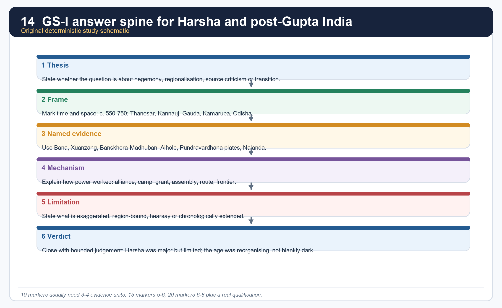

*This answer spine is deliberately compact so it can be recalled in the exam hall.*

#### Core teaching / solved practice

- [ANALYSIS] For 10 marks: 3-4 evidence units are enough if they are precise - for example Bana, Xuanzang, Aihole and Nalanda.
- [ANALYSIS] For 15 marks: use 5-6 units and organise them under sub-headings such as political landscape, Harsha's limits, eastern transition and source criticism.
- [ANALYSIS] For 20 marks: move from crisis to state structure to regionalisation to historiography, and end with a bounded verdict rather than a slogan.
- [FACT] PYQ memory anchors owned or routed here: 2020 GS-I Q2 on Pala Buddhism; 2020 Prelims Q24 chronology of Pratihara-Pallava-Chola-Pala; 2020 Prelims Q97 historical places; 2021 Prelims Q34 kingdoms after Gupta decline.
- [FACT] Owner boundary: Pulakeshin's southern polity is elaborated in Topic 23; Gupta administrative deep background in Topic 20; social-culture background in Topic 21; extended feudal-regional debate in Topic 26.

#### PARAGRAPH DEMONSTRATION — CLAIM → NAMED EVIDENCE → ANALYSIS → QUALIFICATION

[CLAIM] A high-scoring Topic 22 answer scales its evidence to the marks on offer while respecting fixed owner boundaries with neighbouring topics. [NAMED EVIDENCE] A 10-mark answer needs only 3-4 precise units such as Bana, Xuanzang, Aihole and Nalanda; a 15-mark answer organises 5-6 units under sub-headings such as political landscape, Harsha's limits and eastern transition; and the four PYQ anchors (2020 GS-I Q2, 2020 Prelims Q24 and Q97, 2021 Prelims Q34) show exactly which demands this topic must answer. [ANALYSIS] This scaling discipline prevents two common failures at once: under-evidencing a high-mark question and padding a low-mark question with owner-boundary material that belongs to Topic 20, 21, 23 or 26. [QUALIFICATION] Borrowing all southern Chalukya detail into this topic, or writing only ruler biography without structure and source method, both cost marks even when the facts recited are individually correct.

#### Must-know facts

- Named evidence must lead every answer.
- Harsha's age is a source-criticism gift.
- Kannauj plus the east plus the Narmada limit is the memory triangle.

#### UPSC traps

- **Wrong:** Write only ruler biography. **Correct:** integrate structure, region and source method.
- **Wrong:** Borrow all southern detail into this topic. **Correct:** keep Topic 23 as the owner of the Deccan and Pallava-Chalukya depth.

**Mains angle:** The best opening line usually combines period, process and boundary: "In the century after Gupta concentration weakened, Harsha briefly reunited much of north India while eastern India moved rapidly into regional state formation."

**Study link:** entire package.

#### CLOSING RECALL FLOW — UPSC ANSWER ARCHITECTURE, OWNER BOUNDARIES AND MEMORY MAP

```text
START / CONCEPT: UPSC answer architecture, owner boundaries and memory map
        |
        v
EXACT TERMS: marks-scaled evidence density · owner boundary · memory triangle · PYQ anchors · Topic 20/21/23/26 routing · bounded verdict
        |
        v
MECHANISM / ARGUMENT: For 20 marks: move from crisis to state structure to regionalisation to historiography, and end with a bounded verdict rather than a slogan.
        |
        v
CONSEQUENCE / CONTRAST: Owner boundary: Pulakeshin's southern polity is elaborated in Topic 23; Gupta administrative deep background in Topic 20; social-culture background in Topic 21; extended feudal-regional debate in Topic 26.
        |
        v
UPSC TRAP / ANSWER-USE: Borrow all southern detail into this topic is wrong; keep Topic 23 as the owner of the Deccan and Pallava-Chalukya depth.
        |
        v
ANSWER-GRABBING FORMULATION: In the century after Gupta concentration weakened, Harsha briefly reunited much of north India while eastern India moved rapidly into regional state formation.
```
## BASIC MCQS / REMEDIATION

### Learning MCQ 01

Which source most directly narrates the crisis involving Rajyashri, Grahavarman and Rajyavardhana?

- A. Bana's *Harshacharita*
- B. Hathigumpha inscription
- C. Junagadh inscription
- D. *Arthashastra*

**Answer: A.** Bana is the primary narrative source for Harsha's accession crisis, though it remains literary and court-centred.

### Learning MCQ 02

The rise of Kannauj in Harsha's age is best explained by which combination?

- A. direct Mauryan continuity without interruption
- B. Maukhari connection, strategic doab location and a more camp-oriented political order
- C. Buddhist monastic control of all taxation
- D. maritime trade and Roman coin hoards alone

**Answer: B.** Sharma's argument and the Maukhari link together make Kannauj a strategic-political successor centre.

### Learning MCQ 03

The safest use of the Aihole inscription in Topic 22 is to treat it as:

- A. proof that Harsha ruled Karnataka
- B. a Buddhist monastic record of the Narmada battle
- C. rival Chalukya evidence checking Harsha's southern claims
- D. a neutral chronicle of Harsha's reign

**Answer: C.** Aihole is a royal eulogy from the other side, which is exactly why it is valuable.

### Learning MCQ 04

Which cluster of fiscal terms continues into Harsha's inscriptional vocabulary?

- A. vishti, bhatta, tulamana, shulka
- B. uparika, vithi, dronavapa, kulyavapa
- C. bhoga, setu, panya, karshapana
- D. bhaga, bhoga, kara and hiranya

**Answer: D.** Upinder explicitly notes these older revenue terms in Harsha's records.

### Learning MCQ 05

Which statement about Kamarupa is the safest?

- A. It was already visible from Samudragupta's time and became a major eastern state by Bhaskaravarman's age.
- B. It was a direct Chalukya province.
- C. It was simply a district of Gauda.
- D. It first appears only after Harsha's death.

**Answer: A.** Both earlier frontier listing and later 7th-century expansion matter.

### Learning MCQ 06

Rajyashri's marriage linked the Pushyabhutis to which dynasty?

- A. Nalas
- B. Maukharis
- C. Maitrakas
- D. Pandyas

**Answer: B.** The Maukhari link explains how Kannauj enters Harsha's political horizon.

### Learning MCQ 07

Which statement best captures Shashanka's place in this topic?

- A. He was Harsha's confirmed feudatory throughout.
- B. He was a minor hill chief without wider role.
- C. He was the ruler of Gauda and a major eastern rival in Harsha's rise.
- D. He was only a literary villain invented by Bana.

**Answer: C.** Shashanka has both narrative and regional-political significance.

### Learning MCQ 08

What is the safest way to handle Xuanzang's famous numbers for Nalanda?

- A. Treat the claim as proof of Gupta-period origins only.
- B. Accept them as exact because they come from a pilgrim.
- C. Reject Nalanda's importance completely because archaeology is incomplete.
- D. Use the fame of the institution, but qualify the 10,000 figure through archaeology and Yijing's smaller number.

**Answer: D.** Institutional significance is secure; exact magnitude is not.

### Learning MCQ 09

Which period label is the best fit for Topic 22?

- A. c. AD 550-750 as a bridge from Gupta contraction to early medieval regionalisation
- B. c. AD 1200-1526
- C. only the single year 606 CE
- D. c. AD 200 BCE-AD 200 only

**Answer: A.** The topic owns the transition zone, not only Harsha's accession year.

### Learning MCQ 10

Which territorial description is safest for Harsha's direct core?

- A. only Thanesar and nothing more
- B. Haryana and adjacent north-west core plus Maukhari UP-Bihar, with probable extension into Odisha
- C. Kashmir, Sindh and all of Gujarat as provinces
- D. all of peninsular India south to Kanchi

**Answer: B.** This is the most evidence-bound summary from Upinder's reconstruction.

### Learning MCQ 11

Eastern land grants in Topic 22 are most useful for understanding:

- A. only coin minting formulas
- B. only temple sculpture styles
- C. agrarian expansion, local administration and new landed rights
- D. only abstract religious merit

**Answer: C.** The charters are social-economic and political evidence as much as religious records.

### Learning MCQ 12

At the Prayaga assembly, Harsha is described as worshipping which sequence on successive days?

- A. Surya, Agni and Buddha
- B. Shiva, Vishnu and Surya
- C. Buddha, Vishnu and Ganga
- D. Buddha, Shiva and the Sun

**Answer: D.** The sequence matters because it illustrates multi-sect royal theatre.

### Learning MCQ 13

The Banskhera inscription is especially memorable because it:

- A. preserves Harsha's signature and possibly his own inscriptional drafting hand
- B. is Ravikirti's Chalukya poem
- C. gives the exact official key to a Prelims question
- D. announces the conquest of Sri Lanka

**Answer: A.** It is one of the best personal-courtly touches in Harsha's epigraphic record.

### Learning MCQ 14

Which statement does Sharma's capital-shift thesis NOT justify?

- A. Pataliputra lost earlier centrality.
- B. Every Indian town collapsed uniformly in the 7th century.
- C. Land-grant politics changed state geography.
- D. Kannauj's doab position mattered strategically.

**Answer: B.** The thesis is broad and structural, not a license for total-uniform decline.

### Learning MCQ 15

Xuanzang is best used as:

- A. a Chalukya court poet
- B. an unproblematic secular administrator
- C. a valuable but situated Buddhist pilgrim-source written for a Chinese audience
- D. a modern census officer

**Answer: C.** His value grows when audience, purpose and hearsay are acknowledged.

### Learning MCQ 16

What follows most safely from Shashanka's death in c. 637?

- A. instant permanent Harsha rule over the whole east
- B. automatic Pala monarchy
- C. total disappearance of eastern politics
- D. a prolonged phase of confusion and competing powers before later consolidation

**Answer: D.** Upinder explicitly places over a century of turbulence after Shashanka before the Pala resolution.

> Objective answers without local official keys are labelled inferred or route-based. This is deliberate and mandatory. The full 32-question hard MCQ bank with remediation lives once, in the standalone Solved Practice Workbook, to avoid duplicating this 16-question learning-check loop.

## PYQS AND ANSWER PRACTICE

### Verified PYQ 1 - GS-I Mains 2020 Q2 (exact wording locally preserved)

Pala period is the most significant phase in the history of Buddhism in India. Enumerate. (150 words)

**Status:** Exact wording preserved locally through the repository's verified package for Topic 10 and the 2018-2023 Mains routing ledger. This topic owns the eastern-transition bridge needed to answer it.

**Model answer:** [CLAIM] The Pala centuries were the highest late-Indian institutional phase of Buddhism, though the superlative "most significant" must be qualified against earlier Ashokan and early-sangha milestones. [EVIDENCE AND ANALYSIS] 1. The Pala world sustained the great mahavihara network of Nalanda, Vikramashila, Odantapuri and Somapura, proving concentration of scholastic institutions in eastern India. 2. Mahayana and Vajrayana thought flourished in these centres, showing doctrinal vitality rather than mere survival. 3. Teachers such as Atisha Dipankara illustrate trans-Himalayan circulation of persons and texts. 4. Pala bronze, stone and palm-leaf manuscript traditions influenced Nepal and Tibet, proving artistic and ritual transmission beyond India. 5. Royal and landed support tied Buddhism to the agrarian-political consolidation of the east after earlier post-Harsha turbulence. [LIMIT] The claim should not erase the foundational significance of early Buddhism, Ashoka or non-royal Buddhist communities. [VERDICT] The Pala phase was therefore the decisive late-classical peak of Indian Buddhism, especially in institutional, scholastic and trans-regional terms. **Why this earns marks:** It answers the directive directly, gives five named evidence units, ties them to what they prove, adds a qualification and closes with a graded verdict.

**Demand decoding:** The directive **enumerate** requires a concise list of the principal institutional, doctrinal, trans-regional, artistic and patronage contributions, followed by one qualification of the superlative claim.

**Executable exam-length answer / compression plan:** For this 10-mark, 150-word answer, open with a one-sentence thesis; enumerate four or five named contributions compactly; reserve the final sentence for the Ashokan/early-Buddhist qualification.

**How to improve this answer:** For “Verified PYQ 1 - GS-I Mains 2020 Q2 (exact wording locally preserved)”, replace the weakest generalisation with one additional named site, text, inscription, coin, ruler or scholarly position and state exactly what that evidence cannot prove.

### Routed PYQ 2 - Prelims GS-I 2020 Q24 (audited demand; original paper and key not held locally)

**Locally audited demand:** chronological order involving the Pratihara, Pallava, Chola and Pala dynasties.

**Status:** Audited routed demand from the 2018-2023 Prelims ledger. Official key unavailable locally.

**Answer / route:** INFERRED ORDER FROM STANDARD CHRONOLOGY: Pallava -> Gurjara-Pratihara -> Pala -> Imperial Chola.

- Pallavas are securely earlier, with their major political arc beginning centuries before the Palas and imperial Cholas.
- Gurjara-Pratiharas emerge in the 8th century, slightly before or at the very beginning of the Pala line.
- Palas begin in the mid-8th century with Gopala.
- Imperial Cholas belong mainly from the 9th century onward.

**Why this earns marks:** It states the best-supported chronological route while clearly marking that the official 2020 key is not held locally.

**Demand decoding:** Treat “Routed PYQ 2 - Prelims GS-I 2020 Q24 (audited demand; original paper and key not held…” as a source-and-elimination problem: verify each statement independently, preserve the official wording where available, and separate an inferred key from an official key.

**Executable exam-length answer / compression plan:** Identify the tested chronology, site, text, inscription or institution; eliminate each option with one named fact; then state the evidence limit or key-verification status.

**How to improve this answer:** For “Routed PYQ 2 - Prelims GS-I 2020 Q24 (audited demand; original paper and key not held…”, add one explicit sentence explaining why the closest distractor fails on chronology, geography, source class or degree of certainty.

### Routed PYQ 3 - Prelims GS-I 2020 Q97 (audited demand; exact options not held locally)

**Locally audited demand:** historical places Bhilsa, Dwarasamudra, Girinagar and Sthanesvara in state-dynasty matching.

**Status:** Routed demand only. Official key unavailable locally; exact option wording not held in the repository.

**Answer / route:** Use elimination through fixed pairs rather than claim an unheld option letter.

- Dwarasamudra = Hoysala centre (later medieval, not Topic 22's Harsha world).
- Sthanesvara = Thanesar, the Pushyabhuti-Harsha base.
- Girinagar = Junagadh/Girnar-Saurashtra zone in western India.
- Bhilsa = Vidisha/Malwa region in central India.

The likely official option would depend on how the paper paired these places with states or dynasties; since that sheet is not locally present, this workbook honestly stops at the concept route.

**Why this earns marks:** It gives all secure pairings while refusing to invent a missing option letter.

**Demand decoding:** Treat “Routed PYQ 3 - Prelims GS-I 2020 Q97 (audited demand; exact options not held locally)” as a source-and-elimination problem: verify each statement independently, preserve the official wording where available, and separate an inferred key from an official key.

**Executable exam-length answer / compression plan:** Identify the tested chronology, site, text, inscription or institution; eliminate each option with one named fact; then state the evidence limit or key-verification status.

**How to improve this answer:** For “Routed PYQ 3 - Prelims GS-I 2020 Q97 (audited demand; exact options not held locally)”, add one explicit sentence explaining why the closest distractor fails on chronology, geography, source class or degree of certainty.

### Routed PYQ 4 - Prelims GS-I 2021 Q34 (audited demand; original paper and key not held locally)

**Locally audited demand:** kingdoms of northern India after Gupta decline.

**Status:** Routed demand from the 2018-2023 Prelims ledger. Official key unavailable locally.

**Answer / route:** The safe north-Indian post-Gupta cluster includes Later Guptas, Maukharis, Pushyabhutis, Maitrakas and Gauda under Shashanka. If the question mixes northern and southern houses, eliminate Pallavas, Cholas or deeper Deccan lines unless the option specifically asks for a contrast.

This is a concept-solving route, not an official-key claim.

**Why this earns marks:** It converts a missing paper into a high-quality elimination framework instead of pretending access to an unavailable official key.

**Demand decoding:** Treat “Routed PYQ 4 - Prelims GS-I 2021 Q34 (audited demand; original paper and key not held…” as a source-and-elimination problem: verify each statement independently, preserve the official wording where available, and separate an inferred key from an official key.

**Executable exam-length answer / compression plan:** Identify the tested chronology, site, text, inscription or institution; eliminate each option with one named fact; then state the evidence limit or key-verification status.

**How to improve this answer:** For “Routed PYQ 4 - Prelims GS-I 2021 Q34 (audited demand; original paper and key not held…”, add one explicit sentence explaining why the closest distractor fails on chronology, geography, source class or degree of certainty.

### Original solved Mains 01 - Why is Harsha better described as a north Indian hegemon than a pan-Indian emperor?

**Demand and thesis (10 marks):** The answer must show both real power and hard limits.

**Model answer (10 marks).** Harsha is better described as a substantial north Indian hegemon than as a pan-Indian emperor on the Mauryan or Ashokan scale. His direct core covered Thanesar, most of Uttar Pradesh and parts of Bihar, extending probably into Odisha after the Maukhari inheritance, while rulers of Kamarupa and Valabhi may only have acknowledged his superiority rather than accepted his administration. The Aihole inscription records that Pulakeshin II checked him at the Narmada, proving the Deccan lay beyond stable control, and Gauda under Shashanka remained a serious rival whose defeat was not permanently final. Because Bana magnifies the king and Xuanzang admires him, territorial claims drawn from their accounts must be graded rather than taken at face value. Harsha therefore unified much of north India but ruled through layered influence and sharp frontiers, not all-India imperial incorporation. **Why this earns marks:** it names four independent evidence units, states what each proves, and closes with a bounded verdict instead of a triumphalist label.

**Demand decoding:** The directive **answer** requires a direct position on “Original solved Mains 01 - Why is Harsha better described as a north Indian hegemon than a…”, coverage of every clause, evidence-led analysis and a qualified verdict.

**Executable exam-length answer / compression plan:** For a 10-mark answer, open with a one-sentence thesis; organise four named evidence units as claim → evidence → inference; reserve the final line for the bounded verdict.

**How to improve this answer:** Add the exact regnal date of the Narmada check and name Ravikirti as Aihole's composer, which sharpens the source-attribution precision an examiner rewards.

### Original solved Mains 02 - How do land grants illuminate the spread of civilisation in eastern India between the 4th and 7th centuries?

**Demand and thesis (10 marks):** The answer must turn charters into process, not just list gifts.

**Model answer (10 marks).** Eastern land grants show how thinly integrated frontier regions became agrarian, literate and politically ordered state societies between the 4th and 7th centuries. Pundravardhanabhukti plates record fallow land purchased with *dinaras* and then donated for religious purposes, proving both a monetised transaction and agrarian expansion. Odisha's charters and agraharas spread Sanskrit, Brahmanical learning and new fiscal districts into fresh zones, while Sharma notes that scribes, merchants, landholders and even cultivators appear in land transactions, revealing layered local administration rather than pure royal fiat. The king's growing claim over waste land made large-scale grants possible and strengthened donee authority over resources and labour. Because charters privilege elite beneficiaries, they narrate process more clearly than peasant experience. Land grants are therefore best read as key windows into eastern state formation, agrarian growth and social differentiation, not as isolated pious gifts. **Why this earns marks:** it converts records into historical mechanism, cites four named evidence units, and keeps an explicit elite-source caution.

**Demand decoding:** The directive **answer** requires a direct position on “Original solved Mains 02 - How do land grants illuminate the spread of civilisation in…”, coverage of every clause, evidence-led analysis and a qualified verdict.

**Executable exam-length answer / compression plan:** For a 10-mark answer, open with a one-sentence thesis; organise four named evidence units as claim → evidence → inference; reserve the final line for the bounded verdict.

**How to improve this answer:** Add the AD 432-33 starting date for the Pundravardhanabhukti series, which lets the answer open with a precise chronological anchor rather than a general century range.

### Original solved Mains 03 - Assess the importance of Kannauj in the post-Gupta political order.

**Demand and thesis (15 marks):** The answer must move beyond city-description to political geography.

**Model answer (15 marks).** Kannauj became central to the post-Gupta political order because it fused inheritance politics, strategic geography and the prestige of a new sovereignty centre. The Maukhari connection first brought Kannauj into the Pushyabhuti orbit through Rajyashri's marriage to Grahavarman, giving Harsha an inherited claim once the Kannauj throne fell vacant in the succession crisis. Sharma argues that Pataliputra had belonged to a money-rich, trade-linked imperial order, whereas Kannauj suited an age of military camps and land-based reward; its position in the middle doab let it command movement into both the eastern and western Ganga plains by land and water, making it a superior strategic node. Harsha's move from Thanesar converted Kannauj into the chief emblem of north Indian sovereignty, and this value outlived him: the later contest for the city among the Palas, Pratiharas and Rashtrakutas proves its enduring symbolic and strategic weight beyond any single ruler. At the same time, Kannauj's rise should not be read as proof of uniform urban collapse elsewhere, since eastern towns and monastic centres retained coin use and institutional wealth in the same period. Kannauj therefore crystallised the shift from an older imperial geography built on trade and centralised administration toward an early medieval politics organised around strategic regional capitals, alliance and inherited legitimacy. **Why this earns marks:** it links alliance, geography, strategy and later significance into one continuous argument instead of a flat descriptive city note, and it explicitly bounds the capital-shift thesis.

**Demand decoding:** The directive **assess** requires a direct position on “Original solved Mains 03 - Assess the importance of Kannauj in the post-Gupta political…”, coverage of every clause, evidence-led analysis and a qualified verdict.

**Executable exam-length answer / compression plan:** For a 15-mark answer, open with a two-sentence thesis; organise five named evidence units as claim → evidence → inference → qualification; reserve the final lines for a graded conclusion.

**How to improve this answer:** Name the exact Later Gupta/Maukhari predecessor context at Kannauj before Rajyashri's marriage, which would sharpen the inheritance-politics claim with one further precise link in the chain.

### Original solved Mains 04 - Evaluate Xuanzang as a source for Harsha's India.

**Demand and thesis (15 marks):** The answer must balance value and bias.

**Model answer (15 marks).** Xuanzang is one of the most valuable sources for Harsha's India, but only when read as a Buddhist pilgrim-intellectual writing later in China for a specific audience. He supplies vivid, otherwise unavailable detail on Kannauj, Harsha's court, the Prayaga assembly and Nalanda's prestige, and his route record illuminates monasteries, pilgrimage networks and the movement of Buddhist texts between India and China. He also preserves fiscal clues such as light taxation and a one-sixth grain share, though these need checking against inscriptional evidence such as the Banskhera and Madhuban charters. Upinder Singh cautions that parts of his account may rest on hearsay or earlier reports rather than direct observation, and that his admiration for Harsha could tip into idealisation for a Tang imperial and monastic readership; his portrait of Harsha as a model Buddhist king therefore needs comparison with Bana and the rival Aihole inscription. His silences matter as much as his narrative, since he does not offer an evenly distributed social survey of Harsha's kingdom. Xuanzang is consequently indispensable but not self-sufficient: his descriptive richness is genuine, yet its historical value only becomes secure once triangulated against literary and epigraphic counter-evidence. **Why this earns marks:** it evaluates value and limitation together, cites five named textual and epigraphic anchors, and closes with a method-aware verdict rather than blanket praise or dismissal.

**Demand decoding:** The directive **evaluate** requires a direct position on “Original solved Mains 04 - Evaluate Xuanzang as a source for Harsha's India.”, coverage of every clause, evidence-led analysis and a qualified verdict.

**Executable exam-length answer / compression plan:** For a 15-mark answer, open with a two-sentence thesis; organise five named evidence units as claim → evidence → inference → qualification; reserve the final lines for a graded conclusion.

**How to improve this answer:** Add Yijing as a second, later Chinese-pilgrim control on Xuanzang's Nalanda enrolment figures, which strengthens the source-triangulation method the directive rewards.

### Original solved Mains 05 - Discuss the transition from imperial Gupta rule to regional early medieval formations with special reference to Harsha, Gauda and Kamarupa.

**Demand and thesis (20 marks):** The answer must connect political fragmentation with regional state formation.

**Model answer (20 marks).** The transition from imperial Gupta concentration to the early medieval order was not a simple collapse; it was a redistribution of power into regional state formations, in which Harsha, Gauda and Kamarupa each mark a different point on the same process. After the imperial Guptas, Upinder Singh identifies Later Guptas, Maukharis, Pushyabhutis and Maitrakas as coexisting northern lines, showing fragmentation rather than one clear successor empire. Within this field, Harsha built a genuine north Indian core from Thanesar and Kannauj, proving that reunification remained possible, though only at a bounded regional scale: the Aihole inscription's record of his check by Pulakeshin II at the Narmada marks the firm southern limit of that hegemony. Shashanka's Gauda shows Bengal emerging as an autonomous eastern power rather than a dependent frontier of the Ganga core, issuing its own gold coinage and surviving Harsha's campaigns to remain a serious rival. Kamarupa under Bhaskaravarman illustrates simultaneous state consolidation in the Brahmaputra valley through land grants, Sanskritic kingship and intervention as far as Bengal after Shashanka's death. Across Bengal and Odisha, land charters reveal military camps, new fiscal districts and expanding cultivation, proving that political fragmentation coexisted with stronger, more numerous local state structures rather than an administrative vacuum. Harsha's death in 648 CE without a stable successor, followed by the later struggle for Kannauj among the Palas, Pratiharas and Rashtrakutas, confirms that no all-India empire re-emerged, even as the east continued toward eventual Pala consolidation. Because much of this reconstruction rests on literary testimony and routed evidence rather than a dense administrative archive, the argument should be stated with corresponding care. The post-Gupta world is therefore best understood as a field of regional reorganisation, where Harsha, Gauda and Kamarupa each exemplify a different scale and mechanism of early medieval state formation. **Why this earns marks:** it integrates seven named evidence units into one causal argument, balances contraction against creation, and does not mistake regionalisation for anarchy.

**Demand decoding:** The directive **discuss** requires a direct position on “Original solved Mains 05 - Discuss the transition from imperial Gupta rule to regional…”, coverage of every clause, evidence-led analysis and a qualified verdict.

**Executable exam-length answer / compression plan:** For a 20-mark answer, open with a two-sentence thesis; organise six to eight named evidence units as claim → evidence → inference → qualification; reserve the final lines for a graded conclusion.

**How to improve this answer:** Add the Maitrakas of Valabhi as a fourth regional case beside Harsha, Gauda and Kamarupa, which would extend the comparative range without weakening the seven-unit evidence density already present.

### Original solved Mains 06 - Critically examine whether the post-Gupta age was mainly an age of decline or of regional reorganisation.

**Demand and thesis (20 marks):** The answer must show historiographical balance, not slogan warfare.

**Model answer (20 marks).** The post-Gupta age contained genuine decline in some earlier imperial and urban forms, but its dominant long-term significance lies in regional reorganisation through land grants, new states, agrarian expansion and reworked sovereignty. Sharma's contrast between a fading Pataliputra and a rising Kannauj captures a real structural shift, from a money-rich, trade-linked imperial centrality toward a more military-camp-centred, land-based political geography, and the growth of land endowment to officers under Harsha points toward decentralising tendencies. Yet Bengal, Odisha and Assam simultaneously show expanding inscriptions, new fiscal districts, land grants, military camps and consolidating state systems, proving that the same century was politically generative rather than merely contracting. Shashanka's Gauda and Bhaskaravarman's Kamarupa demonstrate that the east was entering mature regional visibility, not declining into silence, while Nalanda's growing fame and trans-Asian intellectual traffic reveal concentrated institutional vitality rather than civilisational exhaustion. The Aihole check on Harsha at the Narmada should likewise be read not as proof of general weakness but as evidence of the multiplication of strong regional powers capable of limiting even a substantial hegemon. The later contest for Kannauj, and the eventual consolidation of Pala power, show that this age generated durable regional-centred political structures rather than a lasting vacuum. At the same time, a fair verdict should not deny the local urban contraction, changing monetisation and expanding rural hierarchy that the evidence does support in specific zones. The most defensible judgement is therefore that decline in certain older imperial and urban forms and reorganisation into new regional forms occurred together, with the longer historical arc favouring the language of early medieval reorganisation over that of an undifferentiated dark age. **Why this earns marks:** it directly stages the historiographical debate, deploys seven named evidence units, grants real weight to the decline argument and still reaches a reasoned synthesis rather than a one-sided slogan.

**Demand decoding:** The directive **critically examine** requires a direct position on “Original solved Mains 06 - Critically examine whether the post-Gupta age was mainly an age…”, coverage of every clause, evidence-led analysis and a qualified verdict.

**Executable exam-length answer / compression plan:** For a 20-mark answer, open with a two-sentence thesis; organise six to eight named evidence units as claim → evidence → inference → qualification; reserve the final lines for a graded conclusion.

**How to improve this answer:** Name Sharma and Upinder Singh explicitly as the two historiographical positions being reconciled, which makes the synthesis verifiably attributable rather than an unattributed balanced tone.

## OPTIONAL ADVANCED DEPTH — NOT REQUIRED FOR A CORE ANSWER

### Post-Gupta India: Harsha & Eastern India — ADVANCED

> **Subject:** History (Ancient India) · **Tier:** Advanced (analytical + historiographical) · **GS Paper:** GS-I (also Prelims).
> **Grounded in:** Upinder Singh, *A History of Ancient & Early Medieval India*, Ch-10 "Political Processes and the Structure of Polity" + current archaeology (📰).
> ✅ = from source book · ⚠️ = inference / standard knowledge · 📰 = current affairs.
> *Companion (foundation): `basic/22_Post-Gupta-Harsha-and-Eastern-India.md`. Chronology: `00_Master-Chronology.md`.*

---

### Mini-timeline

| Phase | Date | Marker |
|---|---|---|
| ✅ Pushyabhuti rise | late 6th–early 7th c. AD | Sthanishvara/Thanesar base |
| ✅ Harsha | **AD 606–647** | Kannauj, Xuanzang, Bana, political campaigns |
| ✅ Regional early medieval processes | c. AD 600 onward | Odisha/eastern dynasties, grants, local state formation |

### 1. Snapshot & core idea

**Advanced — sources as political texts, not neutral mirrors.**

✅ Upinder Singh foregrounds the problem of reconstructing Harsha's world from **Bana's courtly biography** and **Xuanzang's Buddhist travel account**. Both are invaluable, but both have perspectives: royal eulogy and pilgrim observation.
- ✅ The Pushyabhutis initially had their base around **Sthanishvara/Thanesar**.
- ✅ Harsha's reign involved military engagements; claims of success must be tested against rival records.
- ✅ The **Aihole inscription** records that Pulakeshin II defeated Harsha, showing the limits of Harsha's southern expansion.
- ⚠️ A UPSC-safe answer should use Harsha as a case of **regional hegemony + source criticism**, not simple imperial glory.

**Advanced — eastern India and the language of state formation.**

✅ Upinder Singh places eastern India in a wider early-medieval process: local dynasties, origin myths, Brahmana settlements, land grants and agrarian relations.
- ✅ Land grants were not merely religious donations; they formed part of larger social and cultural processes.
- ✅ Brahmana settlements could transform local society through agrarian expansion, caste formation and cult appropriation.
- ✅ Political history in this period is often a tangle of grandiose claims and counter-claims.
- ⚠️ Eastern India should be written as a zone of **state-society formation**, not as a late appendix to north Indian history.

### 2. Key classification / data

| Evidence type | What it reveals | Caution |
|---|---|---|
| ✅ `Harshacharita` | Genealogy, court ideals, political narrative | Eulogistic court prose |
| ✅ Xuanzang | Monasteries, routes, court, Nalanda | Buddhist pilgrim lens |
| ✅ Aihole inscription | Pulakeshin II's defeat of Harsha | Rival royal claim but important counter-evidence |
| ✅ Land grants | Brahmana beneficiaries, agrarian relations | Formulaic but socio-economic evidence |

| Analytical theme | UPSC use |
|---|---|
| ⚠️ Source criticism | Separate fact, praise and political legitimation |
| ⚠️ Regionalisation | Early medieval India = multiple centres |
| ⚠️ Agrarian expansion | Land grants connect polity, economy and society |

### 3. Study links

> **Study link:** ✅ Harsha → source criticism; Pallava-Chalukya conflict → `advanced/23_Peninsular-India-Pallavas-Chalukyas.md`.
> **Study link:** ✅ Land grants → `advanced/26_From-Ancient-to-Medieval-Legacy.md`; chronology → `00_Master-Chronology.md`.

### 4. Must-Know Facts (Prelims)

- ✅ Two major sources for Pushyabhuti-Harsha history: **Bana** and **Xuanzang**.
- ✅ Pushyabhuti early base: **Sthanishvara/Thanesar**.
- ✅ Harsha's southern ambition was checked by **Pulakeshin II**, known from the **Aihole inscription**.
- ✅ Eastern India in this phase involves Odisha-origin myths, local dynasties and land-grant processes.
- ✅ Land grants strengthened Brahmana positions and affected agrarian relations.

### 5. UPSC Traps

> 🔑 Trap: Do not convert court praise into confirmed empire-wide control.

- ❌ Bana is a neutral historian. → He is a court poet; use him with caution.
- ❌ Xuanzang wrote from a secular administrative perspective. → He was a Buddhist pilgrim and scholar.
- ❌ Harsha conquered the Deccan. → Pulakeshin II checked him according to Aihole.
- ❌ Land grants are only piety. → They also changed agrarian relations and local power.

### 6. 📰 Current link

⚠️ **Current-link discipline:** Use a Purunagarh or other Odisha excavation only from its official report. The safe linkage is the role of local resource zones, fortification and craft production in eastern state formation.

### 7. Mains angles

- ⚠️ "Harsha's age is a lesson in source criticism." Discuss using Bana, Xuanzang and Aihole.
- ⚠️ Eastern India shows how agrarian expansion and Brahmana settlements converted local landscapes into political-cultural regions.
- ⚠️ Post-Gupta polity should be framed as **regionalisation**, not simply decline.

<!-- BEGIN GENERATED PYQ INTEGRATION: 2018-2023 -->
### Historical PYQ Integration (2018-2023)

> **Status:** Question-level PYQ demand is integrated into this owner.
> **Provenance:** Audited local official-paper routing ledgers: `_PYQ-ROUTING-MAINS-GS1-GS2-ESSAY-2018-2023.md`.

- **Years represented:** 2020
- **Paper(s):** GS-I
- **Routed question demands:** 1

| Year | Paper | Q | PYQ demand (neutral rendering) | Directive / format | Source status | Owner requirement |
|---:|---|---:|---|---|---|---|
| 2020 | GS-I | 2 | Pala period in the history of Buddhism in India | Enumerate · 10 marks · 150 words | Routed to owning topic | Prepare context, core dimensions, evidence/examples, counterpoint and a concise conclusion. |

#### What this owner must now support

- Pala period in the history of Buddhism in India

> The table integrates the examinable demand and paper metadata. It does not turn an unkeyed objective question into a solved answer, and it does not claim that lexical presence alone proves full conceptual sufficiency.
<!-- END GENERATED PYQ INTEGRATION: 2018-2023 -->

## CONSOLIDATED REGISTER NOTES

> These topic-specific register notes are deliberately last.

### Final Register 1/6 - Political map and chronology

[FACT] Memorise the age as c. AD 550-750 with an eastern epilogue to c. 750 for the Pala bridge.


*Use the timeline as a recall spine, not as a substitute for evidence.*

#### Core teaching / solved practice

- c. 550: imperial Gupta concentration weakens; Later Guptas, Maukharis, Maitrakas and others matter.
- 606: Harsha's accession after Rajyavardhana crisis.
- c. 630s: Pulakeshin II checks Harsha at the Narmada frontier.
- 637: Shashanka dies; eastern turbulence deepens.
- 647-648: Harsha dies; no stable all-India successor emerges.
- c. 750: Gopala and Pala consolidation belong to the next phase, but grow out of Topic 22's eastern transition.

#### Must-know facts

- Kannauj, Gauda, Kamarupa and Nalanda are the four memory poles.
- The age is a bridge, not an isolated ruler chapter.
- Aihole is the essential limit-source.

#### UPSC traps

- **Wrong:** collapse then blank gap. **Correct:** contraction plus regional growth.

**Mains angle:** Put dates only where they help causation.

### Final Register 2/6 - Pushyabhutis, Maukharis and Kannauj

[ANALYSIS] The dynasty rose through military consolidation plus kinship politics.


*Read the tree politically, not genealogically for its own sake.*

#### Core teaching / solved practice

- Prabhakaravardhana = decisive pre-Harsha power-builder.
- Rajyashri-Grahavarman marriage = Maukhari bridge to Kannauj.
- Rajyavardhana's death and Rajyashri's rescue = accession crisis.
- Thanesar -> Kannauj = strategic and political shift, not random royal preference.

#### Must-know facts

- Maukharis are essential to Harsha's story.
- Bana is indispensable but literary.
- Kannauj becomes the sovereignty symbol.

#### UPSC traps

- **Wrong:** Harsha simply inherited a ready empire. **Correct:** he inherited crisis and converted it into hegemony.

**Mains angle:** Use kinship as statecraft.

### Final Register 3/6 - Reach, limit and the Narmada test

[ANALYSIS] Harsha's power is strongest when written as graded sovereignty.


*Three bands: direct core, wider allegiance, clear limit.*

#### Core teaching / solved practice

- Direct core: Haryana, south Punjab, east Rajasthan, UP, parts of Bihar; likely Odisha reach.
- Wider allegiance: Kamarupa, Kashmir, Valabhi, Malava in varying degrees.
- Clear limit: Pulakeshin II and the Narmada frontier.
- Do not turn assembly presence or prestige into provincial control.

#### Must-know facts

- Harsha = major north Indian hegemon.
- Not a pan-Indian emperor.
- Aihole keeps the answer honest.

#### UPSC traps

- **Wrong:** "last great Hindu emperor" as a factual summary. **Correct:** too triumphalist and too imprecise.

**Mains angle:** Direct core + peripheral influence + frontier defeat.

### Final Register 4/6 - Eastern India and land-grant state formation

[FACT] This is the part most students underwrite and therefore the part that earns marks.


*The east must be written comparatively: Odisha, Bengal and Assam are not identical.*

#### Core teaching / solved practice

- Odisha: Matharas/Pitribhaktas, Eastern Gangas, agraharas, Sanskrit charters, cultivation into new zones.
- Bengal: Pundravardhanabhukti plates, *dinaras*, Gauda under Shashanka, Samatata, Khadgas, Dandabhukti.
- Assam: Kamarupa, Davaka, Varman line, Bhaskaravarman.
- Land grants = agrarian expansion + new landed rights + cultural integration + hierarchy.

#### Must-know facts

- Eastern India is one of the best regional-state formation case studies in the syllabus.
- Military camps, districts and grants matter as much as dynastic names.
- Shashanka and Bhaskaravarman are exam anchors.

#### UPSC traps

- **Wrong:** start eastern history only with the Palas. **Correct:** the 4th-7th centuries already matter deeply.

**Mains angle:** Use process over excessive dynastic list.

### Final Register 5/6 - Religion, Nalanda and cultural patronage

[ANALYSIS] Harsha's religious world is plural, political and performative.


*The key is not to pick one label too early.*

#### Core teaching / solved practice

- Early Pushyabhutis linked with Surya; Rajyavardhana with Buddhism; Harsha with Shaiva and Buddhist idioms together.
- Prayaga/Kannauj assemblies = charity + public hierarchy + multi-sect ritual.
- Nalanda = 5th-century beginnings, 7th-century fame, 200-village support, Xuanzang link, number caution.
- Harsha's court = Bana, attributed plays, signature at Banskhera, literary patronage.

#### Must-know facts

- Buddha, Shiva and Sun on successive days at Prayaga.
- Nalanda's scale must be qualified.
- Court culture is part of kingship.

#### UPSC traps

- **Wrong:** Harsha was only Buddhist or only Shaiva. **Correct:** royal idioms overlap.
- **Wrong:** Nalanda's big number matters more than its support structure. **Correct:** both matter, but one is less secure.

**Mains angle:** Political theatre and patronage should be written together.

### Final Register 6/6 - Source criticism, historiography and PYQ routes

[ANALYSIS] Topic 22 is one of the cleanest places to prove method in Ancient History.


*Source criticism is not ornament; it is answer substance.*

#### Core teaching / solved practice

- Bana = courtly biography; Xuanzang = pilgrim-intellectual writing later in China; Banskhera-Madhuban = documentary state evidence; Aihole = rival check.
- Historiography: Sharma's structural shift and feudal-tendency language versus later regional-state formation corrections.
- Routed and verified PYQs: 2020 GS-I Q2 on Pala Buddhism; 2020 Prelims chronology; 2020 Prelims historical places; 2021 Prelims kingdoms after Gupta decline.
- Answer spine: claim -> named evidence -> what it proves -> limitation -> verdict.

#### Must-know facts

- Never invent a missing official key.
- Harsha's age is ideal for triangulation answers.
- Topic 22 is the bridge from Gupta to early medieval India.

#### UPSC traps

- **Wrong:** quote one source as total truth. **Correct:** compare, qualify and bound.
- **Wrong:** call the whole age dark. **Correct:** show decline in some forms and regional creation in others.

**Mains angle:** End with bounded judgement, not slogan.

### COMPLETE TOPIC ASCII MASTER FLOW DIAGRAM

#### ASCII MASTER FLOW — PANEL 1/12: Chronology and evidence discipline

```ascii-master
c. 550 CE -> Gupta concentration weakens; regional houses multiply
606 CE -> Harsha succeeds amid the Rajyavardhana-Rajyashri crisis
c. 630s -> Pulakeshin II checks northern expansion near the Narmada
637 CE -> Shashanka dies; eastern competition continues
647-648 CE -> Harsha dies without a durable successor empire
SOURCES: Bana + Xuanzang + charters + coins + Aihole + archaeology
RULE: triangulate literary praise, pilgrim report and rival inscription.
```

#### ASCII MASTER FLOW — PANEL 2/12: Post-Gupta political landscape

```ascii-master
NORTH-WEST / WEST -> Maitrakas and other regional powers
MIDDLE GANGA -> Later Guptas + Maukharis
THANESAR-KANNAUJ -> Pushyabhutis under Harsha
GAUDA -> Shashanka
KAMARUPA -> Bhaskaravarman
DECCAN LIMIT -> Badami Chalukyas under Pulakeshin II
VERDICT: several strong regional states replaced one uncontested imperial centre.
```

#### ASCII MASTER FLOW — PANEL 3/12: Pushyabhuti rise and Kannauj shift

```ascii-master
PRABHAKARAVARDHANA -> stronger Thanesar line
RAJYASHRI + GRAHAVARMAN -> Maukhari marriage bridge
Grahavarman killed -> Rajyavardhana campaigns -> accession crisis
HARSHAVARDHANA -> rescue + consolidation + Maukhari inheritance
THANESAR -> KANNAUJ
MECHANISM: kinship + strategy + Ganga-doab access + sovereignty prestige
LIMIT: Harsha inherited a crisis, not a ready-made pan-Indian empire.
```

#### ASCII MASTER FLOW — PANEL 4/12: Harsha's graded sovereignty and Narmada limit

```ascii-master
DIRECT CORE -> Haryana, much of UP and parts of Bihar
PROBABLE REACH -> selected eastern territories including Odisha
WIDER ALLEGIANCE -> Kamarupa, Valabhi and other rulers in varying degrees
HARD LIMIT -> Pulakeshin II and the Narmada frontier
BANA / XUANZANG -> prestige-heavy northern view
AIHOLE -> rival Chalukya check
VERDICT: major north Indian hegemon; not a stable all-India emperor.
```

#### ASCII MASTER FLOW — PANEL 5/12: Administration, revenue and samanta order

```ascii-master
KING / MOBILE CAMP
   -> bhukti provincial units
   -> vishaya district units
   -> officers, villages and revenue collectors
   -> samantas and feudatory rulers
REVENUE: bhaga + bhoga + kara + hiranya
ARMY: royal forces reinforced by subordinate chiefs
TENSION: delegated reach could integrate territory and enlarge local autonomy.
```

#### ASCII MASTER FLOW — PANEL 6/12: Eastern India regional state formation

```ascii-master
BENGAL / GAUDA -> Shashanka, Pundravardhana, Samatata, gold issues
ODISHA -> regional lines, charters, agraharas and expanding settlement
ASSAM -> Kamarupa, Varman line and Bhaskaravarman
COMMON PROCESS -> Sanskrit charters + fiscal districts + military camps
                + land rights + agrarian expansion
DIFFERENCE -> chronology, ecology and political scale varied sharply
RULE: do not begin eastern state history only with the Palas.
```

#### ASCII MASTER FLOW — PANEL 7/12: Land grants and agrarian transformation

```ascii-master
FALLOW / CULTIVATED LAND + ROYAL CLAIM
                  |
purchase, charter, boundary record and tax remission
                  |
Brahmana / monastery / religious beneficiary
                  |
cultivation + literacy + fiscal reallocation + landed hierarchy
EASTERN PLATES -> local scribes, merchants, landholders and cultivators
LIMIT: elite charters reveal process more clearly than peasant experience.
```

#### ASCII MASTER FLOW — PANEL 8/12: Economy and urban change debate

```ascii-master
DECLINE EVIDENCE -> contraction of selected older towns and coin changes
REORGANISATION EVIDENCE:
  |-- Kannauj rises as a strategic centre
  |-- eastern land was purchased with gold in selected records
  |-- new camps, grants, monasteries and regional capitals appear
  `-- routes and markets persist unevenly
NALANDA -> institutional concentration, not proof of universal prosperity
VERDICT: decline in older forms coexisted with regional creation.
```

#### ASCII MASTER FLOW — PANEL 9/12: Religion, assemblies and political theatre

```ascii-master
EARLY LINE -> solar associations
HARSHACHARITA / CHARTERS -> Shaiva idioms
XUANZANG -> strong Buddhist patronage
KANNAUJ ASSEMBLY -> debate, hierarchy and royal display
PRAYAGA ASSEMBLY -> Buddha + Shiva + Sun across successive days
CHARITY -> piety + redistribution + sovereignty performance
VERDICT: overlapping royal affiliations, not one exclusive religious label.
```

#### ASCII MASTER FLOW — PANEL 10/12: Nalanda and trans-Asian learning networks

```ascii-master
ROYAL / LANDED SUPPORT -> monastic infrastructure
INDIAN TEACHERS <-> Nalanda study and debate <-> ASIAN PILGRIMS
XUANZANG -> study, travel and carriage of Buddhist texts to China
YIJING -> comparative evidence and numerical caution
UNESCO SITE -> surviving viharas, temples, art and planned layout
SECURE CLAIM: major scholastic network
CAUTION: famous enrolment figures are estimates, not census data.
```

#### ASCII MASTER FLOW — PANEL 11/12: Source criticism and historiography

```ascii-master
BANA -> accession and court world | literary praise / elite focus
XUANZANG -> routes, Nalanda, assemblies | pilgrim purpose / later writing
CHARTERS -> offices, grants, taxes | selective documentary survival
COINS -> rulers, economy, symbols | circulation is not a border map
AIHOLE -> Narmada limit | rival prashasti and exaggeration
SHARMA -> structural transition | avoid universal decline
METHOD: claim -> source -> corroboration -> limitation.
```

#### ASCII MASTER FLOW — PANEL 12/12: Post-Gupta answer spine

```ascii-master
OPEN -> c. 550-750 as contraction plus regional reorganisation
POLITY -> Pushyabhuti rise + Kannauj + graded sovereignty
LIMIT -> Pulakeshin II and the Narmada
EAST -> Gauda + Kamarupa + Odisha/Bengal grants
STRUCTURE -> samantas + land rights + agrarian change
CULTURE -> assemblies + Nalanda + source triangulation
CLOSE -> Harsha briefly reunited the north while regional states deepened.
```
