# Peninsular India: Pallavas, Chalukyas & Brahmanization - Complete Topic Package

---

> **Subject:** Ancient Indian History | **Topic:** 23 | **Export date:** 2026-08-15
>
> **Approval:** false - awaiting explicit user approval.
>
> **Source order:** repository Markdown -> local OCR-searchable R.S. Sharma and Upinder Singh exports -> bounded architecture/literature support from repository Art and Culture owners -> no forced current-affairs hook -> Qdrant not used.
>
> **Tag rule:** [FACT] source-grounded statement; [ANALYSIS] evidence-led synthesis; [DEBATE] historiographical or conceptual disagreement; [LIMIT] evidentiary, chronological or source-critical caution.

## BASIC LEARNING SESSION

### DEEP-REVIEW LEARNING CONTRACT

| Control | Binding rule for this package |
|---|---|
| Syllabus boundary | Complete Ancient History Core is taught before optional enrichment. |
| Evidence method | Claim → named site/text/inscription/coin/example → analysis → qualification. |
| Source hierarchy | Archaeology, textual testimony, inscriptions, coins and scholarly interpretation remain visibly distinct. |
| Contested issues | Competing interpretations are attributed, evidenced and bounded; certainty is not manufactured. |
| Practice contract | Every solved item has demand decoding, an examiner-grade model, an executable answer/compression plan, marks rationale and answer-specific improvement. |
| Approval | This immutable successor remains `approved: false` pending explicit approval. |

**Canonical Basic/Core owner:** `upsc-ai-kit\knowledge\Ancient-Indian-History\basic\23_Peninsular-India-Pallavas-Chalukyas.md`  
**Canonical topic owner:** `upsc-ai-kit\knowledge\Ancient-Indian-History\basic\23_Peninsular-India-Pallavas-Chalukyas.md`  
**Optional Advanced owner:** `upsc-ai-kit\knowledge\Ancient-Indian-History\advanced\23_Peninsular-India-Pallavas-Chalukyas.md`  
**Official syllabus mapping:** `upsc-ai-kit\knowledge\Ancient-Indian-History\OFFICIAL-UPSC-SYLLABUS-MAPPING.md`

### EVIDENCE, PYQ AND CURRENT-STATUS CONTROL

- **Archaeological inference:** material context supports bounded reconstruction; absence is not automatic proof of non-existence.
- **Textual testimony:** genre, authorship, redaction, patronage and temporal distance control what a text can prove.
- **Inscription and coin evidence:** contemporary names, titles, claims and circulation are powerful but do not by themselves map uniform territorial control.
- **Scholarly interpretation:** historian labels are arguments to test, not facts to memorise without evidence.
- **PYQ discipline:** repository ledgers and locally held official papers control wording and metadata; reconstructed wording and unavailable official keys must be labelled.
- **Current-status note, rechecked 2026-09-03:** UNESCO's Mahabalipuram and Pattadakal records and the Ministry of Culture's 2026 heritage-technology update were rechecked on 30 August 2026. They supply bounded conservation and documentation context, not evidence for new dynastic or architectural chronology.

**Live/primary context sources recorded by the predecessor generation:**

- `https://whc.unesco.org/en/list/249`
- `https://whc.unesco.org/en/list/239`
- `https://culture.gov.in/events/ministry-culture-showcases-confluence-heritage-and-technology-india-ai-impact-summit-2026`


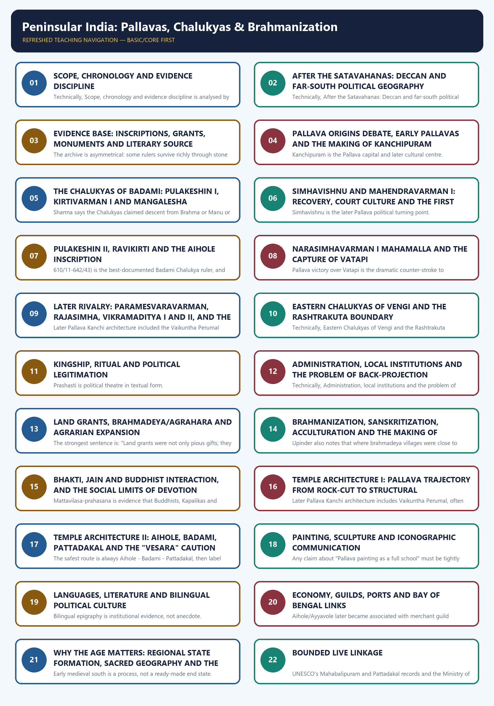

*Distinct embedded teaching-navigation image. The separate continuous Cārvāka-style flowchart package remains an independent at-a-glance artifact.*

#### Package counts, provenance and honest limitations

- Learning sections: 22; learning MCQ loops: 16.
- Workbook content: 4 verified/routed/adjacent PYQs; exactly 32 original hard/remedial MCQs; 6 original solved Mains questions; final register modules: 6.
- Original PNG visuals: 16. All maps are schematic, not to scale, and distinguish core zones, influence and campaign claims.
- Exact local wording is securely available for 2024 GS-I Q2 and 2025 Prelims GS-I Q14. The 2020 Prelims chronology question is held in the official paper with readable stem and event list, though option OCR is imperfect. The 2026 Prelims architecture question is held exactly in the official Set-A paper, but the repository's rule on the provisional key is preserved: no answer letter is claimed as official here.
- OCR caveat: the Sharma export is serviceable but noisy in long lines; the Upinder export contains table-of-contents and index noise, and some later Pallava architectural references are thinner than the Mamallapuram, Kailasanatha and Aihole-Pattadakal dossiers. Where OCR is thin, this package stays approximate and says so.
- No dated current-affairs story is forced into a static historical topic. Heritage-status references are used only where stable and already institutionalised in the repository's Art and Culture owners.

#### Original visual asset index

- `notes/Ancient-Indian-History/assets/23_Peninsular-India-Pallavas-Chalukyas/01_evidence_chronology_spine.png`
- `notes/Ancient-Indian-History/assets/23_Peninsular-India-Pallavas-Chalukyas/02_peninsular_political_geography.png`
- `notes/Ancient-Indian-History/assets/23_Peninsular-India-Pallavas-Chalukyas/03_pallava_ruler_ladder.png`
- `notes/Ancient-Indian-History/assets/23_Peninsular-India-Pallavas-Chalukyas/04_chalukya_ruler_ladder.png`
- `notes/Ancient-Indian-History/assets/23_Peninsular-India-Pallavas-Chalukyas/05_rivalry_campaign_matrix.png`
- `notes/Ancient-Indian-History/assets/23_Peninsular-India-Pallavas-Chalukyas/06_vatapi_kanchi_confrontation_flow.png`
- `notes/Ancient-Indian-History/assets/23_Peninsular-India-Pallavas-Chalukyas/07_land_grant_to_settlement_process.png`
- `notes/Ancient-Indian-History/assets/23_Peninsular-India-Pallavas-Chalukyas/08_brahmanization_multidirectional_model.png`
- `notes/Ancient-Indian-History/assets/23_Peninsular-India-Pallavas-Chalukyas/09_bhakti_religious_field.png`
- `notes/Ancient-Indian-History/assets/23_Peninsular-India-Pallavas-Chalukyas/10_temple_architecture_evolution_and_site_comparison.png`
- `notes/Ancient-Indian-History/assets/23_Peninsular-India-Pallavas-Chalukyas/11_inscriptions_source_criticism_matrix.png`
- `notes/Ancient-Indian-History/assets/23_Peninsular-India-Pallavas-Chalukyas/12_administration_local_institutions.png`
- `notes/Ancient-Indian-History/assets/23_Peninsular-India-Pallavas-Chalukyas/13_trade_maritime_networks.png`
- `notes/Ancient-Indian-History/assets/23_Peninsular-India-Pallavas-Chalukyas/14_regionalisation_causal_map.png`
- `notes/Ancient-Indian-History/assets/23_Peninsular-India-Pallavas-Chalukyas/15_gs1_answer_spine.png`
- `notes/Ancient-Indian-History/assets/23_Peninsular-India-Pallavas-Chalukyas/16_art_style_comparison.png`

### SESSION 1 — SCOPE, CHRONOLOGY AND EVIDENCE DISCIPLINE

#### DEFINITION / WHAT THIS IS CALLED

**Plain-language definition:** Topic 23 studies how Pallava and Badami Chalukya power, agrarian expansion, Brahmanical institutions, bhakti and temple landscapes interacted across the peninsula, chiefly from the late sixth to mid-eighth century.

**Technical definition:** Its method is evidence-graded regional history: reconstruct chronology from inscriptions, grants, texts and monuments while separating court claims from durable control and later memory.

#### ANSWER-GRABBING OPENING — WRITE/ADAPT IN THE EXAM

> The Pallava-Chalukya age is best read not as a sequence of wars but as the formation of regionally rooted states through conflict, land, shrines and multilingual political culture.

#### MUST-WRITE KEYWORDS

- **c. AD 550-750**
- **regional state formation**
- **Pallavas of Kanchi**
- **Badami Chalukyas**
- **evidence triangulation**
- **early medieval transition**

**How to use them:** Use **c. AD 550-750** to define the frame, connect **regional state formation** with **Pallavas of Kanchi** through named evidence, and end with **early medieval transition** as the controlling qualification or synthesis.

[FACT] Topic 23 owns the peninsular transition from post-Satavahana regional formations to the better-documented early medieval south, especially c. AD 550-900, while centring the strongest political arc in c. AD 575-750.

[ANALYSIS] The best organising frame is not "great southern dynasties" in isolation. It is the interaction of rivalry, land grants, temple-centred settlement, multilingual court culture, devotional change and regionally rooted kingship.

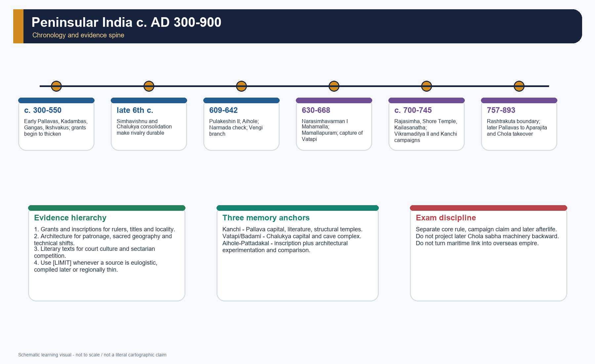

*Original deterministic chronology and evidence spine. It shows what can be dated securely, what is dynastic narrative and where source criticism is compulsory.*

#### Evidence map

| Source family | Best use | Main limit |
|---|---|---|
| [FACT] Royal inscriptions and copper-plate grants | rulers, titulature, gifts, territorial claims, institutions | [LIMIT] prashasti rhetoric and selective survival |
| [FACT] Aihole inscription of Ravikirti | Pulakeshin II's political self-image and Chalukya genealogy | [LIMIT] commemorative eulogy, not neutral chronicle |
| [FACT] Literary works such as *Mattavilasa-prahasana*, Dandin and Tamil bhakti hymns | court culture, religious contestation, language and literary ecology | [LIMIT] genre conventions and later compilation |
| [FACT] Architecture and sculpture | patronage, technology, sacred geography and political symbolism | [LIMIT] monuments outlast perishable arts and cannot alone map sovereignty |
| [FACT] Archaeology, port evidence and settlement history | production, trade and urban continuities | [LIMIT] uneven regional recovery and dating precision |

#### Core teaching / solved practice

- [FACT] Repository owners read first: Ancient History basic/23 and advanced/23; Topic 17 Satavahanas; Topic 18 Sangam; Topic 22 Harsha and Eastern India; Topic 26 transition debate; Art and Culture basic/03, /07, /11 and /13.
- [FACT] OCR evidence then checked: R.S. Sharma's chapter "Brahmanization, Rural Expansion, and Peasant Protest in the Peninsula" and Upinder Singh's early-medieval south sections on the Chalukyas, Pallavas, bhakti, temple architecture, trade and royal land grants.
- [LIMIT] This package does not convert any prashasti, hagiography or later temple legend into literal chronicle.
- [ANALYSIS] The safest period labels are phase labels - emergence, rivalry, consolidation, later survival - not fixed textbook empires with hard borders.
- [DEBATE] "Brahmanization" is retained because it is part of the repository spine and the chapter title in Sharma, but it is not treated as a one-way civilizing mission.

#### PARAGRAPH DEMONSTRATION — CLAIM -> NAMED EVIDENCE -> ANALYSIS -> QUALIFICATION

[CLAIM] Topic 23 marks a formative early-medieval reorganisation rather than a mere dynastic interlude. [NAMED EVIDENCE] Ravikirti's Aihole prashasti records Pulakeshin II's imperial claims, Pallava charters document grants, and Mamallapuram-Pattadakal preserve rival monumental programmes. [ANALYSIS] Read together, these sources connect warfare to locality-building, ritual legitimation and durable regional identities. [QUALIFICATION] Each archive is selective: eulogies exaggerate, monuments privilege elite patronage and grant formulas do not prove uniform enforcement.

#### Must-know facts

- c. AD 550-750 is the core rivalry zone; c. AD 750-900 matters for later Pallavas and the Rashtrakuta boundary.
- Kanchi and Vatapi/Badami are the two primary political centres.
- Mamallapuram, Kanchipuram, Badami, Aihole and Pattadakal are evidence clusters, not decorative monument lists.

#### UPSC traps

- **Wrong:** reduce the topic to "who defeated whom". **Correct:** dynasty, grant, temple, port and language must be read together.
- **Wrong:** treat a single monument or a single inscription as the whole south. **Correct:** triangulate literary, inscriptional and archaeological evidence.

**Mains angle:** Open with "peninsular regional state formation through rivalry, grants and sacred landscapes" and then anchor it in named evidence.

**Study link:** Topic 17 for Deccan background; Topic 18 for the deep south before Pallava-Chalukya dominance; Topic 26 for the wider early medieval transition.

#### CLOSING RECALL FLOW — SCOPE, CHRONOLOGY AND EVIDENCE DISCIPLINE

```text
START / CONCEPT: Scope, chronology and evidence discipline
        |
        v
EXACT TERMS: c. AD 550-750 · regional state formation · Pallavas of Kanchi · Badami Chalukyas · evidence triangulation · early medieval transition
        |
        v
MECHANISM / ARGUMENT: This package does not convert any prashasti, hagiography or later temple legend into literal chronicle.
        |
        v
CONSEQUENCE / CONTRAST: Mamallapuram, Kanchipuram, Badami, Aihole and Pattadakal are evidence clusters, not decorative monument lists.
        |
        v
UPSC TRAP / ANSWER-USE: The safest period labels are phase labels - emergence, rivalry, consolidation, later survival - not fixed textbook empires with hard borders. [DEBATE] "Brahmanization" is retained because it is part of the repository spine and the chapter title in Sharma, but it is not treated as a one-way civilizing mission.
        |
        v
ANSWER-GRABBING FORMULATION: The Pallava-Chalukya age is best read not as a sequence of wars but as the formation of regionally rooted states through conflict, land, shrines and multilingual political culture.
```
### SESSION 2 — AFTER THE SATAVAHANAS: DECCAN AND FAR-SOUTH POLITICAL GEOGRAPHY

#### DEFINITION / WHAT THIS IS CALLED

**Plain-language definition:** Post-Satavahana political geography was a multi-centred field linking the Kanchi-Tondaimandalam coast, the Vatapi-Malaprabha uplands, Vengi and the far south through routes, river basins and shifting frontiers.

**Technical definition:** Political geography explains how ecological corridors, capitals, ports and agrarian zones conditioned power without producing fixed modern-style borders.

#### ANSWER-GRABBING OPENING — WRITE/ADAPT IN THE EXAM

> The peninsula's geography did not dictate one empire; it created connected arenas in which Kanchi, Vatapi, Vengi and the Tungabhadra frontier acquired changing strategic weight.

#### MUST-WRITE KEYWORDS

- **Tondaimandalam**
- **Kanchi**
- **Vatapi-Malaprabha**
- **Vengi**
- **Tungabhadra frontier**
- **Coromandel coast**

**How to use them:** Use **Tondaimandalam** to define the frame, connect **Kanchi** with **Vatapi-Malaprabha** through named evidence, and end with **Coromandel coast** as the controlling qualification or synthesis.

[FACT] The post-Satavahana landscape did not move directly from one imperial centre to another. It contained Ikshvakus, Kadambas, Western Gangas, local chiefs, residual Chola-Pandya-Chera traditions and multiple frontier zones before the better-known Pallava-Chalukya phase hardened.

[ANALYSIS] Geography mattered through the eastern coast, the Palar-Kaveri zone, the Krishna-Godavari belt, the Malaprabha basin and the Tungabhadra frontier. It did not produce a single political order, but it conditioned communication, agrarian cores and campaign routes.

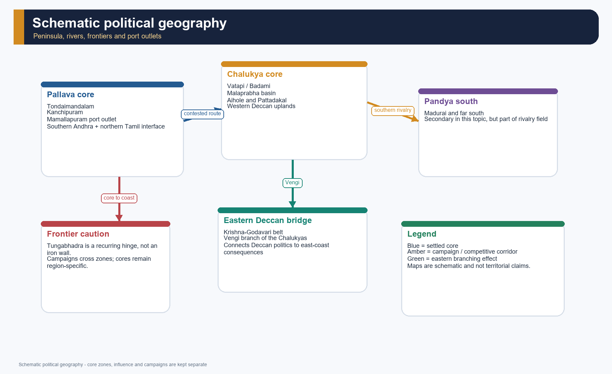

*Teaching map only. Core zones, claimed influence and campaign corridors are visually separated to avoid disputed-boundary overclaim.*

#### Spatial grid

| Zone | Why it matters | Bound it carefully |
|---|---|---|
| [FACT] Tondaimandalam / Kanchi zone | Pallava heartland, temple and literary centre | [LIMIT] not identical to all later "Tamil south" |
| [FACT] Vatapi-Malaprabha belt | Chalukya capital region and temple laboratory | [LIMIT] influence varied beyond core river basins |
| [FACT] Krishna-Godavari / Vengi | bridge to eastern Chalukya history | [LIMIT] later trajectory extends beyond Topic 23 |
| [FACT] Tungabhadra frontier | recurring north-south political hinge | [LIMIT] not an absolute wall |
| [FACT] Coromandel ports | maritime outlet for Kanchi-Mamallapuram world | [LIMIT] port prominence changed over time |

#### Core teaching / solved practice

- [FACT] Sharma treats c. AD 300-750 as a "new phase" in the peninsula marked by new states, land charters and rural expansion.
- [FACT] Upinder's larger early-medieval picture ties the south to wider regional configurations rather than to an isolated civilisational block.
- [ANALYSIS] The Pallava-Chalukya story becomes intelligible only when set between the eastern Deccan, the Tamil coast and the Karnataka uplands.
- [LIMIT] The map in this package is schematic because exact territorial reach fluctuated and is often known only through victory claims or grant findspots.

#### PARAGRAPH DEMONSTRATION — CLAIM -> NAMED EVIDENCE -> ANALYSIS -> QUALIFICATION

[CLAIM] Geography channelled, but did not mechanically determine, peninsular state formation. [NAMED EVIDENCE] Kanchi commanded the Tondaimandalam hinterland, Vatapi sat in the Malaprabha basin, Vengi linked the Krishna-Godavari delta to Deccan politics, and the Tungabhadra repeatedly marked a contested hinge. [ANALYSIS] These locations explain campaign routes, agrarian cores and port-hinterland relations. [QUALIFICATION] Victory claims and grant findspots reveal zones of action, not permanent cadastral frontiers.

#### Must-know facts

- Tondaimandalam and Vatapi are the principal poles.
- Vengi matters because it extends the Chalukya story eastward.
- The Tungabhadra is a recurring but not absolute frontier.

#### UPSC traps

- **Wrong:** write the south as one undifferentiated "Dravidian" space. **Correct:** distinguish Pallava coast, Chalukya Deccan and Pandya south.
- **Wrong:** convert campaign movement into settled administration. **Correct:** mark campaign, core and influence separately.

**Mains angle:** Geography is useful only when connected to resource zones, capitals, ports and military corridors.

**Study link:** Topic 03 Geography and Ecology; Topic 17 Satavahanas and the Deccan.

#### CLOSING RECALL FLOW — AFTER THE SATAVAHANAS: DECCAN AND FAR-SOUTH POLITICAL GEOGRAPHY

```text
START / CONCEPT: After the Satavahanas: Deccan and far-south political geography
        |
        v
EXACT TERMS: Tondaimandalam · Kanchi · Vatapi-Malaprabha · Vengi · Tungabhadra frontier · Coromandel coast
        |
        v
MECHANISM / ARGUMENT: The map in this package is schematic because exact territorial reach fluctuated and is often known only through victory claims or grant findspots.
        |
        v
CONSEQUENCE / CONTRAST: The Tungabhadra is a recurring but not absolute frontier.
        |
        v
UPSC TRAP / ANSWER-USE: Do not miss this limiting distinction: tondaimandalam and Vatapi are the principal poles.
        |
        v
ANSWER-GRABBING FORMULATION: The peninsula's geography did not dictate one empire; it created connected arenas in which Kanchi, Vatapi, Vengi and the Tungabhadra frontier acquired changing strategic weight.
```
### SESSION 3 — EVIDENCE BASE: INSCRIPTIONS, GRANTS, MONUMENTS AND LITERARY SOURCE CRITICISM

#### DEFINITION / WHAT THIS IS CALLED

**Plain-language definition:** The evidence base combines royal eulogies, copper-plate grants, literary works, devotional traditions, coins, inscriptions, settlement archaeology and surviving monuments.

**Technical definition:** Source criticism matches each claim to the genre, date, location and purpose of its evidence before drawing a political or social inference.

#### ANSWER-GRABBING OPENING — WRITE/ADAPT IN THE EXAM

> The richness of the Pallava-Chalukya archive is also its danger: monuments and prashastis are abundant, but both preserve power selectively.

#### MUST-WRITE KEYWORDS

- **Aihole prashasti**
- **copper-plate grants**
- **Mattavilasa-prahasana**
- **Tamil bhakti hymns**
- **monumental archaeology**
- **source asymmetry**

**How to use them:** Use **Aihole prashasti** to define the frame, connect **copper-plate grants** with **Mattavilasa-prahasana** through named evidence, and end with **source asymmetry** as the controlling qualification or synthesis.

[FACT] This topic is unusually rich in inscriptions and monuments, but every major source family is politically loaded.

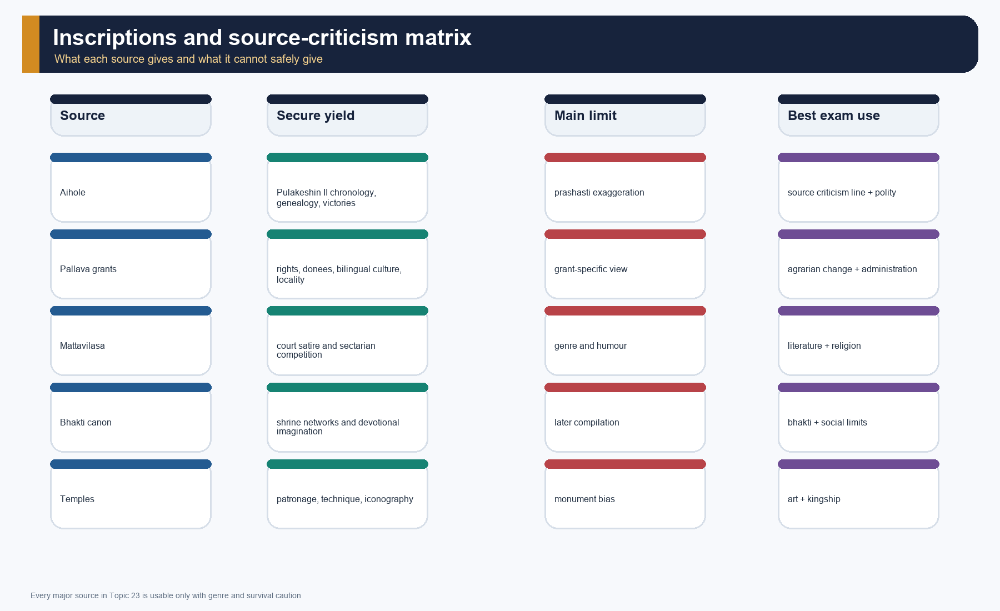

*The matrix separates what each source can establish from what it cannot. This is central to answer-worthiness.*

#### Source matrix

| Source | What it securely gives | What must be qualified |
|---|---|---|
| [FACT] Aihole inscription (Ravikirti) | Pulakeshin II's genealogy, victories, date frame, literary ambition | [LIMIT] court praise and exaggeration |
| [FACT] Pallava grants and epigraphy | early rulers, land rights, bilingual political culture | [LIMIT] uneven survival and grant-specific purpose |
| [FACT] *Mattavilasa-prahasana* | religious satire and courtly milieu under Mahendravarman I | [LIMIT] satire is not census data |
| [FACT] Bhakti canon and hagiographies | devotional language, shrine networks, social imagination | [LIMIT] later compilation, miracle narratives |
| [FACT] Temples and caves | patronage sequence, technical shifts, iconographic programme | [LIMIT] artistic survival is not total cultural history |

#### Core teaching / solved practice

- [FACT] Ravikirti's Aihole inscription is not merely a date marker; it is a Chalukya political text written with literary self-consciousness.
- [FACT] Upinder notes that Pallava and Chola inscriptions reveal a division of labour between Sanskrit prashasti and Tamil documentary portions.
- [FACT] Sharma's land-charter emphasis reminds us that grants are economic and social documents, not only ritual piety.
- [DEBATE] Monumental remains privilege elite and sacred patronage. They tell us much about kingship and much less about everyday peasant voices.
- [LIMIT] The archive is asymmetrical: some rulers survive richly through stone and inscription, others only through brief references or later memory.

#### PARAGRAPH DEMONSTRATION — CLAIM -> NAMED EVIDENCE -> ANALYSIS -> QUALIFICATION

[CLAIM] No single source can reconstruct the Pallava-Chalukya world. [NAMED EVIDENCE] The Aihole prashasti supplies genealogy and campaigns, Pallava charters specify grants, Mattavilasa-prahasana reveals courtly satire, and temples preserve technology and iconography. [ANALYSIS] Their convergence can establish chronology, political idiom and institutional change more securely than any one genre. [QUALIFICATION] A satire is not a census, a prashasti is not neutral reportage and a surviving temple cannot map total sovereignty.

#### Must-know facts

- Aihole is indispensable but rhetorical.
- Bilingual epigraphy is a historical fact, not an optional flourish.
- Architecture is evidence for politics and social ordering, not just "art".

#### UPSC traps

- **Wrong:** call Aihole a neutral biography. **Correct:** call it a prashasti with historical value.
- **Wrong:** cite later bhakti hagiography as if all incidents are directly contemporary. **Correct:** use it for devotional geography and social imagination, not literal chronicle.

**Mains angle:** A strong answer on this topic should contain at least one explicit sentence of source criticism.

**Study link:** Topic 02 Sources of Ancient Indian History.

#### CLOSING RECALL FLOW — EVIDENCE BASE: INSCRIPTIONS, GRANTS, MONUMENTS AND LITERARY SOURCE CRITICISM

```text
START / CONCEPT: Evidence base: inscriptions, grants, monuments and literary source criticism
        |
        v
EXACT TERMS: Aihole prashasti · copper-plate grants · Mattavilasa-prahasana · Tamil bhakti hymns · monumental archaeology · source asymmetry
        |
        v
MECHANISM / ARGUMENT: The archive is asymmetrical: some rulers survive richly through stone and inscription, others only through brief references or later memory.
        |
        v
CONSEQUENCE / CONTRAST: Ravikirti's Aihole inscription is not merely a date marker; it is a Chalukya political text written with literary self-consciousness.
        |
        v
UPSC TRAP / ANSWER-USE: Sharma's land-charter emphasis reminds us that grants are economic and social documents, not only ritual piety. [DEBATE] Monumental remains privilege elite and sacred patronage.
        |
        v
ANSWER-GRABBING FORMULATION: The richness of the Pallava-Chalukya archive is also its danger: monuments and prashastis are abundant, but both preserve power selectively.
```
### SESSION 4 — PALLAVA ORIGINS DEBATE, EARLY PALLAVAS AND THE MAKING OF KANCHIPURAM

#### DEFINITION / WHAT THIS IS CALLED

**Plain-language definition:** Pallava origins remain disputed, but their historically secure development is traced through early Prakrit-Sanskrit charters and their later anchoring in Tondaimandalam with Kanchipuram as the principal centre.

**Technical definition:** An exam-safe origin argument distinguishes speculative ethnic genealogies from the institutional evidence of changing chanceries, regional bases and dynastic consolidation.

#### ANSWER-GRABBING OPENING — WRITE/ADAPT IN THE EXAM

> The Pallavas should be located through their evolving inscriptional and regional institutions, not forced into a single racial or migration story.

#### MUST-WRITE KEYWORDS

- **disputed Pallava origins**
- **Prakrit charters**
- **Sanskrit charters**
- **Tondaimandalam**
- **Kanchipuram**
- **Simhavishnu**

**How to use them:** Use **disputed Pallava origins** to define the frame, connect **Prakrit charters** with **Sanskrit charters** through named evidence, and end with **Simhavishnu** as the controlling qualification or synthesis.

[FACT] The secure historical Pallava story begins with inscriptions of early kings such as Shivaskandavarman and with their association with Tondaimandalam and Kanchi.

[DEBATE] The origin of the Pallavas remains debated. Older theories traced them in different directions, but the repository's strongest evidence only supports a cautious conclusion: they were entrenched in Tondaimandalam, had southern-Andhra linkages, and cannot be assigned a simple ethnic origin with confidence.

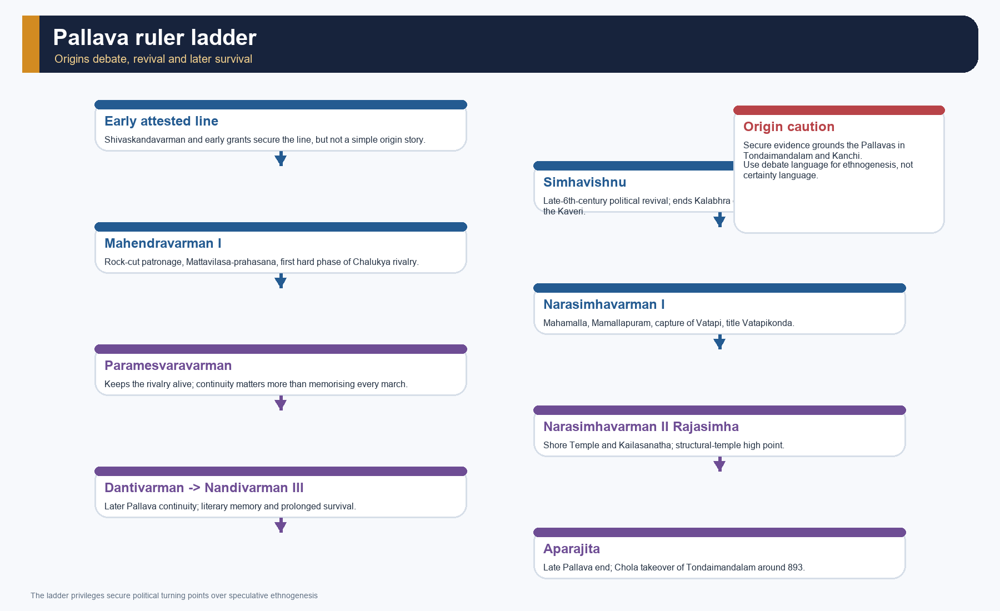

*The ladder separates early attested rulers from the later politically decisive line so that uncertain ethnogenesis does not masquerade as secure chronology.*

#### Core teaching / solved practice

- [FACT] Sharma connects the Pallavas with Tondai/Tondainadu and notes the term pallava as "creeper", while also acknowledging older social memory that made their early respectability a matter of political work.
- [FACT] The Pallava authority extended over southern Andhra and northern Tamil Nadu, with Kanchi becoming a town of temples and Vedic learning.
- [FACT] Upinder places the crucial political rise not in the obscure earliest line but in the late-6th-century revival under Simhavishnu.
- [LIMIT] The temptation to narrate the Pallavas as a seamless line from the 4th to the 9th century must be resisted. The evidentiary density changes sharply over time.
- [ANALYSIS] Kanchi's later cultural weight should not erase the fact that early Pallava state-making was a frontier process across Andhra-Tamil interfaces.

#### PARAGRAPH DEMONSTRATION — CLAIM -> NAMED EVIDENCE -> ANALYSIS -> QUALIFICATION

[CLAIM] Pallava identity was historically constructed through institutions rather than revealed by one origin legend. [NAMED EVIDENCE] Early charters move from Prakrit to Sanskrit, later records operate in a Tamil-Sanskrit environment, and Simhavishnu's line consolidates around Kanchi. [ANALYSIS] This sequence shows chancery adaptation and regional state-building. [QUALIFICATION] It does not prove exclusive descent from Pahlavas, a northern clan, Andhra migrants or one fixed ethnic community.

#### Must-know facts

- Tondaimandalam is the secure regional anchor.
- Kanchipuram is the Pallava capital and later cultural centre.
- Early kings are attested, but the politically decisive expansion comes later.

#### UPSC traps

- **Wrong:** present Pallava origin as settled and singular. **Correct:** say that origin theories exist, but inscriptions securely ground them in Tondaimandalam and Kanchi.
- **Wrong:** begin the Pallavas directly with Mahendravarman I. **Correct:** note earlier rulers and then explain why Simhavishnu becomes the real turning point.

**Mains angle:** The best way to handle the origin debate is to be brief, source-bound and non-dogmatic.

**Study link:** Topic 18 on the deep south; Topic 26 on early medieval social change.

#### CLOSING RECALL FLOW — PALLAVA ORIGINS DEBATE, EARLY PALLAVAS AND THE MAKING OF KANCHIPURAM

```text
START / CONCEPT: Pallava origins debate, early Pallavas and the making of Kanchipuram
        |
        v
EXACT TERMS: disputed Pallava origins · Prakrit charters · Sanskrit charters · Tondaimandalam · Kanchipuram · Simhavishnu
        |
        v
MECHANISM / ARGUMENT: [DEBATE] The origin of the Pallavas remains debated.
        |
        v
CONSEQUENCE / CONTRAST: Sharma connects the Pallavas with Tondai/Tondainadu and notes the term pallava as "creeper", while also acknowledging older social memory that made their early respectability a matter of political work.
        |
        v
UPSC TRAP / ANSWER-USE: Kanchi's later cultural weight should not erase the fact that early Pallava state-making was a frontier process across Andhra-Tamil interfaces.
        |
        v
ANSWER-GRABBING FORMULATION: The Pallavas should be located through their evolving inscriptional and regional institutions, not forced into a single racial or migration story.
```
### SESSION 5 — THE CHALUKYAS OF BADAMI: PULAKESHIN I, KIRTIVARMAN I AND MANGALESHA

#### DEFINITION / WHAT THIS IS CALLED

**Plain-language definition:** The early Badami Chalukya state emerged in the western Deccan through the consolidation of Vatapi under Pulakeshin I, Kirtivarman I and Mangalesha before Pulakeshin II's wider expansion.

**Technical definition:** Its formation combined a fortified capital, dynastic succession, subordinate chiefs, military campaigns and Brahmanical legitimation rather than instantaneous territorial unification.

#### ANSWER-GRABBING OPENING — WRITE/ADAPT IN THE EXAM

> Before Pulakeshin II's celebrated conquests, the Chalukyas had already built a western-Deccan core through Vatapi, lineage consolidation and control of neighbouring powers.

#### MUST-WRITE KEYWORDS

- **Vatapi-Badami**
- **Pulakeshin I**
- **Kirtivarman I**
- **Mangalesha**
- **western Deccan**
- **dynastic legitimation**

**How to use them:** Use **Vatapi-Badami** to define the frame, connect **Pulakeshin I** with **Kirtivarman I** through named evidence, and end with **dynastic legitimation** as the controlling qualification or synthesis.

[FACT] The Badami Chalukyas established a powerful western-Deccan kingdom in the 6th century, with Vatapi/Badami as their capital.

[ANALYSIS] Their rise is the Deccan counterpart to Pallava consolidation on the eastern coast: both lines used genealogy, sacrifice, warfare and monumental patronage to transform regional chiefship into durable kingship.

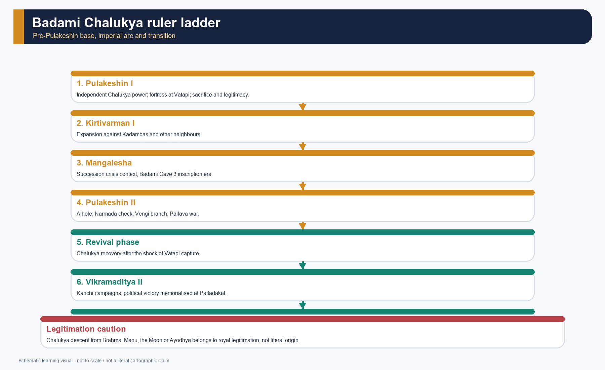

*This ladder keeps the pre-Pulakeshin II succession visible so that the Aihole inscription is not read as if the dynasty begins with its most famous ruler.*

#### Core teaching / solved practice

- [FACT] Sharma says the Chalukyas claimed descent from Brahma or Manu or the Moon and even an Ayodhya past, but explicitly treats this as a search for legitimacy rather than literal origin.
- [FACT] Upinder identifies Pulakeshin I (c. 535-566) as the ruler who established independent Chalukya power and built a strong fortress at Vatapi.
- [FACT] Kirtivarman I expanded the kingdom through wars against Kadambas, Mauryas of the Konkan and others, before a succession struggle between Mangalesha and Pulakeshin II.
- [FACT] The Badami cave complex is linked in repository Art and Culture notes to Pulakeshin I, Kirtivarman I and Mangalesha, culminating in the dated Cave 3 inscription of 578 CE under Mangalesha.
- [LIMIT] Grand origin myths and sacrifice lists are part of royal idiom; they should not be mistaken for neutral social history.

#### PARAGRAPH DEMONSTRATION — CLAIM -> NAMED EVIDENCE -> ANALYSIS -> QUALIFICATION

[CLAIM] Badami Chalukya power rested on a consolidated regional core before it became an expansionary empire. [NAMED EVIDENCE] Pulakeshin I's Vatapi base, Kirtivarman I's campaigns and Mangalesha's regency-succession phase precede Pulakeshin II in the dynastic record. [ANALYSIS] The sequence explains how capital, lineage and military resources enabled later expansion. [QUALIFICATION] Later genealogies and conquest claims are legitimating narratives, not literal maps of uninterrupted control.

#### Must-know facts

- Vatapi/Badami is the capital.
- Pulakeshin I, Kirtivarman I and Mangalesha form the indispensable prelude to Pulakeshin II.
- Chalukya legitimacy mixed genealogy, sacrifice, fortress-building and campaign.

#### UPSC traps

- **Wrong:** start the Chalukyas only with Pulakeshin II. **Correct:** the dynasty's institutional base predates him.
- **Wrong:** treat origin claims as ethnographic fact. **Correct:** explain them as legitimising narratives.

**Mains angle:** Mention the pre-Pulakeshin build-up to show institutional continuity, not just heroic kingship.

**Study link:** Deccan political background in Topic 17.

#### CLOSING RECALL FLOW — THE CHALUKYAS OF BADAMI: PULAKESHIN I, KIRTIVARMAN I AND MANGALESHA

```text
START / CONCEPT: The Chalukyas of Badami: Pulakeshin I, Kirtivarman I and Mangalesha
        |
        v
EXACT TERMS: Vatapi-Badami · Pulakeshin I · Kirtivarman I · Mangalesha · western Deccan · dynastic legitimation
        |
        v
MECHANISM / ARGUMENT: Sharma says the Chalukyas claimed descent from Brahma or Manu or the Moon and even an Ayodhya past, but explicitly treats this as a search for legitimacy rather than literal origin.
        |
        v
CONSEQUENCE / CONTRAST: Grand origin myths and sacrifice lists are part of royal idiom; they should not be mistaken for neutral social history.
        |
        v
UPSC TRAP / ANSWER-USE: Mention the pre-Pulakeshin build-up to show institutional continuity, not just heroic kingship.
        |
        v
ANSWER-GRABBING FORMULATION: Before Pulakeshin II's celebrated conquests, the Chalukyas had already built a western-Deccan core through Vatapi, lineage consolidation and control of neighbouring powers.
```
### SESSION 6 — SIMHAVISHNU AND MAHENDRAVARMAN I: RECOVERY, COURT CULTURE AND THE FIRST HARD EDGE OF RIVALRY

#### DEFINITION / WHAT THIS IS CALLED

**Plain-language definition:** Simhavishnu restored Pallava political weight, while Mahendravarman I joined court literature, early rock-cut patronage and the first major confrontation with Pulakeshin II.

**Technical definition:** This phase links dynastic recovery to cultural statecraft: conquest, Sanskrit performance, religious debate and rock-cut architecture became connected languages of rule.

#### ANSWER-GRABBING OPENING — WRITE/ADAPT IN THE EXAM

> Mahendravarman I made Pallava recovery visible in both stone and satire, even as Chalukya pressure exposed the limits of that recovery.

#### MUST-WRITE KEYWORDS

- **Simhavishnu**
- **Mahendravarman I**
- **Mattavilasa-prahasana**
- **Mandagapattu**
- **rock-cut patronage**
- **Pulakeshin II**

**How to use them:** Use **Simhavishnu** to define the frame, connect **Mahendravarman I** with **Mattavilasa-prahasana** through named evidence, and end with **Pulakeshin II** as the controlling qualification or synthesis.

[FACT] Simhavishnu ended the disruptions associated with the Kalabhras and extended Pallava power up to the Kaveri, making him the political founder of the later Pallava ascendency.

[FACT] Mahendravarman I (c. 590-630) was both a ruler and a cultural patron, remembered in the repository's cross-linked evidence as patron of the earliest Pallava rock-cut phase and as author of the Sanskrit farce *Mattavilasa-prahasana*.

#### Core teaching / solved practice

- [FACT] Upinder presents Simhavishnu as the decisive ruler in the late 6th century, not merely a genealogical predecessor.
- [FACT] Mahendravarman's reign saw the beginning of the sharper Pallava-Chalukya conflict when Pulakeshin II's forces advanced close to Kanchipuram.
- [FACT] Repository Art and Culture notes identify Mandagapattu and Mamandur with the Mahendravarman phase, including the famous claim of a temple made without timber, brick or metal.
- [FACT] The 7th-century *Mattavilasa-prahasana* mocks Buddhists, Kapalikas and Pashupatas and is therefore precious evidence for inter-religious competition and courtly self-confidence.
- [DEBATE] Later tradition associates Mahendravarman with conversion from Jainism to Shaivism through Appar, but the safest exam use is to note religious contestation rather than turn hagiography into fixed biography.
- [LIMIT] Even when a ruler is an author-patron, literary production is never reducible to one king's personality alone.

#### PARAGRAPH DEMONSTRATION — CLAIM -> NAMED EVIDENCE -> ANALYSIS -> QUALIFICATION

[CLAIM] Pallava recovery under Simhavishnu and Mahendravarman I was political and cultural at once. [NAMED EVIDENCE] Simhavishnu renewed expansion; Mahendravarman's Mandagapattu-associated cave phase and Mattavilasa-prahasana projected royal creativity while Pulakeshin II pressed the Pallava frontier. [ANALYSIS] Court art and literature helped convert restored power into legitimacy. [QUALIFICATION] The farce's sectarian caricatures and later dynastic narratives cannot be read as neutral descriptions of society or war.

#### Must-know facts

- Simhavishnu is the later Pallava political turning point.
- Mahendravarman I is the most important pre-Mamalla cultural ruler.
- The rivalry with the Chalukyas sharpens under Mahendravarman.

#### UPSC traps

- **Wrong:** write Mahendravarman only as a temple patron. **Correct:** include literature and religious satire.
- **Wrong:** treat later conversion legends as fully verified biography. **Correct:** use them only to indicate sectarian competition.

**Mains angle:** Mahendravarman is ideal when a question wants art, literature and politics in one frame.

**Study link:** Art and Culture basic/03, /07 and /11.

#### CLOSING RECALL FLOW — SIMHAVISHNU AND MAHENDRAVARMAN I: RECOVERY, COURT CULTURE AND THE FIRST HARD EDGE OF RIVALRY

```text
START / CONCEPT: Simhavishnu and Mahendravarman I: recovery, court culture and the first hard edge of rivalry
        |
        v
EXACT TERMS: Simhavishnu · Mahendravarman I · Mattavilasa-prahasana · Mandagapattu · rock-cut patronage · Pulakeshin II
        |
        v
MECHANISM / ARGUMENT: The 7th-century Mattavilasa-prahasana mocks Buddhists, Kapalikas and Pashupatas and is therefore precious evidence for inter-religious competition and courtly self-confidence. [DEBATE] Later tradition associates Mahendravarman with conversion from Jainism to Shaivism through Appar, but the safest exam use is to note religious contestation rather than turn hagiography into fixed biography.
        |
        v
CONSEQUENCE / CONTRAST: Simhavishnu ended the disruptions associated with the Kalabhras and extended Pallava power up to the Kaveri, making him the political founder of the later Pallava ascendency.
        |
        v
UPSC TRAP / ANSWER-USE: Do not miss this limiting distinction: mahendravarman is ideal when a question wants art, literature and politics in one frame.
        |
        v
ANSWER-GRABBING FORMULATION: Mahendravarman I made Pallava recovery visible in both stone and satire, even as Chalukya pressure exposed the limits of that recovery.
```
### SESSION 7 — PULAKESHIN II, RAVIKIRTI AND THE AIHOLE INSCRIPTION

#### DEFINITION / WHAT THIS IS CALLED

**Plain-language definition:** Pulakeshin II was the best-documented Badami Chalukya ruler, whose expansion and royal self-image are anchored by Ravikirti's Aihole inscription of 634-35 CE.

**Technical definition:** The inscription is both an event-framework and a Sanskrit prashasti: it supports chronology, genealogy and campaign claims while requiring corroboration for territorial duration.

#### ANSWER-GRABBING OPENING — WRITE/ADAPT IN THE EXAM

> Pulakeshin II's fame rests on a rare convergence of political reach and literary commemoration, but Aihole records how his court wished victory to be remembered.

#### MUST-WRITE KEYWORDS

- **Pulakeshin II**
- **Ravikirti**
- **Aihole inscription**
- **634-35 CE**
- **Narmada check**
- **prashasti**

**How to use them:** Use **Pulakeshin II** to define the frame, connect **Ravikirti** with **Aihole inscription** through named evidence, and end with **prashasti** as the controlling qualification or synthesis.

[FACT] Pulakeshin II (c. 610/11-642/43) is the best-documented Badami Chalukya ruler, and the Aihole inscription composed by Ravikirti is the central source for his political image.

[ANALYSIS] Aihole matters because it does three things at once: it offers Chalukya genealogy, presents Pulakeshin II as conqueror and defender, and demonstrates that political prestige in the Deccan was inseparable from Sanskrit literary accomplishment.

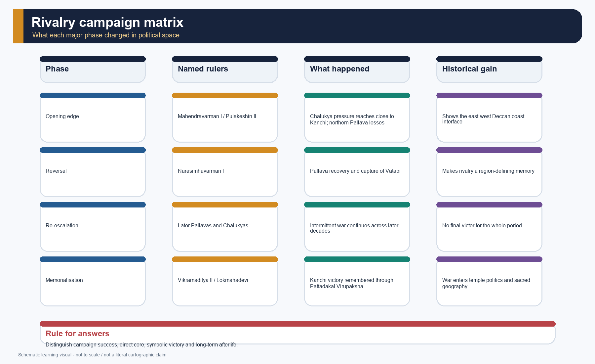

*The matrix distinguishes direct control, campaign success, frontier checking and later reversal so that Pulakeshin II is neither inflated nor diminished.*

#### Core teaching / solved practice

- [FACT] Upinder notes that the Aihole inscription is dated in Shaka 556 (634-35 CE), was composed by Ravikirti and is embedded in a Jain setting - important for the religious landscape of Karnataka.
- [FACT] The inscription celebrates Pulakeshin II's victories over Kadambas, Alupas, Gangas, Latas, Malavas, Gurjaras, parts of Kosala and Kalinga, and most memorably Harsha on the Narmada.
- [LIMIT] Topic 23 uses the Harsha link only as a southern boundary marker. The northern political story belongs to Topic 22.
- [FACT] Sharma explicitly calls the inscription valuable despite exaggeration and connects Pulakeshin II with the conquest of the Krishna-Godavari zone and the foundation of the eastern Chalukya line in Vengi.
- [ANALYSIS] Ravikirti's self-display matters: a king's political claim is being voiced through a poet who also boasts literary parity with the greats. That is evidence of court culture, not background ornament.

#### PARAGRAPH DEMONSTRATION — CLAIM -> NAMED EVIDENCE -> ANALYSIS -> QUALIFICATION

[CLAIM] Pulakeshin II connected Deccan expansion with an ambitious imperial ideology. [NAMED EVIDENCE] Ravikirti's Aihole inscription, dated 634-35 CE, recounts Chalukya genealogy, the check to Harsha near the Narmada and campaigns toward the eastern and southern regions. [ANALYSIS] It fixes a political sequence and shows Sanskrit literary prestige serving kingship. [QUALIFICATION] Because it is a prashasti, victory language cannot by itself prove permanent annexation or neutral casualty-free history.

#### Must-know facts

- Ravikirti composed the Aihole inscription.
- The Narmada victory over Harsha is remembered through a rival inscriptional voice.
- Vengi emerges from Pulakeshin II's eastern expansion.

#### UPSC traps

- **Wrong:** quote every campaign claim as final territorial history. **Correct:** differentiate eulogy, frontier check and long-term control.
- **Wrong:** ignore the Jain setting. **Correct:** it indicates plural religious patronage around the Chalukya court.

**Mains angle:** "Aihole is simultaneously a historical source, a political argument and a literary performance."

**Study link:** Topic 22 for the Narmada frontier from the Harsha side.

#### CLOSING RECALL FLOW — PULAKESHIN II, RAVIKIRTI AND THE AIHOLE INSCRIPTION

```text
START / CONCEPT: Pulakeshin II, Ravikirti and the Aihole inscription
        |
        v
EXACT TERMS: Pulakeshin II · Ravikirti · Aihole inscription · 634-35 CE · Narmada check · prashasti
        |
        v
MECHANISM / ARGUMENT: 610/11-642/43) is the best-documented Badami Chalukya ruler, and the Aihole inscription composed by Ravikirti is the central source for his political image.
        |
        v
CONSEQUENCE / CONTRAST: Aihole matters because it does three things at once: it offers Chalukya genealogy, presents Pulakeshin II as conqueror and defender, and demonstrates that political prestige in the Deccan was inseparable from Sanskrit literary accomplishment.
        |
        v
UPSC TRAP / ANSWER-USE: Do not miss this limiting distinction: sharma explicitly calls the inscription valuable despite exaggeration and connects Pulakeshin II with the...
        |
        v
ANSWER-GRABBING FORMULATION: Pulakeshin II's fame rests on a rare convergence of political reach and literary commemoration, but Aihole records how his court wished victory to be remembered.
```
### SESSION 8 — NARASIMHAVARMAN I MAHAMALLA AND THE CAPTURE OF VATAPI

#### DEFINITION / WHAT THIS IS CALLED

**Plain-language definition:** Narasimhavarman I Mamalla reversed Pallava losses, captured Vatapi conventionally around 642 CE and linked military recovery with the monumental landscape of Mamallapuram.

**Technical definition:** The title Vatapikonda compresses a major counter-campaign into royal memory, while the event's duration and territorial consequences must remain separate from its prestige value.

#### ANSWER-GRABBING OPENING — WRITE/ADAPT IN THE EXAM

> Narasimhavarman I turned the capture of an enemy capital into both a political reversal and a durable language of Pallava prestige.

#### MUST-WRITE KEYWORDS

- **Narasimhavarman I**
- **Mamalla**
- **Vatapikonda**
- **c. 642 CE**
- **Mamallapuram**
- **campaign versus control**

**How to use them:** Use **Narasimhavarman I** to define the frame, connect **Mamalla** with **Vatapikonda** through named evidence, and end with **campaign versus control** as the controlling qualification or synthesis.

[FACT] Under Narasimhavarman I Mahamalla (c. 630-668), the Pallavas reversed Chalukya pressure, captured Badami/Vatapi and carried the rivalry to its dramatic climax.

[ANALYSIS] This turning point shows why the rivalry cannot be read as a simple permanent balance. Supremacy shifted, and those shifts reshaped both monument-building and dynastic memory.

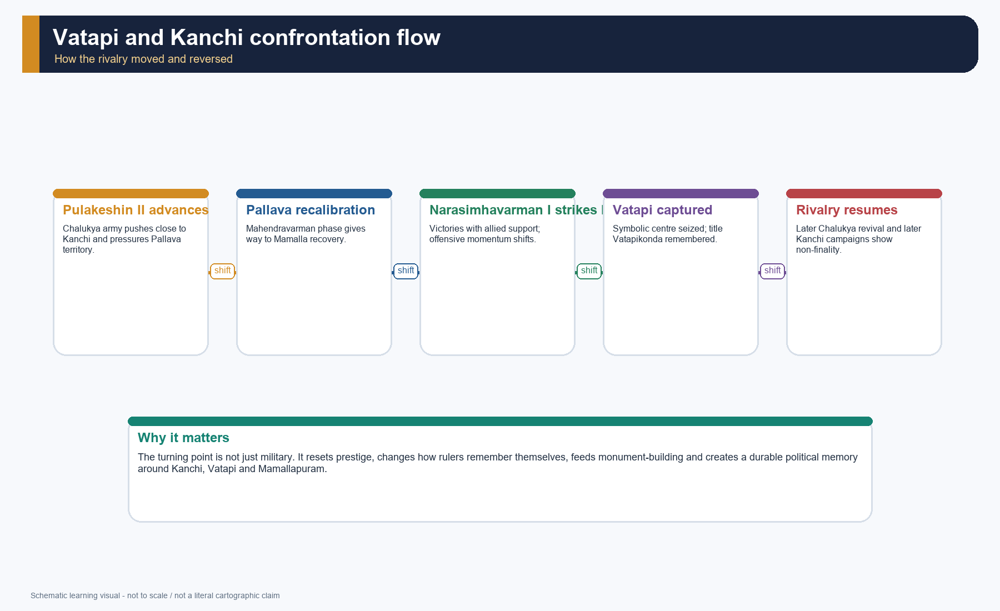

*The flow emphasises sequence - Pulakeshin's advance, Pallava recovery, Vatapi capture, later resumption - rather than a flattened "constant war" narrative.*

#### Core teaching / solved practice

- [FACT] Upinder states that Narasimhavarman I won several victories over the Chalukyas with support from the Sri Lankan prince Manavarman and ultimately captured Badami.
- [FACT] Sharma says Narasimhavarman occupied Vatapi around 642 and adopted the title Vatapikonda, "conqueror of Vatapi".
- [FACT] Narasimhavarman was an energetic patron of architecture; the port of Mamallapuram and its ratha complex are associated in repository evidence with his reign.
- [ANALYSIS] Sri Lankan intervention should be used cautiously: it shows transmarine political linkage and naval capacity, but not a standing southern thalassocracy.
- [LIMIT] The Pallava occupation of Badami was real but not permanent. Long rivalry resumed.

#### PARAGRAPH DEMONSTRATION — CLAIM -> NAMED EVIDENCE -> ANALYSIS -> QUALIFICATION

[CLAIM] Narasimhavarman I's capture of Vatapi was a decisive prestige victory rather than proof of permanent Pallava rule over the western Deccan. [NAMED EVIDENCE] Pallava titulature remembers him as Vatapikonda, while Mamallapuram's Mamalla association places the victory within a wider programme of monumental kingship. [ANALYSIS] The counter-campaign restored Pallava initiative and recoded rivalry as dynastic memory. [QUALIFICATION] A captured capital and victory title do not establish continuous administration across all Chalukya territory.

#### Must-know facts

- Narasimhavarman I = Mahamalla and Vatapikonda.
- Pallava victory over Vatapi is the dramatic counter-stroke to Pulakeshin II.
- Mamallapuram's architectural programme belongs to the political confidence of this phase.

#### UPSC traps

- **Wrong:** say the Pallavas permanently extinguished the Chalukyas in 642. **Correct:** Vatapi was captured, but Chalukya power revived.
- **Wrong:** exaggerate Sri Lankan linkage into empire. **Correct:** use it as allied intervention and political connection.

**Mains angle:** The capture of Vatapi should be written as both military reversal and symbolic capital.

**Study link:** Maritime links in Section 20; architecture in Section 16.

#### CLOSING RECALL FLOW — NARASIMHAVARMAN I MAHAMALLA AND THE CAPTURE OF VATAPI

```text
START / CONCEPT: Narasimhavarman I Mahamalla and the capture of Vatapi
        |
        v
EXACT TERMS: Narasimhavarman I · Mamalla · Vatapikonda · c. 642 CE · Mamallapuram · campaign versus control
        |
        v
MECHANISM / ARGUMENT: The capture of Vatapi should be written as both military reversal and symbolic capital.
        |
        v
CONSEQUENCE / CONTRAST: Correct: Vatapi was captured, but Chalukya power revived.
        |
        v
UPSC TRAP / ANSWER-USE: Sri Lankan intervention should be used cautiously: it shows transmarine political linkage and naval capacity, but not a standing southern thalassocracy.
        |
        v
ANSWER-GRABBING FORMULATION: Narasimhavarman I turned the capture of an enemy capital into both a political reversal and a durable language of Pallava prestige.
```
### SESSION 9 — LATER RIVALRY: PARAMESVARAVARMAN, RAJASIMHA, VIKRAMADITYA I AND II, AND THE NANDIVARMAN LINE

#### DEFINITION / WHAT THIS IS CALLED

**Plain-language definition:** Later rivalry continued through Paramesvaravarman I, Narasimhavarman II Rajasimha, Vikramaditya I-II and the Nandivarman line, with alternating campaigns and monumental commemoration.

**Technical definition:** This phase is a cycle of recovery, raid, alliance and succession rather than a final victory by either dynasty.

#### ANSWER-GRABBING OPENING — WRITE/ADAPT IN THE EXAM

> The later rivalry mattered because each recovery converted military memory into new alliances, temples and claims to legitimate succession.

#### MUST-WRITE KEYWORDS

- **Paramesvaravarman I**
- **Rajasimha**
- **Vikramaditya I**
- **Vikramaditya II**
- **Nandivarman II**
- **Kanchi campaigns**

**How to use them:** Use **Paramesvaravarman I** to define the frame, connect **Rajasimha** with **Vikramaditya I** through named evidence, and end with **Kanchi campaigns** as the controlling qualification or synthesis.

[FACT] The Pallava-Chalukya struggle did not end with Vatapi. It passed through renewed campaigns, peaceful interludes, later Chalukya offensives and a prolonged Pallava afterlife into the 9th century.

#### Core teaching / solved practice

- [FACT] After Narasimhavarman I, the conflict continued under later rulers, including Paramesvaravarman and Narasimhavarman II Rajasimha on the Pallava side.
- [FACT] Upinder notes that the early-8th-century Shore Temple at Mamallapuram and the Rajasimheshvara/Kailasanatha temple at Kanchipuram belong to Narasimhavarman II Rajasimha's architectural phase.
- [FACT] Sharma records that Vikramaditya II (733-745) overran Kanchi three times and in 740 decisively defeated the Pallavas, even though the ruling house continued thereafter.
- [FACT] Repository Art and Culture notes connect the Virupaksha temple at Pattadakal to Vikramaditya II's Kanchi victory, commissioned by queen Lokamahadevi.
- [FACT] Upinder shows that in the 9th century Dantivarman and Nandivarman III still mattered; the Pallavas were finally overthrown by Aditya I around 893.
- [LIMIT] The package treats the Nandivarman line only to the extent needed for later Pallava continuity, literary memory and monuments such as Vaikuntha Perumal.
- [FACT] Later Pallava Kanchi architecture included the Vaikuntha Perumal tradition usually linked to the Nandivarman/Pallavamalla phase; [LIMIT] repository OCR is thinner here than for Shore Temple and Kailasanatha, so the temple is used as a later Pallava marker rather than over-described.

#### PARAGRAPH DEMONSTRATION — CLAIM -> NAMED EVIDENCE -> ANALYSIS -> QUALIFICATION

[CLAIM] Pallava-Chalukya rivalry persisted as a changing political relationship after Vatapi's capture. [NAMED EVIDENCE] Vikramaditya I restored Chalukya power, Vikramaditya II campaigned at Kanchi, Lokamahadevi's Virupaksha temple memorialised victory, and Nandivarman II's succession appears in Vaikuntha Perumal panels. [ANALYSIS] Warfare, queenly patronage and succession imagery jointly reproduced authority. [QUALIFICATION] Commemorative narratives magnify royal success and do not prove stable annexation of the rival core.

#### Must-know facts

- Rajasimha marks the structural-temple high point.
- Vikramaditya II's Kanchi victories matter politically and architecturally.
- Pallava history continues long after Vatapi, into Dantivarman and Nandivarman III.

#### UPSC traps

- **Wrong:** end the Pallavas with Narasimhavarman I. **Correct:** later Pallava survival and structural-temple patronage are essential.
- **Wrong:** make later conflict a blur. **Correct:** remember Kanchi reversals, Vikramaditya II and the later Pallava line.

**Mains angle:** Later rivalry is useful for showing how warfare could be memorialised in architecture.

**Study link:** Section 17 on Pattadakal; Topic 27 for later Chola takeover of Tondaimandalam.

#### CLOSING RECALL FLOW — LATER RIVALRY: PARAMESVARAVARMAN, RAJASIMHA, VIKRAMADITYA I AND II, AND THE NANDIVARMAN LINE

```text
START / CONCEPT: Later rivalry: Paramesvaravarman, Rajasimha, Vikramaditya I and II, and the Nandivarman line
        |
        v
EXACT TERMS: Paramesvaravarman I · Rajasimha · Vikramaditya I · Vikramaditya II · Nandivarman II · Kanchi campaigns
        |
        v
MECHANISM / ARGUMENT: Upinder shows that in the 9th century Dantivarman and Nandivarman III still mattered; the Pallavas were finally overthrown by Aditya I around 893.
        |
        v
CONSEQUENCE / CONTRAST: The package treats the Nandivarman line only to the extent needed for later Pallava continuity, literary memory and monuments such as Vaikuntha Perumal.
        |
        v
UPSC TRAP / ANSWER-USE: Later Pallava Kanchi architecture included the Vaikuntha Perumal tradition usually linked to the Nandivarman/Pallavamalla phase; repository OCR is thinner here than for Shore Temple and Kailasanatha, so the temple is used as a later Pallava marker rather than over-described.
        |
        v
ANSWER-GRABBING FORMULATION: The later rivalry mattered because each recovery converted military memory into new alliances, temples and claims to legitimate succession.
```
### SESSION 10 — EASTERN CHALUKYAS OF VENGI AND THE RASHTRAKUTA BOUNDARY

#### DEFINITION / WHAT THIS IS CALLED

**Plain-language definition:** The Eastern Chalukya branch in Vengi and the Rashtrakuta overthrow of the Badami line mark two different consequences of Chalukya expansion and eighth-century reconfiguration.

**Technical definition:** A boundary-conscious account separates the early-seventh-century Vengi foundation from later Eastern Chalukya history and dates the Badami displacement conventionally to c. 753 CE.

#### ANSWER-GRABBING OPENING — WRITE/ADAPT IN THE EXAM

> The end of Badami Chalukya rule did not end Chalukya history: Vengi survived as a distinct eastern branch while Rashtrakutas replaced only the western line.

#### MUST-WRITE KEYWORDS

- **Kubja Vishnuvardhana**
- **Vengi**
- **Eastern Chalukyas**
- **Kirtivarman II**
- **c. 753 CE**
- **Rashtrakuta transition**

**How to use them:** Use **Kubja Vishnuvardhana** to define the frame, connect **Vengi** with **Eastern Chalukyas** through named evidence, and end with **Rashtrakuta transition** as the controlling qualification or synthesis.

[FACT] The eastern Chalukya line in Vengi began when Pulakeshin II placed his brother in the conquered Andhra territory. It outlasted the Badami line and shaped the eastern Deccan for centuries.

[ANALYSIS] This matters because it prevents Topic 23 from being read as a closed Pallava-vs-Badami duel. The rivalry had eastern consequences, and the collapse of Badami power opened later trajectories rather than ending the Chalukya story.

#### Core teaching / solved practice

- [FACT] Sharma links Vengi directly to Pulakeshin II's eastern conquest between the Krishna and Godavari.
- [FACT] The Eastern Chalukya line continued into the eleventh century; Rajaraja I intervened in Vengi succession politics rather than simply ending the dynasty by conquest in AD 999 - important as a later bridge, not as the main focus of this topic.
- [FACT] The Badami Chalukyas were overthrown in c. AD 753 by their Rashtrakuta feudatories.
- [LIMIT] The Rashtrakutas belong here only as a boundary marker and transitional bridge. Their fuller political and architectural story lies outside this topic's centre of gravity.
- [ANALYSIS] Vengi shows how conquest, delegation and dynastic branching could produce durable secondary centres of power.

#### PARAGRAPH DEMONSTRATION — CLAIM -> NAMED EVIDENCE -> ANALYSIS -> QUALIFICATION

[CLAIM] Chalukya expansion produced both durable branching and eventual western displacement. [NAMED EVIDENCE] Pulakeshin II's brother Kubja Vishnuvardhana established the Vengi branch in the early seventh century, whereas Rashtrakuta power displaced Kirtivarman II around 753 CE. [ANALYSIS] These events show that dynastic change was regional reconfiguration, not simultaneous extinction. [QUALIFICATION] Later Vengi-Chola entanglement and full Rashtrakuta history lie beyond Topic 23.

#### Must-know facts

- Vengi = eastern Chalukya branch.
- c. AD 753 = end of Badami Chalukya hegemony.
- Topic 23 stops at the bridge, not the full Rashtrakuta or later-Chola narrative.

#### UPSC traps

- **Wrong:** assume "Chalukya decline" means all Chalukya lines disappear together. **Correct:** distinguish Badami, Vengi and later western lines.
- **Wrong:** overtake the topic with Rashtrakuta detail. **Correct:** use Rashtrakutas only as the transition beyond Badami.

**Mains angle:** The eastern Chalukyas are the best evidence that peninsular political processes were branching, not linear.

**Study link:** Topic 27 for later Chola-Vengi entanglement.

#### CLOSING RECALL FLOW — EASTERN CHALUKYAS OF VENGI AND THE RASHTRAKUTA BOUNDARY

```text
START / CONCEPT: Eastern Chalukyas of Vengi and the Rashtrakuta boundary
        |
        v
EXACT TERMS: Kubja Vishnuvardhana · Vengi · Eastern Chalukyas · Kirtivarman II · c. 753 CE · Rashtrakuta transition
        |
        v
MECHANISM / ARGUMENT: The Badami Chalukyas were overthrown in c. AD 753 by their Rashtrakuta feudatories.
        |
        v
CONSEQUENCE / CONTRAST: The rivalry had eastern consequences, and the collapse of Badami power opened later trajectories rather than ending the Chalukya story.
        |
        v
UPSC TRAP / ANSWER-USE: Do not miss this limiting distinction: sharma links Vengi directly to Pulakeshin II's eastern conquest between the Krishna and Godavari.
        |
        v
ANSWER-GRABBING FORMULATION: The end of Badami Chalukya rule did not end Chalukya history: Vengi survived as a distinct eastern branch while Rashtrakutas replaced only the western line.
```
### SESSION 11 — KINGSHIP, RITUAL AND POLITICAL LEGITIMATION

#### DEFINITION / WHAT THIS IS CALLED

**Plain-language definition:** Political legitimation joined genealogy, titles, Vedic sacrifice, Brahmana patronage, sectarian devotion, temples and literary praise into a shared language of kingship.

**Technical definition:** Legitimation was performative and negotiated: courts claimed universal rank, while chiefs, Brahmanas, queens, temples and local communities made authority workable in particular places.

#### ANSWER-GRABBING OPENING — WRITE/ADAPT IN THE EXAM

> Peninsular kingship was sustained not by force alone but by translating conquest into ritual rank, landed patronage and memorable sacred landscapes.

#### MUST-WRITE KEYWORDS

- **royal genealogy**
- **Vedic sacrifice**
- **prashasti**
- **temple patronage**
- **queenly patronage**
- **sacred kingship**

**How to use them:** Use **royal genealogy** to define the frame, connect **Vedic sacrifice** with **prashasti** through named evidence, and end with **sacred kingship** as the controlling qualification or synthesis.

[FACT] Both Pallavas and Chalukyas drew legitimacy from brahmanical idioms: genealogies, Vedic sacrifices, dharma rhetoric, temple patronage and prashasti.

[ANALYSIS] Kingship here was not merely coercive. It was performative and distributive - it had to be seen, praised, inscribed and spatially anchored.

#### Core teaching / solved practice

- [FACT] Sharma says Chalukyas, Pallavas and their contemporaries were champions of Vedic sacrifices such as ashvamedha and vajapeya.
- [FACT] The title dharma-maharaja appears in Sharma's discussion of how rulers represented themselves as restorers of social order.
- [FACT] Chalukya genealogical claims to Brahma, Manu or the Moon and Pallava respectability claims via priests show political use of lineages.
- [FACT] Temple commissions, especially after the 7th century, translated abstract legitimacy into visible sacred architecture.
- [DEBATE] Legitimacy was not only "Brahmanical". Jain and Buddhist patronage survived, and bhakti introduced vernacular devotional idioms into the same political field.
- [LIMIT] Royal ideology cannot simply be equated with social consent.

#### PARAGRAPH DEMONSTRATION — CLAIM -> NAMED EVIDENCE -> ANALYSIS -> QUALIFICATION

[CLAIM] Pallava and Chalukya sovereignty relied on ritual-cultural legitimation as well as coercion. [NAMED EVIDENCE] Aihole's genealogy, royal sacrificial claims, Pallava and Chalukya temple patronage, and Lokamahadevi's Virupaksha commission linked dynasty, devotion and victory. [ANALYSIS] Such acts converted military success into recognised status among courts and local institutions. [QUALIFICATION] Ideological titles describe desired authority; they do not measure the king's actual reach in every locality.

#### Must-know facts

- Vedic sacrifice and temple-building coexist.
- Prashasti is political theatre in textual form.
- Kingship is tied to restoration of dharma and ordering of local society.

#### UPSC traps

- **Wrong:** describe legitimacy only as military success. **Correct:** include sacrifice, genealogy, temple, inscription and gift.
- **Wrong:** reduce political idiom to one religion. **Correct:** recognise multi-sect patronage within hierarchised royal culture.

**Mains angle:** Use kingship language to connect polity, society and culture in one paragraph.

**Study link:** Topic 26 on social change and legitimacy.

#### CLOSING RECALL FLOW — KINGSHIP, RITUAL AND POLITICAL LEGITIMATION

```text
START / CONCEPT: Kingship, ritual and political legitimation
        |
        v
EXACT TERMS: royal genealogy · Vedic sacrifice · prashasti · temple patronage · queenly patronage · sacred kingship
        |
        v
MECHANISM / ARGUMENT: Use kingship language to connect polity, society and culture in one paragraph.
        |
        v
CONSEQUENCE / CONTRAST: Kingship here was not merely coercive.
        |
        v
UPSC TRAP / ANSWER-USE: Temple commissions, especially after the 7th century, translated abstract legitimacy into visible sacred architecture. [DEBATE] Legitimacy was not only "Brahmanical".
        |
        v
ANSWER-GRABBING FORMULATION: Peninsular kingship was sustained not by force alone but by translating conquest into ritual rank, landed patronage and memorable sacred landscapes.
```
### SESSION 12 — ADMINISTRATION, LOCAL INSTITUTIONS AND THE PROBLEM OF BACK-PROJECTION

#### DEFINITION / WHAT THIS IS CALLED

**Plain-language definition:** Administration was a layered arrangement of court, territorial officers, subordinate chiefs, local bodies and landed or religious beneficiaries.

**Technical definition:** Terms such as rashtra, vishaya, kottam and nadu varied by dynasty and date; ur, sabha, nagaram and mahajana identify local actors without authorising the back-projection of mature Chola committees.

#### ANSWER-GRABBING OPENING — WRITE/ADAPT IN THE EXAM

> Pallava-Chalukya government reached local society through intermediaries, so the historian must distinguish attested institutions from later administrative systems projected backward.

#### MUST-WRITE KEYWORDS

- **layered sovereignty**
- **rashtra-vishaya**
- **kottam-nadu**
- **ur-sabha-nagaram**
- **mahajana**
- **back-projection**

**How to use them:** Use **layered sovereignty** to define the frame, connect **rashtra-vishaya** with **kottam-nadu** through named evidence, and end with **back-projection** as the controlling qualification or synthesis.

[FACT] Early-medieval south India offers evidence of locality types, assemblies, headmen and merchant groupings, but the documentation is uneven and later Chola institutional detail must not be projected backward wholesale.

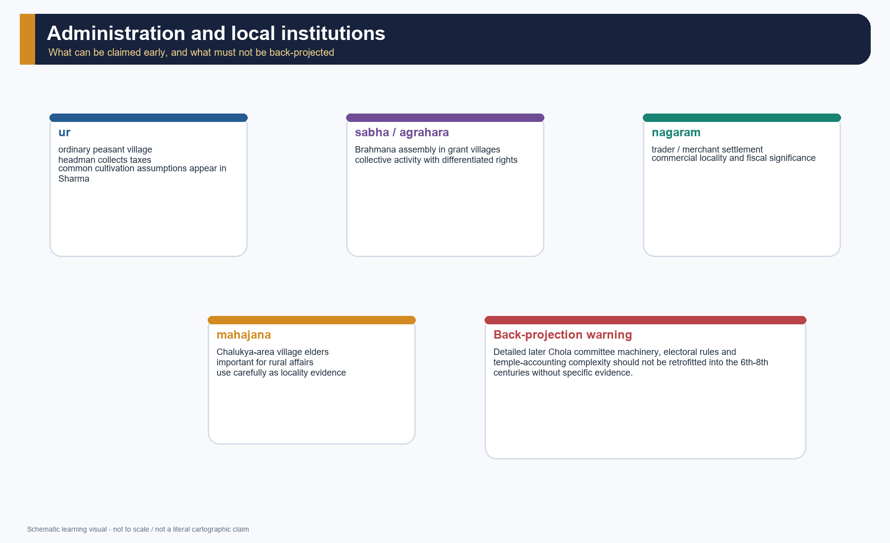

*This chart shows only what Topic 23 can safely claim for the c. 300-750 phase and what must be reserved for later Chola evidence.*

#### Core teaching / solved practice

- [FACT] Sharma identifies three village types in the south: ur, sabha and nagaram.
- [FACT] The ur was the ordinary peasant village; the sabha was associated with brahmadeya or agrahara settlements; the nagaram reflected trader-merchant settlement.
- [FACT] In Chalukya areas, rural affairs were managed by village elders called mahajana.
- [FACT] Upinder's broader land-grant debate shows that local institutions were linked to revenue collection, landed management and temple-related activity.
- [LIMIT] Detailed committee machinery known from later Chola inscriptions should not be smuggled into the 6th-8th centuries unless specifically evidenced.
- [ANALYSIS] The key exam value lies in showing that locality was becoming corporately organised, not that a fully mature Chola-style bureaucracy already existed.

#### PARAGRAPH DEMONSTRATION — CLAIM -> NAMED EVIDENCE -> ANALYSIS -> QUALIFICATION

[CLAIM] Administration operated through layered and negotiated institutions rather than a uniform bureaucracy. [NAMED EVIDENCE] Records name territorial units such as rashtra, vishaya, kottam and nadu, while ur, sabha, nagaram and Chalukya mahajanas appear in local transactions. [ANALYSIS] These bodies connected revenue, irrigation, endowment and political authority. [QUALIFICATION] Their functions varied, and the elaborate committee machinery of later Chola inscriptions must not be projected wholesale into the Pallava-Chalukya period.

#### Must-know facts

- ur = ordinary village; sabha = Brahmana assembly in grant villages; nagaram = trader-dominated settlement.
- mahajana is the Chalukya-area village elder term highlighted by Sharma.
- Institutional evidence is early, real and uneven.

#### UPSC traps

- **Wrong:** project Uttaramerur-style later Chola committee detail backward. **Correct:** keep Topic 23 to earlier, thinner institutional evidence.
- **Wrong:** treat these terms as purely abstract categories. **Correct:** connect them to land, revenue and social composition.

**Mains angle:** "Institutionalisation is visible, but not yet fully bureaucratically transparent."

**Study link:** Topic 27 for later Chola locality detail.

#### CLOSING RECALL FLOW — ADMINISTRATION, LOCAL INSTITUTIONS AND THE PROBLEM OF BACK-PROJECTION

```text
START / CONCEPT: Administration, local institutions and the problem of back-projection
        |
        v
EXACT TERMS: layered sovereignty · rashtra-vishaya · kottam-nadu · ur-sabha-nagaram · mahajana · back-projection
        |
        v
MECHANISM / ARGUMENT: In Chalukya areas, rural affairs were managed by village elders called mahajana.
        |
        v
CONSEQUENCE / CONTRAST: Early-medieval south India offers evidence of locality types, assemblies, headmen and merchant groupings, but the documentation is uneven and later Chola institutional detail must not be projected backward wholesale.
        |
        v
UPSC TRAP / ANSWER-USE: Detailed committee machinery known from later Chola inscriptions should not be smuggled into the 6th-8th centuries unless specifically evidenced.
        |
        v
ANSWER-GRABBING FORMULATION: Pallava-Chalukya government reached local society through intermediaries, so the historian must distinguish attested institutions from later administrative systems projected backward.
```
### SESSION 13 — LAND GRANTS, BRAHMADEYA/AGRAHARA AND AGRARIAN EXPANSION

#### DEFINITION / WHAT THIS IS CALLED

**Plain-language definition:** Brahmadeya, agrahara and devadana grants redistributed specified land, dues or privileges and helped connect agrarian expansion with ritual and political authority.

**Technical definition:** The grant process must be reconstructed from boundary clauses, exemptions, irrigation, existing occupants and actual beneficiaries rather than from formula alone.

#### ANSWER-GRABBING OPENING — WRITE/ADAPT IN THE EXAM

> A land grant was neither mere charity nor automatic royal surrender; it was a mechanism for reorganising revenue, settlement and authority within an already inhabited landscape.

#### MUST-WRITE KEYWORDS

- **brahmadeya**
- **agrahara**
- **devadana**
- **fiscal concessions**
- **irrigation**
- **agrarian expansion**

**How to use them:** Use **brahmadeya** to define the frame, connect **agrahara** with **devadana** through named evidence, and end with **agrarian expansion** as the controlling qualification or synthesis.

[FACT] Land grants are central to this topic because they linked kingship, revenue, Brahmana settlement, cultivation and locality formation.

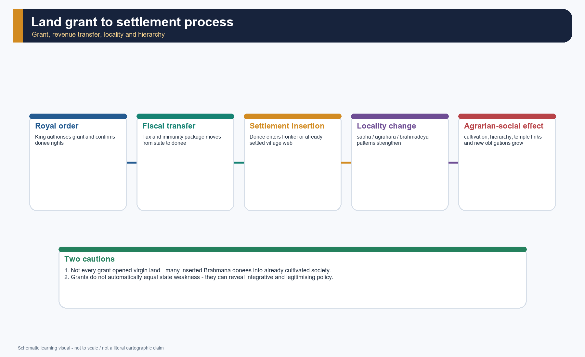

*The process flow separates grant issue, fiscal transfer, settlement insertion, agrarian change and social consequence.*

#### Core teaching / solved practice

- [FACT] Sharma says the Pallavas granted numerous villages, often tax-free, to Brahmanas and records as many as 16 early Pallava land charters.
- [FACT] He also notes extensive immunities granted to Brahmanas and the role of grants in stimulating agrarian expansion in south Andhra and north Tamil Nadu.
- [FACT] Upinder argues that brahmadeyas had a political dimension, were created by royal order and should not be reduced to mere symptoms of state disintegration.
- [FACT] From the state's point of view, the creation of brahmadeyas involved transferring revenue rights and often restricting interference by royal officers.
- [ANALYSIS] Some grants expanded cultivation at the margins, but Upinder also stresses that many inserted Brahmana donees into already settled rural webs rather than clearing empty wilderness from scratch.
- [LIMIT] The effect of each grant varied. No single formula covers every region or every century.

#### PARAGRAPH DEMONSTRATION — CLAIM -> NAMED EVIDENCE -> ANALYSIS -> QUALIFICATION

[CLAIM] Land grants helped root regional states in agrarian localities. [NAMED EVIDENCE] Pallava copper plates record Brahmana beneficiaries, specified boundaries and fiscal concessions, while tanks, wells and channels supported cultivation in rainfall-variable zones. [ANALYSIS] Grants could attract specialists, extend settlement and create ritual centres that linked courts to local elites. [QUALIFICATION] Many grants operated within occupied villages; formulas do not prove that every right was enforced or that peasants, pastoralists and forest users disappeared.

#### Must-know facts

- brahmadeya = land gifted to Brahmanas; agrahara = tax-privileged Brahmana settlement/village form.
- Land grants could transfer revenue rights, immunities and local authority.
- Agrarian expansion and social hierarchy often moved together.

#### UPSC traps

- **Wrong:** "all grants opened virgin forest". **Correct:** some did, many inserted donees into already cultivated society.
- **Wrong:** "grants prove state weakness". **Correct:** they can also reflect royal control, alliance and legitimisation.

**Mains angle:** The strongest sentence is: "Land grants were not only pious gifts; they were political technologies of locality-making."

**Study link:** Topic 26 for wider agrarian transition debates.

#### CLOSING RECALL FLOW — LAND GRANTS, BRAHMADEYA/AGRAHARA AND AGRARIAN EXPANSION

```text
START / CONCEPT: Land grants, brahmadeya/agrahara and agrarian expansion
        |
        v
EXACT TERMS: brahmadeya · agrahara · devadana · fiscal concessions · irrigation · agrarian expansion
        |
        v
MECHANISM / ARGUMENT: Upinder argues that brahmadeyas had a political dimension, were created by royal order and should not be reduced to mere symptoms of state disintegration.
        |
        v
CONSEQUENCE / CONTRAST: The strongest sentence is: "Land grants were not only pious gifts; they were political technologies of locality-making.".
        |
        v
UPSC TRAP / ANSWER-USE: Do not miss this limiting distinction: land grants could transfer revenue rights, immunities and local authority.
        |
        v
ANSWER-GRABBING FORMULATION: A land grant was neither mere charity nor automatic royal surrender; it was a mechanism for reorganising revenue, settlement and authority within an already inhabited landscape.
```
### SESSION 14 — BRAHMANIZATION, SANSKRITIZATION, ACCULTURATION AND THE MAKING OF HIERARCHY

#### DEFINITION / WHAT THIS IS CALLED

**Plain-language definition:** Brahmanization was the unequal but reciprocal spread of Brahmana settlements, ritual authority, Puranic-temple institutions, Sanskritic idioms and varna-jati claims through local political and agrarian processes.

**Technical definition:** It differs from simple conversion: Sanskritization describes some status emulation, while localization and vernacularization explain how regional societies reshaped received forms.

#### ANSWER-GRABBING OPENING — WRITE/ADAPT IN THE EXAM

> Brahmanization changed peninsular society through land and power, but local cults, languages and communities also transformed the Brahmanical forms they received.

#### MUST-WRITE KEYWORDS

- **Brahmanization**
- **Sanskritization**
- **localization**
- **cult appropriation**
- **varna-jati**
- **reciprocal inequality**

**How to use them:** Use **Brahmanization** to define the frame, connect **Sanskritization** with **localization** through named evidence, and end with **reciprocal inequality** as the controlling qualification or synthesis.

[FACT] Sharma's chapter makes Brahmanization central to the peninsula's c. AD 300-750 transformation, but later scholarship requires a more differentiated treatment.

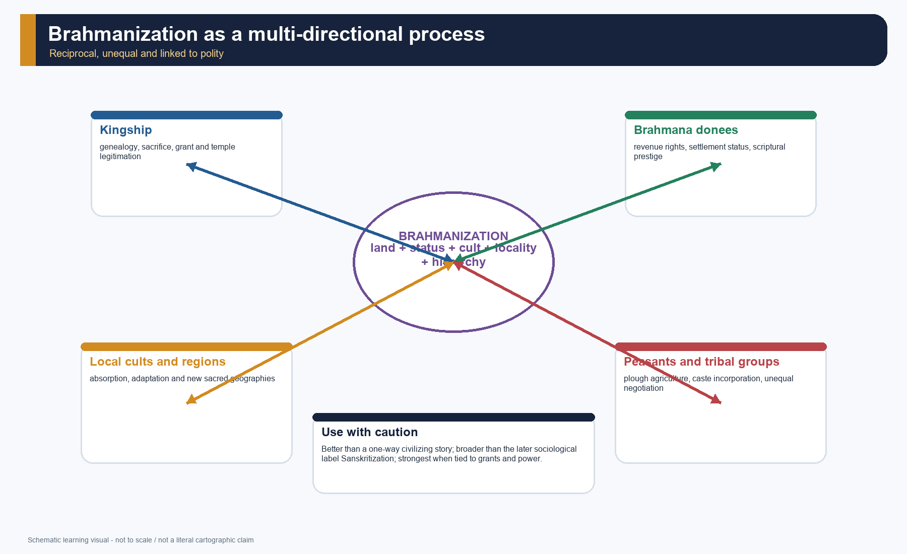

*This model is deliberately multi-directional. It rejects a flat one-way "civilizing mission" narrative.*

#### Core teaching / solved practice

- [FACT] Sharma describes a society dominated by princes and priests, with many new rulers receiving high-varna status through priestly legitimation.
- [FACT] Upinder's broader land-grant discussion shows Brahmanas becoming dominant in many brahmadeya settings and shaping access to land, resources and people.
- [FACT] Upinder also notes that where brahmadeya villages were close to tribal communities, plough agriculture spread and some groups were absorbed into caste society while others were pushed into degraded status.
- [DEBATE] "Brahmanization" captures royal-brahmana alliance, grant-based authority, ritual legitimation and hierarchy. "Sanskritization" is a later sociological heuristic and is too narrow if it ignores political economy. "Acculturation" and "integration" better register reciprocity, especially in local cult adaptation.
- [ANALYSIS] The process was reciprocal but unequal: Brahmanical norms spread, yet Brahmanism too changed through contact with regional and tribal traditions.
- [LIMIT] We have much better elite evidence than subaltern self-representation. Peasant and tribal experience enters largely through inference.

#### PARAGRAPH DEMONSTRATION — CLAIM -> NAMED EVIDENCE -> ANALYSIS -> QUALIFICATION

[CLAIM] Brahmanization was a negotiated material process, not a one-way cultural conquest. [NAMED EVIDENCE] Brahmadeya grants supported Brahmana settlement, local deities were identified with wider Shaiva-Vaishnava forms, and Tamil-Kannada regional practices reshaped Sanskritic idioms. [ANALYSIS] The process built legitimacy and hierarchy while integrating local cults and producing new social identities. [QUALIFICATION] Elite records obscure coercion and subaltern agency, and varna language never made the peninsula a uniform copy of northern normative texts.

#### Must-know facts

- New rulers often claimed high-varna identity through legitimation, not primordial purity.
- Caste proliferation and new sub-castes are part of the story.
- Tribal-peasant transitions were historically important but uneven.

#### UPSC traps

- **Wrong:** Brahmanization = only religious conversion. **Correct:** it includes land, status, hierarchy, cult integration and locality-making.
- **Wrong:** reciprocal interaction means equal interaction. **Correct:** reciprocity existed, but power was asymmetrical.

**Mains angle:** A high-scoring answer defines the term, qualifies it and then shows mechanism through grants, cults and agrarian change.

**Study link:** Topic 13 on varna society; Topic 26 on social transformation.

#### CLOSING RECALL FLOW — BRAHMANIZATION, SANSKRITIZATION, ACCULTURATION AND THE MAKING OF HIERARCHY

```text
START / CONCEPT: Brahmanization, Sanskritization, acculturation and the making of hierarchy
        |
        v
EXACT TERMS: Brahmanization · Sanskritization · localization · cult appropriation · varna-jati · reciprocal inequality
        |
        v
MECHANISM / ARGUMENT: Sharma describes a society dominated by princes and priests, with many new rulers receiving high-varna status through priestly legitimation.
        |
        v
CONSEQUENCE / CONTRAST: AD 300-750 transformation, but later scholarship requires a more differentiated treatment.
        |
        v
UPSC TRAP / ANSWER-USE: The process was reciprocal but unequal: Brahmanical norms spread, yet Brahmanism too changed through contact with regional and tribal traditions.
        |
        v
ANSWER-GRABBING FORMULATION: Brahmanization changed peninsular society through land and power, but local cults, languages and communities also transformed the Brahmanical forms they received.
```
### SESSION 15 — BHAKTI, JAIN AND BUDDHIST INTERACTION, AND THE SOCIAL LIMITS OF DEVOTION

#### DEFINITION / WHAT THIS IS CALLED

**Plain-language definition:** Early Tamil bhakti created affective Shaiva and Vaishnava communities around Nayanar and Alvar hymns while coexisting and competing with Jain, Buddhist and Brahmanical institutions.

**Technical definition:** Bhakti broadened devotional language and sacred geography, but its social effects must be assessed through poems, later compilations and hagiographies with chronology and hierarchy controls.

#### ANSWER-GRABBING OPENING — WRITE/ADAPT IN THE EXAM

> Alvar-Nayanar devotion widened the language of access to the divine, yet it worked inside a temple-centred society that could preserve caste, patriarchy and sectarian conflict.

#### MUST-WRITE KEYWORDS

- **Alvars**
- **Nayanars**
- **Tamil bhakti**
- **Jain-Buddhist interaction**
- **shrine networks**
- **social limits**

**How to use them:** Use **Alvars** to define the frame, connect **Nayanars** with **Tamil bhakti** through named evidence, and end with **social limits** as the controlling qualification or synthesis.

[FACT] The 7th-9th centuries in the south saw the rise of powerful Shaiva and Vaishnava devotional currents, especially in the hymns of the Nayanars and Alvars, in active interaction - and often competition - with Jaina and Buddhist traditions.

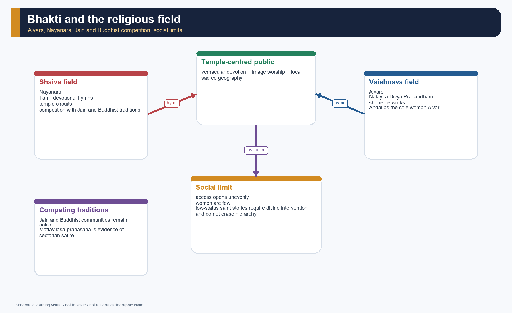

*The field is shown as interaction, not a single triumphant line. Vernacular devotion, temple ritual, sectarian competition and social limits coexist.*

#### Core teaching / solved practice

- [FACT] Sharma says that from the 7th century the Alvars popularised Vishnu devotion and the Nayanars did the same for Shiva; bhakti came to dominate religious life in the south.
- [FACT] Repository Art and Culture notes define the canonical numbers clearly: 63 Nayanars and 12 Alvars; Andal is the only woman Alvar.
- [FACT] Upinder shows that Alvar bhakti worked through temple networks, lover-beloved imagery, shrine circuits and ritual image worship.
- [FACT] Upinder's social discussion is nuanced: saints came from varied backgrounds, but women were very few; stories of Nandanar and Tiruppan Alvar show inclusion and exclusion together.
- [FACT] *Mattavilasa-prahasana* is evidence that Buddhists, Kapalikas and Pashupatas could be objects of courtly satire under Mahendravarman I.
- [ANALYSIS] Bhakti could soften some social boundaries rhetorically, but it did not dissolve hierarchy automatically. It also worked through increasingly temple-centred institutions.

#### PARAGRAPH DEMONSTRATION — CLAIM -> NAMED EVIDENCE -> ANALYSIS -> QUALIFICATION

[CLAIM] Bhakti expanded vernacular devotional participation without abolishing social hierarchy. [NAMED EVIDENCE] Alvar and Nayanar hymns mapped Tamil sacred places; Andal, Nandanar and Tiruppan Alvar became powerful inclusion memories; Mattavilasa-prahasana and sectarian poems reveal religious competition. [ANALYSIS] Devotion created emotional communities around shrines and strengthened regional sacred geography. [QUALIFICATION] Hagiographies are later and polemical, women remained few among canonical saints, and temple orders could reproduce caste and elite authority.

#### Must-know facts

- Alvars = Vishnu; Nayanars = Shiva.
- Bhakti develops in Tamil devotional language, not only Sanskrit liturgy.
- Social inclusion in bhakti is real but bounded.

#### UPSC traps

- **Wrong:** bhakti was a fully anti-caste revolution. **Correct:** it opened devotional access but did not abolish hierarchy.
- **Wrong:** Jainism and Buddhism simply vanished. **Correct:** they remained part of a competitive religious field.

**Mains angle:** The best formulation is "vernacular devotion within a temple-centred and still hierarchical society."

**Study link:** Art and Culture basic/13; Topic 24 on philosophical developments.

#### CLOSING RECALL FLOW — BHAKTI, JAIN AND BUDDHIST INTERACTION, AND THE SOCIAL LIMITS OF DEVOTION

```text
START / CONCEPT: Bhakti, Jain and Buddhist interaction, and the social limits of devotion
        |
        v
EXACT TERMS: Alvars · Nayanars · Tamil bhakti · Jain-Buddhist interaction · shrine networks · social limits
        |
        v
MECHANISM / ARGUMENT: Upinder shows that Alvar bhakti worked through temple networks, lover-beloved imagery, shrine circuits and ritual image worship.
        |
        v
CONSEQUENCE / CONTRAST: Social inclusion in bhakti is real but bounded.
        |
        v
UPSC TRAP / ANSWER-USE: Upinder's social discussion is nuanced: saints came from varied backgrounds, but women were very few; stories of Nandanar and Tiruppan Alvar show inclusion and exclusion together.
        |
        v
ANSWER-GRABBING FORMULATION: Alvar-Nayanar devotion widened the language of access to the divine, yet it worked inside a temple-centred society that could preserve caste, patriarchy and sectarian conflict.
```
### SESSION 16 — TEMPLE ARCHITECTURE I: PALLAVA TRAJECTORY FROM ROCK-CUT TO STRUCTURAL

#### DEFINITION / WHAT THIS IS CALLED

**Plain-language definition:** Pallava temple architecture developed through overlapping rock-cut, monolithic and structural experiments associated especially with Mahendravarman I, Narasimhavarman I Mamalla and Narasimhavarman II Rajasimha.

**Technical definition:** The trajectory is analytical rather than evolutionary: technique, patronage, iconographic programme and sacred-political setting must be compared before ranking phases.

#### ANSWER-GRABBING OPENING — WRITE/ADAPT IN THE EXAM

> From Mandagapattu to Mamallapuram and Kailasanatha, Pallava architecture converted experiments in stone into an enduring language of kingship and sacred geography.

#### MUST-WRITE KEYWORDS

- **Mandagapattu**
- **Mamallapuram rathas**
- **Great Relief**
- **Shore Temple**
- **Kailasanatha**
- **Vaikuntha Perumal**

**How to use them:** Use **Mandagapattu** to define the frame, connect **Mamallapuram rathas** with **Great Relief** through named evidence, and end with **Vaikuntha Perumal** as the controlling qualification or synthesis.

[FACT] The Pallava contribution to South Indian architecture lies not in a single monument but in a sequence - cave temples, monolithic experiments and mature structural forms.

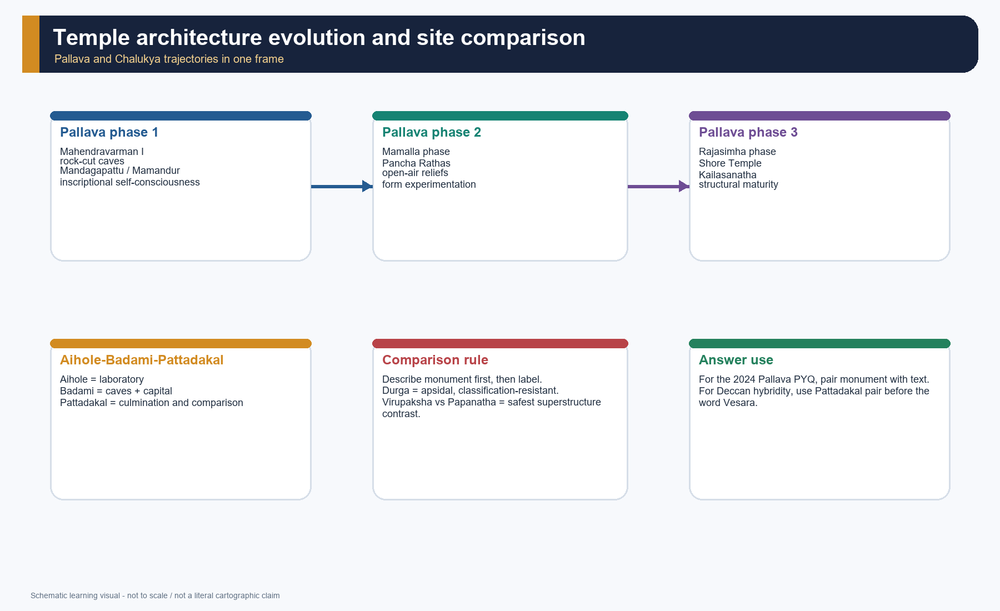

*This visual uses phase comparison rather than a single stylistic label so that rock-cut, monolithic and structural stages can be remembered as a trajectory.*

#### Core teaching / solved practice

- [FACT] Repository Art and Culture notes, grounded in Nitin Singhania, identify four later analytical phases of Pallava architecture: Mahendravarman, Mamalla, Rajasimha and Nandivarman.
- [FACT] Under Mahendravarman I, the earliest rock-cut phase includes Mandagapattu and Mamandur, with the Mandagapattu inscription stressing a shrine without timber, brick or metal.
- [FACT] Under Narasimhavarman I Mamalla, the Pancha Rathas and the Mamallapuram mandapas show deliberate experimentation with plan and elevation.
- [FACT] The great open-air relief at Mamallapuram is read either as the Descent of the Ganga or Arjuna's Penance; [LIMIT] the ambiguity is itself historically meaningful and should not be flattened.
- [FACT] Under Narasimhavarman II Rajasimha, structural architecture comes to the fore: the Shore Temple at Mamallapuram and the Rajasimheshvara/Kailasanatha temple at Kanchipuram are the key exemplars.
- [FACT] Later Pallava Kanchi architecture includes Vaikuntha Perumal, often associated with the Nandivarman/Pallavamalla phase and remembered for dynastic panels and mature structural planning; [LIMIT] the local OCR dossier is thinner here, so use it as a later-Pallava marker rather than a detail-heavy case study.

#### PARAGRAPH DEMONSTRATION — CLAIM -> NAMED EVIDENCE -> ANALYSIS -> QUALIFICATION

[CLAIM] Pallava architecture established a durable repertoire through overlapping technical experiments. [NAMED EVIDENCE] Mahendravarman's Mandagapattu-Mamandur caves, Mamalla's monolithic rathas and great relief, and Rajasimha's Shore Temple and Kailasanatha move from excavation to monolith and masonry. [ANALYSIS] The sequence reveals workshop learning, ritual innovation and political communication. [QUALIFICATION] The phases overlap, the ratha names are modern conventions, and royal labels cannot erase artisans or multiple patronage stages.

#### Must-know facts

- rock-cut -> monolithic ratha -> structural temple is the safest Pallava trajectory.
- Mamallapuram and Kanchipuram are the twin architectural centres.
- Kailasanatha and Shore Temple are the most exam-useful structural markers.

#### UPSC traps

- **Wrong:** say the Pallavas created only one Dravida form. **Correct:** they experimented across techniques and forms.
- **Wrong:** force one interpretation of the great Mamallapuram relief as certain. **Correct:** mention the two leading readings.

**Mains angle:** Pallava architecture should be written as a technical and political transition, not just as an art gallery.

**Study link:** Art and Culture basic/03 and /07.

#### CLOSING RECALL FLOW — TEMPLE ARCHITECTURE I: PALLAVA TRAJECTORY FROM ROCK-CUT TO STRUCTURAL

```text
START / CONCEPT: Temple architecture I: Pallava trajectory from rock-cut to structural
        |
        v
EXACT TERMS: Mandagapattu · Mamallapuram rathas · Great Relief · Shore Temple · Kailasanatha · Vaikuntha Perumal
        |
        v
MECHANISM / ARGUMENT: Under Narasimhavarman II Rajasimha, structural architecture comes to the fore: the Shore Temple at Mamallapuram and the Rajasimheshvara/Kailasanatha temple at Kanchipuram are the key exemplars.
        |
        v
CONSEQUENCE / CONTRAST: Pallava architecture should be written as a technical and political transition, not just as an art gallery.
        |
        v
UPSC TRAP / ANSWER-USE: The great open-air relief at Mamallapuram is read either as the Descent of the Ganga or Arjuna's Penance; the ambiguity is itself historically meaningful and should not be flattened.
        |
        v
ANSWER-GRABBING FORMULATION: From Mandagapattu to Mamallapuram and Kailasanatha, Pallava architecture converted experiments in stone into an enduring language of kingship and sacred geography.
```
### SESSION 17 — TEMPLE ARCHITECTURE II: AIHOLE, BADAMI, PATTADAKAL AND THE "VESARA" CAUTION

#### DEFINITION / WHAT THIS IS CALLED

**Plain-language definition:** The Aihole-Badami-Pattadakal complex records Chalukya experimentation in cave and structural forms, varied plans and northern and southern superstructures.

**Technical definition:** Vesara is a cautious modern shorthand, not a rigid Chalukya ethnic style; monument, plan, tower, date and workshop must be described first.

#### ANSWER-GRABBING OPENING — WRITE/ADAPT IN THE EXAM

> Pattadakal is valuable not because it proves a fixed Vesara formula, but because northern and southern architectural vocabularies were tested side by side.

#### MUST-WRITE KEYWORDS

- **Aihole**
- **Badami caves**
- **Pattadakal**
- **Virupaksha**
- **Papanatha**
- **Vesara caution**

**How to use them:** Use **Aihole** to define the frame, connect **Badami caves** with **Pattadakal** through named evidence, and end with **Vesara caution** as the controlling qualification or synthesis.

[FACT] Early Chalukya architecture in the Malaprabha zone is best remembered through Aihole, Badami and Pattadakal, where plan types, sectarian affiliations and superstructure vocabularies were explored in unusually visible ways.


*The comparison avoids treating Vesara as a rigid civilisational category. The evidence is monument-first, label-second.*

#### Core teaching / solved practice

- [FACT] Aihole is the architectural laboratory, associated in repository Art and Culture notes with over 100 temples and multiple plan experiments.
- [FACT] The Durga temple at Aihole is apsidal, named after a nearby fort rather than a Durga dedication, and is often linked to Surya/Aditya; it mixes Dravida and Nagara features and resists easy classification.
- [FACT] Badami's cave complex shows sectarian plurality: Brahmanical caves and a Jaina cave, with the dated Cave 3 inscription of 578 CE under Mangalesha.
- [FACT] Pattadakal is the culmination site where Dravida and Nagara superstructure vocabularies stand side by side, especially in the Virupaksha and Papanatha pair.
- [FACT] The Virupaksha temple was commissioned by queen Lokamahadevi to commemorate Vikramaditya II's Kanchi victory; the Mallikarjuna temple reflects parallel female patronage by Trailokyamahadevi.
- [DEBATE] "Vesara" can be a useful descriptive label for Deccan hybridity, but it should never replace monument-specific description. The safest route is always Aihole -> Badami -> Pattadakal, then label with caution.

#### PARAGRAPH DEMONSTRATION — CLAIM -> NAMED EVIDENCE -> ANALYSIS -> QUALIFICATION

[CLAIM] Chalukya architecture is best understood as a landscape of experimentation rather than a single style box. [NAMED EVIDENCE] Aihole contains varied plans including the apsidal Durga temple, Badami combines caves with a capital landscape, and Pattadakal juxtaposes Virupaksha's Dravida form with Papanatha's mixed vocabulary. [ANALYSIS] The cluster demonstrates workshop mobility and selective adaptation across regional forms. [QUALIFICATION] Vesara is a later descriptive convenience, and the Durga temple's modern name does not establish its original dedication.

#### Must-know facts

- Aihole = experiment; Badami = cave-plus-capital complex; Pattadakal = culmination.
- Durga temple at Aihole is not a Durga dedication.
- Virupaksha = Dravida shikhara; Papanatha = Nagara shikhara on a related plan.

#### UPSC traps

- **Wrong:** use Vesara as a lazy half-Nagara half-Dravida formula. **Correct:** describe the site and monument before using the term.
- **Wrong:** confuse the Pattadakal Virupaksha with the Hampi Virupaksha. **Correct:** one is Early Chalukya, the other Vijayanagara.

**Mains angle:** The Deccan case is strongest when written as experimentation, comparison and queenly patronage.

**Study link:** Art and Culture basic/03 for the larger temple-architecture framework.

#### CLOSING RECALL FLOW — TEMPLE ARCHITECTURE II: AIHOLE, BADAMI, PATTADAKAL AND THE "VESARA" CAUTION

```text
START / CONCEPT: Temple architecture II: Aihole, Badami, Pattadakal and the "Vesara" caution
        |
        v
EXACT TERMS: Aihole · Badami caves · Pattadakal · Virupaksha · Papanatha · Vesara caution
        |
        v
MECHANISM / ARGUMENT: The safest route is always Aihole - Badami - Pattadakal, then label with caution.
        |
        v
CONSEQUENCE / CONTRAST: Durga temple at Aihole is not a Durga dedication.
        |
        v
UPSC TRAP / ANSWER-USE: The Virupaksha temple was commissioned by queen Lokamahadevi to commemorate Vikramaditya II's Kanchi victory; the Mallikarjuna temple reflects parallel female patronage by Trailokyamahadevi. [DEBATE] "Vesara" can be a useful descriptive label for Deccan hybridity, but it should never replace monument-specific description.
        |
        v
ANSWER-GRABBING FORMULATION: Pattadakal is valuable not because it proves a fixed Vesara formula, but because northern and southern architectural vocabularies were tested side by side.
```
### SESSION 18 — PAINTING, SCULPTURE AND ICONOGRAPHIC COMMUNICATION

#### DEFINITION / WHAT THIS IS CALLED

**Plain-language definition:** Painting, sculpture and iconographic programmes made religious narratives and dynastic claims visible across cave, relief and structural-temple settings.

**Technical definition:** Iconographic communication requires reading deity, placement, patron, workshop and survival history together; imagery alone cannot establish a ruler's exclusive faith or political border.

#### ANSWER-GRABBING OPENING — WRITE/ADAPT IN THE EXAM

> Pallava and Chalukya sculpture transformed sacred narrative into political communication, but iconography must be read in its architectural and patronage context.

#### MUST-WRITE KEYWORDS

- **Somaskanda**
- **Badami cave sculpture**
- **Mamallapuram relief**
- **Shaiva-Vaishnava imagery**
- **workshop mobility**
- **attribution limits**

**How to use them:** Use **Somaskanda** to define the frame, connect **Badami cave sculpture** with **Mamallapuram relief** through named evidence, and end with **attribution limits** as the controlling qualification or synthesis.

[FACT] The Pallava-Chalukya age was also an age of imagery: Somaskanda panels, Shaiva and Vaishnava reliefs, Hari-Hara forms, narrative and martial iconography, and surviving mural fragments.

#### Core teaching / solved practice

- [FACT] Repository Art and Culture notes connect Mahendravarman's court to painting epithets and connect Narasimhavarman II Rajasimha to surviving Pallava mural fragments at Kailasanatha and Panamalai.
- [FACT] Upinder's architectural discussion highlights Somaskanda frequency at Kailasanatha and the erosive but still legible sculptural programme of the Shore Temple.
- [FACT] The Durga temple at Aihole preserves major Chalukya-period reliefs such as Shiva with Nandi, Varaha, Narasimha, Hari-Hara and Mahishasuramardini.
- [FACT] Early Chalukya cave sculpture at Badami includes strong Shaiva-Vaishnava programmes and some of the earliest Deccan Nataraja imagery.
- [ANALYSIS] Iconography here is political as well as devotional. Royal houses inscribe preferred sacred worlds into durable public stone.
- [LIMIT] Mural survival is extremely thin. Any claim about "Pallava painting as a full school" must be tightly qualified as a survival issue.

#### PARAGRAPH DEMONSTRATION — CLAIM -> NAMED EVIDENCE -> ANALYSIS -> QUALIFICATION

[CLAIM] Visual programmes connected devotion with dynastic self-representation. [NAMED EVIDENCE] Somaskanda panels recur in Pallava contexts, Mamallapuram's great relief stages a monumental sacred narrative, and Badami caves preserve Shaiva, Vaishnava and Jain imagery. [ANALYSIS] Such plurality shows workshops and courts communicating through multiple religious idioms. [QUALIFICATION] Survival is uneven, attribution can be stylistic rather than inscriptional, and one icon cannot prove an exclusive state religion.

#### Must-know facts

- Somaskanda is a recurring Pallava theme.
- Chalukya reliefs are sect-plural and sculpturally ambitious.
- Surviving murals are limited but important.

#### UPSC traps

- **Wrong:** separate iconography from kingship. **Correct:** ask why particular deities and relief narratives were foregrounded.
- **Wrong:** inflate fragmentary murals into a complete surviving painting tradition. **Correct:** emphasise survival caution.

**Mains angle:** One line on iconography often upgrades an architecture answer into an art-history answer.

**Study link:** Art and Culture basic/06 and /07.

#### CLOSING RECALL FLOW — PAINTING, SCULPTURE AND ICONOGRAPHIC COMMUNICATION

```text
START / CONCEPT: Painting, sculpture and iconographic communication
        |
        v
EXACT TERMS: Somaskanda · Badami cave sculpture · Mamallapuram relief · Shaiva-Vaishnava imagery · workshop mobility · attribution limits
        |
        v
MECHANISM / ARGUMENT: Any claim about "Pallava painting as a full school" must be tightly qualified as a survival issue.
        |
        v
CONSEQUENCE / CONTRAST: Surviving murals are limited but important.
        |
        v
UPSC TRAP / ANSWER-USE: Do not miss this limiting distinction: the Pallava-Chalukya age was also an age of imagery.
        |
        v
ANSWER-GRABBING FORMULATION: Pallava and Chalukya sculpture transformed sacred narrative into political communication, but iconography must be read in its architectural and patronage context.
```
### SESSION 19 — LANGUAGES, LITERATURE AND BILINGUAL POLITICAL CULTURE

#### DEFINITION / WHAT THIS IS CALLED

**Plain-language definition:** The period's literary culture joined Sanskrit court poetry and drama, Tamil devotional composition, Kannada epigraphic growth and bilingual documentary practice.

**Technical definition:** Language choice performed distinct political work: prashasti praised, documentary sections recorded transactions, satire staged religious rivalry and hymns created vernacular sacred communities.

#### ANSWER-GRABBING OPENING — WRITE/ADAPT IN THE EXAM

> Pallava-Chalukya culture was multilingual by function: Sanskrit conferred cosmopolitan prestige while Tamil and Kannada rooted institutions in regional publics.

#### MUST-WRITE KEYWORDS

- **Sanskrit prashasti**
- **Tamil documentary epigraphy**
- **Kannada inscriptions**
- **Mattavilasa-prahasana**
- **Dandin**
- **Pallava Grantha**

**How to use them:** Use **Sanskrit prashasti** to define the frame, connect **Tamil documentary epigraphy** with **Kannada inscriptions** through named evidence, and end with **Pallava Grantha** as the controlling qualification or synthesis.

[FACT] The Pallava-Chalukya world is multilingual: Sanskrit prestige, Tamil devotional growth, Prakrit residue in earlier southern inscriptions, and bilingual epigraphy in the Pallava realm.

#### Core teaching / solved practice

- [FACT] Mahendravarman I's *Mattavilasa-prahasana* is the clearest named literary text directly tied to the topic.
- [FACT] Repository Art and Culture basic/11 identifies Kanchipuram as a centre of Sanskrit scholarship and cites Dandin's association with the Pallava world.
- [FACT] The same file records bilingual Tamil-Sanskrit Pallava inscriptions from the 7th century onward and the courtly shift from Vatteluttu to Pallava-Grantha script.
- [FACT] Upinder notes that Pallava and Chola inscriptions show Sanskrit prashasti for the politically expressive portion and Tamil for documentary portions.
- [FACT] Upinder also preserves the literary memory of Nandivarman III in the Tamil *Nandikkalambakam*.
- [ANALYSIS] Language here is not merely literary ornament. It maps the layering of elite prestige, local administration, temple networks and devotional publics.

#### PARAGRAPH DEMONSTRATION — CLAIM -> NAMED EVIDENCE -> ANALYSIS -> QUALIFICATION

[CLAIM] Multilingualism was an instrument of regional state formation, not a decorative literary feature. [NAMED EVIDENCE] Ravikirti used Sanskrit at Aihole, Pallava records often paired Sanskrit praise with Tamil documentary clauses, Mahendravarman authored Mattavilasa-prahasana, and Kannada epigraphic use expanded in the Chalukya region. [ANALYSIS] Different languages connected courts to cosmopolitan rank, local administration and devotional publics. [QUALIFICATION] Court association and manuscript transmission do not secure every author's biography or imply mass literacy.

#### Must-know facts

- Mahendravarman I = *Mattavilasa-prahasana*.
- Dandin is a useful Pallava-world literary citation, but the precise court association should remain qualified.
- Bilingual epigraphy is institutional evidence, not anecdote.

#### UPSC traps

- **Wrong:** say Pallava literary contribution means only Sanskrit court poetry. **Correct:** add Tamil bhakti, bilingual epigraphy and script politics.
- **Wrong:** equate script change with the disappearance of all earlier scripts. **Correct:** speak of court usage and administrative preference.

**Mains angle:** For the 2024 Pallava PYQ, literature must be explicit - text, language and inscriptional culture, not just temples.

**Study link:** Art and Culture basic/11.

#### CLOSING RECALL FLOW — LANGUAGES, LITERATURE AND BILINGUAL POLITICAL CULTURE

```text
START / CONCEPT: Languages, literature and bilingual political culture
        |
        v
EXACT TERMS: Sanskrit prashasti · Tamil documentary epigraphy · Kannada inscriptions · Mattavilasa-prahasana · Dandin · Pallava Grantha
        |
        v
MECHANISM / ARGUMENT: The Pallava-Chalukya world is multilingual: Sanskrit prestige, Tamil devotional growth, Prakrit residue in earlier southern inscriptions, and bilingual epigraphy in the Pallava realm.
        |
        v
CONSEQUENCE / CONTRAST: Language here is not merely literary ornament.
        |
        v
UPSC TRAP / ANSWER-USE: Bilingual epigraphy is institutional evidence, not anecdote.
        |
        v
ANSWER-GRABBING FORMULATION: Pallava-Chalukya culture was multilingual by function: Sanskrit conferred cosmopolitan prestige while Tamil and Kannada rooted institutions in regional publics.
```
### SESSION 20 — ECONOMY, GUILDS, PORTS AND BAY OF BENGAL LINKS

#### DEFINITION / WHAT THIS IS CALLED

**Plain-language definition:** The peninsular economy combined agrarian settlement, irrigation, crafts, temple endowments, inland markets and selective maritime exchange linking capitals to ports.

**Technical definition:** Economic reconstruction must periodise guild evidence and distinguish port connectivity from political colonisation or universal urban prosperity.

#### ANSWER-GRABBING OPENING — WRITE/ADAPT IN THE EXAM

> Agrarian expansion and maritime exchange were not opposites: Kanchi's hinterland and Mamallapuram's coast formed one uneven political economy.

#### MUST-WRITE KEYWORDS

- **agrarian surplus**
- **irrigation tanks**
- **Kanchipuram**
- **Mamallapuram**
- **nagaram**
- **Bay of Bengal exchange**

**How to use them:** Use **agrarian surplus** to define the frame, connect **irrigation tanks** with **Kanchipuram** through named evidence, and end with **Bay of Bengal exchange** as the controlling qualification or synthesis.

[FACT] The economic story of Topic 23 is one of agrarian expansion linked to selective urban and port growth rather than a simple choice between "ruralisation" and "trade boom".

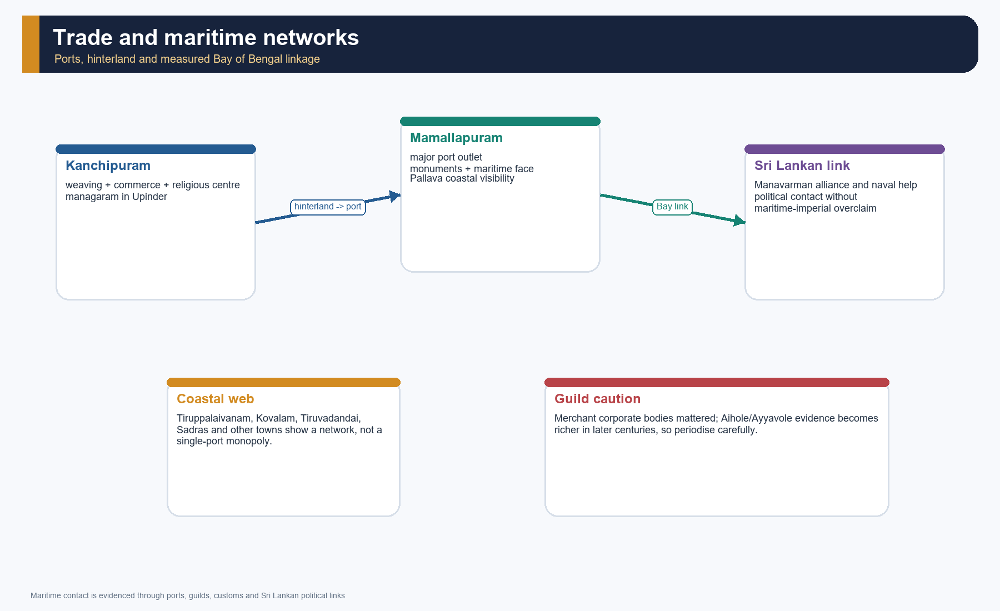

*The network diagram marks production centres, port outlets and political crossings without claiming colonial or maritime domination beyond the evidence.*

#### Core teaching / solved practice

- [FACT] Upinder describes Kanchipuram as a managaram, a centre of weaving and commerce whose major port outlet became Mamallapuram.
- [FACT] Mamallapuram developed under the Pallavas; the eastern coast contained a web of coastal towns and customs points rather than one monopoly port.
- [FACT] Corporate merchant organisations played an important role in fixing customs duties in port towns.
- [FACT] Aihole/Ayyavole later became associated with merchant guild networks; [LIMIT] the richest guild evidence belongs more securely to later centuries and should not be mechanically projected into every 7th-century context.
- [FACT] Sri Lankan political connections during Narasimhavarman I's reign show active seaborne linkages across the Bay of Bengal.
- [ANALYSIS] The right frame is "maritime contact and political-commercial linkage" rather than speculative southern colonisation stories.

#### PARAGRAPH DEMONSTRATION — CLAIM -> NAMED EVIDENCE -> ANALYSIS -> QUALIFICATION

[CLAIM] Regional state formation rested on connected rural, craft and maritime economies. [NAMED EVIDENCE] Grants and irrigation supported agrarian surplus; Kanchipuram combined political, religious, weaving and commercial functions; Mamallapuram linked that hinterland to the coast. [ANALYSIS] Taxes, artisans, temple demand and exchange helped sustain courts and monumental programmes. [QUALIFICATION] Later guild forms cannot be projected backward wholesale, and maritime contact does not prove a Pallava overseas empire or uniform prosperity.

#### Must-know facts

- Kanchipuram = weaving plus commerce.
- Mamallapuram = major Pallava port outlet.
- Merchant guilds, customs and coastal-town networks matter, but the evidence is phase-sensitive.

#### UPSC traps

- **Wrong:** claim the Pallavas "founded Southeast Asian colonies" as settled fact. **Correct:** speak of maritime links, port networks and later transregional connections with caution.
- **Wrong:** assume trade disappeared because land grants increased. **Correct:** agrarian expansion and selective urban-commercial vitality coexisted.

**Mains angle:** A good economy paragraph combines hinterland, port, guild and evidence limit.

**Study link:** Topic 19 on crafts, commerce and urban growth; Topic 27 on later maritime power under the Cholas.

#### CLOSING RECALL FLOW — ECONOMY, GUILDS, PORTS AND BAY OF BENGAL LINKS

```text
START / CONCEPT: Economy, guilds, ports and Bay of Bengal links
        |
        v
EXACT TERMS: agrarian surplus · irrigation tanks · Kanchipuram · Mamallapuram · nagaram · Bay of Bengal exchange
        |
        v
MECHANISM / ARGUMENT: Correct: speak of maritime links, port networks and later transregional connections with caution.
        |
        v
CONSEQUENCE / CONTRAST: Aihole/Ayyavole later became associated with merchant guild networks; the richest guild evidence belongs more securely to later centuries and should not be mechanically projected into every 7th-century context.
        |
        v
UPSC TRAP / ANSWER-USE: The economic story of Topic 23 is one of agrarian expansion linked to selective urban and port growth rather than a simple choice between "ruralisation" and "trade boom".
        |
        v
ANSWER-GRABBING FORMULATION: Agrarian expansion and maritime exchange were not opposites: Kanchi's hinterland and Mamallapuram's coast formed one uneven political economy.
```
### SESSION 21 — WHY THE AGE MATTERS: REGIONAL STATE FORMATION, SACRED GEOGRAPHY AND THE EARLY MEDIEVAL THRESHOLD

#### DEFINITION / WHAT THIS IS CALLED

**Plain-language definition:** The age matters as a foundational early-medieval transition in which rivalry, layered authority, grants, temples, bhakti, language and exchange produced durable regional formations.

**Technical definition:** Regional state formation is a synthesis model: it explains both political consolidation and uneven local negotiation without reducing the period to feudal decline or cultural efflorescence alone.

#### ANSWER-GRABBING OPENING — WRITE/ADAPT IN THE EXAM

> The Pallava-Chalukya age converted contested landscapes into regional political-cultural orders, while leaving authority layered and social integration unequal.

#### MUST-WRITE KEYWORDS

- **regional state formation**
- **sacred geography**
- **layered authority**
- **agrarian integration**
- **vernacularization**
- **foundational transition**

**How to use them:** Use **regional state formation** to define the frame, connect **sacred geography** with **layered authority** through named evidence, and end with **foundational transition** as the controlling qualification or synthesis.

[FACT] The Pallava-Chalukya age is historically significant because it turned peninsular regional polities into durable political and cultural formations with stronger local anchoring than earlier imperial overlays.

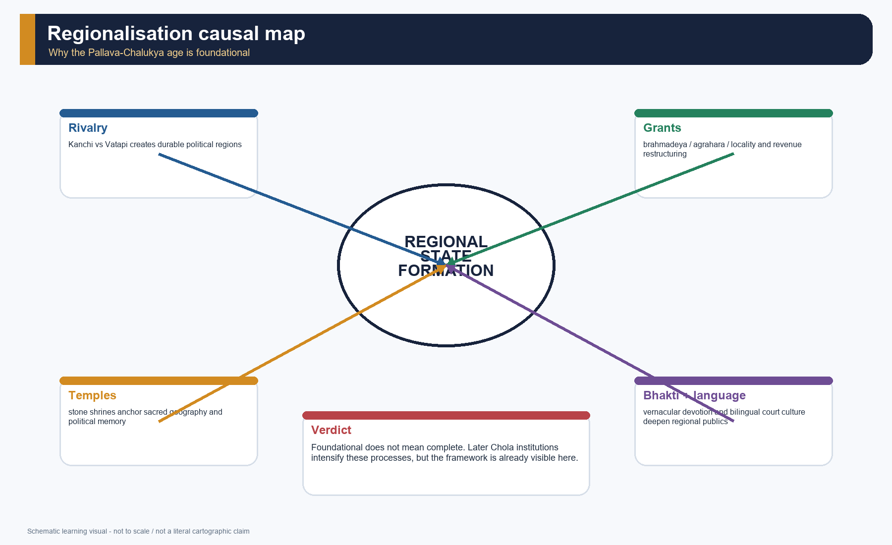

*The causal map integrates war, grants, temple growth, devotional publics, language politics and port-hinterland linkage into one regionalisation argument.*

#### Core teaching / solved practice

- [FACT] Sharma's frame highlights new states, rural expansion and Brahmanization.
- [FACT] Upinder's wider early-medieval analysis interprets grants as integrative and legitimising policies rather than simple proof of fragmentation.
- [FACT] Temples, ports, grants and devotional canons tied rulers to particular landscapes and localities.
- [ANALYSIS] This is the phase in which sacred geography and political geography become more tightly interwoven: Kanchi, Mamallapuram, Aihole, Badami and Pattadakal are not just sites but political statements in space.
- [DEBATE] The term "feudal" can sometimes illuminate hierarchy, grants and intermediaries, but it can also flatten regional dynamism. Topic 23 is best taught through regional state formation and local integration.
- [LIMIT] Not every feature associated with the later medieval south is already fully present here. The period is foundational, not final.

#### PARAGRAPH DEMONSTRATION — CLAIM -> NAMED EVIDENCE -> ANALYSIS -> QUALIFICATION

[CLAIM] The Pallava-Chalukya age was foundational because several mechanisms reinforced one another. [NAMED EVIDENCE] Kanchi-Vatapi rivalry organised political space, brahmadeya grants anchored landed authority, Alvar-Nayanar hymns sacralised localities, and Mamallapuram-Pattadakal monumentalised dynastic memory. [ANALYSIS] Together they made regional states more locally embedded than earlier campaign-based overlays. [QUALIFICATION] The transformation was uneven, and later Chola institutions cannot be treated as already complete in the seventh or eighth century.

#### Must-know facts

- rivalry + grant + temple + bhakti = the integrated formula.
- Regional states proliferate rather than disappear.
- Early medieval south is a process, not a ready-made end state.

#### UPSC traps

- **Wrong:** call the whole age a dark interlude. **Correct:** show creation as well as conflict.
- **Wrong:** project fully developed later temple-cities and administrative systems backward. **Correct:** emphasise foundation and transition.

**Mains angle:** "The age matters because it converted contested landscapes into regionally rooted political-cultic orders."

**Study link:** Topic 26 in full.

#### CLOSING RECALL FLOW — WHY THE AGE MATTERS: REGIONAL STATE FORMATION, SACRED GEOGRAPHY AND THE EARLY MEDIEVAL THRESHOLD

```text
START / CONCEPT: Why the age matters: regional state formation, sacred geography and the early medieval threshold
        |
        v
EXACT TERMS: regional state formation · sacred geography · layered authority · agrarian integration · vernacularization · foundational transition
        |
        v
MECHANISM / ARGUMENT: The Pallava-Chalukya age is historically significant because it turned peninsular regional polities into durable political and cultural formations with stronger local anchoring than earlier imperial overlays.
        |
        v
CONSEQUENCE / CONTRAST: Early medieval south is a process, not a ready-made end state.
        |
        v
UPSC TRAP / ANSWER-USE: This is the phase in which sacred geography and political geography become more tightly interwoven: Kanchi, Mamallapuram, Aihole, Badami and Pattadakal are not just sites but political statements in space. [DEBATE] The term "feudal" can sometimes illuminate hierarchy, grants and intermediaries, but it can also flatten regional dynamism.
        |
        v
ANSWER-GRABBING FORMULATION: The Pallava-Chalukya age converted contested landscapes into regional political-cultural orders, while leaving authority layered and social integration unequal.
```
### SESSION 22 — UPSC ANSWER ARCHITECTURE, OWNER BOUNDARIES AND MEMORY MAP

#### DEFINITION / WHAT THIS IS CALLED

**Plain-language definition:** The answer architecture converts the complete topic into a marks-sensitive sequence of thesis, named evidence, mechanism, source qualification and regional-state-formation verdict.

**Technical definition:** Owner boundaries keep Harsha, later Chola administration and detailed temple typology in their proper topics while retaining the Pallava-Chalukya evidence needed to answer routed PYQs.

#### ANSWER-GRABBING OPENING — WRITE/ADAPT IN THE EXAM

> A high-scoring answer moves from rivalry to the institutions that made rivalry durable: grants, local intermediaries, shrines, language and evidence-qualified regionalisation.

#### MUST-WRITE KEYWORDS

- **directive fidelity**
- **named evidence**
- **claim-evidence-analysis-qualification**
- **owner boundary**
- **art and literature**
- **regionalisation verdict**

**How to use them:** Decode the directive first; organise each paragraph through **named evidence** and **claim-evidence-analysis-qualification**; respect the **owner boundary**; and close with a graded **regionalisation verdict**.

[FACT] Topic 23 sits between Topic 22's north Indian post-Gupta boundary and Topic 27's later Chola consolidation. It also cross-links directly with Art and Culture Topic 03 and Languages Topic 11.


*This answer spine is intentionally compact: polity -> source -> social process -> art/literature -> verdict.*

#### Core teaching / solved practice

- [ANALYSIS] For 10 marks, use three or four evidence units - for example Mahendravarman I, Mandagapattu, Mamallapuram and *Mattavilasa-prahasana* - and keep the answer within 150 words.
- [ANALYSIS] For 15 marks, add one social mechanism and one source caveat - grants, bhakti, prashasti rhetoric or the Vesara caution - within 250 words.
- [ANALYSIS] For 20 marks, build context -> rivalry -> grants/locality -> bhakti/architecture/language -> significance -> qualification, within the stated word limit.
- [FACT] PYQ anchors owned or routed here are 2024 GS-I Q2, 2025 Prelims Q14, 2020 Prelims Q24 and the adjacent 2026 Prelims Q4 architecture demand.
- [FACT] Harsha's northern story belongs to Topic 22; full Chola locality and temple-administration detail to Topic 27; formal temple-style taxonomy to Art and Culture Topic 03.

#### PARAGRAPH DEMONSTRATION — CLAIM -> NAMED EVIDENCE -> ANALYSIS -> QUALIFICATION

[CLAIM] Pallava contribution should be estimated as a foundation, not celebrated through an ungraded monument list. [NAMED EVIDENCE] Mandagapattu and Mamallapuram establish rock-cut and monolithic experimentation; Shore Temple and Kailasanatha establish the structural phase; *Mattavilasa-prahasana* and Tamil-Sanskrit epigraphy supply the literature-and-language half. [ANALYSIS] Together they show that royal patronage joined technique, sacred geography and multilingual political culture. [QUALIFICATION] Monumental and courtly survival biases the archive, so the answer should credit craftsmen and devotional communities and avoid claiming that Pallavas completed all South Indian art.

#### Must-know facts

- Named evidence must lead the answer.
- Source criticism is a scoring device, not a luxury.
- Art and literature must appear together for the 2024 Pallava PYQ.

#### UPSC traps

- **Wrong:** answer only with monuments. **Correct:** include literary works, bilingual epigraphy and the devotional milieu.
- **Wrong:** import full later Chola institutions. **Correct:** use them only as a bounded comparison.

**Mains angle:** The reusable paragraph sequence is claim -> named evidence -> analysis -> qualification; the reusable conclusion is regional formation without uniformity.

**Study link:** Topic 22 for Harsha, Topic 27 for later Chola consolidation and Art and Culture Topic 03 for formal architectural typology.

#### CLOSING RECALL FLOW — UPSC ANSWER ARCHITECTURE, OWNER BOUNDARIES AND MEMORY MAP

```text
START / CONCEPT: Decode directive and marks
        |
        v
EXACT TERMS: directive fidelity · named evidence · claim-evidence-analysis-qualification · owner boundary · art and literature · regionalisation verdict
        |
        v
MECHANISM / ARGUMENT: thesis -> 3/5/7 evidence units -> mechanism -> source limit -> graded verdict
        |
        v
CONSEQUENCE / CONTRAST: Topic 23 owns Pallava-Chalukya regionalisation, not full Harsha, Chola or temple-style history
        |
        v
UPSC TRAP / ANSWER-USE: Never answer the 2024 demand with monuments alone or present a prashasti as neutral history
        |
        v
ANSWER-GRABBING FORMULATION: A high-scoring answer moves from rivalry to the institutions that made rivalry durable: grants, local intermediaries, shrines, language and evidence-qualified regionalisation.
```

### CLOSING SEMANTIC LEDGER A — WATER, GRANT FORMS, INTERMEDIARIES AND STATE DEBATE

#### Why this supplement is necessary

[ANALYSIS] A complete account cannot move directly from dynastic war to temples.
It must show the material and intermediary mechanisms that connected a court to
uneven local societies.

| Missing bridge | Evidence-led reconstruction | Limit |
|---|---|---|
| Irrigation | Tanks, wells and channels supported cultivation in rainfall-variable zones; donors, local bodies and institutions could share maintenance | An inscription naming a work does not prove uniform state irrigation |
| Grant forms | *Brahmadeya* and *agrahara* primarily concern Brahmana beneficiaries; *devadana* assigns resources to a deity or temple | Formula and actual enforcement must be separated |
| Intermediary power | Princes, officers, tributary chiefs, military retainers, village bodies and beneficiaries connected core courts to localities | A campaign zone is not automatically an annexed province |
| Production society | Peasants, pastoralists, artisans and service groups sustained agrarian and temple networks | Elite records create severe source silence |
| Gendered patronage | Queen Lokamahadevi is associated with Virupaksha and Queen Trailokyamahadevi with Mallikarjuna at Pattadakal | Elite female patronage does not establish general equality |

```text
court and military core
          |
          v
chiefs / officers / beneficiaries / local bodies
          |
          v
grant + irrigation + settlement + production
          |
          v
revenue, ritual centres and political integration
          |
          v
cooperation, hierarchy, resistance and regional variation
```

#### State-formation debate

| Model | What it illuminates | Why it is insufficient alone |
|---|---|---|
| Indian-feudalism interpretation | Fiscal immunities, landed intermediaries and possible peasant dependence | Grants varied; royal capacity, towns and exchange did not vanish uniformly |
| Segmentary-state heuristic | Stronger core, graded authority and ritual claims beyond direct control | It was developed most fully for later Chola evidence and cannot be pasted onto every Pallava-Chalukya phase |
| Integrative/processual approach | Grants, cults, alliances and local institutions as polity-building mechanisms | Integration remained unequal and conflictual |
| Peasantization/agrarian-expansion approach | Incorporation of forest, pastoral and cultivating populations | Change was not one-way or identical in every ecology |

**Qualified verdict:** Pallava and Chalukya states combined coercion, tribute,
redistribution, intermediary negotiation and ritual-cultural integration.

### CLOSING SEMANTIC LEDGER B — NEGOTIATED CULTURE, LANGUAGE AND BOUNDARY CONTROL

#### Brahmanization was negotiated and uneven

- [FACT] Grants record Brahmana migration and beneficiary networks, but they are
  not complete population maps.
- [ANALYSIS] *Sanskritization* identifies some adoption of high-status practices;
  *localization* and vernacularization show how received forms were changed in
  Tamil, Kannada and Telugu-region settings.
- [ANALYSIS] Puranic identifications could incorporate local deities without
  erasing local names, myths, festivals or constituencies.
- [LIMIT] Varna idioms interacted with occupational and locality-based jatis;
  the peninsula did not become a copy of a northern normative text.
- [LIMIT] Bhakti could broaden devotional access and criticize hierarchy, yet
  temple institutions could reproduce rank. It was not solely an anti-caste
  protest.

#### Language and script matrix

| Context | Exam-safe formulation |
|---|---|
| Pallava chancery | Early Prakrit and then Sanskrit charters; later Sanskrit eulogy often coexisted with Tamil documentary content |
| Badami Chalukya realm | Sanskrit court poetry coexisted with expanding Kannada epigraphic expression |
| Vengi | Sanskrit prestige interacted with regional documentary practice; major Telugu literary florescence belongs substantially to later centuries |
| Literacy | Epigraphic production proves institutional literacy, not mass literacy |

#### Correct eastern and transition boundary

- [FACT] Pulakeshin II's brother Kubja Vishnuvardhana founded the Eastern Chalukya
  line in Vengi in the early seventh century.
- [FACT] The branch continued into the eleventh century. Rajaraja I intervened
  in Vengi succession politics and backed restoration; this must not be rewritten
  as a simple conquest ending the dynasty in AD 999.
- [FACT] Rashtrakuta displacement of Kirtivarman II is conventionally placed
  around AD 753. It ends Badami Chalukya rule, not every Chalukya line.
- [BOUNDARY] Full Rashtrakuta history and later Chola-Vengi integration remain
  outside Topic 23.

#### Final source-control checklist

1. Court eulogy is evidence of a claim, not an audited campaign map.
2. A grant formula is not proof that every listed right was uniformly exercised.
3. Monument style is not a rigid ethnic identity.
4. Royal patronage does not erase artisans, queens, local donors or institutions.
5. Modern linguistic-state boundaries must not be projected backward.
6. Contact with Sri Lanka or Southeast Asia is not proof of a colonial empire.

## BASIC MCQS / REMEDIATION

### Learning MCQ 01

Which source most directly frames Pulakeshin II as the Chalukya ruler who checked Harsha and projected power into the peninsula?

- A. Ravikirti's Aihole inscription
- B. Allahabad pillar inscription
- C. Hathigumpha inscription
- D. Junagadh inscription of Rudradaman

**Answer: A.** Aihole is the core Chalukya political text for Pulakeshin II.

### Learning MCQ 02

The safest way to describe the Pallava origin problem is:

- A. fully solved in favour of a northern foreign line
- B. debated, but securely grounded in Tondaimandalam and Kanchi through inscriptional evidence
- C. impossible because there are no inscriptions
- D. fully solved in favour of a pure Andhra line

**Answer: B.** The secure core is regional anchoring, not a single ethnic theory.

### Learning MCQ 03

What is the most useful exam function of the term brahmadeya?

- A. it identifies only Buddhist villages
- B. it means any tax collection
- C. it identifies land gifted to Brahmanas and opens the social history of grants
- D. it means any temple

**Answer: C.** The term is central to grants, locality and hierarchy.

### Learning MCQ 04

The title Vatapikonda is associated with:

- A. Vikramaditya II
- B. Simhavishnu
- C. Mahendravarman I
- D. Narasimhavarman I

**Answer: D.** It memorialises the Pallava capture of Vatapi/Badami.

### Learning MCQ 05

Which pairing best captures the Pallava architectural sequence?

- A. cave temples -> monolithic rathas -> structural temples
- B. vihara -> chaitya -> mosque
- C. gopura -> minaret -> mandapa
- D. structural -> rock-cut -> stupa

**Answer: A.** This is the safest exam-ready Pallava trajectory.

### Learning MCQ 06

The Durga temple at Aihole is best remembered because it:

- A. marks the founding of the Pala dynasty
- B. is an apsidal and classification-resistant Chalukya monument often linked to Surya/Aditya
- C. was unquestionably dedicated to goddess Durga
- D. is a Pallava port shrine

**Answer: B.** Its name and cultic identification both require caution.

### Learning MCQ 07

Why should the 2024 Pallava PYQ never be answered with monuments alone?

- A. because the question asks only chronology
- B. because literature is absent in the question
- C. because the wording explicitly demands art and literature
- D. because temples are not relevant to the Pallavas

**Answer: C.** Dandin, *Mattavilasa-prahasana* and bilingual epigraphy must appear.

### Learning MCQ 08

In Sharma's formulation, the Kalabhra revolt is important mainly because it:

- A. founded the eastern Chalukya line
- B. proves all peasant revolts were successful
- C. ended all brahmana settlements permanently
- D. is linked to social-political protest around Brahmana land rights

**Answer: D.** That is the specific analytical value of the episode.

### Learning MCQ 09

Which locality type is trader-merchant dominated in Sharma's south-Indian village triad?

- A. nagaram
- B. mahajana
- C. sabha
- D. ur

**Answer: A.** nagaram is the trader/merchant settlement form.

### Learning MCQ 10

The eastern Chalukyas matter in Topic 23 because they:

- A. built the Brihadishvara temple
- B. show that Pulakeshin II's expansion had durable eastern consequences in Vengi
- C. replace the Pandyas in Madurai
- D. abolish all grant systems

**Answer: B.** They extend the Chalukya story beyond Badami.

### Learning MCQ 11

Which statement about bhakti in Topic 23 is strongest?

- A. it completely erased caste and gender hierarchy
- B. it was only a Sanskrit court movement
- C. it was vernacular devotion with real but limited social opening in a temple-centred world
- D. it belongs only to North India

**Answer: C.** That is the balanced historical formulation.

### Learning MCQ 12

The Virupaksha temple at Pattadakal is especially useful because it combines:

- A. a Chola bronze and a Jain cave
- B. a Buddhist relic chamber and a Mauryan pillar
- C. an Arabic inscription and a gopura
- D. a queen patron, a victory memory and a Dravida superstructure

**Answer: D.** Lokamahadevi, Kanchi victory and Dravida form make it a high-yield monument.

### Learning MCQ 13

Which sentence best captures Upinder's corrective to a crude feudal-fragmentation reading of grants?

- A. grants were one of several integrative and legitimising policies adopted by kings
- B. grants belonged only to the Cholas
- C. grants eliminated all local society
- D. grants always weakened kings

**Answer: A.** This is the key conceptual correction.

### Learning MCQ 14

Kanchipuram's link with Mamallapuram in Upinder's account shows:

- A. only foreign traders shaped the south
- B. hinterland and port outlet were connected through commerce, craft and politics
- C. ports were irrelevant to temple centres
- D. every inland city had no port dependence

**Answer: B.** That is the correct port-hinterland reading.

### Learning MCQ 15

Which statement is safest for "Vesara" in an exam answer?

- A. it is useless and should never be used
- B. it is a fixed official Chalukya self-description
- C. it is a careful modern descriptive label that must follow site-specific evidence
- D. it means any southern temple

**Answer: C.** Use the label only after describing Aihole-Badami-Pattadakal evidence.

### Learning MCQ 16

The best overall label for the Pallava-Chalukya age is:

- A. a pan-Indian empire under one ruler
- B. only an art-history appendix to Gupta India
- C. a simple dynastic war detached from society
- D. the foundational phase of peninsular regional state formation through rivalry, grants, shrines and multilingual court culture

**Answer: D.** This label integrates polity, society and culture.


> Objective answers without a secure official key are labelled inferred or route-based. This is deliberate and mandatory.


## PYQS AND ANSWER PRACTICE

### PYQ verification ledger

| Item | Status used here |
|---|---|
| 2024 GS-I Q2 | Exact wording verified from the locally held official paper; 10 marks, 150 words |
| 2025 Prelims GS-I Q14 | Exact wording/options and official Set-A key verified locally |
| 2020 Prelims GS-I Q24 | Official paper verifies the stem and event list; the locally extracted option line is defective and the official key is not held, so only the inferred order is stated |
| 2026 Prelims GS-I Q4 | Official Set-A paper verifies the stem and four temple statements; code options are not reproduced here and the repository key is provisional, so no official answer letter is claimed |

### Verified PYQ 1 — GS-I Mains 2024 Q2

**Exact wording:** “Estimate the contribution of Pallavas of Kanchi for the development of art and literature of South India.”  
**Official format:** 10 marks; answer in 150 words.

**Demand decoding:** *Estimate* requires a graded judgement. Cover both art and literature, use named evidence, and state the archive's limits.

**Model answer:** The Pallavas of Kanchi made a foundational, though not exhaustive, contribution to South Indian art and literature. Mahendravarman I's rock-cut caves at Mandagapattu and Mamandur began a major phase of architectural experimentation; his *Mattavilasa-prahasana* also reveals Sanskrit court culture and sectarian debate. Under Narasimhavarman I Mamalla, the monolithic rathas and great relief at Mamallapuram converted stone experiment into a royal sacred landscape. Narasimhavarman II Rajasimha's Shore Temple and Kailasanatha at Kanchi advanced structural temple forms. Pallava inscriptions frequently joined Sanskrit praise with Tamil documentary usage, while Kanchi's scholarly environment and the wider Alvar-Nayanar milieu strengthened literary and devotional expression. Yet surviving evidence is disproportionately monumental and courtly, and cannot represent all artists or vernacular production. The Pallava achievement was therefore catalytic: it integrated architecture, sculpture, literature and bilingual political culture into a template later southern dynasties expanded.

**Executable plan:** Thesis -> Mahendra rock-cut + text -> Mamalla monolith/relief -> Rajasimha structural temples -> bilingual/literary culture -> source limit -> graded verdict.

**Why this earns marks:** It answers both nouns in the demand, names ruler-site-text evidence and uses “foundational” rather than an absolute civilisational claim.

**Answer-specific improvement:** If space permits, add Vaikuntha Perumal as a later Pallava narrative monument, but do not sacrifice the literature half.

### Verified PYQ 2 — Prelims GS-I 2025 Q14

**Exact wording:** Who among the following rulers in ancient India had assumed the titles Mattavilasa, Vichitrachitta and Gunabhara?

- A. Mahendravarman I
- B. Simhavishnu
- C. Narasimhavarman I
- D. Simhavarman

**Official local key:** **A. Mahendravarman I.**

**Solution:** Mahendravarman I is associated with the title cluster and with *Mattavilasa-prahasana*. Simhavishnu is the late-sixth-century consolidator; Narasimhavarman I is Mamalla and Vatapikonda; Simhavarman belongs to an earlier line. The safest recall bundle is **Mahendra -> titles -> Sanskrit farce -> early rock-cut phase**.

**Examiner trap:** Similar Pallava names tempt a ruler-by-ruler chronology error; link each ruler to a distinct title, text or monument phase.

### Routed PYQ 3 — Prelims GS-I 2020 Q24

**Verified official-paper stem and event list:**

1. Rise of Pratiharas under King Bhoja  
2. Establishment of Pallava power under Mahendravarman I  
3. Establishment of Chola power by Parantaka I  
4. Pala dynasty founded by Gopala

What is the correct chronological order of the above events, starting from the earliest time?

**Verification status:** The official paper is held locally, but its extracted option line is defective and no official 2020 key is held locally. The code options are therefore not reconstructed.

**Inferred historical order:** **2 -> 4 -> 1 -> 3.**

**Solution route:** Mahendravarman I belongs to the early seventh century; Gopala founded the Pala line in the mid-eighth century; “under King Bhoja” points to the ninth-century Pratihara phase; Parantaka I belongs to the early tenth century.

**Examiner trap:** Ignoring “under King Bhoja” can wrongly move the Pratihara event to the beginning of the dynasty.

### Adjacent verified demand 4 — Prelims GS-I 2026 Q4

**Verified official-paper stem and statements:**

Which of the following temples has/have a Nagara-style shikhara?

1. Malegitti Shivalaya, Badami  
2. Huchimalligudi Temple, Aihole  
3. Dashavatara Temple, Deogarh  
4. Virupaksha Temple, Pattadakal

**Verification status:** The exact stem and temple list are locally held in the official 2026 Set-A paper. The code options are not reproduced here, and the locally held key is provisional; no official answer letter is asserted. Primary ownership lies with Indian Art and Culture Topic 03.

**Complete concept solution:** Statement 1 is not selected: Malegitti Shivalaya is treated through the southern/Dravida-form side of the early Chalukya experiment. Statement 2 is selected: Huchimalligudi at Aihole has a Nagara-style curvilinear shikhara. Statement 3 is selected: the Dashavatara temple at Deogarh is a standard Nagara anchor. Statement 4 is not selected: Virupaksha at Pattadakal is the Dravida comparison. The evidence-led combination is therefore **2 and 3**; the locally held provisional key maps this to option B, but it is not represented as a final official UPSC key.

**Examiner trap:** A site's location in the Deccan does not itself determine the superstructure category of every temple there; classify the monument, not the map.

### Original Mains Practice 01 — Explain — 10 marks — 150 words

**Question:** Explain why the Pallava-Chalukya rivalry mattered more than a mere dynastic war in early medieval peninsular India.

**Model answer:** The Pallava-Chalukya rivalry reorganised political space rather than merely producing alternating victories. Ravikirti's Aihole prashasti presents Pulakeshin II's Deccan reach and check to Harsha, while Narasimhavarman I's capture of Vatapi around 642 restored Pallava prestige. Later Chalukya campaigns at Kanchi and Lokamahadevi's Virupaksha temple turned victory into monumental memory. The struggle also produced durable territorial consequences: Pulakeshin II's eastern expansion supported the Vengi branch, and both courts strengthened alliances with chiefs and neighbouring powers. Mamallapuram, Kanchi, Aihole and Pattadakal consequently became sacred-political landscapes where warfare, patronage and regional identity converged. However, eulogies exaggerate success, and a raid or captured capital does not prove permanent annexation. The rivalry therefore mattered as an engine of regional state formation, diplomatic realignment and cultural statecraft, not simply as a ledger of battles.

**Plan:** Define significance -> Aihole/Harsha -> Vatapi reversal -> Kanchi/Virupaksha -> Vengi -> source limit -> verdict.

**Why this earns marks:** It explains mechanisms and consequences with named evidence in a compact 10-mark structure.

**Answer-specific improvement:** A small Kanchi-Vatapi-Vengi sketch can save words and sharpen spatial analysis.

### Original Mains Practice 02 — Examine — 10 marks — 150 words

**Question:** Examine how far “Brahmanization” explains agrarian and social change in the Pallava-Chalukya age.

**Model answer:** Brahmanization explains much of peninsular change only when treated as a material and negotiated process, not simple conversion. Pallava and Chalukya charters granted land, revenue concessions and ritual status to Brahmanas; brahmadeya and agrahara settlements could support cultivation, literacy and new centres of authority. The ur-sabha-nagaram pattern and Chalukya mahajanas show that this expansion worked through differentiated local institutions. Puranic identifications and temple patronage also connected local deities and chiefs to wider Shaiva-Vaishnava idioms, while Sanskrit prestige interacted with Tamil and Kannada expression. Yet grants often entered already inhabited landscapes, and peasants, pastoralists, artisans and forest communities retained agency while bearing unequal obligations. Local traditions also reshaped Brahmanical forms. Thus Brahmanization is a powerful explanation when joined to agrarian expansion, localization and hierarchy; used alone, it conceals reciprocity, coercion and regional variation.

**Plan:** Define -> grant mechanism -> locality -> cult/language -> affected groups -> limits -> qualified extent.

**Why this earns marks:** It obeys “examine how far” by testing explanatory power and limits rather than merely defining the term.

**Answer-specific improvement:** Cite one precise charter clause if supplied in the question or source extract.

### Original Mains Practice 03 — Critically evaluate — 15 marks — 250 words

**Question:** Critically evaluate the Aihole inscription as a source for the political history of Pulakeshin II.

**Model answer:** Ravikirti's Aihole inscription is indispensable for Pulakeshin II, but its value depends on reading it as a dated prashasti rather than a neutral chronicle. Composed in Sanskrit and dated to Shaka 556, corresponding to 634-35 CE, it supplies a Chalukya genealogy, names Pulakeshin I, Kirtivarman I and Mangalesha, and places Pulakeshin II within a sequence of western-Deccan consolidation. Its campaign narrative records expansion toward the eastern and southern regions and presents the check to Harsha near the Narmada as a major marker of Deccan power. The composition's literary ambition and Jain setting further illuminate court culture, religious patronage and the use of Sanskrit prestige in political legitimation.

Its limits are equally important. A eulogy magnifies victories, suppresses reverses and translates temporary submission into universal sovereignty. It cannot establish exact frontiers, the duration of control, the Pallava experience of the war, peasant costs or the everyday operation of administration. The later capture of Vatapi by Narasimhavarman I itself warns against treating Aihole's triumphal geography as permanent.

The inscription is therefore a first-rank source for chronology, genealogy, political aspiration and royal memory. It becomes reliable political history only when compared with grants, monuments, rival records and the subsequent campaign sequence.

**Plan:** Identify genre/date/author -> extract four evidentiary gains -> test rhetorical limits -> corroborate -> verdict.

**Why this earns marks:** “Critically evaluate” receives both evidentiary utility and structured source criticism.

**Answer-specific improvement:** Distinguish the secure fact of a royal claim from the debated depth of the territory claimed.

### Original Mains Practice 04 — Discuss — 15 marks — 250 words

**Question:** Discuss the shift from rock-cut to structural temples under the Pallavas and Chalukyas without reducing it to a simple linear style history.

**Model answer:** Peninsular temple building shows an important movement from excavation and monolithic experiment toward structural masonry, but the change was overlapping and regionally varied. Under Mahendravarman I, Pallava caves at Mandagapattu and Mamandur foreground rock-cut patronage. Narasimhavarman I Mamalla's rathas and great relief at Mamallapuram explored architectural forms in monolithic stone. Narasimhavarman II Rajasimha's Shore Temple and Kailasanatha at Kanchi made structural construction central, while Vaikuntha Perumal continued the Kanchi tradition.

The Chalukya landscape resists a single ladder. Badami's caves coexisted with structural experimentation at Aihole, where monuments display varied plans and towers. Pattadakal brought northern and southern formal vocabularies into one ceremonial complex: Virupaksha, associated with Queen Lokamahadevi and Kanchi-victory memory, provides a strong Dravida example, while Papanatha offers a different combination. The apsidal Durga temple at Aihole also warns that modern names and broad style labels can mislead.

Technique, cult, stone, workshop mobility and political patronage therefore changed together. “Nagara”, “Dravida” and “Vesara” are useful only after monument-specific description. The transition was not a march from primitive to perfect, but a set of intersecting experiments through which rival courts created sacred geography and political memory.

**Plan:** Qualified thesis -> Pallava phases -> Chalukya coexistence -> Pattadakal comparison -> drivers -> label caution.

**Why this earns marks:** The response discusses change while directly resisting the linearity embedded in the question.

**Answer-specific improvement:** Add a two-column Pallava/Chalukya comparison if diagram space is available.

### Original Mains Practice 05 — Examine — 20 marks — 250 words

**Question:** Examine how land grants, temple-centred settlement and bhakti contributed to regional state formation in peninsular India, c. AD 550-900.

**Model answer:** Regional state formation in the peninsula depended on embedding authority in local resources and sacred communities, not warfare alone. Pallava and Chalukya charters transferred specified land, dues and privileges through brahmadeya, agrahara and devadana arrangements. Along with tanks, wells and channels, such grants could extend cultivation, support specialists and create new fiscal-ritual nodes. Institutions described as ur, sabha, nagaram and mahajana connected courts, landed beneficiaries, cultivators and merchants, although their powers varied.

Temples made this local anchoring durable. Mamallapuram, Kailasanatha, Aihole, Badami and Pattadakal concentrated patronage, labour, ritual and political memory. Endowments could employ specialists, redistribute offerings and attract exchange; monumental programmes also transformed military prestige into sacred geography. Tamil Alvar and Nayanar hymns added an affective and vernacular layer by linking deities, shrines and communities across regional circuits. Sanskrit court praise, Tamil documentary usage and growing Kannada expression similarly joined cosmopolitan legitimacy to locality.

These mechanisms were integrative but unequal. Grants could insert privileged beneficiaries into occupied landscapes, peasant obligations could increase, and bhakti did not abolish caste or patriarchy. Temple scale and economic control also differed sharply. Nevertheless, land, shrine and devotional public together helped turn campaign-centred dynasties into regionally rooted states with more durable social and cultural infrastructures.

**Plan:** Thesis -> grants/irrigation -> local institutions -> temples -> bhakti/language -> inequality -> verdict.

**Why this earns marks:** It integrates polity, economy, religion and society through a causal chain supported by named institutions and sites.

**Answer-specific improvement:** Add one sentence distinguishing legal grant formula from realised local enforcement.

### Original Mains Practice 06 — Assess — 20 marks — 250 words

**Question:** Was the Pallava-Chalukya age a foundation stage of the early medieval south? Assess with reference to polity, society, religion, art and maritime links.

**Model answer:** The Pallava-Chalukya age was foundational because several features of the early medieval south became visible together, though none was uniformly complete. Politically, rivalry between Kanchi and Vatapi produced strong regional cores, shifting alliances and durable branches such as the Eastern Chalukyas of Vengi. Authority remained layered through officers, tributary chiefs, local bodies and landed beneficiaries rather than becoming a uniform bureaucracy.

Socially, brahmadeya and agrahara grants, irrigation and settlement expansion redistributed resources and strengthened hierarchy while integrating local elites and producing communities. Religiously, Alvar-Nayanar devotion widened Tamil sacred expression and temple networks, but Jain and Buddhist institutions persisted and caste and gender limits remained. Artistically, Pallava caves, Mamallapuram monoliths and Rajasimha's structural temples developed beside Chalukya experiments at Aihole, Badami and Pattadakal. Sanskrit prashasti, Tamil documentary epigraphy, Kannada inscriptional growth and court literature created multilingual political culture.

Economically, Kanchipuram's craft-commercial role and Mamallapuram's coastal connection show selective maritime vitality alongside agrarian expansion. Yet connectivity does not prove an overseas empire, monuments privilege elite survival, and later Chola institutions cannot be projected backward.

The period was therefore foundational as a transition: rivalry, grants, shrines, language and exchange supplied durable regional frameworks, while their later elaboration remained unfinished and uneven.

**Plan:** Define “foundational” -> five demanded dimensions -> one evidence unit each -> three limits -> graded assessment.

**Why this earns marks:** Every dimension in the demand is answered and the conclusion distinguishes foundation from completion.

**Answer-specific improvement:** Use the phrase “layered sovereignty” to connect polity with the social evidence.

### Final examiner checklist for Topic 23 answers

| If the answer discusses... | Do not miss |
|---|---|
| Pallava polity | Simhavishnu, Mahendravarman I, Narasimhavarman I or Rajasimha with one named site or text |
| Chalukya polity | Pulakeshin II, Aihole/Ravikirti, Narmada check, Vengi consequence or Pattadakal memory |
| Society / agrarian change | brahmadeya or agrahara, ur-sabha-nagaram, hierarchy and one source-limit line |
| Religion / bhakti | Alvar-Nayanar devotion plus Jain/Buddhist interaction and social-limit caution |
| Art / architecture | monument first, style label later; avoid using “Vesara” as a substitute for description |
| Economy / maritime links | Kanchi-Mamallapuram linkage, port network or trade evidence without overseas-imperial exaggeration |

- End with **regional state formation** or **foundational early-medieval transition**, not a monument list.
- If you use **Brahmanization**, qualify it as reciprocal but unequal and link it to grants, cults and local society.
- If you cite Aihole, identify it as a **prashasti** containing both historical data and political exaggeration.
- If you mention local institutions, do not project fully developed later Chola committee structures backward.
## OPTIONAL ADVANCED DEPTH — NOT REQUIRED FOR A CORE ANSWER

### Peninsular India: Pallavas, Chalukyas & Brahmanization — ADVANCED

> **Subject:** History (Ancient India) · **Tier:** Advanced (analytical + historiographical) · **GS Paper:** GS-I (also Prelims).
> **Grounded in:** Upinder Singh, *A History of Ancient & Early Medieval India*, sections on political processes, South Indian bhakti, temple patronage, architecture and sculpture + current heritage (📰).
> ✅ = from source book · ⚠️ = inference / standard knowledge · 📰 = current affairs.
> *Companion (foundation): `basic/23_Peninsular-India-Pallavas-Chalukyas.md`. Chronology: `00_Master-Chronology.md`.*

---

### Mini-timeline

| Phase | Date | Marker |
|---|---|---|
| ✅ Early medieval south | c. AD 550–750 | Regional polities and temple patronage expand |
| ✅ Pulakeshin II | AD 609–642 | Aihole inscription; Chalukya expansion |
| ✅ Narasimhavarman I Mahamalla | AD 630–668 | Pallava victories; Mamallapuram memory |
| ✅ Vikramaditya II | AD 733–745 | Chalukya phase linked with Pattadakal building |

### 1. Snapshot & core idea

**Advanced — state formation through conflict, patronage and sacred geography.**

✅ Upinder Singh treats early medieval peninsular India as a zone of political competition and cultural production. Pallava-Chalukya rivalry generated inscriptions, temples and claims to authority.
- ✅ Royal inscriptions are often eulogistic; the Aihole inscription is valuable but must be read as political praise.
- ✅ Chalukya-Pallava conflict involved shifting victories: Pulakeshin II advanced against the Pallavas, while Narasimhavarman I later retaliated.
- ✅ Temple building and sculpture created durable political landscapes at Mamallapuram, Aihole, Badami and Pattadakal.
- ⚠️ Architecture becomes evidence for royal ideology, craft networks and regional identity, not just art-style chronology.

**Advanced — Bhakti and Brahmanization as social processes.**

✅ Upinder's framework places **South Indian Bhakti: Alvars and Nayanmars** within wider religious change, patronage to temples, inter-religious dynamics and later developments.
- ✅ Land grants to Brahmanas are part of larger processes: local state formation, transformation of tribes into peasants, caste formation and cult appropriation.
- ✅ Bhakti poetry in Tamil devotional traditions widened religious expression beyond Sanskritic ritual, while still interacting with temple institutions.
- ✅ Temples became sites where royal patronage, local economy, ritual authority and community identity met.
- ✅ Mahendravarman I was a patron of arts and the author of the 7th-century Sanskrit farce **`Mattavilasa-prahasana`**, which satirizes Buddhists, Kapalikas and Pashupatas and reveals inter-religious competition.
- ✅ Pallava epigraphy often divided labour between Sanskrit *prashasti* and Tamil documentary sections—evidence for elite integration and regional administration.
- ⚠️ Avoid simple binaries: Bhakti could challenge social hierarchy rhetorically yet operate within emerging temple-centred society.

### 2. Key classification / data

| Analytical lens | Evidence | UPSC use |
|---|---|---|
| ✅ Political rivalry | Aihole inscription, campaign claims | Limits of royal eulogy |
| ✅ Sacred geography | Mamallapuram reliefs, Pattadakal temples | Power expressed through stone |
| ✅ Social change | Brahmadeya/land grants | Agrarian expansion + caste formation |
| ✅ Devotion | Alvar/Nayanmar songs | Vernacular religion and Bhakti beginnings |

| Art-historical cluster | Dynasty/region | Advanced note |
|---|---|---|
| ✅ Mamallapuram | Pallava | Reliefs and political authority |
| ✅ Aihole-Badami-Pattadakal | Chalukya | Experimentation in temple forms |
| ⚠️ Dravida/Nagara/Vesara | Wider classification | Use carefully; forms overlap regionally |

### 3. Study links

> **Study link:** ✅ Temple-state processes → `advanced/26_From-Ancient-to-Medieval-Legacy.md`.
> **Study link:** ⚠️ Bhakti beginnings → medieval Bhakti notes; Art & Culture → temple architecture typology.

### 4. Must-Know Facts (Prelims)

- ✅ Pulakeshin II's achievements are known through **Ravikirti's Aihole inscription**.
- ✅ Narasimhavarman I Mahamalla is linked with Pallava resurgence and Mamallapuram.
- ✅ Upinder connects South Indian Bhakti with Alvars, Nayanmars, temple patronage and inter-religious dynamics.
- ✅ Pattadakal preserves major Chalukya temple experimentation.
- ✅ Land grants helped transform local societies through agrarian and cultural processes.
- ✅ The exact 2024 GS-I demand combines **art and literature**; an answer limited to temples is incomplete.

### 5. UPSC Traps

> 🔑 Trap: Do not read temple architecture as isolated art; tie it to polity and society.

- ❌ Aihole inscription is a neutral biography. → It is a eulogy; useful but political.
- ❌ Bhakti was entirely anti-temple. → Early Tamil Bhakti interacted with temple culture.
- ❌ Brahmanization means only religious conversion. → It includes land, agrarian relations, caste and local cult interaction.
- ❌ Vesara/Dravida/Nagara labels are rigid boxes. → Early forms show overlap and experimentation.

### 6. 📰 Current link

⚠️ **Current-link discipline:** Pattadakal's World Heritage status is established; verify any claim about Aihole/Badami nomination separately. Treat the three as a connected Chalukyan landscape without transferring UNESCO status automatically.

### 7. Mains angles

- ⚠️ Temple building in the peninsula turned political rivalry into durable sacred geography.
- ⚠️ Land grants and Bhakti together show how early medieval society was integrated through both material and emotional-religious idioms.
- ⚠️ The Pallava-Chalukya age is a transition from lineage warfare to regionally rooted cultural states.

<!-- BEGIN GENERATED PYQ INTEGRATION: 2018-2023 -->
### Historical PYQ Integration (2018-2023)

> **Status:** Question-level PYQ demand is integrated into this owner.
> **Provenance:** Audited local official-paper routing ledgers: `_PYQ-ROUTING-MAINS-GS1-GS2-ESSAY-2018-2023.md`.

- **Years represented:** 2022
- **Paper(s):** GS-I
- **Routed question demands:** 1

| Year | Paper | Q | PYQ demand (neutral rendering) | Directive / format | Source status | Owner requirement |
|---:|---|---:|---|---|---|---|
| 2022 | GS-I | 12 | Gupta and Chola contributions to Indian heritage and culture | Discuss · 15 marks · 250 words | Cross-cutting; the question names two dynastic periods | Prepare context, core dimensions, evidence/examples, counterpoint and a concise conclusion. |

#### What this owner must now support

- Gupta and Chola contributions to Indian heritage and culture

> The table integrates the examinable demand and paper metadata. It does not turn an unkeyed objective question into a solved answer, and it does not claim that lexical presence alone proves full conceptual sufficiency.
<!-- END GENERATED PYQ INTEGRATION: 2018-2023 -->

## CONSOLIDATED REGISTER NOTES


### Final Register 1/6 - Chronology, space and ruler ladder

[ANALYSIS] Learn the topic through a time-space ladder, not a dynasty paragraph.


#### Core teaching / solved practice

- Core frame: c. AD 550-750 for rivalry; later survival to c. 893 for Pallava afterlife.
- Pallava sequence to remember: early attested line -> Simhavishnu -> Mahendravarman I -> Narasimhavarman I -> Paramesvaravarman -> Narasimhavarman II Rajasimha -> Dantivarman -> Nandivarman III -> Aparajita.
- Chalukya sequence to remember: Pulakeshin I -> Kirtivarman I -> Mangalesha -> Pulakeshin II -> revival -> Vikramaditya II -> fall to Rashtrakutas c. 753.
- Core places: Kanchi, Mamallapuram, Badami/Vatapi, Aihole, Pattadakal, Vengi.

#### Must-know facts

- Narmada = Pulakeshin II vs Harsha boundary memory.
- Vatapi capture = Narasimhavarman I.
- Vengi = eastern Chalukya branch.

#### UPSC traps

- **Wrong:** Bhoja in the 2020 chronology question is the earliest Pratihara moment. **Correct:** the wording is "under King Bhoja", therefore later than Gopala.

**Mains angle:** Always separate core, campaign and later afterlife.

### Final Register 2/6 - Sources, prashasti discipline and legitimation

[ANALYSIS] Aihole, grants and literary texts must be used with genre-awareness.


#### Core teaching / solved practice

- Aihole = Ravikirti's prashasti; historical value high, neutrality low.
- Pallava epigraphy = Sanskrit prashasti + Tamil documentary portions.
- Royal origin myths = legitimacy, not literal ethnography.
- *Mattavilasa-prahasana* = courtly satire and sectarian field, not census.
- Vedic sacrifice + temple patronage + genealogy = political legitimation package.

#### Must-know facts

- prashasti is evidence and ideology together.
- kingship was textual, ritual and monumental.
- source criticism is a scoring device.

#### UPSC traps

- **Wrong:** quote one source as complete truth. **Correct:** compare inscription, grant, monument and literary text.

**Mains angle:** One sentence on genre often lifts the answer above handbook narration.

### Final Register 3/6 - Locality, grants and agrarian change

[ANALYSIS] Grants created revenue shifts, locality forms and social hierarchy.


#### Core teaching / solved practice

- ur = peasant village; sabha = Brahmana assembly in grant village; nagaram = trader settlement.
- mahajana = Chalukya-area village elders.
- brahmadeya/agrahara = not only ritual charity; revenue and jurisdiction matter.
- Some grants extended cultivation; many inserted donees into already settled webs.
- Do not project later Chola committee detail backward.

#### Must-know facts

- land -> revenue -> locality -> hierarchy is the mechanism.
- agrarian expansion is real, but regionally uneven.
- grants can indicate royal integration, not only fragmentation.

#### UPSC traps

- **Wrong:** every grant created virgin settlements. **Correct:** many operated inside existing agrarian society.

**Mains angle:** Put grants in political economy, not only in religion.

### Final Register 4/6 - Brahmanization, bhakti and social limits

[ANALYSIS] The social story is reciprocal but unequal.


#### Core teaching / solved practice

- Brahmanization = grants, legitimation, hierarchy, cult integration and caste spread.
- Better than a one-word formula: reciprocal interaction, but under unequal power.
- Alvars and Nayanars expand devotional language and shrine circuits.
- inclusion stories exist; women are few; leadership is overwhelmingly male.
- Jain and Buddhist traditions remain active competitors.

#### Must-know facts

- Andal = only woman Alvar.
- Nandanar/Tiruppan Alvar = inclusion with severe limits.
- Sanskritization is too narrow if land and polity are ignored.

#### UPSC traps

- **Wrong:** bhakti abolished caste. **Correct:** rhetorical opening coexisted with hierarchy.

**Mains angle:** Use one line each on access and limit.

### Final Register 5/6 - Architecture, art and literature

[ANALYSIS] The topic's highest-yield answer route is architecture plus text.


#### Core teaching / solved practice

- Pallava sequence: Mahendravarman cave phase -> Mamalla rathas and reliefs -> Rajasimha structural temples -> later Vaikuntha Perumal marker.
- Chalukya sequence: Aihole experiment -> Badami cave/capital complex -> Pattadakal culmination.
- Durga temple at Aihole is not a Durga dedication.
- Virupaksha vs Papanatha = safest Vesara caution pair.
- Literature: *Mattavilasa-prahasana*, Dandin, bilingual epigraphy, *Nandikkalambakam*.

#### Must-know facts

- 2024 GS-I Q2 demands art **and** literature.
- Kailasanatha and Shore Temple are the strongest Pallava structural anchors.
- Lokamahadevi's Virupaksha commission turns war memory into stone.

#### UPSC traps

- **Wrong:** answer Pallava contribution through temples alone. **Correct:** add text, language and epigraphy.

**Mains angle:** Name monument + named text + source caveat.

### Final Register 6/6 - Economy, regionalisation and PYQ route map

[ANALYSIS] Topic 23 is best remembered as a regionalisation package.


#### Core teaching / solved practice

- Kanchi = weaving + commerce + religion + literature.
- Mamallapuram = major port outlet, not proof of maritime empire.
- Merchant organisations matter, but periodise guild evidence carefully.
- Routed and verified PYQs: 2024 GS-I Q2; 2025 Prelims Q14; 2020 chronology cross-route; 2026 architecture adjacent route.
- Answer spine: claim -> named evidence -> mechanism/significance -> limitation -> verdict.

#### Must-know facts

- This topic bridges Topic 22 and Topic 27.
- Region-building, not just dynasty-building, is the final verdict.
- Avoid totalising words like "first", "only", "complete" unless directly evidenced.

#### UPSC traps

- **Wrong:** the age matters only because it precedes the Cholas. **Correct:** it is a foundational stage in its own right.
- **Wrong:** maritime link = overseas empire. **Correct:** port-hinterland and political contact are enough.

**Mains angle:** Close with a bounded verdict, not a civilisational slogan.

### COMPLETE TOPIC ASCII MASTER FLOW DIAGRAM

#### ASCII MASTER FLOW — PANEL 1/12: Peninsular chronology and political geography

```ascii-master
c. 535 CE -> independent Badami Chalukya power consolidates
late 6th c. -> Simhavishnu renews Pallava expansion
early 7th c. -> Mahendravarman I and Pulakeshin II
c. 630s -> Narmada check on Harsha
c. 642 -> Narasimhavarman I captures Vatapi
8th c. -> Vikramaditya II, Rajasimha legacy and mature temple patronage
c. 753 -> Rashtrakutas end Badami line; Pallavas survive to c. 893.
```

#### ASCII MASTER FLOW — PANEL 2/12: Evidence and source criticism matrix

```ascii-master
AIHOLE PRASHASTI -> genealogy and campaigns | royal exaggeration
PALLAVA CHARTERS -> grants and legitimation | formulaic claims
SANSKRIT + TAMIL EPIGRAPHY -> praise and documentary practice
MONUMENTS -> patronage, technique and cult | attribution limits
LITERATURE -> court, satire and devotion | genre and redaction
PORT / SETTLEMENT ARCHAEOLOGY -> exchange | uneven survival
RULE: monument first, style label later; inscription data plus ideology.
```

#### ASCII MASTER FLOW — PANEL 3/12: Pallava and Chalukya ruler ladders

```ascii-master
PALLAVA                         CHALUKYA OF BADAMI
Simhavishnu                     Pulakeshin I
Mahendravarman I                Kirtivarman I
Narasimhavarman I Mamalla       Mangalesha
Paramesvaravarman I             Pulakeshin II
Narasimhavarman II Rajasimha    Vikramaditya I / II
Nandivarman line                fall to Rashtrakutas
ANCHORS: Kanchi-Mamallapuram | Vatapi-Aihole-Pattadakal.
```

#### ASCII MASTER FLOW — PANEL 4/12: Kanchi-Vatapi rivalry and regional effects

```ascii-master
KANCHI <-> VENGI / DECCAN ROUTES <-> VATAPI
             |
Pulakeshin II expands east and checks Harsha
             |
Mahendravarman-Pulakeshin conflict
             |
Narasimhavarman I captures Vatapi -> Vatapikonda memory
             |
later Chalukya victories at Kanchi -> Virupaksha commemoration
RESULT: rivalry reshaped frontiers, branches, prestige and sacred landscapes.
```

#### ASCII MASTER FLOW — PANEL 5/12: Administration and local institutions

```ascii-master
KING / COURT / MILITARY ELITE
     -> territorial officers and revenue rights
     -> grants to Brahmanas and religious institutions
     -> ur: peasant village
     -> sabha: Brahmana assembly in grant village
     -> nagaram: merchant-linked settlement
     -> mahajana: prominent village elders in Chalukya records
CAUTION: do not project mature later Chola committee detail backward.
```

#### ASCII MASTER FLOW — PANEL 6/12: Land grants and Brahmanization

```ascii-master
ROYAL CHARTER -> brahmadeya / agrahara
        -> revenue rights + exemptions + jurisdiction
        -> donee insertion into settled or expanding agrarian zones
        -> cultivation + Sanskritic legitimacy + caste ordering
        -> reciprocal reshaping of local cults and Brahmanical practice
USEFUL MODEL: integration and hierarchy together
LIMIT: not every grant created a new village or proved royal weakness.
```

#### ASCII MASTER FLOW — PANEL 7/12: Bhakti and religious plurality

```ascii-master
ALVARS -> Vaishnava hymns, shrine routes and emotional devotion
NAYANARS -> Shaiva hymns, sacred places and community memory
TEMPLES -> ritual + landed patronage + political visibility
JAIN / BUDDHIST GROUPS -> continued debate, institutions and court presence
INCLUSION STORIES -> Nandanar, Tiruppan Alvar and Andal
LIMIT: devotional access did not abolish caste, patriarchy or elite power
VERDICT: vernacular opening within a hierarchical religious field.
```

#### ASCII MASTER FLOW — PANEL 8/12: Pallava architecture trajectory

```ascii-master
MAHENDRAVARMAN I -> rock-cut caves: Mandagapattu, Mamandur
NARASIMHAVARMAN I -> Mamallapuram rathas and great reliefs
RAJASIMHA -> Shore Temple + Kailasanatha structural phase
LATER PALLAVAS -> Vaikuntha Perumal and continuing Kanchi patronage
TECHNIQUE: cave -> monolith -> structural temple, with overlap
MEANING: ritual experiment + royal image + coastal sacred landscape
RULE: sequence is analytical, not a crude progress ladder.
```

#### ASCII MASTER FLOW — PANEL 9/12: Chalukya architecture and Vesara caution

```ascii-master
AIHOLE -> varied structural experiments and plans
BADAMI -> caves, capital landscape and early structural work
PATTADAKAL -> northern and southern superstructure forms side by side
VIRUPAKSHA -> Dravida form, Lokamahadevi and victory memory
PAPANATHA -> comparison point for mixed formal vocabulary
DURGA TEMPLE -> apsidal plan; name does not prove Durga dedication
VESARA: modern shorthand only after site-specific description.
```

#### ASCII MASTER FLOW — PANEL 10/12: Art, literature and bilingual court culture

```ascii-master
SCULPTURE / RELIEF -> Somaskanda, Shaiva-Vaishnava programmes
PAINTING -> Badami evidence with survival and attribution limits
SANSKRIT -> prashasti, court literature and Mattavilasa-prahasana
TAMIL -> documentary epigraphy and devotional hymn worlds
DANDIN / NANDIKKALAMBAKAM -> literary memory with context cautions
MONUMENT + TEXT -> kingship communicated through several media
2024 GS-I ROUTE: art and literature must appear together.
```

#### ASCII MASTER FLOW — PANEL 11/12: Economy, ports and Bay of Bengal links

```ascii-master
AGRARIAN SETTLEMENTS -> surplus + taxes + temple support
CRAFT CENTRES -> weaving, metal, sculpture and building labour
KANCHI -> political, religious, literary and commercial centre
MAMALLAPURAM -> coastal outlet and port-hinterland connection
MERCHANT GROUPS / NAGARAMS -> inland and maritime circulation
BAY OF BENGAL -> exchange and cultural contact
LIMIT: maritime connectivity is not proof of a Pallava overseas empire.
```

#### ASCII MASTER FLOW — PANEL 12/12: Peninsular regionalisation answer spine

```ascii-master
OPEN -> c. 550-900 as a formative early-medieval transition
POLITY -> Pallava-Chalukya rivalry + Vengi consequence
LOCALITY -> grants + ur/sabha/nagaram + hierarchy
RELIGION -> bhakti + Jain/Buddhist plurality + social limits
ART -> named Pallava and Chalukya sites before style labels
ECONOMY -> Kanchi-Mamallapuram and selective maritime vitality
CLOSE -> rivalry, land, shrines and language rooted regional states.
```
