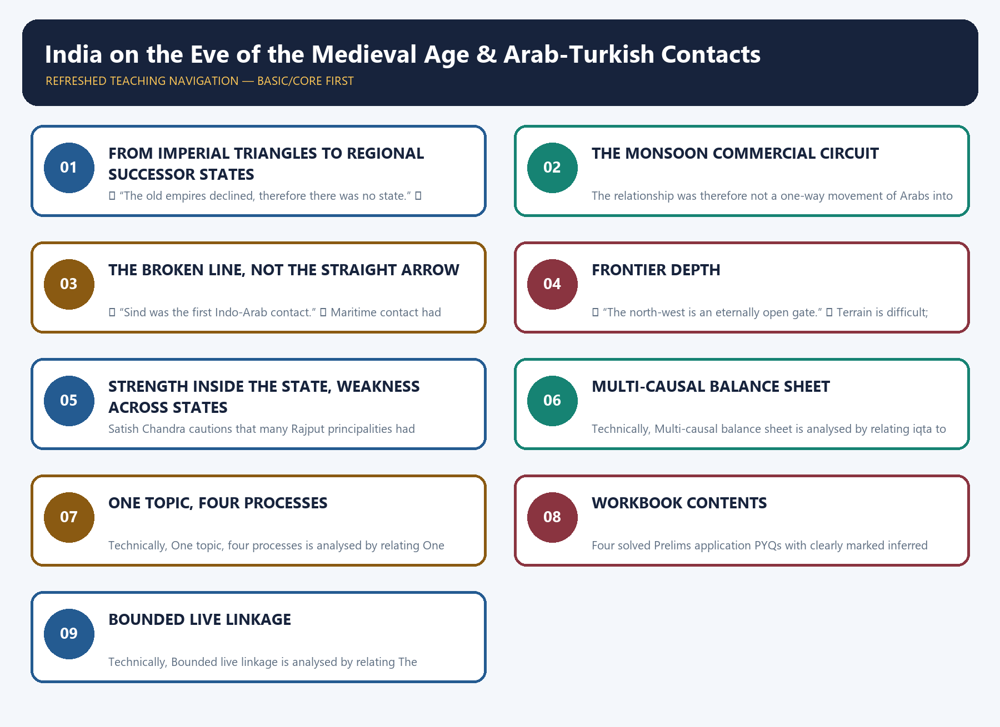

# India on the Eve of the Medieval Age & Arab-Turkish Contacts - Complete Topic Package

**UPSC Prelims GS-I · Medieval Indian History · Topic 01 · Mains GS-I support through culture, literature, architecture and historical method**

> **Evidence key.** ✅ Fact — directly grounded in the mandatory basic/advanced Markdown, the local OCR-searchable Satish Chandra books, an official UPSC paper, or an official current-affairs page fetched live. ⚠️ Inference — analytical synthesis for examination use. ❓ Unverified — deliberately withheld rather than guessed. 📰 Current anchor — dated contemporary material.
>
> **Scope discipline.** This topic explains the political, commercial, cultural, frontier and institutional setting before the Delhi Sultanate. Detailed Ghaznavid campaigns, the battles of Tarain and the Ghurid conquest belong primarily to Topic 02. Detailed Sultanate administration belongs to Topic 07. They appear here only where needed to explain the transition.

## BASIC LEARNING SESSION

### DEEP-REVIEW LEARNING CONTRACT

| Control | Binding rule for this package |
|---|---|
| Syllabus boundary | Complete Medieval History Core is taught before optional enrichment. |
| Evidence method | Claim → named site/text/inscription/coin/example → analysis → qualification. |
| Source hierarchy | Archaeology, textual testimony, inscriptions, coins and scholarly interpretation remain visibly distinct. |
| Contested issues | Competing interpretations are attributed, evidenced and bounded; certainty is not manufactured. |
| Practice contract | Every solved item has demand decoding, an examiner-grade model, an executable answer/compression plan, marks rationale and answer-specific improvement. |
| Approval | This immutable successor remains `approved: false` pending explicit approval. |

**Canonical Basic/Core owner:** `upsc-ai-kit\knowledge\Medieval-Indian-History\basic\01_India-on-the-Eve-of-Medieval-Age.md`  
**Canonical topic owner:** `upsc-ai-kit\knowledge\Medieval-Indian-History\basic\01_India-on-the-Eve-of-Medieval-Age.md`  
**Optional Advanced owner:** `upsc-ai-kit\knowledge\Medieval-Indian-History\advanced\01_India-on-the-Eve-of-Medieval-Age.md`  
**Official syllabus mapping:** `upsc-ai-kit\knowledge\Medieval-Indian-History\OFFICIAL-UPSC-SYLLABUS-MAPPING.md`

### EVIDENCE, PYQ AND CURRENT-STATUS CONTROL

- **Archaeological inference:** material context supports bounded reconstruction; absence is not automatic proof of non-existence.
- **Textual testimony:** genre, authorship, redaction, patronage and temporal distance control what a text can prove.
- **Inscription and coin evidence:** contemporary names, titles, claims and circulation are powerful but do not by themselves map uniform territorial control.
- **Scholarly interpretation:** historian labels are arguments to test, not facts to memorise without evidence.
- **PYQ discipline:** repository ledgers and locally held official papers control wording and metadata; reconstructed wording and unavailable official keys must be labelled.
- **Current-status note, rechecked 2026-08-30:** The November 2025 Archaeological Survey of India workshop on Project Mausam was rechecked on 30 August 2026. It provides a bounded modern link to documentation of Indian Ocean movement, ports and cultural exchange. It does not prove any specific early Indo-Arab route, date or settlement without the medieval textual and archaeological record.

**Live/primary context sources recorded by the predecessor generation:**

- `https://pib.gov.in/PressReleasePage.aspx?PRID=2191073`
- `https://whc.unesco.org/en/statesparties/in`




*Distinct embedded teaching-navigation image. The separate continuous Cārvāka-style flowchart package remains an independent at-a-glance artifact.*

#### Sources actually used

- ✅ Mandatory basic source, read in full: `Medieval-Indian-History/basic/01_India-on-the-Eve-of-Medieval-Age.md`.
- ✅ Mandatory advanced source, read in full: `Medieval-Indian-History/advanced/01_India-on-the-Eve-of-Medieval-Age.md`.
- ✅ Existing combined source: `Medieval-Indian-History/01_India-on-the-Eve-of-the-Medieval-Age-Arab-Turkish-Contacts_Complete-Topic-Package.md`.
- ✅ Chronology and syllabus boundary: `Medieval-Indian-History/00_Master-Chronology.md` and `OFFICIAL-UPSC-SYLLABUS-MAPPING.md`.
- ✅ OCR-searchable local books:
  - Satish Chandra, *History of Medieval India*, local PDF pp. 18, 22 and 53–70 for maritime trade, society, Rajputisation, Arab-Sind contact and the Ghaznavid prelude.
  - Satish Chandra, *Medieval India: From Sultanat to the Mughals, Part I*, local PDF pp. 8–16 for Arab traders, Abbasid decline, Alp-tigin, Hindu Shahis, the outer bastions, Rajput states and the structural explanation of conquest.
- ✅ Official UPSC papers read locally: GS-I Mains 2018–2025 and available Prelims GS-I papers 2018–2026.
- 📰 Live official sources fetched on 10 August 2026:
  - Kerala Tourism, International Spice Routes Conference, Kochi, 6–8 January 2026.
  - Ministry of Culture, Gyan Bharatam mission page and National Digitisation Drive workshop, 31 July 2026.
- ⚠️ Qdrant was unnecessary and did not delay the session.

---

#### SOURCE-COVERAGE LEDGER — proof that BOTH mandatory files are integrated

#### Ledger B — Basic / Must-Do source

| # | Basic-source claim | Integrated in |
|---:|---|---|
| B-01 | Arab conquest of Sind made it a conduit of scientific and cultural contact | Subtopics 2–3 |
| B-02 | Abbasid decline and rise of Islamised Turkish military elites | Subtopic 4 |
| B-03 | Hindu Shahis lost the north-western frontier zone to Ghaznavid pressure | Subtopic 5 |
| B-04 | Pratihara decline produced competing regional Rajput states | Subtopic 6 |
| B-05 | Muizzuddin's seizure of Ghazni in 1173 opened the Ghurid phase | Timeline and Subtopic 7 |
| B-06 | The transition around 1200 did not erase earlier institutions overnight | Subtopics 1 and 8 |
| B-07 | India was not isolated before Turkish political rule | Subtopics 1–3 |
| B-08 | Arab traders strengthened sea trade with West Asia | Subtopic 2 |
| B-09 | Arab settlements existed in Malabar | Subtopic 2 |
| B-10 | Rashtrakutas welcomed traders and permitted mosques | Subtopic 2 |
| B-11 | Indian numerals and astronomy entered Arabic learning | Subtopic 3 |
| B-12 | Muslim traders and Sufis preceded political conquest in parts of India | Subtopics 2–3 |
| B-13 | Lahore became a centre of Arabic and Persian learning | Subtopics 4–5 |
| B-14 | Palas, Pratiharas, Rashtrakutas and Cholas formed the preceding political order | Subtopic 1 |
| B-15 | Their decline produced successor powers, not an institutional vacuum | Subtopic 1 |
| B-16 | Gahadavalas, Paramaras, Chauhans, Chalukyas, Chandellas and Tomars were major powers | Subtopic 6 |
| B-17 | Rajput resistance existed; absence of a durable common front mattered | Subtopic 6 |
| B-18 | Turkish warfare stressed rapid cavalry mobility | Subtopic 7 |
| B-19 | Turkish elites carried a Persianised-Islamic political culture | Subtopic 4 |
| B-20 | Loss of Afghanistan and Punjab changed access to the Gangetic plain | Subtopic 5 |
| B-21 | Arab maritime contact and Turkish conquest were different processes | Every synthesis section |
| B-22 | Arab traders did not displace all Indian traders | Subtopic 2 |
| B-23 | Rajput defeat cannot be reduced to lack of courage | Subtopics 6–7 |
| B-24 | Turks were not culturally “pure” Central Asians | Subtopic 4 |
| B-25 | Sind did not lead immediately to the Delhi Sultanate | Subtopic 3 |
| B-26 | Trade, science, medicine, astronomy and numerals were important contact channels | Subtopics 2–3 |
| B-27 | Frontier loss mattered more than any single raid | Subtopic 5 |
| B-28 | Political courage coexisted with weak inter-state coordination | Subtopic 6 |
| B-29 | Current maritime heritage must be verified before use | Subtopics 2 and 8 |
| B-30 | The topic supports both Prelims facts and analytical GS-I culture answers | Subtopic 8 |

#### Ledger A — Advanced source

| # | Advanced-source claim | Integrated in |
|---:|---|---|
| A-01 | Arab contact and Turkish military expansion must be separated analytically | Subtopics 2–4 |
| A-02 | Indian merchants, physicians and craftsmen were present around the Persian Gulf | Subtopic 2 |
| A-03 | Arab settlements in Malabar coexisted with Indian commercial activity | Subtopic 2 |
| A-04 | Arabic and Persian were languages of ruling elites in West/Central Asia | Subtopic 4 |
| A-05 | Turkish commanders absorbed Iranian language, culture and administration | Subtopic 4 |
| A-06 | The Turks brought institutions and court culture as well as cavalry | Subtopics 4 and 7 |
| A-07 | Abbasid disintegration created space for regional military states | Subtopic 4 |
| A-08 | Alp-tigin established himself at Ghazni in 963 | Subtopic 4 |
| A-09 | Hindu Shahi defeat in 990–91 affected Kabul-Jalalabad control | Subtopic 5 |
| A-10 | Lahore entered the frontier contest before Mahmud's major raids | Subtopic 5 |
| A-11 | Muizzuddin took Ghazni in 1173 | Timeline and Subtopic 7 |
| A-12 | Ghazni improved communications towards Kabul and Jalalabad | Subtopic 5 |
| A-13 | “Outer bastions” describes strategic depth, not inevitable conquest | Subtopic 5 |
| A-14 | Iqta assigned revenue for military maintenance | Subtopic 7 |
| A-15 | Iqta did not confer unrestricted hereditary ownership of land and cultivators | Subtopic 7 |
| A-16 | North Indian politics included feudatories and inter-state rivalries | Subtopic 6 |
| A-17 | Prithviraj's expansion could isolate him politically | Subtopic 6 |
| A-18 | Cavalry, centralised resources and fragmentation formed a combined explanation | Subtopic 7 |
| A-19 | Indian resistance and Ghurid setbacks preserve contingency | Subtopics 5 and 7 |
| A-20 | Maritime contact could occur without territorial conquest | Subtopic 2 |
| A-21 | Scientific translation was a form of cultural circulation | Subtopic 3 |
| A-22 | Turkish states emerged from a West/Central Asian political transformation | Subtopic 4 |
| A-23 | Frontier geography connected roads, bases and operational depth | Subtopic 5 |
| A-24 | Rajput states could possess substantial population and revenue resources | Subtopic 6 |
| A-25 | Defeat cannot be explained by weapon inferiority alone | Subtopic 7 |
| A-26 | The conquest was not inevitable after Sind | Subtopic 3 |
| A-27 | “Foreign contact” contains commercial, cultural and military layers | Subtopic 8 |
| A-28 | Banbhore/Debal identifications require archaeological caution | Subtopic 3 |
| A-29 | Persianisation shaped later Sultanate political culture | Subtopics 4 and 8 |
| A-30 | The north-west should be analysed as a gateway and frontier system | Subtopic 5 |
| A-31 | A strong answer compares Arab maritime integration with Turkish penetration | Subtopic 8 |

> ⚠️ **Integration result:** 30/30 basic claims and 31/31 advanced claims are taught below. Repetition between the files is consolidated, but each file's distinct emphasis is preserved: the basic file supplies the foundation and examination traps; the advanced file supplies the West/Central Asian context, frontier logic, institutional comparison and contingency.

---

### Roadmap

```text
                    INDIA, c. 8th–12th CENTURIES
                                  |
          +-----------------------+-----------------------+
          |                                               |
   MARITIME CONTACT                                 LAND FRONTIER
   Arab traders . Malabar                          Sind . Kabul . Zabul
   ports . mosques . diaspora                      Punjab . Ghazni routes
   science . numerals . astronomy                  Hindu Shahis . Rajput states
          |                                               |
          v                                               v
   CONTACT WITHOUT CONQUEST                       MILITARY-POLITICAL PRESSURE
          |                                               |
          +-----------------------+-----------------------+
                                  |
                 PERSIANISED, ISLAMISED TURKISH ELITES
                 cavalry . military slaves . iqta logic
                 Persian language . court . administration
                                  |
                                  v
             STRUCTURAL ADVANTAGE, NOT HISTORICAL INEVITABILITY
       mobility + resources + frontier bases + rivalries + contingent choices
```

| Session | Subtopic | Examination task |
|---:|---|---|
| 1 | What “India on the eve” actually means | Replace “vacuum” with a map of transitions and successor states |
| 2 | Arab maritime-commercial contact | Distinguish trade, settlement and cultural exchange from conquest |
| 3 | Sind as conquest, conduit and historiographical trap | Explain transmission without drawing a straight line to 1206 |
| 4 | West/Central Asia and the Persianised Turks | Connect Abbasid decline, Turkish military elites and Persianate culture |
| 5 | Hindu Shahis, roads and “outer bastions” | Read the north-west as a frontier system |
| 6 | Rajput political order | Explain power, resistance, feudatories and coordination limits without stereotypes |
| 7 | Why the balance shifted | Build a multi-causal explanation: mobility, organisation, revenue and contingency |
| 8 | Comparative synthesis and UPSC answer architecture | Integrate maritime, cultural, frontier and military layers |

**Navigation preserved from the Guided Tutor format:** `Start` · `Next` · `Repeat` · `Deeper` · `Diagram` · `Revise` · `MCQs` · `PYQ` · `Notes` · `Export PDF`

---

━━━━━━━━━━━━━━━━━━━━━━━━━━━━━━━━━━━━━━━━━━━━━━━━━━━━━━━━━━━━

━━━ PRE-TEACH CHECKLIST ━━━━━━━━━━━━━━━━━━
📚 Book context: queried — Satish Chandra, *History of Medieval India*, especially the political and social transition before c.1200; Part I, pp. 8–16.
🔍 CA Search: "India 2026 medieval history heritage transition regional kingdoms archaeology"
📰 CA Found: Gyan Bharatam National Digitisation Drive workshop, Ministry of Culture, 31 July 2026 — useful for how documentary survival changes reconstruction, not as proof of any medieval political claim.
━━━━━━━━━━━━━━━━━━━━━━━━━━━━━━━━━━━━━━━━━

### SESSION 1 — FROM IMPERIAL TRIANGLES TO REGIONAL SUCCESSOR STATES

#### DEFINITION / WHAT THIS IS CALLED

**Plain-language definition:** “On the eve” of the medieval age names the transitional political landscape after the Pala–Pratihara–Rashtrakuta triangle broke up — a landscape of competing regional successor states, not an empty interval waiting for conquest.

**Technical definition:** Technically, the transition is described through regionalisation, successor powers and layered sovereignty: authority did not vanish but redistributed into several competing centres, bound together by feudatory relations and shifting alliances — competitive state formation, not collapse.

#### ANSWER-GRABBING OPENING — WRITE/ADAPT IN THE EXAM

> The “eve” of the medieval age was not an empty stage awaiting conquest; it was a crowded landscape of regional successor states still building forts, temples and armies.

#### MUST-WRITE KEYWORDS

- **From imperial triangles to regional successor states**
- **regionalisation**
- **successor powers**
- **layered sovereignty**
- **feudatory relations**
- **competitive state formation**

**How to use them:** Open by rejecting the vacuum myth; use regionalisation and successor powers to name the post-imperial order; connect layered sovereignty with feudatory relations to explain how authority was shared rather than absent; close with competitive state formation as the balanced verdict.

```text
            8th–10th-century major power systems
         PALA -------- PRATIHARA -------- RASHTRAKUTA
           \                 |                 /
            \         contest for Kannauj     /
             \               |               /
              +--------------+--------------+
                             |
                     decentralising transition
                             |
      +----------+-----------+-----------+----------+----------+
      |          |           |           |          |          |
  Gahadavala  Chauhan    Paramara    Chalukya   Chandella   Tomara
   Kannauj     Ajmer       Malwa       Gujarat   Bundelkhand  Delhi

South India: Chola power + Indian Ocean networks continue on a separate,
but connected, political and commercial axis.
```

*Caption: The period was a redistribution of power, not an empty interval waiting for conquest.*

#### Core concept

✅ “On the eve” is a historian's device. It freezes a moving landscape immediately before a major transition. It must not imply that everything existing before the transition was weak, static or destined to disappear.

✅ Before the eleventh-century invasions, the Palas, Gurjara-Pratiharas and Rashtrakutas had competed for north Indian predominance. In the south, the Cholas created a powerful agrarian, military and maritime state. Their decline did not remove politics; it multiplied centres of politics.

⚠️ The safest vocabulary is **regionalisation**, **successor powers**, **layered sovereignty**, **feudatory relations** and **competitive state formation**. “Anarchy” and “vacuum” are usually too blunt.

#### Continuity and change

| Continuity | Change |
|---|---|
| Agrarian taxation and landed intermediaries continued | Centres of power became more regional |
| Forts, temples, towns and trade routes remained strategic | New dynastic houses competed for old prestige zones |
| Clan and lineage legitimacy remained important | Political alliances became more fluid |
| Indian Ocean commerce continued | West/Central Asian military states pressed more strongly on the frontier |

✅ The political order therefore had resources, armies and cultural legitimacy. Its weakness was not absence of state capacity everywhere; it was the difficulty of pooling capacity across rival polities when the strategic problem changed.

#### Why UPSC cares

- **Prelims:** dynasties, chronology, regions and misleading linear sequences.
- **Mains support:** transition, regionalisation, culture and the danger of mono-causal historical explanations.
- **Essay value:** civilisations change through interaction, adaptation and institutional recombination, not sealed continuity or total rupture.

#### 📰 CA anchor

✅ On 31 July 2026, the Ministry of Culture held a National Digitisation Drive workshop under Gyan Bharatam. It reported a national manuscript survey and a push towards a digital repository.

⚠️ Link to this subtopic: the “eve” of an age is reconstructed from records that survive unevenly. Digitisation improves access; it does not remove source bias, establish completeness or turn later manuscripts into contemporary eyewitnesses.

#### UPSC traps

- ❌ “The old empires declined, therefore there was no state.”  
  ✅ Regional states and successor institutions remained.
- ❌ “Regionalisation means economic collapse everywhere.”  
  ✅ Political decentralisation can coexist with agrarian expansion, temple patronage and trade.
- ❌ “The Turkish conquest began against a culturally isolated India.”  
  ✅ India already participated in extensive maritime and intellectual networks.

#### Mini recap

1. The preceding order was multi-centred.
2. Decline of major empires produced regional successors.
3. Resources existed, but coordination was difficult.
4. The north-western strategic environment changed.
5. Transition was neither a civilisational blank nor an inevitable conquest.

#### PARAGRAPH DEMONSTRATION — CLAIM → EVIDENCE → ANALYSIS → QUALIFICATION

**Claim:** The disappearance of the Pala–Pratihara–Rashtrakuta triangle did not create a political vacuum in north India. **Named evidence:** regional successor states — the Gahadavalas of Kannauj, the Chauhans of Ajmer, the Paramaras of Malwa, the Chalukyas of Gujarat, the Chandellas of Bundelkhand and the Tomaras of Delhi — each retained forts, agrarian revenue and armies, while the Cholas continued to run a powerful maritime and agrarian state in the south. **Analysis:** because political capacity survived and multiplied across these centres rather than disappearing, the correct causal story is redistribution of power into competing regional sovereignties, not the collapse of statehood; this is why “anarchy” or “vacuum” is analytically too blunt. **Qualification:** the redistribution was regionally uneven — north Indian fragmentation coexisted with continued Chola strength — so an answer must specify which region's “decline” it is describing rather than generalising for all India.

#### Revision notes

- “Eve” = analytical snapshot, not destiny.
- Pala–Pratihara–Rashtrakuta = major earlier competitive system.
- Cholas = strong southern and maritime axis.
- Regionalisation ≠ political vacuum.
- Successor states preserved and altered older institutions.
- Use “competitive state formation”, not “permanent chaos”.
- Distinguish capacity of individual states from collective coordination.
- Link political map to trade routes and frontier geography.

#### CLOSING RECALL FLOW — FROM IMPERIAL TRIANGLES TO REGIONAL SUCCESSOR STATES

```text
START / CONCEPT: From imperial triangles to regional successor states
        |
        v
EXACT TERMS: From imperial triangles to regional successor states · regionalisation · successor powers · layered sovereignty · feudatory relations · competitive state formation
        |
        v
MECHANISM / ARGUMENT: Political capacity redistributed from three competing empires into six or more regional successor states — Gahadavala, Chauhan, Paramara, Chalukya, Chandella and Tomara — each with its own forts, revenue and army.
        |
        v
CONSEQUENCE / CONTRAST: Its weakness was not absence of state capacity everywhere; it was the difficulty of pooling capacity across rival polities when the strategic problem changed.
        |
        v
UPSC TRAP / ANSWER-USE: Use “competitive state formation”, not “permanent chaos”.
        |
        v
ANSWER-GRABBING FORMULATION: Regionalisation replaced imperial hierarchy with layered sovereignty — a redistribution of power, not its disappearance.
```
### SESSION 2 — THE MONSOON COMMERCIAL CIRCUIT

#### DEFINITION / WHAT THIS IS CALLED

**Plain-language definition:** ⚠️ The phrase commercial diaspora is useful: a mobile community maintains long-distance ties while creating local institutions.

**Technical definition:** The relationship was therefore not a one-way movement of Arabs into India; it was a connected commercial zone.

#### ANSWER-GRABBING OPENING — WRITE/ADAPT IN THE EXAM

> The relationship was therefore not a one-way movement of Arabs into India; it was a connected commercial zone.

#### MUST-WRITE KEYWORDS

- **The monsoon commercial circuit**
- **port pluralism**
- **commercial diaspora**
- **public-history and heritage-tourism revival of maritime memory**
- **Spices, textiles, aromatics, precious goods**
- **Languages and commercial vocabulary**

**How to use them:** Open with the monsoon commercial circuit to frame trade as older than conquest; use commercial diaspora and port pluralism to explain settlement without sovereignty; cite spices, textiles, aromatics and precious goods alongside languages and commercial vocabulary as evidence of two-way exchange; close by separating this from the public-history and heritage-tourism revival of maritime memory, which illustrates present relevance only, not medieval fact.

```text
Mediterranean / Red Sea / Persian Gulf
                 |
        Arab and Indian merchants
                 |
        monsoon navigation across
          the Arabian Sea
                 |
       +---------+----------+
       |                    |
   Gujarat coast        Malabar coast
                            |
                 ports . pepper . textiles
                 merchant settlements
                 mosques . languages
                 physicians . craftsmen
                            |
                    Southeast Asia
```

*Caption: The sea created repeated contact centuries before north Indian territorial conquest.*

#### Contact without conquest

✅ Arab traders had long traded with south India and Southeast Asia. Their activity increased under the Abbasids. Satish Chandra is explicit that they did **not** displace Indian traders and preachers.

✅ Evidence also places Indian merchants, physicians and craftsmen around the Persian Gulf and beyond. The relationship was therefore not a one-way movement of Arabs into India; it was a connected commercial zone.

✅ Arab traders settled in Malabar. Rashtrakuta rulers welcomed them and permitted mosques for worship. This shows a practical political economy: rulers protected useful commercial communities while merchants adapted to local conditions.

⚠️ A mosque in a port does not by itself demonstrate political sovereignty, mass conversion or social separation. It first demonstrates a resident worshipping community and the ruler's willingness to accommodate it.

#### What moved through the ports?

| Material movement | Cultural movement |
|---|---|
| Spices, textiles, aromatics, precious goods | Languages and commercial vocabulary |
| Ships, navigation knowledge, credit and contracts | Religious practices and communities |
| Merchants, sailors, physicians and craftsmen | Scientific, medical and astronomical knowledge |
| Coins and bullion | Stories, artistic forms and social customs |

⚠️ The phrase **commercial diaspora** is useful: a mobile community maintains long-distance ties while creating local institutions. It avoids the false choice between “foreigner” and “fully isolated colony”.

#### 2026 maritime anchor

✅ Kerala Tourism's official page records that the first International Spice Routes Conference was scheduled in Kochi from 6 to 8 January 2026, organised by the Muziris Heritage Project with Kerala Tourism. It framed the Spice Route as a commercial and cultural network linking Kerala with Asia, the Middle East, Africa and Europe, and announced participation from 22 countries.

⚠️ Exam use: cite it as a **public-history and heritage-tourism revival of maritime memory**. Do not claim that the conference archaeologically proved the precise location of ancient Muziris or the date of a specific medieval settlement.

#### Analytical distinction

```text
TRADE CONTACT                  POLITICAL CONQUEST
repeated voyages               organised territorial warfare
merchant settlements          forts, garrisons and tribute
negotiated protection          coercive sovereignty
gradual cultural exchange      rapid change in political control

They can interact, but one does not automatically produce the other.
```

#### UPSC traps

- ❌ “Arab contact began with Muhammad bin Qasim.”  
  ✅ Commercial contact predated the conquest of Sind.
- ❌ “Arab merchants eliminated Indian participation.”  
  ✅ Indian traders remained active.
- ❌ “Mosques prove Arab political rule in Malabar.”  
  ✅ They prove community and accommodation, not necessarily sovereignty.
- ❌ “Maritime exchange was only about goods.”  
  ✅ People, knowledge, language and institutions travelled too.

#### PARAGRAPH DEMONSTRATION — CLAIM → EVIDENCE → ANALYSIS → QUALIFICATION

**Claim:** Arab maritime contact with India was a long commercial relationship, not the opening act of conquest. **Named evidence:** Arab traders settled on the Malabar coast under Rashtrakuta permission to build mosques, while Indian merchants, physicians and craftsmen were simultaneously active around the Persian Gulf. **Analysis:** because accommodation and settlement flowed in both directions and predated the Ghaznavid-Ghurid military phase by centuries, the relationship is best read as a connected commercial zone rather than a one-way foreign incursion. **Qualification:** a permitted mosque documents a resident worshipping community and a ruler's willingness to accommodate it — it does not, by itself, establish political sovereignty or mass conversion, so the evidence must not be over-read.

#### Revision notes

- Arab maritime activity intensified under the Abbasids.
- Malabar was a settlement and trade zone.
- Rashtrakutas permitted mosques.
- Indian traders remained active in West Asian circuits.
- Commercial contact ≠ territorial rule.
- Monsoon winds structured movement.
- Use “commercial diaspora” and “port pluralism”.
- Current hook: International Spice Routes Conference, Kochi, January 2026.

#### CLOSING RECALL FLOW — THE MONSOON COMMERCIAL CIRCUIT

```text
START / CONCEPT: The monsoon commercial circuit
        |
        v
EXACT TERMS: The monsoon commercial circuit · not · commercial diaspora · public-history and heritage-tourism revival of maritime memory · Spices, textiles, aromatics, precious goods · Languages and commercial vocabulary
        |
        v
MECHANISM / ARGUMENT: ⚠️ A mosque in a port does not by itself demonstrate political sovereignty, mass conversion or social separation.
        |
        v
CONSEQUENCE / CONTRAST: ⚠️ The phrase commercial diaspora is useful: a mobile community maintains long-distance ties while creating local institutions.
        |
        v
UPSC TRAP / ANSWER-USE: This shows a practical political economy: rulers protected useful commercial communities while merchants adapted to local conditions.
        |
        v
ANSWER-GRABBING FORMULATION: The relationship was therefore not a one-way movement of Arabs into India; it was a connected commercial zone.
```
### SESSION 3 — THE BROKEN LINE, NOT THE STRAIGHT ARROW

#### DEFINITION / WHAT THIS IS CALLED

**Plain-language definition:** “The broken line, not the straight arrow” means the Arab conquest of Sind and the later Delhi Sultanate are joined only by a broken chain of centuries, actors and institutions — not one continuous line of cause and effect.

**Technical definition:** Technically, Sind functioned simultaneously as a bounded political conquest (a Sindh-Multan garrison foothold), a knowledge conduit (translation ecosystems carrying Indian numerals and astronomy into Arabic scholarship) and a historiographical trap, where chronological precedence is wrongly read as direct causation and an excavated port is wrongly read as automatic textual proof.

#### ANSWER-GRABBING OPENING — WRITE/ADAPT IN THE EXAM

> Two things can both be true: Sind came centuries before the Sultanate, and Sind did not cause the Sultanate — the exam-safe answer treats conquest, conduit and chronological trap as three separate claims.

#### MUST-WRITE KEYWORDS

- **The broken line**
- **not the straight arrow**
- **translation ecosystems**
- **Conquest**
- **Conduit**
- **chronological precedence**

**How to use them:** Open with the broken line, not the straight arrow to reject a direct causal chain; use conquest and conduit as the two legitimate faces of the Arab presence in Sind; bring in translation ecosystems to explain intellectual transmission; and use chronological precedence to refute any claim that Sind directly produced the Sultanate.

```text
711–12: Arab conquest of Sind
             |
             +--> regional political control in Sind
             +--> trade and administrative interaction
             +--> scientific and cultural transmission
             |
             X  NO DIRECT CONTINUOUS ARROW
             |
9th c.: Abbasid political fragmentation in West/Central Asia
             |
10th c.: Turkish military states and Ghazni
             |
12th c.: Ghurid expansion
             |
c.1200: Sultanate transition in north India
```

*Caption: Several centuries and a different geopolitical formation separate Sind from the Sultanate.*

#### What Sind changed

✅ The Arab conquest made Sind a political and cultural contact zone. It connected Indian knowledge and commodities more directly with Arabic scholarly and commercial networks.

✅ Indian numerals and astronomical materials, including traditions associated with the *Surya Siddhanta*, entered Arabic intellectual life through translation and adaptation. The historical importance lies not in a simple “gift” from one civilisation to another, but in **translation ecosystems** involving scholars, patrons, languages and practical needs.

✅ Muslim traders and later Sufis appeared in north-western India before the establishment of the Delhi Sultanate. Lahore developed as a centre of Arabic and Persian language and literature.

#### What Sind did not do

⚠️ Sind did not automatically unlock the Gangetic plain. Arab expansion met resistance in frontier regions, and political conditions in West/Central Asia changed substantially before the rise of Ghazni and Ghur.

⚠️ A three-stage answer is safer:

1. **Conquest:** a regional Arab political foothold in Sind.
2. **Conduit:** circulation of science, trade and religious communities.
3. **Limit:** no uninterrupted institutional or military line to the Delhi Sultanate.

#### Archaeological caution: Debal and Banbhore

⚠️ Banbhore is frequently associated with Debal, but the identification remains an archaeological-historical argument, not a licence to merge every textual reference with every excavated layer.

```text
TEXT says “Debal”        ARCHAEOLOGY finds a port settlement
          \                         /
           \                       /
            +--> compare date, geography, material sequence
                         |
                  graded identification
             probable / possible / disputed
```

#### Why UPSC cares

- It tests whether the candidate confuses **chronological precedence** with **direct causation**.
- It links science and technology history with cultural exchange.
- It offers statement-based traps: “first contact”, “immediate conquest”, “only military”.

#### UPSC traps

- ❌ “Sind was the first Indo-Arab contact.”  
  ✅ Maritime contact had older roots.
- ❌ “Sind directly caused the Delhi Sultanate.”  
  ✅ Different centuries, actors and institutions intervened.
- ❌ “Knowledge simply moved intact from Sanskrit to Arabic.”  
  ✅ Translation selects, adapts and recontextualises.
- ❌ “An archaeological site proves a textual identification completely.”  
  ✅ Dating, stratigraphy, geography and inscriptional evidence must converge.

#### PARAGRAPH DEMONSTRATION — CLAIM → EVIDENCE → ANALYSIS → QUALIFICATION

**Claim:** The 711–12 Arab conquest of Sind did not directly cause the Delhi Sultanate. **Named evidence:** Muhammad bin Qasim's campaign produced a bounded Sindh-Multan foothold with garrisons and negotiated accommodation, while the Sultanate itself emerged only after ninth-century Abbasid fragmentation, the tenth-century rise of Ghazni and the twelfth-century Ghurid campaigns — several centuries and an entirely different set of actors later. **Analysis:** because a gap of this length, filled by unrelated political formations, separates the two events, “chronological precedence” (Sind came first) must not be mistaken for “direct causation” (Sind caused the Sultanate). **Qualification:** Sind did function as a genuine conduit — Indian numerals and astronomical learning entered Arabic scholarship through it — so the correct verdict is conquest + conduit + limit, not simple irrelevance.

#### Revision notes

- Sind = conquest + conduit + limit.
- 8th-century event; Sultanate transition much later.
- Numerals and astronomy are key knowledge-transfer examples.
- Lahore became an Arabic-Persian intellectual centre.
- Early traders and Sufis preceded territorial conquest.
- Translation is an institutional process.
- Avoid straight-line causation.
- Banbhore/Debal identification requires graded language.

#### CLOSING RECALL FLOW — THE BROKEN LINE, NOT THE STRAIGHT ARROW

```text
START / CONCEPT: The broken line, not the straight arrow
        |
        v
EXACT TERMS: The broken line · not the straight arrow · translation ecosystems · Conquest · Conduit · chronological precedence
        |
        v
MECHANISM / ARGUMENT: Lahore developed as a centre of Arabic and Persian language and literature.
        |
        v
CONSEQUENCE / CONTRAST: It links science and technology history with cultural exchange.
        |
        v
UPSC TRAP / ANSWER-USE: ❌ “Sind directly caused the Delhi Sultanate.” ✅ Different centuries, actors and institutions intervened; the two events are not the same causal chain.
        |
        v
ANSWER-GRABBING FORMULATION: The 8th-century conquest of Sind and the 13th-century Sultanate are joined only by a broken line of centuries and unrelated institutions — never assume a straight arrow.
```
### SESSION 4 — THE PERSIANATE-TURKISH FORMATION

#### DEFINITION / WHAT THIS IS CALLED

**Plain-language definition:** The Persianate-Turkish formation is the mixed military, Islamic and Iranian political culture that Turkish commanders built in West and Central Asia after Abbasid decline, and carried with them to the Indian frontier.

**Technical definition:** Technically, it names the process by which Turkish military slaves and commanders, rising to autonomy amid Abbasid fragmentation, fused Islamic legitimacy with adopted Persian language, court etiquette and administrative technique into a durable transregional state form — first visible at Ghazni from 963.

#### ANSWER-GRABBING OPENING — WRITE/ADAPT IN THE EXAM

> The Turks who entered India were products of a mixed military, Islamic and Persianate world — which reframes the encounter as institutional contact between organised states, not a clash between a settled civilisation and unformed nomads.

#### MUST-WRITE KEYWORDS

- **Persianate**
- **Islamisation**
- **Abbasid fragmentation**
- **Alp-tigin**
- **institutional hybridity**
- **Ghazni**

**How to use them:** Open with institutional hybridity; define Persianate as a cultural-administrative sphere and not an ethnicity; trace it to Abbasid fragmentation and Alp-tigin's rise at Ghazni in 963; then use Islamisation alongside Persianisation to show that Turkish elites carried administration, not only cavalry, into India.


```text
ABBASID CENTRE WEAKENS (late 9th c.)
                |
      regional Iranian dynasties
      and military competition
                |
        Turkish military slaves
        and commanders rise
                |
       Islamisation + Persianisation
       ------------------------------
       military organisation
       Persian language and literature
       Iranian court conventions
       administrative techniques
       Islamic legitimacy vocabulary
                |
          Ghazni and successors
```

*Caption: The Turks who entered India were products of a mixed military, Islamic and Persianate world.*

#### Abbasid decline and regional states

✅ The Abbasid caliphate reached a high point in the ninth century and then lost direct political control over large regions. Regional states and military commanders became increasingly autonomous.

✅ Among the Samanid governors was the Turkish commander Alp-tigin, who established himself at Ghazni in 963. Ghazni's location linked the Iranian plateau, Central Asian routes, Afghanistan and the Indian frontier.

#### Islamised and Persianised

✅ Turkish military groups had accepted Islam, but their political culture was also deeply shaped by Iranian traditions. Persian became a major language of court and literature. Satish Chandra places Firdausi and the *Shah Nama* within this Iranian cultural resurgence.

⚠️ “Persianate” does not mean ethnically Persian. It describes a cultural-political sphere in which Persian language, literary forms, court etiquette and administrative practices circulated across rulers of different origins.

| Dimension | What the Turkish elites carried |
|---|---|
| Military | mounted warfare, disciplined command structures, military slaves |
| Political | sultanate claims, court hierarchy, personal service networks |
| Administrative | Persian documentation and revenue-military assignments |
| Cultural | Persian language, literature, etiquette and historical writing |
| Religious | Islamic legitimacy, institutions and learned networks |

#### Why this matters for India

⚠️ The encounter was not “India versus nomads”. It was between Indian regional polities and highly organised frontier states that had already absorbed urban Iranian administrative and literary traditions.

⚠️ The Delhi Sultanate's later political vocabulary cannot be explained from Central Asian ethnicity alone. It emerged from **institutional hybridity**: Turkish military elites, Persianate administration, Islamic legitimacy and Indian fiscal-social realities.

#### 📰 Current anchor

✅ The Ministry of Culture's Gyan Bharatam page identifies digitisation, cataloguing, AI-assisted transcription and a National Digital Repository as core goals. The 31 July 2026 workshop reported large-scale manuscript identification and discussed metadata and interoperability.

⚠️ Exam link: Persian and Arabic manuscripts are indispensable for medieval history, but digitising an image is not the same as editing, translating, dating or critically interpreting a text.

#### UPSC traps

- ❌ “Turkish” describes a complete and unchanging culture.  
  ✅ Political elites were Islamised and Persianised.
- ❌ “Persianate” means Persian ethnicity.  
  ✅ It is a transregional cultural-political formation.
- ❌ “The caliph directly commanded every later sultan.”  
  ✅ Regional rulers often sought legitimacy while exercising practical autonomy.
- ❌ “The Turks brought cavalry but no administrative tradition.”  
  ✅ Military and administrative-cultural institutions travelled together.

#### PARAGRAPH DEMONSTRATION — CLAIM → EVIDENCE → ANALYSIS → QUALIFICATION

**Claim:** The Turkish commanders who eventually turned toward India were already a Persianate, Islamised political formation, not unformed nomadic raiders. **Named evidence:** after Abbasid fragmentation, Alp-tigin established himself at Ghazni in 963; his successors governed through Persian language, court etiquette and administrative technique alongside Islamic legitimacy and military-slave institutions. **Analysis:** because language, administration and legitimacy travelled together with cavalry command, the encounter with India is better explained as contact between two organised state traditions than as a clash between civilisation and barbarism. **Qualification:** “Persianate” names a transregional cultural-administrative sphere adopted by rulers of diverse origins — it is not a claim about Persian ethnicity, and must not be read as one.

#### Revision notes

- Abbasid decline created regional political space.
- Alp-tigin established himself at Ghazni in 963.
- Turks were Islamised and Persianised.
- Persianate = language, court, literature and administration, not ethnicity.
- Ghazni was a strategic and cultural hinge.
- Military slaves could become commanders and rulers.
- Institutional hybridity is the central analytical phrase.
- Digital manuscripts still require source criticism.

#### CLOSING RECALL FLOW — THE PERSIANATE-TURKISH FORMATION

```text
START / CONCEPT: The Persianate-Turkish formation
        |
        v
EXACT TERMS: Persianate · Islamisation · Abbasid fragmentation · Alp-tigin · institutional hybridity · Ghazni
        |
        v
MECHANISM / ARGUMENT: Abbasid political fragmentation let commanders such as Alp-tigin build autonomous frontier states that fused Islamic legitimacy with Persian language, literature and administration.
        |
        v
CONSEQUENCE / CONTRAST: The Delhi Sultanate's later political vocabulary cannot be explained from Central Asian ethnicity alone; it emerged from institutional hybridity.
        |
        v
UPSC TRAP / ANSWER-USE: ❌ “Persianate” means Persian ethnicity. ✅ It is not an ethnic label; it is a transregional cultural-political formation carried by rulers of different origins.
        |
        v
ANSWER-GRABBING FORMULATION: The Turks who entered India were products of a mixed military, Islamic and Persianate world, not raw nomadic conquerors.
```

### SESSION 5 — FRONTIER DEPTH

#### DEFINITION / WHAT THIS IS CALLED

**Plain-language definition:** Frontier depth is the layered zone of buffer territory, roads and forward bases — Zabulistan, Afghanistan, Kabul, Jalalabad and eventually Punjab — whose control decided how quickly and cheaply a Central Asian military state could project power onto the Gangetic plain.

**Technical definition:** Technically, frontier depth is measured by the number of maintained way-stations, garrisons and roads a state controls between its political core and the plains it wishes to reach; each forward zone gained or lost (Zabulistan, Kabul, Jalalabad, Punjab) shortens or lengthens the logistical distance, and therefore the cost and speed, of any campaign toward the Gangetic plain.

#### ANSWER-GRABBING OPENING — WRITE/ADAPT IN THE EXAM

> Frontier depth, not fate, decided how close a Central Asian army could operate to the Gangetic plain — and that depth was won or lost zone by zone, not in a single stroke.

#### MUST-WRITE KEYWORDS

- **Frontier depth**
- **outer bastions**
- **probabilities**
- **Punjab base**
- **Kabul**
- **990–91**

**How to use them:** Open with frontier depth to frame the north-west as a system, not a gate; define outer bastions as strategic-depth zones, connect probabilities with the Punjab base to explain how loss of depth changed the odds, and use the 990–91 Kabul-Jalalabad setback as the decisive chronological anchor.

```text
CENTRAL ASIA / IRAN
        |
      GHAZNI
        |
  road communications
        |
     KABUL ---- JALALABAD
        |
   mountain approaches
        |
   PUNJAB / LAHORE
        |
   UPPER INDUS–DOAB
        |
   GANGETIC PLAIN

Control of each forward zone changes the cost, speed and sustainability
of operations in the next zone.
```

*Caption: Frontier control is about bases, roads and depth, not a mystical “gateway”.*

#### Hindu Shahi resistance

✅ The Hindu Shahis occupied a crucial frontier position. Jayapala and his successors attempted to resist Ghaznavid expansion and rebuild their strategic position.

✅ Satish Chandra records the loss of Kabul and Jalalabad around 990–91 in the advanced narrative and stresses that Zabulistan and Afghanistan, the “outer bastions”, had been lost by the end of the tenth century.

⚠️ The phrase **outer bastions** should be used carefully. It means zones providing strategic depth between Central Asian military states and the plains. It does not mean that the people or polities beyond a later national border were merely defensive appendages of a timeless Indian nation.

#### Why roads matter

✅ Ghazni's rulers improved road communications towards Kabul and Jalalabad. Roads affect:

- movement speed;
- remount and supply;
- communication between ruler and commander;
- concentration of cavalry;
- retreat after a failed operation;
- conversion of a raid into sustained political pressure.

⚠️ Geography enables; institutions exploit. A pass does not conquer a plain. A state must organise transport, intelligence, garrisons and revenue.

#### Punjab as base

✅ Once Punjab became embedded in the Ghaznavid sphere, later Turkish advances could begin closer to the Gangetic centres. Distance from the political core reduced, intelligence improved and repeated operations became easier.

```text
RAID from distant base              EXPANSION from forward base
high supply cost                    lower operational distance
limited intelligence               local information networks
return after plunder                garrison and revenue possibilities
uncertain reinforcement             repeated campaigns
```

#### Contingency

⚠️ Even after frontier losses, conquest was not automatic. Resistance continued; coalitions formed; the Ghurids suffered reverses; leadership and battlefield decisions mattered. Frontier change altered **probabilities**, not certainties.

#### UPSC traps

- ❌ “The north-west is an eternally open gate.”  
  ✅ Terrain is difficult; political control and logistical preparation make routes usable.
- ❌ “Loss of Kabul immediately meant loss of Delhi.”  
  ✅ Multiple phases and contingencies intervened.
- ❌ “Roads are passive geography.”  
  ✅ Maintained communications are state capacity.
- ❌ “Strategic depth proves inevitable conquest.”  
  ✅ It changes the balance but does not determine every outcome.

#### PARAGRAPH DEMONSTRATION — CLAIM → EVIDENCE → ANALYSIS → QUALIFICATION

**Claim:** The loss of “outer bastion” territory changed the probability, not the certainty, of Turkish advance into India. **Named evidence:** Satish Chandra records that the Hindu Shahis lost Kabul and Jalalabad around 990–91, and that Zabulistan and Afghanistan had passed from Indian strategic control by the end of the tenth century, after which Punjab increasingly served as a forward Ghaznavid base. **Analysis:** because each lost forward zone shortened the supply lines, intelligence networks and remount access available to a Central Asian army, frontier depth converted directly into operational capacity — roads and bases, not mysticism about an “open gate”, explain the shift. **Qualification:** even after these losses, conquest remained contingent: coalitions formed, resistance continued and the Ghurids suffered reverses, so frontier depth altered the odds without determining the outcome.

#### Revision notes

- Hindu Shahis = frontier resistance.
- 990–91 = Kabul-Jalalabad setback in the authored advanced chronology.
- Outer bastions = strategic depth, not destiny.
- Roads convert geography into capability.
- Punjab later offered a forward base.
- Distinguish raid from sustained expansion.
- Geography + logistics + institutions.
- Use probability language, not inevitability.

#### CLOSING RECALL FLOW — FRONTIER DEPTH

```text
START / CONCEPT: Frontier depth
        |
        v
EXACT TERMS: Frontier depth · outer bastions · probabilities · Punjab base · Kabul · 990–91
        |
        v
MECHANISM / ARGUMENT: ✅ Satish Chandra records the loss of Kabul and Jalalabad around 990–91 in the advanced narrative and stresses that Zabulistan and Afghanistan, the “outer bastions”, had been lost by the end of the tenth century.
        |
        v
CONSEQUENCE / CONTRAST: ⚠️ Even after frontier losses, conquest was not automatic.
        |
        v
UPSC TRAP / ANSWER-USE: It does not mean that the people or polities beyond a later national border were merely defensive appendages of a timeless Indian nation.
        |
        v
ANSWER-GRABBING FORMULATION: Strategic depth changed the odds of conquest; it did not write the outcome in advance.
```
### SESSION 6 — STRENGTH INSIDE THE STATE, WEAKNESS ACROSS STATES

#### DEFINITION / WHAT THIS IS CALLED

**Plain-language definition:** ⚠️ This is an ideal-type comparison, not a claim that every Rajput state and every Turkish state worked identically.

**Technical definition:** Satish Chandra cautions that many Rajput principalities had population and revenue resources larger than several successor states in arid West/Central Asia.

#### ANSWER-GRABBING OPENING — WRITE/ADAPT IN THE EXAM

> “Rajput” should therefore not be treated as a timeless, biologically fixed category unchanged across centuries.

#### MUST-WRITE KEYWORDS

- **Strength inside the state**
- **weakness across states**
- **Multiple sovereign centres**
- **More concentrated command for expeditionary warfare**
- **Feudatory and clan forces**
- **Personal military-service networks**

**How to use them:** Open with strength inside the state, weakness across states as the master formula; use multiple sovereign centres and feudatory and clan forces to show real Rajput capacity; contrast personal military-service networks with more concentrated command for expeditionary warfare to explain why Turkish states could mobilise faster despite smaller populations.

```text
                   RAJPUT POLITY
                        |
        +---------------+----------------+
        |               |                |
     KING/RAJA       CLAN ELITES     FEUDATORIES
        |               |                |
  forts . court     lineage honour   local forces
  revenue . army    marriage ties    conditional loyalty
        +---------------+----------------+
                        |
                 substantial resources
                        |
           BUT ACROSS SEPARATE POLITIES:
      rivalry . shifting alliance . prestige conflict
      no durable common command . delayed assistance
```

*Caption: The problem was coordination among power centres, not the absence of power.*

#### Who were the major powers?

✅ The authored basic source names the Gahadavalas of Kannauj, Paramaras of Malwa, Chauhans of Ajmer, Chalukyas of Gujarat, Chandellas and Tomars. Each possessed its own political interests, feudatories, forts and rivalries.

✅ Rajput states resisted Ghaznavid pressure. A coalition could form, and individual rulers could mobilise substantial armies. Satish Chandra cautions that many Rajput principalities had population and revenue resources larger than several successor states in arid West/Central Asia.

#### Rajputisation and social formation

✅ Satish Chandra's broader account connects the emergence of Rajput groups to agrarian expansion, political power and Brahmanical legitimation. “Rajput” should therefore not be treated as a timeless, biologically fixed category unchanged across centuries.

⚠️ This matters because polity was built through lineage claims, land control, service, marriage and incorporation. Social formation and state formation interacted.

#### The coordination problem

✅ Rivalries prevented a durable common strategy for recovering Punjab. Prithviraj's own expansion could alienate potential allies. In the upper Doab, the failure of neighbouring powers to assist one another demonstrates the problem of separate strategic calculations.

⚠️ Honour was politically real, but “Rajput honour caused defeat” is too crude. The better argument is:

```text
lineage legitimacy + competitive sovereignty + feudatory autonomy
                           |
             strong local mobilisation
                           |
          difficult unified command across kingdoms
```

#### What not to write

- “Rajputs were brave but foolish.” This is a stereotype, not analysis.
- “They never formed coalitions.” Coalitions did form; they were difficult to sustain.
- “They had fewer resources.” Resource mobilisation and deployment mattered more than aggregate size.
- “They lost because of caste alone.” Social exclusivity may shape recruitment, but the specific military result needs operational evidence.

#### Comparative frame

| Rajput order | Turkish frontier states |
|---|---|
| Multiple sovereign centres | More concentrated command for expeditionary warfare |
| Feudatory and clan forces | Personal military-service networks |
| Strong fort-based regional power | High cavalry mobility across routes |
| Prestige and territorial rivalry | Repeated competition had rewarded military efficiency |
| Coalitions possible but unstable | Resources more readily concentrated under the ruler |

⚠️ This is an ideal-type comparison, not a claim that every Rajput state and every Turkish state worked identically.

#### PARAGRAPH DEMONSTRATION — CLAIM → EVIDENCE → ANALYSIS → QUALIFICATION

**Claim:** Rajput political weakness lay in coordination among sovereign centres, not in an absence of resources within any one of them. **Named evidence:** the Gahadavalas of Kannauj, the Chauhans of Ajmer, the Paramaras of Malwa, the Chalukyas of Gujarat, the Chandellas and the Tomaras each commanded substantial forts, agrarian revenue and feudatory armies, and the Chaulukyas defeated Muizzuddin near Mount Abu in 1178–79 while Prithviraj defeated him again at the First Battle of Tarain in 1191. **Analysis:** because real military capacity is demonstrated by these victories, the explanatory problem must lie elsewhere — specifically in the difficulty of converting resources held by rival sovereign centres into a single, durably reinforced command, as shown by neighbouring powers' failure to assist one another in the upper Doab. **Qualification:** this is a structural, not a moral or racial, limitation — “Rajput honour caused defeat” and similar bravery-based explanations are stereotypes that the evidence of real resistance and real victories directly contradicts.

#### Revision notes

- Major states: Gahadavala, Chauhan, Paramara, Chalukya, Chandella, Tomara.
- Rajput states had real resources and resisted.
- Rajputisation links agrarian and political change.
- Feudatories supplied strength and autonomy.
- Coalitions existed but lacked durable unified command.
- Prithviraj's expansion had diplomatic costs.
- Aggregate resource size ≠ deployable military capacity.
- Avoid ethnic, religious and bravery stereotypes.

#### CLOSING RECALL FLOW — STRENGTH INSIDE THE STATE, WEAKNESS ACROSS STATES

```text
START / CONCEPT: Strength inside the state, weakness across states
        |
        v
EXACT TERMS: Strength inside the state · weakness across states · Multiple sovereign centres · More concentrated command for expeditionary warfare · Feudatory and clan forces · Personal military-service networks
        |
        v
MECHANISM / ARGUMENT: ⚠️ This matters because polity was built through lineage claims, land control, service, marriage and incorporation.
        |
        v
CONSEQUENCE / CONTRAST: ⚠️ This is an ideal-type comparison, not a claim that every Rajput state and every Turkish state worked identically.
        |
        v
UPSC TRAP / ANSWER-USE: ⚠️ Honour was politically real, but “Rajput honour caused defeat” is too crude.
        |
        v
ANSWER-GRABBING FORMULATION: “Rajput” should therefore not be treated as a timeless, biologically fixed category unchanged across centuries.
```
### SESSION 7 — MULTI-CAUSAL BALANCE SHEET

#### DEFINITION / WHAT THIS IS CALLED

**Plain-language definition:** A multi-causal balance sheet weighs several interacting factors — mobility, concentrated command, revenue-funded troops and political rivalry — against single-cause claims such as religion, bravery or weapons, in order to explain why the military balance shifted.

**Technical definition:** Technically, the balance sheet is built by testing each monocausal claim — “Religion caused victory”, “Bravery caused defeat”, “Weapons alone decided”, “Fragmentation alone decided” — against the evidence, discarding each as insufficient, and reassembling the surviving multi-causal factors of command concentration, mounted mobility and military-fiscal organisation as condition + institutional mechanism + contingent trigger.

#### ANSWER-GRABBING OPENING — WRITE/ADAPT IN THE EXAM

> The Turkish military advantage was an organisational system — mobility, concentrated command and revenue-funded troops — not a single decisive weapon, religion or racial trait.

#### MUST-WRITE KEYWORDS

- **command concentration**
- **mounted mobility**
- **military-fiscal organisation**
- **coalition coordination**
- **contingency and probability**
- **frontier logistics**

**How to use them:** Open by naming the balance sheet; use command concentration and mounted mobility to explain the Turkish-side advantage; connect military-fiscal organisation (iqta) with coalition coordination to show why concentrated command could outweigh larger but scattered resources; close with contingency and probability, anchored in frontier logistics, to reject every monocausal claim in the table below.

```text
TURKISH-SIDE ENABLERS                    NORTH-INDIAN CONSTRAINTS
--------------------                    ------------------------
mobile mounted warfare                  rival regional sovereignties
concentrated command                    unstable coalition command
frontier bases and roads                Punjab already difficult to recover
military-service networks               feudatory bargaining
revenue assignments for troops          resources dispersed across states
Persianate administration               diplomatic isolation of key rulers
              \                         /
               \                       /
                +---- BATTLEFIELD ----+
                leadership . timing . intelligence
                terrain . morale . tactical decisions
                           |
                   OUTCOME IS CONTINGENT
```

*Caption: Structure changes the odds; decisions produce the result.*

#### Cavalry and mobility

✅ Mounted archery and rapid cavalry movement improved reconnaissance, concentration and manoeuvre. The key advantage was not simply “better horses”, but an operational system capable of using mobility repeatedly.

⚠️ Elephants were not inherently obsolete. They could shock an enemy and anchor a line, but could also create disorder if frightened or poorly coordinated. Technology has value only inside doctrine and command.

#### Centralised military resources

✅ Turkish rulers could concentrate resources through personal military-service networks and revenue assignments. The authored advanced source introduces **iqta** as a territorial revenue assignment supporting troops.

⚠️ Scope caution: the mature Delhi Sultanate iqta system belongs to later topics. Here, use it only to explain the broader principle that rulers assigned revenue rights to military commanders without necessarily granting absolute hereditary ownership over land and cultivators.

#### Organisation over civilisational ranking

✅ Satish Chandra stresses organisation, mobility and strategy more than weapon inferiority. A smaller but more concentrated force may defeat a larger coalition if it has:

- unified command;
- reserve deployment;
- intelligence;
- faster communication;
- reliable remounts;
- clear operational objectives.

#### Why monocausal explanations fail

| Monocausal claim | Why it fails |
|---|---|
| “Religion caused victory” | Cannot explain defeats, setbacks or variation among rulers |
| “Bravery caused defeat” | Bravery is not a command system |
| “Weapons alone decided” | Similar weapons produce different results under different organisation |
| “Fragmentation alone decided” | Fragmented polities can still win through coalitions and leadership |
| “Geography made conquest inevitable” | Routes require bases, logistics and political control |

#### Contingency test

⚠️ First Battle of Tarain, 1191: Prithviraj's victory demonstrates that Turkish success was not automatic. Second Tarain, 1192: changed preparation, command and tactical execution altered the outcome. Topic 02 owns the detailed battle narrative; Topic 01 uses the pair to refute inevitability.

#### UPSC answer formula

```text
CAUSE = structural condition + institutional mechanism + contingent trigger

Example:
fragmentation (condition)
+ weak coalition command (mechanism)
+ diplomatic and battlefield decisions (trigger)
= increased probability of defeat, not predetermined collapse
```

#### PARAGRAPH DEMONSTRATION — CLAIM → EVIDENCE → ANALYSIS → QUALIFICATION

**Claim:** The Turkish military advantage over north Indian polities was organisational, not the product of any single cause. **Named evidence:** Turkish rulers combined mounted archery and rapid cavalry movement with revenue assignments such as iqta that funded troops without conferring hereditary landownership, while Prithviraj's 1191 victory at the First Battle of Tarain shows that this organisational advantage did not guarantee automatic success. **Analysis:** because the same broad set of military-fiscal institutions produced both a Turkish defeat in 1191 and a Turkish victory in 1192, the outcome must be explained by a combination of structural condition (frontier change, rivalry), institutional mechanism (mobility, revenue, command) and contingent trigger (leadership and tactics on the day) rather than by weapons, religion or bravery alone. **Qualification:** this condition-mechanism-trigger formula explains a change in probability, not a guaranteed result — it must not be flattened back into a single-cause claim in an exam answer.

#### Revision notes

- Mobility is a system, not a horse fact.
- Concentrated command can outweigh aggregate resources.
- Iqta = revenue assignment, not unrestricted hereditary property.
- Mature Sultanate administration belongs to later topics.
- Weapons must be analysed with doctrine.
- Tarain 1191 refutes inevitability.
- Use condition–mechanism–trigger.
- End with a probabilistic judgement.

#### CLOSING RECALL FLOW — MULTI-CAUSAL BALANCE SHEET

```text
START / CONCEPT: Multi-causal balance sheet
        |
        v
EXACT TERMS: command concentration · mounted mobility · military-fiscal organisation · coalition coordination · contingency and probability · frontier logistics
        |
        v
MECHANISM / ARGUMENT: ✅ Turkish rulers could concentrate resources through personal military-service networks and revenue assignments.
        |
        v
CONSEQUENCE / CONTRAST: Weapons and technology mattered only inside a command system — the same iqta-funded cavalry could exploit or squander its mobility depending on leadership, reserves and intelligence.
        |
        v
UPSC TRAP / ANSWER-USE: ❌ “Fragmentation alone decided the outcome.” ✅ Fragmented polities repeatedly defeated concentrated rivals through coalitions and leadership; fragmentation is context, not a sufficient cause.
        |
        v
ANSWER-GRABBING FORMULATION: The Turkish military advantage was an organisational system — mobility, concentrated command and revenue-funded troops — not a single decisive weapon, religion or racial trait.
```
### SESSION 8 — ONE TOPIC, FOUR PROCESSES

#### DEFINITION / WHAT THIS IS CALLED

**Plain-language definition:** This closing session treats the whole topic as one connected transition told through four distinct processes — maritime-commercial contact, translation networks, frontier political change and Persianate state formation — that moved at different speeds through different agents before converging in military-institutional expansion.

**Technical definition:** Technically, the topic integrates four analytically distinct processes — commercial, cultural-intellectual, frontier-political and military-institutional — that moved on different timelines through different agents, and that must be compared before any causal judgement about the Turkish breakthrough is reached.

#### ANSWER-GRABBING OPENING — WRITE/ADAPT IN THE EXAM

> A single invasion narrative cannot hold four processes moving at four different speeds — the exam-safe answer compares them before it judges them.

#### MUST-WRITE KEYWORDS

- **maritime-commercial contact**
- **translation networks**
- **frontier political change**
- **Persianate state formation**
- **military-institutional expansion**
- **contingent transition**

**How to use them:** Open by separating maritime-commercial contact and translation networks (centuries-old, non-territorial) from frontier political change and Persianate state formation (the drivers of military-institutional expansion); use contingent transition to insist that structure raised probability without guaranteeing the outcome; cite the Spice Routes Conference only as a current-relevance anchor, never as historical proof.

```text
1. COMMERCIAL
   Arab + Indian merchants . Malabar . ports . monsoon routes
                       |
2. CULTURAL-INTELLECTUAL
   numerals . astronomy . medicine . Arabic/Persian . Sufis
                       |
3. FRONTIER-POLITICAL
   Sind . Hindu Shahis . Kabul-Jalalabad . Punjab . Ghazni
                       |
4. MILITARY-INSTITUTIONAL
   cavalry . command . roads . revenue assignments . Persianate statecraft
                       |
                       v
       TRANSITION TO TURKISH RULE IN NORTH INDIA
       neither one invasion nor one civilisational clash
```

*Caption: A top answer keeps the processes distinct, then explains where they intersect.*

#### The master comparison

| Dimension | Arab maritime-commercial contact | Turkish military-political penetration |
|---|---|---|
| Main route | Arabian Sea and ports | North-western land frontier |
| Main agents | Merchants, sailors, scholars, religious communities | Rulers, commanders, cavalry, military-service elites |
| Main mechanism | Exchange, settlement, protection, translation | Warfare, bases, tribute, garrison and revenue mobilisation |
| Cultural effect | Gradual pluralism and knowledge circulation | Persianate-Islamic court and administrative influence |
| Political effect | Usually limited local accommodation | Territorial change and new ruling structures |
| Chronology | Long before and alongside conquest | Intensifies from Ghaznavid and Ghurid phases |

#### The seven-sentence Mains spine

1. **Define the transition:** a multi-centred Indian order encountered changing West/Central Asian states.
2. **Separate the contacts:** Arab maritime exchange was older and different from Turkish conquest.
3. **Explain the frontier:** Hindu Shahi losses and Punjab altered strategic depth.
4. **Explain the Turkish formation:** Islamised, Persianised military elites carried administration as well as cavalry.
5. **Explain the Indian order:** substantial regional states faced a coordination problem.
6. **Reject monocausality:** mobility, resources, roads, alliances and battlefield choices interacted.
7. **Judge:** structural shifts made conquest more likely, not inevitable.

#### Prelims elimination matrix

| If a statement says… | First check |
|---|---|
| “first”, “only”, “immediately” | Is it collapsing centuries or channels? |
| “Arab” and “Turkish” interchangeably | Are trade and conquest being confused? |
| “Persian” as ethnicity | Is Persianate culture the intended idea? |
| “iqta = ownership” | Revenue assignment is not absolute property |
| “Rajputs had no resources” | Capacity existed; coordination and concentration differed |
| “a route caused conquest” | Geography needs logistics and political control |

#### Current-affairs use

✅ **Spice Routes Conference, January 2026:** use for the living memory of maritime corridors, heritage diplomacy and cultural tourism.

✅ **Gyan Bharatam, July 2026 workshop:** use for manuscript preservation, access, metadata and the source base of medieval history.

⚠️ Do not convert either event into proof of a medieval claim. Current affairs can show why the topic matters now; the historical claim must still rest on historical evidence.

#### Probable questions

**Prelims:** With reference to Indo-Arab contacts, distinguish merchant settlement, translation and territorial conquest.

**Mains support:** “The establishment of Turkish rule in north India was the outcome of a transformed frontier system and political organisation rather than an encounter between courage and cowardice.” Discuss.

#### PARAGRAPH DEMONSTRATION — CLAIM → EVIDENCE → ANALYSIS → QUALIFICATION

**Claim:** Arab maritime contact and Turkish military-political penetration were related but analytically distinct processes that must not be merged into one invasion story. **Named evidence:** the maritime process ran through ports, merchants and Rashtrakuta-permitted mosques on the Malabar coast centuries before the Delhi Sultanate, while the land-frontier process ran through Ghazni's roads, the Hindu Shahi defeats and Punjab's incorporation as a forward base, intensifying only from the Ghaznavid and Ghurid phases. **Analysis:** because the two processes differ in route (sea versus land frontier), agents (merchants versus commanders) and political effect (accommodation versus territorial change), a strong answer keeps them separate before showing where and when they intersect in the eventual Turkish state formation. **Qualification:** even combined, the four processes (commercial, cultural-intellectual, frontier-political, military-institutional) explain why conquest became more probable, not why it was inevitable — the correct closing judgement is a graded one, not a monocausal verdict.

#### Revision notes

- Four layers: commercial, cultural, frontier, military-institutional.
- Arab and Turkish processes overlap but are not identical.
- India was networked, not isolated.
- Turks were Persianised before entering India.
- Frontier bases lower the cost of repeated operations.
- Rajput states had power but lacked durable pooled command.
- Organisation > simplistic weapon or bravery claims.
- Structure alters probability; contingency determines outcomes.
- Current affairs explain relevance, not historical truth.
- Best answer = comparison + mechanism + balanced judgement.

#### CLOSING RECALL FLOW — ONE TOPIC, FOUR PROCESSES

```text
START / CONCEPT: One topic, four processes
        |
        v
EXACT TERMS: maritime-commercial contact · translation networks · frontier political change · Persianate state formation · military-institutional expansion · contingent transition
        |
        v
MECHANISM / ARGUMENT: Separate the contacts: Arab maritime exchange was older and different from Turkish conquest.
        |
        v
CONSEQUENCE / CONTRAST: Rajput states had power but lacked durable pooled command.
        |
        v
UPSC TRAP / ANSWER-USE: ❌ “A route or a mosque proves conquest by itself.” ✅ Geography and community infrastructure enable rather than cause sovereignty; they need logistics and political control first.
        |
        v
ANSWER-GRABBING FORMULATION: Arab and Turkish processes overlap but are not identical.
```
### MEDIEVAL DEEP-REVIEW CORE CONTROL

- **Must remember:** Regional states and active Indian Ocean networks mean political plurality, not a civilisational vacuum.
- **Close distinction:** Arab maritime and Sind contacts preceded the later Persianate-Turkish military-state transition.
- **Evidence / interpretation limit:** Persianate identifies a cultural-administrative formation, not a single ethnicity or automatic sovereignty.

### TOPIC 01 SEMANTIC-COMPLETENESS LEDGER

#### Periodization, regions and transition society

| Control | Exam-safe position |
|---|---|
| "Eve of medieval" | changing political, agrarian, commercial and cultural structures; not a vacuum |
| Hindu/Muslim division | colonial ruler-religion scheme; analytically inadequate |
| Regional map | Pratihara-Pala-Rashtrakuta aftermath, Rajput polities, Kashmir, Sindh, Punjab, Gujarat, Malwa, Ganga plain, Bengal, Deccan and Chola south |
| Transition context | samantas, grants, agrarian expansion, temples, towns, trade, jati and religious plurality vary regionally |
| Feudalism | debated model, not a universal formula |

#### Sind and source criticism

- Pre-Islamic and early Islamic maritime commerce, western-coast settlers,
  merchants, raiders, envoys and states must remain distinct.
- Muhammad bin Qasim's 711-12 campaign created a limited Sindh/Multan political
  foothold with garrisons, taxation, retained local personnel, resistance and
  negotiated accommodation.
- The Chachnama is an early-thirteenth-century Persian work associated with Ali
  Kufi. It claims an earlier Arabic source that is not extant and mixes remembered
  conquest, political advice and literary narrative.
- Arabic/Persian chronicles, inscriptions, coins, archaeology and later epics
  have different dates, purposes and evidentiary limits.
- Abbasid-era trade and translation transmitted Indian mathematics, astronomy
  and medicine through multi-stage adaptation.

#### Bounded Ghaznavid-Ghurid transition

| Phase | Minimum Topic-01 anchor | Boundary |
|---|---|---|
| Alptigin/Sabuktigin | Ghazni base and Hindu Shahi frontier pressure | detailed campaigns belong to Topic 02 |
| Mahmud | mixed fiscal, strategic, political and religious motives; Punjab incorporation differs from raids | Somnath numbers and court rhetoric require caution |
| Al-Biruni | Sanskrit-informed comparative Kitab al-Hind | elite textual/north-western lens |
| Muizz al-Din Muhammad | Gujarat defeat, Tarain I/II and Chandawar sequence | full Ghurid narrative belongs to Topic 02 |
| Qutb al-Din Aibak/Bakhtiyar Khalji | commanders and delegated expansion toward durable state formation | Sultanate and Bengal consolidation belong to later owners |

#### Military and Rajput explanation

- Cavalry, mounted archery, tactics, command, roads, forts, intelligence,
  military finance, frontier bases and contingency interacted.
- Rajput polities had resources, forts, alliances, rivalries and real resistance;
  neither romantic martial unity nor derogatory incapacity fits the evidence.
- Prithviraja Vijaya is closer to Prithviraj's age but eulogistic; later
  Prithviraj Raso recensions are literary memory, not contemporary reportage.
- Arab, Turk, Afghan, Persianate, Islamic, Ghaznavid and Ghurid are not synonyms.

#### PYQ ownership control

The repository routes **zero direct PYQs** to Topic 01. Seven application
questions are retained with their true owners: 2019 Prelims Q12, 2020 Prelims
Q24, the 2022 ruler-dynasty pairs, 2023 Prelims Q45, 2018 GS-I Q2, 2020 GS-I
Q12 and 2023 GS-I Q12.

**Answer method:** chronology/region -> route and actor -> state mechanism ->
source limit -> contingency -> balanced transition verdict.

## BASIC MCQS / REMEDIATION

### Learning MCQ 01
Which statement best describes north India on the eve of Turkish political expansion?

- A. A regionalised political order containing substantial but fragmented centres of power
- B. A unified Rajput confederacy under the Chauhans
- C. A region without organised states after the disappearance of the Pratiharas
- D. A commercial system disconnected from West Asia

**Answer: A.** - The central distinction is between **absence of capacity** and **fragmentation of capacity**.

### Learning MCQ 02
The decline of the Palas, Pratiharas and Rashtrakutas is best understood as:

- A. the replacement of all agrarian institutions
- B. a transition towards regional successor polities
- C. the end of Indian Ocean commerce
- D. the immediate beginning of the Delhi Sultanate

**Answer: B.** - Neither economy nor institutions vanished automatically with dynastic decline.

---

━━━━━━━━━━━━━━━━━━━━━━━━━━━━━━━━━━━━━━━━━━━━━━━━━━━━━━━━━━━━

━━━ PRE-TEACH CHECKLIST ━━━━━━━━━━━━━━━━━━
📚 Book context: queried — Satish Chandra, *History of Medieval India*, local PDF pp. 18 and 22; Part I, p. 8.
🔍 CA Search: "India current affairs 2026 medieval maritime heritage Arab trade Malabar Muziris Pattanam archaeology"
📰 CA Found: First International Spice Routes Conference, Kochi, 6–8 January 2026, official Kerala Tourism page.
━━━━━━━━━━━━━━━━━━━━━━━━━━━━━━━━━━━━━━━━━

### Learning MCQ 03
With reference to Arab maritime activity before the Delhi Sultanate, consider the following statements:

1. Arab traders displaced Indian traders from the Persian Gulf trade.
2. Arab merchant settlements existed on the Malabar coast.
3. Some Indian rulers permitted Muslim merchants to build mosques.

Which of the statements given above are correct?

- A. 1 and 2 only
- B. 1, 2 and 3
- C. 2 and 3 only
- D. 1 and 3 only

**Answer: C.** - Statement 1 reverses Satish Chandra's explicit point.

### Learning MCQ 04
The term “commercial diaspora” is most useful here because it captures:

- A. the disappearance of religious identity in ports
- B. the replacement of Indian rulers by merchant councils
- C. the complete separation of ports from their hinterlands
- D. merchants retaining long-distance ties while developing local institutions

**Answer: D.** - This defines a commercial diaspora: mobile merchant communities kept long-distance trade ties while building mosques and local institutions, without becoming a conquering or governing power.

---

━━━━━━━━━━━━━━━━━━━━━━━━━━━━━━━━━━━━━━━━━━━━━━━━━━━━━━━━━━━━

━━━ PRE-TEACH CHECKLIST ━━━━━━━━━━━━━━━━━━
📚 Book context: queried — Satish Chandra's distinction between the eighth-century Sind episode and the later Ghaznavid-Ghurid sequence.
🔍 CA Search: "India 2026 Sind Debal Banbhore archaeological heritage Arab conquest inscription"
📰 CA Found: no sufficiently reliable India-specific official development in the last six months. Banbhore/Debal remains a useful archaeological comparison, but identification claims require caution.
━━━━━━━━━━━━━━━━━━━━━━━━━━━━━━━━━━━━━━━━━

### Learning MCQ 05
Which conclusion is most defensible regarding the Arab conquest of Sind?

- A. It created a regional political foothold and a channel of cultural exchange without directly causing the later Sultanate.
- B. It ended Indian merchant activity in the Arabian Sea.
- C. It introduced Persian culture to Central Asian Turks.
- D. It immediately established a north Indian sultanate.

**Answer: A.** - Sind gave the Arabs a bounded frontier province and a knowledge conduit; the Delhi Sultanate arose centuries later through an unrelated Ghurid-Turkish process.

### Learning MCQ 06
An excavated port is identified with a port named in a medieval text. Which additional evidence most strengthens the identification?

- A. A later legend alone
- B. Convergent chronology, geography, stratigraphy and inscriptional evidence
- C. The modern popularity of the identification
- D. Similarity of one artefact to an object found elsewhere

**Answer: B.** - Port identifications such as the Debal/Banbhore debate require multiple converging strands of evidence, not a single artefact, legend or name similarity.

---

━━━━━━━━━━━━━━━━━━━━━━━━━━━━━━━━━━━━━━━━━━━━━━━━━━━━━━━━━━━━

━━━ PRE-TEACH CHECKLIST ━━━━━━━━━━━━━━━━━━
📚 Book context: queried — Satish Chandra, Part I, local PDF pp. 8–10; *History of Medieval India*, p. 70.
🔍 CA Search: "India 2026 Persian manuscripts digitisation medieval history Ministry of Culture"
📰 CA Found: Gyan Bharatam mission and the 31 July 2026 National Digitisation Drive workshop; relevant to Persian and Arabic manuscript accessibility, but not evidence for tenth-century events.
━━━━━━━━━━━━━━━━━━━━━━━━━━━━━━━━━━━━━━━━━

### Learning MCQ 07
The description of the early Turkish rulers as “Persianised” primarily refers to their:

- A. biological descent from Iranian dynasties
- B. rejection of Islamic legitimacy
- C. adoption of Persian language, court culture and administrative practices
- D. abandonment of military organisation

**Answer: C.** - Persianisation was cultural and institutional — language, court etiquette and administrative practice — not a claim about Iranian ancestry.

### Learning MCQ 08
Which sequence best explains the rise of Ghazni?

- A. Ghurid conquest of Delhi → establishment of Ghazni
- B. Chola decline → Arab conquest of Baghdad → Ghaznavid rule
- C. Stronger Abbasid centralisation → decline of commanders → rise of Indian merchants
- D. Abbasid fragmentation → regional military competition → autonomous Turkish commanders

**Answer: D.** - Ghazni's rise followed Abbasid political fragmentation, which opened space for competing regional commanders to build autonomous Turkish military states.

---

━━━━━━━━━━━━━━━━━━━━━━━━━━━━━━━━━━━━━━━━━━━━━━━━━━━━━━━━━━━━

━━━ PRE-TEACH CHECKLIST ━━━━━━━━━━━━━━━━━━
📚 Book context: queried — Satish Chandra, Part I, local PDF pp. 9–10, especially the phrase “outer bastions” and road communications.
🔍 CA Search: "2026 India Afghanistan historical routes Kabul Jalalabad heritage current affairs"
📰 CA Found: no credible topic-specific development in the last six months. The linkage remains conceptual: routes, strategic depth and frontier control.
━━━━━━━━━━━━━━━━━━━━━━━━━━━━━━━━━━━━━━━━━

### Learning MCQ 09
In the present context, the “outer bastions” thesis is best understood as:

- A. strategic depth provided by frontier zones and communication routes
- B. a claim that conquest became inevitable in the eighth century
- C. a religious boundary separating two civilisations
- D. proof that north India had no organised defence

**Answer: A.** - “Outer bastions” is Satish Chandra's shorthand for the strategic depth that Zabulistan, Afghanistan and the frontier routes provided, not a claim that conquest became inevitable.

### Learning MCQ 10
Improved road communications between Ghazni, Kabul and Jalalabad most directly enhanced:

- A. the ritual authority of Indian kings
- B. cavalry movement, supply and reinforcement
- C. monsoon maritime trade
- D. hereditary ownership under the iqta system

**Answer: B.** - Improved roads converted frontier terrain into operational capacity: faster troop movement, supply and reinforcement, not ritual, trade-wind or land-tenure effects.

---

━━━━━━━━━━━━━━━━━━━━━━━━━━━━━━━━━━━━━━━━━━━━━━━━━━━━━━━━━━━━

━━━ PRE-TEACH CHECKLIST ━━━━━━━━━━━━━━━━━━
📚 Book context: queried — Satish Chandra, *History of Medieval India*, pp. 55–57 and 69–70; Part I, pp. 10–16.
🔍 CA Search: "2026 Rajput medieval inscription heritage India current affairs"
📰 CA Found: no credible directly linked development in the last six months. Gyan Bharatam remains a source-preservation anchor, not a factual update on Rajput polity.
━━━━━━━━━━━━━━━━━━━━━━━━━━━━━━━━━━━━━━━━━

### Learning MCQ 11
Which explanation best captures the political limitation of the Rajput order?

- A. Lack of agrarian revenue
- B. Complete absence of fortified centres
- C. Difficulty converting multiple substantial regional powers into durable unified command
- D. Inability to raise any cavalry

**Answer: C.** - The Rajput order's central limitation was converting resources held by several sovereign centres into durable unified command, not an absence of agrarian revenue, forts or cavalry.

### Learning MCQ 12
The concept of “Rajputisation” most directly highlights:

- A. the disappearance of Brahmanical legitimation
- B. an unchanging racial category
- C. the replacement of all cultivators by warriors
- D. the interaction of agrarian expansion, political power and status formation

**Answer: D.** - Rajputisation names a long social process linking agrarian expansion, political power and evolving status claims, not a fixed racial category or a single event.

---

━━━━━━━━━━━━━━━━━━━━━━━━━━━━━━━━━━━━━━━━━━━━━━━━━━━━━━━━━━━━

━━━ PRE-TEACH CHECKLIST ━━━━━━━━━━━━━━━━━━
📚 Book context: queried — Satish Chandra's structural explanation in Part I, pp. 14–16, read with the authored advanced file.
🔍 CA Search: "2026 military logistics historical routes India heritage cavalry technology medieval"
📰 CA Found: none directly linked in the last six months. No decorative defence-current-affairs analogy is forced into a historical explanation.
━━━━━━━━━━━━━━━━━━━━━━━━━━━━━━━━━━━━━━━━━

### Learning MCQ 13
Which statement about iqta is most appropriate for this topic?

- A. It was a revenue assignment associated with military maintenance and ruler-controlled service.
- B. It originated in the Rajput clan system.
- C. It was unrestricted hereditary ownership of land and cultivators.
- D. It abolished the need for cavalry.

**Answer: A.** - Iqta was a revocable, ruler-controlled revenue assignment tied to military service, not hereditary landownership or a Rajput clan institution.

### Learning MCQ 14
The First Battle of Tarain is analytically important because it:

- A. ended Ghaznavid control over Punjab
- B. demonstrates that later Turkish victory was contingent rather than inevitable
- C. established the Delhi Sultanate in 1191
- D. proves that cavalry had no military value

**Answer: B.** - Prithviraj's 1191 victory is the direct counter-evidence against treating the 1192 reversal, or Turkish success generally, as predetermined.

---

━━━━━━━━━━━━━━━━━━━━━━━━━━━━━━━━━━━━━━━━━━━━━━━━━━━━━━━━━━━━

━━━ PRE-TEACH CHECKLIST ━━━━━━━━━━━━━━━━━━
📚 Book context: queried — both Satish Chandra narratives and both mandatory Markdown files co-related.
🔍 CA Search: "2026 India medieval maritime heritage manuscripts digitisation UPSC history"
📰 CA Found: International Spice Routes Conference, January 2026; Gyan Bharatam National Digitisation Drive workshop, July 2026.
━━━━━━━━━━━━━━━━━━━━━━━━━━━━━━━━━━━━━━━━━

### Learning MCQ 15
Which pairing is most accurate?

- A. Persianisation — ethnic replacement of Turks by Iranians
- B. Arab maritime contact — necessarily territorial sovereignty
- C. Outer bastions — strategic depth and frontier communications
- D. Rajput regionalisation — absence of state capacity

**Answer: C.** - This is the only pairing that matches the source's actual definition of “outer bastions” as strategic depth; the other three invert or misstate their concepts.

### Learning MCQ 16
Which conclusion best synthesises the topic?

- A. Turkish conquest was inevitable after the Arab conquest of Sind.
- B. Weapon technology alone explains the political transition.
- C. Indian Ocean trade ended before Turkish expansion.
- D. A combination of frontier change, concentrated military organisation, regional rivalry and contingent decisions shifted the balance.

**Answer: D.** - This is the balanced, multi-causal synthesis the topic builds toward, rejecting any single-cause explanation based on inevitability, technology alone or trade collapse.

---

## PYQS AND ANSWER PRACTICE

### I.1 Audit method

```text
MAINS: read official GS-I papers, 2018–2025.
Search concepts:
Arab contact . Sind . Malabar . Turkish conquest . Ghazni . Hindu Shahi
Rajput political order . Persianisation . frontier . outer bastions . iqta

PRELIMS: inspect available GS-I papers, 2018–2026.
Retain only:
1. directly owned questions; or
2. application questions requiring this topic's chronology or institutions.

CLASSIFY:
OWNED       = this topic is the question's central subject.
APPLICATION = another topic owns it, but this topic materially improves the answer.
INFERRED    = relevant question solved from source-grounded subject knowledge because
              the official same-series key is unavailable; never represented as official.
```

### I.2 Directly owned Mains result

> ✅ **COUNT: ZERO**
>
> No GS-I Mains question from 2018–2025 directly asks the pre-Sultanate political setting, Indo-Arab maritime contact, Hindu Shahi frontier, Persianisation of Turkish elites or the causes of the initial Turkish breakthrough as its central subject.
>
> ⚠️ This is consistent with the official syllabus boundary: Medieval History is directly owned by Prelims, while Mains GS-I uses it chiefly through art, literature and architecture. The topic remains important because it supplies context for source, technology and culture questions.

### I.3 Directly owned Prelims result

> ✅ **COUNT: ZERO with a locally readable official same-series key**
>
> Several adjacent questions test chronology, iqta or early-medieval dynasties, but their true ownership lies in later administration or regional-kingdom topics. They are solved below as application items rather than force-fitted. Because their official same-series keys are unavailable locally, every answer is explicitly marked as inferred.

### I.4 Solved Prelims application PYQs — inferred answers

#### P-1 · Prelims 2019 · revenue administration of the Delhi Sultanate

✅ **Question:** Consider the following statements:

1. The in-charge of revenue collection was known as *amil*.
2. The iqta system was an ancient indigenous institution.
3. The office of *Mir Bakshi* came into existence under the Khaljis.

(a) 1 only  
(b) 1 and 2 only  
(c) 3 only  
(d) 1, 2 and 3

⚠️ **True owner:** Sultanate administration, Topic 07.  
⚠️ **Why relevant:** it tests the defining trap “iqta = indigenous/hereditary property”.  

> ⚠️ **INFERRED ANSWER — NOT OFFICIALLY VERIFIED: (a) 1 only · Confidence: High**

**Elimination logic**

- ✅ Statement 1 is correct: *amil* was associated with revenue assessment/collection at the local level under the Sultanate.
- ❌ Statement 2 is incorrect: iqta was part of the wider Islamic-West/Central Asian revenue-service tradition, not an ancient indigenous institution.
- ❌ Statement 3 is incorrect: *Mir Bakshi* is principally a Mughal central office, not an office created by the Khalji sultans.

❓ **Provenance note:** the attempted official UPSC key URL returned an error page. The answer is therefore an expert historical inference, not an official-key claim.

#### P-2 · Prelims 2020 · chronology of Pallava, Pala, Pratihara and Chola power

✅ **Question:** Consider the following events in the history of India:

1. Rise of the Pratiharas under Bhoja.
2. Establishment of Pallava power under Mahendravarman I.
3. Establishment of Chola power under Parantaka I.
4. Foundation of the Pala dynasty by Gopala.

(a) 2–1–4–3  
(b) 3–1–4–2  
(c) 2–4–1–3  
(d) 3–4–1–2

⚠️ **True owner:** Ancient/Early Medieval regional chronology.  
⚠️ **Why relevant:** it establishes the political order preceding Topic 01.  

> ⚠️ **INFERRED ANSWER — NOT OFFICIALLY VERIFIED: (c) 2–4–1–3 · Confidence: High**

**Chronology**

1. Mahendravarman I's Pallava power — early seventh century.
2. Gopala founds the Pala dynasty — mid-eighth century.
3. Bhoja's Pratihara ascendancy — ninth century.
4. Parantaka I's Chola reign — early tenth century.

❓ **Provenance note:** the local official-key link was unreadable. The sequence is inferred from established dynastic chronology and externally cross-checked, but is not labelled official.

#### P-3 · Prelims 2022 · early-medieval kings and dynasties

✅ **Question:** Consider the following pairs:

1. Nannuka — Chandela
2. Jayashakti — Paramara
3. Nagabhata II — Gurjara-Pratihara
4. Bhoja — Rashtrakuta

(a) Only one pair  
(b) Only two pairs  
(c) Only three pairs  
(d) All four pairs

⚠️ **True owner:** Regional kingdoms, Topic 08.  
⚠️ **Why relevant:** Chandellas and Pratiharas form part of the transition map.  

> ⚠️ **INFERRED ANSWER — NOT OFFICIALLY VERIFIED: (b) Only two pairs · Confidence: High**

**Pair-by-pair test**

- ✅ Nannuka — Chandela: correct.
- ❌ Jayashakti — Paramara: incorrect; Jayashakti belonged to the Chandela line.
- ✅ Nagabhata II — Gurjara-Pratihara: correct.
- ❌ Bhoja — Rashtrakuta: incorrect in the intended pairing; Bhoja is associated with the Paramaras, while Mihira Bhoja belongs to the Gurjara-Pratiharas.

❓ **Provenance note:** the attempted official key returned an error page. The answer is inferred from standard dynastic identification.

#### P-4 · Prelims 2023 · Hoysala, Gahadavala, Kakatiya and Yadava chronology

✅ **Question:** Consider the following dynasties:

1. Hoysala
2. Gahadavala
3. Kakatiya
4. Yadava

How many of the above dynasties established their kingdoms in the early eighth century CE?

(a) Only one  
(b) Only two  
(c) Only three  
(d) None

⚠️ **True owner:** Regional kingdoms, Topic 08.  
⚠️ **Why relevant:** the Gahadavalas are a major “eve of conquest” power.  

> ⚠️ **INFERRED ANSWER — NOT OFFICIALLY VERIFIED: (d) None · Confidence: High**

**Elimination logic**

- Hoysalas emerged substantially later than the early eighth century.
- Gahadavalas rose in the late eleventh century.
- Kakatiya power belongs to a later early-medieval/medieval phase.
- Seuna Yadava political prominence also belongs to a later phase.

❓ **Provenance note:** no locally held official 2023 key was available. The answer is inferred from established chronology.

> ⚠️ **Audit conclusion:** all four application PYQs are now solved rather than omitted. Their answers are high-confidence historical inferences and are visually separated from official-key verification. This preserves usefulness without misrepresenting provenance.

---

### M-1 · 2018 · GS-I · 10 marks · 150 words

✅ **Question:** “Assess the importance of the accounts of the Chinese and Arab travellers in the reconstruction of the history of India.”

⚠️ **True owner:** Historical sources.  
⚠️ **Topic 01 contribution:** Arab maritime circuits, outsider evidence and reconstruction of contact.

#### Demand decoding

- **Assess** requires a graded judgement, not a list of travellers.
- **Importance** requires comparison with other evidence.
- **Reconstruction** requires source criticism: what can the account establish, and what can it not?

#### Model answer

> Chinese and Arab accounts are high-value external witnesses when tied to named contexts. **Xuanzang's seventh-century record** describes Harsha's political world, Nalanda and Buddhist geography; it reconstructs institutions and routes, although a pilgrim naturally magnified Buddhist centres. **Sulaiman and al-Masudi** noticed major north Indian and Deccan powers and commerce linking Indian ports to the Persian Gulf; this proves wide trade and political reputations, but some information came through merchants rather than direct travel. **Al-Biruni's *Kitab-ul-Hind*** used Sanskrit learning to compare religion, astronomy and social classification; it is unusually analytical, yet its Brahmanical textual access and north-western setting narrowed its social range.
>
> Their itinerary, genre, language and audience must therefore be tested against inscriptions, coins, archaeology and Indian texts. They are indispensable corroborative evidence, not neutral photographs of all-India conditions.

**Why this earns marks:** It assesses rather than lists, integrates three named sources with what each proves and limits, and ends with a graded corroboration-based judgement suited to 10 marks.

#### What a top answer must contain

1. Source class, not traveller biography.
2. Arab accounts linked to maritime commerce.
3. At least three filters: itinerary, language, purpose, patron/audience.
4. Co-relation with material and Indian textual evidence.
5. A graded final judgement.

---

**Executable answer plan:** Open with a one-line thesis that these accounts are high-value external witnesses only when checked against genre and corroboration; take Xuanzang, Sulaiman/al-Masudi and Al-Biruni as three claim → evidence → limit units in that order; close with the graded corroboration verdict already given.

**How to improve this answer:** Add one further named traveller or an inscriptional/numismatic cross-check (for example Rashtrakuta-grant evidence for Arab settlement) to show corroboration beyond the three travellers already used.

### M-2 · 2020 · GS-I · 15 marks · 250 words

✅ **Question:** “Persian literary sources of medieval India reflect the spirit of the age. Comment.”

⚠️ **True owner:** Medieval literature and society.  
⚠️ **Topic 01 contribution:** formation of the Persianate political-cultural sphere.

#### Demand decoding

“Comment” requires explanation plus qualification. “Spirit of the age” cannot be accepted as meaning the experience of every social group.

#### Model answer

> Persian sources reflect the age because their different genres preserve both the ideals and tensions of medieval society. **Barani's *Tarikh-i Firoz Shahi*** chronicles Sultanate politics and measures such as Alauddin Khalji's market regulations, while his normative ***Fatawa-i Jahandari*** exposes aristocratic, orthodox and hierarchical ideals; together they reveal statecraft, but Barani's elite prejudice and didactic purpose require caution. **Abul Fazl's court-sponsored *Akbarnama*** legitimises Akbar's sovereignty, whereas the ***Ain-i Akbari*** systematises offices, revenue and imperial resources; they demonstrate bureaucratic ambition, but imperial patronage encourages an idealised image.
>
> Counter-voices broaden this picture. **Badauni's *Muntakhab-ut-Tawarikh*** records conservative opposition to Akbar's religious experiments, proving dissent within the court, though its hostility is also polemical. **Amir Khusrau's *Khaza'in-ul-Futuh* (ornate prose panegyric) and *Tughluq-nama* (narrative verse)** celebrate conquest and Indo-Persian encounter; court dependence and poetic licence limit literal use. **Gulbadan Begum's *Humayun-nama***, a royal memoir commissioned under Akbar, reveals kinship, mobility and women's agency inside the Mughal household, but remains an elite-harem view. **The *Fawa’id-ul-Fu’ad***, Amir Hasan Sijzi's record of Nizamuddin Auliya's discourses, shifts attention to the khanqah, urban anxieties and a wider devotional public; as disciple-compiled conversations rather than court history, it too is mediated.
>
> Thus Persian literature captures court, administration, dissent, domestic life and Sufi sociability—not the whole society. Its “spirit” becomes historically representative only through comparison across genres and corroboration with vernacular texts, inscriptions, coins, architecture and material evidence.

**Why this earns marks:** It comments through six genre-specific source clusters, links patronage and social reach to evidentiary limits, and gives a qualified verdict within a 15-mark scale.

#### What a top answer must contain

- Persianate ≠ ethnically Persian.
- Multiple genres and functions.
- Transregional and Indian adaptation.
- Patronage and elite bias.
- Co-relation and a qualified verdict.

---

**Executable answer plan:** Sequence the six named genres (Barani's chronicle and *Fatawa-i Jahandari*, Abul Fazl's *Akbarnama*/*Ain-i Akbari*, Badauni, Amir Khusrau, Gulbadan Begum, the *Fawa'id-ul-Fu'ad*) as claim → evidence → limit units, grouped by function (statecraft, dissent, domestic life, Sufi sociability), before the closing corroboration verdict.

**How to improve this answer:** Add a vernacular or inscriptional cross-check (for example a bhakti or regional-language source) to test whether the “spirit of the age” claim holds outside Persian elite circles.

### M-3 · 2023 · GS-I · 15 marks · 250 words

✅ **Question:** “What were the major technological changes introduced during the Sultanate period? How did those technological changes influence the Indian society?”

⚠️ **True owner:** Sultanate administration, economy and society.  
⚠️ **Topic 01 contribution:** cavalry, transregional circulation and institution-mediated adaptation.

#### Demand decoding

The question has two equal halves: identify changes and explain social influence. A device-list without mechanisms answers only half.

#### Model answer

> The Sultanate accelerated the diffusion and recombination of technologies; it did not introduce every device to India for the first time. **The spinning wheel**, whose earliest Indian reference Satish Chandra places in the mid-fourteenth century, raised a spinner's efficiency several-fold; it enlarged yarn supply and textile markets, although spinning remained dispersed, gendered household labour. **Paper-making**, for which Indian manuscript evidence becomes available from the Sultanate centuries, made records and books cheaper to reproduce; it strengthened scribal administration and scholarship, but literacy remained socially restricted.
>
> **The Persian wheel and improved water-lifting devices** could extend irrigation and cultivation; they supported surplus where wells, capital and local control permitted, not uniformly across India. **Lime mortar with the true arch and dome**, visible in the scientifically constructed arches and dome of the Alai Darwaza, enabled larger durable structures; Indian masons adapted these forms, proving synthesis rather than the displacement of local craftsmanship. **Cavalry equipment, imported horses and road-post relays** increased military mobility and communication; they linked ports, frontier routes, treasury and army, but imposed high fiscal and import costs.
>
> The social influence was therefore institutional: courts purchased horses and commissioned buildings, revenue systems funded communications, and markets sustained paper-makers, weavers and masons. Technologies created new skills, urban demand and administrative reach, yet their benefits and burdens varied by region and class. The Sultanate's major contribution was accelerated circulation and Indian adaptation—neither total rupture nor unchanged continuity.

**Why this earns marks:** It answers both halves through five named technologies, explains a social mechanism and qualification for each, and avoids the inaccurate “first introduced” claim.

#### What a top answer must contain

- No “all technologies were first introduced” overclaim.
- Military, production, documentary and architectural categories.
- A mechanism for every social effect.
- Indian adaptation and artisan agency.
- Uneven consequences and balanced judgement.

---

**Executable answer plan:** Treat the five named technologies (spinning wheel, paper-making, Persian wheel, arch-and-dome, cavalry/road-post relays) as claim → mechanism → social effect → qualification units, holding the two-halves structure (change, then influence) throughout.

**How to improve this answer:** Add a dated artefact or monument (for example a specific inscribed structure) to anchor the arch-and-dome claim beyond the Alai Darwaza reference already used.

### O-1 (10 marks · 150 words)

**Explain why the expression “India on the eve of the medieval age” should not be equated with a political vacuum.**

#### Demand

Define the expression, establish existing capacity, identify change and conclude with a qualified transition.

#### Model answer

> “On the eve” is an analytical snapshot of transition, not evidence that political institutions had vanished. The weakening of the **Pala–Pratihara–Rashtrakuta competitive order** redistributed power to **Gahadavalas, Chauhans, Paramaras, Chalukyas, Chandellas and Tomars**; their forts, agrarian revenue and armies prove regional state capacity, although authority was divided among sovereign centres. **Chola administration and maritime commerce in the south** further disprove an all-India vacuum, while also showing that north Indian fragmentation was regionally specific.
>
> The problem was collective rather than individual capacity. **The Chaulukya defeat of Muizzuddin in 1178–79 and Prithviraj's victory at Tarain in 1191** show that Indian powers could resist, but rival interests made durable common command difficult. At the same time, Hindu Shahi losses and a Punjab base moved organised Turkish states closer to the plains.
>
> The eve of the medieval transition was therefore a regionalised political order under altered frontier pressure. “Vacuum” conceals both strong successor states and the coordination problem that shaped their response.

**Why this earns marks:** It uses three evidence clusters to prove continuing capacity, identifies the precise weakness, and gives a qualified 10-mark verdict instead of narrating decline.

#### Top-answer checklist

- Regionalisation, not vacuum.
- Named states.
- Capacity versus coordination.
- Frontier transformation.
- Qualified judgement.

---

**Executable answer plan:** Use the three evidence clusters already built (regional successor states' capacity, the Chola counter-example, and the Gujarat 1178–79/Tarain 1191 resistance) as claim → evidence → qualification units, closing with the “regionalised order, not vacuum” verdict.

**How to improve this answer:** Name one additional regional dynasty's specific institutional feature (for example a Chandella fort or a Paramara grant) to deepen the “named states” evidence cluster.

### O-3 (10 marks · 150 words)

**What is meant by the Persianisation of Turkish elites, and why is it important for medieval Indian history?**

#### Demand decoding

“What is meant by” requires a precise definition before any narrative; “why is it important” requires at least one institutional consequence, not a restatement of the definition.

#### Model answer

> Persianisation was the adoption of Persian language, literature, court etiquette and administrative practice by Turkish military elites; it did not imply Persian ethnicity or abandonment of Islam. **Turkish commanders recruited in the Iranian-Transoxianan world after Abbasid fragmentation assimilated the dominant Iranian language and culture**; this proves that entrants into India already possessed a transregional political idiom, though their societies remained culturally mixed.
>
> Its importance was institutional. **Ghazni** joined cavalry command to a Persianate court and documentary kingship, showing that Turkish power was more than weaponry, although its early Indian reach was often raid- and tribute-based. **Iqta**, a revocable revenue-service assignment, helped sultans sustain mobile troops without granting hereditary landownership; it linked administration to military capacity, but evolved further under the Delhi Sultanate.
>
> Persianisation therefore supplied language, legitimacy and governing techniques that later interacted with Indian revenue systems, elites and artisans. Medieval transition was institutional recombination, not a simple clash of ethnic civilisations.

**Why this earns marks:** It defines the term, uses three named examples to show political consequences and limits, and directly explains significance in a 10-mark frame.

---

**Executable answer plan:** Define Persianisation in one sentence, then use the two named evidence units already present (Ghazni's Persianate court/documentary kingship, and the iqta revenue-service assignment) as claim → evidence → qualification, closing with the “institutional recombination, not ethnic clash” verdict.

**How to improve this answer:** Add a specific named ruler or court title (for example Sabuktigin) to strengthen the “transregional political idiom” evidence beyond the general Ghazni reference.

### O-5 (15 marks · 250 words)

**“The Rajput political order combined considerable strength with a severe coordination problem.” Discuss.**

#### Demand decoding

“Discuss” requires both sides of the quoted claim — strength and the coordination problem — not only one; a one-sided answer fails the directive.

#### Model answer

> The Rajput order combined substantial regional state capacity with weak collective strategy. **Gahadavalas, Chauhans, Paramaras, Chalukyas, Chandellas and Tomars** commanded agrarian revenue, forts, feudatories and military followings; their number proves regionalisation, not political vacuum, although resources were divided among sovereign centres. **The Chaulukya defeat of Muizzuddin near Mount Abu in 1178–79** and **Prithviraj's victory at the First Battle of Tarain in 1191** demonstrate effective resistance; neither courage nor battlefield capacity was absent.
>
> The central limitation was converting aggregate strength into durable common command. **Prithviraj's campaigns against neighbouring powers**, as Satish Chandra notes, left him politically isolated; regional ambition weakened diplomatic depth even when armies were large. **Gahadavala non-assistance during the struggle for the upper doab** further illustrates separate threat perceptions, though it should not be reduced to a timeless “Rajput disunity” stereotype. Feudatory contingents could mobilise locally but complicated unified reserves, intelligence and reinforcement.
>
> Rajput polities also adapted: coalitions formed, forts resisted and Turkish forces suffered reverses. Their problem was relational—opponents operating from Ghazni and Punjab could sometimes concentrate mobile forces and fiscal resources faster. The order was therefore strong in regional legitimacy and defence but limited in sustained inter-state coordination. Turkish victory reflected particular strategic asymmetries, not civilisational or moral inferiority.

**Why this earns marks:** It balances capacity and coordination through five named examples, rejects the bravery stereotype, and delivers an assessed rather than one-sided verdict.

---

**Executable answer plan:** Present the named-dynasty capacity evidence and the two 1178–79/1191 victories first (proving strength), then the Prithviraj-isolation and Gahadavala non-assistance evidence (proving the coordination problem), closing with the “strong in legitimacy, limited in coordination” verdict already given.

**How to improve this answer:** Add one further named feudatory or alliance episode to strengthen the coordination-problem half without weakening the capacity half.

### O-7 (15 marks · 250 words)

**Explain how cavalry mobility, revenue organisation and command interacted in the Turkish military advantage.**

#### Demand decoding

“Explain how … interacted” requires a mechanism linking all three named factors, not three separate lists; a paragraph that treats them independently misses the directive.

#### Model answer

> Cavalry superiority was an organisational system, not a racial or weapon-based attribute. **Ghaznavid roads linking Ghazni with Kabul and Jalalabad**, followed by a Punjab base, reduced operational friction; they enabled remounts, supply, intelligence and retreat, although difficult terrain still constrained campaigns. **At the Second Battle of Tarain, light mounted archers harassed Prithviraj's slower-moving force from several directions**; this proves manoeuvre and coordinated wings mattered, but the earlier Rajput victory in 1191 shows cavalry did not predetermine outcomes.
>
> Revenue made mobility sustainable. **Iqta gave an assignee the right to collect state revenue in return for maintaining troops, without hereditary ownership over land or cultivators**; it converted surplus into deployable force, although its mature Delhi Sultanate form evolved after the initial breakthrough. **Horse-import circuits through western ports and Central Asian routes** supported mounted warfare but also made it costly and dependent on trade.
>
> Command integrated these assets. **Prithviraj's politically isolated coalition and separate feudatory contingents** could possess large aggregate resources yet face delays in concentration and reinforcement. A Turkish ruler able to coordinate reserves, reconnaissance and pursuit could exploit that gap.
>
> Thus horses without finance were unsustainable, revenue without command remained dispersed, and command without roads lacked speed. The advantage arose from interaction among mobility, fiscal support and concentrated leadership, not cavalry technology alone.

**Why this earns marks:** It links five named examples into a mechanism, includes Tarain counter-evidence, and explains the interaction demanded rather than listing military features.

---

**Executable answer plan:** Use the three interacting evidence units already built (Ghaznavid roads/Punjab base, iqta-funded troops, and Tarain II mounted-archer tactics with Tarain I as counter-evidence) as claim → evidence → qualification, closing with the “horses without finance, revenue without command, command without roads” interaction verdict.

**How to improve this answer:** Add a specific horse-import route or price detail to make the “costly and dependent on trade” qualification more evidence-based.

### O-8 (20 marks · 300–350 words)

**The establishment of Turkish rule in north India was a structural possibility, not a historical inevitability. Critically examine.**

#### Demand decoding

“Critically examine” requires testing the thesis against counter-evidence, not only illustrating it; both the enabling structures and the reverses (Gujarat 1178–79, the 1191/1192 reversal, the Anhilwara limit) must appear.

#### Model answer

> By the late tenth to twelfth centuries, structures increased the possibility of Turkish expansion without making it inevitable. **Abbasid fragmentation produced regional military states whose Turkish commanders were Islamised and Persianised**; this joined cavalry command to Iranian court and administrative practices, but these states also fought and lost against rivals. **Hindu Shahi losses around Kabul and Jalalabad** reduced north India's strategic depth, while **Ghaznavid roads and a Punjab base** lowered the cost of supply, intelligence and repeated operations.
>
> Institutions converted opportunity into force. **Iqta linked revocable revenue assignments to troop maintenance**, allowing rulers to concentrate resources without conceding hereditary landownership; its exact Indian form, however, developed over time. North India was not a vacuum: **Gahadavalas, Chauhans, Chalukyas and Chandellas** possessed forts, agrarian revenue and armies. Their limitation was that separate strategic interests and feudatory command made collective reinforcement less reliable.
>
> Counter-evidence disproves inevitability. **The Chaulukyas defeated Muizzuddin near Mount Abu in 1178–79**, forcing him to shift his approach towards Punjab. **Prithviraj defeated him at the First Battle of Tarain in 1191**; the reversal in 1192 therefore reflects learning, preparation and tactical choice, not a predetermined civilisational outcome. Even after battlefield success, Turkish power could not retain distant **Anhilwara**, showing that bases and garrisons still bounded expansion.
>
> **Hasan Nizami's narrative and coins bearing Prithviraj's name with “Sri Muhammad Sam”** indicate an initial attempt to govern Ajmer through subordinate local authority; this proves conquest still required accommodation, although the sequence is source-dependent. Plunder and the **ghazi** idiom aided mobilisation, but neither explains variation in outcomes. Nor can horse technology explain success without roads, finance and command.
>
> Turkish rule was a **structural possibility** created by altered frontier depth, military-fiscal concentration and regional rivalry; it became reality through contingent leadership, diplomacy and battlefield adaptation. Structures changed the odds, while actors decided how those odds were realised.

**Why this earns marks:** It critically integrates eight named examples, tests the thesis with reverses and post-conquest limits, and produces a reasoned probability-not-inevitability verdict.

---

**Executable answer plan:** Sequence the eight named evidence units already built — Abbasid fragmentation, Hindu Shahi losses, Ghaznavid roads/Punjab base, iqta, named Rajput states, the 1178–79 and 1191 reverses, the 1192 reversal, and the Hasan Nizami/coin evidence — as claim → evidence → qualification, closing with the existing “structural possibility, not inevitability” verdict.

**How to improve this answer:** Add one further named regional ruler's post-1192 resistance episode to extend the “durable sovereignty still required accommodation” qualification.

### O-10 (20 marks · 300–350 words)

**“Organisation, not weapons; coordination, not courage; probability, not inevitability.” Use this proposition to explain the Turkish breakthrough in north India.**

#### Demand decoding

The quoted proposition has three paired clauses; the answer must address all three (organisation vs weapons, coordination vs courage, probability vs inevitability) rather than collapsing them into one general narrative.

#### Model answer

> The proposition corrects three monocausal explanations of the Turkish breakthrough.
>
> **Organisation, not weapons:** **At the Second Battle of Tarain, light mounted archers harassed Prithviraj's slower force from several directions**; this proves manoeuvre, reserves and command mattered more than horses alone. **Ghazni-Kabul-Jalalabad roads and a Punjab base** sustained supply, intelligence and retreat, while **iqta revenue-service assignments** converted surplus into maintained troops. Yet Muizzuddin's **1178–79 defeat in Gujarat** shows that the same broad military culture could fail without favourable strategy and logistics.
>
> **Coordination, not courage:** **The Chaulukya victory and Prithviraj's First Tarain victory in 1191** demonstrate Rajput fighting capacity. The weakness was pooling multiple sovereign resources. **Prithviraj's expansion had isolated him politically**, and separate feudatory commands complicated reserves and reinforcement. This was not permanent incapacity—coalitions did form—but concentrated Turkish command could exploit delays in particular campaigns.
>
> **Probability, not inevitability:** **Hindu Shahi losses around Kabul and Jalalabad** reduced strategic depth and raised the probability of repeated penetration. Nevertheless, the reversal between Tarain 1191 and 1192 proves that preparation, leadership and tactical adaptation altered outcomes. Turkish inability to retain distant **Anhilwara** further shows that victory did not erase logistical limits. Durable sovereignty still required garrisons, revenue and accommodation with local elites.
>
> **Hasan Nizami's account and the “Sri Muhammad Sam” coins issued with Prithviraj's name** suggest that Ajmer was first managed through subordinate local rule; this proves political consolidation required accommodation after battle, although textual and numismatic evidence must be read together. Likewise, the **ghazi** language could legitimise mobilisation, but it cannot explain why Muslim Turkish states also lost to non-Muslim opponents or why campaigns succeeded unevenly.
>
> Religion, plunder, geography and technology contributed, but none independently explains changing results. The strongest chain is **condition**—frontier change and regional rivalry; **mechanism**—mobility, finance and unified command; and **trigger**—diplomacy, leadership and battlefield choice. The breakthrough was a contingent organisational success, not proof of civilisational superiority or foreordained collapse.

**Why this earns marks:** It structures the response around the quotation, integrates eight named evidence points and counter-cases, and ends with a causal rather than moral explanation.

---

#### Cross-cutting answer-writing protocol (applies across all six original models)

1. Define the process before narrating events.
2. Separate chronology from causation.
3. Name actors precisely: Arab merchant, Turkish commander, Persianate court, Rajput polity.
4. Use geography through mechanisms: route, base, supply and intelligence.
5. Distinguish aggregate resources from concentrated resources.
6. Avoid bravery, race and civilisation stereotypes.
7. For technology, explain institution and social effect.
8. Include evidence against your own thesis.
9. Use “enabled”, “increased probability” and “mediated”, not “automatically caused”.
10. End with a comparative, graded judgement.

**Executable answer plan:** Address each of the three paired clauses in turn as its own claim → evidence → qualification unit (Tarain II tactics/iqta/roads; Gujarat–Tarain I victories/Prithviraj isolation; Hindu Shahi losses/1191–92 reversal/Anhilwara limit), then close with the “contingent organisational success” verdict already given.

**How to improve this answer:** Add a specific counter-example of a Turkish defeat by a non-Muslim opponent elsewhere to sharpen the existing point that the ghazi idiom cannot explain uneven campaign outcomes.

## OPTIONAL ADVANCED DEPTH — NOT REQUIRED FOR A CORE ANSWER

### India on the Eve of the Medieval Age & Arab-Turkish Contacts — ADVANCED

> **Subject:** History (Medieval India) · **Tier:** Advanced (deeper understanding) · **GS Paper:** GS-I (also Prelims).
> **Grounded in:** Satish Chandra, *Medieval India: From Sultanat to the Mughals — Part I (Delhi Sultanat, 1206–1526)* — chapter on "West and Central Asia Between the 10th and 12th Centuries" and the prelude to the Sultanate.
> ✅ = from source book · ⚠️ = inference / standard knowledge · 📰 = current affairs.
> *Companion: `basic/01_India-on-the-Eve-of-Medieval-Age.md`. Chronology spine: `00_Master-Chronology.md`.*

---

### Mini-timeline

| Date | Event |
|---|---|
| ✅ 8th–10th centuries | Arab traders strengthened India's maritime trade; settlements appeared in Malabar |
| ✅ late 9th century | Abbasid disintegration allowed aggressive regional states and Turkish sultans to rise |
| ✅ 963 | Alp-tigin established himself at Ghazni in south Zabulistan |
| ✅ 990–91 | Hindu Shahi defeat led to loss of Kabul and Jalalabad to Ghazni |
| ✅ 999 | Lahore was annexed to the Shahi kingdom shortly before Mahmud's rise |
| ✅ 1173 | Muizzuddin took Ghazni, setting up the Ghurid thrust towards India |

### 1. Snapshot & core idea

**Deeper — the contact zone was commercial, cultural and military.**

- ✅ Satish Chandra separates two processes: Arab maritime-commercial contact with India and the later Central Asian Turkish military thrust.
- ✅ Indian merchants, vaids and craftsmen were present around the Persian Gulf and beyond; Arab traders settled in Malabar, and Rashtrakutas permitted mosques.
- ✅ Arabic and Persian functioned as languages of ruling classes in West/Central Asia; Turkish commanders assimilated Iranian language, culture and administrative practice.
- ✅ The Turks who entered India therefore carried not only cavalry tactics but also Persianate court culture and institutions.

**Deeper — frontier politics made conquest possible.**

- ✅ Ghazni's rulers improved road communications from Ghazni to Kabul and Jalalabad; this mattered after the loss of the outer bastions of Zabulistan and Afghanistan.
- ✅ The iqta system gave Turkish sultans mobile military resources without giving commanders hereditary land rights.
- ✅ North Indian politics after Pratihara decline was marked by Rajput states, feudatories and rivalries; Prithviraj's expansion isolated him politically.
- ✅ Satish Chandra's core explanation is structural: cavalry mobility, centralised military resources and north Indian political fragmentation combined.
- ⚠️ "Outer bastions" is a strategic shorthand, not a claim that conquest became inevitable: Punjab's loss altered the balance, but Indian resistance, Ghurid setbacks and contingent political choices still mattered.

### 2. Key classification / data

| Layer | ✅ Source-grounded feature | Deeper significance |
|---|---|---|
| Maritime | Arab traders revived sea trade; Malabar settlements | Contact without conquest |
| Cultural | Indian science/astronomy moved into Arabic; Arabic/Persian texts circulated | Knowledge transfer |
| Political | Abbasid decline → Turkish sultans | New military states on frontier |
| Institutional | Iqta = revenue assignment for maintaining troops | Mobile army, no hereditary landed control |
| Frontier | Kabul-Jalalabad and later Punjab lost | India became vulnerable through the north-west |
| Rajput order | Clan, honour, feudatories, inter-state rivalries | Brave but hard to centralise |

### 3. Study links

> **Study link:** ✅ Ghaznavid raids and Ghurid conquest → `advanced/02_Ghaznavids-and-Ghurian-Invasions.md`.
> **Study link:** ⚠️ Iqta and centralised monarchy → `advanced/03_Slave-Mamluk-Dynasty.md`; chronology spine → `00_Master-Chronology.md`.

### 4. Must-Know Facts (Prelims)

- ✅ The Abbasid empire's decline created space for regional states whose rulers later took the title "sultan".
- ✅ Turkish military elites in the region were Islamised and Persianised before entering India.
- ✅ Iqta was a territorial revenue assignment in return for maintaining troops; it did not grant full ownership over cultivators or land.
- ✅ Alp-tigin set up at Ghazni; Sabuk-tigin carried war into Hindu Shahi territory.
- ✅ By the end of the 10th century, Zabulistan and Afghanistan — the outer bastions — had been lost.
- ✅ Arab sea traders and Indian merchants coexisted in Indian Ocean circuits before the Sultanate.

### 5. UPSC Traps

> 🔑 Trap: "Foreign contact" is not a single story of invasion; UPSC can split it into maritime trade, scientific exchange, frontier warfare and state formation.

- ❌ Iqta was the same as hereditary feudal landownership. → It was a revenue assignment held at the sultan's pleasure.
- ❌ Arab traders displaced all Indian traders. → Satish Chandra notes evidence of Indian traders around the Persian Gulf and beyond.
- ❌ The Turkish conquest was inevitable immediately after Sind. → Several centuries and new Central Asian conditions intervened.
- ❌ Rajput defeat proves military inferiority in weapons. → Satish Chandra stresses organisation, mobility and strategy more than weapons.

### 6. 📰 Current link

📰 **Current linkage (verify live before use):** Archaeological and heritage discussion around Banbhore/Debal is a useful hook for Arab–Sind contact and port history. Treat identification, nomination status and dates as claims requiring verification from the relevant archaeology or UNESCO record.

### 7. Mains angles

- ⚠️ Analyse the north-west as a historical gateway: why frontier control shaped medieval Indian politics.
- ⚠️ Compare Arab maritime integration with Turkish military penetration.
- ⚠️ Discuss how Persianisation of Turkish elites shaped the political culture of the Delhi Sultanate.

### ➕ Concept — "Outer bastions" of India

⚠️ Use the phrase to explain why the loss of Kabul, Zabulistan, Ghazni-Lahore routes and Punjab changed the strategic map even before Delhi fell.

## CONSOLIDATED REGISTER NOTES

### R.1 Chronology

| Date / phase | Event and significance |
|---|---|
| 8th century | Arab conquest of Sind; regional political foothold and conduit of exchange |
| 8th–10th centuries | Arab maritime activity and settlements expand; Indian merchants remain active |
| Late 9th century | Abbasid political fragmentation opens space for regional military states |
| 963 | Alp-tigin establishes himself at Ghazni |
| 990–91 | Hindu Shahi setback affecting Kabul-Jalalabad |
| By end-10th century | Zabulistan and Afghanistan described as lost “outer bastions” |
| c.1000–1027 | Mahmud's expeditions; Punjab increasingly serves as a frontier base |
| 10th–12th centuries | Regional Rajput states dominate much of north India |
| 1173 | Muizzuddin takes Ghazni; Ghurid phase begins |
| 1191 | First Tarain: Prithviraj defeats Muizzuddin |
| 1192 | Second Tarain: Muizzuddin defeats Prithviraj |
| c.1200–1206 | Transition to Turkish rule and Delhi Sultanate formation |

### R.2 The political map

- Palas, Pratiharas and Rashtrakutas formed an earlier competitive system.
- Cholas created a powerful southern agrarian-maritime state.
- Decline produced regional successor states, not a vacuum.
- Major north Indian states included Gahadavalas, Chauhans, Paramaras, Chalukyas, Chandellas and Tomars.
- Individual states possessed resources, forts and armies.
- The central limitation was conversion of dispersed capacity into durable joint command.

### R.3 Arab maritime contact

- Arab maritime trade predated Turkish conquest.
- Activity increased under the Abbasids.
- Arab traders settled in Malabar.
- Rashtrakutas permitted mosques.
- Indian traders, physicians and craftsmen remained active around the Persian Gulf.
- Contact included goods, people, language, religion, science and technology.
- Commercial settlement does not automatically prove political sovereignty.
- Use “commercial diaspora” and “port pluralism”.

### R.4 Sind and knowledge transfer

- Sind was a conquest, conduit and limit.
- It connected Indian learning with Arabic translation networks.
- Numerals and astronomical knowledge are key examples.
- Traders and Sufis preceded Sultanate rule in parts of north-west India.
- Lahore developed as an Arabic-Persian centre.
- No direct continuous line connects 711–12 to 1206.
- Banbhore/Debal claims require convergent evidence.

### R.5 Persianised Turks

- Abbasid decline enabled autonomous regional rulers.
- Turkish military slaves and commanders rose in Iranian political environments.
- Alp-tigin established himself at Ghazni in 963.
- Turkish elites were Islamised and Persianised.
- Persianate means shared language, court culture, literature and administration.
- It does not mean Persian ethnicity.
- The political package combined military organisation, Islamic legitimacy and Persianate institutions.

### R.6 Frontier system

- Hindu Shahis resisted Ghaznavid expansion.
- Kabul, Jalalabad, Zabulistan, Afghanistan and Punjab formed connected strategic zones.
- “Outer bastions” means strategic depth.
- Roads transform terrain into operational capacity.
- Punjab lowered the distance and cost of repeated campaigns.
- Frontier loss increased vulnerability but did not make conquest inevitable.

### R.7 Rajput order

- Rajput polities were regionally powerful and resource-bearing.
- Clan legitimacy, feudatories, forts and agrarian revenue supported mobilisation.
- Rajputisation links political power, agrarian change and social status.
- Coalitions existed, but common command was difficult to sustain.
- Prithviraj's expansion had alliance costs.
- Avoid “bravery versus cowardice” explanations.
- Distinguish aggregate resources from concentrated deployable resources.

### R.8 Structural explanation

```text
frontier bases + roads
+ cavalry mobility
+ concentrated command
+ military-service and revenue networks
+ regional rivalry and diplomatic choices
+ battlefield leadership and contingency
= altered balance of power
```

- Iqta was a revenue assignment for service, not absolute hereditary ownership.
- Weapons matter through doctrine, organisation and logistics.
- First Tarain refutes inevitability.
- Use condition–mechanism–trigger.
- Structure changes probability; choices shape outcomes.

### R.9 Master comparisons

| Arab maritime integration | Turkish military penetration |
|---|---|
| Sea routes and ports | Land frontier and forward bases |
| Merchants and communities | Rulers, commanders and cavalry |
| Negotiated protection | Coercive territorial control |
| Gradual cultural exchange | Rapid political transition |
| Knowledge and diaspora | Persianate administration and military institutions |

### R.10 High-yield traps

1. Sind did not immediately cause the Sultanate.
2. Arab and Turkish are not interchangeable categories.
3. Arab traders did not displace all Indian traders.
4. A mosque does not automatically prove foreign sovereignty.
5. Turks were already Persianised.
6. Persianate does not mean ethnically Persian.
7. Outer bastions do not prove inevitable conquest.
8. Rajput states were not resource-less.
9. Iqta was not unrestricted hereditary landownership.
10. Cavalry advantage was organisational, not merely technological.
11. Regionalisation does not equal anarchy.
12. Current heritage events demonstrate relevance, not medieval facts.

### R.11 Current anchors

- ✅ International Spice Routes Conference, Kochi, 6–8 January 2026: maritime heritage, cultural corridors and heritage tourism.
- ✅ Gyan Bharatam National Digitisation Drive workshop, New Delhi, 31 July 2026: manuscript survey, digitisation, metadata, research access and preservation.
- ⚠️ Use both as contemporary relevance anchors; retain historical source criticism.

### R.12 Final answer-writing protocol

1. Start with a transition, not an invasion.
2. Separate maritime, cultural, frontier and military processes.
3. Name mechanisms: routes, bases, command, revenue and alliances.
4. Compare concentrated capacity with aggregate capacity.
5. Reject civilisational and bravery stereotypes.
6. Include at least one contingency.
7. End with a graded judgement: **more likely, not inevitable**.

### Forbidden sentences

- “India was completely divided and weak.”
- “Arabs and Turks invaded India together.”
- “The Rajputs lost because they were less brave.”
- “Horses defeated elephants.”
- “Iqta was feudal ownership.”
- “Persianate means Persian race.”
- “The north-west was always an open gate.”
- “Sind led directly to the Sultanate.”
- “Technology transformed society by itself.”
- “A current heritage event proves a medieval fact.”

---

### R.13 Rapid-recall grid

| Theme | One-line recall | Trap defeated |
|---|---|---|
| Political setting | Regionalised successor order, not vacuum | decline = anarchy |
| Maritime contact | Arab and Indian merchants coexisted | contact began with conquest |
| Malabar | settlements and permitted mosques | mosque = sovereignty |
| Sind | conquest + conduit + limit | straight line to 1206 |
| Knowledge | numerals and astronomy through translation | unchanged one-way transfer |
| Turkish formation | Islamised + Persianised military elites | pure nomadic culture |
| Ghazni | base linking Iranian, Central Asian and Indian zones | isolated raiding camp |
| Frontier | roads + bases + strategic depth | geography alone |
| Hindu Shahis | prolonged frontier resistance | no resistance |
| Rajput order | substantial resources, coordination problem | no capacity |
| Iqta | revenue-service assignment | hereditary ownership |
| Cavalry | mobility integrated with logistics and command | better horses alone |
| Tarain 1191 | evidence against inevitability | predetermined victory |
| Causation | condition + mechanism + trigger | monocausal story |
| Current affairs | relevance and source preservation | current event = historical proof |

### Final self-test

1. Can you explain in 30 seconds why Sind did not create the Sultanate?
2. Can you define Persianate without using ethnicity?
3. Can you identify six major regional states?
4. Can you explain roads as state capacity?
5. Can you distinguish aggregate from deployable resources?
6. Can you define iqta without calling it property?
7. Can you use Tarain 1191 against inevitability?
8. Can you compare maritime and land-frontier contact?
9. Can you give a mechanism for cavalry advantage?
10. Can you end with a probabilistic judgement?

### COMPLETE TOPIC ASCII MASTER FLOW DIAGRAM

#### ASCII MASTER FLOW — PANEL 1/12: Transition without a political vacuum

```ascii-master
PALA ---- PRATIHARA ---- RASHTRAKUTA competitive order
                         |
                 regional redistribution
                         |
GAHADAVALA | CHAUHAN | PARAMARA | CHALUKYA | CHANDELLA | TOMARA
SOUTHERN AXIS -> Chola state, ports and Indian Ocean networks
VERDICT: substantial state capacity survived; pooled command remained difficult.
MUST REMEMBER: Regional states and active Indian Ocean networks mean political plurality, not
  a civilisational vacuum.
```

#### ASCII MASTER FLOW — PANEL 2/12: Four contact layers

```ascii-master
COMMERCIAL -> Arab and Indian merchants, ports and monsoon routes
CULTURAL -> numerals, astronomy, medicine, language and translation
FRONTIER -> Sind, Kabul, Zabul, Jalalabad and Punjab
MILITARY-INSTITUTIONAL -> cavalry, roads, iqta logic and concentrated command
RULE: contact preceded conquest, and the four layers changed at different speeds.
```

#### ASCII MASTER FLOW — PANEL 3/12: Chronology of contact and frontier change

```ascii-master
711-12 -> Muhammad bin Qasim establishes limited Arab rule in Sindh
963 / 977 -> Alptigin and Sabuktigin build the Ghazni frontier state
998-1030 -> Mahmud: Punjab incorporation differs from raids into the plains
1025-26 -> Somnath raid; motives and booty numbers require source caution
1178 / 1191 -> Ghurid defeats in Gujarat and Tarain I preserve contingency
1192 / 1194 -> Tarain II and Chandawar create a new conquest bridge
c. 1200 -> Aibak and eastern commanders move toward delegated state formation.
```

#### ASCII MASTER FLOW — PANEL 4/12: Monsoon maritime circuit

```ascii-master
PERSIAN GULF / RED SEA
          |
Arab and Indian merchants + monsoon navigation
          |
GUJARAT COAST ---- MALABAR COAST ---- SRI LANKA / SOUTHEAST ASIA
          |
goods + resident communities + worship spaces + knowledge
LIMIT: a mosque or merchant settlement does not prove foreign sovereignty.
```

#### ASCII MASTER FLOW — PANEL 5/12: Sind as conquest and conduit

```ascii-master
711-12 CAMPAIGN -> Muhammad bin Qasim defeats Dahir and holds key Sindh towns
RULE -> garrisons + taxation + retained local personnel + negotiated accommodation
LIMIT -> Sindh and Multan foothold, not a straight road to all-India conquest
CHACHNAMA -> early-13th-century Persian narrative about 8th-century events
SOURCE RULE -> chronicle + inscription + coin + archaeology must be compared
CONDUIT -> merchants + mathematics + astronomy + medicine + translation
VERDICT: limited conquest and durable contact were both historically important.
```

#### ASCII MASTER FLOW — PANEL 6/12: Formation of the Persianate-Turkish package

```ascii-master
ABBASID FRAGMENTATION
        |
regional Iranian and Central Asian military states
        |
Turkic commanders + Islamisation + Persian language and court culture
        |
cavalry command + documentary kingship + revenue-service institutions
TRAP: Persianate describes culture and administration, not ethnicity.
```

#### ASCII MASTER FLOW — PANEL 7/12: Frontier depth and the outer bastions

```ascii-master
CENTRAL ASIA -> GHAZNI -> KABUL -> JALALABAD -> PUNJAB -> GANGA PLAIN
                         roads, bases, supply and intelligence
HINDU SHAHI CONTROL -> strategic depth
SHAHI LOSSES + PUNJAB BASE -> shorter operational corridor
COUNTER-EVIDENCE -> Gujarat 1178-79 and Tarain 1191 defeats
VERDICT: access enabled campaigns; it did not determine victory.
```

#### ASCII MASTER FLOW — PANEL 8/12: Rajput capacity and coordination

```ascii-master
STRENGTHS                         LIMITS
agrarian revenue                   rival sovereign centres
forts and feudatory armies         uneven intelligence sharing
regional legitimacy               delayed pooled reinforcement
Gujarat and Tarain I victories     Prithviraj's political isolation
VERDICT: courage and capacity existed; durable common command was weaker.
```

#### ASCII MASTER FLOW — PANEL 9/12: Military-fiscal interaction

```ascii-master
REVENUE ASSIGNMENT / IQTA LOGIC -> maintained mounted force
ROADS + BASES + REMOUNTS -> mobility and operational endurance
RECONNAISSANCE + RESERVES -> tactical flexibility
CONCENTRATED COMMAND -> rapid decision and reinforcement
NO SINGLE CAUSE: horses without finance, roads and command were insufficient.
```

#### ASCII MASTER FLOW — PANEL 10/12: Condition, mechanism and trigger

```ascii-master
CONDITION -> frontier-depth loss + regional rivalry
MECHANISM -> mobility + fiscal concentration + logistics + command
TRIGGER -> leadership + diplomacy + tactical adaptation
COUNTERFACT -> Turkish reverses show structures changed odds, not certainty
FINAL FORMULA: probability, not inevitability; organisation, not race.
CLOSE DISTINCTION: Arab maritime and Sind contacts preceded the later Persianate-Turkish
  military-state transition.
```

#### ASCII MASTER FLOW — PANEL 11/12: Evidence discipline

```ascii-master
ARABIC / PERSIAN CHRONICLES -> campaigns and ideals | patronage and hindsight
CHACHNAMA -> remembered Sindh conquest | late Persian multi-genre narrative
INSCRIPTIONS / COINS -> local acts and authority | uneven survival and reach
ARCHAEOLOGY -> ports, forts and settlements | identification and dating limits
LATER EPICS -> political memory | recension, romance and anachronism
PRITHVIRAJA VIJAYA / RASO -> nearer eulogy versus much later literary memory
METHOD: claim -> source date/genre -> corroboration -> explicit uncertainty.
EVIDENCE LIMIT: Persianate identifies a cultural-administrative formation, not a single
  ethnicity or automatic sovereignty.
```

#### ASCII MASTER FLOW — PANEL 12/12: Topic 01 answer spine

```ascii-master
OPEN -> India was connected and politically regionalised, not isolated
SEA -> trade, settlements and knowledge without automatic conquest
WEST/CENTRAL ASIA -> Persianised Turkish military states
FRONTIER -> Shahi depth, roads and Punjab base
POLITY -> Rajput capacity plus coordination limits
CAUSATION -> condition + mechanism + contingent trigger
CLOSE -> interaction and institutional recombination shaped the transition.
```
