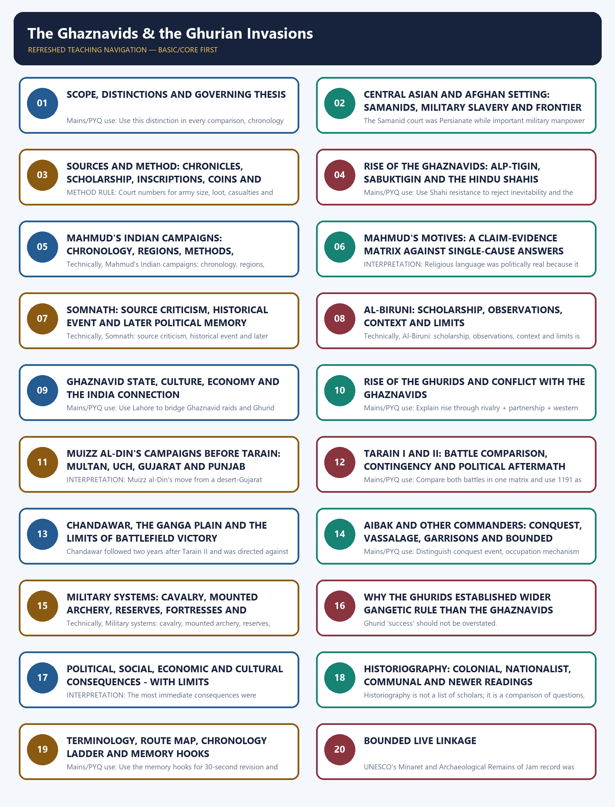

# The Ghaznavids & the Ghurian Invasions - Complete Topic Package

> **Subject:** Medieval Indian History | **Paper:** Prelims GS-I + GS-I | **Topic:** 02 | **Date:** 13 August 2026
>
> **Evidence key:** FACT = directly supported by a named source; TEXTUAL REPORT = what a named chronicle says; MATERIAL EVIDENCE = inscription, coin, monument or site; INTERPRETATION = analytical reading; INFERENCE = bounded reconstruction; LIMIT = what the evidence cannot establish.
>
> **Approval state:** generated, **approved=false**. Only explicit user approval can change this state.

## BASIC LEARNING SESSION

### DEEP-REVIEW LEARNING CONTRACT

| Control | Binding rule for this package |
|---|---|
| Syllabus boundary | Complete Medieval History Core is taught before optional enrichment. |
| Evidence method | Claim → named site/text/inscription/coin/example → analysis → qualification. |
| Source hierarchy | Archaeology, textual testimony, inscriptions, coins and scholarly interpretation remain visibly distinct. |
| Contested issues | Competing interpretations are attributed, evidenced and bounded; certainty is not manufactured. |
| Practice contract | Every solved item has demand decoding, an examiner-grade model, an executable answer/compression plan, marks rationale and answer-specific improvement. |
| Approval | This immutable successor remains `approved: false` pending explicit approval. |

**Canonical Basic/Core owner:** `upsc-ai-kit\knowledge\Medieval-Indian-History\basic\02_Ghaznavids-and-Ghurian-Invasions.md`  
**Canonical topic owner:** `upsc-ai-kit\knowledge\Medieval-Indian-History\basic\02_Ghaznavids-and-Ghurian-Invasions.md`  
**Optional Advanced owner:** `upsc-ai-kit\knowledge\Medieval-Indian-History\advanced\02_Ghaznavids-and-Ghurian-Invasions.md`  
**Official syllabus mapping:** `upsc-ai-kit\knowledge\Medieval-Indian-History\OFFICIAL-UPSC-SYLLABUS-MAPPING.md`

### EVIDENCE, PYQ AND CURRENT-STATUS CONTROL

- **Archaeological inference:** material context supports bounded reconstruction; absence is not automatic proof of non-existence.
- **Textual testimony:** genre, authorship, redaction, patronage and temporal distance control what a text can prove.
- **Inscription and coin evidence:** contemporary names, titles, claims and circulation are powerful but do not by themselves map uniform territorial control.
- **Scholarly interpretation:** historian labels are arguments to test, not facts to memorise without evidence.
- **PYQ discipline:** repository ledgers and locally held official papers control wording and metadata; reconstructed wording and unavailable official keys must be labelled.
- **Current-status note, rechecked 2026-09-03:** UNESCO's Minaret and Archaeological Remains of Jam record was rechecked on 30 August 2026. It confirms the 1194 Ghurid monument, its influence on later architecture including the Qutb Minar, and continuing conservation requirements. This heritage linkage does not establish campaign chronology, motives or territorial control.

**Live/primary context sources recorded by the predecessor generation:**

- `https://whc.unesco.org/en/list/211`
- `https://www.unesco.org/en/culture-emergencies/heritage-emergency-fund/urgent-repairs-monuments-and-emergency-protective-measures-archaeological-sites-kabul-zabul-and`
- `https://whc.unesco.org/en/list/233/`




*Distinct embedded teaching-navigation image. The separate continuous Cārvāka-style flowchart package remains an independent at-a-glance artifact.*

#### Package practice counts

| Component | Count |
|---|---:|
| Retained PYQ applications | 3 |
| Learning MCQs with explanations | 16 |
| Original solved 10-mark Mains | 2 |
| Original solved 15-mark Mains | 2 |
| Original solved 20-mark Mains | 2 |
| Final register modules | 15; placed last |

#### Sources actually used

| Source class | Exact source | Use and caveat |
|---|---|---|
| Repository knowledge | Topic 02 basic/advanced; README; Master Chronology; Revision Chart; official syllabus/PYQ routing; Answer-Worthiness Audit; bounded Topics 01, 03, 07 and 11. | Controls chronology, topic boundaries, answer architecture, source cautions and post-1206 separation. |
| Local book | Satish Chandra, *History of Medieval India*, printed pp. 58-76 (searchable local PDF pp. 69-87). | Foundation for Ghaznavids, campaigns, Rajput states, Ghurid conquest, Tarain/Chandawar and conventional causal debate; court numbers and older generalisations are qualified. |
| Local book | Satish Chandra, *Medieval India: From Sultanat to the Mughals, Part I*, printed pp. 14-33 (searchable local PDF pp. 8-17). | Deeper control for Samanids, military slavery, roads, iqta, campaign strategy, source differences, Aibak and military organisation. |
| Named primary traditions | al-Utbi, al-Biruni, Gardizi, Bayhaqi, Hasan Nizami, Minhaj-us-Siraj, *Prithviraja Vijaya*, Chahamana inscriptions, coins and later literary traditions. | Used through source-critical synthesis; report, genre, patronage, chronology and survival limits are explicit. No uncertain quotation is fabricated. |
| Verified PYQ routing | Repository 2018-2023 Prelims routing and 2022 Somnath question transcription. | Exact question is included; locally unavailable official key is labelled inferred. No direct GS Mains PYQ is fabricated. |
| Authoritative heritage/academic links | UNESCO Jam; UNESCO Qutb complex; World Monuments Fund Ghazni Minarets; Library of Congress *Kitab-i-Yamini* record; UPenn dissertation re-reading *Tabaqat-i Nasiri*; Cambridge JRAS Somnath-memory study. | Bounded source/heritage linkages only; they do not replace medieval evidence or force decorative current affairs. |

#### Bounded authoritative links

- UNESCO, Minaret and Archaeological Remains of Jam: https://whc.unesco.org/en/list/211
- UNESCO, Qutb Minar and its Monuments: https://whc.unesco.org/en/list/233/
- World Monuments Fund, Ghazni Minarets: https://www.wmf.org/monuments/ghazni-minarets
- Library of Congress, *Kitab-i-Yamini* record: https://www.loc.gov/item/52053674/
- University of Pennsylvania, *Early Islamic Ghur: Rereading the Tabaqat-i Nasiri*: https://repository.upenn.edu/entities/publication/85ed44bd-a551-4a68-8163-13e2c81891a3
- Cambridge JRAS, Somnath memory and nation: https://www.cambridge.org/core/journals/journal-of-the-royal-asiatic-society/article/somnath-mandir-in-a-play-of-mirrors-heritage-history-and-the-search-for-identity-of-the-new-nation-18421951/A7809AEE9FC17740CD76CA0239CD6048

No current-affairs item was forced. Qdrant was not used because repository Markdown, OCR-searchable local books and bounded authoritative links were sufficient.

#### PART I - COMPLETE LEARNING SESSION

### SESSION 1 — SCOPE, DISTINCTIONS AND GOVERNING THESIS

#### DEFINITION / WHAT THIS IS CALLED

**Plain-language definition:** This session establishes the core comparison: Mahmud's campaigns and Muizz al-Din's conquests must be separated by objective, territorial base, chronology and institutional outcome, not by a flat raider-versus-conqueror slogan.

**Technical definition:** The topic is analysed through phased comparison: Ghaznavid frontier incorporation and deep raiding, Ghurid territorial expansion, and post-1206 Sultanate consolidation must remain analytically distinct.

#### ANSWER-GRABBING OPENING — WRITE/ADAPT IN THE EXAM

> The governing thesis is one distinction applied three times: Ghaznavid Punjab bridgehead, Ghurid territorial conquest and post-1206 institutional succession are separate stages of one process, not a single seamless conquest.

#### MUST-WRITE KEYWORDS

- **comparative frame**
- **phased chronology**
- **Punjab bridgehead**
- **territorial conquest**
- **institutional succession**
- **causal distinction**

**How to use them:** Open with the comparative frame, place events on the phased chronology, name the Punjab bridgehead before the Ghurid territorial conquest, and close by explaining why institutional succession — not battlefield drama — is the real causal distinction.

#### Compact visual

```text
THREE PHASES - DO NOT COLLAPSE THEM

GHAZNAVID PHASE                    GHURID PHASE                    DELHI SULTANATE
c. 990s-1186                       1175-1206                       from 1206
Sabuktigin -> Mahmud               Ghiyasuddin + Muizz al-Din     Aibak -> Iltutmish
frontier war + repeated raids      territorial bridgehead         independent consolidation
durable Punjab/Lahore base         Delhi-doab expansion           institutions centred in India

Mahmud of Ghazni != Muizz al-Din Muhammad bin Sam != Qutb al-Din Aibak.
```

#### Evidence / comparison matrix

| Question | Exam-safe answer | Necessary qualification |
|---|---|---|
| Mahmud's Indian project | Repeated campaigns, Shahi defeat, Punjab/Multan base, deep raids for several purposes. | No comparable durable Ghaznavid Gangetic state followed. |
| Muizz al-Din's project | A staged territorial advance from Multan and Punjab to Delhi-Ajmer and the upper Ganga plain. | Victory was uneven and delegated; it did not create uniform rule overnight. |
| Aibak's role | Commander and political manager who occupied, garrisoned, negotiated and expanded after Tarain. | He became an independent ruler only after the Ghurid imperial link broke in 1206. |

#### Core teaching / solved analysis

- FACT: The conventional narrative assigns Mahmud repeated Indian operations between 1000 and 1027, while Muizz al-Din's decisive north Indian campaigns came in the late twelfth century.
- INTERPRETATION: The most useful distinction is not 'raider versus conqueror' as an absolute moral contrast, but the different objectives, bases, timing, political environments and institutional outcomes of the two projects.
- FACT: Ghaznavid control of Punjab and Lahore altered the strategic map before the Ghurids appeared. The Ghurids then displaced the last Ghaznavid ruler at Lahore in 1186.
- LIMIT: The Ghurid victories did not automatically become the Delhi Sultanate. The post-1206 Sultanate required Aibak, Iltutmish and later rulers to survive rival Turkish claimants, rebellions and Mongol pressure.
- ANSWER UPGRADE: Frame the transition as frontier breach -> Punjab base -> Ghurid territorial opening -> decades of consolidation, with reverses and local accommodation at every stage.

#### PARAGRAPH DEMONSTRATION — CLAIM → EVIDENCE → ANALYSIS → QUALIFICATION

**Claim:** Mahmud and Muizz al-Din belong to different historical phases rather than one undifferentiated 'Turkish invasion.' **Named evidence:** Mahmud's durable result remained Punjab/Multan, whereas Muizz al-Din's victories at Tarain II (1192) and Chandawar (1194) were followed by Aibak's occupations in the Delhi-Ajmer-doab zone. **Analysis:** The comparison therefore turns on different bases, objectives and institutional follow-through, not on a moral contrast between plunder and conquest alone. **Qualification:** Even the Ghurid breakthrough did not itself equal a finished Delhi Sultanate, because post-1206 consolidation still had to be built.

#### Must-know facts

- Mahmud of Ghazni ruled 998-1030; Muizz al-Din Muhammad bin Sam died in 1206.
- Tarain I, 1191, was a Ghurid defeat; Tarain II, 1192, was a Ghurid victory.
- Chandawar, 1194, opened further advance into the upper Ganga region but did not finish consolidation.

#### UPSC traps

- **Wrong:** Mahmud founded the Delhi Sultanate. **Correct:** Mahmud created a Punjab bridgehead; Ghurid conquest and post-1206 consolidation produced the Sultanate.
- **Wrong:** All Turkish campaigns had one motive and one institutional result. **Correct:** Objectives, rhetoric, routes and outcomes varied by ruler and campaign.

**Mains/PYQ use:** Use this distinction in every comparison, chronology and causation answer.

**Study link:** Medieval Topics 01 and 03; Master Chronology.

#### CLOSING RECALL FLOW — SCOPE, DISTINCTIONS AND GOVERNING THESIS

```text
START / CONCEPT: Scope, distinctions and governing thesis
        |
        v
EXACT TERMS: comparative frame · phased chronology · Punjab bridgehead · territorial conquest · institutional succession · causal distinction
        |
        v
MECHANISM / ARGUMENT: The Ghaznavid, Ghurid and post-1206 Sultanate phases are linked by inherited bases and objectives, so each later stage builds on, rather than repeats, the one before it.
        |
        v
CONSEQUENCE / CONTRAST: Collapsing all three phases into one undifferentiated 'Turkish invasion' erases the different objectives, routes and institutional outcomes that actually distinguish Mahmud, Muizz al-Din and Aibak.
        |
        v
UPSC TRAP / ANSWER-USE: Wrong: Tarain I (1191) and Tarain II (1192) can be treated as one continuous Ghurid victory. Correct: Tarain I was a Ghurid defeat that must be scored as a distinct, contingent event before Tarain II.
        |
        v
ANSWER-GRABBING FORMULATION: The most useful distinction is not 'raider versus conqueror' as an absolute moral contrast, but the different objectives, bases, timing, political environments and institutional outcomes of the three phases.
```
### SESSION 2 — CENTRAL ASIAN AND AFGHAN SETTING: SAMANIDS, MILITARY SLAVERY AND FRONTIER GEOGRAPHY

#### DEFINITION / WHAT THIS IS CALLED

**Plain-language definition:** The Central Asian-Afghan setting joined a Persianate Samanid political world with Turkic military labour and frontier corridors centred on Ghazni, Kabul and Punjab.

**Technical definition:** Military slavery in this context denotes service dependency, recruitment and command formation within Persianate states rather than an ethnic or civilisational explanation of conquest.

#### ANSWER-GRABBING OPENING — WRITE/ADAPT IN THE EXAM

> The north-western frontier mattered because Persianate court culture, Turkic service armies and usable corridors met there in one operational zone.

#### MUST-WRITE KEYWORDS

- **Samanid order**
- **Persianate court**
- **Turkic commanders**
- **military slavery**
- **Ghazni corridor**
- **frontier logistics**

**How to use them:** Open by placing the Ghaznavids inside the Samanid order and Persianate court, use Turkic commanders and military slavery to explain how office became dynasty, and close through the Ghazni corridor and frontier logistics that turned geography into usable state capacity.

#### Compact visual

```text
TRANSOXIANA / KHURASAN
         |
Samanid Persianate court
         |
Turkic military slaves, commanders and mobile cavalry
         |
Alp-tigin at Ghazni -> Sabuktigin -> Mahmud
         |
Ghazni -- Kabul/Jalalabad -- Peshawar -- Punjab -- upper Ganga routes
            \
             Ghur highlands -> Ghazni/Punjab axis in the 12th century

Geography supplied corridors; states, roads, alliances and logistics made them usable.
```

#### Evidence / comparison matrix

| Element | Historical function | Limit |
|---|---|---|
| Samanids | Persianate Iranian dynasty employing Turkic military personnel; political-cultural setting for Ghaznavid rise. | The Ghaznavids did not simply copy one fixed Samanid model. |
| Military slavery | Rulers trained dependent commanders and guards whose advancement rested on service. | A slave origin did not guarantee loyalty forever; commanders could found dynasties. |
| Iqta and fiscal assignments | Supported mobile forces through revenue claims in West and Central Asia. | Institutional form changed; do not project mature Delhi practice backward unchanged. |
| North-west corridors | Linked Ghazni, Kabul, Jalalabad, Peshawar, Lahore and the plains. | Passes did not make conquest inevitable; weather, forts, supply and resistance mattered. |
| Ghur highlands | Metal-rich, militarised upland zone between larger powers; Shansabani chiefs exploited rivalry. | Later court sources caricature early Ghur as isolated and pagan; read against the grain. |

#### Core teaching / solved analysis

- FACT: Local Satish Chandra Part I places the Ghaznavid rise within Abbasid fragmentation, Samanid power and the recruitment of Turkic military slaves and mercenaries.
- FACT: Alp-tigin established himself at Ghazni in 963; Sabuktigin then carried war into the Hindu Shahi frontier.
- INTERPRETATION: Turkic military slavery was a political technology of recruitment and dependence, not an ethnic explanation of victory.
- FACT: Ghaznavid road improvement toward Kabul and Jalalabad reduced the operational cost of movement, reinforcement, intelligence and retreat.
- INFERENCE: Frontier geography amplified state capacity when combined with remounts, supply, information and a defensible base. Geography alone cannot explain the difference between the Gujarat defeat of 1178 and the Tarain victory of 1192.
- LIMIT: Terms such as 'outer bastions' are strategic shorthand. Kabul, Zabul, Gandhara and Punjab were populated political zones, not walls standing outside a civilisational core.

#### PARAGRAPH DEMONSTRATION — CLAIM → EVIDENCE → ANALYSIS → QUALIFICATION

**Claim:** The Ghaznavid rise was prepared by a wider Central Asian political order rather than by isolated tribal motion. **Named evidence:** Satish Chandra places Alp-tigin and Sabuktigin inside the Samanid world, where Persianate administration coexisted with Turkic military commanders and road links from Ghazni toward Kabul and Jalalabad. **Analysis:** That combination explains how frontier geography became usable military capacity through command, remounts and information. **Qualification:** Corridors created opportunity, but defeats such as Gujarat 1178 later showed that routes never made conquest automatic.

#### Must-know facts

- Alp-tigin set up at Ghazni in 963; Sabuktigin succeeded in 977.
- The Samanid court was Persianate while important military manpower was Turkic.
- Ghur lay in the Afghan highlands between competing Ghaznavid, Seljuk and Khwarazmian spheres.

#### UPSC traps

- **Wrong:** Turks entered India as culturally unformed nomads. **Correct:** The ruling groups were already Islamised and deeply Persianised.
- **Wrong:** The Khyber Pass alone explains conquest. **Correct:** Multiple routes, roads, river crossings, bases and seasonal constraints shaped campaigns.

**Mains/PYQ use:** For causation, write corridor -> logistics -> concentrated command -> contingent battle outcome.

**Study link:** Topic 01 Persianate-Turkish background; Topic 07 iqta and military finance.

#### CLOSING RECALL FLOW — CENTRAL ASIAN AND AFGHAN SETTING: SAMANIDS, MILITARY SLAVERY AND FRONTIER GEOGRAPHY

```text
START / CONCEPT: Central Asian and Afghan setting: Samanids, military slavery and frontier geography
        |
        v
EXACT TERMS: Samanid order · Persianate court · Turkic commanders · military slavery · Ghazni corridor · frontier logistics
        |
        v
MECHANISM / ARGUMENT: The Samanid court was Persianate while important military manpower was Turkic.
        |
        v
CONSEQUENCE / CONTRAST: Kabul, Zabul, Gandhara and Punjab were populated political zones, not walls standing outside a civilisational core.
        |
        v
UPSC TRAP / ANSWER-USE: Geography alone cannot explain the difference between the Gujarat defeat of 1178 and the Tarain victory of 1192.
        |
        v
ANSWER-GRABBING FORMULATION: Turkic military slavery was a political technology of recruitment and dependence, not an ethnic explanation of victory.
```
### SESSION 3 — SOURCES AND METHOD: CHRONICLES, SCHOLARSHIP, INSCRIPTIONS, COINS AND SILENCE

#### DEFINITION / WHAT THIS IS CALLED

**Plain-language definition:** This session teaches how to reconstruct conquest history by ranking chronicles, inscriptions, coins and silences instead of repeating any one source literally.

**Technical definition:** Source criticism here requires date, genre, patronage, event-distance and corroboration before a narrative claim is treated as historical evidence.

#### ANSWER-GRABBING OPENING — WRITE/ADAPT IN THE EXAM

> Court praise, local silence and material evidence answer different questions; UPSC rewards candidates who compare them instead of collapsing them.

#### MUST-WRITE KEYWORDS

- **source criticism**
- **chronology check**
- **court panegyric**
- **epigraphy**
- **coin evidence**
- **archival silence**

**How to use them:** Lead every source question with source criticism and a chronology check on the text, weigh court panegyric against epigraphy and coin evidence, and close by explaining why archival silence is a method problem, not proof that nothing happened.

#### Evidence / comparison matrix

| Source | Genre / position | What it can support | Core limitation |
|---|---|---|---|
| al-Utbi, Kitab al-Yamini | Arabic courtly history linked to Sabuktigin and Mahmud; ornate panegyric. | Early campaigns, royal claims, Ghaznavid political language. | Patronage, victory rhetoric, weak Indian geography; it ends before Somnath. |
| al-Biruni, Kitab al-Hind | Comparative scholarly inquiry after long study of Sanskrit texts. | Religion, astronomy, learning, social classifications and observed intellectual distance. | Elite textual access, north-western setting, uneven reach beyond learned Brahmanical traditions. |
| Gardizi, Zayn al-Akhbar | Concise Persian universal history dedicated at the Ghaznavid court. | Dynastic and ethnographic notices; a check on more ornate narratives. | Brief, derivative in places and still shaped by courtly selection. |
| Bayhaqi, Tarikh-i Bayhaqi | Chancery insider's detailed Persian history, especially Masud's reign. | Court politics, administration, fiscal pressures and decision-making. | Fragmentary survival, elite bureaucratic gaze, mainly post-Mahmud context. |
| Hasan Nizami, Taj al-Ma'asir | Early Indo-Persian conquest chronicle connected to Aibak's court. | Early occupation, vassalage, rebellion and legitimation after 1192. | Ornate panegyric, selective narrative and conquest-centred elite vision. |
| Minhaj-us-Siraj, Tabaqat-i Nasiri | Universal/dynastic history completed c. 1260 under Delhi patronage. | Ghurid genealogy, Tarain traditions, commanders and early Sultanate sequence. | Written decades later; court, clerical and dynastic bias. |
| Prithviraja Vijaya and Chahamana inscriptions | Near-contemporary Sanskrit court poem and epigraphic claims. | Chahamana genealogy, legitimacy, campaigns and political world. | Panegyric, fragmentary text and selective royal commemoration. |
| Prithviraj Raso and later Persian traditions | Layered later literary memory. | How memory, heroism and rivalry were reconstructed. | Cannot be used as straightforward eyewitness chronology. |
| Coins, monuments and inscriptions | Material and epigraphic evidence. | Titles, mints, circulation, negotiated authority, building patronage. | Attribution, reading, reuse and survival biases; circulation != uniform control. |

#### Core teaching / solved analysis

- METHOD RULE: Separate what a source reports from what happened. 'Al-Utbi presents Mahmud as a ghazi' is safer than 'religion alone caused the campaign.'
- METHOD RULE: Establish date, genre, patron and distance from the event before extracting a fact.
- METHOD RULE: Court numbers for army size, loot, casualties and campaign counts are rhetorical unless independently corroborated.
- METHOD RULE: Indian inscriptional or literary silence is not proof that an event caused no disruption; survival is selective and local records had different purposes.
- METHOD RULE: Material evidence can correct texts but is not self-interpreting. A coin legend may suggest accommodation or fiscal continuity without proving uncontested sovereignty.
- ANSWER UPGRADE: Use a four-step source sentence: named source -> report -> historical significance -> genre/chronology limit.

#### PARAGRAPH DEMONSTRATION — CLAIM → EVIDENCE → ANALYSIS → QUALIFICATION

**Claim:** No single source can carry the full history of the Ghaznavid and Ghurid invasions. **Named evidence:** al-Utbi supplies court rhetoric, al-Biruni offers comparative scholarship, Hasan Nizami and Minhaj preserve conquest sequence, while coins and inscriptions test titles, circulation and negotiated authority. **Analysis:** A sound answer therefore moves from report to significance only after asking who wrote, for whom, when and with what limits. **Qualification:** Silence in local records may reflect genre and survival, so absence of evidence cannot be used lazily as evidence of no impact.

#### Must-know facts

- al-Utbi's narrative does not cover the 1025 Somnath campaign.
- Bayhaqi is especially valuable for Ghaznavid court and administration after Mahmud.
- Minhaj wrote much later than Tarain but preserves an indispensable Ghurid-Delhi sequence.

#### UPSC traps

- **Wrong:** A contemporary court chronicle is automatically objective. **Correct:** Proximity improves access but patronage and genre shape selection.
- **Wrong:** No surviving local inscription means no local impact. **Correct:** Silence may reflect loss, genre, region or recording priorities.

**Mains/PYQ use:** Lead source questions with this matrix; never quote uncertain army or loot figures as audited data.

**Study link:** Topic 07 Persian source bank; Answer-Worthiness Audit.

#### CLOSING RECALL FLOW — SOURCES AND METHOD: CHRONICLES, SCHOLARSHIP, INSCRIPTIONS, COINS AND SILENCE

```text
START / CONCEPT: Sources and method: chronicles, scholarship, inscriptions, coins and silence
        |
        v
EXACT TERMS: source criticism · chronology check · court panegyric · epigraphy · coin evidence · archival silence
        |
        v
MECHANISM / ARGUMENT: Each source's value depends on its date, genre and patron, so a chronicle's proximity to an event does not by itself guarantee accuracy.
        |
        v
CONSEQUENCE / CONTRAST: Material evidence such as coins and inscriptions can correct or qualify a chronicle's claims, but it still requires careful reading rather than automatic acceptance.
        |
        v
UPSC TRAP / ANSWER-USE: Wrong: A chronicle written decades after an event is worthless as evidence. Correct: Later sources remain usable once their genre, patronage and distance from the event are explicitly weighed.
        |
        v
ANSWER-GRABBING FORMULATION: Indian inscriptional or literary silence is not proof that an event caused no disruption; survival is selective and local records had different purposes.
```
### SESSION 4 — RISE OF THE GHAZNAVIDS: ALP-TIGIN, SABUKTIGIN AND THE HINDU SHAHIS

#### DEFINITION / WHAT THIS IS CALLED

**Plain-language definition:** Ghaznavid rise was a frontier process in which Alp-tigin and Sabuktigin turned Ghazni into a durable power while the Hindu Shahis resisted over multiple campaigns.

**Technical definition:** The Shahi-Ghaznavid struggle should be read as phased frontier incorporation—office formation at Ghazni, Kabul-Jalalabad advance, repeated Shahi resistance, then Mahmud's deeper breach.

#### ANSWER-GRABBING OPENING — WRITE/ADAPT IN THE EXAM

> The Shahis matter because they prove that the frontier was defended repeatedly; Ghaznavid expansion was not a one-battle collapse story.

#### MUST-WRITE KEYWORDS

- **Alp-tigin**
- **Sabuktigin**
- **Hindu Shahis**
- **Waihind**
- **Nandana**
- **frontier incorporation**

**How to use them:** Trace Alp-tigin's Ghazni foothold into Sabuktigin's wars against the Hindu Shahis, anchor the frontier geography at Waihind and Nandana, and use this sequence to show frontier incorporation as a decades-long process, not one campaign.

#### Compact visual

```text
963 Alp-tigin at Ghazni
     |
977 Sabuktigin succeeds
     |
c. 990-91 Hindu Shahi setback; Kabul/Jalalabad lost
     |
998 Mahmud succeeds at Ghazni
     |
1001 Jayapala defeated near Peshawar
     |
1009 Anandapala defeated; Nandana/Salt Range breached
     |
by c. 1015 Punjab-Lahore transition advances; Kashmir attempt fails
```

#### Evidence / comparison matrix

| Actor / place | Evidence-led significance | Qualification |
|---|---|---|
| Alp-tigin | Shows a Samanid military commander converting office into a Ghazni principality. | Dynastic rise was gradual and contested. |
| Sabuktigin | Moved conflict into Shahi territory and secured Kabul-Jalalabad after c. 990-91. | Later narratives magnify the scale of coalitions against him. |
| Jayapala | Tried coalition and offensive action before suffering defeat in 1001. | Later self-immolation and captivity stories require source caution. |
| Anandapala | Continued resistance; the 1009 defeat and Salt Range losses weakened strategic depth. | Shahi resistance was prolonged, not one-battle collapse. |
| Nandana/Salt Range | Fortified corridor and later site linked with al-Biruni's scientific work. | Do not equate one fort's fall with instant Punjab pacification. |

#### Core teaching / solved analysis

- FACT: The Shahis recognised the danger and fought both offensively and defensively; they were not passive victims.
- FACT: Satish Chandra rejects Ferishta's much later claim of a large 1001 coalition including political centres whose chronology makes the story doubtful.
- INTERPRETATION: The Shahi wars mattered because they converted episodic frontier fighting into a Ghaznavid territorial presence west and then east of the Indus.
- FACT: Mahmud's 1015 Kashmir attempt failed largely because of weather, a useful warning against technological determinism.
- LIMIT: Exact territorial lines changed, and labels such as Lahore, Punjab and Shahi kingdom should not be treated as modern bounded provinces.

#### PARAGRAPH DEMONSTRATION — CLAIM → EVIDENCE → ANALYSIS → QUALIFICATION

**Claim:** Sabuktigin's and Mahmud's successes were built through a prolonged struggle against the Hindu Shahis. **Named evidence:** The sequence from Alp-tigin's establishment at Ghazni to Jayapala's defeat near Peshawar and Anandapala's later setback at Nandana shows repeated warfare across rulers and forts. **Analysis:** This makes the Shahi frontier the real preparatory theatre in which Ghaznavid territorial presence replaced episodic raiding. **Qualification:** Exact coalition numbers and later dramatic anecdotes remain unstable, so the explanatory weight should stay on sequence, resistance and frontier depth.

#### Must-know facts

- The Shahi capital is associated with Udbhanda/Waihind near the Peshawar region.
- Nandana lay in the Salt Range and became an important strategic and scholarly location.
- Nagarkot in this campaign context should not be mechanically confused with Kangra's Nagarkot.

#### UPSC traps

- **Wrong:** The Shahis fell in a single battle. **Correct:** Their resistance extended across Sabuktigin's and Mahmud's reigns.
- **Wrong:** Weather and terrain never stopped Ghaznavid forces. **Correct:** The Kashmir operation is a clear counter-example.

**Mains/PYQ use:** Use Shahi resistance to reject inevitability and the stereotype of passive frontier collapse.

**Study link:** Topic 01 frontier depth; Mahmud chronology below.

#### CLOSING RECALL FLOW — RISE OF THE GHAZNAVIDS: ALP-TIGIN, SABUKTIGIN AND THE HINDU SHAHIS

```text
START / CONCEPT: Rise of the Ghaznavids: Alp-tigin, Sabuktigin and the Hindu Shahis
        |
        v
EXACT TERMS: Alp-tigin · Sabuktigin · the Hindu Shahis · Waihind · Nandana · frontier incorporation
        |
        v
MECHANISM / ARGUMENT: Sabuktigin's wars and Mahmud's repeated campaigns against Jayapala and Anandapala show the Hindu Shahis mounting sustained, organised resistance across two Ghaznavid reigns, not collapsing at first contact.
        |
        v
CONSEQUENCE / CONTRAST: Exact territorial lines changed, and labels such as Lahore, Punjab and Shahi kingdom should not be treated as modern bounded provinces.
        |
        v
UPSC TRAP / ANSWER-USE: Nagarkot in this campaign context should not be mechanically confused with Kangra's Nagarkot.
        |
        v
ANSWER-GRABBING FORMULATION: The Shahis recognised the danger and fought both offensively and defensively; they were not passive victims.
```
### SESSION 5 — MAHMUD'S INDIAN CAMPAIGNS: CHRONOLOGY, REGIONS, METHODS, OUTCOMES AND LIMITS

#### DEFINITION / WHAT THIS IS CALLED

**Plain-language definition:** Mahmud's Indian campaigns formed a sequence of raids, punitive strikes, tribute demands and selected annexations whose results varied sharply by region.

**Technical definition:** Operational chronology must distinguish deep raiding from durable frontier control: Mathura-Kanauj and Somnath were not administratively equivalent to Punjab/Multan incorporation.

#### ANSWER-GRABBING OPENING — WRITE/ADAPT IN THE EXAM

> The safest chronology answer separates what Mahmud could strike from what he could hold.

#### MUST-WRITE KEYWORDS

- **campaign chronology**
- **Mathura-Kanauj**
- **Somnath**
- **Punjab annexation**
- **deep raid**
- **administrative limit**

**How to use them:** Build the campaign chronology city by city — Mathura-Kanauj sacked, Somnath raided — then separate durable Punjab annexation from each deep raid, and close on the administrative limit: no comparable Ghaznavid Gangetic government followed.

#### Evidence / comparison matrix

| Date / phase | Region / opponent | Operational result | Historical limit |
|---|---|---|---|
| 1001 | Jayapala near Peshawar/Waihind | Shahi defeat; territory west of Indus affected. | Did not end Shahi resistance. |
| 1005-10 | Multan and Shahi frontier | Multan subdued; 1009 Anandapala defeated; Nandana/Nagarkot overrun. | Sectarian rhetoric and frontier strategy overlapped. |
| 1015 | Punjab/Kashmir approach | Lahore pressure increased; Kashmir attempt failed. | Weather and mountain logistics constrained expansion. |
| 1018 | Mathura-Kanauj | Rapid deep raid, plunder and political shock. | No lasting Ghaznavid annexation of the upper Ganga plain. |
| 1019-22 | Shahi-Chandela-Gwalior/Kalinjar zone | Coalitions disrupted; tribute/plunder without durable territorial spread. | Chronicles' numbers and battle descriptions are unstable. |
| 1025-26 | Somnath/Prabhas route and return through Sind | High-prestige long-range raid and major booty claim. | No permanent Ghaznavid Gujarat administration followed. |
| Durable territorial outcome | Punjab/Multan-Lahore sphere | Forward base, routes, garrisons and Indo-Persian contact zone. | Ghaznavid power later contracted under Seljuk pressure. |

#### Core teaching / solved analysis

- FACT: The familiar 'seventeen invasions' is a conventional count; operations can be grouped differently, and the secure point is repeated campaigning over roughly three decades.
- FACT: Mahmud alternated Indian campaigns with Central Asian wars. Revenue and prestige from India supported a polity whose central strategic competition lay west and north of the subcontinent.
- METHOD: Distinguish raid, tribute, sack, temporary occupation and annexation. The same campaign could combine several, but they are not synonyms.
- INTERPRETATION: The 1018 Mathura-Kanauj raid showed speed and intelligence over distance; the lack of annexation shows that operational reach exceeded administrative reach.
- FACT: The most durable Indian result was Punjab/Multan and the Lahore transition, not a Ghaznavid Gangetic empire.
- LIMIT: Route, army-size, casualty and loot details vary sharply across chronicles. Use a key-campaign chronology rather than an embellished expedition-by-expedition spectacle.

#### PARAGRAPH DEMONSTRATION — CLAIM → EVIDENCE → ANALYSIS → QUALIFICATION

**Claim:** Mahmud's Indian activity cannot be summarised as either pure plunder or uniform conquest. **Named evidence:** The 1018 Mathura-Kanauj raid produced shock and booty, the 1025 Somnath expedition ended without Gujarat annexation, but Punjab/Multan and the Lahore-linked frontier became durable Ghaznavid territory. **Analysis:** The contrast shows that campaign reach, tribute extraction and administrative incorporation were different historical outcomes. **Qualification:** Because chronicles divide and count expeditions differently, a secure phase-based chronology is safer than rehearsing an embellished raid-by-raid spectacle.

#### Must-know facts

- Mahmud died at Ghazni in 1030.
- The 1018 campaign struck Mathura and Kanauj.
- The 1025 campaign reached Somnath but did not annex Gujarat.

#### UPSC traps

- **Wrong:** Operational reach proves administrative control. **Correct:** Deep raiding and durable rule must be separately demonstrated.
- **Wrong:** Seventeen is an uncontested audited campaign count. **Correct:** It is a conventional textbook count and depends on how operations are divided.

**Mains/PYQ use:** Draw a two-column answer: campaign outcome versus administrative limit.

**Study link:** Master Chronology; Somnath and motive modules.

#### CLOSING RECALL FLOW — MAHMUD'S INDIAN CAMPAIGNS: CHRONOLOGY, REGIONS, METHODS, OUTCOMES AND LIMITS

```text
START / CONCEPT: Mahmud's Indian campaigns: chronology, regions, methods, outcomes and limits
        |
        v
EXACT TERMS: campaign chronology · Mathura-Kanauj · Somnath · Punjab annexation · deep raid · administrative limit
        |
        v
MECHANISM / ARGUMENT: Use a key-campaign chronology rather than an embellished expedition-by-expedition spectacle.
        |
        v
CONSEQUENCE / CONTRAST: Because deep raids like Mathura-Kanauj and Somnath produced no lasting Ghaznavid administration, campaign outcome and administrative control must be scored as two separate columns, not one continuous 'conquest.'
        |
        v
UPSC TRAP / ANSWER-USE: The most durable Indian result was Punjab/Multan and the Lahore transition, not a Ghaznavid Gangetic empire.
        |
        v
ANSWER-GRABBING FORMULATION: A single campaign can combine raiding, tribute demand, temporary occupation and outright annexation, so an answer must name which of these Mahmud actually achieved in each case rather than treating the terms as interchangeable.
```
### SESSION 6 — MAHMUD'S MOTIVES: A CLAIM-EVIDENCE MATRIX AGAINST SINGLE-CAUSE ANSWERS

#### DEFINITION / WHAT THIS IS CALLED

**Plain-language definition:** Mahmud's motives were mixed: frontier security, dynastic legitimacy, wealth extraction, Central Asian rivalry and religious language interacted in changing proportions.

**Technical definition:** A defensible causal hierarchy ranks immediate campaign incentives and wider imperial strategy rather than treating plunder or jihad as solitary explanations.

#### ANSWER-GRABBING OPENING — WRITE/ADAPT IN THE EXAM

> Mahmud's campaigns make the most sense when religious rhetoric is read alongside frontier policy, reward networks and west-facing imperial competition.

#### MUST-WRITE KEYWORDS

- **frontier security**
- **dynastic legitimacy**
- **campaign finance**
- **Central Asian wars**
- **religious rhetoric**
- **multi-causality**

**How to use them:** Rank frontier security, dynastic legitimacy, campaign finance, Central Asian wars and religious rhetoric as interacting rows in one matrix, and use multi-causality explicitly to reject any single-cause 'motive' answer.

#### Evidence / comparison matrix

| Motive / mechanism | Named evidence | What it explains | Limit |
|---|---|---|---|
| Political legitimacy | Caliphal titles, ghazi/but-shikan rhetoric and al-Utbi's panegyric. | How victories were presented to elite audiences. | Rhetoric does not by itself reveal the whole decision calculus. |
| Frontier strategy | Long Shahi wars, Kabul-Jalalabad roads, Punjab/Multan control. | Security of Ghazni's south-eastern flank and creation of a forward base. | Does not explain every deep Gangetic raid. |
| Revenue and plunder | Mathura-Kanauj, Somnath and repeated attacks on wealthy centres. | Liquid resources, reward networks and campaign finance. | Temple wealth was one target among towns, treasuries and political centres. |
| Central Asian wars | Alternation between Indian raids and struggles in Khurasan/Transoxiana. | Why portable wealth mattered to a west-facing empire. | Indian politics retained their own strategic importance. |
| Religious ideology | Image-breaking language and mobilisation of ghazis. | Legitimation, recruitment and moral framing. | Muslim rivals were also attacked; Hindu officers and soldiers served Ghaznavids. |
| Deterrence and disruption | Repeated blows against possible coalitions and frontier rivals. | Prevention of a consolidated counter-front. | Coalition evidence is uneven and sometimes inflated by later writers. |
| Temple as royal-political node | Somnath's wealth and prestige; major urban-temple complexes. | Attack on symbolic and fiscal concentration. | Not every temple was attacked; context and political value varied. |

#### Core teaching / solved analysis

- DIRECT THESIS: Mahmud's campaigns combined frontier security, dynastic legitimacy, revenue extraction, Central Asian war finance, deterrence and religious rhetoric in changing proportions.
- FACT: Local books explicitly connect Indian wealth with Central Asian ambitions and reject the claim that Mahmud's activity can be understood only as religious conquest.
- FACT: Hindu officers and soldiers in Ghaznavid service complicate a civilisation-versus-civilisation frame.
- INTERPRETATION: Religious language was politically real because it mobilised and legitimised; it becomes analytically misleading only when treated as the sole motive.
- LIMIT: Motives are inferred from actions and self-representation; no archive gives a modern policy memorandum ranking each cause.
- ANSWER UPGRADE: Conclude with hierarchy rather than equivalence: immediate campaign targets often offered revenue and prestige, while frontier and Central Asian needs shaped the larger strategy.

#### PARAGRAPH DEMONSTRATION — CLAIM → EVIDENCE → ANALYSIS → QUALIFICATION

**Claim:** Mahmud's campaigns were multi-causal rather than reducible to a single religious or fiscal motive. **Named evidence:** al-Utbi's ghazi language, Punjab annexation, repeated strikes on wealthy political-temple centres and the need to support wars in Khurasan together show legitimacy, security and finance working at once. **Analysis:** A ranked explanation can therefore preserve religious agency without mistaking court rhetoric for the whole strategic calculus. **Qualification:** Because no medieval archive supplies a modern policy memo, historians must infer weighting from patterns of action, target choice and institutional result.

#### Must-know facts

- Temple wealth was attractive because temples could be prestigious, endowed and linked to ruling elites.
- Mahmud's Punjab policy was more territorial than his Gangetic raids.
- Ghaznavid rhetoric and Ghaznavid practice must be read together, not as substitutes.

#### UPSC traps

- **Wrong:** Religion was irrelevant because political motives existed. **Correct:** Religious rhetoric mattered, but within a multi-causal state strategy.
- **Wrong:** Temple destruction proves every campaign had the same purpose. **Correct:** Targets, routes, opponents and intended outcomes varied.

**Mains/PYQ use:** For 15/20 marks, deploy at least four motive rows and rank them in the verdict.

**Study link:** Somnath debate; historiography.

#### CLOSING RECALL FLOW — MAHMUD'S MOTIVES: A CLAIM-EVIDENCE MATRIX AGAINST SINGLE-CAUSE ANSWERS

```text
START / CONCEPT: Mahmud's motives: a claim-evidence matrix against single-cause answers
        |
        v
EXACT TERMS: frontier security · dynastic legitimacy · campaign finance · Central Asian wars · religious rhetoric · multi-causality
        |
        v
MECHANISM / ARGUMENT: Religious language was politically real because it mobilised and legitimised; it becomes analytically misleading only when treated as the sole motive.
        |
        v
CONSEQUENCE / CONTRAST: Ghaznavid rhetoric and Ghaznavid practice must be read together, not as substitutes.
        |
        v
UPSC TRAP / ANSWER-USE: Wrong: Naming religious zeal alone earns full marks on a motives question. Correct: A 15/20-mark answer must deploy at least four ranked motive rows — frontier security, legitimacy, revenue and Central Asian finance — alongside religious rhetoric.
        |
        v
ANSWER-GRABBING FORMULATION: Motives are inferred from actions and self-representation; no archive gives a modern policy memorandum ranking each cause.
```
### SESSION 7 — SOMNATH: SOURCE CRITICISM, HISTORICAL EVENT AND LATER POLITICAL MEMORY

#### DEFINITION / WHAT THIS IS CALLED

**Plain-language definition:** Somnath must be studied as an eleventh-century raid, a layered archive and a later memory-field, not as a one-line civilisational parable.

**Technical definition:** Source criticism separates the 1025 event, early learned description, later Persian amplification, local epigraphic silences and modern political remembrance.

#### ANSWER-GRABBING OPENING — WRITE/ADAPT IN THE EXAM

> The safest Somnath answer states three facts together: the shrine was attacked, Gujarat was not annexed, and later memory is not eyewitness evidence.

#### MUST-WRITE KEYWORDS

- **Prabhas Patan**
- **source layers**
- **non-annexation**
- **iconoclasm**
- **local records**
- **political memory**

**How to use them:** Separate the 1025 Prabhas Patan event from its later source layers, state non-annexation plainly before discussing iconoclasm, weigh local records against later political memory, and never let colonial or communal readings substitute for evidence.

#### Compact visual

```text
EVENT (1025-26)
     |
near-contemporary / early reports
al-Biruni + other Ghaznavid/Islamic traditions
     |
later Persian chronicles + Sanskrit/Jain/local records + inscriptions
     |
colonial retrieval and speeches -> nationalist reconstruction -> modern politics

Rule: do not let a later memory layer silently become an eyewitness detail.
```

#### Evidence / comparison matrix

| Evidence layer | Responsible use | Risk |
|---|---|---|
| al-Utbi | Useful for Mahmud's earlier ideology and campaigns. | His work ends before Somnath; it cannot be the eyewitness source for 1025. |
| al-Biruni | Describes Somnath and the Indian intellectual-religious world. | His knowledge and chronology do not make every later dramatic detail secure. |
| Later Persian narratives | Show how victory and iconoclasm were amplified in dynastic memory. | Chronological distance, literary borrowing and panegyric escalation. |
| Sanskrit/Jain/epigraphic traditions | Reveal local patronage, rebuilding, commerce and different memory priorities. | Silence or brief notice is not proof of no destruction or no trauma. |
| Archaeology/architectural sequence | Can test phases, rebuilding and material continuity. | A complex sacred site may have multiple rebuilds; attribution is difficult. |
| Modern memory | Explains colonial, nationalist and communal uses of Somnath. | Present symbolism must not be projected backward as a single timeless response. |

#### Core teaching / solved analysis

- FACT: Mahmud reached Somnath in 1025, attacked the wealthy temple centre and returned to Ghazni without establishing lasting rule in Gujarat.
- SOURCE FACT: al-Utbi cannot narrate the Somnath raid because his chronicle closes earlier. Later accounts must be dated and compared.
- INTERPRETATION: Somnath joined wealth, pilgrimage, royal prestige and religious symbolism, making political-economic and ideological readings compatible rather than mutually exclusive.
- LIMIT: Numbers of defenders, precise loot, speeches, offers to ransom the image and spectacular destruction details vary and should not be reproduced unless securely sourced.
- HISTORIOGRAPHY: Romila Thapar's multi-voice method asks historians to compare Persian, Sanskrit, Jain, inscriptional and later political memories rather than accept one retrospective master narrative.
- METHOD LIMIT: Sparse local commemoration cannot be treated as proof of indifference; records survive unevenly and may have been created for donation, genealogy or rebuilding rather than trauma narration.
- ANSWER UPGRADE: Separate event, immediate evidence, later literary amplification and modern political memory in four paragraphs.

#### PARAGRAPH DEMONSTRATION — CLAIM → EVIDENCE → ANALYSIS → QUALIFICATION

**Claim:** Somnath is historically important because violence, wealth, royal symbolism and later memory all converge there. **Named evidence:** Mahmud's 1025 raid ended in return to Ghazni, al-Utbi cannot narrate the event because his work closes earlier, and later Persian, Sanskrit, Jain and modern narratives add new layers of meaning. **Analysis:** The event is therefore best reconstructed by separating what can be said about the raid from how later societies remembered and politicised it. **Qualification:** Contextualising Somnath must not erase destruction, but neither may later communal memory be projected backward as the sole explanation of 1025.

#### Must-know facts

- Somnath is at Prabhas Patan in Gujarat and was an important pilgrimage and endowed temple centre.
- Mahmud's return without annexation is central to the raid-versus-rule distinction.
- The present-day site's memory includes reconstruction layers far later than the eleventh-century raid.

#### UPSC traps

- **Wrong:** al-Utbi is the direct source for Somnath. **Correct:** His narrative ends before 1025.
- **Wrong:** Silence in one source proves the event was unimportant. **Correct:** Source purpose, survival and local recording practice must be assessed.

**Mains/PYQ use:** Use an evidence-layer diagram and avoid embellished narrative.

**Study link:** 2022 Prelims PYQ; historiography/source limits.

#### CLOSING RECALL FLOW — SOMNATH: SOURCE CRITICISM, HISTORICAL EVENT AND LATER POLITICAL MEMORY

```text
START / CONCEPT: Somnath: source criticism, historical event and later political memory
        |
        v
EXACT TERMS: Prabhas Patan · source layers · non-annexation · iconoclasm · local records · political memory
        |
        v
MECHANISM / ARGUMENT: The present-day site's memory includes reconstruction layers far later than the eleventh-century raid.
        |
        v
CONSEQUENCE / CONTRAST: Numbers of defenders, precise loot, speeches, offers to ransom the image and spectacular destruction details vary and should not be reproduced unless securely sourced.
        |
        v
UPSC TRAP / ANSWER-USE: Sparse local commemoration cannot be treated as proof of indifference; records survive unevenly and may have been created for donation, genealogy or rebuilding rather than trauma narration.
        |
        v
ANSWER-GRABBING FORMULATION: Somnath is historically significant precisely because it combines a recoverable 1025 raid with layered, politically charged later memory — source criticism must keep those two questions analytically separate.
```
### SESSION 8 — AL-BIRUNI: SCHOLARSHIP, OBSERVATIONS, CONTEXT AND LIMITS

#### DEFINITION / WHAT THIS IS CALLED

**Plain-language definition:** Al-Biruni was a comparative scholar of India whose value lies in method, linguistic access and conceptual explanation rather than in battlefield narration.

**Technical definition:** Kitab al-Hind is a cross-civilisational inquiry structured through Sanskrit learning, comparison and analytical reporting, but socially bounded by elite textual access.

#### ANSWER-GRABBING OPENING — WRITE/ADAPT IN THE EXAM

> Al-Biruni earns exam value not because he witnessed conquest, but because he explains learned India with unusual philological and scientific seriousness.

#### MUST-WRITE KEYWORDS

- **Kitab al-Hind**
- **Sanskrit access**
- **comparative method**
- **intellectual encounter**
- **social limit**
- **north-western setting**

**How to use them:** Open with Kitab al-Hind and al-Biruni's rare Sanskrit access, explain his comparative method as a genuine intellectual encounter, and close with its social limit: an elite, north-western setting, not a survey of all of India.

#### Evidence / comparison matrix

| Dimension | Evidence / contribution | Limit |
|---|---|---|
| Method | Learned Sanskrit and compared Indian disciplines with Greek, Islamic and other traditions. | Translation categories and elite interlocutors shaped comparison. |
| Subjects | Religion, philosophy, astronomy, mathematics, calendars, geography, customs and social classification. | Not an ethnographic census of all regions or social groups. |
| Intellectual context | Worked in the Ghaznavid world and studied India after military disruption. | Proximity to conquest did not make him simply Mahmud's propagandist. |
| Critical observation | Commented on learned insularity and barriers to mutual knowledge. | His famous generalisations should not be applied to every Indian community. |
| Scientific work | Associated with astronomical/geodetic inquiry, including the Nandana context. | Later popular claims can overstate the exact site or experimental sequence. |
| Somnath | Provides an early scholarly description relevant to the temple's history. | A description is not proof of every later conquest anecdote. |

#### Core teaching / solved analysis

- FACT: Al-Biruni's Kitab al-Hind is organised as inquiry and comparison, not a campaign chronicle.
- FACT: His access to Sanskrit learning makes him unusually valuable for concepts, texts and sciences that court conquest chronicles barely explain.
- INTERPRETATION: He is best read as a critical participant-observer situated in a conquest environment, neither an unmediated Indian voice nor a routine panegyrist.
- LIMIT: Brahmanical learned texts and elite interlocutors loom large; practices of women, labouring groups, frontier communities and many regions appear unevenly.
- LIMIT: Quotations on Indian insularity reveal his intellectual frustration and comparative agenda. They are evidence of an encounter, not a licence for civilisational stereotype.
- ANSWER UPGRADE: Pair every observation with access and blind spot: Sanskrit mastery -> conceptual precision -> elite-textual skew.

#### PARAGRAPH DEMONSTRATION — CLAIM → EVIDENCE → ANALYSIS → QUALIFICATION

**Claim:** Al-Biruni is strongest when used as a scholar of concepts and learned worlds, not as a generic witness to 'India.' **Named evidence:** His Kitab al-Hind ranges across religion, astronomy, calendars and social classification and depends on Sanskrit study unavailable to most court chroniclers. **Analysis:** That method makes him indispensable for intellectual history and for checking crude conquest narratives against careful comparison. **Qualification:** His access remained socially and regionally selective, so elite textual precision cannot be mistaken for a complete survey of all communities or regions.

#### Must-know facts

- Kitab al-Hind is also known as Tahqiq ma li'l-Hind.
- Al-Biruni wrote across astronomy, mathematics, chronology, geography and comparative religion.
- UPSC 2022 used his description of Somnath in a Prelims statement.

#### UPSC traps

- **Wrong:** Al-Biruni was only a court eulogist of Mahmud. **Correct:** His comparative scholarship often stands apart from panegyric conquest writing.
- **Wrong:** His account represents all Indians equally. **Correct:** Its strongest access was learned, textual and regionally bounded.

**Mains/PYQ use:** For source evaluation: access -> method -> contribution -> social/genre limit.

**Study link:** Topic 02 source matrix; 2022 Prelims PYQ.

#### CLOSING RECALL FLOW — AL-BIRUNI: SCHOLARSHIP, OBSERVATIONS, CONTEXT AND LIMITS

```text
START / CONCEPT: Al-Biruni: scholarship, observations, context and limits
        |
        v
EXACT TERMS: Kitab al-Hind · Sanskrit access · comparative method · intellectual encounter · social limit · north-western setting
        |
        v
MECHANISM / ARGUMENT: Al-Biruni's Kitab al-Hind is a work of comparative scholarly inquiry built on years of Sanskrit study, not a courtly chronicle written to celebrate Ghaznavid conquest.
        |
        v
CONSEQUENCE / CONTRAST: Al-Biruni's Kitab al-Hind is organised as inquiry and comparison, not a campaign chronicle.
        |
        v
UPSC TRAP / ANSWER-USE: They are evidence of an encounter, not a licence for civilisational stereotype.
        |
        v
ANSWER-GRABBING FORMULATION: Al-Biruni's Sanskrit access, comparative method and intellectual reach make him an exceptional witness, but his elite interlocutors and north-western vantage point still bound what Kitab al-Hind can prove about all of India.
```
### SESSION 9 — GHAZNAVID STATE, CULTURE, ECONOMY AND THE INDIA CONNECTION

#### DEFINITION / WHAT THIS IS CALLED

**Plain-language definition:** Ghaznavid Punjab linked raiding, taxation, military recruitment and Persianate culture, making India more than a one-season plunder zone.

**Technical definition:** The Ghaznavid India connection is best analysed through Lahore as a frontier province whose fiscal, military and cultural roles exceeded episodic campaigning.

#### ANSWER-GRABBING OPENING — WRITE/ADAPT IN THE EXAM

> Lahore is the hinge that turns Mahmud's story from repeated campaigning into a longer territorial and cultural connection.

#### MUST-WRITE KEYWORDS

- **Lahore**
- **Punjab revenue**
- **Persianate culture**
- **composite army**
- **frontier province**
- **dynastic contraction**

**How to use them:** Centre the answer on Lahore and Punjab revenue as the durable Indian stake, connect Persianate culture and the composite army to state capacity, and close on dynastic contraction as the frontier province shifted from Ghazni's asset to its last redoubt.

#### Evidence / comparison matrix

| Sphere | Named evidence / feature | Analytical significance | Limit |
|---|---|---|---|
| Court culture | Persian language, Firdausi, learned patronage and monumental Ghazni. | Ghaznavids helped consolidate a Persianate political culture under Turkic rulers. | Patronage disputes and court praise complicate idealised pictures. |
| Fiscal state | Bayhaqi and al-Utbi traditions; Satish Chandra's quotation on Khurasan exactions. | Expansion, army maintenance and court display demanded heavy extraction. | Administrative reach varied across core and frontier. |
| India revenue | Loot, tribute, Punjab taxation and later bullion flow. | Indian resources supported a wider transregional polity. | Loot did not automatically create sustained development in conquered regions. |
| Punjab/Lahore | Garrisons, roads, mints, recruitment, Persian-Arabic learning and later Ghaznavid refuge. | India became more than an episodic raid zone. | Nature of provincial administration remains poorly documented. |
| Military society | Turkic commanders, ghazis, Afghan and Hindu personnel. | Armies were composite and service-based. | Identity labels in chronicles are elite and unstable. |
| Coins/material culture | Ghaznavid issues in the Punjab-Lahore sphere and monument remains at Ghazni. | Titles, fiscal circulation and local adaptation can be studied materially. | Coin circulation does not map full political loyalty. |

#### Core teaching / solved analysis

- FACT: Mahmud patronised scholars and Persian literature while using Indian resources to embellish Ghazni and sustain campaigns.
- FACT: Ghaznavid authority contracted after Mahmud as Seljuk power rose; Masud's defeat at Dandanqan in 1040 shifted the dynasty's centre of gravity toward Afghanistan and Punjab.
- INTERPRETATION: Lahore's growing role made Punjab a durable contact zone where Persianate administration, trade, recruitment and local society interacted.
- FACT: Satish Chandra notes Hindu commanders and Jat soldiers in Ghaznavid service, demonstrating political incorporation alongside violence.
- LIMIT: The administrative history of Ghaznavid Punjab is thinly documented. Avoid projecting a later Sultanate bureaucracy backward.
- HERITAGE LINK: The World Monuments Fund's Ghazni Minarets documentation and UNESCO's Jam-Qutb comparison make monuments evidence for transregional architectural language, not evidence of identical states.

#### PARAGRAPH DEMONSTRATION — CLAIM → EVIDENCE → ANALYSIS → QUALIFICATION

**Claim:** The Ghaznavids left behind more than a memory of raids because Punjab became a durable zone of rule and interaction. **Named evidence:** Satish Chandra connects Lahore with garrisons, taxation, recruitment and later Ghaznavid refuge after western contraction, while Persian literary patronage and composite armies linked India to a wider Persianate world. **Analysis:** This makes Punjab the material bridge between Ghaznavid campaigning and later Ghurid expansion. **Qualification:** Administrative detail for Ghaznavid Punjab remains thin, so historians must avoid projecting the later Delhi Sultanate bureaucracy backward unchanged.

#### Must-know facts

- Firdausi's Shahnameh belongs to the Persian renaissance associated with the Ghaznavid court world.
- The Ghaznavids lost much of their western power after Mahmud and increasingly relied on Ghazni-Lahore.
- Ghaznavid Punjab connected later Ghurid strategy to an existing territorial and cultural base.

#### UPSC traps

- **Wrong:** Ghaznavid India was only a sequence of raids. **Correct:** Punjab/Lahore became a durable territorial sphere.
- **Wrong:** Persianate means ethnically Persian rule. **Correct:** It describes a language-culture-administrative formation used by rulers of varied origin.

**Mains/PYQ use:** Use Lahore to bridge Ghaznavid raids and Ghurid conquest without collapsing the dynasties.

**Study link:** Topic 01 Persianate formation; Topic 11 architecture.

#### CLOSING RECALL FLOW — GHAZNAVID STATE, CULTURE, ECONOMY AND THE INDIA CONNECTION

```text
START / CONCEPT: Ghaznavid state, culture, economy and the India connection
        |
        v
EXACT TERMS: Lahore · Punjab revenue · Persianate culture · composite army · frontier province · dynastic contraction
        |
        v
MECHANISM / ARGUMENT: 'Persianate' describes a shared language-culture-administrative formation used by rulers of varied ethnic origin, not a description of Persian ethnicity itself.
        |
        v
CONSEQUENCE / CONTRAST: Lahore is the hinge that links Ghaznavid frontier rule to Ghurid conquest, so an answer must treat 1186 as a transition between two distinct dynasties rather than a seamless continuation.
        |
        v
UPSC TRAP / ANSWER-USE: Wrong: Ghaznavid India was only a sequence of raids. Correct: Lahore and Punjab became a durable Persianate administrative and revenue base that outlasted any single campaign.
        |
        v
ANSWER-GRABBING FORMULATION: Ghaznavid Punjab endured as a Persianate frontier province long after Mahmud's death, even though its administrative history survives only in thin and scattered detail.
```
### SESSION 10 — RISE OF THE GHURIDS AND CONFLICT WITH THE GHAZNAVIDS

#### DEFINITION / WHAT THIS IS CALLED

**Plain-language definition:** The Ghurids emerged from the Ghur highlands within a competitive world of Ghaznavids, Seljuks and Khwarazmians, not from isolation or inevitability.

**Technical definition:** Ghurid rise depended on Shansabani power-building, fraternal division of labour, western pressure and seizure of the Ghaznavid Punjab bridgehead.

#### ANSWER-GRABBING OPENING — WRITE/ADAPT IN THE EXAM

> The Ghurid turn toward India began as a problem of rivalry, pressure and opportunity, not as a timeless ethnic destiny.

#### MUST-WRITE KEYWORDS

- **Shansabani house**
- **Ghiyas al-Din**
- **Muizz al-Din**
- **Khusrau Malik**
- **Lahore 1186**
- **western pressure**

**How to use them:** Trace the Shansabani house from Ghur into rulership under Ghiyas al-Din and Muizz al-Din, use the defeat of Khusrau Malik and Lahore 1186 to mark Ghaznavid extinction, and cite western pressure from Khwarazm as the reason Ghurid ambition turned toward India.

#### Compact visual

```text
GHURID ASCENT
Ghur upland chiefs
     |
interaction/vassalage with Ghaznavids and Seljuks
     |
Ala al-Din Husain sacks Ghazni ("world burner" in dynastic memory)
     |
Ghiyas al-Din Muhammad in Ghur + Muizz al-Din at Ghazni
     |
westward pressure from Khwarazm -> sustained Indian option
     |
1186 last Ghaznavid ruler removed from Lahore
```

#### Evidence / comparison matrix

| Factor | Contribution to Ghurid rise | Qualification |
|---|---|---|
| Highland political society | Shansabani chiefs used kinship, forts and military resources. | Do not reproduce later caricature of primitive isolation uncritically. |
| Ghaznavid rivalry | Revenge, competition and seizure of Ghazni redirected power. | Conflict included phases of subordination, alliance and opportunism. |
| Brother partnership | Ghiyas focused west; Muizz al-Din developed Ghazni and Indian campaigns. | The division was strategic, not a modern territorial cabinet. |
| Khwarazmian pressure | Limited durable Ghurid gains in Khurasan and made India a strategic alternative. | India was not merely a last resort; frontier opportunity and resources mattered. |
| Punjab inheritance | Removal of Khusrau Malik at Lahore in 1186 gave Muizz al-Din the essential base. | A base enabled campaigns but did not guarantee Tarain. |

#### Core teaching / solved analysis

- FACT: The Ghurids first rose within the competitive political field of Ghaznavids, Seljuks and later Khwarazmians.
- SOURCE LIMIT: Minhaj's Tabaqat-i Nasiri is the main later source for early Ghur and should be read against its dynastic and courtly purposes, as emphasised by modern UPenn research.
- FACT: Ghiyas al-Din and Muizz al-Din formed an unusually durable fraternal partnership; this allowed simultaneous western and eastern strategy.
- INTERPRETATION: The Ghurid turn to India combined constraint in Khurasan with learning from Indian reverses and the opportunity created by Ghaznavid Punjab.
- FACT: The capture of Lahore in 1186 ended Ghaznavid rule there and transformed the Ghurid position from raiding access to a territorial launch base.

#### PARAGRAPH DEMONSTRATION — CLAIM → EVIDENCE → ANALYSIS → QUALIFICATION

**Claim:** Ghurid expansion into India was prepared by state formation inside a crowded transregional power field. **Named evidence:** The Shansabani rulers contested Ghaznavid and Seljuk power, Ghiyas al-Din and Muizz al-Din shared strategic labour, and the fall of Khusrau Malik at Lahore in 1186 yielded the decisive Punjab base. **Analysis:** These developments explain why Ghurid conquest became possible only after rivalry, partnership and territorial inheritance aligned. **Qualification:** Later court sources remain dynastic and retrospective, so early Ghur must be read against the grain rather than romanticised or caricatured.

#### Must-know facts

- Ala al-Din Husain's jahan-soz title belongs to the memory of his destruction of Ghazni.
- Ghiyas al-Din was the senior Ghurid sovereign; Muizz al-Din conducted the main Indian conquests.
- Khusrau Malik was the last Ghaznavid ruler at Lahore.

#### UPSC traps

- **Wrong:** Ghurids were simply another name for Ghaznavids. **Correct:** They were rivals from a different highland ruling house and displaced the Ghaznavids.
- **Wrong:** Muizz al-Din alone created Ghurid power. **Correct:** His campaigns depended on Ghiyas's wider political partnership and the Ghurid imperial structure.

**Mains/PYQ use:** Explain rise through rivalry + partnership + western constraint + Punjab base.

**Study link:** Ghurid campaign chronology; UPenn Tabaqat research.

#### CLOSING RECALL FLOW — RISE OF THE GHURIDS AND CONFLICT WITH THE GHAZNAVIDS

```text
START / CONCEPT: Rise of the Ghurids and conflict with the Ghaznavids
        |
        v
EXACT TERMS: Shansabani house · Ghiyas al-Din · Muizz al-Din · Khusrau Malik · Lahore 1186 · western pressure
        |
        v
MECHANISM / ARGUMENT: The Ghurid turn to India combined constraint in Khurasan with learning from Indian reverses and the opportunity created by Ghaznavid Punjab.
        |
        v
CONSEQUENCE / CONTRAST: Minhaj's Tabaqat-i Nasiri is the main later source for early Ghur and should be read against its dynastic and courtly purposes, as emphasised by modern UPenn research.
        |
        v
UPSC TRAP / ANSWER-USE: Wrong: The Ghaznavid dynasty simply faded away in the twelfth century. Correct: Its rule ended decisively when the Ghurids captured Lahore in 1186, converting that city into their own territorial launch base.
        |
        v
ANSWER-GRABBING FORMULATION: The Ghurid rise is best explained through the Ghiyas al-Din/Muizz al-Din partnership, rivalry with a weakening Ghaznavid house, western constraint from the Khwarazmian sphere and the opening created by the Punjab base — not through any single ruler's ambition alone.
```
### SESSION 11 — MUIZZ AL-DIN'S CAMPAIGNS BEFORE TARAIN: MULTAN, UCH, GUJARAT AND PUNJAB

#### DEFINITION / WHAT THIS IS CALLED

**Plain-language definition:** Muizz al-Din's pre-Tarain campaigns show learning through defeat: Multan and Uch built entry points, Gujarat exposed limits, Punjab created the workable base.

**Technical definition:** The strategic pivot from the desert-Gujarat route to the Punjab corridor marks an operational shift in logistics, intelligence, garrisoning and campaign repeatability.

#### ANSWER-GRABBING OPENING — WRITE/ADAPT IN THE EXAM

> Gujarat 1178 matters because it turned Muizz al-Din from a failed long-line attacker into a ruler building conquest from a nearer base.

#### MUST-WRITE KEYWORDS

- **Multan**
- **Uch**
- **Gujarat 1178**
- **Punjab-first strategy**
- **Tabarhinda**
- **operational learning**

**How to use them:** Sequence Multan and Uch as early gains, use the Gujarat 1178 defeat to explain the shift to a Punjab-first strategy, and treat the fall of Tabarhinda as evidence of real operational learning before Tarain.

#### Evidence / comparison matrix

| Date | Route / objective | Outcome | Strategic lesson |
|---|---|---|---|
| 1175 | Multan through the Gomal-side approach | Multan captured from Ismaili/Qarmatian-linked rule in source tradition. | Secured a lower Indus entry and ideological-political target. |
| 1176 | Uch | Control expanded in the lower Indus zone. | Built depth before attempts farther east. |
| 1178 | Across Rajasthan toward Gujarat | Defeated near Mount Abu/Kayadara by the Chaulukya side. | Long desert line and prepared resistance exposed logistical limits. |
| 1179-80 | Peshawar/Punjab pressure | Shift toward the north-west corridor. | Learning from defeat changed the axis of advance. |
| 1180s | Sialkot, Lahore and Punjab | Incremental territorial encirclement; Lahore taken in 1186. | A nearby base, intelligence and garrisons preceded Delhi operations. |
| 1191 | Tabarhinda/Bhatinda | Fort captured, but Ghurid army defeated at Tarain. | Base and initiative still did not ensure field victory. |

#### Core teaching / solved analysis

- FACT: The Gujarat setback is indispensable because it demonstrates Ghurid fallibility and strategic adaptation.
- INTERPRETATION: Muizz al-Din's move from a desert-Gujarat approach to a Punjab-first approach shows institutional learning rather than inherent military superiority.
- FACT: Punjab operations were gradual: Peshawar, Sialkot and Lahore formed a sequence, not one sudden conquest.
- LOGISTICS: A Punjab base shortened lines, improved local intelligence and allowed repeat campaigning around Tabarhinda and Delhi.
- LIMIT: Dates and exact route descriptions can vary by source. Use the secure sequence and avoid invented day-by-day marches.

#### PARAGRAPH DEMONSTRATION — CLAIM → EVIDENCE → ANALYSIS → QUALIFICATION

**Claim:** Muizz al-Din's advance to Tarain was staged through experimentation rather than uninterrupted victory. **Named evidence:** After taking Multan and Uch, he was defeated in Gujarat in 1178, then shifted toward Peshawar, Sialkot and Lahore before the Tabarhinda crisis led to Tarain. **Analysis:** The sequence shows that base-building, intelligence and shorter lines—not invincible cavalry alone—made later campaigns more dangerous. **Qualification:** Exact march details vary by source, so the secure analytical point is the strategic reorientation from desert exposure to corridor control.

#### Must-know facts

- Muizz al-Din's Gujarat defeat occurred in 1178.
- Lahore fell to the Ghurids in 1186.
- Tabarhinda was the immediate strategic trigger for Tarain I.

#### UPSC traps

- **Wrong:** Ghurid expansion was an uninterrupted victory march. **Correct:** Gujarat 1178 and Tarain 1191 were major defeats.
- **Wrong:** After Gujarat, Muizz al-Din repeated the same route. **Correct:** He shifted to the Punjab corridor and built a closer base.

**Mains/PYQ use:** Use defeat -> learning -> base -> renewed campaign as a causal flow.

**Study link:** Tarain comparison; frontier logistics.

#### CLOSING RECALL FLOW — MUIZZ AL-DIN'S CAMPAIGNS BEFORE TARAIN: MULTAN, UCH, GUJARAT AND PUNJAB

```text
START / CONCEPT: Muizz al-Din's campaigns before Tarain: Multan, Uch, Gujarat and Punjab
        |
        v
EXACT TERMS: Multan · Uch · Gujarat 1178 · Punjab-first strategy · Tabarhinda · operational learning
        |
        v
MECHANISM / ARGUMENT: The Gujarat setback is indispensable because it demonstrates Ghurid fallibility and strategic adaptation.
        |
        v
CONSEQUENCE / CONTRAST: Punjab operations were gradual: Peshawar, Sialkot and Lahore formed a sequence, not one sudden conquest.
        |
        v
UPSC TRAP / ANSWER-USE: Wrong: Ghurid expansion into India was one unbroken run of victories. Correct: The 1178 Gujarat defeat and the 1191 Tarain defeat were genuine reversals that forced a change in route and preparation.
        |
        v
ANSWER-GRABBING FORMULATION: Muizz al-Din's move from a desert-Gujarat approach to a Punjab-first approach shows institutional learning rather than inherent military superiority.
```
### SESSION 12 — TARAIN I AND II: BATTLE COMPARISON, CONTINGENCY AND POLITICAL AFTERMATH

#### DEFINITION / WHAT THIS IS CALLED

**Plain-language definition:** Tarain was a two-battle sequence in which a real Rajput victory in 1191 was followed by a different Ghurid campaign in 1192.

**Technical definition:** The explanatory core is comparative: frontier fort politics, preparation, manoeuvre, reserves, coalition command and post-battle follow-through jointly explain the reversal.

#### ANSWER-GRABBING OPENING — WRITE/ADAPT IN THE EXAM

> Tarain becomes intelligible only when 1191 and 1192 are read together: one battle disproved inevitability, the next showed adaptation.

#### MUST-WRITE KEYWORDS

- **Tarain I**
- **Tarain II**
- **Tabarhinda**
- **mounted archery**
- **coalition command**
- **political aftermath**

**How to use them:** Contrast Tarain I's Rajput coalition command with Tarain II's disciplined mounted archery and reserves, use the recapture of Tabarhinda as the hinge between the two battles, and finish on political aftermath, not the battle itself, as the real answer point.

#### Evidence / comparison matrix

| Dimension | Tarain I, 1191 | Tarain II, 1192 | Analytical caution |
|---|---|---|---|
| Immediate context | Prithviraj moved against the Ghurid capture of Tabarhinda. | Muizz al-Din returned after preparation and reorganisation. | Tabarhinda mattered as a frontier fort, not as a lone cause. |
| Outcome | Ghurid defeat; Muizz al-Din wounded in tradition and withdrew. | Chahamana defeat; Prithviraj captured and killed after disputed sequence. | Details differ between Minhaj and Hasan Nizami. |
| Tactical pattern | Rajput coalition could defeat Ghurid cavalry in open battle. | Mounted archery, harassment, manoeuvre and reserves wore down a heavier force. | Do not convert literary battle description into a precise modern order of battle. |
| Command | Prithviraj responded quickly and recovered the fort after siege. | Ghurid preparation and more integrated command improved. | Jaichandra/Sanyogita explanations are later-memory simplifications. |
| Aftermath | No pursuit into Punjab or frontier reconquest followed. | Delhi-Ajmer zone opened; vassal arrangements and rebellions followed. | Victory did not instantly produce uniform administration. |
| Historical meaning | Evidence against inevitability. | Turning point through military and political consequences. | A turning point is not a one-day creation of the Sultanate. |

#### Core teaching / solved analysis

- FACT: Prithviraj's 1191 victory proves that Rajput forces could defeat the Ghurids and that cavalry systems did not mechanically determine outcomes.
- FACT: Satish Chandra describes 1192 as a war of movement in which mounted archers harassed slower forces from several directions.
- INTERPRETATION: The key contrast is learning and preparation: Muizz al-Din recovered from defeat, reorganised command and returned before the Chahamanas transformed victory into frontier recovery.
- POLITICAL LIMIT: Later romance about Sanyogita cannot substitute for evidence of inter-state rivalry. Jaichandra's absence should be explained cautiously through political competition, not melodrama.
- SOURCE LIMIT: Court army numbers are grossly exaggerated. Avoid 120,000 versus 300,000 as hard statistics.
- AFTERMATH FACT: Hasan Nizami and coin evidence cited by Satish Chandra support an initial attempt to retain Prithviraj or his line under subordinate authority, though attribution and sequence require caution.

#### PARAGRAPH DEMONSTRATION — CLAIM → EVIDENCE → ANALYSIS → QUALIFICATION

**Claim:** The reversal between Tarain I and Tarain II was created by adaptation and follow-through, not by an eternal military superiority. **Named evidence:** Prithviraj defeated Muizz al-Din in 1191 after the Tabarhinda episode, but the Ghurids returned in 1192 with better preparation, manoeuvre and reserves, while the Chahamanas failed to turn victory into frontier recovery. **Analysis:** Tarain therefore links battlefield method to political consequence and shows how one year's defeat could be reversed by organisational change. **Qualification:** Literary accounts exaggerate numbers and later romance distorts motives, so explanation must rest on comparative mechanisms rather than melodrama.

#### Must-know facts

- Tarain/Taraori lay on the Punjab-Delhi corridor in present Haryana.
- Tarain I = 1191 Chahamana victory; Tarain II = 1192 Ghurid victory.
- Prithviraj Raso is a later layered text, not a contemporary battle report.

#### UPSC traps

- **Wrong:** Tarain I was the Ghurid victory. **Correct:** Prithviraj won in 1191; Muizz al-Din won in 1192.
- **Wrong:** One weapon or one betrayal explains Tarain II. **Correct:** Command, mobility, reserves, political context, logistics and contingency interacted.

**Mains/PYQ use:** Compare both battles in one matrix and use 1191 as the counter-evidence to inevitability.

**Study link:** Military systems; conquest versus consolidation.

#### CLOSING RECALL FLOW — TARAIN I AND II: BATTLE COMPARISON, CONTINGENCY AND POLITICAL AFTERMATH

```text
START / CONCEPT: Tarain I and II: battle comparison, contingency and political aftermath
        |
        v
EXACT TERMS: Tarain I · Tarain II · Tabarhinda · mounted archery · coalition command · political aftermath
        |
        v
MECHANISM / ARGUMENT: Tarain I and Tarain II must be compared as a single matrix of preparation, tactics and command, because the same two sides produced opposite results within a single year.
        |
        v
CONSEQUENCE / CONTRAST: Prithviraj Raso is a later layered text, not a contemporary battle report.
        |
        v
UPSC TRAP / ANSWER-USE: Prithviraj's 1191 victory proves that Rajput forces could defeat the Ghurids and that cavalry systems did not mechanically determine outcomes.
        |
        v
ANSWER-GRABBING FORMULATION: Tarain II's outcome came from disciplined mounted archery, reserves and integrated command, not from any inherent racial or civilisational superiority — Tarain I's Ghurid defeat is the proof that outcomes were contingent, not predetermined.
```
### SESSION 13 — CHANDAWAR, THE GANGA PLAIN AND THE LIMITS OF BATTLEFIELD VICTORY

#### DEFINITION / WHAT THIS IS CALLED

**Plain-language definition:** Chandawar extended the conflict from the Chahamana frontier to the Gahadavala core and opened the upper Ganga valley without finishing conquest.

**Technical definition:** Battlefield victory mattered here because ruler-death, treasury seizure and corridor opening damaged a regional state's coordinating centre while leaving local power intact.

#### ANSWER-GRABBING OPENING — WRITE/ADAPT IN THE EXAM

> Chandawar should be written as a gateway battle: politically decisive, territorially enabling, but still short of complete eastern consolidation.

#### MUST-WRITE KEYWORDS

- **Jaichandra**
- **Gahadavalas**
- **upper Ganga**
- **Asni**
- **Banaras**
- **delegated follow-through**

**How to use them:** Name Jaichandra and the Gahadavalas as the defeated power opening the upper Ganga plain, cite Asni and Banaras as the immediate targets, and stress delegated follow-through — not Chandawar itself — as what actually converted victory into territory.

#### Compact visual

```text
PUNJAB BASE
    |
Tarain II (1192)
    |
Delhi / Ajmer / upper doab footholds
    |
Chandawar near the Yamuna (1194)
    |
Asni / Banaras raids and Gahadavala territorial disruption
    |
decades of forts, rebellions, tribute and negotiated control
```

#### Evidence / comparison matrix

| Issue | Evidence-led reading | Limit |
|---|---|---|
| Opponent | Jaichandra/Jayachandra of the Gahadavalas. | Do not reduce Gahadavala policy to the Sanyogita story. |
| Battle | Fought at Chandawar in 1194; Jaichandra was killed and his army defeated. | Court narratives dramatise the moment and exaggerate army sizes. |
| Route | Ghurid forces crossed the Yamuna and moved toward the Kanauj sphere. | Exact battlefield landscape and sequence remain text-dependent. |
| Aftermath | Asni treasury and Banaras were attacked; Ghurid hold extended eastward. | Gahadavala political society and local resistance did not vanish instantly. |
| Significance | Together with Tarain, it opened the upper Ganga plain to Turkish expansion. | Opening != completed state formation. |

#### Core teaching / solved analysis

- FACT: Chandawar followed two years after Tarain II and was directed against the major Gahadavala kingdom.
- INTERPRETATION: The battle mattered because the death of a ruler and seizure of political-fiscal centres disrupted the coordinating core of a regional state.
- LIMIT: A dynastic defeat is not the same as total social or administrative replacement. Local lineages, forts and agrarian intermediaries remained necessary.
- FACT: Muizz al-Din repeatedly returned west, leaving Indian affairs to Aibak and other commanders. This made delegation central to the conquest process.
- ANSWER UPGRADE: Treat Chandawar as a gateway in a chain, not the final eastern boundary of a uniform empire.

#### PARAGRAPH DEMONSTRATION — CLAIM → EVIDENCE → ANALYSIS → QUALIFICATION

**Claim:** Chandawar mattered because it shifted the theatre from western frontier success to control of the upper Ganga political core. **Named evidence:** Jaichandra's defeat in 1194 was followed by attacks on centres such as Asni and Banaras, while Aibak and other commanders handled the continuing work of occupation. **Analysis:** The battle opened routes, damaged fiscal-political coordination and made eastern advance more plausible. **Qualification:** A slain ruler did not erase local lineages, forts or agrarian intermediaries, so conquest still required delegation and negotiation.

#### Must-know facts

- Chandawar is conventionally placed near modern Etawah on the Yamuna.
- The battle occurred in 1194.
- Banaras was attacked after the Gahadavala defeat, but territorial consolidation remained incomplete.

#### UPSC traps

- **Wrong:** Chandawar immediately ended all Gahadavala power. **Correct:** Dynastic coordination was shattered, but local and successor resistance persisted.
- **Wrong:** Tarain alone explains the Ganga conquest. **Correct:** Chandawar, doab operations, forts and delegated commanders were also essential.

**Mains/PYQ use:** Use event -> institutional disruption -> territorial opportunity -> consolidation limit.

**Study link:** Aibak and commanders; post-1206 Topic 03.

#### CLOSING RECALL FLOW — CHANDAWAR, THE GANGA PLAIN AND THE LIMITS OF BATTLEFIELD VICTORY

```text
START / CONCEPT: Chandawar, the Ganga plain and the limits of battlefield victory
        |
        v
EXACT TERMS: Jaichandra · Gahadavalas · upper Ganga · Asni · Banaras · delegated follow-through
        |
        v
MECHANISM / ARGUMENT: Chandawar followed two years after Tarain II and was directed against the major Gahadavala kingdom.
        |
        v
CONSEQUENCE / CONTRAST: Chandawar's real significance lies in the sequence it triggered — institutional disruption of the Gahadavala state, a territorial opportunity in the upper Ganga plain, and a consolidation process that remained incomplete at the battle itself.
        |
        v
UPSC TRAP / ANSWER-USE: A dynastic defeat is not the same as total social or administrative replacement.
        |
        v
ANSWER-GRABBING FORMULATION: Treat Chandawar as a gateway in a chain, not the final eastern boundary of a uniform empire.
```
### SESSION 14 — AIBAK AND OTHER COMMANDERS: CONQUEST, VASSALAGE, GARRISONS AND BOUNDED EASTERN EXPANSION

#### DEFINITION / WHAT THIS IS CALLED

**Plain-language definition:** Aibak and other commanders converted victories into forts, vassal arrangements, tribute and eastern thrusts, showing that conquest worked through delegation.

**Technical definition:** Technically, delegated conquest here means Qutb al-Din Aibak and Bakhtiyar Khalji converting Ghurid battlefield victory into garrisons, vassalage treaties and bounded eastern expansion toward Bayana-Gwalior and Bihar-Bengal, while remaining formally subordinate to Ghur until 1206.

#### ANSWER-GRABBING OPENING — WRITE/ADAPT IN THE EXAM

> The Ghurid breakthrough endured because commanders such as Aibak and Bakhtiyar turned royal victories into everyday occupation, coercion and movement.

#### MUST-WRITE KEYWORDS

- **Qutb al-Din Aibak**
- **garrisons**
- **vassalage**
- **Bayana-Gwalior**
- **Bakhtiyar Khalji**
- **bounded eastern expansion**

**How to use them:** Track Qutb al-Din Aibak's garrisons and vassalage arrangements across Bayana-Gwalior, then use Bakhtiyar Khalji's bounded eastern expansion to show delegated conquest, not personal rule, was the mechanism — stop the narrative at 1206.

#### Evidence / comparison matrix

| Actor / mechanism | Named evidence | What it achieved | Limit |
|---|---|---|---|
| Qutb al-Din Aibak | Delhi/Ajmer occupations, doab operations, Bayana/Gwalior pressure, Kalinjar-Mahoba-Khajuraho campaigns. | Converted field victories into bases, tribute and garrisons. | Control was uneven and some distant occupations failed. |
| Vassalage/accommodation | Tomar/Chahamana subordinate arrangements after Tarain in source and coin tradition. | Reduced the immediate administrative burden. | Rebellions often led to direct occupation; exact coin attribution needs caution. |
| Fort network | Hansi, Samana, Saraswati, Bayana, Gwalior and other strongholds. | Protected routes and flanks and staged further advance. | A fort did not automatically control all countryside. |
| Local intermediaries | Existing revenue channels, chiefs and urban personnel retained or subordinated. | Made extraction possible with limited conquering manpower. | Documentation is sparse and local variation large. |
| Bakhtiyar Khalji | Raids in Bihar; attacks on major monasteries; Nadia/Lakhnauti thrust in Bengal. | Shows decentralised initiative, speed and information-gathering. | Accounts are elite and dramatic; eastern control was thin and contested. |
| Bihar/Bengal transition | Nalanda/Vikramashila traditions, Sena displacement from Nadia, Lakhnauti base. | Political and institutional disruption in selected centres. | Do not claim one raid ended Buddhism or conquered all Bengal. |

#### Core teaching / solved analysis

- FACT: Aibak was Muizz al-Din's trusted mamluk commander and the central manager of north Indian affairs after Tarain.
- INTERPRETATION: Delegation was a comparative Ghurid advantage: multiple commanders could occupy forts, collect tribute and respond to rebellions while Muizz al-Din campaigned elsewhere.
- FACT: The temporary occupation and loss of Anhilwara demonstrates the distance limit of Ghurid power.
- EASTERN CAUTION: Bakhtiyar's attacks on monasteries occurred in a landscape where institutional decline had several causes; a dramatic raid must not be made the single cause of Buddhism's long decline.
- EASTERN CAUTION: Lakshmana Sena and successors continued in eastern/southern Bengal. Nadia's surprise did not equal total provincial submission.
- TRANSITION: In 1206 Aibak inherited one Indian segment of a breaking Ghurid empire. Independent Sultanate consolidation belongs to Topic 03.

#### PARAGRAPH DEMONSTRATION — CLAIM → EVIDENCE → ANALYSIS → QUALIFICATION

**Claim:** Delegated command was one of the Ghurids' major operational advantages in India. **Named evidence:** Aibak occupied and defended Delhi-Ajmer, pressured Bayana and Gwalior, and used forts and subordinate arrangements, while Bakhtiyar Khalji pushed rapidly into Bihar and Bengal. **Analysis:** These moves converted victory into a network of garrisons, tribute and strategic nodes rather than a single king's episodic march. **Qualification:** The same evidence also reveals thin control, because distant occupations such as Anhilwara were difficult to hold and eastern conquests remained uneven.

#### Must-know facts

- Aibak occupied Delhi after rebellion and made it a main operational base.
- Bayana and Gwalior guarded the southern approaches; control emerged in phases.
- Bakhtiyar's failed Assam/Tibet-direction expedition exposed the limits of cavalry penetration and supply.

#### UPSC traps

- **Wrong:** Ghurid victory instantly replaced all local administration. **Correct:** Vassalage, tribute, existing channels and garrisons were used pragmatically.
- **Wrong:** Bakhtiyar conquered all Bengal in one surprise attack. **Correct:** The Sena line and regional resistance continued; control was geographically thin.

**Mains/PYQ use:** Distinguish conquest event, occupation mechanism and later consolidation institution.

**Study link:** Topic 03 Aibak/Iltutmish; Topic 07 administration.

#### CLOSING RECALL FLOW — AIBAK AND OTHER COMMANDERS: CONQUEST, VASSALAGE, GARRISONS AND BOUNDED EASTERN EXPANSION

```text
START / CONCEPT: Aibak and other commanders: conquest, vassalage, garrisons and bounded eastern expansion
        |
        v
EXACT TERMS: Qutb al-Din Aibak · garrisons · vassalage · Bayana-Gwalior · Bakhtiyar Khalji · bounded eastern expansion
        |
        v
MECHANISM / ARGUMENT: Aibak converted Ghurid battlefield victory into occupation by combining garrisons, vassalage treaties and tribute across Delhi, Ajmer and the doab, while Bakhtiyar Khalji extended this delegated model eastward.
        |
        v
CONSEQUENCE / CONTRAST: Bakhtiyar's attacks on monasteries occurred in a landscape where institutional decline had several causes; a dramatic raid must not be made the single cause of Buddhism's long decline.
        |
        v
UPSC TRAP / ANSWER-USE: Wrong: Every conquered territory was placed under direct Ghurid administration immediately. Correct: Vassalage, tribute and existing local channels were used pragmatically alongside garrisons, economising scarce manpower.
        |
        v
ANSWER-GRABBING FORMULATION: Delegation was a comparative Ghurid advantage: multiple commanders could occupy forts, collect tribute and respond to rebellions while Muizz al-Din campaigned elsewhere.
```
### SESSION 15 — MILITARY SYSTEMS: CAVALRY, MOUNTED ARCHERY, RESERVES, FORTRESSES AND LOGISTICS

#### DEFINITION / WHAT THIS IS CALLED

**Plain-language definition:** Military outcomes turned on systems of cavalry, remounts, reserves, intelligence and forts, not on a single wonder weapon or civilisational trait.

**Technical definition:** A military-fiscal explanation compares organisational depth, operational mobility, command integration and logistical support while preserving counter-evidence such as Tarain I and Gujarat 1178.

#### ANSWER-GRABBING OPENING — WRITE/ADAPT IN THE EXAM

> A good military answer names the system — mounted archery, the remount network, reserves, fort logistics and command integration — before it names any single weapon such as the stirrup or the elephant.

#### MUST-WRITE KEYWORDS

- **mounted archery**
- **remount network**
- **reserves**
- **elephants**
- **fort logistics**
- **command integration**

**How to use them:** Present mounted archery and the remount network as the offensive edge, reserves and elephants as the depth that decided close battles, and fort logistics plus command integration as what made repeated campaigning possible at all.

#### Evidence / comparison matrix

| Dimension | Ghaznavid/Ghurid strength | Rajput/Indian strength | Balanced conclusion |
|---|---|---|---|
| Cavalry | Steppe-derived riding culture, remount networks and high operational mobility. | Substantial cavalry and long horse trade; not cavalry-less armies. | Difference lay in organisation and concentration, not possession alone. |
| Mounted archery | Harassment, flank/rear pressure and distance fighting. | Powerful archery traditions, but fewer comparably organised mounted-archer formations in the cited accounts. | Evidence is uneven; avoid racial explanations. |
| Heavy cavalry/reserves | Armoured cavalry and coordinated reserves under more unified command. | War elephants, armoured warriors and large levies could stabilise or break formations. | Outcome depended on combined use and command. |
| Command structure | Mamluk/amirs trained in service and supported through central fiscal assignments. | Feudatory contingents brought large resources and local knowledge. | Separate commands could complicate manoeuvre; coalitions could still win. |
| Forts | Captured and garrisoned nodes linked routes and protected flanks. | Strong forts prolonged resistance and preserved successor centres. | Fort possession required field forces and countryside access. |
| Logistics/intelligence | Punjab base, roads, scouts, remounts and repeated campaigning. | Home terrain, local supply and regional fort networks. | Gujarat, Kashmir and Assam failures prove logistics could defeat mobile armies. |

#### Core teaching / solved analysis

- DIRECT THESIS: Ghurid success came from a military system - mobility, command, reserves, reconnaissance, finance and bases - not a single wonder weapon.
- FACT: Satish Chandra explicitly rejects superior weapons as the main explanation and notes that iron stirrups and horse imports were known in India.
- FACT: Rajput numbers and resources could be greater; Tarain I and the Chaulukya victory prove effective resistance.
- INTERPRETATION: Feudatory armies were not inherently incompetent, but coalition command and rapid re-concentration were more difficult when contingents retained separate leadership.
- CONTINGENCY: Elephants were not simply obsolete; their effectiveness depended on cavalry coordination, terrain, control and enemy tactics.
- LIMIT: Narrative descriptions were written to explain victory after the fact. Reconstruct mechanisms without pretending to possess a complete battlefield dataset.

#### PARAGRAPH DEMONSTRATION — CLAIM → EVIDENCE → ANALYSIS → QUALIFICATION

**Claim:** Ghurid success is best explained by an interacting military system rather than by racial, religious or technological exceptionalism. **Named evidence:** Satish Chandra notes mounted archery, concentrated command and logistical depth, while Tarain I, Gujarat 1178 and later eastern failures prove that Indian resistance, terrain and supply could still reverse mobile armies. **Analysis:** This shifts explanation from one weapon to the combined effects of reserves, remounts, intelligence and fiscal support. **Qualification:** Battle narratives remain source-dependent, so modern reconstructions should stay cautious about exact tactical detail and numerical precision.

#### Must-know facts

- The stirrup was not a secret technology unavailable in India.
- Indian polities imported Central Asian and West Asian horses over long periods.
- Mobility required roads, fodder, remounts, intelligence and fiscal capacity.

#### UPSC traps

- **Wrong:** Rajputs lost because they had no cavalry or horses. **Correct:** They had cavalry; organisational use and command differed.
- **Wrong:** Elephants alone caused defeat. **Correct:** They could be assets or liabilities depending on combined-arms use.

**Mains/PYQ use:** Write organisation > weapon, then add two counter-examples to determinism.

**Study link:** Tarain comparison; Topic 07 military finance.

#### CLOSING RECALL FLOW — MILITARY SYSTEMS: CAVALRY, MOUNTED ARCHERY, RESERVES, FORTRESSES AND LOGISTICS

```text
START / CONCEPT: Military systems: cavalry, mounted archery, reserves, fortresses and logistics
        |
        v
EXACT TERMS: mounted archery · remount network · reserves · elephants · fort logistics · command integration
        |
        v
MECHANISM / ARGUMENT: The decisive military gap between Ghurid and Rajput armies lay in an interacting system of mobility, reserves, command integration and logistics, not in the presence or absence of cavalry, horses or courage.
        |
        v
CONSEQUENCE / CONTRAST: Feudatory armies were not inherently incompetent, but coalition command and rapid re-concentration were more difficult when contingents retained separate leadership.
        |
        v
UPSC TRAP / ANSWER-USE: The stirrup was not a secret technology unavailable in India.
        |
        v
ANSWER-GRABBING FORMULATION: Elephants were not simply obsolete; their effectiveness depended on cavalry coordination, terrain, control and enemy tactics.
```
### SESSION 16 — WHY THE GHURIDS ESTABLISHED WIDER GANGETIC RULE THAN THE GHAZNAVIDS

#### DEFINITION / WHAT THIS IS CALLED

**Plain-language definition:** The Ghurids ruled more widely in the Gangetic plain because they combined inherited bases, closer objectives, delegation and institutional succession more effectively than the Ghaznavids.

**Technical definition:** This comparative explanation must rank base, objective, timing, political opportunity and post-conquest survival rather than attributing success to timeless superiority.

#### ANSWER-GRABBING OPENING — WRITE/ADAPT IN THE EXAM

> Ghurid rule spread wider across the Gangetic plain than Ghaznavid rule ever did because a Delhi base, a clear territorial objective and delegation to a durable institutional successor outlasted mere Punjab-Lahore raiding — not because one dynasty produced better generals.

#### MUST-WRITE KEYWORDS

- **Punjab-Lahore base**
- **Delhi base**
- **territorial objective**
- **delegation**
- **institutional successor**
- **contingency**

**How to use them:** Compare the Punjab-Lahore base with the Delhi base as different territorial objectives, use delegation to explain why Aibak became institutional successor, and close on contingency — chance, timing and leadership — not innate superiority.

#### Evidence / comparison matrix

| Variable | Ghaznavid pattern | Ghurid pattern | Why it mattered |
|---|---|---|---|
| Primary strategic theatre | Major Central Asian and Iranian commitments. | Western commitments remained, but Muizz al-Din developed a sustained Indian territorial project. | Different allocation of attention and commanders. |
| Indian base | Punjab/Multan gained; deep raids launched from a frontier sphere. | Inherited and completed Punjab-Lahore control, then moved to Delhi as an inland base. | Shorter lines to the doab and repeat operations. |
| Objective | Revenue, prestige, frontier security and selective territory. | Durable territorial control, tribute, garrisons and political succession. | Administrative intent followed battlefield opportunity more consistently. |
| Timing/opponents | Early eleventh-century Shahi and fragmented plains context, followed by Ghaznavid western contraction. | Late twelfth-century Chauhan-Gahadavala rivalry and Ghurid learning from defeats. | Political opportunity differed; neither victory was inevitable. |
| Delegation | Provincial rule in Punjab but less comparable Gangetic commander network. | Aibak, Bakhtiyar and other commanders operated semi-autonomously under Ghurid sovereignty. | Expansion continued between Muizz al-Din's visits. |
| Institutional aftermath | Lahore/Punjab integration but no lasting Gangetic state. | Forts, vassals, garrisons and Delhi base survived into post-1206 consolidation. | Conquest acquired an institutional successor. |
| Contingency | Kashmir failure and later western losses constrained reach. | Gujarat and Tarain I defeats prompted strategic revision. | Learning from reverses altered outcomes. |

#### Core teaching / solved analysis

- DIRECT THESIS: The difference arose from objectives, base, timing, delegation and institutional succession, not from Mahmud lacking ability or Muizz al-Din possessing a timeless civilisational advantage.
- FACT: Mahmud was often the more consistently successful battlefield commander, yet his durable Indian territorial outcome remained concentrated in Punjab/Multan.
- FACT: Muizz al-Din lost in Gujarat and at Tarain I but changed routes, rebuilt forces and returned.
- INTERPRETATION: Aibak's continuous presence converted episodic royal campaigning into an organisational process.
- LIMIT: Ghurid 'success' should not be overstated. Consolidation took decades, the empire fragmented after 1206, and Delhi's rulers had to build an Indian-centred state under new pressures.
- ANSWER UPGRADE: Rank causes: Punjab/Delhi bases + delegation and objective are primary; opponent configuration, tactics and contingency are enabling variables.

#### PARAGRAPH DEMONSTRATION — CLAIM → EVIDENCE → ANALYSIS → QUALIFICATION

**Claim:** The Ghurids achieved a wider north Indian outcome because their conquests were tied to a nearer base and a thicker chain of delegation. **Named evidence:** Mahmud's durable gains stayed concentrated in Punjab, whereas Muizz al-Din inherited Lahore, moved toward Delhi and relied on Aibak and other commanders to keep expansion active between royal campaigns. **Analysis:** Wider rule emerged from objectives, bases and institutional afterlife, not from a simple difference in personal battlefield talent. **Qualification:** Ghurid success itself was uneven and dependent on later post-1206 survival under Delhi-centred rulers.

#### Must-know facts

- Mahmud's conquest of Punjab made later Ghurid expansion easier.
- Muizz al-Din's political achievement in north India exceeded his western durability.
- Post-1206 institutional survival, not Tarain alone, made the difference enduring.

#### UPSC traps

- **Wrong:** Mahmud failed while Muizz al-Din succeeded in every sense. **Correct:** They pursued different projects under different constraints.
- **Wrong:** Military superiority alone explains wider rule. **Correct:** Bases, delegation, revenue, political accommodation and succession were essential.

**Mains/PYQ use:** This four-column matrix is the spine for the highest-probability 20-marker.

**Study link:** Topic 03 Sultanate consolidation.

#### CLOSING RECALL FLOW — WHY THE GHURIDS ESTABLISHED WIDER GANGETIC RULE THAN THE GHAZNAVIDS

```text
START / CONCEPT: Why the Ghurids established wider Gangetic rule than the Ghaznavids
        |
        v
EXACT TERMS: Punjab-Lahore base · Delhi base · territorial objective · delegation · institutional successor · contingency
        |
        v
MECHANISM / ARGUMENT: Rank causes: Punjab/Delhi bases, delegation and objective are primary; opponent configuration, tactics and contingency are enabling variables.
        |
        v
CONSEQUENCE / CONTRAST: Ghurid 'success' should not be overstated as total or immediate — rule remained uneven and contested for decades even after Tarain II and Chandawar, unlike a single clean transfer of power.
        |
        v
UPSC TRAP / ANSWER-USE: Wrong: A single decisive factor explains why Ghurid rule outlasted Ghaznavid rule. Correct: Base, objective, delegation and institutional succession must all be ranked together, since this four-factor matrix is the spine of the highest-probability 20-mark question on this topic.
        |
        v
ANSWER-GRABBING FORMULATION: Military superiority alone cannot explain why Ghurid rule spread wider than Ghaznavid rule — a Delhi base, a clearer territorial objective and delegation to a durable institutional successor mattered more than any single battlefield edge.
```
### SESSION 17 — POLITICAL, SOCIAL, ECONOMIC AND CULTURAL CONSEQUENCES - WITH LIMITS

#### DEFINITION / WHAT THIS IS CALLED

**Plain-language definition:** The incursions changed politics fastest, economy selectively and culture through longer Persianate and service networks, so consequences must be periodised rather than totalised.

**Technical definition:** Consequences are best grouped into immediate political-fiscal disruption, medium-term military and administrative restructuring, and longer cultural-social interaction with regional variation.

#### ANSWER-GRABBING OPENING — WRITE/ADAPT IN THE EXAM

> The period was simultaneously violent, extractive and connective, but not every consequence appeared at the same speed or in the same place.

#### MUST-WRITE KEYWORDS

- **political disruption**
- **fiscal transfer**
- **service elites**
- **Persianate transmission**
- **regional variation**
- **long-term change**

**How to use them:** Separate immediate political disruption and fiscal transfer from the slower rise of new service elites and Persianate transmission, and qualify every claim with regional variation and the pace of long-term change.

#### Evidence / comparison matrix

| Dimension | Consequence | Named evidence / mechanism | Limit |
|---|---|---|---|
| Political | Punjab and then Delhi-doab became bases for new ruling networks. | Lahore, Tarain, Chandawar, Delhi and Aibak's fort network. | Regional states and local chiefs persisted; authority was uneven. |
| Military | Greater premium on mobile cavalry, standing forces, intelligence and fortified routes. | Mounted archery and garrisoned nodes. | Indian forces adapted; no instant replacement of military cultures. |
| Fiscal/economic | Loot transfer, tribute and new revenue claims; towns and temple treasuries were vulnerable. | Mathura-Kanauj, Somnath, Asni/Banaras and Punjab taxation. | Agrarian production and trade continued; impact varied by place and event. |
| Social | New military-service elites and migrants interacted with local warriors, merchants, artisans and intermediaries. | Hindu Ghaznavid personnel, horse traders, Lahore networks. | Sources privilege elites and warfare; mass social change was gradual. |
| Cultural | Persianate court language, literary patronage and architectural forms spread through Ghazni, Lahore and Delhi. | Firdausi, Persian chronicles, Jam-Qutb architectural link. | Cultural exchange was not one-way and should not erase violence. |
| Religious institutions | Selected temples and monasteries were attacked for wealth, ideology or political symbolism. | Somnath, Banaras, Bihar monasteries. | Not a uniform policy toward every sacred site; rebuilding and patronage patterns varied. |
| State transition | A territorial opening for the Delhi Sultanate emerged. | Aibak's Indian base and post-1206 independence. | The Sultanate was built through later consolidation, not delivered complete by conquest. |

#### Core teaching / solved analysis

- INTERPRETATION: The most immediate consequences were political-military and fiscal; deeper social and cultural changes emerged through settlement, service, trade, administration and intermarriage over longer periods.
- FACT: Persianate networks preceded the Sultanate in Ghazni and Lahore, so 1206 is not a cultural year zero.
- TEMPLE CONTEXT: Attacks on royal or wealthy temples could simultaneously weaken enemies, seize resources and proclaim religious legitimacy.
- LIMIT: Contextualisation must not become denial. Named destruction and plunder should be stated accurately while rejecting an undifferentiated timeless policy.
- LIMIT: Conquest history overrepresents capitals, forts and sacred institutions. Village-level continuity and negotiation are harder to recover.
- ANSWER UPGRADE: Divide consequences by time horizon: immediate violence/extraction, medium-term political networks, long-term institutional-cultural synthesis.

#### PARAGRAPH DEMONSTRATION — CLAIM → EVIDENCE → ANALYSIS → QUALIFICATION

**Claim:** The Ghaznavid-Ghurid invasions reshaped north India most quickly at the political-military level, while wider social and cultural changes accumulated more slowly. **Named evidence:** Punjab and then Delhi-doab became bases of new rule, temple and treasury attacks redirected portable wealth, and Persianate language and architecture moved through Ghazni, Lahore and Delhi. **Analysis:** Dividing consequences by time horizon prevents both minimisation of violence and exaggeration of instant total transformation. **Qualification:** Sources privilege capitals, forts and elites, so village society and regional continuities often remain harder to document.

#### Must-know facts

- Lahore was a major bridge between Ghaznavid, Ghurid and early Sultanate worlds.
- The Qutb complex records an early conquest-era architectural and inscriptional programme under Aibak/Iltutmish.
- UNESCO links the Ghurid Minaret of Jam's architectural influence with the Qutb Minar while treating each site in its own context.

#### UPSC traps

- **Wrong:** Contextualising temple attack means denying violence. **Correct:** Good history states violence and explains multiple political-economic-religious contexts.
- **Wrong:** Conquest instantly transformed all society. **Correct:** Institutional and social change was uneven and often gradual.

**Mains/PYQ use:** Use dimension + named evidence + regional/time limit for consequences questions.

**Study link:** Topic 11 architecture; Topic 07 society/economy.

#### CLOSING RECALL FLOW — POLITICAL, SOCIAL, ECONOMIC AND CULTURAL CONSEQUENCES - WITH LIMITS

```text
START / CONCEPT: Political, social, economic and cultural consequences - with limits
        |
        v
EXACT TERMS: political disruption · fiscal transfer · service elites · Persianate transmission · regional variation · long-term change
        |
        v
MECHANISM / ARGUMENT: Political and fiscal disruption followed conquest almost immediately, while deeper social and cultural change accumulated only gradually through settlement, service, trade and intermarriage.
        |
        v
CONSEQUENCE / CONTRAST: Persianate networks preceded the Sultanate in Ghazni and Lahore, so 1206 is not a cultural year zero.
        |
        v
UPSC TRAP / ANSWER-USE: UNESCO links the Ghurid Minaret of Jam's architectural influence with the Qutb Minar while treating each site in its own context.
        |
        v
ANSWER-GRABBING FORMULATION: The most immediate consequences were political-military and fiscal; deeper social and cultural changes emerged through settlement, service, trade, administration and intermarriage over longer periods.
```
### SESSION 18 — HISTORIOGRAPHY: COLONIAL, NATIONALIST, COMMUNAL AND NEWER READINGS

#### DEFINITION / WHAT THIS IS CALLED

**Plain-language definition:** Historiography on these invasions is a debate over evidence, causation and language, not a contest of ready-made ideological labels alone.

**Technical definition:** A robust historiographical answer compares colonial, nationalist, communal, materialist, military-political and memory-based readings against their source choices and blind spots.

#### ANSWER-GRABBING OPENING — WRITE/ADAPT IN THE EXAM

> The best historiography answer names what each school explains well, then shows what it misses.

#### MUST-WRITE KEYWORDS

- **colonial periodisation**
- **nationalist recovery**
- **communal flattening**
- **materialist causation**
- **military-political reading**
- **memory studies**

**How to use them:** Contrast colonial periodisation and nationalist recovery with communal flattening, and use materialist causation, a military-political reading and memory studies to show how professional historiography moved past all three.

#### Evidence / comparison matrix

| Reading | Typical emphasis | Contribution | Risk / correction |
|---|---|---|---|
| Colonial | Dynastic rupture, despotic conquest and a Hindu-Muslim period divide. | Drew attention to chronicles and political sequence. | Turned literary rhetoric into civilisational essence and legitimised divide-and-rule categories. |
| Nationalist | Resistance, heroes, unity/fragmentation and cultural survival. | Recovered Indian agency and challenged colonial contempt. | Can romanticise Rajput unity or convert later legends into contemporary evidence. |
| Communal | Temple destruction and religious identity as total explanation. | Recognises that religious rhetoric and sacred targets mattered. | Flattens politics, economy, Muslim-Muslim conflict, Hindu service and regional variation. |
| Marxian/materialist | Revenue, plunder, state formation, landed structures and military organisation. | Restores political economy and institutional comparison. | Can underplay religious language, memory and symbolic violence if used rigidly. |
| Military-political | Bases, logistics, mounted archery, command, forts, intelligence and contingency. | Explains variation between Gujarat, Tarain I and Tarain II. | Post-battle tactical reconstruction remains source-dependent. |
| Connected/Persianate | Ghazni-Lahore-Delhi networks, migration, language, coinage and cultural transfer. | Moves beyond sealed civilisations. | Connectivity should not sanitise coercion and extraction. |
| Memory/source-critical | Multi-voice Somnath, layered Prithviraj traditions and archive silences. | Separates event from later political remembrance. | Scepticism must not become automatic dismissal of every textual report. |

#### Core teaching / solved analysis

- DIRECT THESIS: No single school is sufficient. A robust explanation combines political economy, religious legitimation, military systems, frontier geography, source criticism and contingency.
- COLONIAL LIMIT: James Mill-style periodisation and later communal narratives often treated elite conflicts as permanent civilisation blocks.
- NATIONALIST LIMIT: Heroic resistance is real, but later bardic memory cannot replace near-contemporary evidence.
- NEWER READING: Persianate history highlights how Turkic rulers adopted Iranian languages and institutions before entering India, challenging a foreign-versus-native cultural binary.
- SOURCE-CRITICAL READING: Romila Thapar's Somnath work and recent academic re-readings of Tabaqat-i Nasiri show how archives are produced, selected and reused.
- VERDICT: The best answer retains violence and asymmetry while refusing inevitability, stereotype and single motive.

#### PARAGRAPH DEMONSTRATION — CLAIM → EVIDENCE → ANALYSIS → QUALIFICATION

**Claim:** No single historiographical school can adequately explain the Ghaznavid and Ghurid invasions. **Named evidence:** Colonial writing overemphasised civilisational rupture, nationalist accounts restored Indian agency, communal readings flattened motives, while source-critical and Persianate studies reworked Somnath, Tabaqat-i Nasiri and connected cultural worlds. **Analysis:** A strong synthesis therefore combines violence, political economy, military systems and archive production instead of pledging loyalty to one school. **Qualification:** Multi-causality does not mean equal weighting in every case; each campaign still requires ranked explanation.

#### Must-know facts

- Historiography is not a list of scholars; it is a comparison of questions, evidence and explanatory choices.
- Religious rhetoric and fiscal motives can coexist.
- Tarain I, Gujarat 1178 and failed distant occupations are essential counter-evidence to determinism.

#### UPSC traps

- **Wrong:** Newer history denies conquest and destruction. **Correct:** It contextualises them through multiple sources and mechanisms.
- **Wrong:** A multi-causal answer must give every cause equal weight. **Correct:** Causes should be ranked for the specific ruler, campaign and outcome.

**Mains/PYQ use:** End 20-mark answers with a synthetic rather than school-loyal verdict.

**Study link:** Somnath; sources; success causal matrix.

#### CLOSING RECALL FLOW — HISTORIOGRAPHY: COLONIAL, NATIONALIST, COMMUNAL AND NEWER READINGS

```text
START / CONCEPT: Historiography: colonial, nationalist, communal and newer readings
        |
        v
EXACT TERMS: colonial periodisation · nationalist recovery · communal flattening · materialist causation · military-political reading · memory studies
        |
        v
MECHANISM / ARGUMENT: A genuinely multi-causal historiographical answer ranks and evidences its causes rather than listing them with equal, undifferentiated weight.
        |
        v
CONSEQUENCE / CONTRAST: Historiography is not a list of scholars; it is a comparison of questions, evidence and explanatory choices.
        |
        v
UPSC TRAP / ANSWER-USE: Wrong: Historiographical schools are a fixed list to be memorised and recited. Correct: Romila Thapar's Somnath work and recent re-readings of Tabaqat-i Nasiri show that archives themselves are produced, selected and reused, so historiography keeps revising its own evidence base.
        |
        v
ANSWER-GRABBING FORMULATION: Heroic resistance is real, but later bardic memory cannot replace near-contemporary evidence.
```
### SESSION 19 — TERMINOLOGY, ROUTE MAP, CHRONOLOGY LADDER AND MEMORY HOOKS

#### DEFINITION / WHAT THIS IS CALLED

**Plain-language definition:** This recap session converts the topic into examinable hooks—terminology, route logic, date ladders and causal mnemonics that prevent chronological collapse.

**Technical definition:** Revision tools here are schematic controls for sequencing evidence; they clarify terms and routes without replacing full historical explanation.

#### ANSWER-GRABBING OPENING — WRITE/ADAPT IN THE EXAM

> Use this final session to keep dates, routes and causal formulas straight when writing under time pressure.

#### MUST-WRITE KEYWORDS

- **terminology control**
- **route map**
- **chronology ladder**
- **motive mnemonic**
- **success mnemonic**
- **phase distinction**

**How to use them:** Use terminology control to avoid mixing up rulers, the route map and chronology ladder to fix sequence instantly, and the motive mnemonic plus success mnemonic to recall causation and the phase distinction under exam pressure.

#### Compact visual

```text
ROUTE MAP (SCHEMATIC, NOT TO SCALE)

Khurasan / Transoxiana
        |
      Ghazni ---- Ghur
        |
Kabul - Jalalabad - Peshawar
        |
  Salt Range / Nandana
        |
      Lahore ---- Sialkot
        |
Tabarhinda - Tarain - Delhi/Ajmer
        |
upper doab - Chandawar - Kanauj/Banaras
        |
Bihar - Lakhnauti (delegated eastern thrust)

Alternate failed/limited axes:
Multan/Uch -> Rajasthan desert -> Gujarat (1178 defeat)
Kashmir (1015 weather failure); Assam direction (Bakhtiyar failure)
```

#### Evidence / comparison matrix

| Term | Exam-safe meaning | Trap |
|---|---|---|
| Ghaznavid | Dynasty centred on Ghazni, later strongly linked to Lahore/Punjab. | Not the same as Ghurid. |
| Ghurid/Ghuri | Shansabani ruling house from Ghur; Ghiyas and Muizz al-Din built a transregional empire. | Not yet the independent Delhi Sultanate. |
| Mamluk | Military slave or owned service elite; Aibak's origin and command formation. | Does not mean a ruler remained legally enslaved after sovereignty. |
| Ghazi | Fighter framed as defending/advancing Islam, often supported by plunder. | Not a complete motive for every campaign. |
| Iqta | Revenue assignment linked to service in evolving forms. | Not hereditary private ownership and not identical across periods. |
| Raid | Short-duration strike for plunder, prestige, punishment or deterrence. | May coexist with territorial objectives but is not annexation. |
| Conquest | Defeat and claim to authority over territory/polity. | Still requires occupation and consolidation. |
| Consolidation | Garrisons, revenue, succession, alliances, administration and repeated enforcement. | Not achieved by one battle. |
| Persianate | Persian language-culture-administrative sphere across varied ethnic rulers. | Not synonymous with Persian ethnicity. |
| Tarain/Taraori | Battle zone on the Punjab-Delhi corridor in Haryana. | Exact archaeological battlefield evidence remains limited. |

#### Core teaching / solved analysis

- CHRONOLOGY HOOK: 963 Alp-tigin; c. 990-91 Shahi setback; 998 Mahmud; 1001 Peshawar; 1009 Anandapala; 1018 Mathura-Kanauj; 1025 Somnath; 1030 Mahmud dies.
- GHURID HOOK: 1175 Multan; 1176 Uch; 1178 Gujarat defeat; 1186 Lahore; 1191 Tarain I; 1192 Tarain II; 1194 Chandawar; 1206 Muizz al-Din dies.
- MOTIVE HOOK - F-R-C-L-I: Frontier, Revenue, Central Asian wars, Legitimacy, Ideology.
- SUCCESS HOOK - B-O-D-I-C: Base, Objective, Delegation, Institutions, Contingency.
- SOURCE HOOK - D-G-P-L: Date, Genre, Patron, Limit.
- BATTLE HOOK - M-C-R-L: Mobility, Command, Reserves, Logistics.

#### PARAGRAPH DEMONSTRATION — CLAIM → EVIDENCE → ANALYSIS → QUALIFICATION

**Claim:** Fast recall matters in this topic because students most often lose marks by collapsing dates, dynasties and outcomes. **Named evidence:** The topic can be reduced to secure ladders such as 963-998-1001-1018-1025 and 1175-1178-1186-1191-1192-1194-1206, plus hooks for motive, success and source criticism. **Analysis:** These mnemonics help the writer reconstruct comparative answers quickly without abandoning chronology or conceptual distinction. **Qualification:** Route maps and memory hooks are only aids; they cannot substitute for evidence-led explanation in a full Mains answer.

#### Must-know facts

- Route maps are schematic and should not pretend to show a single compulsory pass.
- The date pair 1191/1192 is a frequent elimination trap.
- Use Muizz al-Din Muhammad bin Sam or Muhammad Ghori consistently after first clarification.

#### UPSC traps

- **Wrong:** Raid, conquest and consolidation are interchangeable. **Correct:** They mark different levels of political outcome.
- **Wrong:** A route map proves inevitable movement. **Correct:** Routes create options; logistics, resistance and policy decide use.

**Mains/PYQ use:** Use the memory hooks for 30-second revision and the route map in Mains answers.

**Study link:** All final register modules.

#### CLOSING RECALL FLOW — TERMINOLOGY, ROUTE MAP, CHRONOLOGY LADDER AND MEMORY HOOKS

```text
START / CONCEPT: Terminology, route map, chronology ladder and memory hooks
        |
        v
EXACT TERMS: terminology control · route map · chronology ladder · motive mnemonic · success mnemonic · phase distinction
        |
        v
MECHANISM / ARGUMENT: Terminology control prevents the exam's most common error — confusing Ghaznavid with Ghurid, or conflating raid, conquest and consolidation — before any chronology or causation point is even attempted.
        |
        v
CONSEQUENCE / CONTRAST: The route map fixes geography and sequence quickly, but it is logistics, resistance and policy choice — not the terrain itself — that decide how any corridor is actually used.
        |
        v
UPSC TRAP / ANSWER-USE: Wrong: A route map proves that conquest along it was inevitable. Correct: Routes only create options; forts, weather, resistance and command decisions determined whether any campaign actually succeeded.
        |
        v
ANSWER-GRABBING FORMULATION: A route map is a memory aid, not a historical guarantee — it should never be mistaken for proof that any single pass or path made conquest compulsory.
```
### MEDIEVAL DEEP-REVIEW CORE CONTROL

- **Must remember:** Mahmud's raid-frontier strategy, Muizz al-Din's bridgehead and Aibak-Iltutmish consolidation are distinct phases.
- **Close distinction:** Tarain I (1191), Tarain II (1192) and Chandawar (1194) must remain in exact sequence.
- **Evidence / interpretation limit:** Temple attack, plunder, political legitimacy and warfare require case-specific evidence; none proves mass conversion.

### TOPIC 02 CLOSING EVIDENCE LEDGER

#### State, sources and chronology

| Missing control | Exam-safe repair |
|---|---|
| Samanid legacy | Persianate administration plus Turkic military-slave/commander networks enabled Ghaznavid state formation |
| Ghaznavid rule | Punjab incorporation, governors, garrisons and revenue differed from distant raids/tribute |
| Source hierarchy | Utbi, al-Biruni, Bayhaqi, Hasan Nizami, Juzjani and later Firishta require separate genre/date limits |
| Ghurid polity | Ghiyath al-Din handled western theatres while Muizz al-Din developed the Indian front |
| Ghaznavid decline | Dandanqan/Seljuq pressure, succession and fiscal strain shifted the centre toward Lahore/Punjab |

#### Campaign and consequence controls

- Exact raid, army, casualty and loot counts are not secure merely because court
  or later chronicles repeat them.
- Somnath must be read through material wealth, political symbolism, religious
  legitimation and later memory without single-cause or false-equivalence claims.
- Tarain I/II, Chandawar, Bayana, Gwalior, Ajmer and eastern commander-led
  expansion formed stages; no battle instantaneously replaced society.
- Cavalry, mounted archery, reserves, command, intelligence, forts, recruitment,
  finance and contingency interacted with regional alliances/rivalries.
- New garrisons, revenue assignments and elite circulation altered Punjab and
  Ganga-plain towns/religious sites while many local institutions and personnel
  continued.

#### PYQ ownership

The repository routes **zero direct PYQs** to Topic 02:

- 2022 Prelims Q96 -> Indian Art and Culture Topic 13;
- 2018 GS-I Q2 -> Ancient History Sources Topic 02;
- 2020 GS-I Q12 -> Medieval History Topic 24.

**Final method:** phase -> campaign type -> state mechanism -> source genre ->
regional consequence -> continuity/limit.

## BASIC MCQS / REMEDIATION

| Component | Count |
|---|---:|
| Retained learning MCQs | 16 |
| Answer-key sequence | A → B → C → D × 4 |

These 16 retained questions form the in-session learning loop for Topic 02. The remaining high-value questions move to the separate workbook rather than being discarded.


### Learning MCQ 01

**Question:** Which statement best distinguishes the three political phases?

- A. Mahmud's Ghaznavids held Punjab but did not found the Delhi Sultanate; Muizz al-Din's Ghurids opened wider conquest; post-1206 rulers consolidated an Indian-centred Sultanate.
- B. Aibak ruled independently before Tarain.
- C. The Ghurids were a branch of the Delhi Sultanate created by Iltutmish.
- D. Mahmud and Muizz al-Din were titles of one ruler.

**Answer: A** - Mahmud's Ghaznavids held Punjab but did not found the Delhi Sultanate; Muizz al-Din's Ghurids opened wider conquest; post-1206 rulers consolidated an Indian-centred Sultanate.

**Explanation:** Dynasty, objective and chronology must be separated.

**Why the distractors fail:** Each wrong option collapses chronology, dynasty, source genre, operational outcome or a required qualification.

### Learning MCQ 02

**Question:** Which is the best multi-causal thesis on Mahmud?

- A. Only commercial trade explains the raids.
- B. Frontier strategy, political legitimacy, revenue, Central Asian wars and religious rhetoric interacted in changing proportions.
- C. Mahmud had no political interest in Punjab.
- D. Religion was the sole cause of every campaign.

**Answer: B** - Frontier strategy, political legitimacy, revenue, Central Asian wars and religious rhetoric interacted in changing proportions.

**Explanation:** A ranked synthesis outperforms single-cause answers.

**Why the distractors fail:** Each wrong option collapses chronology, dynasty, source genre, operational outcome or a required qualification.

### Learning MCQ 03

**Question:** Why can al-Utbi not serve as the direct account of Somnath 1025?

- A. He wrote only in Sanskrit.
- B. He lived in the sixteenth century.
- C. His narrative closes before that campaign.
- D. He was a Gahadavala court poet.

**Answer: C** - His narrative closes before that campaign.

**Explanation:** Chronology is the first source check.

**Why the distractors fail:** Each wrong option collapses chronology, dynasty, source genre, operational outcome or a required qualification.

### Learning MCQ 04

**Question:** Which was Mahmud's most durable Indian territorial result?

- A. Permanent annexation of Gujarat.
- B. Direct rule over Bengal.
- C. A Ghaznavid capital at Delhi.
- D. Control in Punjab/Multan and the Lahore-linked frontier sphere.

**Answer: D** - Control in Punjab/Multan and the Lahore-linked frontier sphere.

**Explanation:** Operational reach into the plains exceeded administrative reach.

**Why the distractors fail:** Each wrong option collapses chronology, dynasty, source genre, operational outcome or a required qualification.

### Learning MCQ 05

**Question:** Which sequence is correct?

- A. Alp-tigin at Ghazni -> Sabuktigin -> Mahmud.
- B. Sabuktigin -> Muizz al-Din -> Alp-tigin.
- C. Mahmud -> Alp-tigin -> Sabuktigin.
- D. Jayapala -> Alp-tigin -> Mahmud.

**Answer: A** - Alp-tigin at Ghazni -> Sabuktigin -> Mahmud.

**Explanation:** This is the basic Ghaznavid rise sequence.

**Why the distractors fail:** Each wrong option collapses chronology, dynasty, source genre, operational outcome or a required qualification.

### Learning MCQ 06

**Question:** Which statement best describes al-Biruni's method?

- A. A later Rajput heroic poem.
- B. Comparative inquiry using Sanskrit learning across religion, science and social thought.
- C. Court panegyric devoted only to Mahmud's battles.
- D. A tax register of Lahore.

**Answer: B** - Comparative inquiry using Sanskrit learning across religion, science and social thought.

**Explanation:** Kitab al-Hind is analytical rather than a conquest chronicle.

**Why the distractors fail:** Each wrong option collapses chronology, dynasty, source genre, operational outcome or a required qualification.

### Learning MCQ 07

**Question:** Which statement best explains Ghurid learning?

- A. He relied on one unchanged desert route.
- B. He never lost a battle.
- C. Muizz al-Din changed routes and preparation after defeats in Gujarat and Tarain I.
- D. He withdrew from Punjab after 1186.

**Answer: C** - Muizz al-Din changed routes and preparation after defeats in Gujarat and Tarain I.

**Explanation:** Adaptation, not inherent superiority, is the key.

**Why the distractors fail:** Each wrong option collapses chronology, dynasty, source genre, operational outcome or a required qualification.

### Learning MCQ 08

**Question:** What does Tarain I prove?

- A. Mounted archery guaranteed Ghurid victory.
- B. Jaichandra led the Ghurid army.
- C. Tarain I founded the Sultanate.
- D. Rajput forces could defeat the Ghurids in open battle, rejecting inevitability.

**Answer: D** - Rajput forces could defeat the Ghurids in open battle, rejecting inevitability.

**Explanation:** 1191 is the essential counter-example.

**Why the distractors fail:** Each wrong option collapses chronology, dynasty, source genre, operational outcome or a required qualification.

### Learning MCQ 09

**Question:** Which statement on Somnath sources is correct?

- A. Later Persian, Sanskrit, Jain, epigraphic and modern memory layers must be distinguished from early evidence.
- B. One source silence proves no disruption.
- C. al-Utbi personally witnessed the 1025 raid.
- D. Prithviraj Raso is the primary Somnath source.

**Answer: A** - Later Persian, Sanskrit, Jain, epigraphic and modern memory layers must be distinguished from early evidence.

**Explanation:** The event and its memories form different evidentiary layers.

**Why the distractors fail:** Each wrong option collapses chronology, dynasty, source genre, operational outcome or a required qualification.

### Learning MCQ 10

**Question:** Which factor pushed the Ghurids toward India?

- A. A command from the Delhi Sultanate.
- B. A combination of rivalry with Ghaznavids, western pressure and opportunity through Punjab.
- C. The absence of any interests in Ghazni.
- D. A permanent alliance with the Khwarazmians.

**Answer: B** - A combination of rivalry with Ghaznavids, western pressure and opportunity through Punjab.

**Explanation:** Constraint and opportunity interacted.

**Why the distractors fail:** Each wrong option collapses chronology, dynasty, source genre, operational outcome or a required qualification.

### Learning MCQ 11

**Question:** What was the immediate political effect of Tarain II?

- A. It instantly created uniform rule from Gujarat to Bengal.
- B. It restored Ghaznavid power.
- C. It opened the Delhi-Ajmer zone to Ghurid occupation, vassalage and later direct control.
- D. It ended every Chahamana line.

**Answer: C** - It opened the Delhi-Ajmer zone to Ghurid occupation, vassalage and later direct control.

**Explanation:** Battlefield victory required political follow-through.

**Why the distractors fail:** Each wrong option collapses chronology, dynasty, source genre, operational outcome or a required qualification.

### Learning MCQ 12

**Question:** What did Chandawar in 1194 primarily disrupt?

- A. The Seljuk state in Khurasan.
- B. The Ghaznavid court at Ghazni.
- C. The Chola navy.
- D. The Gahadavala coordinating centre under Jaichandra and access to the upper Ganga region.

**Answer: D** - The Gahadavala coordinating centre under Jaichandra and access to the upper Ganga region.

**Explanation:** It was a regional dynastic-political turning point.

**Why the distractors fail:** Each wrong option collapses chronology, dynasty, source genre, operational outcome or a required qualification.

### Learning MCQ 13

**Question:** What does the 1018 Mathura-Kanauj campaign best illustrate?

- A. Deep rapid raiding could produce plunder and political shock without lasting annexation.
- B. Ghaznavid settlement of the entire Ganga valley.
- C. The end of all Pratihara and Gahadavala politics.
- D. A Ghurid cavalry defeat.

**Answer: A** - Deep rapid raiding could produce plunder and political shock without lasting annexation.

**Explanation:** Raid and rule must be separated.

**Why the distractors fail:** Each wrong option collapses chronology, dynasty, source genre, operational outcome or a required qualification.

### Learning MCQ 14

**Question:** What was Aibak's central historical role before 1206?

- A. He wrote Kitab al-Hind.
- B. He converted Ghurid victories into bases, garrisons, tribute arrangements and further campaigns.
- C. He was the last Ghaznavid at Lahore.
- D. He commanded Prithviraj at Tarain I.

**Answer: B** - He converted Ghurid victories into bases, garrisons, tribute arrangements and further campaigns.

**Explanation:** Delegated continuity mattered.

**Why the distractors fail:** Each wrong option collapses chronology, dynasty, source genre, operational outcome or a required qualification.

### Learning MCQ 15

**Question:** Which statement best describes the military comparison?

- A. One religious identity determined tactical skill.
- B. Rajputs lacked horses entirely.
- C. The key gap was an interacting system of mobility, command, reserves, finance and logistics, not courage or race.
- D. Turks possessed iron weapons unknown in India.

**Answer: C** - The key gap was an interacting system of mobility, command, reserves, finance and logistics, not courage or race.

**Explanation:** Systemic comparison avoids essentialism.

**Why the distractors fail:** Each wrong option collapses chronology, dynasty, source genre, operational outcome or a required qualification.

### Learning MCQ 16

**Question:** How should Bakhtiyar Khalji's eastern campaigns be framed?

- A. As Mahmud's 1018 campaign.
- B. As the peaceful annexation of all eastern India.
- C. As a naval conquest from Gujarat.
- D. As rapid, delegated and disruptive thrusts that did not instantly produce uniform Bihar-Bengal control.

**Answer: D** - As rapid, delegated and disruptive thrusts that did not instantly produce uniform Bihar-Bengal control.

**Explanation:** Speed and surprise require a consolidation caveat.

**Why the distractors fail:** Each wrong option collapses chronology, dynasty, source genre, operational outcome or a required qualification.

## PYQS AND ANSWER PRACTICE

| Component | Count |
|---|---:|
| Retained adjacent PYQs | 3 |
| Retained original 10-mark models | 2 |
| Retained original 15-mark models | 2 |
| Retained original 20-mark models | 2 |


### Adjacent PYQ 01 - 2022 Prelims GS-I Q96: Somnath Temple and al-Biruni

**Status:** adjacent — official wording is locally verifiable through the repository route under Indian Art and Culture Topic 13; the local repository does not preserve the official key, so the answer key here remains inferred from statement-wise verification.

**Question:** The Prime Minister recently inaugurated the new Circuit House near Somnath Temple at Veraval. Which of the following statements are correct regarding Somnath Temple? (1) Somnath Temple is one of the Jyotirlinga shrines. (2) A description of Somnath Temple was given by Al-Biruni. (3) Pran Pratishtha of Somnath Temple (installation of the present day temple) was done by President S. Radhakrishnan.

- A. 1 and 2 only
- B. 2 and 3 only
- C. 1 and 3 only
- D. 1, 2 and 3

**Answer: A** - 1 and 2 only (INFERRED ANSWER - NOT OFFICIALLY VERIFIED; high confidence).

#### Model solution

- Statement 1 is correct: Somnath is one of the twelve Jyotirlinga shrines.
- Statement 2 is correct: al-Biruni's writing includes a description relevant to Somnath.
- Statement 3 is incorrect: the consecration of the reconstructed present temple in 1951 was performed by President Rajendra Prasad, not S. Radhakrishnan.
- TOPIC LINK: The question tests al-Biruni as a source and modern Somnath memory, not only temple chronology.
- LIMIT: The answer does not validate every later narrative about Mahmud's 1025 raid.

**Why this earns marks:** It tests each statement independently, gives the key-status warning, links the fact to source criticism and avoids importing contested raid details.

**Demand decoding:** Treat “The Prime Minister recently inaugurated the new Circuit House near Somnath Temple at…” as a source-and-elimination problem: verify each statement independently, preserve the official wording where available, and separate an inferred key from an official key.

**Executable exam-length answer / compression plan:** Identify the tested chronology, site, text, inscription or institution; eliminate each option with one named fact; then state the evidence limit or key-verification status.

**How to improve this answer:** For “The Prime Minister recently inaugurated the new Circuit House near Somnath Temple at…”, add one explicit sentence explaining why the closest distractor fails on chronology, geography, source class or degree of certainty.

### Adjacent PYQ 02 - 2018 GS-I Mains: Chinese and Arab travellers

**Status:** adjacent — official wording is routed to Ancient History Sources Topic 02, but the question is retained here because al-Biruni is a core Arab-source anchor for Topic 02.

**Question:** Assess the importance of the accounts of the Chinese and Arab travellers in the reconstruction of the history of India. (10 marks, 150 words)

#### Model solution

- Direct thesis: Chinese and Arab accounts are indispensable external witnesses when their itinerary, genre, language and audience are tested against Indian texts, inscriptions, coins and archaeology.
- Claim -> evidence -> significance -> limit: Xuanzang's seventh-century pilgrimage record describes Harsha's political world, Nalanda and Buddhist geography. It reconstructs institutions and routes, but a Buddhist pilgrim naturally magnified monasteries and sacred centres.
- Claim -> evidence -> significance -> limit: Sulaiman and al-Masudi noticed major Indian powers, ports and commerce connected with the Persian Gulf. They prove India's wide political and trading reputation, though some information circulated through merchants rather than direct observation.
- Claim -> evidence -> significance -> limit: Al-Biruni's Kitab al-Hind used Sanskrit learning to compare religion, astronomy, calendars and social classification. Its analytical precision is exceptional, yet Brahmanical textual access and a north-western setting narrow its social reach.
- Conclusion: These travellers are therefore high-value comparative and corroborative sources, not neutral photographs of all-India conditions.

**Why this earns marks:** It fulfils 'assess', compares three named source clusters, explains what each reconstructs, supplies a limitation for each and ends with a graded corroboration-based judgement.

**Demand decoding:** The question asks you to weigh, not merely list, the Chinese and Arab travellers named in the syllabus tradition — Xuanzang, Sulaiman/al-Masudi and al-Biruni — against India's own textual, inscriptional and archaeological record, so the answer must show what each traveller adds and where each is compromised by genre or vantage point.

**Executable exam-length answer / compression plan:** Open with a two-line thesis on comparative corroboration; take Xuanzang, the Arab geographers and al-Biruni in turn as claim -> evidence -> significance -> limit; close by naming the two or three domains (polity, trade, religion/science) where these outsiders reconstruct history that Indian sources alone would leave thinner.

**How to improve this answer:** Add one more traveller or text this answer omits — for example Fa-Hien for an earlier baseline or Marco Polo/Ibn Battuta for a later comparison — and state precisely which additional fact only that source supplies, to push the answer from three evidence units toward the full available range.

### Adjacent PYQ 03 - 2020 GS-I Mains: Persian literary sources

**Status:** adjacent — official wording is routed to Medieval History Topic 24, but the question is retained here because Ghaznavid and Ghurid Persian chronicles are indispensable to Topic 02's source base.

**Question:** Persian literary sources of medieval India reflect the spirit of the age. Comment. (15 marks, 250 words)

#### Model solution

- Direct thesis: Persian works reflect medieval political ideals, conquest, administration, dissent and social worlds, but their 'spirit of the age' becomes representative only through comparison across genres and non-court evidence.
- Claim -> evidence -> significance -> limit: al-Utbi's ornate Kitab al-Yamini celebrates Sabuktigin and Mahmud and reveals Ghaznavid legitimacy, ghazi language and court ambition. Panegyric, weak Indian geography and its pre-Somnath end limit literal use.
- Claim -> evidence -> significance -> limit: Hasan Nizami's Taj al-Ma'asir and Minhaj-us-Siraj's Tabaqat-i Nasiri record conquest, vassalage, Ghurid genealogy and early Sultanate succession. Court patronage, chronological distance and elite focus shape their selection.
- Claim -> evidence -> significance -> limit: Barani's Tarikh-i Firoz Shahi and normative Fatawa-i Jahandari expose Sultanate politics and aristocratic-orthodox ideals. His didactic hierarchy cannot represent all society.
- Claim -> evidence -> significance -> limit: Abul Fazl's Akbarnama and Ain-i Akbari display Mughal sovereignty and bureaucratic classification, while Badauni preserves conservative dissent. Both are court-centred and partisan in different directions.
- Claim -> evidence -> significance -> limit: Amir Khusrau's panegyric and the Sufi conversations of Fawa'id-ul-Fu'ad widen the archive toward literary encounter and khanqah life, yet remain mediated compositions.
- Conclusion: Persian literature reflects several competing 'spirits' - royal, clerical, administrative, poetic and devotional - rather than one transparent age.

**Why this earns marks:** It comments rather than lists, spans early Ghaznavid/Ghurid to Sultanate/Mughal genres, links six named evidence clusters to social reach and patronage limits, and gives a qualified verdict.

**Demand decoding:** 'Comment' here means take a position on whether 'spirit of the age' is a safe generalisation, then test it against the five named genre-clusters (Ghaznavid panegyric, Ghurid-Delhi chronicle, Sultanate normative history, Mughal court/dissent writing, Sufi-poetic literature) rather than restating the prompt.

**Executable exam-length answer / compression plan:** State the thesis that 'spirit of the age' is plural, not singular; move chronologically through al-Utbi, Hasan Nizami/Minhaj, Barani, Abul Fazl/Badauni and Amir Khusrau/Sufi conversations as five claim -> evidence -> significance -> limit units; close by naming the patronage bias that runs through all five.

**How to improve this answer:** Strengthen the weakest unit — Amir Khusrau/Sufi conversations — with one more concrete text (for example Barani's own admission of bias, or a specific Khusrau masnavi) and state exactly which social group's 'spirit' that addition still leaves unrecovered.

#### PYQ search conclusion

- No narrowly battle-specific GS Mains PYQ was located in the bounded repository paper/routing set.
- Topic 02 therefore retains three adjacent applications rather than any exact-topic routed GS Mains PYQ.


### Mains 10M-1 - Mahmud's motives

**Status:** inferred — this is an original in-package model on Mahmud's motives; no official UPSC key exists for a question of this exact wording.

**Question:** Mahmud of Ghazni's Indian campaigns cannot be explained by religious zeal alone. Explain. (10 marks, 150 words)

#### Model answer

- Direct thesis: Religious rhetoric was politically important, but Mahmud's campaigns joined it to frontier security, dynastic legitimacy, revenue extraction and the financing of Central Asian wars.
- Claim -> evidence -> significance -> limit: al-Utbi's panegyric and Mahmud's image as ghazi/but-shikan legitimised victory and mobilised followers. Court rhetoric, however, cannot reveal the whole strategic calculus.
- Claim -> evidence -> significance -> limit: The long wars against Jayapala and Anandapala and the annexation of Punjab/Multan secured Ghazni's south-eastern frontier. This territorial aim differs from the non-annexing Mathura-Kanauj and Somnath raids.
- Claim -> evidence -> significance -> limit: Wealth from 1018 and 1025 supported reward networks, Ghazni's display and wars in Khurasan. Loot estimates are rhetorical, but the selection of rich political-temple centres is clear.
- Claim -> evidence -> significance -> limit: Hindu officers and Jat soldiers served Ghaznavid armies. This does not erase religious violence; it disproves a simple civilisational bloc model.
- Conclusion: Religion supplied a powerful idiom, while state security, resources and transregional competition structured Mahmud's repeated choices.

**Why this earns marks:** It preserves religious agency without monocausality, contrasts territorial and raiding objectives and uses four named evidence units in a concise structure.

**Demand decoding:** 'Explain' requires you to concede the religious-zeal claim only partially, then build a ranked multi-causal account — this question fails any answer that either denies religious rhetoric outright or treats it as the sole driver.

**Executable exam-length answer / compression plan:** Thesis first: religion supplied idiom, not the whole calculus; take al-Utbi's ghazi framing, the Punjab/Multan territorial aim versus the non-annexing raids, the 1018/1025 wealth flows, and Hindu-Jat service together as four claim -> evidence -> significance -> limit units; close by ranking security and revenue above rhetoric for the pattern as a whole.

**How to improve this answer:** Add the Central Asian wars/Khurasan-Transoxiana dimension as a fifth explicit unit — this answer names it in the thesis but never evidences it — citing one specific rival (for example the Qarakhanids) whose pressure Mahmud's Indian wealth helped him counter.

### Mains 10M-2 - Tarain comparison

**Status:** inferred — this is an original in-package model on the Tarain reversal; no official UPSC key exists for a question of this exact wording.

**Question:** What explains the reversal between the First and Second Battles of Tarain? (10 marks, 150 words)

#### Model answer

- Direct thesis: The reversal came from Ghurid learning, preparation and integrated manoeuvre, combined with the Chahamana failure to convert the 1191 victory into frontier recovery; it was not predetermined military superiority.
- Claim -> evidence -> significance -> limit: Prithviraj's immediate response to Tabarhinda produced a complete victory in 1191. This proves Rajput battlefield capacity, though the subsequent siege did not expel the Ghurids from Punjab.
- Claim -> evidence -> significance -> limit: Muizz al-Din returned after reorganising disgraced commanders and preparing a renewed army. The narrative of exact numbers is exaggerated, but institutional learning is visible.
- Claim -> evidence -> significance -> limit: Satish Chandra describes mounted archers harassing slower formations from several directions in 1192. Mobility and reserves mattered, though the account is not a modern battlefield survey.
- Claim -> evidence -> significance -> limit: Prithviraj's feudatory coalition had large resources but more fragmented command. Later Sanyogita romance cannot substitute for political analysis.
- Conclusion: Tarain II was a contingent victory created by adaptation, command and strategy after a real Ghurid defeat.

**Why this earns marks:** It directly compares both battles, uses 1191 as counter-evidence, explains mechanisms and rejects numbers, betrayal and weapon monocausality.

**Demand decoding:** The question wants a mechanism-level explanation of the reversal, not a battle narrative — you must show what changed between 1191 and 1192 on both sides, using Tarain I itself as the compulsory counter-evidence against inevitability.

**Executable exam-length answer / compression plan:** Thesis: contingent reversal, not innate superiority; sequence Prithviraj's 1191 victory and its incomplete follow-through, Muizz al-Din's reorganisation, the mounted-archery/reserve tactics of 1192, and Chahamana coalition fragmentation as four claim -> evidence -> significance -> limit units; close by naming command integration as the deciding variable.

**How to improve this answer:** This answer under-uses the political-aftermath dimension — add one line on what happened to Prithviraj's polity immediately after 1192 (capture/execution traditions and their source problems) to complete the causal chain beyond the battlefield.

### Mains 15M-1 - Somnath source criticism and memory

**Status:** inferred — this is an original in-package model on Somnath source criticism and memory; no official UPSC key exists for a question of this exact wording.

**Question:** Discuss the Somnath raid through source criticism and explain why its later memory cannot be treated as a simple mirror of 1025. (15 marks, 250 words)

#### Model answer

- Direct thesis: The 1025 Somnath raid was a major act of plunder, iconoclasm and royal display, but its reconstruction requires separating early reports, later Persian amplification, local records, material phases and modern political memory.
- Event and motive: Somnath joined temple wealth, pilgrimage, port-region commerce and royal symbolism. Mahmud's return without annexing Gujarat supports a high-prestige raid rather than a durable provincial project. This does not reduce the violence to economics alone because ghazi and image-breaking rhetoric carried political-religious value.
- Source chronology: al-Utbi is crucial for Mahmud's earlier ideology but his chronicle ends before Somnath. al-Biruni supplies an early learned description, while later Persian histories often elaborate victory and destruction. Chronological distance and panegyric borrowing require corroboration.
- Local and material evidence: Sanskrit, Jain and epigraphic traditions illuminate rebuilding, patronage and different memory priorities. Their silence or brevity cannot prove indifference, because donation and genealogy records were not trauma chronicles and survive selectively.
- Later memory: Colonial retrieval, nationalist reconstruction and communal politics transformed Somnath into a symbol of civilisational humiliation or recovery. Romila Thapar's multi-voice approach shows that event and retrospective meaning belong to distinct analytical layers.
- Qualification: Exact defender numbers, loot totals, speeches and dramatic image-ransom stories should be excluded unless securely corroborated.
- Conclusion: Somnath is historically important precisely because it combines a recoverable raid with changing political memories; source criticism protects both facts and complexity.

**Why this earns marks:** It answers both event and memory, ranks five evidence layers, names al-Utbi/al-Biruni/Thapar, states non-annexation and excludes embellished detail.

**Demand decoding:** 'Discuss' plus the explicit two-part question (source criticism AND why memory is not a mirror) means you must budget marks across both halves — an answer that only narrates the 1025 raid without a memory-politics section will lose half its marks.

**Executable exam-length answer / compression plan:** Thesis: event and memory are separable analytical layers; work through event/motive, source chronology (al-Utbi's silence, al-Biruni, later Persian elaboration), local/material evidence, and the colonial-nationalist-communal memory sequence as five claim -> evidence -> significance -> limit units; close by naming Romila Thapar's multi-voice reading as the synthesising move.

**How to improve this answer:** The material-evidence unit is the thinnest — add one named site/inscription/temple-phase detail (rather than a general reference to 'epigraphic traditions') to make the evidentiary layer as concrete as the textual one.

### Mains 15M-2 - Conquest versus consolidation

**Status:** inferred — this is an original in-package model on conquest versus consolidation; no official UPSC key exists for a question of this exact wording.

**Question:** Distinguish conquest from consolidation in the Ghurid expansion, with special reference to Aibak and the eastern campaigns. (15 marks, 250 words)

#### Model answer

- Direct thesis: Tarain and Chandawar broke major regional coordinating centres, but durable rule required delegated occupation, forts, tribute, local accommodation and repeated suppression; conquest therefore preceded rather than completed consolidation.
- Battlefield opening: Tarain II opened Delhi-Ajmer and Chandawar disrupted Gahadavala power. Their significance was strategic, but neither battle supplied administrators, revenue information or secure countryside control.
- Aibak's mechanism: Muizz al-Din left Qutb al-Din Aibak to occupy Delhi, manage Ajmer rebellions and extend into the doab. Hansi, Samana, Bayana and Gwalior illustrate a fort-and-route strategy. A fort, however, did not guarantee surrounding agrarian obedience.
- Accommodation: Hasan Nizami and coin evidence cited by Satish Chandra suggest initial subordinate arrangements with Tomar/Chahamana authority. Such vassalage economised scarce manpower; rebellion could produce direct occupation. Coin reading and sequence remain debated.
- Distance limit: A Ghurid force took Anhilwara but could not retain it. This proves operational reach exceeded garrison capacity.
- Eastern bound: Bakhtiyar Khalji's Bihar raids and Nadia-Lakhnauti thrust demonstrate surprise and delegated initiative. They damaged major monasteries and displaced the Sena court from Nadia, but Sena successors and regional resistance continued; one attack did not create uniform Bengal rule or single-handedly end Buddhism.
- Conclusion: Consolidation was a negotiated, violent and decades-long process completed only partly under the Ghurids and carried forward by the Delhi Sultanate.

**Why this earns marks:** It defines both concepts, uses Aibak, forts, vassalage, Anhilwara and Bakhtiyar as evidence, and maintains the Bihar-Bengal source caution.

**Demand decoding:** 'Distinguish' demands two clearly separated definitions before any narrative — conquest as battlefield defeat of a coordinating power, consolidation as the administrative-military mechanism that follows — with Aibak and the eastern campaigns used as the compulsory worked examples, not optional colour.

**Executable exam-length answer / compression plan:** Define both terms in the thesis; move through the battlefield opening (Tarain II/Chandawar), Aibak's fort-and-route mechanism, accommodation/vassalage evidence, the Anhilwara distance limit, and Bakhtiyar's bounded eastern thrust as five claim -> evidence -> significance -> limit units; close by naming the Delhi Sultanate, not the Ghurids, as consolidation's real completion.

**How to improve this answer:** The accommodation unit hedges with 'coin reading and sequence remain debated' — replace the hedge with one named numismatic or textual detail (a specific coin type or a Hasan Nizami passage) so the qualification reads as informed caution rather than an unfilled gap.

### Mains 20M-1 - Why Ghurid rule became wider and more durable

**Status:** inferred — this is an original in-package model comparing Ghaznavid and Ghurid durability; no official UPSC key exists for a question of this exact wording.

**Question:** Why did the Ghurids establish wider and more durable rule in the Gangetic plain than the Ghaznavids? Analyse. (20 marks, 300 words)

#### Model answer

- Direct thesis: The contrast arose from different strategic objectives, inherited bases, timing, delegation and institutional aftermath. It cannot be reduced to the personal ability of Mahmud and Muizz al-Din or to a timeless military superiority.
- Different objectives: Mahmud combined frontier security and Punjab annexation with repeated deep raids whose revenue, prestige and religious legitimation served a Central Asian empire. Mathura-Kanauj in 1018 and Somnath in 1025 produced reach without Gangetic administration. Muizz al-Din, by contrast, repeatedly sought tribute, forts and territorial succession after Punjab.
- Base and route: Mahmud's defeat of the Shahis and control of Punjab breached the frontier. The Ghurids inherited this achievement, removed Khusrau Malik from Lahore in 1186 and later made Delhi an inland operational base. This shortened lines to the doab.
- Learning and timing: Muizz al-Din lost in Gujarat in 1178 and at Tarain in 1191, then shifted route and preparation. The late-twelfth-century rivalry among Chauhans and Gahadavalas created opportunities, but Tarain I proves the outcome was not inevitable.
- Delegation: Aibak continuously managed Delhi, Ajmer, forts and doab expansion while Muizz al-Din returned west. Bakhtiyar and other commanders extended initiative eastward. This commander network converted royal campaigns into repeated occupation.
- Political mechanisms: Vassal arrangements, tribute, garrisons and use of existing revenue channels economised manpower. The failure to hold Anhilwara and long resistance show their limits.
- Institutional succession: After 1206, the Ghurid empire fragmented, but Aibak and Iltutmish built an Indian-centred Sultanate. No comparable Ghaznavid Gangetic successor had followed Mahmud.
- Qualification: Mahmud was often the more consistently successful general, while Ghurid consolidation remained uneven and took decades.
- Conclusion: Ghaznavid Punjab was the strategic foundation; Ghurid objectives, delegation and post-conquest institutions converted that foundation into a more durable north Indian state.

**Why this earns marks:** It ranks causes across objective, base, timing, learning, delegation and succession, compares precise campaigns and ends with a graded rather than triumphalist verdict.

**Demand decoding:** 'Analyse' at 20 marks requires a genuinely comparative structure across both dynasties on every axis (objective, base, timing, delegation, succession) — a chronological retelling of Ghurid campaigns without matching each point back to the Ghaznavids will read as description, not analysis.

**Executable exam-length answer / compression plan:** Thesis names five comparative axes; take objectives, base/route, learning/timing, delegation and institutional succession as five paired claim -> evidence -> significance -> limit units, each naming both the Ghaznavid and Ghurid side; close with the qualification that Mahmud was often the abler general even though his dynasty produced the less durable outcome.

**How to improve this answer:** The 'political mechanisms' unit is the most generic of the six — replace 'vassal arrangements, tribute, garrisons' with one named instance already available elsewhere in this package (Aibak's Bayana-Gwalior garrisons) to keep every unit at the same evidentiary density.

### Mains 20M-2 - Sources and historiography

**Status:** inferred — this is an original in-package model on sources and historiography; no official UPSC key exists for a question of this exact wording.

**Question:** Evaluate the sources and historiographical approaches used to reconstruct the Ghaznavid and Ghurid invasions of India. (20 marks, 300 words)

#### Model answer

- Direct thesis: Reconstruction depends on court chronicles, comparative scholarship, Indic literary-epigraphic traditions and material evidence, each illuminating a different layer and each requiring scrutiny of date, genre, patronage and silence.
- Ghaznavid chronicles: al-Utbi's Kitab al-Yamini offers early campaign and legitimacy language but is ornate panegyric with weak Indian geography and ends before Somnath. Gardizi is more concise but court-linked and derivative in places. Bayhaqi gives unusually rich chancery and fiscal politics, chiefly for Masud's era and through a fragmentary elite archive.
- Al-Biruni: Kitab al-Hind contributes Sanskrit-based comparison in religion, astronomy and society. Its analytical independence is exceptional, yet learned Brahmanical interlocutors and north-western location narrow social reach.
- Ghurid-Delhi sources: Hasan Nizami provides an early conquest narrative shaped by Aibak's court and literary display. Minhaj's Tabaqat-i Nasiri preserves Ghurid genealogy and early Sultanate sequence but was completed c. 1260 under Delhi patronage. Modern UPenn work shows the value of reading it against the grain for Ghur's local society.
- Indic sources: Prithviraja Vijaya and Chahamana inscriptions provide royal self-representation; Prithviraj Raso and later epics reveal memory rather than eyewitness fact. Silence cannot be made proof of no event.
- Material archive: coins linked to negotiated authority, Ghazni and Jam monuments, Qutb inscriptions and fort landscapes can corroborate titles, patronage and occupation. Attribution, reuse, survival and circulation limits remain.
- Historiography: Colonial writing civilisationalised dynastic rupture; nationalist work recovered agency but could romanticise heroes; communal readings absolutised religion; materialist and military studies restored revenue, organisation and logistics; Persianate and memory studies highlight connection and archive construction.
- Conclusion: The strongest account triangulates sources and retains both violence and contingency. It neither repeats court victory rhetoric nor dissolves events into scepticism.

**Why this earns marks:** It evaluates seven named source clusters and five historiographical approaches, states what each proves and limits, and concludes with a defensible method.

**Demand decoding:** 'Evaluate' requires a judgement on the relative reliability and reach of each source class, not just a list — the answer must end by ranking which combination of sources is least distorted, which this question is specifically testing.

**Executable exam-length answer / compression plan:** Thesis on layered, mutually correcting evidence; take Ghaznavid chronicles, al-Biruni, Ghurid-Delhi chronicles, Indic textual/epigraphic sources and material evidence as five claim -> evidence -> significance -> limit units; close by ranking material/epigraphic evidence as the most independent check on all four textual traditions.

**How to improve this answer:** The historiography paragraph names five schools in one sentence without evidence for each — pick the two most exam-relevant (colonial and materialist) and give one named historian or argument for each, rather than a single unsupported list.

## OPTIONAL ADVANCED DEPTH — NOT REQUIRED FOR A CORE ANSWER

### The Ghaznavids & the Ghurian Invasions — ADVANCED

> **Subject:** History (Medieval India) · **Tier:** Advanced (deeper understanding) · **GS Paper:** GS-I (also Prelims).
> **Grounded in:** Satish Chandra, *Medieval India: From Sultanat to the Mughals — Part I (Delhi Sultanat, 1206–1526)* — chapter on the rise of the Ghurids, Tarain and Turkish expansion into the Ganga valley.
> ✅ = from source book · ⚠️ = inference / standard knowledge · 📰 = current affairs.
> *Companion: `basic/02_Ghaznavids-and-Ghurian-Invasions.md`. Chronology spine: `00_Master-Chronology.md`.*

---

### Mini-timeline

| Date | Event |
|---|---|
| ✅ 999 | Mahmud ascended the throne at Ghazni and vowed annual Indian operations |
| ✅ 1001 | Jayapala defeated near Peshawar; Shahi capital Waihind ravaged |
| ✅ 1009 | Anandapala defeated; Nandana in the Salt Range overrun |
| ✅ 1018 | Mathura and Kanauj sacked in Mahmud's most spectacular Ganga-valley raid |
| ✅ 1025 | Somnath raid across Rajasthan and Gujarat |
| ✅ 1163 | Ghiyasuddin Muhammad took Ghur; Muizzuddin was set at Ghazni |
| ✅ 1178 | Muizzuddin defeated near Mount Abu during the Gujarat campaign |
| ✅ 1191 | Tarain I — Prithviraj defeated Muizzuddin near Tabarhinda |
| ✅ 1192 | Tarain II — Muizzuddin defeated Prithviraj |
| ✅ 1194 | Chandawar — Jaichandra defeated; Banaras plundered |
| ✅ 1206 | Muizzuddin killed after suppressing the Khokhar rebellion |

### 1. Snapshot & core idea

**Deeper — Mahmud breached the frontier, Muizzuddin built on it.**

- ✅ Satish Chandra rejects a flat picture of Mahmud as only a raider: he breached India's outer defences by ousting the Hindu Shahis from Afghanistan and conquering Punjab.
- ✅ Mahmud's raids into the Ganga valley did not extend Ghaznavid territory beyond Punjab, but they destabilised the upper doab and checked powerful coalitions.
- ✅ His wealth from India adorned Ghazni and supported Central Asian ambitions; he patronised Persianate culture, including Firdausi.
- ✅ Muizzuddin worked in a different context: after defeat in Gujarat, he shifted methodically to Punjab and then to Delhi-doab politics.

**Deeper — Tarain was a tactical and political turning point.**

- ✅ Prithviraj treated Tarain I like a frontier victory and did not pursue the Ghurids into hostile Punjab.
- ✅ Tarain II was a war of movement: mounted archers harassed the slower Rajput forces and attacked after creating confusion.
- ✅ After Tarain, Muizzuddin followed a cautious policy — installing or retaining vassals before rebellions led Aibak to occupy Delhi and Ajmer more directly.
- ✅ The battles of Tarain and Chandawar laid the foundations of Turkish rule in the Ganga valley, though consolidation took decades.
- ✅ Bakhtiyar Khalji's later thrust into Bihar and Bengal shows that rapid cavalry penetration could destroy major centres without instantly creating a dense territorial administration.

### 2. Key classification / data

| Analytical issue | ✅ Satish Chandra's emphasis | Exam conclusion |
|---|---|---|
| Mahmud's image | Plunderer in Indian memory, but frontier-breacher | Not Sultanate founder |
| Ghurid motive | Khurasan/West Asian limits pushed Ghurids toward India | India as strategic alternative |
| Prithviraj | Politically isolated by expansion against neighbours | Heroism ≠ strategic vision |
| Tarain II tactics | Mobile mounted archers vs slow, feudal levies | Organisation > numbers |
| Post-Tarain policy | Cautious vassalage, then direct control after rebellion | Conquest was staged |
| Religion | Both rulers used religion for secular-political purposes | Avoid one-factor explanations |

### 3. Study links

> **Study link:** ✅ Structural background → `advanced/01_India-on-the-Eve-of-Medieval-Age.md`.
> **Study link:** ⚠️ Aibak and Iltutmish consolidation → `advanced/03_Slave-Mamluk-Dynasty.md`; chronology spine → `00_Master-Chronology.md`.

### 4. Must-Know Facts (Prelims)

- ✅ Ghur was remote and remained a pagan enclave until conversion processes in the 12th century after Mahmud's raid.
- ✅ Alauddin Husain of Ghur ravaged Ghazni and earned the title *jahan-soz* or "world burner".
- ✅ Muizzuddin captured Multan and Uchch before failing in Gujarat.
- ✅ Tabarhinda triggered the Tarain conflict.
- ✅ Delhi became the main base of Turkish operations after Aibak occupied it following rebellions.
- ✅ Chandawar opened the Ganga valley; Turkish control still required long consolidation.

### 5. UPSC Traps

> 🔑 Trap: UPSC can ask "causes of Rajput defeat" as an organisational question, not as a moral judgement on courage.

- ❌ Turkish victory was due to superior weapons alone. → Satish Chandra stresses mobility, organisation and centralised military resources.
- ❌ Prithviraj's defeat is fully explained by the Sanyogita romance. → The source treats the story as doubtful and highlights political rivalry.
- ❌ Muizzuddin was simply Mahmud repeated. → He learned from defeats and pursued political consolidation in India.
- ❌ Religion alone explains invasion. → Wealth, Central Asian politics and state-building were central.

### 6. 📰 Current link

📰 **Current linkage (verify live before use):** Conservation or litigation concerning Adhai Din ka Jhonpra may be used only as a heritage-governance hook. Modern survey claims cannot substitute for archaeological and textual evidence about Aibak-era construction and reuse.

### 7. Mains angles

- ⚠️ "Mahmud laid foundations on which Muizzuddin built." Analyse with frontier, Punjab and doab evidence.
- ⚠️ Assess Tarain II as a turning point: military tactics plus political aftermath.
- ⚠️ Critically examine religious rhetoric versus political-economic motives in early Turkish invasions.

### ➕ Concept — Causes of Rajput defeat

⚠️ Organise answer as: political fragmentation + feudal levies + weak coordination + cavalry mobility gap + lack of strategic attention to Central Asia/Punjab.

## CONSOLIDATED REGISTER NOTES

#### PART V - COMPLETE CONSOLIDATED REGISTER NOTES (LAST)

> FINAL SECTION: topic-specific compressed revision notes. No teaching or practice follows.

### FINAL REGISTER - Context/frontier

#### Compressed revision notes

- Samanid Persianate court + Turkic military service -> Alp-tigin at Ghazni (963) -> Sabuktigin -> Mahmud.
- c. 990-91 Shahi loss of Kabul/Jalalabad reduced strategic depth; roads made corridors operational.
- Frontier was a populated contact zone; geography enabled but did not determine campaigns.
- Route spine: Ghazni -> Kabul/Jalalabad -> Peshawar -> Salt Range -> Lahore -> Tarain/Delhi -> doab.
- Counter-evidence to inevitability: Kashmir 1015, Gujarat 1178, Tarain 1191, Anhilwara loss, Bakhtiyar's failed far-eastern expedition.

**Mains/PYQ use:** Open causation answers with the route spine, then cite one counter-evidence reversal before generalising about "inevitable" conquest.

### FINAL REGISTER - Sources

#### Compressed revision notes

- al-Utbi: early Ghaznavid panegyric; ends before Somnath.
- al-Biruni: comparative Sanskrit-based scholarship; elite-textual and north-western limit.
- Gardizi: concise court-linked universal history; Bayhaqi: detailed chancery history, fragmentary and elite.
- Hasan Nizami: early conquest chronicle shaped by Aibak court; Minhaj: c. 1260 dynastic history with chronological/elite bias.
- Prithviraja Vijaya/inscriptions = near-contemporary royal voices; Raso/later Persian texts = layered memory.
- Method: Date -> Genre -> Patron -> Report -> Corroboration -> Limit. Silence is not proof.

**Mains/PYQ use:** State a source's date, genre and patron before quoting it as fact, and never treat regional silence as disproof of impact.

### FINAL REGISTER - Ghaznavid rise

#### Compressed revision notes

- Alp-tigin 963; Sabuktigin 977; Mahmud 998-1030.
- Jayapala and Anandapala resisted across decades; Shahis were not passive.
- 1001 Peshawar/Waihind phase; 1009 Anandapala/Nandana; c. 1015 Punjab pressure and Kashmir failure.
- Durable result = Punjab/Multan-Lahore bridgehead, not instant Gangetic rule.

**Mains/PYQ use:** Anchor any Ghaznavid-rise answer to the 963-998-1030 succession and the Punjab/Multan-Lahore bridgehead, not a single victory.

### FINAL REGISTER - Mahmud campaigns/motives

#### Compressed revision notes

- Conventional seventeen count varies; use secure chronology: 1001, 1009, 1018, 1025.
- Motive hook F-R-C-L-I: Frontier, Revenue, Central Asian wars, Legitimacy, Ideology.
- 1018 Mathura-Kanauj = deep raid without annexation; 1025 Somnath = prestige/wealth/ideology without Gujarat province.
- Hindu officers/Jat soldiers and Muslim rivals refute a sealed civilisation-war model.
- Rank causes by campaign; do not make them equal or single.

**Mains/PYQ use:** Use the F-R-C-L-I motive hook to rank causes by campaign instead of naming one motive for all seventeen raids.

### FINAL REGISTER - Somnath debate

#### Compressed revision notes

- Event: wealthy sacred-political centre attacked in 1025; Mahmud returned without lasting Gujarat rule.
- al-Utbi is not the Somnath eyewitness; later Persian detail requires dating and comparison.
- Use al-Biruni, later chronicles, inscriptions/local traditions and architecture as different evidence layers.
- Do not reproduce uncertain army, loot, speech, ransom or image-fragment stories.
- Modern memory: colonial retrieval -> nationalist reconstruction -> communal politics; event != later master narrative.

**Mains/PYQ use:** Answer Somnath questions in three layers — event, contemporary evidence, later memory — and flag any uncorroborated number as rhetoric.

### FINAL REGISTER - al-Biruni

#### Compressed revision notes

- Kitab al-Hind/Tahqiq ma li'l-Hind: religion, philosophy, science, calendars, geography, social categories.
- Strength = Sanskrit learning and comparison; limit = elite texts, learned interlocutors, regional/social unevenness.
- Not a normal court panegyrist; still situated in the Ghaznavid conquest environment.
- Use formula: access -> insight -> significance -> blind spot.

**Mains/PYQ use:** Apply access -> insight -> significance -> blind spot whenever Kitab al-Hind is cited as evidence of Ghaznavid-era Indian society.

### FINAL REGISTER - Ghaznavid legacy

#### Compressed revision notes

- Persianate court: Firdausi, scholarship, monumental Ghazni; fiscal extraction financed military display.
- After western contraction, Lahore/Punjab became more important.
- India connection included loot, recurring revenue, personnel, mints, trade and Persian-Arabic learning.
- Administrative detail for Punjab is thin; avoid projecting mature Sultanate institutions backward.

**Mains/PYQ use:** Credit Lahore/Punjab administration and Persianate culture explicitly, but qualify with the thinness of surviving administrative detail.

### FINAL REGISTER - Ghurid rise

#### Compressed revision notes

- Ghur highland Shansabanis operated among Ghaznavid, Seljuk and Khwarazmian powers.
- Ala al-Din Husain's jahan-soz memory marks violent Ghaznavid rivalry.
- Ghiyas al-Din + Muizz al-Din partnership divided western/eastern strategy.
- 1186 Lahore ended Ghaznavid rule and completed the essential Punjab base.

**Mains/PYQ use:** Use the Ghiyas al-Din/Muizz al-Din division of labour, not one ruler's biography, to explain how Ghur reached Lahore by 1186.

### FINAL REGISTER - Campaign chronology

#### Compressed revision notes

- 1175 Multan; 1176 Uch; 1178 Gujarat defeat; 1179-86 Punjab/Lahore; 1191 Tarain I; 1192 Tarain II; 1194 Chandawar; 1206 death.
- Strategic flow: setback -> route shift -> Punjab base -> fort pressure -> field battles -> delegated occupation.
- Muizz al-Din learned from defeat; Ghurid advance was not uninterrupted.

**Mains/PYQ use:** Recite the 1175-1206 strategic flow as setback -> route shift -> base -> pressure -> battle -> occupation to answer any Ghurid-sequence question.

### FINAL REGISTER - Tarain/Chandawar

#### Compressed revision notes

- Tarain I: Prithviraj victory, evidence against inevitability.
- Tarain II: preparation, movement, mounted archery, reserves and integrated command; numbers exaggerated.
- Sanyogita story is later memory; political rivalry is safer evidence.
- Chandawar 1194 disrupted Gahadavala coordination and opened the Ganga route.
- Battles opened territory; neither completed consolidation.

**Mains/PYQ use:** Compare Tarain I and II side by side before adding Chandawar, and treat the Sanyogita-style romance as memory, not evidence.

### FINAL REGISTER - Military comparison

#### Compressed revision notes

- Organisation > wonder weapon: mobility + mounted archery + reserves + finance + intelligence + logistics.
- Rajputs had cavalry, horses, bows, elephants, forts and major resources; courage was not absent.
- Feudatory contingents could complicate unified command; Turkish polities also had factionalism.
- Elephants were combined-arms assets or liabilities depending on use.
- Use 1178 and 1191 as counter-cases to deterministic superiority.

**Mains/PYQ use:** Lead military-causation answers with organisation over equipment, and cite 1178 and 1191 as compulsory counter-cases to determinism.

### FINAL REGISTER - Conquest/consolidation

#### Compressed revision notes

- Conquest = defeat/claim; consolidation = garrison + revenue + alliance + succession + repeated enforcement.
- Aibak occupied Delhi/Ajmer, managed forts and expanded through the doab.
- Vassalage and local channels economised manpower; rebellion often brought direct occupation.
- Anhilwara loss proves distance limits.
- Bakhtiyar: disruptive Bihar/Bengal thrust, but no instant uniform rule and no single-cause account of Buddhist decline.

**Mains/PYQ use:** Distinguish the conquest event from consolidation mechanisms in every answer, using Aibak's garrison-and-vassalage practice as the worked example.

### FINAL REGISTER - Consequences

#### Compressed revision notes

- Immediate: violence, loot/tribute, dynastic disruption, forts and new bases.
- Medium term: service elites, Persianate administration/literature, Lahore-Delhi networks and route control.
- Long term: Sultanate transition, architectural synthesis and changing military-fiscal institutions.
- Temple/monastery attacks must be stated and contextualised; context is not denial.
- Impact varied by region and time; conquest did not erase local society.

**Mains/PYQ use:** Grade consequences by timeframe — immediate, medium, long term — and name the region/period any claim applies to.

### FINAL REGISTER - Historiography/source limits

#### Compressed revision notes

- Colonial: civilisational rupture; nationalist: resistance/agency; communal: religion totalised; materialist: revenue/state; newer: military, Persianate, memory/source-critical.
- Best synthesis retains religious rhetoric, political economy, logistics, violence, connection and contingency.
- Do not turn later romance, court numbers, modern memory or archive silence into direct fact.
- Answer pattern: claim -> named source/site/battle/coin -> significance -> limit -> graded verdict.

**Mains/PYQ use:** Name the historiographical school before critiquing it, and close with the answer pattern: claim -> named source/site/battle/coin -> significance -> limit -> verdict.

### FINAL REGISTER - PYQ spine

#### Compressed revision notes

- Verified routes: 2022 Prelims Q96 Somnath (answer A inferred); 2018 GS-I travellers; 2020 GS-I Persian literary sources.
- No narrowly battle-specific GS Mains PYQ was located in the bounded repository set; none fabricated.
- Likely Mains families: Mahmud motives; Somnath source criticism; Tarain reversal; Ghurid-vs-Ghaznavid comparison; military systems; conquest vs consolidation; consequences; sources.
- 10M evidence target 2-3 clusters; 15M 4-6; 20M 5-8 with qualifications.
- Last-line verdict: Ghurid victory opened a new order; the Delhi Sultanate required later Indian-centred consolidation.

**Mains/PYQ use:** Match each likely Mains family to its correct evidence density (10M: 2-3 clusters; 15M: 4-6; 20M: 5-8 with qualifications) before drafting.

### COMPLETE TOPIC ASCII MASTER FLOW DIAGRAM

#### ASCII MASTER FLOW — PANEL 1/12: Three phases that must remain separate

```ascii-master
GHAZNAVID PHASE             GHURID PHASE              DELHI SULTANATE
c. 990s-1186               1175-1206                from 1206
frontier war + raids       territorial bridgehead   Indian-centred consolidation
Punjab / Lahore base       Delhi-doab expansion      Aibak and Iltutmish
Mahmud != Muizz al-Din != Aibak.
MUST REMEMBER: Mahmud's raid-frontier strategy, Muizz al-Din's bridgehead and Aibak-Iltutmish
  consolidation are distinct phases.
```

#### ASCII MASTER FLOW — PANEL 2/12: Campaign chronology

```ascii-master
963 -> Alp-tigin at Ghazni | 977 -> Sabuktigin
1001 -> Jayapala defeated | 1009 -> Anandapala defeated
1025-26 -> Somnath campaign | 1186 -> Ghurids take Lahore
1191 -> Tarain I, Ghurid defeat | 1192 -> Tarain II, Ghurid victory
1194 -> Chandawar | 1206 -> Muizz al-Din dies
RULE: battlefield victory and durable consolidation are different stages.
```

#### ASCII MASTER FLOW — PANEL 3/12: Source criticism matrix

```ascii-master
AL-UTBI -> Mahmud court panegyric | victory rhetoric; ends before Somnath
AL-BIRUNI -> comparative Kitab al-Hind | elite textual and regional limits
BAYHAQI -> court and administration | fragmentary, mainly post-Mahmud
HASAN NIZAMI -> Aibak-linked conquest text | ornate legitimation
JUZJANI -> Ghurid-Delhi sequence | later court and clerical perspective
FIRISHTA -> much later compilation | cannot certify early numbers
MATERIAL RULE -> inscriptions + coins + archaeology test textual claims.
```

#### ASCII MASTER FLOW — PANEL 4/12: From Samanid service to Ghaznavid rule

```ascii-master
SAMANID LEGACY -> Persianate administration + Islamic legitimacy
MILITARY NETWORK -> Turkic slave soldiers and commanders in service
ALPTIGIN -> SABUKTIGIN -> MAHMUD: office becomes dynastic power
BASE -> Ghazni + roads + cavalry + forts + taxation and court patronage
INDIA -> Shahi frontier war, then durable Punjab incorporation
LIMIT -> distant raids did not create a Gangetic Ghaznavid state.
```

#### ASCII MASTER FLOW — PANEL 5/12: Hindu Shahi resistance and frontier breach

```ascii-master
KABUL / JALALABAD -> PESHAWAR -> SALT RANGE -> PUNJAB
        Hindu Shahi strategic depth and fortified corridors
Sabuktigin pressure -> Jayapala 1001 -> Anandapala 1009 -> Nandana
Kashmir 1015 failure -> weather and terrain still constrained Ghaznavids
VERDICT: prolonged resistance preceded a changing Punjab frontier.
```

#### ASCII MASTER FLOW — PANEL 6/12: Mahmud's campaigns: reach and limits

```ascii-master
DURABLE BASE -> Ghazni + Punjab / Lahore
REPEATED TARGETS -> frontier forts, Multan, Mathura-Kanauj and Somnath
METHODS -> campaigning, tribute, plunder, garrisons and local arrangements
LIMITS -> no comparable permanent Ghaznavid Gangetic administration
RULE: repeated deep raids do not equal uniform territorial occupation.
```

#### ASCII MASTER FLOW — PANEL 7/12: Mahmud's motives as a matrix

```ascii-master
FISCAL -> movable wealth and military finance
STRATEGIC -> rivals, frontier security and Punjab control
POLITICAL -> prestige and dynastic legitimation
RELIGIOUS -> ghazi and iconoclast rhetoric
CULTURAL -> court patronage and Persianate kingship
VERDICT: motives reinforced one another and varied by campaign.
```

#### ASCII MASTER FLOW — PANEL 8/12: Somnath and al-Biruni: event versus evidence

```ascii-master
SOMNATH EVENT -> later textual layers, memory and political reuse
AL-UTBI -> cannot narrate 1025 because his account ends earlier
AL-BIRUNI -> scholarship on Indian learning, not a neutral social census
MATERIAL / REGIONAL EVIDENCE -> checks court and later literary claims
METHOD: identify date, genre, patron, report, corroboration and limit.
```

#### ASCII MASTER FLOW — PANEL 9/12: Ghaznavid and Ghurid projects compared

```ascii-master
GHAZNAVIDS                        GHURIDS
Punjab bridgehead + raids          staged territorial advance
Ghazni-Lahore axis                 Multan-Punjab-Delhi-doab axis
deep campaigns, limited plains     commanders, garrisons and vassalage
state focus remained westward      wider north Indian succession problem
LINK: Ghurids displaced the last Ghaznavid at Lahore in 1186.
```

#### ASCII MASTER FLOW — PANEL 10/12: Tarain I and II

```ascii-master
1191 TARAIN I                    1192 TARAIN II
Ghurid defeat                      Ghurid return and victory
Rajput capacity demonstrated       mounted harassment and reserves matter
no inevitable Turkish success      learning and command alter outcome
AFTERMATH -> occupation remained uneven; forts, rebellions and local deals continued.
CLOSE DISTINCTION: Tarain I (1191), Tarain II (1192) and Chandawar (1194) must remain in exact
  sequence.
```

#### ASCII MASTER FLOW — PANEL 11/12: Battlefield victory to consolidation

```ascii-master
VICTORY -> delegated commanders + fort/garrison
CONTROL -> vassalage + revenue assignment + route security
ELITES -> Turkic/Persianate circulation plus incorporated local personnel
SOCIETY -> towns and religious sites change; older institutions continue
RESISTANCE -> rebellion and repeated campaigning test every claim
BOUNDARY -> Aibak/Bakhtiyar bridge to Topics 03 and regional owners
TRAP: Ghurid opening did not instantaneously replace north Indian society.
EVIDENCE LIMIT: Temple attack, plunder, political legitimacy and warfare require case-specific
  evidence; none proves mass conversion.
```

#### ASCII MASTER FLOW — PANEL 12/12: Topic 02 answer spine

```ascii-master
OPEN -> distinguish Ghaznavid raid-base pattern from Ghurid advance
CONTEXT -> Samanids, military service, roads and frontier geography
MAHMUD -> campaigns + motives + Punjab base + limits
GHURIDS -> Lahore, Tarain, Chandawar and delegated occupation
CAUSES -> organisation and contingency, not racial or weapon determinism
SOURCES -> court rhetoric checked by texts, coins and monuments
CLOSE -> conquest opened a process; consolidation remained contested.
```
