# The Khaljis: Alauddin Khalji & Market Reforms - Complete Topic Package

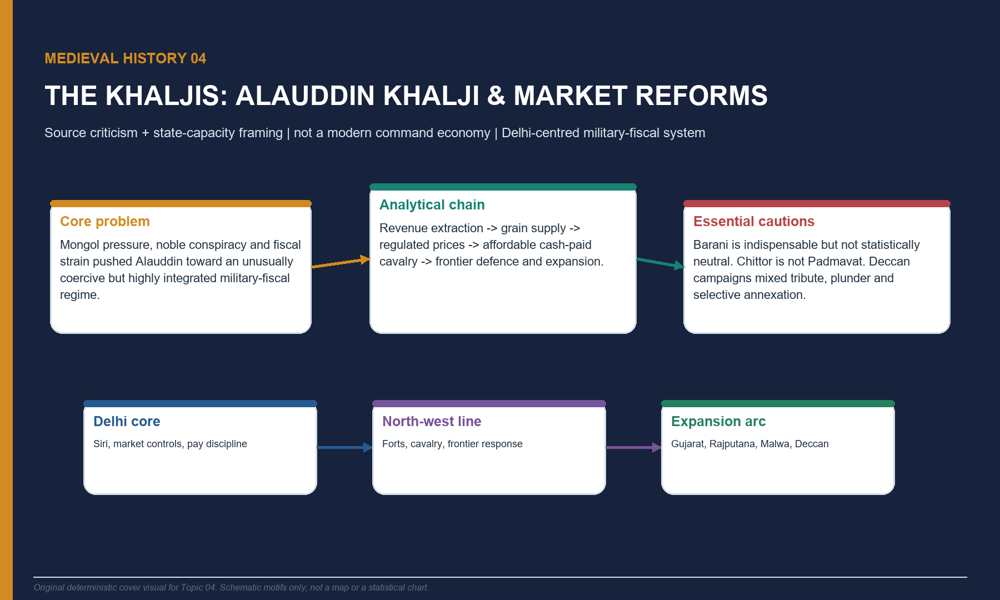

> **Subject:** Medieval Indian History | **Topic:** 04 | **Export date:** 2026-08-16
>
> **Approval:** false - awaiting explicit user approval.
>
> **Source order:** repository Markdown -> local OCR-searchable Satish Chandra core and Part I Sultanate chapters -> local PYQ exports and routing ledgers -> no live official source was required for this export -> Qdrant not used.
>
> **Tag rule:** [FACT] source-grounded statement; [ANALYSIS] evidence-led synthesis; [DEBATE] historiographical disagreement or conceptual caution; [LIMIT] evidentiary, geographical or implementation qualification.

## BASIC LEARNING SESSION

### DEEP-REVIEW LEARNING CONTRACT

| Control | Binding rule for this package |
|---|---|
| Syllabus boundary | Complete Medieval History Core is taught before optional enrichment. |
| Evidence method | Claim → named site/text/inscription/coin/example → analysis → qualification. |
| Source hierarchy | Archaeology, textual testimony, inscriptions, coins and scholarly interpretation remain visibly distinct. |
| Contested issues | Competing interpretations are attributed, evidenced and bounded; certainty is not manufactured. |
| Practice contract | Every solved item has demand decoding, an examiner-grade model, an executable answer/compression plan, marks rationale and answer-specific improvement. |
| Approval | This immutable successor remains `approved: false` pending explicit approval. |

**Canonical Basic/Core owner:** `upsc-ai-kit\knowledge\Medieval-Indian-History\basic\04_Khaljis-Alauddin.md`  
**Canonical topic owner:** `upsc-ai-kit\knowledge\Medieval-Indian-History\basic\04_Khaljis-Alauddin.md`  
**Optional Advanced owner:** `upsc-ai-kit\knowledge\Medieval-Indian-History\advanced\04_Khaljis-Alauddin.md`  
**Official syllabus mapping:** `upsc-ai-kit\knowledge\Medieval-Indian-History\OFFICIAL-UPSC-SYLLABUS-MAPPING.md`

### EVIDENCE, PYQ AND CURRENT-STATUS CONTROL

- **Archaeological inference:** material context supports bounded reconstruction; absence is not automatic proof of non-existence.
- **Textual testimony:** genre, authorship, redaction, patronage and temporal distance control what a text can prove.
- **Inscription and coin evidence:** contemporary names, titles, claims and circulation are powerful but do not by themselves map uniform territorial control.
- **Scholarly interpretation:** historian labels are arguments to test, not facts to memorise without evidence.
- **PYQ discipline:** repository ledgers and locally held official papers control wording and metadata; reconstructed wording and unavailable official keys must be labelled.
- **Current-status note, rechecked 2026-09-03:** The Department of Consumer Affairs Price Monitoring Division page was rechecked on 30 August 2026. It reports daily monitoring of 38 essential commodities through 575 reporting centres. The modern example is used only to teach the general analytical categories of information, supply, enforcement and geographic coverage. Alauddin's Delhi-centred coercive military-fiscal system had different aims, institutions and economic conditions and is not treated as a direct precedent for modern price policy.

**Live/primary context sources recorded by the predecessor generation:**

- `https://consumeraffairs.gov.in/pages/price-monitoring-division`
- `https://whc.unesco.org/en/list/233/`


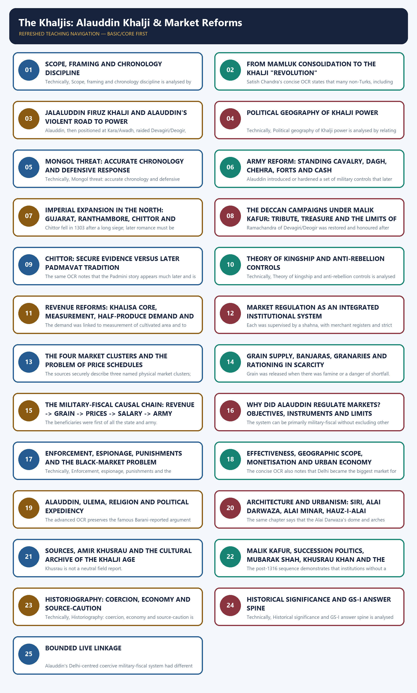

*Distinct embedded teaching-navigation image. The separate continuous Cārvāka-style flowchart package remains an independent at-a-glance artifact.*

#### Package counts, provenance and honest limitations

- Learning sections: 24; learning MCQ loops: 16.
- Workbook content: 3 verified or honestly-adjacent PYQs; 32 original MCQs with integrated remediation map; 6 original solved Mains questions; final register modules: 10.
- Original PNG visuals: 25 total - 24 body visuals plus 1 topic-specific cover visual. All maps are schematic and not to scale.
- Repository sources used most heavily: Topic 04 basic and advanced owners; bounded Topics 03, 05, 07 and 11; `README.md`; `00_Master-Chronology.md`; `REVISION-CHART_Ages-Eras-and-Distinctive-Features.md`; `ANSWER-WORTHINESS-AUDIT.md`; Prelims and Mains PYQ routing ledgers; locally exported PYQ Markdown.
- OCR evidence used most heavily from Satish Chandra's *History of Medieval India* chapters on the Khaljis, Mongol threat, expansion, market reforms and culture, and from *Medieval India: From Sultanat to the Mughals, Part I* sections on the Mongol threat, internal restructuring, agrarian policy, state theory, cultural life and urban economy.
- [LIMIT] The market-control system is known above all through Ziauddin Barani and later synthesis. That makes the mechanism reportable, but not every number, speech or enforcement claim equally certain for every locality.
- [LIMIT] No direct UPSC PYQ was found locally on Alauddin's market reforms as a standalone question. The workbook therefore includes one direct routed Prelims question and two verified adjacent GS-I questions whose source, technology and state-capacity demands materially serve this topic.
- [LIMIT] Topic 04 owns Khalji political history, the military-fiscal reform complex, source criticism and bounded Khalji urban-architectural significance. Full Sultanate architecture ownership remains with Topic 11; full Bhakti-Sufi ownership remains with Topic 10; Vijayanagara-Bahmani and later Deccan state formation remain with Topic 09; Tughlaq consolidation and Deccan annexation beyond the Khalji horizon remain with Topic 05.

#### Sources actually used

| Source class | Exact source | Use and caveat |
|---|---|---|
| Repository knowledge | Topic 04 basic and advanced owners; bounded Topics 03, 05, 07 and 11; Master Chronology; Revision Chart; official Medieval README; Answer-Worthiness Audit; PYQ ledgers and exports. | Controlled chronology, owner boundaries, terminology, source cautions, institutional comparisons and pre-existing corrected provenance such as **dagh/chehra**. |
| Local book | Satish Chandra, *History of Medieval India*, searchable OCR around printed pp. 86-105 and 184-185. | Foundation for Jalaluddin and Alauddin, Mongol crises, Gujarat-Rajasthan-Deccan campaigns, market and agrarian reforms, succession, and the Khalji architectural phase. |
| Local book | Satish Chandra, *Medieval India: From Sultanat to the Mughals, Part I*, searchable OCR around printed pp. 68-79, 73-79, 148-153, 272-273 and the cultural-life chapter. | Deeper control for the Mongol chronology, Barani caution, elite politics, agrarian intervention, market economy, state-shara debate, and historiographical framing. |
| Named primary traditions through source-critical synthesis | Ziauddin Barani (*Tarikh-i Firuz Shahi*, *Fatawa-i Jahandari*), Amir Khusrau (*Khaza'in-ul-Futuh*, *Tughluq-nama* and related courtly writing), Isami, inscriptions, monuments and coinage. | Used with genre caution. Barani is indispensable but late and normative; Khusrau is contemporary but court-praised and literary; Isami is displaced and retrospective; monuments and coins show durable claims but not full administrative reach. |
| Verified PYQ evidence | `knowledge-export` Mains and Prelims Markdown plus routing ledgers for 2022 Prelims, 2020 GS-I and 2023 GS-I. | Ensured exact wording or honestly limited wording verification. Prelims 2018-2023 key status remains locally unavailable, so inferred answers are explicitly labelled. |
| Live official or heritage source | None required for this export. | Local repository Markdown and OCR-searchable books were sufficient; no decorative current-affairs hook was forced. |

#### Original visual asset index

- `notes/Medieval-Indian-History/assets/04_The-Khaljis-Alauddin-Khalji-Market-Reforms/00_khalji_cover_state_capacity.png`
- `notes/Medieval-Indian-History/assets/04_The-Khaljis-Alauddin-Khalji-Market-Reforms/01_khalji_chronology_evidence_spine.png`
- `notes/Medieval-Indian-History/assets/04_The-Khaljis-Alauddin-Khalji-Market-Reforms/02_mamluk_to_khalji_revolution_debate.png`
- `notes/Medieval-Indian-History/assets/04_The-Khaljis-Alauddin-Khalji-Market-Reforms/03_jalaluddin_to_alauddin_accession_flow.png`
- `notes/Medieval-Indian-History/assets/04_The-Khaljis-Alauddin-Khalji-Market-Reforms/04_political_geography_core_campaign_tribute_zones.png`
- `notes/Medieval-Indian-History/assets/04_The-Khaljis-Alauddin-Khalji-Market-Reforms/05_mongol_pressure_defence_timeline.png`
- `notes/Medieval-Indian-History/assets/04_The-Khaljis-Alauddin-Khalji-Market-Reforms/06_army_reform_dagh_chehra_forts_cash_salary.png`
- `notes/Medieval-Indian-History/assets/04_The-Khaljis-Alauddin-Khalji-Market-Reforms/07_expansion_campaign_chronology.png`
- `notes/Medieval-Indian-History/assets/04_The-Khaljis-Alauddin-Khalji-Market-Reforms/08_north_india_vs_deccan_control_matrix.png`
- `notes/Medieval-Indian-History/assets/04_The-Khaljis-Alauddin-Khalji-Market-Reforms/09_chittor_source_layer_matrix.png`
- `notes/Medieval-Indian-History/assets/04_The-Khaljis-Alauddin-Khalji-Market-Reforms/10_anti_rebellion_ordinance_mechanism.png`
- `notes/Medieval-Indian-History/assets/04_The-Khaljis-Alauddin-Khalji-Market-Reforms/11_revenue_reform_chain_rural_hierarchy.png`
- `notes/Medieval-Indian-History/assets/04_The-Khaljis-Alauddin-Khalji-Market-Reforms/12_market_regulation_institutional_architecture.png`
- `notes/Medieval-Indian-History/assets/04_The-Khaljis-Alauddin-Khalji-Market-Reforms/13_four_market_comparison_matrix.png`
- `notes/Medieval-Indian-History/assets/04_The-Khaljis-Alauddin-Khalji-Market-Reforms/14_grain_supply_granary_banjara_scarcity_flow.png`
- `notes/Medieval-Indian-History/assets/04_The-Khaljis-Alauddin-Khalji-Market-Reforms/15_military_fiscal_causal_chain.png`
- `notes/Medieval-Indian-History/assets/04_The-Khaljis-Alauddin-Khalji-Market-Reforms/16_price_control_objectives_instruments_limits.png`
- `notes/Medieval-Indian-History/assets/04_The-Khaljis-Alauddin-Khalji-Market-Reforms/17_enforcement_espionage_network.png`
- `notes/Medieval-Indian-History/assets/04_The-Khaljis-Alauddin-Khalji-Market-Reforms/18_effectiveness_geographic_scope_matrix.png`
- `notes/Medieval-Indian-History/assets/04_The-Khaljis-Alauddin-Khalji-Market-Reforms/19_state_ulema_political_reasoning_caution.png`
- `notes/Medieval-Indian-History/assets/04_The-Khaljis-Alauddin-Khalji-Market-Reforms/20_siri_alai_architectural_comparison.png`
- `notes/Medieval-Indian-History/assets/04_The-Khaljis-Alauddin-Khalji-Market-Reforms/21_source_criticism_matrix.png`
- `notes/Medieval-Indian-History/assets/04_The-Khaljis-Alauddin-Khalji-Market-Reforms/22_succession_and_fall_flow.png`
- `notes/Medieval-Indian-History/assets/04_The-Khaljis-Alauddin-Khalji-Market-Reforms/23_historiography_comparison.png`
- `notes/Medieval-Indian-History/assets/04_The-Khaljis-Alauddin-Khalji-Market-Reforms/24_gs1_answer_spine.png`

### SESSION 1 — SCOPE, FRAMING AND CHRONOLOGY DISCIPLINE

#### DEFINITION / WHAT THIS IS CALLED

**Plain-language definition:** This opening session fixes the exact 1290-1320 boundary of the Khalji story and states the one safe lens for reading everything inside it: source criticism combined with state-capacity analysis.

**Technical definition:** Topic 04 begins at the 1290 Khalji accession and closes at the 1320 Tughlaq takeover; every claim inside that window must be traced to a named source class and tested against what a Delhi-centred coercive state could plausibly enforce, rather than accepted as settled fact.

#### ANSWER-GRABBING OPENING — WRITE/ADAPT IN THE EXAM

> Read Alauddin Khalji through source criticism and state-capacity analysis, not through the label of saint, tyrant or proto-modern planner.

#### MUST-WRITE KEYWORDS

- **Scope**
- **framing**
- **chronology discipline**
- **source criticism plus state-capacity analysis**
- **1290 Khalji accession**
- **1320 Tughlaq takeover**

**How to use them:** Open by naming the Scope and framing of the topic through its chronology discipline; anchor the clock at the 1290 Khalji accession, declare source criticism plus state-capacity analysis as the governing lens, and close on the 1320 Tughlaq takeover to mark where Topic 04 stops and Topic 05 begins.

[FACT] Topic 04 begins from the **1290 Khalji accession** and runs to the **1320 Tughlaq takeover**.

[ANALYSIS] The best framing is **source criticism plus state-capacity analysis**. Alauddin Khalji's regime was neither a welfare price-control state nor a perfectly centralised modern command economy. It was a coercive, Delhi-centred **military-fiscal experiment** responding to frontier danger, elite conspiracy and imperial ambition.

[LIMIT] The same caution applies to opposite caricatures. "First socialist", "anti-Hindu fanatic", "proto-modern dictator", "uniform national market regulator" and "Padmavati's conqueror" are all exam-unsafe simplifications.

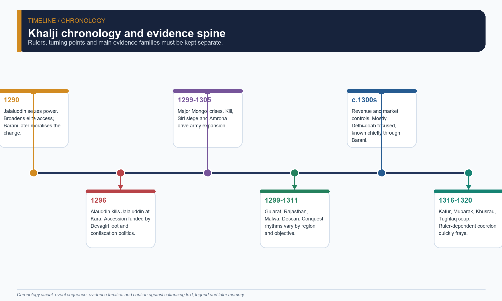

*Chronology visual. It separates rulers, campaigns, reforms and evidence families so that source, event and later memory are never collapsed into one narrative.*

#### Topic ownership firewall

| Owner | What remains primarily there | What Topic 04 legitimately uses |
|---|---|---|
| Topic 03 - Mamluk dynasty | Balban, Mamluk institutional formation, frontier consolidation and the long decline of the Mamluk line | Only the transition needed to explain why Khalji accession mattered |
| Topic 05 - Tughlaqs | Ghiyasuddin, Muhammad bin Tughlaq, Firuz and the later Deccan annexation system | Only the immediate 1320 transition and comparison points where Khalji institutions are reversed or reworked |
| Topic 09 - Vijayanagara and Bahmani / Deccan politics | Independent post-1320 Deccan state formation | Only Khalji-era campaign reach, tribute logic and early openings |
| Topic 11 - Sultanate art and architecture | Full formal analysis of arches, domes, regional schools and stylistic evolution | Only bounded political meaning of Siri, Alai Darwaza, Alai Minar and Hauz-i-Alai |
| Topic 10 - Bhakti and Sufi movements | Spiritual movements in full | Only bounded references to Nizamuddin Auliya, Amir Hasan Sijzi or court-saint interaction where succession politics or cultural context require it |

#### Governing thesis

- [ANALYSIS] The Khalji phase combined **wider recruitment to the ruling class**, **harder coercive monarchy**, **major northern and Deccan expansion**, and the most famous **revenue-market-army linkage** of the Sultanate.
- [ANALYSIS] Its success depended on making Delhi provisioned, cavalry affordable and nobles politically isolated.
- [LIMIT] Its institutions were impressive, but not equally deep everywhere. The most intense evidence concerns **Delhi and the upper doab**, not every province.

#### PARAGRAPH DEMONSTRATION — CLAIM → EVIDENCE → ANALYSIS → QUALIFICATION

**Claim:** Alauddin Khalji's regime is best understood as a coercive, Delhi-centred military-fiscal experiment rather than a welfare state or a uniform empire-wide command economy. **Named evidence:** its defining institutions - the three regulated Delhi markets, the doab's half-produce revenue demand and the standing cavalry raised against repeated Mongol invasions between 1299 and 1305 - survive mainly through Ziauddin Barani's later, aristocratic chronicle. **Analysis:** because these institutions cluster around the army's and the capital's needs rather than around subject welfare, and because the main source carries its own moralising bias, the safest exam frame combines source criticism (weighing what Barani could know and why he wrote) with state-capacity analysis (asking what a Delhi-centred medieval state could actually enforce, and where). **Qualification:** this rules out both the "medieval welfare state" caricature and the "uniform totalitarian empire" caricature; the correct register is a bounded, evidence-led description of a coercive military-fiscal system, strongest in Delhi and the upper doab and weaker at the frontier of Khalji power.

#### CLOSING RECALL FLOW — SCOPE, FRAMING AND CHRONOLOGY DISCIPLINE

```text
START / CONCEPT: Scope, framing and chronology discipline
        |
        v
EXACT TERMS: Scope · framing · chronology discipline · source criticism plus state-capacity analysis · 1290 Khalji accession · 1320 Tughlaq takeover
        |
        v
MECHANISM / ARGUMENT: Alauddin Khalji's regime was neither a welfare price-control state nor a perfectly centralised modern command economy.
        |
        v
CONSEQUENCE / CONTRAST: Its institutions were impressive, but not equally deep everywhere.
        |
        v
UPSC TRAP / ANSWER-USE: Calling the regime "first socialist", "anti-Hindu fanatic" or a "uniform national market regulator" is not accurate - each label collapses a bounded, Delhi-centred coercive system into an anachronistic slogan.
        |
        v
ANSWER-GRABBING FORMULATION: Between 1290 and 1320, the only exam-safe register is a bounded, Delhi-centred military-fiscal experiment - never a welfare state, never a uniform empire.
```
### SESSION 2 — FROM MAMLUK CONSOLIDATION TO THE KHALJI "REVOLUTION"

#### DEFINITION / WHAT THIS IS CALLED

**Plain-language definition:** This session tests the phrase "Khalji revolution" against what actually changed between the Mamluk order and 1290, so the word "revolution" is used precisely rather than as a slogan.

**Technical definition:** Satish Chandra's concise OCR states that many non-Turks, including Khaljis and Indian Muslims, had long served in the Sultanate, especially in frontier and eastern spaces, but faced blocked advancement under old Turkish exclusivism.

#### ANSWER-GRABBING OPENING — WRITE/ADAPT IN THE EXAM

> Call 1290 a widening of the ruling elite, not a social revolution among cultivators, artisans or women.

#### MUST-WRITE KEYWORDS

- **broadened elite access**
- **non-Turks**
- **"Khalji revolution"**
- **mixed Turkish-Afghan origin**
- **institutional continuity**
- **Pure continuity**

**How to use them:** Open by naming the broadened elite access that 1290 created; use non-Turks and mixed Turkish-Afghan origin to show which group gained ground; invoke institutional continuity to prove Delhi, iqta and court routines survived unchanged; and reserve Pure continuity as the label for the weaker interpretation you are correcting.

[FACT] The Mamluks left behind Delhi, iqta routines, coinage, court idiom and a frontier problem. They did **not** leave behind a stable succession or a permanently closed Turkish monopoly.

[FACT] Satish Chandra's concise OCR states that many **non-Turks**, including Khaljis and Indian Muslims, had long served in the Sultanate, especially in frontier and eastern spaces, but faced blocked advancement under old Turkish exclusivism.

[DEBATE] The phrase **"Khalji revolution"** is useful only if used carefully. It refers most safely to a **broadening of the social base of the ruling class** and the ending of the old Turkish monopoly of high office.

[LIMIT] It does **not** mean a social revolution among cultivators, artisans, women or the subcontinent's population at large.

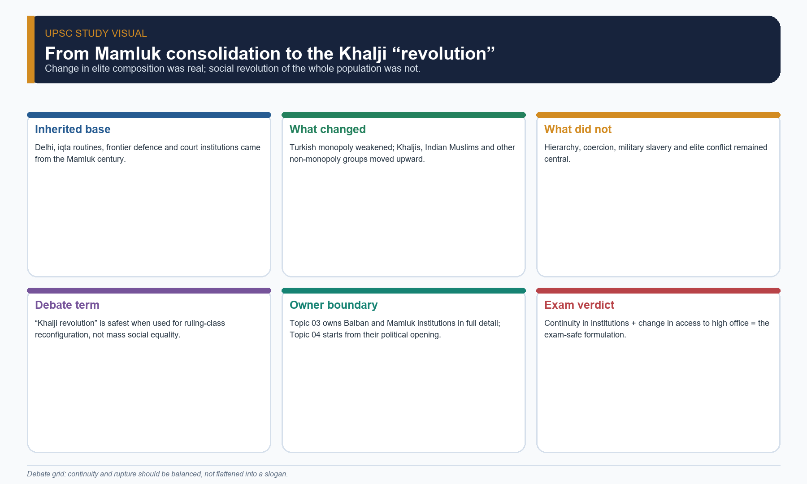

*Debate visual. It balances institutional continuity against elite-composition change and rejects mass-social-revolution overstatement.*

#### Interpretation table

| Interpretation | What it gets right | What must be resisted |
|---|---|---|
| Pure continuity | Khaljis inherited a functioning Delhi-centred state, frontier anxieties and iqta routines | It understates the change in who could rise to high office |
| Pure rupture | Khalji accession clearly broke old Turkish monopoly and widened elite access | It overstates total institutional novelty |
| Exam-safe synthesis | Mamluk institutions made Khalji expansion possible; Khalji accession widened access to power and intensified central coercion | Avoid both "nothing changed" and "everything changed" |

#### Must-know distinctions

- [FACT] The Khaljis were described in the concise source as of **mixed Turkish-Afghan origin**.
- [FACT] They did **not** exclude Turks from office.
- [ANALYSIS] Their rise showed that the Delhi Sultanate was becoming more Indian in recruitment without becoming socially egalitarian.

#### PARAGRAPH DEMONSTRATION — CLAIM → EVIDENCE → ANALYSIS → QUALIFICATION

**Claim:** The "Khalji revolution" names a change in who could reach high Sultanate office, not a change in the structure of the state or in the condition of ordinary subjects. **Named evidence:** Jalaluddin Khalji's 1290 accession ended the old Turkish nobility's monopoly of the throne, yet Delhi remained the capital, iqta continued to fund the army, and Persianate court idiom carried on unbroken. **Analysis:** because the institutions that a genuine social or administrative revolution would have to change - land tenure, army financing, court language, urban hierarchy - stayed in place, while only the ethnic/factional composition of the ruling elite shifted, the safest reading is "elite recomposition inside a continuing Sultanate framework." **Qualification:** this does not make 1290 trivial; a monopoly ending is still a real and examinable political event, but it must never be inflated into a claim about mass social change among cultivators, artisans or women.

#### CLOSING RECALL FLOW — FROM MAMLUK CONSOLIDATION TO THE KHALJI "REVOLUTION"

```text
START / CONCEPT: From Mamluk consolidation to the Khalji "revolution"
        |
        v
EXACT TERMS: broadened elite access · non-Turks · "Khalji revolution" · mixed Turkish-Afghan origin · institutional continuity · Pure continuity
        |
        v
MECHANISM / ARGUMENT: Satish Chandra's concise OCR states that many non-Turks, including Khaljis and Indian Muslims, had long served in the Sultanate, especially in frontier and eastern spaces, but faced blocked advancement under old Turkish exclusivism.
        |
        v
CONSEQUENCE / CONTRAST: It does not mean a social revolution among cultivators, artisans, women or the subcontinent's population at large.
        |
        v
UPSC TRAP / ANSWER-USE: Naming the Khaljis as simply "mixed Turkish-Afghan" without adding that this widened, rather than replaced, the ruling class understates the political change of 1290.
        |
        v
ANSWER-GRABBING FORMULATION: 1290 changed who could reach high office, not how peasants, artisans or women lived - the safest word is recomposition, not revolution.
```
### SESSION 3 — JALALUDDIN FIRUZ KHALJI AND ALAUDDIN'S VIOLENT ROAD TO POWER

#### DEFINITION / WHAT THIS IS CALLED

**Plain-language definition:** Yet even if stylised, the contrast between Jalaluddin's relative leniency and Alauddin's harsher turn is strongly supported by the narrative structure of the local sources.

**Technical definition:** Alauddin, then positioned at Kara/Awadh, raided Devagiri/Deogir, accumulated vast portable wealth, lured Jalaluddin into a vulnerable meeting and had him killed in 1296.

#### ANSWER-GRABBING OPENING — WRITE/ADAPT IN THE EXAM

> Jalaluddin ruled by conciliation and consent-seeking rhetoric; Alauddin ruled by murder, loot and enforced awe - the same office, two opposite styles of legitimacy.

#### MUST-WRITE KEYWORDS

- **Jalaluddin Firuz Khalji**
- **Alauddin's violent road to power**
- **willing support of the governed**
- **conciliatory by Sultanate standards**
- **Kara/Awadh**
- **Devagiri/Deogir**

**How to use them:** Open by contrasting Jalaluddin Firuz Khalji's rhetoric of willing support of the governed with Alauddin's violent road to power; use Kara/Awadh and Devagiri/Deogir to supply the exact staging ground and wealth source of the coup; close by naming 1296 as the hinge where conciliatory kingship gave way to surveillance and confiscation.

[FACT] Jalaluddin Khalji came to power in **1290** after overthrowing Balban's weak successors.

[FACT] The concise OCR describes him as the first Sultan clearly to argue that the state in India should rest on the **willing support of the governed**, and that a truly Islamic state was impossible in a land with a Hindu majority.

[ANALYSIS] This made Jalaluddin's kingship **conciliatory by Sultanate standards**, but not pacifist. He remained a frontier commander shaped by Mongol pressure and elite insecurity.

[FACT] Alauddin, then positioned at **Kara/Awadh**, raided **Devagiri/Deogir**, accumulated vast portable wealth, lured Jalaluddin into a vulnerable meeting and had him killed in **1296**.

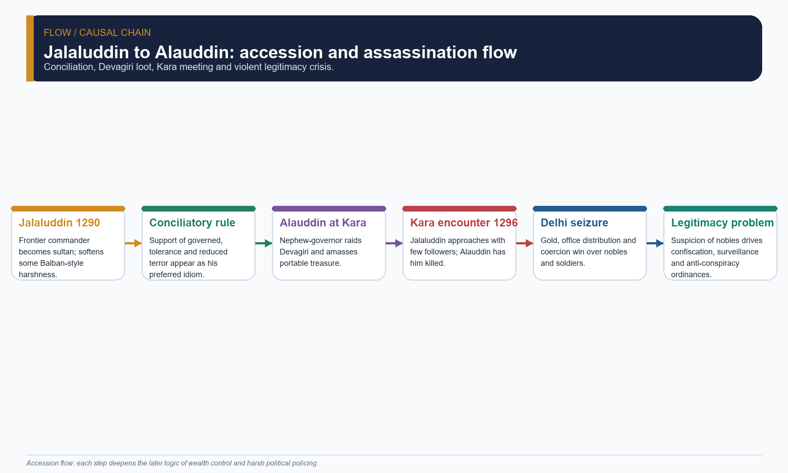

*Accession flow. Conciliation, Devagiri loot, the Kara murder and coerced legitimacy together explain the later politics of surveillance and confiscation.*

#### Jalaluddin versus Alauddin

| Dimension | Jalaluddin Firuz Khalji | Alauddin Khalji |
|---|---|---|
| Tone of kingship | Conciliatory, less harsh than Balban | Severe, suspicious and confiscatory |
| Legitimacy style | Military support plus softening rhetoric | Seizure by assassination plus wealth redistribution and terror |
| Frontier context | Continuation of Mongol anxiety | Mongol crises become sharper and more system-shaping |
| Relation with nobles | Sought support through tolerance and leniency | Sought submission through surveillance, confiscation and bans |

#### Source caution

- [LIMIT] Jalaluddin's idealised language survives through later chroniclers, above all Barani, who writes with moral and political agendas.
- [ANALYSIS] Yet even if stylised, the contrast between Jalaluddin's relative leniency and Alauddin's harsher turn is strongly supported by the narrative structure of the local sources.

#### PARAGRAPH DEMONSTRATION — CLAIM → EVIDENCE → ANALYSIS → QUALIFICATION

**Claim:** Alauddin's 1296 seizure of Delhi was a legitimacy crisis, not a smooth succession, and this crisis explains his later coercive style. **Named evidence:** he raided Devagiri while still a Kara-based commander, used that treasure to buy support, lured his uncle and father-in-law Jalaluddin into a vulnerable meeting, and had him assassinated before securing Delhi with distributed gold. **Analysis:** because his claim to rule rested on murder and money rather than accepted succession, Alauddin needed continuous demonstrations of control - surveillance, confiscation and terror - to prevent the same kind of conspiracy that had brought him to power; his later anti-rebellion ordinances are therefore a direct political response to his own path to the throne, not an abstract taste for cruelty. **Qualification:** Barani, writing decades later with a moralising agenda, shapes how "conciliatory" Jalaluddin and "harsh" Alauddin appear, so the contrast should be used as a structurally supported pattern, not a verbatim psychological verdict on either ruler.

#### CLOSING RECALL FLOW — JALALUDDIN FIRUZ KHALJI AND ALAUDDIN'S VIOLENT ROAD TO POWER

```text
START / CONCEPT: Jalaluddin Firuz Khalji and Alauddin's violent road to power
        |
        v
EXACT TERMS: Jalaluddin Firuz Khalji · Alauddin's violent road to power · willing support of the governed · conciliatory by Sultanate standards · Kara/Awadh · Devagiri/Deogir
        |
        v
MECHANISM / ARGUMENT: Alauddin, then positioned at Kara/Awadh, raided Devagiri/Deogir, accumulated vast portable wealth, lured Jalaluddin into a vulnerable meeting and had him killed in 1296.
        |
        v
CONSEQUENCE / CONTRAST: The concise OCR describes him as the first Sultan clearly to argue that the state in India should rest on the willing support of the governed, and that a truly Islamic state was impossible in a land with a Hindu majority.
        |
        v
UPSC TRAP / ANSWER-USE: Treating Jalaluddin's conciliatory rhetoric and Alauddin's coercive style as identical, rather than contrasting, royal behaviour erases the very distinction the sources use to explain the Khalji turn.
        |
        v
ANSWER-GRABBING FORMULATION: Devagiri wealth bought the murder of Jalaluddin, and that murder bought Alauddin a throne he then had to defend with terror, not tolerance.
```
### SESSION 4 — POLITICAL GEOGRAPHY OF KHALJI POWER

#### DEFINITION / WHAT THIS IS CALLED

**Plain-language definition:** Khalji power was not one uniform colour on the map; it graded from tight Delhi-centred control down to distant raided territory that paid tribute but was never administered.

**Technical definition:** Political geography of Khalji power is best analysed as concentric zones - a directly enforced core, more directly incorporated near territories, tribute-bearing subordinate states, and deep campaign/raid zones - rather than as one flat imperial colour.

#### ANSWER-GRABBING OPENING — WRITE/ADAPT IN THE EXAM

> Do not draw a hard modern border around all regions touched by Malik Kafur or later Khalji arms.

#### MUST-WRITE KEYWORDS

- **Political geography of Khalji power**
- **Delhi-Siri and the upper doab**
- **different layers**
- **core zone**
- **more directly incorporated territories**
- **tribute-bearing zones**

**How to use them:** Open by naming the core zone (Delhi-Siri and the upper doab) as the site of the heaviest enforcement; use different layers to introduce more directly incorporated territories, tribute-bearing zones and deep campaign reach as progressively looser forms of control; close by warning that political geography of Khalji power was graded, not a single uniform empire.

[FACT] The Delhi core mattered most. Revenue reform, market regulation, army pay and urban provisioning were strongest in **Delhi-Siri and the upper doab**.

[ANALYSIS] Beyond that core, the Khalji polity worked through **different layers**: annexed provinces, tribute-paying Rajput states, restored subordinate rulers, and deep raiding or campaign zones in the Deccan.

[LIMIT] Do **not** draw a hard modern border around all regions touched by Malik Kafur or later Khalji arms.

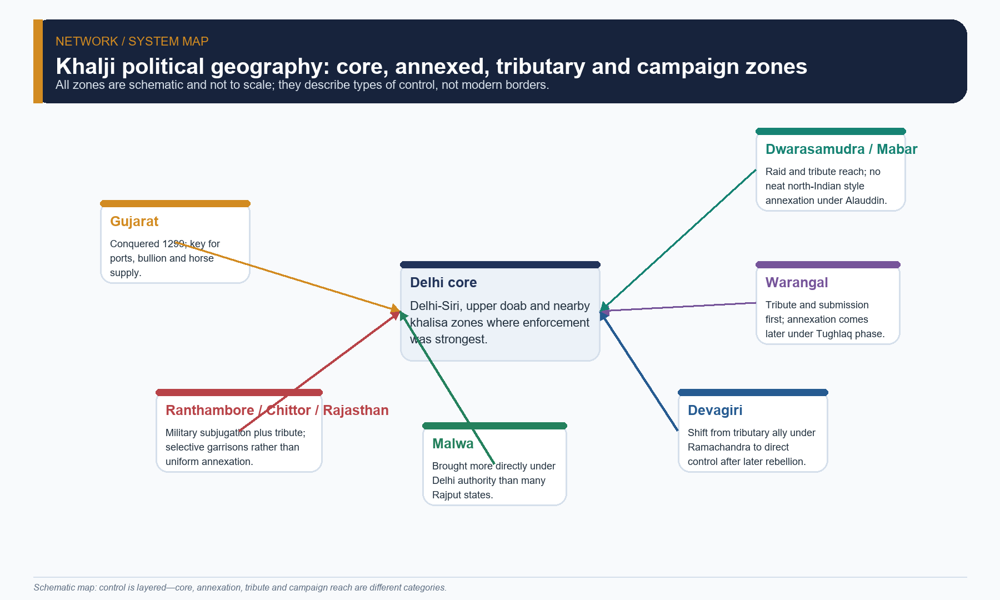

*Schematic political map. It distinguishes Delhi core, stronger annexation, subordinate allies, tribute belts and deep campaign reach. It is not to scale.*

#### Zone language for safe answers

| Zone | Safe description |
|---|---|
| Delhi-Siri and upper doab | **core zone** of enforcement, provisioning and fiscal extraction |
| Gujarat and parts of Malwa | **more directly incorporated territories** |
| Ranthambore-Chittor-Rajasthan states | **subdued or tribute-bearing Rajput polities with selective garrisons** |
| Devagiri under Ramachandra | **subordinate ally restored under Delhi suzerainty before later direct turn** |
| Warangal / Dwarasamudra | **tributary-success theatre, not neat Alauddin-era annexation** |
| Mabar / Madurai | **campaign reach and plunder zone rather than stable Delhi province under Alauddin** |

#### PARAGRAPH DEMONSTRATION — CLAIM → EVIDENCE → ANALYSIS → QUALIFICATION

**Claim:** Khalji power should be pictured as graded zones radiating from Delhi, not as one uniformly administered empire. **Named evidence:** Delhi-Siri and the upper doab carried direct khalisa revenue collection and market enforcement, Gujarat and Malwa were more directly incorporated, Ranthambore-Chittor-Rajasthan states paid tribute under selective garrisons, and Devagiri, Warangal, Dwarasamudra and Mabar were reached mainly through Malik Kafur's campaigns for treasure and submission. **Analysis:** because the intensity of taxation, market control and administrative presence falls away sharply the further a territory sits from Delhi, a single shaded map or a single word like "empire" hides the real difference between a taxed core and a raided periphery. **Qualification:** this zonal picture does not deny Khalji military reach into the far south; it only insists that reach, tribute and administration are three different things that must be separately proven for each region.

#### CLOSING RECALL FLOW — POLITICAL GEOGRAPHY OF KHALJI POWER

```text
START / CONCEPT: Political geography of Khalji power
        |
        v
EXACT TERMS: Political geography of Khalji power · Delhi-Siri and the upper doab · different layers · core zone · more directly incorporated territories · tribute-bearing zones
        |
        v
MECHANISM / ARGUMENT: Revenue reform, market regulation, army pay and urban provisioning were strongest in Delhi-Siri and the upper doab.
        |
        v
CONSEQUENCE / CONTRAST: Beyond that core, the Khalji polity worked through different layers: annexed provinces, tribute-paying Rajput states, restored subordinate rulers, and deep raiding or campaign zones in the Deccan.
        |
        v
UPSC TRAP / ANSWER-USE: Shading the whole subcontinent in one colour for "Khalji empire" is wrong - it erases the real gap between Delhi-Siri's direct control and Mabar's raided periphery.
        |
        v
ANSWER-GRABBING FORMULATION: Delhi-Siri and the doab were taxed and policed directly; Gujarat and Malwa were incorporated; Rajasthan paid tribute; the Deccan was raided - four different verbs for four different zones.
```
### SESSION 5 — MONGOL THREAT: ACCURATE CHRONOLOGY AND DEFENSIVE RESPONSE

#### DEFINITION / WHAT THIS IS CALLED

**Plain-language definition:** Mongol pressure on India was a decades-long recurring danger, and the Alauddin-era crisis at Delhi is only its sharpest, best-documented episode.

**Technical definition:** Topic 04's Mongol chronology runs from Jullundhar (1297-98) through Siwistan (1298) and the Kili crisis (1299) to Targhi's siege pressure on Delhi and Siri (1303) and the decisive Amroha victory (1305), and each episode must be attached to its own year and commander.

#### ANSWER-GRABBING OPENING — WRITE/ADAPT IN THE EXAM

> "The first Mongol invasion happened under Jalaluddin Khalji" is false.

#### MUST-WRITE KEYWORDS

- **Mongol threat**
- **accurate chronology**
- **defensive response**
- **1297-98 Jullundhar**
- **1298 Siwistan**
- **1299 Qutlugh Khwaja / Kili crisis**

**How to use them:** Open by rejecting the false "first invasion under Jalaluddin" claim; sequence 1297-98 Jullundhar, 1298 Siwistan and 1299 Qutlugh Khwaja / Kili crisis to build accurate chronology; then use 1303 Targhi and 1305 Amroha to show the defensive response hardening from survival to counter-attack.

[FACT] The local OCR and Topic 03 package together make the following sequence secure: **1297-98 Jullundhar**, **1298 Siwistan**, **1299 Qutlugh Khwaja / Kili crisis**, **1303 Targhi's pressure on Delhi and Siri**, **1305 Amroha**, then stronger frontier recovery after Mongol confusion.

[FACT] The 2022 routed Prelims demand directly tests this chronology, especially the distinction between earlier Mongol pressure and the **Alauddin-era siege crisis at Delhi**.

[ANALYSIS] Alauddin's response was not only battlefield courage. It combined **careful refusal of reckless battle**, **fort strengthening**, **camp fortification**, **larger cavalry recruitment** and later **frontier push-back**.

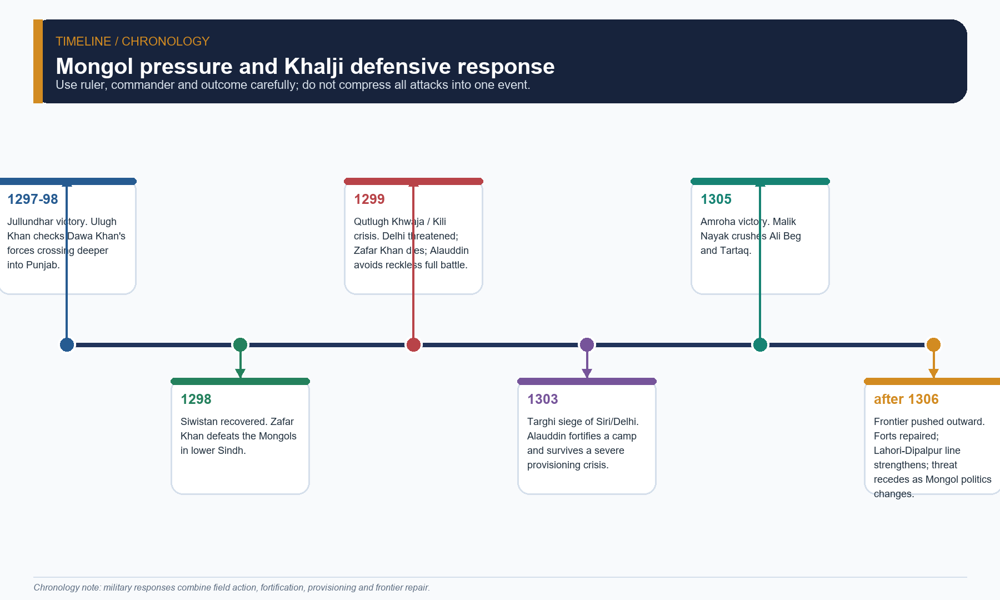

*Mongol-timeline visual. Year, commander and type of response are kept distinct to avoid PYQ traps.*

#### Chronology table

| Year | Mongol leader / episode | Delhi response | Why it matters |
|---|---|---|---|
| 1297-98 | Dawa Khan's forces cross deeper into Punjab | **Ulugh Khan** wins at Jullundhar | Shows frontier danger before the major Delhi crisis |
| 1298 | Siwistan captured by Mongols in lower Sindh | **Zafar Khan** recovers it | Confirms recurring frontier warfare |
| 1299 | **Qutlugh Khwaja** / Kili crisis | Alauddin gathers army near Siri; Zafar Khan dies | First truly severe Delhi-facing danger under Alauddin |
| 1303 | **Targhi** pressures Delhi and Siri while Alauddin returns from Chittor | Defensive camp, ditch, provisioning crisis, no reckless open battle | Direct link to Siri, large-army necessity and Delhi supply anxiety |
| 1305 | **Ali Beg and Tartaq** defeated near **Amroha** by **Malik Nayak** | Crushing defeat for Mongols | Aura of Mongol invincibility breaks in India |

#### UPSC caution

- [LIMIT] "The first Mongol invasion happened under Jalaluddin Khalji" is false. Mongol pressure on the north-west and deeper Indian frontier predates him.
- [LIMIT] It is also unsafe to claim that Mongol danger ended forever in 1305. What changed was the **immediacy and scale** of the threat to Delhi.

#### PARAGRAPH DEMONSTRATION — CLAIM → EVIDENCE → ANALYSIS → QUALIFICATION

**Claim:** Alauddin's Mongol chronology must be read as a five-episode sequence, not one generic "Mongol invasion" event. **Named evidence:** Ulugh Khan's 1297-98 win at Jullundhar and Zafar Khan's 1298 recovery of Siwistan predate Alauddin's own most severe crisis, the 1299 Qutlugh Khwaja/Kili emergency near Siri; Targhi's 1303 pressure on Delhi and Siri coincided with Alauddin's return from Chittor, and Malik Nayak's 1305 victory over Ali Beg and Tartaq at Amroha broke the aura of Mongol invincibility. **Analysis:** naming each year, commander and Delhi response prevents the two commonest PYQ traps - dating the first Mongol pressure to Jalaluddin's reign, and assuming Mongol danger vanished at a single stroke - and shows a state learning through repeated crisis rather than winning one decisive battle. **Qualification:** 1305 marks a shift in balance, not an end to Mongol activity altogether, so an answer should describe reduced immediacy and scale after 1305, not permanent closure of the frontier threat.

#### CLOSING RECALL FLOW — MONGOL THREAT: ACCURATE CHRONOLOGY AND DEFENSIVE RESPONSE

```text
START / CONCEPT: Mongol threat: accurate chronology and defensive response
        |
        v
EXACT TERMS: Mongol threat · accurate chronology · defensive response · 1297-98 Jullundhar · 1298 Siwistan · 1299 Qutlugh Khwaja / Kili crisis
        |
        v
MECHANISM / ARGUMENT: The local OCR and Topic 03 package together make the sequence secure: 1297-98 Jullundhar, 1298 Siwistan, 1299 Qutlugh Khwaja / Kili crisis, 1303 Targhi's pressure on Delhi and Siri, 1305 Amroha, then stronger frontier recovery after Mongol confusion.
        |
        v
CONSEQUENCE / CONTRAST: Alauddin's response combined careful refusal of reckless battle, fort strengthening, camp fortification, larger cavalry recruitment and later frontier push-back rather than one single victorious charge.
        |
        v
UPSC TRAP / ANSWER-USE: It is unsafe to claim Mongol danger ended forever in 1305; what changed after Amroha was the immediacy and scale of the threat to Delhi, not its complete disappearance.
        |
        v
ANSWER-GRABBING FORMULATION: Name the year and the commander every time - Jullundhar, Siwistan, Kili, Targhi and Amroha are five separate tests, not one Mongol-invasion checkbox.
```
### SESSION 6 — ARMY REFORM: STANDING CAVALRY, DAGH, CHEHRA, FORTS AND CASH

#### DEFINITION / WHAT THIS IS CALLED

**Plain-language definition:** Army reform under Alauddin means a checked cavalry system - branded horses, recorded soldiers, cash pay and repaired forts - built to survive Mongol pressure on a fixed budget.

**Technical definition:** Alauddin introduced or hardened a set of military controls that later tradition remembers through dagh (horse branding) and chehra (descriptive rolls).

#### ANSWER-GRABBING OPENING — WRITE/ADAPT IN THE EXAM

> Dagh and chehra are Khalji inventions, not Mughal ones - Sher Shah revived them and Akbar scaled them up.

#### MUST-WRITE KEYWORDS

- **Army reform**
- **standing cavalry**
- **dagh**
- **chehra**
- **forts**
- **cash**

**How to use them:** Open by naming Army reform as a checked cavalry system; use dagh and chehra as the two inspection instruments that prevented fraud; connect forts and cash to show that frontier defence depended equally on fortification and affordable soldier pay.

[FACT] Alauddin introduced or hardened a set of military controls that later tradition remembers through **dagh** (horse branding) and **chehra** (descriptive rolls).

[FACT] Topic 07's corrected owner file is explicit: Alauddin introduced these controls in the Sultanate; Sher Shah later revived/adapted them, and Akbar systematised them on a different imperial scale.

[ANALYSIS] The key point is **not** isolated innovation. The key point is the creation of a **checked cavalry system** tied to price control, revenue extraction and frontier security.

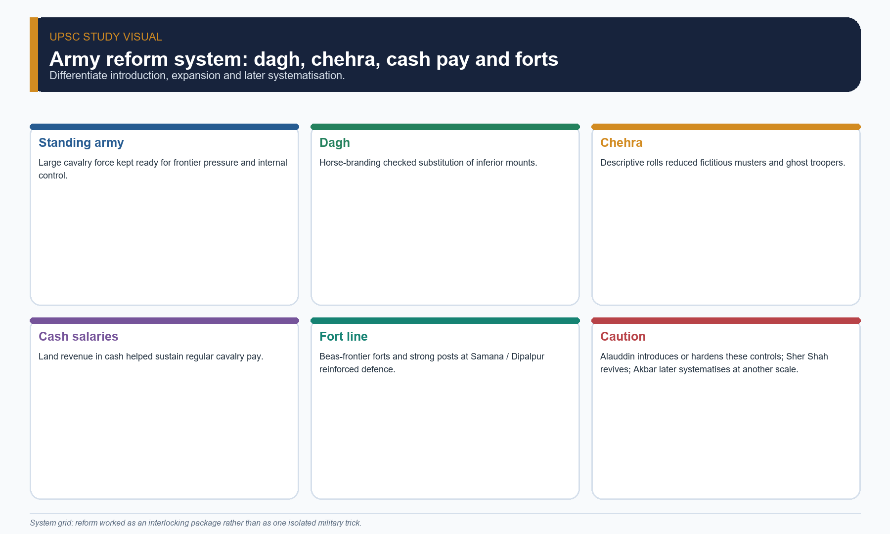

*System visual. Cavalry inspection, cash pay, horse quality and fort repair worked together rather than as separate reforms.*

#### Reform distinction table

| Control | Alauddin's role | Why UPSC asks it |
|---|---|---|
| Standing cavalry | Expanded and disciplined it under Mongol pressure | Connects external threat to state capacity |
| Dagh | Brands horses to prevent substitution and fraud | Corrects Mughal-first misconceptions |
| Chehra | Registers soldiers descriptively to reduce false musters | Shows administrative, not just battlefield, reform |
| Cash salaries | Revenue in cash helps sustain cavalry pay | Links agrarian and market policy to army affordability |
| Frontier forts | Repairs and strengthens posts near the Beas and beyond | Prevents reduction of military response to only one battle |

#### Sample pay caution

- [FACT] The concise OCR reports a **cavalryman's annual pay around 238 tankas** in Alauddin's time.
- [LIMIT] OCR and manuscript variation affect the exact rendering of the additional second-horse allowance. Use the figure as a **reported pay scale marker**, not as modern audited payroll certainty.

#### PARAGRAPH DEMONSTRATION — CLAIM → EVIDENCE → ANALYSIS → QUALIFICATION

**Claim:** Alauddin's army reform was an integrated inspection-and-affordability system, not a single battlefield innovation. **Named evidence:** dagh branded horses to stop substitution, chehra recorded soldiers descriptively to stop false musters, frontier forts near the Beas were repaired, and a cavalryman's reported annual pay of around 238 tankas had to remain viable through cheap, price-controlled provisions. **Analysis:** each instrument solves a different fraud or cost problem - dagh stops horse substitution, chehra stops muster fraud, cash pay only works if prices stay low - so removing any one piece would have collapsed the affordability of a large standing cavalry under continuous Mongol pressure. **Qualification:** Topic 07's corrected provenance shows Alauddin originated these controls in the Sultanate; Sher Shah later revived and Akbar systematised them on an imperial scale, so dagh and chehra must never be misdated as Mughal inventions.

#### CLOSING RECALL FLOW — ARMY REFORM: STANDING CAVALRY, DAGH, CHEHRA, FORTS AND CASH

```text
START / CONCEPT: Army reform: standing cavalry, dagh, chehra, forts and cash
        |
        v
EXACT TERMS: Army reform · standing cavalry · dagh · chehra · forts · cash
        |
        v
MECHANISM / ARGUMENT: Alauddin introduced or hardened a set of military controls that later tradition remembers through dagh (horse branding) and chehra (descriptive rolls).
        |
        v
CONSEQUENCE / CONTRAST: Use the figure as a reported pay scale marker, not as modern audited payroll certainty.
        |
        v
UPSC TRAP / ANSWER-USE: The key point is not isolated battlefield innovation; dagh, chehra, cash and forts formed one linked checked-cavalry system.
        |
        v
ANSWER-GRABBING FORMULATION: A branded horse, a recorded soldier and a cash wage are the three receipts that prove Alauddin's army reform was administrative, not just heroic.
```
### SESSION 7 — IMPERIAL EXPANSION IN THE NORTH: GUJARAT, RANTHAMBORE, CHITTOR AND MALWA

#### DEFINITION / WHAT THIS IS CALLED

**Plain-language definition:** Gujarat and Malwa are best described as stronger incorporation zones.

**Technical definition:** Chittor fell in 1303 after a long siege; later romance must be separated from the secure military outcome.

#### ANSWER-GRABBING OPENING — WRITE/ADAPT IN THE EXAM

> Conquest method varied by theatre: Gujarat and Malwa were incorporated, Rajasthan was subjugated and tributary, and no single word covers all four campaigns.

#### MUST-WRITE KEYWORDS

- **Imperial expansion in the north**
- **Gujarat**
- **Ranthambore**
- **Chittor**
- **Malwa**
- **subjugation plus tribute plus selective garrisoning**

**How to use them:** Open by separating Gujarat's incorporation from Ranthambore and Chittor's harder sieges; use Malwa to show a second, more direct incorporation case; close with subjugation plus tribute plus selective garrisoning as the safest umbrella phrase for the Rajasthan campaigns.

[FACT] Gujarat was attacked in **1299**. The concise OCR emphasises its fertile wealth, western sea-ports and horse trade significance.

[FACT] Ranthambore fell in **1301** after Hamirdeva's refusal to surrender Mongol fugitives and after a difficult siege.

[FACT] Chittor fell in **1303** after a long siege; later romance must be separated from the secure military outcome.

[FACT] Malwa was brought more directly under Delhi control than many Rajput states.


*Campaign visual. It keeps different theatres in sequence and warns that conquest method varied by region.*

#### Northern campaigns table

| Campaign | Strongest motive mix | Outcome |
|---|---|---|
| Gujarat | Port wealth, bullion, merchants, horse supply, strategic western access | Conquered and incorporated |
| Ranthambore | Strategic fort, Rajput defiance, refuge to Mongol rebels | Hard siege, storm and fall |
| Chittor | Strategic route, Rajput power, control over central-western passages | Major military victory with long afterlife in memory |
| Malwa | Plateau power and central Indian consolidation | More direct Delhi administration |

#### Safe phrasing

- [ANALYSIS] Gujarat and Malwa are best described as stronger incorporation zones.
- [ANALYSIS] Rajasthan campaigns are best described as **subjugation plus tribute plus selective garrisoning**, not as one uniform administrative conquest.

#### PARAGRAPH DEMONSTRATION — CLAIM → EVIDENCE → ANALYSIS → QUALIFICATION

**Claim:** Alauddin's four northern campaigns achieved four different kinds of control, not one uniform conquest. **Named evidence:** Gujarat (1299) was raided for its ports and wealth and then incorporated; Ranthambore (1301) fell only after Hamirdeva's refusal to surrender Mongol fugitives forced a hard siege; Chittor (1303) fell after a long siege whose military outcome is separate from its later literary memory; and Malwa (c.1305) was brought under more direct Delhi administration than most Rajput states. **Analysis:** because incorporation, siege-conquest and tribute-taking are three distinct political relationships, describing all four campaigns with one word - "annexation" or "conquest" - erases exactly the distinctions that UPSC statement-based questions test. **Qualification:** "stronger incorporation" for Gujarat/Malwa and "subjugation plus tribute plus selective garrisoning" for the Rajasthan campaigns are the two safest umbrella phrases, but neither should be stretched to claim uniform day-to-day administration.

#### CLOSING RECALL FLOW — IMPERIAL EXPANSION IN THE NORTH: GUJARAT, RANTHAMBORE, CHITTOR AND MALWA

```text
START / CONCEPT: Imperial expansion in the north: Gujarat, Ranthambore, Chittor and Malwa
        |
        v
EXACT TERMS: Imperial expansion in the north · Gujarat · Ranthambore · Chittor · Malwa · subjugation plus tribute plus selective garrisoning
        |
        v
MECHANISM / ARGUMENT: Chittor fell in 1303 after a long siege; later romance must be separated from the secure military outcome.
        |
        v
CONSEQUENCE / CONTRAST: Rajasthan campaigns are best described as subjugation plus tribute plus selective garrisoning, not as one uniform administrative conquest.
        |
        v
UPSC TRAP / ANSWER-USE: Malwa's more direct control shows that "Rajput resistance" cannot be generalised uniformly across every western/central campaign.
        |
        v
ANSWER-GRABBING FORMULATION: Gujarat's ports, Ranthambore's siege, Chittor's fall and Malwa's incorporation are four separate campaigns joined only by geography, not by a single method of control.
```
### SESSION 8 — THE DECCAN CAMPAIGNS UNDER MALIK KAFUR: TRIBUTE, TREASURE AND THE LIMITS OF ANNEXATION

#### DEFINITION / WHAT THIS IS CALLED

**Plain-language definition:** Malik Kafur rose after Gujarat and became the leading commander of the Deccan campaigns.

**Technical definition:** Ramachandra of Devagiri/Deogir was restored and honoured after submission, showing that subordinate alliance could serve Delhi better than immediate annexation.

#### ANSWER-GRABBING OPENING — WRITE/ADAPT IN THE EXAM

> Devagiri's restored ally, Warangal's tribute and Mabar's raid prove that "Deccan conquest" meant three different relationships, not one annexed empire.

#### MUST-WRITE KEYWORDS

- **The Deccan campaigns under Malik Kafur**
- **tribute**
- **treasure**
- **the limits of annexation**
- **subordinate alliance**
- **Warangal**

**How to use them:** Open by naming Malik Kafur as the delegated commander of the Deccan campaigns; use tribute and treasure to describe what Delhi actually extracted; contrast subordinate alliance (Devagiri) with Warangal's submission to show the limits of annexation under Alauddin.

[FACT] Malik Kafur rose after Gujarat and became the leading commander of the Deccan campaigns.

[FACT] Ramachandra of Devagiri/Deogir was restored and honoured after submission, showing that **subordinate alliance** could serve Delhi better than immediate annexation.

[FACT] The campaigns to **Warangal**, **Dwarasamudra** and **Mabar/Madurai** yielded treasure, elephants, submission and tribute promises.

[LIMIT] The OCR and repository evidence alike warn against treating these campaigns as a single neat wave of permanent annexation under Alauddin.

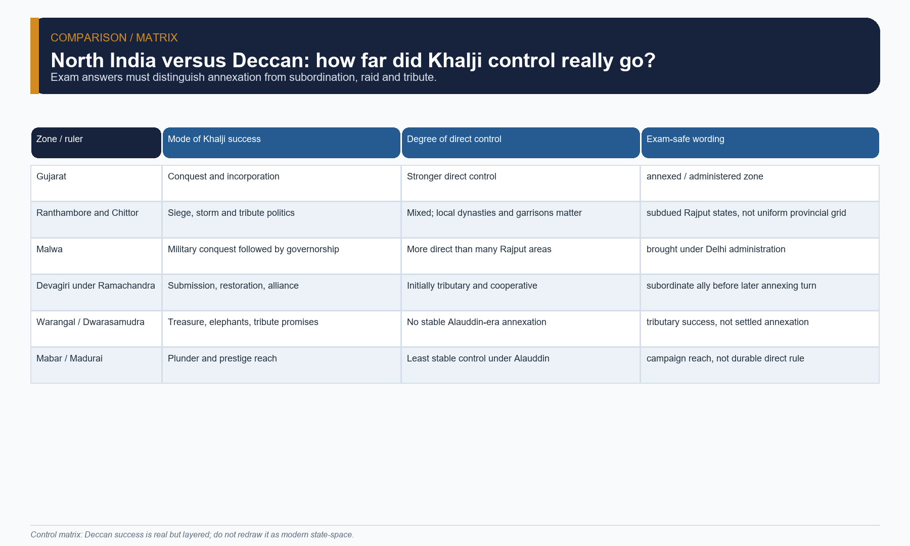

*Control-matrix visual. It separates annexation, restored alliance, tribute extraction and deep campaigning.*

#### Deccan distinction table

| Region | Best description under Alauddin |
|---|---|
| Devagiri under Ramachandra | Restored subordinate ally; later moved toward direct control after rebellion |
| Warangal | Submission and tribute under Alauddin; later annexation belongs mainly to the Tughlaq phase |
| Dwarasamudra | Tribute-yielding military success, not stable Alauddin-era province |
| Mabar / Madurai | Deep raid and plunder zone; control least stable and least directly institutionalised under Alauddin |

#### Why this matters

- [ANALYSIS] Delhi wanted **wealth, prestige and leverage**, not always immediate district-by-district governance.
- [LIMIT] The later Tughlaq annexation story must not be backdated into Alauddin's whole southern policy.

#### PARAGRAPH DEMONSTRATION — CLAIM → EVIDENCE → ANALYSIS → QUALIFICATION

**Claim:** Malik Kafur's Deccan campaigns produced tribute, treasure and submission, not a single wave of Delhi annexation. **Named evidence:** Ramachandra of Devagiri was restored as a subordinate ally after submitting; Warangal, Dwarasamudra and Mabar/Madurai yielded treasure, elephants and tribute promises but not administered provinces under Alauddin. **Analysis:** because Delhi's goal in each case was wealth, prestige and leverage rather than district-by-district governance, "conquered the Deccan" overstates Alauddin's southern policy, while "raided the Deccan" understates its political seriousness - the accurate description sits between the two, naming tribute and restored subordination as the actual outcomes. **Qualification:** this changes once the Tughlaqs later pursue direct annexation of Warangal and other Deccan territories; that later phase belongs to Topic 05 and must not be read backward onto Alauddin's own reign.

#### CLOSING RECALL FLOW — THE DECCAN CAMPAIGNS UNDER MALIK KAFUR: TRIBUTE, TREASURE AND THE LIMITS OF ANNEXATION

```text
START / CONCEPT: The Deccan campaigns under Malik Kafur: tribute, treasure and the limits of annexation
        |
        v
EXACT TERMS: The Deccan campaigns under Malik Kafur · tribute · treasure · the limits of annexation · subordinate alliance · Warangal
        |
        v
MECHANISM / ARGUMENT: Ramachandra of Devagiri/Deogir was restored and honoured after submission, showing that subordinate alliance could serve Delhi better than immediate annexation.
        |
        v
CONSEQUENCE / CONTRAST: The later Tughlaq annexation story must not be backdated into Alauddin's whole southern policy.
        |
        v
UPSC TRAP / ANSWER-USE: Writing that Malik Kafur "annexed the Deccan" is wrong - it collapses restored subordination, tribute-taking and deep raiding into one false single outcome.
        |
        v
ANSWER-GRABBING FORMULATION: Wealth, prestige and leverage, not a district-by-district land register, were what Delhi actually sought from Devagiri, Warangal, Dwarasamudra and Mabar.
```
### SESSION 9 — CHITTOR: SECURE EVIDENCE VERSUS LATER PADMAVAT TRADITION

#### DEFINITION / WHAT THIS IS CALLED

**Plain-language definition:** Chittor 1303 is a secure military event, but Padmavat is a later literary construction that transformed the event into a story of desire, honour and memory.

**Technical definition:** The same OCR notes that the Padmini story appears much later and is elaborated by Malik Muhammad Jaisi in the sixteenth century.

#### ANSWER-GRABBING OPENING — WRITE/ADAPT IN THE EXAM

> Khusrau's contemporary account of Chittor never mentions Padmini; the legend belongs to Jaisi, writing two centuries later.

#### MUST-WRITE KEYWORDS

- **Chittor**
- **secure evidence versus later Padmavat tradition**
- **siege of Chittor**
- **source-layer separation**
- **Malik Muhammad Jaisi**
- **different questions**

**How to use them:** Open by anchoring the siege of Chittor through Amir Khusrau's near-contemporary account; use source-layer separation to keep the military event apart from later memory; name Malik Muhammad Jaisi to date the Padmavat legend precisely, and close by stating that history and literary afterlife answer different questions.

[FACT] The near-contemporary court world, especially Amir Khusrau, securely anchors the **siege of Chittor** and Alauddin's victory.

[FACT] The OCR of Part I states that Khusrau's account does **not** mention the later Padmavati/Padmini legend.

[FACT] The same OCR notes that the Padmini story appears much later and is elaborated by **Malik Muhammad Jaisi** in the sixteenth century.

[ANALYSIS] The historical event and the literary afterlife are both important, but they answer **different questions**.

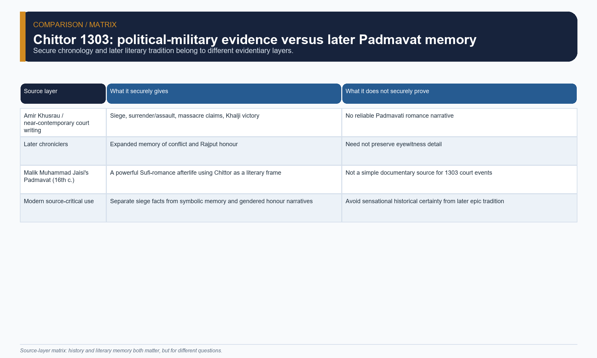

*Source-layer visual. It separates siege evidence from later romance and memory, which UPSC often tests through elimination traps.*

#### Chittor cautions

- [LIMIT] Do not present the **mirror episode**, the **romantic pursuit of Padmavati**, or the full Jaisi narrative as contemporary fact.
- [LIMIT] Even details such as the exact end of **Ratan Singh** or the form and scale of **jauhar** need careful source-layer separation.
- [FACT] The OCRed Part I notes that Khusrau reports a slaughter narrative at Chittor; this should be treated as conquest rhetoric from a court panegyric, not as a precise demography record.

#### Exam-safe verdict

Chittor 1303 is a **secure military event**, but **Padmavat** is a later literary construction that transformed the event into a story of desire, honour and memory. The strongest answer keeps those layers separate without dismissing either.

#### PARAGRAPH DEMONSTRATION — CLAIM → EVIDENCE → ANALYSIS → QUALIFICATION

**Claim:** Chittor's 1303 siege and the Padmavat legend must be treated as two separate evidentiary layers rather than one continuous story. **Named evidence:** Amir Khusrau's near-contemporary courtly account secures the siege and Alauddin's victory but never mentions Padmini, while Malik Muhammad Jaisi's Padmavat, composed only in the sixteenth century, supplies the mirror episode, the romantic pursuit and the jauhar narrative that later became inseparable from popular memory of Chittor. **Analysis:** because roughly two centuries separate the event from its most famous literary retelling, treating Jaisi's poem as eyewitness reportage would import Sufi-romance conventions into a military-political question, while dismissing Padmavat altogether would lose its real significance as later Rajput-Persianate memory. **Qualification:** even Khusrau's own slaughter narrative should be read as court panegyric rhetoric about a victorious siege, not a precise demographic record, so both the near-contemporary and the later source require separate, calibrated caution.

#### CLOSING RECALL FLOW — CHITTOR: SECURE EVIDENCE VERSUS LATER PADMAVAT TRADITION

```text
START / CONCEPT: Chittor: secure evidence versus later Padmavat tradition
        |
        v
EXACT TERMS: Chittor · secure evidence versus later Padmavat tradition · siege of Chittor · source-layer separation · Malik Muhammad Jaisi · different questions
        |
        v
MECHANISM / ARGUMENT: The same OCR notes that the Padmini story appears much later and is elaborated by Malik Muhammad Jaisi in the sixteenth century.
        |
        v
CONSEQUENCE / CONTRAST: The OCRed Part I notes that Khusrau reports a slaughter narrative at Chittor; this should be treated as conquest rhetoric from a court panegyric, not as a precise demography record.
        |
        v
UPSC TRAP / ANSWER-USE: Writing the mirror episode or the romantic pursuit of Padmavati as a contemporary Chittor fact is not safe - it converts a sixteenth-century Sufi romance into thirteenth-century evidence.
        |
        v
ANSWER-GRABBING FORMULATION: Two centuries separate the siege from the legend - answer the exam question with Khusrau's Chittor, and reserve Jaisi's Padmavat for a question about memory, not military history.
```
### SESSION 10 — THEORY OF KINGSHIP AND ANTI-REBELLION CONTROLS

#### DEFINITION / WHAT THIS IS CALLED

**Plain-language definition:** After surviving conspiracies, Alauddin built a theory of kingship in which political necessity, not pure juristic ideal, justified direct controls on noble behaviour.

**Technical definition:** Alauddin's anti-rebellion ordinances - restricting banquets, marriage alliances, wine and elite wealth accumulation while expanding intelligence networks - operationalised a kingship that valued central control over aristocratic autonomy.

#### ANSWER-GRABBING OPENING — WRITE/ADAPT IN THE EXAM

> Alauddin's anti-rebellion ordinances break noble solidarity, cut off conspiracy funding, and multiply surveillance in one coherent political design.

#### MUST-WRITE KEYWORDS

- **Theory of kingship**
- **anti-rebellion controls**
- **banquets or festivities**
- **marriage alliances without permission**
- **wine and intoxicants**
- **spying and information networks**

**How to use them:** Open by naming theory of kingship as reason-of-state rather than juristic ideal; list banquets or festivities, marriage alliances without permission and wine and intoxicants as the three social restrictions; close with spying and information networks as the enforcement layer behind anti-rebellion controls.

[FACT] After facing rebellions, Alauddin forbade nobles to hold **banquets or festivities**, to form **marriage alliances without permission**, and he restricted **wine and intoxicants**.

[FACT] He also expanded **spying and information networks** and confiscated large accumulations of wealth and grants.

[ANALYSIS] These rules form one coherent political mechanism: **break noble solidarity, reduce resources for conspiracy, increase surveillance, and preserve royal awe**.

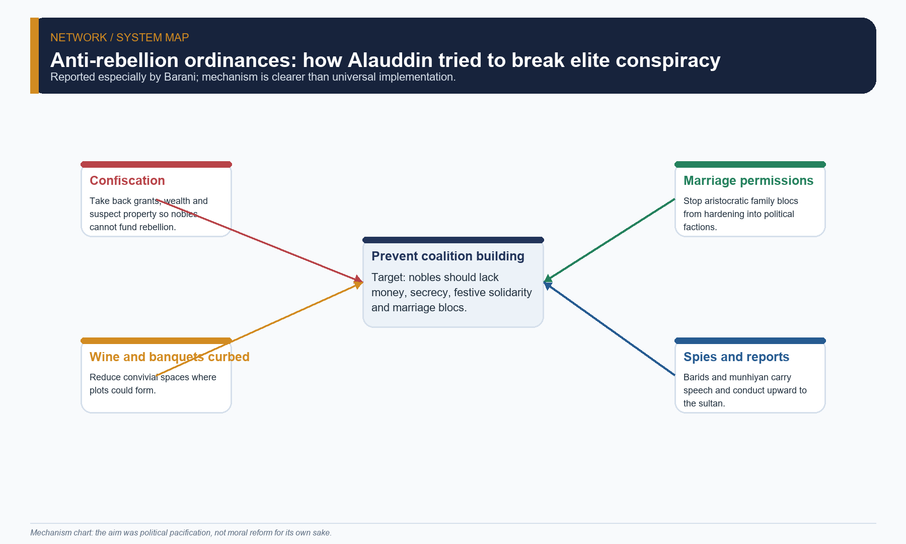

*Mechanism visual. The reported ordinances target conspiracy-building capacity rather than abstract moral reform.*

#### Ordinance-purpose table

| Reported restriction | Anti-rebellion function |
|---|---|
| Confiscation of wealth, grants or suspicious accumulation | Nobles lose independent funding power |
| Ban on convivial gatherings and wine | Plotting spaces shrink |
| Permission for elite marriage alliances | Family blocs cannot easily harden into political factions |
| Spy networks and reports | Conspiracy becomes riskier and costlier |
| Punitive severity | Makes royal disobedience visibly dangerous |

#### Limits

- [LIMIT] The detail is heavily Barani-shaped and should be treated as **reported royal policy**.
- [ANALYSIS] Even if enforcement varied, the political logic is strong and fits Alauddin's wider behaviour.

#### PARAGRAPH DEMONSTRATION — CLAIM → EVIDENCE → ANALYSIS → QUALIFICATION

**Claim:** Alauddin's anti-rebellion ordinances form one coherent political mechanism aimed at faction control, not a random list of moral restrictions. **Named evidence:** he confiscated suspicious accumulations of wealth and grants, banned noble banquets and festive gatherings, required permission for elite marriage alliances, restricted wine, and expanded barid/munhiyan intelligence networks. **Analysis:** each measure removes one resource a conspiracy needs - funding, gathering space, marital alliance-building or secrecy - so read together they break noble solidarity, reduce resources for conspiracy, increase surveillance and preserve royal awe as a single integrated strategy rather than isolated puritanical rules. **Qualification:** because this detail survives mainly through Barani's reported royal policy, the ordinances should be read as the regime's stated design, with enforcement depth across the empire remaining uncertain rather than proven uniform.

#### CLOSING RECALL FLOW — THEORY OF KINGSHIP AND ANTI-REBELLION CONTROLS

```text
START / CONCEPT: Theory of kingship and anti-rebellion controls
        |
        v
EXACT TERMS: Theory of kingship · anti-rebellion controls · banquets or festivities · marriage alliances without permission · wine and intoxicants · spying and information networks
        |
        v
MECHANISM / ARGUMENT: These rules form one coherent political mechanism: break noble solidarity, reduce resources for conspiracy, increase surveillance, and preserve royal awe.
        |
        v
CONSEQUENCE / CONTRAST: Even if enforcement varied, the political logic is strong and fits Alauddin's wider behaviour.
        |
        v
UPSC TRAP / ANSWER-USE: Reading these ordinances as random moral puritanism rather than coordinated anti-conspiracy design misses their real political function.
        |
        v
ANSWER-GRABBING FORMULATION: Confiscation, surveillance, and bans on banquets, wine and unauthorised marriages are four separate levers of the same anti-conspiracy machine.
```
### SESSION 11 — REVENUE REFORMS: KHALISA CORE, MEASUREMENT, HALF-PRODUCE DEMAND AND RURAL EFFECTS

#### DEFINITION / WHAT THIS IS CALLED

**Plain-language definition:** Barani's dramatic language about rural elites becoming destitute and their women working in Muslim houses is moral-political rhetoric and must not be read literally line by line.

**Technical definition:** The demand was linked to measurement of cultivated area and to efforts to prevent the rich from shifting their burden downward.

#### ANSWER-GRABBING OPENING — WRITE/ADAPT IN THE EXAM

> Alauddin's revenue reform pushed the doab to a direct, half-produce khalisa demand and curbed the intermediaries who once softened that burden.

#### MUST-WRITE KEYWORDS

- **Revenue reforms**
- **khalisa core**
- **measurement**
- **half-produce demand**
- **rural effects**
- **around half of the produce**

**How to use them:** Open by naming the khalisa core and half-produce demand as the fiscal heart of the doab reform; use measurement to explain how the state tied demand to cultivated land; close on rural effects to weigh the burden this placed on khuts, muqaddams and chaudhuris.

[FACT] Satish Chandra's concise and Part I OCRs both describe Alauddin raising land revenue to **around half of the produce** in the **upper doab** and making the area **khalisa**, i.e. directly yielding to the imperial treasury.

[FACT] The demand was linked to **measurement of cultivated area** and to efforts to prevent the rich from shifting their burden downward.

[FACT] The same sources connect this policy to curbing the privileges of **khuts, muqaddams and chaudhuris**, and to levying **ghari** and **charai** taxes.

[LIMIT] The strongest evidence concerns **core zones**, not the entire empire.

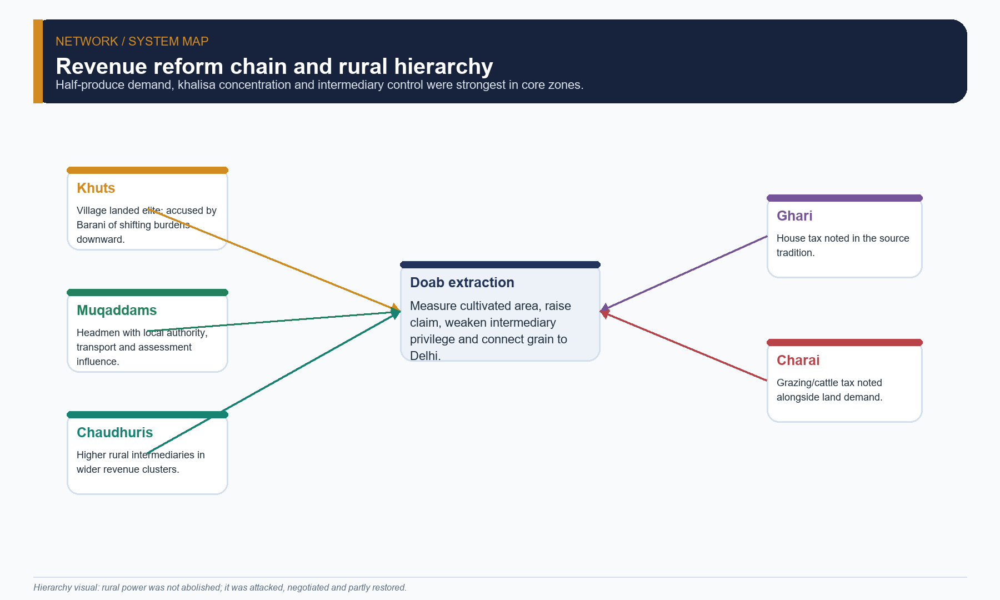

*Revenue visual. It links measurement and state demand to the struggle with local intermediaries and to Delhi's grain economy.*

#### Rural hierarchy and policy

| Actor or levy | Evidence-led interpretation |
|---|---|
| Khuts / muqaddams / chaudhuris | Local landed or intermediary elites whose inherited advantages Alauddin tried to cut back |
| Measurement | Intended to tie demand to cultivated holding rather than negotiated lump sums |
| Half-produce demand | Heavy extraction aimed at maximising state resources in fertile core areas |
| Ghari / charai | House and grazing/cattle taxes mentioned in the source tradition |
| Direct collection | Tightens state-village relationship in khalisa zones |

#### Source caution

- [LIMIT] Barani's dramatic language about rural elites becoming destitute and their women working in Muslim houses is moral-political rhetoric and must not be read literally line by line.
- [ANALYSIS] The deeper point remains valid: Alauddin attacked the fiscal autonomy of rural intermediaries and tried to shift the state's relationship more directly onto cultivators and the local produce stream.

#### PARAGRAPH DEMONSTRATION — CLAIM → EVIDENCE → ANALYSIS → QUALIFICATION

**Claim:** Alauddin's doab revenue reform was designed to maximise direct state extraction by weakening the rural intermediaries who had previously absorbed part of the fiscal burden. **Named evidence:** the upper doab was made khalisa, revenue was measured against cultivated area and pushed to around half of the produce, and the privileges of khuts, muqaddams and chaudhuris were curtailed alongside new ghari and charai levies. **Analysis:** because measurement ties demand to actual land under cultivation rather than a negotiated lump sum, and because cutting intermediary privilege removes the layer that previously cushioned cultivators, the reform simultaneously raised state revenue and increased direct exposure for the peasantry. **Qualification:** Barani's report that rural elites were reduced to destitution is moralising rhetoric that cannot be read as a literal statistic, but the underlying direction of the policy - deeper extraction, weaker intermediaries - is corroborated across both OCR sources and should be trusted even where the dramatic wording is not.

#### CLOSING RECALL FLOW — REVENUE REFORMS: KHALISA CORE, MEASUREMENT, HALF-PRODUCE DEMAND AND RURAL EFFECTS

```text
START / CONCEPT: Revenue reforms: khalisa core, measurement, half-produce demand and rural effects
        |
        v
EXACT TERMS: Revenue reforms · khalisa core · measurement · half-produce demand · rural effects · around half of the produce
        |
        v
MECHANISM / ARGUMENT: The deeper point remains valid: Alauddin attacked the fiscal autonomy of rural intermediaries and tried to shift the state's relationship more directly onto cultivators and the local produce stream.
        |
        v
CONSEQUENCE / CONTRAST: The demand was linked to measurement of cultivated area and to efforts to prevent the rich from shifting their burden downward.
        |
        v
UPSC TRAP / ANSWER-USE: Quoting Barani's destitution language as a literal social statistic is a trap - it mistakes moral-political rhetoric for a verified demographic report.
        |
        v
ANSWER-GRABBING FORMULATION: Measurement plus a half-produce demand plus curtailed khuts, muqaddams and chaudhuris together explain why Delhi could tax the doab harder than any other zone.
```
### SESSION 12 — MARKET REGULATION AS AN INTEGRATED INSTITUTIONAL SYSTEM

#### DEFINITION / WHAT THIS IS CALLED

**Plain-language definition:** The market policy is therefore best read as a city-scale administrative architecture, not a mere price edict.

**Technical definition:** Each was supervised by a shahna, with merchant registers and strict oversight.

#### ANSWER-GRABBING OPENING — WRITE/ADAPT IN THE EXAM

> Three named markets, one shahna each, and a Diwan-i-Riyasat above them turn Alauddin's price policy into a city-scale administrative machine.

#### MUST-WRITE KEYWORDS

- **Market regulation as an integrated institutional system**
- **foodgrains**
- **costly cloth**
- **horses, slaves and cattle**
- **shahna**
- **Diwan-i-Riyasat**

**How to use them:** Open by naming the three markets - foodgrains, costly cloth, and horses/slaves/cattle; use shahna to show each market's day-to-day supervisor; close with Diwan-i-Riyasat as the higher regulatory authority binding all three into one system.

[FACT] The concise OCR states that Alauddin set up three main markets at Delhi: one for **foodgrains**, a second for **costly cloth**, and a third for **horses, slaves and cattle**.

[FACT] Each was supervised by a **shahna**, with merchant registers and strict oversight. Topic 04's advanced owner additionally identifies the higher regulatory umbrella as the **Diwan-i-Riyasat**.

[FACT] The system also used **registered merchants**, **banjaras**, **state granaries**, **espionage** and **punitive enforcement**.

[ANALYSIS] The market policy is therefore best read as a **city-scale administrative architecture**, not a mere price edict.

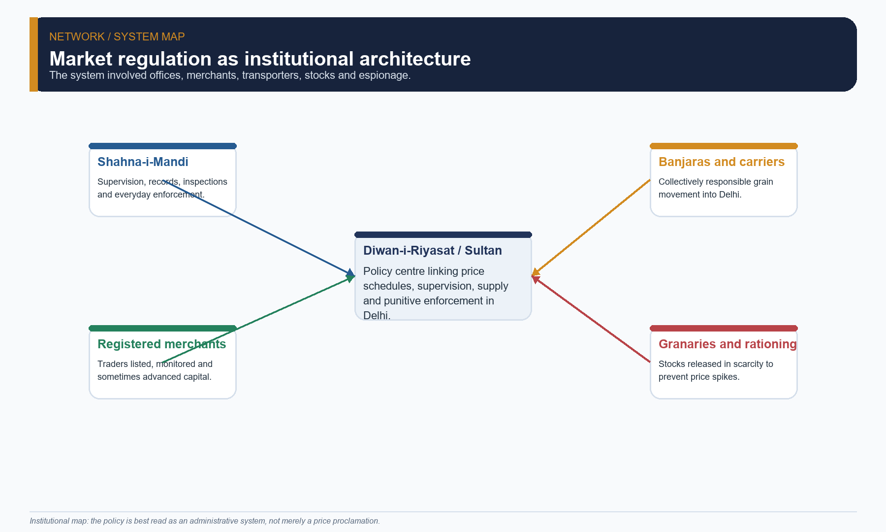

*Institutional visual. Supervision, grain movement, stockholding and merchant registration all plug into the same Delhi-centred system.*

#### Institutional table

| Institutional node | Function |
|---|---|
| Sultan / Diwan-i-Riyasat | Policy centre and top supervision |
| Shahna-i-Mandi | Day-to-day regulated market supervision |
| Merchants and registers | Track supply, location, identity and compliance |
| Banjaras | Move grain to the capital under monitored conditions |
| State granaries | Buffer stocks in scarcity and siege |
| Spies / informants | Detect evasion, overpricing and collusion |

#### PARAGRAPH DEMONSTRATION — CLAIM → EVIDENCE → ANALYSIS → QUALIFICATION

**Claim:** Alauddin's market control was a designed institutional system, not an improvised price announcement. **Named evidence:** the three named Delhi markets - for foodgrains, costly cloth and horses/slaves/cattle - each had a shahna supervising a merchant register, while banjaras, state granaries and spies fed supply, storage and intelligence into the same structure under the wider authority of the Diwan-i-Riyasat. **Analysis:** because each institutional node performs a distinct function - supervision, transport, storage or detection - and all report through a shared hierarchy up to the Sultan, the system meets the test of an administrative architecture rather than a single decree; a decree alone could not have moved grain, tracked merchants or punished evasion. **Qualification:** this institutional picture rests mainly on Barani, so its completeness and uniform enforcement across even Delhi's own neighbourhoods should be treated as reported design rather than an audited operations manual.

#### CLOSING RECALL FLOW — MARKET REGULATION AS AN INTEGRATED INSTITUTIONAL SYSTEM

```text
START / CONCEPT: Market regulation as an integrated institutional system
        |
        v
EXACT TERMS: Market regulation as an integrated institutional system · foodgrains · costly cloth · horses, slaves and cattle · shahna · Diwan-i-Riyasat
        |
        v
MECHANISM / ARGUMENT: Each was supervised by a shahna, with merchant registers and strict oversight.
        |
        v
CONSEQUENCE / CONTRAST: Registered merchants, banjaras, state granaries, espionage and punitive enforcement all fed into the same regulated-market structure.
        |
        v
UPSC TRAP / ANSWER-USE: Describing Alauddin's market control as "just a price list" is wrong; it ignores the registers, transport, storage and intelligence layers that made the prices enforceable.
        |
        v
ANSWER-GRABBING FORMULATION: A register, a supervisor and a granary behind every fixed price is what separates Alauddin's market system from a mere royal decree.
```
### SESSION 13 — THE FOUR MARKET CLUSTERS AND THE PROBLEM OF PRICE SCHEDULES

#### DEFINITION / WHAT THIS IS CALLED

**Plain-language definition:** These are reported schedule markers, not proof of immutable empire-wide prices.

**Technical definition:** The sources securely describe three named physical market clusters; Topic 04 uses a fourth analytical cluster to capture general regulated commodities beyond the three named spaces.

#### ANSWER-GRABBING OPENING — WRITE/ADAPT IN THE EXAM

> Wheat at 7 1/2 jitals per man is a Barani-reported schedule marker, not a certified empire-wide price index.

#### MUST-WRITE KEYWORDS

- **The four market clusters**
- **the problem of price schedules**
- **three named physical market clusters**
- **fourth analytical cluster**
- **sample reported prices**
- **7 1/2 jitals per man**

**How to use them:** Open by naming the three named physical market clusters and adding the fourth analytical cluster for general goods; cite sample reported prices such as 7 1/2 jitals per man only as illustration; close by flagging the problem of price schedules - unit and manuscript variation.

[FACT] The sources securely describe **three named physical market clusters**; Topic 04 uses a **fourth analytical cluster** to capture general regulated commodities beyond the three named spaces.

[FACT] The concise OCR preserves sample Barani-linked schedules: wheat at **7 1/2 jitals per man**, barley at **4**, good rice at **5**; a first-grade horse at roughly **100-120 tankas/zankas**, and a tattu/pony at **10-25**.

[LIMIT] These are **reported schedule markers**, not proof of immutable empire-wide prices. Units and manuscript/OCR spellings vary.

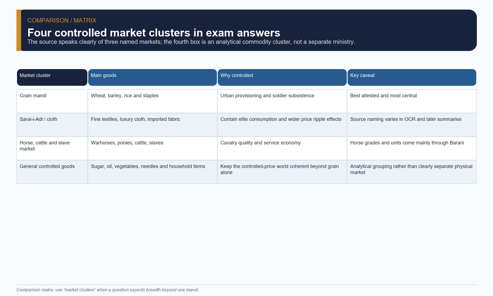

*Comparison visual. It distinguishes the grain mandi, cloth/luxury market, horse-cattle-slave market and a broader controlled-commodities cluster.*

#### Market-cluster table

| Cluster | Goods | Function | Caveat |
|---|---|---|---|
| Grain mandi | Wheat, barley, rice and staples | Urban provisioning and salary-value preservation | Best attested |
| Sarai-i-Adl / cloth sphere | Fine textiles and expensive cloth | Contain elite-consumption prices and wider inflationary spillover | OCR and later naming vary |
| Horse-cattle-slave market | Warhorses, ponies, cattle, slaves | Army quality and service economy | Numbers are heavily Barani-mediated |
| Wider controlled commodities | Oil, sugar, vegetables, tools and daily-use goods | Make the price regime coherent beyond grain | Analytical category, not necessarily a separate market square |

#### Exam-safe price note

- [ANALYSIS] If a question demands an example, use one or two **sample reported prices**, name **Barani via Satish Chandra**, and immediately add a unit/manuscript caveat.

#### PARAGRAPH DEMONSTRATION — CLAIM → EVIDENCE → ANALYSIS → QUALIFICATION

**Claim:** Alauddin's price schedules are best cited as illustrative examples, never as a certified statistical index. **Named evidence:** the sources report wheat at roughly 7 1/2 jitals per man, barley at 4, good rice at 5, a first-grade horse at 100-120 tankas and a pony at 10-25 tankas, organised across three named physical clusters (grain mandi, cloth/Sarai-i-Adl, horse-cattle-slave market) plus a fourth analytical cluster of wider controlled commodities. **Analysis:** because these figures survive only through Barani as reported by Satish Chandra, and because units and spellings vary across manuscripts and OCR transcriptions, quoting one or two prices with a source name and a unit caveat earns more marks than reciting a long list as if it were an audited price index. **Qualification:** the fourth cluster is this repository's own analytical grouping, not a named contemporary market square, so it should be used to organise the exam answer rather than quoted as an attested Sultanate institution.

#### CLOSING RECALL FLOW — THE FOUR MARKET CLUSTERS AND THE PROBLEM OF PRICE SCHEDULES

```text
START / CONCEPT: The four market clusters and the problem of price schedules
        |
        v
EXACT TERMS: The four market clusters · the problem of price schedules · three named physical market clusters · fourth analytical cluster · sample reported prices · 7 1/2 jitals per man
        |
        v
MECHANISM / ARGUMENT: The sources securely describe three named physical market clusters; Topic 04 uses a fourth analytical cluster to capture general regulated commodities beyond the three named spaces.
        |
        v
CONSEQUENCE / CONTRAST: If a question demands an example, use one or two sample reported prices, name Barani via Satish Chandra, and immediately add a unit/manuscript caveat.
        |
        v
UPSC TRAP / ANSWER-USE: Quoting the fourth analytical cluster as if it were a fourth named contemporary market square is wrong; it confuses this repository's teaching category with a historical institution.
        |
        v
ANSWER-GRABBING FORMULATION: Cite a price, name Barani, add a unit caveat - that three-step move earns marks; reciting a long price list without caution does not.
```
### SESSION 14 — GRAIN SUPPLY, BANJARAS, GRANARIES AND RATIONING IN SCARCITY

#### DEFINITION / WHAT THIS IS CALLED

**Plain-language definition:** The same OCR and the advanced owner note that all banjaras were registered and collectively responsible, while the state also built warehouses or granaries.

**Technical definition:** Grain was released when there was famine or a danger of shortfall.

#### ANSWER-GRABBING OPENING — WRITE/ADAPT IN THE EXAM

> Registered banjaras, state granaries and scarcity-time release turned Delhi's grain supply into a monitored logistics chain, not a passive market.

#### MUST-WRITE KEYWORDS

- **Grain supply**
- **banjaras**
- **granaries**
- **rationing in scarcity**
- **warehouses or granaries**
- **some cultivators brought grain directly to local mandis**

**How to use them:** Open by naming banjaras as the registered, collectively responsible transporters of Delhi's grain supply; use granaries and warehouses or granaries to show buffer-stock logic; close with rationing in scarcity and the qualification that some cultivators brought grain directly to local mandis.

[FACT] Satish Chandra's concise OCR says Alauddin forced cultivators, especially through cash demand and pressure, to sell grain at low rates to **banjaras**, who carried it to towns at state-fixed prices.

[FACT] The same OCR and the advanced owner note that all **banjaras** were registered and collectively responsible, while the state also built **warehouses or granaries**.

[FACT] Grain was released when there was famine or a danger of shortfall.

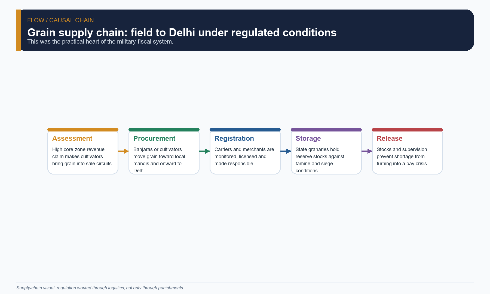

*Supply-chain visual. It shows why a price system needed logistics, storage and coercive monitoring.*

#### Mechanism steps

1. [FACT] Core-zone extraction increases the state-visible grain stream.
2. [FACT] Cash demand and monitored sale channels push grain into market circulation.
3. [FACT] Banjaras and merchants become registered transport links.
4. [FACT] State granaries cushion shortage and siege conditions.
5. [ANALYSIS] Delhi can thereby keep staple prices from exploding and maintain the real worth of fixed salaries.

#### Important qualification

- [LIMIT] Part I's OCR itself notes that practice varied, because **some cultivators brought grain directly to local mandis**. The system was forceful, but not perfectly uniform.

#### PARAGRAPH DEMONSTRATION — CLAIM → EVIDENCE → ANALYSIS → QUALIFICATION

**Claim:** Delhi's cheap grain supply depended on a monitored logistics chain, not simply on fixing a price. **Named evidence:** cultivators were pressed to sell at low, cash-linked rates to registered and collectively responsible banjaras, who carried grain into Delhi where state granaries stocked buffer supplies for release in famine or shortage. **Analysis:** because registration made banjaras jointly liable for delivery and granaries absorbed shocks in bad seasons, the state converted an ordinary agrarian surplus into a dependable, price-stabilising urban supply chain - each step (extraction, transport, storage, release) had to function for the fixed prices at Delhi's markets to hold. **Qualification:** Part I's own OCR notes that some cultivators still sold directly to local mandis outside this chain, so "forceful and organised" is accurate, but "perfectly uniform" is not.

#### CLOSING RECALL FLOW — GRAIN SUPPLY, BANJARAS, GRANARIES AND RATIONING IN SCARCITY

```text
START / CONCEPT: Grain supply, banjaras, granaries and rationing in scarcity
        |
        v
EXACT TERMS: Grain supply · banjaras · granaries · rationing in scarcity · warehouses or granaries · some cultivators brought grain directly to local mandis
        |
        v
MECHANISM / ARGUMENT: Grain was released when there was famine or a danger of shortfall.
        |
        v
CONSEQUENCE / CONTRAST: The system was forceful, but not perfectly uniform.
        |
        v
UPSC TRAP / ANSWER-USE: Assuming every cultivator sold only to state-registered banjaras at fixed prices is wrong; it overstates the uniformity of an admittedly forceful system.
        |
        v
ANSWER-GRABBING FORMULATION: Extraction, transport, storage and release each had to work for Delhi's grain price to stay fixed - remove one link and the chain breaks.
```
### SESSION 15 — THE MILITARY-FISCAL CAUSAL CHAIN: REVENUE -> GRAIN -> PRICES -> SALARY -> ARMY

#### DEFINITION / WHAT THIS IS CALLED

**Plain-language definition:** The most quoted argument in Topic 04's base files is that Mongol danger forced Alauddin to maintain a large cavalry army, but he lacked unlimited treasure.

**Technical definition:** The beneficiaries were first of all the state and army.

#### ANSWER-GRABBING OPENING — WRITE/ADAPT IN THE EXAM

> Revenue, grain, prices and salary are one causal chain: break any link and a 238-tanka cavalryman's real pay collapses.

#### MUST-WRITE KEYWORDS

- **The military-fiscal causal chain**
- **revenue - grain - prices - salary - army**
- **village extraction**
- **urban provisioning**
- **cavalry affordability**
- **238 tankas annually**

**How to use them:** Open by naming the military-fiscal causal chain as revenue - grain - prices - salary - army; use village extraction and urban provisioning to show the two ends of the chain; close on cavalry affordability and the reported 238 tankas annually figure as the payoff the whole chain protects.

[FACT] The most quoted argument in Topic 04's base files is that Mongol danger forced Alauddin to maintain a large cavalry army, but he lacked unlimited treasure.

[FACT] Hence land revenue, grain movement and fixed prices worked together so that a reported pay scale of around **238 tankas annually** for a cavalryman remained viable.

[ANALYSIS] This is the strongest single answer-spine for the topic because it connects **village extraction**, **urban provisioning**, **cavalry affordability** and **frontier defence**.

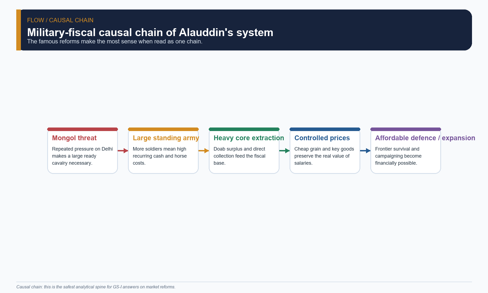

*Causal-chain visual. It translates the famous reforms into a linked state-capacity mechanism rather than a list of isolated measures.*

#### Chain table

| Link | Historical content |
|---|---|
| Mongol threat | Repeated major attacks exposed Delhi's vulnerability |
| Need for large standing army | More cavalry, more horses, more permanent expense |
| Heavy doab extraction | Generates grain and cash basis for the centre |
| Controlled prices | Preserves the real value of salaries and mounts |
| Affordable frontier security | Makes defence and campaign mobility financially possible |

#### Why this is not socialism

- [ANALYSIS] The beneficiaries were first of all the **state and army**.
- [ANALYSIS] Urban consumers benefited, but that was secondary to the military-fiscal logic.
- [LIMIT] A coercive capital-centred regime preserving cheap provisions for soldiers is not the same as a welfare or redistributive ideology.

#### PARAGRAPH DEMONSTRATION — CLAIM → EVIDENCE → ANALYSIS → QUALIFICATION

**Claim:** Topic 04's single strongest answer-spine is the causal chain linking revenue, grain, prices, salary and army. **Named evidence:** heavy doab revenue extraction generated grain and cash for Delhi; that grain moved through banjaras and granaries into regulated markets; fixed prices there preserved the real value of a cavalryman's reported annual pay of around 238 tankas; and that affordable pay sustained the large standing cavalry needed against the Mongols. **Analysis:** because each link depends on the one before it - extraction feeds supply, supply feeds price control, price control feeds real wages, real wages feed army size - explaining any one reform (say, market regulation) without the others breaks the chain and produces an incomplete, monocausal answer. **Qualification:** urban consumers also benefited from stable prices, but that benefit was a by-product of army affordability, not evidence that the system was a welfare or redistributive programme.

#### CLOSING RECALL FLOW — THE MILITARY-FISCAL CAUSAL CHAIN: REVENUE -> GRAIN -> PRICES -> SALARY -> ARMY

```text
START / CONCEPT: The military-fiscal causal chain: revenue -> grain -> prices -> salary -> army
        |
        v
EXACT TERMS: The military-fiscal causal chain · revenue - grain - prices - salary - army · village extraction · urban provisioning · cavalry affordability · 238 tankas annually
        |
        v
MECHANISM / ARGUMENT: This is the strongest single answer-spine for the topic because it connects village extraction, urban provisioning, cavalry affordability and frontier defence.
        |
        v
CONSEQUENCE / CONTRAST: Urban consumers benefited, but that was secondary to the military-fiscal logic.
        |
        v
UPSC TRAP / ANSWER-USE: A coercive capital-centred regime preserving cheap provisions for soldiers is not the same as a welfare or redistributive ideology.
        |
        v
ANSWER-GRABBING FORMULATION: Explain any one Khalji reform without this five-step chain and the answer becomes a list of facts instead of a mechanism.
```
### SESSION 16 — WHY DID ALAUDDIN REGULATE MARKETS? OBJECTIVES, INSTRUMENTS AND LIMITS

#### DEFINITION / WHAT THIS IS CALLED

**Plain-language definition:** [DEBATE] Motives were multiple: military necessity, anti-noble politics, urban provisioning and price discipline all mattered.

**Technical definition:** The system can be primarily military-fiscal without excluding other motives.

#### ANSWER-GRABBING OPENING — WRITE/ADAPT IN THE EXAM

> Military necessity anchors the system, but anti-noble politics and urban provisioning rode alongside it - call it primarily, not exclusively, military-fiscal.

#### MUST-WRITE KEYWORDS

- **Why did Alauddin regulate markets? Objectives**
- **instruments**
- **limits**
- **military-fiscal motive**
- **primarily**
- **Military necessity**

**How to use them:** Open by placing the military-fiscal motive at the centre of objectives; use instruments to list the enforcement machinery already taught in Session 12; close on limits to show why the answer must qualify "primarily" rather than claim a single exclusive cause.

[DEBATE] Motives were multiple: military necessity, anti-noble politics, urban provisioning and price discipline all mattered.

[FACT] Topic 04's basic and advanced owners place the **military-fiscal motive** at the centre.

[FACT] The same evidence also shows anti-noble design, because wealth, social gatherings and autonomous elite networking were directly targeted.

[LIMIT] Avoid monocausal certainty. The system can be **primarily** military-fiscal without excluding other motives.

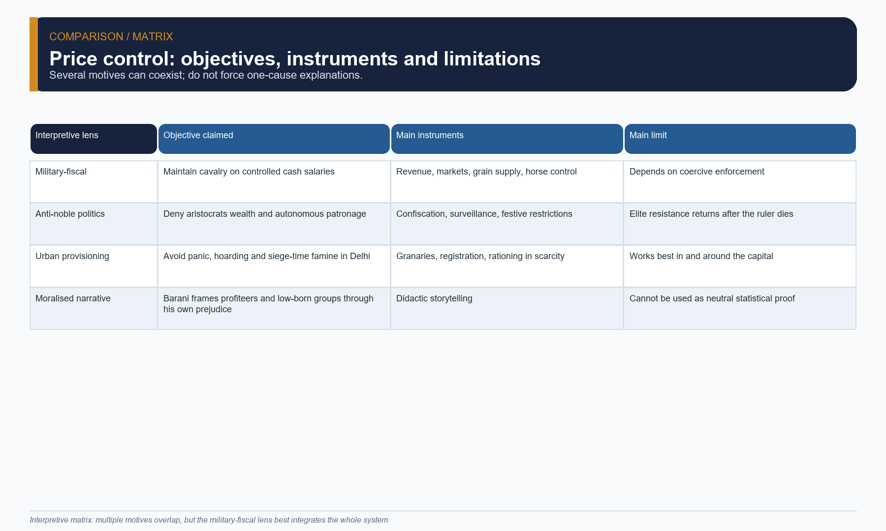

*Interpretive matrix. It prevents simplistic one-cause readings and keeps instrument and limit attached to each motive claim.*

#### Motivation table

| Motive | Evidence-led assessment |
|---|---|
| Military necessity | Strongest integrative explanation; best links army, grain and salaries |
| Anti-noble strategy | Strong secondary explanation; fits confiscation and social restrictions |
| Urban provisioning | Clearly present, especially in the grain and granary system |
| Anti-inflation or administrative rationality | Present in effect, but not best detached from military needs |

#### Limits table

| Limit | Why it matters |
|---|---|
| Delhi focus | Prevents empire-wide overstatement |
| Coercive administrative cost | Explains why durability was low |
| Dependence on ruler's will | Explains rapid post-1316 unraveling |
| Source dependence on Barani | Prevents statistical certainty and ideological slogans |

#### PARAGRAPH DEMONSTRATION — CLAIM → EVIDENCE → ANALYSIS → QUALIFICATION

**Claim:** Alauddin's market regulation is best explained as primarily a military-fiscal motive, without excluding secondary anti-noble and provisioning purposes. **Named evidence:** the reforms integrate directly with cavalry pay and Mongol defence (the strongest integrative link), while the same institutions - confiscation, wealth controls, surveillance - overlap with anti-rebellion policy, and Delhi's granary/rationing system plainly served urban provisioning too. **Analysis:** because a single set of institutions (registers, spies, granaries) simultaneously serves army affordability, noble control and capital supply, the question "what was the motive" cannot have one exclusive answer; ranking military necessity first while naming the others as real secondary effects is more defensible than either a monocausal or an undifferentiated "many reasons" answer. **Qualification:** the coercive administrative cost of running this system, and its dependence on the ruler's personal will, are themselves evidence that no motive - however important - produced a durable institution capable of surviving Alauddin's death.

#### CLOSING RECALL FLOW — WHY DID ALAUDDIN REGULATE MARKETS? OBJECTIVES, INSTRUMENTS AND LIMITS

```text
START / CONCEPT: Why did Alauddin regulate markets? Objectives, instruments and limits
        |
        v
EXACT TERMS: Why did Alauddin regulate markets? Objectives · instruments · limits · military-fiscal motive · primarily · Military necessity
        |
        v
MECHANISM / ARGUMENT: The operative mechanism is that military necessity, anti-noble politics, urban provisioning and price discipline all mattered.
        |
        v
CONSEQUENCE / CONTRAST: The system can be primarily military-fiscal without excluding other motives.
        |
        v
UPSC TRAP / ANSWER-USE: Ranking anti-noble politics or urban provisioning above military necessity is wrong; it inverts the repository's own evidence-led hierarchy of motives.
        |
        v
ANSWER-GRABBING FORMULATION: A single motive answer always loses marks here; rank military necessity first, but name anti-noble politics and provisioning as real, evidenced secondary effects.
```
### SESSION 17 — ENFORCEMENT, ESPIONAGE, PUNISHMENTS AND THE BLACK-MARKET PROBLEM

#### DEFINITION / WHAT THIS IS CALLED

**Plain-language definition:** Enforcement, espionage and harsh punishments, not the price list alone, are what actually made Alauddin's black-market crackdown work.

**Technical definition:** Enforcement rested on barids and munhiyan reporting violations upward, on merchant and weight registers catching fraud, and on severe punishment deterring overpricing, short-weighing and fraudulent horse supply.

#### ANSWER-GRABBING OPENING — WRITE/ADAPT IN THE EXAM

> A price schedule without enforcement is just a wish list; Alauddin paired his prices with spies, registers and harsh punishment.

#### MUST-WRITE KEYWORDS

- **Enforcement**
- **espionage**
- **punishments**
- **the black-market problem**
- **overpricing**
- **false weights**

**How to use them:** Open by naming enforcement and espionage as the backbone of price discipline; use overpricing and false weights as the two commonest violations; close with punishments and the black-market problem to show why surveillance could never be total.

[FACT] The local sources repeatedly stress strict punishment for **overpricing**, **false weights**, **fraudulent horse supply** and other evasions.

[FACT] Barids and munhiyan are part of the Sultanate information world; Topic 04's advanced owner and Topic 07's institutional bank justify their use here.

[ANALYSIS] Such a system could function only if the ruler distrusted both **merchants** and **his own officials**.

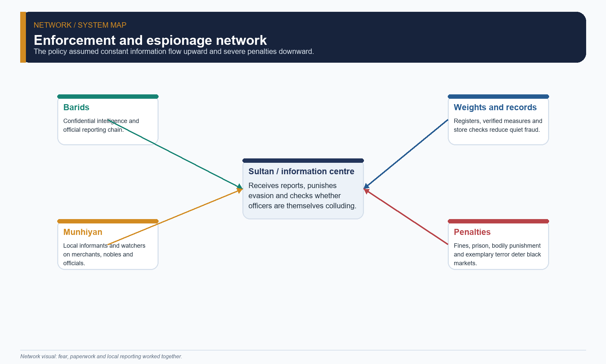

*Network visual. It shows how fear, record keeping and upward reporting reinforced the regulated market world.*

#### Enforcement points

- [FACT] Registers and verification mattered.
- [FACT] Weights and measures were monitored.
- [FACT] State advances to merchants are reported in the cloth sector, especially with **Multani traders**.
- [ANALYSIS] This shows that Alauddin did not eliminate commerce. He **disciplined** and channelled it.

#### Black-market caution

- [LIMIT] No coercive price regime abolishes evasion entirely.
- [ANALYSIS] The very intensity of surveillance suggests that slippage, collusion and quality substitution were real risks.

#### PARAGRAPH DEMONSTRATION — CLAIM → EVIDENCE → ANALYSIS → QUALIFICATION

**Claim:** Alauddin's price schedules were only as strong as the enforcement machinery that backed them. **Named evidence:** barids and munhiyan reported violations upward, registers tracked merchants and weights, and strict punishment targeted overpricing, false weights and fraudulent horse supply, while state advances to Multani cloth traders show the regime disciplining rather than eliminating commerce. **Analysis:** because a fixed price creates an incentive to hoard, short-weigh or sell off-book, the enforcement layer was not an optional add-on but a structural requirement of the whole market system - remove it and the price schedule becomes unenforceable. **Qualification:** the very intensity of this surveillance is itself evidence that a black market, evasion and collusion were real ongoing risks, not proof that the system achieved perfect compliance.

#### CLOSING RECALL FLOW — ENFORCEMENT, ESPIONAGE, PUNISHMENTS AND THE BLACK-MARKET PROBLEM

```text
START / CONCEPT: Enforcement, espionage, punishments and the black-market problem
        |
        v
EXACT TERMS: Enforcement · espionage · punishments · the black-market problem · overpricing · false weights
        |
        v
MECHANISM / ARGUMENT: Such a system could function only if the ruler distrusted both merchants and his own officials.
        |
        v
CONSEQUENCE / CONTRAST: This shows that Alauddin did not eliminate commerce.
        |
        v
UPSC TRAP / ANSWER-USE: Claiming the price schedule eliminated evasion entirely is wrong; it ignores that intense surveillance is itself evidence of a persistent black-market risk.
        |
        v
ANSWER-GRABBING FORMULATION: Barids, munhiyan, registers and severe punishment are the enforcement receipts that turn a price schedule from a wish list into a working system.
```
### SESSION 18 — EFFECTIVENESS, GEOGRAPHIC SCOPE, MONETISATION AND URBAN ECONOMY

#### DEFINITION / WHAT THIS IS CALLED

**Plain-language definition:** Part I's OCR states that one significant effect of Alauddin's agrarian reforms was the furthering of the growth of a market economy in villages and a more integral relationship between town and country.

**Technical definition:** The concise OCR also notes that Delhi became the biggest market for fine cloth after large advances were made to traders bringing goods there.

#### ANSWER-GRABBING OPENING — WRITE/ADAPT IN THE EXAM

> Delhi became the biggest market for fine cloth under Alauddin - proof that regulation redirected commerce rather than destroying it.

#### MUST-WRITE KEYWORDS

- **Effectiveness**
- **geographic scope**
- **monetisation**
- **urban economy**
- **growth of a market economy**
- **monetisation and urban-provisioning**

**How to use them:** Open by naming Delhi's rise as the biggest fine-cloth market as proof of effectiveness; use growth of a market economy and monetisation and urban-provisioning to show the reform's positive economic effect; close with geographic scope as the boundary that keeps the claim honest.

[FACT] Part I's OCR states that one significant effect of Alauddin's agrarian reforms was the furthering of the **growth of a market economy** in villages and a more integral relationship between town and country.

[FACT] The concise OCR also notes that **Delhi became the biggest market for fine cloth** after large advances were made to traders bringing goods there.

[FACT] Land revenue in cash helped pay soldiers in cash; this fits a wider **monetisation and urban-provisioning** story rather than the destruction of trade.

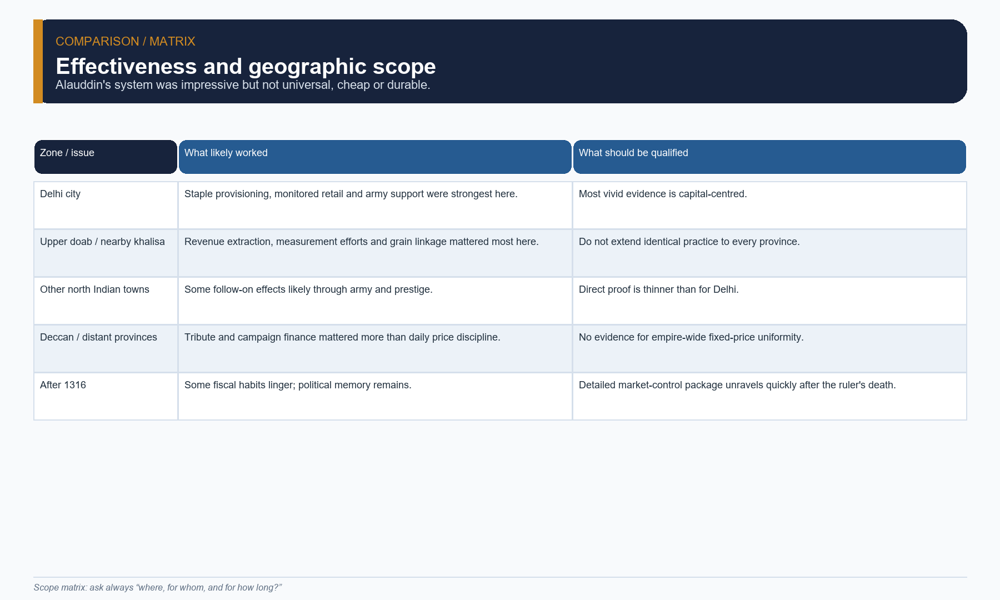

*Scope visual. It asks the essential exam questions: where did the system work, for whom did it work, and how durable was it?*

#### Effectiveness verdict

| Claim | Verdict |
|---|---|
| The system was effective in Delhi provisioning and salary stabilisation | [ANALYSIS] broadly yes |
| The system covered the entire empire with equal depth | [LIMIT] no secure evidence |
| The system destroyed commerce | [LIMIT] false; it redirected and regulated commerce |
| The system outlived Alauddin easily | [LIMIT] false; the detailed package frayed rapidly |

#### Cash, trade and town-country linkage

- [FACT] Cash demand linked cultivators more tightly to mandis.
- [FACT] Multani traders and other merchants remained active.
- [ANALYSIS] Alauddin's system therefore intensified **monetised circulation under coercive supervision**, rather than ending the market.

#### PARAGRAPH DEMONSTRATION — CLAIM → EVIDENCE → ANALYSIS → QUALIFICATION

**Claim:** Alauddin's price and revenue reforms were effective at what they were designed to do - Delhi provisioning and cavalry-pay stability - without covering the whole empire or ending commerce. **Named evidence:** Part I's OCR credits the agrarian reforms with furthering village market growth and tighter town-country linkage, and separately records that Delhi became the biggest market for fine cloth once traders received state advances. **Analysis:** because cash revenue demand pushed cultivators toward monetised sale and merchants kept operating (and were even financed) under the new rules, the system's real effect was to intensify and redirect commercial circulation under coercive supervision, not to abolish trade - a claim of "destroyed commerce" is falsified by the same sources that document the reforms. **Qualification:** effectiveness here means Delhi-centred provisioning and salary stability; it does not mean equal-depth enforcement empire-wide or survival beyond Alauddin's own reign.

#### CLOSING RECALL FLOW — EFFECTIVENESS, GEOGRAPHIC SCOPE, MONETISATION AND URBAN ECONOMY

```text
START / CONCEPT: Effectiveness, geographic scope, monetisation and urban economy
        |
        v
EXACT TERMS: Effectiveness · geographic scope · monetisation · urban economy · growth of a market economy · monetisation and urban-provisioning
        |
        v
MECHANISM / ARGUMENT: The concise OCR also notes that Delhi became the biggest market for fine cloth after large advances were made to traders bringing goods there.
        |
        v
CONSEQUENCE / CONTRAST: Land revenue in cash helped pay soldiers in cash, fitting a wider monetisation and urban-provisioning story rather than the destruction of trade.
        |
        v
UPSC TRAP / ANSWER-USE: Claiming the system "destroyed commerce" is wrong; it ignores that the same sources record Delhi becoming the biggest fine-cloth market under Alauddin.
        |
        v
ANSWER-GRABBING FORMULATION: The effect was strongest in Delhi's provisioning and army pay, real in monetisation and market growth, but never proven equal in depth across the whole empire.
```
### SESSION 19 — ALAUDDIN, ULEMA, RELIGION AND POLITICAL EXPEDIENCY

#### DEFINITION / WHAT THIS IS CALLED

**Plain-language definition:** Even with that caution, the political principle is clear: Alauddin did not let juristic scruple alone define statecraft.

**Technical definition:** The advanced OCR preserves the famous Barani-reported argument in which Alauddin prioritises what is necessary for the state over neat conformity to shara.

#### ANSWER-GRABBING OPENING — WRITE/ADAPT IN THE EXAM

> Alauddin subordinated juristic ideal to reason of state without becoming a modern secular ruler or an anti-religious one.

#### MUST-WRITE KEYWORDS

- **Alauddin**
- **ulema**
- **religion**
- **political expediency**
- **shara**
- **reason of state**

**How to use them:** Open by naming political expediency as Alauddin's guiding principle over strict shara conformity; use ulema and religion to show the relationship was tense, not absent; close with reason of state as the safe analytical label that avoids both secularism and theocracy claims.

[FACT] The advanced OCR preserves the famous Barani-reported argument in which Alauddin prioritises what is necessary for the **state** over neat conformity to **shara**.

[LIMIT] Because Barani writes later, the exact wording must be treated cautiously.

[ANALYSIS] Even with that caution, the political principle is clear: Alauddin did not let juristic scruple alone define statecraft. But that does **not** turn him into a modern secular ruler.

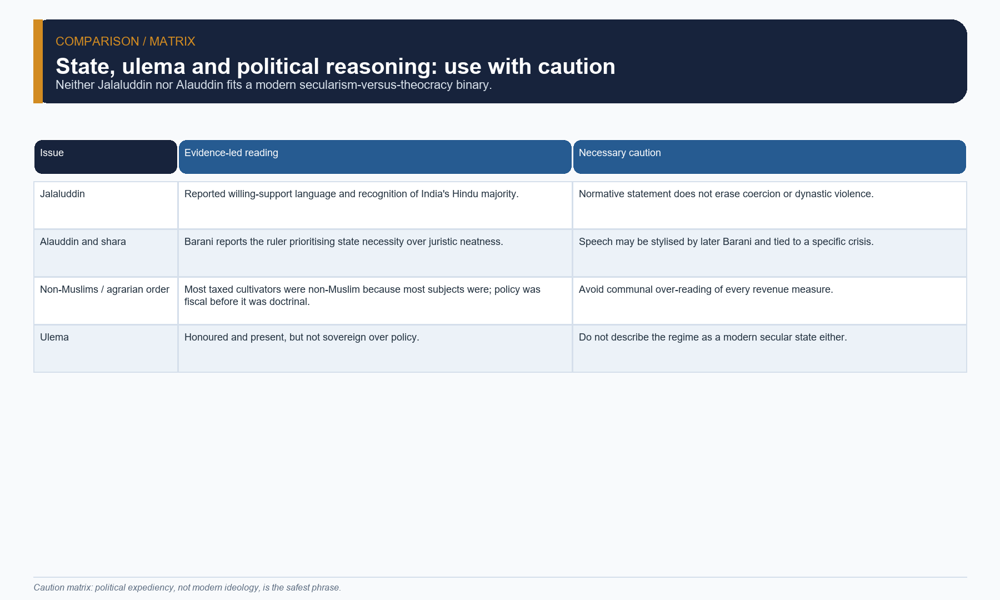

*Caution visual. It keeps Jalaluddin's support rhetoric, Alauddin's state necessity and the limits of modern ideological labelling distinct.*

#### Exam-safe religion-state statements

| Statement | Safe? | Why |
|---|---|---|
| Alauddin separated religion from politics in a modern secular sense | No | The idiom is one of reason of state, not constitutional secularism |
| The Khalji state was a pure ulema-run theocracy | No | Political decisions repeatedly overrode or supplemented juristic preference |
| Agrarian policy should be read only as anti-Hindu policy | No | The demographic majority of taxpayers was Hindu, but the policy's internal logic is fiscal-military |
| Jalaluddin and Alauddin were identical in state-religion reasoning | No | Jalaluddin's rhetoric of support differs from Alauddin's harder reason-of-state stance |

#### Jizya and non-Muslims

- [LIMIT] Jizya is not the main analytical axis of Topic 04.
- [ANALYSIS] For this owner, **kharaj, ghari, charai, confiscation and market control** matter far more than a communal template.

#### PARAGRAPH DEMONSTRATION — CLAIM → EVIDENCE → ANALYSIS → QUALIFICATION

**Claim:** Alauddin governed by reason of state rather than by strict juristic conformity, without this making him secular or anti-religious. **Named evidence:** Barani reports Alauddin arguing that state necessity, not neat shara conformity, should guide policy - a stance visible in his market ordinances and anti-noble controls, which have no direct scriptural basis. **Analysis:** because he still used Islamic legitimation and religious rhetoric while asserting wide discretion in practical rule, the correct label is a medieval "reason of state" idiom - not modern constitutional secularism (which separates religion from politics as a legal principle) and not a pure ulema-run theocracy (since political decisions repeatedly overrode juristic preference). **Qualification:** because Barani writes decades later with his own normative agenda, the exact wording of Alauddin's reported argument cannot be treated as verbatim transcript, even though the underlying political pattern is well supported.

#### CLOSING RECALL FLOW — ALAUDDIN, ULEMA, RELIGION AND POLITICAL EXPEDIENCY

```text
START / CONCEPT: Alauddin, ulema, religion and political expediency
        |
        v
EXACT TERMS: Alauddin · ulema · religion · political expediency · shara · reason of state
        |
        v
MECHANISM / ARGUMENT: Because Barani writes later, the exact wording must be treated cautiously.
        |
        v
CONSEQUENCE / CONTRAST: But that does not turn him into a modern secular ruler.
        |
        v
UPSC TRAP / ANSWER-USE: Jizya and communal framing are not the main analytical axis here; kharaj, ghari, charai, confiscation and market control carry the topic's real weight.
        |
        v
ANSWER-GRABBING FORMULATION: Political necessity overriding neat juristic conformity is reason-of-state, an idiom of its own age - never rebrand it as modern constitutional secularism.
```
### SESSION 20 — ARCHITECTURE AND URBANISM: SIRI, ALAI DARWAZA, ALAI MINAR, HAUZ-I-ALAI

#### DEFINITION / WHAT THIS IS CALLED

**Plain-language definition:** The concise culture chapter states that Alauddin built his capital at Siri, planned a tower twice the height of the Qutb Minar but left it incomplete (Alai Minar), and added the Alai Darwaza to the Qutb complex.

**Technical definition:** The same chapter says that the Alai Darwaza's dome and arches were, for the first time in the assigned source, built on correct scientific lines.

#### ANSWER-GRABBING OPENING — WRITE/ADAPT IN THE EXAM

> Alai Darwaza is a mature scientific arch, not India's first - that title belongs to Balban's tomb in this repository's sequence.

#### MUST-WRITE KEYWORDS

- **Architecture**
- **urbanism**
- **Siri**
- **Alai Darwaza**
- **Alai Minar**
- **Hauz-i-Alai**

**How to use them:** Open by naming Siri as the new defended capital tied to Mongol pressure; use Alai Darwaza and Alai Minar to show mature achievement alongside unfinished ambition; close with Hauz-i-Alai to link architecture to urban water-supply provisioning.

[FACT] The concise culture chapter states that Alauddin built his capital at **Siri**, planned a tower twice the height of the Qutb Minar but left it incomplete (**Alai Minar**), and added the **Alai Darwaza** to the Qutb complex.

[FACT] The same chapter says that the Alai Darwaza's dome and arches were, for the first time in the assigned source, built on **correct scientific lines**.

[FACT] The same source also notes that the **Hauz Khas** area later became a pleasure and madrasa complex under Firuz, while the reservoir itself goes back to Alauddin's **Hauz-i-Alai**.

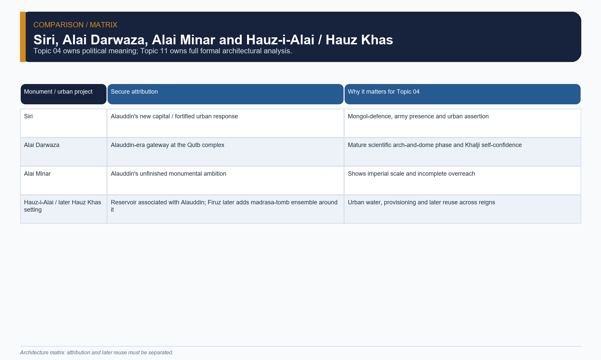

*Architecture visual. Topic 04 uses these monuments to read political ambition, defence and urban provisioning, while Topic 11 owns the fuller stylistic analysis.*

#### Monument table

| Monument or urban project | Topic 04 significance |
|---|---|
| Siri | New defended royal space associated with Mongol pressure and army concentration |
| Alai Darwaza | Khalji confidence, urban ceremonial framing and mature arch-dome technique |
| Alai Minar | Imperial ambition visibly left unfinished |
| Hauz-i-Alai / later Hauz Khas setting | Water, urban provisioning and long-lived reuse across dynasties |

#### Important art-history caution

- [FACT] Topic 11's corrected owner files stress that **Balban's tomb** is the first surviving true arch in the assigned sequence.
- [LIMIT] Therefore do not write that Alai Darwaza was "India's first true arch". It marks **mature** mastery, not the earliest surviving example in this repository's source discipline.

#### PARAGRAPH DEMONSTRATION — CLAIM → EVIDENCE → ANALYSIS → QUALIFICATION

**Claim:** Alauddin's building programme expressed political ambition and military necessity as much as aesthetic taste. **Named evidence:** Siri was built as a new defended capital tied to Mongol pressure and army concentration; the Alai Darwaza added a scientifically constructed arch-and-dome gateway to the Qutb complex; the Alai Minar was begun at twice the Qutb Minar's height but left incomplete; and Hauz-i-Alai supplied water to the growing court and garrison population. **Analysis:** because each project answers a practical need - defence, ceremonial legitimacy, imperial display, urban water supply - Khalji architecture should be read as state capacity made visible, not as art produced in isolation from politics. **Qualification:** Topic 11's corrected sequence places the first surviving true arch at Balban's tomb, so Alai Darwaza must be described as a mature, technically confident phase of arch-and-dome construction, never as India's first true arch.

#### CLOSING RECALL FLOW — ARCHITECTURE AND URBANISM: SIRI, ALAI DARWAZA, ALAI MINAR, HAUZ-I-ALAI

```text
START / CONCEPT: Architecture and urbanism: Siri, Alai Darwaza, Alai Minar, Hauz-i-Alai
        |
        v
EXACT TERMS: Architecture · urbanism · Siri · Alai Darwaza · Alai Minar · Hauz-i-Alai
        |
        v
MECHANISM / ARGUMENT: Each project answered a practical need in turn - Siri answered Mongol pressure and army concentration, Alai Darwaza answered ceremonial and technical ambition at the Qutb complex, and Hauz-i-Alai answered the court and garrison's water supply.
        |
        v
CONSEQUENCE / CONTRAST: The same source also notes that the Hauz Khas area later became a pleasure and madrasa complex under Firuz, while the reservoir itself goes back to Alauddin's Hauz-i-Alai.
        |
        v
UPSC TRAP / ANSWER-USE: Calling Alai Darwaza "India's first true arch" is wrong; it overwrites Topic 11's corrected sequence, which places that title with Balban's tomb.
        |
        v
ANSWER-GRABBING FORMULATION: Siri's ramparts, Alai Darwaza's arch and the unfinished Alai Minar together read as one statement of ambition backed by military necessity.
```
### SESSION 21 — SOURCES, AMIR KHUSRAU AND THE CULTURAL ARCHIVE OF THE KHALJI AGE

#### DEFINITION / WHAT THIS IS CALLED

**Plain-language definition:** The Khalji archive is therefore rich but uneven: a courtly Persian world records conquest, regulation and urban ambition better than village experience or subaltern voice.

**Technical definition:** Khusrau is not a neutral field report.

#### ANSWER-GRABBING OPENING — WRITE/ADAPT IN THE EXAM

> Barani, Khusrau and Isami give three different vantage points on the same Khalji age - late-moralising, court-panegyric and displaced-retrospective.

#### MUST-WRITE KEYWORDS

- **Sources**
- **Amir Khusrau**
- **the cultural archive of the Khalji age**
- **Barani**
- **Isami**
- **reported rule**

**How to use them:** Open by naming Barani, Amir Khusrau and Isami as the three named chroniclers with distinct genres; use reported rule to flag that all three describe policy rather than certify it; close with the cultural archive of the Khalji age to frame why courtly Persian material dominates the evidence.

[FACT] Topic 07's Persian-source bank and the OCR evidence together support the following source map: **Barani**, **Amir Khusrau**, **Isami**, plus inscriptions, coins and monuments.

[FACT] The concise OCR calls Amir Khusrau the leading Persian writer of the age and notes his pride in being Indian; Topic 11 also uses him as a high-yield cultural bridge without indulging the myth that he invented every later musical form.

[ANALYSIS] The Khalji archive is therefore rich but uneven: a courtly Persian world records conquest, regulation and urban ambition better than village experience or subaltern voice.

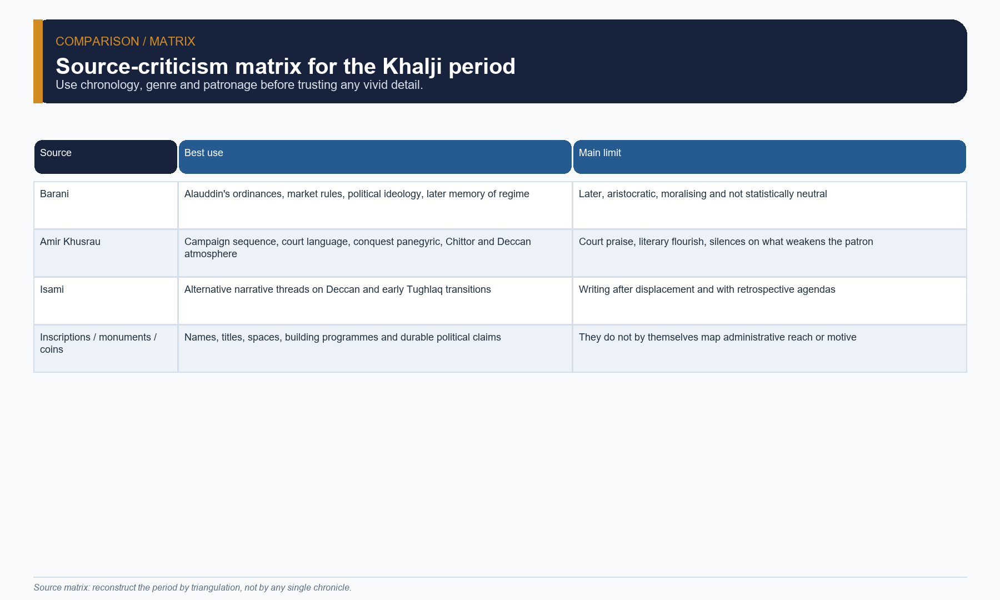

*Source matrix. It keeps date, genre and patronage at the centre of interpretation.*

#### Source-use table

| Source | Best use for Topic 04 | Main caveat |
|---|---|---|
| Barani | Ordinances, price controls, elite ideology, later memory of Alauddin | Later, moralising, aristocratic, anti-low-born bias |
| Amir Khusrau | Campaign narrative atmosphere, court culture, contemporary panegyric, Chittor and Deccan framing | Literary flourish, court patronage and selective silence |
| Isami | Useful alternative lens on Deccan and transition | Retrospective and shaped by displacement |
| Monuments / coins / inscriptions | Durable claims, urban ambition, titles and built environment | Cannot alone prove the daily depth of enforcement |

#### Why source criticism matters here

- [LIMIT] Barani is not a statistical officer.
- [LIMIT] Khusrau is not a neutral field report.
- [ANALYSIS] The strongest answers triangulate **reported rule**, **material evidence** and **modern caution**.

#### PARAGRAPH DEMONSTRATION — CLAIM → EVIDENCE → ANALYSIS → QUALIFICATION

**Claim:** The Khalji age is documented through a small set of named sources, each with its own genre limitation, rather than through one neutral archive. **Named evidence:** Barani supplies ordinances, elite ideology and later memory of Alauddin but writes decades afterward with aristocratic bias; Amir Khusrau supplies campaign atmosphere and court culture but writes panegyric for a patron; Isami supplies a Deccan-transition narrative but writes retrospectively after displacement; monuments and coins add durable but silent material claims. **Analysis:** because each source class illuminates a different part of the picture (policy versus atmosphere versus later memory versus built evidence) and is silent or biased elsewhere, the strongest answers triangulate reported rule, material evidence and modern caution rather than leaning on a single chronicler as if it were a transparent record. **Qualification:** this triangulation strengthens the topic's political and institutional claims but leaves village experience, women's lives and subaltern voice thin in the archive - a real evidentiary gap, not something the sources can be pressed to answer.

#### CLOSING RECALL FLOW — SOURCES, AMIR KHUSRAU AND THE CULTURAL ARCHIVE OF THE KHALJI AGE

```text
START / CONCEPT: Sources, Amir Khusrau and the cultural archive of the Khalji age
        |
        v
EXACT TERMS: Sources · Amir Khusrau · the cultural archive of the Khalji age · Barani · Isami · reported rule
        |
        v
MECHANISM / ARGUMENT: The concise OCR calls Amir Khusrau the leading Persian writer of the age and notes his pride in being Indian; Topic 11 also uses him as a high-yield cultural bridge without indulging the myth that he invented every later musical form.
        |
        v
CONSEQUENCE / CONTRAST: Khusrau is not a neutral field report.
        |
        v
UPSC TRAP / ANSWER-USE: Treating Barani as a neutral statistical record is wrong; it ignores that he, like Khusrau, writes from within a genre with its own bias and silence.
        |
        v
ANSWER-GRABBING FORMULATION: Read Barani for policy, Khusrau for atmosphere and Isami for the transition - no single chronicler carries the whole Khalji story alone.
```
### SESSION 22 — MALIK KAFUR, SUCCESSION POLITICS, MUBARAK SHAH, KHUSRAU KHAN AND THE TUGHLAQ TRANSITION

#### DEFINITION / WHAT THIS IS CALLED

**Plain-language definition:** Malik Kafur rose high under Alauddin, became malik naib / vice-regent, and after Alauddin's death helped elevate a minor son while blinding or imprisoning rivals.

**Technical definition:** The post-1316 sequence demonstrates that institutions without a stable succession ethic can remain formally present yet lose their disciplining capacity.

#### ANSWER-GRABBING OPENING — WRITE/ADAPT IN THE EXAM

> Within four years of Alauddin's death, his vice-regent, his son and his slave-turned-usurper were all removed - proof that coercive institutions do not survive without a succession rule.

#### MUST-WRITE KEYWORDS

- **Malik Kafur**
- **succession politics**
- **Mubarak Shah**
- **Khusrau Khan**
- **the Tughlaq transition**
- **malik naib / vice-regent**

**How to use them:** Open by tracing succession politics from Malik Kafur's brief regency through Mubarak Shah's reversals to Khusrau Khan's usurpation; use malik naib / vice-regent to name Kafur's formal post; close with the Tughlaq transition to mark exactly where Topic 04 hands over to Topic 05.

[FACT] Malik Kafur rose high under Alauddin, became **malik naib / vice-regent**, and after Alauddin's death helped elevate a minor son while blinding or imprisoning rivals.

[FACT] He was then quickly killed by palace guards.

[FACT] **Qutbuddin Mubarak Shah** reversed many agrarian and market-control regulations to gain support.

[FACT] **Khusrau Khan** then seized power, and **Ghiyasuddin Tughlaq** defeated him in **1320**.

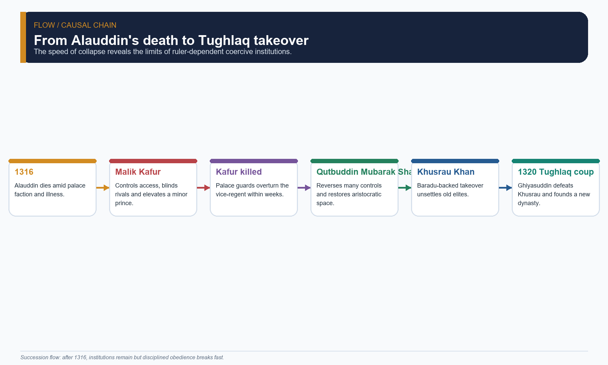

*Succession visual. It shows how quickly the coercive political order destabilised once the ruler disappeared.*

#### Political reading

- [ANALYSIS] The post-1316 sequence demonstrates that institutions without a stable succession ethic can remain **formally present** yet lose their disciplining capacity.
- [LIMIT] It would still be wrong to say that everything vanished overnight. Delhi, iqta logic, army routines and urban infrastructures survived into the Tughlaq order. What collapsed first was **Alauddin's personal grip**.

#### Bounded owner handoff

- [FACT] Topic 04 stops at the **hard-fought Tughlaq takeover**.
- [FACT] Topic 05 owns Ghiyasuddin's settled policy, Muhammad bin Tughlaq's large-scale annexation and Firuz's later departures.

#### PARAGRAPH DEMONSTRATION — CLAIM → EVIDENCE → ANALYSIS → QUALIFICATION

**Claim:** The 1316-1320 succession crisis shows that Alauddin's coercive institutions depended entirely on his personal presence, not on any settled transfer rule. **Named evidence:** Malik Kafur, as malik naib, elevated a minor son and blinded or imprisoned rivals before being killed by palace guards; Qutbuddin Mubarak Shah then reversed many agrarian and market controls to win support; Khusrau Khan seized power next, only for Ghiyasuddin Tughlaq to defeat him in 1320. **Analysis:** because four different power-holders followed one another within roughly four years, each undoing or ignoring the last one's policy, the sequence demonstrates that Alauddin's regime was a personally supervised coercive order, not an impersonal bureaucratic institution capable of self-perpetuation. **Qualification:** this does not mean everything vanished instantly - Delhi, iqta logic, army routines and urban infrastructure carried over into the Tughlaq order - so the correct claim is that Alauddin's personal grip collapsed first, not that the Sultanate itself dissolved.

#### CLOSING RECALL FLOW — MALIK KAFUR, SUCCESSION POLITICS, MUBARAK SHAH, KHUSRAU KHAN AND THE TUGHLAQ TRANSITION

```text
START / CONCEPT: Malik Kafur, succession politics, Mubarak Shah, Khusrau Khan and the Tughlaq transition
        |
        v
EXACT TERMS: Malik Kafur · succession politics · Mubarak Shah · Khusrau Khan · the Tughlaq transition · malik naib / vice-regent
        |
        v
MECHANISM / ARGUMENT: Kafur's own killing by palace guards shows that even the vice-regent's power depended entirely on proximity to the throne, not on any independent institutional office.
        |
        v
CONSEQUENCE / CONTRAST: The post-1316 sequence demonstrates that institutions without a stable succession ethic can remain formally present yet lose their disciplining capacity.
        |
        v
UPSC TRAP / ANSWER-USE: It would still be wrong to say that everything vanished overnight - Delhi, iqta logic, army routines and urban infrastructure survived into the Tughlaq order even as Alauddin's personal grip collapsed first.
        |
        v
ANSWER-GRABBING FORMULATION: What collapsed first was Alauddin's personal grip, not Delhi, iqta or the army - the Tughlaqs inherited institutions, not a vacuum.
```
### SESSION 23 — HISTORIOGRAPHY: COERCION, ECONOMY AND SOURCE-CAUTION

#### DEFINITION / WHAT THIS IS CALLED

**Plain-language definition:** Historians agree Alauddin built an unusually strong coercive state for his time; they disagree mainly on how uniform, deliberate, economically transformative or durable that state really was.

**Technical definition:** Historiography of the Khalji age weighs a centralisation-heavy reading (K. S. Lal-type coercion emphasis), an agrarian-economic reading (Irfan Habib-type monetisation and surplus-extraction emphasis) and Satish Chandra's source-critical synthesis against one another to decide how far the evidence supports each claim.

#### ANSWER-GRABBING OPENING — WRITE/ADAPT IN THE EXAM

> Historians do not dispute that Alauddin built a formidable coercive state; they dispute how uniform, intentional and durable it actually was.

#### MUST-WRITE KEYWORDS

- **Historiography**
- **coercion**
- **economy**
- **source-caution**
- **uniform**
- **intentional**

**How to use them:** Open by naming the point of agreement - coercion - before turning to the real historiographical debate; use uniform and intentional to structure the disagreement; close on source-caution to justify why Satish Chandra's balanced reading anchors this repository.

[DEBATE] Modern interpretations do not disagree on everything. They broadly agree that Alauddin built an unusually formidable coercive state for his context. They disagree more on how **uniform**, **intentional**, **economically transformative** or **durable** that state really was.

[FACT] Satish Chandra's local books give the controlling line for this repository: broadening of the ruling class, Mongol-driven military necessity, strong but not universal market control, and constant caution about Barani's veracity.

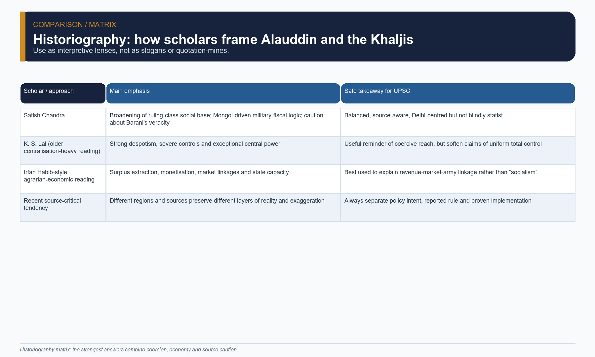

*Historiography visual. It helps position Satish Chandra's balanced reading among stronger centralisation-heavy and agrarian-economic lenses.*

#### Historiography table

| Lens | High-value takeaway |
|---|---|
| Satish Chandra | Best repository control: military-fiscal integration plus source caution |
| Older centralisation-heavy readings associated with K. S. Lal | Useful reminder of coercive depth, but easy to overstate as total uniform control |
| Agrarian-economic readings associated with Irfan Habib's wider medieval-economic tradition | Useful for monetisation, surplus extraction, town-country linkage and market logic |
| Recent source-critical practice | Best corrective against romantic or statist excess; always ask what Barani or Khusrau could really know |

#### Exam-safe synthesis

The strongest UPSC answer combines three moves:

1. [ANALYSIS] acknowledge **coercive centralisation**,
2. [ANALYSIS] explain the **economic and military mechanism**,
3. [LIMIT] qualify **scope, source and durability**.

#### PARAGRAPH DEMONSTRATION — CLAIM → EVIDENCE → ANALYSIS → QUALIFICATION

**Claim:** The historiographical debate on Alauddin Khalji is not about whether he built a coercive state, but about how far that coercion extended and how much it should be credited as deliberate economic policy. **Named evidence:** centralisation-heavy readings associated with K. S. Lal foreground the depth of coercion and surveillance; agrarian-economic readings in Irfan Habib's tradition foreground monetisation, surplus extraction and town-country linkage; Satish Chandra's synthesis - this repository's controlling line - foregrounds broadened elite recruitment, Mongol-driven military necessity and constant caution about Barani's veracity. **Analysis:** because each lens draws on the same limited Barani-heavy evidence base but weights coercion, economics or source-criticism differently, the strongest UPSC answer names the shared ground (a formidable coercive state existed) before showing exactly where the three lenses diverge on uniformity, intention and durability. **Qualification:** naming Satish Chandra's synthesis as this repository's control does not mean the other lenses are wrong; it means their claims about totality or economic transformation need the same source-caution applied throughout this topic.

#### CLOSING RECALL FLOW — HISTORIOGRAPHY: COERCION, ECONOMY AND SOURCE-CAUTION

```text
START / CONCEPT: Historiography: coercion, economy and source-caution
        |
        v
EXACT TERMS: Historiography · coercion · economy · source-caution · uniform · intentional
        |
        v
MECHANISM / ARGUMENT: The strongest UPSC answer acknowledges coercive centralisation, explains the economic and military mechanism, and then qualifies scope, source and durability.
        |
        v
CONSEQUENCE / CONTRAST: Modern interpretations do not disagree on everything - they broadly agree Alauddin built an unusually formidable coercive state for his context.
        |
        v
UPSC TRAP / ANSWER-USE: Picking only one lens - pure centralisation, pure agrarian economics, or pure source-scepticism - rather than weighing all three, misrepresents a genuinely three-sided debate.
        |
        v
ANSWER-GRABBING FORMULATION: Name Satish Chandra's synthesis as the repository's control, but credit K. S. Lal for coercive depth and Irfan Habib's tradition for the economic dimension.
```
### SESSION 24 — HISTORICAL SIGNIFICANCE AND GS-I ANSWER SPINE

#### DEFINITION / WHAT THIS IS CALLED

**Plain-language definition:** The Khalji period's lasting significance lies in three linked achievements: a wider ruling elite, a hardened military-fiscal state, and a Deccan opening no later dynasty could ignore.

**Technical definition:** Topic 04's GS-I answer spine compresses the whole period into thesis -> evidence -> mechanism -> qualification -> verdict, anchored on wider elite recruitment, coercive military-fiscal experimentation and the Deccan opening.

#### ANSWER-GRABBING OPENING — WRITE/ADAPT IN THE EXAM

> The Khalji period matters because it brought together three processes: wider elite recruitment, coercive military-fiscal experimentation, and a Deccan opening that later dynasties could not ignore.

#### MUST-WRITE KEYWORDS

- **Historical significance**
- **GS-I answer spine**
- **wider elite recruitment**
- **coercive military-fiscal experimentation**
- **Deccan opening**
- **ruler-dependent institutions**

**How to use them:** Open with wider elite recruitment, coercive military-fiscal experimentation and Deccan opening as the topic's three-part significance; use GS-I answer spine to structure any essay-length question; close on ruler-dependent institutions to supply the mandatory limiting qualification.

[ANALYSIS] The Khalji period matters because it brought together three processes: **wider elite recruitment**, **coercive military-fiscal experimentation**, and a **Deccan opening** that later dynasties could not ignore.

[ANALYSIS] Delhi became more deeply provisioned and militarised; the doab became more tightly linked to the capital; and imperial ambition reached far beyond earlier Sultanate limits.

[LIMIT] Yet the institutions remained ruler-dependent. Once Alauddin disappeared, the system rapidly exposed its limits.

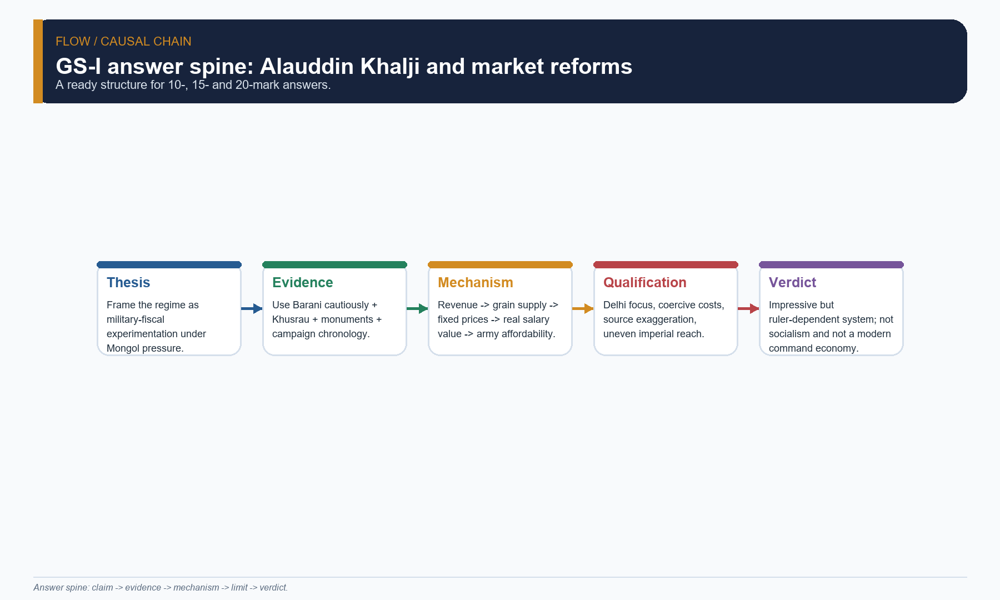

*Answer-spine visual. It compresses the topic into the sequence thesis -> evidence -> mechanism -> qualification -> verdict.*

#### One-line verdicts for use

- [ANALYSIS] "The Khalji moment was the Delhi Sultanate's sharpest experiment in coercive military-fiscal integration before the Tughlaqs."
- [ANALYSIS] "Alauddin's market reforms were a Delhi-centred instrument for keeping a large cavalry affordable under Mongol pressure."
- [ANALYSIS] "The Khalji revolution broadened access to the ruling class without democratising the polity."
- [ANALYSIS] "The period opened the Deccan politically while proving the limits of ruler-dependent control."

#### PARAGRAPH DEMONSTRATION — CLAIM → EVIDENCE → ANALYSIS → QUALIFICATION

**Claim:** The Khalji period's historical significance rests on three linked achievements rather than any single reform. **Named evidence:** the 1290 accession widened elite recruitment beyond the old Turkish monopoly; Alauddin's dagh/chehra army reform, doab revenue measurement and Delhi market institutions built the Sultanate's sharpest military-fiscal system; and Malik Kafur's Deccan campaigns opened Devagiri, Warangal, Dwarasamudra and Mabar to Delhi's horizon for the first time. **Analysis:** because these three achievements reinforced one another - a wider elite staffed a harsher state, and a harsher state financed deeper expansion - the Khalji period should be presented as one integrated process in a GS-I answer, using the thesis -> evidence -> mechanism -> qualification -> verdict spine rather than three disconnected facts. **Qualification:** every one of these achievements was ruler-dependent; once Alauddin died, the system that had made them possible unravelled within four years, so "significant" must be paired with "institutionally fragile" in any complete verdict.

#### CLOSING RECALL FLOW — HISTORICAL SIGNIFICANCE AND GS-I ANSWER SPINE

```text
START / CONCEPT: Historical significance and GS-I answer spine
        |
        v
EXACT TERMS: Historical significance · GS-I answer spine · wider elite recruitment · coercive military-fiscal experimentation · Deccan opening · ruler-dependent institutions
        |
        v
MECHANISM / ARGUMENT: Delhi became more deeply provisioned and militarised; the doab became more tightly linked to the capital; and imperial ambition reached far beyond earlier Sultanate limits.
        |
        v
CONSEQUENCE / CONTRAST: The Khalji revolution broadened access to the ruling class without democratising the polity, and the period opened the Deccan politically while proving the limits of ruler-dependent control.
        |
        v
UPSC TRAP / ANSWER-USE: Praising the Khalji achievement without naming its ruler-dependent fragility is wrong; it turns a graded verdict into an uncritical celebration.
        |
        v
ANSWER-GRABBING FORMULATION: Wider elite recruitment financed a harsher state, and a harsher state financed the Deccan opening - one integrated process, not three separate facts, and all of it ruler-dependent.
```
### MEDIEVAL DEEP-REVIEW CORE CONTROL

- **Must remember:** Alauddin Khalji's controls linked prices, supplies, intelligence and cavalry maintenance to imperial war capacity.
- **Close distinction:** Diwan-i-Riyasat and Shahna-i-Mandi belong to an enforced market regime, not a modern welfare-price scheme.
- **Evidence / interpretation limit:** Claims of complete or permanent success must be bounded by chronicler evidence, coercion and post-Alauddin durability.

### TOPIC 04 CLOSING KHALJI CONTROL LEDGER

#### Identity, accession and source controls

- Khaljis were Turkic-origin groups long associated with Afghan regions; Khalji,
  Turk and Afghan are not interchangeable fixed identities.
- Jalaluddin's 1290 accession widened elite access while preserving Sultanate
  institutions; the Khalji revolution was not a mass social revolution.
- Alauddin's 1296 seizure joined Devagiri wealth, Jalaluddin's murder, patronage
  and military coalition-building.
- Barani is a later normative aristocratic source; Amir Khusrau is a contemporary
  court panegyrist. Neither is a neutral record of motive, prices or suffering.
- Padmavat is sixteenth-century literary memory, not contemporary Chittor evidence.

#### Campaign, kingship and succession controls

| Dimension | Exam-safe distinction |
|---|---|
| North | Gujarat, Ranthambore, Chittor and Malwa combined conquest, siege and changing control |
| Deccan | Devagiri, Warangal, Dwarasamudra and Madurai involved raid, tribute, retained rulers and later control in different combinations |
| Kingship | Alauddin asserted political regulations/zawabit beyond simple juristic sharia without becoming secular or anti-religious |
| Anti-rebellion | confiscation, spies, wine/gathering/marriage controls and elite supervision targeted factional capacity |
| Succession | Malik Kafur regency, Mubarak Shah and Khusrau Khan produced a rapid but multi-causal collapse |

#### Military-fiscal and market system

```text
Mongol pressure + expansion
        -> standing cavalry
        -> dagh + chehra + cash salaries + forts/intelligence
        -> khalisa/Doab measurement and high kharaj claim
        -> grain transport/storage and Delhi price schedules
        -> Diwan-i Riyasat + shahna-i mandi + spies + punishment
```

- Barani's army-affordability explanation is strongest, but provisioning and
  political control are additional debated objectives.
- Khuts, muqaddams and chaudhuris were pressured/curbed, not erased everywhere.
- Grain, cloth/costly goods, horses/slaves/cattle and wider necessities were
  regulated through category-specific rules.
- Evidence is strongest for Delhi and the core supply zone, not all India.
- Price stability for soldiers/consumers could coexist with peasant, merchant
  and transporter coercion.
- This was military-fiscal state intervention, not socialism or modern welfare.

#### PYQ ownership

- **Direct:** 2022 Prelims Q57 on Mongol invasions; official key unavailable,
  inferred answer statement 2 only.
- **Adjacent:** 2020 GS-I Q12 belongs to Medieval Topic 24.
- **Adjacent:** 2023 GS-I Q12 belongs to Medieval Topic 07.

**Final method:** pressure/objective -> institution -> enforcement -> social
effect -> source/geographic/duration limit -> verdict.

## BASIC MCQS / REMEDIATION

### Learning MCQ 01

**Question:** The safest meaning of the phrase "Khalji revolution" is:

- A. a widening of the ruling elite beyond the old Turkish monopoly
- B. conversion of the whole Sultanate into a democratic monarchy
- C. end of iqta and military slavery in one stroke
- D. abolition of all hierarchy in the countryside

**Answer: A.**

**Why:** It marks a reconfiguration of high-office access, not a mass social revolution.

### Learning MCQ 02

**Question:** Jalaluddin Firuz Khalji is most accurately associated with:

- A. rigid exclusion of all non-Turks from office
- B. a comparatively conciliatory kingship and support-based rhetoric
- C. direct annexation of Warangal and Madurai
- D. the Alai Darwaza and Hauz Khas madrasa

**Answer: B.**

**Why:** The local sources contrast Jalaluddin's softer tone with Alauddin's harder coercive turn.

### Learning MCQ 03

**Question:** Which statement best captures Alauddin's legitimacy problem after 1296?

- A. He was legitimised mainly by caliphal appointment.
- B. He inherited an uncontested throne through settled primogeniture.
- C. He seized power through the murder of Jalaluddin and then had to overawe nobles by gold and coercion.
- D. He was elected by village assemblies of the doab.

**Answer: C.**

**Why:** The Kara murder, Devagiri loot and later surveillance regime belong to the same legitimacy crisis.

### Learning MCQ 04

**Question:** Under Alauddin, Siri is best described as:

- A. a Rajput tributary state in Rajasthan
- B. the name of Jalaluddin's conciliatory policy
- C. the cloth market under Sarai-i-Adl
- D. a new defended capital linked to Mongol pressure and army concentration

**Answer: D.**

**Why:** Siri anchors the Delhi-facing defence and army-provisioning story.

### Learning MCQ 05

**Question:** Which one of the following is the most secure statement about Mongol chronology under the Khaljis?

- A. The 1303 crisis is linked with Targhi and the defended Siri-Delhi position.
- B. The first Mongol invasion of India began under Jalaluddin Khalji.
- C. Amroha was a defeat of Alauddin's forces.
- D. Qutlugh Khwaja invaded after Alauddin's death.

**Answer: A.**

**Why:** 1303 and Siri belong together; the other options distort chronology.

### Learning MCQ 06

**Question:** In the military reforms of Alauddin Khalji, **dagh** refers to:

- A. a tax on houses
- B. horse-branding for inspection
- C. the Shahna-i-Mandi's cloth register
- D. a descriptive roll of soldiers

**Answer: B.**

**Why:** Dagh checked the substitution of inferior horses.

### Learning MCQ 07

**Question:** Which statement about the Deccan campaigns is the most balanced?

- A. They were led entirely without the help of subordinate local rulers.
- B. All Deccan kingdoms were smoothly converted into full provinces by Alauddin himself.
- C. They mixed tribute, treasure, subordination and, in some cases, a later move toward direct control.
- D. The campaigns had no fiscal value and were merely symbolic.

**Answer: C.**

**Why:** Devagiri, Warangal and Mabar did not all stand in the same political relation to Delhi.

### Learning MCQ 08

**Question:** The most exam-safe reading of the 1303 Chittor episode is that:

- A. the full Padmavat mirror episode is contemporary fact
- B. no later literary memory matters at all
- C. Alauddin attacked only for romantic motives
- D. the siege and conquest are secure, but later Padmavat tradition must be separated from near-contemporary evidence

**Answer: D.**

**Why:** UPSC rewards source layering, not sensational retelling.

### Learning MCQ 09

**Question:** Which rural groups are most centrally associated with Alauddin's anti-intermediary revenue policy?

- A. khuts, muqaddams and chaudhuris
- B. Portuguese merchants and Multani traders
- C. barids and munhiyan
- D. Sufis, qazis and muftis

**Answer: A.**

**Why:** These were the rural intermediaries whose privileges were targeted in core zones.

### Learning MCQ 10

**Question:** The Shahna-i-Mandi is most closely associated with:

- A. the hereditary rights of khuts
- B. the supervision of regulated markets
- C. the office of Mir Bakhshi in the Mughal empire
- D. frontier fortification at Dipalpur

**Answer: B.**

**Why:** The Shahna-i-Mandi belongs to market supervision, not frontier command.

### Learning MCQ 11

**Question:** A major purpose of the grain-granary-banjara system was to:

- A. convert every province into khalisa territory
- B. replace cavalry with infantry
- C. preserve cheap and regular staple supply for Delhi
- D. abolish all private trade forever

**Answer: C.**

**Why:** Provisioning the capital was central to the military-fiscal design.

### Learning MCQ 12

**Question:** Which statement most accurately captures the motivation behind Alauddin's price controls?

- A. They were unrelated to military needs.
- B. They sought above all to honour juristic orthodoxy.
- C. They were a medieval welfare state experiment for consumer equality.
- D. They were primarily a military-fiscal device, though urban provisioning and anti-noble effects also mattered.

**Answer: D.**

**Why:** This is the repository's most evidence-led overall reading.

### Learning MCQ 13

**Question:** The safest statement about Alauddin and shara is:

- A. Barani reports a strong reason-of-state stance, but the exact wording cannot be treated as verbatim certainty.
- B. The issue is irrelevant to understanding Khalji politics.
- C. Alauddin always obeyed the ulema in state affairs.
- D. Alauddin abolished Islam from the Sultanate.

**Answer: A.**

**Why:** It preserves both the political principle and the source caution.

### Learning MCQ 14

**Question:** Alai Darwaza should be remembered in this topic mainly as:

- A. evidence that the Khaljis abandoned urban architecture
- B. a mature Khalji arch-and-dome monument tied to imperial urban ambition
- C. the first surviving true arch in the assigned source sequence
- D. an unfinished Rajput watchtower

**Answer: B.**

**Why:** Topic 11 distinguishes it from Balban's earlier surviving arch while highlighting its mature construction.

### Learning MCQ 15

**Question:** Which source is most indispensable yet most in need of caution for Alauddin's market regulations?

- A. Ibn Battuta
- B. Abul Fazl
- C. Ziauddin Barani
- D. Ferishta

**Answer: C.**

**Why:** Barani is central for the ordinances and market system, but he is late, didactic and aristocratic.

### Learning MCQ 16

**Question:** The quickest single reason why the detailed Alauddin system did not long outlive him is that it:

- A. had no relation to the army
- B. was based only on temple wealth
- C. faced no succession problems at all
- D. depended heavily on the personal coercive grip of the ruler and weakened during succession turmoil

**Answer: D.**

**Why:** The 1316-1320 sequence shows how fast tightly personalised coercive systems can fray.

## PYQS AND ANSWER PRACTICE

### Verified and routed PYQs

##### Direct PYQ 01 - UPSC Prelims 2022 GS-I (direct routed question; exact wording verified locally; official key unavailable locally)

**Question:** With reference to Indian history, consider the following statements:

1. The first Mongol invasion of India happened during the reign of Jalal-ud-din Khalji.  
2. During the reign of Ala-ud-din Khalji, one Mongol assault marched up to Delhi and besieged the city.  
3. Muhammad-bin-Tughlaq temporarily lost portions of north-west of his kingdom to Mongols.  

Which of the statements given above is/are correct?

(a) 1 and 2  
(b) 2 only  
(c) 1 and 3  
(d) 3 only  

**INFERRED ANSWER - NOT OFFICIALLY VERIFIED LOCALLY:** **(b) 2 only**. Confidence: high.

**Model explanation:** Statement 1 is incorrect because Mongol pressure and penetration into the north-west predated Jalaluddin Khalji; Topic 03 already anchored pressure in Iltutmish's age and the later Lahore sack. Statement 2 is correct because the **1303 Targhi crisis** brought Mongol pressure up to Delhi and Alauddin's defended Siri position. Statement 3 is unsafe in the wording used and is treated as incorrect in this repository's validated Topic 03 explanation; Muhammad bin Tughlaq had frontier problems and diplomacy, but the statement as framed is not the standard established event.  

**Why this earns marks:** It fixes the chronology by ruler, separates frontier pressure from the Delhi siege crisis and refuses to validate a statement only because it mentions a familiar Tughlaq name.

**Demand decoding:** This is a three-statement elimination question that names three different rulers (Jalaluddin, Alauddin, Muhammad bin Tughlaq); each statement must be checked against its own ruler's chronology rather than treated as one generic claim about "Mongol invasions."

**Executable exam-length answer / compression plan:** Eliminate statement 1 first by naming that Mongol pressure on the north-west predates Jalaluddin (already anchored in Iltutmish's reign); confirm statement 2 by naming the 1303 Targhi crisis and Alauddin's defended Siri position; treat statement 3 cautiously since the framed wording does not match this repository's validated Tughlaq-era event; conclude with option (b).

**How to improve this answer:** Add the specific year (1303) and commander (Targhi) for statement 2 rather than a vague "Mongols besieged Delhi" claim, since UPSC statement-based questions reward exact chronology over generic recognition.

##### Adjacent PYQ 02 - UPSC GS-I 2020 (verified adjacent source question; primary routing elsewhere, but directly valuable for Topic 04 source criticism)

**Question:** Persian literary sources of medieval India reflect the spirit of the age. Comment. (Answer in 250 words)

**Model answer:**

Persian literary sources are indispensable for medieval India because they preserve the political language, moral anxieties and courtly horizons of the age. Yet they reflect the spirit of the age only if used with **genre and patronage caution**.  

The strongest evidence lies in the Sultanate archive. **Ziauddin Barani's** *Tarikh-i Firuz Shahi* records rulers, nobles, market regulations and ideas of order from Balban to the Tughlaqs. For Topic 04, it is the key source for Alauddin Khalji's ordinances and price-control system. But Barani was a fourteenth-century aristocratic moralist; his hostility to the "low and ignoble" means that vivid numbers, motives and speeches need qualification.  

**Amir Khusrau's** courtly works, including *Khaza'in-ul-Futuh*, illuminate conquest, ceremonial culture and Indo-Persian self-fashioning. His value for the Khalji age is enormous: Chittor, Gujarat and Deccan campaigns all pass through his courtly lens. Yet the same lens is panegyrical. He celebrates power better than he documents administrative limits or non-elite suffering.  

At the same time, Persian sources widen beyond bare political narrative. They capture elite ideals, religious debate, urban sensibility and the moral language of sovereignty. Their silences are equally revealing: peasants, women outside elite circles and regional society appear unevenly.  

Hence, Persian sources do reflect the spirit of the age - but the spirit they show is mediated, courtly and argumentative rather than neutral reportage. They are most powerful when read against inscriptions, monuments, coins and other narrative traditions.

**Why this earns marks:** The answer opens with a clear thesis, uses named sources from the Khalji age, links each source to what it proves, and qualifies each source instead of treating Persian writing as transparent fact.

**Demand decoding:** "Comment" asks for a direct evaluative position on whether Persian sources reflect the age's spirit, not a descriptive list of chronicles; the answer must name at least two sources, show what each proves, and state what each cannot prove.

**Executable exam-length answer / compression plan:** Open with the qualified thesis (sources reflect the age, but through a courtly, argumentative lens); use Barani for policy and ordinances with his aristocratic bias flagged; use Khusrau for campaign atmosphere with his panegyric patronage flagged; close by naming the archive's silence on peasants and non-elite voices.

**How to improve this answer:** Add Isami as a third named source to show the retrospective, Deccan-transition angle, since citing only two chroniclers leaves the "spirit of the age" claim resting on a narrower base than the topic actually supports.

##### Adjacent PYQ 03 - UPSC GS-I 2023 (verified adjacent Sultanate question; primary routing to broader administration/technology owners)

**Question:** What were the major technological changes introduced during the Sultanate period? How did those technological changes influence the Indian society? (Answer in 250 words)

**Model answer:**

The Sultanate period did not invent technology from nothing, but it accelerated the diffusion and combination of several techniques in textiles, construction, cavalry management and irrigation. Their effects were strongest in **state capacity, urban life and long-distance exchange**.  

In construction, the widespread use of the **true arch, dome and stronger lime mortar** transformed scale and skyline. Topic 04's Khalji phase is crucial here: **Alai Darwaza** marks mature scientific arch-and-dome construction, while **Siri** shows how military pressure could produce new defended urban forms. The impact was not merely aesthetic. Larger covered spaces, gateways and fortified capitals supported royal ceremonial and political control.  

In military organisation, improved cavalry inspection through **dagh** and **chehra** under Alauddin Khalji shows technology as administration. Branding horses and maintaining descriptive rolls reduced fraud and preserved army efficiency under Mongol pressure.  

In textiles and circulation, the broader Sultanate period saw wider use of the **spinning wheel**, the **cotton-carder's bow**, improved looms and market-linked craft production. This supported urban growth, merchant activity and the provisioning systems on which capitals depended.  

The social effect, however, was uneven. These changes strengthened towns, armies, merchants and courts more than they emancipated cultivators. Monumental construction and military inspection served states before they served social equality.  

Therefore, Sultanate technological change mattered profoundly, but its historical meaning lies in the interaction of technique with political power, urbanisation and unequal social structure.

**Why this earns marks:** It answers both parts of the question, uses precise Khalji-era examples, and converts technology into social and political consequences rather than listing devices mechanically.

**Demand decoding:** The question has two explicit parts - "what changed" and "how did it influence society" - so a one-part answer listing only techniques without their social effect loses half the available marks.

**Executable exam-length answer / compression plan:** List construction (true arch, dome, mortar), military-administrative (dagh, chehra) and textile/craft changes as the "what"; then dedicate the closing third of the answer explicitly to the "how", naming that these changes strengthened states, armies, merchants and courts more than they emancipated cultivators.

**How to improve this answer:** Add one concrete building example beyond Alai Darwaza and Siri (such as a specific textile or irrigation technique named in the sources) to avoid over-relying on Khalji architecture alone for a Sultanate-wide question.

### Original solved Mains practice

#### 10-mark Question 01

**Question:** Was the Khalji "revolution" more a reconfiguration of the ruling class than a social revolution? Discuss. (Answer in 150 words)

**Model solution:**

Yes - in UPSC-safe usage the Khalji "revolution" is better understood as a **reconfiguration of elite access** than as a social revolution.  

First, the local Satish Chandra evidence stresses that the rise of Jalaluddin Khalji ended the old Turkish monopoly of high office. Khaljis, Indian Muslims and other non-monopoly groups gained greater room in the ruling class. This is the strongest positive content of the phrase.  

Second, the institutional structure remained recognisably Sultanate. Delhi stayed the centre, iqta logic continued, coercive monarchy persisted, and countryside hierarchy was not democratised. Alauddin's later regime was if anything harsher and more centralised than before.  

Third, the population at large did not experience a social levelling revolution. Peasants still faced heavy extraction; nobles still dominated; military slavery and court hierarchy persisted.  

Thus, the term is useful only when limited to **ruling-class composition and political access**. It becomes misleading when stretched into a mass social transformation.

**Why this earns marks:** It answers the directive directly, uses Satish Chandra's core insight, distinguishes elite from society and ends with a graded verdict.

**Demand decoding:** "Discuss" requires taking a clear side on the reconfiguration-versus-revolution question within 150 words, not a neutral summary of both possible readings.

**Executable exam-length answer / compression plan:** State the verdict (reconfiguration, not revolution) in the opening line; support it with the ended Turkish monopoly of high office as positive evidence; balance it with continued Delhi-centred institutions and unchanged peasant condition as the limiting evidence; close in one line.

**How to improve this answer:** Name Malik Kafur specifically as an example of the widened elite Alauddin himself promoted, since a concrete post-1296 example strengthens the "reconfiguration" claim beyond the 1290 accession alone.

#### 10-mark Question 02

**Question:** How did Mongol pressure reshape Alauddin Khalji's state? Explain. (Answer in 150 words)

**Model solution:**

Mongol pressure pushed Alauddin Khalji toward a far more integrated **military-fiscal state**.  

First, repeated crises - especially the 1299 Kili episode, the 1303 Siri-Delhi pressure and the 1305 Amroha battle - demonstrated that Delhi needed a large and ready cavalry. These events are securely anchored in the local OCR and PYQ routing.  

Second, that army required affordable horses, reliable pay and fortified frontiers. Alauddin therefore strengthened the cavalry through **dagh** and **chehra**, repaired frontier forts and used a defended urban space at **Siri**.  

Third, the fiscal base had to be deepened. Heavy revenue demand in the doab, cash realisation, grain movement and fixed prices all helped preserve the real value of soldier salaries.  

Hence Mongol pressure did not produce only military response; it drove revenue reform, price regulation, surveillance and urban provisioning as well.

**Why this earns marks:** It converts frontier danger into an institutional chain rather than narrating battles in isolation.

**Demand decoding:** "Explain" wants the causal mechanism linking Mongol pressure to state reform, not a battle-by-battle narrative of 1299-1305.

**Executable exam-length answer / compression plan:** Open with the three named crises (1299 Kili, 1303 Siri-Delhi, 1305 Amroha) as the trigger; move directly to army reform (dagh, chehra, forts); close with the fiscal chain (doab revenue, grain movement, fixed prices) that made the army affordable.

**How to improve this answer:** Add the reported 238-tanka cavalry pay figure with its unit caveat, since a named number anchors the "affordability" claim more precisely than a general statement about cheap provisions.

#### 15-mark Question 01

**Question:** Examine Alauddin Khalji's market regulations as an integrated military-fiscal system. (Answer in 250 words)

**Model solution:**

Alauddin Khalji's market regulations are best explained not as welfare economics, but as a **Delhi-centred military-fiscal system**.  

The starting point was strategic necessity. The Mongol attacks of the late 1290s and early 1300s convinced Alauddin that Delhi needed a large standing cavalry. Yet a large cavalry implied recurring expenditure on soldiers, horses and urban provisioning. The state therefore sought not merely treasure, but a durable mechanism for keeping the **real cost** of cavalry manageable.  

This is where agrarian policy and market policy converged. In the upper doab, land revenue was pushed toward **half of the produce**, khalisa control was strengthened, measurement was used where supported, and cultivators were drawn into cash-linked grain sale. Grain then moved through monitored channels - banjaras, mandis and granaries - into Delhi. On the urban side, the grain mandi, the cloth sphere, and the horse-cattle-slave market were supervised by the **Shahna-i-Mandi** and linked to the wider regulatory authority of the **Diwan-i-Riyasat**.  

The result was a chain: **revenue extraction -> supply control -> regulated prices -> affordable cash salaries -> military sustainability**. Barani's sample prices, and the reported cavalry pay scale of roughly 238 tankas annually, make sense within this chain.  

Yet the system had limits. It depended on coercion, intelligence, capital-city concentration and ruler-driven discipline. Its strongest evidence is Delhi-centric, and it frayed quickly after Alauddin's death.  

Thus, the regulations were integrated, innovative and effective in context, but narrow in geography and fragile in durability.

**Why this earns marks:** The answer uses the required mechanism, names the offices, links rural and urban policy, and finishes with scope and durability limits.

**Demand decoding:** "Examine" wants the internal mechanism of the market system laid out step by step, not a list of institutions without their causal links.

**Executable exam-length answer / compression plan:** Open with the Mongol-necessity thesis; trace the chain from doab revenue and khalisa control through banjara/granary transport to the Shahna-i-Mandi and Diwan-i-Riyasat's urban enforcement; close with the Delhi-centred, coercion-dependent limit.

**How to improve this answer:** Name at least one sample Barani-reported price (such as wheat at 7 1/2 jitals per man) with its unit caveat to show precise command of the evidence rather than describing the system only in institutional terms.

#### 15-mark Question 02

**Question:** Distinguish the secure political-military evidence on Chittor from the later Padmavat tradition. (Answer in 250 words)

**Model solution:**

The 1303 Chittor episode must be read through **source layering**.  

The secure first layer is the political-military event. Near-contemporary courtly evidence, especially Amir Khusrau, anchors the siege, Alauddin's campaign context and the Khalji victory. The event fits the wider Rajputana strategy after Gujarat and Ranthambore. Chittor mattered strategically, not only symbolically.  

The second layer consists of conquest rhetoric. Khusrau's world is a court-praised world. Massacre motifs, triumphal language and the silence on uncomfortable details must be read as part of panegyric, not as transparent field-reporting.  

The third layer is later literary memory. The **Padmavat** tradition associated with Malik Muhammad Jaisi is much later. It transforms the historical siege into a Sufi-inflected romance of beauty, desire, kingship and honour. Its narrative power is immense, but it is not a simple documentary source for 1303.  

Hence, the historian must separate three things: the secure siege, the courtly rhetorical framing of conquest, and the later symbolic afterlife in Rajput and Indo-Persian memory. The error lies not in studying Padmavat, but in using it unfiltered as if it were contemporary evidence.  

A good UPSC answer therefore says: **Chittor 1303 is historically secure; Padmavat is historically important as later memory, not as straightforward eyewitness archive.**

**Why this earns marks:** It uses named evidence, honours literary significance without surrendering chronology, and shows exactly how source criticism operates.

**Demand decoding:** "Distinguish" requires a structured two-layer comparison (secure event versus later legend), not a single continuous narrative that blends both.

**Executable exam-length answer / compression plan:** Open by naming Khusrau as the near-contemporary anchor for the siege; add the courtly-panegyric caveat on his conquest rhetoric as a second layer; introduce Jaisi's sixteenth-century Padmavat as the third, clearly later layer; close with the verdict that both layers matter but answer different questions.

**How to improve this answer:** Add the two-century gap explicitly (1303 to Jaisi's sixteenth-century composition) as a numeric anchor, since naming the actual time gap is more persuasive than simply asserting that Padmavat is "later" without a number.

#### 20-mark Question 01

**Question:** "Alauddin Khalji's price control was neither socialism nor mere anti-merchant tyranny, but a Delhi-centred military-fiscal experiment." Critically evaluate. (Answer in 250 words)

**Model solution:**

The statement is broadly valid because Alauddin Khalji's price control makes the most sense as a **military-fiscal experiment** rooted in frontier pressure, noble politics and capital provisioning.  

The evidence begins with the Mongol crisis. The Delhi-facing attacks of 1299, 1303 and 1305 showed that the Sultanate required a large cavalry under continuous readiness. A large cavalry, however, could not be sustained by windfall plunder alone. The state therefore needed to reduce the **real cost** of military maintenance.  

This aim explains the interlocking structure of the reforms. In the upper doab, revenue demand rose sharply, direct khalisa control expanded, and measurement was used where supported. The grain thus drawn into state-visible channels was pushed into Delhi through banjaras, mandis and monitored sale. In the capital, staple grain, costly cloth and horse-cattle-slave markets were supervised through registers, the Shahna-i-Mandi and punitive enforcement. The reported price schedules preserved the value of cash salaries. That is why the system was linked to cavalry inspection through **dagh** and **chehra**, not separate from them.  

Yet it would still be wrong to describe the system as benign consumer policy. It rested on coercion, heavy extraction, surveillance and severe penalties. Nor was it simply anti-merchant. Merchants, especially in cloth and grain supply, remained necessary; some even received state advances. Commerce was disciplined, not abolished.  

Finally, the system's limits are decisive. It was Delhi-centred, expensive to police, mediated by Barani's moralising narrative, and highly ruler-dependent. Its rapid weakening after 1316 shows that coercive brilliance had outrun institutional durability.  

Therefore, Alauddin's market control was a remarkable but bounded military-fiscal solution - neither modern socialism nor irrational persecution of trade.

**Why this earns marks:** It directly addresses the quotation, uses named evidence, shows mechanism, rejects two false binaries, and closes with a balanced critical verdict.

**Demand decoding:** "Critically evaluate" a quoted thesis with two named false binaries (socialism, anti-merchant tyranny) means the answer must explicitly reject both alternatives with evidence, not merely restate the given quotation as a conclusion.

**Executable exam-length answer / compression plan:** Open by accepting the quotation's thesis; build the Mongol-crisis-to-market-system causal chain as the main evidence body; explicitly refute "socialism" (coercion, not welfare) and "anti-merchant tyranny" (traders received state advances) as the two named alternatives; close with the Delhi-centred, ruler-dependent limit.

**How to improve this answer:** Add the post-1316 collapse (Mubarak Shah's reversals) as direct evidence for the "bounded" and "not modern socialism" conclusion, since a system built for redistribution would not have been unwound for political convenience within a year of the ruler's death.

#### 20-mark Question 02

**Question:** Assess the achievements and limits of the Khaljis in expansion, elite control and state formation. (Answer in 250 words)

**Model solution:**

The Khaljis mark one of the Sultanate's most consequential phases because they combined **elite reconfiguration**, **territorial expansion** and **deepened military-fiscal state formation**. But all three achievements carried serious limits.  

Their first achievement was political. The accession of Jalaluddin Khalji ended the old Turkish monopoly of high office and widened the social base of the ruling class. This did not democratise society, but it changed who could rise within the Delhi political order. Alauddin deepened this by recruiting and promoting non-monopoly elements, including Malik Kafur and other non-Turkish figures.  

Their second achievement was military and territorial. Gujarat, Ranthambore, Chittor and Malwa extended Delhi's reach in the west and centre. Deccan campaigns under Malik Kafur opened Devagiri, Warangal, Dwarasamudra and Mabar to Delhi's fiscal and political horizon. Yet the limits were sharp: Rajputana was not uniformly administered, and in the Deccan tribute, plunder and restored subordination often mattered more than direct rule.  

Their third and greatest achievement was state formation under Alauddin. Confronting Mongol danger and noble conspiracy, he built a large cavalry, imposed **dagh** and **chehra**, tightened the doab revenue base, regulated markets and provisioned Delhi. This was a genuine military-fiscal innovation.  

But the limits were built into the system. Heavy extraction, ruler-centred coercion, Delhi-focused enforcement and a fragile succession order meant that detailed controls did not long outlive Alauddin. Malik Kafur's interventions, Mubarak Shah's reversals and the fall to the Tughlaqs exposed that weakness.  

Thus, the Khaljis achieved a major expansion and an extraordinary hardening of the Delhi state, but they did not solve the problem of durable, impersonal institutional continuity.

**Why this earns marks:** It is organised by the exact themes in the question, uses concrete examples in each theme, and ends with a graded verdict instead of a flat celebration.

**Demand decoding:** "Assess" three named dimensions (expansion, elite control, state formation) requires the answer to visibly organise itself by those three headings, each carrying its own achievement and its own limit, rather than one undifferentiated narrative.

**Executable exam-length answer / compression plan:** Take the three dimensions in the question's own order; for each, name one achievement (widened elite, Gujarat/Malwa/Deccan reach, dagh/chehra/market system) immediately followed by its specific limit (uneven Deccan control, coercion-dependence, ruler-dependent succession); close with the single graded verdict linking all three limits to the post-1316 collapse.

**How to improve this answer:** Add one explicit transition sentence connecting the three themes (wider elite staffed the harsher state, which financed the Deccan opening) so the three-part structure reads as one argument rather than three separate mini-essays.

## OPTIONAL ADVANCED DEPTH — NOT REQUIRED FOR A CORE ANSWER

### The Khaljis: Alauddin Khalji — Agrarian & Market Reforms — ADVANCED

> **Subject:** History (Medieval India) · **Tier:** Advanced (deeper understanding) · **GS Paper:** GS-I (also Prelims).
> **Grounded in:** Satish Chandra, *Medieval India: From Sultanat to the Mughals — Part I (Delhi Sultanat, 1206–1526)* — chapters on the Khaljis and "Agrarian and Market Reforms of Alauddin."
> ✅ = from source book · ⚠️ = inference / standard knowledge · 📰 = current affairs.
> *Companion: `basic/04_Khaljis-Alauddin.md`. Chronology spine: `00_Master-Chronology.md`.*

---

### Mini-timeline

| Date | Event |
|---|---|
| ✅ 1290 | Jalaluddin Khalji founds the dynasty — broadening of the ruling elite |
| ✅ 1296 | Alauddin seizes power (Kara → Delhi) |
| ✅ 1299–1305 | Major **Mongol** invasions repelled; Siri fort & standing army |
| ✅ 1303 | Chittor; agrarian & market reforms consolidated |
| ✅ 1306–11 | Malik Kafur's Deccan expeditions (Devagiri, Warangal, Dwarasamudra, Madurai) |
| ✅ 1316 | Death of Alauddin; system unravels rapidly |

### 1. Snapshot & core idea

**Deeper — the state, the nobility and the sources.**

✅ Our knowledge of Alauddin's reforms rests heavily on **Ziauddin Barani**, whose testimony is rich but **normative and opinionated** — Satish Chandra repeatedly cautions that "there is no means of checking the veracity of Barani's account." Barani (like Balban before) was preoccupied with keeping the "**low and ignoble**" out of high office; his lens colours what he reports about state policy.
- ✅ Balban's precedent mattered: he built an **exclusive, high-born Turkish nobility**, dealt ruthlessly with rivals, and used **barids (confidential spies)** — a template of centralised control Alauddin extended and hardened.
- ✅ Alauddin curbed the nobility more radically — banning **social wine-drinking, festive gatherings and marriage alliances** among nobles without permission, and using an intelligence network (**munhiyan/barids**) so that "nothing… remained hidden from the Sultan."

**Deeper — agrarian reform as the base of price control.**

✅ Alauddin's **market control could not work without agrarian reform**. In the **doab**, he abolished intermediary claims and had the state deal directly with cultivators: revenue was assessed by **measurement (masahat)** at **half (50%) of the produce**, plus grazing and house taxes, and the **privileges of the khuts, muqaddams and chaudhris** (rural intermediaries) were sharply curtailed so they could **no longer pass their burden onto the weak**.
- ✅ Part I records internally different regulations: assessment was calculated in kind and generally demanded in cash, while tracts near Delhi supplied part of the demand in kind to royal stores. Chandra therefore concludes that *kharaj* was taken in both cash and kind in practice.
- ✅ A specialised bureaucracy — **Diwan-i-Riyasat** (market ministry) under a **shahna-i-mandi**, with registers, spies and price-lists — enforced the schedule; **banjaras** were organised and made collectively responsible for haulage.

### 2. Key classification / data

| Instrument | Mechanism (Part I) | Purpose |
|---|---|---|
| ✅ Measurement (masahat) | Revenue = **½ of produce** in the doab | Maximise & standardise state grain/revenue |
| ✅ Curb on intermediaries | Khuts/muqaddams stripped of perquisites | Prevent burden-shifting; direct state–peasant link |
| ✅ Diwan-i-Riyasat / shahna | Market ministry, registers, price schedule | Enforce fixed prices at Delhi |
| ✅ Intelligence (munhiyan/barids) | Spies report violations to Sultan | Deter hoarding, short-weighing, black-market |
| ✅ Banjaras organised | Collective responsibility for grain haulage | Guarantee steady cheap supply to capital |
| ⚠️ Market segmentation | Grain mandi · cloth (Sarai-i-Adl) · horse/cattle/slave | Category-specific control |

> **Source caution:** Barani's regulations do not always describe a single perfectly implemented system; use them to reconstruct policy while retaining Chandra's warning about contradiction, exaggeration and uneven enforcement.

### 3. Study links

> **Study link:** ✅ Sultanate administration → `advanced/07`; Mongol frontier → `00_Master-Chronology.md`.
> **Study link:** ⚠️ Compare with **Sher Shah's** revenue system & the **Mughal zabt** (`advanced/16`) — measurement lineage.

### 4. Must-Know Facts (Prelims)

- ✅ Chief source = **Barani**; use with caution (normative bias).
- ✅ Agrarian base: **measurement**, revenue **½ of produce**, intermediaries (khut/muqaddam/chaudhri) curbed.
- ✅ Market ministry = **Diwan-i-Riyasat**; enforced by **shahna** + **spies (munhiyan/barids)**.
- ✅ **Banjaras** organised for cheap grain haulage to Delhi.
- ✅ Motive chain: **Mongol threat → large standing army → low salaries → low fixed prices → agrarian + market control**.

### 5. UPSC Traps

> 🔑 Trap: Distinguish the **agrarian** measures (doab, measurement, ½ produce, curbing intermediaries) from the **urban market** control — both interlock but are examined separately.

- ❌ The reforms rest on neutral records. → They rest largely on **Barani**, whose account is **opinionated** and must be cross-checked.
- ❌ Alauddin abolished the intermediaries entirely. → He **curtailed their privileges** and burden-shifting, not the whole rural elite.
- ❌ Market control survived him as a lasting institution. → It **collapsed soon after his death (1316)** — it depended on his coercive apparatus.
- ❌ "Sarai-i-Adl" was a court of justice. → Here it is the **cloth market** in the price-control system.

### 6. 📰 Current link

📰 **Current linkage (verify live before use):** Siri's surviving landscape can anchor the Mongol-threat → standing-army → market-control chain. Modern administered-price policy is only an analogy; do not equate a coercive capital-centred medieval system with contemporary welfare or regulatory economics.

### 7. Mains angles

- ⚠️ "Alauddin's price control was inseparable from his agrarian reform." Analyse how **revenue policy in the doab** made **market control** feasible.
- ⚠️ Evaluate **Barani** as a historical source for Sultanate economic history — strengths and biases.
- ⚠️ Assess why a system so tightly engineered **did not outlive its author** — the limits of **coercion-based** state capacity in the medieval polity.

### ➕ Historiography note (PYQ-gap)

⚠️ UPSC has asked about **sources** for the Sultanate. Be ready to name **Barani (*Tarikh-i-Firuz Shahi*), Amir Khusrau, Isami**, and to note the **normative/court** character of this literature — a recurring GS-1 and optional theme.

## CONSOLIDATED REGISTER NOTES

### Final consolidated register notes

#### 01. Scope and framing

- Topic 04 = **1290-1320**: Jalaluddin, Alauddin, Kafur, Mubarak, Khusrau, Tughlaq takeover.
- Read the period as **source criticism + state capacity**, not as "socialism", "fanaticism" or a "perfect command economy".
- Core formula: **wider elite base + harsher coercive monarchy + Mongol pressure + Delhi-centred military-fiscal system**.
- Topic 03 owns full Mamluk institution-building; Topic 05 owns full Tughlaq aftermath; Topic 11 owns full art-history treatment.

#### 02. Khalji revolution - safe definition

- Means **broadening of the ruling class**, ending old Turkish monopoly of high office.
- Does **not** mean mass social equality or peasant revolution.
- Khaljis were described in the concise source as of **mixed Turkish-Afghan origin**.
- Best verdict: **institutional continuity with elite-composition change**.

#### 03. Jalaluddin and Alauddin

- Jalaluddin = comparatively conciliatory kingship; support-of-governed rhetoric; frontier commander.
- Alauddin = Kara/Devagiri loot + Jalaluddin's murder (1296) + gold-backed seizure of Delhi.
- Alauddin's legitimacy problem explains: confiscation, anti-noble ordinances, spies, market control logic.
- New converts after Gujarat loot rebellion punished harshly; Barani marks this as a grim precedent.

#### 04. Mongol chronology - must know

- 1297-98 Jullundhar: Ulugh Khan victory.
- 1298 Siwistan: Zafar Khan success.
- 1299 Qutlugh Khwaja / Kili crisis.
- 1303 Targhi: Siri-Delhi pressure, defended camp and provisioning stress.
- 1305 Amroha: Malik Nayak defeats Ali Beg and Tartaq.
- PYQ trap: the first Mongol pressure on India did **not** begin under Jalaluddin Khalji.

#### 05. Expansion and control language

- Gujarat = ports, bullion, horses -> stronger incorporation.
- Ranthambore (1301) = fort siege after Hamirdeva shelters Mongol fugitives.
- Chittor (1303) = secure siege-and-conquest event.
- Malwa = more direct control than many Rajput states.
- Devagiri under Ramachandra = restored subordinate ally first, later direct turn.
- Warangal / Dwarasamudra / Mabar = tribute, treasure, submission, raid; not all alike.

#### 06. Chittor and Padmavat

- Near-contemporary Khusrau secures the military event.
- Later **Padmavat** = literary afterlife, not direct documentary report of 1303.
- Use phrase: **"secure siege, later romance, separate source layers."**
- Never narrate mirror episode as straightforward contemporary fact.

#### 07. Anti-rebellion monarchy

- Noble banquets and festivities curbed.
- Marriage alliances needed permission.
- Wine and intoxicants restricted.
- Wealth and grants confiscated.
- Spies/barids/munhiyan matter.
- Mechanism = **break funding + break solidarity + increase information + punish fast**.

#### 08. Revenue reform engine

- Core zone = upper doab brought into **khalisa**.
- Demand reportedly around **half of produce**.
- Measurement used where supported.
- Khuts, muqaddams, chaudhuris targeted as privileged intermediaries.
- **Ghari** and **charai** noted in the source tradition.
- Best caution: strongest evidence is **core-zone**, not empire-wide.

#### 09. Market-control engine

- Three named markets: grain, cloth, horse-slave-cattle.
- Analytical fourth cluster: wider controlled commodities.
- Shahna-i-Mandi + Diwan-i-Riyasat + merchant registers + banjaras + granaries + espionage.
- Sample prices may be cited only as **Barani-reported markers** with unit caution.
- Use the full chain: **revenue -> supply -> regulated prices -> salary value -> cavalry affordability**.

#### 10. Limits, culture, significance and PYQ routes

- Delhi focus; high coercive cost; black-market risk; ruler dependence; quick post-1316 fraying.
- Alauddin's reason-of-state stance != modern secularism; Khalji state != pure theocracy.
- Architecture anchors: Siri, Alai Darwaza, unfinished Alai Minar, Hauz-i-Alai / later Hauz Khas.
- Source bank: **Barani** indispensable but late and normative; **Amir Khusrau** contemporary but panegyrical; **Isami** useful but retrospective.
- Historical significance = **military-fiscal experimentation, stronger Delhi provisioning, Deccan opening, limits of personalised coercive institutions**.
- Verified PYQ routes for this package: 2022 Prelims Mongol chronology (direct); 2020 Persian literary sources (adjacent); 2023 Sultanate technology question (adjacent).

### COMPLETE TOPIC ASCII MASTER FLOW DIAGRAM

#### ASCII MASTER FLOW — PANEL 1/12: Khalji phase chronology

```ascii-master
1290 Jalaluddin -> 1296 Alauddin seizes power
1297-1306 major Mongol crises and northern campaigns
1303 Chittor and Delhi-Siri crisis -> 1308-1311 Deccan expeditions
1311 Alai Darwaza -> 1316 Alauddin dies
1320 Khusrau Khan falls; Tughlaq transition
RULE: campaigns, reforms and succession must stay on one dated spine.
MUST REMEMBER: Alauddin Khalji's controls linked prices, supplies, intelligence and cavalry
  maintenance to imperial war capacity.
```

#### ASCII MASTER FLOW — PANEL 2/12: The Khalji revolution debate

```ascii-master
IDENTITY -> Turkic-origin Khaljis with long Afghan-region association
1290 ACCESSION -> old Shamsi-Turkish monopoly of high office weakens
CONTINUITY -> Delhi + iqta + Persianate court + frontier problem
CHANGE -> broader elite recruitment plus stronger royal coercion
NOT MASS REVOLUTION -> cultivators and artisans did not gain equality
LIMIT: Turk, Afghan and Khalji are not interchangeable fixed identities.
```

#### ASCII MASTER FLOW — PANEL 3/12: Accession and anti-rebellion controls

```ascii-master
DEVAGIRI LOOT -> wealth and political leverage
MURDER OF JALALUDDIN -> legitimacy and conspiracy anxiety
                  |
confiscation + intelligence + limits on noble feasts, wine and marriage ties
                  |
isolate elite networks and finance the crown
VERDICT: coercive monarchy answered the regime's insecure origin.
```

#### ASCII MASTER FLOW — PANEL 4/12: Mongol pressure and army reform

```ascii-master
MONGOL ASSAULTS -> fortified Delhi-Siri and frontier vigilance
LARGE STANDING CAVALRY -> cash salary and regular inspection
DAGH -> horse branding | CHEHRA -> descriptive roll
FORTS + COMMANDERS + INTELLIGENCE -> operational defence
DEPENDENCE -> affordable grain prices were tied to sustaining real wages.
```

#### ASCII MASTER FLOW — PANEL 5/12: Expansion and control zones

```ascii-master
DIRECT CORE -> Delhi, upper doab and key khalisa areas
NORTHERN CAMPAIGNS -> Gujarat, Ranthambore, Chittor and Malwa
DECCAN SUBORDINATION -> Devagiri, Warangal, Dwarasamudra and Mabar
METHODS -> annexation, garrison, tribute, treasure and local ruler retention
RULE: military reach, tributary submission and direct administration differ.
```

#### ASCII MASTER FLOW — PANEL 6/12: Agrarian revenue engine

```ascii-master
MEASUREMENT + high state demand in core areas
          |
reduced privileges of khuts, muqaddams and chaudhuris
          |
larger direct revenue claim and tighter village-state link
          |
cash-financed army and weaker rural intermediaries
LIMIT: intensity and implementation were not uniform across the empire.
```

#### ASCII MASTER FLOW — PANEL 7/12: Market institutional architecture

```ascii-master
SULTAN / POLICY
      |
DIWAN-I-RIYASAT -> registration, rules and supervision
SHAHNA-I-MANDI -> market enforcement
BARIDS / MUNHIYAN -> reports and intelligence checks
MERCHANTS / TRANSPORTERS -> compulsory supply and regulated conduct
RESULT: price schedules required information, supply and coercion together.
```

#### ASCII MASTER FLOW — PANEL 8/12: Four regulated market clusters

```ascii-master
GRAIN -> staple provisioning and military real wage
CLOTH / IMPORTS -> Sarai-i-Adl and registered trade
HORSES / CATTLE / SLAVES -> quality, brokers and military procurement
GENERAL GOODS -> daily urban consumption
CAUTION: quoted schedules depend heavily on Barani and require unit discipline
SCOPE: strongest evidence concerns Delhi, not one uniform national market.
```

#### ASCII MASTER FLOW — PANEL 9/12: Grain supply and scarcity response

```ascii-master
DOAB COLLECTION / MERCHANT SUPPLY
             |
banjaras and regulated transport -> Delhi markets and state granaries
             |
fixed-price sale + surveillance
             |
scarcity -> controlled release and rationing reports
LIMIT: enforcement pressure and evasion remained part of the system.
```

#### ASCII MASTER FLOW — PANEL 10/12: Military-fiscal causal chain

```ascii-master
MONGOL THREAT + IMPERIAL AMBITION
          -> larger standing cavalry
          -> cash salaries create provisioning problem
          -> revenue extraction expands state resources
          -> regulated grain supply protects soldiers' real wages
          -> surveillance enforces the chain
VERDICT: army affordability, not welfare equality, is the strongest motive.
CLOSE DISTINCTION: Diwan-i-Riyasat and Shahna-i-Mandi belong to an enforced market regime, not
  a modern welfare-price scheme.
```

#### ASCII MASTER FLOW — PANEL 11/12: Effectiveness, sources and limits

```ascii-master
BARANI -> detailed policy | later, normative and aristocratic
AMIR KHUSRAU -> campaigns and court culture | contemporary panegyric
MATERIAL -> coins + Siri + Alai Darwaza | not proof of market reach
EFFECT -> Delhi provisioning and army support under Alauddin
COST -> coercion on cultivators, merchants, carriers and offenders
LIMIT -> capital/core-centred, evasion-prone and ruler-dependent
AFTER 1316 -> succession and changed priorities end the integrated system.
EVIDENCE LIMIT: Claims of complete or permanent success must be bounded by chronicler
  evidence, coercion and post-Alauddin durability.
```

#### ASCII MASTER FLOW — PANEL 12/12: Topic 04 answer spine

```ascii-master
OPEN -> Khalji change combined elite widening and coercive monarchy
PRESSURE -> Mongols, conspiracy and expansion
REFORMS -> revenue + army inspection + market institutions
MECHANISM -> information + supply + price schedule + punishment
ASSESS -> effective in core objectives, geographically and politically bounded
CLOSE -> major military-fiscal experiment, not socialism or a modern command economy.
```
