# The Tughlaqs: Muhammad bin Tughlaq & Firuz Shah - Complete Topic Package

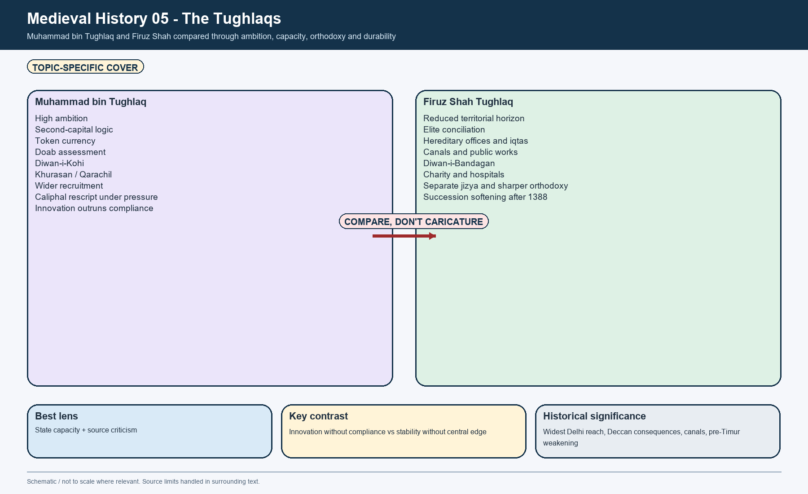

> **Subject:** Medieval Indian History | **Topic:** 05 | **Export date:** 2026-08-16
>
> **Approval:** false - awaiting explicit user approval.
>
> **Source order:** repository Markdown -> local OCR-searchable Satish Chandra core and Part I Sultanate chapters -> local material-evidence excerpts on Ashokan pillars and Tughlaq architecture -> no forced live current-affairs claim -> Qdrant not used.
>
> **Tag rule:** [FACT] source-grounded statement; [ANALYSIS] evidence-led synthesis; [DEBATE] historiographical disagreement or conceptual caution; [LIMIT] evidentiary, chronological, geographical or source-genre qualification.

## BASIC LEARNING SESSION

### DEEP-REVIEW LEARNING CONTRACT

| Control | Binding rule for this package |
|---|---|
| Syllabus boundary | Complete Medieval History Core is taught before optional enrichment. |
| Evidence method | Claim → named site/text/inscription/coin/example → analysis → qualification. |
| Source hierarchy | Archaeology, textual testimony, inscriptions, coins and scholarly interpretation remain visibly distinct. |
| Contested issues | Competing interpretations are attributed, evidenced and bounded; certainty is not manufactured. |
| Practice contract | Every solved item has demand decoding, an examiner-grade model, an executable answer/compression plan, marks rationale and answer-specific improvement. |
| Approval | This immutable successor remains `approved: false` pending explicit approval. |

**Canonical Basic/Core owner:** `upsc-ai-kit\knowledge\Medieval-Indian-History\basic\05_Tughlaqs.md`  
**Canonical topic owner:** `upsc-ai-kit\knowledge\Medieval-Indian-History\basic\05_Tughlaqs.md`  
**Optional Advanced owner:** `upsc-ai-kit\knowledge\Medieval-Indian-History\advanced\05_Tughlaqs.md`  
**Official syllabus mapping:** `upsc-ai-kit\knowledge\Medieval-Indian-History\OFFICIAL-UPSC-SYLLABUS-MAPPING.md`

### EVIDENCE, PYQ AND CURRENT-STATUS CONTROL

- **Archaeological inference:** material context supports bounded reconstruction; absence is not automatic proof of non-existence.
- **Textual testimony:** genre, authorship, redaction, patronage and temporal distance control what a text can prove.
- **Inscription and coin evidence:** contemporary names, titles, claims and circulation are powerful but do not by themselves map uniform territorial control.
- **Scholarly interpretation:** historian labels are arguments to test, not facts to memorise without evidence.
- **PYQ discipline:** repository ledgers and locally held official papers control wording and metadata; reconstructed wording and unavailable official keys must be labelled.
- **Current-status note, rechecked 2026-09-03:** The Archaeological Survey of India's Qutb Minar page was rechecked on 30 August 2026. It states that inscriptions record repairs to the minar by Firuz Shah Tughlaq after its earlier Aibak-Iltutmish construction phases. This official material link helps teach repair, reuse and dynastic appropriation; it does not validate every literary claim about Firuz's public works or wider political programme.

**Live/primary context sources recorded by the predecessor generation:**

- `https://asi.nic.in/pages/WorldHeritageQutbMinar`


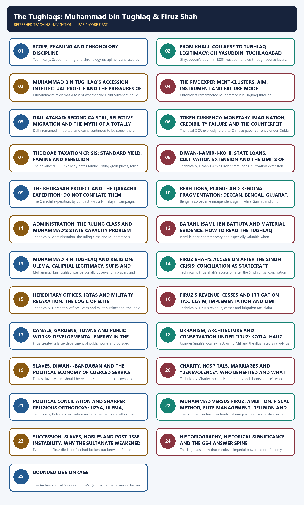

*Distinct embedded teaching-navigation image. The separate continuous Cārvāka-style flowchart package remains an independent at-a-glance artifact.*

#### Package counts, provenance and honest limitations

- Learning sections: 24; learning MCQ loops in this main session: 16 (strict A -> B -> C -> D rotation, repeated four times).
- Standalone workbook content: 32 distinct original objective questions with 128 option-specific explanations and an integrated remediation map; 4 verified or honestly-adjacent PYQs; 6 original solved Mains questions (two 10-mark, two 15-mark, two 20-mark). Final register modules in this file: 10.
- Original PNG visuals: 26 total - 25 body visuals plus 1 topic-specific cover visual. All maps and route diagrams are schematic and not to scale.
- Repository sources used most heavily: Topic 05 basic and advanced owners; bounded Topics 04, 06, 07, 08, 09 and 11; `README.md`; `00_Master-Chronology.md`; `REVISION-CHART_Ages-Eras-and-Distinctive-Features.md`; local PYQ routing ledgers; validated question wording preserved in earlier repository packages.
- OCR evidence used most heavily from Satish Chandra's *History of Medieval India* chapters on Muhammad Tughlaq's experiments, Firuz and the decline of the Sultanate, and from *Medieval India: From Sultanat to the Mughals, Part I* chapters "Problems of a Centralised All-India-State" and "Reassertion of a State Based on Benevolence," plus the state and architecture chapters.
- Material-evidence support used where needed from the local Upinder Singh export on the later life of Ashokan pillars, especially the Topra and Meerut pillar transport accounts associated with Firuz Shah.
- [LIMIT] The Tughlaq archive is heavily mediated by elite Persian chronicles. Barani is indispensable but later, moralising, aristocratic and hostile to "low-born" advancement; Isami writes from displacement; Ibn Battuta writes as a traveller-court insider attracted to the dramatic; Firuz's *Futuhat* is self-presentation rather than neutral audit.
- [LIMIT] Direct locally verified UPSC ownership is narrow: one routed 2021 Prelims question clearly touches Muhammad-bin-Tughlaq by name; a 2022 routed Prelims question tests Mongol chronology including Muhammad; the most useful Mains questions are adjacent source-and-technology questions rather than direct Tughlaq prompts.
- [LIMIT] No fabricated percentages, tax rates, troop strengths, slave totals, coin denominations, canal routes or attribution sequences are used here. When chroniclers provide numbers, they are marked as **reported** and kept separate from secure inference.
- [LIMIT] Topic 05 owns the Tughlaq transition, Muhammad's experiments, Firuz's benevolence/public works, source criticism around the two reigns, and the immediate structural road to post-1388 fragmentation. Topic 04 owns Khalji institutions and late Khalji collapse in depth; Topic 09 owns Vijayanagara-Bahmani development beyond the Delhi-overstretch frame; Topic 06 owns Timur, Sayyids and Lodis as the main narrative after Firuz.

#### Sources actually used

| Source class | Exact source | Use and caveat |
|---|---|---|
| Repository knowledge | Topic 05 basic and advanced owners; bounded Topics 04, 06, 07, 08, 09 and 11; `00_Master-Chronology.md`; `REVISION-CHART_Ages-Eras-and-Distinctive-Features.md`; Medieval `README.md`; PYQ routing ledgers and verified question wording preserved inside earlier packages. | Controlled chronology, owner boundaries, institutional vocabulary, architectural caution, source warnings and PYQ provenance. |
| Local book | Satish Chandra, *History of Medieval India*, searchable OCR around printed pp. 106-127 and related Sultanate economy/state pages. | Foundation for Muhammad's experiments, Daulatabad, token currency, doab crisis, Firuz's canals and the succession decline. |
| Local book | Satish Chandra, *Medieval India: From Sultanat to the Mughals, Part I*, searchable OCR around printed pp. 97-127, 135-146 and 232-235. | Deeper control for Ghiyasuddin's moderation, source criticism, Khurasan/Qarachil, Firuz's fiscal-benevolent model, state theory and Tughlaq architecture. |
| Material archive | Local Upinder Singh export on Ashokan pillars and their medieval afterlives. | Used narrowly for the Topra/Meerut pillar transport sequence and later inscriptional afterlife; not used to inflate broader Tughlaq political claims. |
| Named primary traditions through source-critical synthesis | Ziauddin Barani (*Tarikh-i Firuz Shahi*, *Fatawa-i Jahandari*), Isami, Ibn Battuta, Shams Siraj Afif, *Futuhat-i Firuz Shahi*, coins, inscriptions, canals and surviving monuments. | Used with explicit genre caution: report, advice, travel narrative, ruler self-fashioning and material survival are separated from inference. |
| Live official or heritage source | None required for this export. | Repository Markdown and OCR-searchable books were sufficient; no decorative current-affairs hook was forced into a historical topic. |

#### Original visual asset index

- `notes/Medieval-Indian-History/assets/05_The-Tughlaqs-Muhammad-bin-Tughlaq-Firuz-Shah/00_tughlaq_comparative_cover.png`
- `notes/Medieval-Indian-History/assets/05_The-Tughlaqs-Muhammad-bin-Tughlaq-Firuz-Shah/01_tughlaq_chronology_evidence_spine.png`
- `notes/Medieval-Indian-History/assets/05_The-Tughlaqs-Muhammad-bin-Tughlaq-Firuz-Shah/02_ghiyas_transition_death_source_layers.png`
- `notes/Medieval-Indian-History/assets/05_The-Tughlaqs-Muhammad-bin-Tughlaq-Firuz-Shah/03_muhammad_empire_pressures_map.png`
- `notes/Medieval-Indian-History/assets/05_The-Tughlaqs-Muhammad-bin-Tughlaq-Firuz-Shah/04_five_experiments_overview.png`
- `notes/Medieval-Indian-History/assets/05_The-Tughlaqs-Muhammad-bin-Tughlaq-Firuz-Shah/05_delhi_daulatabad_phases_myths.png`
- `notes/Medieval-Indian-History/assets/05_The-Tughlaqs-Muhammad-bin-Tughlaq-Firuz-Shah/06_token_currency_trust_flow.png`
- `notes/Medieval-Indian-History/assets/05_The-Tughlaqs-Muhammad-bin-Tughlaq-Firuz-Shah/07_doab_tax_famine_rebellion_chain.png`
- `notes/Medieval-Indian-History/assets/05_The-Tughlaqs-Muhammad-bin-Tughlaq-Firuz-Shah/08_diwan_i_kohi_agricultural_model.png`
- `notes/Medieval-Indian-History/assets/05_The-Tughlaqs-Muhammad-bin-Tughlaq-Firuz-Shah/09_khurasan_qarachil_comparison.png`
- `notes/Medieval-Indian-History/assets/05_The-Tughlaqs-Muhammad-bin-Tughlaq-Firuz-Shah/10_rebellions_fragmentation_timeline.png`
- `notes/Medieval-Indian-History/assets/05_The-Tughlaqs-Muhammad-bin-Tughlaq-Firuz-Shah/11_muhammad_state_capacity_diagnostic.png`
- `notes/Medieval-Indian-History/assets/05_The-Tughlaqs-Muhammad-bin-Tughlaq-Firuz-Shah/12_source_matrix_barani_isami_ibn_battuta.png`
- `notes/Medieval-Indian-History/assets/05_The-Tughlaqs-Muhammad-bin-Tughlaq-Firuz-Shah/13_firuz_accession_political_bargain.png`
- `notes/Medieval-Indian-History/assets/05_The-Tughlaqs-Muhammad-bin-Tughlaq-Firuz-Shah/14_hereditary_iqta_offices_flow.png`
- `notes/Medieval-Indian-History/assets/05_The-Tughlaqs-Muhammad-bin-Tughlaq-Firuz-Shah/15_revenue_cess_irrigation_policy_matrix.png`
- `notes/Medieval-Indian-History/assets/05_The-Tughlaqs-Muhammad-bin-Tughlaq-Firuz-Shah/16_canal_public_works_network.png`
- `notes/Medieval-Indian-History/assets/05_The-Tughlaqs-Muhammad-bin-Tughlaq-Firuz-Shah/17_firuz_urban_architecture_matrix.png`
- `notes/Medieval-Indian-History/assets/05_The-Tughlaqs-Muhammad-bin-Tughlaq-Firuz-Shah/18_ashokan_pillar_transport_process.png`
- `notes/Medieval-Indian-History/assets/05_The-Tughlaqs-Muhammad-bin-Tughlaq-Firuz-Shah/19_diwan_i_bandagan_ecosystem.png`
- `notes/Medieval-Indian-History/assets/05_The-Tughlaqs-Muhammad-bin-Tughlaq-Firuz-Shah/20_welfare_departments_matrix.png`
- `notes/Medieval-Indian-History/assets/05_The-Tughlaqs-Muhammad-bin-Tughlaq-Firuz-Shah/21_conciliation_vs_orthodoxy_comparison.png`
- `notes/Medieval-Indian-History/assets/05_The-Tughlaqs-Muhammad-bin-Tughlaq-Firuz-Shah/22_muhammad_vs_firuz_structural_matrix.png`
- `notes/Medieval-Indian-History/assets/05_The-Tughlaqs-Muhammad-bin-Tughlaq-Firuz-Shah/23_succession_breakdown_causal_web.png`
- `notes/Medieval-Indian-History/assets/05_The-Tughlaqs-Muhammad-bin-Tughlaq-Firuz-Shah/24_historiography_comparison.png`
- `notes/Medieval-Indian-History/assets/05_The-Tughlaqs-Muhammad-bin-Tughlaq-Firuz-Shah/25_gs1_answer_spine.png`

### SESSION 1 — SCOPE, FRAMING AND CHRONOLOGY DISCIPLINE

#### DEFINITION / WHAT THIS IS CALLED

**Plain-language definition:** Scope and framing discipline means fixing exactly which years, rulers and questions Topic 05 owns before any Tughlaq judgement is offered.

**Technical definition:** Chronology discipline is the working rule that the 1320-1388 Tughlaq arc must be reconstructed by separating securely dated events, chronicler judgement and later legend before state capacity is compared across the three reigns.

#### ANSWER-GRABBING OPENING — WRITE/ADAPT IN THE EXAM

> The Tughlaq century is best approached through source criticism plus state-capacity comparison rather than through the inherited labels of "mad king" and "benevolent builder".

#### MUST-WRITE KEYWORDS

- **1320-1388 Tughlaq arc**
- **source criticism**
- **state-capacity comparison**
- **objective versus administrative instrument**
- **owner boundary with Topics 04, 06 and 09**
- **secure event versus later legend**

**How to use them:** Open by fixing the 1320-1388 Tughlaq arc and the owner boundary with Topics 04, 06 and 09; declare source criticism and state-capacity comparison as the method; then test each policy as objective versus administrative instrument, keeping secure event apart from later legend.

[FACT] Topic 05 owns the Tughlaq arc from **1320**, when Ghiyasuddin Tughlaq displaced Khusrau Khan, to **1388**, when Firuz Shah died and the succession order unravelled. It uses late Khalji collapse only as inherited context and treats Timur's invasion and the Sayyid-Lodi aftermath as the main subject of Topic 06.

[ANALYSIS] The strongest framing is **source criticism plus state-capacity comparison**. Muhammad bin Tughlaq should not be flattened into the schoolbook caricature of a "wise fool"; Firuz Shah should not be romanticised as a simply benevolent welfare ruler. The real contrast is between two different ways of holding together a very large Sultanate: one through high ambition, uniformity and risky innovation, the other through conciliation, heredity and developmental works.

[DEBATE] The source families themselves force caution. Barani moralises from an aristocratic angle; Isami remembers from displacement; Ibn Battuta records wonder, gifts, punishments and urban travel; Firuz's own *Futuhat* stages self-justification; coins, canals, forts and pillars show material claims but not the total lived experience of the empire.

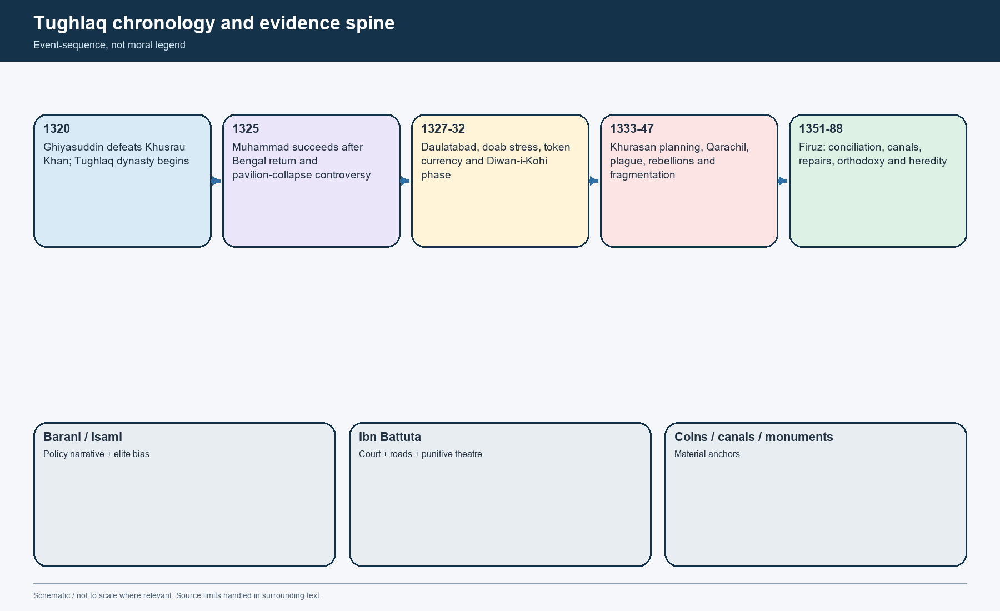

*Chronology visual. Rulers, experiments, rebellions and evidence families are separated so that event, reputation and later memory are never collapsed into one line of story.*

#### Topic ownership firewall

| Owner | What stays primarily there | What Topic 05 legitimately uses |
|---|---|---|
| Topic 04 - Khaljis | Alauddin's integrated military-fiscal system, Siri, market controls, Mongol pressure and the fall of the Khaljis | Only the immediate handoff into the Ghiyasuddin takeover and a few institutional comparison points |
| Topic 06 - Decline / Timur / Sayyids / Lodis | Timur's invasion, the Sayyids, Lodis and fifteenth-century north-Indian balance of power | Only the post-1388 causal bridge showing why Delhi weakened before Timur |
| Topic 07 - Sultanate administration, economy and society | General offices, revenue structure, town life, trade and social groups in long duration | Only Tughlaq-specific reversals, experiments and capacity stress |
| Topic 09 - Vijayanagara and Bahmani | Full Deccan state formation after Delhi's overstretch | Only the Delhi-side conditions that allowed southern breakaways |
| Topic 11 - Art, architecture and culture | Full Sultanate architectural and cultural survey | Only bounded political meaning of Tughlaqabad, Kotla Firoz Shah, Hauz Khas repairs and pillar transport |

#### Governing thesis

- [ANALYSIS] Muhammad bin Tughlaq expanded direct rule and tried to standardise the empire faster than the available instruments of information, trust and enforcement could sustain.
- [ANALYSIS] Firuz Shah reduced punitive intensity, invested in canals and urban works, and stabilised the elite through heredity - but this traded short-term order for long-term central weakening.
- [LIMIT] Neither ruler can be judged only by intention or only by outcome. For UPSC, the mark-winning move is to distinguish **objective**, **administrative instrument**, **social cost** and **durability**.

#### PARAGRAPH DEMONSTRATION — CLAIM → EVIDENCE → ANALYSIS → QUALIFICATION

**Claim:** Topic 05 is a bounded study of how two very different Tughlaq strategies tried to hold one oversized Sultanate together between 1320 and 1388. **Named evidence:** the arc runs from Ghiyasuddin Tughlaq's defeat of Khusrau Khan in 1320, through Muhammad bin Tughlaq's Daulatabad, token-currency, doab and Diwan-i-Amir-i-Kohi measures, to Firuz Shah's canals, hereditary iqtas and death in 1388 - and it survives mainly through Barani, Isami, Ibn Battuta, Afif and the ruler's own *Futuhat*, checked against coins, canals and monuments. **Analysis:** because every one of those narrative sources is positioned - later, displaced, travelling or self-presenting - the safest method is to establish the dated event first, then ask what administrative instrument each policy required and whether the state could supply it. **Qualification:** that method disqualifies both the "mad king" caricature and the "benevolent welfare monarch" romance, and it also stops the answer from drifting into Timur, the Sayyids or full Vijayanagara-Bahmani history, which Topics 06 and 09 own.

#### CLOSING RECALL FLOW — SCOPE, FRAMING AND CHRONOLOGY DISCIPLINE

```text
START / CONCEPT: Scope, framing and chronology discipline
        |
        v
EXACT TERMS: 1320-1388 Tughlaq arc · source criticism · state-capacity comparison · objective versus administrative instrument · owner boundary with Topics 04, 06 and 09 · secure event versus later legend
        |
        v
MECHANISM / ARGUMENT: Chronological control works by anchoring each measure to a dated reign-phase first, so that Ghiyasuddin's restoration, Muhammad's experiments and Firuz's conciliation are compared as sequenced state strategies rather than as personality traits.
        |
        v
CONSEQUENCE / CONTRAST: A chronology-first reading yields a comparison of two governing models - uniformising ambition against negotiated stability - instead of a moral ranking of two Sultans.
        |
        v
UPSC TRAP / ANSWER-USE: Do not let Topic 05 drift into Timur, the Sayyids or full Vijayanagara-Bahmani history; the arc stops at Firuz's death in 1388 and hands the later narrative to Topic 06.
        |
        v
ANSWER-GRABBING FORMULATION: Judge every Tughlaq measure by objective, administrative instrument, social cost and durability rather than by the reputation chroniclers attached to its author.
```
### SESSION 2 — FROM KHALJI COLLAPSE TO TUGHLAQ LEGITIMACY: GHIYASUDDIN, TUGHLAQABAD AND THE DEATH CONTROVERSY

#### DEFINITION / WHAT THIS IS CALLED

**Plain-language definition:** The Tughlaq dynasty began when Ghiyasuddin Tughlaq, a north-western frontier commander, defeated Khusrau Khan in 1320 and rebuilt the legitimacy that the late Khalji crisis had destroyed.

**Technical definition:** Ghiyasuddin's short reign is a restoration phase defined by moderated revenue demand, protection of cultivation, renewed Warangal and Bengal assertion, and the fortified dynastic statement of Tughlaqabad.

#### ANSWER-GRABBING OPENING — WRITE/ADAPT IN THE EXAM

> Muhammad bin Tughlaq inherited Ghiyasuddin's partly rebuilt authority, not a blank slate, and that inheritance is what makes his later acceleration intelligible.

#### MUST-WRITE KEYWORDS

- **Ghiyasuddin Tughlaq**
- **defeat of Khusrau Khan in 1320**
- **moderation in revenue demand**
- **Tughlaqabad**
- **Afghanpur pavilion collapse of 1325**
- **secure event versus conspiracy claim**

**How to use them:** Name Ghiyasuddin Tughlaq's defeat of Khusrau Khan in 1320, quote moderation in revenue demand as the reign's policy tone, use Tughlaqabad as material proof of fortified kingship, and close the Afghanpur pavilion collapse of 1325 by separating the secure event from the conspiracy claim.

[FACT] Ghiyasuddin Tughlaq, the former frontier commander and warden of the marches, led a coalition of officers against Khusrau Khan in **1320**. In a hard-fought battle outside Delhi, Khusrau was defeated and killed, ending the late Khalji crisis.

[FACT] Ghiyasuddin's brief reign was devoted to restoration and consolidation. The advanced OCR explicitly praises his policy of **moderation**: taxation should not ruin the countryside, agriculture and crafts should expand, and the people should neither become so rich as to rebel nor so poor as to cease cultivation.

[FACT] He restored some neglected noble families to office, audited extraordinary gifts of the previous regime, reduced some long-held revenue-free grants, sent Ulugh Khan (the future Muhammad bin Tughlaq) to restore the imperial position in Warangal, and personally marched to Bengal, where the campaign succeeded.

[FACT] The palace-fortress complex of **Tughlaqabad**, together with Ghiyasuddin's elevated domed tomb, proclaimed a new dynastic style: fortified austerity, sloping battered walls and a preference for strength over ornament.

[LIMIT] Ghiyasuddin's death in **1325** must be handled through source layers. A pavilion erected by Ulugh Khan to welcome him after the Bengal campaign collapsed during the parade of captured elephants. Contemporary suspicion, later conspiracy stories and the Nizamuddin-Auliya curse legend all survive; the advanced OCR, however, states that modern research does **not** support the idea of a deliberate murderous conspiracy.

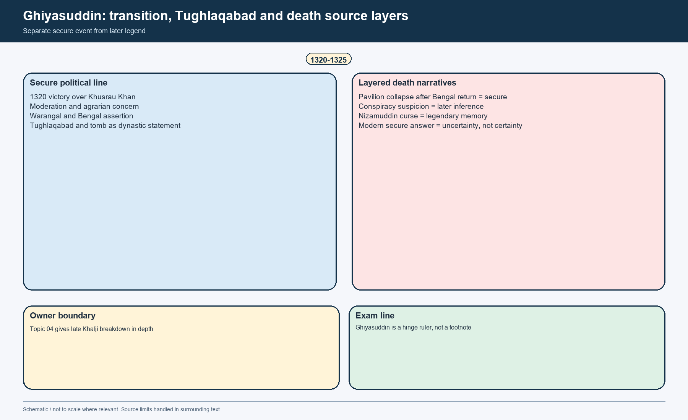

*Transition visual. Secure political sequence, dynastic architecture and the death controversy are separated into evidence, report and legend.*

#### Secure event versus layered interpretation

| Dimension | Secure minimum statement | Why caution is necessary |
|---|---|---|
| Rise to power | Ghiyasuddin defeated Khusrau Khan in 1320 and founded the Tughlaq dynasty | The moral language of chroniclers should not be mistaken for complete political sociology |
| Policy | Moderation, agrarian concern, restoration of order and renewed southern/eastern assertion | The reign was too brief to convert every intention into stable institution |
| Bengal campaign | Successful enough for the ruler to return in triumph | The campaign is often remembered only as the prelude to his death |
| Death | Pavilion collapse while welcoming the Sultan after Bengal | Conspiracy certainty, saintly curse and elephant accident belong to different source layers |

#### Why Ghiyasuddin matters here

- [ANALYSIS] Topic 05 should not begin with Muhammad as though he inherited a blank slate. He inherited Ghiyasuddin's partially restored authority, direct-ruled Deccan ambitions and a fresh dynastic legitimacy still being built.
- [ANALYSIS] The sharpest contrast is not Ghiyasuddin versus Firuz but Ghiyasuddin's **moderated restoration** versus Muhammad's **high-speed uniformity project**.

#### PARAGRAPH DEMONSTRATION — CLAIM → EVIDENCE → ANALYSIS → QUALIFICATION

**Claim:** Ghiyasuddin Tughlaq's brief reign matters less for its length than for the kind of state it handed on. **Named evidence:** he defeated Khusrau Khan outside Delhi in 1320, declared a policy of moderation under which taxation should neither ruin cultivators nor make them rich enough to rebel, restored neglected noble households, sent Ulugh Khan to recover the imperial position at Warangal, campaigned successfully in Bengal, and built the battered-walled fortress-capital of Tughlaqabad with its elevated domed tomb. **Analysis:** these are four different instruments - military victory, fiscal moderation, elite reconciliation and architectural display - working together to manufacture legitimacy for a dynasty that had none by descent, which is precisely the capacity Muhammad later spent. **Qualification:** the reign was too short to convert intention into durable institution, and its ending will not bear certainty: the pavilion collapse at Afghanpur in 1325 is secure, but deliberate murder is not established, and the saintly-curse story belongs to legend rather than evidence.

#### CLOSING RECALL FLOW — FROM KHALJI COLLAPSE TO TUGHLAQ LEGITIMACY: GHIYASUDDIN, TUGHLAQABAD AND THE DEATH CONTROVERSY

```text
START / CONCEPT: From Khalji collapse to Tughlaq legitimacy: Ghiyasuddin, Tughlaqabad and the death controversy
        |
        v
EXACT TERMS: Ghiyasuddin Tughlaq · defeat of Khusrau Khan in 1320 · moderation in revenue demand · Tughlaqabad · Afghanpur pavilion collapse of 1325 · secure event versus conspiracy claim
        |
        v
MECHANISM / ARGUMENT: Legitimacy was manufactured through combined instruments: military victory over Khusrau Khan, a declared fiscal moderation that protected cultivation, restoration of displaced noble households, and a fortified capital advertising a new dynastic style.
        |
        v
CONSEQUENCE / CONTRAST: The state Muhammad received in 1325 was energised and still consolidating, so his experiments read as acceleration of an unfinished project rather than as repair of a ruined inheritance.
        |
        v
UPSC TRAP / ANSWER-USE: The Afghanpur pavilion collapse is secure but deliberate murder is not; modern research does not support a proved conspiracy, and the Nizamuddin Auliya curse story must never be presented as evidence.
        |
        v
ANSWER-GRABBING FORMULATION: Ghiyasuddin's reign is the hinge between Khalji breakdown and the Tughlaq experiment in empire, and it supplies the moderation baseline against which Muhammad's doab demand is later measured.
```
### SESSION 3 — MUHAMMAD BIN TUGHLAQ'S ACCESSION, INTELLECTUAL PROFILE AND THE PRESSURES OF SCALE

#### DEFINITION / WHAT THIS IS CALLED

**Plain-language definition:** Muhammad bin Tughlaq reached the throne in 1325 as an unusually learned ruler who also inherited the largest directly ruled Delhi Sultanate yet attempted.

**Technical definition:** The pressures of scale name the structural mismatch between an empire reaching from the Punjab frontier to the Madurai horizon and the medieval instruments of communication, audit, transport and elite loyalty available to govern it.

#### ANSWER-GRABBING OPENING — WRITE/ADAPT IN THE EXAM

> Barani's charge that Muhammad bin Tughlaq was a "rationalist" is usable evidence about a contested politics of authority, not merely chronicler abuse.

#### MUST-WRITE KEYWORDS

- **accession of 1325**
- **learning in philosophy, medicine and logic**
- **Jinaprabha Suri and Hindu yogis**
- **Barani's rationalist charge**
- **pressures of imperial scale**
- **conquest-plus-tribute versus uniform supervision**

**How to use them:** Open on the accession of 1325 and the ruler's learning in philosophy, medicine and logic; use Barani's rationalist charge and the meetings with Jinaprabha Suri and Hindu yogis to show a contested authority; then convert the pressures of imperial scale into the move from conquest-plus-tribute to uniform supervision.

[FACT] Muhammad bin Tughlaq came to power in 1325 with an unusual intellectual profile for a medieval ruler. The local OCR describes him as deeply read in religion, philosophy, mathematics and medicine, interested in Persian and Hindi poetry, and willing to converse not only with Muslim mystics but also with Hindu yogis and Jain saints such as **Jinaprabha Suri**.

[FACT] Barani's charge that Muhammad was a "rationalist" is valuable evidence, not merely abuse. It shows that the Sultan would not accept many claims merely on inherited religious authority and that his relationship with orthodox theologians was tense from the start.

[FACT] He also inherited the widest directly ruled Delhi Sultanate yet attempted: the old north-Indian core, Gujarat, Malwa, the Deccan, Warangal and the farther southern belt up to the Madurai horizon. This was an empire of long roads, delayed communication, high military transport costs and regionally varied loyalties.

[ANALYSIS] The experiments of the reign become intelligible only when we place them under the pressure of **scale**. The problem was not simply "a ruler with strange ideas"; it was a ruler trying to make distant annexations administratively legible and fiscally usable.

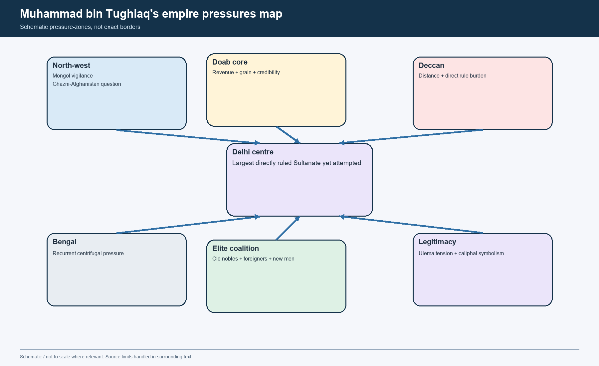

*Schematic pressure map. It is not a territorial border map; it shows the problem-zones that shaped Muhammad's decisions.*

#### Pressure grid

| Pressure zone | Core problem | Why it mattered to Muhammad |
|---|---|---|
| North-west frontier | Mongol threat, Ghazni-Afghanistan question, Punjab vigilance | A purely defensive frontier left Delhi reactive |
| Doab and Delhi provisioning belt | Grain, revenue, transport and price credibility | Delhi's army and court could not function without a dependable agrarian core |
| Deccan and far south | Distance, tribute enforcement, direct-rule burden and local resentment | Annexation without local administrative depth became fragile |
| Elite coalition | Old nobles, foreigners, Indian converts and "new men" | Recruitment widened talent but weakened cohesion |
| Legitimacy and religious authority | Conflict with ulema, saintly networks and symbolic caliphal idiom | Every controversial policy also had a reputational cost |

#### Safe interpretive line

- [ANALYSIS] Muhammad's reign was a test of whether the Delhi Sultanate could move from a conquest-plus-tribute order to a more **uniformly supervised all-India state**. The answer was mixed: imagination outran coordination.

#### PARAGRAPH DEMONSTRATION — CLAIM → EVIDENCE → ANALYSIS → QUALIFICATION

**Claim:** Muhammad bin Tughlaq's experiments become intelligible only when read as responses to imperial scale rather than as symptoms of temperament. **Named evidence:** he inherited the old north-Indian core together with Gujarat, Malwa, the Deccan, Warangal and the belt reaching toward Madurai, while the local source describes him as read in religion, philosophy, mathematics and medicine and willing to debate Muslim mystics, Hindu yogis and the Jain teacher Jinaprabha Suri. **Analysis:** an empire of that span imposed long roads, delayed information, expensive military transport and regionally uneven loyalty, so the reign's central problem was converting distant annexations into administratively legible and fiscally usable provinces. **Qualification:** Barani's hostile label of rationalist proves that the Sultan refused claims resting only on inherited religious authority and that his relations with orthodox theologians were strained from the start - it does not prove irreligion, and it cannot by itself explain any single policy.

#### CLOSING RECALL FLOW — MUHAMMAD BIN TUGHLAQ'S ACCESSION, INTELLECTUAL PROFILE AND THE PRESSURES OF SCALE

```text
START / CONCEPT: Muhammad bin Tughlaq's accession, intellectual profile and the pressures of scale
        |
        v
EXACT TERMS: accession of 1325 · learning in philosophy, medicine and logic · Jinaprabha Suri and Hindu yogis · Barani's rationalist charge · pressures of imperial scale · conquest-plus-tribute versus uniform supervision
        |
        v
MECHANISM / ARGUMENT: Scale translated into policy pressure through four channels at once: frontier risk in the north-west, provisioning of Delhi from the doab, the cost of direct rule in the far south, and the cohesion of a widened and heterogeneous ruling coalition.
        |
        v
CONSEQUENCE / CONTRAST: Reading the reign through scale converts a list of famous failures into a single diagnostic question about how far ambition, information and enforcement could be aligned.
        |
        v
UPSC TRAP / ANSWER-USE: Intellectual openness must not be mistaken for tolerance as a policy programme, and the rationalist label must not be read as irreligion; the Sultan remained observant while quarrelling with orthodox intermediaries.
        |
        v
ANSWER-GRABBING FORMULATION: The reign tested whether the Delhi Sultanate could move from a conquest-plus-tribute order to a uniformly supervised all-India state, and its answer was that imagination outran coordination.
```
### SESSION 4 — THE FIVE EXPERIMENT-CLUSTERS: AIM, INSTRUMENT AND FAILURE MODE

#### DEFINITION / WHAT THIS IS CALLED

**Plain-language definition:** The five experiment-clusters are the grouped administrative measures - Daulatabad, token currency, the doab fiscal reset, Diwan-i-Amir-i-Kohi and the frontier military projects - through which Muhammad bin Tughlaq's reign is normally examined.

**Technical definition:** Each cluster is analysed on a three-part grid of aim, administrative instrument and principal failure mode, so that the policy problem being solved is distinguished from the capacity gap that defeated it.

#### ANSWER-GRABBING OPENING — WRITE/ADAPT IN THE EXAM

> The mark-winning move is to ask what each measure was trying to solve, what instrument it required and exactly where that instrument broke, instead of reciting a failure-list.

#### MUST-WRITE KEYWORDS

- **aim, instrument and failure mode**
- **Daulatabad second capital**
- **token currency**
- **doab fiscal reset**
- **Diwan-i-Amir-i-Kohi**
- **frontier military projects**

**How to use them:** Run every cluster through aim, instrument and failure mode: pair the Daulatabad second capital with migration logistics, token currency with authentication, the doab fiscal reset with flexible assessment, Diwan-i-Amir-i-Kohi with honest local supervision, and the frontier military projects with sustainable finance and terrain knowledge.

[ANALYSIS] Chroniclers remembered Muhammad bin Tughlaq through "experiments" because they were visible moments when intention, instrument and administrative reality collided. The exam-safe move is not to rehearse a failure-list but to ask what each measure was trying to solve, what instrument it required, and where that instrument broke.

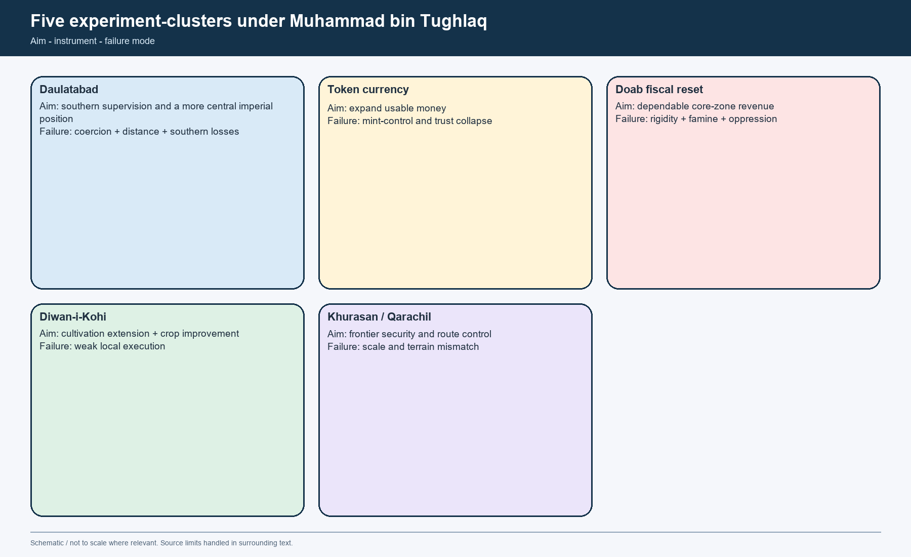

*Overview visual. The experiments are grouped by administrative problem, not by legend.*

| Experiment cluster | Immediate objective | Administrative instrument required | Principal failure mode |
|---|---|---|---|
| Daulatabad second capital | Better southern supervision and more central imperial positioning | Managed migration, communication, local buy-in, dual-capital logistics | Distance, coercive pressure, southern losses and homesickness |
| Token currency | Expand usable money and fiscal flexibility without dependence on silver supply | Mint control, verification, counter-forgery regime, public trust | Weak monopoly over coin authentication and widespread imitation |
| Doab fiscal reset | Raise dependable state demand from the core agrarian zone | Fair assessment, locally monitored collection, famine resilience | Standard-yield rigidity, official oppression and climatic stress |
| Diwan-i-Amir-i-Kohi | Extend cultivation and improve crop quality | Honest local officials, credit discipline, agronomic knowledge | Corruption, weak supervision and over-optimistic scale |
| Frontier military projects | Push defence outward and secure the north-west / Himalayas | Sustained logistics, reliable intelligence, terrain knowledge, finance | Strategic overreach and poor environmental fit |

#### Two big cautions

- [LIMIT] "Bold experiment" does **not** mean "modern policy laboratory." These were coercive medieval state measures operating through grain extraction, iqta assignments, military command and court authority.
- [LIMIT] Failure did **not** erase significance. Several ideas - agricultural loans, developmental cultivation, second-capital logic, fiscal-monetary experimentation - had a long afterlife even when the immediate version failed.

#### PARAGRAPH DEMONSTRATION — CLAIM → EVIDENCE → ANALYSIS → QUALIFICATION

**Claim:** Muhammad bin Tughlaq's measures share one analytical shape - a defensible aim attached to an instrument the Sultanate could not operate reliably. **Named evidence:** the Daulatabad second capital needed managed migration and dual-capital logistics; the token currency needed mint monopoly and anti-forgery verification; the doab fiscal reset needed assessment that tracked actual harvests; Diwan-i-Amir-i-Kohi needed honest shiqdars and credit discipline; the Khurasan and Qarachil projects needed sustained logistics and terrain intelligence. **Analysis:** grouping the measures by administrative problem rather than by legend shows that the recurring failure point was verification and follow-through, not conception, which is why the same ruler could be both inventive and destructive. **Qualification:** "experiment" must not be read as a modern policy laboratory, since these were coercive medieval measures working through grain extraction, iqta assignment and court authority; equally, failure did not erase significance, because agricultural loans, developmental cultivation and second-capital logic all had a long afterlife.

#### CLOSING RECALL FLOW — THE FIVE EXPERIMENT-CLUSTERS: AIM, INSTRUMENT AND FAILURE MODE

```text
START / CONCEPT: The five experiment-clusters: aim, instrument and failure mode
        |
        v
EXACT TERMS: aim, instrument and failure mode · Daulatabad second capital · token currency · doab fiscal reset · Diwan-i-Amir-i-Kohi · frontier military projects
        |
        v
MECHANISM / ARGUMENT: Grouping the measures by the administrative problem each tried to solve exposes a single repeated breakdown - the gap between what the centre could order and what it could verify - across monetary, fiscal, agrarian and military policy alike.
        |
        v
CONSEQUENCE / CONTRAST: The reign therefore produces one transferable lesson rather than five unconnected anecdotes: ambitious medieval policy fails at the point of enforcement far more often than at the point of design.
        |
        v
UPSC TRAP / ANSWER-USE: Do not call these measures a modern policy laboratory and do not treat failure as proof of insignificance; several ideas, including state agricultural credit, outlived the ruler who mishandled them.
        |
        v
ANSWER-GRABBING FORMULATION: Test each Tughlaq experiment as aim, required instrument and failure mode, and the reign stops being a list of eccentricities and becomes a case study in state capacity.
```
### SESSION 5 — DAULATABAD: SECOND CAPITAL, SELECTIVE MIGRATION AND THE MYTH OF A TOTALLY EMPTIED DELHI

#### DEFINITION / WHAT THIS IS CALLED

**Plain-language definition:** Daulatabad was Deogir renamed and developed as a second capital for southern supervision, with pressure to migrate falling mainly on officials, nobles, scholars, Sufis, merchants and artisans.

**Technical definition:** Selective migration describes a phased, coercive relocation of designated service and elite groups along an organised road with halting stations, ward allocation and housing grants, rather than a total deportation of Delhi's population.

#### ANSWER-GRABBING OPENING — WRITE/ADAPT IN THE EXAM

> Delhi remained inhabited and continued to strike coins while the Sultan sat at Daulatabad, which is the single fact that destroys the emptied-capital myth.

#### MUST-WRITE KEYWORDS

- **Deogir renamed Daulatabad**
- **second capital**
- **selective pressured migration**
- **organised road and halting stations**
- **Delhi mint continuity**
- **Deccan centre of Islamic learning**

**How to use them:** State that Deogir renamed Daulatabad was a second capital, not a transfer; evidence the selective pressured migration and the organised road and halting stations; then use Delhi mint continuity against the emptying myth and close on Daulatabad's later life as a Deccan centre of Islamic learning.

[FACT] Devagiri/Deogir was already central to Delhi's southern strategy before Muhammad's accession. Alauddin had raided it, later Delhi had used it as a base, and Muhammad himself had spent significant time there as prince and military commander. Renaming it **Daulatabad** was therefore politically meaningful, not whimsical.

[FACT] The advanced OCR is explicit that **no mass exodus of the whole population of Delhi** was ordered. Pressure fell mainly on officers, their followers, nobles, leading men, Sufis, ulema and grandees. Delhi remained inhabited, and coins continued to be struck there while the Sultan was at Daulatabad.

[FACT] Preparations were serious: the road was organised with halting stations and facilities, the city was divided into wards (*mohallas*), and grants, houses and boarding arrangements were made for migrants. These details matter because they show that the move was planned, not impulsively improvised.

[ANALYSIS] The motive most safely attributed to Muhammad is the desire for a **second capital** better placed for southern oversight and more central to the enlarged empire. Popular textbook language about a "capital transfer" becomes misleading if it implies permanent abandonment of Delhi.

[LIMIT] The journey was still punishing. It was long, undertaken in severe heat, and accompanied by coercive inspection of houses and substantial discontent. Once the southern direct-rule project faltered in the mid-1330s, the political logic of Daulatabad weakened, and people were allowed to return.

[ANALYSIS] The long-term consequence was real even though the policy failed. Roads improved, north-south contact intensified, and many migrants - especially learned and religious figures - stayed back, helping Daulatabad become a Deccan centre of Islamic learning later useful to the Bahmani world.

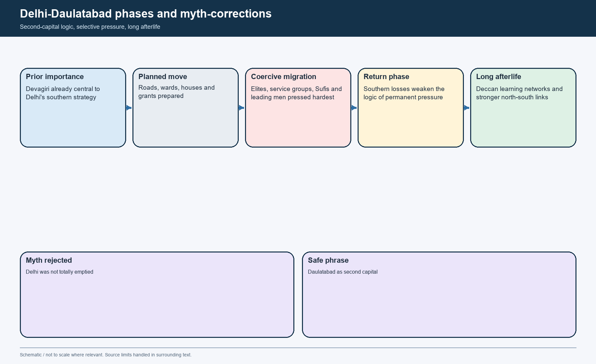

*Phases visual. Planning, pressure, migration, return and long-run cultural consequences are separated from exaggerated myth.*

#### Myth-correction table

| Common simplification | Secure correction |
|---|---|
| Muhammad shifted the **entire** population of Delhi | The pressure was severe, but it chiefly targeted officers, grandees, Sufis, ulema and associated groups |
| Delhi ceased to function | Delhi remained inhabited and continued mint activity |
| Daulatabad was chosen randomly | It was already a strategic Deccan base and more central to the enlarged empire |
| The move had no long-term effect | It intensified north-south communication and helped seed Deccan Islamic learning |

#### PARAGRAPH DEMONSTRATION — CLAIM → EVIDENCE → ANALYSIS → QUALIFICATION

**Claim:** the Daulatabad project was a rational second-capital experiment implemented coercively, not the whimsical emptying of a city. **Named evidence:** Deogir was already a strategic Deccan base that Muhammad had commanded as prince; the road was organised with halting stations and facilities, the city was laid out in *mohallas*, and grants, houses and boarding arrangements were made for migrants - while Delhi remained inhabited and coins continued to be struck there. **Analysis:** that combination of prior strategic value and detailed logistical preparation shows a planned attempt to place the court nearer the enlarged empire's centre of gravity, which is a geopolitical argument rather than a psychological one. **Qualification:** the journey remained punishing in severe heat and was enforced by coercive inspection, and once the southern direct-rule project faltered in the mid-1330s the political purpose dissolved and return was permitted - yet the migration left a durable consequence, since many learned and religious migrants stayed and helped make Daulatabad a Deccan centre of Islamic learning.

#### CLOSING RECALL FLOW — DAULATABAD: SECOND CAPITAL, SELECTIVE MIGRATION AND THE MYTH OF A TOTALLY EMPTIED DELHI

```text
START / CONCEPT: Daulatabad: second capital, selective migration and the myth of a totally emptied Delhi
        |
        v
EXACT TERMS: Deogir renamed Daulatabad · second capital · selective pressured migration · organised road and halting stations · Delhi mint continuity · Deccan centre of Islamic learning
        |
        v
MECHANISM / ARGUMENT: A second capital was meant to shorten the distance between the court and the southern provinces, and the organised road, ward allocation and housing grants were the instruments through which that shortening was to be achieved.
        |
        v
CONSEQUENCE / CONTRAST: Southern breakaways removed the project's purpose before its logistics failed, so the collapse belongs to political geography rather than to distance alone.
        |
        v
UPSC TRAP / ANSWER-USE: Never write that Delhi was emptied or abandoned; the secure correction is against total depopulation and permanent transfer, not against the coercion, hardship and discontent that the sources also record.
        |
        v
ANSWER-GRABBING FORMULATION: Daulatabad should be argued as a second-capital project with phased coercive migration and a real cultural afterlife, since "capital transfer" misstates both the intention and the outcome.
```
### SESSION 6 — TOKEN CURRENCY: MONETARY IMAGINATION, CREDIBILITY FAILURE AND THE COUNTERFEIT PROBLEM

#### DEFINITION / WHAT THIS IS CALLED

**Plain-language definition:** Token currency was Muhammad bin Tughlaq's issue of copper and brass coins carrying the declared value of the silver tanka.

**Technical definition:** A fiduciary coinage of this kind survives only where the state holds an effective mint monopoly, a recognisable authentication standard and a credible redemption promise; the Indian issue failed on all three, and private imitation destroyed confidence.

#### ANSWER-GRABBING OPENING — WRITE/ADAPT IN THE EXAM

> The token experiment is best read as a failure of state credibility and enforcement, not as evidence of civilisational ignorance about money.

#### MUST-WRITE KEYWORDS

- **copper and brass token coinage**
- **silver tanka value**
- **mint monopoly and authentication**
- **private counterfeiting**
- **redemption in precious metal**
- **not paper currency**

**How to use them:** Define the copper and brass token coinage carrying the silver tanka value, explain that mint monopoly and authentication were the required instrument, attribute collapse to private counterfeiting and costly redemption in precious metal, and insist that this was not paper currency.

[FACT] Muhammad bin Tughlaq issued **copper and brass** coins intended to circulate at the value of the silver *tanka*. This was a token-currency experiment, but it must not be falsely described as "paper currency."

[FACT] The idea itself was not unprecedented in the wider world. The local OCR explicitly refers to Chinese paper currency under Qublai Khan and to earlier Iranian experimentation. The experiment is therefore better interpreted as a problem of **state credibility and enforcement**, not of civilisational ignorance.

[DEBATE] Barani links the move to military ambition and treasury pressure; modern inference can also connect it to a wider silver shortage and the desire to enlarge monetary circulation. But motive should be stated cautiously because Barani also contradicts himself on whether the treasury had already been drained.

[FACT] The decisive failure lay in the inability of the state to **control imitation and authenticate issue**. Barani's famous line that every Hindu house became a mint is rhetorical, but it securely conveys the point that unofficial fabrication spread widely enough to destroy trust.

[FACT] Muhammad eventually withdrew the experiment and agreed to exchange precious metal for acceptable token pieces. Rejected forgeries accumulated in heaps outside the fort. Surviving specimens prove issue and design; they do not prove uniform success in circulation.

[ANALYSIS] The best verdict is not "an absurd idea," but "a financially and conceptually intelligible idea without the institutional monopoly required to make token value credible."

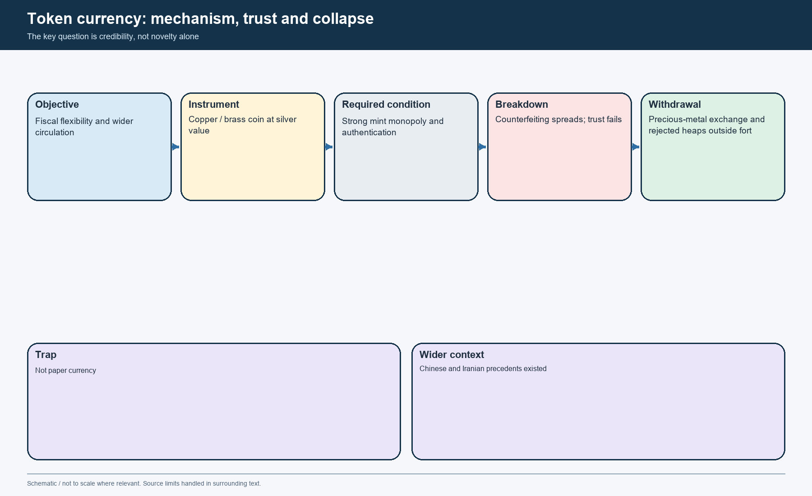

*Monetary-flow visual. The real fault line was credibility, not mere novelty.*

#### Evidence and caution table

| Claim | Support in local sources | Necessary caution |
|---|---|---|
| Copper and brass pieces were issued at silver value | Clear in concise and advanced OCR | Do not add unsupported denominations or numerical ratios |
| Wider precedents existed | China and Iranian references appear in OCR | A precedent elsewhere did not automatically solve Indian enforcement problems |
| Forgery ruined confidence | Central claim in Barani-derived narrative | The dramatic phrasing is rhetorical; the institutional lesson is the key point |
| Withdrawal required redemption in precious metal | Clear in the narrative | Do not assume every forged coin was accepted; rejected pieces remained outside the fort |

#### PARAGRAPH DEMONSTRATION — CLAIM → EVIDENCE → ANALYSIS → QUALIFICATION

**Claim:** the token currency failed for institutional rather than conceptual reasons. **Named evidence:** the coins were copper and brass carrying the silver tanka's declared value; the local source notes Chinese paper currency under Qublai Khan and earlier Iranian experimentation as precedents; Barani's line that every Hindu house became a mint, however rhetorical, records unofficial fabrication wide enough to destroy trust; and the scheme ended with redemption in precious metal, leaving rejected forgeries heaped outside the fort. **Analysis:** because comparable fiduciary money worked elsewhere, the decisive variable was not the idea but the state's inability to monopolise minting, authenticate genuine issues and refuse bad coin in tax payment. **Qualification:** motive should stay cautious, since Barani links the issue to military ambition and treasury pressure yet contradicts himself on whether the treasury was already drained, and a wider silver shortage remains possible context rather than proved cause; surviving specimens prove issue and design, never uniform circulation.

#### CLOSING RECALL FLOW — TOKEN CURRENCY: MONETARY IMAGINATION, CREDIBILITY FAILURE AND THE COUNTERFEIT PROBLEM

```text
START / CONCEPT: Token currency: monetary imagination, credibility failure and the counterfeit problem
        |
        v
EXACT TERMS: copper and brass token coinage · silver tanka value · mint monopoly and authentication · private counterfeiting · redemption in precious metal · not paper currency
        |
        v
MECHANISM / ARGUMENT: Declared value can only hold when issue, recognition and acceptance are controlled together, so once imitation could not be distinguished from official striking the coin's purchasing power and the state's revenue both collapsed.
        |
        v
CONSEQUENCE / CONTRAST: Withdrawal cost the treasury twice over, first in lost confidence and then in the precious metal paid out to redeem acceptable tokens.
        |
        v
UPSC TRAP / ANSWER-USE: Do not call the issue paper currency and do not equate it with modern fiat money, which rests on legal tender, controlled issue, authentication and institutional confidence that no fourteenth-century state possessed.
        |
        v
ANSWER-GRABBING FORMULATION: Call the scheme a financially and conceptually intelligible idea that lacked the institutional monopoly needed to make declared value credible.
```
### SESSION 7 — THE DOAB TAXATION CRISIS: STANDARD YIELD, FAMINE AND REBELLION

#### DEFINITION / WHAT THIS IS CALLED

**Plain-language definition:** The doab taxation crisis was the agrarian breakdown in the Ganga-Yamuna doab caused when a raised revenue demand met oppressive collection and famine conditions together.

**Technical definition:** Assessment by standard yield and official prices fixes the state's claim against a notional harvest and a notional market, so the effective burden rises automatically whenever actual output or actual prices fall.

#### ANSWER-GRABBING OPENING — WRITE/ADAPT IN THE EXAM

> The notional share may still have been half, but under famine and harsh collection the effective doab burden rose far beyond what any stated fraction suggests.

#### MUST-WRITE KEYWORDS

- **Ganga-Yamuna doab**
- **standard yield and official prices**
- **ghari and charai cesses**
- **peasant flight and rebellion**
- **famine and pestilential conditions**
- **Swargadwari relief phase**

**How to use them:** Locate the crisis in the Ganga-Yamuna doab, explain assessment by standard yield and official prices, add the rigorous collection of ghari and charai cesses, show peasant flight and rebellion as the result, and qualify with famine and pestilential conditions and the Swargadwari relief phase.

[FACT] Early in Muhammad's reign, the Gangetic doab saw a serious agrarian crisis and rebellion. The crucial point in the advanced OCR is that the problem was not simply "higher taxes" in the abstract. The assessment used **standard yield** rather than actual produce, and official prices rather than actual market prices when converting the state's share into cash.

[FACT] The old cesses - notably **ghari** (house tax) and **charai** (grazing tax) - were rigorously collected, cattle were branded and houses counted. The share demanded may still have been notionally half, but the *effective* burden under famine and oppressive collection could rise sharply.

[FACT] Barani reports that peasants burnt grain-heaps, drove away cattle and abandoned cultivation, and that the area from Kannauj to Dalmau was devastated by suppression. Even if the rhetoric is exaggerated, the reality of a major doab agrarian upheaval is difficult to deny.

[FACT] Climatic failure worsened everything. The advanced OCR explicitly notes famine, rising grain prices, relief camps at Delhi, grain brought from Awadh and Muhammad's move to **Swargadwari** because the atmosphere of Delhi had become pestilential.

[ANALYSIS] The best comparison with Alauddin is subtle. Alauddin had also demanded heavily, yet Muhammad faced sharper rebellion because the combination of standard-yield rigidity, local official excess and environmental stress proved politically explosive.

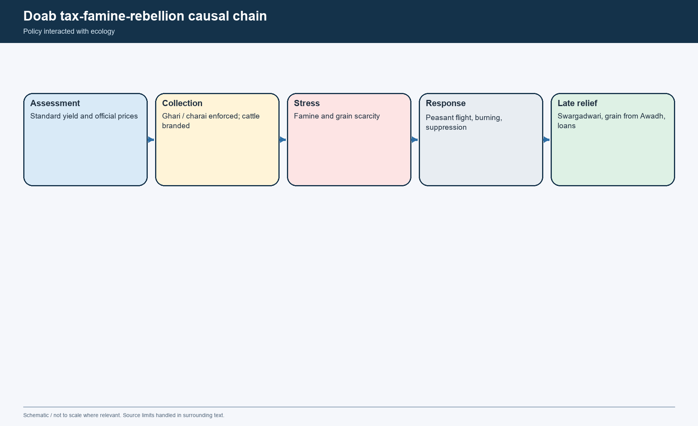

*Causal-chain visual. Policy, official behaviour and climate interacted; none alone fully explains the crisis.*

#### Chronology caution

| Stage | Secure content | Why not overstate |
|---|---|---|
| Assessment reset | Standard yield and official prices sharpened burden | Exact percentage escalation is not securely recoverable from rhetoric alone |
| Agrarian distress | Peasant flight, destruction and suppression in the doab | Spread beyond the doab is less securely supported |
| Famine | Grain scarcity, high prices, relief measures, move to Swargadwari | Climatic failure complicates pure "bad policy" explanations |
| Historical lesson | Core-zone extraction without flexible information destroys credibility | Avoid treating the crisis as proof that the entire empire became ungovernable at once |

#### PARAGRAPH DEMONSTRATION — CLAIM → EVIDENCE → ANALYSIS → QUALIFICATION

**Claim:** the doab crisis was produced by policy design, collector behaviour and climate interacting, not by any one of them alone. **Named evidence:** the state assessed on standard yield rather than actual produce and converted its share at official rather than market prices; the older *ghari* house tax and *charai* grazing tax were rigorously collected, with cattle branded and houses counted; Barani reports burnt grain-heaps, driven-off cattle, abandoned cultivation and devastation from Kannauj to Dalmau; and the advanced source records famine, rising grain prices, relief camps at Delhi, grain brought from Awadh and the Sultan's move to Swargadwari when Delhi's atmosphere turned pestilential. **Analysis:** rigid notional assessment removes precisely the flexibility a subsistence agrarian economy needs in a bad year, so the same nominal demand becomes confiscatory during scarcity and converts fiscal pressure into political revolt. **Qualification:** the comparison with Alauddin must stay careful, since he too demanded heavily yet faced less explosive resistance, and the chronicler's rhetoric about total devastation cannot fix either the exact escalation or its spread beyond the doab.

#### CLOSING RECALL FLOW — THE DOAB TAXATION CRISIS: STANDARD YIELD, FAMINE AND REBELLION

```text
START / CONCEPT: The doab taxation crisis: standard yield, famine and rebellion
        |
        v
EXACT TERMS: Ganga-Yamuna doab · standard yield and official prices · ghari and charai cesses · peasant flight and rebellion · famine and pestilential conditions · Swargadwari relief phase
        |
        v
MECHANISM / ARGUMENT: Notional assessment transfers all harvest and price risk onto the cultivator, so a demand that looks unchanged on paper becomes confiscatory the moment output or prices fall.
        |
        v
CONSEQUENCE / CONTRAST: Fiscal rigidity turned into political rebellion, and the state then had to spend on relief camps, imported grain and suppression what it had hoped to extract.
        |
        v
UPSC TRAP / ANSWER-USE: Do not reduce the crisis to a single cause; policy design, collector excess and climatic failure interacted, and treating the doab collapse as proof that the whole empire became ungovernable at once overstates the evidence.
        |
        v
ANSWER-GRABBING FORMULATION: Argue that core-zone extraction without flexible local information destroys the credibility on which the revenue itself depends.
```
### SESSION 8 — DIWAN-I-AMIR-I-KOHI: STATE LOANS, CULTIVATION EXTENSION AND THE LIMITS OF AGRARIAN ENGINEERING

#### DEFINITION / WHAT THIS IS CALLED

**Plain-language definition:** The Diwan-i-Amir-i-Kohi was Muhammad bin Tughlaq's agricultural department, created to extend cultivation and improve crops through state loans after the doab famine.

**Technical definition:** The scheme combined a bounded development tract of about thirty kroh by thirty kroh, roughly a hundred appointed shiqdars and *sondhar* advances for seed, wells and inputs, aiming at banjar or fallow land rather than genuinely uncultivable *usar* soil.

#### ANSWER-GRABBING OPENING — WRITE/ADAPT IN THE EXAM

> State agricultural credit failed here through personnel and recovery, not through absurdity of purpose: the loans were consumed, the land was not brought under the plough and repayment collapsed.

#### MUST-WRITE KEYWORDS

- **Diwan-i-Amir-i-Kohi**
- **sondhar agricultural loans**
- **thirty kroh by thirty kroh tract**
- **about one hundred shiqdars**
- **banjar rather than usar land**
- **graded crop improvement**

**How to use them:** Name the Diwan-i-Amir-i-Kohi and its sondhar agricultural loans, fix the scale at a thirty kroh by thirty kroh tract worked by about one hundred shiqdars, correct the target to banjar rather than usar land, and use graded crop improvement to show that the aim was development, not charity.

[FACT] After the doab famine phase, Muhammad bin Tughlaq tried to reverse direction and promote agrarian development. A special department called the **Diwan-i-Amir-i-Kohi** was created to supervise a tract of about **30 kroh by 30 kroh**.

[FACT] The objective had two parts: bring more land under cultivation and improve crop quality. Barani's own phrasing, preserved in the advanced OCR, imagines a graded shift from barley to wheat, from wheat to sugarcane, and then to higher-value crops such as grapes and dates.

[FACT] Around **100 shiqdars** were appointed, given honour, horses and large sums for agricultural loans (*sondhar*). Reported figures such as seventy lakh tankas or even two crores in later recollection must be handled as reported, not audited certainty.

[LIMIT] The advanced OCR argues that the scheme aimed to bring **banjar** or barren land under cultivation, not genuinely uncultivable *usar* land, despite Barani's sharper wording. This distinction matters because it changes the policy from impossible fantasy to risky agricultural extension.

[FACT] The scheme failed because the chosen personnel were inexperienced, corrupt or both. Money intended as loans was consumed for personal use, the new land was not adequately brought under cultivation, and recovery collapsed.

[ANALYSIS] Yet the historical significance is large. State-supported agricultural loans and planned cultivation improvement survived the immediate failure and reappeared later under Firuz and more systematically under the Mughals.

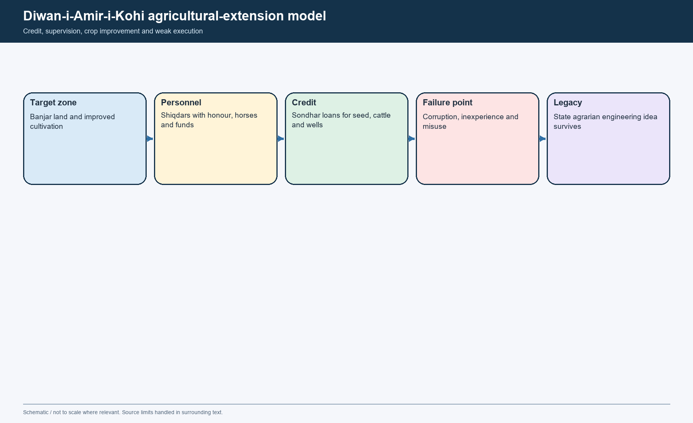

*Agricultural-extension visual. It separates objective, instrument, failure point and long-run policy legacy.*

#### Safe verdict

- [ANALYSIS] Diwan-i-Kohi was **not** proof of modern developmental bureaucracy, but it was more than absurd overreach. It shows a state thinking in terms of credit, crop improvement and revenue through agrarian expansion.
- [LIMIT] Scale claims belong to reported narrative, not precise administrative statistics.

#### PARAGRAPH DEMONSTRATION — CLAIM → EVIDENCE → ANALYSIS → QUALIFICATION

**Claim:** the Diwan-i-Amir-i-Kohi was a genuine agrarian development experiment that failed on delivery. **Named evidence:** a special department supervised a tract of about thirty kroh by thirty kroh; roughly a hundred shiqdars were appointed with honour, horses and large sums for *sondhar* loans; Barani's own phrasing imagines a graded shift from barley to wheat, from wheat to sugarcane and then to higher-value crops such as grapes and dates; and the advanced source insists the target was *banjar* or barren land rather than genuinely uncultivable *usar*. **Analysis:** that correction changes the policy's status from impossible fantasy to risky but coherent agricultural extension, and locates the failure precisely - inexperienced or corrupt personnel consumed the advances, the new land was never adequately cultivated, and recovery collapsed. **Qualification:** reported sums such as seventy lakh tankas, or two crores in later recollection, must be handled as chronicler report rather than audited statistics, and the scheme's demonstrated scale remains small - yet state-supported agricultural credit and planned crop improvement reappear under Firuz and more systematically under the Mughals.

#### CLOSING RECALL FLOW — DIWAN-I-AMIR-I-KOHI: STATE LOANS, CULTIVATION EXTENSION AND THE LIMITS OF AGRARIAN ENGINEERING

```text
START / CONCEPT: Diwan-i-Amir-i-Kohi: state loans, cultivation extension and the limits of agrarian engineering
        |
        v
EXACT TERMS: Diwan-i-Amir-i-Kohi · sondhar agricultural loans · thirty kroh by thirty kroh tract · about one hundred shiqdars · banjar rather than usar land · graded crop improvement
        |
        v
MECHANISM / ARGUMENT: Credit-led cultivation extension depends on local officials who can select viable land, deliver advances honestly and enforce recovery, and the Sultanate supplied none of these three in sufficient quality.
        |
        v
CONSEQUENCE / CONTRAST: The experiment consumed treasury resources and produced little new cultivation, yet it established a developmental vocabulary that later regimes reused with better supervision.
        |
        v
UPSC TRAP / ANSWER-USE: Do not accept Barani's sharper wording that barren *usar* soil was being farmed, and do not quote the reported loan totals as administrative statistics; both distortions turn a risky programme into a caricature.
        |
        v
ANSWER-GRABBING FORMULATION: Present the department as evidence that the Sultanate could think in terms of credit, crop improvement and revenue through agrarian expansion, while conceding that it could not yet administer such a programme.
```
### SESSION 9 — THE KHURASAN PROJECT AND THE QARACHIL EXPEDITION: DO NOT CONFLATE THEM

#### DEFINITION / WHAT THIS IS CALLED

**Plain-language definition:** The Khurasan project was a planned and heavily recruited north-western offensive that was never launched as envisaged, while the Qarachil expedition was an actual Himalayan campaign that ended in disaster.

**Technical definition:** Separating the two requires distinguishing planning and recruitment, which burdened the treasury, from execution in difficult terrain, which destroyed an army; they are different historical acts with different failure modes.

#### ANSWER-GRABBING OPENING — WRITE/ADAPT IN THE EXAM

> Khurasan was a frontier-strategy problem and Qarachil a terrain-and-logistics problem, and fusing them into one tale of irrationality destroys the history.

#### MUST-WRITE KEYWORDS

- **Khurasan project**
- **Qarachil expedition**
- **reported army of 370,000**
- **Kulu-Kangra and Kumaon horizon**
- **treasury burden of recruitment**
- **not a campaign against China**

**How to use them:** Keep the Khurasan project and the Qarachil expedition in separate columns: attach the reported army of 370,000 and the treasury burden of recruitment to the first, place the second in the Kulu-Kangra and Kumaon horizon, and state plainly that it was not a campaign against China.

[FACT] The **Khurasan project** arose from north-western strategic anxiety. After the Tarmashirin episode and the fluid politics of Transoxiana, Iran, Ghazni and Afghanistan, Muhammad bin Tughlaq considered a forward move that could secure the frontier more aggressively. The advanced OCR suggests that even a limited aim - Kabul/Ghazni/Afghanistan - is more defensible than fantasies of global conquest.

[FACT] To support this, he reportedly entertained exiles and grandees from those regions and raised a very large army, commonly given in the sources as **370,000**. The scale must be labelled as **reported**.

[LIMIT] Barani's wording sometimes expands the aim to Khurasan, Iraq and even beyond. The safer conclusion is that the project aimed at an outward strategic frontier and prestige offensive, not necessarily at a coherent transcontinental conquest plan.

[FACT] The **Qarachil** expedition, by contrast, was a Himalayan campaign. The advanced OCR places it in the Kulu-Kangra / Kumaon-Kashmir horizon and explicitly rejects the later claim that it was an expedition to conquer China.

[FACT] The Qarachil force suffered disastrous environmental defeat after moving too far into inhospitable terrain. The famous line that only **10 of 10,000** returned is again a reported chronicler figure. Yet the same source tradition says a local ruler later accepted Delhi's overlordship.

[ANALYSIS] Put differently: Khurasan was a frontier-strategy problem; Qarachil was a terrain-and-logistics problem. Joining them into a single tale of irrationality destroys the history.


*Comparison visual. Objective, geography, preparation and result differ sharply between the two enterprises.*

#### Comparison table

| Dimension | Khurasan project | Qarachil expedition |
|---|---|---|
| Strategic setting | Central Asian / Afghan frontier politics | Himalayan mountain corridor |
| Aim | Forward security / possible reassertion toward Ghazni-Afghanistan and beyond | Control of a hill region and/or route-security objective |
| Instrument | Large army recruitment and political invitations to exiles | Field expedition in difficult terrain |
| Principal problem | Sustaining cost and purpose | Terrain, climate and over-extension |
| Exam trap | "World conquest madness" | "China campaign" |

#### PARAGRAPH DEMONSTRATION — CLAIM → EVIDENCE → ANALYSIS → QUALIFICATION

**Claim:** the two north-western and Himalayan ventures must be analysed separately because they failed for different reasons. **Named evidence:** the Khurasan project arose from frontier anxiety after the Tarmashirin episode and the fluid politics of Transoxiana, Iran, Ghazni and Afghanistan, and was supported by entertaining exiles and grandees and raising a force reported at 370,000; the Qarachil expedition, placed by the advanced source in the Kulu-Kangra and Kumaon-Kashmir horizon, suffered catastrophic environmental defeat, with the reported survival of ten men out of ten thousand, even though a local ruler later accepted Delhi's overlordship. **Analysis:** the first venture consumed money through recruitment and disbandment without ever testing the army in the field, while the second consumed an army through terrain and supply failure, so one is a fiscal-strategic failure and the other an operational one. **Qualification:** Barani sometimes expands the aim to Khurasan, Iraq and beyond, and the advanced source rejects outright the later claim of a Chinese campaign; the defensible reading limits the plan to an outward frontier and prestige objective, and marks both the 370,000 and the ten-of-ten-thousand as reported figures.

#### CLOSING RECALL FLOW — THE KHURASAN PROJECT AND THE QARACHIL EXPEDITION: DO NOT CONFLATE THEM

```text
START / CONCEPT: The Khurasan project and the Qarachil expedition: do not conflate them
        |
        v
EXACT TERMS: Khurasan project · Qarachil expedition · reported army of 370,000 · Kulu-Kangra and Kumaon horizon · treasury burden of recruitment · not a campaign against China
        |
        v
MECHANISM / ARGUMENT: Recruiting and maintaining a very large army converts strategy into a standing fiscal liability, so a campaign can damage the treasury decisively even when it is never fought.
        |
        v
CONSEQUENCE / CONTRAST: Delhi therefore paid twice for its frontier ambition - in silver for the force that never marched, and in soldiers for the force that marched into the mountains.
        |
        v
UPSC TRAP / ANSWER-USE: Do not merge the two ventures and do not repeat the China story; the Himalayan objective is what the sources support, while the world-conquest reading rests on chronicler expansion rather than on evidence.
        |
        v
ANSWER-GRABBING FORMULATION: Argue that planning, recruitment and execution are distinct historical acts, and that Muhammad's frontier record fails differently in each of them.
```
### SESSION 10 — REBELLIONS, PLAGUE AND REGIONAL FRAGMENTATION: DECCAN, BENGAL, GUJARAT, SINDH AND THE LIMITS OF DIRECT RULE

#### DEFINITION / WHAT THIS IS CALLED

**Plain-language definition:** Regional fragmentation under Muhammad bin Tughlaq was the cumulative loss of direct rule across the Deccan, Bengal, the far south and other provinces through repeated rebellion, epidemic and overstretch.

**Technical definition:** The reign divides into an opening consolidation decade, in which revolts at Multan, Lakhnauti and Sindh were checked, and a second decade in which famine, southern revolt and epidemic reduced the striking power that had made suppression possible.

#### ANSWER-GRABBING OPENING — WRITE/ADAPT IN THE EXAM

> Regional fragmentation under Muhammad had no single cause: distance, fiscal pressure, elite opportunism, epidemic and endless campaigning together outpaced the centre's ability to restore credible control.

#### MUST-WRITE KEYWORDS

- **consolidation decade then crisis decade**
- **Mabar campaign and army plague**
- **Harihara and Bukka**
- **Bahmani breakaway near Daulatabad**
- **Bengal independence regained**
- **Gujarat and Sindh suppressed at heavy cost**

**How to use them:** Divide the reign into a consolidation decade then a crisis decade; use the Mabar campaign and army plague as the turning point; note Harihara and Bukka and the Bahmani breakaway near Daulatabad as symptoms of southern contraction; then balance with Bengal independence regained while Gujarat and Sindh were suppressed at heavy cost.

[FACT] The advanced OCR usefully divides Muhammad's reign into phases. The first decade after accession was largely about consolidation, with rebellions in places like Multan, Lakhnauti and Sindh checked. The second decade became much more difficult as famine, southern revolts and epidemic weakened the state's striking power.

[FACT] The rebellions came in sequence across **Bengal, Mabar, Warangal, Kampili, Awadh, Gujarat and Sindh**. Muhammad repeatedly moved personally from one theatre to another, wearing down his army and limiting the formation of stable delegated trust.

[FACT] The southern turning point was disastrous. The Mabar campaign coincided with plague in the army; the concise OCR says two-thirds of the army perished. Shortly afterwards, **Harihara and Bukka** established the principality that grew into Vijayanagara, while foreign nobles near Daulatabad launched the Bahmani state.

[ANALYSIS] Topic 05 uses Vijayanagara and Bahmani only as signs of Delhi's overreach and broken southern control. Their own institutions, politics and cultural worlds belong primarily to Topic 09.

[FACT] Bengal also became independent again, while Gujarat and Sindh required severe effort. Muhammad was still strong enough to suppress some western and central rebellions, which is why his total unpopularity should not be exaggerated.

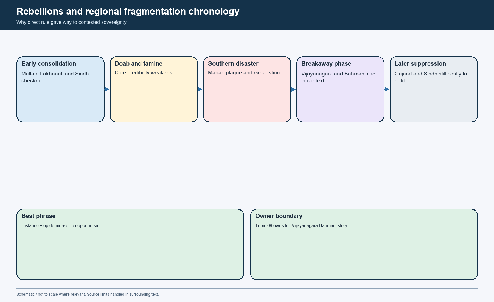

*Fragmentation timeline. It distinguishes direct revolt, military overstretch, epidemic shock and the rise of successor states.*

#### Region-by-region language

| Region | What Topic 05 should say safely |
|---|---|
| Bengal | Recurrent centrifugal zone; independence regained; Delhi could not hold it durably |
| Deccan / Daulatabad | Direct-rule burden, noble rebellion and southern communications crisis |
| Vijayanagara | Emerged in the context of Delhi's southern overstretch; full treatment belongs elsewhere |
| Bahmani | Grew from Deccan breakaway near Daulatabad; full state development belongs elsewhere |
| Gujarat and Sindh | Rebellion suppressed with great effort, revealing Delhi's continuing but costly reach |

#### Best synthesis

- [ANALYSIS] Muhammad's empire did not collapse because one policy failed; it fragmented because **distance + fiscal pressure + elite opportunism + epidemic + repeated campaigning** outpaced the centre's ability to restore credible control.

#### PARAGRAPH DEMONSTRATION — CLAIM → EVIDENCE → ANALYSIS → QUALIFICATION

**Claim:** territorial contraction under Muhammad was cumulative and multi-causal rather than the consequence of any single rebellion. **Named evidence:** the first decade checked revolts at Multan, Lakhnauti and Sindh; the Mabar campaign then coincided with plague in the army, with the concise source reporting that two-thirds of it perished; shortly afterwards Harihara and Bukka founded the principality that grew into Vijayanagara while foreign nobles near Daulatabad launched the Bahmani state; Bengal regained independence; and Gujarat and Sindh were suppressed only with severe effort. **Analysis:** each theatre required the Sultan's personal presence, and repeated personal campaigning wore down the army while preventing the growth of stable delegated trust, so every suppressed revolt raised the cost of suppressing the next one. **Qualification:** Delhi's continuing ability to crush western and central rebellion shows that total unpopularity is overstated, and Topic 05 uses Vijayanagara and the Bahmani state only as evidence of Delhi's broken southern control, since their own institutions and politics belong to Topic 09.

#### CLOSING RECALL FLOW — REBELLIONS, PLAGUE AND REGIONAL FRAGMENTATION: DECCAN, BENGAL, GUJARAT, SINDH AND THE LIMITS OF DIRECT RULE

```text
START / CONCEPT: Rebellions, plague and regional fragmentation: Deccan, Bengal, Gujarat, Sindh and the limits of direct rule
        |
        v
EXACT TERMS: consolidation decade then crisis decade · Mabar campaign and army plague · Harihara and Bukka · Bahmani breakaway near Daulatabad · Bengal independence regained · Gujarat and Sindh suppressed at heavy cost
        |
        v
MECHANISM / ARGUMENT: Repeated personal campaigning across widely separated theatres exhausted the army and blocked the growth of delegated authority, so each suppressed revolt raised the price of suppressing the next.
        |
        v
CONSEQUENCE / CONTRAST: Direct rule gave way to contested sovereignty: some provinces were held at rising cost, while the far south and Bengal passed out of Delhi's reach altogether.
        |
        v
UPSC TRAP / ANSWER-USE: Do not treat Vijayanagara or the Bahmani kingdom as Topic 05 subject matter, and do not infer total unpopularity from southern losses when Gujarat and Sindh were still being reduced by the same ruler.
        |
        v
ANSWER-GRABBING FORMULATION: Write contraction as an interaction of distance, fiscal pressure, elite opportunism, epidemic shock and campaign fatigue, not as the verdict on one failed experiment.
```
### SESSION 11 — ADMINISTRATION, THE RULING CLASS AND MUHAMMAD'S STATE-CAPACITY PROBLEM

#### DEFINITION / WHAT THIS IS CALLED

**Plain-language definition:** Muhammad bin Tughlaq's state-capacity problem was the growing gap between a centralising administration that audited distant provinces and the trust, information and enforcement needed to make those orders stick.

**Technical definition:** Capacity here is measured across five dimensions - ambition, information, coercion, credibility and elite management - each of which the reign expanded in reach while weakening in reliability.

#### ANSWER-GRABBING OPENING — WRITE/ADAPT IN THE EXAM

> Muhammad's reign is the Sultanate's clearest demonstration that administrative imagination without durable compliance mechanisms becomes self-defeating.

#### MUST-WRITE KEYWORDS

- **centralised audit in the wazir's office**
- **widened elite recruitment**
- **new men outside old noble families**
- **heterogeneous nobility**
- **information delay and distortion**
- **credibility after failed experiments**

**How to use them:** Evidence centralised audit in the wazir's office and widened elite recruitment of new men outside old noble families; explain that the resulting heterogeneous nobility widened talent while weakening cohesion; then attribute failure to information delay and distortion and to lost credibility after failed experiments.

[FACT] Muhammad bin Tughlaq pushed administrative centralisation further than his predecessors. When provinces were annexed, revenue officials followed; according to Barani, the accounts of distant provinces were audited in the wazir's office in the same detailed fashion as villages in the doab.

[FACT] He also widened elite recruitment. The concise OCR states that he appointed people who did not belong to old noble families, including men from occupational backgrounds such as barbers, cooks, weavers and wine-makers, alongside foreigners and a few Hindus. Barani's fury at such appointments tells us as much about aristocratic prejudice as about the appointments themselves.

[ANALYSIS] The recruitment of "new men" was not random social chaos. It was a way of reducing dependence on closed old-noble circles and of staffing a larger empire through talent and loyalty outside inherited aristocratic networks.

[LIMIT] The political cost was high. The nobility now contained foreigners, Indian converts, older elite families and court favourites without a single cohesive identity. Such a coalition could staff a wide empire, but it was also prone to fracture.

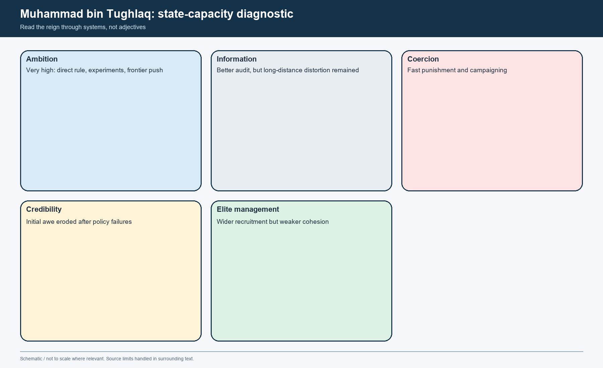

*Diagnostic visual. It reads the reign through ambition, information, credibility, coercion and geographic stretch rather than through personality labels alone.*

#### Capacity diagnosis

| Dimension | Strength under Muhammad | Limiting problem |
|---|---|---|
| Ambition | Very high - uniform rule, direct annexation, frontier push, agrarian engineering | Goals multiplied faster than institution-building |
| Information | Improved through audit, officials and court intelligence | Distant provinces still generated severe delay and distortion |
| Coercion | Strong capacity for punishment and rapid campaigning | Excess coercion damaged trust and encouraged rebellion |
| Credibility | High at first - Ibn Battuta still saw the Delhi ruler as one of the great rulers of the world | Daulatabad, token currency and doab crisis weakened faith in command |
| Elite management | Wider recruitment opened talent | Cohesion and inherited legitimacy became fragile |

#### One-line UPSC takeaway

- [ANALYSIS] Muhammad's reign is the Sultanate's clearest demonstration that **administrative imagination without durable compliance mechanisms becomes self-defeating**.

#### PARAGRAPH DEMONSTRATION — CLAIM → EVIDENCE → ANALYSIS → QUALIFICATION

**Claim:** the reign extended the reach of central administration faster than it extended the reliability of that administration. **Named evidence:** Barani records that the accounts of distant provinces were audited in the wazir's office with the same detail as villages in the doab; the concise source records appointments of men outside old noble families, including those from occupational backgrounds such as barbers, cooks, weavers and wine-makers, alongside foreigners and a few Hindus; and Ibn Battuta still regarded the Delhi ruler as one of the great rulers of the world. **Analysis:** widened recruitment was a rational instrument for staffing a larger empire and for reducing dependence on closed aristocratic circles, but it produced a nobility of foreigners, Indian converts, older elite families and court favourites with no single identity, so the same measure that increased administrative supply reduced political cohesion. **Qualification:** Barani's fury at such appointments is evidence of aristocratic prejudice as much as of administrative reality, and the audit claim proves intent and procedure rather than accurate information, since distant provinces still generated severe delay and distortion.

#### CLOSING RECALL FLOW — ADMINISTRATION, THE RULING CLASS AND MUHAMMAD'S STATE-CAPACITY PROBLEM

```text
START / CONCEPT: Administration, the ruling class and Muhammad's state-capacity problem
        |
        v
EXACT TERMS: centralised audit in the wazir's office · widened elite recruitment · new men outside old noble families · heterogeneous nobility · information delay and distortion · credibility after failed experiments
        |
        v
MECHANISM / ARGUMENT: Central audit and wider recruitment expanded what the court could demand, while distance, delay and a fractured elite coalition limited what it could verify or enforce.
        |
        v
CONSEQUENCE / CONTRAST: Each failed experiment cost credibility, and lost credibility made the next order harder to enforce, so administrative ambition became progressively more expensive.
        |
        v
UPSC TRAP / ANSWER-USE: Barani's contempt for low-born appointees is not neutral reporting; do not convert aristocratic prejudice into proof that the appointments themselves caused administrative collapse.
        |
        v
ANSWER-GRABBING FORMULATION: Frame the reign as a compliance problem rather than a competence problem: the orders were issued, but the machinery to verify obedience did not exist at that scale.
```
### SESSION 12 — BARANI, ISAMI, IBN BATTUTA AND MATERIAL EVIDENCE: HOW TO READ THE TUGHLAQ ARCHIVE

#### DEFINITION / WHAT THIS IS CALLED

**Plain-language definition:** The Tughlaq archive is the mixed body of chronicles, travel narrative, ruler self-presentation and material remains through which both reigns must be reconstructed.

**Technical definition:** Reading the archive means matching each source to what its genre can prove - report, eyewitness experience, moral judgement or physical trace - and preferring the minimum secure statement that survives across more than one evidence family.

#### ANSWER-GRABBING OPENING — WRITE/ADAPT IN THE EXAM

> No single chronicler can carry the Tughlaq century; the safest claim is the one that survives across more than one family of evidence.

#### MUST-WRITE KEYWORDS

- **Ziauddin Barani**
- **Isami**
- **Ibn Battuta**
- **Shams Siraj Afif and the Futuhat**
- **coins, canals and monuments**
- **minimum secure statement**

**How to use them:** Place Ziauddin Barani, Isami, Ibn Battuta and Shams Siraj Afif and the Futuhat on one axis of genre and position, set coins, canals and monuments against them as material checks, and resolve disagreement by writing only the minimum secure statement.

[FACT] The Tughlaq period cannot be taught safely through a single chronicler. Barani, Isami, Ibn Battuta, Afif, *Futuhat-i Firuz Shahi*, coins and buildings each record a different slice of reality.

[FACT] **Barani** is indispensable for Muhammad's experiments and elite ideology, but he wrote later, moralises strongly, uses rhetorical scaling and deeply resents low-born advancement. He is crucial and dangerous at the same time.

[FACT] **Isami** is near-contemporary and especially valuable when Delhi-Deccan relations are at stake, but he writes from displacement and retrospective memory. He is not a neutral field report.

[FACT] **Ibn Battuta**, from Tangier, lived for years at Muhammad's court, held judicial office and travelled widely. He is especially useful for court ceremony, gifts, punishments, roads, products, urban scale and the atmosphere of power. The concise OCR also notes that he was more interested in the court than in the lives of ordinary people.

[FACT] **Material evidence** checks literary claims. Delhi mint continuity, Tughlaqabad, Ghiyasuddin's tomb, Kotla Firoz Shah, repaired monuments, canals and Ashokan-pillar movement all confirm activity; none by itself proves uniform administrative success.

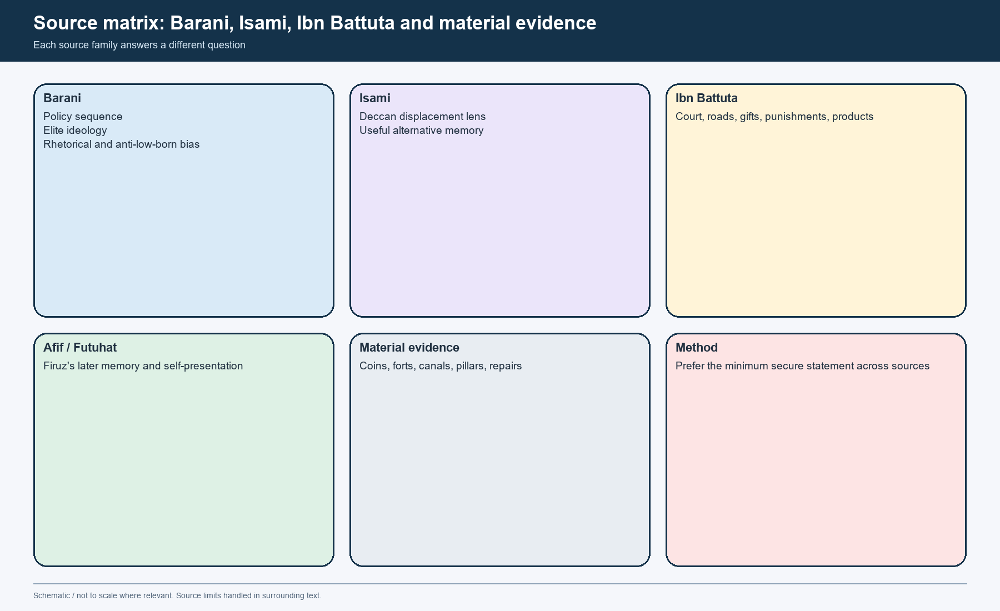

*Source-matrix visual. Use it to separate report, witness, moral judgement and physical trace.*

#### Source-criticism matrix

| Source | Best use | Main bias or limit | Safe classroom use |
|---|---|---|---|
| Barani | Policy sequence, elite ideology, doab, Daulatabad, token currency | Later, didactic, anti-low-born, rhetorical | Use as report + political mentality; do not quote every number or speech literally |
| Isami | Alternative lens on Deccan and Delhi overreach | Retrospective, displacement memory | Use to cross-check tone and consequence, not as raw field log |
| Ibn Battuta | Court, gift-punishment theatre, roads, city life, products | Traveller genre, wonder orientation, court-centred | Best for atmosphere and practice, not for total empire statistics |
| Afif / Futuhat | Firuz's later memory, benevolence claims, public works | Late court framing and ruler self-justification | Use with explicit claim-versus-implementation distinction |
| Coins / buildings / canals | Durable physical action and patronage | Selective survival; material claim != full control | Anchor literary claims in the material record |

#### Method rule

- [ANALYSIS] When sources disagree, prefer the **minimum secure statement** that survives across more than one evidence family. This is the correct answer to both textbook caricature and ideological over-reading.

#### PARAGRAPH DEMONSTRATION — CLAIM → EVIDENCE → ANALYSIS → QUALIFICATION

**Claim:** the Tughlaq period cannot be taught safely through any single source, because each records a different slice of reality. **Named evidence:** Barani supplies the policy sequence and elite ideology but writes later, moralises, scales rhetorically and resents low-born advancement; Isami is near-contemporary and valuable on Delhi-Deccan relations but writes from displacement; Ibn Battuta, from Tangier, lived for years at Muhammad's court and held judicial office, and is strongest on ceremony, gifts, punishments, roads, products and urban scale; Afif and the *Futuhat-i Firuz Shahi* record Firuz's works and benevolence in a celebratory and self-fashioning register; and Delhi mint continuity, Tughlaqabad, Ghiyasuddin's tomb, Kotla Firoz Shah, repaired monuments, canals and moved Ashokan pillars confirm activity. **Analysis:** matching each source to what its genre can prove converts contradiction into method, so that a policy's intent, its reported implementation and its physical trace are assembled rather than confused. **Qualification:** material evidence checks literary claims without replacing them, since surviving fabric proves resources, labour and ideology but never uniform administrative success, and the concise source notes that Ibn Battuta was more interested in the court than in ordinary lives.

#### CLOSING RECALL FLOW — BARANI, ISAMI, IBN BATTUTA AND MATERIAL EVIDENCE: HOW TO READ THE TUGHLAQ ARCHIVE

```text
START / CONCEPT: Barani, Isami, Ibn Battuta and material evidence: how to read the Tughlaq archive
        |
        v
EXACT TERMS: Ziauddin Barani · Isami · Ibn Battuta · Shams Siraj Afif and the Futuhat · coins, canals and monuments · minimum secure statement
        |
        v
MECHANISM / ARGUMENT: Cross-checking works because the four narrative traditions were written from different positions and dates, so agreement between them, or between one of them and the material record, is much harder to manufacture than a single vivid claim.
        |
        v
CONSEQUENCE / CONTRAST: Source-critical writing replaces both textbook caricature and ideological over-reading with bounded statements an examiner can verify.
        |
        v
UPSC TRAP / ANSWER-USE: Barani is indispensable and dangerous at once; do not quote his numbers or speeches literally, and do not treat Ibn Battuta's vividness as statistical representativeness.
        |
        v
ANSWER-GRABBING FORMULATION: When the sources disagree, write the claim that more than one evidence family supports, and label the remainder as report rather than fact.
```
### SESSION 13 — MUHAMMAD BIN TUGHLAQ AND RELIGION: ULEMA, CALIPHAL LEGITIMACY, SUFIS AND JUSTICE

#### DEFINITION / WHAT THIS IS CALLED

**Plain-language definition:** Muhammad bin Tughlaq's religious politics combined personal observance and wide intellectual contact with open conflict against sections of the orthodox ulema.

**Technical definition:** Caliphal legitimisation here means the substitution of the Abbasid Caliph's name on coins and the later receipt of a formal *manshur* from the Cairo-based line, used to answer a juristic challenge to the Sultan's authority.

#### ANSWER-GRABBING OPENING — WRITE/ADAPT IN THE EXAM

> Muhammad bin Tughlaq's religious politics were a contest with the ulema over who may authorise rule, not a modern quarrel between belief and unbelief.

#### MUST-WRITE KEYWORDS

- **personal observance in prayer and fasting**
- **yogis, Jain saints and Sufi tombs**
- **fatwa permitting rebellion**
- **caliphal manshur from Cairo**
- **shara supplemented by zawabit**
- **lavish reward and drastic punishment**

**How to use them:** Begin from personal observance in prayer and fasting alongside contact with yogis, Jain saints and Sufi tombs; explain that this provoked a fatwa permitting rebellion; show the caliphal manshur from Cairo as the answer; then hold together shara supplemented by zawabit with the record of lavish reward and drastic punishment.

[FACT] Muhammad bin Tughlaq was personally observant in prayers and fasting, yet the advanced OCR also presents him as a ruler who would not accept many things merely on faith. He associated with yogis and Jain saints, respected major Sufi tombs and is said to have connected himself at times with Hindu festivals such as Holi.

[FACT] This openness helped trigger hostility from sections of the orthodox. The advanced OCR reports that, because of his association with yogis and related practices, qazis issued a *fatwa* making rebellion against the Sultan legally possible.

[FACT] To answer this, Muhammad sought symbolic **caliphal legitimisation** from the Cairo-based Abbasid line. The local OCR says he first substituted the Caliph's name on coins and later received a formal *manshur* or rescript. The gesture did not fundamentally improve his standing with orthodox opponents.

[ANALYSIS] The best line is to reject modern shorthand from both sides. Muhammad was neither a secular-liberal moderniser nor a simple anti-religious tyrant. He was a Muslim ruler of strong reason-of-state instincts, willing to supplement *shara* with *zawabit*, open to multiple intellectual worlds, and also capable of extreme punitive violence.

[LIMIT] Brutality is part of the record. Chroniclers and Ibn Battuta alike emphasise his capacity for lavish rewards and drastic punishments. A balanced answer therefore links intellectual range with coercive intensity instead of substituting one for the other.

#### Safe verdict

- [ANALYSIS] Muhammad's religious politics were about **contested authority**, not about a neat binary between belief and unbelief. He broadened the court's intellectual contact-zone while failing to persuade orthodox intermediaries that his style of rule was legitimate.

#### PARAGRAPH DEMONSTRATION — CLAIM → EVIDENCE → ANALYSIS → QUALIFICATION

**Claim:** Muhammad's religious politics were about contested authority rather than about belief or unbelief. **Named evidence:** he was personally observant in prayer and fasting, yet associated with yogis and Jain saints, respected major Sufi tombs and is said to have joined Hindu festivals such as Holi; qazis responded by issuing a *fatwa* that made rebellion against him legally possible; he then substituted the Caliph's name on his coins and later obtained a formal *manshur* from the Cairo-based Abbasid line. **Analysis:** the sequence shows a ruler whose reason-of-state instincts led him to supplement *shara* with *zawabit* and to widen the court's intellectual contact-zone, and whose response to juristic attack was to seek an external and symbolically unimpeachable source of authorisation. **Qualification:** the gesture did not repair his standing with orthodox opponents, and the same reign is recorded by chroniclers and by Ibn Battuta alike for lavish reward and drastic punishment, so intellectual range must be linked to coercive intensity rather than substituted for it.

#### CLOSING RECALL FLOW — MUHAMMAD BIN TUGHLAQ AND RELIGION: ULEMA, CALIPHAL LEGITIMACY, SUFIS AND JUSTICE

```text
START / CONCEPT: Muhammad bin Tughlaq and religion: ulema, caliphal legitimacy, Sufis and justice
        |
        v
EXACT TERMS: personal observance in prayer and fasting · yogis, Jain saints and Sufi tombs · fatwa permitting rebellion · caliphal manshur from Cairo · shara supplemented by zawabit · lavish reward and drastic punishment
        |
        v
MECHANISM / ARGUMENT: A juristic challenge to the Sultan's legitimacy was met by importing authority from outside the local ulema, since caliphal recognition could not be revoked by the qazis who had issued the fatwa.
        |
        v
CONSEQUENCE / CONTRAST: Symbolic legitimation proved cheap to obtain and weak in effect, leaving the reign's central conflict with orthodox intermediaries unresolved.
        |
        v
UPSC TRAP / ANSWER-USE: Do not read the Sultan as a secular moderniser or as an anti-religious tyrant; neither label survives the combination of personal observance, caliphal petition and documented punitive violence.
        |
        v
ANSWER-GRABBING FORMULATION: Write the religious history as a struggle over who may authorise rule, and show the caliphal rescript as the cost of that struggle rather than as its solution.
```
### SESSION 14 — FIRUZ SHAH'S ACCESSION AFTER THE SINDH CRISIS: CONCILIATION AS STATECRAFT

#### DEFINITION / WHAT THIS IS CALLED

**Plain-language definition:** Firuz Shah Tughlaq succeeded in 1351 during the Sindh and Thatta crisis and chose conciliation of nobles, soldiers and theologians as his governing method.

**Technical definition:** Conciliation as statecraft means deliberately trading coercive central control for elite consent, and matching that trade with a reduced territorial horizon that the centre could actually administer.

#### ANSWER-GRABBING OPENING — WRITE/ADAPT IN THE EXAM

> Where Muhammad tried to make the empire uniform, Firuz tried to make what remained of it governable by lowering the coercive temperature and narrowing the horizon of ambition.

#### MUST-WRITE KEYWORDS

- **accession of 1351 during the Sindh crisis**
- **appeasement of nobles, army and theologians**
- **two failed Bengal campaigns**
- **Jajnagar and Nagarkot raids**
- **long Thatta campaign**
- **caliphal investiture as symbolic prestige**

**How to use them:** Date the accession of 1351 during the Sindh crisis, name the appeasement of nobles, army and theologians as the chosen method, evidence its limits through two failed Bengal campaigns, the Jajnagar and Nagarkot raids and the long Thatta campaign, and treat caliphal investiture as symbolic prestige rather than power.

[FACT] Firuz Shah Tughlaq came to power in **1351** after Muhammad's death during the Sindh/Thatta phase. He inherited a shrinking but still large north-Indian Sultanate, with the south already gone, Bengal independent and nobles, soldiers and theologians all in need of reassurance.

[FACT] The concise OCR is clear about his governing choice: he would appease the nobles, the army and the theologians, and would assert authority only over areas that could be administered from the centre without impossible strain.

[FACT] He made no serious attempt to recover the south or reimpose direct rule over the Deccan. Two Bengal campaigns failed; raids into Jajnagar (Orissa) and Nagarkot produced plunder or acknowledgment but no enduring extension; the long Thatta campaign became a lesson in the cost of military overreach.

[ANALYSIS] Firuz's accession therefore marks a political bargain. If Muhammad tried to make the empire uniform, Firuz tried to make the remaining Sultanate governable by lowering coercive temperature and accepting a smaller horizon of ambition.

[FACT] He also sought caliphal investiture and robes of honour, but the advanced OCR treats this as symbolic prestige rather than the foundation of power.

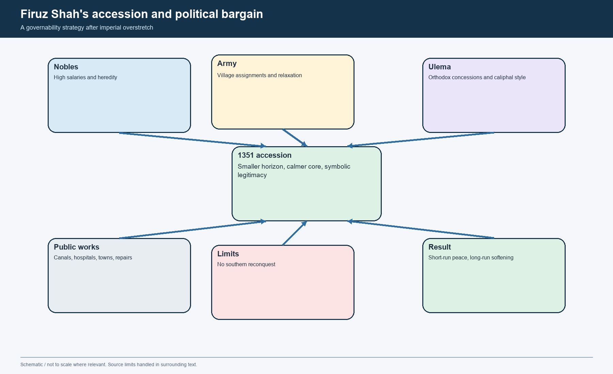

*Accession visual. Firuz's strength lay less in conquest than in redefining what the centre would now try to hold and whom it would placate.*

#### Bargain table

| Constituency | Firuz's offer | Long-term cost |
|---|---|---|
| Nobles | High salaries, heredity, softer audit | Stronger oligarchic claims |
| Army | Village assignments, heredity, relaxed inspection | Lower discipline and central readiness |
| Ulema | Symbolic orthodoxy and concessions | Narrower ideological climate |
| Urban/core society | Public works, charity, hospitals, lower punitive terror | Concentration of benefits in core regions and favoured groups |

#### PARAGRAPH DEMONSTRATION — CLAIM → EVIDENCE → ANALYSIS → QUALIFICATION

**Claim:** Firuz's accession marks a deliberate political bargain, not a decline of energy. **Named evidence:** he came to power in 1351 after Muhammad's death during the Sindh and Thatta phase, inheriting a shrinking but still large north-Indian Sultanate with the south gone and Bengal independent; the concise source states plainly that he would appease the nobles, the army and the theologians and assert authority only where the centre could administer without impossible strain; two Bengal campaigns failed, raids into Jajnagar and Nagarkot produced plunder or acknowledgement without enduring extension, and the long Thatta campaign became a lesson in the cost of overreach. **Analysis:** each constituency received a specific concession - high salaries and softer audit for nobles, village assignments and relaxed inspection for soldiers, symbolic orthodoxy for the ulema, public works and lower punitive terror for core society - so the bargain was systematic rather than merely passive. **Qualification:** the same bargain created stronger oligarchic claims, lower military readiness, a narrower ideological climate and benefits concentrated in favoured regions and groups, and his caliphal investiture and robes of honour were symbolic prestige rather than the foundation of power.

#### CLOSING RECALL FLOW — FIRUZ SHAH'S ACCESSION AFTER THE SINDH CRISIS: CONCILIATION AS STATECRAFT

```text
START / CONCEPT: Firuz Shah's accession after the Sindh crisis: conciliation as statecraft
        |
        v
EXACT TERMS: accession of 1351 during the Sindh crisis · appeasement of nobles, army and theologians · two failed Bengal campaigns · Jajnagar and Nagarkot raids · long Thatta campaign · caliphal investiture as symbolic prestige
        |
        v
MECHANISM / ARGUMENT: Each constituency was bought with a specific concession - salaries and softer audit for nobles, village assignments for soldiers, symbolic orthodoxy for the ulema, public works for core society - which is why the peace held for thirty-seven years.
        |
        v
CONSEQUENCE / CONTRAST: Accepting a smaller horizon converted an unmanageable empire into a governable northern state, at the price of permanently abandoning the southern and eastern claims Muhammad had fought for.
        |
        v
UPSC TRAP / ANSWER-USE: Firuz was neither militarily inactive nor an effective all-India reconqueror; the Bengal, Jajnagar, Nagarkot and Thatta record must not be flattened into either a peaceful reign or a successful one.
        |
        v
ANSWER-GRABBING FORMULATION: Argue that Firuz redefined what the centre would try to hold and whom it would placate, and that this redefinition is his real statecraft.
```
### SESSION 15 — HEREDITARY OFFICES, IQTAS AND MILITARY RELAXATION: THE LOGIC OF ELITE CONCILIATION

#### DEFINITION / WHAT THIS IS CALLED

**Plain-language definition:** Firuz Shah made high office, iqtas and even army service hereditary, allowing a dead holder's claim to pass to a son, son-in-law or slave.

**Technical definition:** Elite conciliation here operated through four linked measures: hereditary succession to office and iqta, abolition of audit-torture, an unrevised *jama* after one early valuation, and soldiers paid by *wajh* assignments on village revenue.

#### ANSWER-GRABBING OPENING — WRITE/ADAPT IN THE EXAM

> Heredity bought the ruler an unusually quiet reign by converting office-holders into a propertied interest whose loyalty no longer had to be enforced.

#### MUST-WRITE KEYWORDS

- **hereditary offices and iqtas**
- **end of audit-torture for nobles**
- **unrevised jama after early valuation**
- **wajh village assignments for soldiers**
- **weakened horse-branding discipline**
- **heredity rather than European feudalism**

**How to use them:** Set out hereditary offices and iqtas and the end of audit-torture for nobles; add the unrevised jama after early valuation and wajh village assignments for soldiers; prove decay through weakened horse-branding discipline; and insist on heredity rather than European feudalism as the correct description.

[FACT] Firuz decreed that when a noble died, his office and often his **iqta** should pass to his son, son-in-law or, failing them, even a slave. He also stopped the earlier practice of torturing nobles or their agents when account deficits were found during audit.

[FACT] A new revenue valuation was made early in the reign, but the *jama* was not revised later. As cultivation expanded, the holders of grants and offices often benefited automatically.

[FACT] Firuz extended the hereditary principle to the army. Old soldiers could send sons, sons-in-law or slaves in their place; large parts of the army were paid by assignments on village revenue (*wajh*) rather than cash.

[FACT] The advanced OCR also preserves the telling detail that horse-branding discipline weakened. Firuz repeatedly extended deadlines and even, in a famous anecdote, gave a soldier a gold tanka so that he could bribe the clerk to pass a deficient horse.

[ANALYSIS] This system worked as political insurance in the short run. It reduced noble rebellion, tied military families to rural income and lowered fear of audit. But it also narrowed recruitment, softened discipline and made the centre dependent on entrenched office-holding circles.

[LIMIT] Avoid the lazy formula "Firuz feudalised the state" unless you immediately explain the debate. The safer language is **heredity, localisation of claims and weakening of central audit-control**.

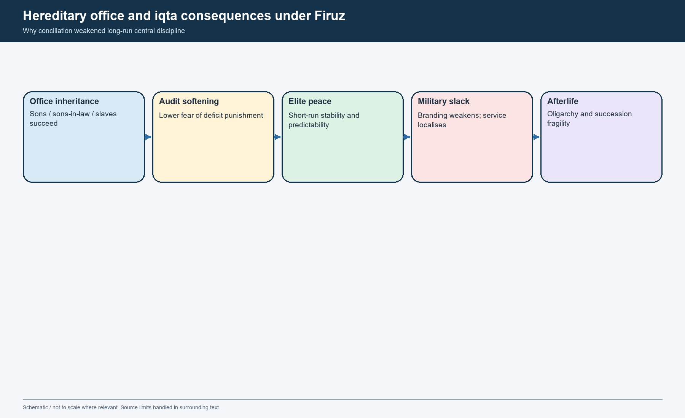

*Consequence-flow visual. The same policy that stabilised the elite also hollowed out merit and discipline.*

#### Structured judgement

| Short-term gain | Long-term weakness |
|---|---|
| Noble peace and predictability | Oligarchic closure |
| Soldier family attachment to service | Reduced muster quality |
| Lower audit terror | Fiscal slack and patronage leakage |
| Fewer internal rebellions in reign | Fragile succession after the ruler's death |

#### PARAGRAPH DEMONSTRATION — CLAIM → EVIDENCE → ANALYSIS → QUALIFICATION

**Claim:** Firuz's hereditary settlement worked as political insurance in the short run and as institutional erosion in the long run. **Named evidence:** he decreed that a dead noble's office and often his iqta should pass to his son, son-in-law or failing them a slave; he stopped torturing nobles or their agents over account deficits; a new revenue valuation was made early but the *jama* was never revised afterwards, so grant-holders automatically gained as cultivation expanded; old soldiers could send sons, sons-in-law or slaves in their place and large parts of the army were paid by *wajh* assignments on village revenue; and horse-branding discipline decayed so far that the Sultan reportedly gave a soldier a gold tanka to bribe the clerk into passing a deficient horse. **Analysis:** each measure converted a revocable state grant into an expected family entitlement, which removed the fear on which audit and muster had depended and therefore removed the centre's principal lever over its own servants. **Qualification:** the lazy formula that Firuz feudalised the state should be avoided unless the debate is explained, because revenue assignment, office, landholding and sovereignty remained distinct; the safer description is heredity, localisation of claims and the weakening of central audit control.

#### CLOSING RECALL FLOW — HEREDITARY OFFICES, IQTAS AND MILITARY RELAXATION: THE LOGIC OF ELITE CONCILIATION

```text
START / CONCEPT: Hereditary offices, iqtas and military relaxation: the logic of elite conciliation
        |
        v
EXACT TERMS: hereditary offices and iqtas · end of audit-torture for nobles · unrevised jama after early valuation · wajh village assignments for soldiers · weakened horse-branding discipline · heredity rather than European feudalism
        |
        v
MECHANISM / ARGUMENT: Converting revocable state grants into expected family entitlements removed the fear on which audit and muster depended, and with it the centre's main lever over its own servants.
        |
        v
CONSEQUENCE / CONTRAST: Noble rebellion fell sharply within the reign while recruitment narrowed, muster quality dropped and patronage leakage grew, leaving succession dangerously fragile.
        |
        v
UPSC TRAP / ANSWER-USE: Do not write that Firuz feudalised the Sultanate without explaining the debate, because revenue assignment, office, landholding and sovereignty did not merge into European-style private ownership by one decree.
        |
        v
ANSWER-GRABBING FORMULATION: Describe the settlement as heredity, localisation of claims and the weakening of central audit control, and let that phrasing carry the whole institutional argument.
```
### SESSION 16 — FIRUZ'S REVENUE, CESSES AND IRRIGATION TAX: CLAIM, IMPLEMENTATION AND LIMIT

#### DEFINITION / WHAT THIS IS CALLED

**Plain-language definition:** Firuz Shah's fiscal policy claimed to restrict taxation to levies his juristic advisers regarded as *shara*-sanctioned, abolishing twenty-one cesses while adding a canal water charge.

**Technical definition:** The reign's assessment rested on sharing rather than rigid measurement after Khwaja Hisamuddin Junaid's inspection-based valuation, with *haqq-i-sharb* of ten per cent levied on villages benefiting from canal irrigation.

#### ANSWER-GRABBING OPENING — WRITE/ADAPT IN THE EXAM

> Firuz's fiscal policy was not anti-revenue; it made extraction socially softer in method, developmental in the core and more legible to orthodox juristic language.

#### MUST-WRITE KEYWORDS

- **abolition of twenty-one cesses**
- **Khwaja Hisamuddin Junaid's valuation**
- **sharing rather than rigid measurement**
- **haqq-i-sharb of ten per cent**
- **jizya as a separate tax on Brahmans too**
- **claimed order versus local practice**

**How to use them:** Open with the abolition of twenty-one cesses and Khwaja Hisamuddin Junaid's valuation; explain sharing rather than rigid measurement as the method; add haqq-i-sharb of ten per cent and jizya as a separate tax on Brahmans too; and close by separating claimed order versus local practice.

[FACT] Firuz Shah wanted to align taxation more closely with what he and his juristic advisers considered *shara*-sanctioned. Contemporary and later accounts say that he abolished **twenty-one cesses**, among them charges linked to markets and earlier levies such as *ghari*.

[FACT] The advanced OCR says that the fresh valuation by Khwaja Hisamuddin Junaid was made on inspection and that the basis of assessment was **sharing**, not rigid measurement. That distinction matters because it helps explain why Firuz's regime presented itself as more accommodative than Muhammad's doab policy.

[FACT] Canal irrigation generated an additional **haqq-i-sharb** of ten per cent from benefited villages. This formed part of the Sultan's personal income. The ordinary land revenue of new villages in irrigated zones also strengthened the crown.

[FACT] Firuz also made **jizya** a separate tax and extended it to Brahmans, ending their practical exemption. This was part of the same effort to describe the tax order as juristically purified, even while many mundane compromises remained.

[LIMIT] The four-tax formula commonly linked to *Futuhat-i Firuz Shahi* must be treated as a claim of correct order, not as proof that every locality actually lived under a perfectly simplified tax regime.

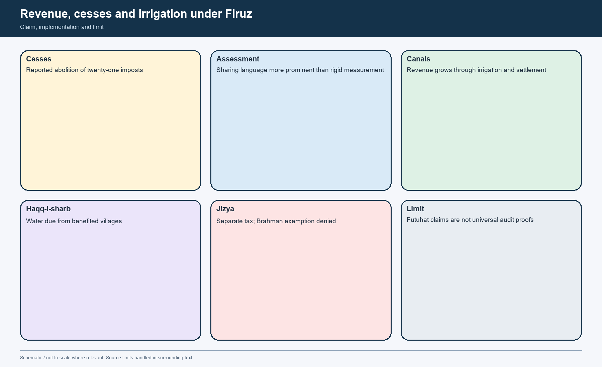

*Policy-matrix visual. It separates what Firuz claimed, what he built and what the evidence can securely show.*

#### Best formulation

- [ANALYSIS] Firuz's fiscal policy was not anti-revenue. It was an attempt to make revenue extraction **socially softer in method, developmental in the core, and more legible to orthodox juristic language**.
- [LIMIT] Because benefits concentrated in the core north-Indian belt and among office-holders, the policy cannot be read as a universal peasant charter.

#### PARAGRAPH DEMONSTRATION — CLAIM → EVIDENCE → ANALYSIS → QUALIFICATION

**Claim:** Firuz's tax reform was a claim about juristic correctness as much as a change in what cultivators actually paid. **Named evidence:** contemporary and later accounts record the abolition of twenty-one cesses, including market charges and the older *ghari*; the advanced source states that Khwaja Hisamuddin Junaid's fresh valuation was made on inspection and that the basis of assessment was sharing rather than rigid measurement; canal irrigation carried an additional *haqq-i-sharb* of ten per cent from benefited villages, forming part of the Sultan's personal income; and jizya was made a separate tax and extended to Brahmans, ending their practical exemption. **Analysis:** sharing-based assessment is precisely the flexibility the doab lacked under Muhammad, which is why the regime could present itself as accommodative, while the water charge shows the same state recovering its investment from the beneficiaries of its own irrigation works. **Qualification:** the four-tax formula linked to the *Futuhat-i Firuz Shahi* is a claim of correct order, not proof that every locality lived under a simplified regime, and because the benefits concentrated in the northern core and among office-holders the policy cannot be read as a universal peasant charter.

#### CLOSING RECALL FLOW — FIRUZ'S REVENUE, CESSES AND IRRIGATION TAX: CLAIM, IMPLEMENTATION AND LIMIT

```text
START / CONCEPT: Firuz's revenue, cesses and irrigation tax: claim, implementation and limit
        |
        v
EXACT TERMS: abolition of twenty-one cesses · Khwaja Hisamuddin Junaid's valuation · sharing rather than rigid measurement · haqq-i-sharb of ten per cent · jizya as a separate tax on Brahmans too · claimed order versus local practice
        |
        v
MECHANISM / ARGUMENT: Sharing-based assessment restored the harvest flexibility that standard-yield valuation had removed, while the irrigation charge let the state recover its canal investment from the villages that gained by it.
        |
        v
CONSEQUENCE / CONTRAST: Extraction became socially softer in method and juristically presentable, but its gains flowed disproportionately to the northern core and to hereditary grant-holders.
        |
        v
UPSC TRAP / ANSWER-USE: The four-tax formula is a claim of correct order rather than proof of uniform local practice, and the abolition of cesses must not be read as a universal peasant charter.
        |
        v
ANSWER-GRABBING FORMULATION: Argue that Firuz reformed the language and method of extraction more than its burden, and locate the reform's real beneficiaries before delivering a verdict.
```
### SESSION 17 — CANALS, GARDENS, TOWNS AND PUBLIC WORKS: DEVELOPMENTAL ENERGY IN THE NORTH-INDIAN CORE

#### DEFINITION / WHAT THIS IS CALLED

**Plain-language definition:** Firuz Shah's public works were a state building programme of canals, dams, orchards, gardens and new towns concentrated in the north-Indian core.

**Technical definition:** A dedicated department of public works administered the programme, whose principal works included a long canal from the Sutlej toward Hansi and Hisar, another from the Yamuna and further channels in the Haryana-Delhi tract, serving irrigation and new settlement together.

#### ANSWER-GRABBING OPENING — WRITE/ADAPT IN THE EXAM

> Firuz's works prove state-building, but of a geographically narrower state than Muhammad had tried to command.

#### MUST-WRITE KEYWORDS

- **department of public works**
- **Sutlej canal to Hansi and Hisar**
- **Yamuna canal**
- **Hissar-Firuza foundation**
- **dams, orchards and gardens**
- **later Mughal and British repair**

**How to use them:** Name the department of public works, run the Sutlej canal to Hansi and Hisar and the Yamuna canal as the core evidence, attach the Hissar-Firuza foundation to them, add dams, orchards and gardens as revenue-plus-display, and use later Mughal and British repair to show the institutional afterlife.

[FACT] Firuz created a large department of public works and pursued irrigation aggressively. The advanced OCR records a long canal from the **Sutlej** toward **Hansi/Hisar**, another from the **Yamuna**, and additional canals in the Haryana-Delhi tract. These were meant both for irrigation and for supplying water to new settlements.

[FACT] The same source connects these canals to the founding of **Hissar-Firuza/Hisar** and to wider agrarian expansion. The text also notes that later Mughal and British repair-and-extension gave some of these works a much longer institutional afterlife.

[FACT] Firuz built dams, planted orchards and is said to have created large numbers of gardens around Delhi. The reported income from orchards appears in the chronicles as part of the regime's developmental self-image.

[ANALYSIS] The real importance is spatial. Firuz's public works were concentrated in the **core northern tract** where the Sultanate still had the will and means to shape landscapes directly. They are evidence of state-building, but of a geographically narrower state than Muhammad had sought to command.

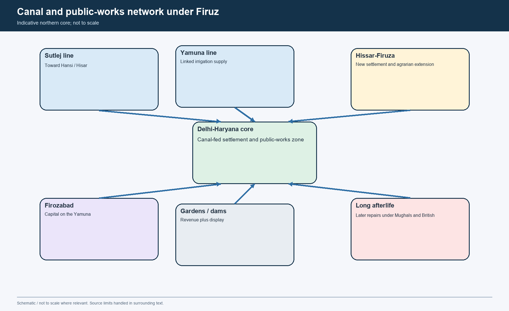

*Public-works schematic. Routes are indicative and explicitly not to scale; the point is the concentration of works in the northern core.*

#### Why this matters

| Developmental move | Political meaning |
|---|---|
| Canal irrigation | State investment tied to revenue growth and agrarian recovery |
| New towns | Market nodes, control points and prestige markers |
| Orchards and gardens | Productive revenue plus courtly display |
| Dams and repairs | The state as custodian-builder, not only tax collector |

#### PARAGRAPH DEMONSTRATION — CLAIM → EVIDENCE → ANALYSIS → QUALIFICATION

**Claim:** Firuz's developmental energy was real but spatially bounded. **Named evidence:** he created a large department of public works; the advanced source records a long canal from the Sutlej toward Hansi and Hisar, another from the Yamuna and additional canals in the Haryana-Delhi tract, meant for irrigation and for supplying the new settlements; these works are tied directly to the founding of Hissar-Firuza; he built dams, planted orchards and is said to have created large numbers of gardens around Delhi; and later Mughal and British repair and extension gave some channels a far longer institutional life. **Analysis:** canal irrigation, new towns, orchards and repairs each convert state expenditure into future revenue and settlement, so the programme is evidence of a state acting as custodian-builder rather than only as tax collector. **Qualification:** every one of these works lies in the core northern tract where the Sultanate still had the will and means to shape landscapes directly, no comparable investment reached the Deccan, and the reported income from orchards belongs to the regime's developmental self-image rather than to audited accounts, so precise totals of canals, towns or gardens must not be invented.

#### CLOSING RECALL FLOW — CANALS, GARDENS, TOWNS AND PUBLIC WORKS: DEVELOPMENTAL ENERGY IN THE NORTH-INDIAN CORE

```text
START / CONCEPT: Canals, gardens, towns and public works: developmental energy in the north-Indian core
        |
        v
EXACT TERMS: department of public works · Sutlej canal to Hansi and Hisar · Yamuna canal · Hissar-Firuza foundation · dams, orchards and gardens · later Mughal and British repair
        |
        v
MECHANISM / ARGUMENT: Canal water converted arid tracts into cultivable and taxable land, and the new towns it supplied then became market nodes, control points and prestige markers for the same state.
        |
        v
CONSEQUENCE / CONTRAST: Investment concentrated where the state was already strongest, deepening the northern core while leaving the lost southern provinces untouched by any comparable programme.
        |
        v
UPSC TRAP / ANSWER-USE: Do not invent precise totals of canals, towns or gardens, and do not inflate the programme into empire-wide development; the chronicles supply a self-image, not an audited register.
        |
        v
ANSWER-GRABBING FORMULATION: Use the canals to argue that Firuz built a deeper state over a smaller map, and make that spatial point the heart of the verdict.
```
### SESSION 18 — URBANISM, ARCHITECTURE AND CONSERVATION UNDER FIRUZ: KOTLA, HAUZ KHAS, OLD MONUMENTS AND ASHOKAN PILLARS

#### DEFINITION / WHAT THIS IS CALLED

**Plain-language definition:** Firuz Shah combined new urban foundation, repair of older monuments and the transport of Ashokan pillars into a single politics of building and appropriation.

**Technical definition:** Tughlaq architecture in this phase uses battered walls, high platforms and grey stone while combining arch principles with lintel-and-beam traditions, and Firuz's programme divides into new foundation, practical repair and prestige appropriation.

#### ANSWER-GRABBING OPENING — WRITE/ADAPT IN THE EXAM

> Firuz's building record is a medieval politics of preservation, reuse and inscriptional prestige rather than heritage conservation in the modern civic sense.

#### MUST-WRITE KEYWORDS

- **Firozabad and Kotla Firoz Shah**
- **repairs to the Qutb Minar**
- **Hauz Khas complex**
- **Topra and Meerut Ashokan pillars**
- **forty-two-wheeled carriage and silk-cotton cushioning**
- **attribution caution**

**How to use them:** Anchor new foundation in Firozabad and Kotla Firoz Shah, evidence repair through repairs to the Qutb Minar and the Hauz Khas complex, use the Topra and Meerut Ashokan pillars with the forty-two-wheeled carriage and silk-cotton cushioning for appropriation, and end on attribution caution.

[FACT] Tughlaq architecture carried forward the dynasty's austere idiom: battered walls, high platforms, grey stone and an effort to combine arch-principles with lintel-beam traditions. Ghiyasuddin's tomb and Tughlaqabad had already begun this visual language.

[FACT] Firuz founded or renewed urban spaces including **Firozabad** on the Yamuna, with the surviving fort now called **Kotla Firoz Shah**. The advanced OCR also associates him with Hissar-Firuza and with building or renovating Jaunpur, but this should be phrased cautiously because later regional histories add their own layers of attribution.

[FACT] Firuz repaired many earlier monuments: the advanced OCR explicitly mentions repairs to the **Qutb Minar**, old mosques and tombs, and the **Hauz Khas** complex. This is one reason his reign matters for medieval conservation history.

[FACT] Upinder Singh's local extract, using Afif and the illustrated *Sirat-i-Firuz Shahi*, provides unusually vivid evidence for the transport of the **Topra** and **Meerut** Ashokan pillars to Delhi. Tools, silk-cotton cushioning, a forty-two-wheeled carriage, river transport and palace re-erection together show both technical competence and ideological appropriation.

[ANALYSIS] Firuz's monument policy had three layers: practical repair, dynastic display and appropriation of prestigious older artefacts into a new political centre. It was not "heritage conservation" in the modern civic sense, but it was certainly a medieval politics of preservation, reuse and inscriptional prestige.

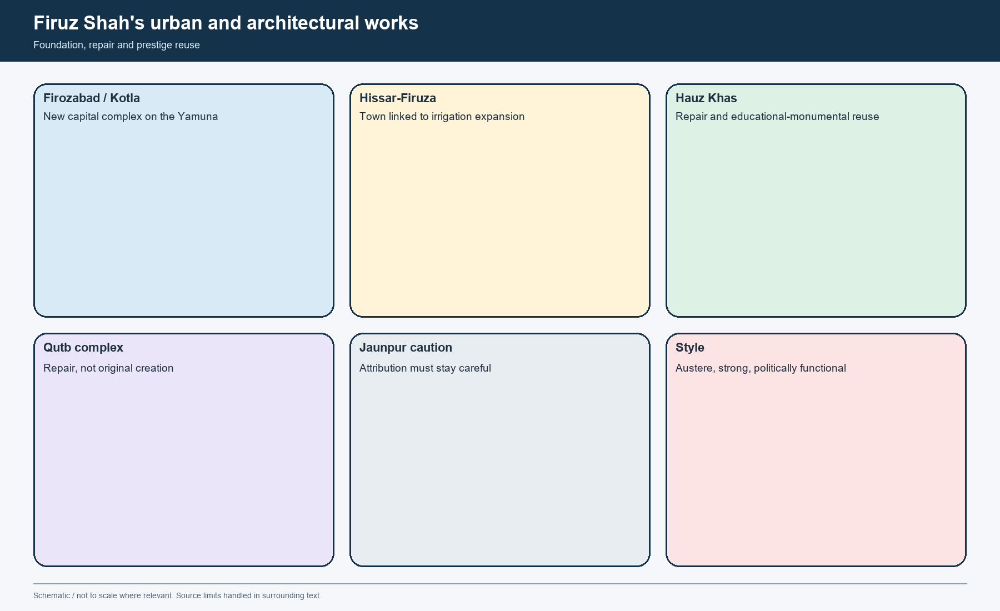

*Urban-works matrix. It distinguishes new foundation, repair and prestige appropriation.*

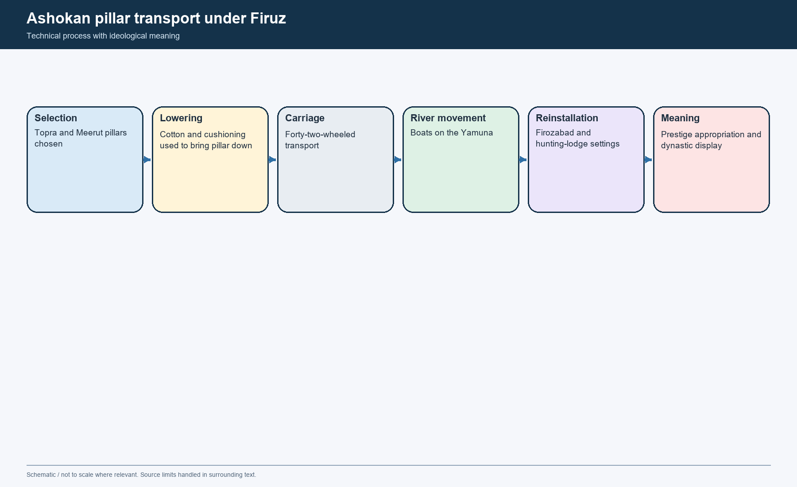

*Transport-process visual. The movement of the Topra pillar is both a technical and an ideological event.*

#### Attribution caution

| Claim | Safe wording |
|---|---|
| Firozabad | Firuz founded a new capital on the Yamuna; Kotla survives as the clearest remnant |
| Jaunpur | Firuz is associated in the advanced OCR with building or renovating it; later Sharqi development must be kept separate |
| Qutb repair | Firuz repaired/rebuilt damaged upper portions; do not credit him with the whole monument |
| Pillars | He transported the Topra and Meerut Ashokan pillars to Delhi; the later inscriptions and meanings remained layered |
| Other towns named in general accounts | Only Firozabad/Kotla, Hissar-Firuza and the bounded Jaunpur association are attested in the source set used here. General textbook lists that add further Firuzian foundations, such as Fatehabad, are not independently supported by these sources, so this package names them as unverified attributions rather than asserting them |

#### PARAGRAPH DEMONSTRATION — CLAIM → EVIDENCE → ANALYSIS → QUALIFICATION

**Claim:** Firuz's monument policy operated on three distinct layers - practical repair, dynastic display and appropriation of prestigious older artefacts. **Named evidence:** he founded or renewed Firozabad on the Yamuna, whose surviving fort is Kotla Firoz Shah; the advanced source records his repairs to the Qutb Minar, to old mosques and tombs, and to the Hauz Khas complex; and Upinder Singh's local extract, drawing on Afif and the illustrated *Sirat-i-Firuz Shahi*, describes the transport of the Topra and Meerut Ashokan pillars to Delhi using tools, silk-cotton cushioning, a forty-two-wheeled carriage, river transport and palace re-erection. **Analysis:** moving an eleven-hundred-year-old imperial pillar into a new royal city is simultaneously a feat of engineering and a claim to inherit the authority of earlier sovereignty, which is why the pillar episode carries more political meaning than any single new building. **Qualification:** attribution must stay careful - he repaired and rebuilt damaged upper portions of the Qutb rather than building the monument, earlier Khalji work at Hauz Khas must be distinguished from Tughlaq additions, his association with building or renovating Jaunpur must be kept apart from later Sharqi development, and the pillars' inscriptions were not necessarily fully understood by those who moved them.

#### CLOSING RECALL FLOW — URBANISM, ARCHITECTURE AND CONSERVATION UNDER FIRUZ: KOTLA, HAUZ KHAS, OLD MONUMENTS AND ASHOKAN PILLARS

```text
START / CONCEPT: Urbanism, architecture and conservation under Firuz: Kotla, Hauz Khas, old monuments and Ashokan pillars
        |
        v
EXACT TERMS: Firozabad and Kotla Firoz Shah · repairs to the Qutb Minar · Hauz Khas complex · Topra and Meerut Ashokan pillars · forty-two-wheeled carriage and silk-cotton cushioning · attribution caution
        |
        v
MECHANISM / ARGUMENT: Repairing famous older monuments and re-erecting ancient pillars inside a new royal city transferred the prestige of earlier sovereignty onto the reigning dynasty at a fraction of the cost of original construction.
        |
        v
CONSEQUENCE / CONTRAST: The reign leaves an unusually rich material record, which allows literary claims about Firuz's works to be checked against surviving fabric.
        |
        v
UPSC TRAP / ANSWER-USE: Do not credit Firuz with the whole Qutb Minar or with every later north-Indian town; his securely attested foundations are Firozabad and Hissar-Firuza, and other attributions such as Jaunpur require separation from later regional building.
        |
        v
ANSWER-GRABBING FORMULATION: Read Firuz's monuments as evidence for resources, labour and ideology, and never as a complete measure of the empire's prosperity.
```
### SESSION 19 — SLAVES, DIWAN-I-BANDAGAN AND THE POLITICAL ECONOMY OF COERCED SERVICE

#### DEFINITION / WHAT THIS IS CALLED

**Plain-language definition:** The Diwan-i-Bandagan was the separate department that administered Firuz Shah's very large establishment of slaves, collected as tribute from commanders and officials.

**Technical definition:** The establishment functioned as coerced state labour, palace service and an armed corps personally dependent on the ruler, supported by its own treasury, muster structure and administrative department.

#### ANSWER-GRABBING OPENING — WRITE/ADAPT IN THE EXAM

> Firuz's slave system should be read as state labour plus dynastic politics, not as welfare and not as a simple copy of early mamluk practice.

#### MUST-WRITE KEYWORDS

- **Diwan-i-Bandagan**
- **reported total of about 180,000**
- **12,000 trained as artisans**
- **royal karkhanas**
- **armed corps dependent on the ruler**
- **second organised interest-group**

**How to use them:** Name the Diwan-i-Bandagan with its own treasury and muster, mark the reported total of about 180,000 and the 12,000 trained as artisans as chronicle figures, distribute them across royal karkhanas and an armed corps dependent on the ruler, and close on the emergence of a second organised interest-group.

[FACT] Firuz ordered officials and victorious commanders to send selected boys and youths to him as slaves. The reported total reaches about **180,000**, with **12,000** trained as artisans. These are reported chronicle numbers and must remain labelled as such.

[FACT] The slaves served multiple functions: work in royal workshops (*karkhanas*), household and palace service, and an armed corps personally dependent on the ruler. A separate treasury, muster structure and administrative department existed for them.

[ANALYSIS] This was not a benevolent shelter-home. It was a system of coerced labour, political counterweight and court service that widened the ruler's direct dependants outside the regular nobility.

[LIMIT] The policy cut against Firuz's own stated aim of stable noble heredity. Instead of unifying the state, it created a second organised interest-group whose intervention became dangerous after the ruler's death.

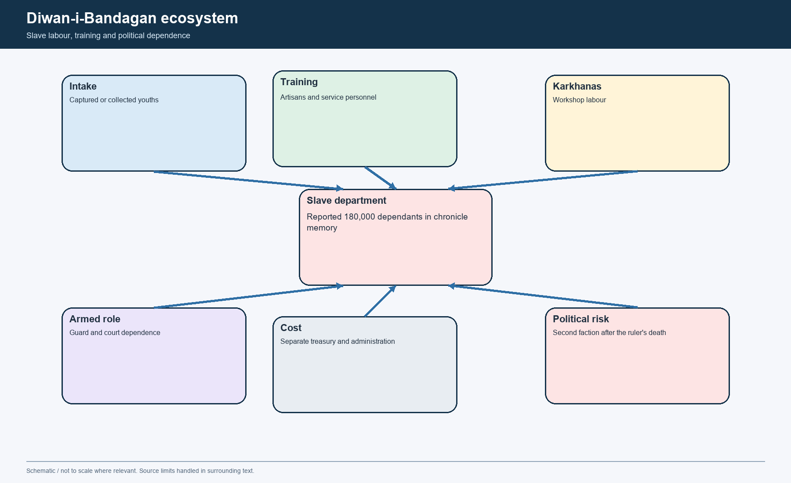

*Institution-ecosystem visual. Intake, training, labour, military use and political side-effects are shown together.*

#### Exam-safe conclusion

- [ANALYSIS] Firuz's slave system should be read as **state labour plus dynastic politics**, not as welfare, nor as a simple copy of early mamluk practice.

#### PARAGRAPH DEMONSTRATION — CLAIM → EVIDENCE → ANALYSIS → QUALIFICATION

**Claim:** the slave establishment was an instrument of coerced production and personal dependence that ended by destabilising the reign it was meant to secure. **Named evidence:** Firuz ordered officials and victorious commanders to send selected boys and youths to him as slaves, and the reported total reaches about 180,000, of whom 12,000 were trained as artisans; they worked in royal *karkhanas*, served in household and palace roles and formed an armed corps personally dependent on the ruler; and a separate treasury, muster structure and administrative department existed for them. **Analysis:** building a service population outside the regular nobility widened the ruler's pool of direct dependants, which is exactly why it cut against his own stated aim of stable hereditary noble succession. **Qualification:** the figures are reported chronicle numbers rather than an audited census and must be labelled as such, the establishment was in no sense a benevolent shelter, and instead of unifying the state it created a second organised interest-group whose intervention became dangerous immediately after the ruler's death.

#### CLOSING RECALL FLOW — SLAVES, DIWAN-I-BANDAGAN AND THE POLITICAL ECONOMY OF COERCED SERVICE

```text
START / CONCEPT: Slaves, Diwan-i-Bandagan and the political economy of coerced service
        |
        v
EXACT TERMS: Diwan-i-Bandagan · reported total of about 180,000 · 12,000 trained as artisans · royal karkhanas · armed corps dependent on the ruler · second organised interest-group
        |
        v
MECHANISM / ARGUMENT: Recruiting dependants who owed everything to the ruler personally created a service bloc outside the nobility, giving the throne manpower that the hereditary elite could neither supply nor control.
        |
        v
CONSEQUENCE / CONTRAST: The corps survived the ruler who created it and became a king-making faction, so a measure designed to secure the dynasty helped destabilise its succession.
        |
        v
UPSC TRAP / ANSWER-USE: Do not describe the department as welfare and do not quote the 180,000 total as audited fact; it is a chronicler's large administrative claim about a system of coerced service.
        |
        v
ANSWER-GRABBING FORMULATION: Argue that the slave department reveals the political economy of the reign: production, service and factional insurance organised through unfree labour.
```
### SESSION 20 — CHARITY, HOSPITALS, MARRIAGES AND "BENEVOLENCE": WHO BENEFITED AND WHAT WERE THE LIMITS?

#### DEFINITION / WHAT THIS IS CALLED

**Plain-language definition:** Firuz Shah's benevolence programme covered free hospital treatment, marriage assistance for poor girls, support for widows and orphans, lists of the unemployed and restored grants to scholars and shrines.

**Technical definition:** Benevolent kingship here is an ideological claim that the state should support as well as punish and tax, implemented through charitable departments whose beneficiaries were socially selected rather than universal.

#### ANSWER-GRABBING OPENING — WRITE/ADAPT IN THE EXAM

> Firuz's charity, hospitals and marriage grants expanded the language of benevolent kingship while their benefits stayed socially selective and politically useful.

#### MUST-WRITE KEYWORDS

- **free hospital treatment**
- **marriage assistance for poor girls**
- **kotwals' lists of the unemployed**
- **ban on mutilatory punishment**
- **restored grants to scholars and shrines**
- **selection of beneficiaries**

**How to use them:** List free hospital treatment, marriage assistance for poor girls, the kotwals' lists of the unemployed and the ban on mutilatory punishment; add restored grants to scholars and shrines; then make the selection of beneficiaries the analytical hinge of the answer.

[FACT] Firuz banned a range of mutilatory punishments in political and financial contexts, opened hospitals for free treatment, asked kotwals to prepare lists of the unemployed, arranged marriage assistance for poor girls and supported widows, orphans and the physically weak.

[FACT] He restored or increased many grants to theologians, scholars, shrines and associated dependants. These measures appear across chroniclers and within Firuz's own self-presentation.

[ANALYSIS] The key interpretive caution is about **beneficiaries**. The advanced OCR itself suggests that much of this help was intended above all for Muslims of respectable family status who had fallen on hard times, particularly around the capital. This is not the language of a universal welfare state.

[FACT] Even with those limits, Firuz's assertion that the state should not only punish and collect taxes but should also provide benevolent support marks a genuine ideological shift from the hard punitive reputation of the previous reign.

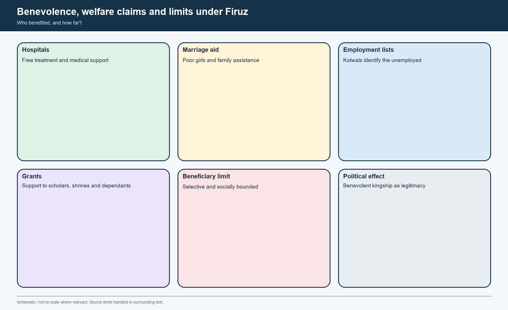

*Benevolence matrix. Claims are matched with likely beneficiary groups and historical limits.*

#### Best wording

- [ANALYSIS] Firuz was not a modern social-welfare ruler; he was a medieval ruler who expanded the **language and some practice of benevolent kingship** while keeping it socially selective and politically useful.

#### PARAGRAPH DEMONSTRATION — CLAIM → EVIDENCE → ANALYSIS → QUALIFICATION

**Claim:** Firuz's benevolence was a genuine ideological shift delivered through socially selective institutions. **Named evidence:** he banned a range of mutilatory punishments in political and financial contexts, opened hospitals for free treatment, asked kotwals to prepare lists of the unemployed, arranged marriage assistance for poor girls, supported widows, orphans and the physically weak, and restored or increased grants to theologians, scholars, shrines and their dependants. **Analysis:** these measures appear across chroniclers and within the ruler's own self-presentation, which tells us that benevolence had become a claim a Sultan wanted associated with his name - a real change from the punitive reputation of the previous reign. **Qualification:** the advanced source itself suggests much of this help was intended above all for Muslims of respectable family status who had fallen on hard times, particularly around the capital, so this is not the language of a universal welfare state and the programme must be described as medieval benevolent kingship rather than as modern social policy.

#### CLOSING RECALL FLOW — CHARITY, HOSPITALS, MARRIAGES AND "BENEVOLENCE": WHO BENEFITED AND WHAT WERE THE LIMITS?

```text
START / CONCEPT: Charity, hospitals, marriages and "benevolence": who benefited and what were the limits?
        |
        v
EXACT TERMS: free hospital treatment · marriage assistance for poor girls · kotwals' lists of the unemployed · ban on mutilatory punishment · restored grants to scholars and shrines · selection of beneficiaries
        |
        v
MECHANISM / ARGUMENT: Charitable departments turned a moral claim into administrative routine - registers, grants and free treatment - which is why the claim outlived the ruler in chronicler memory.
        |
        v
CONSEQUENCE / CONTRAST: The state acquired a beneficent public identity that the previous reign had lost, while the material benefits remained concentrated near the capital and among favoured groups.
        |
        v
UPSC TRAP / ANSWER-USE: Do not call Firuz a modern social-welfare ruler; the correct reading keeps the ideological shift real while marking the beneficiaries as socially selected and the provision as politically useful.
        |
        v
ANSWER-GRABBING FORMULATION: Show that benevolence was simultaneously a genuine ideological shift and a bounded, selective practice, and let that double judgement carry the answer.
```
### SESSION 21 — POLITICAL CONCILIATION AND SHARPER RELIGIOUS ORTHODOXY: JIZYA, ULEMA, TEMPLES AND TRANSLATIONS

#### DEFINITION / WHAT THIS IS CALLED

**Plain-language definition:** Firuz Shah combined political conciliation of elites with a sharper juristic marking of religious hierarchy, most visibly through jizya, ulema concessions and action against some temples and sects.

**Technical definition:** The reign's religious policy is a compound: separate jizya extended to Brahmans, bans on practices the theologians considered un-Islamic, persecution of some Muslim sects held to be heretical, and simultaneous patronage of Sanskrit-to-Persian translation.

#### ANSWER-GRABBING OPENING — WRITE/ADAPT IN THE EXAM

> The usable contrast is not tolerance against intolerance but political conciliation with elites alongside sharper juristic marking of religious hierarchy.

#### MUST-WRITE KEYWORDS

- **jizya as a separate tax**
- **refusal of Brahman exemption**
- **persecution of sects held heretical**
- **destruction of some newly built temples**
- **translations of medicine, music and mathematics**
- **compound rather than single-word verdict**

**How to use them:** Establish jizya as a separate tax with refusal of Brahman exemption, add persecution of sects held heretical and the destruction of some newly built temples, set against these the translations of medicine, music and mathematics, and deliver a compound rather than single-word verdict.

[FACT] Firuz tried to please the theologians by presenting himself as a properly Islamic ruler. He banned some practices they considered un-Islamic, persecuted some Muslim sects seen as heretical, and made **jizya** a separate tax while refusing to exempt Brahmans.

[FACT] The advanced and concise OCRs preserve severe episodes: the public burning of a Brahman accused of preaching and conversion, the destruction of some newly built temples or festival-sites near Delhi, and restrictions on Muslim women's visits to saintly shrines.

[FACT] At the same time, Firuz patronised translations of Sanskrit works on **medicine, music and mathematics** into Persian and treated some Hindu chiefs with respect at court. This combination is why a one-word label is misleading.

[ANALYSIS] The right contrast is not "tolerant versus intolerant" in the abstract, but **political conciliation with elites and core society alongside sharper juristic marking of religious hierarchy**.

[LIMIT] Do not turn translation patronage into proof that orthodoxy was absent; do not turn jizya and temple action into proof that every aspect of rule was defined only by religious hostility.

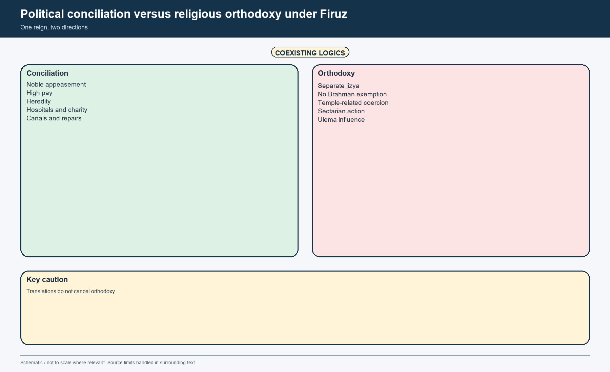

*Comparison visual. Firuz's regime reduced one kind of coercion while sharpening another symbolic and juristic boundary.*

#### Safe conclusion

- [ANALYSIS] Firuz's state widened the discourse of benevolence but also strengthened orthodox authority. This tension is the key to the reign.

#### PARAGRAPH DEMONSTRATION — CLAIM → EVIDENCE → ANALYSIS → QUALIFICATION

**Claim:** Firuz's religious policy must be written as a compound because its severe and its cultivated sides belong to the same programme. **Named evidence:** he banned practices the theologians considered un-Islamic, persecuted some Muslim sects held to be heretical, made jizya a separate tax and refused Brahmans their practical exemption; the sources also preserve the public burning of a Brahman accused of preaching and conversion, the destruction of some newly built temples or festival-sites near Delhi, and restrictions on Muslim women's visits to saintly shrines; and the same reign patronised translations of Sanskrit works on medicine, music and mathematics into Persian and received some Hindu chiefs with respect at court. **Analysis:** the combination shows a ruler purchasing ideological support from the ulema with juristic markers while keeping the cultural and administrative advantages of engagement, so conciliation and orthodoxy are two faces of one political settlement. **Qualification:** translation patronage does not prove that orthodoxy was absent, and jizya and temple action do not prove that every aspect of rule was defined by religious hostility; episodes require case-specific chronology, and both "uniform persecution" and "complete tolerance" are false.

#### CLOSING RECALL FLOW — POLITICAL CONCILIATION AND SHARPER RELIGIOUS ORTHODOXY: JIZYA, ULEMA, TEMPLES AND TRANSLATIONS

```text
START / CONCEPT: Political conciliation and sharper religious orthodoxy: jizya, ulema, temples and translations
        |
        v
EXACT TERMS: jizya as a separate tax · refusal of Brahman exemption · persecution of sects held heretical · destruction of some newly built temples · translations of medicine, music and mathematics · compound rather than single-word verdict
        |
        v
MECHANISM / ARGUMENT: Juristic markers were the currency in which the ruler paid the ulema for the legitimacy his conciliatory politics required, which is why concession and severity rise together in the same reign.
        |
        v
CONSEQUENCE / CONTRAST: The settlement widened the discourse of benevolence while narrowing the ideological coalition on which the state could draw.
        |
        v
UPSC TRAP / ANSWER-USE: Neither uniform persecution nor complete tolerance is defensible; do not use the translations to erase the coercion or the coercion to erase the translations, and insist on case-specific chronology.
        |
        v
ANSWER-GRABBING FORMULATION: Write the reign as political conciliation plus sharper juristic hierarchy, and treat that tension as the key to Firuz's government rather than as an inconsistency to be resolved.
```
### SESSION 22 — MUHAMMAD VERSUS FIRUZ: AMBITION, FISCAL METHOD, ELITE MANAGEMENT, RELIGION AND DURABILITY

#### DEFINITION / WHAT THIS IS CALLED

**Plain-language definition:** Comparing Muhammad bin Tughlaq with Firuz Shah means setting two contrasting answers to the same problem of holding a large Sultanate together from a northern core.

**Technical definition:** The comparison runs on five axes - territorial imagination, fiscal strategy, elite management, religious politics and durability - rather than on a contrast between irrationality and benevolence.

#### ANSWER-GRABBING OPENING — WRITE/ADAPT IN THE EXAM

> The two reigns are alternative responses to one Sultanate problem: aligning territorial reach, agrarian revenue, elite compliance and administrative capacity.

#### MUST-WRITE KEYWORDS

- **territorial imagination**
- **fiscal strategy**
- **elite management**
- **religious politics**
- **durability of rule**
- **innovation without compliance versus stability without discipline**

**How to use them:** Run the comparison axis by axis - territorial imagination, fiscal strategy, elite management, religious politics and durability of rule - and close on innovation without compliance versus stability without discipline instead of ranking the two rulers morally.

[ANALYSIS] The strongest comparison is structural. Muhammad tried to hold together a nearly pan-subcontinental empire by experimentation, direct supervision and uniformising pressure. Firuz accepted a smaller effective horizon and traded central sharpness for social peace in the north-Indian core.

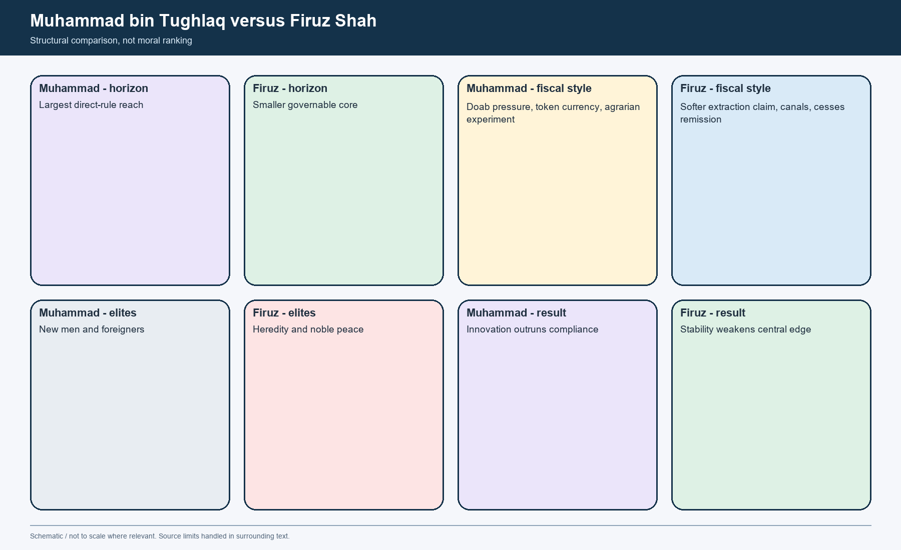

*Comparative visual. The contrast is not rationality versus irrationality or kindness versus cruelty; it is two different state strategies under pressure.*

#### Comparison matrix

| Dimension | Muhammad bin Tughlaq | Firuz Shah Tughlaq |
|---|---|---|
| Territorial imagination | Direct-rule expansion to the south and frontier offensives | Acceptance of a reduced but governable northern Sultanate |
| Fiscal strategy | Heavy assessment, monetisation experiment, developmental loans | Softer extraction claims, irrigation works, heredity-linked grant benefits |
| Elite management | Wider and riskier recruitment, including "new men" and foreigners | Conciliation, heredity, high salaries and audit relaxation |
| Religious politics | Observant yet intellectually open; conflict with orthodox ulema; caliphal rescript sought late | More demonstrative orthodoxy; jizya separate; ulema concessions alongside translations |
| Durability | Great ambition, weak credibility after failures | Long peace, but deeper institutional softening for the future |

#### Best thesis sentence

- [ANALYSIS] Muhammad stressed **innovation without secure compliance**; Firuz stressed **stability without secure central discipline**.

#### PARAGRAPH DEMONSTRATION — CLAIM → EVIDENCE → ANALYSIS → QUALIFICATION

**Claim:** Muhammad and Firuz failed in opposite directions rather than at different levels of competence. **Named evidence:** Muhammad pursued direct-rule expansion to the south and frontier offensives, heavy assessment, a monetisation experiment and developmental loans, and widened recruitment to include foreigners and new men, while Firuz accepted a reduced northern Sultanate, softened extraction claims, invested in irrigation, and secured elites through heredity, high salaries and audit relaxation; in religion Muhammad was observant yet intellectually open and quarrelled with the orthodox ulema before seeking a caliphal rescript, whereas Firuz made jizya separate, conceded to the ulema and simultaneously patronised translations. **Analysis:** placed side by side, the two records show that the Sultanate could buy reach at the cost of credibility or credibility at the cost of reach, but had no instrument capable of delivering both. **Qualification:** neither the genius-versus-failure binary nor the benevolent-versus-fanatical binary survives this comparison, and short-term stability under Firuz is no more proof of administrative success than ambitious intention under Muhammad.

#### CLOSING RECALL FLOW — MUHAMMAD VERSUS FIRUZ: AMBITION, FISCAL METHOD, ELITE MANAGEMENT, RELIGION AND DURABILITY

```text
START / CONCEPT: Muhammad versus Firuz: ambition, fiscal method, elite management, religion and durability
        |
        v
EXACT TERMS: territorial imagination · fiscal strategy · elite management · religious politics · durability of rule · innovation without compliance versus stability without discipline
        |
        v
MECHANISM / ARGUMENT: Muhammad pursued wider direct supervision through experiments and heterogeneous recruitment, while Firuz reduced coercive intensity through elite concessions, heredity and public works.
        |
        v
CONSEQUENCE / CONTRAST: Muhammad's failures damaged trust and accelerated fragmentation, whereas Firuz achieved a longer peace at the cost of weaker audit, military and succession controls.
        |
        v
UPSC TRAP / ANSWER-USE: Do not reduce the comparison to mad ruler versus kind ruler, and do not treat either short-term stability or ambitious intention as proof of durable administrative success.
        |
        v
ANSWER-GRABBING FORMULATION: Conclude that Muhammad over-strained the Sultanate's capacity while Firuz undercut its central edge - overreach against over-accommodation.
```
### SESSION 23 — SUCCESSION, SLAVES, NOBLES AND POST-1388 INSTABILITY: WHY THE SULTANATE WEAKENED BEFORE TIMUR

#### DEFINITION / WHAT THIS IS CALLED

**Plain-language definition:** Post-1388 instability was the succession breakdown after Firuz Shah's death, in which princes, factional nobles and the slave corps competed while provincial governors asserted autonomy.

**Technical definition:** The weakening was structural before it was dynastic: hereditary office, relaxed military discipline, a factional duality between nobles and the slave corps, and an unresolved succession rule reinforced one another.

#### ANSWER-GRABBING OPENING — WRITE/ADAPT IN THE EXAM

> Timur's sack of Delhi in 1398-99 was a completing shock, not the single creator of a decline whose groundwork was already laid.

#### MUST-WRITE KEYWORDS

- **conflict between Prince Muhammad and Khan-i-Jahan II**
- **failed joint-sovereignty experiments**
- **slave corps as king-maker**
- **autonomy in Gujarat, Malwa, Khandesh and Jaunpur**
- **withheld revenue by local chiefs**
- **completing shock rather than sole cause**

**How to use them:** Start from the conflict between Prince Muhammad and Khan-i-Jahan II and the failed joint-sovereignty experiments; show the slave corps as king-maker; evidence contraction through autonomy in Gujarat, Malwa, Khandesh and Jaunpur and withheld revenue by local chiefs; then place Timur as a completing shock rather than sole cause.

[FACT] Even before Firuz died, conflict had broken out between Prince Muhammad and the wazir Khan-i-Jahan II. The slave corps intervened, princely alignments shifted, and joint-sovereignty experiments failed to stabilise succession.

[FACT] After Firuz's death in **1388**, repeated struggles among sons and grandsons followed. The slaves tried to play king-maker and failed; provincial governors in Gujarat, Malwa, Khandesh and Jaunpur asserted autonomy; local chiefs withheld revenue; Delhi's practical zone contracted.

[ANALYSIS] Timur's sack of Delhi in 1398-99 was therefore a **completing shock**, not the single creator of decline. The groundwork had already been laid by hereditary office, military slackness, factional duality between nobles and slave corps, and unresolved succession.

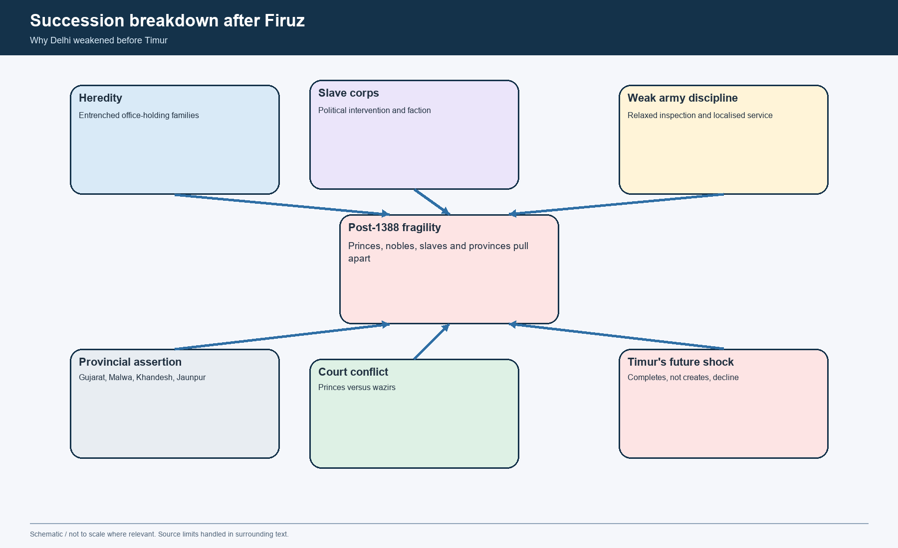

*Breakdown visual. The aim is to show cumulative fragility, not one-cause collapse.*

#### Handoff to Topic 06

- [FACT] Topic 05 stops with the causal web of weakening.
- [FACT] Topic 06 owns the full narrative of Timur, the Sayyids, Lodis and the fifteenth-century north-Indian balance of power.

#### PARAGRAPH DEMONSTRATION — CLAIM → EVIDENCE → ANALYSIS → QUALIFICATION

**Claim:** the Sultanate's collapse of authority was well advanced before any external invasion. **Named evidence:** even before Firuz died, conflict broke out between Prince Muhammad and the wazir Khan-i-Jahan II, the slave corps intervened, princely alignments shifted and joint-sovereignty experiments failed to stabilise the succession; after 1388 repeated struggles among sons and grandsons followed, the slaves tried and failed to play king-maker, governors in Gujarat, Malwa, Khandesh and Jaunpur asserted autonomy, local chiefs withheld revenue and Delhi's practical zone contracted. **Analysis:** these are the direct consequences of the preceding reign's own settlement, because hereditary office removed the centre's leverage over its servants, relaxed muster removed its military edge, and the slave corps supplied a rival armed constituency with its own interest in the succession. **Qualification:** Topic 05 stops at this causal web; Timur's invasion of 1398-99 was a devastating later rupture and is owned, with the Sayyids and Lodis, by Topic 06.

#### CLOSING RECALL FLOW — SUCCESSION, SLAVES, NOBLES AND POST-1388 INSTABILITY: WHY THE SULTANATE WEAKENED BEFORE TIMUR

```text
START / CONCEPT: Succession, slaves, nobles and post-1388 instability: why the Sultanate weakened before Timur
        |
        v
EXACT TERMS: conflict between Prince Muhammad and Khan-i-Jahan II · failed joint-sovereignty experiments · slave corps as king-maker · autonomy in Gujarat, Malwa, Khandesh and Jaunpur · withheld revenue by local chiefs · completing shock rather than sole cause
        |
        v
MECHANISM / ARGUMENT: Hereditary office removed the centre's leverage over its servants, relaxed muster removed its military edge, and the slave corps supplied a rival armed constituency with its own stake in who succeeded.
        |
        v
CONSEQUENCE / CONTRAST: Delhi's practical zone of authority contracted province by province while the court exhausted itself in dynastic conflict.
        |
        v
UPSC TRAP / ANSWER-USE: Do not let Timur carry the whole explanation of decline, and do not narrate 1398-99 here; the invasion struck a state already weakened, and its full account belongs to Topic 06.
        |
        v
ANSWER-GRABBING FORMULATION: Present post-1388 collapse as the delayed bill for Firuz's hereditary settlement, paid by a court that could no longer discipline its own servants.
```
### SESSION 24 — HISTORIOGRAPHY, HISTORICAL SIGNIFICANCE AND THE GS-I ANSWER SPINE

#### DEFINITION / WHAT THIS IS CALLED

**Plain-language definition:** Tughlaq historiography is the argument over how the two reigns should be labelled, and the state-capacity reading is the defensible replacement for the inherited adjectives.

**Technical definition:** Historical significance is assessed on five measurable counts: the widest reach of the Delhi Sultanate, the clearest pre-Mughal overstretch, transmission of north-Indian political culture into the Deccan, the most visible medieval canal programme in the northern core, and the institutional road to post-1388 fragmentation.

#### ANSWER-GRABBING OPENING — WRITE/ADAPT IN THE EXAM

> Tughlaq historiography becomes examinable only when the inherited labels are replaced by a state-capacity reading of objectives, coercion, information, elite bargains and agrarian credibility.

#### MUST-WRITE KEYWORDS

- **state-capacity reading**
- **genius, visionary and madman labels**
- **welfare-monarch reputation**
- **widest reach of the Delhi Sultanate**
- **pre-Mughal administrative overstretch**
- **GS-I answer spine**

**How to use them:** Replace the genius, visionary and madman labels and the welfare-monarch reputation with a state-capacity reading; evidence significance through the widest reach of the Delhi Sultanate and pre-Mughal administrative overstretch; then compress all of it into the GS-I answer spine.

[DEBATE] Older moralising narratives pushed Muhammad bin Tughlaq toward the labels "genius," "visionary" or "madman." The more defensible line, supported by the local sources, is a **state-capacity reading**: many policies had a rational objective, but they demanded trust, information and coordinated enforcement that the Sultanate could not reliably supply across that scale.

[DEBATE] Firuz has often been remembered as a welfare monarch. The local archive supports the public-works and benevolence side, but it also strongly supports the view that his conciliation strengthened oligarchy, relaxed audit, sharpened orthodoxy and weakened the army's quality.

[FACT] Historically, the Tughlaq phase matters because it marks the **widest reach of the Delhi Sultanate**, the clearest demonstration of pre-Mughal administrative overstretch, the transmission of north-Indian political culture into the Deccan, the most visible medieval canal-development effort in the north-Indian core, and the institutional road to post-1388 fragmentation before Timur's intervention.

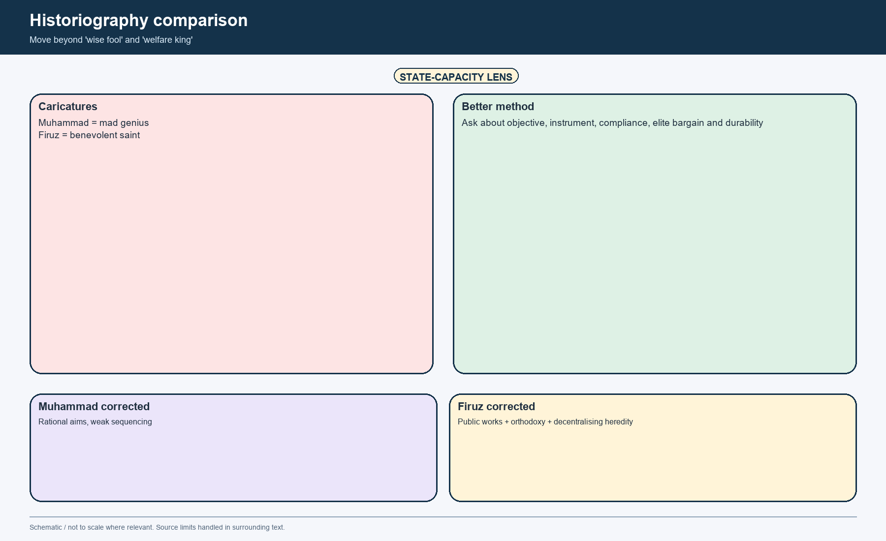

*Historiography visual. It shows how to move from loaded adjectives to analyzable categories.*

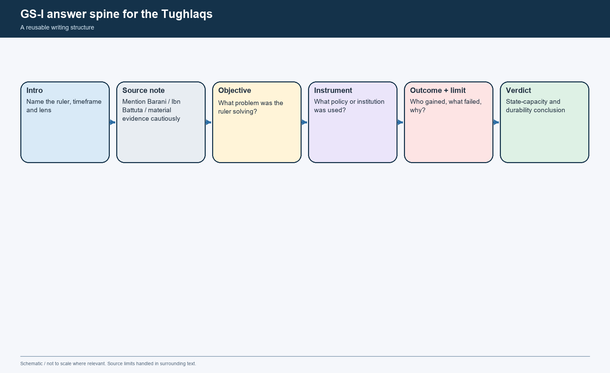

*Answer-spine visual. Use it to structure a 10-, 15- or 20-mark response without collapsing policy, source and significance.*

#### Final thematic verdict

- [ANALYSIS] The Tughlaqs show that medieval imperial power did not fail only because rulers were virtuous or vicious; it succeeded or failed according to how far **objectives, coercion, information, elite bargains and agrarian credibility** could be aligned.

#### PARAGRAPH DEMONSTRATION — CLAIM → EVIDENCE → ANALYSIS → QUALIFICATION

**Claim:** the Tughlaq reputation problem is solved by replacing adjectives with analysable categories. **Named evidence:** older moralising narratives pushed Muhammad toward "genius", "visionary" or "madman", and remembered Firuz as a welfare monarch, yet the local archive shows that Muhammad's policies carried rational objectives while demanding trust, information and coordinated enforcement the Sultanate could not supply, and that Firuz's conciliation strengthened oligarchy, relaxed audit, sharpened orthodoxy and weakened the army's quality even as it funded canals and hospitals. **Analysis:** converting each label into a question about objective, instrument, beneficiary and durability turns a reputational dispute into an examinable argument, which is exactly what a GS-I answer must do. **Qualification:** the categories do not erase the labels' partial truth - Muhammad's projects were genuinely imaginative and Firuz's works genuinely beneficial - and the period's significance is best measured by the widest reach of the Delhi Sultanate, its pre-Mughal overstretch, the transmission of north-Indian political culture into the Deccan, the northern canal programme and the institutional road to post-1388 fragmentation.

#### CLOSING RECALL FLOW — HISTORIOGRAPHY, HISTORICAL SIGNIFICANCE AND THE GS-I ANSWER SPINE

```text
START / CONCEPT: Historiography, historical significance and the GS-I answer spine
        |
        v
EXACT TERMS: state-capacity reading · genius, visionary and madman labels · welfare-monarch reputation · widest reach of the Delhi Sultanate · pre-Mughal administrative overstretch · GS-I answer spine
        |
        v
MECHANISM / ARGUMENT: Each loaded adjective is converted into a question about objective, administrative instrument, beneficiary and durability, which is what turns a reputational dispute into an examinable argument.
        |
        v
CONSEQUENCE / CONTRAST: The reputations survive with their partial truth intact, but they no longer substitute for evidence about who benefited, who obeyed and what endured.
        |
        v
UPSC TRAP / ANSWER-USE: Do not open a Tughlaq answer with "visionary failure" or "welfare ruler"; a label may close a paragraph only after the evidence that disciplines it has already been supplied.
        |
        v
ANSWER-GRABBING FORMULATION: Anchor the GS-I spine in the widest reach of the Delhi Sultanate and the clearest pre-Mughal overstretch, and let historiography follow the evidence rather than lead it.
```
### MEDIEVAL DEEP-REVIEW CORE CONTROL

- **Must remember:** The Daulatabad second capital, the token currency and the doab assessment were three separate experiments with different aims and outcomes; "capital transfer" is the wording this package corrects, not the wording it uses.
- **Close distinction:** Failure must not be reduced to a timeless 'mad king' label; design, enforcement, ecology and source hostility matter.
- **Evidence / interpretation limit:** Firuz Shah's canals, charities, slavery and religious policy require a combined fiscal, social and political reading.

### TOPIC 05 CLOSING TUGHLAQ CAPACITY LEDGER

#### Policy-source matrix

| Policy/claim | Intent | Capacity/evidence limit |
|---|---|---|
| Daulatabad | second capital and Deccan supervision | selective pressured migration, phases/reversal and Isami exaggeration |
| Copper/brass token currency | monetary flexibility | mint/authentication failure, counterfeiting and costly redemption; not fiat/paper money |
| Doab assessment | larger dependable revenue | official prices/yields, harsh collection, famine/climate and rebellion |
| Diwan-i Amir-i Kohi | agricultural extension through loans/wells/crops | corrupt supervision, ecology, scale and recovery problems |
| Khurasan/Qarachil | planned western recruitment versus executed Himalayan campaign | treasury burden versus terrain/logistics; do not conflate |

Barani, Ibn Battuta, Isami, Afif, ruler self-representation, inscriptions, coins,
canals and architecture have different dates, genres and reach. Ibn Battuta is
an eyewitness with travel-literature conventions, not a neutral census.

#### Regional contraction and Firuz's bargain

- Ma'bar/Madurai, Warangal, Kampili and Deccan changes contributed to the rise
  of Vijayanagara and the Bahmani state; later histories retain ownership.
- Bengal, Gujarat, Sindh and the Deccan demonstrate provincial autonomy and
  communication limits.
- Firuz's legitimacy emerged from succession during the Sindh/Thatta campaign,
  noble selection, dynasty and religious support.
- Hereditary iqta/office and soldier-wajh arrangements bought elite peace but
  weakened audit, mobility and military quality.
- Canals, gardens, towns, hospitals, education, Diwan-i Khairat and reported
  employment arrangements were significant but regionally bounded and
  chronicler-mediated.
- Diwan-i Bandagan organized a large coerced service establishment; reported
  totals are not audited censuses.
- Jizya/Brahman claims, ulama influence, temple actions and conversions require
  case-specific evidence. Orthodoxy coexisted with translation and pillar
  conservation/appropriation.

#### Comparison and PYQ ownership

Muhammad pursued wide centralization and high-risk experiments; Firuz pursued
conciliation and core development. Compare objectives, instruments, capacity,
regional effects, short-term outcomes and long-term costs—not genius/failure or
benevolent/fanatical stereotypes.

- **Direct:** 2021 Prelims Q38 ruler-event chronology.
- **Adjacent:** 2022 Q57 -> Topic 04.
- **Adjacent:** 2020 GS-I Q12 -> Topic 24.
- **Adjacent:** 2023 GS-I Q12 -> Topic 07.

**Final method:** objective -> instrument -> implementation -> source report ->
regional/ecological effect -> outcome -> later stereotype.

## BASIC MCQS / REMEDIATION

> **Rotation check rule:** Every original sequence in this export rotates correct options **A -> B -> C -> D**. This section begins that cycle.

##### Learning MCQ 01

**Question:** Which statement best captures the significance of Ghiyasuddin Tughlaq's accession for Topic 05?

- A. It restored dynastic authority after late Khalji collapse and created the immediate institutional handoff into Muhammad's reign.
- B. It ended the need for any further Deccan campaigning by Delhi.
- C. It made Delhi's nobles permanently loyal to the new dynasty.
- D. It replaced all earlier administrative practices with a purely tribal order.

**Answer: A.**

**Explanation:** Ghiyasuddin's reign matters because it restored order after Khusrau Khan, revived consolidation and created the political platform inherited by Muhammad bin Tughlaq.

##### Learning MCQ 02

**Question:** Which statement about the Daulatabad move is the safest according to the local evidence used in this package?

- A. The move was a purely religious pilgrimage strategy.
- B. Daulatabad functioned as a second-capital project, with heavy pressure mainly on elites and service groups rather than the total population of Delhi.
- C. Delhi was fully depopulated and ceased to function.
- D. The policy had no long-term effect on the Deccan.

**Answer: B.**

**Explanation:** The source-backed line is that Daulatabad was a second-capital experiment. Pressure was coercive, but the total-emptying myth is not sustainable.

##### Learning MCQ 03

**Question:** Muhammad bin Tughlaq's token-currency experiment is best described as:

- A. a barter-reform policy replacing coinage with grain notes.
- B. a temple-donation currency used only in the Deccan.
- C. a copper-and-brass fiduciary coinage that failed because state control over authentication and counterfeiting was weak.
- D. an early paper-currency scheme copied from Europe.

**Answer: C.**

**Explanation:** The experiment used metal token coinage, not paper. Its key fault line was credibility and forgery control.

##### Learning MCQ 04

**Question:** The doab crisis under Muhammad bin Tughlaq is most convincingly explained by which combination?

- A. Purely peasant dislike of monetisation, without any climatic stress.
- B. A deliberate abolition of agriculture by the court.
- C. Peaceful refusal to migrate to Daulatabad.
- D. Rigid assessment, oppressive collection and famine-like environmental stress interacting with each other.

**Answer: D.**

**Explanation:** The best explanation combines policy, collection practices and climate. No one-cause story is sufficient.

##### Learning MCQ 05

**Question:** The Diwan-i-Amir-i-Kohi is most accurately associated with:

- A. state-backed cultivation extension, agricultural loans and attempts at crop improvement.
- B. organising the Topra pillar transport.
- C. creating a naval department for Gujarat.
- D. replacing the iqta system with village republics.

**Answer: A.**

**Explanation:** The department targeted agrarian extension and improvement through loans and supervision, though implementation failed badly.

##### Learning MCQ 06

**Question:** Which statement correctly distinguishes the Khurasan project from the Qarachil expedition?

- A. Khurasan succeeded fully while Qarachil never began.
- B. The Khurasan project concerned the north-western strategic frontier, whereas Qarachil was a Himalayan campaign shaped by terrain and logistics.
- C. Khurasan was a Bengal tax reform and Qarachil a canal.
- D. Both were attempts to conquer China.

**Answer: B.**

**Explanation:** The package stresses that the two enterprises must not be conflated. One is a frontier-strategy question; the other is a mountain-expedition problem.

##### Learning MCQ 07

**Question:** Barani's hostility to Muhammad bin Tughlaq's "low-born" or non-traditional appointees is most useful as evidence for:

- A. a democratic revolution in the Delhi Sultanate.
- B. the total absence of talent among those officials.
- C. aristocratic prejudice within the chronicler's own political world.
- D. the end of all provincial administration.

**Answer: C.**

**Explanation:** Barani's language reveals elite bias. It cannot simply be taken as proof that every such appointment was incompetent.

##### Learning MCQ 08

**Question:** Ibn Battuta is most valuable for Topic 05 when the historian wants to study:

- A. exact all-India revenue statistics over multiple decades.
- B. the architecture of Mauryan stupas.
- C. a neutral village-by-village survey of agrarian life.
- D. court ritual, roads, travel conditions, gift-punishment culture and the atmosphere of Muhammad bin Tughlaq's rule.

**Answer: D.**

**Explanation:** Ibn Battuta's strength lies in witnessed courtly practice and travel experience, not comprehensive structural statistics.

##### Learning MCQ 09

**Question:** Muhammad bin Tughlaq's religious politics are best understood as:

- A. observant but intellectually open kingship that still clashed with orthodox intermediaries and resorted to harsh coercion.
- B. pure saintly tolerance without punitive action.
- C. complete rejection of Islam in favour of a new state creed.
- D. total ulema domination from the beginning of the reign.

**Answer: A.**

**Explanation:** The local evidence shows observance, debate with multiple traditions, caliphal symbolism and sharp conflict with orthodox critics.

##### Learning MCQ 10

**Question:** Firuz Shah's accession strategy is best summarised as:

- A. ending all iqta assignments immediately.
- B. stabilising a smaller governable Sultanate through conciliation of nobles, soldiers and theologians.
- C. reconquering the entire south before consolidating Delhi.
- D. abolishing public works in favour of frontier war.

**Answer: B.**

**Explanation:** Firuz reduced horizon and emphasised conciliation rather than recreating Muhammad's scale of ambition.

##### Learning MCQ 11

**Question:** The hereditary transfer of offices and iqtas under Firuz Shah most directly encouraged:

- A. tighter central audit over nobles.
- B. meritocratic widening of recruitment.
- C. oligarchic closure and long-run weakening of central discipline.
- D. the abolition of village revenue assignments.

**Answer: C.**

**Explanation:** The policy reduced fear and rebellion in the short run, but it entrenched hereditary office-holding and weakened discipline.

##### Learning MCQ 12

**Question:** In the fiscal language of Firuz Shah's reign, **haqq-i-sharb** referred to:

- A. a customs duty on imported horses.
- B. a minting charge on copper coins.
- C. a war indemnity paid by Bengal.
- D. an irrigation-related water due collected from villages benefiting from canals.

**Answer: D.**

**Explanation:** The package uses the advanced OCR's clear identification of *haqq-i-sharb* as a water due tied to canal benefit.

##### Learning MCQ 13

**Question:** Firuz Shah's transport of Ashokan pillars to Delhi is historically significant primarily because it shows:

- A. technical skill, dynastic appropriation of older prestige and a politics of repair/reuse.
- B. the first printing press in the Sultanate.
- C. abandonment of urban building in favour of pilgrimage.
- D. the destruction of all pre-Islamic monuments in north India.

**Answer: A.**

**Explanation:** The pillar episode combines engineering, display and appropriation; it does not fit either pure vandalism or modern conservation.

##### Learning MCQ 14

**Question:** The Diwan-i-Bandagan under Firuz Shah is best interpreted as:

- A. a merchants' guild of Multan.
- B. an organised system of slave labour, training and political dependence attached to the court.
- C. a voluntary labour union.
- D. a frontier cavalry school for Mongol recruits only.

**Answer: B.**

**Explanation:** The slave institution supported workshops, palace service and armed dependence; it was not a welfare body.

##### Learning MCQ 15

**Question:** Which statement best captures Firuz Shah's religious policy?

- A. It completely ignored the ulema and abolished jizya.
- B. It replaced Islamic symbols with Persian royal ritual only.
- C. It combined political conciliation and benevolence with sharper juristic orthodoxy, including separate jizya and denial of Brahman exemption.
- D. It made all temple destruction narratives impossible by definition.

**Answer: C.**

**Explanation:** Firuz's reign reduced one kind of coercion while sharpening orthodox marking; that combination is the key.

##### Learning MCQ 16

**Question:** Which comparison between Muhammad bin Tughlaq and Firuz Shah Tughlaq is the most defensible?

- A. Muhammad failed because he had no coherent aims, while Firuz succeeded because he had none either.
- B. Muhammad and Firuz used identical instruments but got different luck.
- C. Muhammad was purely secular and Firuz purely religious.
- D. Muhammad pushed innovation and direct control beyond durable compliance, whereas Firuz purchased stability through conciliation that weakened long-run central power.

**Answer: D.**

**Explanation:** This package's central comparison rests on different state strategies, not on shallow moral labels.

## PYQS AND ANSWER PRACTICE

### PYQ verification ledger and scope honesty

- **PYQ 01 - UPSC Prelims GS-I 2021 (directly relevant; statement wording verified locally; option row partially garbled in OCR, reconstructed only where secure).**
- **PYQ 02 - UPSC Prelims GS-I 2022 (adjacent but directly useful for Tughlaq-era Mongol chronology; wording verified locally).**
- **PYQ 03 - UPSC GS-I 2020 (adjacent source-criticism Mains question; wording preserved verbatim in repository and prior validated packages).**
- **PYQ 04 - UPSC GS-I 2023 (adjacent broader Sultanate-technology question; wording preserved verbatim in repository and prior validated packages).**
- [LIMIT] Official Prelims answer keys for the locally used paper copies are not bundled with the evidence read in this export. Where the repository already uses a high-confidence inferred answer, that status is preserved explicitly as **inferred**, not falsely upgraded.

### Verified and honestly-adjacent PYQs

##### Direct PYQ 01 - UPSC Prelims GS-I 2021 (direct routed relevance; statement wording verified locally; option row partly garbled in local OCR)

**Question as securely verified from the local paper OCR:** Consider the following statements:

1. It was during the reign of Iltutmish that Chengiz Khan reached the Indus in pursuit of the fugitive Khwarezm prince.  
2. It was during the reign of Muhammad bin Tughluq that Taimur occupied Multan and crossed the Indus.  
3. It was during the reign of Deva Raya II of Vijayanagara Empire that Vasco da Gama reached the coast of Kerala.

**Option row status:** The local OCR preserves the options imperfectly, but the repository's earlier validated usage supports the standard combination row containing **1 only**, **1 and 2**, **3 only**, and **2 and 3**.

**INFERRED ANSWER - NOT OFFICIALLY VERIFIED LOCALLY:** **1 only**. Confidence: high.

**Model explanation:** Statement 1 is correct: Chengiz Khan reached the Indus while pursuing Jalal al-Din Mangburni during Iltutmish's reign. Statement 2 is incorrect because Timur's invasion belongs to the post-Firuz, post-Tughlaq-weakening phase and culminates in 1398-99, long after Muhammad bin Tughlaq. Statement 3 is incorrect because Vasco da Gama reached Kerala in 1498, during the age of a much later Vijayanagara ruler, not Deva Raya II.  

**Why this earns marks:** It secures chronology by dynastic phase and stops the common trap of mechanically pairing "Muhammad bin Tughlaq" with every major north-western episode.

**Demand decoding:** This is a three-statement chronology-matching item, so the demand is to test each ruler-event pairing separately rather than to judge the set as a whole. Two of the three pairings carry the classic Sultanate-to-Vijayanagara date traps, and the option row itself is only partly legible in the local OCR, so the answer must also declare what is verified wording and what is reconstruction.

**Executable exam-length answer / compression plan:** Fix each statement to a reign before looking at the options: Chengiz Khan at the Indus belongs to Iltutmish (1210-36); Timur's crossing belongs to 1398-99, a decade after Firuz's death, not to Muhammad bin Tughlaq (1325-51); Vasco da Gama reached Kerala in 1498, long after Deva Raya II. Two eliminations leave statement 1 alone. Close by stating the key as inferred, not official.

**How to improve this answer:** Add one sentence explaining why statement 2 is the designed trap: both Timur and Muhammad bin Tughlaq are associated with north-western crisis and with Delhi's humiliation, so the candidate who remembers theme instead of decade accepts the pairing. Naming 1398-99 against 1325-51 converts a vague memory into a decisive elimination.

##### Adjacent PYQ 02 - UPSC Prelims GS-I 2022 (adjacent frontier chronology question; exact wording verified locally)

**Question:** With reference to Indian history, consider the following statements:

1. The first Mongol invasion of India happened during the reign of Jalal-ud-din Khalji.  
2. During the reign of Ala-ud-din Khalji, one Mongol assault marched up to Delhi and besieged the city.  
3. Muhammad-bin-Tughlaq temporarily lost portions of north-west of his kingdom to Mongols.

Which of the statements given above is/are correct?

(a) 1 and 2  
(b) 2 only  
(c) 1 and 3  
(d) 3 only

**INFERRED ANSWER - NOT OFFICIALLY VERIFIED LOCALLY:** **(b) 2 only**. Confidence: high.

**Model explanation:** Statement 1 is incorrect because Mongol pressure predates Jalaluddin Khalji and belongs to an older north-western frontier chronology. Statement 2 is correct because the 1303 Targhi crisis brought Mongol pressure up to Delhi during Alauddin's reign. Statement 3 is unsafe as phrased and is not supported by the secure event-line used in this repository for Muhammad's frontier troubles.  

**Why this earns marks:** It separates general Mongol pressure from specific Delhi-siege events and refuses to validate a statement merely because a familiar Tughlaq ruler is named.

**Demand decoding:** The item asks which of three Mongol-frontier statements are correct, so the demand is to separate general Mongol pressure on the north-west from specific dated episodes, and to refuse a statement merely because it names a familiar Tughlaq ruler. It is routed to Topic 04 but is retained here because statement 3 tests Muhammad bin Tughlaq directly.

**Executable exam-length answer / compression plan:** Test statement 1 against the frontier chronology - Mongol invasion predates Jalaluddin Khalji's accession, so it fails. Confirm statement 2 through the 1303 Targhi crisis, when Mongol pressure reached Delhi itself under Alauddin. Reject statement 3 as unsafe on the secure event-line this package uses for Muhammad's frontier troubles. That leaves 2 only.

**How to improve this answer:** Strengthen the answer by saying what would have made statement 3 acceptable: a named north-western district, a date and a source. Because none of the three can be supplied from the local evidence, the correct examiner move is refusal rather than generous assent, and saying so explicitly demonstrates the elimination discipline the question rewards.

##### Adjacent PYQ 03 - UPSC GS-I 2020 (adjacent but highly useful source-criticism question; wording preserved in repository)

**Question:** Persian literary sources of medieval India reflect the spirit of the age. Comment. (Answer in 250 words)

**Model answer:**

Persian literary sources are indispensable for the Delhi Sultanate because they preserve the political language, moral anxieties and courtly horizons of the age. Yet they reflect the spirit of the age only when read with **genre, patronage and author-position caution**.  

Topic 05 offers an ideal demonstration. **Barani** is central for Muhammad bin Tughlaq's token currency, Daulatabad, doab crisis and elite theory. But he was a later aristocratic moralist with open prejudice against the "low and ignoble"; his accounts often magnify exemplary success or failure to teach political lessons. **Isami** is useful for Deccan dislocation and Delhi overreach, but he writes from displacement and retrospective memory. **Ibn Battuta** gives vivid evidence on court ritual, punishments, gifts, roads and city-life under Muhammad, yet his traveller's gaze highlights the remarkable rather than the statistically normal. Under Firuz, **Afif** and the *Futuhat-i Firuz Shahi* show public works, benevolence and orthodoxy, but they also stage the ruler's preferred self-image.  

These texts therefore reflect not a neutral mirror-image of society, but the **refracted political culture** of their age: ideas of just rule, elite resentment, religious legitimacy, expansion, urbanity and fear. When paired with coins, canals, monuments and inscriptions, they become even more powerful.  

Hence Persian literary sources do reflect the spirit of the age, but the spirit they reveal is courtly, argumentative and mediated - never transparent fact.

**Why this earns marks:** It uses Topic 05's source bank directly, names authors, explains what each source proves, and converts "reflect" into a method question rather than a slogan.

**Demand decoding:** “Comment” on whether Persian literary sources reflect the spirit of the age demands a direct position on the word “reflect”: the answer must decide whether these texts mirror their society or refract it, and must prove the decision with named authors rather than with a general defence of Persian historiography.

**Executable exam-length answer / compression plan:** Open by conceding indispensability and immediately qualifying “reflect”. Then run four named units in 250 words - Barani on Muhammad's experiments with his aristocratic moralism; Isami on Deccan dislocation with his displacement; Ibn Battuta on court, roads and punishments with his traveller's preference for the remarkable; Afif and the *Futuhat* on Firuz's works with their self-fashioning. Close on refracted political culture checked against coins, canals and monuments.

**How to improve this answer:** The weakest move is the generalisation that these texts are “courtly”. Replace it with one concrete instance - Barani's line that every Hindu house became a mint - and state precisely what it can and cannot prove: it establishes that counterfeiting was widespread enough to destroy confidence, but it cannot establish how many forgeries existed or where they circulated.

##### Adjacent PYQ 04 - UPSC GS-I 2023 (adjacent broader Sultanate question; wording preserved in repository)

**Question:** What were the major technological changes introduced during the Sultanate period? How did those technological changes influence the Indian society? (Answer in 250 words)

**Model answer:**

The Sultanate period mattered technologically not because it created an entirely new civilisation, but because it accelerated the diffusion and combination of techniques in construction, military administration, irrigation and craft production. Their influence was strongest in **state capacity, urban growth and social differentiation**.  

In construction, the stronger use of the **true arch, dome and lime mortar** enlarged the scale of buildings and changed the skyline of power. Topic 05's Tughlaq phase reveals a further turn toward battered defensive walls, elevated platforms and large repair projects under Firuz. In irrigation, canals associated with Firuz Shah show technology as agrarian development and revenue policy, not merely engineering. Their impact lay in settlement growth, cultivation expansion and the strengthening of the north-Indian core.  

Administrative technology also mattered. Horse-branding, descriptive rolls and revenue audit systems show that information itself was a technology of rule. Even Muhammad bin Tughlaq's token-currency scheme, though it failed, belonged to the same world of technical experimentation tied to fiscal governance.  

The social effect was uneven. These changes empowered states, towns, merchants, military systems and courtly centres more than they democratised society. Monumental architecture, canals and money policies deepened stratification even while widening circulation and urban connection.  

Thus Sultanate technological change shaped Indian society by linking technique to power, production and urban order.

**Why this earns marks:** It answers both parts, uses Tughlaq-era examples rather than generic listing, and converts technology into social consequence.

**Demand decoding:** The question has two explicit parts - which technological changes appeared in the Sultanate period, and how they influenced Indian society - so marks are lost by answering only the first. The demand is diffusion and social consequence, not invention, and the answer must resist listing techniques without tracing who gained by them.

**Executable exam-length answer / compression plan:** Allocate roughly 120 words to technique and 130 to consequence. Technique: true arch, dome and lime mortar; Tughlaq battered walls and large repair programmes; Firuz's canals as agrarian engineering; horse-branding, descriptive rolls and revenue audit as information technology; token coinage as failed fiscal technique. Consequence: state capacity, urban growth, settlement expansion and deepened stratification. Conclude that technique was tied to power and production.

**How to improve this answer:** Sharpen the social half by naming who did not gain. The canals benefited villages in the Haryana-Delhi tract that paid *haqq-i-sharb*, while no comparable investment reached the Deccan - so the honest verdict is uneven diffusion, which is a stronger conclusion than the generic claim that technology empowered states more than it democratised society.

### Original solved Mains practice

##### Original Mains 01 - 10 marks - 150 words

**Question:** Assess the importance of Ghiyasuddin Tughlaq's short reign for understanding the wider Tughlaq age.

**Model answer:**

Ghiyasuddin Tughlaq matters less for duration than for **transition**. He ended the Khusrau Khan crisis in 1320 and restored dynastic legitimacy after the late Khalji collapse. His reign also established the tone from which Muhammad bin Tughlaq later departed.  

First, the local OCR stresses Ghiyasuddin's **moderation**: taxation should sustain agriculture and crafts rather than destroy them. This is important because Topic 05 later contrasts it with Muhammad's harder and more uniform fiscal push in the doab.  

Second, Ghiyasuddin renewed imperial assertion. Warangal was re-secured through Ulugh Khan and Bengal was campaigned against successfully. Thus Muhammad did not inherit a broken shell; he inherited an energised but still consolidating state.  

Third, Tughlaqabad and Ghiyasuddin's tomb announced a new dynastic style - fortified, austere and authority-centred.  

Finally, his death after the Bengal return is itself a lesson in source criticism: pavilion collapse is secure, conspiracy certainty is not.  

Hence Ghiyasuddin's brief reign is the hinge between Khalji breakdown and the larger Tughlaq experiment in empire.

**Why this earns marks:** It shows transition, policy tone, imperial handoff and source criticism in one compact structure.

**Demand decoding:** “Assess” requires a graded verdict on importance, not a narrative of a short reign. The scope word is “for understanding the wider Tughlaq age”, so every paragraph must earn its place by explaining something later in the topic - the moderation baseline, the imperial handoff, the dynastic idiom or the method of reading contested evidence.

**Executable exam-length answer / compression plan:** In 150 words use four compact units: 1320 and the end of the Khusrau Khan crisis; moderation in revenue demand as the baseline Muhammad later abandons; Warangal through Ulugh Khan and the successful Bengal campaign as the inheritance passed on; Tughlaqabad and the tomb as the dynastic idiom. Close on the Afghanpur collapse as a source-criticism lesson rather than a whodunnit.

**How to improve this answer:** Add one sentence making the moderation point do comparative work: Ghiyasuddin wanted cultivators neither rich enough to rebel nor poor enough to stop cultivating, which is exactly the flexibility the standard-yield doab assessment removed. Stating that link converts a descriptive paragraph into the hinge the directive asks for.

##### Original Mains 02 - 10 marks - 150 words

**Question:** Why should the Daulatabad and token-currency measures of Muhammad bin Tughlaq be analysed as problems of administrative credibility rather than as mere eccentricity?

**Model answer:**

Both Daulatabad and token currency had intelligible aims, but both required a level of **credible compliance** that the Sultanate could not sustain.  

Daulatabad was not random whim. Devagiri was already a strategic Deccan base, and a second-capital model could have improved supervision over the south. The policy failed because migration was coercive, distance was punishing, and the southern direct-rule project itself weakened. The centre could not make the burden appear legitimate for long enough.  

Token currency likewise was not absurd in conception. Fiduciary money had wider precedents. The failure came because the state could not monopolise authentication; unofficial imitation spread and trust collapsed.  

In both cases, the question is not whether the ruler "had an idea," but whether roads, local cooperation, mint control, public trust and follow-through existed. They did not exist in sufficient strength.  

Therefore, these measures are best treated as credibility failures of a high-ambition state, not as evidence of random madness.

**Why this earns marks:** It links two famous policies through one analytical thread - credibility - and moves beyond stock storytelling.

**Demand decoding:** The question supplies its own analytical frame - administrative credibility against eccentricity - so the answer must argue that frame rather than restate the two policies. Both halves must be covered, and the verdict must explain why a credibility reading explains more than a personality reading does.

**Executable exam-length answer / compression plan:** Give each policy about 55 words and reserve 40 for the joint verdict. Daulatabad: prior strategic value of Devagiri, organised road and ward allocation, coercive migration, southern breakaways removing the purpose. Token currency: wider fiduciary precedents, failure of mint monopoly and authentication, redemption in precious metal. Verdict: both required compliance the state could not manufacture.

**How to improve this answer:** Improve the answer by naming the single shared instrument that failed in both cases - verification. Delhi could not verify who had genuinely migrated any more than it could verify which token coins were official, and saying so turns two anecdotes into one institutional argument that an examiner can credit immediately.

##### Original Mains 03 - 15 marks - 250 words

**Question:** Examine how the doab crisis, Diwan-i-Amir-i-Kohi and the Khurasan/Qarachil episodes reveal the limits of Muhammad bin Tughlaq's state capacity.

**Model answer:**

Muhammad bin Tughlaq's reign reveals a ruler trying to make a vast empire fiscally legible and strategically secure. The doab crisis, Diwan-i-Amir-i-Kohi and the Khurasan/Qarachil episodes show that his **objectives were often rational, but his instruments were too brittle**.  

In the **doab**, the state relied on standard yield and official prices rather than actual local conditions. Under famine-like stress and harsh collection, the effective burden became explosive. This shows an information problem: the centre could demand, but it could not adapt quickly enough to ecological and local realities.  

The **Diwan-i-Amir-i-Kohi** shows another limit. The objective - extend cultivation and improve crops through loans - was developmental. Yet honest local supervision, agronomic knowledge and recovery discipline were weak. Funds were misused, and the measure failed administratively.  

The **Khurasan project** and **Qarachil expedition** display the military side of the same problem. A strategic forward move toward the north-west required sustainable finance and dependable purpose; a mountain campaign required terrain-sensitive logistics. Neither requirement was adequately met.  

Across all three cases, the pattern is clear: the Sultanate could imagine larger scales of extraction, improvement and frontier control than it could enforce credibly.  

Thus Muhammad's failure was not absence of thought, but a mismatch between imperial ambition and operational capacity.

**Why this earns marks:** It answers through a common concept - state capacity - and integrates fiscal, developmental and military evidence.

**Demand decoding:** “Examine” three named episodes means each must be analysed in its own right and then tied to the common concept of state capacity. Treating the doab, Diwan-i-Amir-i-Kohi and the Khurasan/Qarachil ventures as a single blur of failure loses the marks that come from distinguishing fiscal, developmental and military capacity.

**Executable exam-length answer / compression plan:** Spend about 60 words on each episode and 70 on synthesis. Doab: standard yield and official prices, *ghari* and *charai*, famine, Swargadwari - an information failure. Kohi: the thirty-kroh tract, about a hundred shiqdars, *sondhar* loans, banjar not usar - a supervision failure. Khurasan and Qarachil: a reported army of 370,000 never launched, and a Himalayan force destroyed by terrain - financial and logistical failures.

**How to improve this answer:** The answer currently asserts that the instruments were brittle; make it demonstrate this by naming the missing instrument in each case: harvest-responsive assessment, honest local credit officers and terrain intelligence respectively. Three named absences are far more persuasive than one repeated adjective.

##### Original Mains 04 - 15 marks - 250 words

**Question:** Discuss Firuz Shah Tughlaq's public works and benevolence. To what extent did they strengthen, and to what extent did they soften, the Delhi Sultanate?

**Model answer:**

Firuz Shah strengthened the Sultanate in the short run by reorienting rule toward **public works, agrarian recovery and elite reassurance**, but he softened key institutions whose weakness became visible after his death.  

On the strengthening side, Firuz built canals from the Sutlej and Yamuna systems into the Haryana-Delhi tract, encouraged new cultivation, founded or renewed towns such as Firozabad and Hissar-Firuza, repaired monuments, built hospitals and organised charity. These measures improved the core north-Indian zone economically and ideologically. They helped present the state as beneficent rather than merely punitive.  

Yet the same reign softened the Sultanate structurally. Nobles gained heredity in office and iqta. Soldiers increasingly held revenue assignments and service became hereditary. Audit terror receded, but so did discipline. The slave corps, meant as a pool of dependent manpower, became another political bloc.  

Religious legitimacy also came at a cost. Firuz's sharper orthodoxy, separate jizya and temple-related coercion pleased sections of the ulema but narrowed the ideological coalition of rule.  

Therefore, Firuz strengthened the **core landscape and immediate legitimacy** of the Sultanate, but softened the **central coercive and administrative edge** on which long-run durability depended.

**Why this earns marks:** It gives a balanced verdict and measures success in two time-scales - immediate and long-term.

**Demand decoding:** The stem sets an explicit two-way balance - to what extent did the works strengthen, and to what extent did they soften, the Sultanate. A one-sided praise or critique cannot score, and the conclusion must name the different time-scales on which the two answers operate.

**Executable exam-length answer / compression plan:** Split 250 words into three parts. Strengthening (about 90): Sutlej and Yamuna canals into the Haryana-Delhi tract, Hissar-Firuza and Firozabad, repairs, hospitals and charity. Softening (about 110): hereditary office and iqta, *wajh* assignments, decayed horse-branding, the slave corps as a rival bloc, sharper orthodoxy and separate jizya. Verdict (about 50): core landscape strengthened, central edge softened.

**How to improve this answer:** Insert the spatial qualification explicitly: every named work lies in the northern core, and nothing comparable reached the lost southern provinces. That single geographic sentence answers “to what extent” far more precisely than an adjective, and it prevents the familiar error of treating Firuz's canals as empire-wide development.

##### Original Mains 05 - 20 marks - 250 words

**Question:** Compare Muhammad bin Tughlaq and Firuz Shah Tughlaq in terms of ambition, fiscal strategy, elite management and durability of rule.

**Model answer:**

Muhammad bin Tughlaq and Firuz Shah Tughlaq represent two sharply different responses to the same Delhi-Sultanate problem: how to hold together a large and diverse empire from a northern core.  

In **ambition**, Muhammad was maximalist. He tried to retain the Deccan under direct rule, experiment with a second capital, push fiscal extraction in the doab, attempt fiduciary coinage and contemplate forward frontier strategy. Firuz was minimalist by comparison: he accepted the loss of the south, did not seek full reconquest and concentrated on a governable northern heartland.  

In **fiscal strategy**, Muhammad relied on heavy assessment, standardisation and a bold monetary measure that required strong credibility. Firuz relied more on softer collection, irrigation-led expansion, cesses-remission claims and benefits that often flowed through hereditary office-holders.  

In **elite management**, Muhammad widened recruitment, bringing in foreigners and "new men," but this reduced aristocratic cohesion and fed chronicler resentment. Firuz preferred conciliation: high salaries, heredity in office and reduced audit pressure. This bought peace but encouraged oligarchic closure.  

In **durability**, Muhammad's innovations collapsed quickly when trust, climate and compliance failed. Firuz's peace lasted longer, but the institutions underneath became softer: the army lost sharpness, nobles entrenched themselves, and succession became fragile.  

Thus Muhammad over-strained the Sultanate's capacity, while Firuz undercut its central edge. One failed through overreach; the other through over-accommodation.

**Why this earns marks:** It compares ruler to ruler across four specified dimensions and gives a nuanced final contrast instead of a moral ranking.

**Demand decoding:** “Compare” with four named axes is a structural instruction: ambition, fiscal strategy, elite management and durability must each receive ruler-to-ruler treatment. Writing a biography of Muhammad followed by a biography of Firuz forfeits the comparison marks even if every fact is correct.

**Executable exam-length answer / compression plan:** Use four axis-paragraphs of roughly 55 words each and a 30-word verdict, and never leave an axis with only one ruler in it. Ambition: southern direct rule and frontier offensives against an accepted northern horizon. Fiscal: heavy assessment and token coinage against sharing assessment and *haqq-i-sharb*. Elite: new men against heredity and high salaries. Durability: rapid collapse of trust against slow institutional softening.

**How to improve this answer:** Add one sentence of common structure before the verdict: both rulers faced the same constraint - the Sultanate could buy reach at the cost of credibility, or credibility at the cost of reach, but possessed no instrument that delivered both. Naming the shared constraint lifts the answer from parallel description to genuine comparison.

##### Original Mains 06 - 20 marks - 250 words

**Question:** Historiography often contrasts Muhammad bin Tughlaq as a "visionary failure" and Firuz Shah as a "welfare ruler." Critically examine both labels.

**Model answer:**

Both labels contain a fragment of truth but become misleading when used without institutional analysis.  

Muhammad bin Tughlaq can be called **visionary** only in the limited sense that several of his policies had rational and far-reaching objectives: a more central imperial capital pattern, wider monetary circulation, developmental cultivation and a forward strategic frontier. But "failure" must be explained, not moralised. The failure lay in weak compliance mechanisms - coercive migration without durable consent, token currency without mint control, agrarian development without honest local supervision and strategic projects without stable logistics. The label is useful only if converted into a **state-capacity diagnosis**.  

Firuz Shah can be called a **welfare ruler** because he invested in canals, hospitals, marriage assistance, charity, gardens, repairs and urban works. Yet the label becomes romantic if it hides selectivity, political utility and exclusion. Much benevolence favoured core-region and respectable beneficiaries, while the same reign deepened heredity in office, empowered the slave corps, tightened juristic hierarchy and made jizya a sharper marker.  

Therefore, neither label should be discarded entirely, but both must be disciplined. Muhammad was not a mad eccentric; Firuz was not a universally benevolent developmental king. Each ruler's reputation becomes historically meaningful only when linked to **who benefited, who obeyed, what instrument was used and what endured**.

**Why this earns marks:** It turns two familiar labels into a critical historiography answer anchored in evidence and qualification.

**Demand decoding:** “Critically examine” two historiographical labels means testing what each label captures and what it conceals, for both rulers, before reaching a verdict. Simply rejecting both labels is as weak as accepting them; the marks lie in showing what disciplined use of each would look like.

**Executable exam-length answer / compression plan:** Devote about 90 words to each label and 70 to the joint verdict. “Visionary failure”: concede the rational objectives, then locate failure precisely in coercive migration without consent, token currency without mint control, agrarian credit without honest supervision and frontier projects without logistics. “Welfare ruler”: concede canals, hospitals and marriage assistance, then mark selectivity, heredity, the slave corps and separate jizya. Conclude by converting both labels into questions of beneficiary and durability.

**How to improve this answer:** Strengthen the historiographical dimension by naming where each label comes from: Barani's moralising aristocratic register for Muhammad, and Afif with the ruler's own *Futuhat* for Firuz. Showing that the labels originate in positioned sources - not in neutral assessment - is exactly the critical move the directive demands.

## OPTIONAL ADVANCED DEPTH — NOT REQUIRED FOR A CORE ANSWER

### The Tughlaqs: Muhammad bin Tughlaq & Firuz Shah — ADVANCED

> **Subject:** History (Medieval India) · **Tier:** Advanced (deeper understanding) · **GS Paper:** GS-I (also Prelims).
> **Grounded in:** Satish Chandra, *Medieval India: From Sultanat to the Mughals — Part I (Delhi Sultanat, 1206–1526)* — chapters "Problems of a Centralised All-India-State: Ghiyasuddin and Muhammad bin Tughlaq" and "Reassertion of a State Based on Benevolence."
> ✅ = from source book · ⚠️ = inference / standard knowledge · 📰 = current affairs.
> *Companion: `basic/05_Tughlaqs.md`. Chronology spine: `00_Master-Chronology.md`.*

---

### Mini-timeline

| Date | Event |
|---|---|
| ✅ 1320–25 | Ghiyasuddin Tughlaq stresses moderation, cultivation and administrative recovery |
| ✅ 1325–51 | Muhammad bin Tughlaq tries to centralise and standardise an all-India state |
| ✅ 1328–29 | Pressure on officials, Sufis and leading groups to move to Daulatabad |
| ✅ 1329–33 | Token currency experiment; copper/brass coins at par with silver/gold, later withdrawn |
| ✅ 1334–37 | South slips away after plague and rebellion; Daulatabad project loses purpose |
| ✅ c. 1334–41 | Doab famine and peasant rebellion; Swargadwari camp; Diwan-i-amir-i-Kohi scheme |
| ✅ 1351–88 | Firuz Shah Tughlaq reasserts benevolence, conciliation and public works |
| ✅ 1388 | Firuz dies; heredity, slave corps and noble power intensify succession crisis |

### 1. Snapshot & core idea

**Deeper — Muhammad bin Tughlaq and the problem of an all-India state.**

✅ Satish Chandra frames Muhammad bin Tughlaq's reign as a problem of centralising a vast empire, not merely a catalogue of eccentric failures. He wanted uniform administration, issued many regulations, and tried to bring distant regions into a common political system.
- ✅ The **exodus to Deogiri/Daulatabad** was not a total emptying of Delhi. It mainly involved the royal household, nobles, officials, Sufis, ulema, merchants and artisans; Delhi continued to mint coins and remained populated.
- ✅ Daulatabad was chosen because it was central to the empire and useful for southern control; the scheme failed after Mabar, Warangal and the south broke away, but it helped Daulatabad become a Deccan centre of Islamic learning.
- ✅ The **Khurasan project** and large recruited army were tied to frontier strategy after Mongol weakness, not necessarily a world-conquest fantasy; the **Qarachil** expedition was aimed at the Himalayan region, not China.
- ✅ Token currency had precedents outside India and could have enlarged the money supply, but failed because the state neither monopolised minting effectively nor created a reliable verification-and-redemption system; a silver shortage is a possible context, not a sufficient explanation.
- ✅ His doab policy used standard yields and official prices rather than actual produce/prices; coupled with harsh officials and famine, this produced an agrarian uprising.

**Deeper — Firuz: benevolence, conciliation and administrative contradiction.**

✅ Firuz Shah's reign is called a watershed: he tried to revive a benevolent state, reconcile alienated groups, and turn the state towards development and welfare after Muhammad's coercive centralisation.
- ✅ His Bengal, Jajnagar/Nagarkot and Thatta campaigns show limited military ambition and mixed results; after Thatta he avoided further campaigns and focused on peace.
- ✅ He created a stable but narrow elite bargain: high salaries in iqtas, low audits, heredity in offices/iqtas and soldiers' village grants (**wajh**).
- ✅ His canal system around Hissar-Firuzah and Haryana extended cultivation; he levied **haqq-i-sharb** (10% water charge) from benefiting villages.
- ✅ His 1,80,000 slaves, separate slave department and armed corps were meant as a counterweight and service group, but created an alternative faction and failed as a Janissary-type corps.
- ✅ Firuz's orthodoxy — jizyah as separate tax and denial of Brahman exemption — coexisted with translations of Sanskrit works and welfare/public works.

### 2. Key classification / data

| Theme | Muhammad bin Tughlaq | Firuz Shah Tughlaq |
|---|---|---|
| ✅ State vision | Uniform, centralised all-India administration | Conciliation, benevolence, elite stability |
| ✅ Capital policy | Daulatabad as second capital; selective pressured migration | New towns and public works, not capital transfer |
| ✅ Coinage | Copper/brass token currency at par with precious metals | No comparable monetary experiment |
| ✅ Agrarian policy | Standard yield/prices; sondhar loans; Diwan-i-amir-i-Kohi | Canals, sharing basis, haqq-i-sharb, cultivation expansion |
| ✅ Nobility | Heterogeneous: foreigners, Hindustanis, artisans, low-born appointees | Respectable lineage; high salaries; hereditary claims |
| ✅ Army | Large Khurasan army, later disbanded | Wajh grants; heredity; dagh weakened |
| ✅ Religious policy | Rationalist reputation; contact with Jains/yogis/Sufis; conflict with ulema | Orthodoxy plus public welfare and translations |
| ✅ Long-term impact | Experiments foreshadow later revenue/development policy | Peace but decentralisation and weaker army |

### 3. Study links

> **Study link:** ✅ Alauddin's measurement and market control → `advanced/04_Khaljis-Alauddin.md`.
> **Study link:** ✅ Decline after Firuz → `advanced/06_Decline-Sayyids-Lodis-Timur.md`.
> **Study link:** ⚠️ Compare Firuz's canal/water charge with later Mughal irrigation and colonial canal revenue.

### 4. Must-Know Facts (Prelims)

- ✅ Barani calls Muhammad bin Tughlaq a "rationalist" because he would not accept claims merely on faith.
- ✅ Daulatabad migration was selective and pressured; it was not a total deportation of Delhi's entire population.
- ✅ Token currency included copper/brass coins; forged coins lay in heaps after redemption.
- ✅ Doab rebellion followed harsh revenue demand, standard-yield assessment, official prices and famine.
- ✅ **Diwan-i-amir-i-Kohi** aimed at extending cultivation and improving crops with **sondhar** loans.
- ✅ Firuz gave nobles iqtas with high salaries and did not revise the jama during his reign.
- ✅ Firuz's canal policy included a **10% water charge (haqq-i-sharb)**.
- ✅ Firuz's slave corps numbered about **1,80,000**, with 12,000 trained as artisans.

### 5. UPSC Traps

> 🔑 Trap: Do not reduce the Tughlaqs to "failure vs welfare"; both rulers reveal different models and limits of Sultanate state capacity.

- ❌ Muhammad's projects were irrational fantasies. → Many had rational strategic/economic aims but failed through enforcement, timing and capacity gaps.
- ❌ Qarachil was an invasion of China. → Satish Chandra rejects this; it was a Himalayan/Kumaon-Kangra related expedition.
- ❌ Firuz's heredity policy strengthened administration. → It stabilised elites but weakened merit, audits and military efficiency.
- ❌ Firuz was purely orthodox and anti-cultural. → He was orthodox, yet promoted translations, public works and welfare.

### 6. 📰 Current link

📰 **Current linkage (verify live before use):** Firoz Shah Kotla and its transported Ashokan pillar connect Tughlaq public works with present heritage interpretation. Verify any walk, restoration or access claim before use.

### 7. Mains angles

- ⚠️ Muhammad bin Tughlaq's reign is a case study in ambitious reform without adequate administrative instruments.
- ⚠️ Firuz Shah's benevolence should be balanced against elite appeasement, weakened audits and hereditary military decay.
- ⚠️ The Tughlaq experience shows why all-India centralisation before the Mughals was fragile: distance, revenue extraction, nobility and regional identities.

### Concept: "Second capital," not "capital transfer"

⚠️ For Prelims statements, frame Daulatabad carefully: the source stresses a **second capital** and selective exodus, not the complete removal of Delhi's population or permanent abandonment of Delhi.

## CONSOLIDATED REGISTER NOTES

### Final consolidated register notes

#### 01. Scope and framing

- Topic 05 runs from **1320 to 1388**, from Ghiyasuddin's takeover to Firuz's death and the succession crisis.
- Use **source criticism + state capacity + owner boundaries**, not moral caricatures.
- Topic 04 owns Khalji institutions in depth; Topic 06 owns Timur/Sayyids/Lodis; Topic 09 owns Vijayanagara-Bahmani in depth; Topic 11 owns full architecture survey.

#### 02. Ghiyasuddin transition

- Ghiyasuddin Tughlaq defeated Khusrau Khan in 1320 and restored dynastic order.
- Key tone = **moderation**, agrarian protection, restoration of noble households and renewed campaigning.
- Tughlaqabad and Ghiyasuddin's tomb announce a fortified-austere dynastic style.
- Death after Bengal return = secure pavilion collapse, disputed conspiracy, legendary curse layer.

#### 03. Muhammad's profile and inherited pressures

- Learned ruler: religion, philosophy, mathematics, medicine, Persian/Hindi poetry.
- Associated with Sufis, yogis and Jain scholars; Barani's "rationalist" phrase matters.
- Inherited widest directly ruled Delhi empire yet attempted: north core + Gujarat + Malwa + Deccan + Warangal + far south.
- Core problem = **scale without reliable compliance**.

#### 04. Muhammad's key experiments

- Daulatabad = **second-capital logic**, not total-empty Delhi story.
- Token currency = **copper/brass fiduciary coinage**, not paper currency.
- Doab = standard yield + official prices + hard collection + famine = agrarian rebellion.
- Diwan-i-Amir-i-Kohi = agrarian extension and loans; objective rational, execution weak.
- Khurasan and Qarachil must be kept separate.

#### 05. Rebellion and fragmentation

- Bengal, Mabar, Warangal, Gujarat, Sindh and others reveal cumulative overstretch.
- Plague and distance matter; so do elite opportunism and coercive fatigue.
- Vijayanagara and Bahmani emerge in this context, but their full story belongs elsewhere.
- Best phrase = **direct rule gave way to contested sovereignty**.

#### 06. Muhammad's archive and religious politics

- Barani = indispensable but later, aristocratic, rhetorical and hostile to "low-born" rise.
- Isami = alternative Deccan-facing narrative with displacement bias.
- Ibn Battuta = strong for court, roads, punishments, gifts and urban experience; limited for village-wide statistics.
- Muhammad sought caliphal legitimacy after ulema hostility but remained a ruler of mixed openness and harsh coercion.

#### 07. Firuz's accession and elite bargain

- Firuz came to power in 1351 after the Sindh crisis, with the south already lost.
- Strategy = **appease nobles + soldiers + theologians**, govern a smaller core.
- No major southern reconquest; Bengal campaigns failed; Jajnagar/Nagarkot/Thatta gave mixed results.
- Caliphal investiture under Firuz = symbolic legitimacy, not real delegated sovereignty.

#### 08. Firuz's institutions and public works

- Hereditary offices and iqtas brought short-term calm, long-term oligarchic weakness.
- Army service also tended toward heredity; *wajh* village assignments and relaxed branding weakened discipline.
- Canals, towns, gardens, dams, hospitals and repairs mattered, especially in the north-Indian core.
- *haqq-i-sharb* = a ten per cent water due levied on villages benefiting from the canals, counted as part of the Sultan's personal income.

#### 09. Firuz's limits: slaves, orthodoxy and succession

- Diwan-i-Bandagan = slave labour/service/political dependence, not welfare.
- Benevolence was real but selective; not a modern welfare state.
- Separate jizya, denial of Brahman exemption, temple-related coercion and sectarian action show sharper orthodoxy.
- Succession after 1388 was weakened by contending princes, factional nobles and the slave corps acting as king-maker.

#### 10. Comparative verdict and PYQ routes

- Muhammad = innovation + direct control + weak compliance.
- Firuz = conciliation + development + weak long-run central discipline.
- Historical significance = widest Delhi reach, clearest over-stretch, Deccan political consequences, canal/public-works core, pre-Timur weakening.
- PYQ routes used here: 2021 Prelims chronology (direct), 2022 Mongol chronology (adjacent), 2020 Persian sources (adjacent), 2023 Sultanate technology (adjacent).

### COMPLETE TOPIC ASCII MASTER FLOW DIAGRAM

#### ASCII MASTER FLOW — PANEL 1/12: Tughlaq chronology and evidence spine

```ascii-master
1320 Ghiyasuddin -> 1325 Muhammad bin Tughlaq
1327-35 Daulatabad phases -> c.1329-33 token currency
1330s doab crisis, cultivation scheme and regional rebellions
1351 Firuz succeeds during Sindh campaign -> 1388 Firuz dies
EVIDENCE: Barani + Isami + Ibn Battuta + Afif + coins + canals + monuments
RULE: separate secure event, chronicler judgement and later legend.
MUST REMEMBER: Daulatabad second capital, token currency and doab assessment were separate
  experiments with different aims and outcomes; never write "capital transfer".
```

#### ASCII MASTER FLOW — PANEL 2/12: Three Tughlaq state strategies

```ascii-master
GHIYASUDDIN -> moderated restoration, cultivation and frontier authority
MUHAMMAD -> scale, uniformity, experimentation and direct supervision
FIRUZ -> conciliation, heredity, public works and reduced military horizon
SHORT RUN -> restoration | high-risk mobilisation | negotiated stability
LONG RUN -> unfinished consolidation | fragmentation | weaker central checks
VERDICT: compare objectives, instruments, costs and durability.
```

#### ASCII MASTER FLOW — PANEL 3/12: Muhammad's problem of imperial scale

```ascii-master
NORTH-WEST -> frontier risk and strategic ambition
DELHI-DOAB -> grain, revenue, money and army provisioning
DECCAN -> distance, direct rule, Daulatabad and local resistance
BENGAL / GUJARAT / SINDH -> governors, routes and delayed communication
ELITES -> old nobles + foreigners + Indian converts + new appointees
DIAGNOSIS: ambition outran information, trust and enforcement capacity.
```

#### ASCII MASTER FLOW — PANEL 4/12: Five experiment clusters

```ascii-master
DAULATABAD -> southern supervision | migration and dual-capital logistics
TOKEN MONEY -> monetary flexibility | authentication and redemption
DOAB RESET -> higher dependable revenue | assessment and famine resilience
DIWAN-I-AMIR-I-KOHI -> cultivation | credit and honest supervision
KHURASAN / QARACHIL -> frontier initiative | finance, terrain and intelligence
TEST EACH: rational aim -> required instrument -> implementation failure.
```

#### ASCII MASTER FLOW — PANEL 5/12: Daulatabad without the empty-Delhi myth

```ascii-master
OBJECTIVE -> second capital + Deccan supervision + north-south communication
AFFECTED -> court + officials + nobles + scholars/Sufis + merchants/artisans
COERCION -> pressured movement and hardship remained real
CONTINUITY -> Delhi retained people, minting and political function
REVERSAL -> return and southern breakaways changed the project's purpose
SOURCE RULE -> Isami's displacement narrative is vital but positioned.
```

#### ASCII MASTER FLOW — PANEL 6/12: Token currency credibility chain

```ascii-master
STATE ASSIGNS COPPER / BRASS A HIGHER FACE VALUE
                |
success requires mint control + recognisable standard + tax acceptance
                |
weak verification -> private imitation and counterfeit expansion
                |
trust collapses -> redemption burden -> withdrawal
LESSON: monetary design failed through enforcement and credibility gaps.
```

#### ASCII MASTER FLOW — PANEL 7/12: Doab crisis and agrarian repair

```ascii-master
STANDARD YIELD / OFFICIAL PRICE + HIGH DEMAND
                |
harsh collection + famine stress -> flight, resistance and rebellion
                |
SONDHAR loans + DIWAN-I-AMIR-I-KOHI cultivation programme
                |
corruption, weak monitoring and over-ambitious scale limit recovery
RULE: separate fiscal objective, collector behaviour and climate.
```

#### ASCII MASTER FLOW — PANEL 8/12: Khurasan and Qarachil separated

```ascii-master
KHURASAN PROJECT                 QARACHIL EXPEDITION
north-west strategic opening       Himalayan frontier campaign
large recruited force              terrain and supply problem
changed external conditions        severe operational losses
not simply world conquest          not an invasion of China
COMMON LIMIT: strategic ambition exceeded sustainable logistics.
```

#### ASCII MASTER FLOW — PANEL 9/12: Reading the Tughlaq archive

```ascii-master
BARANI -> policy detail and elite criticism | later, normative, aristocratic
ISAMI -> Daulatabad/Deccan displacement | hostile political location
IBN BATTUTA -> eyewitness court/travel | dramatic literary conventions
AFIF / FUTUHAT -> Firuz institutions | praise and self-fashioning
LATER CHRONICLES -> memory | cannot certify exact totals
COINS / CANALS / MONUMENTS -> material checks | uneven survival
METHOD: intent + report + implementation + region + later stereotype.
```

#### ASCII MASTER FLOW — PANEL 10/12: Firuz's conciliation bargain

```ascii-master
SMALLER GOVERNABLE HORIZON
          |
noble salaries and lighter audits + hereditary offices and iqtas
          |
soldier wajh claims + ulema support + reduced punitive intensity
          |
short-term peace and elite compliance
          |
long-term oligarchic closure, localised army and weaker central discipline.
CLOSE DISTINCTION: Failure must not be reduced to a timeless 'mad king' label; design,
  enforcement, ecology and source hostility matter.
```

#### ASCII MASTER FLOW — PANEL 11/12: Works, welfare, slavery and orthodoxy

```ascii-master
CANALS / HAQQ-I-SHARB -> cultivation and revenue in the northern core
TOWNS / GARDENS / KOTLA -> urban patronage and dynastic display
HOSPITAL / EDUCATION / DIWAN-I-KHAIRAT -> bounded welfare claims
EMPLOYMENT REPORTS -> chronicler evidence, not a modern labour office
DIWAN-I-BANDAGAN -> coerced service and later factional risk
JIZYA / BRAHMANS / ULAMA -> orthodoxy with case-specific evidence
PILLARS / TRANSLATIONS -> conservation, appropriation and learned exchange.
EVIDENCE LIMIT: Firuz Shah's canals, charities, slavery and religious policy require a
  combined fiscal, social and political reading.
```

#### ASCII MASTER FLOW — PANEL 12/12: Topic 05 answer spine

```ascii-master
OPEN -> Tughlaq history is a test of state capacity, not eccentricity alone
CONTEXT -> Ghiyasuddin's restoration and an unusually large inherited empire
MUHAMMAD -> aim, instrument, failure mode and uneven afterlife of each project
FIRUZ -> conciliation, works and welfare balanced against heredity and orthodoxy
SOURCES -> compare chroniclers with coins, canals, inscriptions and monuments
CLOSE -> over-centralisation and negotiated devolution produced different fragilities.
```
