# Decline of the Sultanate: Timur, Sayyids & Lodis - Complete Topic Package

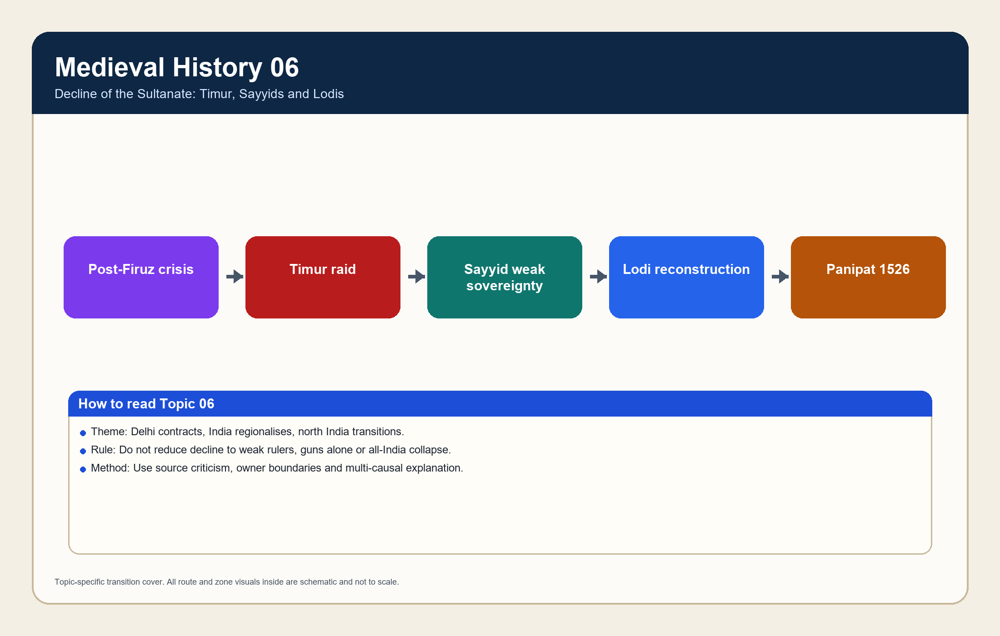

> **Subject:** Medieval Indian History | **Topic:** 06 | **Export date:** 2026-08-16
>
> **Approval:** false - awaiting explicit user approval.
>
> **Source order:** repository Markdown -> local OCR-searchable Satish Chandra concise volume, Part I Sultanate chapters, and Part II Babur-Panipat chapter -> bounded repository source-bank on administration, architecture and Babur -> no forced current-affairs insert -> Qdrant not used.
>
> **Tag rule:** [FACT] source-grounded statement; [ANALYSIS] evidence-led synthesis; [DEBATE] historiographical disagreement or source-method caution; [LIMIT] evidentiary, numerical, geographical or attribution qualification.

## BASIC LEARNING SESSION

### DEEP-REVIEW LEARNING CONTRACT

| Control | Binding rule for this package |
|---|---|
| Syllabus boundary | Complete Medieval History Core is taught before optional enrichment. |
| Evidence method | Claim → named site/text/inscription/coin/example → analysis → qualification. |
| Source hierarchy | Archaeology, textual testimony, inscriptions, coins and scholarly interpretation remain visibly distinct. |
| Contested issues | Competing interpretations are attributed, evidenced and bounded; certainty is not manufactured. |
| Practice contract | Every solved item has demand decoding, an examiner-grade model, an executable answer/compression plan, marks rationale and answer-specific improvement. |
| Approval | This immutable successor remains `approved: false` pending explicit approval. |

**Canonical Basic/Core owner:** `upsc-ai-kit\knowledge\Medieval-Indian-History\basic\06_Decline-Sayyids-Lodis-Timur.md`  
**Canonical topic owner:** `upsc-ai-kit\knowledge\Medieval-Indian-History\basic\06_Decline-Sayyids-Lodis-Timur.md`  
**Optional Advanced owner:** `upsc-ai-kit\knowledge\Medieval-Indian-History\advanced\06_Decline-Sayyids-Lodis-Timur.md`  
**Official syllabus mapping:** `upsc-ai-kit\knowledge\Medieval-Indian-History\OFFICIAL-UPSC-SYLLABUS-MAPPING.md`

### EVIDENCE, PYQ AND CURRENT-STATUS CONTROL

- **Archaeological inference:** material context supports bounded reconstruction; absence is not automatic proof of non-existence.
- **Textual testimony:** genre, authorship, redaction, patronage and temporal distance control what a text can prove.
- **Inscription and coin evidence:** contemporary names, titles, claims and circulation are powerful but do not by themselves map uniform territorial control.
- **Scholarly interpretation:** historian labels are arguments to test, not facts to memorise without evidence.
- **PYQ discipline:** repository ledgers and locally held official papers control wording and metadata; reconstructed wording and unavailable official keys must be labelled.
- **Current-status note, rechecked 2026-09-03:** The Archaeological Survey of India's Qutb Minar page was rechecked on 30 August 2026. It records a repair by Sikandar Lodi as part of a long material sequence extending beyond the early Sultanate builders. The linkage is useful for teaching Lodi restoration, monument afterlives and evidence limits; it does not prove the territorial reach or administrative effectiveness of the Lodi state.

**Live/primary context sources recorded by the predecessor generation:**

- `https://asi.nic.in/pages/WorldHeritageQutbMinar`

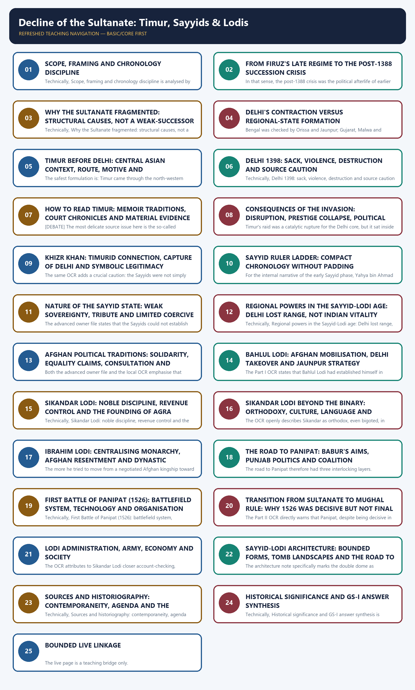

*Distinct embedded teaching-navigation image. The separate continuous Cārvāka-style flowchart package remains an independent at-a-glance artifact.*

#### Package counts, provenance and honest limitations

- Learning sections: 24; learning MCQ loops: 16.
- Workbook content: 4 verified or honestly-adjacent PYQs; 32 Workbook MCQs with integrated remediation map; 6 original solved Mains questions; final register modules: 10.
- Original PNG visuals: 25 total - 24 body visuals plus 1 topic-specific cover visual. All route diagrams and political maps are schematic and not to scale.
- Repository sources used most heavily: Topic 06 basic and advanced owners; bounded Topics 05, 07, 08, 11, 12 and 13; `README.md`; `00_Master-Chronology.md`; `REVISION-CHART_Ages-Eras-and-Distinctive-Features.md`; `ANSWER-WORTHINESS-AUDIT.md`; PYQ integration audits; the already-generated Medieval 04 and 05 packages for house style and overlap control.
- OCR evidence used most heavily from Satish Chandra's *History of Medieval India* sections on the disintegration of the Delhi Sultanate and north India in the fifteenth century, from *Medieval India: From Sultanat to the Mughals, Part I* chapter "India and a System of Balance of Power: Rise of Regional Kingdoms in North India", and from Part II chapter "Central Asian Politics and the Advance of Babur towards India".
- [LIMIT] Local OCR is strong on the structural breakdown, Jaunpur-Lodi politics, Sikandar's administration and Panipat tactics, but thinner on the internal micro-chronology of every Sayyid campaign. Accordingly, the Sayyid section keeps the ruler-ladder compact, avoids inflated campaign narrative, and flags symbolic legitimacy claims carefully.
- [LIMIT] Timur's violence is described with source caution. Timurid and later chronicles often provide dramatic killing, captive and booty numbers; these are treated as **reported claims**, not verified demographic totals.
- [LIMIT] The package does **not** describe "decline" as a single moral collapse caused by weak rulers. It treats 1388-1526 as a transition shaped by succession disorder, fiscal-military strain, regional agrarian bases, elite bargaining, Delhi's contraction, and the military-political opening exploited by Babur.
- [LIMIT] Topic 06 owns the post-Firuz breakdown, Timur's 1398 raid, Sayyid weak sovereignty, Lodi Afghan state-building, Panipat as the terminal transition from Sultanate to Mughal rule, and the source-historiography debates attached to that arc. Full ownership of Bengal/Gujarat/Malwa/Jaunpur/Kashmir remains with Topic 08, Bahmani-Vijayanagara with Topic 09, full Sultanate architectural form with Topic 11, Babur's Central Asian background with Topic 12, and the longer Afghan-Mughal struggle after 1526 with Topic 13.

#### Sources actually used

| Source class | Exact source | Use and caveat |
|---|---|---|
| Repository knowledge | Topic 06 basic and advanced owners; bounded Topics 05, 07, 08, 11, 12 and 13; Medieval README; Master Chronology; Revision Chart; Answer-Worthiness Audit; prior complete packages for Topics 04 and 05; PYQ integration audits and local paper OCRs. | Controlled chronology, owner boundaries, battle-date caution, institutional vocabulary, source-bank discipline and overlap reduction. |
| Local book | Satish Chandra, *History of Medieval India*, searchable OCR around the decline/disintegration chapter and the fifteenth-century north-India chapter (printed pp. 116-128, 175-189 in the local OCR flow). | Core evidence for post-Firuz weakness, Timur's raid as plundering incursion, the balance-of-power frame, Bahlul's Roh mobilisation, Sikandar's administration, orthodoxy and Agra foundation. |
| Local book | Satish Chandra, *Medieval India: From Sultanat to the Mughals, Part I*, searchable OCR around the regional-kingdom chapter and architecture sections. | Deeper evidence for the regionalisation thesis, Khizr Khan's Timurid link, Sharqi significance, Afghan political culture, and Lodi-state recovery in north India. |
| Local book | Satish Chandra, *Medieval India: From Sultanat to the Mughals, Part II*, chapter on Babur's advance to India and Panipat. | Core evidence for Ibrahim Lodi's noble crisis, Daulat Khan and Alam Khan, Babur's Punjab struggle, Panipat tactics, unreliable number tradition and the non-instant character of Mughal consolidation. |
| Source-bank / material evidence | Topic 07's Persian-source matrix; Topic 11/Art-Culture architecture notes; coins/inscriptions/monument survivals used through repository syntheses. | Allowed cautious treatment of *Baburnama*, Timurid memoir traditions, Afghan later histories and Lodi tomb architecture without inflating any one textual genre into transparent fact. |
| Live source | None required for completion. | Architecture and chronology were adequately grounded in repository files and OCR-searchable books; no decorative current-affairs or unsourced monument trivia was forced into the package. |

#### Original visual asset index

- `notes/Medieval-Indian-History/assets/06_Decline-of-the-Sultanate-Timur-Sayyids-Lodis/00_transition_cover_delhi_to_panipat.png`
- `notes/Medieval-Indian-History/assets/06_Decline-of-the-Sultanate-Timur-Sayyids-Lodis/01_1388_1526_chronology_evidence_spine.png`
- `notes/Medieval-Indian-History/assets/06_Decline-of-the-Sultanate-Timur-Sayyids-Lodis/02_structural_fragmentation_causal_web.png`
- `notes/Medieval-Indian-History/assets/06_Decline-of-the-Sultanate-Timur-Sayyids-Lodis/03_delhi_contraction_regional_state_formation.png`
- `notes/Medieval-Indian-History/assets/06_Decline-of-the-Sultanate-Timur-Sayyids-Lodis/04_late_tughlaq_succession_faction_flow.png`
- `notes/Medieval-Indian-History/assets/06_Decline-of-the-Sultanate-Timur-Sayyids-Lodis/05_timur_route_raid_withdrawal_schematic.png`
- `notes/Medieval-Indian-History/assets/06_Decline-of-the-Sultanate-Timur-Sayyids-Lodis/06_timur_motives_claims_evidence_matrix.png`
- `notes/Medieval-Indian-History/assets/06_Decline-of-the-Sultanate-Timur-Sayyids-Lodis/07_sack_consequence_recovery_timeline.png`
- `notes/Medieval-Indian-History/assets/06_Decline-of-the-Sultanate-Timur-Sayyids-Lodis/08_timur_source_criticism_matrix.png`
- `notes/Medieval-Indian-History/assets/06_Decline-of-the-Sultanate-Timur-Sayyids-Lodis/09_sayyid_ruler_ladder_territorial_reach.png`
- `notes/Medieval-Indian-History/assets/06_Decline-of-the-Sultanate-Timur-Sayyids-Lodis/10_sayyid_weak_sovereignty_tribute_network.png`
- `notes/Medieval-Indian-History/assets/06_Decline-of-the-Sultanate-Timur-Sayyids-Lodis/11_khizr_khan_timurid_legitimacy_chain.png`
- `notes/Medieval-Indian-History/assets/06_Decline-of-the-Sultanate-Timur-Sayyids-Lodis/12_afghan_political_tradition_claims_cautions.png`
- `notes/Medieval-Indian-History/assets/06_Decline-of-the-Sultanate-Timur-Sayyids-Lodis/13_bahlul_consolidation_jaunpur_flow.png`
- `notes/Medieval-Indian-History/assets/06_Decline-of-the-Sultanate-Timur-Sayyids-Lodis/14_sikandar_centralisation_agra_revenue_matrix.png`
- `notes/Medieval-Indian-History/assets/06_Decline-of-the-Sultanate-Timur-Sayyids-Lodis/15_ibrahim_noble_conflict_causal_chain.png`
- `notes/Medieval-Indian-History/assets/06_Decline-of-the-Sultanate-Timur-Sayyids-Lodis/16_road_to_panipat_coalition_network.png`
- `notes/Medieval-Indian-History/assets/06_Decline-of-the-Sultanate-Timur-Sayyids-Lodis/17_panipat_battlefield_system.png`
- `notes/Medieval-Indian-History/assets/06_Decline-of-the-Sultanate-Timur-Sayyids-Lodis/18_why_babur_won_multicausal_matrix.png`
- `notes/Medieval-Indian-History/assets/06_Decline-of-the-Sultanate-Timur-Sayyids-Lodis/19_continuity_after_1526_matrix.png`
- `notes/Medieval-Indian-History/assets/06_Decline-of-the-Sultanate-Timur-Sayyids-Lodis/20_economy_recovery_vs_fragmentation.png`
- `notes/Medieval-Indian-History/assets/06_Decline-of-the-Sultanate-Timur-Sayyids-Lodis/21_sayyid_lodi_architecture_comparison.png`
- `notes/Medieval-Indian-History/assets/06_Decline-of-the-Sultanate-Timur-Sayyids-Lodis/22_source_contemporaneity_agenda_matrix.png`
- `notes/Medieval-Indian-History/assets/06_Decline-of-the-Sultanate-Timur-Sayyids-Lodis/23_historiography_ladder.png`
- `notes/Medieval-Indian-History/assets/06_Decline-of-the-Sultanate-Timur-Sayyids-Lodis/24_gs1_answer_spine.png`

### SESSION 1 — SCOPE, FRAMING AND CHRONOLOGY DISCIPLINE

#### DEFINITION / WHAT THIS IS CALLED

**Plain-language definition:** The exam-safe framing is regionalisation plus fiscal-military transition, not a schoolbook morality tale about weak rulers alone.

**Technical definition:** Technically, Topic 06 studies the transition from late-Tughlaq fragmentation to Babur's victory by tracking structural weakness, Timurid shock, Sayyid weak sovereignty, Lodi reconstruction and the limited meaning of 1526.

#### ANSWER-GRABBING OPENING — WRITE/ADAPT IN THE EXAM

> The exam-safe framing is regionalisation plus fiscal-military transition, not a schoolbook morality tale about weak rulers alone.

#### MUST-WRITE KEYWORDS

- **1388 succession crisis**
- **Timur 1398**
- **Sayyids 1414-1451**
- **Lodis 1451-1526**
- **Panipat 1526**
- **transition-not-collapse**

**How to use them:** Begin with the 1388 succession crisis, place Timur 1398 as the catalytic shock, treat the Sayyids (1414-1451) as weak survival, the Lodis (1451-1526) as reconstruction, and end with Panipat 1526 as transition-not-collapse.

[FACT] Topic 06 begins with the **post-1388 breakdown after Firuz Shah Tughlaq** and runs to the **First Battle of Panipat (1526)**. It explains how Delhi's contracting authority, regional state formation, Timur's raid, Sayyid weak sovereignty and Lodi Afghan state-building together created the transition from late Sultanate to early Mughal rule.

[ANALYSIS] The exam-safe framing is **regionalisation plus fiscal-military transition**, not a schoolbook morality tale about weak rulers alone. Between 1388 and 1526, Delhi unquestionably weakened; yet Bengal, Gujarat, Malwa, Jaunpur, Kashmir, Bahmani and Vijayanagara politics remained vigorous. The political centre shrank, but north India did **not** become a civilisational vacuum.

[DEBATE] "Decline" is still a useful term if handled carefully. It accurately captures the shrinking coercive reach of Delhi, the prestige loss of the sultanate throne, and the final replacement of Lodi rule by Babur. It becomes misleading when it is made to mean a total Indian collapse, an uninterrupted economic death, or a single-cause story.

[LIMIT] Timur's 1398 assault must not be called the conquest of all India. Babur's 1526 victory must not be called the instant establishment of secure Mughal rule over India. Both are turning points, but both require geographical and political boundaries.

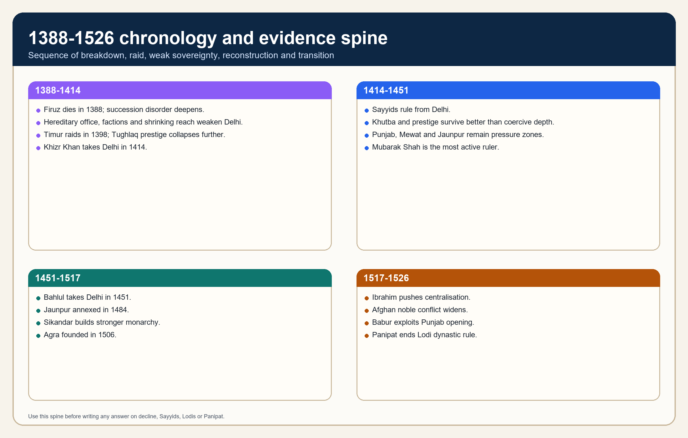

*Chronology visual. It separates Tughlaq breakdown, Timur's raid, Sayyid weak sovereignty, Lodi recovery and Panipat so that transition is not mistaken for one event.*

#### Topic ownership firewall

| Owner | What remains primarily there | What Topic 06 legitimately uses |
|---|---|---|
| Topic 05 - Tughlaqs | Muhammad bin Tughlaq, Firuz Shah, heredity, canals, public works and the immediate late-Tughlaq weakening | Only the **post-1388 succession bridge** needed to explain why Timur met a vulnerable Delhi |
| Topic 08 - Regional kingdoms | Full histories of Bengal, Gujarat, Malwa, Jaunpur and Kashmir | Only brief owner-boundary sketches proving that Delhi's contraction was not India-wide collapse |
| Topic 09 - Vijayanagara and Bahmani | Detailed Deccan state formation | Only bounded use to show that Deccan politics had moved beyond Delhi's command horizon |
| Topic 11 - Sultanate art and architecture | Full formal analysis of Sultanate styles and regional schools | Only bounded use of Sayyid-Lodi tomb types, garden settings, platforms and the double-dome transition |
| Topic 12 - Babur and Central Asian backdrop | Full Central Asian politics and Babur's earlier career | Only the Panipat-facing background necessary to explain the Lodi-Mughal military-political transition |
| Topic 13 - Humayun, Afghans and Rajputs after 1526 | Post-Panipat Afghan resistance, Sur challenge and the longer struggle for empire | Only the immediate non-finality of 1526 as a caution against instant-conquest narratives |

#### Governing thesis

- [ANALYSIS] The Delhi Sultanate fragmented because succession, provincial control, agrarian extraction, army upkeep and elite cohesion were not stabilised institutionally enough to survive repeated shocks.
- [ANALYSIS] Timur's 1398 raid accelerated that breakdown dramatically, but the raid struck a polity already thinned by hereditary office, factionalism and provincial autonomy.
- [ANALYSIS] The Sayyids preserved the **symbol** of Delhi more than its broad coercive capacity; the Lodis rebuilt a stronger north-Indian monarchy, but Afghan elite politics made centralisation difficult.
- [ANALYSIS] Panipat mattered because Babur combined generalship, field fortification, tulughma manoeuvre, matchlocks/artillery and a more coherent war-system against a larger but politically strained Lodi force.

#### PARAGRAPH DEMONSTRATION — CLAIM → EVIDENCE → ANALYSIS → QUALIFICATION

**Claim:** Topic 06 is a transition question, not a last-dynasty obituary. **Named evidence/example:** the sequence runs from the post-1388 Tughlaq crisis to Timur's 1398 raid, Khizr Khan's Delhi recovery in 1414, Bahlul's Lodi accession in 1451, Sikandar's Agra-centred reconstruction, and Panipat in 1526. **Analysis:** arranged in that order, the topic shows internal weakness, external shock, weak symbolic survival, partial state rebuilding and then a dynastic break under Babur. **Qualification:** Delhi's contraction did not mean that all of India collapsed, and Panipat did not instantly produce an uncontested Mughal empire.

#### CLOSING RECALL FLOW — SCOPE, FRAMING AND CHRONOLOGY DISCIPLINE

```text
START / CONCEPT: scope, framing and chronology discipline
        |
        v
EXACT TERMS: 1388 succession crisis · Timur 1398 · Sayyids 1414-1451 · Lodis 1451-1526 · Panipat 1526 · transition-not-collapse
        |
        v
MECHANISM / ARGUMENT: The topic works as a long transition: late-Tughlaq fragmentation created the weakness, Timur intensified the shock, the Sayyids preserved Delhi under limited sovereignty, and the Lodis rebuilt power before Panipat broke their dynasty.
        |
        v
CONSEQUENCE / CONTRAST: The period therefore links decline, regional resilience and reconstruction instead of presenting 1388-1526 as a single downward slide.
        |
        v
UPSC TRAP / ANSWER-USE: Do not narrate this topic as 'Delhi fell, then Mughals came'; the intervening Sayyid-Lodi century is the analytical core.
        |
        v
ANSWER-GRABBING FORMULATION: From 1388 to 1526, north India moved through fragmentation, raid, negotiated survival and partial reconstruction before Babur converted Lodi fracture into dynastic replacement.
```
### SESSION 2 — FROM FIRUZ'S LATE REGIME TO THE POST-1388 SUCCESSION CRISIS

#### DEFINITION / WHAT THIS IS CALLED

**Plain-language definition:** The famous quip that the dominion of the "Lord of the Universe" extended only from Delhi to Palam captures prestige loss, even if its exact phrasing is literary.

**Technical definition:** In that sense, the post-1388 crisis was the political afterlife of earlier over-extension as much as of Firuz's conciliation.

#### ANSWER-GRABBING OPENING — WRITE/ADAPT IN THE EXAM

> The famous quip that the dominion of the "Lord of the Universe" extended only from Delhi to Palam captures prestige loss, even if its exact phrasing is literary.

#### MUST-WRITE KEYWORDS

- **from Delhi to Palam**
- **Hereditary offices and iqtas**
- **Army relaxation**
- **Slave corps and faction**
- **Provincial assertion**
- **Prestige collapse**

**How to use them:** Define hereditary office first, then connect succession crisis after 1388, elite faction, shrinking central discipline and the 'Delhi to Palam' trope to show how Firuz's late arrangements fed fragmentation.

[FACT] The local OCR and Topic 05 together make the structural bridge clear. Firuz Shah's concessions - hereditary offices, hereditary military claims, and softening of central checks - purchased short-term peace but strengthened nobles and weakened the disciplined military-fiscal core. After his death in **1388**, ambitious princes, nobles, provincial commanders and slave factions intervened in succession.

[FACT] Satish Chandra's concise text says the governors of provinces became independent and that the sultan of Delhi was gradually confined to a small territory around Delhi. The famous quip that the dominion of the "Lord of the Universe" extended only **from Delhi to Palam** captures prestige loss, even if its exact phrasing is literary.

[ANALYSIS] This was not a one-dimensional court quarrel. Four processes overlapped: **(1)** rival claimants at the centre, **(2)** a nobility whose corporate strength had grown, **(3)** provincial elites and zamindars withholding obedience, and **(4)** a thinner military instrument unable to restore control quickly.

[DEBATE] The late-Tughlaq crisis must also be read against the geography of rule. The larger the earlier conquests, the more difficult it became to maintain direct command over distant governors once the centre looked weak. In that sense, the post-1388 crisis was the political afterlife of earlier over-extension as much as of Firuz's conciliation.

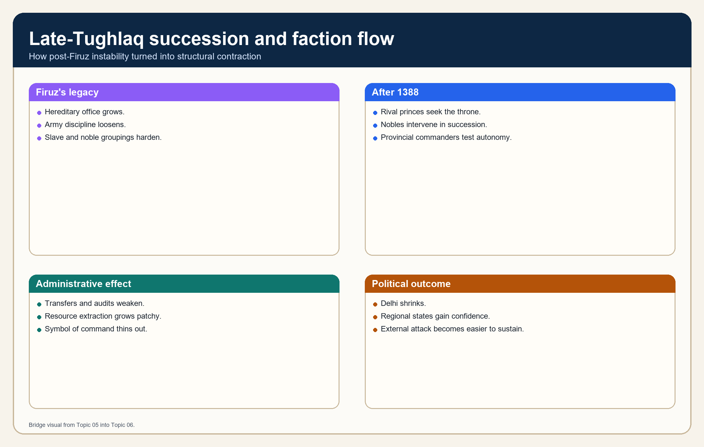

*Succession-flow visual. It tracks how hereditary office, weak succession law, nobles, slaves and provincial autonomy converted late-Tughlaq instability into a general political contraction.*

#### Secure bridge points from Topic 05

| Bridge point | Secure statement | Why Topic 06 needs it |
|---|---|---|
| Hereditary offices and iqtas | [FACT] Firuz's regime strengthened hereditary claims in service and office | Explains why post-1388 nobles and service families were harder to discipline |
| Army relaxation | [FACT] The army became less efficient and more localised | Explains why Delhi could not answer every provincial or external threat |
| Slave corps and faction | [FACT] The Firuzi slave establishment became a political force | Shows that succession disorder had institutional carriers, not only personal intrigue |
| Provincial assertion | [FACT] Governors and local rulers stopped behaving as tightly controlled subordinates | Bridges directly to Gujarat, Malwa, Jaunpur and Punjab autonomy |
| Prestige collapse | [FACT] The throne's aura shrank sharply before Timur arrived | Separates internal weakening from the external blow |

#### PARAGRAPH DEMONSTRATION — CLAIM → EVIDENCE → ANALYSIS → QUALIFICATION

**Claim:** The crisis after Firuz Shah cannot be reduced to one bad successor. **Named evidence/example:** Topic 06 ties the post-1388 disorder to hereditary offices, strengthened service families, slave and noble factions, and shrinking central command famously captured by the 'Delhi to Palam' trope. **Analysis:** the real point is institutional: once office, military resources and local power clustered around entrenched elites, succession conflict became harder to contain. **Qualification:** the trope is rhetorical rather than a survey map, so it should be used to indicate contraction of authority and prestige, not literal territorial measurement.

#### CLOSING RECALL FLOW — FROM FIRUZ'S LATE REGIME TO THE POST-1388 SUCCESSION CRISIS

```text
START / CONCEPT: from firuz's late regime to the post-1388 succession crisis
        |
        v
EXACT TERMS: from Delhi to Palam · Hereditary offices and iqtas · Army relaxation · Slave corps and faction · Provincial assertion · Prestige collapse
        |
        v
MECHANISM / ARGUMENT: Hereditary office, factional competition and weakened central discipline made every succession dispute after Firuz more dangerous than a simple court quarrel.
        |
        v
CONSEQUENCE / CONTRAST: That is why the post-Firuz crisis fed provincial assertion instead of producing a quick return to strong monarchy.
        |
        v
UPSC TRAP / ANSWER-USE: Do not quote 'Delhi to Palam' as if it were a measured frontier line; it is a literary image of contraction and humiliation.
        |
        v
ANSWER-GRABBING FORMULATION: Late-Tughlaq weakness lay not only in poor succession but in the erosion of the centre's capacity to reshuffle, punish and command its own elite machinery.
```
### SESSION 3 — WHY THE SULTANATE FRAGMENTED: STRUCTURAL CAUSES, NOT A WEAK-SUCCESSOR CLICHÉ

#### DEFINITION / WHAT THIS IS CALLED

**Plain-language definition:** Structural fragmentation means Delhi's authority broke into competing power-centres because succession rules were open, elite factions were strong, resources were stretched and provinces had their own political bases.

**Technical definition:** Technically, fragmentation arose where open succession, elite-resource control, communication limits and regional agrarian bases made each political shock harder for the centre to absorb.

#### ANSWER-GRABBING OPENING — WRITE/ADAPT IN THE EXAM

> The Sultanate was vulnerable because succession remained open, iqta extraction depended on supervision, cavalry and fort maintenance were expensive, communications were slow, climate and ecology varied sharply by region, and regional agrarian-commercial bases could sustain ambitious local powers once the centre faltered.

#### MUST-WRITE KEYWORDS

- **open succession**
- **elite faction**
- **fiscal-military strain**
- **provincial autonomy**
- **communication limits**
- **regional agrarian bases**

**How to use them:** Deploy these keywords as linked causes: show how succession, elite power, money, distance and provincial resource-bases reinforced one another.

[FACT] The concise history explicitly refuses to blame any one ruler alone for the disintegration of the Delhi Sultanate. It highlights recurring medieval problems: relations between monarch and nobles, conflict with local rulers and zamindars, and the pull of regional and geographical factors.

[ANALYSIS] Topic 06 therefore needs a **multi-causal matrix**, not a moral fable. The Sultanate was vulnerable because succession remained open, iqta extraction depended on supervision, cavalry and fort maintenance were expensive, communications were slow, climate and ecology varied sharply by region, and regional agrarian-commercial bases could sustain ambitious local powers once the centre faltered.

[ANALYSIS] Military organisation also mattered. A Delhi-centred monarchy needed a dependable cash or assignment system, mobile cavalry, command loyalty and information flow. When noble cohesion weakened and provincial commanders began treating their tracts as personal power-bases, Delhi's ability to aggregate force declined faster than its ideological claims.

[DEBATE] "Weak successors" is therefore an incomplete answer. It identifies the immediate political symptom but obscures the deeper conditions that made succession weakness repeatedly devastating. UPSC rewards the student who moves from personality to **institutional vulnerability**.

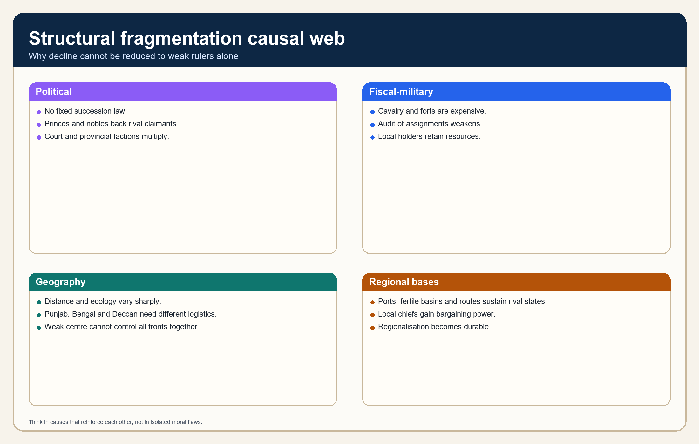

*Causal-web visual. It treats succession, fiscal strain, military organisation, communication, agrarian bases and elite conflict as linked causes rather than as competing single explanations.*

#### Structural matrix

| Structural pressure | Mechanism | Political effect | Exam-safe caution |
|---|---|---|---|
| Succession ambiguity | No fixed law of primogeniture; noble backing mattered | Rival claimants and repeated civil war | Do not reduce this to "bad sons" alone |
| Noble and iqta autonomy | Strong muqtis, jagirdars and office-holding families retained resources locally | Centre found it harder to audit and transfer officials | Iqta strain varied by region and ruler |
| Fiscal-military burden | Cavalry, forts, communication and urban provisioning were expensive | Army discipline and central response capacity weakened | Not every fiscal problem was immediate collapse |
| Ecological and distance factors | Bengal, Deccan, Punjab and Rajasthan posed different logistics | Provinces could detach once centre weakened | Geography explains resilience, not inevitability |
| Regional agrarian-commercial bases | Ports, routes, fertile basins and urban nodes supported alternative courts | Provincial kingdoms became durable, not merely rebellious | Durability differed across states |
| Elite coalition failure | Turks, Indian Muslims, Afghans, converts, local allies and old nobles did not act as one bloc | Internal distrust magnified every crisis | Avoid racial or timeless cultural stereotypes |

#### PARAGRAPH DEMONSTRATION — CLAIM → EVIDENCE → ANALYSIS → QUALIFICATION

**Claim:** The Sultanate's weakening after Firuz was structural rather than accidental. **Named evidence/example:** Topic 06 identifies open succession, powerful service elites, fiscal-military strain, communication difficulty and strong provincial agrarian bases. **Analysis:** each factor multiplied the others: nobles used resources to bargain harder, provinces became more self-sustaining, and the centre struggled to move men and revenue quickly enough to reimpose discipline. **Qualification:** this does not mean that institutions disappeared overnight; it means they became harder to coordinate across distance and faction.

#### CLOSING RECALL FLOW — WHY THE SULTANATE FRAGMENTED: STRUCTURAL CAUSES, NOT A WEAK-SUCCESSOR CLICHÉ

```text
START / CONCEPT: why the sultanate fragmented: structural causes, not a weak-successor cliché
        |
        v
EXACT TERMS: open succession · elite faction · fiscal-military strain · provincial autonomy · communication limits · regional agrarian bases
        |
        v
MECHANISM / ARGUMENT: Succession disorder mattered because it operated inside a system already strained by factional elites, revenue limits and long communication lines.
        |
        v
CONSEQUENCE / CONTRAST: The result was not instant administrative evaporation, but a steady fall in the centre's ability to command loyalty, money and armed service at scale.
        |
        v
UPSC TRAP / ANSWER-USE: Do not isolate one cause and call the topic solved; Topic 06 requires a genuinely multi-causal explanation.
        |
        v
ANSWER-GRABBING FORMULATION: Fragmentation became structural when dynastic contest, elite bargaining and fiscal-geographical limits fed each other instead of being contained by the centre.
```
### SESSION 4 — DELHI'S CONTRACTION VERSUS REGIONAL-STATE FORMATION

#### DEFINITION / WHAT THIS IS CALLED

**Plain-language definition:** Topic 06 uses this not to deny Delhi's crisis, but to place it within a wider subcontinental redistribution of power.

**Technical definition:** Bengal was checked by Orissa and Jaunpur; Gujarat, Malwa and Mewar balanced one another; Kashmir remained somewhat aloof; and the rise of the Lodis at Delhi later produced a drawn-out contest with Jaunpur for control of the Ganga-Jamuna doab.

#### ANSWER-GRABBING OPENING — WRITE/ADAPT IN THE EXAM

> Topic 06 uses this not to deny Delhi's crisis, but to place it within a wider subcontinental redistribution of power.

#### MUST-WRITE KEYWORDS

- **Delhi's contraction versus regional-state formation**
- **balance of power**
- **regional vitality**
- **Bengal**
- **Topic 08**
- **Gujarat**

**How to use them:** Start with Delhi's contraction, then place Bengal, Gujarat, Malwa, Jaunpur and other regional courts around it to prove regional-state formation rather than political vacuum.

[FACT] The Part I chapter opens with a direct warning: it would be wrong to treat the fifteenth century simply as a period of decadence and decline. The various states rarely extended beyond their broad regional zones, and a definite **balance of power** emerged among the eastern, western and northern groups.

[FACT] Bengal was checked by Orissa and Jaunpur; Gujarat, Malwa and Mewar balanced one another; Kashmir remained somewhat aloof; and the rise of the Lodis at Delhi later produced a drawn-out contest with Jaunpur for control of the Ganga-Jamuna doab. Delhi's loss of empire therefore did not mean the end of organised politics in India.

[ANALYSIS] This is the core corrective to simplistic "decline" writing. Delhi contracted. But trade, patronage, court culture, architecture, agrarian expansion and military competition continued - often intensely - in the regional kingdoms. Topic 06 uses this not to deny Delhi's crisis, but to place it within a wider subcontinental redistribution of power.

[LIMIT] Owner-boundary discipline matters. Topic 06 uses Bengal, Gujarat, Malwa, Jaunpur, Kashmir, Bahmani and Vijayanagara only to prove the argument about **regional vitality**. Their internal political narratives stay chiefly with Topics 08 and 09.

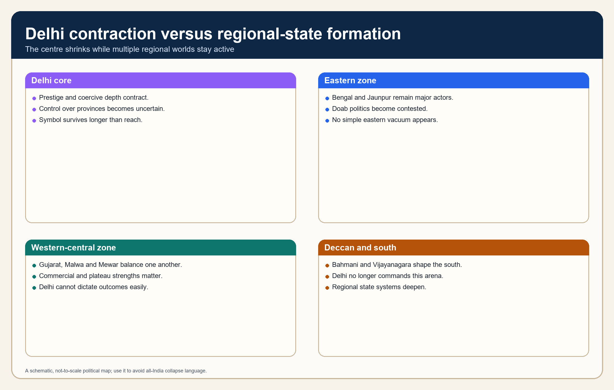

*Schematic map visual. It distinguishes Delhi's contracting core from regional-state formation, showing balance-of-power zones rather than hard modern borders.*

#### Brief regional-owner matrix

| Region / polity | Why Topic 06 needs it | Exam-safe takeaway | Detailed owner |
|---|---|---|---|
| Bengal | Shows ecological autonomy and durable eastern state formation | Delhi's crisis did not stop prosperity or cultural patronage in the east | Topic 08 |
| Gujarat | Shows commercial power, port wealth and west-coast resilience | Political contraction at Delhi coexisted with powerful mercantile states | Topic 08 |
| Malwa | Shows the centrality of plateau routes and north-India strategic competition | Whoever influenced Malwa moved closer to north-Indian hegemony | Topic 08 |
| Jaunpur | Shows eastern-Ganga state formation and cultural prestige | Sharqi Jaunpur was a real competitor, not a footnote | Topic 08 |
| Kashmir | Shows a partially separate valley polity with its own shifts | Delhi's collapse did not define every northern story | Topic 08 |
| Bahmani / Vijayanagara | Show southern political worlds no longer governed by Delhi | Delhi's decline was partly the backdrop to new Deccan state systems | Topic 09 |

#### PARAGRAPH DEMONSTRATION — CLAIM → EVIDENCE → ANALYSIS → QUALIFICATION

**Claim:** Fifteenth-century north India was not a political vacuum. **Named evidence/example:** Topic 06 keeps Bengal, Gujarat, Malwa, Jaunpur, Mewar, Mewat and Punjab/Khokhar politics in view while Delhi weakens. **Analysis:** that comparative framing prevents the answer from becoming Delhi-centric collapse literature; it shows power redistributed across multiple centres with their own courts, agrarian bases and military competition. **Qualification:** the point is not that Delhi became irrelevant, but that its weakening must be read within a wider balance-of-power system.

#### CLOSING RECALL FLOW — DELHI'S CONTRACTION VERSUS REGIONAL-STATE FORMATION

```text
START / CONCEPT: delhi's contraction versus regional-state formation
        |
        v
EXACT TERMS: Delhi's contraction versus regional-state formation · balance of power · regional vitality · Bengal · Topic 08 · Gujarat
        |
        v
MECHANISM / ARGUMENT: As Delhi's command contracted, other regional states hardened into durable centres of patronage, taxation and warfare.
        |
        v
CONSEQUENCE / CONTRAST: This regional vitality explains why the fifteenth century must be described as political redistribution rather than India-wide death.
        |
        v
UPSC TRAP / ANSWER-USE: Do not write 'after Delhi declined, no serious state remained'—that directly contradicts the topic's regional-state framing.
        |
        v
ANSWER-GRABBING FORMULATION: The century after late-Tughlaq weakening is best read as a rebalanced political map, not as a blank interval between Delhi and the Mughals.
```
### SESSION 5 — TIMUR BEFORE DELHI: CENTRAL ASIAN CONTEXT, ROUTE, MOTIVE AND SELF-JUSTIFICATION

#### DEFINITION / WHAT THIS IS CALLED

**Plain-language definition:** The local books are firm on motive at the broadest level: the Indian incursion was a plundering raid aimed at seizing the wealth accumulated by the Delhi sultans over roughly two centuries.

**Technical definition:** The safest formulation is: Timur came through the north-western corridor, crossed the Indus into Punjab, moved through the upper north-western towns toward Delhi, attacked the capital, and withdrew with booty, captives and symbolic arrangements left behind.

#### ANSWER-GRABBING OPENING — WRITE/ADAPT IN THE EXAM

> The local books are firm on motive at the broadest level: the Indian incursion was a plundering raid aimed at seizing the wealth accumulated by the Delhi sultans over roughly two centuries.

#### MUST-WRITE KEYWORDS

- **Timur before Delhi**
- **Central Asian context**
- **route**
- **motive**
- **self-justification**
- **plundering raid**

**How to use them:** Use the route and motive terms together so Timur appears as a north-western raider with strategic and prestige aims, not as a settled Indian sovereign.

[FACT] The concise history describes Timur as a Turk who could claim blood relationship with Chinggis and who, from **1370**, built a vast empire from Syria to Trans-Oxiana and from southern Russia to the Indus. India was one theatre in a much wider imperial career.

[FACT] The local books are firm on motive at the broadest level: the Indian incursion was a **plundering raid** aimed at seizing the wealth accumulated by the Delhi sultans over roughly two centuries. This does not mean self-justification was absent. Timurid tradition also clothed the invasion in the language of righteous war, punishment of disorder and Islamic legitimacy.

[ANALYSIS] A safe UPSC answer therefore separates **stated justification** from **operative motive**. In memoir-like or courtly traditions, Timur presents himself as a restorer of order and religion. But the secure historical reading is that he exploited an already weakened Delhi, sought portable wealth, prestige, captives and skilled artisans, and had no intention of administering all India as a settled conquest.

[LIMIT] Route details should be kept to secure nodes unless specifically sourced. The safest formulation is: Timur came through the **north-western corridor, crossed the Indus into Punjab, moved through the upper north-western towns toward Delhi, attacked the capital, and withdrew with booty, captives and symbolic arrangements left behind**.

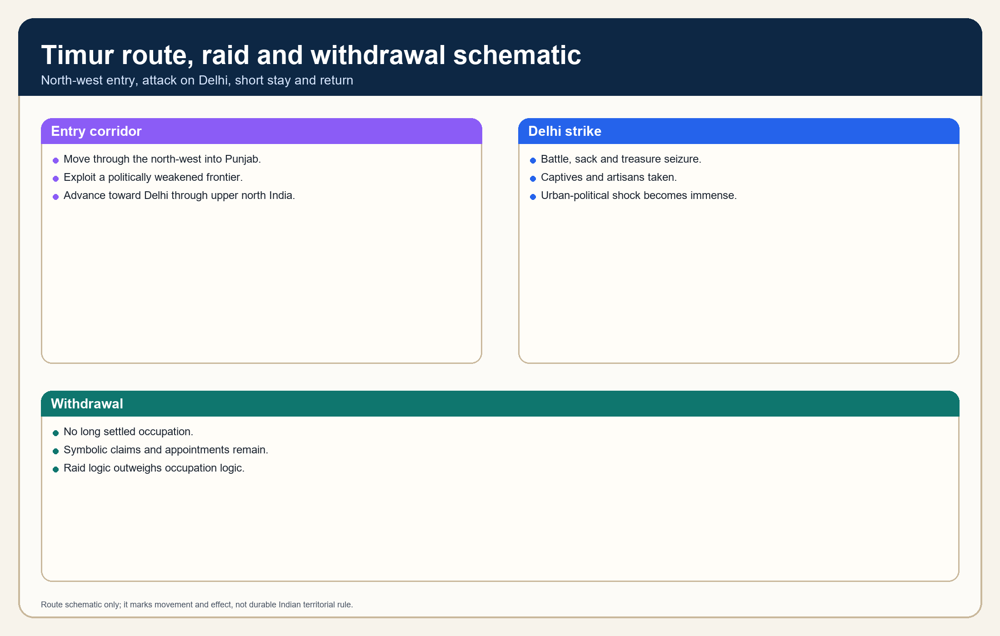

*Route schematic. It marks movement through the north-west corridor into Punjab and Delhi, then withdrawal with booty and captives. It is not a territorial map of rule over all India.*

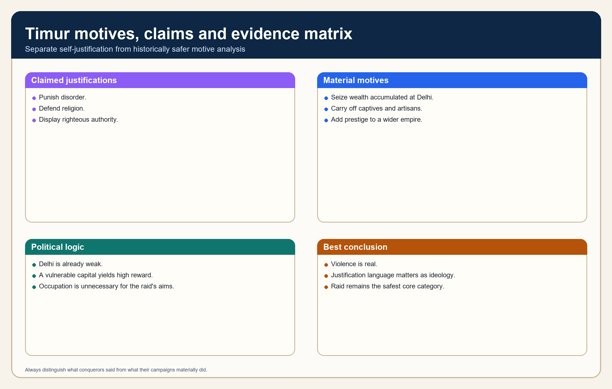

*Motives matrix. It separates Timurid justification language from the historically safer reading of raid, plunder, prestige and political exploitation.*

#### Claims versus motives table

| Layer | Secure minimum | Why it matters |
|---|---|---|
| Timurid self-presentation | [FACT] Language of order, piety and punishment appears in later Timurid narrative traditions | Shows how conquerors justified violence |
| Material motive | [FACT] Wealth, portable treasure, captives and artisans were major outcomes and likely objectives | Aligns with the concise book's plunder emphasis |
| Political calculation | [ANALYSIS] Delhi was already weak and therefore a low-cost, high-prestige target | Prevents the raid from being explained as pure zeal alone |
| Administrative intention | [LIMIT] There is no secure evidence that Timur planned to occupy and govern the entire subcontinent | Guards against calling 1398 a conquest of India |

#### PARAGRAPH DEMONSTRATION — CLAIM → EVIDENCE → ANALYSIS → QUALIFICATION

**Claim:** Timur's 1398 incursion was a devastating raid, not an all-India conquest. **Named evidence/example:** Topic 06 traces his approach from Central Asia through the Indus-Punjab corridor to Tulamba, Dipalpur and Delhi before withdrawal with plunder, captives and artisans. **Analysis:** this route supports the safer motive-set of plunder, prestige, frontier strategy, army reward and religious self-justification rather than the fiction of durable Indian administration. **Qualification:** Timurid texts supply claims and language, but they must not be read naively as transparent proof of settled imperial intent in India.

#### CLOSING RECALL FLOW — TIMUR BEFORE DELHI: CENTRAL ASIAN CONTEXT, ROUTE, MOTIVE AND SELF-JUSTIFICATION

```text
START / CONCEPT: timur before delhi: central asian context, route, motive and self-justification
        |
        v
EXACT TERMS: Timur before Delhi · Central Asian context · route · motive · self-justification · plundering raid
        |
        v
MECHANISM / ARGUMENT: Timur advanced through the north-west because a weakened Delhi offered an accessible target for plunder, prestige and demonstrative victory.
        |
        v
CONSEQUENCE / CONTRAST: The pattern of raid, sack and withdrawal matters more than later legitimising language about universal conquest.
        |
        v
UPSC TRAP / ANSWER-USE: Do not convert Timur's justificatory rhetoric into evidence that he planned or achieved stable all-India administration.
        |
        v
ANSWER-GRABBING FORMULATION: Timur entered India as a raider exploiting weakness on the frontier corridor, not as a ruler preparing to govern the subcontinent.
```
### SESSION 6 — DELHI 1398: SACK, VIOLENCE, DESTRUCTION AND SOURCE CAUTION

#### DEFINITION / WHAT THIS IS CALLED

**Plain-language definition:** The local concise text is unequivocal that Delhi was sacked without mercy and that large numbers of people - Hindu and Muslim, women and children included - were killed.

**Technical definition:** Technically, the Delhi sack is reconstructed by separating the secure facts of battle, mass violence, plunder and artisan deportation from the unstable arithmetic of later chronicler totals.

#### ANSWER-GRABBING OPENING — WRITE/ADAPT IN THE EXAM

> The local concise text is unequivocal that Delhi was sacked without mercy and that large numbers of people - Hindu and Muslim, women and children included - were killed.

#### MUST-WRITE KEYWORDS

- **Delhi 1398**
- **sack**
- **violence**
- **destruction**
- **source caution**
- **secure minimum**

**How to use them:** Start with Delhi 1398 and the sack itself, move to violence, destruction and artisan deportation, and close with source caution that casualty and loot numbers are reported claims rather than verified totals.

[FACT] Timur's army entered Delhi after the weak Sultanate failed to stop the invasion. The local concise text is unequivocal that Delhi was sacked without mercy and that large numbers of people - Hindu and Muslim, women and children included - were killed.

[FACT] The same text also states that Timur drained large quantities of wealth from India and carried away many Indian artisans - masons, stone-cutters, carpenters and others - who later helped embellish Samarqand. This point is important because it joins violence, plunder and skilled-capital transfer in one event.

[ANALYSIS] Yet the historian must still distinguish **secure minimum** from **chronicler arithmetic**. Timurid texts and later retellings can make killings, captives and booty seem almost immeasurable. For UPSC, the mark-winning line is that the violence was real and destructive, but the exact tallies belong to rhetorical traditions and cannot be used as census-quality numbers.

[DEBATE] Nor should the event be communalised crudely. Timur's own discourse used religious categories, but the sack damaged Delhi as an urban-political centre, and both Muslims and Hindus suffered. The key issue is not to sanitise the violence, but to refuse lazy civilisational caricature.

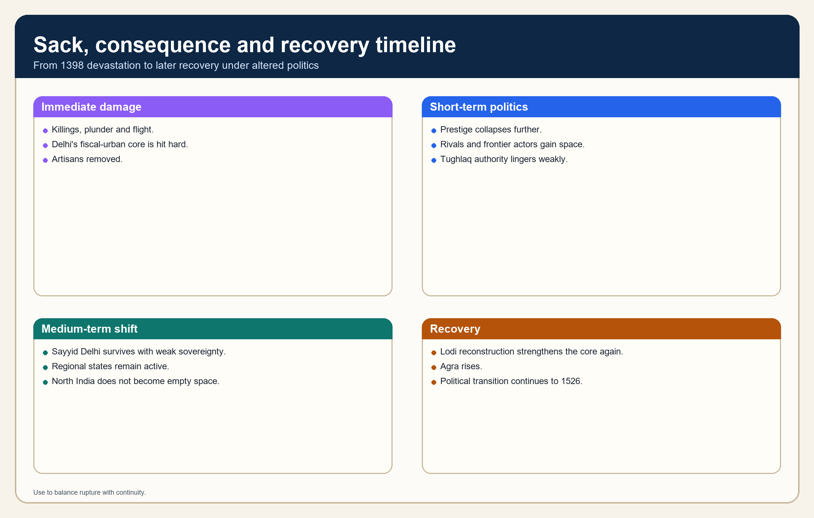

*Timeline visual. It links sack, immediate demographic and fiscal disruption, political vacuum and later recovery without reducing the entire fifteenth century to one event.*

#### Secure phrasing bank for the sack of Delhi

| Unsafe phrasing | Better phrasing |
|---|---|
| "Timur destroyed all India" | "Timur devastated Delhi and parts of the north-western corridor, then withdrew." |
| "Exactly X lakh people were killed" | "Chronicles report very large killings, but exact totals are contested and rhetorical." |
| "The invasion created permanent desolation everywhere" | "The raid caused severe disruption in Delhi and its core, but regional states and later recovery continued." |
| "Timur founded a new Indian empire" | "Timur left symbolic claims and appointments behind rather than durable all-India rule." |

#### PARAGRAPH DEMONSTRATION — CLAIM → EVIDENCE → ANALYSIS → QUALIFICATION

**Claim:** Timur's Delhi campaign must be described with moral seriousness and numerical caution together. **Named evidence/example:** Topic 06 preserves the facts of December 1398 fighting, sack, killings, looting and the carrying away of artisans, while warning that large casualty or captive totals come through agenda-laden chronicles. **Analysis:** this method avoids both extremes: blind repetition of huge numbers and denial of violence because figures vary. **Qualification:** the violence was real and severe, but the safest answer keeps totals in the category of reported claims rather than verified demographic statistics.

#### CLOSING RECALL FLOW — DELHI 1398: SACK, VIOLENCE, DESTRUCTION AND SOURCE CAUTION

```text
START / CONCEPT: delhi 1398: sack, violence, destruction and source caution
        |
        v
EXACT TERMS: Delhi 1398 · sack · violence · destruction · source caution · secure minimum
        |
        v
MECHANISM / ARGUMENT: The sack combined battlefield victory, organised plunder, killings and deportation, making Delhi's devastation materially and symbolically severe.
        |
        v
CONSEQUENCE / CONTRAST: This intensified the city's prestige crisis and widened the political vacuum without entitling us to treat every large number as secure fact.
        |
        v
UPSC TRAP / ANSWER-USE: Do not communalise the event through flat civilisational rhetoric or literalise every chronicler number as audited data.
        |
        v
ANSWER-GRABBING FORMULATION: The safest line is simple: Delhi suffered real devastation in 1398, but the exact arithmetic of death and loot remains source-bound and unstable.
```
### SESSION 7 — HOW TO READ TIMUR: MEMOIR TRADITIONS, COURT CHRONICLES AND MATERIAL EVIDENCE

#### DEFINITION / WHAT THIS IS CALLED

**Plain-language definition:** Source criticism here means checking Timurid and Indian narratives against one another and against coins, inscriptions and architecture before making confident claims.

**Technical definition:** Technically, Timur's evidence-base must be triangulated across attributed memoir traditions, courtly Zafarnama narratives, Indian chronicles and material remains, each read for proximity and agenda.

#### ANSWER-GRABBING OPENING — WRITE/ADAPT IN THE EXAM

> This is a classic source-method lesson: court victories magnify legitimacy; later memoir claims may back-project authority; Indian chronicles stress the damage to Delhi; material evidence checks exaggeration but cannot by itself narrate motive.

#### MUST-WRITE KEYWORDS

- **Timurid memoir traditions**
- **Zafarnama**
- **Tarikh-i-Mubarak Shahi**
- **material evidence**
- **court agenda**
- **triangulation**

**How to use them:** Name memoir traditions, Yazdi's Zafarnama and Sirhindi, add coins or architecture as material checks, and finish by explaining how agenda and triangulation control the answer.

[DEBATE] The most delicate source issue here is the so-called **Malfuzat-i-Timuri / Tuzuk-i-Timuri** tradition. It presents itself as Timur's own words or memoir-like instruction, but modern scholarship widely treats the extant Persian text as a **later compilation or inauthentic memoir tradition**, not as a straightforward contemporary self-written record from 1398.

[FACT] By contrast, **Sharaf al-Din Ali Yazdi's Zafarnama** belongs much closer to the Timurid courtly archive, though it too is a legitimising victory narrative. That makes it more valuable than the later Tuzuk tradition for campaign sequence and imperial ideology, but not ideologically neutral.

[FACT] Indian-side reconstruction depends on later Delhi and regional chronicles, plus what coins, architectural survival, urban decline and recovery, and subsequent political outcomes can show. No one source yields the whole truth.

[ANALYSIS] This is a classic source-method lesson: court victories magnify legitimacy; later memoir claims may back-project authority; Indian chronicles stress the damage to Delhi; material evidence checks exaggeration but cannot by itself narrate motive. Use **triangulation**.

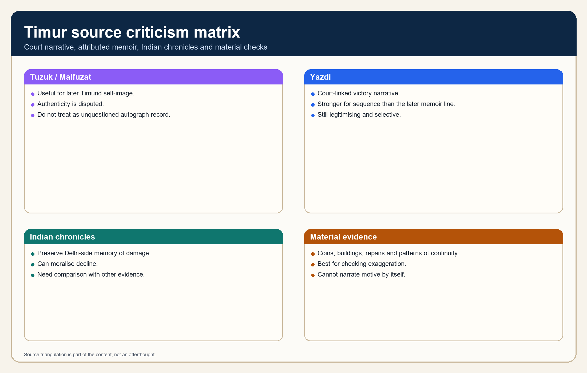

*Source-criticism visual. It separates later attributed memoir tradition, Timurid court narrative, Indian chronicles and material evidence by proximity and agenda.*

#### Timur source-bank table

| Source family | What it can give | Main caution |
|---|---|---|
| Later attributed *Tuzuk/Malfuzat* tradition | Narrative of motive, campaign and ruler-self-image | [DEBATE] Authenticity is disputed; use chiefly for later Timurid/Mughal afterlife and ideology |
| Yazdi's *Zafarnama* | Court-linked Timurid victory narrative, chronology and imperial rhetoric | Strong legitimising agenda; not an eyewitness free from patronage |
| Indian chronicles | Aftermath for Delhi, regional political effects and memory of disruption | Often later and not always eyewitness; can moralise decline |
| Material evidence | Coins, monuments, archaeology, patterns of survival and repair | Material traces show impact and continuity, not full intention or narrative sequence |

#### PARAGRAPH DEMONSTRATION — CLAIM → EVIDENCE → ANALYSIS → QUALIFICATION

**Claim:** Topic 06 is as much about source handling as about events. **Named evidence/example:** it distinguishes Timurid memoir traditions, Yazdi's *Zafarnama*, Indian chronicles, and material traces such as coins or architecture. **Analysis:** each source-family preserves something different—sequence, royal self-fashioning, local perspective or material corroboration—so no single text can safely monopolise the narrative. **Qualification:** proximity to events may increase evidentiary value, but it can also intensify political agenda; therefore even near-contemporary sources require comparison, not worship.

#### CLOSING RECALL FLOW — HOW TO READ TIMUR: MEMOIR TRADITIONS, COURT CHRONICLES AND MATERIAL EVIDENCE

```text
START / CONCEPT: how to read timur: memoir traditions, court chronicles and material evidence
        |
        v
EXACT TERMS: Timurid memoir traditions · Zafarnama · Tarikh-i-Mubarak Shahi · material evidence · court agenda · triangulation
        |
        v
MECHANISM / ARGUMENT: Historical confidence grows when multiple source-families converge; it weakens when one courtly or attributed text is treated as if it settled every question.
        |
        v
CONSEQUENCE / CONTRAST: That is why Topic 06 teaches verification, comparison and bounded inference rather than quotation-led certainty.
        |
        v
UPSC TRAP / ANSWER-USE: Do not cite the *Tuzuk/Malfuzat* or a court chronicle as transparent autobiography; both need authenticity and agenda caution.
        |
        v
ANSWER-GRABBING FORMULATION: In Topic 06, source-criticism is not ornamental: the safest claims are the ones that survive comparison across Timurid, Indian and material evidence.
```
### SESSION 8 — CONSEQUENCES OF THE INVASION: DISRUPTION, PRESTIGE COLLAPSE, POLITICAL VACUUM AND CONTINUITY

#### DEFINITION / WHAT THIS IS CALLED

**Plain-language definition:** The concise volume says the direct political effect of Timur's invasion was small in one narrow sense: Timur did not stay to govern India.

**Technical definition:** Timur's raid was a catalytic rupture for the Delhi core, but it sat inside a longer process of fragmentation whose beginnings pre-dated 1398 and whose consequences were uneven across India.

#### ANSWER-GRABBING OPENING — WRITE/ADAPT IN THE EXAM

> The concise volume says the direct political effect of Timur's invasion was small in one narrow sense: Timur did not stay to govern India.

#### MUST-WRITE KEYWORDS

- **Consequences of the invasion**
- **disruption**
- **prestige collapse**
- **political vacuum**
- **continuity**
- **Immediate urban-core damage**

**How to use them:** Move from Delhi's disruption and prestige collapse to the widened political vacuum, then counterbalance it with regional continuity so the answer stays non-apocalyptic.

[FACT] The concise volume says the direct political effect of Timur's invasion was small in one narrow sense: Timur did not stay to govern India. Yet the same text also says the invasion marked the **end of the phase of strong rule by the Delhi sultans**, even though the Tughlaq line lingered till 1412.

[ANALYSIS] The distinction is important. Timur did not administratively replace the Sultanate with a stable Timurid Indian empire. But he inflicted a blow severe enough to deepen the political vacancy around Delhi, hasten prestige collapse, and encourage ambitious regional and frontier actors.

[ANALYSIS] Consequences should therefore be grouped carefully:

- [FACT] **Immediate urban-core damage:** deaths, flight, treasure drain, destruction and artisan deportation.
- [FACT] **Political effect:** Delhi's claim to unquestioned supremacy was shattered further; Khizr Khan and others advanced.
- [ANALYSIS] **Regional effect:** provincial autonomy hardened rather than softened.
- [LIMIT] **Continuity:** agrarian life, regional courts, trade and cultural production elsewhere continued; even Delhi eventually recovered in altered political form.

[DEBATE] The best conclusion is neither minimisation nor apocalypse. Timur's raid was a catalytic rupture for the Delhi core, but it sat inside a longer process of fragmentation whose beginnings pre-dated 1398 and whose consequences were uneven across India.

#### PARAGRAPH DEMONSTRATION — CLAIM → EVIDENCE → ANALYSIS → QUALIFICATION

**Claim:** Timur's raid mattered as a catalyst, not as the sole cause of all later change. **Named evidence/example:** Topic 06 links the sack of Delhi to prestige collapse, political vacuum and immediate urban devastation, yet it also preserves the durability of Bengal, Gujarat, Malwa, Jaunpur and later Lodi recovery in the north-Indian core. **Analysis:** this keeps causation proportionate: the raid deepened an existing crisis and damaged Delhi badly, but it did not erase the wider subcontinental political map. **Qualification:** the language of catastrophe is justified for Delhi itself, but not for the entirety of India across the fifteenth century.

#### CLOSING RECALL FLOW — CONSEQUENCES OF THE INVASION: DISRUPTION, PRESTIGE COLLAPSE, POLITICAL VACUUM AND CONTINUITY

```text
START / CONCEPT: consequences of the invasion: disruption, prestige collapse, political vacuum and continuity
        |
        v
EXACT TERMS: Consequences of the invasion · disruption · prestige collapse · political vacuum · continuity · Immediate urban-core damage
        |
        v
MECHANISM / ARGUMENT: Timur's attack amplified existing weakness by crippling Delhi's prestige and resources at a moment when regional competitors were already durable.
        |
        v
CONSEQUENCE / CONTRAST: It therefore widened the old centre's crisis without abolishing the vitality of other states and routes.
        |
        v
UPSC TRAP / ANSWER-USE: Do not write as if the raid produced a timeless wasteland from Bengal to Gujarat.
        |
        v
ANSWER-GRABBING FORMULATION: Timur's raid was catalytic because it struck a weakened centre hard, not because it single-handedly explains every fifteenth-century political development.
```
### SESSION 9 — KHIZR KHAN: TIMURID CONNECTION, CAPTURE OF DELHI AND SYMBOLIC LEGITIMACY

#### DEFINITION / WHAT THIS IS CALLED

**Plain-language definition:** Standard textbook statements that Khizr Khan never assumed the full title of sultan are plausible and widely repeated, but the safest exam phrasing is: he ruled cautiously under the symbolic shadow of Timurid legitimacy rather than as a fully independent, ideologically unqualified successor on the Balban-Alauddin model.

**Technical definition:** The same OCR adds a crucial caution: the Sayyids were not simply subordinates of the Timurid rulers, even though Timurid names were included in the khutba for some time.

#### ANSWER-GRABBING OPENING — WRITE/ADAPT IN THE EXAM

> Standard textbook statements that Khizr Khan never assumed the full title of sultan are plausible and widely repeated, but the safest exam phrasing is: he ruled cautiously under the symbolic shadow of Timurid legitimacy rather than as a fully independent, ideologically unqualified successor on the Balban-Alauddin model.

#### MUST-WRITE KEYWORDS

- **Khizr Khan**
- **Timurid connection**
- **capture of Delhi**
- **symbolic legitimacy**
- **not simply subordinates of the Timurid rulers**
- **"Khizr founded a strong restored Delhi empire."**

**How to use them:** Use these terms to hold together Khizr Khan's Timurid shadow, his Punjab-Multan base and the practical bargaining that sustained his rule in Delhi.

[FACT] The advanced owner note and the local Part I OCR agree on the broad sequence. After Timur's attack on Delhi, **Khizr Khan** - already linked with Multan and Dipalpur - did not immediately take Delhi while the Tughlaq ruler still returned intermittently. After the effective end of the Tughlaq line in **1412**, he entered Delhi and established a new order in **1414**.

[FACT] The same OCR adds a crucial caution: the Sayyids were **not simply subordinates of the Timurid rulers**, even though Timurid names were included in the khutba for some time. This is the best safe line for UPSC.

[ANALYSIS] Khizr Khan's legitimacy therefore worked through a double language. On one side, association with Timur gave prestige in a landscape of broken sovereignty. On the other, Khizr actually ruled through local bargaining in Punjab-Delhi conditions, not through an effective Timurid bureaucracy stretching from Central Asia into India.

[LIMIT] Standard textbook statements that Khizr Khan never assumed the full title of sultan are plausible and widely repeated, but the safest exam phrasing is: **he ruled cautiously under the symbolic shadow of Timurid legitimacy rather than as a fully independent, ideologically unqualified successor on the Balban-Alauddin model**.

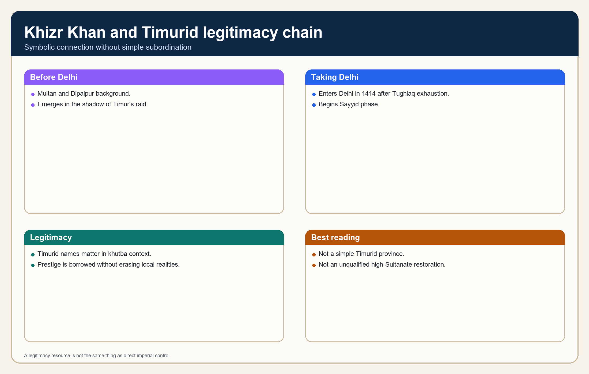

*Legitimacy-chain visual. It shows Timur's raid, Khizr's Punjab base, Delhi entry and the difference between symbolic Timurid connection and real local rule.*

#### Khizr Khan phrasing bank

| Unsafe phrasing | Better phrasing |
|---|---|
| "Khizr Khan was Timur's obedient provincial governor in India." | "Khizr used Timurid connection as a legitimacy resource, but ruled in a fragmented north-Indian setting." |
| "Khizr founded a strong restored Delhi empire." | "Khizr recovered Delhi but not the wide coercive reach of earlier sultans." |
| "Timur directly governed through Khizr." | "Timurid names and claims mattered symbolically; direct subordination is too simple." |

#### PARAGRAPH DEMONSTRATION — CLAIM → EVIDENCE → ANALYSIS → QUALIFICATION

**Claim:** Khizr Khan's legitimacy sat between symbolic Timurid association and local north-Indian politics. **Named evidence/example:** Topic 06 anchors him in a Multan-Punjab base, Delhi recovery in 1414, cautious titulature and a relationship to Timur's legacy without direct Timurid administration of India. **Analysis:** this is why he cannot be described either as a free-floating local chief with no wider claim or as a Timurid governor administering a settled imperial province. **Qualification:** even the Sayyid descent claim must be treated as claimed rather than proven, which reinforces the need for precise language about legitimacy.

#### CLOSING RECALL FLOW — KHIZR KHAN: TIMURID CONNECTION, CAPTURE OF DELHI AND SYMBOLIC LEGITIMACY

```text
START / CONCEPT: khizr khan: timurid connection, capture of delhi and symbolic legitimacy
        |
        v
EXACT TERMS: Khizr Khan · Timurid connection · capture of Delhi · symbolic legitimacy · not simply subordinates of the Timurid rulers · "Khizr founded a strong restored Delhi empire."
        |
        v
MECHANISM / ARGUMENT: Khizr Khan gained strength from a secure north-western base and from the political value of Timurid association, but he ruled through negotiation inside India.
        |
        v
CONSEQUENCE / CONTRAST: His regime restored Delhi's symbol more effectively than it rebuilt a high-Sultanate territorial empire.
        |
        v
UPSC TRAP / ANSWER-USE: Do not say Khizr Khan founded a strong restored empire under direct Timurid command; Topic 06 expressly rejects that simplification.
        |
        v
ANSWER-GRABBING FORMULATION: Khizr Khan ruled under the shadow of Timurid legitimacy, yet the actual work of power in Delhi remained local, negotiated and limited.
```
### SESSION 10 — SAYYID RULER LADDER: COMPACT CHRONOLOGY WITHOUT PADDING

#### DEFINITION / WHAT THIS IS CALLED

**Plain-language definition:** The secure ruler ladder is: Khizr Khan (1414-1421), Mubarak Shah (1421-1434), Muhammad Shah (1434-1445) and Alauddin Alam Shah (1445-1451).

**Technical definition:** For the internal narrative of the early Sayyid phase, Yahya bin Ahmad Sirhindi's Tarikh-i-Mubarak Shahi is the key named chronicle.

#### ANSWER-GRABBING OPENING — WRITE/ADAPT IN THE EXAM

> The secure ruler ladder is: Khizr Khan (1414-1421), Mubarak Shah (1421-1434), Muhammad Shah (1434-1445) and Alauddin Alam Shah (1445-1451).

#### MUST-WRITE KEYWORDS

- **Sayyid ruler ladder**
- **compact chronology without padding**
- **Khizr Khan (1414-1421)**
- **Mubarak Shah (1421-1434)**
- **Muhammad Shah (1434-1445)**
- **Alauddin Alam Shah (1445-1451)**

**How to use them:** Write the Sayyid ladder in order—Khizr Khan, Mubarak Shah, Muhammad Shah, Alam Shah—attach 1414-1451, and conclude with the dynasty's shrinking coercive range.

[FACT] The Sayyid dynasty ruled Delhi from **1414 to 1451**. The secure ruler ladder is: **Khizr Khan (1414-1421)**, **Mubarak Shah (1421-1434)**, **Muhammad Shah (1434-1445)** and **Alauddin Alam Shah (1445-1451)**.

[FACT] For the internal narrative of the early Sayyid phase, **Yahya bin Ahmad Sirhindi's *Tarikh-i-Mubarak Shahi*** is the key named chronicle. It is especially valuable for the later Tughlaq and early Sayyid world, though like all courtly chronicles it requires author-position caution.

[FACT] Mubarak Shah is usually treated as the most active of the Sayyid rulers. The dynasty is also associated with the urban foundation or naming of **Mubarakabad** in Delhi's political landscape.

[LIMIT] Topic 06 should not inflate the Sayyids into a major reconquest dynasty. Their importance lies less in spectacular expansion than in showing how the *symbol* of Delhi survived under weak coercive conditions until Afghan-Lodi power displaced them.

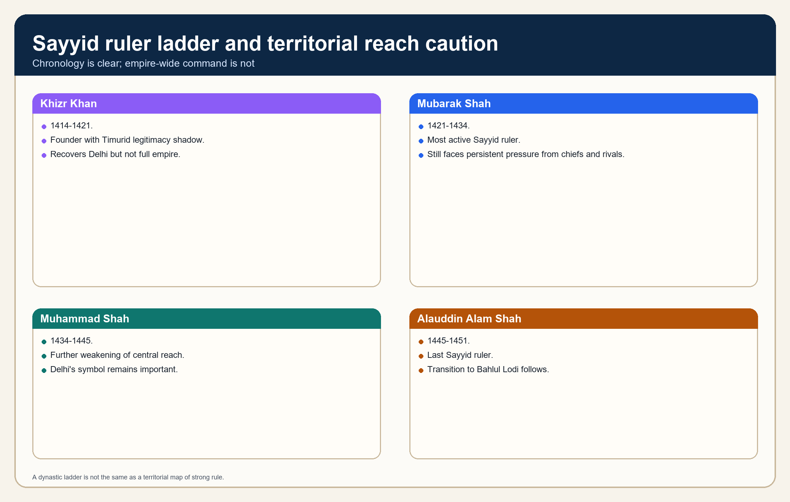

*Ruler-ladder visual. It keeps the regnal sequence precise while warning that dynastic continuity did not equal large territorial control.*

#### Compact Sayyid ruler table

| Ruler | Regnal span | Safe significance | Caution |
|---|---|---|---|
| Khizr Khan | 1414-1421 | Founder; recovered Delhi with Timurid-legitimacy shadow | Did not recover an Alauddin-style empire |
| Mubarak Shah | 1421-1434 | Most assertive Sayyid; associated with *Tarikh-i-Mubarak Shahi* era and Mubarakabad | Still struggled constantly with chiefs and rivals |
| Muhammad Shah | 1434-1445 | Further weakening of central grip | Avoid padding with inflated campaign claims |
| Alauddin Alam Shah | 1445-1451 | Final Sayyid; Delhi passes to Bahlul Lodi | End marks transition, not dramatic battle-glory |

#### PARAGRAPH DEMONSTRATION — CLAIM → EVIDENCE → ANALYSIS → QUALIFICATION

**Claim:** The Sayyid dynasty needs chronological precision because its brevity often invites careless compression. **Named evidence/example:** the secure order is Khizr Khan, Mubarak Shah, Muhammad Shah and Ala al-Din Alam Shah from 1414 to 1451. **Analysis:** that sequence helps the answer distinguish initial recovery, Mubarak Shah's more active but fragile rule, later weakening, and Alam Shah's withdrawal before the Lodi takeover. **Qualification:** a short dynasty should not be treated as insignificant; its importance lies in preserving Delhi's symbol under weak sovereignty rather than in territorial grandeur.

#### CLOSING RECALL FLOW — SAYYID RULER LADDER: COMPACT CHRONOLOGY WITHOUT PADDING

```text
START / CONCEPT: sayyid ruler ladder: compact chronology without padding
        |
        v
EXACT TERMS: Sayyid ruler ladder · compact chronology without padding · Khizr Khan (1414-1421) · Mubarak Shah (1421-1434) · Muhammad Shah (1434-1445) · Alauddin Alam Shah (1445-1451)
        |
        v
MECHANISM / ARGUMENT: A clear ruler-sequence turns the Sayyid period from a blurred interval into a readable phase of limited survival and declining command.
        |
        v
CONSEQUENCE / CONTRAST: Chronological clarity also prevents the later Lodi consolidation from being projected backward onto the Sayyids.
        |
        v
UPSC TRAP / ANSWER-USE: Do not jumble the Sayyid ruler order; chronology errors quickly destroy analytical credibility in this topic.
        |
        v
ANSWER-GRABBING FORMULATION: The Sayyid ladder is short but important: it marks Delhi's symbolic survival between Timurid shock and Lodi reconstruction.
```
### SESSION 11 — NATURE OF THE SAYYID STATE: WEAK SOVEREIGNTY, TRIBUTE AND LIMITED COERCIVE REACH

#### DEFINITION / WHAT THIS IS CALLED

**Plain-language definition:** Weak sovereignty means Delhi remained politically meaningful, but the ruler's ability to enforce obedience, revenue and military service beyond a narrow core was limited and negotiated.

**Technical definition:** The advanced owner file states that the Sayyids could not establish themselves firmly and were pressured by the Khokhars of the Punjab, the Mewatis, and the Sharqi rulers of Jaunpur.

#### ANSWER-GRABBING OPENING — WRITE/ADAPT IN THE EXAM

> The advanced owner file states that the Sayyids could not establish themselves firmly and were pressured by the Khokhars of the Punjab, the Mewatis, and the Sharqi rulers of Jaunpur.

#### MUST-WRITE KEYWORDS

- **negotiated sovereignty**
- **tribute politics**
- **limited coercion**
- **local bargaining**
- **Delhi symbol**
- **claim-versus-control**

**How to use them:** Define negotiated sovereignty through Delhi's symbol, tribute politics and local bargaining, then contrast symbolic claim with limited coercive control over territory.

[FACT] The advanced owner file states that the Sayyids could not establish themselves firmly and were pressured by the **Khokhars of the Punjab**, the **Mewatis**, and the **Sharqi rulers of Jaunpur**.

[ANALYSIS] This is the real meaning of a weak-sovereignty state. The ruler possessed Delhi's symbolism, but not uninterrupted command over the countryside. Authority was mediated through tribute, tactical campaigns, temporary submission, and the shifting behaviour of chiefs who could obey, evade or revolt depending on opportunity.

[ANALYSIS] In such a system, the throne did not vanish, yet it no longer resembled the integrated military-fiscal machine of Alauddin Khalji. The Sayyid state was best understood as a **negotiated Delhi-centred monarchy** surviving amid stronger local actors.

[DEBATE] Weak sovereignty does not mean complete irrelevance. Delhi still mattered symbolically and logistically. But the distance between *claim* and *enforcement* was far greater than under the high Sultanate.

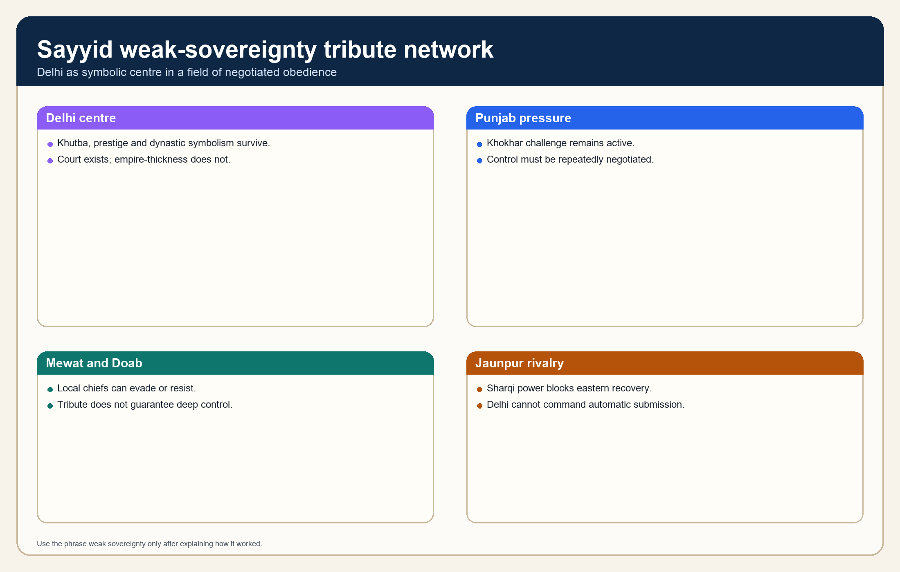

*Weak-sovereignty visual. It shows Delhi at the centre of a network of tribute, pressure, rebellion and partial reach rather than a neatly unified state.*

#### Symbol versus reality under the Sayyids

| Dimension | Symbolic claim | Operational reality |
|---|---|---|
| Delhi throne | Right to govern the old Sultanate core | Narrow effective command around Delhi-Doab-Punjab pockets |
| Timurid association | Prestige and external legitimacy shadow | No strong Timurid administrative machine in India |
| Tribute | Signs of submission from chiefs | Tribute was negotiable and easily reversible |
| Military action | Campaigns against challengers | Campaigns rarely translated into durable empire-wide control |

#### PARAGRAPH DEMONSTRATION — CLAIM → EVIDENCE → ANALYSIS → QUALIFICATION

**Claim:** The Sayyid state is best understood through the distinction between claim and control. **Named evidence/example:** Topic 06 emphasises tribute, negotiation, Delhi-centred legitimacy and limited coercive reach amid Khokhar, Mewati and wider regional pressures. **Analysis:** this explains why the dynasty still matters historically: Delhi's symbol survived, but its reach had to be repeatedly bargained for rather than simply commanded. **Qualification:** weak sovereignty is not the same as zero sovereignty; the point is limited depth of power, not total disappearance of political authority.

#### CLOSING RECALL FLOW — NATURE OF THE SAYYID STATE: WEAK SOVEREIGNTY, TRIBUTE AND LIMITED COERCIVE REACH

```text
START / CONCEPT: nature of the sayyid state: weak sovereignty, tribute and limited coercive reach
        |
        v
EXACT TERMS: negotiated sovereignty · tribute politics · limited coercion · local bargaining · Delhi symbol · claim-versus-control
        |
        v
MECHANISM / ARGUMENT: The Sayyids retained Delhi's symbolic weight, but tribute networks and local bargains did much of the practical work that stronger monarchies might have imposed directly.
        |
        v
CONSEQUENCE / CONTRAST: Their regime therefore preserved political continuity at the centre without recovering the high Sultanate's stable territorial command.
        |
        v
UPSC TRAP / ANSWER-USE: Do not confuse symbolic survival with all-India reconquest, and do not confuse limited control with complete political disappearance.
        |
        v
ANSWER-GRABBING FORMULATION: Sayyid Delhi survived less as a wide command-state than as a negotiated centre whose legitimacy outstripped its coercive reach.
```
### SESSION 12 — REGIONAL POWERS IN THE SAYYID-LODI AGE: DELHI LOST RANGE, NOT INDIAN VITALITY

#### DEFINITION / WHAT THIS IS CALLED

**Plain-language definition:** In Topic 06, the regional world is not an appendix; it is the context that explains why Delhi could no longer command the subcontinent simply by invoking old prestige.

**Technical definition:** Technically, regional political geography is read as a balance-of-power system in which Bengal, Gujarat, Malwa, Jaunpur, Mewar and north-western frontier forces all constrained Delhi's options.

#### ANSWER-GRABBING OPENING — WRITE/ADAPT IN THE EXAM

> In Topic 06, the regional world is not an appendix; it is the context that explains why Delhi could no longer command the subcontinent simply by invoking old prestige.

#### MUST-WRITE KEYWORDS

- **Bengal**
- **Gujarat**
- **Malwa**
- **Jaunpur**
- **Mewar**
- **balance of power**

**How to use them:** Place Bengal, Gujarat, Malwa, Jaunpur and Mewar side by side, then conclude that Delhi operated inside a crowded balance-of-power system rather than an empty field.

[FACT] In Topic 06, the regional world is not an appendix; it is the context that explains why Delhi could no longer command the subcontinent simply by invoking old prestige. Bengal sustained an eastern power-base; Gujarat drew strength from ports, craft wealth and route-control; Malwa sat on plateau transit lines; Jaunpur held the eastern Ganga political-culture zone; Kashmir followed its own valley logic; and the Deccan was already structured by Bahmani-Vijayanagara competition.

[ANALYSIS] This matters for answer writing because it stops the student from calling every fifteenth-century event a symptom of "Indian decline." In reality, the centre of political initiative had become **plural**. Delhi was one claimant among several.

[LIMIT] Topic 06 does not repeat the detailed owner files of Topic 08 and Topic 09. It uses the regional map only to show that Lodi recovery later had to contend not with empty space, but with already formed regional powers and hardened frontiers.

#### PARAGRAPH DEMONSTRATION — CLAIM → EVIDENCE → ANALYSIS → QUALIFICATION

**Claim:** Fifteenth-century regional geography was an active political system, not background scenery. **Named evidence/example:** Topic 06 repeatedly names Bengal, Gujarat, Malwa, Jaunpur, Mewar, Punjab and Mewat as durable centres or pressure-zones. **Analysis:** once these states are restored to the map, Delhi's decline appears as one node in a wider contest over resources, routes and prestige. **Qualification:** this framing should not dissolve Delhi into irrelevance; it should simply prevent the false assumption that Delhi alone represented 'India'.

#### CLOSING RECALL FLOW — REGIONAL POWERS IN THE SAYYID-LODI AGE: DELHI LOST RANGE, NOT INDIAN VITALITY

```text
START / CONCEPT: regional powers in the sayyid-lodi age: delhi lost range, not indian vitality
        |
        v
EXACT TERMS: Bengal · Gujarat · Malwa · Jaunpur · Mewar · balance of power
        |
        v
MECHANISM / ARGUMENT: Multiple regional powers ringed or intersected the old Delhi zone, so the centre's weakness operated inside a competitive interstate environment.
        |
        v
CONSEQUENCE / CONTRAST: That wider map helps explain both why Delhi could shrink and why other courts, economies and military formations remained robust.
        |
        v
UPSC TRAP / ANSWER-USE: Do not treat Jaunpur, Gujarat or Bengal as decorative names; they are the evidence that fifteenth-century politics was regionally plural.
        |
        v
ANSWER-GRABBING FORMULATION: The decline of Delhi makes historical sense only when placed inside a wider regional balance-of-power stretching across the fifteenth-century subcontinent.
```
### SESSION 13 — AFGHAN POLITICAL TRADITIONS: SOLIDARITY, EQUALITY CLAIMS, CONSULTATION AND CAUTION

#### DEFINITION / WHAT THIS IS CALLED

**Plain-language definition:** "Afghan political culture" is a historical shorthand, not a biological or unchanging fact.

**Technical definition:** Both the advanced owner file and the local OCR emphasise that Afghan nobles possessed a sturdy sense of tribal independence and were not accustomed to treating the sultan as anything more than a first among equals.

#### ANSWER-GRABBING OPENING — WRITE/ADAPT IN THE EXAM

> "Afghan political culture" is a historical shorthand, not a biological or unchanging fact.

#### MUST-WRITE KEYWORDS

- **Afghan political traditions**
- **solidarity**
- **equality claims**
- **consultation**
- **caution**
- **tribal independence**

**How to use them:** Start with lineage solidarity and consultation, add equality claims within the noble elite, and end with the caution that this was not modern democracy for subjects.

[FACT] Both the advanced owner file and the local OCR emphasise that Afghan nobles possessed a sturdy sense of **tribal independence** and were not accustomed to treating the sultan as anything more than a **first among equals**.

[ANALYSIS] Four analytical points follow:

1. **Lineage and clan mattered.** Recruitment and solidarity often moved through kin, tribal memory and patron-client linkage.
2. **Distribution of power mattered.** Afghan nobles expected a share in honour, office and resources; they did not naturally fit a purely awe-based Balban model.
3. **Consultation mattered.** Authority was expected to be heard, bargained and distributed rather than merely announced.
4. **Partition ideas mattered.** The notion that a ruler's domains could be shared among sons and relatives did not disappear easily.

[DEBATE] Yet Topic 06 must avoid turning this into a timeless ethnic essence. "Afghan political culture" is a historical shorthand, not a biological or unchanging fact. Afghan nobles in India also operated inside Persianate court worlds, iqta assignments, agrarian revenue politics and Delhi's urban setting. They were not tribal nomads frozen outside history.

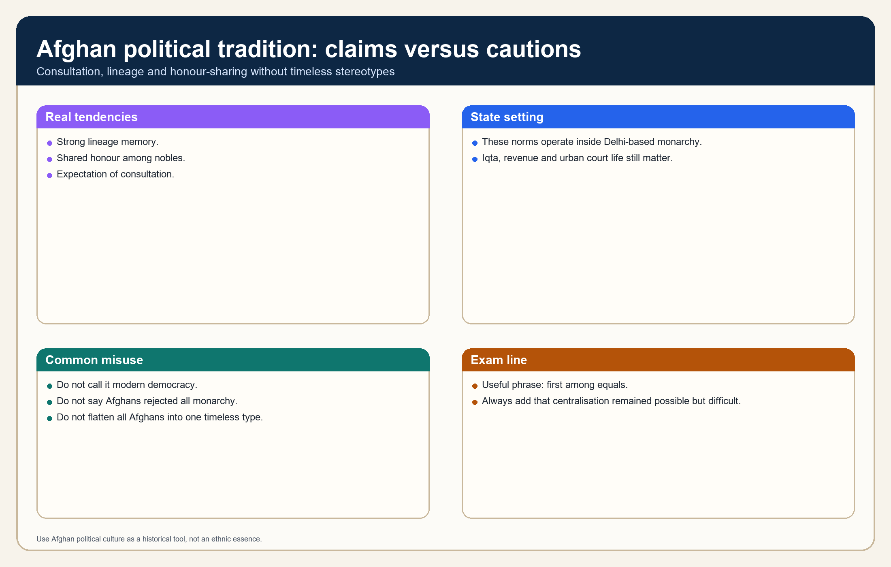

*Claims-versus-cautions visual. It distinguishes real bargaining norms among Afghan elites from the misleading idea of a timeless, homogeneous "Afghan character."*

#### Analytical contrast table

| Lens | Earlier high-Sultanate court monarchy | Lodi-Afghan tendency |
|---|---|---|
| Ruler image | Awe, distance, strict hierarchy | More bargaining with powerful lineages |
| Noble expectation | Service under exalted monarch | Stronger claim to shared honour and consultation |
| Inheritance tendency | No secure succession law, but less explicit tribal-equality idiom | Partition and kin-right claims more politically visible |
| Exam caution | Do not idealise Turkish monarchy as fully centralised | Do not romanticise Afghan politics as democracy |

#### PARAGRAPH DEMONSTRATION — CLAIM → EVIDENCE → ANALYSIS → QUALIFICATION

**Claim:** Afghan political culture in Topic 06 is an elite bargaining idiom, not a modern doctrine of equality. **Named evidence/example:** the advanced note contrasts Afghan 'first among equals' expectations with stronger Turkish court hierarchy, while also stressing lineage consultation, honour and distributive claims among nobles. **Analysis:** this helps explain both Lodi mobilisation and Lodi tension: nobles expected recognition and share, yet monarchy still sought command. **Qualification:** these norms applied within aristocratic politics; they do not describe equal government for subjects at large.

#### CLOSING RECALL FLOW — AFGHAN POLITICAL TRADITIONS: SOLIDARITY, EQUALITY CLAIMS, CONSULTATION AND CAUTION

```text
START / CONCEPT: afghan political traditions: solidarity, equality claims, consultation and caution
        |
        v
EXACT TERMS: Afghan political traditions · solidarity · equality claims · consultation · caution · tribal independence
        |
        v
MECHANISM / ARGUMENT: Afghan nobles often valued consultation, honour and participatory bargaining within the elite, which shaped how kingship had to be performed.
        |
        v
CONSEQUENCE / CONTRAST: This political culture could strengthen mobilisation but also make aggressive centralisation more combustible.
        |
        v
UPSC TRAP / ANSWER-USE: Do not translate 'first among equals' into universal democracy or into a total rejection of monarchy.
        |
        v
ANSWER-GRABBING FORMULATION: Afghan political tradition mattered because it set expectations about honour and consultation that every Lodi ruler had to manage, not because it abolished hierarchy.
```
### SESSION 14 — BAHLUL LODI: AFGHAN MOBILISATION, DELHI TAKEOVER AND JAUNPUR STRATEGY

#### DEFINITION / WHAT THIS IS CALLED

**Plain-language definition:** Abbas Sarwani's later phrase that they came "like locusts" is likely exaggerated, but it preserves the memory of significant Afghan in-migration and military reinforcement.

**Technical definition:** The Part I OCR states that Bahlul Lodi had established himself in Punjab along with Afghan sardars, checked the Khokhars, dominated Punjab, and - once called in to help the Delhi ruler against Malwa - stayed on until his men took control of Delhi.

#### ANSWER-GRABBING OPENING — WRITE/ADAPT IN THE EXAM

> The Part I OCR states that Bahlul Lodi had established himself in Punjab along with Afghan sardars, checked the Khokhars, dominated Punjab, and - once called in to help the Delhi ruler against Malwa - stayed on until his men took control of Delhi.

#### MUST-WRITE KEYWORDS

- **Bahlul Lodi**
- **Afghan mobilisation**
- **Delhi takeover**
- **Jaunpur strategy**
- **Sharqi rulers of Jaunpur**
- **Afghans of Roh**

**How to use them:** Move from Roh and Punjab mobilisation to Bahlul's 1451 accession, then to the Sharqi struggle and the 1484 annexation of Jaunpur as the payoff.

[FACT] The Part I OCR states that Bahlul Lodi had established himself in Punjab along with Afghan sardars, checked the Khokhars, dominated Punjab, and - once called in to help the Delhi ruler against Malwa - stayed on until his men took control of Delhi. He formally crowned himself in **1451**.

[FACT] Bahlul's main long-term struggle was with the **Sharqi rulers of Jaunpur**. The same OCR records that, finding himself weak, he invited the **Afghans of Roh** to India. Abbas Sarwani's later phrase that they came "like locusts" is likely exaggerated, but it preserves the memory of significant Afghan in-migration and military reinforcement.

[ANALYSIS] Bahlul's achievement lay less in imperial theory than in **bargaining consolidation**. He built an Afghan power-base, distributed honours, relied on personal and lineage networks, and gradually wore down Sharqi resistance rather than instantly erecting a fully centralised monarchy.

[FACT] In **1484**, Bahlul occupied Jaunpur and annexed the Sharqi kingdom, ending the strongest eastern competitor to Delhi's revived north-Indian ambitions.

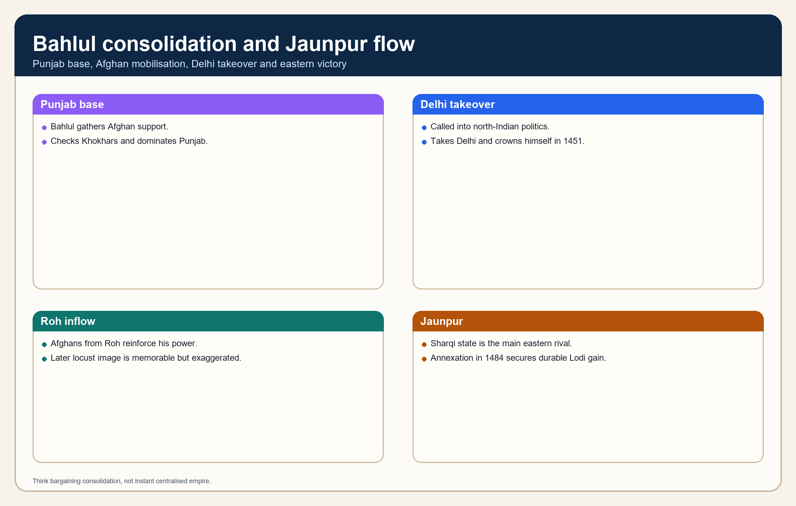

*Consolidation-flow visual. It tracks Bahlul's Punjab base, Afghan mobilisation, Delhi takeover and the eventual defeat of Jaunpur.*

#### Why Bahlul matters

| Dimension | Historical importance | Qualification |
|---|---|---|
| Delhi takeover | Replaced the Sayyids and began the Lodi phase | Delhi recovery was still regional, not subcontinental |
| Afghan mobilisation | Made Afghans a much larger element in north-Indian Muslim politics | Abbas Sarwani's rhetoric must not be read literally everywhere |
| Jaunpur defeat | Eliminated Delhi's strongest eastern rival | Did not solve the problem of noble autonomy permanently |
| Political style | Relied on negotiation and kin-based support | This style made later centralisation harder for successors |

#### PARAGRAPH DEMONSTRATION — CLAIM → EVIDENCE → ANALYSIS → QUALIFICATION

**Claim:** Bahlul Lodi's importance lies in consolidation, not in decorative dynastic succession. **Named evidence/example:** Topic 06 ties his rise to Roh Afghan networks, Punjab-Delhi positioning, accession in 1451 and the eventual annexation of Sharqi Jaunpur in 1484. **Analysis:** these steps show state-building through recruitment, bargaining and interstate struggle rather than sudden imperial inheritance. **Qualification:** the Afghan consultative idiom mattered, but it should not conceal the fact that Bahlul also built a harder north-Indian power-base than the Sayyids had managed.

#### CLOSING RECALL FLOW — BAHLUL LODI: AFGHAN MOBILISATION, DELHI TAKEOVER AND JAUNPUR STRATEGY

```text
START / CONCEPT: bahlul lodi: afghan mobilisation, delhi takeover and jaunpur strategy
        |
        v
EXACT TERMS: Bahlul Lodi · Afghan mobilisation · Delhi takeover · Jaunpur strategy · Sharqi rulers of Jaunpur · Afghans of Roh
        |
        v
MECHANISM / ARGUMENT: Bahlul converted Afghan frontier networks and Punjab strength into a Delhi monarchy capable of defeating its strongest eastern rival.
        |
        v
CONSEQUENCE / CONTRAST: The fall of Jaunpur gave the Lodis a much firmer political base than the Sayyids ever possessed.
        |
        v
UPSC TRAP / ANSWER-USE: Do not misdate the annexation of Jaunpur or reduce Bahlul's rise to mere dynastic luck.
        |
        v
ANSWER-GRABBING FORMULATION: Bahlul mattered because he turned Afghan mobilisation and Punjab strength into durable consolidation, culminating in Jaunpur's annexation.
```
### SESSION 15 — SIKANDAR LODI: NOBLE DISCIPLINE, REVENUE CONTROL AND THE FOUNDING OF AGRA

#### DEFINITION / WHAT THIS IS CALLED

**Plain-language definition:** The OCR describes Sikandar Lodi (1489-1517) as the most important Lodi ruler.

**Technical definition:** Technically, this session studies how Sikandar used noble discipline, jagir-account scrutiny, the gazz-i-Sikandari and the founding of Agra in 1506 to rebuild Lodi monarchy.

#### ANSWER-GRABBING OPENING — WRITE/ADAPT IN THE EXAM

> The OCR describes Sikandar Lodi (1489-1517) as the most important Lodi ruler.

#### MUST-WRITE KEYWORDS

- **gazz-i-Sikandari**
- **jagir accounts**
- **noble discipline**
- **Agra 1506**
- **grain-octroi abolition**
- **administrative recovery**

**How to use them:** Use gazz-i-Sikandari, jagir accounts and noble discipline as revenue-control tools, then add Agra 1506, grain-octroi abolition and administrative recovery as the wider state-building result.

[FACT] The OCR describes Sikandar Lodi (**1489-1517**) as the most important Lodi ruler. He made nobles stand before him, required them to receive the royal farman with due honour, and compelled jagir-holders to submit accounts. These measures were aimed at asserting the superiority of the sultan over Afghan sardars who saw themselves as more than mere servants.

[FACT] The same source credits Sikandar with efficient administration, strong concern for justice, safe highways, cheap essential commodities, agricultural interest, abolition of **octroi on grain**, the introduction of the **gazz-i-Sikandari**, and rent-rolls that later informed Sher Shah's system.

[FACT] In **1506**, after careful survey and deliberation, Sikandar selected the site of **Agra**. The source explains the location strategically: it commanded eastern Rajasthan, the route to Malwa and Gujarat, and the rebellious zone of the doab.

[ANALYSIS] Sikandar's reign therefore represents the **high point of Lodi state-building**: a stronger crown, better accounting, safer communications, urban growth, and a more purposeful agrarian-administrative order.

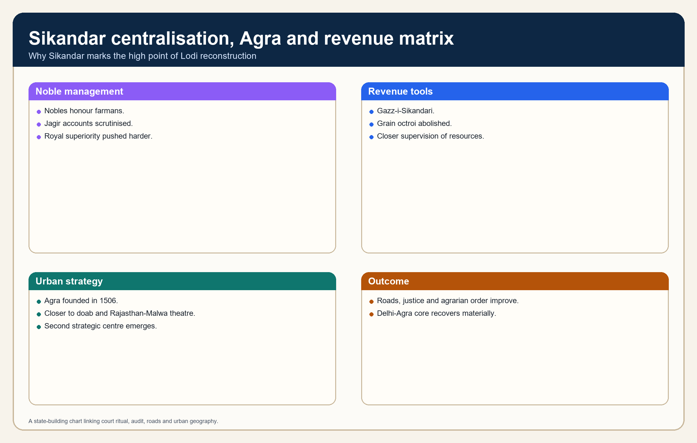

*State-building matrix. It links noble management, jagir accounting, agrarian measures and the strategic founding of Agra as one coherent programme.*

#### Sikandar's state-building toolkit

| Measure | Function | Why UPSC cares |
|---|---|---|
| Court discipline | Forced nobles to recognise superior royal status | Shows monarchy versus Afghan equality claims |
| Jagir accounts | Checked embezzlement and corruption | Connects politics with fiscal supervision |
| Grain-octroi abolition | Supported provisioning and agrarian-commercial flow | Links revenue policy with price environment |
| Gazz-i-Sikandari | Standardised measurement | Classic Prelims marker and revenue-infrastructure point |
| Agra foundation | Strategic second capital closer to doab-Rajasthan-Malwa theatre | Shows military geography, not just city-building |

#### PARAGRAPH DEMONSTRATION — CLAIM → EVIDENCE → ANALYSIS → QUALIFICATION

**Claim:** Sikandar Lodi's reign should be read as an administrative reconstruction project. **Named evidence/example:** Topic 06 links him to the gazz-i-Sikandari, scrutiny of jagir accounts, stronger noble discipline, grain-octroi abolition, roads, justice and the founding of Agra around 1506. **Analysis:** taken together, these measures show a ruler trying to harden monarchy, organise revenue and reposition the political centre strategically. **Qualification:** stronger administration did not eliminate Afghan bargaining tensions, so the achievements of Sikandar should not be projected uncritically onto Ibrahim's later crisis.

#### CLOSING RECALL FLOW — SIKANDAR LODI: NOBLE DISCIPLINE, REVENUE CONTROL AND THE FOUNDING OF AGRA

```text
START / CONCEPT: sikandar lodi: noble discipline, revenue control and the founding of agra
        |
        v
EXACT TERMS: gazz-i-Sikandari · jagir accounts · noble discipline · Agra 1506 · grain-octroi abolition · administrative recovery
        |
        v
MECHANISM / ARGUMENT: Sikandar tightened kingship through audit, measurement, ritual hierarchy and a new urban-strategic centre at Agra.
        |
        v
CONSEQUENCE / CONTRAST: His reign therefore marks Lodi recovery and consolidation rather than a simple continuation of Sayyid weakness.
        |
        v
UPSC TRAP / ANSWER-USE: Do not reduce Sikandar to one trait; his reign must be explained through administration, strategy and social-religious policy together.
        |
        v
ANSWER-GRABBING FORMULATION: Sikandar Lodi rebuilt authority by combining administrative discipline, fiscal supervision and strategic urban relocation in the Delhi-Agra-Doab zone.
```
### SESSION 16 — SIKANDAR LODI BEYOND THE BINARY: ORTHODOXY, CULTURE, LANGUAGE AND ECONOMIC RECOVERY

#### DEFINITION / WHAT THIS IS CALLED

**Plain-language definition:** The later tradition that Sikandar wrote Persian poetry under the pen-name Gulrukhi is widely repeated and plausible, but it should be used as a minor cultural marker rather than as the centre of an answer.

**Technical definition:** The OCR openly describes Sikandar as orthodox, even bigoted, in certain policies: he forbade some Muslim practices deemed contrary to sharia, re-imposed jizyah on Hindus, executed a Brahman for claiming scriptural parity, and demolished some temples during campaign contexts such as Nagarkot.

#### ANSWER-GRABBING OPENING — WRITE/ADAPT IN THE EXAM

> The later tradition that Sikandar wrote Persian poetry under the pen-name Gulrukhi is widely repeated and plausible, but it should be used as a minor cultural marker rather than as the centre of an answer.

#### MUST-WRITE KEYWORDS

- **Sikandar Lodi beyond the binary**
- **orthodoxy**
- **culture**
- **language**
- **economic recovery**
- **Gulrukhi**

**How to use them:** Start with orthodoxy, add Persian learning and literary patronage, then bring in language policy and economic recovery before giving a mixed verdict.

[FACT] The OCR openly describes Sikandar as orthodox, even bigoted, in certain policies: he forbade some Muslim practices deemed contrary to sharia, re-imposed jizyah on Hindus, executed a Brahman for claiming scriptural parity, and demolished some temples during campaign contexts such as Nagarkot.

[FACT] Yet the same source also says Sikandar gave magnificent grants to scholars and philosophers, attracted cultured people from Arabia and Iran, encouraged translation of Sanskrit works into Persian, took interest in music, and oversaw a period in which many Hindus learned Persian and entered administrative service.

[ANALYSIS] This is exactly why Topic 06 must reject one-word labels. Sikandar was not simply "tolerant" and not simply "intolerant." He combined stronger juristic ordering with active literary-cultural patronage and practical state interests in recruitment, administration and urban growth.

[LIMIT] The later tradition that Sikandar wrote Persian poetry under the pen-name **Gulrukhi** is widely repeated and plausible, but it should be used as a minor cultural marker rather than as the centre of an answer.

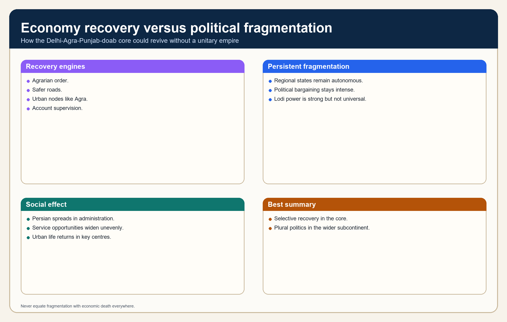

*Economy-versus-politics visual. It shows how the Lodi north-Indian core could recover through roads, accounting, agriculture and cities even while the wider subcontinent remained politically plural.*

#### Nuanced Sikandar table

| Domain | Secure evidence | Better interpretation |
|---|---|---|
| Religion | Jizyah, campaign-time temple destruction, anti-sharia practice bans | Juristic ordering mattered, but it does not exhaust the reign |
| Culture | Grants to scholars, Persian learning, Sanskrit-to-Persian translations, music | Statecraft and literary patronage coexisted with orthodoxy |
| Administration | Justice emphasis, safe roads, cheap prices, accounts | Recovery of the north-Indian core was real |
| Language and society | More Hindus learning Persian and entering office | Pragmatic cultural interaction continued despite ideological tension |

#### PARAGRAPH DEMONSTRATION — CLAIM → EVIDENCE → ANALYSIS → QUALIFICATION

**Claim:** Sikandar Lodi's religious-cultural record demands balance rather than caricature. **Named evidence/example:** Topic 06 retains Persian learning, literary culture and patronage, yet also notes orthodox and temple-restriction episodes that require event-specific chronology. **Analysis:** the coexistence of these strands is precisely what makes him analytically interesting: state-building, court culture and sharper juristic action were not mutually exclusive. **Qualification:** the safest answer avoids both extremes—'pure tolerance' and 'civilisational darkness'—and keeps each claim tied to specific evidence rather than mood.

#### CLOSING RECALL FLOW — SIKANDAR LODI BEYOND THE BINARY: ORTHODOXY, CULTURE, LANGUAGE AND ECONOMIC RECOVERY

```text
START / CONCEPT: sikandar lodi beyond the binary: orthodoxy, culture, language and economic recovery
        |
        v
EXACT TERMS: Sikandar Lodi beyond the binary · orthodoxy · culture · language · economic recovery · Gulrukhi
        |
        v
MECHANISM / ARGUMENT: Sikandar's court could sponsor Persianate culture while also enforcing sharper religious policies in particular contexts.
        |
        v
CONSEQUENCE / CONTRAST: This mixed profile makes his reign source-bounded and analytically richer than one-word verdicts allow.
        |
        v
UPSC TRAP / ANSWER-USE: Do not call Sikandar only tolerant or only intolerant; Topic 06 expressly requires a balanced, event-specific reading.
        |
        v
ANSWER-GRABBING FORMULATION: Sikandar's reign is best read as administratively effective and culturally active, yet also capable of sharper juristic-religious coercion.
```
### SESSION 17 — IBRAHIM LODI: CENTRALISING MONARCHY, AFGHAN RESENTMENT AND DYNASTIC FRACTURE

#### DEFINITION / WHAT THIS IS CALLED

**Plain-language definition:** The local Part II OCR presents Ibrahim Lodi as more energetic and ambitious than a simple "last weak ruler" stereotype suggests.

**Technical definition:** The more he tried to move from a negotiated Afghan kingship toward a tighter monarchy, the more he threatened elites who believed they had customary rights to status, office and consultation.

#### ANSWER-GRABBING OPENING — WRITE/ADAPT IN THE EXAM

> The local Part II OCR presents Ibrahim Lodi as more energetic and ambitious than a simple "last weak ruler" stereotype suggests.

#### MUST-WRITE KEYWORDS

- **Ibrahim Lodi**
- **centralising monarchy**
- **Afghan resentment**
- **dynastic fracture**
- **Alam Khan**
- **Daulat Khan Lodi**

**How to use them:** Define Ibrahim's centralising monarchy first, then show how noble removals, Afghan resentment, Daulat Khan or Alam Khan, and Rana Sanga's context turned policy into dynastic fracture.

[FACT] The local Part II OCR presents Ibrahim Lodi as more energetic and ambitious than a simple "last weak ruler" stereotype suggests. He sought to strengthen royal authority and curb noble independence.

[FACT] The same OCR also emphasises that this effort alienated powerful Afghan nobles and relatives. His uncle **Alam Khan** and the Punjab governor **Daulat Khan Lodi** became central to the anti-Ibrahim alignment that later opened the way for Babur.

[ANALYSIS] Ibrahim's problem was structural. The more he tried to move from a negotiated Afghan kingship toward a tighter monarchy, the more he threatened elites who believed they had customary rights to status, office and consultation. Thus centralisation created resistance before it created capacity.

[LIMIT] Rana Sanga enters Topic 06 only as a bounded contextual factor. Late Lodi-Rajput conflict weakened Ibrahim's position and widened the field of north-Indian contest, but Topic 06 does not turn Panipat into a simple "Rajput invitation" story. Source traditions about who invited Babur and with what expectation must be handled cautiously.

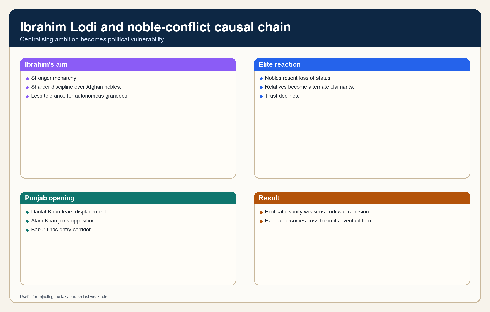

*Causal-chain visual. It links Ibrahim's centralising push to Afghan noble alienation, factional invitations and the strategic opening for Babur.*

#### Why Ibrahim failed to stabilise the throne

| Pressure point | Mechanism | Effect |
|---|---|---|
| Stronger royal assertion | Reduced noble autonomy | Deepened Afghan elite resentment |
| Kin rivalry | Relatives became alternative nodes of legitimacy | Enabled Alam Khan's political use |
| Punjab instability | Daulat Khan feared replacement and loss | Opened gateway to Babur's intervention |
| Rajput challenge | Continuous strategic distraction | Reduced Delhi's ability to face one threat at a time |

#### PARAGRAPH DEMONSTRATION — CLAIM → EVIDENCE → ANALYSIS → QUALIFICATION

**Claim:** Ibrahim Lodi failed through conflict-ridden assertion, not simple inertia. **Named evidence/example:** Topic 06 links him to noble removals, centralising monarchy, tension with Daulat Khan Lodi and Alam Khan, and the wider Rana Sanga zone of opportunity before Babur. **Analysis:** this makes the crisis intelligible: a king trying to tighten command inside a political culture that expected consultation and status. **Qualification:** Ibrahim should neither be mocked as an empty weakling nor rehabilitated into a successful centraliser; the point is that his strategy sharpened rebellion faster than it produced stable obedience.

#### CLOSING RECALL FLOW — IBRAHIM LODI: CENTRALISING MONARCHY, AFGHAN RESENTMENT AND DYNASTIC FRACTURE

```text
START / CONCEPT: ibrahim lodi: centralising monarchy, afghan resentment and dynastic fracture
        |
        v
EXACT TERMS: Ibrahim Lodi · centralising monarchy · Afghan resentment · dynastic fracture · Alam Khan · Daulat Khan Lodi
        |
        v
MECHANISM / ARGUMENT: Ibrahim's attempt to harden monarchy alienated major Afghan nobles and princely relatives whose cooperation the dynasty still needed.
        |
        v
CONSEQUENCE / CONTRAST: That political fracture opened corridors through Punjab and diplomacy that Babur could exploit.
        |
        v
UPSC TRAP / ANSWER-USE: Do not discuss Babur without first explaining the Lodi elite crisis that made outside intervention politically useful to some insiders.
        |
        v
ANSWER-GRABBING FORMULATION: Ibrahim Lodi's fall began within the dynasty: centralising assertion collided with an elite order that still expected bargaining, honour and share.
```
### SESSION 18 — THE ROAD TO PANIPAT: BABUR'S AIMS, PUNJAB POLITICS AND COALITION BREAKDOWN

#### DEFINITION / WHAT THIS IS CALLED

**Plain-language definition:** The OCR describes Babur's negotiations and contests involving Daulat Khan Lodi, Alam Khan, and the unstable politics of Lahore and Punjab.

**Technical definition:** The road to Panipat therefore had three interlocking layers.

#### ANSWER-GRABBING OPENING — WRITE/ADAPT IN THE EXAM

> The road to Panipat therefore had three interlocking layers.

#### MUST-WRITE KEYWORDS

- **The road to Panipat**
- **Babur's aims**
- **Punjab politics**
- **coalition breakdown**
- **Timurid claims**
- **Daulat Khan Lodi**

**How to use them:** Trace the route from Kabul to Punjab, insert Daulat Khan and Alam Khan, and then explain why Babur entered an active coalition field rather than an empty India.

[FACT] Topic 12 and the Part II OCR agree that Babur's Indian advance cannot be read merely as a random invasion. He had long searched for a stable territorial base, invoked **Timurid claims**, and saw north India as both opportunity and compensation after struggles in Central Asia.

[FACT] Punjab politics mattered decisively. The OCR describes Babur's negotiations and contests involving **Daulat Khan Lodi**, **Alam Khan**, and the unstable politics of Lahore and Punjab. He did not simply march from Kabul to Delhi in one straight, uncontested sweep.

[ANALYSIS] The road to Panipat therefore had three interlocking layers:

1. **Babur's ambition and Timurid claim language.**
2. **Lodi factional fracture in Punjab and among Afghan nobles.**
3. **A larger north-Indian field in which Rajputs, Afghans and regional rulers were all calculating advantage.**

[DEBATE] The invitation narrative is real but easy to oversimplify. It is safer to say that disgruntled Lodi factions and frontier actors **opened a political corridor** for Babur than to say they fully controlled him or knew the final consequences.

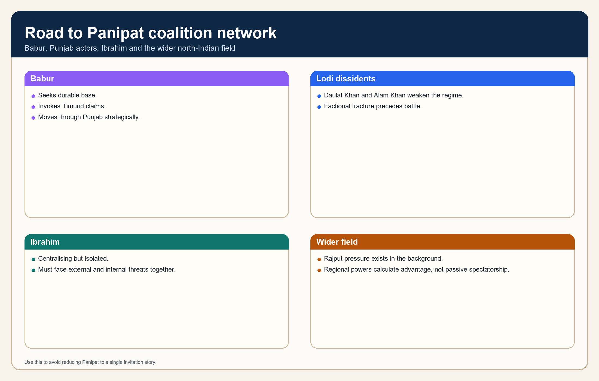

*Coalition-network visual. It shows Babur, Punjab actors, Ibrahim, Afghan dissidents and Rajput pressure as a networked crisis rather than a single invitation story.*

#### PARAGRAPH DEMONSTRATION — CLAIM → EVIDENCE → ANALYSIS → QUALIFICATION

**Claim:** Babur entered north India through invitation politics and strategic opportunity, not through a vacuum. **Named evidence/example:** Topic 06 names Kabul-Punjab movement, Daulat Khan Lodi, Alam Khan and the debated wider field around Rana Sanga. **Analysis:** this means Babur's advance must be read as an intervention into an already active conflict-system in which insiders sought outside help against Ibrahim. **Qualification:** the exact character of every communication or promise is debated, so the answer should stress the coalition field rather than overstate one perfect invitation narrative.

#### CLOSING RECALL FLOW — THE ROAD TO PANIPAT: BABUR'S AIMS, PUNJAB POLITICS AND COALITION BREAKDOWN

```text
START / CONCEPT: the road to panipat: babur's aims, punjab politics and coalition breakdown
        |
        v
EXACT TERMS: The road to Panipat · Babur's aims · Punjab politics · coalition breakdown · Timurid claims · Daulat Khan Lodi
        |
        v
MECHANISM / ARGUMENT: Babur's opportunity emerged because dissatisfied Lodi elites and wider rivals made Punjab a politically open corridor.
        |
        v
CONSEQUENCE / CONTRAST: His entry therefore rested on both external preparation and internal fracture within north India.
        |
        v
UPSC TRAP / ANSWER-USE: Do not present Babur as invading an empty India or as acting only because one letter mechanically summoned him.
        |
        v
ANSWER-GRABBING FORMULATION: Babur's advance became possible when Kabul-based ambition met a fractured north-Indian coalition field already riven by Lodi conflicts.
```
### SESSION 19 — FIRST BATTLE OF PANIPAT (1526): BATTLEFIELD SYSTEM, TECHNOLOGY AND ORGANISATION

#### DEFINITION / WHAT THIS IS CALLED

**Plain-language definition:** The secure exam line is that Ibrahim's army was larger, Babur's was smaller but better organised, and victory came from system, discipline and leadership - not guns alone.

**Technical definition:** Technically, Panipat was won by a battle-system that integrated artillery, araba barriers, tactical gaps, tulughma manoeuvre, cavalry and disciplined command against a politically divided opponent.

#### ANSWER-GRABBING OPENING — WRITE/ADAPT IN THE EXAM

> The secure exam line is that Ibrahim's army was larger, Babur's was smaller but better organised, and victory came from system, discipline and leadership - not guns alone.

#### MUST-WRITE KEYWORDS

- **araba**
- **tulughma**
- **artillery**
- **cavalry manoeuvre**
- **Lodi fracture**
- **battle-system integration**

**How to use them:** Sequence araba and artillery first, tulughma and cavalry manoeuvre second, and then add Lodi fracture to show one integrated battle-system.

[FACT] The local Part II source emphasises that Babur had studied **Ottoman gunpowder methods** and in 1525-26 brought with him the experienced Ottoman gunners **Ustad Ali** and **Mustafa**. At Panipat he arranged carts in front, tied them with rawhide ropes, left tactical gaps for cavalry movement, and placed artillery and matchlock men effectively.

[FACT] The same source describes Babur's use of **tulughma/tulghuma** manoeuvre - mobile flank divisions that could envelop the enemy - together with field fortification and firearms. Ibrahim Lodi, by contrast, commanded a much larger host and many war elephants, but his army lacked the same coordinated battle-system.

[LIMIT] Exact numbers of troops and elephants differ across traditions and should not be repeated mechanically. The secure exam line is that Ibrahim's army was **larger**, Babur's was **smaller but better organised**, and victory came from system, discipline and leadership - **not guns alone**.

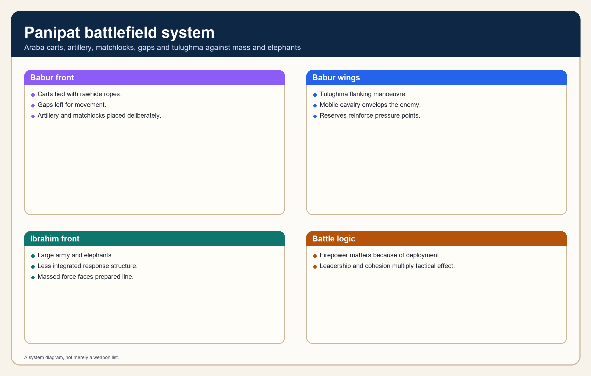

*Battle-system visual. It contrasts Babur's carts, artillery, matchlocks, gaps and flanking manoeuvre with Ibrahim's massed force and elephants.*

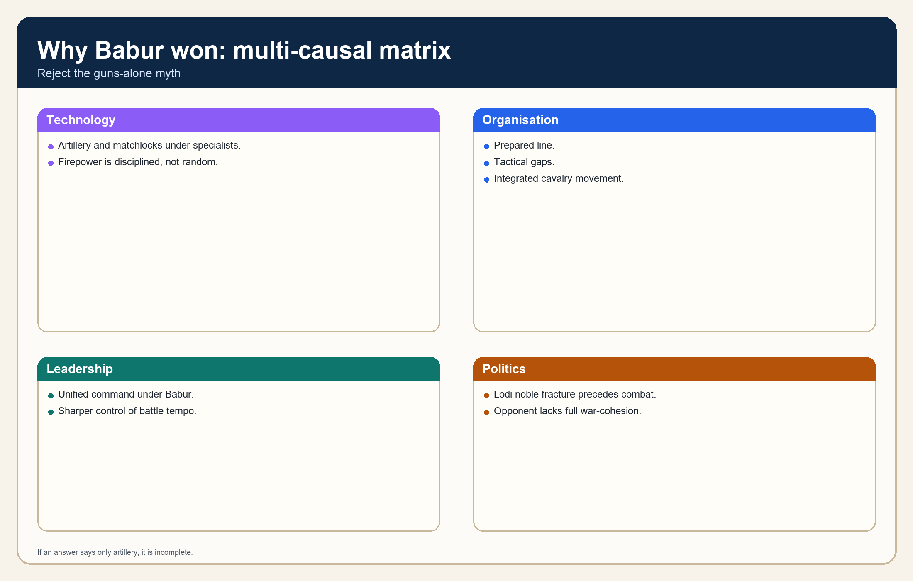

*Victory-matrix visual. It argues for guns plus organisation plus leadership plus coalition failure, not a monocausal technology myth.*

#### Why "guns alone" is wrong

| Factor | Babur's advantage | Ibrahim's weakness |
|---|---|---|
| Artillery / matchlocks | Controlled placement under specialists | Weaker integration with battlefield doctrine |
| Field fortification | Araba-cart line, ropes and firing positions | Mass frontal pressure became costly |
| Mobility | Tulughma flanking and reserve use | Less flexible command response |
| Leadership | Cohesive direction under one commander | Internal distrust and weaker coordination |
| Politics | Opponent already factionally strained | Noble alienation reduced war-cohesion |

#### PARAGRAPH DEMONSTRATION — CLAIM → EVIDENCE → ANALYSIS → QUALIFICATION

**Claim:** Panipat cannot be explained by 'guns alone'. **Named evidence/example:** Topic 06 stresses field artillery and firearms, araba carts or barriers, tulughma flanking manoeuvre, cavalry, intelligence, discipline and the political weakness of Ibrahim's side. **Analysis:** the key is integration: weapons became decisive because they were embedded in preparation, command and manoeuvre against a less coherent opponent. **Qualification:** exact troop and casualty numbers remain uncertain, so the argument should rest on system and leadership rather than false numerical precision.

#### CLOSING RECALL FLOW — FIRST BATTLE OF PANIPAT (1526): BATTLEFIELD SYSTEM, TECHNOLOGY AND ORGANISATION

```text
START / CONCEPT: first battle of panipat (1526): battlefield system, technology and organisation
        |
        v
EXACT TERMS: araba · tulughma · artillery · cavalry manoeuvre · Lodi fracture · battle-system integration
        |
        v
MECHANISM / ARGUMENT: Babur won because artillery, carts, tactical gaps, manoeuvre and command were organised into one coherent battlefield method.
        |
        v
CONSEQUENCE / CONTRAST: Technology mattered, but it mattered through integration with leadership, discipline and the exploitation of Lodi fracture.
        |
        v
UPSC TRAP / ANSWER-USE: Do not replace explanation with a slogan like 'gunpowder beat the medievals'; Topic 06 rejects technological determinism.
        |
        v
ANSWER-GRABBING FORMULATION: At Panipat, firearms were effective because they were woven into a disciplined battle-system, not because weapons alone automatically decide history.
```
### SESSION 20 — TRANSITION FROM SULTANATE TO MUGHAL RULE: WHY 1526 WAS DECISIVE BUT NOT FINAL

#### DEFINITION / WHAT THIS IS CALLED

**Plain-language definition:** The correct formula is: decisive as dynastic replacement, non-final as territorial consolidation.

**Technical definition:** The Part II OCR directly warns that Panipat, despite being decisive in one sense, was not really decisive politically in the broader subcontinental sense.

#### ANSWER-GRABBING OPENING — WRITE/ADAPT IN THE EXAM

> The Part II OCR directly warns that Panipat, despite being decisive in one sense, was not really decisive politically in the broader subcontinental sense.

#### MUST-WRITE KEYWORDS

- **Transition from Sultanate to Mughal rule**
- **not really decisive**
- **Rana Sanga**
- **decisive as dynastic replacement, non-final as territorial consolidation**
- **Persianate political culture continued**
- **Gunpowder-field tactics gained prestige**

**How to use them:** Define the transition from Sultanate to Mughal rule through Panipat 1526, add the 'not really decisive' caution, bring in Rana Sanga, and then contrast dynastic replacement with continued Persianate continuity and incomplete territorial consolidation.

[FACT] The Part II OCR directly warns that Panipat, despite being decisive in one sense, was **not really decisive** politically in the broader subcontinental sense. Delhi and Agra came to Babur, but the Afghans were not extinguished and Babur still had to face **Rana Sanga** and later eastern-Afghan resistance.

[ANALYSIS] The correct formula is: **decisive as dynastic replacement, non-final as territorial consolidation**. Ibrahim died, the Lodi monarchy collapsed, and Babur occupied the Delhi-Agra core; but all India did not thereby become a settled Mughal empire overnight.

[ANALYSIS] Equally important, Mughal rule initially built upon continuities. Administrative practices, revenue habits, urban centres, Persianate court language, service elites and regional power calculations did not vanish at Panipat. The transition was substantial, but it was not civilisational tabula rasa.

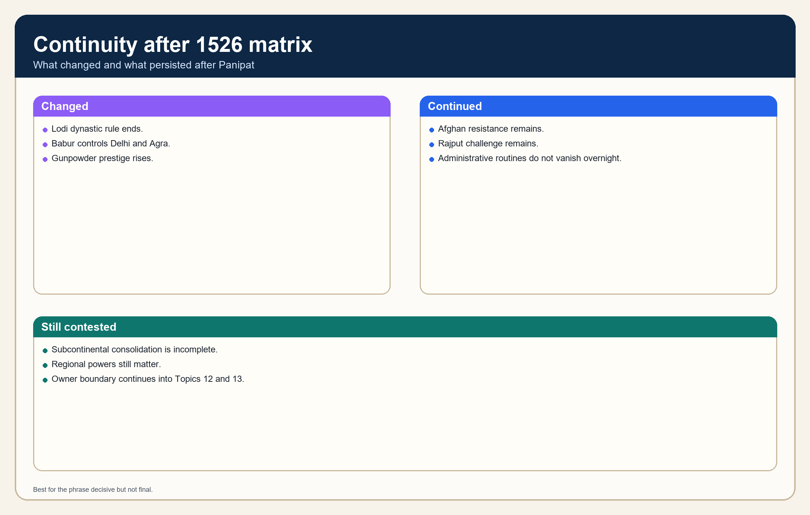

*Transition visual. It separates what changed in 1526 from what persisted into the early Mughal phase.*

#### Change versus continuity after 1526

| Changed quickly | Continued substantially |
|---|---|
| Lodi dynastic rule at the centre ended | Revenue routines and agrarian extraction still required old intermediaries |
| Babur became master of Delhi and Agra | Persianate political culture continued |
| Gunpowder-field tactics gained prestige | Regional powers and Afghan resistance remained real |
| Timurid-Mughal claim entered north-Indian politics | Administrative personnel and local bargaining did not disappear overnight |

#### PARAGRAPH DEMONSTRATION — CLAIM → EVIDENCE → ANALYSIS → QUALIFICATION

**Claim:** Panipat was decisive, but not final in every sense. **Named evidence/example:** Topic 06 states that Lodi rule at the centre ended in 1526, yet Khanwa, Chanderi and Ghagra still lay ahead for Babur. **Analysis:** this distinction is essential because it separates dynastic replacement from territorial consolidation; otherwise the answer jumps from one battle to a completed empire. **Qualification:** Panipat was still a major watershed, so caution about immediate consolidation should not become understatement about the battle's political significance.

#### CLOSING RECALL FLOW — TRANSITION FROM SULTANATE TO MUGHAL RULE: WHY 1526 WAS DECISIVE BUT NOT FINAL

```text
START / CONCEPT: transition from sultanate to mughal rule: why 1526 was decisive but not final
        |
        v
EXACT TERMS: Transition from Sultanate to Mughal rule · not really decisive · Rana Sanga · decisive as dynastic replacement, non-final as territorial consolidation · Persianate political culture continued · Gunpowder-field tactics gained prestige
        |
        v
MECHANISM / ARGUMENT: Panipat destroyed Lodi central kingship and handed Delhi-Agra to Babur, but it did not remove every Afghan or Rajput challenge at once.
        |
        v
CONSEQUENCE / CONTRAST: The new regime thus inherited both victory and unfinished consolidation work.
        |
        v
UPSC TRAP / ANSWER-USE: Do not write 'Mughal Empire fully created in 1526' without qualifying the continuing wars that followed.
        |
        v
ANSWER-GRABBING FORMULATION: 1526 ended one dynasty at the centre; it did not instantly settle the wider subcontinental struggle for power.
```
### SESSION 21 — LODI ADMINISTRATION, ARMY, ECONOMY AND SOCIETY

#### DEFINITION / WHAT THIS IS CALLED

**Plain-language definition:** Lodi administration is best described as a partly restored military-fiscal monarchy under persistent bargaining pressure.

**Technical definition:** The OCR attributes to Sikandar Lodi closer account-checking, attention to justice, agricultural concern, safe routes, and measures such as the gazz-i-Sikandari and grain-octroi abolition.

#### ANSWER-GRABBING OPENING — WRITE/ADAPT IN THE EXAM

> Lodi administration is best described as a partly restored military-fiscal monarchy under persistent bargaining pressure.

#### MUST-WRITE KEYWORDS

- **Lodi administration**
- **army**
- **economy**
- **society**
- **gazz-i-Sikandari**
- **Delhi-Agra-Punjab-Doab**

**How to use them:** Begin with Lodi administration and army, connect them to economy and society, then use the gazz-i-Sikandari and the Delhi-Agra-Punjab-Doab core to show selective recovery.

[FACT] Under the Lodis, the old iqta-jagir logic did not disappear; instead it operated in a more intensely Afghan political field. Provincial governance still depended on office-holders, jagirdars, local allies and military commanders who had to be supervised rather than merely appointed.

[FACT] The OCR attributes to Sikandar Lodi closer account-checking, attention to justice, agricultural concern, safe routes, and measures such as the **gazz-i-Sikandari** and grain-octroi abolition. These suggest an administration trying to rebuild the **Delhi-Agra-Punjab-Doab** core materially.

[ANALYSIS] Lodi administration is best described as a **partly restored military-fiscal monarchy under persistent bargaining pressure**. Its army remained heavily dependent on cavalry and nobles' retainers; its fiscal success depended on supervision and agrarian prosperity; and its provincial governance never became mechanically centralised.

[ANALYSIS] Socially and economically, political fragmentation did not equal death. Urban life recovered in key centres, Agra rose, the doab remained important, and Persian language spread further in administration even as vernacular and Sufi networks continued to thicken across the landscape.

#### PARAGRAPH DEMONSTRATION — CLAIM → EVIDENCE → ANALYSIS → QUALIFICATION

**Claim:** The Lodis rebuilt a functioning north-Indian core through administration as well as war. **Named evidence/example:** Topic 06 points to jagir supervision, revenue order, roads, justice, urban growth in the Delhi-Agra zone and continuing Persianate administration. **Analysis:** this matters because it disproves the idea that late-Sultanate politics was only chaos; parts of the north experienced selective recovery and harder state capacity. **Qualification:** recovery remained uneven and politically fragile, which is why Ibrahim could still face a severe elite crisis despite this stronger inherited core.

#### CLOSING RECALL FLOW — LODI ADMINISTRATION, ARMY, ECONOMY AND SOCIETY

```text
START / CONCEPT: lodi administration, army, economy and society
        |
        v
EXACT TERMS: Lodi administration · army · economy · society · gazz-i-Sikandari · Delhi-Agra-Punjab-Doab
        |
        v
MECHANISM / ARGUMENT: Lodi recovery depended on making the Delhi-Agra-Doab heartland more governable through supervision, transport security and agrarian order.
        |
        v
CONSEQUENCE / CONTRAST: This administrative rebuilding helps explain why Babur inherited institutions rather than a blank landscape.
        |
        v
UPSC TRAP / ANSWER-USE: Do not confuse political fragmentation with the permanent disappearance of routes, towns or Persianate administrative practice.
        |
        v
ANSWER-GRABBING FORMULATION: The later Lodis show that fragmentation and recovery can coexist: even a contested polity can rebuild roads, revenue and urban life in a core zone.
```
### SESSION 22 — SAYYID-LODI ARCHITECTURE: BOUNDED FORMS, TOMB LANDSCAPES AND THE ROAD TO MUGHAL GARDEN-TOMBS

#### DEFINITION / WHAT THIS IS CALLED

**Plain-language definition:** The late Sultanate and Lodi period saw a growing preference for tombs on high platforms, the use of octagonal and square plans, and the shaping of tombs within garden settings that later anticipate Mughal funerary landscapes.

**Technical definition:** The architecture note specifically marks the double dome as appearing in India in the period that moves from Sikandar Lodi's tomb toward Humayun's tomb.

#### ANSWER-GRABBING OPENING — WRITE/ADAPT IN THE EXAM

> The late Sultanate and Lodi period saw a growing preference for tombs on high platforms, the use of octagonal and square plans, and the shaping of tombs within garden settings that later anticipate Mughal funerary landscapes.

#### MUST-WRITE KEYWORDS

- **Sayyid-Lodi architecture**
- **bounded forms**
- **tomb landscapes**
- **the road to Mughal garden-tombs**
- **tombs on high platforms**
- **octagonal**

**How to use them:** Identify square and octagonal tombs, high platforms, garden setting and the double-dome transition, then finish with monument-caution and Mughal linkage.

[FACT] The repository art-culture notes and OCR support several secure points. The late Sultanate and Lodi period saw a growing preference for **tombs on high platforms**, the use of **octagonal** and **square** plans, and the shaping of tombs within **garden settings** that later anticipate Mughal funerary landscapes.

[FACT] The architecture note specifically marks the **double dome** as appearing in India in the period that moves from Sikandar Lodi's tomb toward Humayun's tomb. This makes the Lodi phase architecturally transitional and significant.

[LIMIT] Attribution and exact chronology of individual monuments such as **Bara Gumbad** and **Shish Gumbad** can be discussed, but with caution. Topic 06 uses them chiefly as examples of the broader late-Sultanate/Lodi design world, not as a full owner-package on every structure.


*Architecture comparison visual. It contrasts square and octagonal tomb tendencies, garden setting, platform use and the transition toward Mughal funerary form.*

#### Architecture takeaway

| Feature | Why it matters historically |
|---|---|
| Octagonal and square tomb types | Shows experimentation within the late Sultanate idiom |
| High platforms | Enhances monumentality and spatial dominance |
| Garden setting | Prefigures later Mughal charbagh-tomb sensibilities |
| Double-dome transition | Marks technological-formal movement into the sixteenth century |

#### PARAGRAPH DEMONSTRATION — CLAIM → EVIDENCE → ANALYSIS → QUALIFICATION

**Claim:** Sayyid-Lodi architecture matters because it is transitional, not because every monument is uncontested. **Named evidence/example:** Topic 06 highlights square and octagonal tombs, high platforms, garden settings and caution around examples such as Bara Gumbad or Shish Gumbad. **Analysis:** these features help explain how later Mughal funerary landscapes and forms emerged from late-Sultanate experimentation. **Qualification:** the safest answer should avoid monument trivia beyond the secure level of attribution and chronology preserved in the package.

#### CLOSING RECALL FLOW — SAYYID-LODI ARCHITECTURE: BOUNDED FORMS, TOMB LANDSCAPES AND THE ROAD TO MUGHAL GARDEN-TOMBS

```text
START / CONCEPT: sayyid-lodi architecture: bounded forms, tomb landscapes and the road to mughal garden-tombs
        |
        v
EXACT TERMS: Sayyid-Lodi architecture · bounded forms · tomb landscapes · the road to Mughal garden-tombs · tombs on high platforms · octagonal
        |
        v
MECHANISM / ARGUMENT: The phase developed tomb forms, settings and spatial habits that bridge earlier Sultanate traditions and later Mughal funerary architecture.
        |
        v
CONSEQUENCE / CONTRAST: Architectural evidence therefore supports continuity across dynastic change rather than a total aesthetic rupture in 1526.
        |
        v
UPSC TRAP / ANSWER-USE: Do not use debated monuments as if every date and builder were uncontested; keep the example bounded and purposeful.
        |
        v
ANSWER-GRABBING FORMULATION: Sayyid-Lodi architecture is historically valuable as a bridge: it carries forward late-Sultanate forms while preparing ground for Mughal funerary design.
```
### SESSION 23 — SOURCES AND HISTORIOGRAPHY: CONTEMPORANEITY, AGENDA AND THE DECLINE-VERSUS-REGIONALISATION DEBATE

#### DEFINITION / WHAT THIS IS CALLED

**Plain-language definition:** Source handling should follow a simple rule: the closer a source is to events, the more valuable it may be for sequence - but also the more it may serve a live political agenda.

**Technical definition:** Technically, source comparison at the transition to Mughal rule requires reading Timurid court narratives, Babur's self-account, Indian chronicles and later memories for both information and agenda.

#### ANSWER-GRABBING OPENING — WRITE/ADAPT IN THE EXAM

> Source handling should follow a simple rule: the closer a source is to events, the more valuable it may be for sequence - but also the more it may serve a live political agenda.

#### MUST-WRITE KEYWORDS

- **Yazdi**
- **Tuzuk/Malfuzat**
- **Sirhindi**
- **Baburnama**
- **agenda**
- **triangulation**

**How to use them:** Place Yazdi, the Tuzuk/Malfuzat tradition, Sirhindi and the Baburnama side by side, then explain agenda and triangulation as the method for using them.

[FACT] The key textual matrix for Topic 06 includes: Afif as a boundary source for the late Tughlaq world; Yahya bin Ahmad Sirhindi for the early Sayyid frame; Timurid narrative traditions such as Yazdi and the disputed Tuzuk/Malfuzat line for Timur; *Baburnama* for Babur's Indian campaign; later Afghan histories such as Abbas Sarwani for memory of Afghan mobilisation; and coins, inscriptions, architecture and regional outcomes as material checks.

[ANALYSIS] Source handling should follow a simple rule: **the closer a source is to events, the more valuable it may be for sequence - but also the more it may serve a live political agenda**. Later sources may preserve institutional memory but also harden court myths.

[DEBATE] Historiographically, three debates dominate Topic 06:

1. **Decline versus regionalisation:** Was the fifteenth century mainly collapse or redistribution of power?
2. **Timurid rupture versus long structural fragmentation:** Did Timur cause the break, or merely intensify one already underway?
3. **Afghan confederacy versus monarchy:** Were the Lodis trapped by Afghan elite norms, or were they building a workable monarchy that Ibrahim mishandled?


*Source matrix visual. It ranks sources by proximity, agenda and best-use function.*

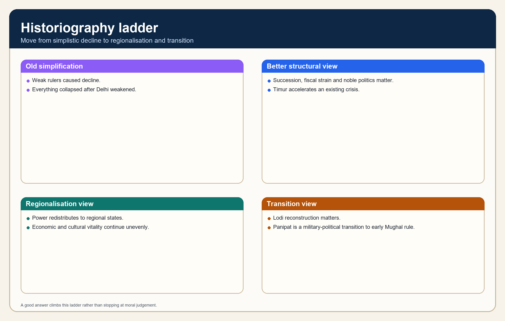

*Historiography visual. It climbs from moralised decline to structural fragmentation, regionalisation and multi-causal military transition.*

#### PARAGRAPH DEMONSTRATION — CLAIM → EVIDENCE → ANALYSIS → QUALIFICATION

**Claim:** Source criticism remains central even when the narrative reaches Babur. **Named evidence/example:** Topic 06 places the *Baburnama* beside Timurid traditions, Sirhindi and wider political evidence. **Analysis:** the memoir gives unmatched campaign texture and self-fashioning, but it is still a ruler's text whose claims gain security only through comparison. **Qualification:** rejecting memoir literature altogether would be as mistaken as treating it as neutral fact; the correct method is evidentiary triangulation.

#### CLOSING RECALL FLOW — SOURCES AND HISTORIOGRAPHY: CONTEMPORANEITY, AGENDA AND THE DECLINE-VERSUS-REGIONALISATION DEBATE

```text
START / CONCEPT: sources and historiography: contemporaneity, agenda and the decline-versus-regionalisation debate
        |
        v
EXACT TERMS: Yazdi · Tuzuk/Malfuzat · Sirhindi · Baburnama · agenda · triangulation
        |
        v
MECHANISM / ARGUMENT: Different source-families preserve different kinds of truth—campaign detail, dynastic self-fashioning, local perspective and retrospective memory.
        |
        v
CONSEQUENCE / CONTRAST: A strong answer therefore names the source and its angle instead of lifting every claim into unquestioned fact.
        |
        v
UPSC TRAP / ANSWER-USE: Wrong: a detailed near-contemporary chronicle is automatically neutral. Correct: political proximity can improve detail while sharpening agenda, so triangulate it with independent textual and material evidence.
        |
        v
ANSWER-GRABBING FORMULATION: The closer the source is to power, the more useful it may be for detail—but also the more carefully its agenda must be read.
```
### SESSION 24 — HISTORICAL SIGNIFICANCE AND GS-I ANSWER SYNTHESIS

#### DEFINITION / WHAT THIS IS CALLED

**Plain-language definition:** Historical significance here means explaining the Delhi Sultanate's decline as a long, multi-causal transition from late-Tughlaq fragmentation to Babur's dynastic breakthrough without erasing regional resilience or institutional continuity.

**Technical definition:** Technically, a strong GS-I synthesis links structural late-Tughlaq weakness, Timur's catalytic raid, Sayyid weak sovereignty, Lodi reconstruction and Panipat's limited but decisive dynastic outcome into one argument.

#### ANSWER-GRABBING OPENING — WRITE/ADAPT IN THE EXAM

> From the late Tughlaqs to Panipat, Topic 06 is best answered as a transition from weakening central command to Babur's dynastic breakthrough, not as a simple story of total collapse.

#### MUST-WRITE KEYWORDS

- **structural decline**
- **Timur's catalytic raid**
- **Sayyid weak sovereignty**
- **Lodi reconstruction**
- **Panipat 1526**
- **administrative continuity**

**How to use them:** Define structural decline first, then sequence Timur's catalytic raid, Sayyid weak sovereignty, Lodi reconstruction and Panipat 1526, and end with administrative continuity as the qualifier.

[ANALYSIS] Topic 06 matters because it explains how north India moved from the high Delhi Sultanate to a new early-modern imperial formation without erasing the intermediate century. It joins political fragmentation, regional resilience, source criticism, Afghan elite politics and gunpowder-era battlefield adaptation in one answer frame.

[ANALYSIS] A strong GS-I conclusion usually says:

- the Tughlaq breakdown after 1388 exposed structural weaknesses already embedded in succession and fiscal-military organisation;
- Timur's 1398 raid devastated Delhi and accelerated prestige collapse but did not conquer all India;
- the Sayyids preserved Delhi's symbol under weak sovereignty;
- the Lodis rebuilt a stronger north-Indian monarchy but could not fully reconcile Afghan noble claims with centralising kingship;
- Panipat in 1526 was won by Babur through multi-causal superiority in leadership, organisation, field fortification, artillery and the exploitation of Lodi factional fracture;
- the victory was decisive in dynastic terms but not instantly final in subcontinental terms.

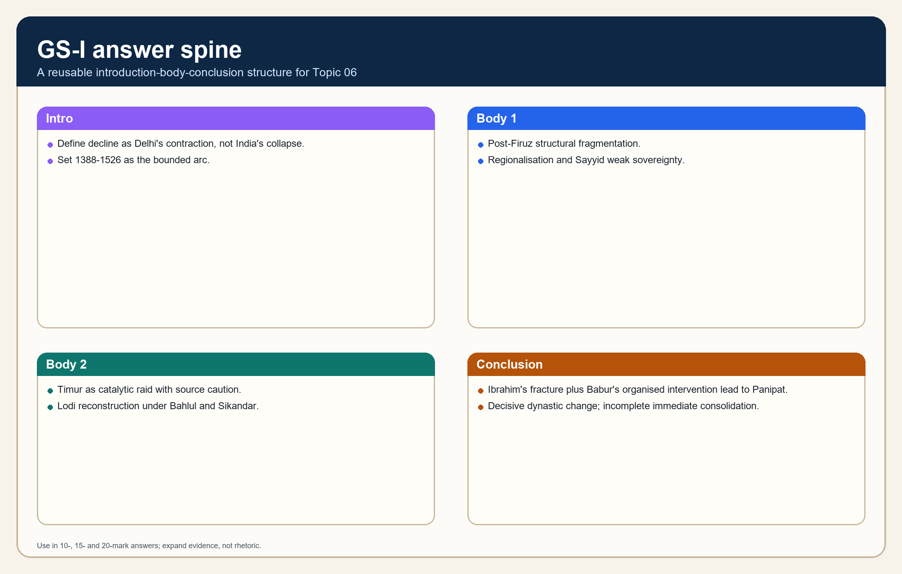

*Answer-spine visual. It gives a reusable introduction-body-conclusion structure for 10-, 15- and 20-mark answers.*

#### 150-word answer spine

1. **Intro:** define decline as Delhi's contraction, not India's collapse.
2. **Body 1:** post-1388 succession, hereditary office, factionalism, provincial autonomy.
3. **Body 2:** Timur's raid as catalytic rupture with source caution.
4. **Body 3:** Sayyid weak sovereignty and symbolic Delhi.
5. **Body 4:** Lodi recovery, Afghan bargaining and Sikandar's state-building.
6. **Body 5:** Ibrahim's elite crisis and Panipat as multi-causal transition.
7. **Conclusion:** 1526 was dynastic replacement plus administrative continuity, not instant all-India consolidation.

#### PARAGRAPH DEMONSTRATION — CLAIM → EVIDENCE → ANALYSIS → QUALIFICATION

**Claim:** The historical significance of Topic 06 lies in its ability to synthesise decline, resilience and transition in one answer. **Named evidence/example:** post-1388 fragmentation, Timur's 1398 raid, Sayyid symbolic survival, Lodi reconstruction, and Panipat's dynastic break together form the secure spine. **Analysis:** this sequence shows how Delhi weakened, why the regional order mattered, how the old centre survived in reduced form, and why Babur's success depended on both internal fracture and battlefield integration. **Qualification:** the conclusion must still avoid two exaggerations: Delhi's decline was not India-wide death, and Panipat was not instant all-India Mughal consolidation.

#### CLOSING RECALL FLOW — HISTORICAL SIGNIFICANCE AND GS-I ANSWER SYNTHESIS

```text
START / CONCEPT: historical significance and gs-i answer synthesis
        |
        v
EXACT TERMS: structural decline · Timur's catalytic raid · Sayyid weak sovereignty · Lodi reconstruction · Panipat 1526 · administrative continuity
        |
        v
MECHANISM / ARGUMENT: A high-scoring answer connects structural weakness, external shock, negotiated survival, partial recovery and dynastic replacement in one disciplined chronology.
        |
        v
CONSEQUENCE / CONTRAST: That synthesis turns Topic 06 from a ruler-list into an argument about political transition, regionalisation and continuity across 1526.
        |
        v
UPSC TRAP / ANSWER-USE: Do not end with a total-collapse cliché or a gunpowder miracle cliché; both erase the topic's multi-causal structure.
        |
        v
ANSWER-GRABBING FORMULATION: Topic 06 matters because it explains how Delhi declined, survived in reduced form, partially recovered under the Lodis, and then gave way to a new dynastic order without losing every institutional inheritance.
```

### MEDIEVAL DEEP-REVIEW CORE CONTROL

- **Must remember:** Timur's 1398 invasion was a major rupture but not the sole cause of Sultanate fragmentation.
- **Close distinction:** Sayyids (1414-51) and Lodis (1451-1526) form distinct phases before Panipat I in 1526.
- **Evidence / interpretation limit:** Afghan noble bargaining and regional states qualify any simple narrative of uninterrupted central decline.

### TOPIC 06 CLOSING DECLINE-TRANSITION LEDGER

#### Timur and Sayyid evidence

| Control | Exam-safe position |
|---|---|
| Late Tughlaq decline | succession, elite faction, fiscal-military weakness, communication and provincial states predate Timur |
| Timur 1398 | Central Asian conquest raid through Punjab to Delhi; plunder, prestige, strategy and religious self-justification interacted |
| Numbers | army, casualty, captive and loot figures are chronicler/memoir claims, not audited statistics |
| Sources | Timurid victory traditions, Yahya Sirhindi, Afif, coins, inscriptions and architecture require genre/date comparison |
| Khizr Khan | Punjab/Multan base, Timurid relationship and limited Delhi sovereignty; Sayyid descent claim is not securely proven |
| Sayyid ladder | Khizr Khan → Mubarak Shah → Muhammad Shah → Alam Shah, with restricted territory and tribute politics |

#### Afghan-Lodi and Panipat controls

- Afghan political networks linked Roh, Punjab and armed noble lineages.
  Consultation/equality claims concerned chiefs, not democratic subjects.
- Bahlul's 1451 accession and prolonged Sharqi-Jaunpur struggle used alliance,
  kinship, bargaining and force.
- Sikandar combined Agra, revenue measurement, grain-market measures, roads,
  noble discipline, Persian culture and case-specific religious orthodoxy.
- Ibrahim's centralization clashed with Afghan chiefs; Daulat Khan, Alam Khan,
  Rana Sanga and regional politics shaped Babur's opening.
- At Panipat, artillery/firearms, carts/araba, tulughma, cavalry, command and
  political defections interacted. Troop/casualty numbers remain uncertain.
- 1526 ended Lodi rule, not all Sultanate institutions or regional resistance.

#### Decline and PYQ ownership

Decline was multi-causal: succession, faction, fiscal-military stress,
provincial state formation, communication distance, Timur and changing warfare.
Revenue assignments, Persian chancery, urban centres, coinage and local
personnel continued into Mughal adaptation without teleology.

The repository routes **zero direct PYQs** to Topic 06. Retained applications:
2021 Q38 -> Topic 05; 2022 Q57 -> Topic 04; 2020 GS-I Q12 -> Topic 24; 2023
GS-I Q12 -> Topic 07.

**Final method:** pre-existing weakness -> external/regional trigger -> ruler and
institution -> continuity -> source limit -> non-teleological verdict.

## BASIC MCQS / REMEDIATION

### Learning MCQ 01

**Question:** Which statement best captures the post-1388 crisis inherited by Topic 06?

- A. It grew from succession disorder combined with hereditary office, factional elites and shrinking central reach.
- B. It was caused only by Timur's later raid.
- C. It resulted mainly from Delhi's conversion into a maritime state.
- D. It was solved immediately by the Sayyids.

**Answer: A.**

**Explanation:** Topic 06 begins with internal weakening already underway before Timur entered north India.

**Option-wise explanation:**
- A. **Correct.** Topic 06 begins with internal weakening already underway before Timur entered north India.
- B. **Incorrect.** Timur's raid came in 1398, after this crisis had already been growing for a decade following Firuz's death in 1388; the raid was not its sole cause.
- C. **Incorrect.** Delhi remained an inland capital; no source records any conversion into a maritime state at any point in this period.
- D. **Incorrect.** The Sayyids inherited, but did not solve, this crisis — their own rule remained restricted and tribute-dependent.

### Learning MCQ 02

**Question:** Which explanatory move is most unsafe for a GS-I answer on the Sultanate's fragmentation?

- A. Connecting fiscal-military strain with noble autonomy.
- B. Explaining everything simply by saying "weak successors followed Firuz".
- C. Treating disintegration as a multi-causal process.
- D. Noting that geography and regional agrarian bases mattered.

**Answer: B.**

**Explanation:** The unsafe move is the reduction of a structural crisis to the lazy weak-successor cliché; the other three are stronger analytical approaches.

**Option-wise explanation:**
- A. **Incorrect.** Connecting fiscal-military strain with noble autonomy is exactly the safe, structural move a strong answer should make.
- B. **Correct.** The unsafe move is the reduction of a structural crisis to the lazy weak-successor cliché; the other three are stronger analytical approaches.
- C. **Incorrect.** Treating disintegration as multi-causal is a safe, well-supported analytical approach, not a risky one.
- D. **Incorrect.** Noting geography and regional agrarian bases is a legitimate structural factor, not an unsafe move.

### Learning MCQ 03

**Question:** Which one-line summary best fits the fifteenth century in north India?

- A. A complete absence of states after Delhi weakened.
- B. A purely religious civil war everywhere.
- C. Delhi's contraction combined with a wider regional balance-of-power system.
- D. A century without urban culture or court patronage.

**Answer: C.**

**Explanation:** Topic 06 consistently distinguishes the weakening of Delhi from the vitality of regional states.

**Option-wise explanation:**
- A. **Incorrect.** Jaunpur, Bengal, Gujarat, Malwa and Mewar remained active states; there was no complete absence of polities.
- B. **Incorrect.** Court patronage, administration and elite politics continued; the century was not reducible to a purely religious civil war.
- C. **Correct.** Topic 06 consistently distinguishes the weakening of Delhi from the vitality of regional states.
- D. **Incorrect.** Jaunpur's "Shiraz of the East" reputation and Sikandar Lodi's own literary patronage contradict an absence of urban culture or court patronage.

### Learning MCQ 04

**Question:** Which description of Timur's 1398 action is safest for UPSC use?

- A. A settled conquest of all India with durable empire-wide administration.
- B. A maritime expedition launched from Gujarat.
- C. A peaceful pilgrimage with no political purpose.
- D. A north-western plundering raid dressed in legitimising language and aimed at a weakened Delhi.

**Answer: D.**

**Explanation:** The safest answer separates Timur's justificatory language from the historically clearer pattern of raid, plunder and withdrawal.

**Option-wise explanation:**
- A. **Incorrect.** Timur withdrew after the sack of Delhi rather than establishing durable empire-wide administration, so "settled conquest" overstates the outcome.
- B. **Incorrect.** Timur's route ran through the Indus/Punjab and north-west land corridor, not a maritime expedition from Gujarat.
- C. **Incorrect.** The sack of Delhi with mass violence and looting is the opposite of a peaceful, apolitical pilgrimage.
- D. **Correct.** A north-western plundering raid dressed in legitimising language and aimed at a weakened Delhi.

### Learning MCQ 05

**Question:** What is the safest numerical approach to Timur's violence at Delhi?

- A. Treat large chronicler numbers as reported claims and keep the core point on real devastation.
- B. Say only Hindus suffered and no Muslims did.
- C. Deny mass violence because exact totals are uncertain.
- D. Quote every body-count literally as verified demographic fact.

**Answer: A.**

**Explanation:** Source criticism requires neither denial nor blind literalism.

**Option-wise explanation:**
- A. **Correct.** Source criticism requires neither denial nor blind literalism.
- B. **Incorrect.** The local concise text records both Hindus and Muslims, women and children, among the killed; the violence was not confined to one community.
- C. **Incorrect.** Denying mass violence altogether contradicts the multiple chronicle accounts of the sack, even after discounting inflated numbers.
- D. **Incorrect.** Chronicler/memoir figures are reported claims, not audited demographic statistics, so quoting them as verified fact overstates their certainty.

### Learning MCQ 06

**Question:** Which statement best captures the Tuzuk/Malfuzat problem?

- A. It is irrelevant because all text sources are useless.
- B. It is best treated with authenticity caution and read against Yazdi, Indian chronicles and material evidence.
- C. It was written by Babur after Panipat.
- D. It is unquestionably Timur's autograph diary and needs no checking.

**Answer: B.**

**Explanation:** Topic 06 uses the text as a source problem, not as an unquestioned archive.

**Option-wise explanation:**
- A. **Incorrect.** Other textual, inscriptional and material sources remain useful even where one memoir tradition needs caution; not all text sources are useless.
- B. **Correct.** It is best treated with authenticity caution and read against Yazdi, Indian chronicles and material evidence.
- C. **Incorrect.** Babur's own memoir is the separate *Baburnama*, written a full century later; it is not this Timurid-attributed text.
- D. **Incorrect.** Its authenticity and transmission are themselves disputed, so calling it an unquestionable autograph diary overstates a certainty the sources withhold.

### Learning MCQ 07

**Question:** Which conclusion about Timur's consequences is the most balanced?

- A. The raid created a durable Timurid all-India administration.
- B. The raid permanently ended all urban life in north India.
- C. The raid caused severe disruption in Delhi and helped enlarge the political vacuum, but it did not erase regional vitality across India.
- D. The raid mattered only symbolically and caused no material damage.

**Answer: C.**

**Explanation:** Topic 06 balances Delhi's severe disruption with the continued vitality of regional political and economic worlds.

**Option-wise explanation:**
- A. **Incorrect.** Timur withdrew rather than staying to administer India, so no durable Timurid all-India administration was created.
- B. **Incorrect.** Delhi, Jaunpur, Agra and other centres continued as functioning urban capitals; urban life was not permanently ended.
- C. **Correct.** The raid caused severe disruption in Delhi and helped enlarge the political vacuum, but it did not erase regional vitality across India.
- D. **Incorrect.** The sack involved real material destruction, looting and deportation of artisans, not merely symbolic effect.

### Learning MCQ 08

**Question:** Which statement about Khizr Khan is the safest?

- A. He was entirely independent of all symbolic Timurid connection from the first day.
- B. He ruled Bengal from Gaur as Timur's naval governor.
- C. He destroyed Jaunpur before entering Delhi.
- D. He recovered Delhi under the shadow of Timurid legitimacy, but his rule rested on local north-Indian bargaining rather than direct Timurid control.

**Answer: D.**

**Explanation:** This is the safe middle line between "pure Timurid dependency" and "no Timurid link at all."

**Option-wise explanation:**
- A. **Incorrect.** Khizr Khan's rule carried a stated Timurid relationship from the outset; it was not entirely independent of that symbolic connection.
- B. **Incorrect.** Khizr Khan's base and capture of Delhi were in the Multan-Punjab-Delhi corridor, not Bengal, and he held no naval office.
- C. **Incorrect.** Jaunpur's Sharqi kingdom survived Khizr Khan's reign and was only annexed later, by Bahlul Lodi in 1484.
- D. **Correct.** He recovered Delhi under the shadow of Timurid legitimacy, but his rule rested on local north-Indian bargaining rather than direct Timurid control.

### Learning MCQ 09

**Question:** Which ruler order of the Sayyid dynasty is correct?

- A. Khizr Khan -> Mubarak Shah -> Muhammad Shah -> Alauddin Alam Shah
- B. Mubarak Shah -> Khizr Khan -> Alauddin Alam Shah -> Muhammad Shah
- C. Alauddin Alam Shah -> Khizr Khan -> Muhammad Shah -> Mubarak Shah
- D. Khizr Khan -> Muhammad Shah -> Mubarak Shah -> Alauddin Alam Shah

**Answer: A.**

**Explanation:** The secure Sayyid sequence runs from Khizr Khan to Alauddin Alam Shah through Mubarak and Muhammad Shah.

**Option-wise explanation:**
- A. **Correct.** The secure Sayyid sequence runs from Khizr Khan to Alauddin Alam Shah through Mubarak and Muhammad Shah.
- B. **Incorrect.** This places Mubarak Shah before Khizr Khan and reverses the final pair; Khizr Khan founded the line and Alam Shah closed it, not the sequence given here.
- C. **Incorrect.** This starts with Alauddin Alam Shah, the dynasty's last ruler, as if he came first, inverting the true order entirely.
- D. **Incorrect.** This swaps Muhammad Shah and Mubarak Shah, whereas Mubarak Shah (1421-34) reigned before Muhammad Shah (1434-45).

### Learning MCQ 10

**Question:** Which phrase best defines the Sayyid state?

- A. A fully restored all-India monarchy.
- B. Delhi-centred weak sovereignty sustained by negotiation, tribute and limited coercive reach.
- C. Complete disappearance of Delhi as a political symbol.
- D. A maritime customs state centred on Bengal's ports.

**Answer: B.**

**Explanation:** The Sayyids mattered because Delhi's symbol survived, but without wide stable control.

**Option-wise explanation:**
- A. **Incorrect.** Sayyid territorial reach was restricted around Delhi, not a fully restored all-India monarchy.
- B. **Correct.** Delhi-centred weak sovereignty sustained by negotiation, tribute and limited coercive reach.
- C. **Incorrect.** Delhi persisted as a functioning political capital and symbol under the Sayyids; it did not disappear.
- D. **Incorrect.** The Sayyids were a Delhi-Punjab land polity with no recorded maritime customs role centred on Bengal.

### Learning MCQ 11

**Question:** Which statement best uses "Afghan political traditions" safely?

- A. Afghan political culture meant modern democratic equality for all subjects.
- B. Afghan nobles had no sense of hierarchy or office in India at all.
- C. Afghan nobles often expected consultation, honour and a share in power, but these norms operated inside changing Indian state conditions.
- D. Afghan rule was automatically weaker because Afghans disliked all monarchy.

**Answer: C.**

**Explanation:** Topic 06 uses Afghan political culture analytically, not as a timeless stereotype.

**Option-wise explanation:**
- A. **Incorrect.** This anachronistically imports a modern democratic concept onto elite consultation among armed noble lineages.
- B. **Incorrect.** Afghan chiefs did recognise hierarchy and office; the norm was consultation among nobles, not the absence of any rank.
- C. **Correct.** Afghan nobles often expected consultation, honour and a share in power, but these norms operated inside changing Indian state conditions.
- D. **Incorrect.** Bahlul and Sikandar both built effective Afghan-based monarchy; Afghan rule was not automatically weaker.

### Learning MCQ 12

**Question:** What was Bahlul Lodi's most durable political achievement?

- A. Turning Delhi into a naval empire.
- B. Re-establishing Tughlaq rule in the Deccan.
- C. Destroying Bengal's port trade.
- D. Building an Afghan north-Indian power-base and ending Sharqi Jaunpur through annexation.

**Answer: D.**

**Explanation:** Bahlul's real strength lay in Punjab-Afghan mobilisation and the defeat of Jaunpur.

**Option-wise explanation:**
- A. **Incorrect.** Bahlul's power base was land-based Punjab-Afghan mobilisation; no naval empire is recorded.
- B. **Incorrect.** Bahlul's achievement was in north India, not a Tughlaq restoration in the Deccan, which remained outside Delhi's reach.
- C. **Incorrect.** Bengal's port trade continued as an independent eastern sultanate's economic base, untouched by Bahlul's campaigns.
- D. **Correct.** Building an Afghan north-Indian power-base and ending Sharqi Jaunpur through annexation.

### Learning MCQ 13

**Question:** Which measure most clearly belongs to Sikandar Lodi's effort to centralise authority over Afghan nobles?

- A. Requiring nobles to honour farmans formally and submit jagir accounts.
- B. Moving the capital permanently to Kabul.
- C. Abandoning all audit and leaving accounts unexamined.
- D. Ending all provincial command in favour of temple corporations.

**Answer: A.**

**Explanation:** Court ritual and fiscal audit were tools to reduce noble equality claims.

**Option-wise explanation:**
- A. **Correct.** Court ritual and fiscal audit were tools to reduce noble equality claims.
- B. **Incorrect.** Sikandar's capital remained in the Delhi-Agra region; there is no record of a permanent move to Kabul, which was Babur's later base.
- C. **Incorrect.** Sikandar tightened, not abandoned, jagir-account scrutiny as part of disciplining Afghan nobles.
- D. **Incorrect.** Sikandar worked through provincial command and revenue administration, not through handing authority to temple corporations.

### Learning MCQ 14

**Question:** Which line best captures Sikandar Lodi's reign?

- A. No Hindu entered service or Persian learning in his time.
- B. Strong administration and literary patronage coexisted with sharper juristic and coercive religious policies.
- C. Pure tolerance without any coercive religious policy.
- D. Total administrative collapse with no urban growth.

**Answer: B.**

**Explanation:** Topic 06 insists on this mixed, source-bounded reading.

**Option-wise explanation:**
- A. **Incorrect.** Persian learning and revenue administration continued to draw on personnel beyond a single community; a total exclusion is not what the sources describe.
- B. **Correct.** Strong administration and literary patronage coexisted with sharper juristic and coercive religious policies.
- C. **Incorrect.** Reported orthodox and temple-restrictive episodes contradict a reading of pure tolerance with no coercive policy.
- D. **Incorrect.** Agra's founding, revenue rolls and road security are evidence of administrative growth, not total collapse.

### Learning MCQ 15

**Question:** Which explanation of Babur's victory at Panipat is strongest?

- A. Ibrahim lost only because his army was numerically smaller.
- B. The battle ended because Delhi's troops refused to enter the field at all.
- C. Babur combined artillery, carts, tactical gaps, tulughma manoeuvre, leadership and a more coherent political-military coalition.
- D. Guns automatically defeat all pre-modern armies regardless of leadership.

**Answer: C.**

**Explanation:** Topic 06 explicitly rejects the "guns alone" story and stresses a multi-causal war system.

**Option-wise explanation:**
- A. **Incorrect.** Numerical army size alone is not the topic's explanation; Ibrahim's larger force was politically fractured, which mattered more than raw numbers.
- B. **Incorrect.** Delhi's troops did fight at Panipat; the battle was not decided by a refusal to engage.
- C. **Correct.** Babur combined artillery, carts, tactical gaps, tulughma manoeuvre, leadership and a more coherent political-military coalition.
- D. **Incorrect.** This "guns automatically win" claim is exactly the technological-determinist myth Topic 06 rejects.

### Learning MCQ 16

**Question:** Which statement best captures the significance of 1526?

- A. It changed nothing except coin design.
- B. It had no importance because only one battle was fought.
- C. It instantly produced uncontested Mughal rule over all India.
- D. It ended Lodi dynastic rule at Delhi-Agra but left major work of consolidation, coalition-building and further warfare still to be done.

**Answer: D.**

**Explanation:** This is the safest line for both Prelims elimination and GS-I analytical writing.

**Option-wise explanation:**
- A. **Incorrect.** 1526 marked a dynastic transition with wide administrative and political consequences, far more than a change in coin design.
- B. **Incorrect.** Panipat was a decisive single battle with major consequences, not an unimportant skirmish.
- C. **Incorrect.** Khanwa, Chanderi and Ghagra remained to be fought; Mughal rule was not instantly uncontested across India.
- D. **Correct.** It ended Lodi dynastic rule at Delhi-Agra but left major work of consolidation, coalition-building and further warfare still to be done.

## PYQS AND ANSWER PRACTICE

### Verified and honestly-adjacent PYQs

#### Adjacent PYQ 01 - UPSC Prelims GS-I 2021 (adjacent chronology route; wording verified locally, option row partly OCR-garbled)

**Question as securely verified from local OCR:** Consider the following statements:

1. It was during the reign of Iltutmish that Chengiz Khan reached the Indus in pursuit of the fugitive Khwarezm prince.  
2. It was during the reign of Muhammad bin Tughluq that Taimur occupied Multan and crossed the Indus.  
3. It was during the reign of Deva Raya II of Vijayanagara Empire that Vasco da Gama reached the coast of Kerala.

**Option-row status:** The local OCR preserves the combination row imperfectly, but earlier validated repository usage supports the standard set containing "1 only", "1 and 2", "3 only" and "2 and 3".

**Inferred answer - not officially verified locally:** **1 only**. Confidence: high.

**Model explanation:** Statement 1 is correct because Chinggis Khan reached the Indus in 1221 while pursuing Jalal al-Din Mangburni during Iltutmish's reign. Statement 2 is incorrect because Timur's Indian invasion belongs to the post-Firuz phase and culminates in 1398, far after Muhammad bin Tughlaq. Statement 3 is incorrect because Vasco da Gama reached Kerala in 1498, not in Deva Raya II's time.  

**Why this earns marks:** It secures chronology and prevents the common error of attaching every north-west frontier episode to Muhammad bin Tughlaq.

**Demand decoding:** Frame a decline answer that links succession politics, elite fragmentation, fiscal-military strain, provincial assertion, Timur's catalytic raid and Panipat's limited finality without collapsing the whole story into one cause.

**Executable exam-length answer / compression plan:** Verify each statement independently, eliminate by chronology, and state clearly that the key used here is inferred from locally preserved wording rather than an officially held answer row in this package.

**How to improve this answer:** Add one sentence showing why the closest distractor fails on chronology so the elimination method becomes explicit, not assumed.

#### Adjacent PYQ 02 - UPSC Prelims GS-I 2022 (adjacent frontier chronology; wording verified locally)

**Question:** With reference to Indian history, consider the following statements:

1. The first Mongol invasion of India happened during the reign of Jalal-ud-din Khalji.  
2. During the reign of Ala-ud-din Khalji, one Mongol assault marched up to Delhi and besieged the city.  
3. Muhammad-bin-Tughlaq temporarily lost portions of north-west of his kingdom to Mongols.

Which of the statements given above is/are correct?

(a) 1 and 2  
(b) 2 only  
(c) 1 and 3  
(d) 3 only

**Inferred answer - not officially verified locally:** **(b) 2 only**. Confidence: high.

**Model explanation:** Statement 1 is incorrect because Mongol pressure on India predates Jalaluddin Khalji. Statement 2 is correct because a major Mongol attack reached Delhi during Alauddin's reign. Statement 3 is not supported in the secure form used in this repository.  

**Why this earns marks:** It separates early frontier pressure from the famous Delhi-siege moment and trains ruler-event discipline.

**Demand decoding:** Answer comparatively: define the chronology problem, verify each frontier statement separately, and avoid projecting Timur or later Lodi-Babur events back onto earlier Mongol episodes.

**Executable exam-length answer / compression plan:** Test each statement against ruler chronology, then eliminate options one by one; finish by separating what is securely supported from what the repository does not endorse in this topic's bounded scope.

**How to improve this answer:** Name the exact ruler-event mismatch in the rejected statement so the examiner sees a specific chronological correction rather than a guess.

#### Adjacent PYQ 03 - UPSC GS-I 2020 (adjacent but highly useful source-criticism question; wording preserved in repository)

**Question:** Persian literary sources of medieval India reflect the spirit of the age. Comment. (Answer in 250 words)

**Model answer:**

Persian literary sources are indispensable for reconstructing medieval India because they preserve the language of kingship, conquest, moral anxiety, administrative aspiration and courtly self-fashioning. Yet they reflect the spirit of the age only when read with **genre and patronage caution**.  

For Topic 06, this method is essential. Timurid victory narratives and later memoir traditions present violence, piety and legitimacy through the conqueror's lens. Yahya bin Ahmad Sirhindi is crucial for the Sayyid world, but he also writes from within a courtly-political frame. *Baburnama* gives vivid first-person detail for the road to Panipat, yet it remains ruler-self-representation, not neutral reportage. Earlier texts such as Barani and Afif likewise reveal the assumptions of elite Persianate politics more fully than the experience of peasants, women or local vernacular communities.  

These works therefore reflect the age in a **refracted** way: they reveal the values of courts, officials, warriors and legitimising intellectuals. Their silence on subaltern life, and their tendency to moralise success and failure, require constant checking against coins, inscriptions, architecture and regional evidence.  

Hence Persian literary sources do reflect the spirit of the age - but mainly the political and ideological spirit of elite society. Used critically and comparatively, they become powerful historical evidence rather than decorative quotation.

**Why this earns marks:** It turns the word *reflect* into a method question, names applicable source families and shows both value and limitation.

**Demand decoding:** Treat this as a source-method question: explain why Persian literary texts are indispensable yet agenda-laden, then show how Topic 06 reads Timurid, Sayyid and Babur-era texts critically.

**Executable exam-length answer / compression plan:** Open with a thesis on value plus limitation; then move through Timurid narratives, Sirhindi, the Baburnama and earlier Persian chronicles before closing with coins, inscriptions and architecture as material checks.

**How to improve this answer:** Strengthen the answer by adding one explicit line on whose experience Persian courtly texts do not represent well.

#### Adjacent PYQ 04 - UPSC GS-I 2023 (adjacent Sultanate-wide technology question; wording preserved in repository)

**Question:** What were the major technological changes introduced during the Sultanate period? How did those technological changes influence the Indian society? (Answer in 250 words)

**Model answer:**

The Sultanate period mattered technologically because it accelerated the diffusion, adaptation and systematisation of techniques in construction, irrigation, warfare and administration. Its importance lay less in isolated inventions than in the **social use of technology for state-building**.  

In building, the stronger use of the true arch, dome and lime mortar changed both engineering possibility and the symbolism of power. In irrigation, canals associated with Firuz Shah show technology tied directly to agrarian expansion and revenue growth. In administration, branding, descriptive rolls, measurement practices and revenue accounting improved the capacity of rulers to supervise men, horses, produce and assignment holders. Topic 06 also reminds us that by the early sixteenth century, firearms and field artillery had entered Indian warfare more systematically; Panipat showed how technology mattered most when integrated with battle-organisation.  

These changes influenced society unevenly. They strengthened capitals, roads, agrarian cores and military-fiscal extraction more than they democratised life. Monumental construction supported courtly urbanity; irrigation expanded cultivation; accounting practices sharpened control over intermediaries; and gunpowder-era methods began to reshape elite warfare.  

Thus Sultanate technology influenced society chiefly by enlarging **state capacity, urban growth and military transformation**, while also deepening hierarchy and resource mobilisation.

**Why this earns marks:** It connects technology with irrigation, architecture, administration and Panipat without reducing the issue to weapons alone.

**Demand decoding:** Treat technology as a society-and-state question: identify the main technological changes, then explain their social effect without reducing the answer to guns alone.

**Executable exam-length answer / compression plan:** Group the answer into architecture, irrigation, administration and warfare; use Panipat only as a bounded example of how technology mattered through organisation and state capacity.

**How to improve this answer:** Add one sentence separating technological adoption from automatic social progress so the answer remains analytical rather than celebratory.

### PYQ verification ledger and scope honesty

- No direct standalone UPSC PYQ devoted only to Timur's raid, the Sayyids, Bahlul, Sikandar or Ibrahim was verified locally in the bounded repository audit set used for this export.
- The package therefore uses **adjacent but honest** PYQs on chronology, Persian sources and Sultanate technology.
- No coaching-question stem is relabelled as an official UPSC PYQ.

### Original solved Mains questions

#### Mains 01 - 10 marks

**Question:** Explain the structural causes of the fragmentation of the Delhi Sultanate after 1388. (Answer in 150 words)

**Model answer:**

- **Claim:** The fragmentation after 1388 was structural, not merely the product of weak successors.  
- **Evidence / source line:** Satish Chandra's concise and Part I discussions emphasise succession disorder, noble-centre conflict, provincial assertion and geographical-regional factors. Topic 05 adds Firuz's hereditary office and weakened military discipline.  
- **Mechanism:** Open succession encouraged civil war; hereditary offices strengthened service families; muqtis and regional commanders retained resources; cavalry-fort maintenance strained finances; distance and ecology favoured provincial autonomy; local agrarian-commercial bases could sustain rival courts.  
- **Significance:** Once Delhi's aura dimmed, Bengal, Gujarat, Malwa and Jaunpur no longer behaved like temporary rebels but as viable states.  
- **Limitation:** Rulers still mattered; structure did not make collapse automatic.  
- **Verdict:** The Sultanate fragmented because institutions of succession, extraction and command were too weak to survive repeated shocks.  

**Why this earns marks:** It moves beyond the cliché of weak successors and builds a five-factor answer with causation.

**Demand decoding:** The demand is explanatory and bounded: define why Firuz's later arrangements hardened elite interests and then show how that weakened post-1388 central discipline without wandering into Timur or Panipat.

**Executable exam-length answer / compression plan:** Use a three-step structure—hereditary office and assignments, stronger service families and factional autonomy, then reduced capacity of the centre to reshuffle, punish and command. End by linking these changes to the later fragmentation problem.

**How to improve this answer:** Name the institutional channel more sharply—iqta/assignment control, office-holding families, slave-noble power—so the answer reads as mechanism, not generic decline language.

#### Mains 02 - 10 marks

**Question:** Assess the impact of Timur's invasion on the Delhi Sultanate. (Answer in 150 words)

**Model answer:**

- **Claim:** Timur's 1398 raid was a devastating catalyst, not the sole cause of the Sultanate's decline.  
- **Evidence / source line:** Local OCR stresses sack, killings, plunder and the carrying away of artisans; the concise volume also says Timur's political effect was limited because he did not stay, yet the invasion marked the end of strong Delhi rule.  
- **Mechanism:** The raid destroyed life and wealth in Delhi, deepened prestige collapse, enlarged the political vacuum and encouraged frontier and provincial actors such as Khizr Khan.  
- **Significance:** It accelerated transition from late Tughlaq weakness to Sayyid weak sovereignty.  
- **Limitation:** Regional vitality elsewhere continued; India as a whole was not conquered or permanently destroyed.  
- **Verdict:** Timur's invasion was a decisive blow to Delhi's core authority, but it operated within a longer process of structural fragmentation already underway.  

**Why this earns marks:** It balances devastation, causation and continuity without either minimising or apocalyptic exaggeration.

**Demand decoding:** This is an assessment question: measure Timur's impact by combining immediate devastation, prestige collapse and political openings with the longer structural weakness that predated the raid.

**Executable exam-length answer / compression plan:** Open with the thesis that Timur was a devastating catalyst, then move through sack and plunder, prestige collapse, openings for actors such as Khizr Khan, and a final qualification that India as a whole was not conquered or uniformly destroyed.

**How to improve this answer:** Make the numerical caution explicit by noting that casualty and loot figures are reported claims, while the fact of severe devastation is secure.

#### Mains 03 - 15 marks

**Question:** "The Sayyid dynasty preserved the symbol of Delhi more than the substance of empire." Examine. (Answer in 250 words)

**Model answer:**

- **Claim:** The statement is substantially correct.  
- **Evidence / source line:** Topic 06 owner files and local OCR place Khizr Khan's Delhi recovery in 1414 under a Timurid legitimacy shadow, while also noting that the Sayyids never became strong empire-builders. The dynasty faced Khokhars in Punjab, Mewatis and Sharqi Jaunpur.  
- **Mechanism:** Delhi remained valuable as a symbol of sovereignty, khutba and courtly precedence. However, control beyond the core required negotiated tribute, intermittent campaigns and compromise with local chiefs. The gap between claim and enforcement widened.  
- **Significance:** The Sayyid phase shows how a state can survive through **symbolic centrality** even after the high-capacity imperial machine has thinned out. It explains why Bahlul Lodi could later take Delhi and still inherit prestige from the city.  
- **Limitation:** Weak sovereignty should not be read as zero importance. Mubarak Shah especially tried to act more assertively, and Delhi still mattered strategically.  
- **Verdict:** The Sayyids preserved the throne's symbolic relevance, but not the broad coercive reach of the Khalji-Tughlaq zenith.  

**Why this earns marks:** It defines symbolism and substance separately and uses them as analytical categories, not rhetoric.

**Demand decoding:** The command is analytical, not descriptive: explain why the Sayyid dynasty preserved the symbol of Delhi more than the substance of empire by separating prestige from coercive reach.

**Executable exam-length answer / compression plan:** Start with Khizr Khan's Timurid shadow and Delhi recovery, then explain tribute politics, limited territorial depth, regional pressures and the distinction between symbolic centrality and strong empire.

**How to improve this answer:** A stronger answer also states that Sayyid descent was claimed rather than proven and avoids language implying either no authority at all or a restored empire.

#### Mains 04 - 15 marks

**Question:** Analyse Sikandar Lodi's contribution to the reconstruction of north-Indian monarchy. (Answer in 250 words)

**Model answer:**

- **Claim:** Sikandar Lodi was the most effective Lodi ruler and the chief architect of the dynasty's administrative consolidation.  
- **Evidence / source line:** Local OCR credits him with making nobles honour farmans, demanding jagir accounts, ensuring justice, safe roads, cheap prices, abolishing grain octroi, introducing gazz-i-Sikandari and founding Agra in 1506.  
- **Mechanism:** He reduced the autonomy of Afghan nobles through court discipline and audit; strengthened the military-fiscal core through measurement and supervision; and shifted strategic focus eastward and southward through Agra. Agrarian and road security improved the revenue base.  
- **Significance:** Under Sikandar, Delhi recovered enough to become once more a serious north-Indian monarchy rather than merely a symbolic seat. His reign also demonstrates that political fragmentation did not preclude material recovery.  
- **Limitation:** His coercive religious actions and orthodoxy complicate any celebratory picture; moreover, noble bargaining remained structurally unresolved and resurfaced sharply under Ibrahim.  
- **Verdict:** Sikandar reconstructed monarchy through discipline, supervision and strategic urban policy, but could not eliminate the contradictions of Afghan-Lodi kingship.  

**Why this earns marks:** It joins political authority, revenue supervision and urban geography in one integrated answer.

**Demand decoding:** This asks for comparison inside one reign: show how Sikandar combined administrative strengthening with a religious-cultural record that cannot be flattened to one label.

**Executable exam-length answer / compression plan:** Organise the answer into administration (Agra, accounts, gazz-i-Sikandari, octroi, roads/justice), then religion/culture (orthodoxy, coercive episodes, Persian learning and patronage), and end with a balanced judgement.

**How to improve this answer:** Add one sentence explaining why the same reign could sustain literary culture and sharper juristic policy simultaneously; that analytical bridge raises the answer above a list.

#### Mains 05 - 20 marks

**Question:** Panipat (1526) was won by Babur not because of firearms alone, but because of a superior military-political system. Discuss. (Answer in 250 words)

**Model answer:**

- **Claim:** Firearms mattered, but Panipat was fundamentally a victory of coordinated system over disjointed mass.  
- **Evidence / source line:** Part II OCR names Ustad Ali and Mustafa, cart-lines tied by rawhide ropes, tactical gaps, artillery and tulughma manoeuvre. It also stresses Ibrahim's larger host and the continuing factional weakness of the Lodi camp.  
- **Mechanism:** Babur used artillery from prepared positions, protected it with carts, preserved mobility through gaps, and enveloped with tulughma cavalry. This tactical design multiplied the value of firearms. Leadership cohesion mattered equally: Babur commanded one organised plan, whereas Ibrahim drew upon a politically strained coalition less capable of flexible response.  
- **Political setting:** Daulat Khan and Alam Khan had already exposed Lodi fracture. Thus battlefield technology rested on prior political disunity.  
- **Significance:** Panipat marks the transition to a new style of north-Indian warfare in which gunpowder, fortification and manoeuvre increasingly worked together.  
- **Limitation:** It would still be wrong to claim that all Indian polities were helpless before guns; later battles show adaptation.  
- **Verdict:** Babur won because firearms were embedded in superior organisation, command, fieldcraft and political timing.  

**Why this earns marks:** It directly addresses the word "alone" and integrates technology with tactics, leadership and politics.

**Demand decoding:** The question asks for causal integration: show how Babur's tactical superiority worked together with Ibrahim's political isolation rather than replacing politics with technology.

**Executable exam-length answer / compression plan:** Use two paired halves—first Ibrahim's conflict with Afghan nobles and the Punjab opening; then Babur's artillery, araba, tulughma, cavalry and disciplined command. The conclusion must state why 'guns alone' is insufficient.

**How to improve this answer:** Make the coalition dimension explicit by naming Daulat Khan or Alam Khan and by noting that Panipat's success rested on a more coherent political-military system, not only better equipment.

#### Mains 06 - 20 marks

**Question:** "The decline of the Delhi Sultanate was also an age of regionalisation, selective recovery and historical transition." Evaluate. (Answer in 250 words)

**Model answer:**

- **Claim:** The statement is the most accurate way to read the fifteenth and early sixteenth centuries.  
- **Evidence / source line:** Part I explicitly warns against reading the age simply as decadence and decline. Bengal, Gujarat, Malwa, Jaunpur and other regional powers remained active. Topic 06 also shows Delhi's urban-political disruption after Timur, Sayyid weak sovereignty, Lodi recovery and Panipat's non-finality.  
- **Mechanism:** After 1388, succession disorder, fiscal-military strain and provincial autonomy weakened Delhi. Timur's 1398 raid deepened that crisis. Yet regional agrarian-commercial bases sustained alternative courts and cultural centres. Under the Lodis, especially Sikandar, the Delhi-Agra-doab core recovered through roads, supervision, measurement and strategic urban policy.  
- **Transition dimension:** Babur's victory at Panipat ended Lodi dynastic rule but did not erase administrative continuities or regional resistance. Thus the period links the high Sultanate to the early Mughal order.  
- **Limitation:** Regionalisation should not obscure the severe damage suffered by Delhi itself; nor should recovery be overstated into full imperial restoration.  
- **Verdict:** The age was one of contraction at the centre, vitality in the regions and eventually a military-political transition to Mughal supremacy.  

**Why this earns marks:** It avoids both collapse-romance and progress-romance, which is exactly what examiners reward in higher-order answers.

**Demand decoding:** This is a concluding synthesis: you must explain why 1526 marks dynastic replacement and transition while still preserving institutional continuity and unfinished consolidation.

**Executable exam-length answer / compression plan:** Open with Panipat as a watershed; then show Lodi central collapse, Babur's inheritance of administrative forms, regionalisation plus selective recovery, and the need for further warfare before wider consolidation. Close with continuity through change.

**How to improve this answer:** The answer improves when it names the surviving institutional forms—Persian chancery, revenue assignments, mints, qazis—and pairs them with later battles to prove that continuity and incompleteness coexisted.

## OPTIONAL ADVANCED DEPTH — NOT REQUIRED FOR A CORE ANSWER

### Decline of the Sultanate: Timur, Sayyids & Lodis — ADVANCED

> **Subject:** History (Medieval India) · **Tier:** Advanced (deeper understanding) · **GS Paper:** GS-I (also Prelims).
> **Grounded in:** Satish Chandra, *Medieval India: From Sultanat to the Mughals — Part I (Delhi Sultanat, 1206–1526)* — chapters "Rise of Regional Kingdoms in North India and a System of Balance of Power" and sections on the Sharqis, Sayyids and Lodis.
> ✅ = from source book · ⚠️ = inference / standard knowledge · 📰 = current affairs.
> *Companion: `basic/06_Decline-Sayyids-Lodis-Timur.md`. Chronology spine: `00_Master-Chronology.md`.*

---

### Mini-timeline

| Date | Event |
|---|---|
| ✅ 1388 | Firuz Shah dies; factional struggle deepens |
| ✅ 1398 | Timur invades and sacks Delhi, hastening Tughlaq collapse |
| ✅ 1412 | Death/end of effective Tughlaq line; Khizr Khan enters Delhi soon after |
| ✅ 1414–51 | Sayyid dynasty rules a weakened Delhi |
| ✅ 1451 | Bahlul Lodi becomes sultan; Afghan dynasty begins |
| ✅ 1484 | Bahlul occupies Jaunpur and annexes the Sharqi kingdom |
| ✅ 1489–1517 | Sikandar Lodi consolidates administration and founds Agra (1506) |
| ✅ 1518/19 | Rana Sanga defeats/pressures Lodi power in the Mewar-Malwa zone |
| ✅ 1526 | Babur defeats Ibrahim Lodi at Panipat; Sultanate phase ends |

### 1. Snapshot & core idea

**Deeper — decline as regionalisation and balance of power.**

✅ Satish Chandra presents the fifteenth century not as simple chaos but as a **system of regional kingdoms** and balance of power after Delhi's collapse. Bengal, Gujarat, Malwa, Jaunpur, Mewar, Kashmir and the Deccan polities all filled the vacuum.
- ✅ Timur's 1398 invasion hastened the fall of the Tughlaqs; before it, two rival kings had already appeared in Delhi/Firuzabad and provincial kingdoms had broken away.
- ✅ Timur assigned Delhi, Multan and Dipalpur to Khizr Khan, but Khizr first retained Punjab/Multan and later entered Delhi after Tughlaq weakness.
- ✅ The Sayyids did not become secure rulers: Khokhars in Punjab, Mewatis and the Sharqis of Jaunpur constantly pressured Delhi.
- ✅ Jaunpur under the Sharqis became a major cultural centre, the "Shiraz of the East," and maintained order in eastern U.P. after Delhi's collapse.

**Deeper — Afghan Lodi consolidation and its limits.**

✅ The Lodi rise marked an Afghan phase: Bahlul Lodi used Afghan mobilisation from Roh and Punjab to overcome the Sharqis and revive Delhi's power over the upper Ganga valley.
- ✅ Afghan nobles had a strong sense of tribal equality; Sikandar Lodi therefore tried to make them stand before him, honour farmans and submit jagir accounts.
- ✅ Sikandar's administration combined discipline, justice, cheap prices, safe highways, grain-octroi abolition, agricultural interest and the **gazz-i-Sikandari** measurement.
- ✅ Yet Afghan ideas of partition and noble autonomy persisted; Bahlul had divided the kingdom among sons/relations, and Sikandar could only partially undo this.
- ✅ Lodi expansion towards eastern Rajasthan and Malwa brought them into conflict with Rana Sanga; Babur's arrival intervened before this struggle was resolved.
- ⚠️ "Afghan tribal equality" should not be romanticised as egalitarian government: it describes bargaining among armed noble lineages, not political equality for subjects.

### 2. Key classification / data

| Power / region | Role in post-Tughlaq north India | Significance |
|---|---|---|
| ✅ Sayyids | Weak Delhi dynasty after Khizr Khan | Transitional, pressure-ridden rule |
| ✅ Sharqis of Jaunpur | Eastern U.P. kingdom; cultural capital | Checked Bengal; challenged Delhi |
| ✅ Lodis | Afghan rulers of Delhi | Revived Delhi from Punjab to Bengal border |
| ✅ Bengal | Independent eastern power | Balanced by Orissa/Jaunpur/Lodis |
| ✅ Gujarat-Malwa-Mewar | Western balance-of-power triangle | Malwa became cockpit of north Indian supremacy |
| ✅ Rana Sanga | Mewar expansion towards Malwa/Agra | Pressured Lodis before Babur |
| ✅ Sikandar Lodi | Strongest Lodi administrator | Agra, revenue rolls, noble discipline |

### 3. Study links

> **Study link:** ✅ Firuz's heredity and weak army → `advanced/05_Tughlaqs.md`.
> **Study link:** ✅ Regional kingdoms (Gujarat, Malwa, Mewar, Bengal) → later `basic/08` / `advanced/08` regional files.
> **Study link:** ⚠️ Afghan political culture → compare with Sher Shah Sur and Afghan opposition to the Mughals.

### 4. Must-Know Facts (Prelims)

- ✅ Timur gave Delhi/Multan/Dipalpur to Khizr Khan, but Khizr's secure base was Multan-Punjab before Delhi.
- ✅ Sayyids were pressured by Khokhars, Mewatis and Sharqis.
- ✅ Malik Sarwar's title **Malik-us-Sharq** gave the Sharqis their name.
- ✅ Jaunpur was called **"Shiraz of the East"** and was known for its own architectural style with lofty gates and huge arches.
- ✅ Bahlul Lodi invited Afghans of **Roh** to India to strengthen his position.
- ✅ Sikandar Lodi made nobles stand before him, honour farmans and submit jagir accounts.
- ✅ Agra was founded/selected by Sikandar Lodi in **1506** for eastern Rajasthan, Malwa/Gujarat route and doab control.
- ✅ Ibrahim Lodi's conflict zone included Mewar/Rana Sanga before Babur arrived.

### 5. UPSC Traps

> 🔑 Trap: The fifteenth century is not a blank "decline" between Sultanate and Mughals; it is a regional-state century.

- ❌ Sayyids were Timurid governors in a simple sense. → They included Timurid names in khutba for some time but were not direct subordinates.
- ❌ Jaunpur was politically insignificant. → It was a major Sharqi state and cultural centre.
- ❌ Lodi centralisation was smooth. → Afghan noble equality and partition ideas limited monarchical authority.
- ❌ Babur entered a political vacuum. → He entered a competitive field shaped by Lodis, Mewar, Malwa and other regional powers.

### 6. 📰 Current link

📰 **Current linkage (verify live before use):** Panipat battlefield commemoration can revive attention to Ibrahim Lodi and Afghan kingship. Verify anniversary programmes and battlefield-heritage claims before citing them.

### 7. Mains angles

- ⚠️ Assess the fifteenth century as a **balance-of-power system** rather than merely the "dark age" of Delhi's decline.
- ⚠️ The Lodi state revived Delhi but could not overcome Afghan noble autonomy fully.
- ⚠️ Timur's raid, Sayyid weakness and Lodi revival together show how external shock, regional assertion and elite politics shaped the end of the Sultanate.

### Concept: Afghan kingship vs Turkish kingship

⚠️ Earlier Turkish rulers stressed awe and hierarchy; Lodi Afghan politics contained a stronger "first among equals" idea, making Sikandar's court discipline especially significant for UPSC comparison.

## CONSOLIDATED REGISTER NOTES

### Final consolidated register notes

#### Register Module 01 - 1388 to 1526 chronology spine

| Date / phase | What to remember | Why it matters |
|---|---|---|
| 1388 | Death of Firuz Shah Tughlaq | Opens post-Firuz succession disorder |
| 1398 | Timur's raid on Delhi | Catalytic rupture, not all-India conquest |
| 1414 | Khizr Khan takes Delhi | Beginning of Sayyid rule under Timurid-legitimacy shadow |
| 1414-1451 | Sayyid dynasty | Symbol of Delhi survives amid weak sovereignty |
| 1451 | Bahlul Lodi takes Delhi | Afghan-Lodi phase begins |
| 1484 | Jaunpur annexed by Bahlul | Major eastern rival removed |
| 1489-1517 | Sikandar Lodi | High point of Lodi reconstruction |
| 1506 | Agra founded by Sikandar | Strategic shift to doab-Rajasthan-Malwa theatre |
| 1517-1526 | Ibrahim Lodi | Centralising ambition, noble conflict |
| 1526 | First Battle of Panipat | Dynastic transition to Babur |

#### Register Module 02 - Structural causes of fragmentation

- Succession remained open and violence-prone.
- Hereditary offices and assignments weakened later central control.
- Noble factions, slave corps and relatives became political actors.
- Provincial commanders and chiefs could retain resources locally.
- Cavalry, forts and communications imposed fiscal strain.
- Ecology and distance favoured regional autonomy.
- Regional agrarian-commercial bases sustained alternative states.
- Delhi's prestige decline amplified every local rebellion.
- Timur accelerated the crisis but did not create all underlying weaknesses.
- Best formula: **structural fragmentation + political shocks**, not "weak successors" alone.

#### Register Module 03 - Delhi contraction versus regional vitality

| Delhi-side decline | Regional-side vitality |
|---|---|
| Weakening coercive core | Bengal, Gujarat, Malwa, Jaunpur, Kashmir remain active |
| Shrinking prestige of the throne | Regional courts patronise culture and politics |
| Difficulty controlling provinces | Agrarian-commercial bases support durable state formation |
| Sayyid weak sovereignty | Balance-of-power logic emerges across regions |

**Memory line:** Delhi declined; India regionalised.

#### Register Module 04 - Timur essentials

- Timur's India campaign was a **plundering raid** in a wider Central Asian imperial career.
- Justification language invoked order and religion; operative motives included wealth, prestige, captives and artisans.
- Route should be stated schematically through the north-west and Punjab to Delhi.
- Delhi was sacked brutally; exact body-count and captive numbers are contested.
- Artisans were carried away to Samarqand.
- He withdrew quickly and did not build a durable Indian empire.
- Consequence: Delhi's prestige fell further; political vacuum widened.
- Do not communalise crudely; urban-political damage affected wider society.
- Safe contrast: **raid, not all-India occupation**.

#### Register Module 05 - Sayyids in one page

| Ruler | Years | Core note |
|---|---|---|
| Khizr Khan | 1414-1421 | Delhi recovered under Timurid-legitimacy shadow |
| Mubarak Shah | 1421-1434 | Most active Sayyid ruler; *Tarikh-i-Mubarak Shahi* era |
| Muhammad Shah | 1434-1445 | Further weakening of central power |
| Alauddin Alam Shah | 1445-1451 | Last Sayyid; transition to Bahlul Lodi |

- Nature of state: tribute, negotiation, limited coercion.
- Pressure points: Khokhars, Mewatis, Sharqis.
- Safe thesis: symbol of Delhi outlived strong empire.

#### Register Module 06 - Afghan political traditions and Bahlul Lodi

- Afghan nobles often expected honour, consultation and distribution of power.
- "First among equals" is a useful but bounded phrase.
- Do not treat "Afghan character" as timeless essence.
- Bahlul built a Punjab-Afghan base.
- He used bargaining and kin-based mobilisation rather than pure central fiat.
- Roh Afghan influx is important but later chronicler rhetoric may exaggerate scale.
- Jaunpur was the key eastern rival.
- 1484 annexation of Jaunpur marked durable Lodi consolidation.

#### Register Module 07 - Sikandar Lodi in one sheet

| Area | Key points |
|---|---|
| Noble control | Nobles honoured farmans; jagir accounts scrutinised |
| Revenue / measure | Gazz-i-Sikandari; supervision; grain-octroi abolition |
| Urban strategy | Agra founded in 1506 |
| Economy | Safe roads, justice, agrarian attention, lower commodity stress |
| Religion / culture | Orthodoxy and coercive acts coexisted with patronage and Persian learning |

**Trap:** Never write "purely tolerant" or "purely intolerant" without nuance.

#### Register Module 08 - Ibrahim and Panipat

- Ibrahim tried to strengthen monarchy more sharply.
- This alienated Afghan nobles and relatives.
- Daulat Khan Lodi and Alam Khan opened a corridor for Babur.
- Rana Sanga is context, not the whole story.
- Babur used artillery, carts, tactical gaps and tulughma.
- Ibrahim had larger numbers and elephants but weaker integration.
- Babur won by **technology + organisation + leadership + Lodi fracture**.
- Panipat ended Lodi rule but not all Afghan resistance.

#### Register Module 09 - Sources and source caution

| Source | Use | Caution |
|---|---|---|
| Yazdi's *Zafarnama* | Timurid court narrative | Legitimising agenda |
| *Tuzuk/Malfuzat* tradition | Later ideological/memoir tradition | Authenticity dispute |
| Yahya bin Ahmad Sirhindi | Early Sayyid frame | Courtly angle |
| *Baburnama* | Panipat and Babur's self-representation | Memoir, not neutral log |
| Abbas Sarwani | Later Afghan memory | Rhetorical exaggeration possible |
| Coins / inscriptions / architecture | Material check | Cannot narrate motive alone |

**Golden rule:** triangulate text with text, then with material evidence.

#### Register Module 10 - Historiography and answer language

- Better than "weak successors": **structural fragmentation**.
- Better than "all-India collapse": **Delhi's contraction and regionalisation**.
- Better than "Timur conquered India": **Timur raided Delhi and withdrew**.
- Better than "Sayyids were irrelevant": **weak sovereignty under symbolic Delhi**.
- Better than "Afghans hated monarchy": **Afghan elite bargaining complicated centralisation**.
- Better than "guns alone": **military-political system at Panipat**.
- Better than "Mughals instantly ruled India": **dynastic victory followed by further consolidation**.

#### One-line final recap

**Topic 06 = post-1388 structural fragmentation -> Timur's catalytic raid -> Sayyid symbolic Delhi -> Lodi Afghan reconstruction -> Ibrahim's elite crisis -> Panipat as multi-causal transition, not instant all-India conquest.**

### COMPLETE TOPIC ASCII MASTER FLOW DIAGRAM

#### ASCII MASTER FLOW — PANEL 1/12: From Firuz's death to Panipat

```ascii-master
1388 Firuz dies -> succession and factional crisis
1398 Timur sacks Delhi -> 1414 Khizr Khan enters Delhi
1414-51 Sayyids -> 1451 Bahlul Lodi
1484 Jaunpur annexed -> 1489-1517 Sikandar Lodi
1526 Ibrahim defeated by Babur at First Panipat
RULE: Delhi contraction, regional vitality and dynastic transition overlap.
MUST REMEMBER: Timur's 1398 invasion was a major rupture but not the sole cause of Sultanate
  fragmentation.
```

#### ASCII MASTER FLOW — PANEL 2/12: Structural fragmentation web

```ascii-master
UNCERTAIN SUCCESSION + HEREDITARY OFFICE + NOBLE FACTION
          |
provincial commanders retain revenue and military resources
          |
distance, communication and army costs weaken rapid central response
          |
regional agrarian-commercial bases sustain alternative courts
          |
DELHI CONTRACTS before Timur; the invasion accelerates an existing crisis.
```

#### ASCII MASTER FLOW — PANEL 3/12: Decline versus regionalisation

```ascii-master
DELHI-CENTRED VIEW               SUBCONTINENTAL VIEW
shrinking coercive reach           Bengal, Gujarat, Malwa and Jaunpur states
prestige loss and civil war        active courts, trade and cultural patronage
Timur's destructive raid          regional political recomposition
VALID CLAIM: Sultanate decline     INVALID CLAIM: all-India civilisational void
BEST FORMULA: central contraction plus regional state formation.
```

#### ASCII MASTER FLOW — PANEL 4/12: Timur's raid as external shock

```ascii-master
CENTRAL ASIA -> INDUS / PUNJAB -> DELHI, 1398
MOTIVES -> plunder + strategy + conquest ideology and self-justification
DELHI -> battle, sack, killing, captivity and severe disruption
WITHDRAWAL -> no durable all-India Timurid administration
POLITICAL EFFECT -> prestige collapse and openings for local powers
CAUTION: dramatic numbers in victory traditions are reported, not verified totals.
```

#### ASCII MASTER FLOW — PANEL 5/12: How to read Timur's evidence

```ascii-master
TIMURID MEMOIR / ZAFARNAMA -> route and justification | victory rhetoric
YAHYA SIRHINDI -> late Tughlaq/Sayyid sequence | Delhi-court perspective
AFIF -> pre-invasion Firuz context | patronage and celebratory framing
COINS / INSCRIPTIONS -> surviving authority | incomplete regional coverage
ARCHITECTURE / URBAN TRACE -> destruction and recovery | patchy survival
NUMBERS -> casualties, captives, armies and loot are reported, not audited
METHOD: source date + genre + claim + corroboration + residual uncertainty.
```

#### ASCII MASTER FLOW — PANEL 6/12: Sayyid ruler ladder and weak sovereignty

```ascii-master
KHIZR KHAN 1414-21 -> Punjab base + Timurid link + limited Delhi sovereignty
MUBARAK SHAH 1421-34 -> campaigns, nobles and assassination
MUHAMMAD SHAH 1434-45 -> faction and restricted authority
ALAM SHAH 1445-51 -> Badaun withdrawal; Bahlul receives Delhi
STATE -> revenue + tribute + nobles + mobile coercion in a narrow core
CAUTION -> Sayyid descent and direct Timurid-subordination claims need evidence
VERDICT: limited state capacity was real history, not an empty interval.
```

#### ASCII MASTER FLOW — PANEL 7/12: Afghan political tradition

```ascii-master
SOLIDARITY -> lineage and Roh recruitment could aggregate fighting power
CONSULTATION -> chiefs expected voice, honour and negotiated distribution
EQUALITY CLAIM -> armed nobles resisted extreme royal distance
MONARCHY PROBLEM -> central audit and discipline looked like status loss
CAUTION -> equality among chiefs was not social equality for subjects
RESULT -> mobilisation strength and recurrent centre-noble tension.
```

#### ASCII MASTER FLOW — PANEL 8/12: Bahlul's consolidation strategy

```ascii-master
PUNJAB / SIRHIND BASE + AFGHAN RECRUITMENT
                |
1451 Delhi takeover through bargaining and opportunity
                |
personal alliance, territorial sharing and repeated campaigning
                |
Sharqi contest -> Jaunpur annexed in 1484
VERDICT: Delhi recovered range, but partition logic remained embedded.
```

#### ASCII MASTER FLOW — PANEL 9/12: Sikandar's state-building toolkit

```ascii-master
NOBLES -> court discipline, farman ritual and jagir account checks
REVENUE -> rent-rolls and gazz-i-Sikandari measurement
ECONOMY -> grain octroi abolition, roads and price stability reports
GEOGRAPHY -> Agra founded in 1506 for doab and western-eastern routes
CULTURE -> Persian learning beside sharper religious orthodoxy
VERDICT: strongest Lodi recovery, still bounded by Afghan bargaining.
```

#### ASCII MASTER FLOW — PANEL 10/12: Ibrahim's fracture and Panipat system

```ascii-master
IBRAHIM CENTRALISES -> Afghan chiefs resist status and autonomy loss
DAULAT KHAN + ALAM KHAN + regional rivals -> coalition fracture
RANA SANGA / MEWAR -> active pressure; relationship with Babur remains debated
BABUR -> cavalry + artillery/firearms + carts/araba + tulughma
TACTICS -> field system + command + intelligence, not artillery alone
NUMBERS -> troop, elephant and casualty figures remain source claims
VERDICT: political contingency and battlefield integration decided Panipat.
CLOSE DISTINCTION: Sayyids (1414-51) and Lodis (1451-1526) form distinct phases before Panipat
  I in 1526.
```

#### ASCII MASTER FLOW — PANEL 11/12: 1526: decisive but not instantly final

```ascii-master
CHANGE -> Lodi dynasty falls and Mughal imperial project enters Delhi-Agra
CONTINUITY -> revenue localities, service elites, forts and agrarian structures
RESISTANCE -> Afghan and Rajput powers remain politically consequential
MILITARY -> field artillery gains salience, but adaptation is organisational
HERITAGE -> Lodi tomb landscapes and repairs preserve late-Sultanate afterlives
RULE: dynastic replacement is not immediate subcontinental consolidation.
EVIDENCE LIMIT: Afghan noble bargaining and regional states qualify any simple narrative of
  uninterrupted central decline.
```

#### ASCII MASTER FLOW — PANEL 12/12: Topic 06 answer spine

```ascii-master
OPEN -> define decline as Delhi's contraction, not India's collapse
CAUSES -> succession, elite autonomy, fiscal-military strain and regional bases
SHOCK -> Timur accelerates weakness; label evidence and numbers cautiously
TRANSITION -> Sayyid symbolism, Bahlul's recovery and Sikandar's administration
ENDGAME -> Ibrahim-noble fracture plus Babur's integrated battlefield system
CLOSE -> 1526 was decisive dynastically, incomplete politically and continuous institutionally.
```
