# Administration, Economy & Society under the Sultanate - Complete Topic Package

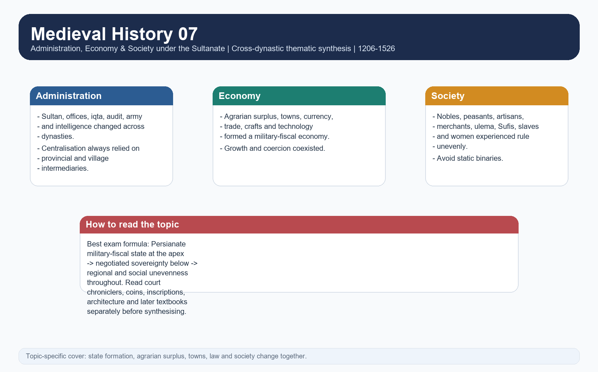

> **Subject:** Medieval Indian History | **Topic:** 07 | **Export date:** 2026-08-16
>
> **Approval:** false - awaiting explicit user approval.
>
> **Source order:** repository Markdown -> local OCR-searchable Satish Chandra concise volume and Part I Sultanate chapters -> bounded repository source-bank on Topics 01 and 03-06 plus Topic 10 and Topic 11 where ownership requires controlled borrowing -> no forced live current-affairs insert -> Qdrant not used.
>
> **Tag rule:** [FACT] source-grounded statement; [ANALYSIS] evidence-led synthesis; [DEBATE] historiographical disagreement or category caution; [LIMIT] evidentiary, chronological or regional qualification.

## BASIC LEARNING SESSION

### DEEP-REVIEW LEARNING CONTRACT

| Control | Binding rule for this package |
|---|---|
| Syllabus boundary | Complete Medieval History Core is taught before optional enrichment. |
| Evidence method | Claim → named site/text/inscription/coin/example → analysis → qualification. |
| Source hierarchy | Archaeology, textual testimony, inscriptions, coins and scholarly interpretation remain visibly distinct. |
| Contested issues | Competing interpretations are attributed, evidenced and bounded; certainty is not manufactured. |
| Practice contract | Every solved item has demand decoding, an examiner-grade model, an executable answer/compression plan, marks rationale and answer-specific improvement. |
| Approval | This immutable successor remains `approved: false` pending explicit approval. |

**Canonical Basic/Core owner:** `upsc-ai-kit\knowledge\Medieval-Indian-History\basic\07_Sultanate-Administration-Economy-Society.md`  
**Canonical topic owner:** `upsc-ai-kit\knowledge\Medieval-Indian-History\basic\07_Sultanate-Administration-Economy-Society.md`  
**Optional Advanced owner:** `upsc-ai-kit\knowledge\Medieval-Indian-History\advanced\07_Sultanate-Administration-Economy-Society.md`  
**Official syllabus mapping:** `upsc-ai-kit\knowledge\Medieval-Indian-History\OFFICIAL-UPSC-SYLLABUS-MAPPING.md`

### EVIDENCE, PYQ AND CURRENT-STATUS CONTROL

- **Archaeological inference:** material context supports bounded reconstruction; absence is not automatic proof of non-existence.
- **Textual testimony:** genre, authorship, redaction, patronage and temporal distance control what a text can prove.
- **Inscription and coin evidence:** contemporary names, titles, claims and circulation are powerful but do not by themselves map uniform territorial control.
- **Scholarly interpretation:** historian labels are arguments to test, not facts to memorise without evidence.
- **PYQ discipline:** repository ledgers and locally held official papers control wording and metadata; reconstructed wording and unavailable official keys must be labelled.
- **Current-status note, rechecked 2026-09-03:** The Reserve Bank of India's Medieval India coinage page was rechecked on 30 August 2026. It describes the consolidation of the tanka and jittal, an attempted standardisation under the Delhi Sultanate, expansion of the money economy and gold, silver and copper issues. This official numismatic bridge supports the package's coinage and monetisation section; its estimates and evaluative language are identified as RBI museum-page claims rather than universal measures of social welfare or uniform market penetration.

**Live/primary context sources recorded by the predecessor generation:**

- `https://www.rbi.org.in/commonman/English/Currency/Scripts/Medieval.aspx`

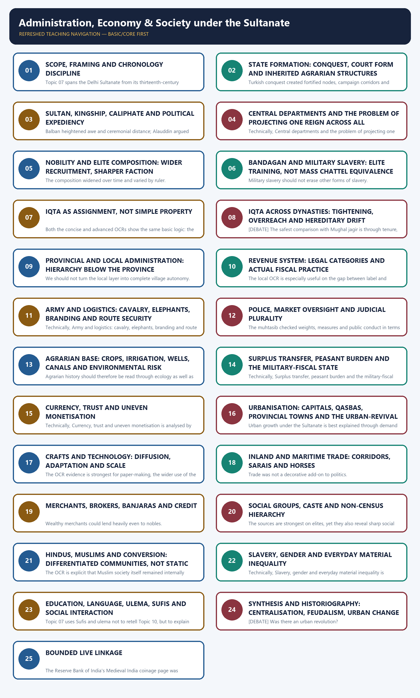

*Distinct embedded teaching-navigation image. The separate continuous Cārvāka-style flowchart package remains an independent at-a-glance artifact.*

#### Package counts, provenance and honest limitations

- Learning sections: 24; learning MCQ loops: 18.
- Workbook content: 4 verified or honestly-adjacent solved PYQs; 32 original broad-coverage MCQs; 12 remedial trap MCQs; 6 original solved Mains questions; final register modules: 13.
- Original PNG visuals: 31 total - 30 body visuals plus 1 topic-specific cover visual. All route and hierarchy diagrams are schematic and not to scale.
- Repository sources used most heavily: Topic 07 basic and advanced owners; bounded Topics 01, 03, 04, 05, 06, 10 and 11; `README.md`; `00_Master-Chronology.md`; `REVISION-CHART_Ages-Eras-and-Distinctive-Features.md`; `ANSWER-WORTHINESS-AUDIT.md`; PYQ routing ledgers; and the already-generated Medieval 03-06 packages for house style, source discipline and overlap control.
- OCR evidence used most heavily from Satish Chandra's *History of Medieval India* chapter "Government, and Economic and Social Life" and from *Medieval India: From Sultanat to the Mughals, Part I* chapters on centralised monarchy, government and administration, economic and social life in north India, and the nature of the state under the Sultanate.
- [LIMIT] Local OCR is strong on offices, iqta, revenue demand, traders, craft change, slavery and social hierarchy, but weaker on exact local micro-chronology below the province. Accordingly, terms such as *pargana*, *qanungo* and even *zamindar* are used with chronology caution rather than projected automatically into every reign.
- [LIMIT] The package does not use precise production figures, trade volumes, fixed tax rates for every reign, or dramatic demographic counts unsupported by the local source base. When a chronicle number or later label is insecure, the package says so.
- [LIMIT] Categories such as *ashraf*, *ajlaf* and especially *arzal* are useful for signalling social differentiation within Muslim society, but they are not treated as timeless census boxes for the whole Sultanate. Their chronology and source setting are kept explicit.
- [LIMIT] Topic 07 owns the cross-dynastic thematic synthesis. Political biographies in detail remain with Topics 03-06, regional kingdoms with Topics 08-09, Bhakti-Sufi movements with Topic 10, and the full architecture survey with Topic 11.

#### Sources actually used

| Source class | Exact source | Use and caveat |
|---|---|---|
| Repository knowledge | Topic 07 basic and advanced owners; bounded Topics 01, 03, 04, 05, 06, 10 and 11; Medieval README; Master Chronology; Revision Chart; Answer-Worthiness Audit; PYQ ledgers; prior complete packages for Topics 03-06. | Controlled chronology, topic boundaries, correction of older textbook overstatement, and exact repository semantics on offices, technology, fanam, Persian sources and local caution. |
| Local book | Satish Chandra, *History of Medieval India*, searchable OCR around the printed chapter "Government, and Economic and Social Life". | Core evidence for the ministries, iqta, village hierarchy, towns, merchants, paper-making, spinning wheel, slavery, caste and the formal Islamic-but-pragmatic character of the state. |
| Local book | Satish Chandra, *Medieval India: From Sultanat to the Mughals, Part I (Delhi Sultanat, 1206-1526)*, searchable OCR around printed pp. 136-171 and the state chapter. | Deeper evidence for mushrif/mustaufi checks, diwan-i-risalat caution, ashraf-ajlaf language, hundis, Persian-knowing Hindus, new landed gentry, and the debate over state character. |
| Source families through source-critical repository synthesis | Minhaj, Barani, Amir Khusrau, Ibn Battuta, Isami, Afif, coins, inscriptions and architecture. | Used for answer architecture and evidentiary discipline. Court bias, chronology distance and literary agenda are flagged rather than hidden. |
| Live source | None required for completion. | A historical package of this kind was fully supportable from repository Markdown and local OCR-searchable books; no decorative current-affairs hook was forced into the topic. |

#### Original visual asset index

- `notes/Medieval-Indian-History/assets/07_Administration-Economy-Society-under-the-Sultanate/00_sultanate_admin_economy_society_cover.png`

- `notes/Medieval-Indian-History/assets/07_Administration-Economy-Society-under-the-Sultanate/01_thematic_chronology_institution_spine.png`

- `notes/Medieval-Indian-History/assets/07_Administration-Economy-Society-under-the-Sultanate/02_state_formation_coercion_negotiation_network.png`

- `notes/Medieval-Indian-History/assets/07_Administration-Economy-Society-under-the-Sultanate/03_central_departments_comparison_period_caveat.png`

- `notes/Medieval-Indian-History/assets/07_Administration-Economy-Society-under-the-Sultanate/04_sultan_khutba_sikka_caliphate_legitimacy_chain.png`

- `notes/Medieval-Indian-History/assets/07_Administration-Economy-Society-under-the-Sultanate/05_nobility_composition_faction_matrix.png`

- `notes/Medieval-Indian-History/assets/07_Administration-Economy-Society-under-the-Sultanate/06_bandagan_lifecycle_political_role.png`

- `notes/Medieval-Indian-History/assets/07_Administration-Economy-Society-under-the-Sultanate/07_iqta_revenue_troop_audit_remittance_flow.png`

- `notes/Medieval-Indian-History/assets/07_Administration-Economy-Society-under-the-Sultanate/08_iqta_evolution_across_dynasties.png`

- `notes/Medieval-Indian-History/assets/07_Administration-Economy-Society-under-the-Sultanate/09_central_provincial_local_negotiated_hierarchy.png`

- `notes/Medieval-Indian-History/assets/07_Administration-Economy-Society-under-the-Sultanate/10_revenue_categories_legal_vs_practice_matrix.png`

- `notes/Medieval-Indian-History/assets/07_Administration-Economy-Society-under-the-Sultanate/11_army_logistics_horse_supply_system.png`

- `notes/Medieval-Indian-History/assets/07_Administration-Economy-Society-under-the-Sultanate/12_law_judicial_pluralism_network.png`

- `notes/Medieval-Indian-History/assets/07_Administration-Economy-Society-under-the-Sultanate/13_agrarian_surplus_transfer_chain.png`

- `notes/Medieval-Indian-History/assets/07_Administration-Economy-Society-under-the-Sultanate/14_irrigation_crop_environment_matrix.png`

- `notes/Medieval-Indian-History/assets/07_Administration-Economy-Society-under-the-Sultanate/15_currency_monetisation_timeline.png`

- `notes/Medieval-Indian-History/assets/07_Administration-Economy-Society-under-the-Sultanate/16_urbanisation_demand_supply_network.png`

- `notes/Medieval-Indian-History/assets/07_Administration-Economy-Society-under-the-Sultanate/17_crafts_technology_evidence_matrix.png`

- `notes/Medieval-Indian-History/assets/07_Administration-Economy-Society-under-the-Sultanate/18_inland_maritime_trade_route_schematic.png`

- `notes/Medieval-Indian-History/assets/07_Administration-Economy-Society-under-the-Sultanate/19_merchant_credit_transport_network.png`

- `notes/Medieval-Indian-History/assets/07_Administration-Economy-Society-under-the-Sultanate/20_social_groups_non_census_matrix.png`

- `notes/Medieval-Indian-History/assets/07_Administration-Economy-Society-under-the-Sultanate/21_caste_jati_mobility_process.png`

- `notes/Medieval-Indian-History/assets/07_Administration-Economy-Society-under-the-Sultanate/22_conversion_multi_causal_model.png`

- `notes/Medieval-Indian-History/assets/07_Administration-Economy-Society-under-the-Sultanate/23_slavery_forms_comparison.png`

- `notes/Medieval-Indian-History/assets/07_Administration-Economy-Society-under-the-Sultanate/24_gender_evidence_ladder.png`

- `notes/Medieval-Indian-History/assets/07_Administration-Economy-Society-under-the-Sultanate/25_education_language_knowledge_network.png`

- `notes/Medieval-Indian-History/assets/07_Administration-Economy-Society-under-the-Sultanate/26_state_ulema_sufi_relationship_matrix.png`

- `notes/Medieval-Indian-History/assets/07_Administration-Economy-Society-under-the-Sultanate/27_centralisation_debate.png`

- `notes/Medieval-Indian-History/assets/07_Administration-Economy-Society-under-the-Sultanate/28_urban_revolution_economic_historiography_matrix.png`

- `notes/Medieval-Indian-History/assets/07_Administration-Economy-Society-under-the-Sultanate/29_source_criticism_matrix.png`

- `notes/Medieval-Indian-History/assets/07_Administration-Economy-Society-under-the-Sultanate/30_gs1_answer_spine.png`

### SESSION 1 — SCOPE, FRAMING AND CHRONOLOGY DISCIPLINE

#### DEFINITION / WHAT THIS IS CALLED

**Plain-language definition:** This session shows how to study the Sultanate without turning it into a ruler list: compare dynasties, track institutions through time and keep regional variation in view.

**Technical definition:** Methodologically, Topic 07 is a cross-dynastic enquiry into a military-fiscal order whose administrative and social forms shifted from the Mamluks to the Lodis; every comparison has to be controlled by source hierarchy and chronology.

#### ANSWER-GRABBING OPENING — WRITE/ADAPT IN THE EXAM

> Do not define the Delhi Sultanate once and for all; read it as a changing military-fiscal order whose institutions looked different under Mamluk consolidation, Khalji tightening, Tughlaq experimentation and Lodi bargaining.

#### MUST-WRITE KEYWORDS

- **cross-dynastic comparison**
- **military-fiscal order**
- **chronology discipline**
- **negotiated rule**
- **regional unevenness**
- **source hierarchy**

**How to use them:** Open with the cross-dynastic frame, introduce military-fiscal order as the organising logic, and then use chronology discipline to show why negotiated rule and regional unevenness qualify every generalisation.

[FACT] Topic 07 spans the Delhi Sultanate from its thirteenth-century consolidation to the Lodi transition, but it does so through institutions, revenue, markets, social hierarchy and historiography rather than by repeating ruler-biographies already owned by Topics 03-06.

[ANALYSIS] The best exam-safe frame is **changing, negotiated and regionally uneven rule**. Mamluk consolidation, Khalji tightening, Muhammad bin Tughlaq's over-centralising experiments, Firuz's softer audit and hereditary drift, and the Sayyid-Lodi rebalancing all altered how administration, economy and society worked.

[DEBATE] Three distortions must be blocked at the beginning: the idea of a fully uniform modern bureaucracy; the idea of a timeless Islamic state whose legal language automatically governed all practice; and the idea of a static Hindu-Muslim social binary with no shared administrative or economic spaces.

[LIMIT] Source form matters. Court chroniclers, travellers, coins, inscriptions and architecture illuminate different layers. Therefore the package separates normative Persian vocabulary, chronicler claims, actual administration and later textbook generalisation before drawing conclusions.

#### Topic ownership firewall

| Owner | What remains primarily there | What Topic 07 legitimately uses |
|---|---|---|
| Topics 03-06 | Mamluk, Khalji, Tughlaq, Sayyid and Lodi political narratives in full | Only bounded ruler-specific examples needed to explain institutional change |
| Topic 08-09 | Bengal, Gujarat, Malwa, Jaunpur, Kashmir, Vijayanagara and Bahmani in depth | Only regional illustrations proving that Delhi's institutions always met local variation |
| Topic 10 | Bhakti and Sufi movements in detail | Only the limited social and political relevance of ulema-Sufi-state interaction |
| Topic 11 | Full architecture survey and style-history | Only technology, urban building demand and the evidentiary value of monuments |

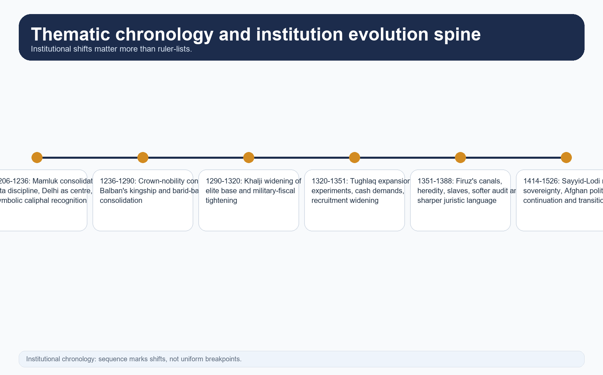

*Chronology visual. It keeps the topic thematic by separating institutional change from ruler-list memorisation.*

#### PARAGRAPH DEMONSTRATION — CLAIM → EVIDENCE → ANALYSIS → QUALIFICATION

**Claim:** The best exam-safe frame is **changing, negotiated and regionally uneven rule**. **Evidence:** Topic 07 spans the Delhi Sultanate from its thirteenth-century consolidation to the Lodi transition, but it does so through institutions, revenue, markets, social hierarchy and historiography rather than by repeating ruler-biographies already owned by Topics 03-06. **Analysis:** Because the topic spans multiple dynasties and domains, the evidence yields pattern only through comparison; ruler-biographies alone cannot explain why one state label covered shifting revenue methods, elite coalitions and social hierarchies. **Qualification:** Any verdict must therefore be chronological, regional and source-sensitive rather than timeless.

#### CLOSING RECALL FLOW — SCOPE, FRAMING AND CHRONOLOGY DISCIPLINE

```text
START / CONCEPT: SCOPE, FRAMING AND CHRONOLOGY DISCIPLINE
        |
        v
EXACT TERMS: cross-dynastic comparison · military-fiscal order · chronology discipline · negotiated rule · regional unevenness · source hierarchy
        |
        v
MECHANISM / ARGUMENT: The argument works only when chronology controls comparison: the same office, tax label or social category carried different weight under different dynasties and in different regions.
        |
        v
CONSEQUENCE / CONTRAST: Any verdict must therefore be chronological, regional and source-sensitive rather than timeless.
        |
        v
UPSC TRAP / ANSWER-USE: The exam trap is the one-size-fits-all Sultanate—either a modern bureaucracy, a pure juristic state or a frozen Hindu-Muslim binary.
        |
        v
ANSWER-GRABBING FORMULATION: A secure one-line frame is: Delhi worked as a military-fiscal order whose reach depended on negotiated local power and uneven evidence.
```

### SESSION 2 — STATE FORMATION: CONQUEST, COURT FORM AND INHERITED AGRARIAN STRUCTURES

#### DEFINITION / WHAT THIS IS CALLED

**Plain-language definition:** Here the story is not conquest alone: forts and cavalry won entry, but the state worked only when court culture and older agrarian arrangements were fitted together.

**Technical definition:** State formation under the early Sultanate combined fortified military nodes, Persianate court forms and inherited revenue-bearing village structures mediated through local intermediaries.

#### ANSWER-GRABBING OPENING — WRITE/ADAPT IN THE EXAM

> If the question asks how the Sultanate took shape, begin with conquest, but do not stop there: a durable state emerged only when military occupation was tied to agrarian continuity and courtly administration.

#### MUST-WRITE KEYWORDS

- **fortified nodes**
- **Persianate court forms**
- **agrarian continuity**
- **local intermediaries**
- **revenue coordination**
- **state formation**

**How to use them:** Start from fortified nodes and campaign corridors, move to Persianate court forms, and then show how local intermediaries converted conquest into regular revenue and obedience.

[FACT] Turkish conquest created fortified nodes, campaign corridors and cavalry households, but these alone did not produce a working state. Durable rule required revenue, communication, a persuasive court idiom and local intermediaries able to collect, report and police.

[FACT] The repository's Topic 01 and Topic 03 materials, read with the local OCR, show that the Turks who entered India were already Islamised and Persianised. They brought cavalry organisation, Persian chancery culture, elite military slavery and established idioms of sovereignty from West and Central Asia.

[FACT] At the same time, local agrarian structures were not rebuilt from zero. Village communities, headmen, chiefs, accountants and pre-existing revenue habits remained necessary for countryside control. Early Turkish rulers depended heavily on those structures.

[ANALYSIS] This is why the Delhi Sultanate is best described as a **hierarchical military-fiscal network**. Coercion mattered, but so did negotiated continuity. The crown inserted itself above older structures, redirected surplus and promoted new elites without abolishing every earlier layer.

[DEBATE] The contrast is not between conquest and accommodation as mutually exclusive options. The actual historical process involved both: armed superiority at nodal points, then bargaining, delegation, audit and selective retention of local personnel.

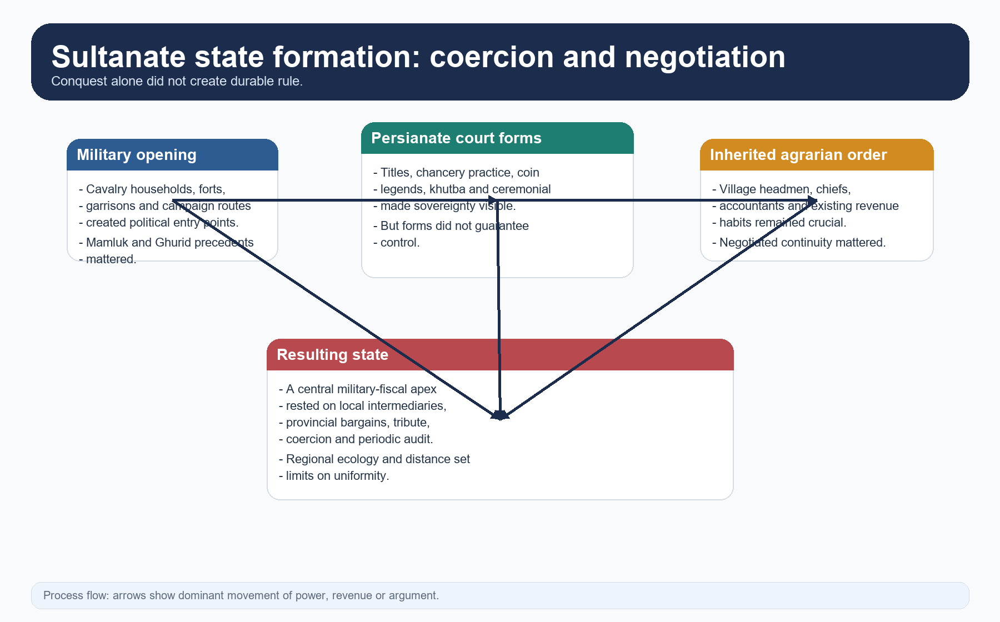

*State-formation visual. It shows why conquest, Persianate court practice and inherited agrarian society had to be combined.*

#### PARAGRAPH DEMONSTRATION — CLAIM → EVIDENCE → ANALYSIS → QUALIFICATION

**Claim:** This is why the Delhi Sultanate is best described as a **hierarchical military-fiscal network**. **Evidence:** Turkish conquest created fortified nodes, campaign corridors and cavalry households, but these alone did not produce a working state. Durable rule required revenue, communication, a persuasive court idiom and local intermediaries able to collect, report and police. **Analysis:** Fortified centres by themselves could hold territory only briefly; once revenue collection, local chiefs and village hierarchies were incorporated, conquest became a functioning state instead of a chain of raids. **Qualification:** Conquest and accommodation worked together here, not as mutually exclusive alternatives.

#### CLOSING RECALL FLOW — STATE FORMATION: CONQUEST, COURT FORM AND INHERITED AGRARIAN STRUCTURES

```text
START / CONCEPT: STATE FORMATION: CONQUEST, COURT FORM AND INHERITED AGRARIAN STRUCTURES
        |
        v
EXACT TERMS: fortified nodes · Persianate court forms · agrarian continuity · local intermediaries · revenue coordination · state formation
        |
        v
MECHANISM / ARGUMENT: Cavalry seizure created the opening, but state formation matured when existing agrarian networks were enrolled rather than uprooted.
        |
        v
CONSEQUENCE / CONTRAST: Conquest and accommodation worked together here, not as mutually exclusive alternatives.
        |
        v
UPSC TRAP / ANSWER-USE: Do not write as if Turkish victory automatically produced a ready-made bureaucracy, and do not swing to the opposite error of denying the force of conquest.
        |
        v
ANSWER-GRABBING FORMULATION: The best compact line is that the Sultanate was built by conquest at the top and consolidation through inherited agrarian structures below.
```

### SESSION 3 — SULTAN, KINGSHIP, CALIPHATE AND POLITICAL EXPEDIENCY

#### DEFINITION / WHAT THIS IS CALLED

**Plain-language definition:** This session explains how a sultan looked legitimate: through prayer, coin, courtly style and practical rule, not by religion alone.

**Technical definition:** Sultanate sovereignty operated through khutba, sikka, caliphal idiom, Persianate kingship and zawabit, with political expediency repeatedly reshaping the legal-religious balance.

#### ANSWER-GRABBING OPENING — WRITE/ADAPT IN THE EXAM

> Ask not whether the Sultanate was simply religious or secular; ask how khutba, coinage and reason of state were combined in practice.

#### MUST-WRITE KEYWORDS

- **khutba**
- **sikka**
- **caliphal recognition**
- **zawabit**
- **reason of state**
- **sovereignty**

**How to use them:** Name khutba and sikka first as public signs of rule, then bring in caliphal recognition, and only after that explain how zawabit and expediency modified the juristic ideal.

[FACT] The sultan stood at the apex of military command, office distribution, coinage and high justice. Sovereignty was signalled through **khutba**, **sikka**, titulature, court ceremonial and the power to hear petitions or overrule great officials.

[FACT] Iltutmish's caliphal recognition in 1229, Muhammad bin Tughlaq's use of Abbasid symbolism, and Firuz's later search for investiture all show that caliphal idiom mattered. Yet the evidence used across Topics 03 and 05 makes the key point unmistakable: such recognition enhanced status but did not create the army, the revenue base or the countryside network of rule.

[ANALYSIS] Kingship under the Sultanate therefore mixed Islamic legitimacy, Persianate performance and reason of state. Balban heightened awe and ceremonial distance; Alauddin argued that state necessity could not be reduced to juristic advice; Muhammad bin Tughlaq sought symbolic legitimacy while also issuing regulations; Firuz leaned further toward juristic approval without surrendering political calculation.

[DEBATE] This is why modern labels such as 'secular' or 'theocratic' mislead. The better contrast is between **sharia-backed normative language** and **zawabit or political expediency**. Different rulers drew that balance differently, and the balance shifted with crisis.

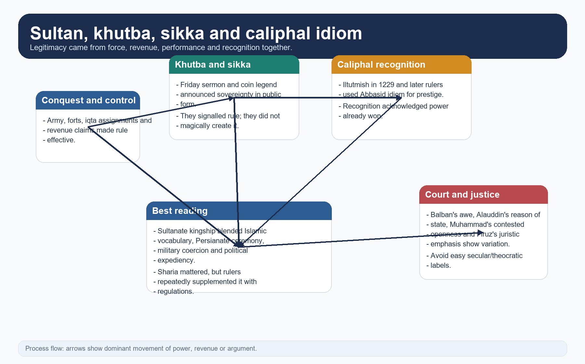

*Legitimacy visual. It separates symbols of sovereignty from the material foundations of rule.*

#### PARAGRAPH DEMONSTRATION — CLAIM → EVIDENCE → ANALYSIS → QUALIFICATION

**Claim:** Kingship under the Sultanate therefore mixed Islamic legitimacy, Persianate performance and reason of state. **Evidence:** The sultan stood at the apex of military command, office distribution, coinage and high justice. Sovereignty was signalled through **khutba**, **sikka**, titulature, court ceremonial and the power to hear petitions or overrule great officials. **Analysis:** Control over coinage, office and justice made the sultan effectively sovereign even when caliphal sanction was thin or absent; symbols worked because administrative and military capacity stood behind them. **Qualification:** That is why modern labels such as “secular” or “theocratic” misdescribe the political grammar of the period.

#### CLOSING RECALL FLOW — SULTAN, KINGSHIP, CALIPHATE AND POLITICAL EXPEDIENCY

```text
START / CONCEPT: SULTAN, KINGSHIP, CALIPHATE AND POLITICAL EXPEDIENCY
        |
        v
EXACT TERMS: khutba · sikka · caliphal recognition · zawabit · reason of state · sovereignty
        |
        v
MECHANISM / ARGUMENT: Legitimacy was assembled from multiple registers—Islamic idiom, Persianate performance and coercive success—not drawn from a single sacred source.
        |
        v
CONSEQUENCE / CONTRAST: That is why modern labels such as “secular” or “theocratic” misdescribe the political grammar of the period.
        |
        v
UPSC TRAP / ANSWER-USE: Avoid writing as though caliphal recognition settled succession or policy; Delhi rulers borrowed prestige but governed through their own calculations.
        |
        v
ANSWER-GRABBING FORMULATION: A high-scoring line is: Sultanate kingship fused Islamic symbols with Persianate monarchy and the hard logic of political expediency.
```

### SESSION 4 — CENTRAL DEPARTMENTS AND THE PROBLEM OF PROJECTING ONE REIGN ACROSS ALL CENTURIES

#### DEFINITION / WHAT THIS IS CALLED

**Plain-language definition:** This session is about the big offices at the centre and why you must not assume that one neat organisation chart lasted for three centuries.

**Technical definition:** The central apparatus comprised differentiated portfolios—wizarat, Diwan-i-Arz, Diwan-i-Insha, barid and, in some reconstructions, Diwan-i-Risalat—but their exact scope varied by reign and evidence base.

#### ANSWER-GRABBING OPENING — WRITE/ADAPT IN THE EXAM

> When writing on the Sultanates central administration, name the departments, then immediately warn the examiner that portfolios shifted over time.

#### MUST-WRITE KEYWORDS

- **wizarat**
- **diwan-i-arz**
- **diwan-i-insha**
- **diwan-i-risalat**
- **barid**
- **portfolio variation**

**How to use them:** Use wizarat for finance, Arz for the army and Insha for correspondence, then qualify Risalat and barid by reign so the answer moves from department to portfolio variation.

[FACT] The local OCR and Topic 03 package together confirm the main institutional cluster: **wazir / Diwan-i-Wizarat** for finance and oversight, **ariz / Diwan-i-Arz** for muster and equipment, **Diwan-i-Insha** for correspondence, and **Diwan-i-Risalat** in Satish Chandra's reconstruction for religious grants and pious matters.

[FACT] Other key offices included the **sadr**, chief **qazi**, **muhtasib**, **barid**, **wakil-i-dar**, **amir hajib**, royal stores or **karkhanas**, public works, and under Firuz a separate department for slaves.

[LIMIT] Topic 07 must resist the temptation to draw one permanent chart. The OCR itself shows caution around Diwan-i-Risalat; the weight of the wazir and the subordinates of finance shifted; some offices are best evidenced only under stronger or better-documented reigns.

[ANALYSIS] Institutional differentiation was real, and this matters against caricatures of pure personal rule. But differentiation did not mean a modern file-driven bureaucracy. The crown relied on people whose actual reach depended on the ruler's strength, military follow-through and local mediation.

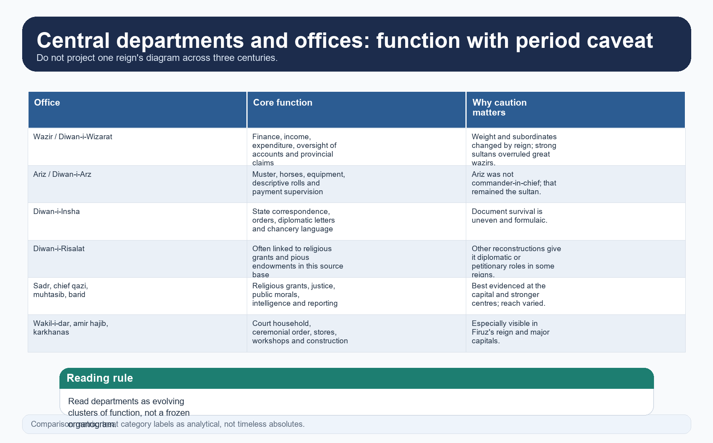

*Institution matrix. The point is function with chronology caution, not bureaucratic timelessness.*

#### PARAGRAPH DEMONSTRATION — CLAIM → EVIDENCE → ANALYSIS → QUALIFICATION

**Claim:** Institutional differentiation was real, and this matters against caricatures of pure personal rule. **Evidence:** The local OCR and Topic 03 package together confirm the main institutional cluster: **wazir / Diwan-i-Wizarat** for finance and oversight, **ariz / Diwan-i-Arz** for muster and equipment, **Diwan-i-Insha** for correspondence, and **Diwan-i-Risalat** in Satish Chandra's reconstruction for religious grants and pious matters. **Analysis:** Named departments show that rule was more than personal whim, but their shifting portfolios also prove that institutional form responded to political pressure rather than to a timeless constitutional blueprint. **Qualification:** Any chart must therefore be time-bound, not universal.

#### CLOSING RECALL FLOW — CENTRAL DEPARTMENTS AND THE PROBLEM OF PROJECTING ONE REIGN ACROSS ALL CENTURIES

```text
START / CONCEPT: CENTRAL DEPARTMENTS AND THE PROBLEM OF PROJECTING ONE REIGN ACROSS ALL CENTURIES
        |
        v
EXACT TERMS: wizarat · diwan-i-arz · diwan-i-insha · diwan-i-risalat · barid · portfolio variation
        |
        v
MECHANISM / ARGUMENT: Centralisation worked through specialised offices, yet specialisation itself changed with dynastic priorities and with the survival of sources.
        |
        v
CONSEQUENCE / CONTRAST: Any chart must therefore be time-bound, not universal.
        |
        v
UPSC TRAP / ANSWER-USE: Do not freeze Alauddin's or Firuz's arrangement into a permanent ministry chart; portfolios shifted by reign.
        |
        v
ANSWER-GRABBING FORMULATION: Use a sentence like: Delhi developed differentiated central departments, but no single reign supplies a permanent template for all Sultanate centuries.
```

### SESSION 5 — NOBILITY AND ELITE COMPOSITION: WIDER RECRUITMENT, SHARPER FACTION

#### DEFINITION / WHAT THIS IS CALLED

**Plain-language definition:** The ruling elite widened over time, but wider recruitment also meant sharper faction and bargaining.

**Technical definition:** Sultanate nobility evolved from a narrow Turkish-mamluk core into a composite service elite including Tajiks/Persians, Khaljis, Afghans, Indian Muslims, converts and local allies, with faction structured by rank, household and access to iqta.

#### ANSWER-GRABBING OPENING — WRITE/ADAPT IN THE EXAM

> Do not treat the nobility as a single ethnic bloc; the real story is widening recruitment under conditions of recurring faction.

#### MUST-WRITE KEYWORDS

- **Turks**
- **Tajiks/Persians**
- **Khaljis and Afghans**
- **new men**
- **faction**
- **service elite**

**How to use them:** Start with the Turkish-mamluk core, add Tajik and Persian administrators, then show how Khalji, Afghan and Indian entrants changed faction, access to iqta and court politics.

[FACT] The Sultanate elite included Turks, military slaves, Tajiks/Persians, Khaljis, Afghans, Indian Muslims, converts, ulema, clerks, local chiefs and Hindu managers or accountants. The composition widened over time and varied by ruler.

[FACT] The Part I OCR shows that many chroniclers turned social prejudice into political theory. Barani, for example, openly distrusted the promotion of people of humble occupational background, converts and low-born officials. His rage is evidence for elite hierarchy as much as for the appointments themselves.

[ANALYSIS] Political consequence followed social composition. Narrower Mamluk-Turkish dominance gave strong early cohesion but also exclusion; Khalji and Tughlaq widening increased talent and reach but aggravated faction; Lodi Afghan politics carried strong expectations of consultation and honour, complicating central monarchy.

[DEBATE] The safest way to write this is not 'racial conflict' or 'class conflict' alone, but **status-stratified elite competition** in which ethnicity, household rank, old service, new service and local landed connections all mattered.

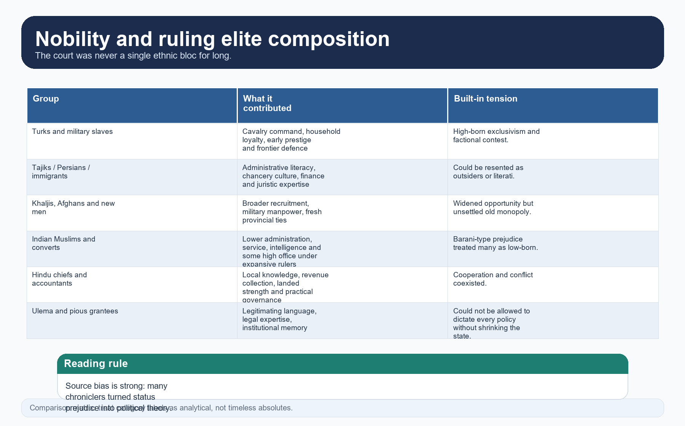

*Elite-composition visual. It shows why widening the ruling class changed both state capacity and political friction.*

#### PARAGRAPH DEMONSTRATION — CLAIM → EVIDENCE → ANALYSIS → QUALIFICATION

**Claim:** Political consequence followed social composition. **Evidence:** The Sultanate elite included Turks, military slaves, Tajiks/Persians, Khaljis, Afghans, Indian Muslims, converts, ulema, clerks, local chiefs and Hindu managers or accountants. The composition widened over time and varied by ruler. **Analysis:** Once the court moved beyond a closed Turkish circle, the pool of talent enlarged, but so did disputes over status and patronage; political instability followed from who could claim office, not merely from personal rivalries. **Qualification:** The safest label is not “racial conflict” alone but status-stratified elite competition.

#### CLOSING RECALL FLOW — NOBILITY AND ELITE COMPOSITION: WIDER RECRUITMENT, SHARPER FACTION

```text
START / CONCEPT: NOBILITY AND ELITE COMPOSITION: WIDER RECRUITMENT, SHARPER FACTION
        |
        v
EXACT TERMS: Turks · Tajiks/Persians · Khaljis and Afghans · new men · faction · service elite
        |
        v
MECHANISM / ARGUMENT: Elite composition shaped politics because access to office, iqta and royal proximity redistributed both opportunity and resentment.
        |
        v
CONSEQUENCE / CONTRAST: The safest label is not “racial conflict” alone but status-stratified elite competition.
        |
        v
UPSC TRAP / ANSWER-USE: Avoid reducing every conflict to race alone: household rank, service seniority, pedigree and local landed links mattered alongside ethnicity.
        |
        v
ANSWER-GRABBING FORMULATION: A crisp line is: the Sultanate elite broadened socially even as competition within the service aristocracy grew more volatile.
```

### SESSION 6 — BANDAGAN AND MILITARY SLAVERY: ELITE TRAINING, NOT MASS CHATTEL EQUIVALENCE

#### DEFINITION / WHAT THIS IS CALLED

**Plain-language definition:** These were not ordinary slaves in the generic sense but trained household dependants who could become military and political actors.

**Technical definition:** Bandagan or mamluks were elite military-household slaves formed through purchase, training, manumission and patronal incorporation; the institution cannot be collapsed into all forms of slavery under the Sultanate.

#### ANSWER-GRABBING OPENING — WRITE/ADAPT IN THE EXAM

> The first move in any answer is definitional: separate bandagan from slavery in general before discussing their political role.

#### MUST-WRITE KEYWORDS

- **bandagan**
- **household service**
- **military slavery**
- **manumission**
- **loyalty network**
- **coercion**

**How to use them:** Define bandagan as military-household dependants, explain training and patronage, and then show how manumission and high office made this a loyalty network with coercive implications.

[FACT] Topic 03 establishes the core distinction: *mamluk* or military-household slavery referred to selected dependants trained in warfare, service, etiquette and loyalty. Manumission allowed them to hold office, marriage alliances and even sovereignty.

[FACT] Aibak, Iltutmish and Balban all emerged from such service worlds. Their careers show why military slavery cannot be read only as degradation; it was also an elite recruitment technology.

[ANALYSIS] Yet the institution generated its own instability. The same household training that produced loyal commanders could also produce rivals once those men accumulated troops, assignments and prestige. Topic 06 shows the later edge of this problem when Firuz's vast slave establishment became politically dangerous after his death.

[LIMIT] Military slavery should not erase other forms of slavery. Domestic, artisanal, war-captive and palace slavery remained part of medieval society, usually without the path to power visible in the elite bandagan pattern.

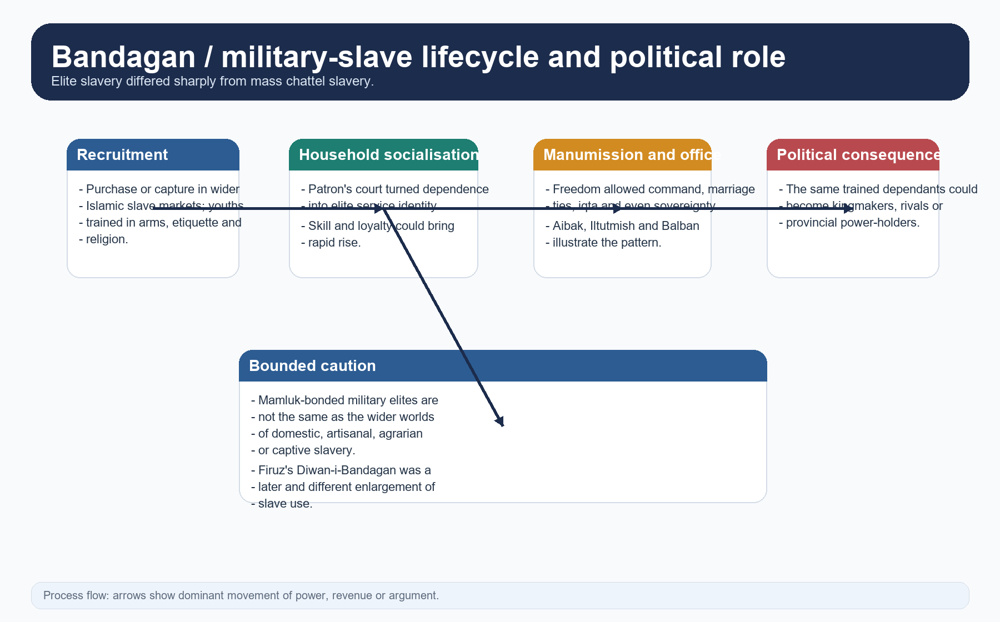

*Bandagan visual. It distinguishes recruitment, training, manumission and later political risk.*

#### PARAGRAPH DEMONSTRATION — CLAIM → EVIDENCE → ANALYSIS → QUALIFICATION

**Claim:** Yet the institution generated its own instability. **Evidence:** Topic 03 establishes the core distinction: *mamluk* or military-household slavery referred to selected dependants trained in warfare, service, etiquette and loyalty. Manumission allowed them to hold office, marriage alliances and even sovereignty. **Analysis:** Because advancement came through the rulers household, bandagan could strengthen the centre more effectively than autonomous nobles; the same concentration of patronage, however, bred succession struggles once that household fractured. **Qualification:** Military slavery should not erase the wider spectrum of bondage that also existed in Sultanate society.

#### CLOSING RECALL FLOW — BANDAGAN AND MILITARY SLAVERY: ELITE TRAINING, NOT MASS CHATTEL EQUIVALENCE

```text
START / CONCEPT: BANDAGAN AND MILITARY SLAVERY: ELITE TRAINING, NOT MASS CHATTEL EQUIVALENCE
        |
        v
EXACT TERMS: bandagan · household service · military slavery · manumission · loyalty network · coercion
        |
        v
MECHANISM / ARGUMENT: The institution converted personal dependence into state service by tying training, advancement and survival to the rulers household.
        |
        v
CONSEQUENCE / CONTRAST: Military slavery should not erase the wider spectrum of bondage that also existed in Sultanate society.
        |
        v
UPSC TRAP / ANSWER-USE: Do not equate elite military slavery with plantation-like mass chattel systems, but do not romanticise it as voluntary service either.
        |
        v
ANSWER-GRABBING FORMULATION: A safe answer line is that bandagan were coercively recruited elite retainers whose value lay in trained loyalty, not in ordinary property rights over land.
```

### SESSION 7 — IQTA AS ASSIGNMENT, NOT SIMPLE PROPERTY

#### DEFINITION / WHAT THIS IS CALLED

**Plain-language definition:** Iqta means an assignment of revenue and duty, not private ownership of the countryside.

**Technical definition:** An iqta transferred to a muqti or wali the right to realise revenue and maintain order or troops under continuing state superiority, subject in principle to transfer, recall and audit.

#### ANSWER-GRABBING OPENING — WRITE/ADAPT IN THE EXAM

> Whenever iqta appears in a question, define the assignment first and property second—that sequence prevents the classic UPSC trap.

#### MUST-WRITE KEYWORDS

- **iqta**
- **muqti or wali**
- **transfer**
- **audit**
- **troop maintenance**
- **state claim**

**How to use them:** State iqta, identify the muqtis service obligations, and then explain transfer and audit before discussing troop maintenance or local power.

[FACT] The iqta carried a right to realise revenue and often to maintain order and troops in a tract. The muqti or wali was not the absolute owner of soil and population.

[FACT] Both the concise and advanced OCRs show the same basic logic: the crown claimed superior fiscal right; the muqti met expenditure and service obligations; surplus and accounts were, in principle, answerable to the centre; transfer or recall prevented permanent rooting when the state was strong.

[ANALYSIS] Iqta linked agrarian surplus to military capacity. It allowed the Sultanate to support cavalry and provincial administration without paying everything from a single treasury. This made it a central device of state formation.

[LIMIT] In principle is not the same as in practice. Distance, armed followings, provincial autonomy and weak rulers reduced the effectiveness of transfer and audit. Therefore the iqta must be explained as a moving field of negotiation, not as a fixed legal machine.

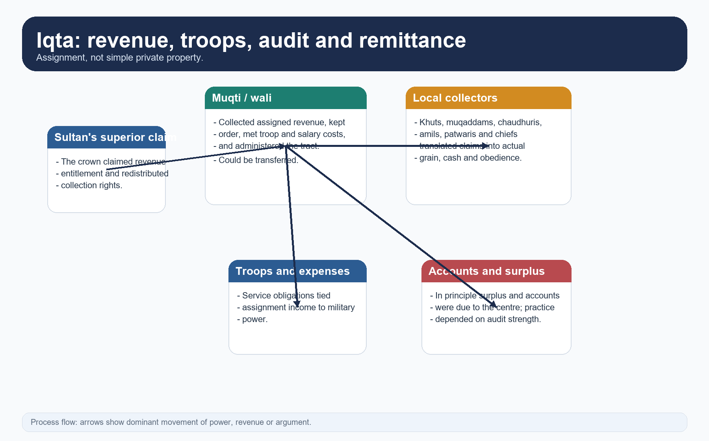

*Iqta flow visual. It puts service, expenditure, local mediation and central claim into one chain.*

#### PARAGRAPH DEMONSTRATION — CLAIM → EVIDENCE → ANALYSIS → QUALIFICATION

**Claim:** Iqta linked agrarian surplus to military capacity. **Evidence:** The iqta carried a right to realise revenue and often to maintain order and troops in a tract. The muqti or wali was not the absolute owner of soil and population. **Analysis:** Revenue assignment mattered because the state could support soldiers without paying every contingent directly from the centre; recall and audit show that the crown still tried to stop assignment from hardening into independent lordship. **Qualification:** In principle, therefore, iqta signified delegated fiscal authority rather than unrestricted landed ownership.

#### CLOSING RECALL FLOW — IQTA AS ASSIGNMENT, NOT SIMPLE PROPERTY

```text
START / CONCEPT: IQTA AS ASSIGNMENT, NOT SIMPLE PROPERTY
        |
        v
EXACT TERMS: iqta · muqti or wali · transfer · audit · troop maintenance · state claim
        |
        v
MECHANISM / ARGUMENT: The system channelled agrarian surplus to the army by delegating collection without surrendering ultimate state claim.
        |
        v
CONSEQUENCE / CONTRAST: In principle, therefore, iqta signified delegated fiscal authority rather than unrestricted landed ownership.
        |
        v
UPSC TRAP / ANSWER-USE: Do not write as if the muqti owned soil, peasants and office in a permanently hereditary sense.
        |
        v
ANSWER-GRABBING FORMULATION: The most reliable formulation is: iqta was a service-linked revenue assignment that fed military capacity without converting land into simple private property.
```

### SESSION 8 — IQTA ACROSS DYNASTIES: TIGHTENING, OVERREACH AND HEREDITARY DRIFT

#### DEFINITION / WHAT THIS IS CALLED

**Plain-language definition:** The meaning of iqta changed with dynastic strength—tightened under some rulers, overstretched under others, and made more hereditary later.

**Technical definition:** Across Mamluk, Khalji, Tughlaq and Firuzian phases, iqta oscillated between central supervision, over-centralising experiment and hereditary drift, making chronology essential to institutional analysis.

#### ANSWER-GRABBING OPENING — WRITE/ADAPT IN THE EXAM

> Never discuss iqta as if it had one fixed form: the dynastic sequence is the argument.

#### MUST-WRITE KEYWORDS

- **iqta across dynasties**
- **Khalji tightening**
- **Muhammad bin Tughlaq overreach**
- **Firuz hereditary drift**
- **central strength**
- **institutional variation**

**How to use them:** Anchor the answer in Mamluk consolidation, move to Khalji supervision, then contrast Muhammad bin Tughlaqs experiments with Firuzs hereditary concessions.

[FACT] Under the Mamluks, iqta helped consolidation. Under Alauddin, closer supervision, khalisa expansion and direct revenue pressure in the core sharpened control. Under Muhammad bin Tughlaq, large empire and fiscal experimentation strained the system. Under Firuz, heredity and softer audit localised claims.

[ANALYSIS] This sequence matters more than any static definition. A mature answer explains iqta as one institution whose political meaning changed with central strength. The same assignment logic could support centralisation in one phase and oligarchic localisation in another.

[DEBATE] The safest comparison with Mughal *jagir* is through tenure, accountability and service obligation. The safest comparison with European feudalism is to say that the analogy is limited: a transferable state assignment tied to fiscal claim is not the same thing as an inherited proprietary fief.

[LIMIT] Phrases such as 'feudalisation' may be used only if unpacked carefully. On their own they often hide more than they explain.

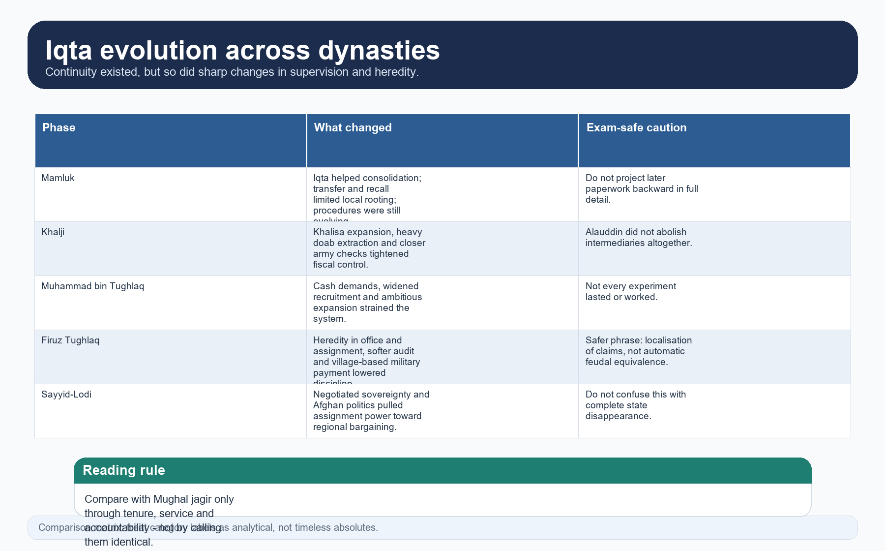

*Evolution visual. It shows why one sentence on iqta is never enough for all Sultanate centuries.*

#### PARAGRAPH DEMONSTRATION — CLAIM → EVIDENCE → ANALYSIS → QUALIFICATION

**Claim:** This sequence matters more than any static definition. **Evidence:** Under the Mamluks, iqta helped consolidation. Under Alauddin, closer supervision, khalisa expansion and direct revenue pressure in the core sharpened control. Under Muhammad bin Tughlaq, large empire and fiscal experimentation strained the system. Under Firuz, heredity and softer audit localised claims. **Analysis:** Mamluk and Khalji rulers used iqta to discipline the service elite, but excessive experimentation under Muhammad bin Tughlaq and softer inheritance under Firuz altered the systems political meaning; chronology, not abstraction, explains the shift. **Qualification:** Terms such as “feudalisation” become useful only after these dynastic shifts are unpacked carefully.

#### CLOSING RECALL FLOW — IQTA ACROSS DYNASTIES: TIGHTENING, OVERREACH AND HEREDITARY DRIFT

```text
START / CONCEPT: IQTA ACROSS DYNASTIES: TIGHTENING, OVERREACH AND HEREDITARY DRIFT
        |
        v
EXACT TERMS: iqta across dynasties · Khalji tightening · Muhammad bin Tughlaq overreach · Firuz hereditary drift · central strength · institutional variation
        |
        v
MECHANISM / ARGUMENT: Changes in audit, transfer and cash demand tracked the waxing and waning of central power.
        |
        v
CONSEQUENCE / CONTRAST: Terms such as “feudalisation” become useful only after these dynastic shifts are unpacked carefully.
        |
        v
UPSC TRAP / ANSWER-USE: The trap is to quote a textbook definition from one reign and treat it as valid for all later centuries.
        |
        v
ANSWER-GRABBING FORMULATION: Use a line such as: iqta was not static; it hardened or loosened according to the balance between central ambition and local bargaining.
```

### SESSION 9 — PROVINCIAL AND LOCAL ADMINISTRATION: HIERARCHY BELOW THE PROVINCE

#### DEFINITION / WHAT THIS IS CALLED

**Plain-language definition:** Below the province, the Sultanate worked through smaller territorial levels and village intermediaries, not through a direct line from Delhi to every peasant.

**Technical definition:** Provincial administration ran through muqtis or walis, shiqs, parganas and local revenue agents such as amils while khuts, muqaddams and chaudhuris mediated village society.

#### ANSWER-GRABBING OPENING — WRITE/ADAPT IN THE EXAM

> To explain how Delhi ruled locally, move downward: province, shiq, pargana, village intermediaries.

#### MUST-WRITE KEYWORDS

- **muqti or wali**
- **shiq**
- **pargana**
- **amil**
- **khuts-muqaddams-chaudhuris**
- **chronology caution**

**How to use them:** Move from muqti or wali to shiq and pargana, then show how amils, khuts, muqaddams and chaudhuris converted provincial claims into local collection.

[FACT] The advanced OCR notes provinces under larger rulers and confirms that below them one hears of **shiqs**, **parganas**, **sadis** and **chaurasis**, though not with equal clarity for all periods. The pargana was associated with the **amil**, while village society revolved around the **khut**, **muqaddam** and **patwari**.

[FACT] Topic 07's own repaired core also cautions that the term **zamindar** appears more clearly by the early fourteenth century and broadens later. Likewise, the historian must be careful with later familiar offices such as **qanungo**.

[ANALYSIS] The hierarchy below the province was where negotiated sovereignty became real. The local holder knew the fields, the cattle, the people and the conditions of transport. Therefore no central revenue order could work without this stratum.

[LIMIT] We should not turn the local layer into complete village autonomy. Nor should we turn it into a standardised district bureaucracy identical from Lahore to Mabar. The evidence supports something in between.

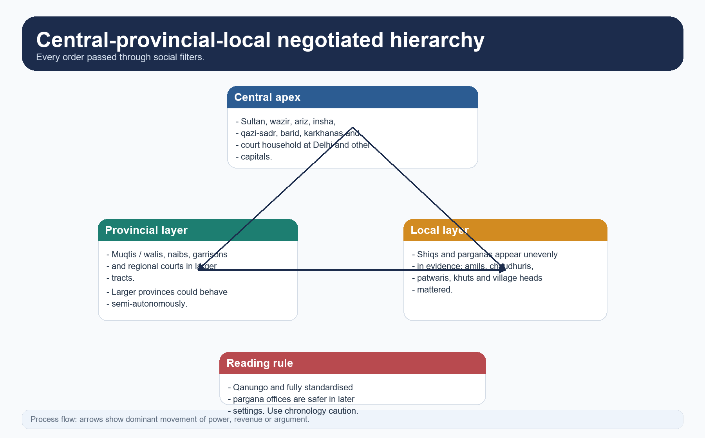

*Hierarchy visual. It emphasises mediation, not a clean top-down administrative pipe.*

#### PARAGRAPH DEMONSTRATION — CLAIM → EVIDENCE → ANALYSIS → QUALIFICATION

**Claim:** The hierarchy below the province was where negotiated sovereignty became real. **Evidence:** The advanced OCR notes provinces under larger rulers and confirms that below them one hears of **shiqs**, **parganas**, **sadis** and **chaurasis**, though not with equal clarity for all periods. The pargana was associated with the **amil**, while village society revolved around the **khut**, **muqaddam** and **patwari**. **Analysis:** The lower hierarchy matters because collection, policing and information all depended on intermediaries; the state became visible at the village level only when these local actors cooperated or were compelled. **Qualification:** Village society therefore remained politically consequential rather than administratively invisible.

#### CLOSING RECALL FLOW — PROVINCIAL AND LOCAL ADMINISTRATION: HIERARCHY BELOW THE PROVINCE

```text
START / CONCEPT: PROVINCIAL AND LOCAL ADMINISTRATION: HIERARCHY BELOW THE PROVINCE
        |
        v
EXACT TERMS: muqti or wali · shiq · pargana · amil · khuts-muqaddams-chaudhuris · chronology caution
        |
        v
MECHANISM / ARGUMENT: Authority descended hierarchically, but it was implemented through local notables who already possessed social leverage.
        |
        v
CONSEQUENCE / CONTRAST: Village society therefore remained politically consequential rather than administratively invisible.
        |
        v
UPSC TRAP / ANSWER-USE: Do not confuse village headship with imperial office, and do not imagine a fully autonomous village outside state reach.
        |
        v
ANSWER-GRABBING FORMULATION: A strong line is: below the province, Sultanate power was layered and mediated rather than direct and uniform.
```

### SESSION 10 — REVENUE SYSTEM: LEGAL CATEGORIES AND ACTUAL FISCAL PRACTICE

#### DEFINITION / WHAT THIS IS CALLED

**Plain-language definition:** This session defines Sultanate revenue as the mix of named taxes, cesses and collection practices through which rulers turned agrarian surplus into fiscal power.

**Technical definition:** Sultanate fiscal practice moved between juristic categories—kharaj, ushr, zakat, jizya, khams—and cesses such as ghari, charai and later irrigation dues, with incidence shaped by coercive reach and political aim.

#### ANSWER-GRABBING OPENING — WRITE/ADAPT IN THE EXAM

> Do not memorise tax labels in isolation; the examiner wants the gap between legal vocabulary and fiscal practice.

#### MUST-WRITE KEYWORDS

- **kharaj**
- **jizya**
- **zakat and ushr**
- **khams**
- **ghari-charai**
- **legal versus practical incidence**

**How to use them:** State kharaj, jizya, zakat/ushr and khams first, then separate juristic label from actual incidence by tracing collection, intermediaries and dynastic variation.

[FACT] Sultanate revenue language included *kharaj*, *ushr*, *zakat*, *jizya*, *khams*, transit dues and cesses such as *ghari*, *charai* and later irrigation dues such as *haqq-i-sharb*.

[FACT] The local OCR is especially useful on the gap between label and practice. Early on, jizya was often difficult to distinguish from land demand. Firuz later insisted on making it a separate tax and extended it to Brahmans, using juristic language to present the order as purified.

[ANALYSIS] Alauddin's half-share demand in the upper doab, Muhammad bin Tughlaq's standard-yield cash incidence and Firuz's share-based reassessment show that actual revenue practice turned on political aim, local coercive ability and environmental conditions far more than on one legal formula.

[DEBATE] Therefore the correct method is to use legal categories as starting points, then ask what was actually being taken, from whom, through which intermediary and for which political purpose.

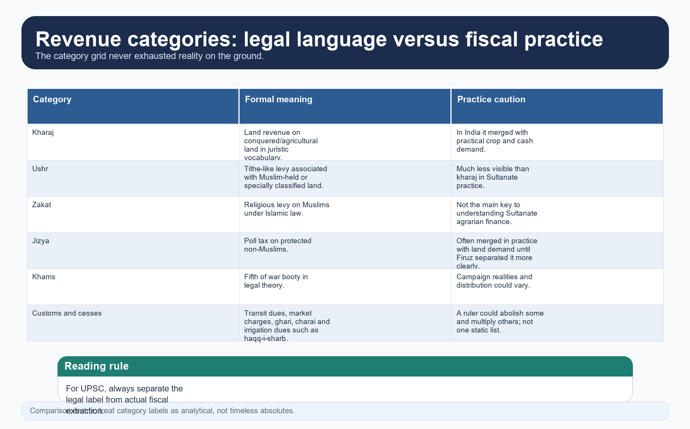

*Fiscal matrix. It separates juristic label from lived extraction, which is the heart of Topic 07.*

#### PARAGRAPH DEMONSTRATION — CLAIM → EVIDENCE → ANALYSIS → QUALIFICATION

**Claim:** Alauddin's half-share demand in the upper doab, Muhammad bin Tughlaq's standard-yield cash incidence and Firuz's share-based reassessment show that actual revenue practice turned on political aim, local coercive ability and environmental conditions far more than on one legal formula. **Evidence:** Sultanate revenue language included *kharaj*, *ushr*, *zakat*, *jizya*, *khams*, transit dues and cesses such as *ghari*, *charai* and later irrigation dues such as *haqq-i-sharb*. **Analysis:** Alauddin's half-share, Muhammad bin Tughlaq's harsh standard-yield cash demand and Firuz's reassessment all show that the state adapted fiscal instruments to military need and local conditions; legal terminology alone cannot explain the burden. **Qualification:** That is why revenue categories should be treated as starting points for investigation, not as ready-made descriptions of lived incidence.

#### CLOSING RECALL FLOW — REVENUE SYSTEM: LEGAL CATEGORIES AND ACTUAL FISCAL PRACTICE

```text
START / CONCEPT: REVENUE SYSTEM: LEGAL CATEGORIES AND ACTUAL FISCAL PRACTICE
        |
        v
EXACT TERMS: kharaj · jizya · zakat and ushr · khams · ghari-charai · legal versus practical incidence
        |
        v
MECHANISM / ARGUMENT: Revenue labels provided a language of rule, but extraction turned on assessment, intermediaries, ecology and the state's ability to enforce demand.
        |
        v
CONSEQUENCE / CONTRAST: That is why revenue categories should be treated as starting points for investigation, not as ready-made descriptions of lived incidence.
        |
        v
UPSC TRAP / ANSWER-USE: Do not assume a tax name by itself tells you payer, rate or burden; distinguish legal category from the burden visible in practice.
        |
        v
ANSWER-GRABBING FORMULATION: The safest answer line is that Sultanate taxation combined juristic vocabulary with highly variable political practice.
```

### SESSION 11 — ARMY AND LOGISTICS: CAVALRY, ELEPHANTS, BRANDING AND ROUTE SECURITY

#### DEFINITION / WHAT THIS IS CALLED

**Plain-language definition:** The Sultanate army was more than fighting men; it depended on horses, transport, inspection and secure routes.

**Technical definition:** Military capacity rested on cavalry predominance, horse supply, dagh and chehra supervision, barid reporting, garrisons, forts, roads and transport labour.

#### ANSWER-GRABBING OPENING — WRITE/ADAPT IN THE EXAM

> Write the army as a logistical system, not merely a list of cavalry and elephants.

#### MUST-WRITE KEYWORDS

- **cavalry**
- **dagh**
- **chehra**
- **barid**
- **forts and roads**
- **salary supervision**

**How to use them:** Start with cavalry, bring in horse supply and inspection, then connect barid, roads and forts to the state's ability to keep armies usable.

[FACT] The Sultanate army centred on cavalry, but also used infantry, archers, elephants, miners, sappers, fort garrisons and transport labour. The concise OCR directly notes the sappers and miners attached to armies.

[FACT] Horses were crucial and expensive. Their supply depended on inland trade, import channels and monitoring. Alauddin's **dagh** and **chehra** tightened that system; Firuz's regime relaxed it.

[ANALYSIS] Military history here is really fiscal history plus transport history. A cavalry state needed grain, remounts, road security, garrisons, reliable intelligence and money or assignments capable of turning field command into durable obedience.

[LIMIT] Chronicle troop totals are among the least safe materials in the archive. For UPSC, organisation, inspection, pay form and logistical chains are much stronger than raw numbers.

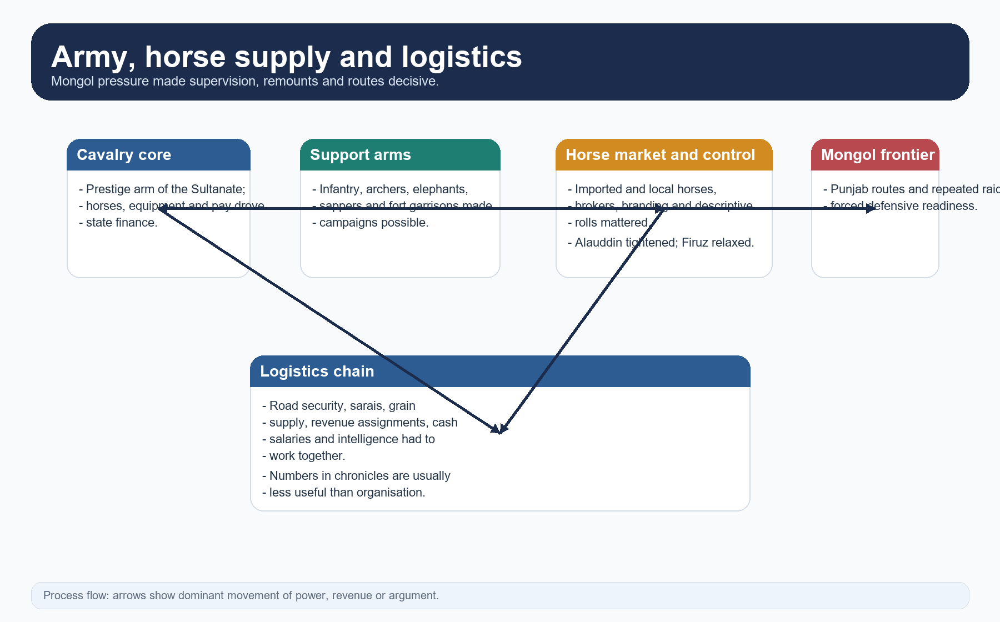

*Army-system visual. It shows why horse control, grain and intelligence belong in the same answer.*

#### PARAGRAPH DEMONSTRATION — CLAIM → EVIDENCE → ANALYSIS → QUALIFICATION

**Claim:** Military history here is really fiscal history plus transport history. **Evidence:** The Sultanate army centred on cavalry, but also used infantry, archers, elephants, miners, sappers, fort garrisons and transport labour. The concise OCR directly notes the sappers and miners attached to armies. **Analysis:** Branding and descriptive rolls mattered because they curtailed fraud in a horse-heavy system; without supply lines, surveillance and audited payment, cavalry superiority could exist on paper yet fail in campaign. **Qualification:** Chronicle totals therefore need more caution than administrative mechanisms do.

#### CLOSING RECALL FLOW — ARMY AND LOGISTICS: CAVALRY, ELEPHANTS, BRANDING AND ROUTE SECURITY

```text
START / CONCEPT: ARMY AND LOGISTICS: CAVALRY, ELEPHANTS, BRANDING AND ROUTE SECURITY
        |
        v
EXACT TERMS: cavalry · dagh · chehra · barid · forts and roads · salary supervision
        |
        v
MECHANISM / ARGUMENT: Campaign success depended on moving animals, pay and intelligence across space, so fiscal control and route security became military necessities.
        |
        v
CONSEQUENCE / CONTRAST: Chronicle totals therefore need more caution than administrative mechanisms do.
        |
        v
UPSC TRAP / ANSWER-USE: Do not quote inflated troop numbers uncritically, and do not project Mughal offices like Mir Bakshi backward onto the Sultanate.
        |
        v
ANSWER-GRABBING FORMULATION: A compact formulation is: Sultanate military power rested on cavalry finance, horse control and the communications that kept them operational.
```

### SESSION 12 — POLICE, MARKET OVERSIGHT AND JUDICIAL PLURALITY

#### DEFINITION / WHAT THIS IS CALLED

**Plain-language definition:** This session defines Sultanate policing and justice as a plural order of kotwal, muhtasib, qazi, royal regulation and local custom.

**Technical definition:** Urban control involved the kotwal and muhtasib, formal Muslim adjudication involved qazi and mufti, and everyday order also reflected royal regulations, local custom and community forums.

#### ANSWER-GRABBING OPENING — WRITE/ADAPT IN THE EXAM

> The cleanest exam entry is to say that Sultanate justice was plural: different offices and different norms operated side by side.

#### MUST-WRITE KEYWORDS

- **kotwal**
- **muhtasib**
- **qazi**
- **plural law**
- **market oversight**
- **royal regulations**

**How to use them:** Introduce kotwal and muhtasib as urban regulators, place qazi within formal adjudication, and then qualify the whole picture with panchayats, caste bodies and royal regulation.

[FACT] The **kotwal** maintained urban order, regulated entry, watched markets and oversaw security. The **muhtasib** checked weights, measures and public conduct in terms defined by Muslim moral law. The **qazi** and **mufti** handled formal legal business for Muslims.

[FACT] The same OCR also states that Hindus were often governed by their own laws through panchayats in villages and caste-community authorities in towns. Criminal justice, meanwhile, could rest on royal regulation.

[ANALYSIS] Judicial plurality was built into the structure. Sharia mattered, but it was not the only operating norm. This is especially important when answering questions on law, society or religious policy.

[LIMIT] Delhi gives the richest evidence. It is unsafe to describe every town of the Sultanate as if it had identical policing density or documentary depth.

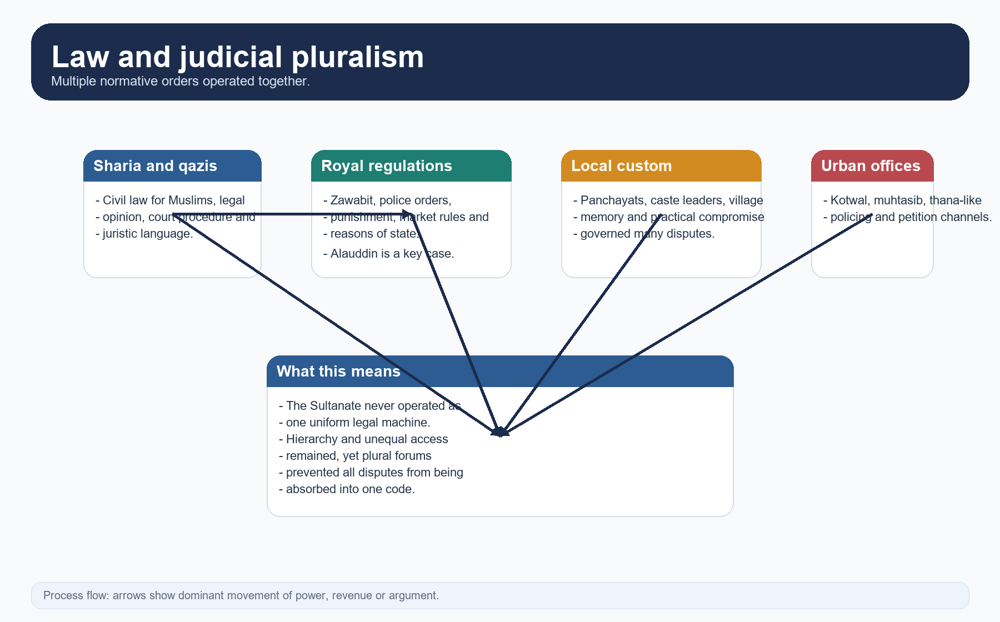

*Judicial-pluralism visual. It links qazi courts, royal regulation, local custom and urban offices.*

#### PARAGRAPH DEMONSTRATION — CLAIM → EVIDENCE → ANALYSIS → QUALIFICATION

**Claim:** Judicial plurality was built into the structure. **Evidence:** The **kotwal** maintained urban order, regulated entry, watched markets and oversaw security. The **muhtasib** checked weights, measures and public conduct in terms defined by Muslim moral law. The **qazi** and **mufti** handled formal legal business for Muslims. **Analysis:** The kotwal's urban duties and the continued role of local community forums show that practical governance needed multiple forums of authority; plural law was not an exception but a built-in operating condition. **Qualification:** Delhi supplies the clearest evidence, so provincial uniformity should not be assumed.

#### CLOSING RECALL FLOW — POLICE, MARKET OVERSIGHT AND JUDICIAL PLURALITY

```text
START / CONCEPT: POLICE, MARKET OVERSIGHT AND JUDICIAL PLURALITY
        |
        v
EXACT TERMS: kotwal · muhtasib · qazi · plural law · market oversight · royal regulations
        |
        v
MECHANISM / ARGUMENT: No single court or code monopolised everyday order; policing, moral supervision and adjudication were distributed across institutions.
        |
        v
CONSEQUENCE / CONTRAST: Delhi supplies the clearest evidence, so provincial uniformity should not be assumed.
        |
        v
UPSC TRAP / ANSWER-USE: Do not collapse all law into sharia, and do not pretend every town had Delhi's density of offices or documentation.
        |
        v
ANSWER-GRABBING FORMULATION: Write it this way: Sultanate policing and justice were institutionally plural, with royal, juristic and local norms overlapping rather than replacing one another.
```

### SESSION 13 — AGRARIAN BASE: CROPS, IRRIGATION, WELLS, CANALS AND ENVIRONMENTAL RISK

#### DEFINITION / WHAT THIS IS CALLED

**Plain-language definition:** The countryside mattered because crops, wells and canals set the limits within which the state could tax and towns could live.

**Technical definition:** Agrarian output depended on crop pattern, irrigation by wells, lifts and canals, village hierarchies and environmental risk; the archive is richer on types of produce than on audited totals.

#### ANSWER-GRABBING OPENING — WRITE/ADAPT IN THE EXAM

> Begin from production conditions, not from taxation alone: the Sultanate could only extract what ecology and irrigation made possible.

#### MUST-WRITE KEYWORDS

- **crop pattern**
- **wells and lifts**
- **canals**
- **village hierarchy**
- **surplus**
- **environmental risk**

**How to use them:** Name the crop pattern first, add wells and water-lifting devices, and then bring in canals and village hierarchy before making any claim about surplus.

[FACT] The source base repeatedly mentions rice, sugarcane, wheat, oilseeds, sesame, indigo and cotton. Rain-fed agriculture remained dominant, but wells, bunds, tanks and local water control were significant.

[FACT] The concise and advanced OCR both highlight Firuz's canals, especially in the Haryana-Hisar zone. They represented a major state intervention, but not a transformation of every agrarian landscape in India.

[ANALYSIS] Agrarian history should therefore be read through ecology as well as administration. Forest cover, cattle wealth, recurrent famine, war and transport difficulty all shaped what the state could actually collect.

[LIMIT] The evidence does not support neat production totals. Topic 07 therefore uses crop range, irrigation form, and regional caution instead of invented output statistics.

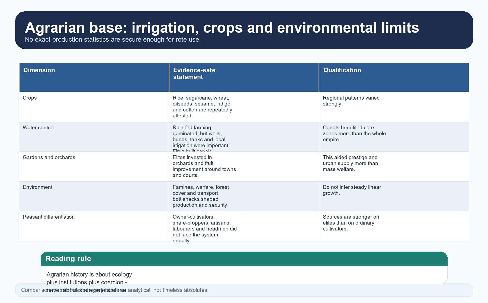

*Agrarian matrix. It keeps crops, water control and environmental limits in one analytical frame.*

#### PARAGRAPH DEMONSTRATION — CLAIM → EVIDENCE → ANALYSIS → QUALIFICATION

**Claim:** Agrarian history should therefore be read through ecology as well as administration. **Evidence:** The source base repeatedly mentions rice, sugarcane, wheat, oilseeds, sesame, indigo and cotton. Rain-fed agriculture remained dominant, but wells, bunds, tanks and local water control were significant. **Analysis:** Lists of rice, sugarcane, wheat, cotton and oilseeds matter because they point to differentiated agrarian zones; irrigation widened possibility, but drought, flood and uneven technology kept production unstable and region-specific. **Qualification:** Crop variety is therefore easier to prove than exact output totals.

#### CLOSING RECALL FLOW — AGRARIAN BASE: CROPS, IRRIGATION, WELLS, CANALS AND ENVIRONMENTAL RISK

```text
START / CONCEPT: AGRARIAN BASE: CROPS, IRRIGATION, WELLS, CANALS AND ENVIRONMENTAL RISK
        |
        v
EXACT TERMS: crop pattern · wells and lifts · canals · village hierarchy · surplus · environmental risk
        |
        v
MECHANISM / ARGUMENT: Ecology shaped revenue capacity by influencing output, risk and the spatial concentration of cultivable surplus.
        |
        v
CONSEQUENCE / CONTRAST: Crop variety is therefore easier to prove than exact output totals.
        |
        v
UPSC TRAP / ANSWER-USE: Do not invent neat production statistics from fragmentary evidence, and do not treat Firuz's canals as a universal agrarian revolution.
        |
        v
ANSWER-GRABBING FORMULATION: A useful exam line is: Sultanate agrarian history must be read through production ecology as much as through state demand.
```

### SESSION 14 — SURPLUS TRANSFER, PEASANT BURDEN AND THE MILITARY-FISCAL STATE

#### DEFINITION / WHAT THIS IS CALLED

**Plain-language definition:** This session asks who carried the cost of the Sultanate's armies and towns, and how that burden moved upward from the village.

**Technical definition:** The military-fiscal state drew surplus through assessment, sharing arrangements, khalisa expansion, intermediary exactions and official yield calculations, with peasants bearing uneven but central burdens.

#### ANSWER-GRABBING OPENING — WRITE/ADAPT IN THE EXAM

> To answer on peasant burden, follow the surplus: field to intermediary to iqta-holder or crown.

#### MUST-WRITE KEYWORDS

- **measurement**
- **sharing**
- **official yields**
- **intermediary burden**
- **khalisa**
- **military-fiscal extraction**

**How to use them:** Start with measurement and sharing, then show how official yield, khalisa and intermediaries turned production into military revenue.

[FACT] The overwhelming mass of cultivators worked close to subsistence, but not all rural groups stood alike. Owner-cultivators, prosperous village heads, chiefs and concessions for privileged intermediaries created strong internal differentiation.

[FACT] The concise OCR notes the prosperity of khuts and muqaddams in some areas before Alauddin cut their privileges. The advanced OCR explains that Firuz's irrigation success also channelled gain strongly toward holders of assignments and privileged rural groups.

[ANALYSIS] This is the core of the military-fiscal interpretation. The state did not merely tax an undifferentiated peasantry. It pushed demand through a hierarchy in which local elites could protect themselves, shift burden downward or bargain with the centre.

[DEBATE] Historiography divides between growth and extraction less sharply than textbooks often suggest. Urban and commercial vitality was real; so was hard agrarian transfer. The strongest answer combines both.

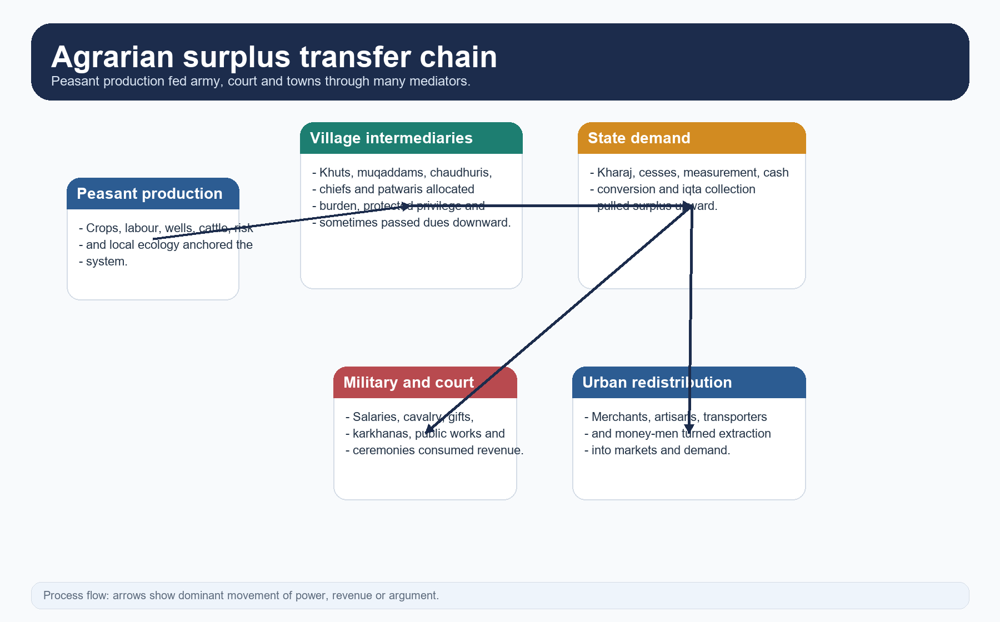

*Surplus-chain visual. It shows how peasant production, intermediaries and state demand fed court and town life.*

#### PARAGRAPH DEMONSTRATION — CLAIM → EVIDENCE → ANALYSIS → QUALIFICATION

**Claim:** This is the core of the military-fiscal interpretation. **Evidence:** The overwhelming mass of cultivators worked close to subsistence, but not all rural groups stood alike. Owner-cultivators, prosperous village heads, chiefs and concessions for privileged intermediaries created strong internal differentiation. **Analysis:** The concept works because armies, elites and towns consumed resources that had to be realised from cultivators; differences among khuts, muqaddams and ordinary peasants show that rural burden was structured rather than uniformly shared. **Qualification:** Growth and extraction therefore have to be read together rather than as mutually exclusive interpretations.

#### CLOSING RECALL FLOW — SURPLUS TRANSFER, PEASANT BURDEN AND THE MILITARY-FISCAL STATE

```text
START / CONCEPT: SURPLUS TRANSFER, PEASANT BURDEN AND THE MILITARY-FISCAL STATE
        |
        v
EXACT TERMS: measurement · sharing · official yields · intermediary burden · khalisa · military-fiscal extraction
        |
        v
MECHANISM / ARGUMENT: Extraction linked agrarian labour to state coercion by converting rural produce into cash, grain and mounted power.
        |
        v
CONSEQUENCE / CONTRAST: Growth and extraction therefore have to be read together rather than as mutually exclusive interpretations.
        |
        v
UPSC TRAP / ANSWER-USE: Do not romanticise urban and commercial growth while erasing the peasants who financed it; but do not flatten all rural society into one identical victim group either.
        |
        v
ANSWER-GRABBING FORMULATION: The most defensible line is that Sultanate growth rested on a military-fiscal transfer of rural surplus under uneven local conditions.
```

### SESSION 15 — CURRENCY, TRUST AND UNEVEN MONETISATION

#### DEFINITION / WHAT THIS IS CALLED

**Plain-language definition:** This session defines Sultanate monetisation as the widening but uneven use of coin, cash payment and credit in taxation, trade and urban exchange.

**Technical definition:** Iltutmish's tanka-jital system, cash salaries, merchant credit and regional circulation created a widening but uneven monetised sphere; token-currency episodes must remain time-bound.

#### ANSWER-GRABBING OPENING — WRITE/ADAPT IN THE EXAM

> Write monetisation as a gradient, not as an all-India switch from barter to cash.

#### MUST-WRITE KEYWORDS

- **tanka**
- **jital**
- **cash salaries**
- **credit**
- **regional variation**
- **uneven monetisation**

**How to use them:** Define tanka and jital, link them to payment and exchange, then bring in credit and regional variation before judging the depth of monetisation.

[FACT] Iltutmish's silver **tanka** and copper **jital** became important markers of stable Delhi-centred monetary authority. Satish Chandra's concise source sometimes uses *dirham* language for copper units, which itself is a reminder that terminology may vary by narrative register.

[FACT] Monetisation was real enough for cavalry salaries, market schedules and hundis to matter. It was also real enough for Muhammad bin Tughlaq's token currency failure to become a classic problem of administrative trust.

[ANALYSIS] Yet Topic 07 must reject the tidy textbook story of a linear march to a fully monetised economy. Grain, share, cash conversion and local variation coexisted. Coin circulation expanded possibilities; it did not wipe out all non-cash relations.

[LIMIT] Token currency is a bounded example, not the whole monetary history of the Sultanate. It must never be described as paper currency.

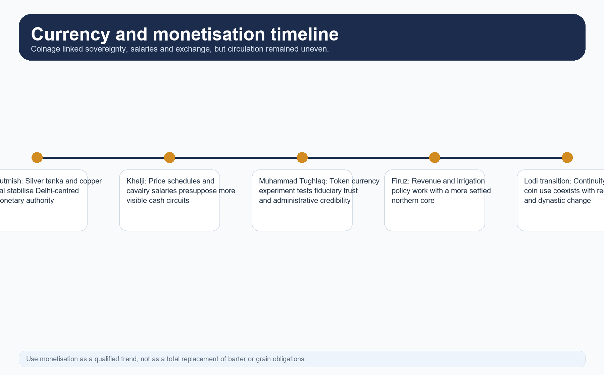

*Monetisation visual. It places stable coinage, fiduciary experiment and uneven circulation on the same timeline.*

#### PARAGRAPH DEMONSTRATION — CLAIM → EVIDENCE → ANALYSIS → QUALIFICATION

**Claim:** Yet Topic 07 must reject the tidy textbook story of a linear march to a fully monetised economy. **Evidence:** Iltutmish's silver **tanka** and copper **jital** became important markers of stable Delhi-centred monetary authority. Satish Chandra's concise source sometimes uses *dirham* language for copper units, which itself is a reminder that terminology may vary by narrative register. **Analysis:** Stable silver and copper issues supported taxation and salaries, which in turn nourished markets and towns; the need for trust, metal supply and regional acceptance explains why monetisation advanced unevenly rather than linearly. **Qualification:** Token currency remains a bounded cautionary episode within that wider monetary story.

#### CLOSING RECALL FLOW — CURRENCY, TRUST AND UNEVEN MONETISATION

```text
START / CONCEPT: CURRENCY, TRUST AND UNEVEN MONETISATION
        |
        v
EXACT TERMS: tanka · jital · cash salaries · credit · regional variation · uneven monetisation
        |
        v
MECHANISM / ARGUMENT: Confidence in coinage and access to credit enabled wider exchange, yet agrarian and regional constraints limited how far cash relations penetrated.
        |
        v
CONSEQUENCE / CONTRAST: Token currency remains a bounded cautionary episode within that wider monetary story.
        |
        v
UPSC TRAP / ANSWER-USE: Do not let Muhammad bin Tughlaq's token-currency experiment stand in for the entire monetary history of the Sultanate.
        |
        v
ANSWER-GRABBING FORMULATION: A safe verdict is: the Sultanate widened monetisation through coin, salary and credit, but never produced a fully uniform cash economy.
```

### SESSION 16 — URBANISATION: CAPITALS, QASBAS, PROVINCIAL TOWNS AND THE URBAN-REVIVAL DEBATE

#### DEFINITION / WHAT THIS IS CALLED

**Plain-language definition:** Towns grew because courts, garrisons, markets and routes created demand, not because cities floated free from the countryside.

**Technical definition:** Sultanate urbanisation involved capitals, qasbas, provincial towns, ports and market centres generated by court demand, military presence, craft production, trade and surplus transfer, while remaining debated in scale.

#### ANSWER-GRABBING OPENING — WRITE/ADAPT IN THE EXAM

> The best way to open is to link towns to demand and connection: who consumed, who supplied, and how goods moved.

#### MUST-WRITE KEYWORDS

- **court demand**
- **garrisons**
- **qasbas**
- **market towns**
- **urban revival debate**
- **rural dependence**

**How to use them:** Begin with capitals and garrisons, add qasbas and market towns, and then assess the urban-revival debate through their rural dependence.

[FACT] Delhi and Daulatabad receive dramatic attention in the sources, but the urban world was much wider: Lahore, Multan, Kara, Lakhnauti, Anhilwara/Patan, Cambay/Khambayat and Sonargaon all appear as important nodes.

[FACT] Many towns grew around garrisons, but they did not remain mere camps. Administrators, clerks, artisans, merchants, scholars, slaves and performers created mixed urban societies.

[ANALYSIS] Urban growth under the Sultanate is best explained through **demand plus connection**. Court and army demand pulled in food and craft goods; merchants and routes widened exchange; the growth of a money nexus and specialised production fed further urban concentration.

[DEBATE] Historians disagree over how transformative this was. Topic 07 therefore uses the phrase 'urban revival' or 'urban expansion' more safely than a mechanically celebratory 'urban revolution' without qualification.

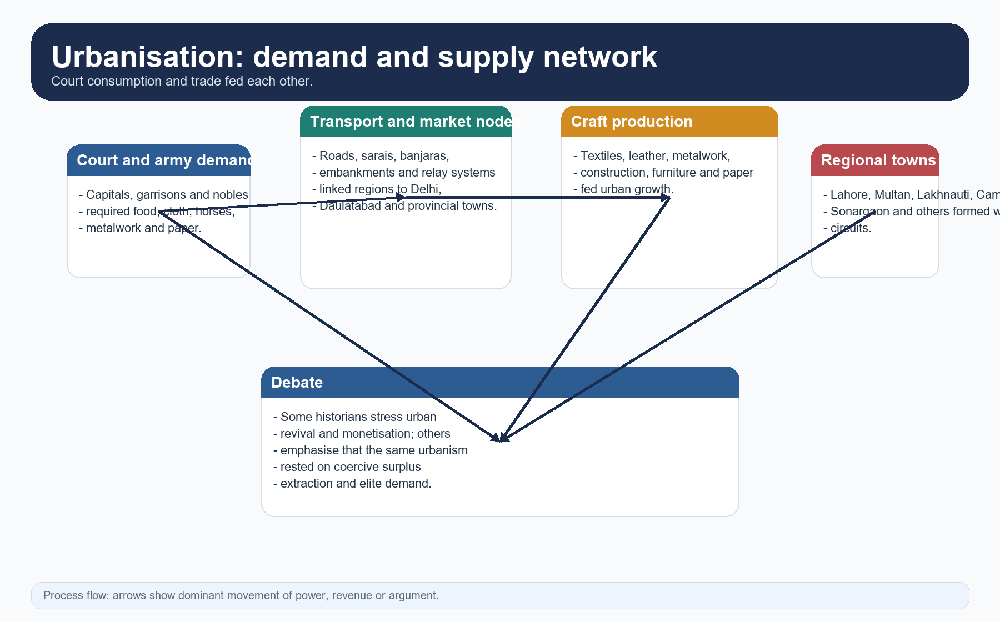

*Urbanisation visual. It connects towns to armies, merchants, craft and rural surplus rather than treating them in isolation.*

#### PARAGRAPH DEMONSTRATION — CLAIM → EVIDENCE → ANALYSIS → QUALIFICATION

**Claim:** Urban growth under the Sultanate is best explained through **demand plus connection**. **Evidence:** Delhi and Daulatabad receive dramatic attention in the sources, but the urban world was much wider: Lahore, Multan, Kara, Lakhnauti, Anhilwara/Patan, Cambay/Khambayat and Sonargaon all appear as important nodes. **Analysis:** Delhi, Lahore, Multan, Lakhnauti, Cambay and Sonargaon became important not by geography alone but because courts, merchants and transport routes concentrated demand there; that is why urbanisation varied sharply from place to place. **Qualification:** Historians may differ over the scale of the revival, but not over the need to connect towns to surplus and route systems.

#### CLOSING RECALL FLOW — URBANISATION: CAPITALS, QASBAS, PROVINCIAL TOWNS AND THE URBAN-REVIVAL DEBATE

```text
START / CONCEPT: URBANISATION: CAPITALS, QASBAS, PROVINCIAL TOWNS AND THE URBAN-REVIVAL DEBATE
        |
        v
EXACT TERMS: court demand · garrisons · qasbas · market towns · urban revival debate · rural dependence
        |
        v
MECHANISM / ARGUMENT: Urban growth followed nodes where administration, war, trade and craft demand converged.
        |
        v
CONSEQUENCE / CONTRAST: Historians may differ over the scale of the revival, but not over the need to connect towns to surplus and route systems.
        |
        v
UPSC TRAP / ANSWER-USE: Do not describe every town as a self-sustaining market miracle, and do not deny urban growth simply because it depended on rural extraction.
        |
        v
ANSWER-GRABBING FORMULATION: One strong line is: Sultanate towns grew where state demand and commercial connectivity reinforced each other.
```

### SESSION 17 — CRAFTS AND TECHNOLOGY: DIFFUSION, ADAPTATION AND SCALE

#### DEFINITION / WHAT THIS IS CALLED

**Plain-language definition:** This session defines Sultanate technological change as diffusion and adaptation in textiles, paper, irrigation, construction and warfare, studied through social effect rather than invention myths.

**Technical definition:** Technological change under the Sultanate took the form of diffusion and adaptation—paper-making, spinning wheel, carder's bow, improved looms, water-lifting devices, lime mortar, arches, domes and equestrian equipment.

#### ANSWER-GRABBING OPENING — WRITE/ADAPT IN THE EXAM

> Treat technology as social history: ask what each device changed in labour, administration or construction.

#### MUST-WRITE KEYWORDS

- **spinning wheel**
- **carder's bow**
- **paper-making**
- **lime mortar**
- **rahat or Persian wheel**
- **social effects**

**How to use them:** Begin with paper-making and the spinning wheel as evidence of diffusion, add irrigation devices and lime mortar/arches, and then show how each sector changed output, administration or hierarchy.

[FACT] The OCR evidence is strongest for paper-making, the wider use of the spinning wheel, the cotton-carder's bow, improved looms, water-lifting devices, lime mortar, arches, domes, armour, saddles and other metal crafts.

[FACT] The advanced OCR treats paper-making as a new industry and places the widespread use of the spinning wheel in India by the middle of the fourteenth century, with caution on origins and transfer routes.

[ANALYSIS] The real historical value of these techniques lies in social effect. Textile efficiency, easier record-keeping, deeper irrigation in some areas, larger building projects and better cavalry equipment changed state capacity, urban demand and labour use.

[DEBATE] The wrong story is one-way civilisation from outside to passive India. The better story is diffusion through existing craft skill, local demand, state projects and regional adaptation.

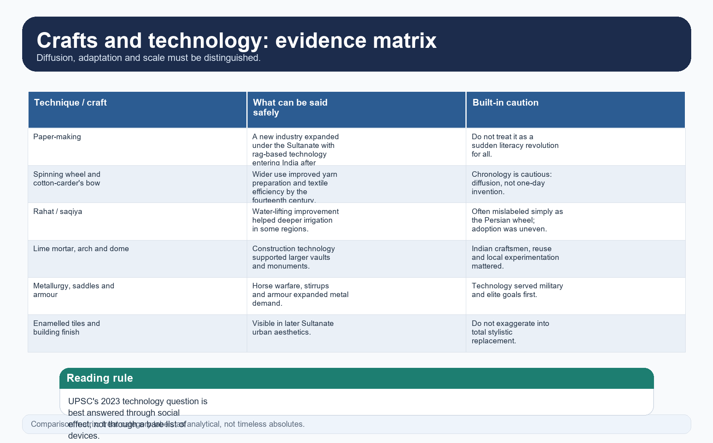

*Technology matrix. It combines what can be said securely with the cautions demanded by the 2023 GS-I question.*

#### PARAGRAPH DEMONSTRATION — CLAIM → EVIDENCE → ANALYSIS → QUALIFICATION

**Claim:** The real historical value of these techniques lies in social effect. **Evidence:** The OCR evidence is strongest for paper-making, the wider use of the spinning wheel, the cotton-carder's bow, improved looms, water-lifting devices, lime mortar, arches, domes, armour, saddles and other metal crafts. **Analysis:** Paper supported accounting and correspondence, textile devices raised productive efficiency, and architectural techniques enlarged building scale; the point is not gadget-listing but the new range of administrative and craft possibilities they opened. **Qualification:** Technology adoption therefore has to be separated from any simplistic invention-by-one-ruler myth.

#### CLOSING RECALL FLOW — CRAFTS AND TECHNOLOGY: DIFFUSION, ADAPTATION AND SCALE

```text
START / CONCEPT: CRAFTS AND TECHNOLOGY: DIFFUSION, ADAPTATION AND SCALE
        |
        v
EXACT TERMS: spinning wheel · carder's bow · paper-making · lime mortar · rahat or Persian wheel · social effects
        |
        v
MECHANISM / ARGUMENT: Techniques became historically important when artisans, officials and cultivators used them to expand output or reduce transaction costs.
        |
        v
CONSEQUENCE / CONTRAST: Technology adoption therefore has to be separated from any simplistic invention-by-one-ruler myth.
        |
        v
UPSC TRAP / ANSWER-USE: Do not write a civilisational import story in which India passively receives ready-made technology from outside.
        |
        v
ANSWER-GRABBING FORMULATION: A balanced line is: Sultanate technology mattered through diffusion, adaptation and social effect rather than through isolated invention claims.
```

### SESSION 18 — INLAND AND MARITIME TRADE: CORRIDORS, SARAIS AND HORSES

#### DEFINITION / WHAT THIS IS CALLED

**Plain-language definition:** Trade connected the countryside, towns and seaports, and the state cared because horses, grain, cloth and revenue all moved along those routes.

**Technical definition:** Inland roads, sarais, horse imports, textile exports, port cities such as Cambay and Bengal's outlets, and route-security measures linked military need to commercial circulation.

#### ANSWER-GRABBING OPENING — WRITE/ADAPT IN THE EXAM

> Do not separate trade from governance: in the Sultanate, moving goods was also a problem of army supply and political order.

#### MUST-WRITE KEYWORDS

- **sarais and roads**
- **horse imports**
- **textile exports**
- **Cambay and Bengal**
- **route security**
- **inland-maritime linkage**

**How to use them:** Start with roads and sarais, add horse imports and textile exports, and then show how inland and maritime corridors reinforced one another.

[FACT] The Sultanate inherited and expanded long-distance trade through north-west routes, internal roads and maritime exchange. The sources repeatedly mention the Peshawar-Delhi-Sonargaon axis, the road to Daulatabad, and western links through Gujarat.

[FACT] Trees, sarais and relay systems show that transport infrastructure was a political concern. Horses remained a vital import; textiles remained the leading export cluster.

[ANALYSIS] Trade history belongs inside the state narrative because the army, the nobility and the urban population all depended on regular movement of grain, animals, cloth and money. Trade was not a decorative add-on to politics.

[LIMIT] Route diagrams are schematic and not to scale. They indicate corridor logic, not exact continuous border control by Delhi.

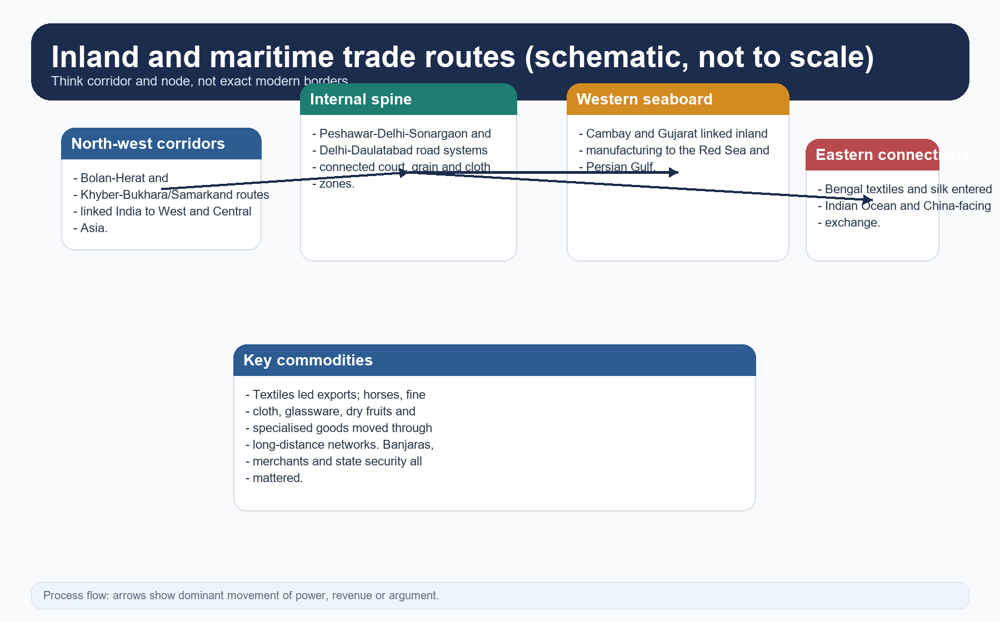

*Trade-route visual. It emphasises corridors and nodes, not false cartographic precision.*

#### PARAGRAPH DEMONSTRATION — CLAIM → EVIDENCE → ANALYSIS → QUALIFICATION

**Claim:** Trade history belongs inside the state narrative because the army, the nobility and the urban population all depended on regular movement of grain, animals, cloth and money. **Evidence:** The Sultanate inherited and expanded long-distance trade through north-west routes, internal roads and maritime exchange. The sources repeatedly mention the Peshawar-Delhi-Sonargaon axis, the road to Daulatabad, and western links through Gujarat. **Analysis:** Horse imports fed cavalry, textiles and grain supported urban demand, and sarais reduced transaction risk; this is why trade sits inside the military-fiscal story rather than outside it. **Qualification:** Route maps should therefore be read as functional corridors rather than as exact-to-scale diagrams.

#### CLOSING RECALL FLOW — INLAND AND MARITIME TRADE: CORRIDORS, SARAIS AND HORSES

```text
START / CONCEPT: INLAND AND MARITIME TRADE: CORRIDORS, SARAIS AND HORSES
        |
        v
EXACT TERMS: sarais and roads · horse imports · textile exports · Cambay and Bengal · route security · inland-maritime linkage
        |
        v
MECHANISM / ARGUMENT: Commercial corridors sustained both war and urban life by carrying animals, grain, manufactures and cash across long distances.
        |
        v
CONSEQUENCE / CONTRAST: Route maps should therefore be read as functional corridors rather than as exact-to-scale diagrams.
        |
        v
UPSC TRAP / ANSWER-USE: Do not treat ports as self-sufficient nodes; explain inland roads, sarais, brokers and security before making any maritime claim.
        |
        v
ANSWER-GRABBING FORMULATION: The safest formulation is that Sultanate trade operated through connected inland and maritime corridors, not through isolated ports.
```

### SESSION 19 — MERCHANTS, BROKERS, BANJARAS AND CREDIT

#### DEFINITION / WHAT THIS IS CALLED

**Plain-language definition:** This session shows who moved goods and money: merchants, brokers, transporters and credit networks, not the state alone.

**Technical definition:** Commercial life involved Multanis, Khurasanis, Gujaratis, Bohras, Marwaris, sahs, dallals, banjaras and hundi-based credit, with different actors operating across distinct regional and commodity circuits.

#### ANSWER-GRABBING OPENING — WRITE/ADAPT IN THE EXAM

> If asked about economy, widen the lens beyond taxation: merchants and credit gave the Sultanate its connective tissue.

#### MUST-WRITE KEYWORDS

- **Multanis**
- **sahs**
- **banjaras**
- **hundis**
- **brokers or dallals**
- **merchant finance**

**How to use them:** Name merchant groups, bring in banjaras for transport, and then explain brokers and hundis as the mechanisms that linked markets.

[FACT] The OCR and Topic 07 advanced owner identify Multanis, Khurasanis, Afghans, Gujaratis, Marwaris, Jains and Bohras as important commercial actors, though in different settings and degrees. Wealthy merchants could lend heavily even to nobles.

[FACT] **Hundis**, money-changing and sarrafs mattered for long-distance finance, transport and even storage of noble wealth. Banjaras carried grain and were central to provisioning mechanisms.

[ANALYSIS] This evidence blocks the habit of reducing the Sultanate economy to state extraction alone. Merchant initiative, finance and transport were indispensable, even where the state regulated, taxed or supervised their activity.

[DEBATE] Alauddin's controls are best handled as a capital-centred military-fiscal episode inside this wider commercial system. Topic 07 therefore insists: **intervention did not erase market society**.

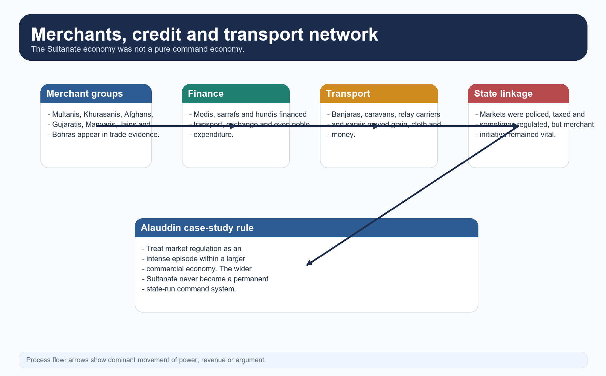

*Commerce visual. It shows how merchants, financiers and transporters mediated between countryside, town and state.*

#### PARAGRAPH DEMONSTRATION — CLAIM → EVIDENCE → ANALYSIS → QUALIFICATION

**Claim:** This evidence blocks the habit of reducing the Sultanate economy to state extraction alone. **Evidence:** The OCR and Topic 07 advanced owner identify Multanis, Khurasanis, Afghans, Gujaratis, Marwaris, Jains and Bohras as important commercial actors, though in different settings and degrees. Wealthy merchants could lend heavily even to nobles. **Analysis:** The variety of merchant groups matters because no single community monopolised all trade; credit and brokerage allowed distant exchange to function even where coin availability or direct supervision was uneven. **Qualification:** Capital regulation in Delhi was thus only one episode inside a wider commercial system.

#### CLOSING RECALL FLOW — MERCHANTS, BROKERS, BANJARAS AND CREDIT

```text
START / CONCEPT: MERCHANTS, BROKERS, BANJARAS AND CREDIT
        |
        v
EXACT TERMS: Multanis · sahs · banjaras · hundis · brokers or dallals · merchant finance
        |
        v
MECHANISM / ARGUMENT: Exchange expanded because traders could transport bulky goods, mobilise credit and reduce risk through intermediation.
        |
        v
CONSEQUENCE / CONTRAST: Capital regulation in Delhi was thus only one episode inside a wider commercial system.
        |
        v
UPSC TRAP / ANSWER-USE: Do not reduce economic history to Alauddin's price-control episode or to state extraction alone.
        |
        v
ANSWER-GRABBING FORMULATION: A useful line is: beneath the state's fiscal claims, a many-layered commercial world of merchants, carriers and credit kept circulation alive.
```

### SESSION 20 — SOCIAL GROUPS, CASTE AND NON-CENSUS HIERARCHY

#### DEFINITION / WHAT THIS IS CALLED

**Plain-language definition:** Social order under the Sultanate cannot be drawn as one neat chart; many hierarchies overlapped.

**Technical definition:** Varna-jati distinctions, occupational gradation, service mobility, ashraf-ajlaf language and status competition produced stratification without providing a census-like map valid for all regions.

#### ANSWER-GRABBING OPENING — WRITE/ADAPT IN THE EXAM

> Open by refusing the tidy chart: Sultanate society had layered hierarchies, not one exhaustive social ladder.

#### MUST-WRITE KEYWORDS

- **varna-jati**
- **occupational hierarchy**
- **ashraf-ajlaf caution**
- **service mobility**
- **status competition**
- **stratification**

**How to use them:** Begin with varna-jati, add occupational ranking, then use ashraf-ajlaf cautiously and finish with service mobility and status competition.

[FACT] Sultanate society included rulers, nobles, ulema, officials, soldiers, peasants, artisans, merchants, slaves, mendicants, entertainers and service groups. The sources are strongest on elites, yet they also reveal sharp social inequality.

[FACT] Smriti writers preserved Brahmanical hierarchy and restrictions on many lower groups. At the same time, the urban world and state service created more mixed settings than a simple textbook pyramid suggests.

[ANALYSIS] The historian should therefore think in terms of **overlapping social layers**, not a neat medieval census chart. Class, status, religion, occupation, gender and locality interacted differently in towns, villages, courts and frontiers.

[LIMIT] Social groups are analytical labels, not exact population measures. The archive rarely allows precise numerical breakdowns.

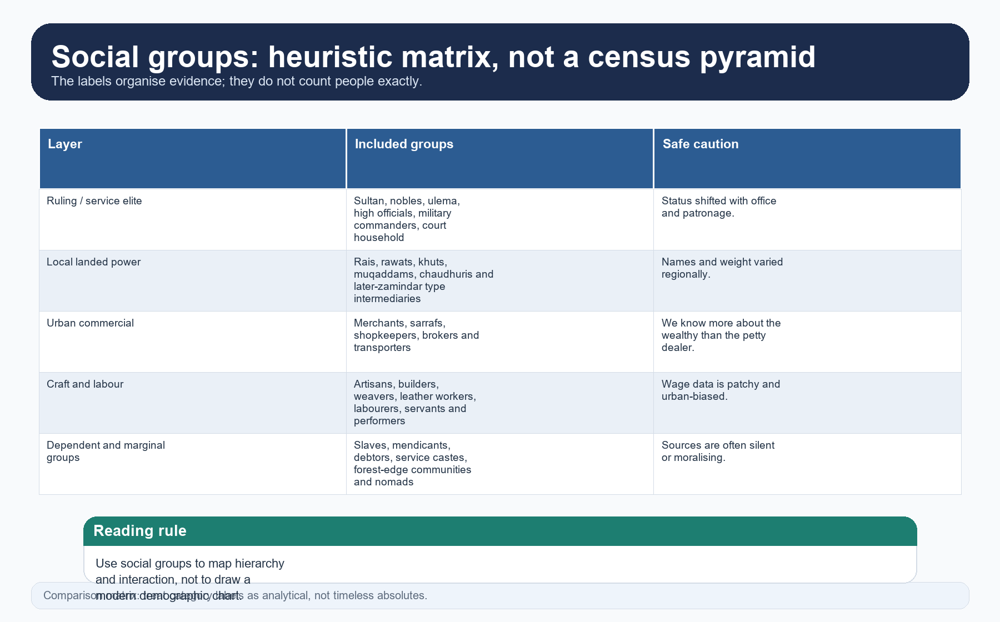

*Social-matrix visual. It organises evidence without pretending to produce a medieval census.*

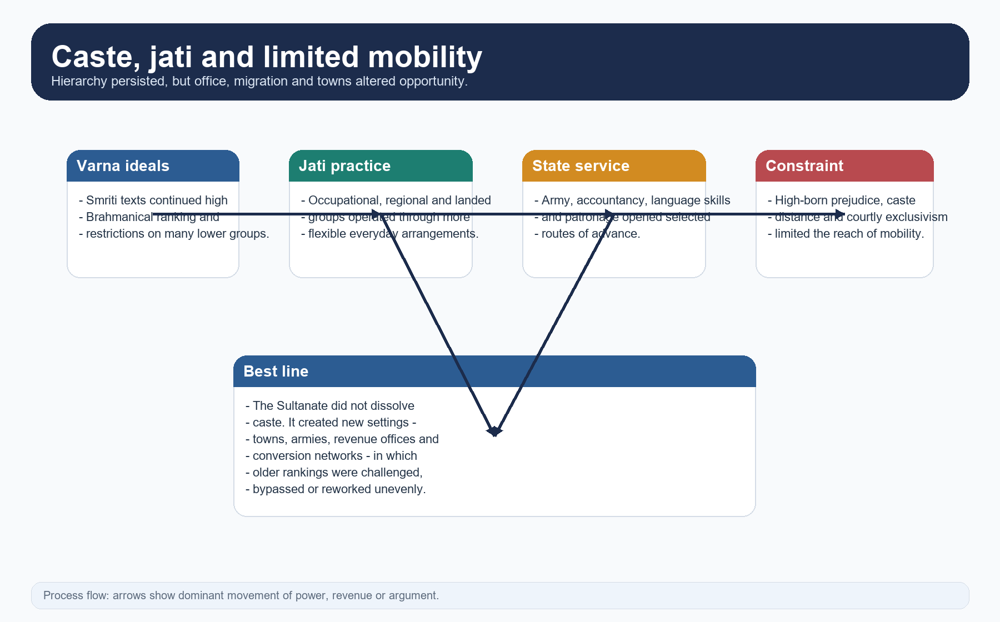

*Mobility visual. It shows why state service and towns mattered without dissolving hierarchy.*

#### PARAGRAPH DEMONSTRATION — CLAIM → EVIDENCE → ANALYSIS → QUALIFICATION

**Claim:** The historian should therefore think in terms of **overlapping social layers**, not a neat medieval census chart. **Evidence:** Sultanate society included rulers, nobles, ulema, officials, soldiers, peasants, artisans, merchants, slaves, mendicants, entertainers and service groups. The sources are strongest on elites, yet they also reveal sharp social inequality. **Analysis:** Because elites, peasants, artisans, merchants, slaves and mendicants occupied different positions within more than one status system, any single label captures only part of the structure; that is why analytical caution matters. **Qualification:** These social groups are therefore heuristic categories, not exact population counts.

#### CLOSING RECALL FLOW — SOCIAL GROUPS, CASTE AND NON-CENSUS HIERARCHY

```text
START / CONCEPT: SOCIAL GROUPS, CASTE AND NON-CENSUS HIERARCHY
        |
        v
EXACT TERMS: varna-jati · occupational hierarchy · ashraf-ajlaf caution · service mobility · status competition · stratification
        |
        v
MECHANISM / ARGUMENT: Hierarchy was reproduced through occupation, lineage, religion, office and control over surplus, with each axis weighing differently across regions.
        |
        v
CONSEQUENCE / CONTRAST: These social groups are therefore heuristic categories, not exact population counts.
        |
        v
UPSC TRAP / ANSWER-USE: Do not use later or overgeneralised labels as if they mapped the whole subcontinent with bureaucratic precision.
        |
        v
ANSWER-GRABBING FORMULATION: One strong line is: Sultanate society was stratified through overlapping social layers rather than one uniform medieval order.
```

### SESSION 21 — HINDUS, MUSLIMS AND CONVERSION: DIFFERENTIATED COMMUNITIES, NOT STATIC BLOCS

#### DEFINITION / WHAT THIS IS CALLED

**Plain-language definition:** This session studies interaction and difference together, instead of treating Hindus and Muslims as sealed blocs.

**Technical definition:** Community relations turned on local politics, patronage, service, devotional contact and multi-causal conversion, while Muslim society itself remained internally stratified.

#### ANSWER-GRABBING OPENING — WRITE/ADAPT IN THE EXAM

> For Hindus, Muslims and conversion, begin by rejecting a static binary: the evidence shows differentiated communities interacting through politics, patronage and social contact.

#### MUST-WRITE KEYWORDS

- **interaction**
- **local politics**
- **patronage**
- **devotional contact**
- **multi-causal conversion**
- **anti-binary method**

**How to use them:** Start with internal differentiation within Muslim society, then discuss local politics and patronage, and only then bring in conversion as one process among several.

[FACT] The OCR is explicit that Muslim society itself remained internally divided among Turks, Iranians, Afghans and Indian Muslims. The advanced source uses *ashraf* and *ajlaf* language for status differentiation and shows discrimination against many converts and occupational groups.

[FACT] The concise OCR is equally explicit that Hindus were not absent from Sultanate power. They remained crucial in local administration, revenue collection, trade and even military service. Most nobles kept Hindu managers, and the local administrative machinery stayed largely in Hindu hands.

[ANALYSIS] The best social frame is therefore one of **differentiated communities in unequal interaction**. There was tension, hierarchy and violence; there was also dependence, employment, translation and shared urban space.

[ANALYSIS] Conversion should be treated as multi-causal: patronage, social mobility, service, belief, Sufi contact, political association and in some places frontier settlement all mattered. Bounded coercive episodes existed, but they do not explain the whole pattern.

[LIMIT] Topic 07 deliberately avoids a mass-conversion or total-exclusion narrative because neither is supported by the evidence base used here.

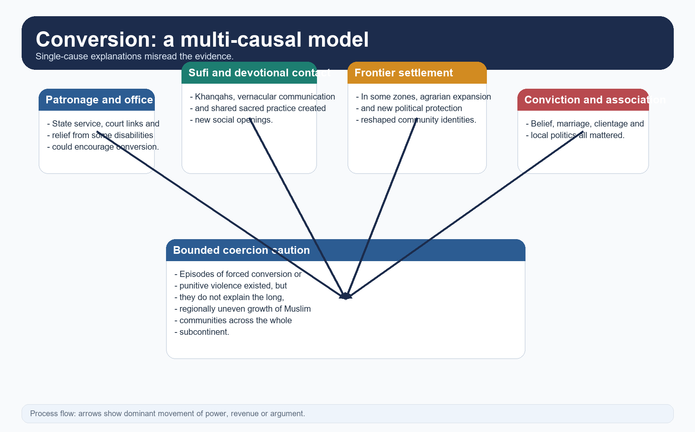

*Conversion visual. It keeps political, social, devotional and regional mechanisms together and refuses single-cause explanation.*

#### PARAGRAPH DEMONSTRATION — CLAIM → EVIDENCE → ANALYSIS → QUALIFICATION

**Claim:** The best social frame is therefore one of **differentiated communities in unequal interaction**. **Evidence:** The OCR is explicit that Muslim society itself remained internally divided among Turks, Iranians, Afghans and Indian Muslims. The advanced source uses *ashraf* and *ajlaf* language for status differentiation and shows discrimination against many converts and occupational groups. **Analysis:** Since Muslim groups were divided by origin and status, and Hindu groups remained deeply stratified, cross-community relations were mediated by office, patronage and locality; broad civilisational binaries hide that lived complexity. **Qualification:** This is why mass-conversion and total-exclusion stories both outrun the evidence used in Topic 07.

#### CLOSING RECALL FLOW — HINDUS, MUSLIMS AND CONVERSION: DIFFERENTIATED COMMUNITIES, NOT STATIC BLOCS

```text
START / CONCEPT: HINDUS, MUSLIMS AND CONVERSION: DIFFERENTIATED COMMUNITIES, NOT STATIC BLOCS
        |
        v
EXACT TERMS: interaction · local politics · patronage · devotional contact · multi-causal conversion · anti-binary method
        |
        v
MECHANISM / ARGUMENT: Relations changed through everyday contact in service, markets, shrines and politics rather than through one master cause.
        |
        v
CONSEQUENCE / CONTRAST: This is why mass-conversion and total-exclusion stories both outrun the evidence used in Topic 07.
        |
        v
UPSC TRAP / ANSWER-USE: Do not make conversion the single key to every social change, and do not speak of Hindus or Muslims as internally uniform communities.
        |
        v
ANSWER-GRABBING FORMULATION: A balanced line is: Sultanate society consisted of differentiated communities interacting under unequal but shared political and economic conditions.
```

### SESSION 22 — SLAVERY, GENDER AND EVERYDAY MATERIAL INEQUALITY

#### DEFINITION / WHAT THIS IS CALLED

**Plain-language definition:** This session asks how unfreedom and gender hierarchy shaped everyday life, while keeping elite exceptions separate from general social experience.

**Technical definition:** The evidence spans domestic, military and artisanal slavery, chronicle-scale claims under Firuz, classed seclusion practices such as purdah, and uneven data on property, widowhood and women's labour.

#### ANSWER-GRABBING OPENING — WRITE/ADAPT IN THE EXAM

> Begin with the distinction between elite military slavery and wider unfree labour, then shift to the classed nature of gender norms.

#### MUST-WRITE KEYWORDS

- **domestic slavery**
- **military slavery**
- **artisanal labour**
- **purdah**
- **property and household**
- **evidence ladder**

**How to use them:** Define the types of slavery first, mark Firuz's figures as chronicle claims, and then discuss purdah, household property and women's work through an evidence ladder.

[FACT] Slavery remained an important part of Sultanate social life. Prisoners of war, purchased slaves, domestic slaves, artisanal slaves and bodyguards all appear in the evidence. Firuz's reported 1,80,000 slaves and 12,000 trained artisans must remain labelled as chronicle-scale claims, not audited census truth.

[FACT] The OCR also shows that slavery lowered the status of free labour and helped structure elite comfort. Some military slaves rose high, but most slaves did not.

[FACT] On gender, upper-class seclusion or **purdah** spread more widely in the Sultanate centuries, especially among courtly and elite groups. Yet the evidence itself treats this as classed and situational. It does not justify a universal rule for all women.

[DEBATE] Sati, jauhar, widow rights, property claims, royal women and women's labour must therefore be handled on an evidence ladder: prescription, elite norm, specific episode, then careful inference. Topic 07 does not romanticise either complete repression or complete emancipation.

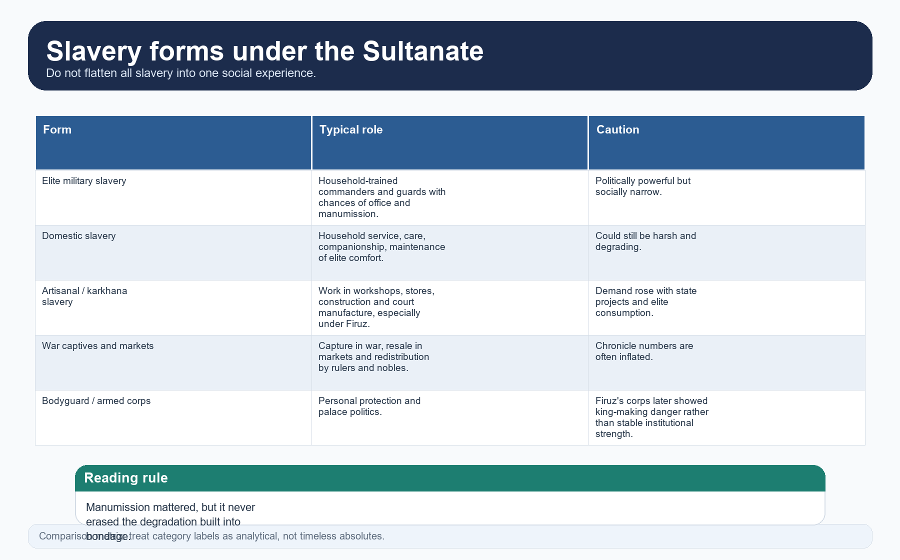

*Slavery visual. It keeps elite military slavery distinct from domestic, artisanal and captive forms.*

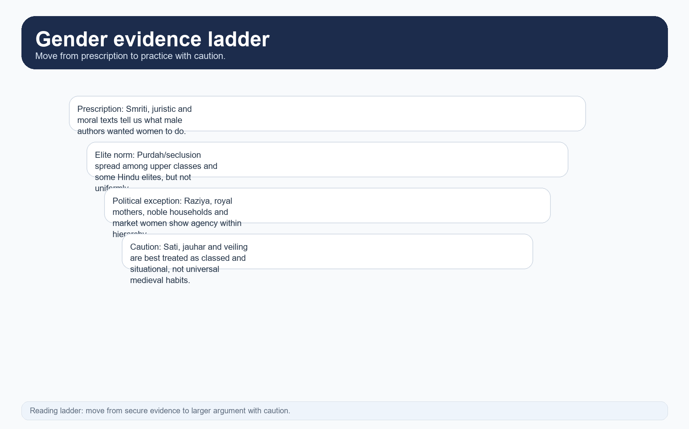

*Gender visual. It shows why prescription, elite norm and lived practice must be kept separate.*

#### PARAGRAPH DEMONSTRATION — CLAIM → EVIDENCE → ANALYSIS → QUALIFICATION

**Claim:** Slavery remained an important part of Sultanate social life. **Evidence:** Slavery remained an important part of Sultanate social life. Prisoners of war, purchased slaves, domestic slaves, artisanal slaves and bodyguards all appear in the evidence. Firuz's reported 1,80,000 slaves and 12,000 trained artisans must remain labelled as chronicle-scale claims, not audited census truth. **Analysis:** The evidence shows that slavery structured labour and elite consumption while purdah marked upper-status household control; both phenomena therefore illuminate hierarchy, but neither can be generalised without social and evidentiary caution. **Qualification:** Sati, jauhar, widow rights, property claims, royal women and women's labour should therefore be handled on an evidence ladder: prescription, elite norm, specific episode, then careful inference.

#### CLOSING RECALL FLOW — SLAVERY, GENDER AND EVERYDAY MATERIAL INEQUALITY

```text
START / CONCEPT: SLAVERY, GENDER AND EVERYDAY MATERIAL INEQUALITY
        |
        v
EXACT TERMS: domestic slavery · military slavery · artisanal labour · purdah · property and household · evidence ladder
        |
        v
MECHANISM / ARGUMENT: Household dependence, coercive labour and elite gender control operated together to distribute comfort upward and vulnerability downward.
        |
        v
CONSEQUENCE / CONTRAST: Sati, jauhar, widow rights, property claims, royal women and women's labour should therefore be handled on an evidence ladder: prescription, elite norm, specific episode, then careful inference.
        |
        v
UPSC TRAP / ANSWER-USE: Do not universalise the experience of courtly women to all women, and do not let the rise of a few military slaves erase the larger world of bondage.
        |
        v
ANSWER-GRABBING FORMULATION: A strong line is: Sultanate inequality was reproduced through multiple forms of slavery and through gender norms that were sharply classed and uneven.
```

### SESSION 23 — EDUCATION, LANGUAGE, ULEMA, SUFIS AND SOCIAL INTERACTION

#### DEFINITION / WHAT THIS IS CALLED

**Plain-language definition:** Knowledge moved through schools, mosques, khanqahs, courts and everyday language contact, not through one single institution.

**Technical definition:** Persianisation of administration, maktab-madrasa training, khanqah networks, Arabic religious prestige, Sanskrit continuities and Hindavi interaction together shaped the social life of learning.

#### ANSWER-GRABBING OPENING — WRITE/ADAPT IN THE EXAM

> When writing on education, do not isolate schools from language and legitimacy; the institutional and linguistic stories are the same story.

#### MUST-WRITE KEYWORDS

- **Persianisation**
- **maktabs and madrasas**
- **khanqahs**
- **Hindavi contact**
- **ulema**
- **Sufi-state interaction**

**How to use them:** Begin with Persian as the language of administration, place maktabs, madrasas and khanqahs within that world, then add Hindavi contact and Persian-knowing Hindus to show widening access.

[FACT] Maktabs, madrasas, mosques, khanqahs, courtly scholarship, Sanskrit learning and local teaching traditions coexisted. The spread of paper-making made record-keeping and manuscripts easier, but did not automatically democratise learning.

[FACT] Persian became the leading language of administration and much elite literary production; Arabic retained high religious prestige; Hindavi and other vernaculars expanded in everyday speech, Sufi conversation, poetic expression and later literary growth.

[FACT] The advanced OCR's note on Persian-knowing Hindus is especially important. By the Tughlaq period, a class of Hindus trained in Persian was entering service, showing that administrative culture could widen across community boundaries.

[ANALYSIS] Topic 07 uses Sufis and ulema not to retell Topic 10, but to explain how language, legitimacy and social contact worked. Chishti use of Hindavi, saint-yogi interaction, juristic office and court patronage all helped mediate the social life of rule.

[LIMIT] 'Composite culture' is a useful phrase only if mechanism is supplied - language contact, service, translation, shared urbanity, music or shrine interaction - not if it becomes a slogan.

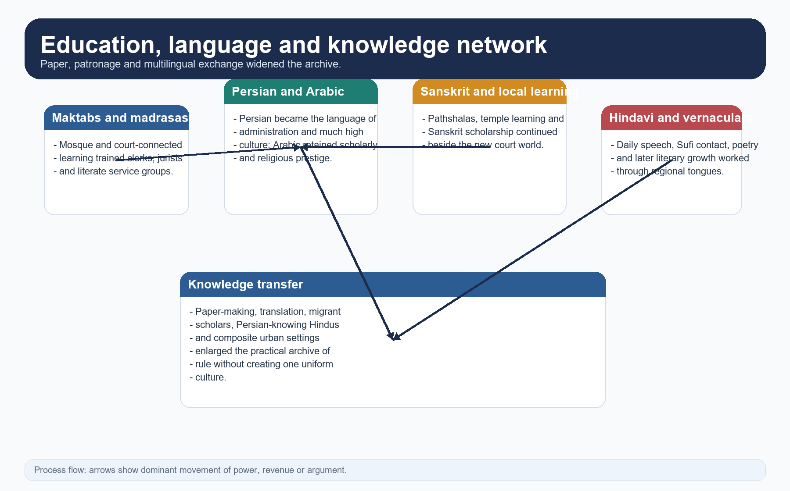

*Knowledge-network visual. It links institutions, paper, languages and service culture rather than isolating them.*

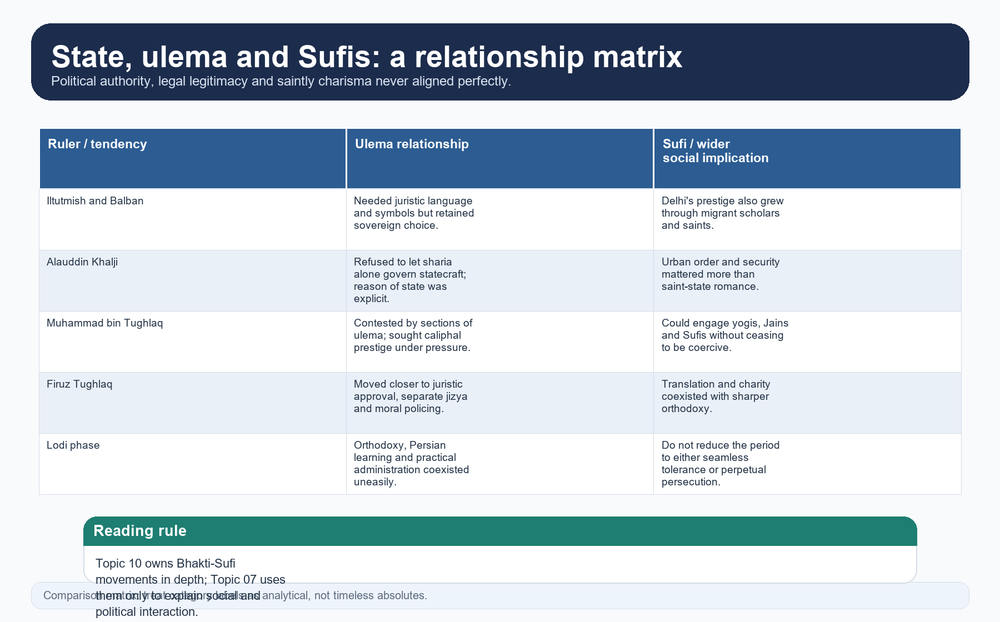

*Relationship visual. It keeps juristic authority, saintly charisma and royal expediency analytically separate.*

#### PARAGRAPH DEMONSTRATION — CLAIM → EVIDENCE → ANALYSIS → QUALIFICATION

**Claim:** Topic 07 uses Sufis and ulema not to retell Topic 10, but to explain how language, legitimacy and social contact worked. **Evidence:** Maktabs, madrasas, mosques, khanqahs, courtly scholarship, Sanskrit learning and local teaching traditions coexisted. The spread of paper-making made record-keeping and manuscripts easier, but did not automatically democratise learning. **Analysis:** Coexisting schools and language communities matter because learning served multiple ends—bureaucratic service, religious authority and social interaction; Persian expanded state culture, yet vernacular contact kept that culture permeable. **Qualification:** “Composite culture” earns marks only when these mechanisms are named rather than assumed.

#### CLOSING RECALL FLOW — EDUCATION, LANGUAGE, ULEMA, SUFIS AND SOCIAL INTERACTION

```text
START / CONCEPT: EDUCATION, LANGUAGE, ULEMA, SUFIS AND SOCIAL INTERACTION
        |
        v
EXACT TERMS: Persianisation · maktabs and madrasas · khanqahs · Hindavi contact · ulema · Sufi-state interaction
        |
        v
MECHANISM / ARGUMENT: Administrative language created service demand, while devotional and urban contact widened the social reach of that linguistic order.
        |
        v
CONSEQUENCE / CONTRAST: “Composite culture” earns marks only when these mechanisms are named rather than assumed.
        |
        v
UPSC TRAP / ANSWER-USE: Do not use “composite culture” as a decorative conclusion unless you can show the mechanism—translation, service, shared urbanity or shrine contact.
        |
        v
ANSWER-GRABBING FORMULATION: A marks-safe line is: Sultanate educational life was plural, but Persianisation gave its most powerful institutional axis.
```

### SESSION 24 — SYNTHESIS AND HISTORIOGRAPHY: CENTRALISATION, FEUDALISM, URBAN CHANGE AND SOURCES

#### DEFINITION / WHAT THIS IS CALLED

**Plain-language definition:** This session defines the historiographical synthesis of Topic 07 as the testing of centralisation, feudal, urban and technological theses against a mixed source base.

**Technical definition:** Historiographical synthesis must test centralisation, feudal analogy, urban-revival and technological-diffusion theses against a mixed archive of chronicles, travellers, coins, inscriptions, architecture and archaeology.

#### ANSWER-GRABBING OPENING — WRITE/ADAPT IN THE EXAM

> Do not end with slogans like centralised, feudal or urban revolution; end by showing which thesis each body of evidence can actually sustain.

#### MUST-WRITE KEYWORDS

- **centralisation debate**
- **feudal analogy**
- **urban revolution**
- **technological change**
- **multi-source method**
- **qualified verdict**

**How to use them:** Take the debate one axis at a time—centralisation, iqta/feudal analogy, urban change and technology—and then close with source criticism and a qualified verdict.

[DEBATE] Was the Sultanate centralised? Yes, at the apex; unevenly, below. This is why the strongest answer speaks of **centralising aspiration plus negotiated sovereignty**.

[DEBATE] Was iqta feudalism? The comparison can illuminate service-linked assignment, but breaks down if it ignores state superiority, transfer, audit and the changing political meaning of assignment over time.

[DEBATE] Was there an urban revolution? Town growth, monetisation, crafts and trade were substantial, but their energy rested on agrarian extraction and hierarchy. Growth and coercion must therefore be read together.

[DEBATE] Did technology simply arrive from outside? No. The better frame is diffusion and adaptation through artisans, courts, merchants and local needs. The same caution applies to language and culture.

[DEBATE] Was the state religious or secular? Neither label is adequate by itself. Sharia, caliphal idiom, jurists, zawabit, royal expediency and local custom coexisted in changing proportion.

[FACT] The core source matrix remains: Barani, Minhaj, Amir Khusrau, Ibn Battuta, Isami, Afif, coins, inscriptions, architecture, archaeology and regional texts. Every good answer should move from named evidence to mechanism to qualification to verdict.

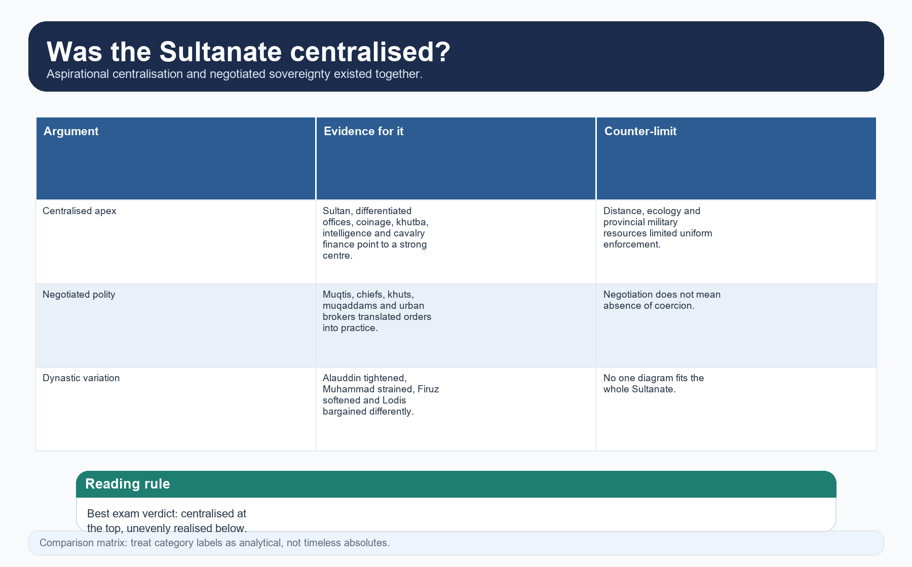

*Centralisation visual. It turns a yes-or-no question into a layered argument.*

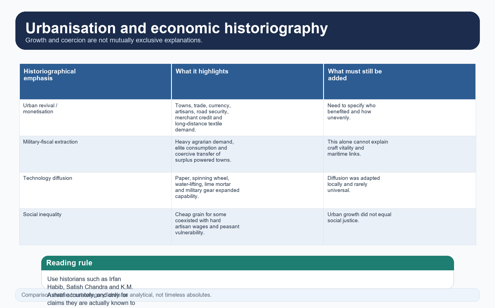

*Historiography visual. It contrasts growth, extraction and technology without forcing false choices.*

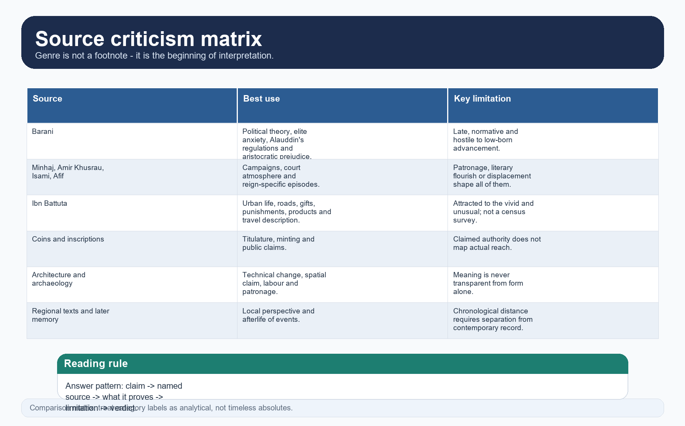

*Source matrix. It keeps genre and limitation at the centre of explanation.*


*Answer-spine visual. It gives a repeatable structure for administrative, economic and social questions.*

#### PARAGRAPH DEMONSTRATION — CLAIM → EVIDENCE → ANALYSIS → QUALIFICATION

**Claim:** The core source matrix remains: Barani, Minhaj, Amir Khusrau, Ibn Battuta, Isami, Afif, coins, inscriptions, architecture, archaeology and regional texts. **Evidence:** The core source matrix remains: Barani, Minhaj, Amir Khusrau, Ibn Battuta, Isami, Afif, coins, inscriptions, architecture, archaeology and regional texts. Every good answer should move from named evidence to mechanism to qualification to verdict. **Analysis:** Because chronicles privilege elite intention while coins, inscriptions and architecture register public claims differently, no single source can settle the great debates; synthesis requires testing each thesis against multiple evidentiary registers. **Qualification:** No single label—centralised, feudal, secular or revolutionary—survives without qualification once that full source matrix is used.

#### CLOSING RECALL FLOW — SYNTHESIS AND HISTORIOGRAPHY: CENTRALISATION, FEUDALISM, URBAN CHANGE AND SOURCES

```text
START / CONCEPT: SYNTHESIS AND HISTORIOGRAPHY: CENTRALISATION, FEUDALISM, URBAN CHANGE AND SOURCES
        |
        v
EXACT TERMS: centralisation debate · feudal analogy · urban revolution · technological change · multi-source method · qualified verdict
        |
        v
MECHANISM / ARGUMENT: Interpretations become persuasive only when multiple source types are cross-checked rather than read in isolation.
        |
        v
CONSEQUENCE / CONTRAST: No single label—centralised, feudal, secular or revolutionary—survives without qualification once that full source matrix is used.
        |
        v
UPSC TRAP / ANSWER-USE: The biggest trap is to turn one chronicler or one debate into the whole truth of the Sultanate.
        |
        v
ANSWER-GRABBING FORMULATION: A strong concluding line is: the Sultanate was centralising at the apex, negotiated below, commercially and technologically dynamic, yet recoverable only through a source-critical method.
```

## BASIC MCQS / REMEDIATION

### Learning MCQ 01

**Question:** Which phrase most accurately describes the Delhi Sultanate?

- A. A Persianate military-fiscal state whose central claims depended on negotiation below.
- B. A purely spiritual caliphate run from Baghdad.
- C. A society without villages or intermediaries.
- D. A timeless nation-state with fixed ministries.

**Answer: A.**

**Explanation:** The best phrase joins ideology, coercion and agrarian mediation.

**Option-wise explanation:**
- A. **Correct.** The best phrase joins ideology, coercion and agrarian mediation.
- B. **Incorrect.** "A purely spiritual caliphate run from Baghdad." runs into the topic trap: do not remove villages and intermediaries from the definition of the Sultanate.
- C. **Incorrect.** "A society without villages or intermediaries." misreads the evidence; the best phrase joins ideology, coercion and agrarian mediation.
- D. **Incorrect.** "A timeless nation-state with fixed ministries." falls once you remember that do not remove villages and intermediaries from the definition of the Sultanate.

**Trap:** Do not remove villages and intermediaries from the definition of the Sultanate.

### Learning MCQ 02

**Question:** Why is the phrase 'Persianate' useful in Topic 07?

- A. Because Persianate culture abolished local languages.
- B. Because it captures a transregional language-administrative culture that could include rulers and officials of varied origins.
- C. Because only Persian literature mattered in the Sultanate.
- D. Because all rulers were ethnically Persian.

**Answer: B.**

**Explanation:** The term is cultural-political, not ethnic.

**Option-wise explanation:**
- A. **Incorrect.** "Because Persianate culture abolished local languages." cannot stand because persianate is a cultural-administrative descriptor, not an ethnic label.
- B. **Correct.** The term is cultural-political, not ethnic.
- C. **Incorrect.** "Because only Persian literature mattered in the Sultanate." is too blunt for this topic; persianate is a cultural-administrative descriptor, not an ethnic label.
- D. **Incorrect.** "Because all rulers were ethnically Persian." misses what the evidence actually shows: the term is cultural-political, not ethnic.

**Trap:** Persianate is a cultural-administrative descriptor, not an ethnic label.

### Learning MCQ 03

**Question:** What made Delhi important beyond military conquest?

- A. It mattered only after the Mughals.
- B. It had no link with monetisation.
- C. Coinage, chancery, migrant scholars, court ritual and revenue coordination reinforced its centrality.
- D. It was the only town in north India.

**Answer: C.**

**Explanation:** Delhi became a nodal political and cultural centre, not just a fort.

**Option-wise explanation:**
- A. **Incorrect.** "It mattered only after the Mughals." overstates the case; delhi's centrality was institutional and monetary, not merely geographic.
- B. **Incorrect.** "It had no link with monetisation." is ruled out by the fact that delhi became a nodal political and cultural centre, not just a fort.
- C. **Correct.** Delhi became a nodal political and cultural centre, not just a fort.
- D. **Incorrect.** "It was the only town in north India." strips away the nuance that delhi became a nodal political and cultural centre, not just a fort.

**Trap:** Delhi's centrality was institutional and monetary, not merely geographic.

### Learning MCQ 04

**Question:** Which statement about succession under the Sultanate is safest?

- A. Primogeniture operated without interruption.
- B. Caliphal appointment automatically settled succession.
- C. Village panchayats chose the sultan.
- D. Nomination, noble acceptance, military strength and household politics all shaped succession.

**Answer: D.**

**Explanation:** This defeats simplistic dynastic assumptions.

**Option-wise explanation:**
- A. **Incorrect.** "Primogeniture operated without interruption." does not fit the source-based line here; this defeats simplistic dynastic assumptions.
- B. **Incorrect.** "Caliphal appointment automatically settled succession." confuses the issue because succession was negotiated and force-backed, not a clean primogeniture rule.
- C. **Incorrect.** "Village panchayats chose the sultan." sounds neat, but this defeats simplistic dynastic assumptions.
- D. **Correct.** This defeats simplistic dynastic assumptions.

**Trap:** Succession was negotiated and force-backed, not a clean primogeniture rule.

### Learning MCQ 05

**Question:** Why should Diwan-i-Risalat be handled cautiously?

- A. Because its exact portfolio is reconstructed differently by scholars and may shift across reigns.
- B. Because it only managed artillery.
- C. Because it was a Mughal-only innovation.
- D. Because the office certainly never existed.

**Answer: A.**

**Explanation:** Terminology caution itself is a mark of strong historical method.

**Option-wise explanation:**
- A. **Correct.** Terminology caution itself is a mark of strong historical method.
- B. **Incorrect.** "Because it only managed artillery." runs into the topic trap: handle Diwan-i-Risalat with chronology-and-portfolio caution.
- C. **Incorrect.** "Because it was a Mughal-only innovation." misreads the evidence; terminology caution itself is a mark of strong historical method.
- D. **Incorrect.** "Because the office certainly never existed." falls once you remember that handle Diwan-i-Risalat with chronology-and-portfolio caution.

**Trap:** Handle Diwan-i-Risalat with chronology-and-portfolio caution.

### Learning MCQ 06

**Question:** What was the political use of the barid network?

- A. It replaced the military department entirely.
- B. It carried intelligence upward and helped rulers watch governors, nobles and markets.
- C. It minted copper jitals.
- D. It managed Hindu temple endowments only.

**Answer: B.**

**Explanation:** Information was a technology of rule.

**Option-wise explanation:**
- A. **Incorrect.** "It replaced the military department entirely." cannot stand because barid means surveillance and reporting, not minting or military command.
- B. **Correct.** Information was a technology of rule.
- C. **Incorrect.** "It minted copper jitals." is too blunt for this topic; barid means surveillance and reporting, not minting or military command.
- D. **Incorrect.** "It managed Hindu temple endowments only." misses what the evidence actually shows: information was a technology of rule.

**Trap:** Barid means surveillance and reporting, not minting or military command.

### Learning MCQ 07

**Question:** Which social group is most directly linked to village headship in Topic 07's core evidence?

- A. Barids.
- B. Mir bakhshis.
- C. Muqaddams and related local landed intermediaries.
- D. Caliphal envoys.

**Answer: C.**

**Explanation:** Village headship belongs to local agrarian hierarchy.

**Option-wise explanation:**
- A. **Incorrect.** "Barids." overstates the case; keep village headship terms separate from imperial offices.
- B. **Incorrect.** "Mir bakhshis." is ruled out by the fact that village headship belongs to local agrarian hierarchy.
- C. **Correct.** Village headship belongs to local agrarian hierarchy.
- D. **Incorrect.** "Caliphal envoys." strips away the nuance that village headship belongs to local agrarian hierarchy.

**Trap:** Keep village headship terms separate from imperial offices.

### Learning MCQ 08

**Question:** Why is iqta not equivalent to European feudalism?

- A. Because Europe had no cavalry.
- B. Because iqta was a maritime customs office.
- C. Because iqta had no connection at all with revenue.
- D. Because the Sultanate state's superior claim, transfer power and audit logic differ from a simple proprietary-vassal model.

**Answer: D.**

**Explanation:** The comparison is useful only when its limits are stated.

**Option-wise explanation:**
- A. **Incorrect.** "Because Europe had no cavalry." does not fit the source-based line here; the comparison is useful only when its limits are stated.
- B. **Incorrect.** "Because iqta was a maritime customs office." confuses the issue because iqta is not shorthand for feudal private property.
- C. **Incorrect.** "Because iqta had no connection at all with revenue." sounds neat, but the comparison is useful only when its limits are stated.
- D. **Correct.** The comparison is useful only when its limits are stated.

**Trap:** Iqta is not shorthand for feudal private property.

### Learning MCQ 09

**Question:** What does khalisa most clearly indicate?

- A. Revenue reserved for more direct crown collection and visibility.
- B. The village police post.
- C. A type of slave corps.
- D. A class of urban merchants.

**Answer: A.**

**Explanation:** Khalisa is central to any discussion of Alauddin or crown finance.

**Option-wise explanation:**
- A. **Correct.** Khalisa is central to any discussion of Alauddin or crown finance.
- B. **Incorrect.** "The village police post." runs into the topic trap: khalisa means crown-held revenue, not a social group or office.
- C. **Incorrect.** "A type of slave corps." misreads the evidence; khalisa is central to any discussion of Alauddin or crown finance.
- D. **Incorrect.** "A class of urban merchants." falls once you remember that khalisa means crown-held revenue, not a social group or office.

**Trap:** Khalisa means crown-held revenue, not a social group or office.

### Learning MCQ 10

**Question:** Which ruler most clearly combined price regulation with military horse inspection?

- A. Raziya Sultan.
- B. Alauddin Khalji.
- C. Babur.
- D. Khizr Khan Sayyid.

**Answer: B.**

**Explanation:** Dagh and chehra must be placed correctly.

**Option-wise explanation:**
- A. **Incorrect.** "Raziya Sultan." cannot stand because link Alauddin's horse controls to military-fiscal supervision, not to modern state analogies.
- B. **Correct.** Dagh and chehra must be placed correctly.
- C. **Incorrect.** "Babur." is too blunt for this topic; link Alauddin's horse controls to military-fiscal supervision, not to modern state analogies.
- D. **Incorrect.** "Khizr Khan Sayyid." misses what the evidence actually shows: dagh and chehra must be placed correctly.

**Trap:** Link Alauddin's horse controls to military-fiscal supervision, not to modern state analogies.

### Learning MCQ 11

**Question:** Which statement about Muhammad bin Tughlaq is safest for Topic 07?

- A. He ruled only Delhi and Palam.
- B. He had no interest in caliphal legitimacy.
- C. He pushed centralisation, cash demand and recruitment widening further than his predecessors, but strained compliance and trust.
- D. He abolished monetisation.

**Answer: C.**

**Explanation:** The strongest line explains ambition and breakdown together.

**Option-wise explanation:**
- A. **Incorrect.** "He ruled only Delhi and Palam." overstates the case; muhammad bin Tughlaq is over-centralising and experimental, not territorially insignificant.
- B. **Incorrect.** "He had no interest in caliphal legitimacy." is ruled out by the fact that the strongest line explains ambition and breakdown together.
- C. **Correct.** The strongest line explains ambition and breakdown together.
- D. **Incorrect.** "He abolished monetisation." strips away the nuance that the strongest line explains ambition and breakdown together.

**Trap:** Muhammad bin Tughlaq is over-centralising and experimental, not territorially insignificant.

### Learning MCQ 12

**Question:** Why does Firuz matter in Topic 07?

- A. He removed all slave institutions.
- B. He invented the iqta from nothing.
- C. He abandoned public works entirely.
- D. He softened audit, encouraged heredity, expanded canals and workshops, and sharpened some juristic markers such as separate jizya.

**Answer: D.**

**Explanation:** Firuz's regime altered both welfare and hierarchy.

**Option-wise explanation:**
- A. **Incorrect.** "He removed all slave institutions." does not fit the source-based line here; firuz's regime altered both welfare and hierarchy.
- B. **Incorrect.** "He invented the iqta from nothing." confuses the issue because firuz matters for canals, heredity and conciliation—not for abolishing institutions.
- C. **Incorrect.** "He abandoned public works entirely." sounds neat, but firuz's regime altered both welfare and hierarchy.
- D. **Correct.** Firuz's regime altered both welfare and hierarchy.

**Trap:** Firuz matters for canals, heredity and conciliation—not for abolishing institutions.

### Learning MCQ 13

**Question:** What is the safest reading of jizya under the Sultanate?

- A. It mattered politically and symbolically, but it should not stand in for the totality of Hindu-Muslim social relations.
- B. It proves that all policy was only religious.
- C. It was absent from all Sultanate history.
- D. It was always completely separate from land demand from the first day.

**Answer: A.**

**Explanation:** The tax has to be placed in a broader fiscal and political field.

**Option-wise explanation:**
- A. **Correct.** The tax has to be placed in a broader fiscal and political field.
- B. **Incorrect.** "It proves that all policy was only religious." runs into the topic trap: do not let jizya swallow the whole social history of the Sultanate.
- C. **Incorrect.** "It was absent from all Sultanate history." misreads the evidence; the tax has to be placed in a broader fiscal and political field.
- D. **Incorrect.** "It was always completely separate from land demand from the first day." falls once you remember that do not let jizya swallow the whole social history of the Sultanate.

**Trap:** Do not let jizya swallow the whole social history of the Sultanate.

### Learning MCQ 14

**Question:** What best explains the growth of hundis?

- A. The end of road travel.
- B. Long-distance trade, credit needs and the work of money-changers and financiers across regions.
- C. The replacement of silver coins by cowries in Delhi.
- D. A ban on merchant initiative.

**Answer: B.**

**Explanation:** Hundis belong to commercial and financial integration.

**Option-wise explanation:**
- A. **Incorrect.** "The end of road travel." cannot stand because hundi belongs to credit and remittance, not to cowry myths or road collapse.
- B. **Correct.** Hundis belong to commercial and financial integration.
- C. **Incorrect.** "The replacement of silver coins by cowries in Delhi." is too blunt for this topic; hundi belongs to credit and remittance, not to cowry myths or road collapse.
- D. **Incorrect.** "A ban on merchant initiative." misses what the evidence actually shows: hundis belong to commercial and financial integration.

**Trap:** Hundi belongs to credit and remittance, not to cowry myths or road collapse.

### Learning MCQ 15

**Question:** Which commodity cluster best captures long-distance Sultanate trade?

- A. Only rice and wheat outward from every region.
- B. Only temple icons and paper outward.
- C. Textiles outward; horses, high-grade cloth and select goods inward.
- D. Only war booty outward and nothing inward.

**Answer: C.**

**Explanation:** Textiles remained India's most important manufacturing strength.

**Option-wise explanation:**
- A. **Incorrect.** "Only rice and wheat outward from every region." overstates the case; remember the core trade pair: textiles out, horses and select high-value goods in.
- B. **Incorrect.** "Only temple icons and paper outward." is ruled out by the fact that textiles remained India's most important manufacturing strength.
- C. **Correct.** Textiles remained India's most important manufacturing strength.
- D. **Incorrect.** "Only war booty outward and nothing inward." strips away the nuance that textiles remained India's most important manufacturing strength.

**Trap:** Remember the core trade pair: textiles out, horses and select high-value goods in.

### Learning MCQ 16

**Question:** What is the safest claim about artisans under the Sultanate?

- A. They disappeared after market regulation.
- B. They were all state slaves.
- C. They were all village serfs with no urban presence.
- D. They worked in towns and villages, in independent settings and in state-linked workshops, under unequal social conditions.

**Answer: D.**

**Explanation:** Craft life was varied and often poorly documented.

**Option-wise explanation:**
- A. **Incorrect.** "They disappeared after market regulation." does not fit the source-based line here; craft life was varied and often poorly documented.
- B. **Incorrect.** "They were all state slaves." confuses the issue because artisans worked across town and countryside under unequal conditions.
- C. **Incorrect.** "They were all village serfs with no urban presence." sounds neat, but craft life was varied and often poorly documented.
- D. **Correct.** Craft life was varied and often poorly documented.

**Trap:** Artisans worked across town and countryside under unequal conditions.

## PYQS AND ANSWER PRACTICE

### Verified and honestly-adjacent PYQs

#### Direct PYQ 01 - UPSC Prelims GS-I 2019 (directly relevant; exact wording verified locally)

**Question:** Consider the following statements:

1. In the revenue administration of Delhi Sultanate, the in-charge of revenue collection was known as "Amil".  
2. The Iqta system of Sultans of Delhi was an ancient indigenous institution.  
3. The office of "Mir Bakshi" came into existence during the reign of Khalji Sultans of Delhi.

Which of the statements given above is/are correct?

A. 1 only  
B. 1 and 2 only  
C. 3 only  
D. 1, 2 and 3

**Inferred answer - not officially verified locally:** **1 only**. Confidence: high.

**Model explanation:** Statement 1 is correct because *amil* was the revenue-collection functionary at the relevant level. Statement 2 is incorrect because iqta had West and Central Asian antecedents before its Indian adaptation. Statement 3 is incorrect because *Mir Bakshi* belongs to the Mughal system; the Sultanate military department centred on the ariz and Diwan-i-Arz.  

**Why this earns marks:** It tests institutional placement and blocks two classic traps at once.

**Demand decoding:** Verify each statement separately, preserve the official wording and keep the inferred key distinct from any official key.

**Executable exam-length answer / compression plan:** Check chronology, institution or wording first; eliminate each option with one named fact; end by stating the key-status limit.

**How to improve this answer:** For “Consider the following statements: 1. In the revenue administration of Delhi Sultanate, the…”, add one explicit sentence explaining why the closest distractor fails on chronology, geography, source class or degree of certainty.

#### Direct PYQ 02 - UPSC Prelims GS-I 2022 (directly relevant monetary-term question; exact wording verified locally)

**Question:** In medieval India, the term "Fanam" referred to:

A. Clothing  
B. Coins  
C. Ornaments  
D. Weapons

**Inferred answer - not officially verified locally:** **Coins**. Confidence: high.

**Model explanation:** *Fanam* was a coin term in medieval India, especially in wider south Indian and coastal circulation. The exact stem and options are locally recoverable from the 2022 official-paper text file, but the local repository does not preserve the official UPSC key row, so the answer remains honestly marked as inferred.  

**Why this earns marks:** It rewards lexical precision and blocks the material-culture distractor trap.

**Demand decoding:** Treat the stem as a straightforward elimination problem in monetary terminology: identify *fanam* as coin-language, reject every non-numismatic option and state the official-key limit honestly.

**Executable exam-length answer / compression plan:** In Prelims, define the term in one phrase, reject each non-monetary option quickly and avoid over-explaining beyond the lexical identification.

**How to improve this answer:** Add one short contrast sentence linking *fanam* to wider medieval coin vocabulary such as tanka, jital or regional coastal circulation without pretending it was the only Sultanate coin in use.

#### Adjacent PYQ 03 - UPSC GS-I 2020 (directly relevant source-method question; wording preserved in repository)

**Question:** Persian literary sources of medieval India reflect the spirit of the age. Comment. (Answer in 250 words)

**Model answer:**

Persian literary sources are indispensable for medieval India because they preserve the language of sovereignty, conquest, justice, bureaucracy and courtly aspiration. Yet they reflect the spirit of the age only when read through **genre, patronage and silence**.  

For Topic 07 this is especially clear. Barani helps explain kingship, aristocratic prejudice, Alauddin's market measures and the tension between sharia and political expediency, but he is late, moralising and hostile to low-born advancement. Ibn Battuta illuminates roads, towns, gifts, punishments and products, yet his traveller's eye seeks the vivid rather than the statistically ordinary. Afif and Firuz's own *Futuhat* reveal how a ruler wished benevolence and piety to be seen. Coins, inscriptions and buildings in turn provide harder public claims, but not full social life.  

Thus Persian sources do reflect the age - especially its elite political culture, administrative ambition and moral vocabulary - but not as neutral mirrors. They require comparison with material evidence, local structures and non-courtly social realities.  

**Why this earns marks:** It comments on the word 'reflect' itself, names multiple source types and turns source bias into method rather than complaint.

**Demand decoding:** **Comment** needs a position, evidence and a qualified verdict.

**Executable exam-length answer / compression plan:** For 15 marks, open with a thesis, organise five named evidence units and close with a qualified verdict.

**How to improve this answer:** For “Persian literary sources of medieval India reflect the spirit of the age. Comment. (Answer…”, replace the weakest generalisation with one more named evidence unit and state its limit.

#### Adjacent PYQ 04 - UPSC Prelims GS-I 2022 (adjacent but useful frontier-institution question; exact wording verified locally)

**Question:** With reference to Indian history, consider the following statements:

1. The first Mongol invasion of India happened during the reign of Jalal-ud-din Khalji.  
2. During the reign of Ala-ud-din Khalji, one Mongol assault marched up to Delhi and besieged the city.  
3. Muhammad-bin-Tughlaq temporarily lost portions of north-west of his kingdom to Mongols.

Which of the statements given above is/are correct?

(a) 1 and 2  
(b) 2 only  
(c) 1 and 3  
(d) 3 only

**Inferred answer - not officially verified locally:** **2 only**. Confidence: high.

**Model explanation:** Statement 1 is incorrect because Mongol pressure predates Jalaluddin Khalji. Statement 2 is correct because a major Mongol assault reached and besieged Delhi in Alauddin's time. Statement 3 is not secure in the form stated.  

**Why this earns marks:** It sharpens the frontier chronology behind cavalry finance and defence.

**Demand decoding:** Verify each statement separately, preserve the official wording and keep the inferred key distinct from any official key.

**Executable exam-length answer / compression plan:** Check chronology, institution or wording first; eliminate each option with one named fact; end by stating the key-status limit.

**How to improve this answer:** For “With reference to Indian history, consider the following statements: 1. The first Mongol…”, add one explicit sentence explaining why the closest distractor fails on chronology, geography, source class or degree of certainty.

#### Direct PYQ 05 - UPSC GS-I 2023 (directly relevant; wording preserved in repository)

**Question:** What were the major technological changes introduced during the Sultanate period? How did those technological changes influence the Indian society? (Answer in 250 words)

**Model answer:**

The Sultanate period witnessed important technological diffusion in textiles, record-keeping, irrigation, construction and military equipment. Their significance lay less in isolated invention than in **how they reshaped production, urban growth and state capacity**.  

Paper-making widened the practical world of accounts, letters and manuscripts. The spinning wheel, cotton-carder's bow and improved looms strengthened textile production. Water-lifting devices and, in some regions, canal networks supported cultivation. Lime mortar, arches and domes enlarged the scale and durability of construction. Saddles, armour, stirrups and horse-management techniques mattered to cavalry warfare.  

Social effect was uneven. Urban workshops, state offices, merchants and military systems benefited most. Artisans found new demand, but hierarchy persisted and slavery or low-wage labour remained embedded in production. Irrigation and construction enhanced elite and state power more than universal welfare.  

Thus technological change under the Sultanate contributed to urbanisation, stronger administration, wider textile production and military organisation, while remaining filtered through social inequality.  

**Why this earns marks:** It moves from devices to effects instead of offering a bare list.

**Demand decoding:** **Answer** here means cover both parts with evidence and a qualified verdict.

**Executable exam-length answer / compression plan:** For 15 marks, open with a thesis, organise five named evidence units and close with a qualified verdict.

**How to improve this answer:** For “What were the major technological changes introduced during the Sultanate period? How did…”, replace the weakest generalisation with one more named evidence unit and state its limit.

### PYQ verification ledger and scope honesty

- **Directly routed and solved:** 2019 Prelims revenue administration, 2022 Prelims Q52 on *fanam* monetary terminology, and 2023 GS-I Sultanate technology.
- **Adjacent but retained honestly:** 2020 GS-I Persian literary sources belongs to Topic 24, and 2022 Prelims GS-I Mongol chronology belongs to Topic 04 while remaining useful for Topic 07's frontier-military chronology.
- The 2019 and 2022 Prelims items are still labelled **Inferred answer - not officially verified locally** wherever the local repository preserves the official paper wording but not the official UPSC key row.
- No coaching-studio question and no optional-paper question has been relabelled as a UPSC PYQ.

### Original solved Mains questions

#### Mains 01 - 10 marks

**Question:** Explain why the Delhi Sultanate is best described as a centralised apex resting on negotiated local power. Answer in 150 words.

**Model answer:**

The Delhi Sultanate built a visible central apex: the sultan distributed office and iqta, commanded the army, issued coinage, controlled chancery communication and projected justice. Departments such as the Wizarat, Arz and Insha show that rule had differentiated institutional form. Coins, khutba and court ceremonial further publicised sovereignty.  

Yet this apex never operated in a social vacuum. Muqtis, amils, khuts, muqaddams, chaudhuris, patwaris, chiefs and merchants translated central claims into actual grain, cash, horses and obedience. Village structures were not erased; they were used. Even when Alauddin tightened khalisa control, he did not abolish local intermediaries. Firuz later softened audit and hereditary claims widened.  

Thus the best formulation is that the Sultanate was centralised in aspiration and more centralised than many earlier regional monarchies, but it remained negotiated in implementation. Distance, ecology, faction and local landed strength limited uniform bureaucratic control.  

**Why this earns marks:** It names institutions, explains the local mechanism and ends with a balanced verdict.

**Demand decoding:** **Explain** here means prove the thesis with evidence and end with a balanced verdict.

**Executable exam-length answer / compression plan:** For 10 marks, open with a thesis, organise three named evidence units and close with a qualified verdict.

**How to improve this answer:** For “Explain why the Delhi Sultanate is best described as a centralised apex resting on…”, replace the weakest generalisation with one more named evidence unit and state its limit.

#### Mains 02 - 10 marks

**Question:** How did the iqta system function, and why should it not be equated with private property? Answer in 150 words.

**Model answer:**

The iqta was a fiscal-military assignment through which the sultan transferred the right to collect revenue from a tract to a muqti or wali in return for service, administration and troop maintenance. The holder preserved order, met authorised expenses and, in principle, answered to the centre for the balance due. Transfer, recall and audit were the key checks.  

It should not be treated as private property because legal superiority remained with the state. The muqti did not own the soil, all peasants or an inherently hereditary estate. Practice differed across time: Mamluk rulers used iqta for consolidation, Alauddin tightened supervision in the core, Muhammad bin Tughlaq experimented with cash and revenue farming, and Firuz encouraged heredity and softer audit.  

Therefore iqta was a service-linked revenue assignment whose meaning changed with political strength.  

**Why this earns marks:** It defines the institution, shows chronology and blocks the property trap.

**Demand decoding:** **Answer** here means define the institution, show its mechanism and block the property mistake.

**Executable exam-length answer / compression plan:** For 10 marks, open with a thesis, organise three named evidence units and close with a qualified verdict.

**How to improve this answer:** For “How did the iqta system function, and why should it not be equated with private property?…”, replace the weakest generalisation with one more named evidence unit and state its limit.

#### Mains 03 - 15 marks

**Question:** Examine the relationship between monetisation, urbanisation and agrarian extraction under the Delhi Sultanate. Answer in 250 words.

**Model answer:**

The Delhi Sultanate's towns did not float free from the countryside. Monetisation and urbanisation expanded, but they did so through a military-fiscal system that drew agrarian surplus upward.  

First, stable coinage - especially the silver tanka and copper jital - helped taxation, salary payment and market exchange. Second, a stronger central state improved roads, relays and sarais, allowing grain, cloth, horses and money to move between regions. Third, merchant finance through hundis, modis and sarrafs widened the reach of long-distance trade. Delhi, Lahore, Multan, Lakhnauti, Cambay and Sonargaon all grew through this interaction of state demand and commerce.  

But the urban story cannot be separated from rural burden. Alauddin's core-zone extraction, Muhammad bin Tughlaq's harsh doab assessment and the dependence of iqta-holders on rural realisation show that towns and armies were sustained by peasant production. Khuts, muqaddams and chiefs mediated this transfer and often protected their own position.  

Hence growth and coercion must be read together. Urban revival was real - textiles, paper, metallurgy and trade flourished - yet much of that revival depended on unequal surplus extraction and elite consumption.  

**Why this earns marks:** It links coinage, roads, finance and towns to the agrarian mechanism instead of narrating them separately.

**Demand decoding:** **Examine** here means connect the three processes and weigh growth against coercion.

**Executable exam-length answer / compression plan:** For 15 marks, open with a thesis, organise five named evidence units and close with a qualified verdict.

**How to improve this answer:** For “Examine the relationship between monetisation, urbanisation and agrarian extraction under…”, replace the weakest generalisation with one more named evidence unit and state its limit.

#### Mains 04 - 15 marks

**Question:** Assess the changing composition of the Sultanate nobility and its political consequences. Answer in 250 words.

**Model answer:**

The Sultanate nobility changed from an early concentration of Turks and military slaves to a wider, more contested elite including Persians, Khaljis, Afghans, Indian Muslims, converts and local allies. That widening mattered politically because it altered both opportunity and instability.  

In the Mamluk phase, elite slavery and Turkish high-status claims gave the court a disciplined but narrow ruling circle. Barani's later contempt for low-born appointment reflects this older exclusionary ideal. Yet even early Delhi required Tajik administrators, Hindu accountants and local chiefs.  

The Khalji phase widened access to office by weakening old Turkish monopoly. Alauddin's state needed talent and force more than pedigree alone. Muhammad bin Tughlaq widened recruitment further, appointing foreigners, new men and some Hindus to high office. This improved reach, but chroniclers portray intense aristocratic resentment. Firuz reversed course toward conciliation, high salaries and heredity, which reduced friction in the short run but narrowed discipline and hardened oligarchic interests. In the Lodi phase, Afghan notions of consultation complicated monarchical centralisation further.  

Therefore, changing noble composition was not a background detail. It shaped succession, military command, revenue control and ideological conflict at the heart of the Sultanate.  

**Why this earns marks:** It uses chronology, named source bias and political consequence rather than listing communities mechanically.

**Demand decoding:** **Assess** here means trace change over time and judge its political consequences.

**Executable exam-length answer / compression plan:** For 15 marks, open with a thesis, organise five named evidence units and close with a qualified verdict.

**How to improve this answer:** For “Assess the changing composition of the Sultanate nobility and its political consequences.…”, replace the weakest generalisation with one more named evidence unit and state its limit.

#### Mains 05 - 20 marks

**Question:** 'The Delhi Sultanate was neither a uniform bureaucracy nor a timeless Islamic state.' Discuss. Answer in 250 words.

**Model answer:**

The statement is persuasive because it rejects two misleading simplifications at once. The Delhi Sultanate did develop differentiated institutions, but these never produced a uniform modern-style bureaucracy across all regions and reigns. Likewise, Islamic language and law mattered deeply, yet the state cannot be reduced to a timeless theocracy.  

On the administrative side, the Sultanate had a clear central apex: the sultan, wazir, ariz, insha, qazi-sadr and barid network. Coinage, khutba, court ceremonial and iqta transfers demonstrate organised sovereignty. Yet implementation depended on muqtis, amils, khuts, muqaddams, chaudhuris, chiefs, merchants and village accountants. Terms such as shiq, pargana and zamindar must themselves be used chronologically and regionally. Alauddin's tighter supervision, Muhammad bin Tughlaq's over-centralising experiments, Firuz's hereditary drift and Lodi Afghan bargaining show that no single administrative diagram fits the whole period.  

On the religious side, rulers invoked sharia, appointed qazis and ulema, and used caliphal or juristic idiom. But political expediency repeatedly supplemented formal law. Alauddin openly asserted reason of state; Muhammad bin Tughlaq mixed symbolic caliphal legitimacy with wider intellectual contact; Firuz moved toward sharper juristic display yet still governed through public works, compromise and material calculation. Non-Muslim communities retained their own social institutions and local law in many settings.  

Thus the Sultanate is best read as a Persianate military-fiscal monarchy using Islamic legitimacy while ruling through negotiated, uneven and practical governance.  

**Why this earns marks:** It answers both negations directly, organises the body into state and religion, and ends with a precise synthetic verdict.

**Demand decoding:** **Discuss** here means test both halves of the proposition with evidence and qualification.

**Executable exam-length answer / compression plan:** For 20 marks, open with a thesis, organise six to eight named evidence units and close with a qualified verdict.

**How to improve this answer:** For “'The Delhi Sultanate was neither a uniform bureaucracy nor a timeless Islamic state.'…”, replace the weakest generalisation with one more named evidence unit and state its limit.

#### Mains 06 - 20 marks

**Question:** Evaluate the social consequences of technology diffusion, trade growth and labour hierarchy under the Delhi Sultanate. Answer in 250 words.

**Model answer:**

Technology diffusion and trade growth under the Delhi Sultanate reshaped production and exchange, but their social effects were filtered through hierarchy. Gains were real, yet unevenly distributed.  

Wider use of the spinning wheel, cotton-carder's bow, improved looms, paper-making and construction techniques supported textiles, record-keeping and urban building. Water-lifting improvements and canals aided cultivation in some regions. Better roads, sarais, coins and credit widened long-distance exchange. Merchant groups such as Multanis, Gujaratis, Jains and Bohras worked with financiers and hundis to move goods and money.  

These changes encouraged urbanisation and specialised craft activity. Delhi, Cambay and Sonargaon became centres of demand and exchange, while court consumption, army provisioning and merchant trade stimulated artisans in towns and villages.  

Yet the gains were unequal. Peasants still bore heavy revenue pressure. Artisans often worked for low wages or in dependent conditions. Slavery remained embedded in elite society, and upper-status prejudice persisted among Hindu and Muslim elites. Purdah and social restriction spread most strongly among upper groups.  

Therefore technology and trade expanded capability, but not social equality; they enlarged power and urban demand within a stratified order.

**Demand decoding:** **Evaluate** here means show gains, hierarchy and limits together.

**Executable exam-length answer / compression plan:** For 20 marks, open with a thesis, organise six to eight named evidence units and close with a qualified verdict.

**Why this earns marks:** The answer follows the directive, links precise evidence to analysis, acknowledges source or regional limits and closes with a reasoned verdict.

**How to improve this answer:** For “Evaluate the social consequences of technology diffusion, trade growth and labour hierarchy…”, replace the weakest generalisation with one more named evidence unit and state its limit.

## OPTIONAL ADVANCED DEPTH — NOT REQUIRED FOR A CORE ANSWER

### Administration, Economy & Society under the Sultanate — ADVANCED

> **Subject:** History (Medieval India) · **Tier:** Advanced (deeper understanding) · **GS Paper:** GS-I (also Prelims).
> **Grounded in:** Satish Chandra, *Medieval India: From Sultanat to the Mughals — Part I (Delhi Sultanat, 1206–1526)* — chapters "Economic and Social Life in North India" and sections on Sultanate administration, revenue, nobility, trade and towns.
> ✅ = from source book · ⚠️ = inference / standard knowledge · 📰 = current affairs.
> *Companion: `basic/07_Sultanate-Administration-Economy-Society.md`. Chronology spine: `00_Master-Chronology.md`.*

---

### Mini-timeline

| Date | Event |
|---|---|
| ✅ 1206 | Sultanate begins; early Turks depend on existing local chiefs and revenue practices |
| ✅ 13th century | Iqta system, Turkish nobility and central departments develop |
| ✅ 1296–1316 | Alauddin intervenes deeply in revenue, markets and army organisation |
| ✅ 1320s | Ghiyasuddin moderates revenue policy and returns toward sharing in khalisa areas |
| ✅ 1325–51 | Muhammad bin Tughlaq expands centralisation, cash revenue, salaries and administrative experiments |
| ✅ 1351–88 | Firuz encourages canals, orchards, karkhanas, slaves and high noble salaries |
| ✅ Early 15th century | Break-up of Delhi slows the trend towards new landed gentry and centralised surplus extraction |

### 1. Snapshot & core idea

**Deeper — revenue, iqta and the rural order.**

✅ Sultanate administration did not abolish older rural society; it superimposed central claims over chiefs, khuts, muqaddams, chaudhris, patwaris and village communities.
- ✅ Early Turkish rulers largely left land-revenue collection to Hindu chiefs and existing arrangements; deeper intervention came mainly from Alauddin Khalji onward.
- ✅ Alauddin's half-share demand, measurement and khalisa expansion were a massive intervention against privileged village groups; Muhammad bin Tughlaq tried to revive/extend such control, but harsh officials and artificial assessment triggered rebellion.
- ✅ Ghiyasuddin replaced measurement by sharing in khalisa areas, reducing cultivator risk when crops failed.
- ✅ Firuz's canals improved cultivation in Haryana and the doab; benefits, however, flowed strongly to nobles and rural privileged groups because much revenue had been assigned as iqtas.
- ✅ The term **zamindar** begins to appear by the early fourteenth century for hereditary intermediaries and later widens under the Mughals.
- ✅ Iqta control rested on transfer, audit and the distinction between authorised expenditure and surplus due to the centre; practice varied with the strength of the sultan and distance from Delhi.

**Deeper — monetisation, urbanisation and social hierarchy.**

✅ The Sultanate saw a growing money economy: cash revenue, silver tanka, large salaries, merchant finance and long-distance trade tied the countryside to towns.
- ✅ Multanis and Sahs financed nobles; later the centralised revenue system increased liquid resources in elite hands.
- ✅ Indian textiles formed the core of production: coarse cloth, calico, muslin, zardozi, painted/printed cloth, Gujarat patolas and Bengal fine cotton/silk.
- ✅ Technologies popularised or expanded included spinning wheel, cotton-carder's bow, improved loom, paper-making, lime mortar, iron stirrup, armour and metallurgical production.
- ✅ Towns were not isolated from villages: artisans worked in both, and specialised craft villages/towns existed in Gujarat and south India.
- ✅ Society was sharply stratified: nobles and merchants accumulated wealth, while peasants, artisans, labourers, domestic servants and slaves lived with insecurity and low wages.

### 2. Key classification / data

| Sector | Advanced features | Why it matters |
|---|---|---|
| ✅ Revenue | Khalisa, iqta, measurement, sharing, cash commutation | Centralisation of rural surplus |
| ✅ Rural elites | Rais, rawats, khuts, muqaddams, chaudhris, zamindars | Local power mediated Sultanate control |
| ✅ Administration | Wazir, ariz, barids, amils, mushrif/mustaufi, kotwal | Bureaucratic expansion and surveillance |
| ✅ Nobility | Turks, Afghans, Iranians, Indian Muslims; high salaries | Elite politics and surplus consumption |
| ✅ Trade finance | Multanis, Sahs, hundis, brokers/dallals | Growth of credit and commerce |
| ✅ Textiles | Muslin, calico, patola, zardozi, block printing | India's main manufacturing strength |
| ✅ Karkhanas | Royal workshops employing artisans/slaves | Luxury production and state demand |
| ✅ Towns | Delhi, Daulatabad, Multan, Lahore, Kara, Lakhnauti, Khambayat | Urban revival under centralised rule |
| ✅ Social life | Purdah, caste rigidity, Hindu-Muslim interaction, slavery | Stratified but interactive society |

> **Terminology caution:** Satish Chandra associates *diwan-i-risalat* with religious matters and grants; other scholarly reconstructions have assigned it diplomatic functions. State the source used rather than presenting a debated portfolio as universally settled.

### 3. Study links

> **Study link:** ✅ Alauddin's revenue-market machine → `advanced/04_Khaljis-Alauddin.md`.
> **Study link:** ✅ Muhammad and Firuz revenue/canal policies → `advanced/05_Tughlaqs.md`.
> **Study link:** ⚠️ Trade and textile networks → link forward to Portuguese entry and Indian Ocean commerce.

### 4. Must-Know Facts (Prelims)

- ✅ Traditional pre-Sultanate cesses included **bhaga**, **bhog** and **kar**.
- ✅ Alauddin raised land revenue to half in the upper doab and made areas **khalisa**.
- ✅ Ghiyasuddin favoured sharing over measurement in khalisa areas.
- ✅ Muhammad bin Tughlaq used standard yields and official prices, causing heavier incidence.
- ✅ Firuz's canals supported two crops and carried a 10% water charge (**haqq-i-sharb**).
- ✅ **Hundis** financed long-distance trade and money transfer.
- ✅ The spinning wheel's wider use increased spinner efficiency; cotton-carder's bow speeded cleaning cotton.
- ✅ Delhi and Daulatabad were major towns; Khambayat/Cambay was a major textile and maritime centre.
- ✅ Slaves were acquired in war; Firuz collected about 1,80,000 and trained 12,000 as artisans.

### 5. UPSC Traps

> 🔑 Trap: Sultanate economy was neither static nor uniformly prosperous; growth, monetisation and inequality advanced together.

- ❌ Villages were fully autonomous and untouched. → From Alauddin onward, state intervention in measurement, revenue and intermediaries increased.
- ❌ Town crafts were separate from rural crafts. → Satish Chandra stresses overlap and mobility between towns and specialised villages.
- ❌ Muslim society was socially homogeneous. → Turks, Iranians, Afghans and Indian Muslims maintained ethnic/racial distinctions.
- ❌ Conversion happened mainly by sword. → Source stresses political, social, regional and economic factors, with limited evidence for mass forced conversion.
- ❌ Slavery was only domestic and harmless. → It was degrading, depressed free labour status, and sometimes fed karkhanas/bodyguards.

### 6. 📰 Current link

📰 **Current linkage (verify live before use):** Maritime-heritage policy can provide a present hook for Cambay/Khambayat, textiles and merchant credit. Use a dated conclave or ministry initiative only after checking the official release.

### 7. Mains angles

- ⚠️ Sultanate administration should be analysed as a layered system: central departments, iqta assignments and local intermediaries.
- ⚠️ Monetisation under the Sultanate linked revenue extraction, elite salaries, merchant credit and urban craft demand.
- ⚠️ Social history of the Sultanate needs a balanced frame: conflict and hierarchy existed, but so did administrative, commercial and cultural interaction.

### ➕ Concept: India as an industrial hub before European dominance

⚠️ Use the advanced trade material to challenge colonial-era assumptions: Indian textiles and merchant networks were strong before Portuguese intrusion, and India functioned as a manufacturing hub between West Asia and Southeast Asia.

<!-- BEGIN GENERATED PYQ INTEGRATION: 2018-2023 -->
### Historical PYQ Integration (2018-2023)

> **Status:** Question-level PYQ demand is integrated into this owner.
> **Provenance:** Audited local official-paper routing ledgers: `_PYQ-ROUTING-MAINS-GS1-GS2-ESSAY-2018-2023.md`.

- **Years represented:** 2023
- **Paper(s):** GS-I
- **Routed question demands:** 1

| Year | Paper | Q | PYQ demand (neutral rendering) | Directive / format | Source status | Owner requirement |
|---:|---|---:|---|---|---|---|
| 2023 | GS-I | 12 | Technological changes of the Sultanate period and Indian society | What were and How did · 15 marks · 250 words | Routed to owning topic | Prepare context, core dimensions, evidence/examples, counterpoint and a concise conclusion. |

#### What this owner must now support

- Technological changes of the Sultanate period and Indian society

> The table records demand and paper metadata only; it neither invents an answer key nor claims lexical presence proves full coverage.
<!-- END GENERATED PYQ INTEGRATION: 2018-2023 -->

## CONSOLIDATED REGISTER NOTES

### Final consolidated register notes

#### Register Module 01 - Chronology and ownership spine

- Topic 07 covers Sultanate institutions across Mamluk, Khalji, Tughlaq, Sayyid and Lodi phases.
- Topic 03-06 own political narrative in depth; Topic 07 owns the thematic synthesis.
- Timeline anchors: Iltutmish -> Balban -> Alauddin -> Muhammad bin Tughlaq -> Firuz -> Lodis.
- Use chronology to show change, not to turn the answer into a dynasty list.

#### Register Module 02 - State formation formula

- Conquest created nodal control; it did not automatically create countryside rule.
- Persianate court forms gave ideological and administrative language.
- Local chiefs, khuts, muqaddams, accountants and merchants made rule workable.
- Best phrase: **central military-fiscal apex resting on negotiated local power**.

#### Register Module 03 - Kingship and legitimacy

- Sultan: military commander, distributor of office and source of high justice.
- Khutba and sikka signalled sovereignty.
- Caliphal recognition enhanced standing; it did not create power.
- Sharia mattered, but rulers repeatedly used political expediency and regulations.
- Avoid both 'modern secularism' and 'timeless theocracy'.

#### Register Module 04 - Offices and departments

| Office | Core meaning | Caution |
|---|---|---|
| Wazir | Finance and oversight | Weight varied by ruler |
| Ariz / Diwan-i-Arz | Muster, equipment, pay | Sultan remained commander-in-chief |
| Diwan-i-Insha | Chancery and correspondence | Documentary survival uneven |
| Diwan-i-Risalat | Often religious grants in this source base | Portfolio debated |
| Sadr / qazi / muhtasib / barid | Grants, justice, moral policing, intelligence | Best evidenced in stronger centres |

#### Register Module 05 - Nobility and bandagan

- Elite mix: Turks, Tajiks/Persians, Khaljis, Afghans, Indian Muslims, converts, ulema and local allies.
- Barani-style prejudice matters as evidence of status anxiety.
- Bandagan: elite military-household slaves with training and possible manumission.
- Distinguish this from domestic or artisanal slavery.

#### Register Module 06 - Iqta essentials

- Iqta = assignment, not simple private property.
- Muqti / wali collected revenue, kept order and in principle answered to the centre.
- Transfer, recall and audit mattered when rulers were strong.
- Khalji tightening and Firuzian heredity changed iqta's political meaning.
- Compare with jagir carefully; do not equate automatically.

#### Register Module 07 - Provincial and local administration

- Shiq and pargana language requires chronology caution.
- Amil, chaudhuri, khuts, muqaddams and patwari are the key terms.
- Qanungo is safer in later contexts; do not project everywhere backward.
- Zamindar broadens over time; use cautiously.

#### Register Module 08 - Revenue, army and law

- Key fiscal terms: kharaj, jizya, zakat, ushr, khams, customs and cesses.
- Practice often diverged from formal category.
- Dagh and chehra belong to cavalry supervision, not to Mughal invention.
- Kotwal, qazi, muhtasib and local custom formed a plural legal order.
- Numbers are less useful than mechanism and hierarchy.

#### Register Module 09 - Agrarian base and surplus transfer

- Main crops: rice, sugarcane, wheat, oilseeds, sesame, indigo, cotton.
- Irrigation: wells, bunds, tanks, later canals under Firuz.
- Peasant burden moved through intermediaries; village elites could shift costs downward.
- Urban and military growth rested on agrarian transfer.

#### Register Module 10 - Currency, towns, trade and technology

- Silver tanka + copper jital = core coinage language.
- Monetisation was real but uneven.
- Key towns: Delhi, Lahore, Multan, Lakhnauti, Cambay, Sonargaon and Daulatabad.
- Textiles led trade; horses were crucial imports.
- Technology cluster: paper, spinning wheel, carder's bow, rahat, lime mortar, arch and dome.

#### Register Module 11 - Society, conversion, slavery and gender

- Muslim society was internally stratified; *ashraf-ajlaf* language needs caution.
- Hindus remained vital to local administration, trade and landed society.
- Conversion was multi-causal, not one-cause.
- Slavery had multiple forms; elite military slavery was only one of them.
- Purdah, sati and jauhar require class and evidence caution.

#### Register Module 12 - Education, language and interaction

- Maktabs, madrasas, mosques, khanqahs and Sanskrit learning coexisted.
- Persian dominated administration; Arabic retained scholarly prestige.
- Hindavi and regional languages mattered in everyday contact and later literature.
- Persian-knowing Hindus show widening access without social equality.

#### Register Module 13 - Historiography and answer language

- Better than 'fully centralised': **centralising but unevenly realised**.
- Better than 'feudal': **service-linked revenue assignment with limited analogy**.
- Better than 'urban revolution': **urban growth plus coercive extraction**.
- Better than 'Islamic state': **sharia, zawabit and expediency in changing balance**.
- Answer pattern: **claim -> named evidence -> mechanism -> limitation -> verdict**.

### COMPLETE TOPIC ASCII MASTER FLOW DIAGRAM

#### ASCII MASTER FLOW — PANEL 1/12: Sultanate thematic chronology

```ascii-master
13th c. -> consolidation through court, iqta and inherited local structures
1296-1316 -> Alauddin tightens revenue, cavalry and market supervision
1320s-1351 -> sharing, assessment, cash demands and high-risk experiments
1351-1388 -> canals, karkhanas, elite conciliation and hereditary drift
15th c. -> weaker Delhi control and stronger regional landed interests
RULE: institutions changed by reign, region, distance and enforcement capacity.
MUST REMEMBER: Iqta, muqti, kharaj, jizya and central diwans must be matched to their precise
  fiscal-administrative functions.
```

#### ASCII MASTER FLOW — PANEL 2/12: State formation as a layered network

```ascii-master
SULTAN / COURT -> sovereignty, appointments, campaign direction
CENTRAL DEPARTMENTS -> finance, army, correspondence and intelligence
IQTADARS / GOVERNORS -> troops, collection and provincial bargaining
KHUTS / MUQADDAMS / CHIEFS -> village access, information and mediation
CULTIVATORS / ARTISANS -> production, labour and taxable surplus
VERDICT: coercive at nodes, negotiated across the countryside.
```

#### ASCII MASTER FLOW — PANEL 3/12: Central departments with chronology caution

```ascii-master
WIZARAT / WAZIR -> finance, accounts and revenue supervision
ARZ / ARIZ-I MAMALIK -> muster, horses, equipment and pay
INSHA -> royal correspondence and chancery
RISALAT -> religious-grant or diplomatic portfolio is historiographically debated
SADR / QAZI -> grants, learned authority and judicial functions
BARID -> intelligence, reports and communication
RULE: office names, portfolios and practical power changed by reign.
```

#### ASCII MASTER FLOW — PANEL 4/12: Iqta fiscal-military flow

```ascii-master
CROWN ASSIGNS REVENUE CLAIM -> MUQTI / IQTADAR COLLECTS
                    |
authorised salary + troops + local administration
                    |
accounts and audit -> surplus expected for the centre
                    |
transfer restrains local roots; weak control encourages heredity
RULE: assignment of revenue was not unrestricted ownership of land.
```

#### ASCII MASTER FLOW — PANEL 5/12: Revenue and local hierarchy

```ascii-master
LEGAL TERMS -> kharaj + ushr + zakat + jizya + khams + varied cesses
PRACTICE -> assessment, exemptions, cash/kind and collection vary by region
LOCAL ELITES -> khuts + muqaddams + chaudhuris + chiefs + accountants
ALAUDDIN -> measurement, khalisa expansion and pressure on privileges
TUGHLAQS -> sharing, official yields, canals and changing incidence
OUTCOME -> surplus transfer plus uneven burden, flight and resistance
METHOD: distinguish legal category, nominal rate and lived collection.
```

#### ASCII MASTER FLOW — PANEL 6/12: Army, logistics and urban regulation

```ascii-master
HORSES / REMOUNTS -> import routes, branding, inspection and fodder
CASH SALARIES -> coin supply, price conditions and treasury capacity
FORTS / ROADS -> frontier defence, messengers and grain movement
MARKET OVERSIGHT -> weights, supplies, intelligence and punishment
KOTWAL / QAZI -> policing and judicial plurality in towns
LESSON: military power rested on fiscal, commercial and informational systems.
```

#### ASCII MASTER FLOW — PANEL 7/12: Agrarian surplus and irrigation
```ascii-master
RAIN + WELLS + LIFTS + CANALS -> variable cultivation capacity
grain and cash crops -> village consumption + dues + marketable surplus
state, iqta holder and intermediaries compete over extraction
town demand and armies grow, while famine and harsh collection expose risk
CAUTION: public works did not distribute gains equally.
```
#### ASCII MASTER FLOW — PANEL 8/12: Coinage and monetisation evidence
```ascii-master
TANKA / JITTAL -> units and denominations in an expanding money economy
GOLD / SILVER / COPPER -> metal range, scarcity and regional variation
MINTS / LEGENDS -> authority, titles and public monetary claims
CASH REVENUE / SALARY -> links countryside, treasury, army and merchants
RBI PAGE -> official museum synthesis, not a complete price or welfare series
VERDICT: monetisation expanded unevenly; barter and payment in kind persisted.
```
#### ASCII MASTER FLOW — PANEL 9/12: Urban craft and technology circuit
```ascii-master
COURT + ARMY + MERCHANT DEMAND -> Delhi, Daulatabad, Multan, Cambay and smaller qasbas
-> textiles, paper, metal, leather, building crafts and royal karkhanas
-> spinning wheel, carder's bow, improved looms, mortar and water lifting
RESULT: greater output and specialisation without equal gains for labour.
```
#### ASCII MASTER FLOW — PANEL 10/12: Trade, transport and credit
```ascii-master
VILLAGE PRODUCERS -> local markets and banjaras -> inland towns
MULTANIS / SAHS / BROKERS -> advances, exchange and merchant finance
HUNDIS -> transfer and credit across distance
CAMBAY / BENGAL PORTS -> Indian Ocean exchange and textile exports
HORSE IMPORTS -> military demand tied coast, merchants and court
LIMIT: route activity did not guarantee uniform prosperity or state control.
```
#### ASCII MASTER FLOW — PANEL 11/12: Social differentiation without static blocs
```ascii-master
ELITES -> Turks, Khaljis, Afghans, Tajiks and Indian Muslims
RELIGIOUS -> ulama, Sufis, temples/mosques and plural local practice
ECONOMY -> merchants, artisans, peasants, intermediaries and labourers
VARNA / JATI -> continuity, adaptation, mobility and exclusion
SLAVERY + GENDER -> multiple labour forms and unequal household norms
RULE: Hindu and Muslim societies were neither sealed nor homogeneous blocs.
```
#### ASCII MASTER FLOW — PANEL 12/12: Topic 07 evidence and answer spine
```ascii-master
ANSWER SPINE -> open state -> admin -> economy -> society -> method -> close with negotiated, uneven and unequal rule.
```

