# Vijayanagara & the Bahmani Kingdom (Deccan)

**Package scope note:** This owner file has been repaired only within the locked deep-review scope. Canonical knowledge files remain untouched; this session now carries the compliant learner-v2 teaching, locked-count practice and corrected Topic 09 continuity framing.

## BASIC LEARNING SESSION

### SESSION 1 — EVIDENCE BASE AND THE CONVENTIONAL 1336 FOUNDATION

**Plain-English core:** Use c. 1336 as a political anchor, not as a licence for a fully settled founder biography.

**Technical precision:** A disciplined answer separates conventional chronology from debated origin narratives, then moves quickly to firmer evidence of state formation.

**Distinctive framing:** c. 1336 is exam-safe chronology only when it is paired with explicit caution about the Harihara-Bukka-Vidyaranya origin story.


*Foundation debate and source tree*


*Source criticism ladder*

[FACT] The conventional date for Vijayanagara’s foundation is c. 1336 and its founders are conventionally identified as the brothers Harihara and Bukka. The local Satish Chandra source deliberately warns that their earlier affiliations and the foundation narrative are disputed. This is not an invitation to discard the date in every exam answer. It is an instruction to distinguish a convenient chronological anchor from a fully settled origin story.

[ANALYSIS] The popular account in which the brothers were linked in a simple, linear way to Kampili, conversion, Vidyaranya and a civilisational mission is a synthesis of later traditions, literary memories and political retellings. A historian should separate four questions: when a new centre became politically visible; who exercised authority; which sources narrate origins; and what later communities needed the story to mean. The first question can have a useful conventional answer even when the other three remain debated.

[LIMIT] Avoid replacing one certainty with another. It is unsafe to say that the founders’ precise biography is “proved” by a single later narrative; it is equally unsafe to imply that uncertainty about origins means no political formation occurred. Archaeology, inscriptions, court traditions and later historiography have different evidentiary reach. In a Mains answer, mark the foundation narrative as debated and move quickly to the measurable evidence of state formation—capital, dynastic sequence, military rivalry and agrarian expansion.

#### Analytical drill

**Question:** Use this session to explain why the topic matters analytically, not just chronologically.

**How to use it:** Begin with the conventional date, identify why the founder narrative is debated, and then pivot to inscriptions, capital growth and early consolidation as the stronger evidence chain.

#### PARAGRAPH DEMONSTRATION — CLAIM → EVIDENCE → ANALYSIS → QUALIFICATION

**Claim:** The conventional foundation date is usable only as a chronological anchor.

**Named evidence / example:** Later origin traditions connect Harihara and Bukka to Kampili, conversion-reconversion stories and Vidyaranya, while stronger evidence lies in inscriptions, the capital and a growing polity.

**Analysis:** This lets you preserve chronology without mistaking retrospective legitimation for a settled biography.

**Qualification:** Do not deny the formation itself; qualify the story and then move to demonstrable institutions.

#### CLOSING RECALL FLOW

**MUST-WRITE KEYWORDS (5–6 only):**
- c. 1336 anchor
- Harihara-Bukka
- Vidyaranya tradition
- Kampili-Warangal links
- state formation
- source criticism

**How to use them in a sentence:** Conventional chronology can stand even when the founding biography remains contested.

**One contrast to remember:** Useful political anchor does not equal complete proof of a civilisational founding myth.

**Examiner trap to avoid:** Avoid turning one late narrative into exhaustive proof, or uncertainty into denial of state formation.


### SESSION 2 — DYNASTIES: CHANGE WITHOUT ERASING POLITICAL CONTINUITY

**Plain-English core:** Dynastic change mattered, but it did not repeatedly erase the Vijayanagara political project.

**Technical precision:** Sangama-Saluva-Tuluva-Aravidu is best read as political reassembly under altered elites, not as four unrelated kingdoms.

**Distinctive framing:** A chronology answer becomes analytical when it explains what survived a dynastic break and what changed in the balance of power.

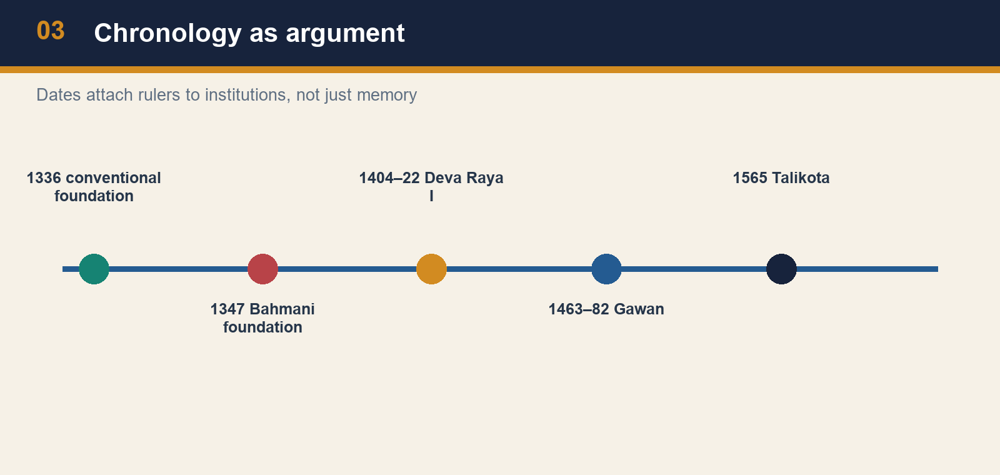

*Chronology as argument*

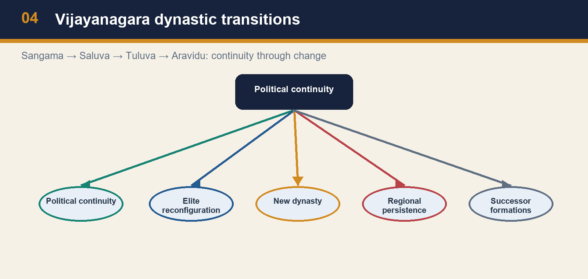

*Vijayanagara dynastic transitions*

[FACT] Vijayanagara’s dynastic sequence is Sangama, Saluva, Tuluva and Aravidu. The Tuluva phase includes Krishnadeva Raya, conventionally dated 1509–29 in the repository chronology. The Aravidu line continued after the 1565 catastrophe. A Prelims answer needs the sequence; a Mains answer must add the historical point that dynastic replacement did not automatically dissolve the political formation.

[ANALYSIS] Dynastic change is a sign of elite reconfiguration. It may arise from military intervention, a succession crisis, court factions or the inability of a ruling line to control provincial commanders. But a new line can retain the capital’s prestige, revenue arrangements, temples, military personnel, territorial ambitions and diplomatic vocabulary. Thus Sangama-to-Saluva-to-Tuluva is not a set of unrelated kingdoms. It is a long political project in which authority was repeatedly reassembled. The same distinction helps explain why the Aravidus’ survival matters after Talikota.

[LIMIT] Continuity should not be overstated. A changing dynasty could alter the balance between the centre and nayaks, the scale of campaigns or the pattern of coastal diplomacy. “Vijayanagara state” is a useful analytical shorthand, not a claim that every ruler governed with the same resources. When a question asks about Krishnadeva Raya, attach him to the Tuluva dynasty; when it asks about 1565, state that Aravidu persistence qualifies an extinction narrative.

#### Analytical drill

**Question:** Use this session to explain why the topic matters analytically, not just chronologically.

**How to use it:** Name the dynasty correctly, attach Krishnadevaraya to the Tuluvas, and use Aravidu continuation to block the instant-extinction error after 1565.

#### PARAGRAPH DEMONSTRATION — CLAIM → EVIDENCE → ANALYSIS → QUALIFICATION

**Claim:** Vijayanagara’s dynastic sequence shows reconfiguration rather than repeated disappearance.

**Named evidence / example:** The polity runs from Sangama to Saluva to Tuluva to Aravidu, with Krishnadevaraya in the Tuluva phase and post-1565 continuity under Aravidu rulers.

**Analysis:** Succession struggle and military intervention altered elite control, but they did not automatically destroy the capital’s institutions, prestige or territorial claims.

**Qualification:** Continuity should not be overstated; each phase changed the centre-intermediary balance.

#### CLOSING RECALL FLOW

**MUST-WRITE KEYWORDS (5–6 only):**
- Sangama
- Saluva seizure
- Tuluva apogee
- Aravidu continuity
- Krishnadevaraya
- succession politics

**How to use them in a sentence:** Chronology prevents ruler-dynasty errors and shows continuity through elite reassembly.

**One contrast to remember:** Dynastic replacement changes capacity, but it does not make every phase a different state.

**Examiner trap to avoid:** Krishnadevaraya is Tuluva, and 1565 does not cancel the Aravidu line.


### SESSION 3 — THE THREE CONTESTED ZONES: FISCAL, MILITARY AND MARITIME LOGIC

**Plain-English core:** The Deccan conflict was organised by geography because different zones fed revenue, routes, ports and horse supply.

**Technical precision:** Raichur-Tungabhadra, Krishna-Godavari and Konkan-Goa are linked fiscal-military corridors rather than three unrelated battlefields.

**Distinctive framing:** A good answer does not say merely “territory”; it specifies whether the contested zone mattered for grain, routes, customs or cavalry.

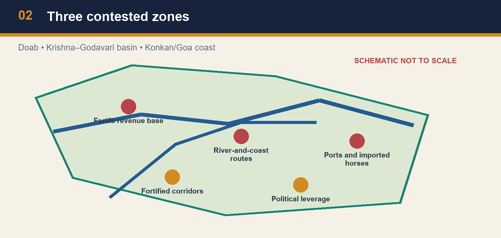

*Three contested zones*


*Horse–port–military chain*

[FACT] The local source identifies three principal zones of conflict: the Tungabhadra doab, the Krishna–Godavari basin and the Konkan/Goa coast. The doab was fertile and strategically placed. The basin offered fertile land and ports tied to regional foreign trade. The Konkan coast mattered because horses from Iran and Iraq were important for south Indian armies. These are the fixed evidence units around which an answer can be built.

[ANALYSIS] The zones were linked rather than interchangeable. Holding a doab was useful for revenue and a forward military position; controlling a coast could secure customs, maritime relations and horse supply; influence in the Krishna–Godavari zone could connect riverine and littoral resources. A cavalry force was not simply purchased in a market: imported horses needed merchants, ports, safe movement, payment and a military organisation capable of maintaining them. Hence a conflict over Goa could have consequences far beyond a shoreline.

[LIMIT] Do not invent prices, customs rates or horse numbers when the source does not supply them. Nor should imported horses be made the sole explanation of warfare. Infantry, fortification, local support, artillery, commanders and seasonal logistics also mattered. The defensible proposition is comparative: access to high-quality imported mounts created a strategic premium for ports and coastal routes, intensifying competition between Deccan powers.

#### Analytical drill

**Question:** Use this session to explain why the topic matters analytically, not just chronologically.

**How to use it:** Turn each zone into a causal sentence and then show why mixed recruitment, diplomacy and borrowing make a communal binary inadequate.

#### PARAGRAPH DEMONSTRATION — CLAIM → EVIDENCE → ANALYSIS → QUALIFICATION

**Claim:** Political geography explains recurrent conflict better than a communal binary.

**Named evidence / example:** The doab offered fertile frontier revenue, the Krishna-Godavari basin joined cultivation with ports, and the Konkan coast connected customs and imported horses to inland warfare.

**Analysis:** These zones tied agrarian surplus and mobility to military capacity, which is why battles, diplomacy and coastal strategy interacted.

**Qualification:** Horse supply mattered greatly, but artillery, forts, commanders and alliances still shaped outcomes.

#### CLOSING RECALL FLOW

**MUST-WRITE KEYWORDS (5–6 only):**
- Raichur doab
- Krishna-Godavari basin
- Konkan-Goa coast
- horse trade
- frontier revenue
- shifting coalitions

**How to use them in a sentence:** Name zone -> resource -> political consequence.

**One contrast to remember:** The same rivalry involved war, trade and diplomacy; it was not only about faith or prestige.

**Examiner trap to avoid:** Do not reduce Goa or Raichur to map labels without explaining the mechanism.


### SESSION 4 — DEVA RAYA I: IRRIGATION AS STATE CAPACITY

**Plain-English core:** Deva Raya I’s irrigation works matter because they converted ecological control into fiscal and metropolitan capacity.

**Technical precision:** The Tungabhadra dam-canal association is a routed PYQ fact only when it is connected to cultivation, provisioning and revenue.

**Distinctive framing:** Water control is statecraft when a ruler uses it to provision fields, city and army rather than to decorate a reign.


*Tungabhadra irrigation*

[FACT] Deva Raya I ruled from 1404 to 1422 in the repository’s chronology. The source associates him with a dam across the Tungabhadra and canals that increased cultivation and revenue. UPSC Prelims 2023 Q48 specifically asked which Vijayanagara ruler constructed a large dam across the Tungabhadra and a canal-cum-aqueduct several kilometres long from the river to the capital city. The locally readable question paper preserves the option order and names Devaraya I as option (a).

[ANALYSIS] Irrigation works are an answer-engine, not an ornament. A dam and canal can redistribute water, improve the reliability of cultivation, support crops and population, and make an urban centre more provisionable. The fiscal result is conditional: better production must still be assessed, collected and protected. But the institutional chain—water management to agrarian surplus to revenue and provisioning—explains why hydraulic works can be part of a ruler’s political capacity.

[LIMIT] It would be careless to infer that every cultivator benefitted equally or that a single canal explains imperial prosperity. Engineering survives as material evidence, while its distributional consequences need more evidence. Do not confuse this ruler with Deva Raya II, whose signature in the source is army reorganisation. The distinction between irrigation and military adaptation is a high-value elimination rule.

#### Analytical drill

**Question:** Use this session to explain why the topic matters analytically, not just chronologically.

**How to use it:** Use the hydraulic fact as a chain—water, cultivation, revenue and provisioning—and explicitly separate it from Deva Raya II’s military signature.

#### PARAGRAPH DEMONSTRATION — CLAIM → EVIDENCE → ANALYSIS → QUALIFICATION

**Claim:** Irrigation works expanded Vijayanagara state capacity under Deva Raya I.

**Named evidence / example:** The topic’s PYQ route and source base connect him with a Tungabhadra dam and canal-cum-aqueduct feeding the capital region.

**Analysis:** Water infrastructure improved cultivation and metropolitan provisioning, making revenue and military support more dependable.

**Qualification:** A canal does not prove equal welfare or automatic prosperity; administration and security remained necessary.

#### CLOSING RECALL FLOW

**MUST-WRITE KEYWORDS (5–6 only):**
- Deva Raya I
- Tungabhadra dam
- canal-aqueduct
- agrarian surplus
- capital provisioning
- irrigation statecraft

**How to use them in a sentence:** Dam and canal -> cultivation reliability -> provisioning -> revenue.

**One contrast to remember:** This is Deva Raya I’s hydraulic signature, not Deva Raya II’s army reform.

**Examiner trap to avoid:** Never swap the two Deva Rayas in a Prelims elimination chain.


### SESSION 5 — DEVA RAYA II: ADAPTATION IN A COMPETITIVE MILITARY FIELD

**Plain-English core:** Deva Raya II is best remembered as a ruler who learned under pressure and altered military practice accordingly.

**Technical precision:** The recruitment of Muslim cavalrymen and archers is evidence that Deccan competition produced pragmatic adaptation across political-religious boundaries.

**Distinctive framing:** Military borrowing matters because it shows how rivalry forced courts to adopt what worked, not what fit a later communal script.

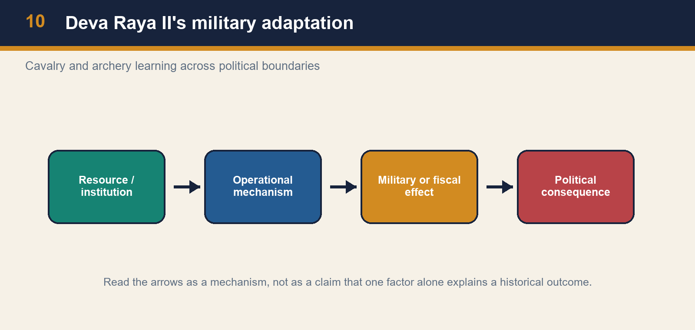

*Deva Raya II's military adaptation*

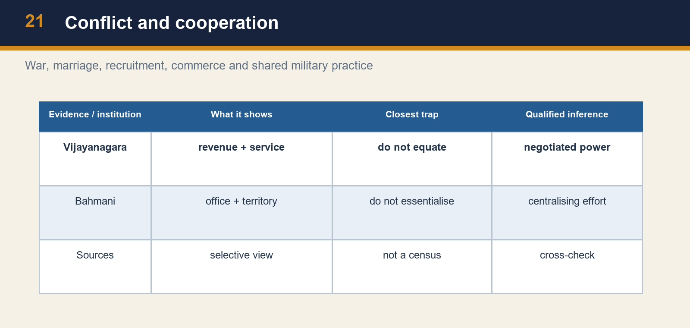

*Conflict and cooperation*

[FACT] Deva Raya II ruled from 1425 to 1446 and is associated with army reorganisation and a period of prosperity. The source says that he employed Muslim cavalrymen and archers and learned from Sultanate military methods. It treats this as a response to the Bahmani advantage in horses and mounted archery. The point is therefore evidence of adaptation under competitive pressure.

[ANALYSIS] Recruitment across political and religious boundaries demonstrates a practical military logic. Mounted archery, cavalry command and access to trained personnel mattered in contests where imported horses were scarce and expensive. A ruler could borrow a method, recruit a specialist and still retain a distinct courtly idiom. This is a strong counter to arguments that make the two states sealed civilisational blocks. Military rivalry generated learning as well as fighting.

[LIMIT] Do not overgeneralise from a court army to the entire social order. The evidence concerns military organisation and ruling strategy, not a guarantee of permanent harmony. Nor should adaptation be written as passive imitation: rulers selected, financed and embedded techniques in local institutions. A nuanced comparison says that Vijayanagara emphasised military adaptation under Deva Raya II while the later Bahmani court under Mahmud Gawan pursued administrative centralisation—two responses to a common competitive environment.

#### Analytical drill

**Question:** Use this session to explain why the topic matters analytically, not just chronologically.

**How to use it:** Use Deva Raya II to show that competitive warfare encouraged selective borrowing in tactics, cavalry and recruitment.

#### PARAGRAPH DEMONSTRATION — CLAIM → EVIDENCE → ANALYSIS → QUALIFICATION

**Claim:** Deva Raya II’s importance lies in adaptive military capacity.

**Named evidence / example:** The source associates his reign with the employment of Muslim cavalrymen and archers and with the prosperity noticed by outside observers.

**Analysis:** The recruitment decision reveals a court responding to Bahmani strengths by changing how it fought rather than clinging to a rigid identity logic.

**Qualification:** One military reform does not describe all social relations, but it decisively weakens the simplistic “Hindu versus Muslim” frame.

#### CLOSING RECALL FLOW

**MUST-WRITE KEYWORDS (5–6 only):**
- Deva Raya II
- mounted archers
- Muslim cavalrymen
- military adaptation
- Abdur Razzaq
- pragmatic recruitment

**How to use them in a sentence:** Competition produced recruitment, learning and altered cavalry practice.

**One contrast to remember:** Use this to discuss adaptation, not to flatten the whole polity into a military machine.

**Examiner trap to avoid:** Recruitment across religious lines is a rebuttal to communal reductionism, not proof of social equality.


### SESSION 6 — HAMPI: URBANISM, WATER, RITUAL AND MARKET IN ONE LANDSCAPE

**Plain-English core:** Hampi should be written as an urban region where defence, ritual, markets and water were organised together.

**Technical precision:** Traveller praise becomes analytically useful only when it is cross-read with enclosures, bazaars, hydraulic systems and the wider city-region logic.

**Distinctive framing:** A capital is not just a palace: at Hampi, urban form itself shows how power, water and exchange were coordinated.

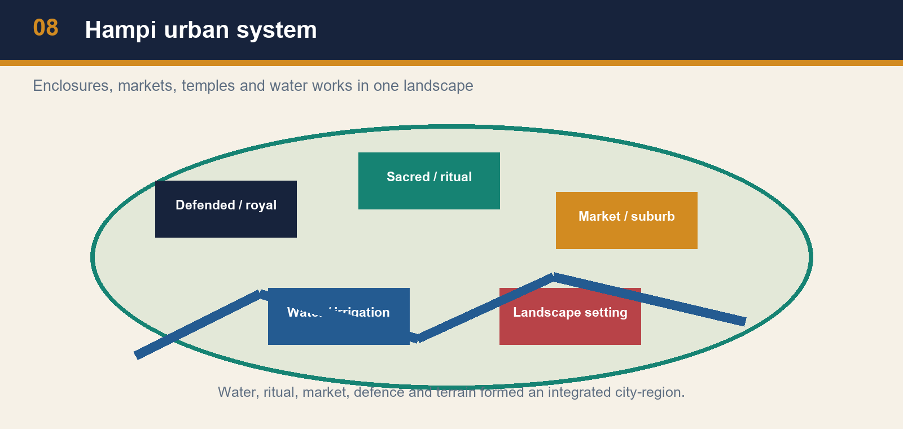

*Hampi urban system*

[FACT] Abdur Razzaq’s description is commonly used for Vijayanagara’s seven enclosures, bazaars, canals and wealth; Nicolo Conti, Domingo Paes, Barbosa and Nuniz are also important witnesses. The live UNESCO World Heritage Centre page for the Group of Monuments at Hampi, checked for this package, identifies Hampi as the capital city of Vijayanagara in the Tungabhadra basin and describes more than 1,600 surviving remains, including forts, riverside features, royal and sacred complexes, water structures, check posts, bazaars and suburban settlements.

[ANALYSIS] Hampi should be read as an integrated city-region. Enclosures and fortifications organised protection; royal and sacred complexes made authority visible; market streets and mandapas connected ritual circulation to commerce; tanks, channels and the Tungabhadra landscape supported water management. The analytical value lies in the relationship between elements. A temple is not only a religious structure, a bazaar is not only a commercial structure, and a canal is not only an engineering work: together they reveal how authority, provisioning, mobility and legitimacy were spatially coordinated.

[LIMIT] A traveller’s “wealth” is not a statistical survey, and a monumental landscape cannot by itself prove a uniformly prosperous society. The UNESCO description is an official heritage synthesis, not a substitute for fourteenth- or fifteenth-century documents. Use it as a bounded material anchor for urban systems and preservation, while grounding state history in the local source spine.

#### Analytical drill

**Question:** Use this session to explain why the topic matters analytically, not just chronologically.

**How to use it:** Move from landscape to institutions: sacred and royal centres, market streets, water works and coinage together explain metropolitan capacity.

#### PARAGRAPH DEMONSTRATION — CLAIM → EVIDENCE → ANALYSIS → QUALIFICATION

**Claim:** Hampi’s built landscape reveals an integrated metropolitan system.

**Named evidence / example:** Travellers describe enclosures, bazaars and canals, while the material record preserves fortifications, temples, roads, tanks and provisioning structures.

**Analysis:** Taken together, these show that urbanism, commerce, ritual and defence worked as one capital region rather than as isolated monuments.

**Qualification:** Traveller admiration and monumental remains do not by themselves prove uniform prosperity or the condition of every inhabitant.

#### CLOSING RECALL FLOW

**MUST-WRITE KEYWORDS (5–6 only):**
- Hampi urban region
- enclosures
- bazaars
- hydraulic landscape
- varaha-pagoda
- integrated capital

**How to use them in a sentence:** Landscape, water and markets made Hampi a functioning capital region.

**One contrast to remember:** Use city-region logic, not monument-list narration.

**Examiner trap to avoid:** A traveller’s prosperity claim is not a census, and a monument is not a welfare survey.


### SESSION 7 — AMARAM AND NAYAKAS: SERVICE, REVENUE AND NEGOTIATED POWER

**Plain-English core:** Amaram and nayaka service made Vijayanagara strong, but they also limited how completely the centre could dominate the countryside.

**Technical precision:** The safest verdict is negotiated centralisation: fiscal-military mobilisation through hereditary intermediaries, with ayagar/local structures varying by time and region.

**Distinctive framing:** Write amaram as a working bargain between imperial demand and local military power, not as a ready-made synonym for iqta or feudalism.

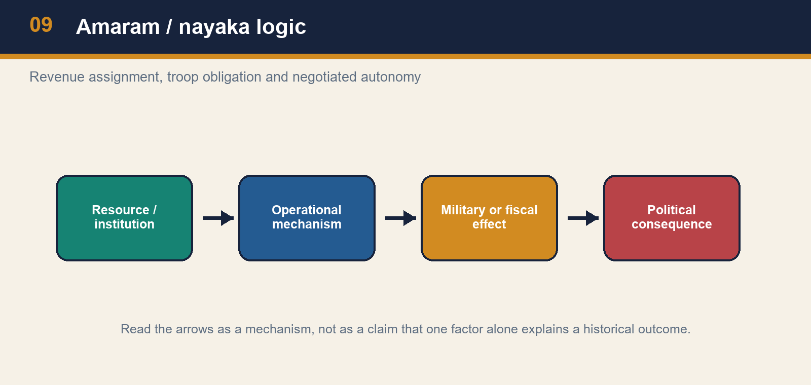

*Amaram / nayaka logic*

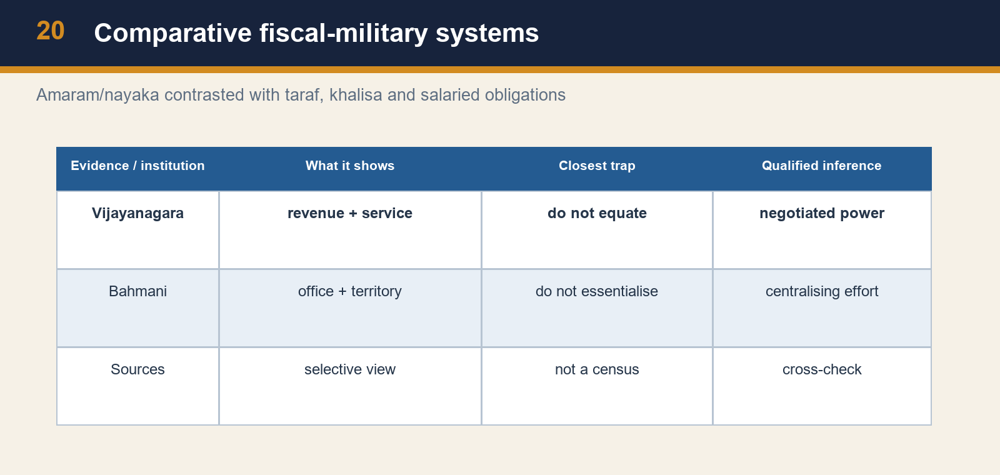

*Comparative fiscal-military systems*

[FACT] The source describes the amaram system as territorial revenue assignments to hereditary nayakas in return for troops and service. It explicitly cautions against equating amaram with the transferable Sultanate iqta. Nayakas could administer their amaram territories and their hereditary position gave them a social and political base distinct from a routinely transferable revenue assignee. Later descriptions also mention ayagar/ayyangar village officers for record, service and revenue functions, but that mature village-office pattern must not be projected uniformly across every dynasty and region.

[ANALYSIS] The system solved a fiscal-military problem: the centre could convert local revenue into military service without directly administering every locality. A nayaka’s ability to mobilise troops and manage revenue strengthened the state when interests aligned. Yet the same arrangement generated a structural tension. Hereditary local power could make the centre dependent on intermediaries, especially during succession crises or after military defeat. This is not proof that Vijayanagara was simply decentralised; it is evidence of central ambitions exercised through negotiated territorial service.

[LIMIT] Avoid crude analogies. “Amaram = iqta” loses differences in heredity, transferability and political context. “Nayakas = independent kings” loses the service relationship and central claims. A strong answer uses a two-sided formulation: amaram enabled imperial mobilisation, but its local hereditary basis placed limits on centralisation and helped regional autonomy expand under later stress.

#### Analytical drill

**Question:** Use this session to explain why the topic matters analytically, not just chronologically.

**How to use it:** Pair amaram with nayaka service, add the ayagar caution, and then explain why the centre could be ambitious without being uniformly bureaucratic.

#### PARAGRAPH DEMONSTRATION — CLAIM → EVIDENCE → ANALYSIS → QUALIFICATION

**Claim:** Vijayanagara’s territorial service system combined mobilisation with structural limits on centralisation.

**Named evidence / example:** Amaram tied revenue claims to nayaka troops and local governance, while later descriptions of ayagar officers show village-level functions without proving one timeless empire-wide pattern.

**Analysis:** This let the centre raise force through local intermediaries, but hereditary bases also gave those intermediaries bargaining power in crisis.

**Qualification:** Therefore amaram is neither a Delhi-style iqta nor proof of a fully decentralised state.

#### CLOSING RECALL FLOW

**MUST-WRITE KEYWORDS (5–6 only):**
- amaram
- nayankara
- ayagar caution
- hereditary service
- negotiated centralisation
- iqta distinction

**How to use them in a sentence:** Service grants gave reach, while heredity created leverage below the centre.

**One contrast to remember:** Central ambition was real, but it operated through layered bargains.

**Examiner trap to avoid:** Do not write amaram = iqta, and do not project late ayagar descriptions unchanged backwards.


### SESSION 8 — KRISHNADEVA RAYA: STATECRAFT, CAMPAIGN, CULTURE AND WATER

**Plain-English core:** Krishnadevaraya’s reign matters because campaign, counsel, water, literature and diplomacy reinforced each other.

**Technical precision:** The reign should be analysed as a multidimensional high point of Tuluva statecraft rather than as an unqualified “golden age”.

**Distinctive framing:** Krishnadevaraya is best explained through four verbs—conquered, provisioned, patronised and negotiated.

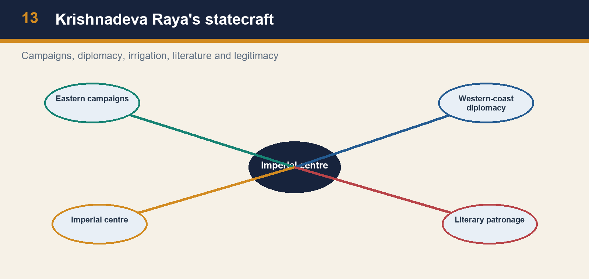

*Krishnadeva Raya's statecraft*

[FACT] Krishnadeva Raya of the Tuluva dynasty ruled 1509–29 in the repository chronology. The local source treats him as a ruler who restored internal order, campaigned successfully in the Raichur and eastern theatres, patronised literature including *Amuktamalyada*, and built tanks and towns. The Hampi evidence cluster also ties the reign to the city’s apogee and to the conspicuous Raya-gopura building vocabulary. These are evidence units for statecraft, not a licence for undifferentiated praise.

[ANALYSIS] Krishnadeva Raya’s importance lies in combination. Military campaigns could reassert claims over contested regions; irrigation and town building could support agrarian and urban capacity; literary patronage could stage sovereignty in courtly and regional idioms; and Portuguese relations addressed the changing west-coast environment. A Mains answer should keep these as connected but distinct dimensions. A victorious campaign is not the same as durable administration, and cultural patronage is not proof that warfare disappeared.

[LIMIT] Do not transform “golden age” language into a social totality. Court-centred evidence is richest for royal activity, ritual, building and elite culture. It is safer to say that the reign represented a high point of imperial assertion and urban-cultural patronage, while retaining the structural constraints of nayaka power, regional rivals and shifting maritime politics.

#### Analytical drill

**Question:** Use this session to explain why the topic matters analytically, not just chronologically.

**How to use it:** Show how warfare, infrastructure, *Amuktamalyada*, monumental visibility and Portuguese relations belong to one political strategy.

#### PARAGRAPH DEMONSTRATION — CLAIM → EVIDENCE → ANALYSIS → QUALIFICATION

**Claim:** Krishnadevaraya’s statecraft joined force, legitimacy and provisioning.

**Named evidence / example:** He belongs to the Tuluva line, campaigned in the Raichur and eastern theatres, is linked with tanks and towns, authored *Amuktamalyada*, and dealt pragmatically with Portuguese actors.

**Analysis:** These elements made sovereignty visible in battlefield success, urban support, literary kingship and coastal diplomacy.

**Qualification:** Calling the reign a “golden age” without naming limits would erase nayaka constraints, rivals and source bias.

#### CLOSING RECALL FLOW

**MUST-WRITE KEYWORDS (5–6 only):**
- Krishnadevaraya
- Tuluva apogee
- Raichur campaign
- Amuktamalyada
- Portuguese pragmatism
- Raya gopuras

**How to use them in a sentence:** Campaign + water + counsel + coast = Tuluva statecraft.

**One contrast to remember:** Treat culture as a mechanism of rule, not as decoration after war.

**Examiner trap to avoid:** Do not reduce Krishnadevaraya to one victory or one traveller’s praise.


### SESSION 9 — PORTUGUESE RELATIONS AND BHATKAL: A PROVENANCE-SAFE PYQ ROUTE

**Plain-English core:** The Bhatkal fact is exam-safe only when it is tied to Portuguese testimony, coastal strategy and provenance caution.

**Technical precision:** An official answer key settles the exam option, but it does not convert Portuguese narrative evidence into an unquestioned state archive.

**Distinctive framing:** For Bhatkal, state the official answer, then immediately state the source boundary.


*Bhatkal: evidence provenance*


*Goa–Dabhol trade*

[FACT] UPSC Prelims GS-I 2024 Q56 locally reads: “Who of the following rulers of medieval India gave permission to the Portuguese to build a fort at Bhatkal?” Its official Series-A answer-key file is present locally and gives Q56 = A. The preserved options are (a) Krishnadevaraya, (b) Narasimha Saluva, (c) Muhammad Shah III and (d) Yusuf Adil Shah. Therefore the official answer is Krishnadevaraya. The local history source also states that Krishnadevaraya’s relations with the Portuguese were broadly cooperative but cautions that the exact Bhatkal-fort formulation rests mainly on Portuguese accounts such as Barbosa and Paes.

[ANALYSIS] This is not a contradiction. An official exam key settles the examination option; it does not erase provenance questions about how a particular claim reached later historical writing. The safe historical inference is that Vijayanagara engaged Portuguese power pragmatically in a coast where ports, commercial links and horse supply had strategic value. The Bhatkal detail should be stated precisely, not inflated into a claim that the Portuguese controlled Vijayanagara’s policy or created its military power.

[LIMIT] Do not add a treaty date, a fort plan or a grant formula unless an identified source supplies it. Do not treat all Portuguese observers as disinterested administrators. A high-quality answer names the official 2024 result, gives the cooperation-and-horse-trade context, and marks Portuguese narration as evidence with genre and interest.

#### Analytical drill

**Question:** Use this session to explain why the topic matters analytically, not just chronologically.

**How to use it:** Use the official 2024 key for elimination, then explain why cooperation with Portuguese actors mattered strategically without inflating the documentary proof.

#### PARAGRAPH DEMONSTRATION — CLAIM → EVIDENCE → ANALYSIS → QUALIFICATION

**Claim:** The Bhatkal PYQ should be answered with both exam certainty and historical caution.

**Named evidence / example:** The local 2024 Set-A key verifies Krishnadevaraya, while the exact fort-grant phrasing is preserved primarily through Portuguese testimony.

**Analysis:** This allows a safe historical inference of pragmatic coastal cooperation shaped by horses, ports and diplomacy.

**Qualification:** Do not invent a treaty date, grant text or fort specification that the preserved evidence does not supply.

#### CLOSING RECALL FLOW

**MUST-WRITE KEYWORDS (5–6 only):**
- Bhatkal
- Portuguese testimony
- horse-port nexus
- 2024 Q56
- provenance caution
- coastal pragmatism

**How to use them in a sentence:** Official key verifies the option; Portuguese testimony limits the exact prose claim.

**One contrast to remember:** Exam correctness and source provenance are related but not identical questions.

**Examiner trap to avoid:** Never turn the Bhatkal fact into proof of Portuguese control over Vijayanagara policy.


### SESSION 10 — TRAVELLERS, WOMEN AND THE BOUNDARY OF INFERENCE

**Plain-English core:** Traveller evidence is valuable precisely because it is limited and therefore forces disciplined inference.

**Technical precision:** Portuguese and other travel narratives illuminate courtly and urban visibility, but they cannot stand in for a social census of the empire.

**Distinctive framing:** Use the traveller, then mark the wall: observed world, not total society.

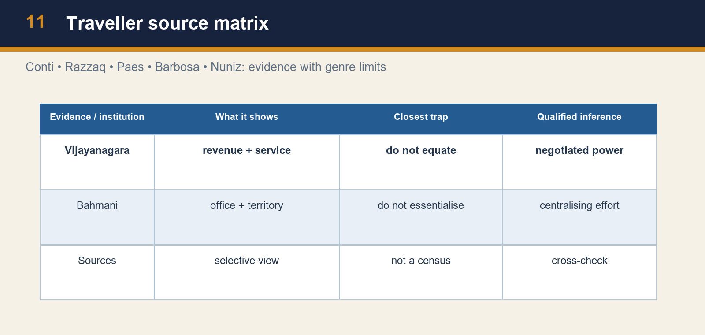

*Traveller source matrix*


*Women in Portuguese accounts*

[FACT] Traveller accounts provide valuable but selective evidence. Nicolo Conti and Abdur Razzaq described the scale and prosperity of Vijayanagara; Paes, Barbosa and Nuniz are used for the sixteenth-century city and courtly society. UPSC Prelims 2021 Q35, preserved in the local paper, asks: according to Portuguese writer Nuniz, women in Vijayanagara were expert in wrestling, astrology, accounting and soothsaying. The original options are preserved; no official 2021 key is held locally.

[ANALYSIS] The strongest inference is narrow. The account makes visible specialised roles and expertise attributed to women in a courtly/urban context. It can enrich an answer that otherwise treats Vijayanagara only as a dynasty and army. But it cannot establish the status, occupations or freedom of all women across the empire. Travel writing is mediated by an outsider’s language, audience, curiosity and the social spaces to which the writer had access.

[LIMIT] An older repository note attributed a similar list to Domingo Paes, whereas the locally preserved UPSC question and repaired canonical owner name Nuniz. This package preserves the exact exam wording and does not silently harmonise the discrepancy. For the PYQ, the defensible answer is an inference from the four listed activities and the local source spine, prominently marked as not officially verified. For Mains, cite “Portuguese accounts” unless a specific attribution has been independently checked.

#### Analytical drill

**Question:** Use this session to explain why the topic matters analytically, not just chronologically.

**How to use it:** Identify the observer and the observed sphere, then explain what the description can support and what it cannot.

#### PARAGRAPH DEMONSTRATION — CLAIM → EVIDENCE → ANALYSIS → QUALIFICATION

**Claim:** Traveller accounts are strongest for urban and courtly texture, not for universal social claims.

**Named evidence / example:** Conti and Razzaq describe scale and splendour, while the 2021 Nuniz question records women’s expertise in wrestling, astrology, accounting and soothsaying.

**Analysis:** Such evidence reveals visible specialised roles and elite settings that enrich the topic beyond dynasties and warfare.

**Qualification:** It does not settle all women’s conditions, all occupations or authorship disputes across every source note.

#### CLOSING RECALL FLOW

**MUST-WRITE KEYWORDS (5–6 only):**
- Conti-Razzaq-Paes-Nuniz
- courtly visibility
- women’s specialised roles
- traveller bias
- social hierarchy
- evidence limits

**How to use them in a sentence:** Traveller -> observed milieu -> cautious social inference.

**One contrast to remember:** Courtly visibility is meaningful evidence, but it is not total society.

**Examiner trap to avoid:** Traveller list != social census; use “Portuguese accounts” when authorship remains contested.


### SESSION 11 — BAHMANI FOUNDATION, GULBARGA AND BIDAR

**Plain-English core:** Bahmani chronology matters because foundation, capital shift and later reform mark different stages of Deccan state formation.

**Technical precision:** Gulbarga and Bidar should be read as political-cultural centres in a developing Deccan sultanate, not as static labels on a dynasty list.

**Distinctive framing:** Write Bahmani history as formation, relocation and coalition-building—not as one frozen court from 1347 to breakup.

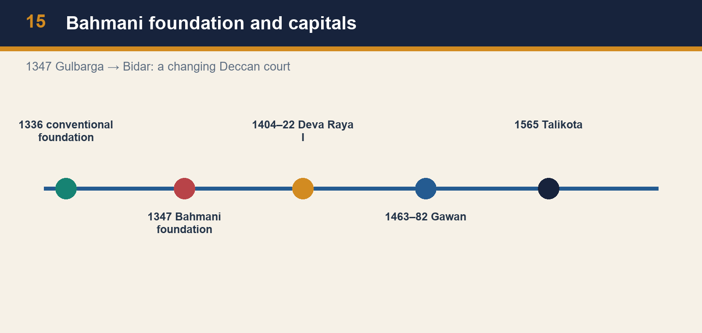

*Bahmani foundation and capitals*

[FACT] The Bahmani kingdom was founded in 1347 by Hasan Gangu/Alauddin Bahman Shah and is conventionally described as the first independent Deccan Muslim state. Gulbarga was an early capital. Ahmad Shah shifted the capital to Bidar. The change of capital is a chronological fact, but it is also a clue to changing political geography, court culture and administration.

[ANALYSIS] A capital concentrates several state functions: ruler and household, office holders, ceremonial display, fortification, markets, learning and diplomatic reception. A capital shift can therefore express a reorientation of political advantage rather than a mere relocation. Bahmani authority was never simply “north Indian” transplanted into the Deccan; it developed through Deccan elites, immigrants, local resources and long-distance connections. Its interaction with Vijayanagara was rivalry within a shared regional field.

[LIMIT] Do not turn a capital’s architecture into a simple index of the religious identity of a whole population. Nor should the word “Bahmani” make the polity appear internally uniform. Later factional divisions demonstrate that elite composition and access to office were contested. In Prelims, remember the foundation date and capital sequence; in Mains, link capital, frontier, elite coalition and the wider Deccan political economy.

#### Analytical drill

**Question:** Use this session to explain why the topic matters analytically, not just chronologically.

**How to use it:** Use the sequence 1347 foundation -> Gulbarga -> Bidar to connect chronology with political geography and court reorientation.

#### PARAGRAPH DEMONSTRATION — CLAIM → EVIDENCE → ANALYSIS → QUALIFICATION

**Claim:** The Bahmani kingdom must be analysed through stages of formation and reorientation.

**Named evidence / example:** Independent rule begins in 1347, Gulbarga functions as the early capital, and Ahmad Shah later shifts the political centre to Bidar.

**Analysis:** The sequence marks changes in frontier command, court culture, elite incorporation and the geography of power.

**Qualification:** A capital shift is not the same event as foundation, and neither proves internal uniformity in elite politics.

#### CLOSING RECALL FLOW

**MUST-WRITE KEYWORDS (5–6 only):**
- 1347 foundation
- Alauddin Hasan Bahman Shah
- Gulbarga
- Bidar
- capital shift
- Deccan state formation

**How to use them in a sentence:** 1347 foundation and Gulbarga-Bidar sequence organise the Bahmani story safely.

**One contrast to remember:** Use dates with processes, not as detached fact-bullets.

**Examiner trap to avoid:** Do not confuse Bahmani foundation with Vijayanagara’s 1336 anchor or with Gawan’s later ministerial phase.


### SESSION 12 — MAHMUD GAWAN: EXPANSION, REFORM AND THE LIMITS OF CENTRALISATION

**Plain-English core:** Mahmud Gawan matters because he tried to make territorial power more measurable, accountable and controllable.

**Technical precision:** The eight-taraf programme was a centralising reform effort, not a completed uniform bureaucracy and not a Bahmani copy of amaram.

**Distinctive framing:** Gawan’s real significance lies in the architecture of control he attempted, not in the title of “great minister” alone.

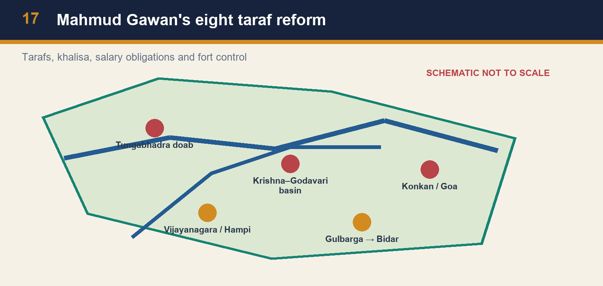

*Mahmud Gawan's eight taraf reform*

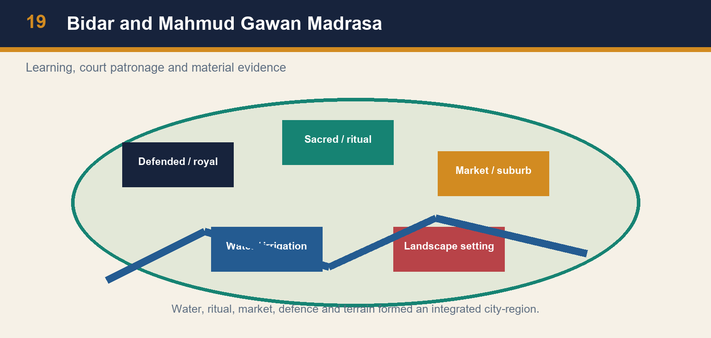

*Bidar and Mahmud Gawan Madrasa*

[FACT] Mahmud Gawan was Bahmani prime minister or wakil-i-sultanat from 1463 to 1482. The source links him to expansion towards western coastal areas including Goa and Dabhol, to a famous madrasa at Bidar, and to reforms that divided the kingdom into eight tarafs. It also notes efforts to fix nobles’ salaries and obligations, reserve khalisa lands for the sultan, introduce land measurement, and keep fort governors under stronger central control.

[ANALYSIS] The eight-taraf reform is best understood as an attempt to make noble power legible and controllable. Territorial division, assessed obligations, salary arrangements, khalisa resources and oversight of forts could reduce the gap between a sovereign’s claim and a noble’s private military capacity. The reform did not abolish elites; it sought to discipline their relationship to the centre. Gawan’s coastal successes also show that administrative and commercial strategy could interact: ports mattered for trade and for the horse circuits that structured Deccan warfare.

[LIMIT] Centralising measures should not be described as a completed bureaucracy. Gawan’s execution in 1482 demonstrates that reform depended on vulnerable court politics. Nor should the madrasa be treated as evidence that all learning was centred only at Bidar. It is material evidence of a patron’s institution, transregional connections and courtly projection. State capacity was aspirational, contested and uneven.

#### Analytical drill

**Question:** Use this session to explain why the topic matters analytically, not just chronologically.

**How to use it:** Link the reform package to the same fiscal-military problem that Vijayanagara solved differently through amaram and nayakas.

#### PARAGRAPH DEMONSTRATION — CLAIM → EVIDENCE → ANALYSIS → QUALIFICATION

**Claim:** Gawan’s reforms sought to discipline noble power and strengthen the crown’s fiscal base.

**Named evidence / example:** The source associates him with eight tarafs, fixed obligations, khalisa, land measurement, fort oversight, coastal expansion and the Bidar madrasa.

**Analysis:** Together these measures aimed to reduce the gap between provincial military power and the centre’s claim to command.

**Qualification:** Because the coalition around reform was fragile, the programme remained vulnerable to court politics.

#### CLOSING RECALL FLOW

**MUST-WRITE KEYWORDS (5–6 only):**
- Mahmud Gawan
- wakil-i-sultanat
- eight tarafs
- khalisa
- Goa-Dabhol
- Bidar madrasa

**How to use them in a sentence:** Gawan = coast + reform + madrasa + coalition risk.

**One contrast to remember:** Comparable fiscal-military challenge does not mean identical Bahmani and Vijayanagara institutions.

**Examiner trap to avoid:** Do not turn Gawan into either a sultan or a mere conqueror.


### SESSION 13 — DECCANIS, AFAQIS AND THE CRISIS OF ELITE COALITION

**Plain-English core:** Deccani and Afaqi labels explain factional politics best when they are treated as changing access-to-office coalitions, not fixed ethnic essences.

**Technical precision:** A state can extend frontiers while simultaneously weakening the elite coalition needed to keep reform and command intact.

**Distinctive framing:** Faction is historical when it changes who controls office, forts, revenue and royal confidence—not when it is reduced to a timeless communal stereotype.

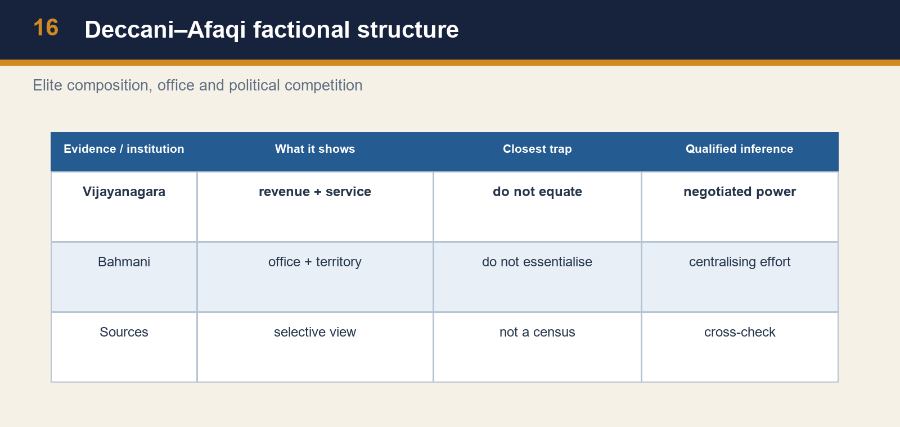

*Deccani–Afaqi factional structure*

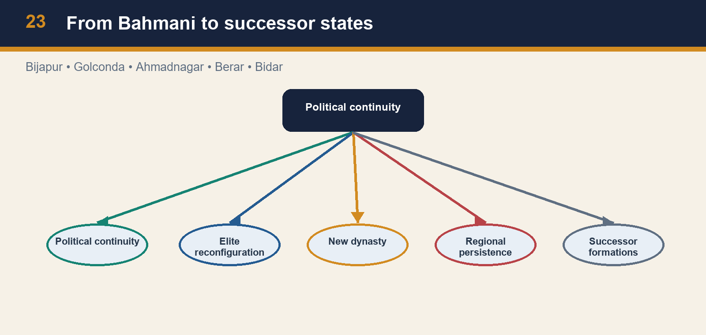

*From Bahmani to successor states*

[FACT] Bahmani court politics saw conflict between Deccanis—often understood as established local or earlier-settled elements—and Afaqis or gharibs, later arrivals associated with transregional Persianate networks. This terminology should be used as a political description of faction and access to office, not as a timeless ethnic essence. The source identifies factional strife as crucial to Gawan’s execution and Bahmani disintegration.

[ANALYSIS] A state can expand territory while weakening its coalition. Offices, forts, revenues and royal confidence are scarce resources; factional contests are therefore institutional as well as cultural. Forged accusations against a powerful minister become politically effective when rival groups fear the redistribution of influence. The execution of Gawan removed a centralising figure and intensified a pattern in which provincial and military centres could act with growing autonomy.

[LIMIT] It is inaccurate to make every later Deccan development a direct consequence of only one execution. Economic pressures, regional ambitions, military leadership and local alliances also mattered. Equally, it is misleading to treat Deccani and Afaqi as two uniform blocks with permanent interests. The safer conclusion is that factional competition placed a high cost on administrative reform and accelerated an already fragile political order.

#### Analytical drill

**Question:** Use this session to explain why the topic matters analytically, not just chronologically.

**How to use it:** Explain the labels politically, then connect Gawan’s execution and the successor-state process to the cost of unresolved elite rivalry.

#### PARAGRAPH DEMONSTRATION — CLAIM → EVIDENCE → ANALYSIS → QUALIFICATION

**Claim:** Bahmani disintegration accelerated because factional conflict damaged the governing coalition.

**Named evidence / example:** Deccani and Afaqi rivalries framed office struggles, hostile accusation helped destroy Gawan, and the later field produced Ahmadnagar, Bijapur, Golconda, Berar and Bidar.

**Analysis:** This shows how centralising ambition can fail when elite groups fear redistribution of patronage and command.

**Qualification:** One execution did not mechanically cause every later development; provincial power, succession and regional competition also mattered.

#### CLOSING RECALL FLOW

**MUST-WRITE KEYWORDS (5–6 only):**
- Deccani
- Afaqi-gharib
- factional politics
- forged accusation
- successor sultanates
- coalition fragility

**How to use them in a sentence:** Faction labels mattered politically because they shaped office and coalition-building.

**One contrast to remember:** They are not pure races or permanent blocks with identical interests.

**Examiner trap to avoid:** Do not write Bahmani breakup as a one-cause story or as a communal essence narrative.


### SESSION 14 — BIDAR, CULTURE AND ARCHITECTURE WITHOUT COMMUNAL SHORTCUTS

**Plain-English core:** Architecture is most useful historically when it is read as evidence of institution, patronage and urban purpose rather than as a civilisational slogan.

**Technical precision:** Vijayanagara and Bahmani monuments show sacred, royal, educational and material interaction, but no single building can prove either total harmony or total antagonism.

**Distinctive framing:** Use buildings as arguments about function, patronage and technique, then mark what the stone cannot tell you on its own.


*Bidar and Mahmud Gawan Madrasa*


*Conflict and cooperation*

[FACT] Mahmud Gawan built a celebrated three-storeyed madrasa at Bidar, described in the source as decorated with coloured tiles and providing for scholars and students. At Hampi, monumental religious, royal and civic remains coexist in an urban landscape. These examples demonstrate patronage, technical skill, institutional investment and the political use of built form. Multilingual courts in Telugu, Kannada, Sanskrit, Persian and Dakhni settings, together with temples, mosques, madrasas and dargahs, form the wider cultural field in which these monuments must be placed.

[ANALYSIS] Architecture can make a court visible and connect it to learning, ritual, labour and transregional style. Bidar’s madrasa is evidence of a scholarly institution and a courtly claim to patronage. Hampi’s temples, bazaars, water structures and enclosures are evidence of an integrated capital region. Neither site should be reduced to a civilisational slogan. The same Deccan saw war, political marriages, recruitment across religious boundaries, commercial exchange and artistic adaptation.

[LIMIT] Do not claim total “syncretism” from a single building, or total antagonism from a battle. A monument is not a census of social attitudes. It needs to be combined with dates, patronage, urban context and texts. The analytical achievement is to acknowledge both political conflict and forms of interaction without making either the only story.

#### Analytical drill

**Question:** Use this session to explain why the topic matters analytically, not just chronologically.

**How to use it:** Pair Hampi and Bidar, add court-language and religious-institution evidence, and keep the analysis away from communal shortcuts.

#### PARAGRAPH DEMONSTRATION — CLAIM → EVIDENCE → ANALYSIS → QUALIFICATION

**Claim:** Deccan architecture shows interaction and differentiation at the same time.

**Named evidence / example:** Hampi’s sacred and royal complexes, the Mahmud Gawan madrasa at Bidar, multilingual court cultures and the visibility of temples, mosques and dargahs all belong to the field.

**Analysis:** These reveal patronage, technical exchange and urban purpose while showing that rivalry coexisted with cultural borrowing and shared material skills.

**Qualification:** Conventional labels such as “Lotus Mahal” and “Elephant Stables” remain partly uncertain, and monuments cannot by themselves certify social harmony.

#### CLOSING RECALL FLOW

**MUST-WRITE KEYWORDS (5–6 only):**
- Vitthala-Hazara Rama
- Virupaksha-Raya gopura
- Lotus Mahal caution
- temples-mosques-dargahs
- multilingual courts
- composite culture

**How to use them in a sentence:** Architecture + language + religious institutions give the cultural field of Deccan politics.

**One contrast to remember:** Interaction is evidenced; utopian harmony is not.

**Examiner trap to avoid:** Do not read one monument as proof of the beliefs or status of every resident.


### SESSION 15 — TALIKOTA/RAKSHASA-TANGADI/BANNIHATTI: COALITION, DESTRUCTION AND PERSISTENCE

**Plain-English core:** Talikota was catastrophic because it broke the capital’s metropolitan concentration of power, but it did not instantly erase every Vijayanagara-linked polity.

**Technical precision:** The battle must be explained through coalition politics, command and material consequences while rejecting both instant-end and trivialisation narratives.

**Distinctive framing:** Write Talikota as a turning point in the relation between capital and region, not as a melodramatic last line on South India.

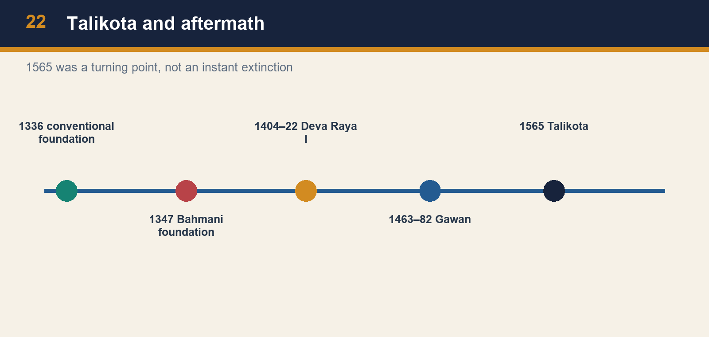

*Talikota and aftermath*

[FACT] The battle of 1565 is variously associated with Talikota, Rakshasa-Tangadi and Bannihatti. A Deccan-sultanate coalition defeated Vijayanagara; Rama Raya was executed and the capital was looted. The live UNESCO Hampi page states that Talikota led to massive destruction of the city’s physical fabric. The local source and chronology insist on a necessary qualification: the polity did not instantly vanish, and the Aravidu dynasty continued with reduced territory.

[ANALYSIS] Talikota was a turning point because it altered the balance between imperial centre and regional power. The loss of a capital and its provisioning, ceremonial and military infrastructure was more than a battlefield defeat. Yet the continued capacity of Aravidu rulers and nayaka formations shows that a state is not identical to one urban site. Political networks, commanders, revenue claims and regional centres can persist after a capital’s devastation.

[LIMIT] Avoid single-cause tales. Rama Raya’s balance-of-power diplomacy and the formation of a coalition form part of the context, but they do not exhaust the military, factional and logistical causes of defeat. Avoid calling 1565 “the end of South India” or, conversely, minimising its destructiveness. The graded verdict is: a catastrophic turning point that ended Vijayanagara’s great-power phase and urban apex, not an instantaneous extinction of all political continuities.

#### Analytical drill

**Question:** Use this session to explain why the topic matters analytically, not just chronologically.

**How to use it:** State all three battle labels once, explain coalition and execution, then distinguish metropolitan ruin from total political extinction.

#### PARAGRAPH DEMONSTRATION — CLAIM → EVIDENCE → ANALYSIS → QUALIFICATION

**Claim:** Talikota transformed the Vijayanagara political order without making continuity impossible.

**Named evidence / example:** Rama Raya was executed, Hampi was devastated, yet Aravidu rulers and regional nayaka formations survived in altered settings.

**Analysis:** The capital mattered because it concentrated defence, provisioning, ritual and legitimacy, so its loss was systemic rather than merely symbolic.

**Qualification:** At the same time, persistence must not minimise the scale of the rupture or reduce the battle to a single-cause tale.

#### CLOSING RECALL FLOW

**MUST-WRITE KEYWORDS (5–6 only):**
- Talikota-Rakshasa-Tangadi-Bannihatti
- Rama Raya
- coalition
- capital sack
- Aravidu
- instant-end myth

**How to use them in a sentence:** Coalition victory destroyed metropolitan primacy and rebalanced centre-region relations.

**One contrast to remember:** Catastrophic turning point does not mean instant extinction.

**Examiner trap to avoid:** Do not add Berar automatically to every coalition list, and do not erase Aravidu continuity.


### SESSION 16 — AFTER 1565: DECCAN SULTANATES, NAYAKA PERSISTENCE AND MUGHAL-DECCAN BRIDGE

**Plain-English core:** After 1565, continuity survived through smaller centres, successor sultanates and expanding regional intermediaries rather than through restored Hampi supremacy.

**Technical precision:** This topic owns bounded post-1565 transition only: Penukonda-Chandragiri continuity, nayaka autonomy and the five Deccan successor states as context for later Mughal-Deccan politics.

**Distinctive framing:** The right conclusion is altered continuity: new centres, stronger nayakas and successor sultanates facing the same strategic Deccan problems.


*From Bahmani to successor states*


*Comparative fiscal-military systems*

[FACT] The Bahmani kingdom fragmented into Ahmadnagar, Bijapur, Golconda, Berar and Bidar. Vijayanagara continued under the Aravidu dynasty after 1565, while regional nayaka powers became increasingly consequential. These parallel transitions create the political setting for later Deccan Sultanate rivalries and, eventually, Mughal-Deccan politics.

[ANALYSIS] The correct transition is not “Bahmani and Vijayanagara ended, then the Mughals arrived.” Instead, the breakup produced several capable courts and regional military-fiscal centres. Bijapur and Golconda, among others, inherited and reshaped Deccan political resources. Nayaka polities demonstrate how earlier service networks could support regional power when the imperial centre weakened. Later Mughal expansion therefore confronted negotiated, competitive and locally embedded powers, not a vacuum.

[LIMIT] Do not retroject later Mughal institutions into the fifteenth century, or call each successor state a direct continuation of every Bahmani policy. Continuity is selective: personnel, territories, cultures and strategic problems can persist while institutions and alignments change. The value of this topic is to give a chronological bridge from regional state formation to early modern contest, not to compress two centuries into a single decline narrative. Mention successor sultanates only as context: Ahmadnagar, Bijapur, Golconda, Bidar and Berar belong here as bounded continuity, not as a full later-Deccan syllabus within Topic 09.

#### Analytical drill

**Question:** Use this session to explain why the topic matters analytically, not just chronologically.

**How to use it:** Use this session to end the myth of “everything ended in 1565” while still keeping later Deccan history within Topic 18’s scope.

#### PARAGRAPH DEMONSTRATION — CLAIM → EVIDENCE → ANALYSIS → QUALIFICATION

**Claim:** Post-1565 Deccan history is a story of transformed continuities, not clean civilisational replacement.

**Named evidence / example:** Aravidu rulers continued from Penukonda and later centres, nayaka powers widened their room for manoeuvre, and Bahmani breakup had already produced Ahmadnagar, Bijapur, Golconda, Bidar and Berar.

**Analysis:** The shared strategic field of forts, ports, cavalry, regional legitimacy and revenue survived even after Hampi’s great-power phase ended.

**Qualification:** Mention successor states only to mark continuity and the Mughal-Deccan bridge; their full history belongs to later topics.

#### CLOSING RECALL FLOW

**MUST-WRITE KEYWORDS (5–6 only):**
- Penukonda-Chandragiri
- Bijapur-Ahmadnagar-Golconda-Bidar-Berar
- nayaka autonomy
- altered continuities
- Mughal-Deccan bridge
- bounded scope

**How to use them in a sentence:** Continuity survived through new centres and new balances of power.

**One contrast to remember:** Later Deccan history grows out of Topic 09 but is not fully contained within it.

**Examiner trap to avoid:** Avoid turning the successor-sultanate context into an unbounded later-Deccan essay here.


## BASIC MCQS / REMEDIATION

### Part I — 16 core retrieval MCQs (locked count)

#### Learning MCQ 1

Which formulation best explains the Vijayanagara–Bahmani rivalry?

- A. Competition for revenue-bearing zones, strategic routes, ports and horse supply alongside political and cultural claims.

- B. A peaceful commercial partnership without recurrent military competition.

- C. A purely religious war in which trade and military resources were irrelevant.

- D. A contest confined to a single fort with no coastal dimension.

**Answer: A.**

**Explanation:** The correct answer identifies the three-zone political economy; the closest distractor is the religious-only explanation, which ignores doab, basin and coastal evidence.

#### Learning MCQ 2

Which is the safest statement about the 1336 foundation?

- A. It means Vijayanagara had no prehistory or contested origins.

- B. It is a conventional political anchor, while Harihara–Bukka origin narratives require source caution.

- C. It dates the Bahmani kingdom rather than Vijayanagara.

- D. It proves every detail of a single later foundation story.

**Answer: B.**

**Explanation:** The correct answer balances chronology and historiography; the closest distractor is the full-proof claim, which confuses a conventional date with a settled biography.

#### Learning MCQ 3

Which succession list is correct for Vijayanagara?

- A. Tuluva → Sangama → Bahmani → Aravidu.

- B. Saluva → Lodi → Tuluva → Qutb Shahi.

- C. Sangama → Saluva → Tuluva → Aravidu.

- D. Aravidu → Sangama → Tuluva → Bahmani.

**Answer: C.**

**Explanation:** The correct sequence distinguishes dynasty from rival state; the closest distractor is the first alternative because it uses real names but reverses the historical order.

#### Learning MCQ 4

Why did Goa and the Konkan coast matter before Portuguese conquest?

- A. They were the location of the Tungabhadra dam.

- B. They mattered only for temple pilgrimage.

- C. They had no connection to inland political rivalry.

- D. They were nodes in commerce and the imported-horse supply essential to Deccan cavalry.

**Answer: D.**

**Explanation:** The coast linked trade and cavalry; the closest distractor is the inland-rivalry denial because it misses the horse–port chain.

#### Learning MCQ 5

Which ruler is associated with a dam across the Tungabhadra and a canal-cum-aqueduct to the capital?

- A. Deva Raya I.

- B. Rama Raya.

- C. Mahmud Gawan.

- D. Deva Raya II.

**Answer: A.**

**Explanation:** Deva Raya I is tied to irrigation; Deva Raya II is the closest distractor because he is also a major Vijayanagara ruler, but his source signature is military adaptation.

#### Learning MCQ 6

Which ruler is most closely associated with military recruitment and adaptation involving cavalrymen and archers?

- A. Deva Raya I.

- B. Deva Raya II.

- C. Mahmud Gawan.

- D. Ahmad Shah Bahmani.

**Answer: B.**

**Explanation:** Deva Raya II is the source-grounded answer; Deva Raya I is the closest distractor because both ruled Vijayanagara, but he is associated with irrigation.

#### Learning MCQ 7

What can Hampi’s enclosures, bazaars and water works most securely demonstrate?

- A. That every resident shared the same wealth and legal status.

- B. That the Bahmani capital was located inside Hampi.

- C. An integrated urban landscape in which defence, market, ritual and water management were coordinated.

- D. That travellers supplied exact population statistics.

**Answer: C.**

**Explanation:** The correct inference concerns urban organisation; the closest distractor is universal prosperity, an overclaim from real monumental evidence.

#### Learning MCQ 8

Which statement most accurately distinguishes amaram from an iqta comparison?

- A. Amaram was a Portuguese customs concession at Bhatkal.

- B. Amaram eliminated all local military intermediaries.

- C. Amaram was a standard Bahmani taraf office appointed for a fixed salary.

- D. Amaram linked hereditary nayaka service and territorial revenue; it should not be treated as a replica of a transferable iqta.

**Answer: D.**

**Explanation:** The correct statement preserves heredity and service; the closest distractor is the taraf option because both are territorial-fiscal terms, but they belong to different institutional settings.

#### Learning MCQ 9

Which combination best captures Krishnadeva Raya’s statecraft?

- A. Campaigns, water and town building, literary patronage and pragmatic coastal diplomacy.

- B. A withdrawal from all western-coast contact after 1509.

- C. A rejection of all urban and cultural patronage in favour of warfare alone.

- D. An eight-taraf reform that abolished nayaka service.

**Answer: A.**

**Explanation:** The correct answer integrates the main dimensions of the Tuluva ruler’s reign. The closest distractor is warfare-alone language because campaigns mattered but did not displace infrastructure, patronage or diplomacy.

#### Learning MCQ 10

How should the Bhatkal fact be handled in an answer?

- A. Assign the permission to Yusuf Adil Shah because Goa was coastal.

- B. Use the official 2024 answer for Krishnadevaraya and note that the exact fort claim is preserved mainly through Portuguese testimony.

- C. Claim a detailed treaty formula without a cited source.

- D. Reject the official key because travel accounts have limits.

**Answer: B.**

**Explanation:** The correct method combines exam verification and provenance caution; the closest distractor is automatic rejection, which mistakes source limitation for the absence of usable evidence.

#### Learning MCQ 11

Which evidence best supports a cautious statement about women in Vijayanagara?

- A. A single account replaces all local evidence.

- B. The list proves universal occupational equality across the empire.

- C. A Portuguese account lists specialised activities, indicating visible roles in the observer’s courtly or urban field rather than all women’s status.

- D. Women’s expertise can be inferred only from the Bahmani eight-taraf reform.

**Answer: C.**

**Explanation:** The correct reading uses the observation without making it a census; the closest distractor is universal equality because it overextends a real observation.

#### Learning MCQ 12

Which statement is correct about Bahmani formation and capital history?

- A. Mahmud Gawan founded Vijayanagara at Hampi.

- B. The kingdom was founded in 1565 after Talikota.

- C. Bidar was the first capital of the Sangama dynasty.

- D. The kingdom was founded in 1347; Gulbarga was an early capital and Ahmad Shah shifted the court to Bidar.

**Answer: D.**

**Explanation:** The correct statement preserves foundation, early capital and later shift. The closest distractor is the post-Talikota claim because it confuses a much later Vijayanagara rupture with Bahmani formation.

#### Learning MCQ 13

What was central to Mahmud Gawan’s administrative programme?

- A. Division into eight tarafs, khalisa resources, fixed obligations and tighter fort oversight.

- B. A shift of Vijayanagara’s capital to Hampi.

- C. Replacement of every commander with hereditary nayakas.

- D. A ban on coastal trade with Iran and Iraq.

**Answer: A.**

**Explanation:** Gawan’s reforms sought more legible noble obligations; the closest distractor is hereditary nayakas, a plausible fiscal-military term but a Vijayanagara institution.

#### Learning MCQ 14

Why did Deccani–Afaqi conflict matter?

- A. It abolished all provincial territorial administration at once.

- B. Competition over office and influence weakened elite coalition and contributed to the setting of Gawan’s execution.

- C. It proves the Bahmani court had no Deccan roots.

- D. It was a battle name for Talikota.

**Answer: B.**

**Explanation:** The correct answer treats faction as political competition; the closest distractor is the no-Deccan-roots claim, an essentialist misuse of the labels.

#### Learning MCQ 15

Why is the Bidar madrasa valuable evidence?

- A. It was a Vijayanagara irrigation dam.

- B. It proves all Bahmani revenues came from one institution.

- C. It records courtly patronage of learning and material skill, while not proving the experience of every subject.

- D. It establishes a complete absence of political faction.

**Answer: C.**

**Explanation:** The correct answer uses architecture with a limit; the closest distractor is the revenue claim, which overreads a genuine institutional monument.

#### Learning MCQ 16

What makes Talikota in 1565 a historically careful turning point?

- A. It occurred before the Bahmani foundation of 1347.

- B. It was simply a border raid with no urban consequence.

- C. It immediately removed every Vijayanagara claimant and nayaka formation.

- D. It destroyed the capital’s great-power position, while Aravidu and regional political continuities persisted.

**Answer: D.**

**Explanation:** The correct answer states destruction and persistence; the closest distractor is instant extinction, which overlooks Aravidu continuation.

## PYQS AND ANSWER PRACTICE

### Part II — Verified direct and routed PYQs

#### PYQ 1 (2024, Prelims) — direct


With reference to the history of India, consider the following statements:

1. There was a game known as 'Chaturanga', which was a precursor to modern day chess, played in the court of Vijayanagara.
2. Krishnadeva Raya used to play this game with Portuguese visitors.

Which of the statements given above is/are correct?

- A. 1 only
- B. 2 only
- C. Both 1 and 2
- D. Neither 1 nor 2

**Answer:** D only.

**How to think it through:** The local review instructions lock this as a provenance-sensitive route. The well-known chess anecdote belongs to later storytelling rather than secure court evidence, and no verified Portuguese travel record in the local package supports the claim that Krishnadeva Raya routinely played such games with Portuguese visitors. Since neither statement survives source checking, the safe answer is D.

**Demand decoding:** This is a two-statement source-provenance question: each statement has to be tested separately against secure Vijayanagara-court evidence rather than against a familiar anecdote about chess.

**Executable elimination plan:** Check Statement 1 for reliable evidence that Chaturanga was actually attested in the Vijayanagara court, then test Statement 2 for a verified Portuguese record of Krishnadeva Raya playing it with visitors. If both claims fail source-checking, the route ends at D.

**Why this route earns marks:** It separates a later popular story from verifiable traveller evidence and therefore reaches the correct "neither" conclusion without fabricating a lost court source.

**How to strengthen this route:** If a future local evidence pack isolates the exact Portuguese record or its absence more precisely, cite that named source directly instead of relying on general provenance caution alone.

#### PYQ 2 (2024, Prelims) — direct


With reference to Vijayanagara Empire, consider the following statements:

1. It was ruled by a succession of dynasties from Sangama to Aravidu.
2. The army consisted of large contingents of infantry, cavalry, and elephants.
3. The Fort of Bhatkal was constructed by Krishnadeva Raya to protect the empire's overseas trade ports.

How many of the statements given above are correct?

- A. Only one
- B. Only two
- C. All the three
- D. None

**Answer:** B. Only two.

**How to think it through:** Statements 1 and 2 are securely supported in the local knowledge files and review ledger. Statement 3 is the route that needs caution: the official answer key settles the exam in favour of the Krishnadeva Raya option, but the exact fort-construction phrasing survives via Portuguese testimony and should not be inflated beyond that provenance. Hence two statements are correct.

**Demand decoding:** This is a three-statement count question in which two statements are standard core facts and the third is a provenance-sensitive construction claim; the task is to count accurately without over-reading Statement 3.

**Executable elimination plan:** Lock Statement 1 first (Sangama to Aravidu dynastic succession) and Statement 2 next (infantry-cavalry-elephant military composition). Then test Statement 3 narrowly: the official key accepts the Krishnadeva Raya-Bhatkal route, but the answer must preserve the Portuguese-testimony caution before selecting "Only two."

**Why this route earns marks:** It respects the verified 2024 official key while refusing to inflate Statement 3 into a source-unqualified architectural certainty.

**How to strengthen this route:** If the locally held Portuguese testimony is later cited line-for-line in the package notes, append that exact provenance so the answer explains why Statement 3 passes exam-wise yet still needs historical caution.

#### PYQ 3 (2021, Prelims) — routed social-history support


According to Portuguese writer Nuniz, the women in Vijayanagara Empire were experts in which of the following areas?

1. Wrestling
2. Astrology
3. Accounting
4. Soothsaying

Select the correct answer using the code given below:

- A. 1, 2 and 3 only
- B. 1, 3 and 4 only
- C. 2 and 4 only
- D. 1, 2, 3 and 4

**Answer:** D. 1, 2, 3 and 4.

**How to think it through:** This question is useful here because it enlarges Topic 09 beyond dynasties and warfare. The answer is not a claim about all women in the empire; it is a claim about what the Portuguese account noticed in a courtly and urban setting. Use it to write cautiously on specialised roles, visibility and evidence limits.

**Demand decoding:** This is a code-selection question about what Nuniz says he observed, not a general social-history question about all women in Vijayanagara.

**Executable elimination plan:** Attach each listed activity-wrestling, astrology, accounting and soothsaying-to Nuniz's observed courtly-urban description. Once none of the four drops out, the route resolves to the full combination in option D.

**Why this route earns marks:** It gets the code right while still guarding against the common error of turning one Portuguese observer's notice into a census-like statement about every woman in the empire.

**How to strengthen this route:** Name Nuniz in the first sentence and add the phrase "observed courtly-urban setting" in revision notes so the source boundary stays visible during recall.

#### PYQ 4 (2026, GS-I Q11, verified local official paper; routed architecture support)


**Vijayanagara architecture exemplifies the amalgamation of past traditions with contemporary practices. Elucidate with examples.** (15 marks, 250 words)

**Verification status:** Verified locally from `knowledge-export\Mains PYQ\QP-CSM-26-010926-GENERAL STUDIES PAPER - I.pdf.md`, derived from the official local scan `books\mains\2026\QP-CSM-26-010926-GENERAL STUDIES PAPER - I.pdf`. The routing ledger `upsc-ai-kit\knowledge\_PYQ-GS1-2026.md` assigns primary ownership to Indian Art & Culture, so it is used here as a routed support PYQ rather than as Topic 09's primary architecture owner.

**Model answer:** Vijayanagara architecture did not begin from scratch. It absorbed older South Indian temple and mandapa traditions, while adapting them to the political, ritual and urban needs of a large early-modern imperial capital. The result was continuity with innovation.

First, the empire inherited the Dravida temple base visible in sanctums, axial planning, enclosure walls and pillared halls. Yet these older forms were amplified through contemporary imperial scale. The Virupaksha complex and other Hampi temples show continuity with earlier sacred traditions, but the enlarged gopuras and ceremonial avenues projected a more expansive royal-ritual order.

Second, the period developed distinctive hall architecture and sculptural treatment. The Vitthala temple is notable for its ornate mandapas, composite pillars and the celebrated stone chariot within a highly choreographed sacred-urban setting. The Hazara Rama temple, with its Ramayana panels and royal associations, shows how narrative sculpture, court ritual and kingship could be fused.

Third, architecture in Vijayanagara was not confined to temples. Royal and metropolitan spaces such as audience zones, bazaars, tanks, canals and enclosures integrated sacred architecture with urban planning. This reflects contemporary practices of imperial display, provisioning and movement control.

Thus, Vijayanagara architecture represents an amalgamation: inherited southern forms were retained, but recast through new scales of monumentality, urban integration and imperial symbolism suited to the Deccan world of the fourteenth to sixteenth centuries.

**Why this earns marks:** It answers the word "amalgamation" rather than merely listing monuments: Virupaksha anchors inherited Dravida continuity, Vitthala and Hazara Rama show contemporary elaboration, and bazaars/tanks/enclosures extend the argument into imperial urban planning.

**Demand decoding:** "Elucidate with examples" requires showing how older South Indian temple traditions were retained and transformed in Vijayanagara, not writing a generic appreciation note on Hampi. The answer must cover both halves of the claim-past traditions and contemporary practices-with named examples inside the 250-word limit.

**Executable answer/compression plan:** 250 words = 1-sentence thesis on continuity with innovation; one block on inherited Dravida features (sanctum, axial plan, enclosure, gopura with Virupaksha), one on distinctive Vijayanagara elaboration (Vitthala mandapas, composite pillars, stone chariot, Hazara Rama panels), one on royal-urban integration (bazaars, tanks, canals, audience zones, enclosures), then a 1-sentence verdict.

**How to improve this answer:** Add one more named royal-centre example-such as the Mahanavami platform or another clearly bounded Hampi court space-to sharpen the "contemporary imperial practice" side without drifting into a full Art & Culture survey.

### Part III — Six original mains models (locked count)

#### Original Mains 1 — 10 marks (150 words)


**Question:** Explain why the Raichur doab remained central to Vijayanagara-Bahmani rivalry.

**Model answer:** The Raichur doab mattered because it lay between the Krishna and Tungabhadra rivers and combined fertile agrarian revenue with strategic military position. Whoever controlled it gained resources for armies and prestige on a visible frontier. Its forts also linked interior command to movement across the Deccan. Repeated campaigns there therefore reflected more than territorial pride: they were contests over revenue, provisioning and the balance of power. The doab also mattered symbolically because victories there advertised a ruler's capacity before nobles and rivals. Yet the conflict should not be reduced to one strip of land alone. Control of ports, horse supply and eastern routes also shaped Deccan rivalry. Thus the doab was central because it condensed the larger fiscal-military logic of the Deccan into a single contested frontier.

**Why this earns marks:** It converts location into explanation: Krishna-Tungabhadra position, agrarian revenue, fort-linked strategy and frontier prestige are all tied directly to why the doab kept returning to the centre of rivalry.

**Demand decoding:** "Explain why" asks for causal factors, not a mere list of campaigns in the Raichur zone. The answer has to move from geography to fiscal and military consequence.

**Executable answer/compression plan:** 150 words = a 1-sentence location definition, then three compact reasons (fertility/revenue, frontier forts/strategy, prestige/balance of power), followed by a 1-sentence qualification that ports and horse routes also mattered.

**How to improve this answer:** Insert one named campaign marker-such as Krishnadevaraya's 1520 Raichur success or a specific Raichur-fort contest-to give the causal explanation one memorable historical hook.

#### Original Mains 2 — 10 marks (150 words)


**Question:** Why is Deva Raya II remembered as a ruler of adaptation rather than mere expansion?

**Model answer:** Deva Raya II is remembered for adaptation because his reign shows how Vijayanagara responded pragmatically to competitive Deccan warfare. Sources associate him with the recruitment of Muslim cavalrymen and archers, indicating willingness to adopt effective military practices across political-religious boundaries. This is analytically more important than a mere list of victories, because it reveals learning under pressure. His reign is also connected with urban prosperity noticed by travellers, suggesting that military adjustment worked alongside broader metropolitan strength. The key point is that Vijayanagara did not survive by static tradition alone; it altered recruitment and fighting methods when needed. However, such adaptation should not be exaggerated into complete central control or social equality. Its importance lies in showing that Deccan rivalry generated institutional borrowing as well as battlefield conflict.

**Why this earns marks:** The answer uses Deva Raya II's recruitment of Muslim cavalrymen and archers as named evidence, links it to learning under Bahmani pressure, and ends with a qualification against exaggerated claims of harmony or total control.

**Demand decoding:** The contrast word "rather than" matters: the examiner wants what made Deva Raya II adaptive in methods and recruitment, not a generic notice that his reign saw warfare or expansion.

**Executable answer/compression plan:** 150 words = opening contrast sentence, one evidence block on cavalry/archery recruitment and military learning, one block on prosperity/metropolitan strength under his reign, and a closing qualification against over-reading the reform.

**How to improve this answer:** Add Abdur Razzaq's notice of prosperity, or explicitly contrast Deva Raya II with Deva Raya I's irrigation signature, so the ruler-specific identity becomes even tighter.

#### Original Mains 3 — 15 marks (250 words)


**Question:** Evaluate the nayankara/amaram system as both a source of imperial strength and a structural limit on Vijayanagara centralisation.

**Model answer:** The nayankara-amaram arrangement was one of the main supports of Vijayanagara expansion because it tied local military service to revenue assignments. Through this system, the centre could mobilise armed retainers and maintain regional control without financing every layer of command through a uniform cash bureaucracy. It therefore widened imperial reach and made conquest sustainable.

Its strength lay in flexibility. Nayakas could raise troops, supervise local resources and connect the imperial court to diverse regions. In a frontier-heavy polity facing the Bahmanis and other rivals, this was a powerful fiscal-military device. It helped turn local landed power into imperial service.

At the same time, the system limited complete centralisation. Because military and revenue authority were embedded in intermediaries, hereditary tendencies and local bases of support increased the bargaining power of nayakas. In moments of succession struggle or post-war stress, these intermediaries could act with greater autonomy. This is why historians describe Vijayanagara less as a uniformly centralised bureaucracy and more as a negotiated political order.

The safest conclusion is therefore balanced. Amaram strengthened the empire by linking revenue and service, but it also made the centre dependent on regional holders of coercive power. Later references to ayagar-type local offices may illuminate village functions, yet they should not be projected uniformly across every dynasty and region. Thus imperial strength and structural limit were built into the same arrangement.

**Why this earns marks:** It answers both sides of the directive by showing amaram as a revenue-for-service strength and hereditary nayaka power as the corresponding limit on full centralisation, then closes with a careful ayagar caution.

**Demand decoding:** Because the question says "both," a one-sided definition of nayankara/amaram is insufficient; the answer must evaluate the same arrangement as a source of expansion and as a brake on uniform central control.

**Executable answer/compression plan:** 250 words = define nayankara/amaram in 1-2 sentences, then one body block on mobilisation and revenue advantages, one on hereditary/local bargaining power and crisis autonomy, then a balanced verdict with a brief caution against equating amaram with iqta or ayagar.

**How to improve this answer:** Add one explicit comparison line that amaram was more locally embedded and often more hereditary than a transferable iqta, because that contrast is a likely examiner follow-up.

#### Original Mains 4 — 15 marks (250 words)


**Question:** Discuss Mahmud Gawan's importance in Bahmani history.

**Model answer:** Mahmud Gawan was important because he represented the Bahmani attempt to convert a powerful but faction-ridden sultanate into a more disciplined territorial state. As wakil-i-sultanat, he combined expansion, reform and cultural patronage.

On the military and territorial side, his period is associated with successful western coastal expansion, including the capture of places such as Goa and Dabhol from rival powers. This mattered because coastal access strengthened the kingdom's commercial and strategic position.

More significant analytically were his administrative reforms. Gawan is linked with dividing the kingdom into eight tarafs, supervising fort command, enlarging khalisa lands and pressing for clearer fiscal obligations. These measures aimed to reduce the autonomy of provincial nobles and improve the crown's control over revenue and military resources. In this sense, he addressed the same fiscal-military problem that Vijayanagara handled differently through nayakas and amaram.

He was also a major patron, with the Bidar madrasa standing as a visible expression of learning and cosmopolitan court culture.

Yet his career also shows the limits of reform. Hostile factional politics, especially conflict between Deccani and Afaqi groupings, culminated in his execution on a forged charge. Therefore Gawan's significance lies not only in reform but also in demonstrating how centralising ambition could be undone by a fractured elite coalition.

**Why this earns marks:** The answer names Gawan's office, coastal expansion, eight-taraf and khalisa reforms, Bidar madrasa patronage and faction-driven execution, so his importance appears as both achievement and limit rather than as biography alone.

**Demand decoding:** "Discuss importance" requires a judgement on why Gawan mattered to Bahmani history-military, administrative, intellectual and political-not just a narrative of his life.

**Executable answer/compression plan:** 250 words = thesis on Gawan as centralising minister, one block on territorial/coastal significance, one on reforms (tarafs, forts, khalisa, fiscal control), one on patronage, then a concluding block on Deccani-Afaqi faction and the limits of reform.

**How to improve this answer:** State the year 1482 and the title wakil-i-sultanat in the opening sentence so the answer signals factual precision immediately.

#### Original Mains 5 — 20 marks (250 words)


**Question:** 'The Vijayanagara-Bahmani relationship cannot be understood only through warfare.' Examine.

**Model answer:** To understand the Vijayanagara-Bahmani relationship only as warfare is to miss the deeper political economy of the Deccan. Conflict was undoubtedly frequent, especially in the Raichur doab and along strategic corridors. Yet war was only one part of a larger relationship shaped by trade, military borrowing, diplomacy and shared regional constraints.

The repeated contest over the Raichur doab shows why warfare mattered: fertile land, forts and frontier prestige made the zone militarily and fiscally valuable. But the same rivalry extended to access to ports, horse imports and customs-rich coastal routes. That means both states operated within an interlinked Deccan system where commerce and war reinforced one another.

The relationship also involved adaptation across political boundaries. Deva Raya II's employment of Muslim cavalrymen and archers demonstrates that effective military practices circulated despite hostility. Likewise, Portuguese testimony on Bhatkal and horse-trade connections indicates pragmatic dealings on the coast. Such evidence weakens any simplistic “Hindu empire versus Muslim kingdom” reading.

Cultural and material interaction further complicates the picture. Monuments, court languages, educational institutions and urban practices reveal coexistence of competition with exchange. Even architecture must be read as part of a shared Deccan field of techniques and patronage, though not as evidence of perfect harmony.

Therefore the most convincing interpretation is that warfare was central but not sufficient. Vijayanagara and the Bahmanis were adversaries within a connected fiscal-military world that also generated borrowing, trade and cultural interaction.

**Why this earns marks:** It breaks the prompt into warfare, trade, borrowing and cultural interaction, then supports each layer with named evidence such as the Raichur doab, horse ports, Deva Raya II and Portuguese testimony.

**Demand decoding:** To "Examine" this claim you must challenge reductionism without denying that warfare was central. The answer therefore needs both the military core and the extra dimensions that made the relationship wider than battle alone.

**Executable answer/compression plan:** 250 words = opening thesis, one block on why warfare mattered (Raichur/frontier value), one on trade-horse-port logic, one on borrowing/diplomacy/cultural interaction, then a closing verdict that ties them into one connected Deccan system.

**How to improve this answer:** Add one named Bahmani-side example-such as Gawan's coastal expansion towards Goa and Dabhol or the Deccani-Afaqi political setting-so the evidence is not weighted too heavily towards Vijayanagara.

#### Original Mains 6 — 20 marks (250 words)


**Question:** Assess the significance of Talikota (1565) while rejecting the myth that Vijayanagara ended instantly after the battle.

**Model answer:** Talikota was one of the most consequential turning points in medieval South Indian history because it shattered the metropolitan concentration of Vijayanagara power, yet it did not instantly erase the polity or all its successor formations.

Its immediate significance was enormous. The Deccan sultanate coalition defeated the forces associated with Rama Raya, who was captured and killed. Hampi, the great capital, was then devastated. Since the city had concentrated ritual authority, market exchange, monumental legitimacy and political symbolism, its destruction affected the entire imperial structure. Talikota was therefore not just a battlefield defeat but a systemic rupture.

However, the standard textbook line that “the empire ended in 1565” is inaccurate. The Aravidu line continued from Penukonda and later Chandragiri, while regional nayaka powers operated with greater autonomy. Political forms, claims to legitimacy and elements of imperial continuity survived beyond the sack of Hampi.

The balanced judgement is thus twofold. First, Talikota decisively ended Vijayanagara's phase as the dominant Hampi-centred great power of the Deccan. Second, it did not produce instant civilisational extinction. Post-1565 history is better read as altered continuity: new centres emerged, old intermediaries gained room to manoeuvre, and the successor sultanates of Ahmadnagar, Bijapur, Golconda, Bidar and Berar shaped the next Deccan order. Talikota matters most when catastrophe and continuity are held together.

**Why this earns marks:** It does the two tasks embedded in the question: Talikota is treated as a systemic rupture through Rama Raya's death and Hampi's sack, but the answer then corrects the myth of instant extinction by naming Aravidu, Penukonda and Chandragiri.

**Demand decoding:** "Assess the significance ... while rejecting the myth" requires a two-part judgement: explain why 1565 mattered enormously and then explicitly disprove the textbook shorthand that Vijayanagara simply ended that same day.

**Executable answer/compression plan:** 250 words = opening thesis on rupture without total erasure, one block on battlefield outcome and metropolitan devastation, one block on post-1565 continuity under Aravidu and new centres, then a verdict distinguishing loss of Hampi-centred primacy from complete disappearance.

**How to improve this answer:** Move Penukonda and Chandragiri into the main body rather than leaving them implicit in the conclusion, so the continuity evidence appears as concrete proof rather than as a final assertion.

## OPTIONAL ADVANCED DEPTH — NOT REQUIRED FOR A CORE ANSWER

### Historiographical cautions that improve a high-quality answer

- Treat 1336 as a conventional anchor while openly acknowledging contested founder narratives.
- Distinguish dynastic chronology from political continuity: Sangama, Saluva, Tuluva and Aravidu are not four unrelated kingdoms.
- Use amaram/nayankara carefully. It shows fiscal-military delegation, but it should not be equated mechanically with iqta, feudalism or a timeless pan-imperial village order.
- Mention ayagar/ayyangar structures as bounded local-office evidence, not as an overconfident universal template across all centuries of Vijayanagara rule.
- Read travellers as situated observers of courtly and urban worlds, not as neutral census officers.
- Keep Talikota analytically double-sided: catastrophic for Hampi's metropolitan primacy, but not the instant extinction of all Vijayanagara political continuity.
- Mention the five successor sultanates only to mark context and transition. Their full histories belong to later Deccan topics.

## CONSOLIDATED REGISTER NOTES

### One-page recall spine

- Vijayanagara: conventional 1336 foundation; stronger evidence lies in early consolidation, inscriptions, capital growth and frontier politics.
- Founder debate: Harihara-Bukka traditions exist, but exam-safe writing distinguishes chronology from retrospective legitimation.
- Dynasties: Sangama -> Saluva -> Tuluva -> Aravidu; Krishnadevaraya belongs to the Tuluva line.
- Conflict zones: Raichur doab, Krishna-Godavari corridor and Konkan-Goa coast linked revenue, cavalry supply and routes.
- Deva Raya I: irrigation and metropolitan provisioning.
- Deva Raya II: adaptive military recruitment; pragmatic borrowing weakens communal binaries.
- Krishnadevaraya: campaigns, water works, *Amuktamalyada*, monumentality and Portuguese pragmatism.
- Hampi: sacred-royal-urban landscape with bazaars, hydraulic systems and integrated metropolitan planning.
- Nayankara/amaram: service-revenue bargain; strength plus structural limit on centralisation.
- Bahmani: 1347 foundation; Gulbarga to Bidar; Deccani-Afaqi faction; Mahmud Gawan's reform effort.
- Talikota: devastation of Hampi, but no instant end; Penukonda/Chandragiri and nayaka continuities matter.

### ASCII master flow

```text
FOUNDATION AND FORMATION
1336 (conventional anchor) -> Harihara-Bukka consolidation -> Sangama base -> dynastic reassemblies (Saluva, Tuluva, Aravidu)

WHY THE DECCAN STAYED CONTESTED
Raichur doab (agrarian frontier) + Krishna-Godavari corridor (routes, cultivation, ports) + Konkan-Goa coast (customs, horses)

VIJAYANAGARA'S WORKING LOGIC
water control + Hampi urban region + amaram/nayakas + campaign legitimacy + literary-ritual kingship

BAHMANI'S WORKING LOGIC
1347 foundation + Gulbarga/Bidar capitals + taraf administration + reform vs faction + western-coast strategy

KEY CAUTION
warfare mattered, but trade, borrowing, diplomacy and shared Deccan constraints mattered too

TURNING POINT AND CONTINUITY
Talikota (1565) -> Hampi devastated -> Aravidu continuity at Penukonda/Chandragiri -> successor sultanates shape later Deccan politics
```
