# The Bhakti & Sufi Movements

**Package scope note:** This owner file has been strictly repaired in place against the Topic 09 audit-and-repair standard. Canonical knowledge files remain untouched; this session now carries the compliant learner-v2 teaching spine, the locked-count practice sections, local image resolution and item-specific solved-answer support fields.

## BASIC LEARNING SESSION

### SESSION 1 — PLURAL FIELD, LONG CHRONOLOGY AND SOURCE CAUTION

**Plain-language definition:** Bhakti and Sufi histories are families of traditions, not two single medieval organisations that moved in lockstep.

**Technical definition:** A high-scoring answer opens with chronology and source type before it makes any claim about social reform, syncretism or popular reach.

#### ANSWER-GRABBING OPENING
> Start with Tamil devotional roots and early Islamic mystical thought, then show how later saints, orders, texts and institutions created a plural devotional field.

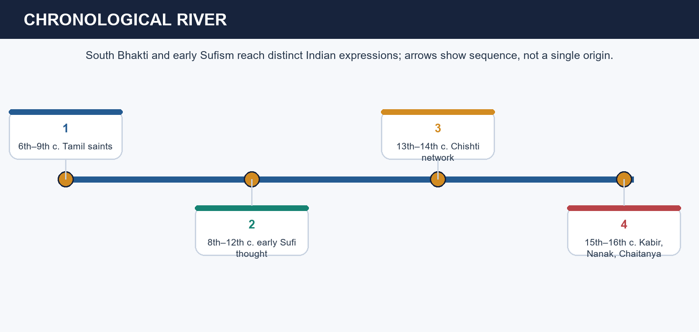

*Plural devotional chronology and overlap*


*Source ladder for devotional history*

[FACT] The repository's canonical owners place Alvar-Nayanar hymn traditions in the sixth-to-ninth-century south, early Sufi reference points such as Rabia, Hallaj and al-Ghazali before the Indian silsilahs, and later regional figures such as Kabir, Nanak, Chaitanya, Shankaradeva, Tulsidas, Surdas, Mirabai, Eknath and Tukaram in distinct linguistic and institutional settings. Hagiography, attributed verse, malfuzat, Janamsakhi material, inscriptions, shrine memory and architecture all survive, but they do not prove the same things.

[ANALYSIS] This chronology blocks three routine UPSC mistakes at once. First, Bhakti cannot be reduced to a post-Sultanate reaction because south Indian devotional corpora predate north Indian Sufi networks. Second, Sufism in India cannot be treated as socially pure local borrowing because its vocabulary and metaphysical genealogy are already visible in the wider Islamic world. Third, a remembered saint is never identical with a single text, sect or social programme. The historian must constantly separate attributed teaching, later canon formation and later institutional memory.

[LIMIT] A plural opening should not become a vague one. Diversity is not an excuse to stop naming traditions. You still need exact anchors—Alvars versus Nayanars, Chishti versus Suhrawardi, saguna versus nirguna, vernacular song versus scholastic theology—and then a qualification about evidence or social reach.

#### Analytical drill

**Question:** Why does this session matter analytically in a UPSC answer?

**How to use it:** Explain chronology first, then identify the order, saint or text, then state what the source can and cannot prove.

#### PARAGRAPH DEMONSTRATION — CLAIM → EVIDENCE → ANALYSIS → QUALIFICATION

**Claim:** The Bhakti-Sufi field is best understood as a long, plural chronology rather than as a pair of monolithic movements.

**Named evidence / example:** Tamil Alvar-Nayanar traditions predate the Sultanate; Rabia, Hallaj and al-Ghazali precede Indian Chishti institutions; later figures such as Kabir, Nanak and Chaitanya belong to separate regional and textual settings.

**Analysis:** This allows an answer to organise the topic through chronology, region and source type instead of through a forced merger narrative or a communal binary.

**Qualification:** Plurality must not erase specificity; every comparison still needs named orders, saints, doctrines or texts.

#### MUST-WRITE KEYWORDS

- **long chronology**
- **plural field**
- **source criticism**
- **regional variation**
- **Bhakti roots**
- **Sufi genealogy**

**How to use them:** Use long chronology and plural field first, then add one regional variation, one Bhakti root or Sufi genealogy, and one source-criticism limit.

#### CLOSING RECALL FLOW
```closure-flow
START / CONCEPT: Bhakti and Sufi histories are families of traditions, not two single medieval organisations that moved in lockstep.
KEY TERMS / DEFINITIONS: long chronology · plural field · source criticism · regional variation · Bhakti roots · Sufi genealogy
MECHANISM / ARGUMENT: A high-scoring answer opens with chronology and source type before it makes any claim about social reform, syncretism or popular reach.
CONSEQUENCE / CONTRAST: A plural devotional field is not the same thing as an undifferentiated composite culture.
UPSC TRAP / ANSWER-USE: Do not open by saying Bhakti and Sufism were "basically the same" or that both began only after Indo-Islamic contact.
ANSWER-GRABBING FORMULATION: Start with Tamil devotional roots and early Islamic mystical thought, then show how later saints, orders, texts and institutions created a plural devotional field.
```

### SESSION 2 — EARLY SUFI VOCABULARY: LOVE, FANA AND ORDERED DISCIPLINE

**Plain-language definition:** Early Sufi thought gave India a pre-existing Islamic mystical vocabulary of love, remembrance, discipline and ego-effacement.

**Technical definition:** Terms such as fana, baqa, silsilah, pir, murid, khanqah, sama and ziyarat must be defined precisely before they are used comparatively.

#### ANSWER-GRABBING OPENING
> Use the vocabulary to show structure: mystical experience, authorised transmission and social institution are related but not identical levels.

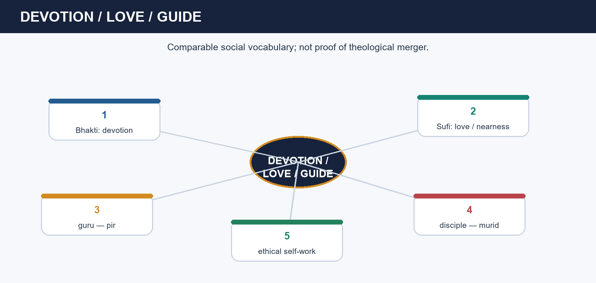

*Early Sufi love, guide and remembrance*

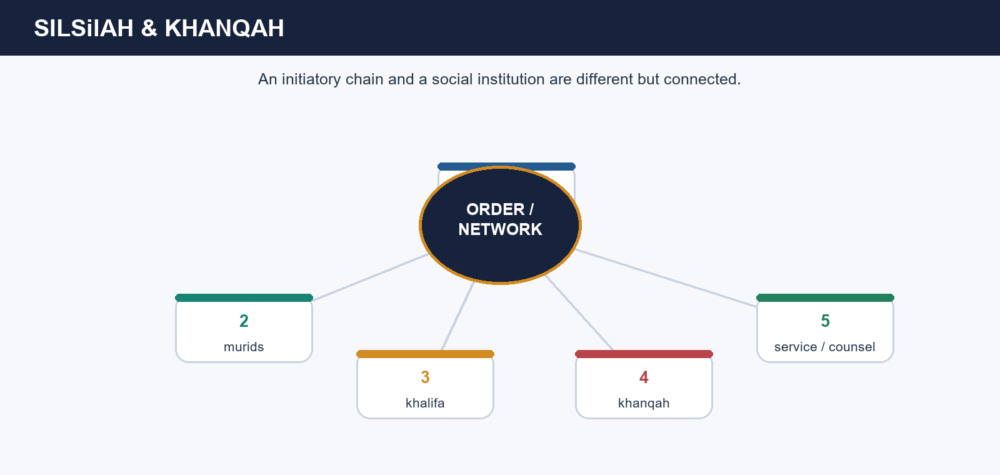

*Transmission chain and khanqah network*

[FACT] Rabia of Basra is conventionally associated with disinterested love of God, Hallaj with the controversy around ecstatic utterance, and al-Ghazali with reconciling mystical life and orthodoxy. The canonical owner defines silsilah as a spiritual chain/order, pir-shaykh and murid as guide and disciple, khanqah as a residence-hospice and teaching centre, dargah as a later saint-shrine, sama as devotional audition and fana-baqa as ego-effacement and abiding in/with God.

[ANALYSIS] This vocabulary matters because it stops UPSC answers from translating every mystical word into a lazy civilisational slogan. Fana is not a synonym for political rebellion or casual pantheism. A khanqah is not just a building; it is the institutional side of discipline, hospitality and counsel. A dargah is not simply the same as a khanqah because burial, succession, donations and pilgrimage can create a later shrine economy. When you define the terms carefully, later Indian variation becomes clearer rather than flatter.

[LIMIT] Translation must remain approximate. No single English word exhausts fana, baqa, haqiqa or ma'rifa, and no single practice such as sama is universal across all orders. UPSC rewards approximate clarity, not fake exactness.

#### Analytical drill

**Question:** Why does this session matter analytically in a UPSC answer?

**How to use it:** Define the term, attach it to a named figure or institution, and then add a limit on scale or uniformity.

#### PARAGRAPH DEMONSTRATION — CLAIM → EVIDENCE → ANALYSIS → QUALIFICATION

**Claim:** Early Sufi vocabulary gave Indian orders an already developed Islamic mystical grammar.

**Named evidence / example:** Rabia, Hallaj and al-Ghazali belong to the pre-Indian genealogy, while silsilah, pir-murid and khanqah organise the later social form of the orders.

**Analysis:** This lets a candidate distinguish mystical doctrine, institutional transmission and later shrine practice instead of collapsing them into one romantic image.

**Qualification:** Because practices varied by order and region, no single vocabulary item proves uniform behaviour by all Sufis.

#### MUST-WRITE KEYWORDS

- **Rabia**
- **fana-baqa**
- **silsilah**
- **pir-murid**
- **khanqah**
- **sama**

**How to use them:** Use Rabia, fana-baqa, silsilah, pir-murid, khanqah and sama as a sequence from mystical vocabulary to institutional form.

#### CLOSING RECALL FLOW
```closure-flow
START / CONCEPT: Early Sufi thought gave India a pre-existing Islamic mystical vocabulary of love, remembrance, discipline and ego-effacement.
KEY TERMS / DEFINITIONS: Rabia · fana-baqa · silsilah · pir-murid · khanqah · sama
MECHANISM / ARGUMENT: Terms such as fana, baqa, silsilah, pir, murid, khanqah, sama and ziyarat must be defined precisely before they are used comparatively.
CONSEQUENCE / CONTRAST: Mystical vocabulary is broader than shrine practice, and shrine practice is later than the saint's lifetime.
UPSC TRAP / ANSWER-USE: Do not treat khanqah and dargah as interchangeable or present fana as a generic synonym for merger with all religions.
ANSWER-GRABBING FORMULATION: Use the vocabulary to show structure: mystical experience, authorised transmission and social institution are related but not identical levels.
```

### SESSION 3 — CHISHTI SOCIAL REACH: LINEAGE, KHANQAH AND SERVICE

**Plain-language definition:** The Chishti order became influential not because it held office, but because its khanqah made devotional authority socially credible.

**Technical definition:** Ajmer, Delhi and Ajodhan form a remembered Chishti network whose mechanisms were service, hospitality, sama and relative distance from court office.

#### ANSWER-GRABBING OPENING
> Chishti popularity is best explained through Ajmer-Delhi-Ajodhan lineage, khanqah service, sama and relative state-distance.

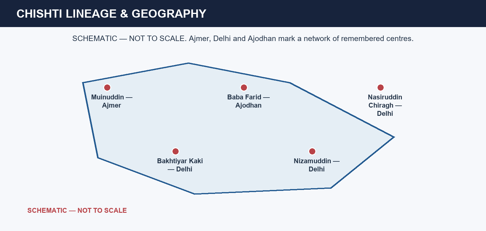

*Chishti lineage and geography*

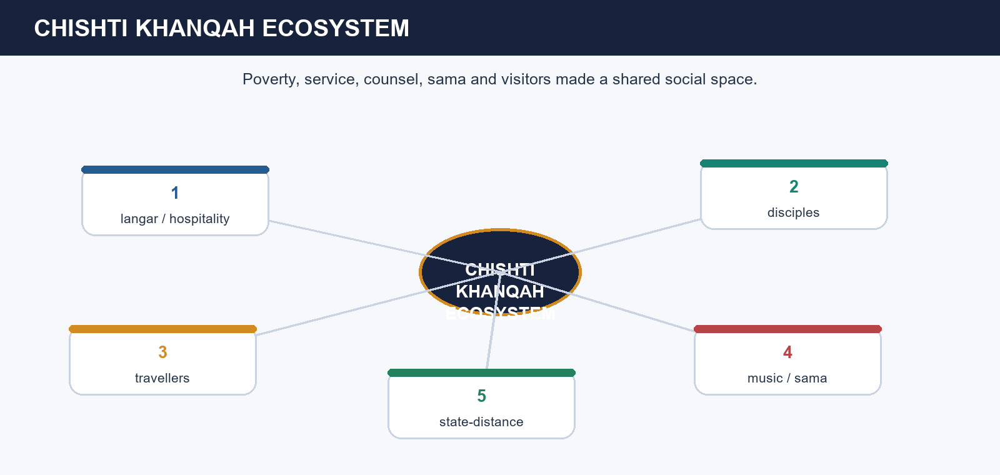

*The Chishti khanqah as a social ecosystem*

[FACT] The canonical spine runs through Muinuddin Chishti at Ajmer, Qutbuddin Bakhtiyar Kaki at Delhi, Baba Farid at Ajodhan, Nizamuddin Auliya at Delhi and Nasiruddin Chiragh-i-Delhi. Chishti centres are associated with poverty, humility, honest work, service and accessibility; sama and local-language contact widened emotional participation. The source base also cautions that Muinuddin's primary object was devotional Muslim life rather than a centrally planned programme of conversion.

[ANALYSIS] This is why the Chishti khanqah must be treated as a social ecosystem. Visitors met ethical counsel, food, discipleship, devotional audition and a reputation for refusing easy court incorporation. Nizamuddin's long Delhi career is valuable evidence because he remained influential across dynastic change without converting the khanqah into a state office. Popularity, then, is explained through moral credibility and accessible institution-building, not through a simple ruler-saint binary.

[LIMIT] Relative state-distance is not total apoliticism. Chishtis could meet elites, receive visitors or become entangled in urban politics. The safe phrase is a tendency to preserve distance from courtly office, not never had any contact with rulers.

#### Analytical drill

**Question:** Why does this session matter analytically in a UPSC answer?

**How to use it:** Explain Ajmer, Delhi or Ajodhan as named evidence, then explain how the khanqah converted ethical reputation into social reach.

#### PARAGRAPH DEMONSTRATION — CLAIM → EVIDENCE → ANALYSIS → QUALIFICATION

**Claim:** Chishti popularity in north India rested on institutionally organised service and credibility.

**Named evidence / example:** Ajmer, Delhi and Ajodhan formed a remembered network, while Nizamuddin's khanqah illustrates how sama, hospitality and counsel produced durable social reach.

**Analysis:** The explanation becomes analytical because it ties popularity to mechanism—service, accessibility and moral authority—rather than to vague spiritual charisma alone.

**Qualification:** State-distance was relative, and popularity should not be rewritten as proof of uniform conversion or total political withdrawal.

#### MUST-WRITE KEYWORDS

- **Ajmer**
- **Nizamuddin Auliya**
- **Baba Farid**
- **khanqah service**
- **sama**
- **state-distance**

**How to use them:** Use Ajmer, Baba Farid or Nizamuddin Auliya as named evidence, then connect khanqah service, sama and state-distance to social reach.

#### CLOSING RECALL FLOW
```closure-flow
START / CONCEPT: The Chishti order became influential not because it held office, but because its khanqah made devotional authority socially credible.
KEY TERMS / DEFINITIONS: Ajmer · Nizamuddin Auliya · Baba Farid · khanqah service · sama · state-distance
MECHANISM / ARGUMENT: Ajmer, Delhi and Ajodhan form a remembered Chishti network whose mechanisms were service, hospitality, sama and relative distance from court office.
CONSEQUENCE / CONTRAST: Popular influence is not the same as state office, but neither is it the same as isolation from politics.
UPSC TRAP / ANSWER-USE: Do not write that Chishtis became influential mainly because they converted masses or because they never interacted with elites at all.
ANSWER-GRABBING FORMULATION: A good answer explains popularity causally instead of turning it into a conversion-machine slogan.
```

### SESSION 4 — SUHRAWARDIS, QADIRIS, SHATTARIS AND NAQSHBANDIS: STATE RELATIONS WITHOUT MORAL BINARIES

**Plain-language definition:** Suhrawardi, Qadiri, Shattari and Naqshbandi orders differed in resources, discipline and state relations rather than in simple moral worth.

**Technical definition:** The topic's source-owned later-order matrix explicitly names Suhrawardi, Qadiri, Shattari and Naqshbandi lineages; each must be treated as a tendency, not as a timeless essence.

#### ANSWER-GRABBING OPENING
> Compare Bahauddin Zakariya, Qadiri networks, Shattari contact and Naqshbandi state ties through order, centre and political posture.

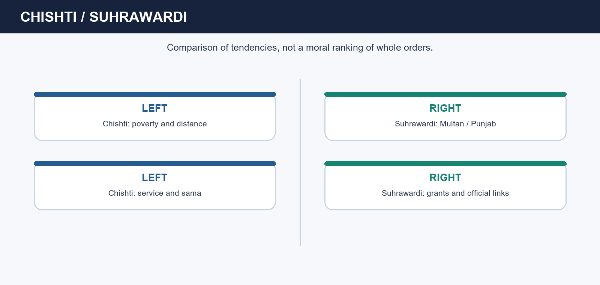

*Order comparison: resources, geography and political posture*

[FACT] The Suhrawardi order is associated with Punjab-Multan networks and with Bahauddin Zakariya; compared with Chishtis, it accepted property, grants and closer state contact more readily. The canonical basic owner also names Qadiri later-medieval north/Punjab networks, Shattari links such as Muhammad Ghawth of Gwalior and yogic-knowledge engagement, and Naqshbandi development through Baqi Billah and Ahmad Sirhindi, with silent dhikr and law-reform emphasis as major markers. The same source warns that Ahmad Sirhindi belongs to later Mughal debates and cannot be projected back onto Kabir's century.

[ANALYSIS] This order matrix matters because it moves the topic from moral labels to institutional history. A resource-accepting order was not automatically spiritually inferior, just as an order that prized poverty was not automatically socially revolutionary. Punjab and Multan, like Ajmer and Delhi, were not peripheral footnotes but major nodes of learning, travel, endowment and public authority. Later lineages such as Qadiri, Shattari and Naqshbandi show that medieval Sufism in India never froze at the Chishti model.

[LIMIT] The owned topic sources do not provide a full standalone Firdausi institutional block. A strict repair must therefore preserve the verified order matrix rather than invent unsupported Firdausi detail from memory. Honesty about source ownership is better than decorative over-expansion.

#### Analytical drill

**Question:** Why does this session matter analytically in a UPSC answer?

**How to use it:** Compare orders by centre, resource pattern and legal-political posture, then add a sentence on internal variation.

#### PARAGRAPH DEMONSTRATION — CLAIM → EVIDENCE → ANALYSIS → QUALIFICATION

**Claim:** Order differences are best explained through resources, institutional style and state relation rather than through a good-order/bad-order morality tale.

**Named evidence / example:** Bahauddin Zakariya's Multan Suhrawardi centre, Muhammad Ghawth's Shattari-yogic engagement and Baqi Billah-Sirhindi's Naqshbandi development show distinct bargains with authority and discipline.

**Analysis:** Once the order-centre-state triad is named, a comparison answer can explain variation without making mysticism socially formless.

**Qualification:** Because centres and reigns varied, no label such as Suhrawardi or Naqshbandi proves one fixed political behaviour everywhere.

#### MUST-WRITE KEYWORDS

- **Bahauddin Zakariya**
- **Multan**
- **Qadiri networks**
- **Shattari**
- **Naqshbandi**
- **state ties**

**How to use them:** Use Bahauddin Zakariya, Multan, Qadiri networks, Shattari, Naqshbandi and state ties to build the comparison.

#### CLOSING RECALL FLOW
```closure-flow
START / CONCEPT: Sufi orders differed less by holiness-versus-corruption than by the way they handled property, patronage, law and public authority.
KEY TERMS / DEFINITIONS: Bahauddin Zakariya · Multan · Qadiri networks · Shattari · Naqshbandi · state ties
MECHANISM / ARGUMENT: The topic's source-owned later-order matrix explicitly names Suhrawardi, Qadiri, Shattari and Naqshbandi lineages; each must be treated as a tendency, not as a timeless essence.
CONSEQUENCE / CONTRAST: Closer state contact is not the same as doctrinal surrender, and poverty is not the same as social radicalism.
UPSC TRAP / ANSWER-USE: Do not call Suhrawardis court clerics as a total description or turn Sirhindi into a fifteenth-century influence on Kabir.
ANSWER-GRABBING FORMULATION: Comparison works only when order, centre and political posture are named together.
```

### SESSION 5 — SOUTHERN ROOTS AND VEDANTA PATHS: ALVARS, NAYANARS, RAMANUJA, NIMBARKA, MADHVA AND VALLABHA

**Plain-language definition:** Bhakti in north India cannot be understood unless its southern devotional and doctrinal antecedents are kept visible.

**Technical definition:** Bhakti is not one philosophy: Vishishtadvaita, Dvaitadvaita/Bhedabheda, Dvaita and Shuddhadvaita mark different theological grammars that all sustained devotion.

#### ANSWER-GRABBING OPENING
> Use Alvars, Nayanars, Vishishtadvaita, Dvaitadvaita, Dvaita and Shuddhadvaita to show southern roots and doctrinal plurality within Bhakti.

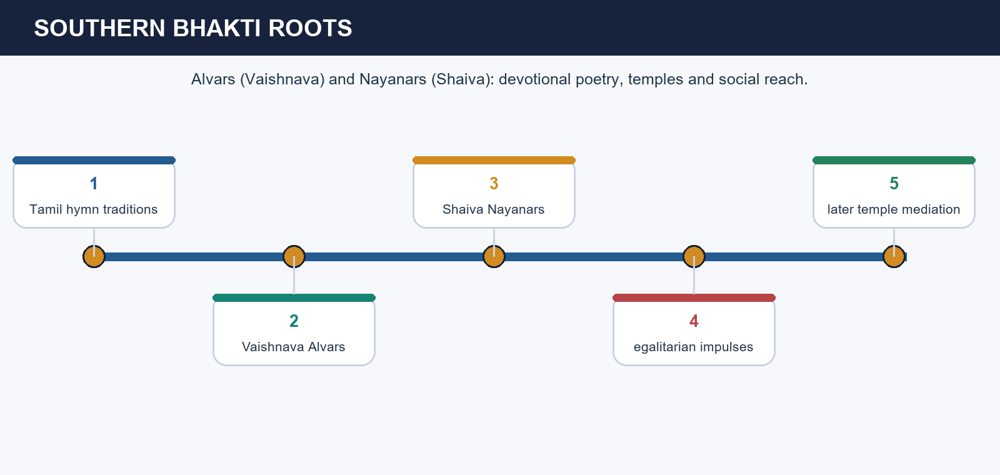

*Alvar-Nayanar devotional roots*

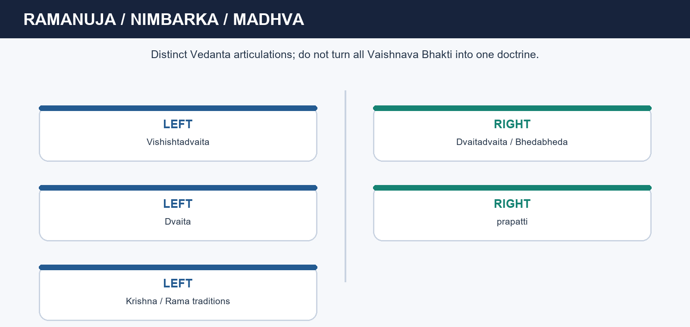

*Vedanta comparison for Bhakti schools*

[FACT] The basic owner treats Tamil Alvar and Nayanar traditions as essential southern roots. Ramanuja is associated with Vishishtadvaita, prapatti and Sri Vaishnava institutions; Nimbarka with Dvaitadvaita/Bhedabheda and Radha-Krishna devotion; Madhva with Dvaita and Udupi-centred lineage; Vallabha with Shuddhadvaita and Pushtimarg. The source also notes that early egalitarian energy among Alvars and Nayanars was later moderated by temple-centred ritual and Brahmanical authority.

[ANALYSIS] This doctrinal spread is analytically important because Bhakti is often flattened into a single emotional or anti-ritual current. Ramanuja's surrender, Madhva's dualism, Nimbarka's difference-and-non-difference and Vallabha's grace-centred path show that devotion moved through competing metaphysical grammars. That is why saguna devotion cannot be treated as one social politics and why north Indian vernacular Bhakti did not suddenly appear out of nowhere.

[LIMIT] Do not make doctrine do more historical work than it can. A philosophical label does not automatically tell you the caste practice or gender politics of every later institution. The secure exam route is to pair teacher, doctrine and devotional association, then qualify chronology where the source itself does so.

#### Analytical drill

**Question:** Why does this session matter analytically in a UPSC answer?

**How to use it:** Pair each teacher with one doctrine and one devotional association, then use that pair to show plurality within Bhakti.

#### PARAGRAPH DEMONSTRATION — CLAIM → EVIDENCE → ANALYSIS → QUALIFICATION

**Claim:** Southern devotional roots and Vedanta diversity block the myth that Bhakti began as a single northern response to Islam.

**Named evidence / example:** Alvar-Nayanar traditions predate the Sultanate, while Ramanuja, Nimbarka, Madhva and Vallabha embody distinct doctrinal paths rather than a single theology of devotion.

**Analysis:** This makes Bhakti historically deep and intellectually plural at the same time.

**Qualification:** Different doctrines supported devotion, but they did not guarantee identical institutions or social outcomes.

#### MUST-WRITE KEYWORDS

- **Alvars**
- **Nayanars**
- **Vishishtadvaita**
- **Dvaitadvaita**
- **Dvaita**
- **Shuddhadvaita**

**How to use them:** Pair Alvars or Nayanars with one doctrine—Vishishtadvaita, Dvaitadvaita, Dvaita or Shuddhadvaita—and then show how the teacher-school pair grounds Bhakti's plurality.

#### CLOSING RECALL FLOW
```closure-flow
START / CONCEPT: Bhakti in north India cannot be understood unless its southern devotional and doctrinal antecedents are kept visible.
KEY TERMS / DEFINITIONS: Alvars · Nayanars · Vishishtadvaita · Dvaitadvaita · Dvaita · Shuddhadvaita
MECHANISM / ARGUMENT: Bhakti is not one philosophy: Vishishtadvaita, Dvaitadvaita/Bhedabheda, Dvaita and Shuddhadvaita mark different theological grammars that all sustained devotion.
CONSEQUENCE / CONTRAST: Early devotional roots are older than the Sultanate, but later institutions could still reproduce hierarchy.
UPSC TRAP / ANSWER-USE: Do not date Nimbarka with false certainty or collapse Ramanuja, Madhva and Vallabha into one interchangeable Vaishnava school.
ANSWER-GRABBING FORMULATION: Prelims safety comes from doctrine-plus-association, not from false precision about disputed dates.
```

### SESSION 6 — NAMDEV, RAMANANDA AND NORTHWARD TRANSMISSION: MEMORY WITH HAGIOGRAPHIC CAUTION

**Plain-language definition:** Northward transmission means overlapping routes of pilgrimage, song, teachers and regional publics, not one preacher marching devotion from south to north.

**Technical definition:** Ramananda is historically usable as a tradition of widened access, but the exact disciple list must be handled as hagiographically mediated memory unless independently corroborated.

#### ANSWER-GRABBING OPENING
> Transmission becomes historical when region, medium and source caution are all named together.

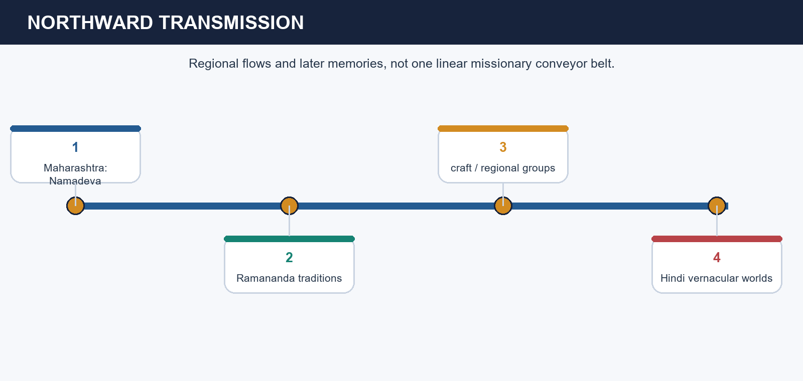

*Transmission routes across regions*

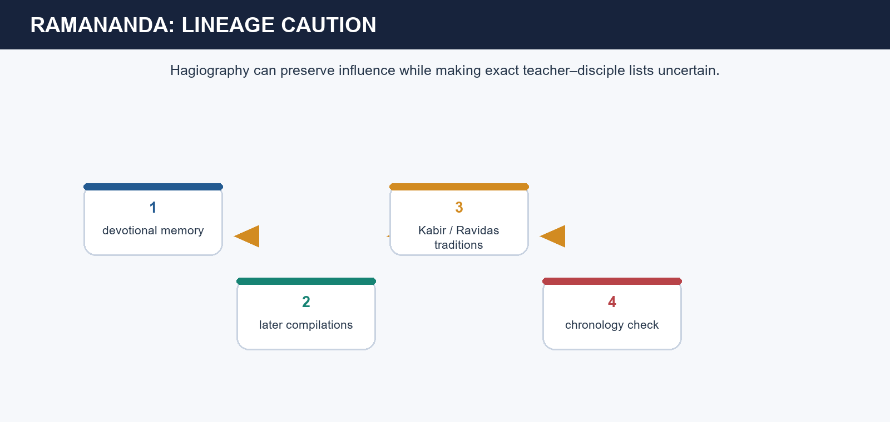

*Ramananda tradition with source caution*

[FACT] The canonical timeline associates Namdev and Ramananda with the fourteenth-fifteenth-century spread of popular Bhakti into north India. Ramananda traditions are linked with Ravidas, Kabir, Sena and Sadhana and are used as evidence of broader devotional access across caste lines, while the source explicitly warns that exact teacher-disciple chronology is not equally secure for every name. Namdev situates Maharashtra and Varkari-Pandharpur currents within this wider transmission field.

[ANALYSIS] This is why hagiography should be used neither as exact court register nor as useless fiction. It preserves remembered affinity, pedagogic descent and an aspiration to widen devotional access, even when it compresses chronology or idealises succession. Namdev also prevents the topic from becoming a jump-cut from Tamil south directly to Kabir: songs, pilgrimage routes, craft milieus and regional literatures carried Bhakti across many overlapping spaces.

[LIMIT] The existence of caste-crossing devotional memory does not prove that caste vanished in marriage, occupation, temple control or local politics. Its importance lies in spiritual revaluation and linguistic-social reach, not in an automatic structural revolution.

#### Analytical drill

**Question:** Why does this session matter analytically in a UPSC answer?

**How to use it:** Explain Namdev or Ramananda as a transmission node, then add one sentence on how hagiography preserves affinity more reliably than precise chronology.

#### PARAGRAPH DEMONSTRATION — CLAIM → EVIDENCE → ANALYSIS → QUALIFICATION

**Claim:** Northward transmission should be read as a network of practices and remembered lineages rather than as a single founder-story.

**Named evidence / example:** Namdev's Maharashtrian current and Ramananda's later disciple traditions show how devotion, song and lineage memory moved across regions while preserving local difference.

**Analysis:** The source-critical payoff is that you can preserve historical significance without pretending the genealogies are archival attendance sheets.

**Qualification:** Tradition is usable evidence, but only when its level of certainty is clearly bounded.

#### MUST-WRITE KEYWORDS

- **Namdev**
- **Ramananda**
- **northward transmission**
- **Ravidas**
- **hagiographic caution**
- **vernacular routes**

**How to use them:** Use Namdev or Ramananda as a transmission node, then add one sentence on how hagiography preserves affinity more reliably than precise chronology.

#### CLOSING RECALL FLOW
```closure-flow
START / CONCEPT: Northward transmission means overlapping routes of pilgrimage, song, teachers and regional publics, not one preacher marching devotion from south to north.
KEY TERMS / DEFINITIONS: Namdev · Ramananda · northward transmission · Ravidas · hagiographic caution · vernacular routes
MECHANISM / ARGUMENT: Ramananda is historically usable as a tradition of widened access, but the exact disciple list must be handled as hagiographically mediated memory unless independently corroborated.
CONSEQUENCE / CONTRAST: A wide devotional memory is not the same thing as exact teacher-disciple dating.
UPSC TRAP / ANSWER-USE: Do not present every Ramananda disciple list as if it were a contemporary administrative register.
ANSWER-GRABBING FORMULATION: Transmission becomes historical when region, medium and source caution are all named together.
```

### SESSION 7 — KABIR: ONE GOD, RITUAL CRITIQUE AND LAYERED CORPUS

**Plain-language definition:** Kabir mattered because he joined one-God devotion to a sharp critique of ritualism, caste pride and sectarian certainty in memorable vernacular language.

**Technical definition:** Kabir's historical force lies in a layered nirguna corpus whose one-God ritual critique survives through remembered themes rather than a fixed autograph text.

#### ANSWER-GRABBING OPENING
> Use Kabir, nirguna, one God, ritual critique, oral transmission and climate of opinion as one connected answer chain.

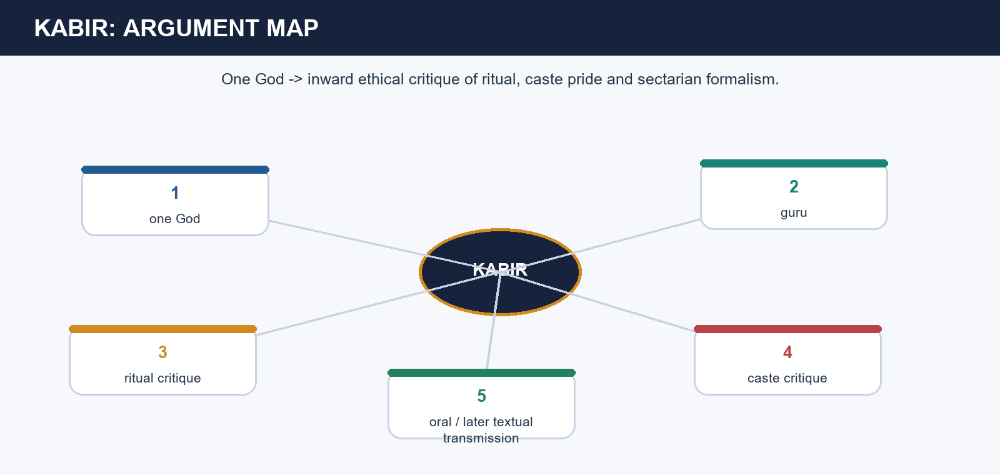

*Kabir's argumentative map*

[FACT] Kabir is associated with nirguna devotion, critique of idol worship, pilgrimage, caste discrimination and hollow formalism, and insistence on the true guru. The canonical owner warns that his verses circulated orally and were written down later in varying collections, so the corpus survives through layered preservation rather than through a single uncontested manuscript. The advanced owner also cautions that Kabir was not a modern social reformer in the legislative sense.

[ANALYSIS] Kabir is analytically powerful because his language attacks inherited spiritual privilege at several levels at once. He questions the assumption that caste pedigree, external ritual or sectarian identity automatically guarantee truth. That gives his remembered corpus wide ethical force across craft, devotional and town settings. Yet the very power of the corpus makes provenance discipline more necessary, not less. Kabir's remembered teaching is often safer than claiming that a specific couplet comes to us unchanged from the saint's mouth.

[LIMIT] A high-scoring answer distinguishes climate of opinion from transformed structure. Kabir could destabilise moral justifications for status and externalism without abolishing caste or creating one centralised reform organisation. Later Kabir panths had their own histories.

#### Analytical drill

**Question:** Why does this session matter analytically in a UPSC answer?

**How to use it:** Explain Kabir's one-God critique, cite the layered corpus, and then qualify social effect through the climate-of-opinion distinction.

#### PARAGRAPH DEMONSTRATION — CLAIM → EVIDENCE → ANALYSIS → QUALIFICATION

**Claim:** Kabir's enduring significance lies in the ethical destabilisation of ritual privilege through vernacular nirguna devotion.

**Named evidence / example:** One God, the true guru, critique of pilgrimage and caste pride, and a layered orally transmitted corpus are the named evidence that make Kabir historically legible.

**Analysis:** The answer earns depth when it treats corpus formation as part of the history, not as an obstacle to history.

**Qualification:** Moral challenge is stronger than institutional revolution in Kabir's case.

#### MUST-WRITE KEYWORDS

- **Kabir**
- **nirguna**
- **ritual critique**
- **one God**
- **oral transmission**
- **climate of opinion**

**How to use them:** Use Kabir, nirguna, ritual critique, one God, oral transmission and climate of opinion in that order to move from teaching to social effect.

#### CLOSING RECALL FLOW
```closure-flow
START / CONCEPT: Kabir mattered because he joined one-God devotion to a sharp critique of ritualism, caste pride and sectarian certainty in memorable vernacular language.
KEY TERMS / DEFINITIONS: Kabir · nirguna · ritual critique · one God · oral transmission · climate of opinion
MECHANISM / ARGUMENT: Kabir's historical force survives best through remembered themes and social reach, not through a claim that every familiar verse is a verbatim autograph.
CONSEQUENCE / CONTRAST: Moral challenge is stronger than institutional revolution in Kabir's case.
UPSC TRAP / ANSWER-USE: Do not call Kabir a modern state reformer or authenticate every attributed couplet as exact lifetime wording.
ANSWER-GRABBING FORMULATION: The strongest answer balances ethical power with source caution and structural limit.
```

### SESSION 8 — GURU NANAK: HOUSEHOLDER ETHIC, GURU-CENTRED DEVOTION AND BOUNDED CONTINUITY

**Plain-language definition:** Nanak made ordinary ethical life—work, sharing and truthful conduct—a site of disciplined devotion rather than an obstacle to it.

**Technical definition:** Guru Nanak's householder ethic must be analysed within Nanak's own devotional moment while keeping later Sikh institutions and politics historically distinct.

#### ANSWER-GRABBING OPENING
> Nanak is strongest in UPSC answers when compared carefully with Kabir rather than merged into him or collapsed into later Sikh history.

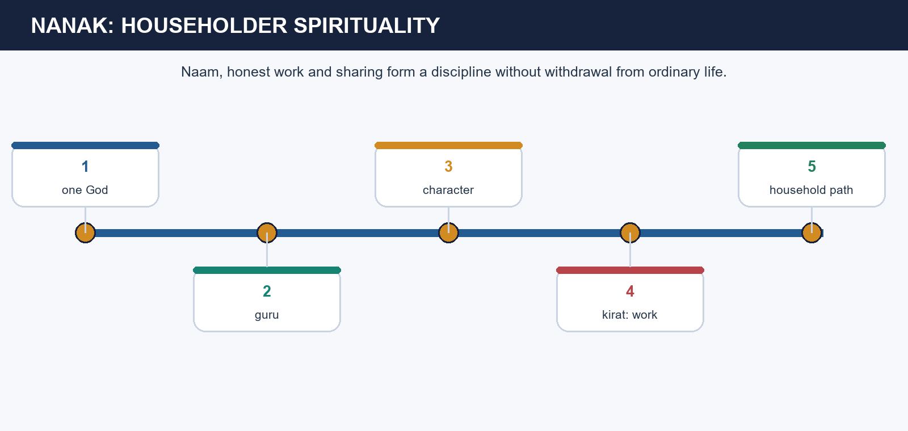

*Nanak's householder path*

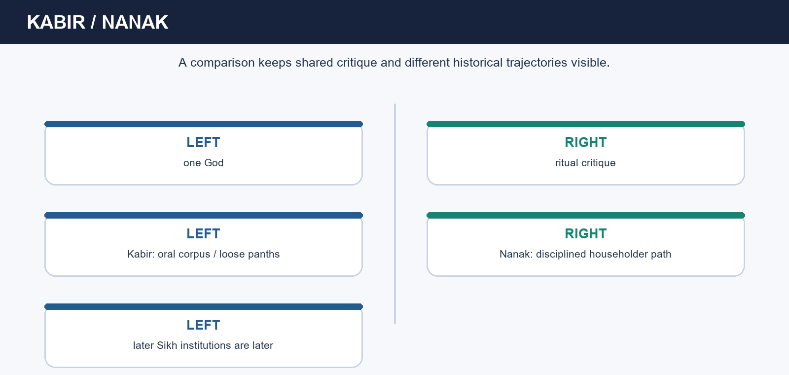

*Kabir-Nanak comparison*

[FACT] Guru Nanak, born in 1469, stressed one God, the guru's guidance, purity of character, honest labour and household responsibility. The canonical basic owner notes the 1538/1539 death-date discrepancy and states that Nanak did not intend to found a new religion, while later Sikh history grew from his ideas through subsequent Gurus and communities. Sangat and langar belong to the early community direction, but their institutional forms developed historically.

[ANALYSIS] Nanak's distinctiveness lies in the householder ethic. Spiritual discipline is tested in labour, relation, sharing and character, not only in renunciation or ceremonial display. This makes a comparison with Kabir fruitful: both criticise externalism and use one-God language, but Nanak gives more explicit shape to devotional life within work and household. That is why later Sikh continuity should be treated as history in motion rather than as something already fully formed in the founder's lifetime.

[LIMIT] The householder path widened dignity without guaranteeing social equality among all followers. Later institution-building, scripture compilation, militarisation and political experience belong to another historical layer and should not be projected backwards as if they were already complete in Nanak's own lifetime.

#### Analytical drill

**Question:** Why does this session matter analytically in a UPSC answer?

**How to use it:** Explain Nanak to connect devotion with labour and household life, then add a line separating his moment from later Sikh institutional growth.

#### PARAGRAPH DEMONSTRATION — CLAIM → EVIDENCE → ANALYSIS → QUALIFICATION

**Claim:** Nanak's devotional humanism dignified everyday ethical life without erasing chronology.

**Named evidence / example:** One God, guru-guided remembrance, honest work, sharing and household responsibility together mark Nanak's route through devotion and social ethics.

**Analysis:** The answer becomes analytical when continuity with later Sikhism is acknowledged but not anachronistically collapsed into the first Guru's lifetime.

**Qualification:** A householder ethic widens spiritual access, but it does not automatically dissolve hierarchy.

#### MUST-WRITE KEYWORDS

- **Guru Nanak**
- **householder path**
- **honest work**
- **sharing**
- **guru-guidance**
- **bounded continuity**

**How to use them:** Use Guru Nanak, householder path, honest work, sharing, guru-guidance and bounded continuity to connect devotion with labour without anachronism.

#### CLOSING RECALL FLOW
```closure-flow
START / CONCEPT: Nanak made ordinary ethical life—work, sharing and truthful conduct—a site of disciplined devotion rather than an obstacle to it.
KEY TERMS / DEFINITIONS: Guru Nanak · householder path · honest work · sharing · guru-guidance · bounded continuity
MECHANISM / ARGUMENT: The historical rule is to keep Nanak's own devotional moment distinct from later Sikh institutional and political development.
CONSEQUENCE / CONTRAST: Continuity with Sikh history is real, but later institutional completion cannot be read back wholesale.
UPSC TRAP / ANSWER-USE: Do not say Nanak rejected work or that the entire later Sikh institutional order was already finished in his own lifetime.
ANSWER-GRABBING FORMULATION: Nanak is strongest in UPSC answers when compared carefully with Kabir rather than merged into him or collapsed into later Sikh history.
```

### SESSION 9 — CHAITANYA, KRISHNA KIRTAN AND THE PUBLIC REORIENTATION OF BHAKTI

**Plain-language definition:** Chaitanya did not invent Bhakti, but he made one Vaishnava stream more public, affective and performative.

**Technical definition:** Reorientation in the 2018 GS-I PYQ means a change in mode and reach, not the creation of devotion from nothing.

#### ANSWER-GRABBING OPENING
> Bengal, Puri, Krishna-centred emotion and collective kirtan are the four retrieval anchors you need.

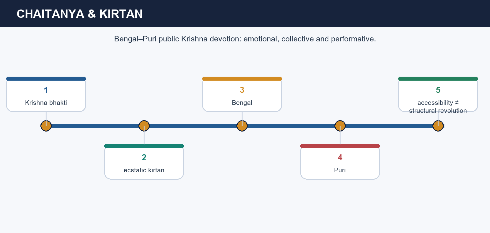

*Chaitanya's kirtan and public devotion*

[FACT] Chaitanya (1486–1533) is linked with Bengal, Puri and ecstatic Krishna kirtan. The canonical advanced owner routes the 2018 GS-I Mains question precisely through this reorientation and warns that earlier southern Bhakti traditions and Vedanta formations clearly predate him. Chaitanya's contribution is therefore not origin but intensification of affective, collective devotional performance.

[ANALYSIS] The reorientation works through mechanism. Kirtan allows devotion to be sung, heard, remembered and shared; it does not rely only on scholastic mastery. Bengal and Puri provided pilgrimage and regional anchors, while Krishna-centred love, longing and surrender gave Bhakti a heightened public emotional register. This is why Chaitanya matters to both culture and answer writing: he helps explain how performance widened devotional participation and literary-cultural transmission.

[LIMIT] Accessibility must not be romanticised into total social transformation. Chaitanya does not erase caste, gender constraint or the plurality of Bhakti traditions. Nor should every later Gaudiya institution or biography be projected unchanged back into one lifetime.

#### Analytical drill

**Question:** Why does this session matter analytically in a UPSC answer?

**How to use it:** Say that Chaitanya reoriented Bhakti through public kirtan and affective Krishna devotion in Bengal-Puri settings.

#### PARAGRAPH DEMONSTRATION — CLAIM → EVIDENCE → ANALYSIS → QUALIFICATION

**Claim:** Chaitanya reoriented Bhakti by intensifying its public, performative and Krishna-centred affective mode.

**Named evidence / example:** Bengal, Puri, kirtan and emotional surrender are the named evidence that explain why reorientation is the correct word.

**Analysis:** This keeps the answer focused on mode, participation and cultural reach rather than on an inflated founder myth.

**Qualification:** Reorientation is not invention, and accessibility is not identical with structural equality.

#### MUST-WRITE KEYWORDS

- **Chaitanya**
- **Bengal-Puri**
- **kirtan**
- **Krishna devotion**
- **public affect**
- **reorientation**

**How to use them:** Say that Chaitanya reoriented Bhakti through public kirtan and affective Krishna devotion in Bengal-Puri settings.

#### CLOSING RECALL FLOW
```closure-flow
START / CONCEPT: Chaitanya did not invent Bhakti, but he made one Vaishnava stream more public, affective and performative.
KEY TERMS / DEFINITIONS: Chaitanya · Bengal-Puri · kirtan · Krishna devotion · public affect · reorientation
MECHANISM / ARGUMENT: Reorientation in the 2018 GS-I PYQ means a change in mode and reach, not the creation of devotion from nothing.
CONSEQUENCE / CONTRAST: Collective devotional performance widened participation without making Bhakti socially uniform.
UPSC TRAP / ANSWER-USE: Do not answer the 2018 PYQ by narrating Chaitanya's life without explaining what exactly changed in the mode of devotion.
ANSWER-GRABBING FORMULATION: Bengal, Puri, Krishna-centred emotion and collective kirtan are the four retrieval anchors you need.
```

### SESSION 10 — REGIONAL LITERATURES, VERNACULARISATION AND INSTITUTIONAL VARIATION

**Plain-language definition:** Bhakti literature mattered because devotion travelled through regional languages, song, performance and institutions rather than through one single canon.

**Technical definition:** Regional literature must be analysed through vernacularisation, named texts such as Ramcharitmanas or Braj lyric, Marathi abhangs and namghar-sattra institutions.

#### ANSWER-GRABBING OPENING
> Regional variation is the content, not the obstacle: Awadhi, Braj, Marathi, Gujarati, Bengali, Assamese and other fields show the breadth of the movement.

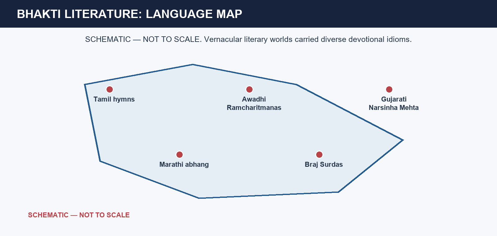

*Regional language map of Bhakti literature*

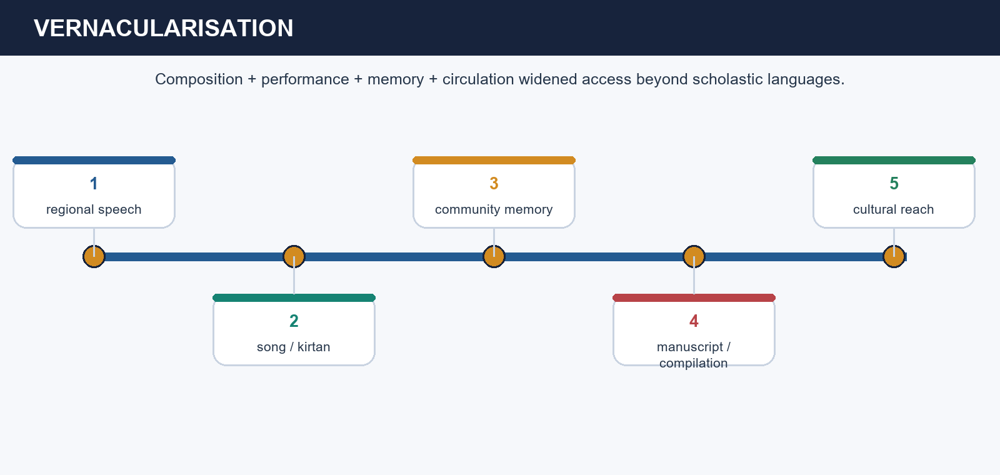

*How vernacularisation works*

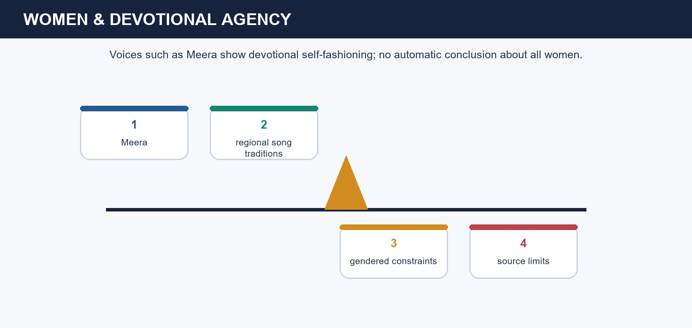

*Women's devotional voice and literary memory*

[FACT] The canonical owners name Tulsidas's Ramcharitmanas in Awadhi, Surdas's Braj Krishna lyric, Mirabai's Rajasthani-Hindi devotion, Eknath and Tukaram in Marathi, Narsinha Mehta in Gujarati and Shankaradeva's Assamese Eka Sarana field with namghar and sattra institutions. Chaitanya belongs to the Bengali-Puri stream; earlier Tamil hymn corpora remain indispensable southern foundations. These examples show that Bhakti literature was devotional, lyrical, performative and regional rather than a single text-world.

[ANALYSIS] Vernacularisation is the key mechanism. Composition in local speech met recitation, kirtan, bhajan, pilgrimage, community memory and later manuscript transmission. That widened emotional access beyond narrow scholastic circles while preserving regional idiom. Shankaradeva's namghar-sattra world shows that literary and performative devotion could also become institutional. Mirabai's remembered voice reveals gendered devotional agency, but precisely as remembered literature, not as a census of all women's social condition.

[LIMIT] Regional literature did not abolish Sanskrit, Persian or Arabic, nor did it automatically create one homogeneous national culture before modern nationalism. The safer conclusion is overlapping regional cultural worlds whose devotional repertoires travelled and interacted.

#### Analytical drill

**Question:** Why does this session matter analytically in a UPSC answer?

**How to use it:** Explain each author to a language and then to one mechanism such as song, pilgrimage, memory or institution.

#### PARAGRAPH DEMONSTRATION — CLAIM → EVIDENCE → ANALYSIS → QUALIFICATION

**Claim:** Bhakti literature reshaped culture most powerfully through vernacularisation and performance.

**Named evidence / example:** Tulsidas, Surdas, Mirabai, Eknath, Tukaram, Narsinha Mehta and Shankaradeva together show language-specific devotional worlds linked by song, memory and institution.

**Analysis:** Once authors are tied to language and mechanism, cultural contribution becomes a historical explanation rather than a decorative list.

**Qualification:** Literary visibility is not proof of universal literacy, female emancipation or the end of caste.

#### MUST-WRITE KEYWORDS

- **vernacularisation**
- **Ramcharitmanas**
- **Braj lyric**
- **Marathi abhang**
- **namghar-sattra**
- **regional publics**

**How to use them:** Use vernacularisation, Ramcharitmanas, Braj lyric, Marathi abhang, namghar-sattra and regional publics to map language into institution.

#### CLOSING RECALL FLOW
```closure-flow
START / CONCEPT: Bhakti literature mattered because devotion travelled through regional languages, song, performance and institutions rather than through one single canon.
KEY TERMS / DEFINITIONS: vernacularisation · Ramcharitmanas · Braj lyric · Marathi abhang · namghar-sattra · regional publics
MECHANISM / ARGUMENT: A good 2021-style answer pairs named authors with language and mechanism: composition, recitation, pilgrimage, memory and later canon formation.
CONSEQUENCE / CONTRAST: Regional literary publics overlapped, but they did not fuse into one uniform culture.
UPSC TRAP / ANSWER-USE: Do not reduce Bhakti literature to one Hindi stream or use one female voice as proof of complete gender equality.
ANSWER-GRABBING FORMULATION: Regional variation is the content, not the obstacle: Awadhi, Braj, Marathi, Gujarati, Bengali, Assamese and other fields show the breadth of the movement.
```

### SESSION 11 — SAGUNA, NIRGUNA, CASTE AND GENDER: SPIRITUAL OPENING WITH STRUCTURAL LIMITS

**Plain-language definition:** Saguna and nirguna are useful analytical tendencies only when they are not turned into rigid political camps.

**Technical definition:** Spiritual equality in Bhakti and Sufi contexts widened access and dignity, but material, caste and gender hierarchies often persisted.

#### ANSWER-GRABBING OPENING
> The exam-safe formula is moral opening plus institutional limit.

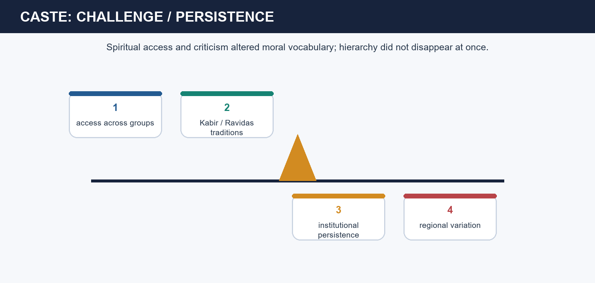

*Caste challenge and structural limits*

[FACT] The canonical basic owner explicitly says saguna and nirguna are analytical groupings rather than rigid organisations. Kabir and Nanak often anchor nirguna critique; Rama and Krishna traditions anchor major saguna worlds. Women such as Andal and Karaikkal Ammaiyar in the longer bridge, Akka Mahadevi, Lalla and Mirabai show different modes of devotional agency. The same owners also warn that panths, sects, temples, mathas, sattras and shrines could preserve inclusive memory while reproducing hierarchy, hereditary leadership or caste practice.

[ANALYSIS] This is where the phrase climate of opinion becomes useful. Devotional movements could devalue ritual monopoly, question birth-status pride and make vernacular access meaningful without redistributing property, occupation, marriage power or political authority. Mirabai's remembered refusal of restrictive expectation is historically significant, but it remains literary and devotional evidence first. Likewise, non-elite participation appears through artisan memory, pilgrimage, song and service, but source survival favours communities that later institutionalised successfully.

[LIMIT] The strongest answer neither romanticises equality nor dismisses it. It treats spiritual access, expressive dignity and moral critique as real, while stating plainly that caste and patriarchy survived in altered forms.

#### Analytical drill

**Question:** Why does this session matter analytically in a UPSC answer?

**How to use it:** Explain the language of widened access or dignity, then immediately name one hierarchy that persisted.

#### PARAGRAPH DEMONSTRATION — CLAIM → EVIDENCE → ANALYSIS → QUALIFICATION

**Claim:** The language of equality in medieval devotion is strongest at the ethical-spiritual level and weaker at the level of total structural transformation.

**Named evidence / example:** Saguna and nirguna classify devotional orientation; women's and non-elite participation show widened voice; later institutions show why hierarchy could endure.

**Analysis:** This lets a Mains answer hold together moral challenge and social limit instead of choosing one against the other.

**Qualification:** Spiritual dignity is not the same as immediate social revolution, but it is more than empty rhetoric.

#### MUST-WRITE KEYWORDS

- **saguna**
- **nirguna**
- **caste critique**
- **women's agency**
- **climate of opinion**
- **institutional limit**

**How to use them:** Use saguna, nirguna, caste critique, women's agency, climate of opinion and institutional limit to balance spiritual opening with structural persistence.

#### CLOSING RECALL FLOW
```closure-flow
START / CONCEPT: Saguna and nirguna are useful analytical tendencies only when they are not turned into rigid political camps.
KEY TERMS / DEFINITIONS: saguna · nirguna · caste critique · women's agency · climate of opinion · institutional limit
MECHANISM / ARGUMENT: Spiritual equality in Bhakti and Sufi contexts widened access and dignity, but material, caste and gender hierarchies often persisted.
CONSEQUENCE / CONTRAST: Analytical grouping is not organisational membership, and ethical equality is not full material equality.
UPSC TRAP / ANSWER-USE: Do not equate saguna with conservatism and nirguna with automatic radicalism, or claim that Bhakti abolished patriarchy.
ANSWER-GRABBING FORMULATION: The exam-safe formula is moral opening plus institutional limit.
```

### SESSION 12 — BHAKTI-SUFI COMPARISON: SYMBIOSIS WITHOUT MERGER

**Plain-language definition:** Bhakti-Sufi comparison is best read as symbiosis and parallel exchange within shared spaces, not as merger or one-way borrowing.

**Technical definition:** The safest comparative word is symbiosis or parallel exchange backed by named evidence, not a free-floating syncretism slogan.

#### ANSWER-GRABBING OPENING
> A high-quality comparison must state both the overlap and the boundary.

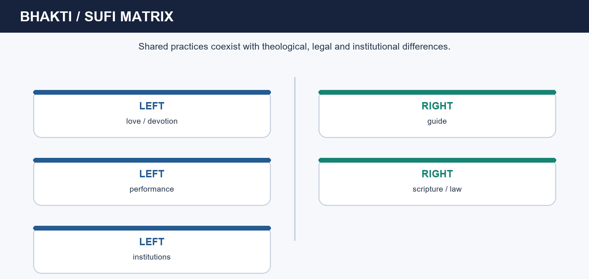

*Bhakti-Sufi overlap and difference matrix*

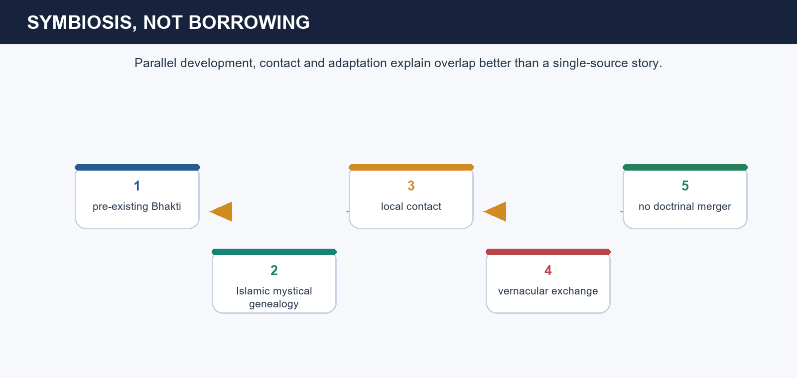

*Symbiosis rather than one-way borrowing*

[FACT] Both currents could value love, remembrance, a guide-disciple relation, vernacular or Hindavi-regional idioms, music or performance and criticism of empty ritual. The advanced owner nevertheless insists that reaction and borrowing theories are insufficient: south Indian Bhakti predates major north Indian Sufi networks, while early Sufi love, fana and scriptural self-understanding belong to an Islamic intellectual history independent of Bhakti roots. Institutions also differ: silsilah-khanqah-dargah are not interchangeable with temple-matha-panth-sangat formations.

[ANALYSIS] Symbiosis is therefore the most defensible frame. Medieval India created shared urban, pilgrimage, artisan and linguistic spaces in which traditions could notice and intensify comparable vocabularies—love, humility, inwardness, critique of ritualism—without becoming identical. This is why overlap must be written as shared or parallel features rather than as proof that one tradition simply copied the other. The same caution also guards against isolationism: difference does not mean no contact.

[LIMIT] Syncretism is not an answer unless it is unpacked with named evidence. Similar music, devotion or teacher-disciple structures do not cancel differences in incarnation, prophecy, scripture, law, lineage authority or institutional form.

#### Analytical drill

**Question:** Why does this session matter analytically in a UPSC answer?

**How to use it:** Open with overlap, then name an institutional or theological boundary, and conclude with symbiosis rather than merger.

#### PARAGRAPH DEMONSTRATION — CLAIM → EVIDENCE → ANALYSIS → QUALIFICATION

**Claim:** Bhakti and Sufi traditions are best understood through real contact inside shared social spaces plus continued theological and institutional difference.

**Named evidence / example:** Alvar-Nayanar roots and early Sufi genealogy block one-way borrowing; vernacular performance, Chishti hospitality and Bhakti song explain the overlap.

**Analysis:** The argument becomes strong because it preserves both reciprocity and boundary.

**Qualification:** Shared ethical vocabulary is not a licence to erase scripture, law, doctrine or institutional difference.

#### MUST-WRITE KEYWORDS

- **symbiosis**
- **parallel exchange**
- **shared vocabulary**
- **independent roots**
- **institutional difference**
- **theological boundary**

**How to use them:** Open with overlap, then name an institutional or theological boundary, and conclude with symbiosis rather than merger.

#### CLOSING RECALL FLOW
```closure-flow
START / CONCEPT: Bhakti and Sufi histories overlapped in language, devotion and performance, but they never became one theology or one institution.
KEY TERMS / DEFINITIONS: symbiosis · parallel exchange · shared vocabulary · independent roots · institutional difference · theological boundary
MECHANISM / ARGUMENT: The safest comparative word is symbiosis or parallel exchange backed by named evidence, not a free-floating syncretism slogan.
CONSEQUENCE / CONTRAST: Contact is real, but identical theology is not.
UPSC TRAP / ANSWER-USE: Do not write that Bhakti was simply a response to Islam or that all Bhakti saints were Sufis in another language.
ANSWER-GRABBING FORMULATION: A high-quality comparison must state both the overlap and the boundary.
```

### SESSION 13 — HISTORIOGRAPHY, SOCIAL-PROTEST DEBATE AND SOURCE TRIANGULATION

**Plain-language definition:** Historiography on Bhakti-Sufi movements depends on source triangulation across hagiography, malfuzat, Janamsakhi traditions and social-protest debate.

**Technical definition:** Hagiography, oral verse, malfuzat, Janamsakhis, inscriptions, endowment records and architecture each establish different levels of historical fact.

#### ANSWER-GRABBING OPENING
> Historiography is strongest when it tests reaction theory, borrowing theory and social-revolution claims against sources rather than repeating labels.


*Source criticism for devotional history*

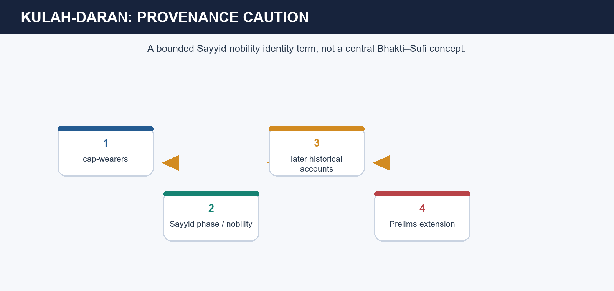

*Bounded caution around unusual routed terms*

[FACT] The canonical basic owner lays out a full source matrix: hagiographies and saint-lives preserve ideals and remembered lineages; attributed poems and hymns preserve devotional vocabulary but may have layered authorship; malfuzat such as Fawa'id al-Fu'ad preserve Sufi conversation under compiler mediation; Janamsakhis preserve early Sikh memory but vary across recensions; inscriptions and endowment records show patrons and sites; shrines, temples, mathas and sattras show institutionalisation but not private motives. The same owner rejects three oversimplifications: Bhakti as a mere reaction to Islam, Bhakti as borrowed Sufism and Bhakti-Sufi movements as total social revolutions.

[ANALYSIS] This source discipline clarifies the social-protest debate. Kabir or Ravidas can certainly be used for caste criticism and dignity, but the evidence more securely proves a climate of opinion and remembered challenge than immediate institutional equality everywhere. Likewise, unusual routed terms such as Kulah-Daran should remain bounded, provenance-cautious extensions rather than central explanatory engines of Bhakti-Sufi history. Historiography, then, is not an optional appendix: it tells us what kind of claim a source can support.

[LIMIT] Source criticism should not become sterile scepticism. If every hagiography is dismissed as fiction and every oral corpus as unusable, the topic itself becomes unreadable. The goal is triangulation, not cynicism.

#### Analytical drill

**Question:** Why does this session matter analytically in a UPSC answer?

**How to use it:** Explain the source type, state what it establishes, state what it cannot establish, and then place the historian's debate around that evidence.

#### PARAGRAPH DEMONSTRATION — CLAIM → EVIDENCE → ANALYSIS → QUALIFICATION

**Claim:** Bhakti-Sufi historiography works best through named source-type limits rather than through one grand label.

**Named evidence / example:** Reaction, borrowing and social-protest theses all capture something, but each must be tested against chronology, institution and source provenance.

**Analysis:** This is how a historian preserves devotional memory as evidence without treating it as literal census or verbatim transcript.

**Qualification:** Triangulation protects significance and limit at the same time.

#### MUST-WRITE KEYWORDS

- **hagiography**
- **malfuzat**
- **Janamsakhi**
- **social protest**
- **triangulation**
- **Kulah-Daran**

**How to use them:** Use hagiography, malfuzat, Janamsakhi, social protest, triangulation and Kulah-Daran by stating what each source or debate can and cannot establish.

#### CLOSING RECALL FLOW
```closure-flow
START / CONCEPT: The biggest interpretive mistakes on this topic come from treating memory, miracle and later canon as if they were transparent archive entries.
KEY TERMS / DEFINITIONS: hagiography · malfuzat · Janamsakhi · social protest · triangulation · Kulah-Daran
MECHANISM / ARGUMENT: Hagiography, oral verse, malfuzat, Janamsakhis, inscriptions, endowment records and architecture each establish different levels of historical fact.
CONSEQUENCE / CONTRAST: Source caution is not the same thing as source dismissal.
UPSC TRAP / ANSWER-USE: Do not use one miracle narrative, one shrine practice or one routed odd term as if it were sufficient proof of social reach, chronology or institutional identity.
ANSWER-GRABBING FORMULATION: Historiography is strongest when it tests reaction theory, borrowing theory and social-revolution claims against sources rather than repeating labels.
```

### SESSION 14 — KHANQAH ECONOMY, STATE POWER, CONVERSION AND SHRINE FORMATION

**Plain-language definition:** Khanqah economy, state power, conversion and shrine formation show the material-institutional history of devotional life.

**Technical definition:** State relation and conversion must be written as variable social processes, not as single-cause claims attached automatically to a saint's charisma.

#### ANSWER-GRABBING OPENING
> Use futuh-waqf, khanqah economy, dargah formation, state relation, multi-causal conversion and institutionalisation as one political-social spine.


*Khanqah network, succession and institutional growth*


*Final retrieval spine for PYQs and Mains*

[FACT] The canonical owner states that khanqahs required food, buildings, labour, books, disciples and hospitality. Resources could come from futuh, waqf, land grants, patrons and local networks; later shrines accumulated donations and architecture after a saint's death. Chishti distance from fixed office mattered ethically, but practice varied; Suhrawardi, Qadiri, Shattari and Naqshbandi relations with courts varied by centre, personality and reign. The same owner also insists that conversion cannot be assigned mainly to saints: settlement, marriage, patronage, mobility, persuasion, local conflict and community networks varied regionally.

[ANALYSIS] This gives the topic a political economy. A khanqah was not merely an inward retreat; it needed support and could become a nodal public institution. A dargah emerged through burial, succession, pilgrimage and patronage, which is why living shrine practice cannot simply be projected unchanged backward onto the founder's lifetime. Likewise, shared participation at shrines or in songs could create zones of interaction without proving identical theology or permanent harmony. Institutionalisation preserved teaching, but it could also reproduce hierarchy and hereditary control.

[LIMIT] Neither patronage nor refusal is morally self-explanatory. Royal contact does not prove collaboration in every policy; distance from office does not prove political irrelevance. Conversion, too, is a multi-causal regional process, not a one-line saint narrative.

#### Analytical drill

**Question:** Why does this session matter analytically in a UPSC answer?

**How to use it:** Explain one material term such as futuh or waqf, one institutional term such as dargah formation, and one caution about conversion or state relation.

#### PARAGRAPH DEMONSTRATION — CLAIM → EVIDENCE → ANALYSIS → QUALIFICATION

**Claim:** A strong final answer on Topic 10 must connect devotional authority to material support, institutional continuity and variable state relation.

**Named evidence / example:** Futuh, waqf, pilgrimage, succession, dargah formation and multi-causal conversion together show how saints and orders lived in society rather than above it.

**Analysis:** Once the material side of devotion is visible, shrine history, patronage and political context become analyzable without destroying spiritual history.

**Qualification:** Institutional growth preserved devotional memory, but it also introduced later layers of patronage, hierarchy and reinterpretation.

#### MUST-WRITE KEYWORDS

- **futuh-waqf**
- **khanqah economy**
- **dargah formation**
- **state relation**
- **multi-causal conversion**
- **institutionalisation**

**How to use them:** Use one material term such as futuh or waqf, one institutional term such as dargah formation, and one caution about conversion or state relation.

#### CLOSING RECALL FLOW
```closure-flow
START / CONCEPT: Devotional movements also had material and institutional lives: food, labour, gifts, patronage, buildings and succession all mattered.
KEY TERMS / DEFINITIONS: futuh-waqf · khanqah economy · dargah formation · state relation · multi-causal conversion · institutionalisation
MECHANISM / ARGUMENT: State relation and conversion must be written as variable social processes, not as single-cause claims attached automatically to a saint's charisma.
CONSEQUENCE / CONTRAST: Material support made institutions durable, but durability is not the same as doctrinal uniformity.
UPSC TRAP / ANSWER-USE: Do not say saints alone caused conversion or that current shrine ritual automatically reproduces the founder's exact medieval practice.
ANSWER-GRABBING FORMULATION: This session turns ethics and institutions into political-social history without reducing them to policy manuals.
```

## BASIC MCQS / REMEDIATION

#### Learning MCQ 1

Which opening definition is safest for this topic?

- A. Bhakti and Sufism were plural devotional fields with distinct genealogies and institutions.
- B. Bhakti and Sufi movements were two centrally governed medieval churches.
- C. Bhakti began only after the Delhi Sultanate.
- D. All Sufis in India followed one identical legal and musical practice.

**Answer: A**

**Explanation:** The correct answer preserves plurality and distinct genealogy; the closest distractor is the one-church formulation because it flatters comparison by erasing order, region and doctrine.

#### Learning MCQ 2

What does fana most safely denote in Sufi vocabulary?

- A. A fixed revenue grant under the Sultanate.
- B. The passing away of egocentric selfhood before God.
- C. A later Sikh military institution.
- D. A Tamil temple office.

**Answer: B**

**Explanation:** The correct answer keeps fana within mystical vocabulary; the closest distractor is the fiscal reading because it treats a spiritual concept as an administrative term.

#### Learning MCQ 3

Which statement about ba-shara and be-shara is correct?

- A. They classify all Bhakti communities into saguna and nirguna streams.
- B. They are names for two Delhi capitals.
- C. They distinguish law-bound orders from non-law-bound wandering tendencies.
- D. They mean shrine and temple respectively.

**Answer: C**

**Explanation:** The correct answer identifies a legal-normative Sufi distinction; the closest distractor is the saguna-nirguna option because it imports a Bhakti classification into a Sufi frame.

#### Learning MCQ 4

Why did the Chishti khanqah become socially influential?

- A. Because it worked mainly as a royal military office.
- B. Because every visitor necessarily converted there.
- C. Because it abolished all hierarchy by law.
- D. Because hospitality, counsel, sama and relative court distance produced moral credibility.

**Answer: D**

**Explanation:** The correct answer gives a mechanism-based explanation; the closest distractor is the conversion claim because it mistakes social reach for a centrally planned conversion programme.

#### Learning MCQ 5

Which pairing is accurate?

- A. Bahauddin Zakariya - Multan - Suhrawardi.
- B. Madhva - Ajmer - Chishti.
- C. Nizamuddin Auliya - Udupi - Dvaita.
- D. Ramanuja - Delhi - Naqshbandi.

**Answer: A**

**Explanation:** The correct pairing names order, centre and figure together; the closest distractor is the Nizamuddin option because it mixes a real saint with the wrong geography and tradition.

#### Learning MCQ 6

What is the safest statement about yogic contact in Sufi history?

- A. One breathing practice proves Sufism originated in yoga.
- B. Borrowed practice can show contact without proving total doctrinal derivation.
- C. All Sufis rejected every local technique automatically.
- D. Yogic interaction means Islamic genealogy disappeared.

**Answer: B**

**Explanation:** The correct answer preserves contact and limit together; the closest distractor is the origin claim because it mistakes one technique for total derivation.

#### Learning MCQ 7

Which statement best preserves Bhakti's southern roots?

- A. Bhakti first appeared only with Kabir.
- B. The Alvars were Suhrawardi jurists at Multan.
- C. Alvars and Nayanars show that devotional poetry predates the Sultanate-centred northern story.
- D. Nayanars were later Sikh military institutions.

**Answer: C**

**Explanation:** The correct answer secures the long chronology; the closest distractor is the Kabir-first claim because it ignores the Tamil devotional archive.

#### Learning MCQ 8

Which doctrinal triad is correct?

- A. Ramanuja - Dvaita; Nimbarka - Advaita; Madhva - Sufism.
- B. Ramanuja - Qadiri; Nimbarka - Chishti; Madhva - Naqshbandi.
- C. Ramanuja - be-shara; Nimbarka - ba-shara; Madhva - sama.
- D. Ramanuja - Vishishtadvaita; Nimbarka - Dvaitadvaita/Bhedabheda; Madhva - Dvaita.

**Answer: D**

**Explanation:** The correct answer distinguishes major Vaishnava doctrinal grammars; the closest distractor is the Advaita/Dvaita scramble because it uses philosophical labels but assigns them wrongly.

#### Learning MCQ 9

How should Ramananda's disciple traditions be used?

- A. As tradition showing widened access, while exact genealogies remain hagiographically mediated.
- B. As a dated attendance register with total chronological certainty.
- C. As proof that every northern saint was fictitious.
- D. As evidence that Bhakti had no caste-crossing appeal.

**Answer: A**

**Explanation:** The correct answer keeps significance and caution together; the closest distractor is the attendance-register claim because it mistakes hagiographic memory for archive certainty.

#### Learning MCQ 10

What is the safest description of Kabir?

- A. A Mughal-era disciple of Ahmad Sirhindi.
- B. A devotional critic of ritual and caste pride whose layered corpus requires source caution.
- C. A court minister who abolished caste by law.
- D. A temple theologian who praised pilgrimage as sufficient salvation.

**Answer: B**

**Explanation:** The correct answer preserves Kabir's critique and corpus problem together; the closest distractor is the Sirhindi link because it fails chronology.

#### Learning MCQ 11

What is distinctive about Guru Nanak's remembered teaching?

- A. Household life contaminates devotion.
- B. Later Sikh institutions were already complete in his lifetime.
- C. Work, sharing and household discipline were joined to devotion and ethical character.
- D. Court office became the only spiritual path.

**Answer: C**

**Explanation:** The correct answer identifies the householder ethic; the closest distractor is the later-institutions claim because it collapses later Sikh history back into the founder's lifetime.

#### Learning MCQ 12

Why does Chaitanya matter to the 2018 GS-I demand?

- A. He invented Bhakti from nothing.
- B. He founded the Suhrawardi order in Bengal.
- C. He abolished every temple-based tradition by decree.
- D. He reoriented one major Bhakti stream through public Krishna kirtan and affective participation.

**Answer: D**

**Explanation:** The correct answer defines reorientation through mode and public performance; the closest distractor is the invented-Bhakti claim because it ignores earlier devotional roots.

#### Learning MCQ 13

Which pair best captures regional institutional variation inside Bhakti?

- A. Shankaradeva - namghar and sattra.
- B. Hallaj - Ajmer khanqah.
- C. Baqi Billah - Ramcharitmanas.
- D. Baba Farid - Udupi matha.

**Answer: A**

**Explanation:** The correct answer links a figure to Assamese devotional institution; the closest distractor is the Hallaj option because it mixes an early Sufi figure with a later Indian Chishti setting.

#### Learning MCQ 14

How should saguna and nirguna be used?

- A. As airtight political parties with fixed medieval membership lists.
- B. As analytical tendencies that still require named saints, practices and institutions.
- C. As a division between Hindus and Muslims.
- D. As a chronology before and after 1526.

**Answer: B**

**Explanation:** The correct answer preserves analytic usefulness without false rigidity; the closest distractor is the party model because it gives them an organisational precision they do not have.

#### Learning MCQ 15

Which formulation best captures Bhakti-Sufi comparison?

- A. Total merger into one medieval religion.
- B. No contact of any kind across traditions.
- C. Symbiosis or parallel exchange with named overlap and named difference.
- D. Bhakti simply copied Sufism.

**Answer: C**

**Explanation:** The correct answer keeps overlap and boundary together; the closest distractor is the borrowing claim because it suppresses independent roots and institutional difference.

#### Learning MCQ 16

What is the best source-method rule for this topic?

- A. Arab merchants
- B. Qalandars
- C. Sayyids
- D. Persian calligraphists

**Answer: D**

**Explanation:** The correct answer defines triangulation; the closest distractor is the court-chronicle absolutism because it discards the very devotional sources that make the topic recoverable.

## PYQS AND ANSWER PRACTICE

### Part I — Solved locally available UPSC Prelims PYQs

#### Routed PYQ 1 — UPSC Prelims GS-I 2019 Q13

**Exact locally preserved question (Series BKL-F-GHP):** Consider the following statements:

1. Saint Nimbarka was a contemporary of Akbar.  
2. Saint Kabir was greatly influenced by Shaikh Ahmad Sirhindi.

Which of the statements given above is/are correct?

- A. 1 only
- B. 2 only
- C. Both 1 and 2
- D. Neither 1 nor 2

**Inferred answer — not officially verified locally:** **D. Neither 1 nor 2.** The official 2019 Prelims key is unavailable in the local repository, so the answer remains honestly inferred. Statement 1 fails because the source-owned secure route for Nimbarka is doctrinal rather than Akbar-era chronology; statement 2 fails because Kabir belongs to the fifteenth-century devotional field, while Ahmad Sirhindi belongs to a later Naqshbandi-Mughal debate.

**Demand decoding:** This is an objective chronology-and-association item. The task is to test each statement independently, not to guess from a familiar saint's name.

**Executable elimination plan:** Reject statement 1 through doctrine-plus-broad chronology rather than through a fabricated exact birth year; reject statement 2 because the influence claim reverses chronology and confuses Kabir with a much later Sirhindi context.

**Why this route earns marks:** It solves each statement on its own evidence base and preserves the repository's honesty rule about unheld official Prelims keys.

**How to strengthen this route:** Add one secure doctrinal hook for Nimbarka—Dvaitadvaita/Bhedabheda with Radha-Krishna devotion—so chronology is supported by owned conceptual evidence, not by memory of a disputed date.

#### Routed PYQ 2 — UPSC Prelims GS-I 2022 Q58

**Exact locally preserved question (Series VGYH-U-FGT):** With reference to Indian history, who of the following were known as "Kulah-Daran"?

- A. Arab merchants
- B. Qalandars
- C. Persian calligraphists
- D. Sayyids

**Inferred answer — not officially verified locally:** **D. Sayyids.** The local question-booklet text is readable, but the official 2022 Prelims key is unavailable locally. The repository's owned route identifies Kulah-Daran as a bounded Sayyid-nobility term in later Sultanate historical usage and explicitly warns against overextending its provenance.

**Demand decoding:** This is a one-fact bounded-identity item. The route is to recall the specific provenance-sensitive association while resisting plausible medieval distractors.

**Executable elimination plan:** Hold onto the one verified association—Sayyid-nobility usage—and discard Arab merchants, Qalandars and Persian calligraphists as historically plausible but source-unowned for this term.

**Why this route earns marks:** It treats Kulah-Daran as a narrow routed bridge instead of turning it into a generic medieval label or a central Bhakti-Sufi category.

**How to strengthen this route:** State explicitly that the term is preserved only as a bounded Topic-06 bridge with provenance caution; that protects against overclaiming primary-source certainty.

### Part II — Solved routed UPSC Mains PYQs

#### Routed PYQ 3 — UPSC Mains GS-I 2018 Q11 — Discuss — 15 marks — 250 words

**Exact locally verified wording:** "The Bhakti movement received a remarkable re-orientation with the advent of Sri Chaitanya Mahaprabhu. Discuss. (Answer in 250 words)"

**Model solution**

Sri Chaitanya Mahaprabhu (1486–1533) did not create Bhakti, whose Tamil, Vaishnava and Vedanta roots predated him. He nevertheless reoriented a major stream of it in Bengal and Puri by making Krishna devotion intensely affective, collective and publicly performed.

His most visible mechanism was kirtan. Collective singing, movement and remembrance turned devotion into a public performance rather than only a private or scholastic exercise. In Bengal-Puri settings this widened participation through sound, rhythm and shared memory, and linked devotional practice to pilgrimage and regional community life.

Chaitanya also intensified the emotional grammar of Krishna-bhakti: longing, surrender and ecstatic love became embodied public experience rather than only doctrine. This helped energise literary and performative repertoires around Krishna devotion.

Yet re-orientation does not mean origin. Earlier Alvar-Nayanar traditions, Ramanuja and other Vaishnava paths clearly predate Chaitanya. Nor should public accessibility be inflated into complete social revolution. Caste, gender and institutional mediation persisted.

Chaitanya's contribution was therefore a change in mode: public, affective, Krishna-centred and performative devotion acquired exceptional force. Its cultural reach was large, but it remained one major stream inside a still-plural Bhakti field.

**Demand decoding:** The directive discuss requires a defended position on what exactly was reoriented—mode, public reach and emotional register—not a biography of Chaitanya.

**Executable answer/compression plan:** Open by denying an origin myth, then organise the body as kirtan-public participation -> Krishna-centred affect -> Bengal-Puri setting -> limit on social revolution -> concluding definition of reorientation.

**Why this earns marks:** It answers the operative word re-orientation, uses Bengal, Puri, Krishna devotion and kirtan as named evidence, and closes with the required plurality-limit qualification.

**How to improve this answer:** Add one brief contrast with an earlier devotional stream—such as Alvar-Nayanar roots or Ramanuja's prapatti—to sharpen why Chaitanya is reorientation rather than origin.

#### Routed PYQ 4 — UPSC Mains GS-I 2021 Q1 — Evaluate — 10 marks — 150 words

**Exact locally verified wording:** "Evaluate the nature of the Bhakti literature and its contribution to Indian culture. (Answer in 150 words)"

**Model solution**

Bhakti literature was devotional, lyrical, performative and regional rather than one single canon. Tamil Alvar and Nayanar hymns supplied early southern foundations; later major streams included Tulsidas's Ramcharitmanas in Awadhi, Surdas's Krishna lyric in Braj, Mirabai's Rajasthani-Hindi voice, Eknath and Tukaram in Marathi, Narsinha Mehta in Gujarati, and Shankaradeva's Assamese devotional world.

Its greatest cultural contribution was vernacularisation. Regional speech, song, recitation, pilgrimage and memory made devotion emotionally accessible beyond narrow scholastic circles. Bhakti literature enriched languages, widened poetic repertoires of love and surrender, and generated durable performance traditions.

Yet popular should not be romanticised. Literary visibility does not prove universal literacy, complete caste equality or universal female emancipation. Bhakti literature therefore contributed most by deepening overlapping regional cultural worlds rather than by creating one homogeneous national culture.

**Demand decoding:** The directive evaluate requires separate judgment on both nature and contribution, plus a limit on overstatement.

**Executable answer/compression plan:** Define the literature's nature in one line, give three to four language-author examples, explain vernacularisation as mechanism, and end with one concise caution about hierarchy and homogenisation.

**Why this earns marks:** It evaluates instead of merely listing, uses named texts-languages, and supplies a calibrated qualification rather than an inflated civilisational slogan.

**How to improve this answer:** Add one institutional mechanism—kirtan, pilgrimage, namghar-sattra or manuscript-memory circulation—to show how literature moved socially, not only linguistically.

### Part III — Original solved Mains practice

#### Original Mains 1 — Discuss the Chishti order's social popularity in the Delhi Sultanate. (10 marks; 150 words)

**Model solution**

The Chishti order became socially influential because its ethics and institutions made devotion credible in everyday urban life. Muinuddin Chishti's Ajmer legacy, Bakhtiyar Kaki's Delhi presence, Baba Farid's Ajodhan association and Nizamuddin Auliya's Delhi khanqah supplied a remembered network rather than a court-backed bureaucracy.

Poverty, humility and relative distance from office gave the order moral authority. The khanqah offered hospitality, counsel and a space in which disciples and visitors could gather; service was therefore institutional as well as ethical. Sama and local-language contact made participation emotionally accessible. Nizamuddin's lasting popularity through Delhi's political change illustrates the value of social credibility not tied to one ruler.

Yet this should not be made a conversion-machine narrative. Chishti appeal rested on service, devotional performance and moral reputation while theological and institutional boundaries remained.

**Demand decoding:** The directive discuss requires a clear thesis on why popularity emerged and evidence on the mechanisms that made it durable.

**Executable answer/compression plan:** Use a one-line thesis, then move through network (Ajmer-Delhi-Ajodhan) -> khanqah service -> sama-local language -> qualification against conversion-machine and total apoliticism.

**Why this earns marks:** It directly explains popularity, names concrete centres and saints, and qualifies the answer twice without losing focus.

**How to improve this answer:** Add one explicit phrase about relative court distance so the political posture is named rather than left implicit.

#### Original Mains 2 — Compare Chishti and Suhrawardi approaches to wealth and political authority. (10 marks; 150 words)

**Model solution**

Chishti and Suhrawardi Sufis shared an Islamic mystical vocabulary, but their institutional postures toward resources and rulers differed. Chishti centres associated with Muinuddin, Baba Farid and Nizamuddin Auliya stressed simplicity, service and relative distance from office, which could generate popular credibility.

The Suhrawardi order, associated with Bahauddin Zakariya and Multan-Punjab, accepted grants and state connection more readily; some members could hold official positions. Such links supplied resources, learned authority and regional influence rather than automatically proving spiritual compromise.

The contrast is therefore not pure versus corrupt. Chishti distance was a tendency, not total isolation; Suhrawardi resource links were not identical everywhere. The better comparison is institutional: Sufi authority could be organised through different bargains between ethical prestige, material support and political proximity.

**Demand decoding:** The directive compare requires both similarity and difference, organised around wealth and political authority rather than around saintly morality.

**Executable answer/compression plan:** Begin with shared mystical frame, then compare Chishti service-distance with Suhrawardi grants-office, and conclude by rejecting a moral binary.

**Why this earns marks:** It compares on the exact two axes named in the question, uses Bahauddin Zakariya as evidence, and turns the answer into institutional analysis.

**How to improve this answer:** Add one geographical contrast—Ajmer-Delhi-Ajodhan versus Multan-Punjab—to make the institutional comparison spatially sharper.

#### Original Mains 3 — Examine the social promise and structural limits of Kabir's critique. (15 marks; 250 words)

**Model solution**

Kabir's remembered corpus offered a sharp ethical challenge to inherited spiritual privilege, but its historical effect is best understood as a climate of opinion rather than as an immediate structural revolution.

Kabir's one-God language undermined claims that caste pedigree, pilgrimage, ritual display or sectarian externalism automatically guaranteed truth. His insistence on the true guru and inward transformation addressed both Hindu and Muslim formalism. In town, craft and devotional settings such language could dignify people outside elite ritual expertise and widen the moral language of equality.

At the same time, Kabir must be read through a layered corpus. Verses circulated orally and were written down later in varying collections. This transmission preserves enduring themes—one God, ritual critique, caste criticism—but requires caution about exact wording, authorship and genealogy. The historian can use the remembered thrust securely while refusing false autograph certainty.

The structural limit is equally important. Kabir was not a modern policy reformer. Caste practice, gender constraint and later sectarian institutionalisation persisted, and later Kabir panths had their own histories.

Kabir therefore expanded the moral imagination of equality and inward devotion. His force lies in destabilising spiritual justifications for status while reminding the historian that transformative language and transformed structure are not the same thing.

**Demand decoding:** The directive examine requires sustained attention to both sides of the proposition—promise and limit—rather than a one-sided praise answer.

**Executable answer/compression plan:** Thesis first; then promise through one-God and anti-ritual critique -> source-method paragraph on oral-later corpus -> structural limits -> final climate-of-opinion verdict.

**Why this earns marks:** It combines social analysis with source criticism, names the exact mechanism of Kabir's force, and ends with a balanced verdict instead of sloganising equality.

**How to improve this answer:** Add Ravidas or a later Kabir panth reference for one sentence if you want to show how remembered critique also generated later community formation.

#### Original Mains 4 — Analyse Guru Nanak's householder spirituality as a critique of ritualism and renunciation. (15 marks; 250 words)

**Model solution**

Guru Nanak's teaching made spiritual discipline compatible with ordinary ethical life. Its force lay not in rejecting devotion, but in rejecting the belief that ritual performance or withdrawal alone guaranteed spiritual worth.

Nanak stressed one God and the guru's guidance. This redirected attention from inherited status and empty ceremony to truthful conduct. His critique could address ritualism across community boundaries because the test was ethical and devotional authenticity rather than mere outward identity.

The householder path is the distinctive mechanism. Honest work, sharing and household responsibility became sites of discipline rather than obstacles to it. This dignified ordinary social life and differentiates Nanak from idealisations of complete renunciation. It also makes a useful comparison with Kabir: both criticise externalism, but Nanak more explicitly shapes an ethic of labour and shared household duty.

Historical caution is essential. Later Gurus, institutions, scripture formation and political history must not be projected fully back into Nanak's own moment. Nor did a devotional householder ethic automatically dissolve caste or gender hierarchy among all followers.

Nanak's contribution was thus a disciplined devotional humanism: inner truth was tested in work, relation and character. It widened spiritual access without making medieval social transformation complete.

**Demand decoding:** The directive analyse asks for the internal mechanism of Nanak's householder spirituality and its critical edge against ritualism and renunciation.

**Executable answer/compression plan:** Define the householder path in one line, then move through one God and guru -> work-sharing -> comparison with renunciation -> historical qualification about later Sikh development.

**Why this earns marks:** It explains Nanak's mechanism rather than merely praising him, compares carefully with Kabir, and blocks anachronism about later Sikh institutions.

**How to improve this answer:** Add the word sangat or langar once as an early community direction if you want one more institutional marker without collapsing later Sikh history backward.

#### Original Mains 5 — 'Bhakti and Sufism in medieval India are better understood as symbiosis than as borrowing.' Discuss. (20 marks; 250 words)

**Model solution**

The borrowing thesis is attractive because Bhakti and Sufi currents share love, inwardness, a guide-disciple relation, performance and ritual critique. It is nevertheless inadequate. Symbiosis better captures encounter and adaptation while preserving distinct genealogies, institutions and theologies.

Tamil Alvar-Nayanar traditions, Ramanuja's prapatti and other Vaishnava paths predate the major north Indian Sufi networks. Likewise Rabia's language of love, Hallaj's mystical controversy and al-Ghazali's reconciliation of mysticism with orthodoxy belong to an Islamic history independent of Bhakti roots. Neither field is a simple derivative of the other.

Yet contact in India was real. Chishti khanqahs at Ajmer, Ajodhan and Delhi created spaces of hospitality, counsel, sama and local-language interaction. Bhakti song, kirtan, pilgrimage and vernacular literature worked in the same broader social world of towns, shrines, artisans and regional publics. Kabir's one-God critique and Chaitanya's public kirtan show how different Bhakti streams could operate inside that shared social field.

Still, overlap is not identity. Silsilah, pir-murid authority, sharia-related classifications and khanqah-dargah institutions have no exact Bhakti equivalent. Bhakti includes divergent Vedanta doctrines, temple worlds, guru traditions and saguna-nirguna tendencies.

Symbiosis therefore means parallel development plus real exchange. It avoids both isolation and merger: shared vocabulary and practice could foster cultural rapprochement without abolishing theological or social boundaries.

**Demand decoding:** The directive discuss requires you to test the proposition, not merely endorse the word symbiosis as a slogan.

**Executable answer/compression plan:** Open by rejecting simple borrowing; organise the body as independent roots -> Indian contact zones -> boundaries that remain -> final graded verdict on symbiosis.

**Why this earns marks:** It presents evidence for both overlap and boundary, names saints, orders and institutions, and produces a defended conclusion rather than a vague synthetic phrase.

**How to improve this answer:** Add one institutional contrast—temple-matha-panth versus khanqah-dargah-silsilah—to make the non-merger point even more concrete.

#### Original Mains 6 — How should historians use hagiography and oral transmission in studying Bhakti and Sufi movements? (20 marks; 250 words)

**Model solution**

Hagiography and oral transmission are indispensable for Bhakti and Sufi history, but they must be read as structured memory rather than transparent biography. Their value lies in the questions they can answer; their limitation lies in the claims they cannot secure alone.

Saint-lives preserve ideals of humility, miracle, service, guru-disciple affinity and remembered community boundaries. Ramananda traditions, for example, illuminate an aspiration to wider devotional access even where exact disciple genealogies are uncertain. Chishti memories preserve the ethical reputation of figures such as Muinuddin and Nizamuddin and the social role of khanqahs.

Oral verse performs a similar service. Kabir's transmitted corpus preserves durable themes of one God, ritual critique and caste criticism, and Mirabai's remembered voice shows how devotion could become a gendered literary memory. Yet oral variation and later compilations mean precise authorship, wording and chronology require caution.

The historian must therefore triangulate. Malfuzat can illuminate khanqah teaching and milieu; inscriptions and endowment records can locate institutions; architecture and shrine landscapes can show presence and patronage; chronicles can expose elite context. None of these alone provides a census of belief or a verbatim transcript of origin.

The historian should neither dismiss devotional memory as fiction nor canonise it as literal fact. A layered reading reconstructs ideals, networks and cultural reach while marking uncertainty about dates, biographies and scale.

**Demand decoding:** The question is methodological: it asks what these sources can and cannot establish, and how a historian should combine them.

**Executable answer/compression plan:** Define hagiography-oral transmission -> what each can establish -> what each cannot secure -> triangulation with malfuzat-inscriptions-shrines-chronicles -> balanced methodological conclusion.

**Why this earns marks:** It answers method directly, names multiple source types, gives concrete devotional examples, and closes with a disciplined historian's rule rather than a saintly narrative.

**How to improve this answer:** Add one named text such as Fawa'id al-Fu'ad or one institutional marker such as Janamsakhi recensions if you want an even sharper example of mediated preservation.

## OPTIONAL ADVANCED DEPTH — NOT REQUIRED FOR A CORE ANSWER

### Advanced Anchor 1 — Metaphysical caution: wahdat al-wujud and wahdat al-shuhud

The topic source allows a bounded contrast between expansive unity-language and Sirhindi's later corrective. A safe UPSC move is to state that **wahdat al-wujud** is associated with metaphysical unity-language in the longer Sufi tradition, while Ahmad Sirhindi's **wahdat al-shuhud** pushes back toward disciplined perception and sharia-sensitive orthodoxy. Use this only to explain later Naqshbandi debate; do not drag Sirhindi backward into Kabir's century.

### Advanced Anchor 2 — Shattari-yogic contact without origin myth

Muhammad Ghawth and Shattari interactions show that medieval India could host technical exchange in breathing, posture or interior discipline. This is historically useful because it proves contact and translation-work. It is not proof that Indian Sufism simply originated in yoga or that Islamic genealogy ceased to matter.

### Advanced Anchor 3 — Vernacularisation as institution, not just language

A mature answer goes beyond saying Bhakti used local languages. It explains how text, song, pilgrimage, manuscript circulation, temple-sattra-namghar settings, household recitation and community performance created durable publics. That is why the 2021 literature PYQ is really about social circulation and cultural form, not merely about authors' names.

### Advanced Anchor 4 — Social protest: strongest as climate, weakest as instant revolution

The repository's methodological centre is clear: Bhakti and Sufi traditions can support arguments about dignity, critique of exclusion and lowered ritual monopoly, but the evidence is strongest for a changed **moral climate** rather than for immediate total structural revolution. This line is safer than either romantic celebration or cynical dismissal.

## CONSOLIDATED REGISTER NOTES

### One-page answer spine

- Open with plurality: Bhakti and Sufism were **plural devotional fields** with distinct roots, vocabularies and institutions.
- Protect chronology: Alvar-Nayanar roots predate the Sultanate-centred northern story; early Sufi mysticism predates Indian orders.
- Define Sufi vocabulary precisely: **fana, baqa, silsilah, pir-murid, khanqah, dargah, sama, ziyarat**.
- Use Chishti popularity causally: **service + hospitality + sama + relative distance from office**.
- Compare orders through **resources + state relation + discipline**, not through saintly morality alone.
- Keep Bhakti doctrinally plural: **Vishishtadvaita, Dvaitadvaita/Bhedabheda, Dvaita, Shuddhadvaita**.
- Use Ramananda traditions with **hagiographic caution**.
- For Kabir, write **one God + ritual critique + caste criticism + layered corpus + climate of opinion**.
- For Nanak, write **householder ethic + honest work + sharing + bounded continuity with later Sikh history**.
- For Chaitanya, write **public Krishna kirtan + Bengal-Puri + reorientation, not origin**.
- For Bhakti literature, write **vernacularisation + performance + regional publics + institutional circulation**.
- For comparison, prefer **symbiosis / parallel exchange** over crude borrowing or merger.
- For historiography, name source types and their limits: **hagiography, oral corpus, malfuzat, Janamsakhi, inscriptions, endowments, shrines, architecture**.
- For social significance, use **spiritual opening with structural limits**.
- For conversion and shrine questions, insist on **multi-causality** and later institutional layering.

### Mini comparison grid

| Theme | Bhakti | Sufi |
|---|---|---|
| Genealogy | Tamil roots, Vedanta, regional guru traditions | Wider Islamic mystical genealogy, then Indian silsilahs |
| Institution | temple, matha, panth, sattra, namghar, sangat | silsilah, khanqah, dargah, pir-murid chain |
| Accessibility mechanism | vernacular song, kirtan, pilgrimage, literature | hospitality, counsel, sama, shrine networks |
| Caution | not one philosophy; social equality incomplete | not one order; court relation varied |

### Prelims last-minute alerts

- Nimbarka: **Dvaitadvaita/Bhedabheda**; do not make him Akbar's contemporary.
- Kabir cannot be influenced by **Ahmad Sirhindi**; chronology fails.
- Chishti != Suhrawardi on political posture.
- Shattari contact with yoga != origin of Sufism in yoga.
- Kulah-Daran stays a **bounded routed term**; do not overextend it.
- Mirabai proves devotional agency, not universal emancipation.

### Mains closing sentence bank

- "Their deepest historical effect lay in widening devotional access and reshaping moral vocabularies without eliminating every social hierarchy."
- "The strongest interpretation is therefore one of contact, vernacularisation and institutional growth tempered by source criticism and structural caution."
- "Bhakti and Sufi histories intersected powerfully in medieval India, but they did so as overlapping traditions rather than as one merged theology."

