# Babur & the Central Asian Backdrop — Complete Topic Package

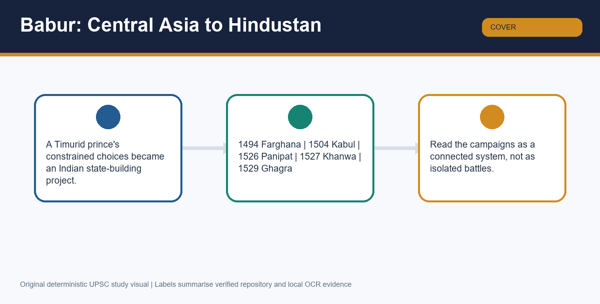

> **Subject:** Medieval History | **Topic:** 12 | **Export date:** 2026-09-20  
> **Approval:** false - awaiting explicit user approval.  
> **Sources audited first:** canonical Basic owner, canonical Advanced owner, local Topic 06 adjacent PYQ routes, official 2026 ledgers/papers, and the existing Topic 12 final-package artifacts.

## BASIC LEARNING SESSION

### SESSION 1 — TIMURID FRAGMENTATION AND THE STAKES OF SAMARQAND

#### DEFINITION / WHAT THIS IS CALLED

**Plain-language definition:** Timurid fragmentation meant repeated princely competition for prestige-rich cities such as Samarqand, not the disappearance of political order in Central Asia.

**Technical definition:** For Topic 12, the Central Asian backdrop begins with the mismatch between Timurid legitimacy and the unstable fiscal-military base needed to hold Samarqand.

#### ANSWER-GRABBING OPENING — WRITE/ADAPT IN THE EXAM

> Babur reached India not because Central Asia vanished, but because Samarqand's prestige could not be converted into durable rule.

#### MUST-WRITE KEYWORDS

- **Timurids**
- **fragmentation**
- **Samarqand**
- **prestige**
- **resource base**

**How to use them:** Open with Timurid fragmentation, link Samarqand to legitimacy plus revenue, and then show why symbolic possession without supplies kept Babur politically exposed.

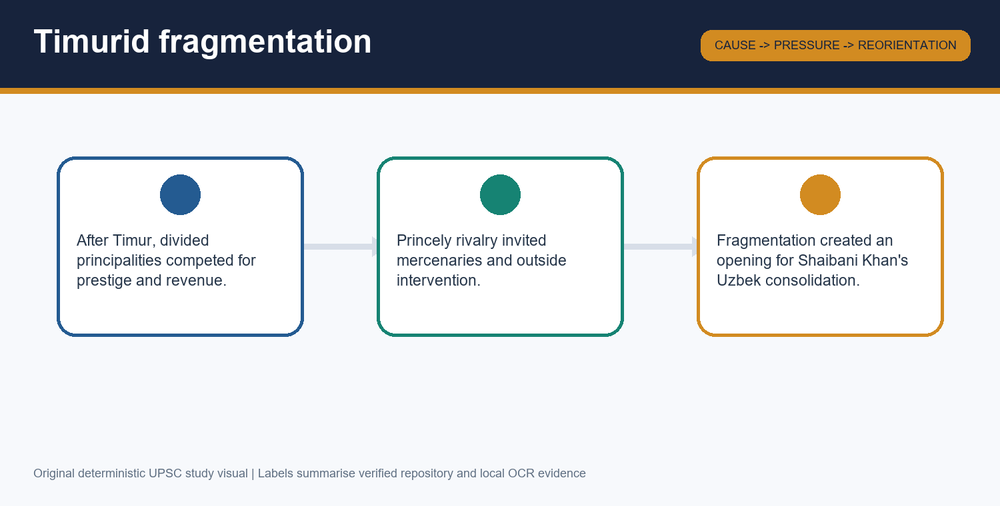

*Visual 1. Fragmentation narrowed Babur's options but did not mechanically predetermine conquest.*

After Timur's death and the fading of Shahrukh's integrative authority, Timurid power broke into rival principalities. Samarqand still carried dynastic prestige, urban wealth, gardens and trade. That is why Babur's repeated struggle for the city cannot be reduced to biography or nostalgia.

The key point is analytical: a famous city could advertise legitimacy, but it did not by itself guarantee grain, loyal begs, a secure hinterland or a lasting army. Topic 12 therefore begins with a prestige-versus-resources problem rather than with an India-centred conquest story.

#### PARAGRAPH DEMONSTRATION — CLAIM → EVIDENCE → ANALYSIS → QUALIFICATION

A strong paragraph can argue that Babur's later Indian turn was rooted in the failure of Timurid prestige to produce stable sovereignty. Samarqand is the named evidence: it was captured, lost, and repeatedly contested because dynastic aura alone could not hold followers and territory. That evidence matters because it shows why a claimant needed more than an illustrious capital. Yet the qualification is essential: fragmentation did not create chaos everywhere; it created competitive spaces in which only a better-grounded ruler could endure.

**UPSC trap:** Do not write that fragmentation means total collapse; the safer line is competitive instability within a still-recognisable political field.

**Mains angle:** Why did Samarqand matter so much to Babur, and why did it still fail to secure him?

**Study link:** connect this session to Topic 06 only for late-Sultanate north-west vulnerability, not for Babur's full story.

#### CLOSING RECALL FLOW — TIMURID FRAGMENTATION AND THE STAKES OF SAMARQAND

```text
START / CONCEPT: Timurid Fragmentation And The Stakes Of Samarqand
    |
    v
EXACT TERMS: Timurids · fragmentation · Samarqand · prestige · resource base
    |
    v
MECHANISM / ARGUMENT: After Timur's death and the fading of Shahrukh's integrative authority, Timurid power broke into rival principalities. Samarqand still carried dynastic prestige, urban wealth, gardens and trade. That is why Babur's repeated struggle for the city cannot be reduced to biography or nostalgia.
    |
    v
CONSEQUENCE / CONTRAST: A strong paragraph can argue that Babur's later Indian turn was rooted in the failure of Timurid prestige to produce stable sovereignty.
    |
    v
UPSC TRAP / ANSWER-USE: Do not write that fragmentation means total collapse; the safer line is competitive instability within a still-recognisable political field.
    |
    v
ANSWER-GRABBING FORMULATION: Babur reached India not because Central Asia vanished, but because Samarqand's prestige could not be converted into durable rule.
```

### SESSION 2 — GENEALOGY, IDENTITY AND THE CAUTION AROUND “MUGHAL”

#### DEFINITION / WHAT THIS IS CALLED

**Plain-language definition:** The label “Mughal” is historically useful, but by itself it hides the layered Timurid, Chagatai, Turco-Mongol and Persianate strands in Babur's inheritance.

**Technical definition:** Babur's legitimacy combined paternal Timurid descent, maternal Chagatai-Chingizid association, Chagatai-Turkic literary culture and Persianate court practice.

#### ANSWER-GRABBING OPENING — WRITE/ADAPT IN THE EXAM

> A good answer treats “Mughal” as a dynastic shorthand, not as a racial explanation.

#### MUST-WRITE KEYWORDS

- **Timurid descent**
- **Chagatai**
- **Persianate court**
- **Mughal label**
- **legitimacy**

**How to use them:** Use the label carefully: start with Timurid descent, add Chagatai association, and finish by showing why political legitimacy is more important than ethnicity-language guesses.

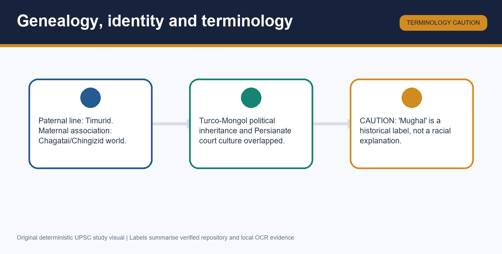

*Visual 2. Babur's identity is dynastic and political before it is a modern ethnic category.*

Babur's father connected him to Timur, while his maternal line linked him to the Chagatai-Chingizid world. Chagatai Turkish was the language of his memoir, and Persianate literary-courtly norms shaped the wider environment in which he ruled. The later Indian label “Mughal” sits over this composite inheritance.

This matters because many weak answers flatten genealogy into blood identity. The topic instead wants legitimacy, court idiom, political vocabulary and literary medium.

#### PARAGRAPH DEMONSTRATION — CLAIM → EVIDENCE → ANALYSIS → QUALIFICATION

An examiner-grade paragraph can claim that Babur's genealogy mattered as political capital rather than as a biological certificate. The evidence is named and layered: Timurid descent raised dynastic status, Chagatai-Chingizid links widened prestige, and Chagatai Turkish plus Persianate culture shaped his self-presentation. The analysis follows from this overlap: legitimacy in Central Asia and India worked through recognised lineages and court practice. The qualification is that no single label, including “Mughal”, exhausts that inheritance.

**UPSC trap:** Avoid saying Babur was simply “a Mongol ruler”; that erases Timurid dynastic prestige and Persianate court culture.

**Mains angle:** How should UPSC answers explain Babur's identity without importing modern racial language?

**Study link:** pair this with Session 12 on the Baburnama, because language and legitimacy appear together there.

#### CLOSING RECALL FLOW — GENEALOGY, IDENTITY AND THE CAUTION AROUND “MUGHAL”

```text
START / CONCEPT: Genealogy, Identity And The Caution Around “Mughal”
    |
    v
EXACT TERMS: Timurid descent · Chagatai · Persianate court · Mughal label · legitimacy
    |
    v
MECHANISM / ARGUMENT: Babur's father connected him to Timur, while his maternal line linked him to the Chagatai-Chingizid world. Chagatai Turkish was the language of his memoir, and Persianate literary-courtly norms shaped the wider environment in which he ruled. The later Indian label “Mughal” sits over this composite inheritance.
    |
    v
CONSEQUENCE / CONTRAST: An examiner-grade paragraph can claim that Babur's genealogy mattered as political capital rather than as a biological certificate.
    |
    v
UPSC TRAP / ANSWER-USE: Avoid saying Babur was simply “a Mongol ruler”; that erases Timurid dynastic prestige and Persianate court culture.
    |
    v
ANSWER-GRABBING FORMULATION: A good answer treats “Mughal” as a dynastic shorthand, not as a racial explanation.
```

### SESSION 3 — FARGHANA, SHAYBANI KHAN AND THE SAMARQAND CYCLE

#### DEFINITION / WHAT THIS IS CALLED

**Plain-language definition:** Babur's early career in Farghana and Samarqand shows repeated capture without durable retention, especially after Shaybani Khan consolidated Uzbek power.

**Technical definition:** The Samarqand cycle is the sequence in which dynastic success, coalition weakness and Uzbek military pressure repeatedly exposed Babur's lack of a stable autonomous base.

#### ANSWER-GRABBING OPENING — WRITE/ADAPT IN THE EXAM

> The Samarqand cycle is important because it taught Babur the political cost of prestige without resources.

#### MUST-WRITE KEYWORDS

- **Farghana**
- **Shaybani Khan**
- **Samarqand cycle**
- **Sar-i-Pul**
- **Uzbek pressure**

**How to use them:** Mention Farghana first, then Shaybani Khan, and use Sar-i-Pul or repeated losses to show why experience in Central Asia became training as well as defeat.

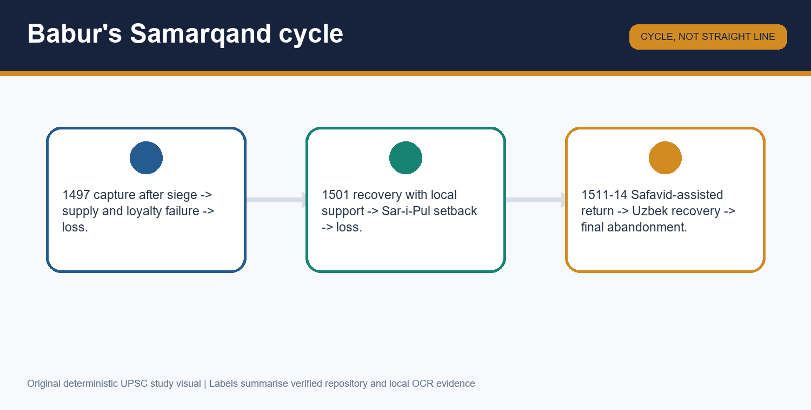

*Visual 3. Repeated gains and losses created learning, not merely humiliation.*

Babur inherited Farghana in 1494, captured Samarqand after a long siege, lost it, regained it briefly, and then faced renewed defeat. The decisive pressure came from Muhammad Shaybani Khan's Uzbek consolidation, which reduced the room available to scattered Timurid claimants.

The sources also remember Sar-i-Pul and wheeling tactics associated with the Uzbek theatre. Whether or not every later tactical detail can be traced mechanically, Babur clearly learnt in a Central Asian environment of mobile cavalry, unstable alliances and hard logistical limits.

#### PARAGRAPH DEMONSTRATION — CLAIM → EVIDENCE → ANALYSIS → QUALIFICATION

A high-scoring paragraph can claim that Babur's Central Asian failures were educational as well as exclusionary. Farghana, Samarqand and Shaybani Khan are the named evidence, because each episode shows how siege success could collapse without supplies and dependable followers. That analysis explains why India later appeared as a solution to an already diagnosed problem. The qualification is that Babur did not emotionally abandon Central Asia in one stroke; Safavid openings later drew him back again.

**UPSC trap:** Do not say Babur “gave up” Central Asia in 1504; priority shifted under pressure, but Transoxiana remained politically meaningful.

**Mains angle:** Explain how the Samarqand cycle shaped Babur's later strategic imagination.

**Study link:** this session prepares the logic for Panipat without collapsing the story into artillery alone.

#### CLOSING RECALL FLOW — FARGHANA, SHAYBANI KHAN AND THE SAMARQAND CYCLE

```text
START / CONCEPT: Farghana, Shaybani Khan And The Samarqand Cycle
    |
    v
EXACT TERMS: Farghana · Shaybani Khan · Samarqand cycle · Sar-i-Pul · Uzbek pressure
    |
    v
MECHANISM / ARGUMENT: Babur inherited Farghana in 1494, captured Samarqand after a long siege, lost it, regained it briefly, and then faced renewed defeat. The decisive pressure came from Muhammad Shaybani Khan's Uzbek consolidation, which reduced the room available to scattered Timurid claimants.
    |
    v
CONSEQUENCE / CONTRAST: A high-scoring paragraph can claim that Babur's Central Asian failures were educational as well as exclusionary.
    |
    v
UPSC TRAP / ANSWER-USE: Do not say Babur “gave up” Central Asia in 1504; priority shifted under pressure, but Transoxiana remained politically meaningful.
    |
    v
ANSWER-GRABBING FORMULATION: The Samarqand cycle is important because it taught Babur the political cost of prestige without resources.
```

### SESSION 4 — UZBEKS, SAFAVIDS, CHALDIRAN AND THE REGIONAL BALANCE

#### DEFINITION / WHAT THIS IS CALLED

**Plain-language definition:** Babur's world was shaped by three major powers: the Shaybanid Uzbeks in Transoxiana, the Safavids in Iran and the Ottomans in western Asia.

**Technical definition:** The regional balance changed after Shah Ismail's victory over Shaybani near Merv in 1510 and the Ottoman victory at Chaldiran in 1514, but neither event automatically produced Panipat.

#### ANSWER-GRABBING OPENING — WRITE/ADAPT IN THE EXAM

> Write “regional balance constrained Babur's choices”, not “Chaldiran caused Panipat”.

#### MUST-WRITE KEYWORDS

- **Uzbeks**
- **Safavids**
- **Merv**
- **Chaldiran**
- **regional balance**

**How to use them:** Use Uzbeks, Safavids, Merv, Chaldiran and regional balance in sequence: first explain the Uzbek problem, then the Safavid opening at Merv, then the Chaldiran shift, and conclude with the changed regional balance around Babur's Samarqand hopes.

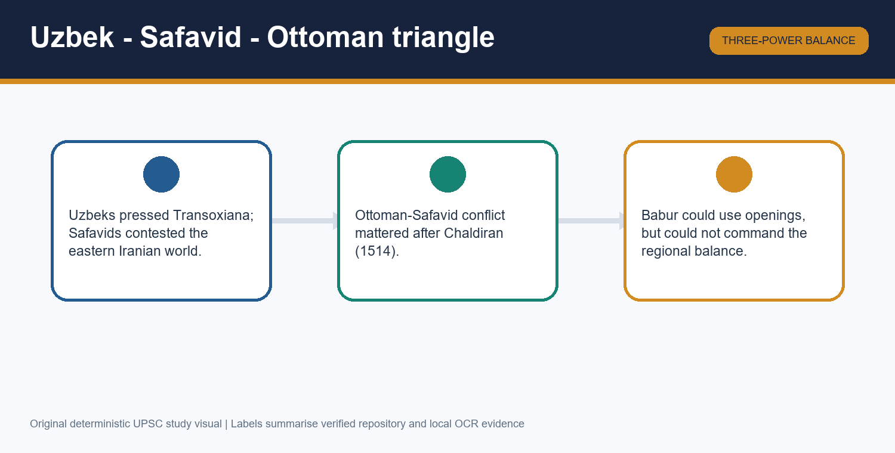

*Visual 4. Great-power rivalry mattered, but Babur still needed his own base.*

Shah Ismail's defeat of Shaybani Khan briefly reopened Babur's prospects in Samarqand. Yet external help did not give him an independent revenue base or lasting security. After Chaldiran, Ottoman pressure altered the Safavid position, and Uzbek dominance revived more strongly in Transoxiana.

This geopolitical triangle matters because it widened and then narrowed possibilities. Still, the decisive constraint remained Babur's own inability to retain Samarqand autonomously.

#### PARAGRAPH DEMONSTRATION — CLAIM → EVIDENCE → ANALYSIS → QUALIFICATION

An analytical paragraph should claim that Central Asian geopolitics mattered through opportunity and closure rather than destiny. Merv and Chaldiran are the named evidence because they changed the relative strength of Safavids and Uzbeks around Babur. Their significance lies in showing that Babur's career cannot be read as a local princely quarrel alone. Yet the qualification is equally necessary: outside victories could open doors, but only a secure internal base could keep them open.

**UPSC trap:** Avoid turning Ottoman-Safavid rivalry into the direct cause of every later Indian battle.

**Mains angle:** Assess how far regional geopolitics mattered in Babur's shift from Transoxiana to Hindustan.

**Study link:** connect this session to later Mughal foreign policy only as a future consequence, not as Topic 12's main burden.

#### CLOSING RECALL FLOW — UZBEKS, SAFAVIDS, CHALDIRAN AND THE REGIONAL BALANCE

```text
START / CONCEPT: Uzbeks, Safavids, Chaldiran And The Regional Balance
    |
    v
EXACT TERMS: Uzbeks · Safavids · Merv · Chaldiran · regional balance
    |
    v
MECHANISM / ARGUMENT: Shah Ismail's defeat of Shaybani Khan briefly reopened Babur's prospects in Samarqand. Yet external help did not give him an independent revenue base or lasting security. After Chaldiran, Ottoman pressure altered the Safavid position, and Uzbek dominance revived more strongly in Transoxiana.
    |
    v
CONSEQUENCE / CONTRAST: An analytical paragraph should claim that Central Asian geopolitics mattered through opportunity and closure rather than destiny.
    |
    v
UPSC TRAP / ANSWER-USE: Avoid turning Ottoman-Safavid rivalry into the direct cause of every later Indian battle.
    |
    v
ANSWER-GRABBING FORMULATION: Write “regional balance constrained Babur's choices”, not “Chaldiran caused Panipat”.
```

### SESSION 5 — KABUL AND QANDAHAR: REFUGE, RECRUITMENT, TRADE AND SECURITY

#### DEFINITION / WHAT THIS IS CALLED

**Plain-language definition:** Kabul gave Babur survival after Central Asian reverses, but it was not wealthy enough to satisfy a growing army and noble following.

**Technical definition:** Kabul-Qandahar formed a strategic bridge: military refuge, recruitment zone, route-junction and north-western shield between Hindustan, Khurasan and Transoxiana.

#### ANSWER-GRABBING OPENING — WRITE/ADAPT IN THE EXAM

> Kabul saved Babur, but it did not solve the revenue problem that pushed him toward India.

#### MUST-WRITE KEYWORDS

- **Kabul 1504**
- **Qandahar**
- **revenue limits**
- **trade routes**
- **north-west shield**

**How to use them:** Treat Kabul and Qandahar together: explain survival first, then limited income, then trade and geostrategy, so the Indian turn appears necessary but not automatic.

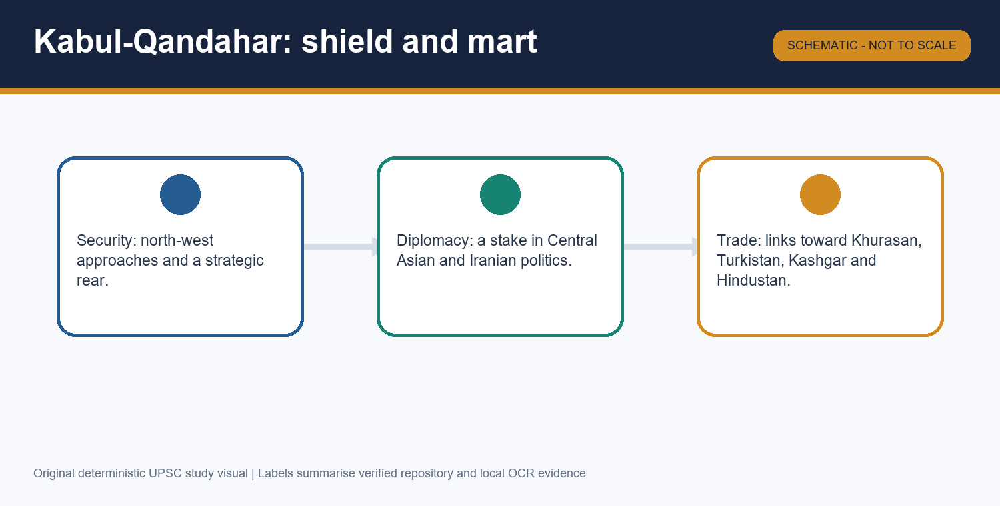

*Visual 5. Kabul and Qandahar mattered as a hinge, not merely as mountain refuge.*

Babur captured Kabul in 1504 and later secured Qandahar. The pair gave him a recoverable territorial base, access to recruits, and better security against immediate Uzbek pressure. They also linked routes toward Khurasan, Iran, Transoxiana and Hindustan.

Yet the same sources insist on a fiscal limit: Kabul and Qandahar were useful but insufficient for the needs of Babur's army and begs. This is why the topic treats them as bridge regions rather than as an endpoint.

#### PARAGRAPH DEMONSTRATION — CLAIM → EVIDENCE → ANALYSIS → QUALIFICATION

A good paragraph can claim that Kabul and Qandahar explain both Babur's survival and his later expansion. Kabul in 1504, route connections, and the repeated note about inadequate income are the named evidence. That evidence matters because it links military geography to political economy. The qualification is that trade connectivity and strategic value did not automatically translate into effortless fiscal abundance or loyal administration.

**UPSC trap:** Do not reduce Kabul to “a poor hill refuge”; that misses its route, recruitment and diplomatic significance.

**Mains angle:** Discuss the geostrategic importance of Kabul and Qandahar in Babur's project.

**Study link:** use this session again when comparing Babur's frontier with later Mughal concerns over Qandahar.

#### CLOSING RECALL FLOW — KABUL AND QANDAHAR: REFUGE, RECRUITMENT, TRADE AND SECURITY

```text
START / CONCEPT: Kabul And Qandahar: Refuge, Recruitment, Trade And Security
    |
    v
EXACT TERMS: Kabul 1504 · Qandahar · revenue limits · trade routes · north-west shield
    |
    v
MECHANISM / ARGUMENT: Babur captured Kabul in 1504 and later secured Qandahar. The pair gave him a recoverable territorial base, access to recruits, and better security against immediate Uzbek pressure. They also linked routes toward Khurasan, Iran, Transoxiana and Hindustan.
    |
    v
CONSEQUENCE / CONTRAST: A good paragraph can claim that Kabul and Qandahar explain both Babur's survival and his later expansion.
    |
    v
UPSC TRAP / ANSWER-USE: Do not reduce Kabul to “a poor hill refuge”; that misses its route, recruitment and diplomatic significance.
    |
    v
ANSWER-GRABBING FORMULATION: Kabul saved Babur, but it did not solve the revenue problem that pushed him toward India.
```

### SESSION 6 — PUNJAB, LODI FISSURES AND THE ROAD TO THE FINAL MARCH

#### DEFINITION / WHAT THIS IS CALLED

**Plain-language definition:** Babur's Indian campaign did not begin suddenly in 1526; it grew through earlier Punjab probes, Timurid claims and Lodi political fractures.

**Technical definition:** The Punjab question joined frontier coercion, Daulat Khan Lodi's oscillation, Alam Khan's claim, Rana Sanga's strategic calculations and Babur's own expanding ambitions.

#### ANSWER-GRABBING OPENING — WRITE/ADAPT IN THE EXAM

> Punjab invitations explain the Lodi opening, not the whole conquest.

#### MUST-WRITE KEYWORDS

- **Punjab**
- **Daulat Khan Lodi**
- **Alam Khan**
- **Bhira-Sialkot**
- **1525 march**

**How to use them:** Start with Babur's earlier Punjab moves, add Daulat Khan and Alam Khan as enabling actors, and finish by showing that frontier claims and logistics already mattered before Panipat.

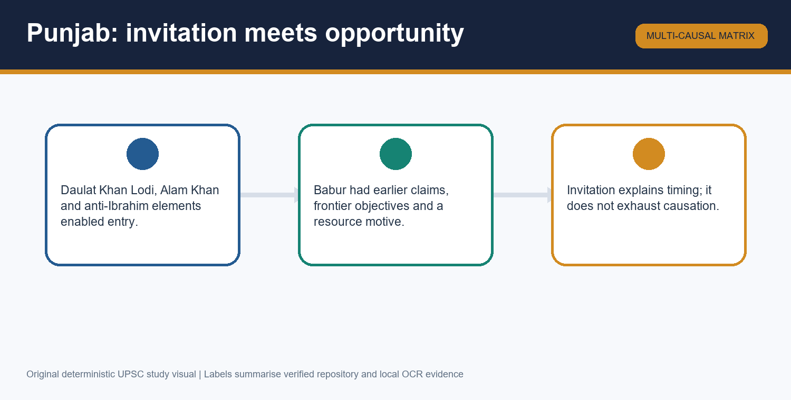

*Visual 6. Punjab was a contested frontier, not an empty doorway waiting for Babur.*

The advanced source insists that Panipat was the climax of a longer struggle over Punjab. Babur had moved toward Bhira and Sialkot before the final march, while Daulat Khan Lodi and Alam Khan alternated between appeal, rivalry and bargaining. Ibrahim Lodi's refusal to cede Punjab made confrontation sharper.

Babur also prepared the 1525 campaign by securing his rear and flank. Therefore the final advance should be narrated as prepared escalation, not as a straight cavalry ride toward Delhi.

#### PARAGRAPH DEMONSTRATION — CLAIM → EVIDENCE → ANALYSIS → QUALIFICATION

An answer paragraph can claim that Punjab converted Central Asian pressure into Indian political opportunity. Bhira-Sialkot probes, Daulat Khan's oscillation and Alam Khan's claim are the named evidence. Their analytical value lies in proving that invitation politics mattered only within a frontier already under Babur's strategic attention. The qualification is that Indian invitation did not make Babur a puppet; his ambitions rapidly exceeded those of his temporary allies.

**UPSC trap:** Avoid the one-line formula “Indian nobles invited him, so he came”; it erases Babur's earlier Punjab policy and Central Asian constraints.

**Mains angle:** Assess the relation between external push and internal Indian opportunity before Panipat.

**Study link:** borrow Topic 06 only for the bounded Lodi setting, not for Babur's whole conquest narrative.

#### CLOSING RECALL FLOW — PUNJAB, LODI FISSURES AND THE ROAD TO THE FINAL MARCH

```text
START / CONCEPT: Punjab, Lodi Fissures And The Road To The Final March
    |
    v
EXACT TERMS: Punjab · Daulat Khan Lodi · Alam Khan · Bhira-Sialkot · 1525 march
    |
    v
MECHANISM / ARGUMENT: The advanced source insists that Panipat was the climax of a longer struggle over Punjab. Babur had moved toward Bhira and Sialkot before the final march, while Daulat Khan Lodi and Alam Khan alternated between appeal, rivalry and bargaining. Ibrahim Lodi's refusal to cede Punjab made confrontation sharper.
    |
    v
CONSEQUENCE / CONTRAST: An answer paragraph can claim that Punjab converted Central Asian pressure into Indian political opportunity.
    |
    v
UPSC TRAP / ANSWER-USE: Avoid the one-line formula “Indian nobles invited him, so he came”; it erases Babur's earlier Punjab policy and Central Asian constraints.
    |
    v
ANSWER-GRABBING FORMULATION: Invitations explain the opening, not the whole conquest.
```

### SESSION 7 — FIRST PANIPAT, 1526: CHRONOLOGY, FRONTAGE AND FIREPOWER

#### DEFINITION / WHAT THIS IS CALLED

**Plain-language definition:** The secure exam core is Panipat in 1526 between Babur and Ibrahim Lodi; the exact day needs source caution.

**Technical definition:** Babur built a narrow defended frontage using araba carts tied by raw-hide ropes, breastworks, firing positions and controlled gaps for cavalry action.

#### ANSWER-GRABBING OPENING — WRITE/ADAPT IN THE EXAM

> Panipat was won by designed frontage, not by noise about guns alone.

#### MUST-WRITE KEYWORDS

- **Panipat 1526**
- **Ibrahim Lodi**
- **araba carts**
- **Ustad Ali**
- **Mustafa**

**How to use them:** Use Panipat, 1526, frontage, carts, raw-hide ropes, breastworks, Ustad Ali, Mustafa and cavalry gaps in that order: secure the year and opponent first, then explain how the prepared frontage organised firepower.

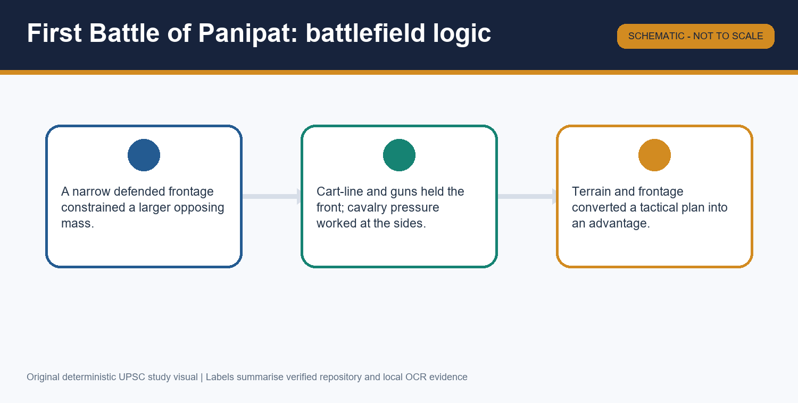

*Visual 7. Panipat's field system mattered because it organised fire, protection and cavalry movement together.*

At Panipat, Babur used a compact defended front. Carts were tied together with raw-hide ropes, breastworks sheltered matchlockmen, and artillery under Ustad Ali and Mustafa fired from organised positions. Gaps were intentionally left for cavalry sorties rather than sealing the army inside a wall.

The advanced file also warns that the date varies between 20 and 21 April in different source traditions. UPSC-safe writing therefore secures the year, combatants and tactical arrangement first.

#### PARAGRAPH DEMONSTRATION — CLAIM → EVIDENCE → ANALYSIS → QUALIFICATION

A strong paragraph can claim that Panipat was a battlefield design problem solved through preparation. The named evidence is concrete: araba carts, raw-hide ties, breastworks, Ustad Ali, Mustafa and the narrow frontage against Ibrahim Lodi. This matters because it turns an abstract “gunpowder” claim into a visible arrangement of space and command. The qualification is that no reliable answer should depend on inflated troop totals or an undisputed day-date formula.

**UPSC trap:** Do not write “artillery alone won Panipat”; the prepared field system is the safer explanatory unit.

**Mains angle:** Analyse the tactical design behind Babur's victory at the First Battle of Panipat.

**Study link:** compare this only cautiously with Panipat II in Topic 15, because the opponents and field situation differ.

#### CLOSING RECALL FLOW — FIRST PANIPAT, 1526: CHRONOLOGY, FRONTAGE AND FIREPOWER

```text
START / CONCEPT: First Panipat, 1526: Chronology, Frontage And Firepower
    |
    v
EXACT TERMS: Panipat 1526 · Ibrahim Lodi · araba carts · Ustad Ali · Mustafa
    |
    v
MECHANISM / ARGUMENT: At Panipat, Babur used a compact defended front. Carts were tied together with raw-hide ropes, breastworks sheltered matchlockmen, and artillery under Ustad Ali and Mustafa fired from organised positions. Gaps were intentionally left for cavalry sorties rather than sealing the army inside a wall.
    |
    v
CONSEQUENCE / CONTRAST: A strong paragraph can claim that Panipat was a battlefield design problem solved through preparation.
    |
    v
UPSC TRAP / ANSWER-USE: Do not write “artillery alone won Panipat”; the prepared field system is the safer explanatory unit.
    |
    v
ANSWER-GRABBING FORMULATION: Panipat was won by designed frontage, not by noise about guns alone.
```

### SESSION 8 — PANIPAT AS A COMBINED-ARMS SYSTEM: TULUGHMA, MOUNTED ARCHERY AND COMMAND

#### DEFINITION / WHAT THIS IS CALLED

**Plain-language definition:** Tulughma refers to wheeling flanking parties; it was one mobile element in Babur's larger combined-arms plan.

**Technical definition:** Babur's Panipat system integrated artillery, matchlocks, mounted archery, tulughma, cavalry reserves, terrain use and command discipline into one operational design.

#### ANSWER-GRABBING OPENING — WRITE/ADAPT IN THE EXAM

> The right answer is not “guns versus elephants”; it is “system versus disordered mass”.

#### MUST-WRITE KEYWORDS

- **tulughma**
- **mounted archery**
- **combined arms**
- **narrow frontage**
- **logistics**

**How to use them:** After explaining the cart-line, add tulughma and mounted archery so the examiner sees mobility, not static defence alone. End by stressing logistics and command.

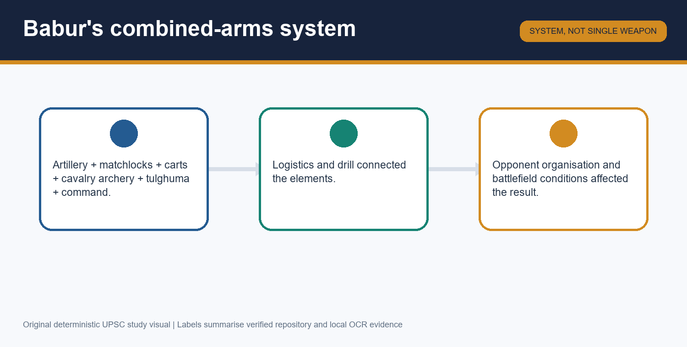

*Visual 8. Panipat combined a fixed firing line with mobile flanking action.*

The advanced source explicitly warns against reducing Panipat to artillery. Tulughma wheeled round the flanks, mounted archery preserved the Central Asian mobile tradition, and the narrow frontage denied Ibrahim Lodi full deployment against a prepared line.

The best explanation therefore links technology to organisation. Guns mattered because carts, gaps, cavalry and command made them usable.

#### PARAGRAPH DEMONSTRATION — CLAIM → EVIDENCE → ANALYSIS → QUALIFICATION

An examiner-ready paragraph can argue that Panipat demonstrates the military value of combination rather than of any single weapon. Ustad Ali, Mustafa, tulughma, mounted archery and the cart-line are the named evidence. The analysis follows by showing how each component solved a different problem: shock, protection, mobility or control. The qualification is that opponent organisation and terrain still mattered, so the battle cannot be explained by technology in isolation.

**UPSC trap:** Avoid translating tulughma into “artillery tactic”; it is a manoeuvre term for wheeling flanking action.

**Mains angle:** Critically examine the statement that artillery alone did not win Panipat.

**Study link:** use this logic again when discussing why Khanwa required adaptation, not repetition alone.

#### CLOSING RECALL FLOW — PANIPAT AS A COMBINED-ARMS SYSTEM: TULUGHMA, MOUNTED ARCHERY AND COMMAND

```text
START / CONCEPT: Panipat As A Combined-Arms System: Tulughma, Mounted Archery And Command
    |
    v
EXACT TERMS: tulughma · mounted archery · combined arms · narrow frontage · logistics
    |
    v
MECHANISM / ARGUMENT: The advanced source explicitly warns against reducing Panipat to artillery. Tulughma wheeled round the flanks, mounted archery preserved the Central Asian mobile tradition, and the narrow frontage denied Ibrahim Lodi full deployment against a prepared line.
    |
    v
CONSEQUENCE / CONTRAST: An examiner-ready paragraph can argue that Panipat demonstrates the military value of combination rather than of any single weapon.
    |
    v
UPSC TRAP / ANSWER-USE: Avoid translating tulughma into “artillery tactic”; it is a manoeuvre term for wheeling flanking action.
    |
    v
ANSWER-GRABBING FORMULATION: The right answer is not “guns versus elephants”; it is “system versus disordered mass”.
```

### SESSION 9 — AFTER PANIPAT: DECISION TO STAY, MONARCHY AND FRAGILE CONTROL

#### DEFINITION / WHAT THIS IS CALLED

**Plain-language definition:** Panipat opened Delhi and Agra, but Babur still faced unwilling begs, resisting forts and active Afghan opposition.

**Technical definition:** The post-Panipat phase combined settlement choice, Timurid-style monarchy, grants and bargaining with a still shallow administrative and military hold over north India.

#### ANSWER-GRABBING OPENING — WRITE/ADAPT IN THE EXAM

> Panipat opened a centre; it did not deliver a finished empire.

#### MUST-WRITE KEYWORDS

- **decision to stay**
- **begs**
- **Delhi-Agra**
- **Afghan resistance**
- **monarchy**

**How to use them:** State first that Babur chose to remain in India, then add why that choice was hard: homesick begs, forts, Afghan power and the need to make monarchy workable in a new setting.

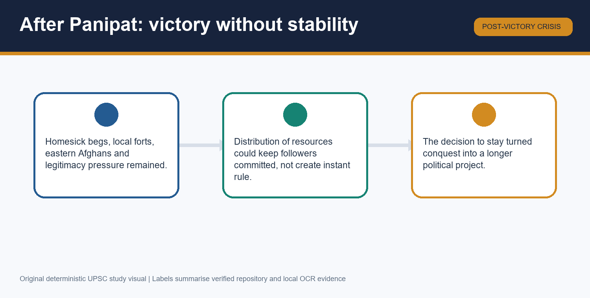

*Visual 9. Conquest had to be converted into settlement under pressure from followers and opponents.*

After Panipat, Babur confronted followers who preferred Kabul, while local forts and eastern Afghan forces remained active. He distributed wealth, appealed to his begs and decided to make India the base of his dynasty rather than treating victory as a raid.

This session also carries the political-culture comparison: Timurid prestige placed the ruler above leading followers, whereas Afghan noble practice had a stronger idiom of equality and bargaining. That contrast helps explain both monarchy and resistance.

#### PARAGRAPH DEMONSTRATION — CLAIM → EVIDENCE → ANALYSIS → QUALIFICATION

A strong paragraph can claim that Babur's most important post-Panipat act was the decision to stay. The evidence is concrete: begs disliked India, forts resisted, Afghans survived, yet Babur still chose Delhi-Agra as his core. This matters because it marks the shift from conquest to attempted state formation. The qualification is that choice did not erase fragility; Humayun's later losses prove how incomplete consolidation remained.

**UPSC trap:** Do not write as if Afghan opposition ended with Ibrahim Lodi's death.

**Mains angle:** Why must Panipat be followed by a discussion of settlement, not treated as a self-sufficient conclusion?

**Study link:** Topic 13 begins where this fragility becomes fully visible under Humayun.

#### CLOSING RECALL FLOW — AFTER PANIPAT: DECISION TO STAY, MONARCHY AND FRAGILE CONTROL

```text
START / CONCEPT: After Panipat: Decision To Stay, Monarchy And Fragile Control
    |
    v
EXACT TERMS: decision to stay · begs · Delhi-Agra · Afghan resistance · monarchy
    |
    v
MECHANISM / ARGUMENT: After Panipat, Babur confronted followers who preferred Kabul, while local forts and eastern Afghan forces remained active. He distributed wealth, appealed to his begs and decided to make India the base of his dynasty rather than treating victory as a raid.
    |
    v
CONSEQUENCE / CONTRAST: A strong paragraph can claim that Babur's most important post-Panipat act was the decision to stay.
    |
    v
UPSC TRAP / ANSWER-USE: Do not write as if Afghan opposition ended with Ibrahim Lodi's death.
    |
    v
ANSWER-GRABBING FORMULATION: Panipat opened a centre; it did not deliver a finished empire.
```

### SESSION 10 — KHANWA, 1527: COALITION, RHETORIC AND THE POLITICAL MEANING OF VICTORY

#### DEFINITION / WHAT THIS IS CALLED

**Plain-language definition:** Khanwa mattered because Babur confronted a Rajput-Afghan coalition led by Rana Sanga after the Lodi centre had already fallen.

**Technical definition:** Khanwa checked an alternative north Indian alignment and therefore completed Panipat politically more than Panipat completed itself.

#### ANSWER-GRABBING OPENING — WRITE/ADAPT IN THE EXAM

> Khanwa matters because it answered the question Panipat had left open: who would dominate north India after Ibrahim Lodi?

#### MUST-WRITE KEYWORDS

- **Khanwa**
- **Rana Sanga**
- **Mahmud Lodi**
- **Hasan Khan Mewati**
- **jihad rhetoric**

**How to use them:** Name the coalition carefully: Rana Sanga first, then Mahmud Lodi and Hasan Khan Mewati, and only after that discuss tactics and mobilisation language.

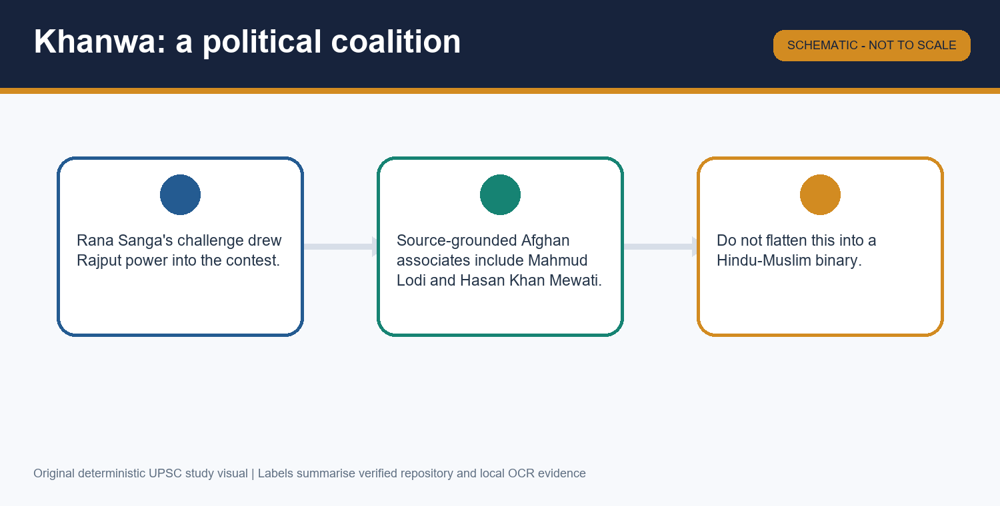

*Visual 10. Khanwa was politically layered; it cannot be flattened into a civilisational binary.*

Babur again used wagons, trenches, firearms and flanking action at Khanwa, but the political stakes were different from Panipat. Rana Sanga stood for a major Rajput challenge, and Afghan participants such as Mahmud Lodi and Hasan Khan Mewati complicate any neat communal framing.

Babur's ghazi or jihad language belongs in the answer because it shaped mobilisation and self-representation. Yet it should not erase coalition politics or make religion the only explanatory language.

#### PARAGRAPH DEMONSTRATION — CLAIM → EVIDENCE → ANALYSIS → QUALIFICATION

An examiner-grade paragraph can claim that Khanwa was the political completion of Panipat, not a mere sequel. Rana Sanga, Mahmud Lodi and Hasan Khan Mewati are the named evidence because they show a coalition wider than a single Rajput court. Their importance lies in revealing that Babur still faced a serious alternative to his Delhi-Agra claim. The qualification is that rhetoric matters too, but only as one strand in a mixed political and military contest.

**UPSC trap:** Avoid presenting Khanwa as only a Hindu-Muslim war; the Afghan element makes that reading incomplete.

**Mains angle:** Examine the political meaning of the Battle of Khanwa.

**Study link:** compare Khanwa with Panipat for function, not merely for dates.

#### CLOSING RECALL FLOW — KHANWA, 1527: COALITION, RHETORIC AND THE POLITICAL MEANING OF VICTORY

```text
START / CONCEPT: Khanwa, 1527: Coalition, Rhetoric And The Political Meaning Of Victory
    |
    v
EXACT TERMS: Khanwa · Rana Sanga · Mahmud Lodi · Hasan Khan Mewati · jihad rhetoric
    |
    v
MECHANISM / ARGUMENT: Babur again used wagons, trenches, firearms and flanking action at Khanwa, but the political stakes were different from Panipat. Rana Sanga stood for a major Rajput challenge, and Afghan participants such as Mahmud Lodi and Hasan Khan Mewati complicate any neat communal framing.
    |
    v
CONSEQUENCE / CONTRAST: An examiner-grade paragraph can claim that Khanwa was the political completion of Panipat, not a mere sequel.
    |
    v
UPSC TRAP / ANSWER-USE: Avoid presenting Khanwa as only a Hindu-Muslim war; the Afghan element makes that reading incomplete.
    |
    v
ANSWER-GRABBING FORMULATION: Khanwa matters because it answered the question Panipat had left open: who would dominate north India after Ibrahim Lodi?
```

### SESSION 11 — CHANDERI, GHAGRA AND THE EASTERN AFGHAN PROBLEM

#### DEFINITION / WHAT THIS IS CALLED

**Plain-language definition:** The Chanderi-Ghagra sequence is the phase in which Babur moved from Rajput follow-through to the eastern Afghan-Bengal theatre.

**Technical definition:** Chanderi was bounded Rajput follow-through after Khanwa, while Ghagra in 1529 addressed eastern Afghan resistance in a Bengal-linked theatre under Nusrat Shah's regional shadow.

#### ANSWER-GRABBING OPENING — WRITE/ADAPT IN THE EXAM

> If Panipat opened and Khanwa stabilised, Ghagra proved that Afghan power had not disappeared.

#### MUST-WRITE KEYWORDS

- **Chanderi**
- **Ghagra**
- **eastern Afghans**
- **Nusrat Shah**
- **consolidation ladder**

**How to use them:** Keep Chanderi and Ghagra distinct: one is Rajput follow-through, the other is an eastern Afghan-Bengal problem. Then explain why together they limit any instant-empire claim.

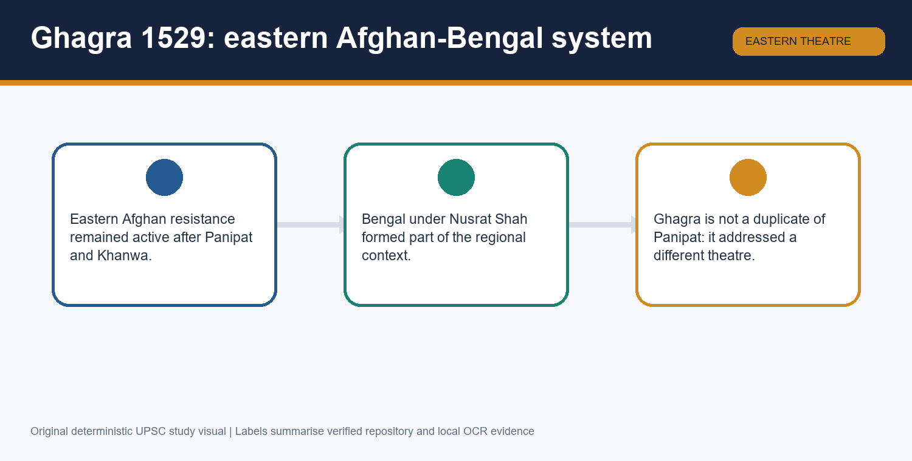

*Visual 11. Ghagra belongs to a different theatre from Panipat and Khanwa.*

Chanderi in 1528 belongs as a limited continuation of the Rajput challenge after Khanwa, especially around Medini Rai. Ghagra in 1529 belongs to an eastern theatre in which Afghan forces and the Bengal setting under Nusrat Shah mattered. It did not mean Bengal was annexed outright.

The sequence Panipat-Khanwa-Chanderi-Ghagra is therefore best understood as a consolidation ladder, each rung answering a different political problem.

#### PARAGRAPH DEMONSTRATION — CLAIM → EVIDENCE → ANALYSIS → QUALIFICATION

A high-value paragraph can claim that Ghagra is the best proof that Babur's enemies were not exhausted in 1526. The named evidence is the eastern Afghan challenge and the Bengal-linked context under Nusrat Shah, set apart from the Rajput field of Khanwa and Chanderi. That analysis matters because it stops the candidate from treating every later battle as a duplicate of Panipat. The qualification is that even this ladder did not produce permanent stability, as the Humayun-Sur sequence later shows.

**UPSC trap:** Do not write that Ghagra meant Bengal annexation or the end of Afghan politics.

**Mains angle:** Assess Panipat, Khanwa and Ghagra as stages in Babur's fragile consolidation.

**Study link:** Topic 13 takes over once Humayun inherits this incomplete consolidation.

#### CLOSING RECALL FLOW — CHANDERI, GHAGRA AND THE EASTERN AFGHAN PROBLEM

```text
START / CONCEPT: Chanderi, Ghagra And The Eastern Afghan Problem
    |
    v
EXACT TERMS: Chanderi · Ghagra · eastern Afghans · Nusrat Shah · consolidation ladder
    |
    v
MECHANISM / ARGUMENT: Chanderi in 1528 belongs as a limited continuation of the Rajput challenge after Khanwa, especially around Medini Rai. Ghagra in 1529 belongs to an eastern theatre in which Afghan forces and the Bengal setting under Nusrat Shah mattered. It did not mean Bengal was annexed outright.
    |
    v
CONSEQUENCE / CONTRAST: A high-value paragraph can claim that Ghagra is the best proof that Babur's enemies were not exhausted in 1526.
    |
    v
UPSC TRAP / ANSWER-USE: Do not write that Ghagra meant Bengal annexation or the end of Afghan politics.
    |
    v
ANSWER-GRABBING FORMULATION: If Panipat opened and Khanwa stabilised, Ghagra proved that Afghan power had not disappeared.
```

### SESSION 12 — BABURNAMA, HINDUSTAN, GARDENS AND THE FOUNDER DEBATE

#### DEFINITION / WHAT THIS IS CALLED

**Plain-language definition:** The Baburnama is a first-person Chagatai Turkish memoir of unusual richness, but it must still be read as selective ruler self-representation.

**Technical definition:** Topic 12 uses the Baburnama for campaigns, landscape, court feeling, Hindustan observations and literary culture while checking it against translation history, other chronicles and material evidence.

#### ANSWER-GRABBING OPENING — WRITE/ADAPT IN THE EXAM

> The Baburnama is invaluable because it is vivid, not because it is neutral.

#### MUST-WRITE KEYWORDS

- **Baburnama**
- **Chagatai Turkish**
- **Hindustan observations**
- **Bagh-e Babur**
- **founder debate**

**How to use them:** Use Baburnama, Chagatai Turkish, Persian translation, Hindustan, gardens and founder debate in sequence: start with the memoir's original language, move to its observations on Hindustan and gardens, and end with the qualified founder debate.

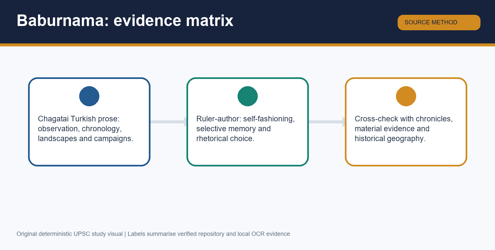

*Visual 12. Topic 12 ends with source method, cultural legacy and a qualified verdict on Babur's place in Indian history.*

Babur's memoir is central for campaigns, mood, nature-writing and perceptions of Hindustan. It is also a classic of Chagatai Turkish prose later translated into Persian under Akbar. Gardens such as Bagh-e Babur and Babur's landscape sensibility matter here as bounded cultural extensions of the same courtly world.

Yet the memoir is not a neutral diary. It is selective, retrospective and shaped by self-presentation. That caution matters when discussing army figures, motives, piety or the founder debate.

#### PARAGRAPH DEMONSTRATION — CLAIM → EVIDENCE → ANALYSIS → QUALIFICATION

A strong final paragraph can claim that Babur was both an invader from outside India and the fragile founder of a new Indian dynasty. The evidence is cumulative: Panipat, Khanwa and Ghagra created a political opening; the Baburnama shows self-conscious kingship and Hindustan observation; and the decision to stay made India the base of rule. This analysis matters because it avoids false alternatives between conqueror and founder. The qualification is that durable consolidation lay beyond Babur's short reign and depended on Humayun, the Sur interlude and Akbar.

**UPSC trap:** Do not call the Baburnama a Persian original or treat vivid self-description as neutral fact.

**Mains angle:** Evaluate the Baburnama as a source for Babur's conquest and idea of Hindustan.

**Study link:** this session also supports quick prelim distinctions on original language, later Persian translation and the founder-versus-consolidator boundary.

#### CLOSING RECALL FLOW — BABURNAMA, HINDUSTAN, GARDENS AND THE FOUNDER DEBATE

```text
START / CONCEPT: Baburnama, Hindustan, Gardens And The Founder Debate
    |
    v
EXACT TERMS: Baburnama · Chagatai Turkish · Hindustan observations · Bagh-e Babur · founder debate
    |
    v
MECHANISM / ARGUMENT: Babur's memoir is central for campaigns, mood, nature-writing and perceptions of Hindustan. It is also a classic of Chagatai Turkish prose later translated into Persian under Akbar. Gardens such as Bagh-e Babur and Babur's landscape sensibility matter here as bounded cultural extensions of the same courtly world.
    |
    v
CONSEQUENCE / CONTRAST: A strong final paragraph can claim that Babur was both an invader from outside India and the fragile founder of a new Indian dynasty.
    |
    v
UPSC TRAP / ANSWER-USE: Do not call the Baburnama a Persian original or treat vivid self-description as neutral fact.
    |
    v
ANSWER-GRABBING FORMULATION: The Baburnama is invaluable because it is vivid, not because it is neutral.
```

## BASIC MCQS / REMEDIATION

### Part I — 16 learning MCQs with strict ABCD rotation

#### Learning MCQ 1

**Question:** Which statement best captures why Central Asia matters in Topic 12?

- A. Babur's repeated failure to hold Samarqand under Uzbek pressure made the search for a durable alternative base crucial.
- B. Central Asia matters only because it supplied decorative genealogy for a later Indian empire.
- C. Central Asian politics ended before Babur came to Kabul.
- D. India entered Babur's horizon only after Ibrahim Lodi personally invited him.

**Answer: A.**

**Explanation:** The safe core is that Timurid instability and Uzbek pressure turned India into a strategic alternative rather than a sudden whim.

#### Learning MCQ 2

**Question:** Babur's political identity is most safely described as:

- A. an Afghan noble elected under Lodi custom.
- B. paternally Timurid and maternally linked to the Chagatai-Chingizid world within a Persianate court culture.
- C. a ruler whose politics can be explained by race alone.
- D. a Safavid provincial governor sent eastward.

**Answer: B.**

**Explanation:** The correct formulation keeps Timurid descent, Chagatai association and Persianate culture together instead of collapsing them into one ethnic label.

#### Learning MCQ 3

**Question:** Why did Shah Ismail's victory over Shaybani Khan not restore Babur permanently to Samarqand?

- A. Because the Ottoman state immediately annexed Samarqand.
- B. Because Babur lost interest in Transoxiana after 1510.
- C. Because external help opened a chance but did not solve Babur's weak independent resource base against renewed Uzbek strength.
- D. Because the Safavids refused all contact with Babur.

**Answer: C.**

**Explanation:** Safavid help widened room for manoeuvre, but it could not substitute for a durable autonomous base once Uzbek pressure revived.

#### Learning MCQ 4

**Question:** Which relationship between Chaldiran and Babur's later choices is most accurate?

- A. Chaldiran transferred Kabul directly to the Uzbeks.
- B. Chaldiran made Ibrahim Lodi a Safavid ally.
- C. Chaldiran itself was Babur's first Indian battle.
- D. The 1514 Ottoman victory altered the regional balance and helped renewed Uzbek dominance in Transoxiana.

**Answer: D.**

**Explanation:** Use Chaldiran as a regional-balance event, not as a crude one-step explanation of Panipat.

#### Learning MCQ 5

**Question:** Kabul after 1504 should primarily be understood as:

- A. a recoverable base whose strategic value exceeded its comfortable fiscal capacity.
- B. a full substitute for the revenues of Hindustan.
- C. a place that made Qandahar irrelevant.
- D. a Safavid possession outside Babur's control.

**Answer: A.**

**Explanation:** Kabul solved survival and route access, but not the larger revenue demands of Babur's followers and campaigns.

#### Learning MCQ 6

**Question:** Daulat Khan Lodi and Alam Khan are best treated as:

- A. Rana Sanga's military deputies.
- B. enabling actors in Punjab politics within a wider strategic shift already under way.
- C. Ottoman artillery commanders at Panipat.
- D. the sole reason Babur entered India.

**Answer: B.**

**Explanation:** Invitations mattered, but Babur's own claims, earlier advances and Kabul-based constraints predated them.

#### Learning MCQ 7

**Question:** Which sequence most accurately summarises Babur's trajectory?

- A. Khanwa -> Kabul -> Samarqand -> Panipat
- B. Panipat -> Farghana -> Samarqand -> Ghagra
- C. Farghana -> Samarqand attempts -> Kabul -> Punjab advances -> final 1525 march
- D. Safavid Iran -> Ghagra -> Delhi -> Farghana

**Answer: C.**

**Explanation:** The topic moves from small Timurid inheritance through failed Central Asian recovery toward a prepared Indian campaign.

#### Learning MCQ 8

**Question:** Why is the exact day of Panipat handled cautiously?

- A. No source agrees that Babur fought Ibrahim Lodi there.
- B. The year 1526 itself is doubtful.
- C. The battle may actually have followed Khanwa.
- D. Part II gives 20 April while many standard chronologies use 21 April, though the year and combatants are secure.

**Answer: D.**

**Explanation:** Use the day only with named-source caution; for UPSC the secure facts are 1526, Babur and Ibrahim Lodi.

#### Learning MCQ 9

**Question:** The operational purpose of the cart-line at Panipat was to:

- A. create a defended firing platform while preserving controlled cavalry gaps.
- B. replace every role of cavalry and archery.
- C. transport the army across the Indus during battle.
- D. freeze Babur's own troops into a passive wall.

**Answer: A.**

**Explanation:** The carts organised protection and fire, but Babur deliberately kept openings so mobility was not lost.

#### Learning MCQ 10

**Question:** Tulughma in Babur's battle system refers to:

- A. a Safavid royal ceremony.
- B. wheeling flanking action by mobile cavalry groups.
- C. a Bengal river fort.
- D. a land-revenue assignment.

**Answer: B.**

**Explanation:** Tulughma is a manoeuvre term, not a firearm, office or ritual phrase.

#### Learning MCQ 11

**Question:** Which explanation of Panipat is strongest?

- A. Artillery alone settled the battle regardless of leadership.
- B. Exact numerical superiority gives a complete explanation.
- C. Carts, guns, matchlocks, mounted archery, tulughma, terrain and command worked together.
- D. The battle proves all Indian armies rejected firearms.

**Answer: C.**

**Explanation:** Panipat is best explained as a combined-arms system fitted to terrain and organisation rather than as a one-variable story.

#### Learning MCQ 12

**Question:** Khanwa is best interpreted as:

- A. a Bengal campaign under Nusrat Shah.
- B. a battle fought after Babur's death.
- C. a purely communal war without Afghan actors.
- D. a contest against Rana Sanga's Rajput-Afghan coalition over north Indian supremacy.

**Answer: D.**

**Explanation:** The Afghan participation of Mahmud Lodi and Hasan Khan Mewati makes a simple communal reading inadequate.

#### Learning MCQ 13

**Question:** Babur's decision to stay in India after Panipat is significant because it:

- A. turned victory into an attempt at settlement despite homesick begs and surviving opposition.
- B. made Kabul and Qandahar irrelevant overnight.
- C. ended all Afghan resistance before Ghagra.
- D. created Akbar's mature mansabdari system at once.

**Answer: A.**

**Explanation:** The decision marks the shift from conquest to state formation, even though that state remained fragile.

#### Learning MCQ 14

**Question:** Ghagra in 1529 chiefly addressed:

- A. Ottoman-Safavid rivalry in Anatolia.
- B. eastern Afghan resistance in a Bengal-linked political setting.
- C. Rana Sanga's recovery after Khanwa.
- D. Babur's renewed attempt on Samarqand.

**Answer: B.**

**Explanation:** Ghagra belongs to the eastern Afghan-Bengal theatre and should not be merged with Panipat or Khanwa.

#### Learning MCQ 15

**Question:** The Baburnama should be used as:

- A. an unusable partisan fantasy.
- B. a Persian original whose later translations do not matter.
- C. a vivid Chagatai Turkish memoir read with corroboration and caution about self-fashioning.
- D. a source that automatically settles army numbers and motives.

**Answer: C.**

**Explanation:** Its value lies in first-person detail and observation, but historians still need to test language, genre and corroboration.

#### Learning MCQ 16

**Question:** Which verdict is safest on Babur's place in Indian history?

- A. He was only a raider because he entered from outside India.
- B. He created a fully stable empire in one battle.
- C. He ceased to matter once Humayun succeeded.
- D. He was both a conqueror from outside and the fragile founder of a dynasty later consolidated by others.

**Answer: D.**

**Explanation:** This formula retains conquest, settlement and fragility together without collapsing Babur into either a mere raider or a finished consolidator.

## PYQS AND ANSWER PRACTICE

### Direct PYQ ownership audit

The canonical Basic and Advanced Topic 12 owners were rechecked first. They route **zero direct UPSC Civil Services PYQs to Topic 12 for 2018–2026**, and they also state that **no exact adjacent CSE wording is locally secure enough to reproduce as a Babur-owned question**. That gap is preserved honestly here.

### Transparent routed / adjacent support items

All four retained support PYQs below are explicitly **non-owned adjacent routes** verified through local ledgers or locally held OCR/paper material. They are included because they sharpen chronology discipline, source method or technology method for Topic 12; they are **not** relabelled as direct Babur PYQs.

#### Adjacent PYQ 1 — UPSC Prelims GS-I 2021 chronology route (wording verified locally; key inferred)

**Question as securely verified from local OCR:** Consider the following statements:

1. It was during the reign of Iltutmish that Chengiz Khan reached the Indus in pursuit of the fugitive Khwarezm prince.  
2. It was during the reign of Muhammad bin Tughluq that Taimur occupied Multan and crossed the Indus.  
3. It was during the reign of Deva Raya II of Vijayanagara Empire that Vasco da Gama reached the coast of Kerala.

**Option-row status:** The local OCR preserves the combination row imperfectly, but earlier validated repository usage supports the standard set containing “1 only”, “1 and 2”, “3 only” and “2 and 3”.

**Inferred answer — not officially verified locally:** **1 only.** Confidence: high.

**How to think it through:** Statement 1 is correct because Chinggis Khan reached the Indus in 1221 during Iltutmish's reign. Statement 2 is incorrect because Timur's Indian invasion belongs to 1398, far after Muhammad bin Tughluq. Statement 3 is incorrect because Vasco da Gama reached Kerala in 1498, long after Deva Raya II. In Topic 12, this route matters only as a chronology-discipline reminder for north-west frontier history.

**Demand decoding:** This is a chronology-elimination question. The Topic 12 use is bounded: keep north-west and late-medieval dates disciplined so Babur is not inserted into unrelated frontier episodes.

**Executable answer/elimination plan:** Test each statement independently by ruler and date; once Statements 2 and 3 fail on chronology, the route narrows to the “1 only” combination.

**Why this earns marks / route earns marks:** It shows exact chronological elimination and honestly preserves the inferred-key status instead of pretending to hold an official local answer row.

**How to improve/strengthen:** Add the year 1398 explicitly when rejecting Timur so the Indus-frontier confusion becomes even harder to repeat.

#### Adjacent PYQ 2 — UPSC Prelims GS-I 2022 frontier chronology route (wording verified locally; key inferred)

**Question:** With reference to Indian history, consider the following statements:

1. The first Mongol invasion of India happened during the reign of Jalal-ud-din Khalji.  
2. During the reign of Ala-ud-din Khalji, one Mongol assault marched up to Delhi and besieged the city.  
3. Muhammad-bin-Tughlaq temporarily lost portions of north-west of his kingdom to Mongols.

Which of the statements given above is/are correct?

- A. 1 and 2  
- B. 2 only  
- C. 1 and 3  
- D. 3 only

**Inferred answer — not officially verified locally:** **B. 2 only.** Confidence: high.

**How to think it through:** Statement 1 is wrong because Mongol pressure predates Jalaluddin Khalji. Statement 2 is correct because a major Mongol attack did reach Delhi during Alauddin's reign. Statement 3 is not accepted in the secure bounded repository route. For Topic 12, this question is useful only as adjacent frontier chronology and should never be relabelled as a Babur PYQ.

**Demand decoding:** Answer statement-by-statement and keep Mongol chronology separate from the much later Timurid-Babur story.

**Executable answer/elimination plan:** Reject Statement 1 first on chronology, preserve Statement 2, then treat Statement 3 cautiously within the already-audited repository route before choosing B.

**Why this earns marks / route earns marks:** It earns marks by separating earlier Mongol frontier pressure from later Lodi-Babur chronology instead of collapsing all north-west crises together.

**How to improve/strengthen:** Name Alauddin Khalji directly in the elimination line so the accepted statement is anchored to a ruler, not to a vague period label.

#### Routed PYQ 3 — UPSC GS-I 2020 source-method support

**Question:** Persian literary sources of medieval India reflect the spirit of the age. Comment. (Answer in 250 words)

**Model answer:** Persian literary sources are indispensable because they preserve kingship, conquest, morality and courtly self-presentation; yet they reflect the age only when read with genre caution. For Topic 12, the transferable example is the *Baburnama*. It gives unusually vivid first-person detail about campaigns, followers, landscapes and Babur's own political feelings, but it remains ruler self-representation rather than neutral reportage. The same principle applies to earlier courtly Persian histories: they reveal elite political worlds more directly than peasant, vernacular or subaltern experience. Hence Persian literary texts reflect the age in a refracted way. Their greatest value lies in showing the assumptions of courts, armies and legitimation, while coins, inscriptions, architecture and regional evidence supply the necessary check. For Topic 12, the safest lesson is simple: use the *Baburnama* boldly for proximity and detail, but never as an untested final authority.

**Demand decoding:** Treat this as a source-method question: explain value and limitation together, then show how the Baburnama fits inside that Persianate evidentiary world.

**Executable answer/elimination plan:** Open with the value-limitation thesis, move to Baburnama as named evidence, then close with corroboration through coins, inscriptions, architecture and comparison.

**Why this earns marks / route earns marks:** It turns a general Persian-source demand into a precise Baburnama method lesson without pretending that the question is Topic 12-owned.

**How to improve/strengthen:** Add the original Chagatai-Turkish composition note in one sentence if you want the language dimension to stand out even more.

#### Routed PYQ 4 — UPSC GS-I 2023 technology route

**Question:** What were the major technological changes introduced during the Sultanate period? How did those technological changes influence the Indian society? (Answer in 250 words)

**Model answer:** The Sultanate mattered technologically because it accelerated the diffusion and systematisation of new techniques in architecture, irrigation, administration and warfare. Topic 12 borrows this route only for the last of these. By the early sixteenth century, field artillery and matchlocks had become more consequential in north Indian warfare, but Panipat shows that technology mattered only when joined to organisation. Babur's cart-line, breastworks, artillery under Ustad Ali and Mustafa, cavalry gaps and tulughma flanking together illustrate how gunpowder became effective through a system rather than through possession alone. The social effect of such change lay mainly in state capacity: stronger battlefield control, sharper fiscal extraction and more demanding military organisation. Yet this must not be romanticised as automatic progress. Technology strengthened courts and armies more obviously than it equalised society. For Topic 12, the best borrowed lesson is that Panipat belongs to a wider history of changing warfare, but it cannot be reduced to guns alone.

**Demand decoding:** Use the question as a technology-plus-society prompt, then borrow Panipat only as a bounded example of organised gunpowder warfare rather than as the whole answer.

**Executable answer/elimination plan:** List architecture, irrigation, administration and warfare quickly, then dwell on Panipat as the clearest bridge from Sultanate-era technological change to early Mughal battlefield design.

**Why this earns marks / route earns marks:** It earns marks because it keeps Topic 12 within its proper boundary: Panipat is a powerful example, but not an excuse to ignore the wider Sultanate technology question.

**How to improve/strengthen:** Add one short phrase on lime mortar or canal irrigation if you want the broader technology frame to appear before narrowing to Panipat.

### Original solved Mains questions

Exactly six original Mains models are retained below: **2 × 10 marks**, **2 × 15 marks**, **2 × 20 marks**.

#### Original Mains 1 — Explain how the Central Asian backdrop shaped Babur's turn towards India. (10 marks; 150 words)

**Model solution**

Babur's Indian venture grew from constrained Central Asian choices rather than from a sudden appetite for plunder. He inherited Farghana in 1494, captured and lost Samarqand repeatedly, and faced Shaybani Uzbek pressure that made Transoxiana increasingly untenable. Kabul, seized in 1504, kept him politically alive, but it did not supply enough income for an expanding army and noble following. That fiscal and strategic limit is the bridge to India. Punjab had older Timurid claims, lay within reach of Kabul, and became easier to enter because Ibrahim Lodi faced noble dissidence. Yet Central Asian pressure did not mechanically cause conquest. Babur's own preparations, earlier Punjab probes and the invitations of Daulat Khan and Alam Khan made the opportunity usable. Thus the Central Asian backdrop shaped Babur's turn by closing old routes, exposing Kabul's limits and redirecting ambition toward a richer and more defensible base.

**Demand decoding:** The directive asks for causation, not biography. You must explain why Central Asian instability pushed Babur eastward and how that push interacted with India-specific opportunity.

**Executable answer/elimination plan:** Farghana and Samarqand first -> Uzbek pressure -> Kabul as refuge but not full solution -> Punjab/Lodi opening -> qualifying line on Babur's own agency.

**Why this earns marks / route earns marks:** It names the decisive evidence chain and ends with a qualified causal verdict instead of a one-cause slogan.

**How to improve/strengthen:** Add the 1510 Merv opening or 1514 Chaldiran shift if you want the wider regional-balance layer to appear more explicitly.

#### Original Mains 2 — Discuss why Kabul and Qandahar were more than a refuge in Babur's strategy. (10 marks; 150 words)

**Model solution**

Kabul and Qandahar mattered because they combined survival, security, recruitment and exchange. Kabul, captured in 1504 after Babur's Samarqand failures, gave him a territorial base from which he could rebuild a court and army. Qandahar strengthened the rear and linked him more effectively to routes toward Iran, Khurasan and Central Asia. Together they made Babur more than a refugee prince. They also mattered economically: the sources treat Kabul as a route-junction and trade mart, not as an isolated hill stronghold. Yet they were not enough. Their income could not comfortably satisfy Babur's begs and expanding military needs, which is why the move toward Punjab and Hindustan remained attractive. A good verdict therefore joins geography and political economy: Kabul-Qandahar preserved Babur, but precisely because they preserved him, they also exposed the need for a richer imperial core.

**Demand decoding:** The question contrasts “refuge” with a larger strategic role. Show multiple functions instead of writing only a sentimental survival story.

**Executable answer/elimination plan:** Kabul 1504 -> army/court base -> Qandahar and the rear -> trade routes -> fiscal limitation -> verdict.

**Why this earns marks / route earns marks:** It shows why the pair mattered militarily and commercially while still preserving the crucial resource constraint.

**How to improve/strengthen:** Add one line on later Mughal foreign-policy stakes to show the long afterlife of this north-western hinge.

#### Original Mains 3 — Analyse the tactical design behind Babur's victory at the First Battle of Panipat. (15 marks; 250 words)

**Model solution**

Babur won Panipat through battlefield design rather than through a single superior weapon. The core of the design was a narrow prepared frontage. Araba carts were tied together with raw-hide ropes, breastworks sheltered matchlockmen, and artillery under Ustad Ali and Mustafa fired from organised positions. This front was not a static wall, because controlled gaps allowed cavalry movement. Mounted archery and tulughma flanking action then extended the system beyond the firing line. The design worked because each part solved a different problem. The carts and breastworks protected the front, the guns and matchlocks generated pressure, the gaps preserved initiative, and mobile cavalry prevented the line from becoming passive. A narrower frontage also reduced Ibrahim Lodi's ability to deploy a larger mass effectively. The battle therefore shows technology embedded in organisation. Yet a careful answer must still qualify the result. Chronicle troop totals remain insecure, and artillery alone cannot explain the outcome. Terrain, command, discipline and the opponent's organisation mattered too. Panipat is best understood as a combined-arms victory in which design turned firepower into decisive effect.

**Demand decoding:** Analyse means showing how the components worked together. Listing carts, guns and cavalry without explaining their interaction is not enough.

**Executable answer/elimination plan:** Prepared frontage -> carts and breastworks -> Ustad Ali and Mustafa -> cavalry gaps and tulughma -> narrow-frontage effect on Ibrahim -> qualification on numbers and technology-alone claims.

**Why this earns marks / route earns marks:** It names the formation, explains internal logic and explicitly rejects the artillery-only shortcut.

**How to improve/strengthen:** Insert the 20/21 April date caution only if needed; do not let a minor chronology note crowd out the battlefield analysis.

#### Original Mains 4 — Examine the political meaning of the Battle of Khanwa. (15 marks; 250 words)

**Model solution**

Khanwa mattered because it answered the political question Panipat had left unresolved. Panipat removed Ibrahim Lodi from the Delhi centre, but it did not settle who would dominate north India. Khanwa in 1527 placed Babur against Rana Sanga's challenge and against a coalition that also included Afghan figures such as Mahmud Lodi and Hasan Khan Mewati. That coalition matters analytically, because it shows that the opposition was not a simple communal bloc. Babur again used wagons, trenches, firearms and flanking action, but the significance of victory lay deeper than military repetition. By defeating Rana Sanga, Babur checked a major alternative claim to post-Lodi supremacy and made his Delhi-Agra base more defensible. His ghazi or jihad language should be discussed because it shaped mobilisation and self-representation. Yet it must not become the whole interpretation. Coalition politics, Afghan participation and the struggle for sovereignty remain essential. The right verdict is therefore graded: Khanwa was the political completion of Panipat, but not the end of resistance. Chanderi and Ghagra still had to follow, and later fragility remained visible under Humayun.

**Demand decoding:** The phrase “political meaning” requires more than battle narrative. You must show what Khanwa changed in the struggle for power after Panipat.

**Executable answer/elimination plan:** Panipat left the issue open -> name Rana Sanga plus Afghan associates -> explain coalition significance -> place rhetoric in bounds -> conclude with later follow-through.

**Why this earns marks / route earns marks:** It keeps the coalition, the rhetoric and the post-Panipat political stakes in one coherent explanation.

**How to improve/strengthen:** Add one sentence naming Babur's field-work adaptation at Khanwa if you want the military continuity with Panipat to stand out more sharply.

#### Original Mains 5 — Evaluate the Baburnama as a source for Babur's conquest and idea of Hindustan. (20 marks; 250 words)

**Model solution**

The Baburnama is one of the richest first-person texts in medieval Indian history, but its value lies precisely in being read critically. It was composed in Chagatai Turkish and later translated into Persian, so the text carries both original literary voice and a later Mughal afterlife. For Babur's conquest, it is indispensable because it gives close detail on campaigns, followers, fear, victory, hardship and the political meaning Babur attached to events. It also gives an unusually vivid picture of Hindustan through landscape, flora, custom and comparison with Central Asian experience. That makes it a source not only for military history but also for perception and cultural memory. Yet it is not a neutral daily log. Babur is the ruler describing his own career, selecting what to emphasise and what to legitimise. Army figures, motives and moral self-presentation therefore require comparison with other chronicles, coins, inscriptions and material evidence. The later Persian translation likewise broadens circulation but cannot be confused with the original language of composition. The best evaluation is balanced: the Baburnama is exceptionally proximate and revealing, but exactly because it is intimate, it must be read as self-conscious political literature rather than as unfiltered fact.

**Demand decoding:** Evaluate means rank both strengths and limits. The answer must treat conquest evidence and Hindustan observation together instead of discussing only one side.

**Executable answer/elimination plan:** Original language and transmission -> conquest detail -> Hindustan observations -> self-fashioning limits -> corroboration rule -> final balanced verdict.

**Why this earns marks / route earns marks:** It handles genre, language, content and corroboration in one answer instead of repeating a vague “valuable but biased” formula.

**How to improve/strengthen:** Add one phrase on Bagh-e Babur or garden culture if you want to extend the memoir into a bounded material-memory link.

#### Original Mains 6 — Assess Panipat, Khanwa and Ghagra as stages in the fragile consolidation of Babur's power. (20 marks; 250 words)

**Model solution**

The three battles formed a consolidation ladder, but the ladder remained fragile. Panipat in 1526 removed Ibrahim Lodi and opened Delhi-Agra. Its importance was foundational: Babur gained the political centre he had lacked in Kabul. Yet Panipat did not remove every rival. Khanwa in 1527 then checked Rana Sanga's Rajput-Afghan coalition and answered the post-Lodi question of who would dominate north India. Chanderi in 1528 extended that Rajput follow-through. Ghagra in 1529 addressed a different theatre altogether, proving that eastern Afghan strength survived beyond Ibrahim's death and had to be handled in a Bengal-linked setting under Nusrat Shah's shadow. Taken together, the sequence moved Babur from regime overthrow to broader containment of rivals. Still, the word consolidation must remain qualified. Begs disliked India, local forts resisted, revenue extraction remained shallow, and Afghan politics were not extinguished. Babur died in 1530 before deep institutional settlement could mature. Humayun's later expulsion by Sher Shah confirms the limitation. The safest verdict is therefore that Panipat, Khanwa and Ghagra built a political foundation in stages, but they did not produce an unbreakable empire. Babur founded a dynasty under pressure; durable consolidation belonged to a longer process.

**Demand decoding:** Assess requires a graded judgement. Use each battle for its distinct function and then qualify the word “consolidation” with later fragility.

**Executable answer/elimination plan:** Panipat as opening -> Khanwa as political completion -> Ghagra as eastern containment -> concluding qualification through begs, revenue and Humayun-Sur fragility.

**Why this earns marks / route earns marks:** It avoids date-list narration by assigning each battle a separate political task and then inserting the necessary fragility clause.

**How to improve/strengthen:** Add Medini Rai or Hasan Khan Mewati by name if you want one more memorable actor attached to the middle stages of the ladder.

## OPTIONAL ADVANCED DEPTH — NOT REQUIRED FOR A CORE ANSWER

### Advanced Anchor 1 — Punjab before Panipat

The advanced file insists that Panipat was the culmination of a longer Punjab struggle, not a sudden raid from Kabul. That reminder is useful whenever an answer is tempted to start the story in April 1526.

### Advanced Anchor 2 — Kabul-Qandahar and later empire

Babur's control of Kabul and Qandahar did more than protect his own rear. It gave a north Indian empire a durable stake in Central Asian and Iranian politics, which later Mughal foreign policy inherited.

### Advanced Anchor 3 — Khanwa rhetoric with restraint

Jihad or ghazi language around Khanwa should be read as politically consequential mobilisation, yet the source base does not support a reduction of the whole battle to one communal motive.

### Advanced Anchor 4 — Literary and environmental afterlife

Babur's memoir and garden sensibility make Topic 12 more than a battle narrative. The advanced gain is to connect military history with literary self-fashioning, landscape perception and the transregional circulation of memory.

## CONSOLIDATED REGISTER NOTES

### Topic 12 answer spine

- Start with **Central Asian constraint + Babur's agency**, not with Panipat alone.
- Identity formula: **Timurid paternal descent + Chagatai-Chingizid association + Persianate court culture**.
- Route spine: **Farghana -> Samarqand cycle -> Kabul/Qandahar -> Punjab -> Panipat -> Khanwa -> Chanderi -> Ghagra -> 1530 succession**.
- Panipat formula: **carts + breastworks + Ustad Ali/Mustafa + cavalry gaps + tulughma + narrow frontage**.
- Khanwa formula: **Rana Sanga + Afghan associates + rhetoric with coalition caution**.
- Ghagra rule: **eastern Afghan-Bengal context, not Bengal annexation**.
- Baburnama rule: **Chagatai Turkish original; later Persian translation; vivid but selective ruler self-representation**.
- Final verdict: **conqueror and fragile founder, not complete consolidator**.

### Prelims traps

- **20/21 April caution** does not unsettle the secure 1526 year or the Babur-Ibrahim pairing.
- **Tulughma** means flanking or wheeling manoeuvre, not artillery.
- **Ustad Ali and Mustafa** are artillery specialists, not political allies from Punjab.
- **Khanwa** included Afghan actors; avoid a simplistic communal binary.
- **Ghagra/Ghaghra** did not mean annexation of Bengal.
- **Baburnama** is not a Persian original diary.
- **Mughal** is a dynastic label, not a racial explanation.
- **1530 succession** does not prove secure consolidation.

### 2026 route audit note

- Local checks under `books\mains\2026`, `knowledge-export\Mains PYQ`, `new_papers`, `exams\papers`, `_PYQ-GS1-2026.md`, `_PYQ-GS1-GS3-Static-2026.md`, `_PYQ-ROUTING-PRELIMS-2026.md`, `PYQ-INTEGRATION-AUDIT-2026.md` and `PYQ-MAINS-COVERAGE-AUDIT-2026.md` found **no Topic 12-owned 2026 question**.
- The 2021, 2022, 2020 and 2023 routed/adjacent items retained in this package are therefore explicit support routes, not relabelled Babur-owned PYQs.

### Mains closing lines

- “Babur's Indian project was born from Central Asian narrowing, but it succeeded only because he turned constraint into organised action.”
- “Panipat opened the Delhi-Agra centre; Khanwa and Ghagra reveal why opening a centre is not the same as completing an empire.”
- “The Baburnama is most useful when its vivid detail is paired with corroboration, because proximity and self-fashioning coexist in the same text.”

### COMPLETE TOPIC ASCII MASTER FLOW DIAGRAM

#### ASCII MASTER FLOW — PANEL 1/12: Central Asian political field

```ascii-master
TIMURID FRAGMENTS -> competing princes and unstable coalitions
UZBEKS / SHAIBANI -> pressure and consolidation in Transoxiana
SAFAVIDS / SHAH ISMAIL -> temporary opening after Merv, 1510
OTTOMANS / CHALDIRAN, 1514 -> regional balance shifts indirectly
BABUR -> Farghana and Samarqand claimant searching for a durable base
RULE: regional geopolitics constrained agency; it did not cause Panipat alone.
```

#### ASCII MASTER FLOW — PANEL 2/12: Babur chronology 1494-1530

```ascii-master
1494 Farghana -> 1497 / 1501 Samarqand captures and losses
1504 Kabul -> 1510 Merv opening -> 1514 Chaldiran context
1519-20 Bhira and Sialkot -> November 1525 final march
1526 Panipat -> 1527 Khanwa -> 1528 Chanderi -> 1529 Ghagra
30 December 1530 -> Babur dies at Agra
MEMORY: Central Asian constraint -> Indian opening -> staged consolidation.
```

#### ASCII MASTER FLOW — PANEL 3/12: Layered identity and legitimacy

```ascii-master
PATERNAL -> Timurid descent and sovereign prestige
MATERNAL -> Chagatai / Chingizid association
MILITARY-POLITICAL -> Turco-Mongol practices and mobile cavalry world
CULTURAL -> Persianate court culture + Chagatai Turkish literary expression
INDIAN DYNASTIC LABEL -> Mughal
TRAP: identity explains legitimacy and networks, not biological destiny.
```

#### ASCII MASTER FLOW — PANEL 4/12: Samarqand cycle: prestige versus resources

```ascii-master
SAMARQAND -> Timurid legitimacy + affluent strategic centre
CAPTURE -> symbolic success
SUPPLY + MONEY + HINTERLAND + FOLLOWER LOYALTY -> insufficient
UZBEK PRESSURE + unstable coalitions -> repeated loss
LEARNING -> manoeuvre, resource discipline and limits of city possession
OUTCOME -> Central Asian failure redirects rather than predestines policy.
```

#### ASCII MASTER FLOW — PANEL 5/12: Kabul-Qandahar strategic bridge

```ascii-master
KABUL 1504 -> survival base, recruitment and southward platform
QANDAHAR -> rear security and Iranian-Central Asian interface
KABUL -> routes toward Kashgar, China, Transoxiana and Turkistan
QANDAHAR -> routes toward Khurasan, Iran and West Asia
LIMIT -> route potential did not automatically solve fiscal weakness
BRIDGE -> Indian agrarian resources + north-western security and trade.
```

#### ASCII MASTER FLOW — PANEL 6/12: Punjab and the Lodi opening

```ascii-master
BABUR'S EARLIER PUNJAB MOVES + TIMURID CLAIMS
                    |
IBRAHIM LODI-NOBLE TENSIONS + DAULAT KHAN + ALAM KHAN
                    |
local opening, information and favourable timing
                    |
BABUR EXPANDS BEYOND THE INVITERS' LIMITED PURPOSE
FORMULA: external push + internal opening + converting agency.
```

#### ASCII MASTER FLOW — PANEL 7/12: Final march and Panipat frontage

```ascii-master
NOVEMBER 1525 -> Babur leaves Kabul after securing rear and flank
 -> Punjab movement and communication control
 -> narrow prepared frontage at Panipat
 -> carts linked by raw-hide ropes + breastworks + firing positions
 -> gaps retained for cavalry action
TRAP: not a straight unprepared ride from Kabul to one battle.
```

#### ASCII MASTER FLOW — PANEL 8/12: Panipat combined-arms system

```ascii-master
FIRE -> artillery and matchlockmen under Ustad Ali and Mustafa
FIX -> carts, ropes, breastworks and constrained frontage
MOVE -> mounted archery, cavalry gaps and tulghuma flanking
COMMAND -> sequencing, reserve use and battlefield coordination
CONTEXT -> Ibrahim's organisation and deployment also matter
VERDICT: guns were important inside a system, never a solitary miracle.
```

#### ASCII MASTER FLOW — PANEL 9/12: After Panipat: decision to stay

```ascii-master
PANIPAT -> Delhi-Agra centre opens
BUT -> forts resist + Afghans remain + begs dislike India + supplies strain
BABUR DISTRIBUTES WEALTH + appeals to followers + chooses settlement
INDIAN RESOURCES -> support a new political base
RESULT -> invasion begins to become state formation
LIMIT -> Humayun and the Sur interregnum expose continuing fragility.
```

#### ASCII MASTER FLOW — PANEL 10/12: Panipat-Khanwa-Ghagra ladder

```ascii-master
PANIPAT 1526 -> Ibrahim Lodi -> removes the Delhi sultanate centre
KHANWA 1527 -> Rana Sanga coalition -> checks a rival north Indian alignment
CHANDERI 1528 -> bounded follow-through against a Rajput stronghold
GHAGRA 1529 -> eastern Afghan resistance in a Bengal-linked setting
TACTICS may recur; opponents, theatres and political functions change
TRAP: consolidation was staged, not complete in April 1526.
```

#### ASCII MASTER FLOW — PANEL 11/12: Baburnama and heritage source method

```ascii-master
BABURNAMA -> Chagatai Turkish first-person chronology and observation
STRENGTH -> routes, places, campaigns, gardens and ruler perception
LIMIT -> selective memory, self-fashioning, rhetoric and number inflation
BAGH-E BABUR -> tomb, terraces, water works and layered later interventions
UNESCO -> archaeology, documents, images and conservation reconstruction
RULE: material heritage can corroborate context, not every memoir claim.
```

#### ASCII MASTER FLOW — PANEL 12/12: Topic 12 answer spine

```ascii-master
OPEN -> Central Asian failure made India attractive, not inevitable
PUSH -> Timurid fragmentation + Uzbek pressure + Kabul resource limits
OPENING -> Punjab claims + Lodi fissures + invitations
MECHANISM -> prepared combined arms and Babur's command
CONSOLIDATION -> decision to stay + Panipat-Khanwa-Ghagra ladder
CLOSE -> a real but fragile Mughal foundation joined two strategic worlds.
```
