# Struggle for Empire: Afghans, Rajputs & Humayun - Complete Topic Package

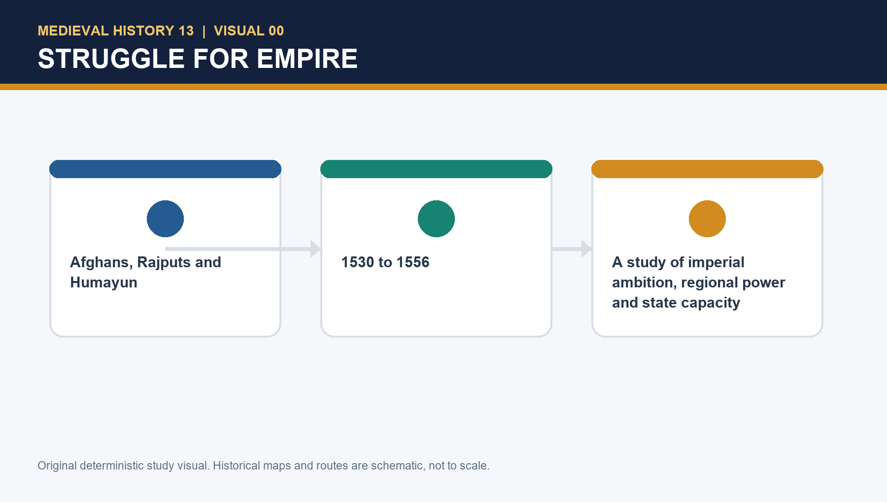

> **Subject:** Medieval History | **Topic:** 13 | **Export date:** 2026-09-20  
> **Approval:** false - awaiting explicit user approval.  
> **Sources audited first:** canonical Basic owner, canonical Advanced owner, local PYQ ledgers/OCR routes, 2026 official paper roots, and the existing Topic 13 final-package artifacts.

## BASIC LEARNING SESSION

### SESSION 1 — DECEMBER 1530: ACCESSION TO AN UNFINISHED CONQUEST

#### DEFINITION / WHAT THIS IS CALLED

**Plain-language definition:** 'Unfinished conquest' is more precise than 'weak empire'.

**Technical definition:** Satish Chandra's account observes that Babur had retained much of the prior administrative system, relied heavily on begs holding large assignments, and faced financial pressure after the Lodi treasure had been spent.

#### ANSWER-GRABBING OPENING — WRITE/ADAPT IN THE EXAM

> 'Unfinished conquest' is more precise than 'weak empire'.

#### MUST-WRITE KEYWORDS

- **December 1530**
- **accession to an unfinished conquest**
- **Finance**
- **Stretched treasury after earlier expenditures and large assignments**
- **Administration**
- **Begs held broad assignments**

**How to use them:** Open with December 1530 and the idea of an unfinished conquest; then show how weak finance, broad beg assignments and active Afghan rivals turned accession into a problem of fragile sovereignty.

Humayun succeeded Babur in December 1530. The repository source identifies weak finances, an unsettled administration, unsubdued Afghans, ambitious begs, active Timurid princes and Bahadur Shah of Gujarat as the major field of difficulty. Satish Chandra's account observes that Babur had retained much of the prior administrative system, relied heavily on begs holding large assignments, and faced financial pressure after the Lodi treasure had been spent.

'Unfinished conquest' is more precise than 'weak empire'. Babur's victories created a core and a claim; they did not automatically deliver a routine revenue flow, an impersonal bureaucracy, locally rooted loyalists or the neutralisation of rival political traditions. An early imperial state can conquer a city faster than it can persuade officers to remain, collect revenue predictably, secure routes and turn regional elites into stable partners.

| Inherited dimension | Evidence base | Why it mattered |
|---|---|---|
| Finance | Stretched treasury after earlier expenditures and large assignments | Campaign, reward and defence all required cash and reliable collection |
| Administration | Begs held broad assignments | Delegation mobilised force but weakened direct oversight |
| Eastern competition | Afghan activity from east U.P. to Bihar | Panipat did not end Afghan political ambitions |
| Western competition | Bahadur Shah's Gujarat–Malwa power | A rival could threaten through Malwa and Rajasthan |
| Dynasty | Timurid princely-share expectations | Territorial unity required continuing negotiation |

It would be false to call the inheritance void. Humayun possessed a prestigious centre, command resources and a field in which vigorous campaigns were possible. The question is why those assets did not yet amount to durable institutional depth.

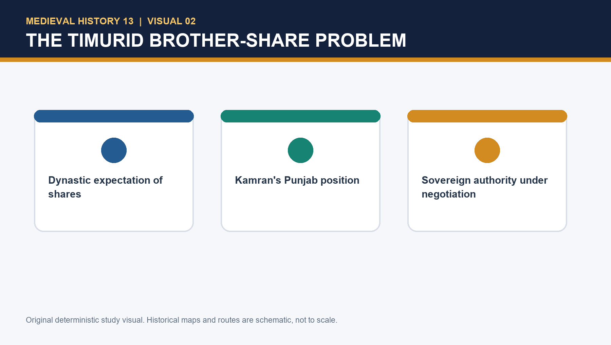

#### PARAGRAPH DEMONSTRATION — CLAIM → EVIDENCE → ANALYSIS → QUALIFICATION

A high-scoring paragraph can claim that Humayun's first difficulty was inherited fragility rather than instant personal failure. The named evidence is the December 1530 accession to a Delhi-Agra core still facing stretched finances, large beg assignments and active Afghan resistance. That evidence matters because it explains why later reverses became regime crises instead of local setbacks. The qualification is that the inheritance was still usable: prestige and military resources existed, which is why Humayun remains answerable for later choices.

#### CLOSING RECALL FLOW — DECEMBER 1530: ACCESSION TO AN UNFINISHED CONQUEST

```text
START / CONCEPT: December 1530: accession to an unfinished conquest
        |
        v
EXACT TERMS: December 1530 · accession to an unfinished conquest · Finance · Stretched treasury after earlier expenditures and large assignments · Administration · Begs held broad assignments
        |
        v
MECHANISM / ARGUMENT: Satish Chandra's account observes that Babur had retained much of the prior administrative system, relied heavily on begs holding large assignments, and faced financial pressure after the Lodi treasure had been spent.
        |
        v
CONSEQUENCE / CONTRAST: Babur's victories created a core and a claim; they did not automatically deliver a routine revenue flow, an impersonal bureaucracy, locally rooted loyalists or the neutralisation of rival political traditions.
        |
        v
UPSC TRAP / ANSWER-USE: The question is why those assets did not yet amount to durable institutional depth.
        |
        v
ANSWER-GRABBING FORMULATION: 'Unfinished conquest' is more precise than 'weak empire'.
```

### SESSION 2 — KAMRAN, ASKARI AND HINDAL: CHRONOLOGY BEFORE BLAME

#### DEFINITION / WHAT THIS IS CALLED

**Plain-language definition:** This session explains how Kamran, Askari and Hindal affected Humayun differently at different stages of the reign.

**Technical definition:** The safest formulation is chronological: Kamran's Punjab-Qandahar position constrained sovereignty from the beginning, Askari's Gujarat phase exposed delegation limits, and Hindal's rear disturbance belonged to the Bengal crisis rather than to the entire reign.

#### ANSWER-GRABBING OPENING — WRITE/ADAPT IN THE EXAM

> Kamran, Askari and Hindal mattered through chronology, resources and divided command rather than through a timeless family-morality story.

#### MUST-WRITE KEYWORDS

- **Kamran's Punjab hinge**
- **Askari's Gujarat test**
- **Hindal's Bengal-period rear crisis**
- **khutba and sikka in Humayun's name**
- **10,000 hardened troops withheld after Chausa**
- **chronology before blame**

**How to use them:** Move from Kamran's early territorial position to Askari's Gujarat test and Hindal's Bengal-period disturbance; then show how chronology prevents lazy over-blame.

Kamran already held Kabul and Qandahar at Babur's death. He then occupied Lahore and held Punjab up to the Sutlej, seeking confirmation from Humayun. Humayun accepted his possession while Afghan activity and Bahadur Shah's ambitions demanded attention elsewhere; khutba and sikka continued in Humayun's name. Askari and Hindal held assigned territories. The source warns that the brothers were broadly loyal until the Bengal episode; Hindal's independent move at Agra and elite defections belong to the later crisis. After Chausa, Kamran's 10,000 hardened troops were not placed under Humayun's command.

Kamran's control represented a de facto partition but not an explanation that can be retrofitted onto every event. It had a double effect. It narrowed Humayun's direct reach and later denied him a crucial reinforcement; it also spared him some immediate north-western burdens when Qandahar faced Iranian pressure. This is exactly why an answer must name its time period.

Askari's role similarly changes: he was entrusted with Gujarat, and the inability of his command to create cohesion is evidence of an elite-administration problem, not merely personal betrayal. Hindal's later action at Agra mattered because a Bengal expedition had already stretched the rear. The brothers' choices interacted with state capacity, battlefield confidence and noble calculation.

> MEMORY: Punjab hinge first, Gujarat delegation next, Bengal rear crisis last — keep the brothers in sequence, not in folklore.

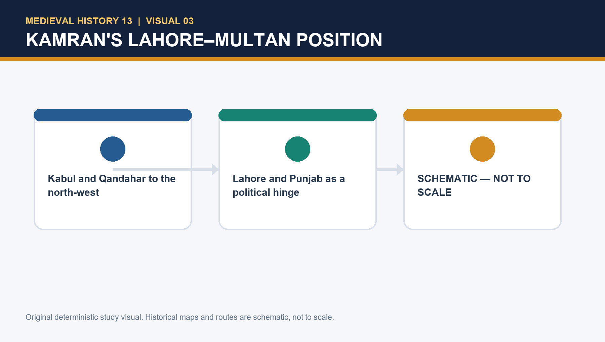

#### PARAGRAPH DEMONSTRATION — CLAIM → EVIDENCE → ANALYSIS → QUALIFICATION

A strong paragraph can argue that fraternal politics weakened Humayun through resources and timing rather than through melodrama alone. The named evidence is Kamran's hold over Lahore-Multan and the later problem of hardened troops withheld after Chausa, with Askari and Hindal entering different phases of delegation and disruption. This matters because patrimonial sharing limited unified command. The qualification is that brothers were not the whole explanation; Afghan power, logistics and overreach remained equally real.

#### CLOSING RECALL FLOW — KAMRAN, ASKARI AND HINDAL: CHRONOLOGY BEFORE BLAME

```text
START / CONCEPT: Kamran, Askari and Hindal: chronology before blame
        |
        v
EXACT TERMS: Kamran's Punjab hinge · Askari's Gujarat test · Hindal's Bengal-period rear crisis · chronology before blame · khutba and sikka · troops withheld after Chausa
        |
        v
MECHANISM / ARGUMENT: The source warns that the brothers were broadly loyal until the Bengal episode; Hindal's independent move at Agra and elite defections belong to the later crisis.
        |
        v
CONSEQUENCE / CONTRAST: Kamran's control represented a de facto partition but not an explanation that can be retrofitted onto every event.
        |
        v
UPSC TRAP / ANSWER-USE: Askari's role similarly changes: he was entrusted with Gujarat, and the inability of his command to create cohesion is evidence of an elite-administration problem, not merely personal betrayal.
        |
        v
ANSWER-GRABBING FORMULATION: Chronology matters: Kamran's Punjab hold constrained Humayun from the outset, Askari's Gujarat command exposed weak provincial control, and Hindal's Agra bid deepened a crisis that had already matured in Bengal.
```

### SESSION 3 — SOURCES, CHRONOLOGY AND HISTORICAL METHOD

#### DEFINITION / WHAT THIS IS CALLED

**Plain-language definition:** Abul Fazl's later Akbarnama is fuller and uses collected memoir material; Nizamuddin's Tabaqat-i-Akbari is briefer and has chronological deficiencies according to the source discussion.

**Technical definition:** The core method is to compare Nizamuddin Ahmad's compressed chronology with fuller later reconstructions, preserve strategic certainty, and mark where exact dating remains disputed.

#### ANSWER-GRABBING OPENING — WRITE/ADAPT IN THE EXAM

> Abul Fazl's later Akbarnama is fuller and uses collected memoir material; Nizamuddin's Tabaqat-i-Akbari is briefer and has chronological deficiencies according to the source discussion.

#### MUST-WRITE KEYWORDS

- **Sources**
- **chronology**
- **historical method**
- **Nizamuddin Ahmad**
- **Alternative chronology and compressed narrative**
- **Omissions and weak chronological detail**

**How to use them:** Use the source disagreement to show method: mark Nizamuddin Ahmad's compressed chronology, contrast it with fuller later reconstructions, and then state the minimum strategic sequence that remains secure.

The assigned advanced file highlights a chronology issue. Nizamuddin Ahmad places Dadrah/Daurah in the first regnal year (1531) and does not mention Chunar in the same sequence. The reconstruction adopted in Satish Chandra's narrative places the major Afghan encounter late in 1532 after the Chunar arrangement. Abul Fazl's later Akbarnama is fuller and uses collected memoir material; Nizamuddin's *Tabaqat-i-Akbari* is briefer and has chronological deficiencies according to the source discussion.

The appropriate conclusion is modest. Exact sequence and dates are less secure than the strategic interpretation: Humayun moved against eastern Afghan resistance, reached accommodation at Chunar rather than opening a Bihar war, and sought first to consolidate existing dominions. This is a model for all medieval evidence: a later dynastic chronicle can preserve detail but carry retrospective order; a brief account can avoid embroidery but omit links; a popular tradition may show memory yet fail as direct political proof.

| Source form | What it can illuminate | Principal limit |
|---|---|---|
| Nizamuddin Ahmad | Alternative chronology and compressed narrative | Omissions and weak chronological detail |
| Abul Fazl / Akbarnama | Fuller courtly reconstruction and later collected memories | Dynastic framing and retrospective coherence |
| Mirza Haider, *Tarikh-i-Rashidi* | A critical voice on Humayun's habits | One testimony cannot explain an entire reign |
| Later regional tradition | Memory and later political imagination | Cannot replace contemporary corroboration |
| Monument / UNESCO description | Dynastic memory, architecture and conservation | Not proof of campaign-event chronology |

Source caution must not become source paralysis. A student should still make a ranked claim, mark the limit, and explain the secure political mechanism.

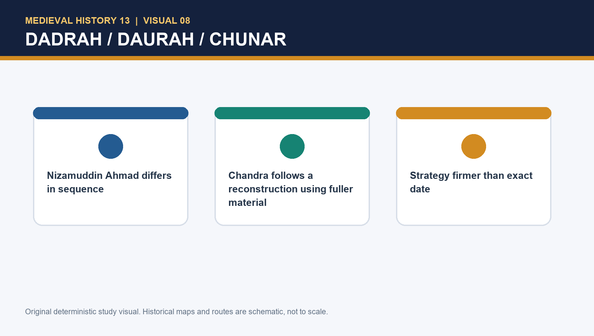

#### PARAGRAPH DEMONSTRATION — CLAIM → EVIDENCE → ANALYSIS → QUALIFICATION

An examiner-grade paragraph may claim that Topic 13 was fought among mobile coalitions, not sealed blocs. The named evidence is the continuing Afghan field around Mahmud Lodi and Sher Khan, alongside the distinct Rajput houses of Mewar and Marwar. This shows why alliance patterns could shift between resistance, bargaining and shelter. The qualification is that fluidity did not mean weakness: under capable leadership, especially in Bihar-Bengal, these coalitions could become strategically decisive.

#### CLOSING RECALL FLOW — SOURCES, CHRONOLOGY AND HISTORICAL METHOD

```text
START / CONCEPT: Sources, chronology and historical method
        |
        v
EXACT TERMS: Sources · chronology · historical method · Nizamuddin Ahmad · Alternative chronology and compressed narrative · Omissions and weak chronological detail
        |
        v
MECHANISM / ARGUMENT: A student should still make a ranked claim, mark the limit, and explain the secure political mechanism.
        |
        v
CONSEQUENCE / CONTRAST: Nizamuddin Ahmad places Dadrah/Daurah in the first regnal year (1531) and does not mention Chunar in the same sequence.
        |
        v
UPSC TRAP / ANSWER-USE: Source caution must not become source paralysis.
        |
        v
ANSWER-GRABBING FORMULATION: Abul Fazl's later Akbarnama is fuller and uses collected memoir material; Nizamuddin's Tabaqat-i-Akbari is briefer and has chronological deficiencies according to the source discussion.
```

### SESSION 4 — THE EARLY AFGHAN PHASE: DADRAH/DAURAH AND CHUNAR

#### DEFINITION / WHAT THIS IS CALLED

**Plain-language definition:** At Dadrah on the Gomti, Humayun defeated Afghan forces led in the eastern field; the strategic core is consolidation against east-U.P. resistance.

**Technical definition:** Chunar was called the gateway to Bihar because it sat in an approach system—not because one fort controlled the entire east by itself.

#### ANSWER-GRABBING OPENING — WRITE/ADAPT IN THE EXAM

> At Dadrah on the Gomti, Humayun defeated Afghan forces led in the eastern field; the strategic core is consolidation against east-U.P. resistance.

#### MUST-WRITE KEYWORDS

- **Dadrah/Daurah chronology caution**
- **Chunar as gateway to Bihar**
- **Kalinjar before Chunar**
- **east-U.P. Afghan resistance**
- **1531-32 strategic sequence**
- **underestimated future Sher Shah**

**How to use them:** Start with chronology caution, then explain why Chunar mattered inside an approach system to Bihar and why the first accommodation was tactical rather than absurd.

In the source sequence, Humayun besieged Kalinjar, then moved against Chunar after learning that Sher Khan had acquired it. Sher Khan was absent, and a settlement followed: service under his son, a contingent and payment were offered. Humayun accepted because he did not then contemplate an attack on Bihar and did not regard Sher Khan as the central danger. At Dadrah on the Gomti, Humayun defeated Afghan forces led in the eastern field; the strategic core is consolidation against east-U.P. resistance.

Chunar was called the gateway to Bihar because it sat in an approach system—not because one fort controlled the entire east by itself. A fort could affect land movement, river-side communications, provisioning and the security of a force moving from the Gangetic core toward Bihar and Bengal. The first settlement was therefore not absurd: Humayun had several fronts and an immediate interest in keeping Sher Khan apart from other Afghan rebels. Its later failure became visible only when Sher Khan's regional power increased.

Retrospective knowledge makes every compromise look foolish. A fair answer says the calculation underestimated a future rival, but avoids claiming that the complete later Sher Shah was already obvious in 1531–32. That distinction is especially important in a source field with a disputed chronology.

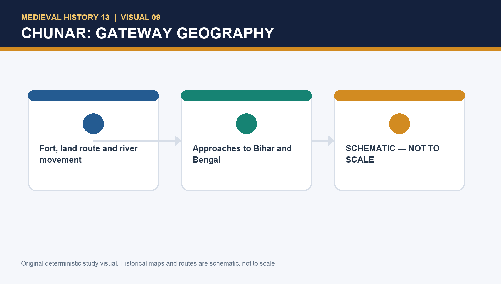

#### PARAGRAPH DEMONSTRATION — CLAIM → EVIDENCE → ANALYSIS → QUALIFICATION

A disciplined paragraph can argue that source disagreement on Dadrah or Daurah qualifies chronology without dissolving strategy. The named evidence is the differing sequence around the early Afghan phase and Chunar. This matters because it prevents false precision while preserving the secure point that eastern communications already troubled Humayun. The qualification is that awareness of danger did not equal mastery; later delays still helped Sher Khan expand.

#### CLOSING RECALL FLOW — THE EARLY AFGHAN PHASE: DADRAH/DAURAH AND CHUNAR

```text
START / CONCEPT: The early Afghan phase: Dadrah/Daurah and Chunar
        |
        v
EXACT TERMS: Dadrah/Daurah chronology caution · Chunar as gateway to Bihar · Kalinjar before Chunar · east-U.P. Afghan resistance · 1531-32 strategic sequence · underestimated future Sher Shah
        |
        v
MECHANISM / ARGUMENT: Chunar was called the gateway to Bihar because it sat in an approach system—not because one fort controlled the entire east by itself.
        |
        v
CONSEQUENCE / CONTRAST: The first settlement was therefore not absurd: Humayun had several fronts and an immediate interest in keeping Sher Khan apart from other Afghan rebels.
        |
        v
UPSC TRAP / ANSWER-USE: A fair answer says the calculation underestimated a future rival, but avoids claiming that the complete later Sher Shah was already obvious in 1531–32.
        |
        v
ANSWER-GRABBING FORMULATION: At Dadrah on the Gomti, Humayun defeated Afghan forces led in the eastern field; the strategic core is consolidation against east-U.P. resistance.
```

### SESSION 5 — DIN PANAH: OBSERVED PROJECT, POLITICAL MEANING

#### DEFINITION / WHAT THIS IS CALLED

**Plain-language definition:** The project did not by itself create revenue or noble loyalty, but its political logic is intelligible.

**Technical definition:** Construction, court ritual and public justice imagery are political acts, yet their effect depends on the material capacity and alliances that give them force.

#### ANSWER-GRABBING OPENING — WRITE/ADAPT IN THE EXAM

> The project did not by itself create revenue or noble loyalty, but its political logic is intelligible.

#### MUST-WRITE KEYWORDS

- **Din Panah**
- **observed project**
- **political meaning**
- **Humayun**
- **Delhi**
- **1533–34**

**How to use them:** Use Din Panah, Delhi and 1533–34 together: identify the project, explain why Delhi's prestige mattered, then qualify the answer by showing that architecture and ceremony could not replace revenue strength or noble cohesion.

Humayun built Din Panah at Delhi on the Yamuna in 1533–34. The local source rejects the view that the capital must be the product of a 'fevered imagination': Delhi had long carried prestige as a seat of imperial power, while Agra was closely associated with an Afghan predecessor. The account also notes initiatives such as court classifications, honours, a drum of justice and reported relief/remission measures, but cautions that time was needed for their effects.

Din Panah can be read as a legitimacy project in three linked senses. It placed the new dynasty in a city saturated with imperial associations; it offered a courtly and administrative centre through which a Timurid sovereign could stage authority; and it signalled an intention to be more than a transient conqueror. The project did not by itself create revenue or noble loyalty, but its political logic is intelligible.

Do not project later Mughal Delhi onto the 1530s. Nor should a building programme be dismissed because the state remained fragile. Construction, court ritual and public justice imagery are political acts, yet their effect depends on the material capacity and alliances that give them force.

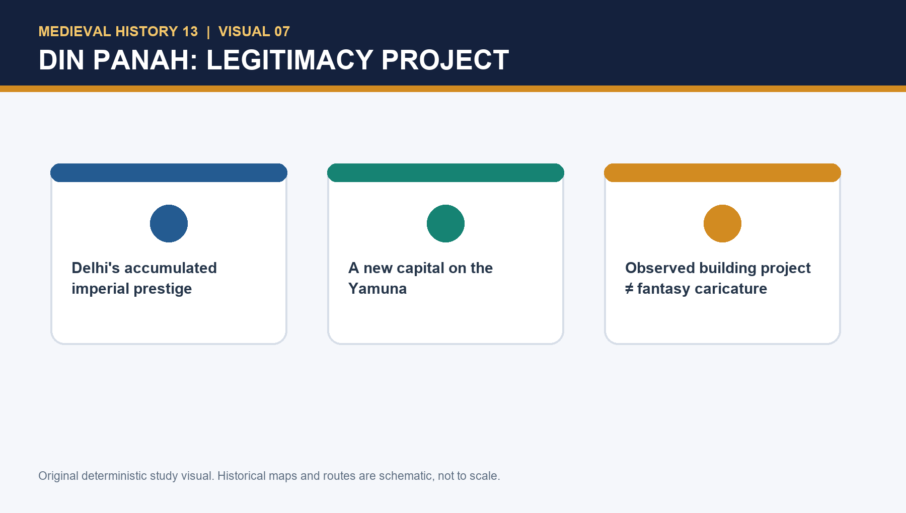

#### PARAGRAPH DEMONSTRATION — CLAIM → EVIDENCE → ANALYSIS → QUALIFICATION

A nuanced paragraph can claim that Din Panah expressed imperial intention but exposed the gap between symbolism and settlement. The named evidence is the Delhi capital project itself, tied to legitimacy and courtly cosmology. This shows that Humayun thought in imperial terms, not merely as a campaigning prince. The qualification is archaeological and political at once: multi-phase fabric complicates simple attribution, and urban symbolism could not substitute for stable revenue and provinces.

#### CLOSING RECALL FLOW — DIN PANAH: OBSERVED PROJECT, POLITICAL MEANING

```text
START / CONCEPT: Din Panah: observed project, political meaning
        |
        v
EXACT TERMS: Din Panah · observed project · political meaning · Humayun · Delhi · 1533–34
        |
        v
MECHANISM / ARGUMENT: Construction, court ritual and public justice imagery are political acts, yet their effect depends on the material capacity and alliances that give them force.
        |
        v
CONSEQUENCE / CONTRAST: Do not project later Mughal Delhi onto the 1530s.
        |
        v
UPSC TRAP / ANSWER-USE: The local source rejects the view that the capital must be the product of a 'fevered imagination': Delhi had long carried prestige as a seat of imperial power, while Agra was closely associated with an Afghan predecessor.
        |
        v
ANSWER-GRABBING FORMULATION: The project did not by itself create revenue or noble loyalty, but its political logic is intelligible.
```

### SESSION 6 — BAHADUR SHAH, MEWAR AND THE WESTERN THEATRE

#### DEFINITION / WHAT THIS IS CALLED

**Plain-language definition:** Topic 08 provides the bounded context of Gujarat's wealth and ports, including the later Portuguese/Diu pressure around Bahadur Shah; it is background, not a substitute for analysing inland power.

**Technical definition:** Bahadur Shah of Gujarat had acquired Malwa and sought wider influence in Rajasthan.

#### ANSWER-GRABBING OPENING — WRITE/ADAPT IN THE EXAM

> Topic 08 provides the bounded context of Gujarat's wealth and ports, including the later Portuguese/Diu pressure around Bahadur Shah; it is background, not a substitute for analysing inland power.

#### MUST-WRITE KEYWORDS

- **Bahadur Shah**
- **Mewar**
- **the western theatre**
- **Gujarat**
- **Malwa**
- **Rajasthan**

**How to use them:** Anchor the answer in Bahadur Shah's Gujarat-Malwa power, connect Mewar and Rajasthan to the safety of Agra-Delhi, and end by separating the inland strategic triangle from later Portuguese-Diu side issues.

Bahadur Shah of Gujarat had acquired Malwa and sought wider influence in Rajasthan. Chittor was besieged in this regional field. The source describes Humayun's movement to Gwalior as a warning: control of eastern Rajasthan by Gujarat could threaten the Agra–Delhi position. Bahadur Shah's court also contained Afghan and Timurid refugees, and his artillery resources added to his confidence. Topic 08 provides the bounded context of Gujarat's wealth and ports, including the later Portuguese/Diu pressure around Bahadur Shah; it is background, not a substitute for analysing inland power.

The correct map is triangular: Mewar's Chittor, Gujarat–Malwa's regional expansion, and the Mughal core around Delhi–Agra. Rajputs in this field were not a permanent homogeneous bloc. Relations shifted according to forts, Malwa, Rajasthan, Gujarat and the survival of particular rulers. A good answer shows how regional politics and Mughal security overlapped, rather than adding 'Rajputs' as a title token.

A mid-seventeenth-century Rajasthani account reports that Rani Karnavati sent a bracelet as rakhi to Humayun. The assigned source says contemporary accounts do not mention it. It may be examined as later historiographical memory; it cannot be used as settled proof that Humayun entered a permanent alliance or that the story caused his move. The verified Chittor setting does not depend on that legend.

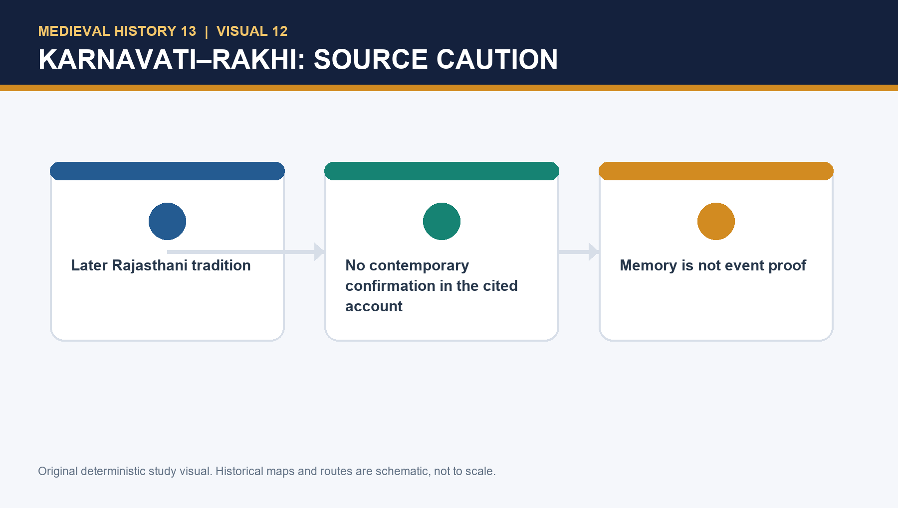

#### PARAGRAPH DEMONSTRATION — CLAIM → EVIDENCE → ANALYSIS → QUALIFICATION

A careful paragraph can argue that Humayun's western move answered a genuine strategic rival. The named evidence is Bahadur Shah's control over Gujarat and Malwa together with pressure on Chittor and Rajasthan. This matters because Delhi-Agra could not ignore western destabilisation. The qualification is that recognising the threat does not justify every later decision, especially while the eastern Afghan challenge was growing.

#### CLOSING RECALL FLOW — BAHADUR SHAH, MEWAR AND THE WESTERN THEATRE

```text
START / CONCEPT: Bahadur Shah, Mewar and the western theatre
        |
        v
EXACT TERMS: Bahadur Shah · Mewar · the western theatre · Gujarat · Malwa · Rajasthan
        |
        v
MECHANISM / ARGUMENT: Bahadur Shah of Gujarat had acquired Malwa and sought wider influence in Rajasthan.
        |
        v
CONSEQUENCE / CONTRAST: Rajputs in this field were not a permanent homogeneous bloc.
        |
        v
UPSC TRAP / ANSWER-USE: The assigned source says contemporary accounts do not mention it.
        |
        v
ANSWER-GRABBING FORMULATION: Topic 08 provides the bounded context of Gujarat's wealth and ports, including the later Portuguese/Diu pressure around Bahadur Shah; it is background, not a substitute for analysing inland power.
```

### SESSION 7 — GUJARAT AND MALWA, 1535–37: VICTORY WITHOUT DURABLE SETTLEMENT

#### DEFINITION / WHAT THIS IS CALLED

**Plain-language definition:** The Gujarat episode is a laboratory in the difference between campaign and administration.

**Technical definition:** But 'removed danger' is not identical with 'held Gujarat'.

#### ANSWER-GRABBING OPENING — WRITE/ADAPT IN THE EXAM

> The Gujarat episode is a laboratory in the difference between campaign and administration.

#### MUST-WRITE KEYWORDS

- **Gujarat**
- **Malwa**
- **victory without durable settlement**
- **Supply pressure at Mandsor avoided an artillery trap**
- **Mandu and Champaner showed operational reach**
- **Ahmedabad demonstrated a ten-month campaign's momentum**

**How to use them:** Track the campaign from Mandsor to Mandu, Champaner and Askari's assignment, then show why battlefield success collapsed once supply, noble commitment and provincial settlement failed.

Humayun marched from Agra in early 1535, moved through eastern Malwa and held a strategically advantageous position near Ujjain/Mandsor rather than directly attacking the Chittor siege. Bahadur Shah's defended camp used carts, ditches and artillery; Humayun avoided a frontal attack and cut supplies. Bahadur Shah withdrew; Mandu fell, then Champaner and Ahmedabad. The campaign was rapid and displayed real drive. Yet after assigning Askari overall responsibility and dividing Gujarat among nobles, Mughal authority collapsed. Bahadur Shah recovered, Askari withdrew, and Malwa too was lost by February 1537.

The Gujarat episode is a laboratory in the difference between campaign and administration. A commander can defeat an opponent, seize fortresses and distribute treasure; none of these actions creates a revenue system, local coalition or co-ordinated hierarchy. Many Mughal nobles had relocated to the Delhi–Agra area and did not wish to reside in Gujarat, which they treated as foreign. Askari's capacity, mutual suspicion, regional reassertion and Humayun's slow intervention combined. The failure is multi-causal, not a no-effort story.

| Military success | Administrative failure |
|---|---|
| Supply pressure at Mandsor avoided an artillery trap | Revenue was not gathered in time and command lacked cohesion |
| Mandu and Champaner showed operational reach | Begs did not acquire a stake in long-term settlement |
| Ahmedabad demonstrated a ten-month campaign's momentum | Regional reassertion and Bahadur Shah's return undid the arrangement |

The campaign was not a total waste. It destroyed an immediate western threat; Bahadur Shah's later death in a Portuguese-related fracas further removed that danger. But 'removed danger' is not identical with 'held Gujarat'.

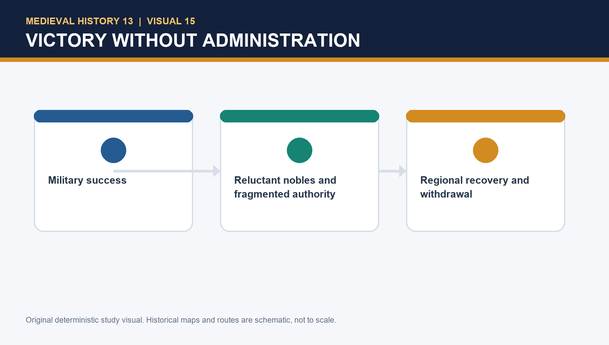

#### PARAGRAPH DEMONSTRATION — CLAIM → EVIDENCE → ANALYSIS → QUALIFICATION

A balanced paragraph can claim that Gujarat disproves the stereotype of a uniformly passive Humayun. The named evidence is the Mandsor-Mandu-Champaner-Ahmedabad sequence, which reveals energy and tactical patience. Yet the same evidence supports the opposite administrative judgement once occupation begins: nobles, revenue and co-ordination failed to harden victory into rule. The qualification is that western success still reduced Bahadur Shah's immediate challenge even though the province could not be durably held.

#### CLOSING RECALL FLOW — GUJARAT AND MALWA, 1535–37: VICTORY WITHOUT DURABLE SETTLEMENT

```text
START / CONCEPT: Gujarat and Malwa, 1535–37: victory without durable settlement
        |
        v
EXACT TERMS: Gujarat · Malwa · victory without durable settlement · Supply pressure at Mandsor avoided an artillery trap · Mandu and Champaner showed operational reach · Ahmedabad demonstrated a ten-month campaign's momentum
        |
        v
MECHANISM / ARGUMENT: Bahadur Shah recovered, Askari withdrew, and Malwa too was lost by February 1537.
        |
        v
CONSEQUENCE / CONTRAST: Many Mughal nobles had relocated to the Delhi–Agra area and did not wish to reside in Gujarat, which they treated as foreign.
        |
        v
UPSC TRAP / ANSWER-USE: But 'removed danger' is not identical with 'held Gujarat'.
        |
        v
ANSWER-GRABBING FORMULATION: The Gujarat episode is a laboratory in the difference between campaign and administration.
```

### SESSION 8 — SHER KHAN: BIHAR, SURAJGARH AND GAUR

#### DEFINITION / WHAT THIS IS CALLED

**Plain-language definition:** Sher Khan's position developed through Bihar, not through a single act of rebellion.

**Technical definition:** Sher Khan's reported readiness to leave Bihar and pay an annual sum if Bengal were confirmed to him should be read as a negotiation over political order.

#### ANSWER-GRABBING OPENING — WRITE/ADAPT IN THE EXAM

> Sher Khan's position developed through Bihar, not through a single act of rebellion.

#### MUST-WRITE KEYWORDS

- **Bihar power base**
- **Surajgarh, 1534**
- **Gaur, 1538**
- **Afghan state-building capacity**
- **negotiation over Bengal**
- **Topic 14 boundary on Sur administration**

**How to use them:** Trace the rise from Bihar to Surajgarh and Gaur, then show that negotiation, resources and coalition-building made Sher Khan a credible alternative before Chausa.

Sher Khan's position developed through Bihar, not through a single act of rebellion. He had virtual control there, defeated a Bengal force at Surajgarh in 1534, and was increasingly styled at a higher political register. By 1538 he had captured Gaur, Bengal's capital. His earlier Chunar settlement with Humayun had no power to keep him permanently subordinate; his son left Mughal service when the political relationship changed.

This is Afghan state-building capacity. Regional roots supplied intelligence, recruits, sanctuary and access to resources; able leadership linked these assets to a coalition; Gaur enlarged wealth and political scale. The outcome cannot be explained by a tribal stereotype. Afghan leaders were not a single timeless mass, and not all had identical interests. The point is that under a capable leader their networks could become a credible alternative to the mobile, not-yet-rooted Mughal ruling class.

Sher Khan's reported readiness to leave Bihar and pay an annual sum if Bengal were confirmed to him should be read as a negotiation over political order. Humayun's Bengal objective and Sher Khan's Bengal claim made the issue larger than a personal quarrel or one fort.

[BOUNDARY] Detailed Sur reforms—revenue, roads, sarais and later administration—belong to Topic 14. This topic establishes the political-military emergence that makes those reforms historically possible.

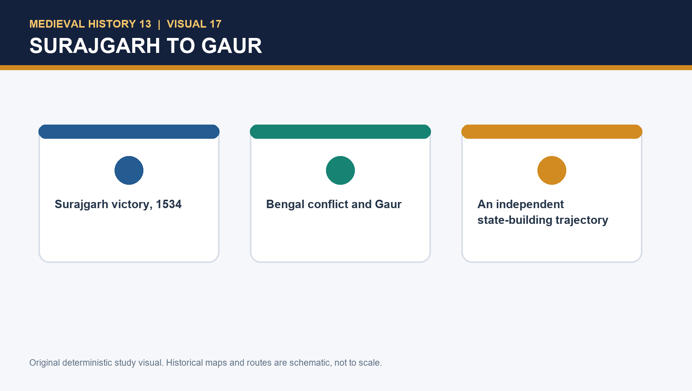

#### PARAGRAPH DEMONSTRATION — CLAIM → EVIDENCE → ANALYSIS → QUALIFICATION

A convincing paragraph can claim that Sher Khan became formidable before Chausa rather than because of Chausa. The named evidence is the chain from Bihar and Chunar to Surajgarh, Gaur and communications control. This proves cumulative scaling in prestige, revenue and strategic reach. The qualification is that Afghan chiefs were not naturally unified; Mughal errors still enlarged the opportunity available to Sher Khan.

#### CLOSING RECALL FLOW — SHER KHAN: BIHAR, SURAJGARH AND GAUR

```text
START / CONCEPT: Sher Khan: Bihar, Surajgarh and Gaur
        |
        v
EXACT TERMS: Bihar power base · Surajgarh 1534 · Gaur 1538 · Afghan state-building capacity · negotiation over Bengal · Topic 14 boundary
        |
        v
MECHANISM / ARGUMENT: Sher Khan's reported readiness to leave Bihar and pay an annual sum if Bengal were confirmed to him should be read as a negotiation over political order.
        |
        v
CONSEQUENCE / CONTRAST: The point is that under a capable leader their networks could become a credible alternative to the mobile, not-yet-rooted Mughal ruling class.
        |
        v
UPSC TRAP / ANSWER-USE: Afghan leaders were not a single timeless mass, and not all had identical interests.
        |
        v
ANSWER-GRABBING FORMULATION: Sher Khan's position developed through Bihar, not through a single act of rebellion.
```

### SESSION 9 — BENGAL: IMPERIAL AMBITION MEETS ROUTE, WEATHER AND ADMINISTRATION

#### DEFINITION / WHAT THIS IS CALLED

**Plain-language definition:** Bengal mattered to Humayun as an imperial objective, not merely as a rescue mission for Mahmud Shah.

**Technical definition:** Bengal added long communications, river and monsoon constraints, horse losses, an uncertain governor, noble reluctance and a rival capable of cutting the rear.

#### ANSWER-GRABBING OPENING — WRITE/ADAPT IN THE EXAM

> Bengal was an intelligible imperial objective, but one that exposed the carrying limits of the early Mughal state.

#### MUST-WRITE KEYWORDS

- **Bengal as imperial objective**
- **long communications**
- **Chunar siege, 1537-38**
- **Gaur occupation**
- **monsoon and river constraints**
- **rear links to Agra cut**

**How to use them:** Combine Bengal's attraction with Chunar delay, monsoon-river constraints and rear-link disruption to show why occupation turned into exposure.

Humayun left Agra for the east in July 1537, during the rainy season. He invested Chunar because leaving it hostile could threaten communications; the siege lasted until June 1538. In the meantime Sher Khan captured Gaur. Humayun reached Gaur after the rains and left early in 1539 according to the source's likely reconstruction. While he was in Bengal, Sher Khan pressed westward against key links and disrupted communication with Agra.

Bengal was not merely a rescue operation for Mahmud Shah. His appeal was an additional factor, but the source reads Humayun's main objective as Bengal itself: a rich, strategically large province in a vision of north-Indian imperial unity. The ambition was intelligible; the capacity was insufficient. Gujarat had already shown the problem of administering a distant space. Bengal added long communications, river and monsoon constraints, horse losses, an uncertain governor, noble reluctance and a rival capable of cutting the rear.

Avoid saying that monsoon or river geography 'caused' defeat. Geography becomes politically decisive only through supply, route security, intelligence, speed and command. Nor was Humayun inert at Gaur: he received envoys and attempted to address the Hindal crisis. The analytical verdict is that occupation did not solve the administration-and-communications problem it revealed.

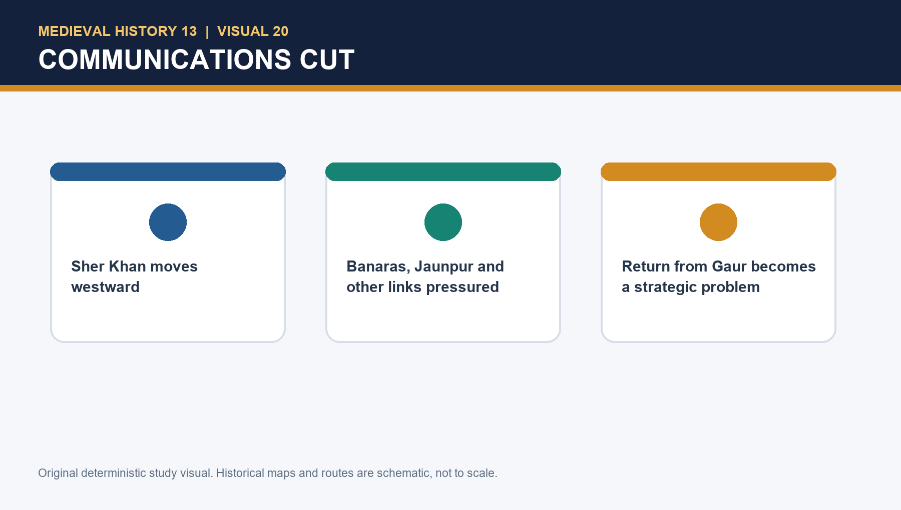

#### PARAGRAPH DEMONSTRATION — CLAIM → EVIDENCE → ANALYSIS → QUALIFICATION

An examiner-grade paragraph can claim that Bengal exposed the gap between imperial aspiration and the carrying capacity of the early Mughal state. The named evidence is the long Chunar delay, the occupation of Gaur and Sher Khan's ability to threaten links back to Agra. This matters because it shows that possession of a capital did not equal provincial rule. The qualification is that geography alone did not decide events; political choice and administrative weakness made distance destructive.

#### CLOSING RECALL FLOW — BENGAL: IMPERIAL AMBITION MEETS ROUTE, WEATHER AND ADMINISTRATION

```text
START / CONCEPT: Bengal: imperial ambition meets route, weather and administration
        |
        v
EXACT TERMS: Bengal as imperial objective · long communications · Chunar siege 1537-38 · Gaur occupation · monsoon and river constraints · rear links to Agra cut
        |
        v
MECHANISM / ARGUMENT: He invested Chunar because leaving it hostile could threaten communications; the siege lasted until June 1538.
        |
        v
CONSEQUENCE / CONTRAST: While he was in Bengal, Sher Khan pressed westward against key links and disrupted communication with Agra.
        |
        v
UPSC TRAP / ANSWER-USE: Bengal was not merely a rescue operation for Mahmud Shah.
        |
        v
ANSWER-GRABBING FORMULATION: His appeal was an additional factor, but the source reads Humayun's main objective as Bengal itself: a rich, strategically large province in a vision of north-Indian imperial unity.
```

### SESSION 10 — CHAUSA AND KANNAUJ/BILGRAM: DISTINGUISH THE BATTLES

#### DEFINITION / WHAT THIS IS CALLED

**Plain-language definition:** Chausa is a causation question: terrain behind the force limited retreat, surprise exposed command weakness, and the larger campaign had already strained communications and morale.

**Technical definition:** Kannauj is a political decision question: a weakened army, fractured co-operation and Sher Khan's command converted prior shock into displacement.

#### ANSWER-GRABBING OPENING — WRITE/ADAPT IN THE EXAM

> Chausa is a causation question: terrain behind the force limited retreat, surprise exposed command weakness, and the larger campaign had already strained communications and morale.

#### MUST-WRITE KEYWORDS

- **Chausa**
- **Kannauj/Bilgram**
- **Immediate form**
- **Surprise and exposed position near the Karmnasa**
- **Decisive renewed battle**
- **Campaign context**

**How to use them:** Separate the two battles sharply: explain Chausa through exposed position, surprise and campaign fatigue, then explain Kannauj through weakened forces, missing reinforcements and the final loss of north India.

At Chausa on 26 June 1539, Humayun faced Sher Khan after a difficult return from the Bengal theatre. The source criticises the Mughal placement of the river Karmnasa behind the position, poor deployment and the failure to prevent surprise. Humayun escaped. At Kannauj/Bilgram on 17 May 1540, a hastily assembled Mughal force faced the Afghans after Kamran had refused to place his hardened troops under Humayun's command. The result was decisive defeat and the loss of north India.

Chausa is a causation question: terrain behind the force limited retreat, surprise exposed command weakness, and the larger campaign had already strained communications and morale. Kannauj is a political decision question: a weakened army, fractured co-operation and Sher Khan's command converted prior shock into displacement. The difference stops a common Prelims/Mains error: Chausa did not itself end all Mughal power, while Kannauj did not occur in a vacuum.

| Dimension | Chausa, 1539 | Kannauj/Bilgram, 1540 |
|---|---|---|
| Immediate form | Surprise and exposed position near the Karmnasa | Decisive renewed battle |
| Campaign context | Return from Bengal with strained communications | Post-Chausa political and military fragmentation |
| Brothers | Not an excuse for poor position | Kamran's hardened troops unavailable |
| Political effect | Humayun survived but lost confidence and initiative | Mughal loss of north India |

Avoid decorative escape anecdotes unless precisely sourced. A battle answer earns more by explaining position, logistics, command and opponent capacity than by repeating a dramatic story.

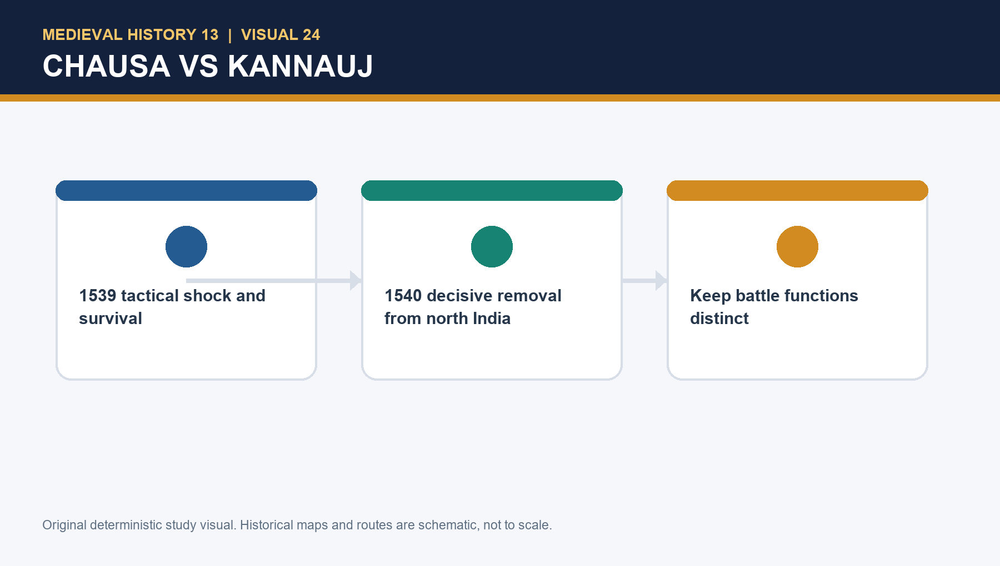

#### PARAGRAPH DEMONSTRATION — CLAIM → EVIDENCE → ANALYSIS → QUALIFICATION

A precise paragraph can claim that Chausa and Kannauj belong to one crisis but perform different explanatory work. The named evidence is June 1539 Chausa with the Karmnasa problem and May 1540 Kannauj/Bilgram as the later decisive battle. This matters because Topic 13 cannot be solved by one dramatic battlefield anecdote. The qualification is that neither defeat yields to one cause such as weather, artillery or Kamran alone.

#### CLOSING RECALL FLOW — CHAUSA AND KANNAUJ/BILGRAM: DISTINGUISH THE BATTLES

```text
START / CONCEPT: Chausa and Kannauj/Bilgram: distinguish the battles
        |
        v
EXACT TERMS: Chausa · Kannauj/Bilgram · Immediate form · Surprise and exposed position near the Karmnasa · Decisive renewed battle · Campaign context
        |
        v
MECHANISM / ARGUMENT: At Kannauj/Bilgram on 17 May 1540, a hastily assembled Mughal force faced the Afghans after Kamran had refused to place his hardened troops under Humayun's command.
        |
        v
CONSEQUENCE / CONTRAST: Kannauj is a political decision question: a weakened army, fractured co-operation and Sher Khan's command converted prior shock into displacement.
        |
        v
UPSC TRAP / ANSWER-USE: Do not miss this limiting distinction: the result was decisive defeat and the loss of north India.
        |
        v
ANSWER-GRABBING FORMULATION: Chausa is a causation question: terrain behind the force limited retreat, surprise exposed command weakness, and the larger campaign had already strained communications and morale.
```

### SESSION 11 — EXILE, SAFAVID ASSISTANCE AND RESTORATION

#### DEFINITION / WHAT THIS IS CALLED

**Plain-language definition:** The secure formulation is: Shah Tahmasp's assistance helped Humayun recover Qandahar and Kabul; any particular condition must be tied to a named, precise source.

**Technical definition:** Restoration then depended upon a changed Indian political field in which the Sur order had fragmented.

#### ANSWER-GRABBING OPENING — WRITE/ADAPT IN THE EXAM

> Exile reveals that dynastic legitimacy without resources could not command regional support.

#### MUST-WRITE KEYWORDS

- **Exile**
- **Safavid assistance**
- **Qandahar and Kabul**
- **Sindh and Marwar**
- **Sur fragmentation**
- **Delhi restoration, 1555**

**How to use them:** Follow the exile from Sindh and Marwar to Safavid help, then show how recovery first rebuilt the north-west base before Sur fragmentation opened the road back to Delhi.

After defeat, Humayun spent roughly two and a half years in the Sindh–regional theatre; local rulers and Maldeo of Marwar did not provide the durable support he sought. He later took refuge with Shah Tahmasp of Iran. With Iranian help he recovered Qandahar and Kabul in 1545. In 1555, amid Sur fragmentation, he recovered Delhi. He died in 1556, leaving the transition to Akbar.

Exile reveals that dynastic legitimacy without resources could not command regional support. Sindh and Marwar calculated their own risk; their caution was a political fact, not a moral footnote. Safavid aid rebuilt a territorial platform at the north-western hinge. Qandahar and Kabul therefore matter as bases of recovery and diplomacy, not only as points on a route. Restoration then depended upon a changed Indian political field in which the Sur order had fragmented.

The Safavid relationship included political and religious dimensions, but this package does not turn it into a simplistic, source-free statement of permanently forced conversion. The secure formulation is: Shah Tahmasp's assistance helped Humayun recover Qandahar and Kabul; any particular condition must be tied to a named, precise source.

Delhi recovery does not erase the earlier collapse. Conversely, the earlier collapse does not make restoration trivial. A graded judgement calls 1555 dynastic rehabilitation through regained capacity and opportunity, while recognising that a more durable consolidation awaited Akbar.

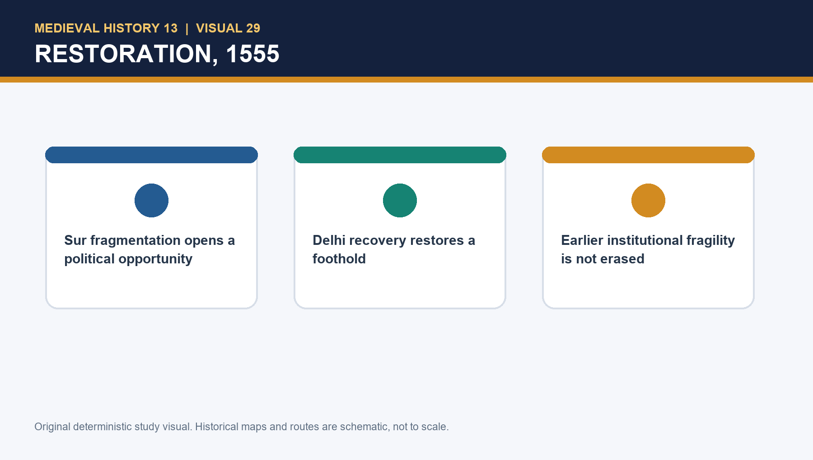

#### PARAGRAPH DEMONSTRATION — CLAIM → EVIDENCE → ANALYSIS → QUALIFICATION

A mature paragraph can argue that Humayun failed within a structure he worsened rather than created. The named evidence is the chain from unfinished inheritance and Gujarat-Bengal overreach to Sher Khan's Bihar-Bengal base and the battle pair of Chausa and Kannauj. This supports a weighted explanation in which no single factor is sovereign. The qualification is that structural reasoning must not become absolution: Chunar delay, Gaur occupation and exposed battlefield posture still remain choices.

#### CLOSING RECALL FLOW — EXILE, SAFAVID ASSISTANCE AND RESTORATION

```text
START / CONCEPT: Exile, Safavid assistance and restoration
        |
        v
EXACT TERMS: Exile · Safavid assistance · restoration · Sindh · Marwar · Indian
        |
        v
MECHANISM / ARGUMENT: Restoration then depended upon a changed Indian political field in which the Sur order had fragmented.
        |
        v
CONSEQUENCE / CONTRAST: The Safavid relationship included political and religious dimensions, but this package does not turn it into a simplistic, source-free statement of permanently forced conversion.
        |
        v
UPSC TRAP / ANSWER-USE: Sindh and Marwar calculated their own risk; their caution was a political fact, not a moral footnote.
        |
        v
ANSWER-GRABBING FORMULATION: Exile reveals that dynastic legitimacy without resources could not command regional support.
```

### SESSION 12 — HISTORIOGRAPHY, HERITAGE AND THE FINAL VERDICT

#### DEFINITION / WHAT THIS IS CALLED

**Plain-language definition:** This session weighs the later memory, historiography and final judgement on Humayun after tracing the full struggle for empire.

**Technical definition:** Historiography here means replacing moral caricature with evidence-led causation, while the heritage anchor of Humayun's Tomb is used only to discuss later dynastic memory.

#### ANSWER-GRABBING OPENING — WRITE/ADAPT IN THE EXAM

> The final verdict on Humayun should join historiography, heritage and causation rather than repeat a moral caricature.

#### MUST-WRITE KEYWORDS

- **Finance and fragile administration**
- **Afghan alternative under Sher Khan**
- **nobles and brothers**
- **Gujarat-Bengal governance gap**
- **Chausa to Kannauj sequence**
- **Humayun's Tomb as memory, not proof**

**How to use them:** Build the verdict from institutional fragility, Afghan strength and battle sequence; then use Humayun's Tomb only as a later memory anchor, not as campaign evidence.

The local source challenges older moralising portraits that treat opium or indolence as a total explanation. It notes sustained campaigns, including Gujarat, while also documenting spells of pleasure, poor coordination and specific strategic failures. UNESCO's Humayun's Tomb page describes a grand garden-tomb built in the 1560s under Akbar's patronage, a charbagh design and a later dynastic memorial complex.

The best rehabilitation is evidence-led, not celebratory. Humayun showed military drive at Gujarat and resilience in recovery; he also underestimated Sher Khan, failed to convert victory into administration, permitted the Bengal communications problem to grow, and adopted a bad position at Chausa. Sher Khan's leadership was not an external background condition; Afghan political-military capacity was a rival causal force.

The heritage anchor has a narrow use. It can introduce dynastic memory, architecture, conservation and the later representation of Humayun as part of Mughal continuity. It cannot prove the rakhi tradition, the date of Dadrah, a battlefield escape or the political motives of the 1530s.

> MEMORY: **F-A-N-G-B** — **F**inance and fragile administration; **A**fghan alternative; **N**obles and brothers; **G**ujarat/Bengal governance gap; **B**attle sequence Chausa → Kannauj. Add restoration as the qualified final turn.

Humayun put north-Indian imperial unity on the agenda before his ruling class could carry it. The state failed not because one man was fated to fail, but because decision sequence and personal judgement met weak institutional depth, mobile nobles, brothers, regional competitors, difficult communications and an Afghan leader who could organise the available alternative.


#### PARAGRAPH DEMONSTRATION — CLAIM → EVIDENCE → ANALYSIS → QUALIFICATION

A strong paragraph can claim that exile and restoration reveal the social depth of dynastic politics. The named evidence is Hamida Banu Begum within the moving court, Akbar's birth at Amarkot, Safavid aid under Shah Tahmasp and the 1555 recovery of Delhi in a fragmented Sur field. This matters because empire persisted as household, diplomacy and remembered legitimacy before it returned as territory. The qualification is that restoration did not equal full consolidation, which is why Humayun's death in 1556 immediately reopened fragility.

#### CLOSING RECALL FLOW — HISTORIOGRAPHY, HERITAGE AND THE FINAL VERDICT

```text
START / CONCEPT: Historiography, heritage and the final verdict
        |
        v
EXACT TERMS: finance and fragile administration · Afghan alternative under Sher Khan · nobles and brothers · Gujarat-Bengal governance gap · Chausa to Kannauj sequence · Humayun's Tomb as memory
        |
        v
MECHANISM / ARGUMENT: The state failed not because one man was fated to fail, but because decision sequence and personal judgement met weak institutional depth, mobile nobles, brothers, regional competitors, difficult communications and an Afghan leader who could organise the available alternative.
        |
        v
CONSEQUENCE / CONTRAST: Sher Khan's leadership was not an external background condition; Afghan political-military capacity was a rival causal force.
        |
        v
UPSC TRAP / ANSWER-USE: The best rehabilitation is evidence-led, not celebratory.
        |
        v
ANSWER-GRABBING FORMULATION: Humayun put north-Indian imperial unity on the agenda before his ruling class could carry it.
```

## BASIC MCQS / REMEDIATION

### Part I — 16 learning MCQs with strict ABCD rotation

#### Learning MCQ 1

**Question:** What best describes the empire Humayun received in December 1530?

- A. A conquest with weak finances, shallow administration, active Afghan resistance and mobile nobles.
- B. A polity where Timurid princes had abandoned all claims to separate shares.
- C. A kingdom whose eastern and western frontiers were already permanently secured.
- D. A settled revenue state with a uniformly loyal service elite.

**Answer: A.**

**Explanation:** Babur's conquest opened Delhi–Agra but did not create an entrenched Indian ruling apparatus; the inherited constraints were fiscal, administrative, political and regional.


#### Learning MCQ 2

**Question:** Why is Kamran's early position not best described as an immediate explanation of every later Mughal defeat?

- A. He never held territory outside Kabul.
- B. He held Kabul–Qandahar and then Lahore–Punjab, but the early eastern and Gujarat episodes also had independent strategic causes.
- C. He submitted all troops to Humayun after 1530.
- D. He commanded Sher Khan's forces at Chausa.

**Answer: B.**

**Explanation:** Kamran's de facto partition mattered, yet the evidence warns against making fraternal rivalry a universal explanation before the Bengal crisis and Chausa.


#### Learning MCQ 3

**Question:** What is the safest treatment of Dadrah/Daurah and Chunar chronology?

- A. Their day and month are fixed by every chronicle.
- B. Nizamuddin Ahmad describes both in exactly the same sequence as Abul Fazl.
- C. Nizamuddin's different dating/sequence means precise reconstruction is qualified, while the consolidation logic remains clear.
- D. The discrepancy proves that no Afghan threat existed.

**Answer: C.**

**Explanation:** The source issue affects tight chronology, not the broader reading that Humayun sought to secure eastern Uttar Pradesh without yet invading Bihar.


#### Learning MCQ 4

**Question:** Chunar was strategically important chiefly because it:

- A. was the only route between Delhi and Bengal.
- B. was a ceremonial capital of Gujarat.
- C. automatically controlled every Bengal river crossing.
- D. sat at a key approach toward Bihar and Bengal, linking fort, land movement and river-side communications.

**Answer: D.**

**Explanation:** A powerful fort could threaten a campaign's communications, but it was one node within a wider logistical landscape, not a magical single-cause bottleneck.


#### Learning MCQ 5

**Question:** Din Panah is best read as:

- A. a Delhi-centred legitimacy and political project whose full institutional effect could not be immediate.
- B. a Safavid military camp in Kabul.
- C. a monument built after Humayun's death by Akbar.
- D. proof that Humayun had permanently abandoned Agra.

**Answer: A.**

**Explanation:** Delhi's accumulated imperial prestige made a new capital intelligible; the project should neither be romanticised nor dismissed as fantasy.


#### Learning MCQ 6

**Question:** Which statement captures the Karnavati–rakhi story responsibly?

- A. It is fully confirmed by a contemporary Mughal dispatch.
- B. A later Rajasthani account records a bracelet tradition, but the cited contemporary evidence is silent; it is historiographical memory, not event proof.
- C. It proves Humayun captured Chittor in 1532.
- D. It establishes a permanent Mughal–Rajput alliance.

**Answer: B.**

**Explanation:** The issue is provenance: a later tradition can illuminate memory, but silence in contemporary sources prevents treating it as settled political fact.


#### Learning MCQ 7

**Question:** Humayun's 1535 Gujarat campaign shows that:

- A. Humayun was incapable of rapid campaigning.
- B. Gujarat lacked any military capacity.
- C. military drive brought Mandu, Champaner and Ahmedabad, but conquest was not converted into durable administration.
- D. Bahadur Shah had no connection with Malwa or Chittor.

**Answer: C.**

**Explanation:** The campaign demonstrates real operational ability; its failure lay in settlement, coordination and willingness to administer, rather than in a denial of the victories.


#### Learning MCQ 8

**Question:** Why did Gujarat slip from Mughal control after the campaign?

- A. Humayun never appointed anyone in Gujarat.
- B. A single local popular uprising expelled every Mughal force.
- C. Portuguese troops occupied all of Malwa.
- D. Disunited command, reluctant nobles, weak revenue settlement, regional reassertion and Bahadur Shah's recovery worked together.

**Answer: D.**

**Explanation:** Askari received charge and divisions were assigned, but the arrangements did not generate stable co-operation or locally rooted rule.


#### Learning MCQ 9

**Question:** Sher Khan's rise must be understood as:

- A. a Bihar-centred Afghan state-building challenge with regional resources, alliances and growing independence.
- B. a Portuguese governor at Diu.
- C. a minor court rebel with no territorial base.
- D. a Mughal officer permanently bound by the first Chunar agreement.

**Answer: A.**

**Explanation:** Surajgarh, Bihar and Gaur reveal an autonomous political trajectory; the earlier accommodation did not freeze Sher Khan in a subordinate role.


#### Learning MCQ 10

**Question:** The Bengal campaign was not merely an attempt to rescue a displaced Bengal ruler because:

- A. Sher Khan offered Humayun all of Gujarat.
- B. the source presents Bengal itself—wealth, strategic extent and an imperial north-Indian vision—as the central prize.
- C. Humayun had no contact with Bengal politics.
- D. Gaur lay west of Agra.

**Answer: B.**

**Explanation:** Mahmud Shah's appeal was an additional reason in the narrative; it cannot displace the broader contest over Bengal and imperial reach.


#### Learning MCQ 11

**Question:** The six-month 1537–38 siege of Chunar mattered because it:

- A. made river movement irrelevant thereafter.
- B. immediately destroyed Sher Khan's Bihar base.
- C. consumed time while Sher Khan captured Gaur and reconfigured the eastern contest.
- D. proved Bengal had been annexed before the siege.

**Answer: C.**

**Explanation:** The fort had operational importance, but its fall did not dissolve Sher Khan's wider coalition or prevent his Bengal advance.


#### Learning MCQ 12

**Question:** What made Humayun's occupation of Gaur strategically hazardous?

- A. Mewar's army surrounded Gaur.
- B. Humayun had no army in Bengal.
- C. the city had no river links.
- D. Sher Khan could press the lines back toward Agra while nobles lacked commitment to govern a distant region.

**Answer: D.**

**Explanation:** The problem was not a vacant army but communications, horses, distance, administrative reluctance and a rival who exploited the western corridor.


#### Learning MCQ 13

**Question:** At Chausa on 26 June 1539, the clearest source-grounded operational criticism is that Humayun:

- A. kept the Karmnasa at his back, deployed poorly and was surprised by Sher Khan.
- B. was defeated at Delhi by Bahadur Shah.
- C. lost because all Rajputs switched sides.
- D. had no knowledge that Sher Khan existed.

**Answer: A.**

**Explanation:** The battle is explained through position, surprise and command within a fatigued campaign, not by pretending the Afghan challenge had been invisible for years.


#### Learning MCQ 14

**Question:** Kannauj/Bilgram, 17 May 1540, differs from Chausa because it:

- A. occurred before Humayun's accession.
- B. was the decisive battle after Chausa that removed Humayun from north India, fought with a hastily assembled force without Kamran's hardened troops.
- C. was an unimportant skirmish won by the Mughals.
- D. was a Gujarat siege.

**Answer: B.**

**Explanation:** Chausa exposed vulnerability; Kannauj converted it into political displacement. Kamran's non-cooperation mattered acutely after Chausa.


#### Learning MCQ 15

**Question:** Which assessment of Askari and Hindal is historically balanced?

- A. They were Afghan chiefs under Sher Khan.
- B. They controlled the Safavid court.
- C. They broadly served Humayun until the Bengal phase, after which Hindal's independent bid and elite defections sharpened the crisis.
- D. They opposed Humayun from the first month of his reign.

**Answer: C.**

**Explanation:** The source expressly cautions that their opposition has been overextended backward; chronology matters to causal explanation.


#### Learning MCQ 16

**Question:** Humayun's recourse to Shah Tahmasp should be described as:

- A. a wholly cost-free rescue that ended all frontier problems.
- B. a forced religious conversion established by an uncontested source.
- C. proof that Qandahar never mattered to the Mughals.
- D. a political alliance and aid relationship requiring careful treatment of its conditions, enabling recovery of Qandahar and Kabul in 1545.

**Answer: D.**

**Explanation:** The secure point is assistance and recovery; over-simple conversion tales exceed the precision allowed by the assigned evidence.


## PYQS AND ANSWER PRACTICE

### Direct PYQ ownership audit

The canonical Basic and Advanced Topic 13 owners were rechecked first. They route **zero direct UPSC Civil Services PYQs to Topic 13 for 2018–2026**, and no exact Humayun-owned prelims wording is locally secure enough to reproduce from the adjacent Gujarat route. That gap is preserved honestly here.

### Transparent routed / adjacent support items

All four retained support items below are explicitly **adjacent or routed support PYQs**, not relabelled direct Topic 13 ownership claims. They are kept because they sharpen chronology discipline, source method and military-technology reasoning relevant to Topic 13.

#### Adjacent PYQ 1 — UPSC Prelims GS-I 2021 chronology route (wording verified locally; key inferred)

**Question as securely verified from local OCR:** Consider the following statements:

1. It was during the reign of Iltutmish that Chengiz Khan reached the Indus in pursuit of the fugitive Khwarezm prince.  
2. It was during the reign of Muhammad bin Tughluq that Taimur occupied Multan and crossed the Indus.  
3. It was during the reign of Deva Raya II of Vijayanagara Empire that Vasco da Gama reached the coast of Kerala.

**Option-row status:** The local OCR preserves the combination row imperfectly, but earlier validated repository usage supports the standard set containing “1 only”, “1 and 2”, “3 only” and “2 and 3”.

**Inferred answer — not officially verified locally:** **1 only.** Confidence: high.

**How to think it through:** Statement 1 is correct because Chinggis Khan reached the Indus in 1221 during Iltutmish's reign. Statement 2 is incorrect because Timur's Indian invasion belongs to 1398, far after Muhammad bin Tughluq. Statement 3 is incorrect because Vasco da Gama reached Kerala in 1498, long after Deva Raya II. For Topic 13, this route matters only as chronology discipline: if earlier medieval dates are blurred, the Humayun-Sher Khan sequence also becomes easy to misplace.

**Demand decoding:** This is a chronology-elimination question. In Topic 13, its use is bounded: keep pre-Mughal medieval anchors clear so 1530-1556 chronology is not written against a blurred background.

**Executable answer/elimination plan:** Test each statement independently by ruler and date; once Statements 2 and 3 fail, the combination narrows to “1 only”.

**Why this earns marks / route earns marks:** It shows exact chronological elimination and honestly preserves the inferred-key status instead of pretending to hold an official local answer row.

**How to improve/strengthen:** Add the year 1398 explicitly when rejecting Timur so north-west frontier chronology becomes even harder to confuse with sixteenth-century Mughal events.

#### Adjacent PYQ 2 — UPSC Prelims GS-I 2022 frontier chronology route (wording verified locally; key inferred)

**Question:** With reference to Indian history, consider the following statements:

1. The first Mongol invasion of India happened during the reign of Jalal-ud-din Khalji.  
2. During the reign of Ala-ud-din Khalji, one Mongol assault marched up to Delhi and besieged the city.  
3. Muhammad-bin-Tughlaq temporarily lost portions of north-west of his kingdom to Mongols.

Which of the statements given above is/are correct?

- A. 1 and 2  
- B. 2 only  
- C. 1 and 3  
- D. 3 only

**Inferred answer — not officially verified locally:** **B. 2 only.** Confidence: high.

**How to think it through:** Statement 1 falls because Mongol pressure on India predates Jalaluddin Khalji. Statement 2 stands because Alauddin's reign did face a major Mongol assault that reached Delhi. Statement 3 is not retained in the secure repository route, so the safe answer remains B. For Topic 13, this item works only as adjacent frontier chronology and should not be relabelled as a Humayun PYQ.

**Demand decoding:** Answer statement-by-statement and keep earlier frontier chronology separate from the later Humayun-Afghan struggle.

**Executable answer/elimination plan:** Reject Statement 1 first on chronology, preserve Statement 2, then treat Statement 3 cautiously within the already-audited repository route before choosing B.

**Why this earns marks / route earns marks:** It earns marks by separating earlier Mongol frontier pressure from later Mughal chronology instead of collapsing all north-west crises together.

**How to improve/strengthen:** Name Alauddin Khalji directly in the elimination line so the accepted statement is anchored to a ruler, not merely to a period label.

#### Routed PYQ 3 — UPSC GS-I 2020 source-method support

**Question:** Persian literary sources of medieval India reflect the spirit of the age. Comment. (Answer in 250 words)

**Model answer:** Persian literary sources are indispensable because they preserve kingship, conquest, morality and courtly self-presentation; yet they reflect the age only when read with genre caution. For Topic 13, the most transferable examples are Gulbadan Begum's *Humayun-nama*, later Mughal chronicles such as the *Akbarnama* and compilations like *Tabaqat-i Akbari*, together with Afghan memory texts such as Sarwani's *Tarikh-i Sher Shahi*. These works reveal household politics, exile, kingship, diplomacy and the political language of the sixteenth century, but none is a transparent mirror. Gulbadan is retrospective and family-centred, official chronicles carry dynastic teleology, and Afghan narratives have their own retrospective admiration. Hence Persian literary texts reflect the age in a refracted way. Their greatest value lies in showing elite assumptions, political vocabulary and remembered crisis, while coins, forts, inscriptions and chronology control provide the needed check. For Topic 13, the safest lesson is to use memoir and chronicle boldly for perspective, but never as untested final authority.

**Demand decoding:** Treat this as a source-method question: explain value and limitation together, then show how *Humayun-nama* and later chronicles illuminate Topic 13 without exhausting it.

**Executable answer/elimination plan:** Open with the value-limitation thesis, move to Gulbadan and later Persian/Afghan texts as named evidence, then close with corroboration through material and chronological checks.

**Why this earns marks / route earns marks:** It turns a general Persian-source demand into a precise Humayun-era evidence lesson without pretending that the question is Topic 13-owned.

**How to improve/strengthen:** Add one sentence naming what coins, khutba or fort occupation can show so the non-literary corroboration rule appears even more sharply.

#### Routed PYQ 4 — UPSC GS-I 2023 technology route

**Question:** What were the major technological changes introduced during the Sultanate period? How did those technological changes influence the Indian society? (Answer in 250 words)

**Model answer:** The Sultanate mattered technologically because it accelerated the spread and systematisation of techniques in architecture, warfare and administration. Topic 13 borrows this route only for the military and communication angle. By Humayun's time, firearms, fortified positions, route-forts and mobile command had become more consequential in north Indian warfare, but Chausa and Kannauj show that technology mattered only when joined to logistics and organisation. Chunar's strategic value lay in route control, while Sher Khan's success depended on intelligence, movement and communications as much as on armed force. The larger social effect of such technological change lay in state capacity: stronger siege work, more demanding military coordination and sharper pressure on revenue and supply. Yet this must not be romanticised as automatic progress. Technology strengthened states and commanders unevenly, and in Topic 13 superior political organisation still mattered more than the mere possession of guns or forts. The best borrowed lesson is that early Mughal-Afghan warfare belongs to a wider history of changing military techniques, but cannot be reduced to hardware alone.

**Demand decoding:** Use the question as a technology-plus-society prompt, then borrow Chunar, communications and battlefield organisation only as bounded examples relevant to Topic 13.

**Executable answer/elimination plan:** List broader technological fields quickly, then narrow to eastern route-forts, firearms and command so the answer remains tied to the verified question.

**Why this earns marks / route earns marks:** It earns marks because it keeps the topic within its proper boundary: Topic 13 can illuminate state capacity and warfare without pretending to own the full Sultanate technology question.

**How to improve/strengthen:** Add one short phrase distinguishing fort, firearm and communication technology so the borrowed Topic 13 examples appear as a subset of the larger medieval change.


### Original solved Mains questions

Exactly six original Mains models are retained below: **2 × 10 marks**, **2 × 15 marks**, **2 × 20 marks**.

#### Original Mains 1 — Examine the proposition that Humayun inherited an unfinished conquest. (10 marks; 150 words)

**Model solution**

**Claim.** Humayun inherited a conquest rather than a settled empire. Babur's victories had created a Delhi–Agra core, but the state that passed in December 1530 remained financially and administratively thin.

**Named evidence and analysis.** First, the local Satish Chandra account notes stretched finances after Babur had exhausted the Lodi treasure and sought a share from assigned revenues. That evidence matters because war, rewards and office-holding required a dependable fiscal base; a victory treasury was not a routine revenue system. Second, the administration relied heavily on begs holding large assignments. Such delegation could mobilise men, yet it also made local authority and collection dependent on followers whose interests were not automatically identical with the centre. Third, eastern Afghans remained politically active from east Uttar Pradesh to Bihar, while Sher Khan had access to Chunar. This shows that Panipat and Ghaghra had not dissolved Afghan political capacity.

**Qualification.** The inheritance was not empty. Humayun had Delhi–Agra prestige, military resources and scope for action, as Dadrah and Gujarat later show. Nor should Kamran's position be presented as an instant terminal fracture: it relieved Humayun of some north-western burdens before becoming acute in the later crisis.

**Conclusion.** The phrase 'unfinished conquest' therefore means a mismatch between territorial claim and institutional depth. It explains vulnerability without denying agency: Humayun still had to choose priorities, and Sher Khan still had to build an alternative coalition.

**Demand decoding:** The directive **examine** requires a direct position on “Mains 1. Examine the proposition that Humayun inherited an unfinished conquest.”, coverage of every clause, evidence-led analysis and a qualified verdict.

**Executable answer/elimination plan:** For a 15-mark answer, open with a two-sentence thesis; organise five named evidence units as claim → evidence → inference → qualification; reserve the final lines for a graded conclusion.

**Why this earns marks / route earns marks:** It defines the proposition, deploys fiscal, administrative and Afghan evidence, and ends with a qualified causal verdict rather than a personality label.

**How to improve/strengthen:** For “Mains 1. Examine the proposition that Humayun inherited an unfinished conquest.”, replace the weakest generalisation with one additional named site, text, inscription, coin, ruler or scholarly position and state exactly what that evidence cannot prove.


#### Original Mains 2 — Evaluate Humayun's Gujarat campaign. (10 marks; 150 words)

**Model solution**

**Claim.** The Gujarat campaign was a serious military achievement but an administrative failure; either half of that judgement is inadequate.

**Evidence and analysis.** Bahadur Shah's Gujarat–Malwa power and pressure around Chittor made the western theatre strategically relevant to Delhi–Agra. In 1535 Humayun moved through eastern Malwa, held a position near Ujjain/Mandsor, and avoided the frontal attack that Bahadur Shah's artillery-backed camp invited. By cutting supplies, he compelled withdrawal; Mandu, Champaner and later Ahmedabad fell. These named stages demonstrate drive, operational patience and personal courage, not passivity.

The holding problem was different. Humayun gave Askari overall responsibility and divided Gujarat among nobles, yet no durable revenue or co-ordination system emerged. Begs who regarded the Delhi–Agra region as home were reluctant to remain in Gujarat; suspicions between Askari and commanders deepened the failure. Bahadur Shah's recovery and regional reassertion followed. Humayun's own slow intervention from Mandu and later fear about Askari compounded the breakdown.

**Qualification.** The loss should not be described as a simple popular revolt or as proof that the campaign achieved nothing. It removed Bahadur Shah as an immediate northern threat; his subsequent death in a Portuguese-related fracas further reduced that danger.

**Conclusion.** Gujarat shows the central lesson of the topic: battle success without administrative settlement becomes a temporary occupation.

**Demand decoding:** The directive **evaluate** requires a direct position on “Mains 4. Evaluate Humayun's Gujarat campaign.”, coverage of every clause, evidence-led analysis and a qualified verdict.

**Executable answer/elimination plan:** For a 15-mark answer, open with a two-sentence thesis; organise five named evidence units as claim → evidence → inference → qualification; reserve the final lines for a graded conclusion.

**Why this earns marks / route earns marks:** It separates campaign from governance, supplies named military evidence, and qualifies both the failure and the achievement.

**How to improve/strengthen:** For “Mains 4. Evaluate Humayun's Gujarat campaign.”, replace the weakest generalisation with one additional named site, text, inscription, coin, ruler or scholarly position and state exactly what that evidence cannot prove.


#### Original Mains 3 — Discuss the Afghan challenge under Sher Khan as a political-military alternative. (15 marks; 250 words)

**Model solution**

**Claim.** Sher Khan was not simply a rebellious jagirdar who happened to defeat an emperor. By the late 1530s he represented an alternative north-Indian political project, built from a Bihar base, Afghan networks, Bengal resources and superior strategic adaptation.

**Evidence and mechanism.** Chunar gave Sher Khan a strong eastern position, while the Afghan field extended across east Uttar Pradesh and Bihar. The earlier Mughal–Afghan contest had already shown that these regions contained mobile leaders and sanctuaries. Sher Khan's victory at Surajgarh in 1534 against Bengal pressure strengthened his Bihar position; the subsequent seizure of Gaur enlarged his resource and symbolic reach. The reported offer to leave Bihar and remit revenue if Bengal were confirmed to him is analytically revealing: it treats Bengal as a sovereign-scale prize, not as an office held at imperial pleasure.

At Chausa, Sher Khan exploited Humayun's exposed posture; at Kannauj/Bilgram he led the force that decisively expelled the Mughals from north India. These were not accidents of ethnic identity. They joined leadership, regional roots, intelligence, movement, terrain and an ability to gather Afghan support under a credible command.

**Qualification.** Afghan politics were not permanently uniform: chiefs had differing interests, and no timeless 'tribal' essence explains success. Mughal errors—especially the Bengal communications problem and later fractured command—enlarged the opportunity. Detailed Sur administrative reforms belong to the following topic and should not be pre-dated here.

**Conclusion.** Sher Khan's strength lay in converting a regional Afghan social-military field into a state-building coalition at the exact moment Mughal expansion exceeded its administrative base.

**Demand decoding:** The directive **discuss** requires a direct position on “Mains 3. Discuss the Afghan challenge under Sher Khan as a political-military alternative.”, coverage of every clause, evidence-led analysis and a qualified verdict.

**Executable answer/elimination plan:** For a 15-mark answer, open with a two-sentence thesis; organise five named evidence units as claim → evidence → inference → qualification; reserve the final lines for a graded conclusion.

**Why this earns marks / route earns marks:** It replaces a stereotype with concrete evidence, distinguishes political scale from office-holding, and respects the Topic 14 boundary.

**How to improve/strengthen:** For “Mains 3. Discuss the Afghan challenge under Sher Khan as a political-military alternative.”, replace the weakest generalisation with one additional named site, text, inscription, coin, ruler or scholarly position and state exactly what that evidence cannot prove.


#### Original Mains 4 — Compare Chausa and Kannauj/Bilgram in the collapse of Humayun's first reign. (15 marks; 250 words)

**Model solution**

**Claim.** Chausa and Kannauj/Bilgram form a sequence, not duplicate names for one defeat: the first exposed operational weakness and shattered confidence; the second made Mughal displacement from north India decisive.

**Chausa, 26 June 1539.** Humayun had returned from Bengal through a field in which Sher Khan had pressed communications back toward Agra. At Chausa he kept the Karmnasa at his back, deployed badly and allowed surprise. The named river position matters because it restricted retreat; Sher Khan's initiative matters because a poor position alone does not win a battle for the opponent. Humayun escaped, so Chausa did not itself finish Mughal rule.

**Kannauj/Bilgram, 17 May 1540.** The later battle was fought after morale, time and command had deteriorated. Kamran had 10,000 hardened troops but would not put them under Humayun's command after Chausa, and then withdrew toward Lahore. Humayun's force was hastily assembled; Sher Khan was the better-prepared Afghan commander. The result was decisive expulsion from north India.

**Comparison.** Both battles belong to the Bengal–Afghan strategic crisis and reveal the effect of fractured Mughal co-operation. Yet Chausa should not be narrated as Kannauj in advance: it was a tactical disaster with survival; Kannauj was the political decision.

**Qualification.** It is wrong to make Kamran the cause of Chausa, since the operational error and Sher Khan's command were already present. It is equally wrong to omit Kamran from the final phase, where the unavailable hardened troops mattered materially.

**Conclusion.** The pair shows how tactical error, rival capacity and post-defeat political fragmentation can turn a reversible shock into regime collapse.

**Demand decoding:** The directive **compare** requires a direct position on “Mains 6. Compare Chausa and Kannauj/Bilgram in the collapse of Humayun's first reign.”, coverage of every clause, evidence-led analysis and a qualified verdict.

**Executable answer/elimination plan:** For a 15-mark answer, open with a two-sentence thesis; organise five named evidence units as claim → evidence → inference → qualification; reserve the final lines for a graded conclusion.

**Why this earns marks / route earns marks:** It uses dates, battlefield mechanism and force condition, then makes a true comparison rather than two disconnected mini-narratives.

**How to improve/strengthen:** For “Mains 6. Compare Chausa and Kannauj/Bilgram in the collapse of Humayun's first reign.”, replace the weakest generalisation with one additional named site, text, inscription, coin, ruler or scholarly position and state exactly what that evidence cannot prove.


#### Original Mains 5 — Assess Humayun's exile and Safavid assistance as a phase of political recovery. (20 marks; 250 words)

**Model solution**

**Claim.** Exile after 1540 exposed the limits of Mughal prestige without a territorial base, while Safavid assistance showed how frontier diplomacy could rebuild that base. Neither episode should be reduced to an adventure story or a simple religious conversion narrative.

**Loss and regional difficulty.** After Kannauj, Humayun and his brothers could not agree on a strategy. Kamran prioritised Kabul; Humayun moved toward Sindh and explored a Gujarat route. The local source records years of wandering in which the rulers of Sindh and Maldeo of Marwar were unwilling to stake themselves on a fallen claimant with limited resources. This is political evidence: regional rulers calculated risk, capacity and survival rather than responding automatically to Timurid status.

**Safavid connection and recovery.** Humayun eventually took shelter with Shah Tahmasp of Iran. Safavid support enabled the recapture of Qandahar and then Kabul in 1545. Qandahar and Kabul mattered not merely as refuges: together they provided a north-western political and military base, a connection to Iranian–Central Asian diplomacy, and a platform from which later recovery could be imagined.

**Source and religious caution.** Political and religious conditions attached to the Safavid relationship must be stated only with source precision. The evidence safely supports a consequential alliance and aid; an unqualified assertion of a simple, permanently forced conversion flattens complex court and diplomatic circumstances. Similarly, later Mughal chronicles have dynastic purposes and should be read alongside their chronology limits.

**Qualification.** External help did not by itself restore Delhi. The recovery of 1555 depended also on fragmentation within the Sur order. Conversely, Sur fragmentation does not make the Safavid bridge irrelevant: without the Kabul–Qandahar base, a return remained far harder.

**Conclusion.** Exile transformed Humayun from a dispossessed claimant into a ruler rebuilding resources through diplomacy and frontier recovery. It is a political recovery phase, not a narrative interlude.

**Demand decoding:** The directive **assess** requires a direct position on “Mains 9. Assess Humayun's exile and Safavid assistance as a phase of political recovery.”, coverage of every clause, evidence-led analysis and a qualified verdict.

**Executable answer/elimination plan:** For a 15-mark answer, open with a two-sentence thesis; organise five named evidence units as claim → evidence → inference → qualification; reserve the final lines for a graded conclusion.

**Why this earns marks / route earns marks:** It uses Sindh, Maldeo, Shah Tahmasp, Qandahar and Kabul as evidence, addresses religious caution directly, and links aid to the later restoration without monocausality.

**How to improve/strengthen:** For “Mains 9. Assess Humayun's exile and Safavid assistance as a phase of political recovery.”, replace the weakest generalisation with one additional named site, text, inscription, coin, ruler or scholarly position and state exactly what that evidence cannot prove.


#### Original Mains 6 — Explain the significance and limits of Humayun's restoration in 1555. (20 marks; 250 words)

**Model solution**

**Claim.** Humayun's recovery of Delhi in 1555 was historically significant because it restored the Mughal dynastic foothold, but it was enabled by Sur fragmentation and did not cancel the earlier evidence of institutional fragility.

**Why restoration was possible.** The Sur order that had displaced Humayun after Kannauj did not remain politically unified. This fragmentation opened a field that Humayun, now backed by the Kabul–Qandahar base recovered after Safavid assistance, could exploit. Delhi recovery therefore depended on a convergence of external recovery, opponent fragmentation and renewed Mughal agency. It was not a simple replay of the 1530 inheritance.

**Why it mattered.** Delhi carried accumulated imperial prestige; its recovery restored a political centre and made the Mughal line viable at the moment before Akbar's accession. The later architectural memory of Humayun's Tomb—UNESCO describes a grand 1560s garden-tomb patronised by Akbar—can be used only to illustrate dynastic memorialisation and a restored imperial language. It is not evidence that the first reign's campaigns had been successful.

**Limits and continuity.** The period 1530–40 had revealed weak finances, unrooted nobles, insecure communications, Timurid fraternal competition and the force of an Afghan alternative under Sher Khan. A Delhi recovery did not retrospectively solve those problems. Humayun died in 1556, leaving Akbar an opening rather than a completed institutional achievement. Akbar consolidated a restored foundation; later Mughal capacities did not already exist in 1555.

**Qualification.** Restoration nevertheless refutes a terminal-failure thesis. Humayun showed resilience, diplomatic adaptability and an ability to regain a centre after a profound defeat. The historical verdict must therefore hold collapse and recovery together.

**Conclusion.** 1555 marks dynastic rehabilitation, not the erasure of 1540. Its significance lies precisely in preserving a fragile opening through which a later, more durable Mughal consolidation became possible.

**Demand decoding:** The directive **explain** requires a direct position on “Mains 10. Explain the significance and limits of Humayun's restoration in 1555.”, coverage of every clause, evidence-led analysis and a qualified verdict.

**Executable answer/elimination plan:** For a 15-mark answer, open with a two-sentence thesis; organise five named evidence units as claim → evidence → inference → qualification; reserve the final lines for a graded conclusion.

**Why this earns marks / route earns marks:** It treats restoration causally, bounds heritage evidence and transitions to Akbar.

**How to improve/strengthen:** For “Mains 10. Explain the significance and limits of Humayun's restoration in 1555.”, replace the weakest generalisation with one additional named site, text, inscription, coin, ruler or scholarly position and state exactly what that evidence cannot prove.


## OPTIONAL ADVANCED DEPTH — NOT REQUIRED FOR A CORE ANSWER

### Struggle for Empire: Afghans, Rajputs & Humayun — ADVANCED

> **Subject:** History (Medieval India) · **Tier:** Advanced (deeper understanding) · **GS Paper:** GS-I (also Prelims).
> **Grounded in:** Satish Chandra, *Medieval India: From Sultanat to the Mughals — Part II (Mughal Empire)* — chapter "Humayun and the Afghans".
> ✅ = from source book · ⚠️ = inference / standard knowledge · 📰 = current affairs.
> *Companion: `basic/13_Struggle-for-Empire-Humayun-Afghans.md`. Chronology spine: `00_Master-Chronology.md`.*

---

### Mini-timeline

| Date | Event |
|---|---|
| ✅ 30 Dec. 1530 | Humayun's accession |
| ⚠️ 1531–32 | Kalinjar/Chunar/Dadrah-Daurah phase; contemporary chronologies differ |
| ✅ 1533-34 | Humayun builds Din Panah at Delhi |
| ✅ 1535 | Malwa-Gujarat campaign; Mandu, Champaner and Ahmadabad taken |
| ✅ 1537-38 | Chunar siege and eastern campaign |
| ✅ Oct. 1538-Jan. 1539 | Humayun at Gaur/Bengal |
| ✅ 26 June 1539 | Chausa defeat |
| ✅ 17 May 1540 | Kanauj defeat |
| ✅ 1555 | Humayun recaptures Delhi |
| ✅ 1556 | Humayun dies; Akbar succeeds |

### 1. Snapshot & core idea

**Deeper — Humayun's programme was imperial but premature.**

- ✅ Part II argues that Humayun's eastern campaign was driven not simply by punishing Sher Khan but by the larger ambition to bring **Bengal** under a north Indian imperial aegis.
- ✅ The Gujarat and Bengal failures reveal the same structural weakness: Mughal nobles saw distant regions as foreign and were not ready to administer them steadily from Delhi-Agra.
- ✅ Humayun's Din Panah was not just fantasy; Delhi's prestige and legitimacy made a new capital politically intelligible.
- ⚠️ Humayun was trying to revive a Delhi-Sultanate scale of empire before the Mughal ruling class had acquired local roots.

**Deeper — Sher Khan represented a real Afghan alternative.**

- ✅ Sher Khan had virtual control of Bihar, had defeated Bengal at Surajgarh, and captured Gaur; he was no longer a mere subordinate sardar.
- ✅ Part II stresses Humayun's underestimation of the Afghan challenge: scattered Afghan tribes and sardars could still unite under a capable leader.
- ✅ Part II explicitly flags a source problem: Nizamuddin Ahmad dates Dadrah/Daurah to 1531 and omits Chunar from that sequence, whereas the reconstruction used by Chandra places the decisive Afghan encounter late in 1532.
- ✅ Chausa exposed poor generalship: Humayun placed the river Karmnasa at his back and allowed Sher Khan to surprise him.
- ✅ Kanauj was bitterly fought, but without Kamran's hardened troops, Humayun's hastily assembled army was no match.

### 2. Key classification / data

| Issue | Part II interpretation | UPSC use |
|---|---|---|
| ✅ Gujarat | Humayun showed drive but failed to settle administration | Expansion vs consolidation |
| ✅ Bengal | Main prize, not merely a rescue of Bengal's ruler | Ambition of north Indian unity |
| ✅ Sher Khan | Independent Afghan leader with Bihar-Bengal base | Afghan alternative to Mughals |
| ✅ Brothers | Serious after Chausa; not the only early cause | Avoid character-based answers |
| ✅ Nobility | Fractious; unwilling to serve far from Agra-Delhi | Ruling class limitation |
| ✅ Chausa/Kanauj | Tactical defeat + structural weakness | Military and political synthesis |

### 3. Study links

> **Study link:** ✅ Afghan politics from Babur's Ghagra settlement → Sher Khan's rise.
> **Study link:** ⚠️ Gujarat/Malwa campaigns → Akbar's more careful expansion (`advanced/15`).
> **Study link:** ⚠️ Humayun's restoration → Bairam Khan and Panipat II.

### 4. Must-Know Facts (Prelims)

- ✅ Humayun founded **Din Panah** at Delhi.
- ✅ At Chausa, Sher Khan's victory came on **26 June 1539**.
- ✅ At Kanauj, Sher Khan defeated Humayun on **17 May 1540**.
- ✅ Sher Khan offered at one stage to leave Bihar and pay tribute if Bengal was confirmed to him; Humayun's Bengal ambition made compromise unlikely.
- ✅ Humayun received help from **Shah Tahmasp** of Iran to recover Qandahar and Kabul.
- ✅ Humayun's death marked the end of one phase and the beginning of Akbar's.

### 5. UPSC Traps

> 🔑 Trap: Part II rejects simplistic "opium/laziness/brothers" explanations for Humayun's fall.

- ❌ Humayun failed because he was incapable throughout. → He showed drive in Gujarat and competence until facing Sher Khan.
- ❌ Sher Khan was just a rebel jagirdar. → By Bengal, he behaved as an independent ruler.
- ❌ Gujarat and Bengal failed for identical local revolts. → Gujarat saw regional reassertion; Bengal's problem was Mughal administrative unwillingness and communications.
- ❌ Kamran caused the entire failure from the start. → His decisive non-cooperation mattered especially after Chausa.

### 6. 📰 Current link

📰 **Current linkage (verify live before use):** Incidents near Humayun's Tomb must be reported with precise site boundaries and protection status. Use ASI's latest clarification rather than conflating the protected tomb with adjacent structures.

### 7. Mains angles

- ⚠️ "Humayun put north Indian empire on the agenda, but Sher Khan executed it better." Discuss.
- ⚠️ Compare Gujarat and Bengal as tests of early Mughal administrative capacity.
- ⚠️ Examine the Afghan challenge as rooted in social-military networks and regional politics.

### ➕ Historiography note (PYQ-gap)

⚠️ Part II rehabilitates Humayun from moralising accounts: faults existed, but the decisive explanation is the mismatch between imperial ambition and Mughal institutional depth.

## CONSOLIDATED REGISTER NOTES

### PART VII. Consolidated topic-specific register notes — revise last


#### A. The governing problem: conquest versus capacity

- **Accession:** Humayun succeeds in **December 1530**. Treat age or day details only if tied to a verified source.
- **Unfinished inheritance:** fiscal strain; beg-centred assignments; shallow administration; active Afghans; Gujarat–Malwa competitor; Timurid share expectations.
- **Core thesis:** imperial claim outran logistics and institutional depth. This is a structural explanation, not a denial of individual choices.
- **Evidence sentence:** Babur's post-conquest treasury and broad beg assignments show why an apparent territorial core was not yet a routine state.

#### B. Brothers and nobles: use chronology

| Actor | Secure role | Safe qualification |
|---|---|---|
| Kamran | Kabul–Qandahar; Lahore/Punjab; hardened troops unavailable after Chausa | Do not blame him for every early campaign |
| Askari | Gujarat charge | Administrative failure involved cohesion, not Askari alone |
| Hindal | Initially serves; later independent bid during Bengal crisis | His rebellion is a rear-crisis accelerator, not the original inheritance |
| Begs/nobles | Mobile; Delhi–Agra attachment; reluctant in Gujarat/Bengal | 'Rootless' describes administrative commitment, not a biological category |

#### C. East before Bengal: evidence and source caution

- **Dadrah/Daurah:** Afghan defeat in east-U.P. consolidation; **Nizamuddin Ahmad** differs in dating/sequence.
- **Chunar:** gateway toward Bihar/Bengal; fort + land/river access + communications. Never write 'one fort caused the fall'.
- **First Chunar accommodation:** a calculated decision while Bihar was not the immediate target; later hindsight is not a source.
- **Source formula:** 'Exact sequence is disputed; the strategic motive—secure existing dominions before a Bihar war—is firmer.'


#### D. Delhi, Din Panah and western regional power

- **Din Panah, 1533–34:** Delhi legitimacy project; political intelligibility, not fantasy caricature.
- **Bahadur Shah:** Gujarat base; Malwa expansion; Chittor/Mewar pressure; western challenge to Mughal core.
- **Karnavati rakhi:** later regional tradition; contemporary silence in assigned account; use as historiographical memory, never event proof.
- **Rajput rule:** Mewar/Gujarat/Mughal relations were changing regional politics, not a permanent homogeneous bloc.
- **Portuguese/Diu:** bounded Topic 08 context for Bahadur Shah; never use as a substitute for Gujarat–Malwa politics.

#### E. Gujarat campaign: write both halves

- **1535 drive:** strategic movement through Malwa; Mandsor supply pressure; **Mandu**, **Champaner**, **Ahmedabad**.
- **Achievement:** avoids blanket incompetence; real operational ability and courage.
- **Failure chain:** incomplete revenue settlement → reluctant nobles → Askari/co-ordination problem → regional recovery → Mughal withdrawal.
- **Verdict:** military success, temporary political gain, failed direct administration.

#### F. Sher Khan and the Bengal turn

- **Sher Khan:** Bihar base; Chunar; **Surajgarh 1534**; **Gaur 1538**; Afghan coalition and state-building capacity.
- **No stereotype:** leadership + networks + regional roots + terrain + resources, not an essential 'tribal' quality.
- **Bengal motive:** imperial ambition as well as the Mahmud Shah appeal; Bengal is the prize.
- **Six-month Chunar siege:** communications risk makes it rational; time cost lets Sher Khan take Gaur.
- **At Gaur:** distant government, horses, reluctant officers, westward Afghan pressure and Hindal's rear crisis.

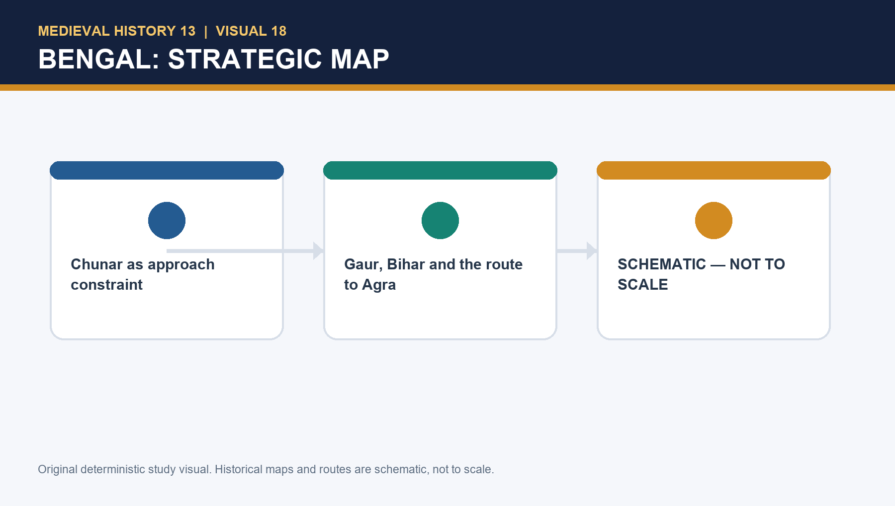

#### G. Battle ladder: do not collapse the distinction

| Battle | Date | Immediate mechanism | Political function |
|---|---:|---|---|
| Chausa | **26 June 1539** | Karmnasa at rear; poor placement; surprise; campaign strain | Tactical disaster; Humayun escapes |
| Kannauj/Bilgram | **17 May 1540** | Hastily assembled force; Kamran's hardened troops unavailable; Afghan command | Decisive loss of north India |

- **Trap:** Chausa weakens and disorganises; Kannauj decides displacement.
- **Battle explanation:** position + command + logistics + rival capacity + post-defeat co-operation. Never write one moral adjective.

#### H. Exile, recovery and significance

- **Sindh/Marwar:** regional rulers did not automatically rescue a dispossessed claimant.
- **Shah Tahmasp:** assistance supports recovery of **Qandahar and Kabul, 1545**; religious/political conditions need precise sourcing.
- **1555:** Sur fragmentation + recovered north-west base + Mughal agency → Delhi recovery.
- **1556:** Humayun dies; restoration is a platform for Akbar, not proof that previous fragility vanished.
- **Heritage anchor:** UNESCO's Humayun's Tomb account supports dynastic memory/conservation and garden-tomb discussion only.

#### I. PYQ route and answer spines

- **Direct owned CSE 2018–2025:** none verified in the repository routing corpus for Topic 13.
- **Exact adjacent route:** 2023 Prelims GS-I routing ledger has a Gujarat–Portuguese/Diu demand owned by Topic 08; use it as an adjacent route, not a Humayun PYQ.
- **10-mark answer:** definition of unfinished conquest → fiscal/beg/Afghan evidence → one campaign → qualification.
- **15-mark answer:** add Gujarat/Bengal comparison or Chausa/Kannauj distinction and a source caution.
- **20-mark answer:** inheritance → rival field → campaigns/logistics → brothers/nobles → restoration → graded verdict.

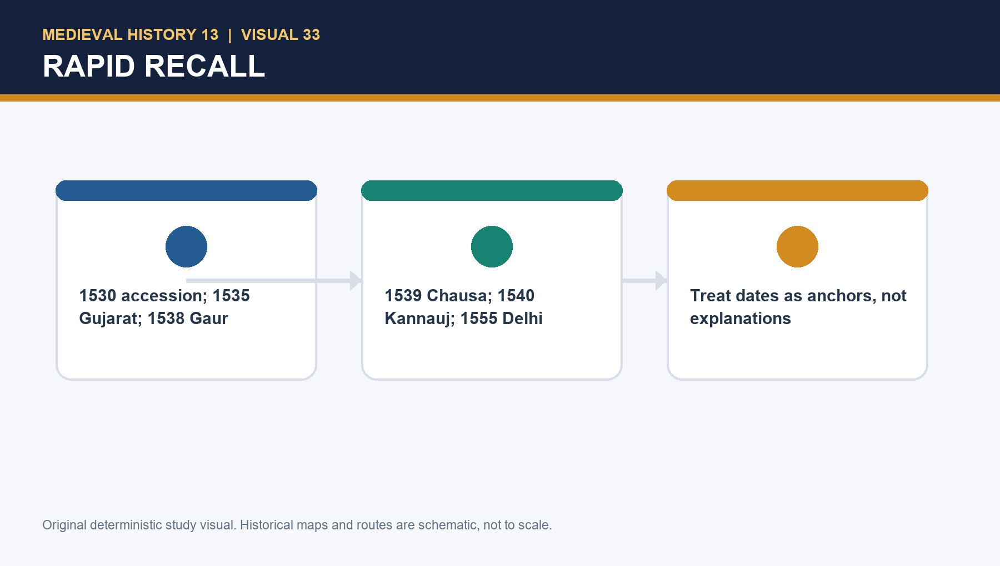

#### J. Last 60-second recall

1. **1530:** accession; unfinished conquest.
2. **Chunar/Dadrah:** source caution; eastern consolidation, no early Bihar-war certainty.
3. **Din Panah:** Delhi legitimacy project.
4. **1535–37:** Gujarat military achievement, administrative reversal.
5. **Surajgarh/Gaur:** Sher Khan's political scale-up.
6. **1537–39:** Bengal ambition, Chunar time-cost, communications cut.
7. **1539 → 1540:** Chausa → Kannauj, tactical shock → decisive expulsion.
8. **1545 → 1555:** Kabul/Qandahar recovery → Delhi restoration.
9. **One-line verdict:** Humayun's aims were larger than his institution and logistics; Sher Khan's Afghan alternative made the gap decisive, while later recovery preserved a dynastic opening.

### COMPLETE TOPIC ASCII MASTER FLOW DIAGRAM

#### ASCII MASTER FLOW — PANEL 1/12: The central problem: conquest without consolidation

```ascii-master
1530 INHERITANCE -> Delhi-Agra claim but shallow revenue/provincial roots
FRATERNAL FIELD -> Kamran + Askari + Hindal hold commands/territorial claims
AFGHAN FIELD -> chiefs/forts/revenue persist after Lodi defeat
WEST -> Bahadur Shah/Mewar/Gujarat | EAST -> Sher Khan/Bihar-Bengal
MUGHAL CHOICE -> expansion outruns settlement, supply and communications
1539/40 -> Chausa then Kannauj convert weakness into expulsion
VERDICT: structure + decisions + coalition + logistics + contingency.
MUST REMEMBER: Humayun's Gujarat, Afghan and Rajput theatres form one struggle for empire
  rather than isolated anecdotes.
```

#### ASCII MASTER FLOW — PANEL 2/12: Humayun chronology 1530-1556

```ascii-master
30 Dec 1530 -> accession | 1533-34 -> Din Panah
1535 -> Mandu, Champaner and Gujarat campaign successes
1537-38 -> six-month Chunar siege and eastern advance
1538-39 -> Gaur occupation and communications crisis
26 Jun 1539 -> Chausa | 17 May 1540 -> Kannauj/Bilgram
1545 -> Qandahar and Kabul recovered | 1555 Delhi | 1556 death.
```

#### ASCII MASTER FLOW — PANEL 3/12: Inherited balance sheet

```ascii-master
ASSET -> Delhi-Agra core, Timurid prestige and campaign capability
FINANCE -> stretched treasury and large assignments to begs
ADMINISTRATION -> conquest not converted into routine territorial control
EAST -> Afghan chiefs and Sher Khan retain regional depth
WEST -> Bahadur Shah links Gujarat, Malwa and Rajasthan
DYNASTY -> princely-share expectations complicate unified sovereignty.
```

#### ASCII MASTER FLOW — PANEL 4/12: Brothers: chronology before blame

```ascii-master
TIMURID PATRIMONY -> brothers expect territories, honour and command
KAMRAN -> Punjab/Lahore-Multan resources; later Kabul rivalry
ASKARI -> delegated Gujarat/other commands; rivalry and cooperation
HINDAL -> independent household and Agra action during Bengal crisis
EARLY -> arrangements contain conflict | POST-CHAUSA -> non-cooperation sharpens
RECOVERY -> kinship does not prevent coercion around Qandahar/Kabul
RULE: analyse resources and timing before moral labels.
```

#### ASCII MASTER FLOW — PANEL 5/12: Rajput-Gujarat-Mughal western triangle

```ascii-master
BAHADUR SHAH -> Malwa + Chittor pressure + artillery + Portuguese coast
MEWAR -> succession and regional interests; no homogeneous Rajput bloc
KARNAVATI-RAKHI -> later tradition, not secure diplomatic documentation
HUMAYUN -> Mandsaur pressure -> Mandu/Champaner operational success
FAILURE -> local settlement, supply, nobles and Askari position collapse
BAHADUR RETURNS -> military victory did not create administration
BOUNDARY: detailed Gujarat-Portuguese-Diu remains Topic 08.
```

#### ASCII MASTER FLOW — PANEL 6/12: Gujarat: victory without settlement

```ascii-master
CAMPAIGN -> Mandsor pressure -> Mandu -> Champaner -> Ahmedabad
MILITARY RESULT -> real operational success and territorial seizure
ADMINISTRATIVE GAP -> thin revenue, weak local coalition and divided command
NOBLE PROBLEM -> many begs resist durable residence far from Delhi-Agra
REGIONAL RESPONSE -> Bahadur Shah returns; Askari withdraws; Malwa is lost
LESSON: winning forts is not the same as building a provincial regime.
```

#### ASCII MASTER FLOW — PANEL 7/12: Sher Khan's Bihar-Bengal scale-up

```ascii-master
FARID/SHER KHAN -> Bihar service + estates + chiefs + local knowledge
CHUNAR -> fort/route bargaining asset
SURAJGARH 1534 -> victory raises prestige and resources
BENGAL -> tribute/pressure -> Gaur and wider fiscal base
ROHTAS + ROUTES -> protect resources/family and cut Mughal communications
AFGHAN NETWORK -> coalition built, not automatic tribal unity
BOUNDARY: administration/roads/revenue reform belongs to Topic 14.
```

#### ASCII MASTER FLOW — PANEL 8/12: Chunar-Gaur communications trap

```ascii-master
AGRA-DELHI CORE -> eastern movement depends on a long communication line
CHUNAR -> gateway fort affects land-river movement, supply and rear security
GAUR -> symbolic Bengal occupation but no durable administrative bridge
MONSOON + DISTANCE + NOBLE STRAIN -> Mughal position becomes brittle
SHER KHAN -> controls crossings and pressures the route back west
FORMULA: ambition + delayed logistics + severed communications = isolation.
```

#### ASCII MASTER FLOW — PANEL 9/12: Chausa and Kannauj: do not collapse the battles

```ascii-master
CHAUSA 1539 -> exposed river camp + monsoon + surprise + broken route
HUMAYUN ESCAPES -> regime damaged but not yet expelled
KANNAUJ/BILGRAM 1540 -> set battle + cohesion/command/reinforcement crisis
SHER SHAH WINS -> Mughal territorial regime collapses
FACTORS -> Afghan resources + logistics + brothers/nobles + decisions + weather
CAUTION -> no single error, gun or exact troop/casualty total explains both
VERDICT: operational defeats activated deeper institutional fragility.
```

#### ASCII MASTER FLOW — PANEL 10/12: Exile, Safavid bargain and restoration

```ascii-master
1540 -> Punjab/Sindh/Rajasthan exile; regional rulers choose independently
HAMIDA BANU + HOUSEHOLD -> dynastic network survives without territory
1542 AMARKOT -> Akbar born under local protection
SHAH TAHMASP -> aid plus ceremony/sectarian/Qandahar negotiation
1545 -> Qandahar then Kabul recovery; Kamran conflict continues
SUR FRAGMENTATION -> opens Lahore/Machhiwara/Sirhind/Delhi route in 1555
CAUTION: Safavid help was neither free nor total Persianization.
CLOSE DISTINCTION: Chausa (1539) preceded Kannauj/Bilgram (1540); restoration followed in
  1555.
```

#### ASCII MASTER FLOW — PANEL 11/12: Evidence, rehabilitation and heritage

```ascii-master
GULBADAN -> household/women/kinship memory | later selective memoir
AKBARNAMA -> official dynastic restoration | imperial teleology
TARIKH-I RASHIDI -> Timurid/Central Asian lens | author loyalties
NIZAMUDDIN -> chronology | Dadrah/Daurah disagreement
AFGHAN CHRONICLES -> Sher/Sur memory | retrospective Mughal context
COIN/INSCRIPTION/FORT -> public/material check, not uniform control
HUMAYUN TOMB -> 1560s dynastic memory, never campaign evidence.
EVIDENCE LIMIT: Defeat cannot be explained only by personality: resources, alliances, Afghan
  resilience and imperial overstretch matter.
```

#### ASCII MASTER FLOW — PANEL 12/12: Topic 13 answer spine

```ascii-master
SOURCE -> perspective + date + disagreement + minimum secure chronology
INHERIT -> finance/control + Afghan networks + fraternal patrimony
THEATRES -> Gujarat/Mewar then Bihar/Bengal communications
BATTLES -> Chausa versus Kannauj with logistics/command/contingency
EXILE -> Hamida/Amarkot + Safavid bargain + Qandahar/Kabul
RETURN -> Sur fragmentation + Bairam + Machhiwara/Sirhind + fragile Delhi
VERDICT -> serious errors within structural limits; restoration not consolidation.
```


