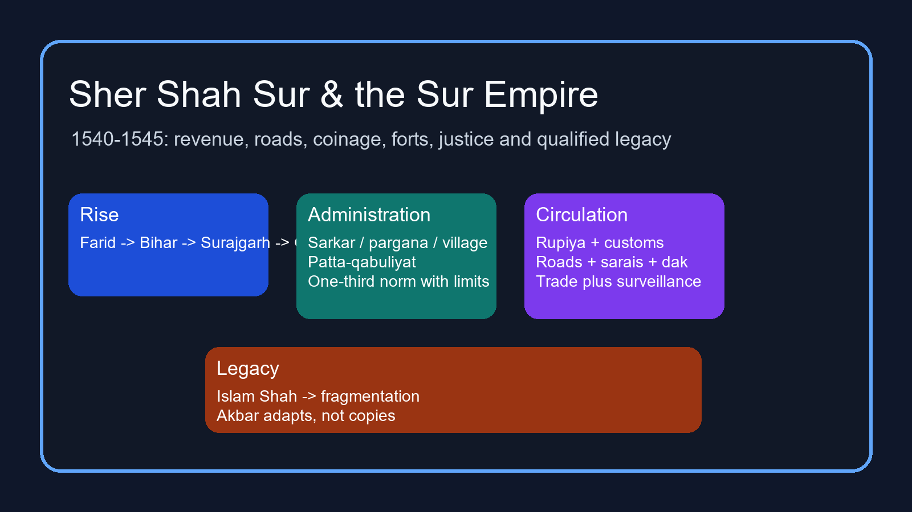

# Sher Shah Sur & the Sur Empire — Complete Topic Package



> **Subject:** Medieval History | **Topic:** 14 | **Export date:** 2026-09-20  
> **Approval:** false - awaiting explicit user approval.  
> **Canonical sources audited first:** `upsc-ai-kit\knowledge\Medieval-Indian-History\basic\14_Sher-Shah-and-the-Sur-Empire.md` and `upsc-ai-kit\knowledge\Medieval-Indian-History\advanced\14_Sher-Shah-and-the-Sur-Empire.md`.

## BASIC LEARNING SESSION

### SESSION 1 — WHY A FIVE-YEAR REIGN STILL MATTERS

#### DEFINITION / WHAT THIS IS CALLED

**Plain-language definition:** Topic 14 studies Sher Shah's own reign and the Sur imperial system built after 1540, not a second retelling of Humayun's collapse.

**Technical definition:** The core analytical task is to explain how a short Sur reign connected conquest, revenue, circulation, coinage, coercion and political supervision while staying alert to source idealisation and uneven implementation.

#### ANSWER-GRABBING OPENING — WRITE/ADAPT IN THE EXAM

> Sher Shah matters less as a gap ruler between two Mughals than as the shortest north-Indian reign that visibly linked roads, revenue, currency and coercive order into one governing system.

#### MUST-WRITE KEYWORDS

- **1540-1545**
- **Sarwani**
- **state capacity**
- **systematisation**
- **qualification**

**How to use them:** Begin with the dates, name Sarwani as a major but imperfect witness, show the interlocking state-capacity measures, then qualify every large claim about uniformity or invention.

```text
1540 sovereignty -> revenue legibility -> secure movement -> standard coin -> coercive order
1545 death -> Islam Shah's continuation -> 1555 Mughal return after Sur fragmentation
```

*Visual 1. The topic is about an interlocking governing system, not an isolated reform list.*

Sher Shah ruled personally only from 1540 to 1545, yet the Sur phase shaped north-Indian politics until Humayun's recovery in 1555. That is why UPSC treatment cannot reduce the Sur episode to a mere interval. The canonical basic owner stresses roads, sarais, revenue, army control, customs simplification and standard coinage; the advanced owner adds the warning that these measures belong to a longer process of north-Indian state formation.

The source method matters from the start. Sarwani is valuable for campaigns, justice, revenue and roads, but he wrote later and admired Sher Shah. Coins, inscriptions, forts and monuments check titles, mints, dates, building activity and political claims, yet they do not prove that every measure worked equally in every district.

#### PARAGRAPH DEMONSTRATION

A strong opening paragraph can argue that Sher Shah's importance lies in visible system-building under extreme time pressure. The named evidence is concrete: a measured revenue claim, a standard silver rupiya, repaired long-distance roads, sarais used as dak stages and stern policing of routes. Together these show an attempt to make power mobile, payable and enforceable. The qualification is equally necessary: a five-year reign cannot prove universal implementation, and much of the neat administrative description comes through later chronicle memory rather than routine archived paperwork.

**UPSC trap:** Do not write that a short reign means minor importance; the safer line is short duration with unusually dense administrative consequence.

**Mains angle:** Why did so brief a reign leave such a durable reputation in medieval India?

**Study link:** Use Topic 13 only for the Chausa-Kannauj bridge, and Topic 16 only for later Akbarian adaptation.

#### CLOSING RECALL FLOW — WHY A FIVE-YEAR REIGN STILL MATTERS

```text
START / CONCEPT: Why a five-year reign still matters
EXACT TERMS: 1540-1545 · Sarwani · state capacity · systematisation · qualification
MECHANISM / ARGUMENT: Sher Shah linked revenue, roads, coinage and coercive order into a short-reign governing system.
CONSEQUENCE / CONTRAST: The Sur phase cannot be treated as a blank gap between Humayun and Akbar.
UPSC TRAP / ANSWER-USE: Do not convert reputation into proof of universal implementation.
ANSWER-GRABBING FORMULATION: Sher Shah matters less as a gap ruler between two Mughals than as the shortest north-Indian reign that visibly linked roads, revenue, currency and coercive order into one governing system.
```

### SESSION 2 — FROM FARID TO SHER KHAN TO SHER SHAH

#### DEFINITION / WHAT THIS IS CALLED

**Plain-language definition:** Sher Shah began as Farid of a Sur Afghan family and rose through land management, service and eastern politics before becoming emperor.

**Technical definition:** His ascent is best explained as Bihar-Bengal scale-up from pargana-level experience, fort control and coalition building, not as a sudden battlefield miracle.

#### ANSWER-GRABBING OPENING — WRITE/ADAPT IN THE EXAM

> Farid became Sher Shah by turning local agrarian knowledge and Bihar politics into an Afghan fiscal-military coalition.

#### MUST-WRITE KEYWORDS

- **Farid**
- **Sasaram**
- **Bihar politics**
- **Surajgarh**
- **Gaur**

**How to use them:** Move in sequence from Farid and Sasaram to Bihar politics, then show how Surajgarh and Gaur enlarged the scale of Sher Khan's challenge.

```text
Farid / Sasaram experience -> Bihar service and Afghan alliances -> Surajgarh 1534
-> Bengal resources and Gaur -> imperial-scale rivalry with Humayun
```

*Visual 2. Sher Shah's rise was cumulative: land knowledge, eastern coalitions, then sovereign ambition.*

The canonical basic file keeps Farid's early experience central. Administrative exposure in his father's holdings around Sasaram mattered because it taught him how cultivation, village heads, zamindars and assignments actually worked. The heroic tiger story may be remembered, but it is not the explanatory core of later success.

Bihar politics after 1526 gave Farid room to enlarge his following. Surajgarh in 1534 checked Bengal and raised his political stature; the later capture of Gaur widened resources and strategic depth. Topic 14 should remember Chausa and Kannauj only as the threshold that converted an eastern alternative into north-Indian sovereignty.

#### PARAGRAPH DEMONSTRATION

An examiner-grade paragraph can claim that Sher Shah's rise was administrative before it was imperial. Sasaram and Bihar are the named evidence because they show how early command grew from land management, local bargaining and a lived knowledge of revenue. Surajgarh and Gaur then demonstrate scale: what had been a regional Afghan base acquired prestige, wealth and strategic reach. The qualification is that the rise was neither automatic Afghan solidarity nor pure individual genius; it depended on a favourable eastern political field and on Humayun's inability to close that field in time.

**UPSC trap:** Do not start the topic with the tiger anecdote and stop there; the exam wants the political mechanism of rise.

**Mains angle:** How did Sher Khan's eastern base become capable of displacing the Mughals?

**Study link:** When linking backward, mention Chausa and Kannauj briefly and return immediately to the Sur state's own structure.

#### CLOSING RECALL FLOW — FROM FARID TO SHER KHAN TO SHER SHAH

```text
START / CONCEPT: From Farid to Sher Khan to Sher Shah
EXACT TERMS: Farid · Sasaram · Bihar politics · Surajgarh · Gaur
MECHANISM / ARGUMENT: Local agrarian experience and eastern coalition-building scaled into an imperial challenge.
CONSEQUENCE / CONTRAST: Chausa and Kannauj mattered as thresholds, not as the whole of Topic 14.
UPSC TRAP / ANSWER-USE: Avoid reducing the rise to legend or ethnicity alone.
ANSWER-GRABBING FORMULATION: Farid became Sher Shah by turning local agrarian knowledge and Bihar politics into an Afghan fiscal-military coalition.
```

### SESSION 3 — EMPIRE, CORE AND CAMPAIGN GEOGRAPHY

#### DEFINITION / WHAT THIS IS CALLED

**Plain-language definition:** The Sur empire stretched broadly from Bengal to the Indus, but control did not look equally dense everywhere.

**Technical definition:** Topic 14 requires a map distinction between direct core, route-and-garrison control, subordinate rulers and temporary campaign reach.

#### ANSWER-GRABBING OPENING — WRITE/ADAPT IN THE EXAM

> A Sur map should show gradients of control, not one flat colour pretending that every conquered zone was administered in the same way.

#### MUST-WRITE KEYWORDS

- **Bengal to Indus**
- **Kashmir excluded**
- **Malwa**
- **Rajasthan**
- **uneven control**

**How to use them:** State the broad extent first, mark Kashmir as excluded, then separate the Ganga core from Malwa-Rajasthan and other campaign frontiers.

```text
CORE: Delhi-Agra + Bihar-Bengal
WEST/CENTRAL: Malwa + Rajasthan -> campaign, forts, tribute, negotiated submission
NORTH-WEST: Lahore-Multan + Rohtas frontier
BUNDELKHAND: Kalinjar siege frontier
```

*Visual 3. Sur geography is best learnt as layered territorial control.*

The basic owner gives the broad claim: Bengal to the Indus, excluding Kashmir, with Malwa and almost all Rajasthan in the western field. The advanced owner sharpens the caution that such phrasing marks imperial reach, not identical district administration everywhere. The Delhi-Agra-Ganga-Bihar-Bengal corridor formed the strongest zone of court, collection, roads and supervision.

Campaign milestones help to organise space: Malwa in 1542, Raisen in 1543, the Rajasthan field culminating at Samel in 1544, and Kalinjar in 1545. These should be used analytically. They show where power had to be asserted through forts, negotiated submission and armed movement, not where uniform bureaucratic routine had already matured.

#### PARAGRAPH DEMONSTRATION

A high-scoring paragraph may argue that Sher Shah ruled an empire of corridors and differentiated zones rather than a perfectly integrated block. Bengal, the Ganga plain and Delhi-Agra are the named evidence for the core because revenue and roads converge there. Malwa, Rajasthan and Bundelkhand then illustrate the outer field where conquest, tribute, fort control and siege mattered more than fully standardised administration. The qualification is that unequal control does not mean empty claim: frontier zones were politically real even when they were less deeply bureaucratised.

**UPSC trap:** Do not call the Sur empire a modern province map with neat borders and uniform authority.

**Mains angle:** How should the territorial extent of Sher Shah's empire be stated without exaggeration?

**Study link:** Compare this territorial caution later with Topic 16, where subas and a larger documentary regime appear more fully.

#### CLOSING RECALL FLOW — EMPIRE, CORE AND CAMPAIGN GEOGRAPHY

```text
START / CONCEPT: Empire, core and campaign geography
EXACT TERMS: Bengal to Indus · Kashmir excluded · Malwa · Rajasthan · uneven control
MECHANISM / ARGUMENT: The Sur empire combined a strong Ganga core with western and frontier zones held through forts, routes and submission.
CONSEQUENCE / CONTRAST: Campaign reach and routine district administration must not be collapsed into one claim.
UPSC TRAP / ANSWER-USE: One map colour cannot represent every degree of Sur control.
ANSWER-GRABBING FORMULATION: A Sur map should show gradients of control, not one flat colour pretending that every conquered zone was administered in the same way.
```

### SESSION 4 — AFGHAN KINGSHIP AND THE CENTRAL COURT

#### DEFINITION / WHAT THIS IS CALLED

**Plain-language definition:** Sher Shah was a strong monarch, but he ruled through Afghan nobles, commanders, scribes and household followers rather than through an impersonal modern bureaucracy.

**Technical definition:** Sur kingship combined personal monarchy with negotiated elite service, central departments and assignment-based power, which made discipline possible but succession fragile.

#### ANSWER-GRABBING OPENING — WRITE/ADAPT IN THE EXAM

> Sher Shah's monarchy was centralising and forceful, yet it still had to manage Afghan honour, service expectations and assignment politics.

#### MUST-WRITE KEYWORDS

- **personal monarchy**
- **Afghan nobles**
- **wizarat**
- **arz**
- **insha**

**How to use them:** Name the strong monarch first, then show that Afghan nobles remained politically weighty and connect that reality with the central fiscal, military and chancery functions.

```text
Sultan -> finance / wizarat -> military / arz -> chancery / insha
-> justice-religious portfolios -> nobles and assignments kept under supervision
```

*Visual 4. Central departments mattered, but the ruler still governed through people and service relationships.*

The advanced owner warns against two easy mistakes: calling the Sur polity a tribal democracy, or describing it as if Balban's most rigid Turkish court simply reappeared unchanged. Sher Shah's rule was personal, supervisory and often severe. Yet nobles expected honour, consultation, territory or assignments, and service could not be reduced to mute obedience.

This is why the central court mattered. Finance, military control, chancery and justice-religious portfolios continued in Sultanate-derived form, even if exact office power varied by moment. The point is not memorising every office name as if it were a modern departmental handbook. The point is to show how a ruler tried to tighten command over a politically active service elite.

#### PARAGRAPH DEMONSTRATION

A clean paragraph can state that Sur kingship was strongest at the centre but never socially empty. The evidence lies in the simultaneous presence of central portfolios such as finance, military control and chancery, and in the continuing political importance of Afghan nobles with their own expectations of honour and assignment. The analysis is that Sher Shah's energy allowed rapid co-ordination only because he could supervise that coalition personally. The qualification is that a system so dependent on personal command could wobble badly once a commanding ruler disappeared.

**UPSC trap:** Do not write that Afghan identity automatically produced either equality or instability; both claims are too blunt.

**Mains angle:** How did Sher Shah combine monarchy with a politically weighty Afghan elite?

**Study link:** Use Islam Shah later as proof that centralisation continued but also bred resentment.

#### CLOSING RECALL FLOW — AFGHAN KINGSHIP AND THE CENTRAL COURT

```text
START / CONCEPT: Afghan kingship and the central court
EXACT TERMS: personal monarchy · Afghan nobles · wizarat · arz · insha
MECHANISM / ARGUMENT: Central departments worked through a forceful monarch who still had to manage honour, service and assignments among Afghan elites.
CONSEQUENCE / CONTRAST: Strong supervision improved co-ordination but increased dependence on the ruler's own authority.
UPSC TRAP / ANSWER-USE: Avoid both tribal-romance and modern-bureaucratic projection.
ANSWER-GRABBING FORMULATION: Sher Shah's monarchy was centralising and forceful, yet it still had to manage Afghan honour, service expectations and assignment politics.
```

### SESSION 5 — SARKAR, PARGANA AND THE MEDIATED COUNTRYSIDE

#### DEFINITION / WHAT THIS IS CALLED

**Plain-language definition:** Sher Shah's empire worked through sarkars or shiqs, parganas and villages, not through Akbar's later mature suba map.

**Technical definition:** Territorial administration in Topic 14 is a layered chain in which military-police, revenue, record and village functions overlap through local intermediaries.

#### ANSWER-GRABBING OPENING — WRITE/ADAPT IN THE EXAM

> The Sur state reached the village through layers of officers and intermediaries, not by bypassing them.

#### MUST-WRITE KEYWORDS

- **sarkar / shiq**
- **pargana**
- **muqaddam**
- **qanungo**
- **mediation**

**How to use them:** Start with sarkar or shiq, move down to pargana offices, then end at village-level mediation through muqaddams, patwaris and zamindars.

```text
CENTRE -> SARKAR / SHIQ -> PARGANA -> VILLAGE
PARGANA STAFF: shiqdar + amin/munsif + qanungo + fotedar + writers
VILLAGE: muqaddam + patwari + panchayat + cultivators + zamindars
```

*Visual 5. Territorial administration descended by layers; it did not jump magically from court to cultivator.*

The canonical basic owner explicitly warns that Sher Shah did not create Akbar's later suba structure. The important units here are sarkars or shiqs and parganas, operating through officers whose tasks touched revenue, policing, records and dispute-handling. The village remained full of actors: cultivators, headmen, record-keepers, zamindars and customary local authority.

This layered picture matters because many bad answers turn patta and measurement into direct unmediated peasant-state contact. Topic 14's safer formulation is different: the state tried to know and discipline the countryside more effectively, but it still relied on people already rooted in that countryside.

#### PARAGRAPH DEMONSTRATION

A good paragraph can argue that Sur administration was more penetrative than a loose conquest regime without becoming a direct modern district state. Sarkar and pargana are the named evidence because they show territorial layering beneath the centre, while muqaddams, qanungos and zamindars show the local carriers of information and enforcement. The analysis is that control improved through better linkage, not through abolition of mediation. The qualification is that the precise balance of offices comes largely from descriptive chronicle reconstruction and was unlikely to be mechanically identical in every region.

**UPSC trap:** Do not write 'suba' as Sher Shah's normal provincial unit merely because it is familiar from Akbar.

**Mains angle:** Why is mediated administration a better description of the Sur countryside than direct bureaucracy?

**Study link:** The 2021 prelims hierarchy question is adjacent here precisely because it forces scale discipline.

#### CLOSING RECALL FLOW — SARKAR, PARGANA AND THE MEDIATED COUNTRYSIDE

```text
START / CONCEPT: Sarkar, pargana and the mediated countryside
EXACT TERMS: sarkar / shiq · pargana · muqaddam · qanungo · mediation
MECHANISM / ARGUMENT: Territorial rule descended through sarkars and parganas into a countryside still carried by local intermediaries.
CONSEQUENCE / CONTRAST: Better linkage did not mean abolition of village mediation.
UPSC TRAP / ANSWER-USE: Do not project Akbar's later suba structure backward.
ANSWER-GRABBING FORMULATION: The Sur state reached the village through layers of officers and intermediaries, not by bypassing them.
```

### SESSION 6 — REVENUE MEASUREMENT, RAI AND PATTA-QABULIYAT

#### DEFINITION / WHAT THIS IS CALLED

**Plain-language definition:** Sher Shah's revenue reform tried to regularise state demand through measurement, crop-rate schedules and written assessment records.

**Technical definition:** The Sur revenue chain runs from measured land and classified fertility through average produce and price schedules to assessed demand, written patta and cultivator qabuliyat, all within a still-mediated agrarian order.

#### ANSWER-GRABBING OPENING — WRITE/ADAPT IN THE EXAM

> Sher Shah's revenue system made demand more legible; it did not make the countryside simple.

#### MUST-WRITE KEYWORDS

- **measurement**
- **rai**
- **one-third norm**
- **patta**
- **qabuliyat**

**How to use them:** Explain the chain in order: measurement first, then rai and the one-third norm, then patta and qabuliyat, and finally the qualification about intermediaries and regional exceptions.

```text
measure sown land -> classify land -> fix rai -> state share often described as one-third
-> patta -> qabuliyat -> cash or kind collection -> exceptions and uneven reach
```

*Visual 6. The revenue system is a chain; each link matters for UPSC wording.*

Both canonical owners emphasise the logic of measurement. The state sought greater clarity about cultivated area, crop potential and rate schedules. Patta recorded the assessed demand and qabuliyat marked cultivator acceptance. This is why the reform is often remembered as rational and record-based.

But the same sources insist on caution. The famous one-third share is a commonly stated norm, not a proof of identical assessment everywhere. Multan appears as an exception in the advanced owner. Collection could be in cash or kind; local officers, headmen, zamindars and record-keepers remained central. This was not British ryotwari, not annual universal survey in a modern cadastral sense, and not the abolition of intermediaries.

#### PARAGRAPH DEMONSTRATION

A strong paragraph can argue that Sher Shah's revenue measures aimed at fiscal intelligibility rather than agrarian equality. Measurement, rai and patta-qabuliyat are the named evidence because they show an effort to specify area, rate and due demand more clearly than a loose exaction system. The analysis is that legibility helps treasury, army payment and state supervision. The qualification is decisive: Sarwani's neat account is partly idealised, regional exceptions existed, and written assessment did not protect cultivators from every coercive or market risk.

**UPSC trap:** Do not call the Sur revenue system ryotwari; that imports a colonial category into a mediated sixteenth-century order.

**Mains angle:** In what sense was patta-qabuliyat an advance, and in what sense did it remain limited?

**Study link:** Use Topic 16 only to compare later Mughal expansion of measurement, not to erase Sur distinctiveness.

#### CLOSING RECALL FLOW — REVENUE MEASUREMENT, RAI AND PATTA-QABULIYAT

```text
START / CONCEPT: Revenue measurement, rai and patta-qabuliyat
EXACT TERMS: measurement · rai · one-third norm · patta · qabuliyat
MECHANISM / ARGUMENT: Measured land and rate schedules made demand more recordable and more enforceable.
CONSEQUENCE / CONTRAST: Written assessment improved legibility without abolishing intermediaries or regional variation.
UPSC TRAP / ANSWER-USE: Never translate patta-qabuliyat into British ryotwari.
ANSWER-GRABBING FORMULATION: Sher Shah's revenue system made demand more legible; it did not make the countryside simple.
```

### SESSION 7 — COINAGE, CUSTOMS AND COMMERCIAL ORDER

#### DEFINITION / WHAT THIS IS CALLED

**Plain-language definition:** Sher Shah's coinage and customs policy tried to make exchange and state collection more regular across long-distance routes.

**Technical definition:** The Sur commercial order joined tri-metallic standardisation, especially the silver rupiya and copper dam, with simplified duties and safer circulation, while leaving room for uneven monetisation and local practice.

#### ANSWER-GRABBING OPENING — WRITE/ADAPT IN THE EXAM

> Sher Shah did not invent money; he strengthened the reliability with which money, dues and movement could work together.

#### MUST-WRITE KEYWORDS

- **rupiya**
- **dam**
- **mints**
- **customs simplification**
- **transaction costs**

**How to use them:** State the silver rupiya and copper dam first, then add mints and customs simplification, and conclude with why safer exchange reduced transaction costs without modernising the whole economy.

```text
standard coin -> credible minting -> easier army payment and taxation
-> simplified customs points -> safer merchant movement -> lower transaction friction
```

*Visual 7. Coinage and customs worked best when joined to route security and state communication.*

The basic owner explicitly says that Sher Shah issued fine gold, silver and copper coins, while the advanced owner sharpens the point that earlier Indian and Sultanate silver currencies already existed. His claim to fame lies in durable standardisation, not in creating the first rupee out of nothing. Coins matter as primary evidence because they preserve metal, weight, mint and legend.

Commercial policy is equally practical. Customs were simplified by concentrating duties at recognised points such as entry and sale, rather than tolerating every arbitrary transit levy along the way. This did help merchants and state finance, but not in a modern frictionless sense. Uneven cash access, barter, local coins and region-specific practice remained real.

#### PARAGRAPH DEMONSTRATION

A well-balanced paragraph can claim that Sur commercial reform was infrastructural, not merely monetary. The silver rupiya, copper dam and simplified customs points are the named evidence because they show an attempt to make payment, taxation and movement more predictable. The analysis follows directly: reliable money and fewer arbitrary levies make trade and state payment easier. The qualification is that standard coinage does not prove universal monetisation, and customs simplification did not erase all local differences in collection or market power.

**UPSC trap:** Do not equate standardisation with invention, and do not write that Sher Shah abolished every tax or toll.

**Mains angle:** How did coinage and customs strengthen both trade and state capacity under Sher Shah?

**Study link:** Tie this session forward to roads and sarais; coinage alone does not move goods safely.

#### CLOSING RECALL FLOW — COINAGE, CUSTOMS AND COMMERCIAL ORDER

```text
START / CONCEPT: Coinage, customs and commercial order
EXACT TERMS: rupiya · dam · mints · customs simplification · transaction costs
MECHANISM / ARGUMENT: Standard coins and fewer arbitrary levies made exchange more predictable.
CONSEQUENCE / CONTRAST: Trade support and state extraction advanced together.
UPSC TRAP / ANSWER-USE: Standardisation is not the same thing as invention or total uniformity.
ANSWER-GRABBING FORMULATION: Sher Shah did not invent money; he strengthened the reliability with which money, dues and movement could work together.
```

### SESSION 8 — ROADS, SARAIS, WELLS AND THE NEWS SERVICE

#### DEFINITION / WHAT THIS IS CALLED

**Plain-language definition:** Sher Shah repaired and extended older routes, policed them, and linked them to sarais and dak stages.

**Technical definition:** The road system in Topic 14 is a circulation-and-surveillance network joining long-distance corridors, sarais, trees, wells, relay animals, runners and administrative intelligence.

#### ANSWER-GRABBING OPENING — WRITE/ADAPT IN THE EXAM

> The famous Sur road system mattered because it moved armies, merchants and information through the same secured corridor.

#### MUST-WRITE KEYWORDS

- **Indus-Sonargaon**
- **sarai**
- **two karohs**
- **dak**
- **surveillance**

**How to use them:** Name the main corridor first, then explain sarais, the two-karoh spacing tradition and the dak-news function before drawing the surveillance conclusion.

```text
older imperial routes repaired
-> Indus-Sonargaon spine
-> Agra-Rajasthan / Agra-Burhanpur / Lahore-Multan branches
-> sarais at intervals -> trees + wells + ferries -> news service and security
```

*Visual 8. Roads became politically valuable only when joined to nodes, water and information.*

The basic owner connects Sher Shah with the old east-west road later known as the Grand Trunk Road, plus roads from Agra to Jodhpur-Chittor and from Lahore to Multan. The advanced owner adds Agra-Burhanpur and warns that the later label 'Grand Trunk Road' should not erase the older and layered history of these corridors. He repaired, improved and policed long-used lines; he did not build north Indian mobility from zero.

Sarais were not passive shelters. They offered lodging, resting animals, market activity, route security and news-service staging. The reported two-karoh interval helps us understand intended regularity, but it is safer to preserve it as a historical measure than to pretend to exact modern kilometre precision for every site.

#### PARAGRAPH DEMONSTRATION

An effective paragraph can claim that Sher Shah's roads were institutions, not bare strips of land. The evidence is cumulative: the Indus-Sonargaon line, the branch roads, the sarais, and the use of those sarais as news and relay stages. The analysis is that secure movement of grain, people, orders and troops creates state reach while also helping merchants. The qualification is that later colonial memory often exaggerates this into total invention, whereas the more defensible claim is repair, extension and policing of older corridors.

**UPSC trap:** Avoid saying sarais were only welfare inns or that every modern GT Road segment reproduces Sher Shah's road exactly.

**Mains angle:** Why should roads and sarais be treated as part of governance rather than merely transport history?

**Study link:** Link back to revenue and coinage; the state could assess and pay more effectively only if communication routes held.

#### CLOSING RECALL FLOW — ROADS, SARAIS, WELLS AND THE NEWS SERVICE

```text
START / CONCEPT: Roads, sarais, wells and the news service
EXACT TERMS: Indus-Sonargaon · sarai · two karohs · dak · surveillance
MECHANISM / ARGUMENT: Repaired corridors became useful when sarais, water support and intelligence stages held them together.
CONSEQUENCE / CONTRAST: The same route served commerce, administration and coercive movement.
UPSC TRAP / ANSWER-USE: Do not convert route repair into total road invention.
ANSWER-GRABBING FORMULATION: The famous Sur road system mattered because it moved armies, merchants and information through the same secured corridor.
```

### SESSION 9 — ARMY CONTROL, FORTS AND FRONTIER MANAGEMENT

#### DEFINITION / WHAT THIS IS CALLED

**Plain-language definition:** Sher Shah sought tighter military control through recruitment, record practices, horse branding and strategic fortification.

**Technical definition:** The Sur military system combined direct royal supervision, mixed payment forms, cavalry-artillery capability and fort-based frontier management, while reworking practices that had Sultanate precedents.

#### ANSWER-GRABBING OPENING — WRITE/ADAPT IN THE EXAM

> Sher Shah's army was disciplined less by abstract organisation charts than by inspected horses, identified soldiers, strong forts and the ruler's own vigilance.

#### MUST-WRITE KEYWORDS

- **dagh**
- **chehra**
- **Rohtas**
- **Chunar**
- **frontier logistics**

**How to use them:** State dagh and chehra as control devices, then move to Chunar and Rohtas as strategic forts before ending with the logistics of very different frontier zones.

```text
recruitment and payment -> horse branding / dagh -> descriptive roll / chehra
-> cavalry + infantry + elephants + artillery
-> forts: Chunar, Rohtas, Rohtasgarh, Raisen, Kalinjar
```

*Visual 9. Military control depended on verification and on fort positions, not on numbers alone.*

The canonical files treat dagh and chehra as important but not ex nihilo inventions. Alauddin Khalji provides a Sultanate precedent; Sher Shah's significance lies in revival or disciplined use within his own army-control programme, and Akbar later worked such verification into a different and larger mansabdari setting. Good answers should therefore speak of systematisation, not first-ever invention.

Forts reveal geography in military form. Chunar mattered for eastern route control. Rohtas in the north-west was tied to the Gakhhar frontier and the fear of a Mughal return, while Rohtasgarh in Bihar was a different fort entirely. Kalinjar finally reminds us that siege warfare and gunpowder power also carried danger, because Sher Shah died there in 1545.

#### PARAGRAPH DEMONSTRATION

A sharp paragraph can argue that Sur military effectiveness rested on verification and position. Dagh and chehra are the named evidence because they tie soldiers and horses more tightly to inspection; Chunar and Rohtas show how fort geography turned supervision into territorial advantage. The analysis is that armies win more durably when command, payment, routes and strongpoints support one another. The qualification is that our sources are better at preserving the ideal of discipline than at giving a full audited register of every contingent in every campaign.

**UPSC trap:** Do not confuse Rohtas with Rohtasgarh, and do not say Akbar simply copied dagh-chehra without change.

**Mains angle:** How did Sher Shah's military control measures connect to territorial management?

**Study link:** This session reinforces why roads and forts must be studied together.

#### CLOSING RECALL FLOW — ARMY CONTROL, FORTS AND FRONTIER MANAGEMENT

```text
START / CONCEPT: Army control, forts and frontier management
EXACT TERMS: dagh · chehra · Rohtas · Chunar · frontier logistics
MECHANISM / ARGUMENT: Verification practices and strategic forts tied the army more closely to territory.
CONSEQUENCE / CONTRAST: Military discipline worked through routes and strongpoints, not through raw numbers alone.
UPSC TRAP / ANSWER-USE: Separate Rohtas from Rohtasgarh and precedent from invention.
ANSWER-GRABBING FORMULATION: Sher Shah's army was disciplined less by abstract organisation charts than by inspected horses, identified soldiers, strong forts and the ruler's own vigilance.
```

### SESSION 10 — JUSTICE, POLICING AND THE COUNTRYSIDE

#### DEFINITION / WHAT THIS IS CALLED

**Plain-language definition:** Sher Shah's famous justice reputation rested on safer roads and stern punishment, but it also relied on coercive local responsibility.

**Technical definition:** The Sur order in village and route space combined qazis, officials, local headmen, zamindars, patrols and severe sanctions in order to secure circulation, revenue and authority.

#### ANSWER-GRABBING OPENING — WRITE/ADAPT IN THE EXAM

> Sher Shah's law-and-order reputation was real in effect but hard in method.

#### MUST-WRITE KEYWORDS

- **safe roads**
- **collective responsibility**
- **zamindars**
- **peasants**
- **coercion**

**How to use them:** Begin from safe roads, explain collective responsibility, then show how zamindars and peasants lived inside a coercive but more predictable order.

```text
official justice + local information + zamindar accountability + punishment
-> safer movement for merchants and troops -> heavier state reach into the countryside
```

*Visual 10. Order was produced through both protection and pressure.*

The basic owner celebrates law and order, while the advanced owner asks us to read such praise carefully. Merchants valued safer routes and more regular movement. Yet the administrative mechanism was not gentle: recalcitrant zamindars were punished, communities could bear local responsibility, and severe action backed the ruler's justice image.

This same framework shaped agrarian life. Patta might clarify what was due, but it did not erase cesses, collection pressure, climate risk or unequal bargaining power. Peasants, artisans, caravan operators and village households benefited unevenly from stronger circulation.

#### PARAGRAPH DEMONSTRATION

A nuanced paragraph may claim that Sher Shah's justice enhanced trust in movement without dissolving fear of authority. Safe roads, punished robbers and disciplined zamindars are the named evidence for that claim. The analysis is that markets and revenue both gain when the state can deter predation and move information quickly. The qualification is crucial: ideal stories of perfect safety are not crime statistics, and collective responsibility could overshoot individual guilt.

**UPSC trap:** Do not repeat the anecdote of perfect justice as if it were a quantitative survey of crime.

**Mains angle:** In what sense was Sher Shah's order beneficial, and in what sense was it coercive?

**Study link:** Bring this point into roads and trade answers so order is not separated from political force.

#### CLOSING RECALL FLOW — JUSTICE, POLICING AND THE COUNTRYSIDE

```text
START / CONCEPT: Justice, policing and the countryside
EXACT TERMS: safe roads · collective responsibility · zamindars · peasants · coercion
MECHANISM / ARGUMENT: Safer circulation came from local accountability, punishment and state vigilance.
CONSEQUENCE / CONTRAST: Predictability increased, but so did the felt presence of coercive authority.
UPSC TRAP / ANSWER-USE: Justice stories are evidence of political style, not exact crime data.
ANSWER-GRABBING FORMULATION: Sher Shah's law-and-order reputation was real in effect but hard in method.
```

### SESSION 11 — RAISEN, RELIGION AND ARCHITECTURE OF LEGITIMACY

#### DEFINITION / WHAT THIS IS CALLED

**Plain-language definition:** Sher Shah used Islamic legitimacy and monumental building, yet single episodes like Raisen need careful, qualified interpretation.

**Technical definition:** Topic 14 handles religion through site-specific political evidence, not through crude labels of total tolerance or uniform persecution; architecture is read as legitimacy, water-control and imperial display.

#### ANSWER-GRABBING OPENING — WRITE/ADAPT IN THE EXAM

> Raisen should be written as a legitimacy problem, not as a licence for sweeping communal simplifications.

#### MUST-WRITE KEYWORDS

- **Raisen**
- **Puran Mal**
- **Sunni legitimacy**
- **Sasaram tomb**
- **Purana Qila**

**How to use them:** Name Raisen and Puran Mal first, then widen the answer to Sunni legitimacy, Sasaram and the Delhi fort-mosque landscape.

```text
Raisen / Puran Mal controversy -> political trust and coercion question
Sunni legitimacy language -> rule over diverse officials and subjects
Sasaram tomb + Purana Qila / Qila-i-Kuhna -> monumental royal presence
```

*Visual 11. Religion and architecture become exam-safe when tied to named sites and political use.*

The advanced owner is explicit that the Raisen-Puran Mal episode cannot be flattened either into a neutral routine act or into proof of a single empire-wide persecution policy. It is better framed as a controversy over surrender, safe-conduct, violence and political legitimacy. Sher Shah was unquestionably a Sunni Muslim ruler who used Islamic language, but he also ruled over varied officials, chiefs and subjects.

Architecture deepens this legitimacy theme. Sher Shah's tomb at Sasaram is a major octagonal lake mausoleum whose completion stretches across Sher Shah and Islam Shah phases. Purana Qila and the Qila-i-Kuhna mosque in Delhi belong to a multi-phase Humayun-Sur-Mughal urban landscape.

#### PARAGRAPH DEMONSTRATION

A high-value paragraph can argue that Raisen and Sasaram together reveal two sides of Sur legitimacy. Raisen is the evidence of political trust damaged by coercive violence after surrender, while Sasaram is the evidence of sovereign grandeur, water setting and durable memory. The analysis is that legitimacy in this period was built both by visible kingship and by how rulers handled conquered opponents. The qualification is that one violent episode should not be turned into a total theory of all Sur religious policy, just as one monument cannot certify every administrative claim.

**UPSC trap:** Do not use architecture as proof of social harmony, and do not use a single coercive episode as proof of uniform policy.

**Mains angle:** How should religion and political legitimacy be written in answers on Sher Shah?

**Study link:** Save full art-and-culture stylistic comparison for the separate architecture topic; here the monument matters as state evidence.

#### CLOSING RECALL FLOW — RAISEN, RELIGION AND ARCHITECTURE OF LEGITIMACY

```text
START / CONCEPT: Raisen, religion and architecture of legitimacy
EXACT TERMS: Raisen · Puran Mal · Sunni legitimacy · Sasaram tomb · Purana Qila
MECHANISM / ARGUMENT: Political authority used both religious language and monumental display, but coercive episodes could damage trust.
CONSEQUENCE / CONTRAST: Monuments display rule; they do not erase legitimacy problems created by violence.
UPSC TRAP / ANSWER-USE: Neither sweeping tolerance claims nor sweeping persecution claims are exam-safe here.
ANSWER-GRABBING FORMULATION: Raisen should be written as a legitimacy problem, not as a licence for sweeping communal simplifications.
```

### SESSION 12 — ISLAM SHAH, SUCCESSION AND SUR COLLAPSE

#### DEFINITION / WHAT THIS IS CALLED

**Plain-language definition:** Islam Shah was not an empty epilogue; he continued Sur rule, tightened monarchy and left behind a bitter succession field.

**Technical definition:** The collapse of the Sur empire after 1553 is explained best through personalised control, factional rivalry, multiple claimants and fragile elite cohesion rather than through a vague civilisational verdict on Afghans.

#### ANSWER-GRABBING OPENING — WRITE/ADAPT IN THE EXAM

> The Sur empire did not fall because Sher Shah had achieved nothing; it fell because a personally driven system proved difficult to reproduce after two short reigns.

#### MUST-WRITE KEYWORDS

- **Islam Shah**
- **discipline**
- **Firuz**
- **Hemu**
- **fragmentation**

**How to use them:** Introduce Islam Shah's discipline measures first, then move to Firuz, the rival claimants and Hemu to explain the final fragmentation.

```text
Sher Shah dies 1545 -> Islam Shah continues and tightens control -> noble resentment deepens
-> Islam Shah dies 1553 -> Firuz killed -> Adil / Sikandar / Ibrahim / Hemu -> Humayun returns in 1555
```

*Visual 12. Sur decline was political fragmentation after short-reign centralisation, not proof that the earlier system was unreal.*

Islam Shah's reign from 1545 to 1553 continued roads, revenue and order, but it also sharpened monarchical discipline. The advanced owner stresses regulation of nobles and camps precisely to show that continuity existed. That makes it wrong to jump straight from Sher Shah's death to collapse as if nothing happened in between.

After Islam Shah's death, however, the system fractured rapidly. Firuz was killed, Adil Shah faced rivals, Sikandar and Ibrahim asserted separate claims, and Hemu emerged as Adil Shah's main military-administrative figure. Humayun's 1555 return thus depended heavily on Sur division.

#### PARAGRAPH DEMONSTRATION

A mature paragraph can claim that the Sur breakdown arose from succession politics more than from administrative emptiness. Islam Shah is the first named evidence because he shows real continuation and stricter discipline after 1545. Firuz, Adil, Sikandar, Ibrahim and Hemu then provide the evidence of rapid claimant multiplication after 1553. The analysis is that a centralised system dependent on ruler authority can function impressively and still crack when coalition management fails. The qualification is that fragmentation made Mughal restoration easier, but it does not erase the reality of earlier Sur achievement.

**UPSC trap:** Do not write that Humayun simply defeated a fully intact Sur empire in 1555.

**Mains angle:** Why did a state as effective as Sher Shah's collapse so quickly after Islam Shah?

**Study link:** Use this session to transition into the Topic 15 world without teaching Akbar here.

#### CLOSING RECALL FLOW — ISLAM SHAH, SUCCESSION AND SUR COLLAPSE

```text
START / CONCEPT: Islam Shah, succession and Sur collapse
EXACT TERMS: Islam Shah · discipline · Firuz · Hemu · fragmentation
MECHANISM / ARGUMENT: Continuation under Islam Shah gave way to violent claimant politics after 1553.
CONSEQUENCE / CONTRAST: Mughal restoration succeeded against division, not against a still-unified Sur monarchy.
UPSC TRAP / ANSWER-USE: Avoid the lazy verdict that the Sur order vanished the moment Sher Shah died.
ANSWER-GRABBING FORMULATION: The Sur empire did not fall because Sher Shah had achieved nothing; it fell because a personally driven system proved difficult to reproduce after two short reigns.
```

### SESSION 13 — SHER SHAH, AKBAR AND THE QUESTION OF LEGACY

#### DEFINITION / WHAT THIS IS CALLED

**Plain-language definition:** Sher Shah is a precursor to later Mughal governance only in a qualified sense.

**Technical definition:** The best historiographical formula is selective continuity: Sultanate precedents were systematised under Sher Shah and then adapted again by Akbar at a larger scale and with a different documentary and political framework.

#### ANSWER-GRABBING OPENING — WRITE/ADAPT IN THE EXAM

> Akbar did not receive a finished Sur blueprint; he inherited precedents that he reworked on a larger and more durable imperial scale.

#### MUST-WRITE KEYWORDS

- **continuity**
- **adaptation**
- **zabt**
- **mansabdari context**
- **qualified precursor**

**How to use them:** Start with continuity, shift immediately to adaptation, then illustrate through revenue and military verification before giving the qualified precursor verdict.

```text
Sultanate precedents -> Sur systematisation -> Akbarian expansion and modification
Revenue: measurement / patta / rate logic -> wider zabt development
Military: dagh / chehra precedent -> later mansabdari controls
```

*Visual 13. The legacy question is about continuity plus modification, not copy-paste borrowing.*

The canonical files are firm on this point. Sher Shah did not invent every important institution from scratch, and Akbar did not simply photographically copy the Sur system. Measurement, crop schedules, dagh-chehra and road management all had earlier roots. Sher Shah's contribution was to connect and sharpen them under one energetic reign.

That is why 'precursor' is useful only when qualified. Without qualification it turns Sher Shah into a one-man founder of Mughal governance; with qualification it preserves both continuity and difference. That is the examiner-grade balance the advanced owner wants.

#### PARAGRAPH DEMONSTRATION

A strong concluding paragraph can claim that Sher Shah's greatest legacy was not institutional perfection but demonstrative feasibility. Revenue measurement, standard coinage, disciplined movement and army verification are the named evidence showing that north-Indian rule could be made more legible and more mobile. The analysis is that Akbar later developed these lines under a more durable imperial structure. The qualification is indispensable: continuity ran through selection and modification, and rapid Sur fragmentation warns against treating the 1540s as a completed Mughal system in miniature.

**UPSC trap:** Never write that Akbar simply copied Sher Shah, and never write that Sher Shah had no later influence at all.

**Mains angle:** How far does the label 'forerunner of Akbar' illuminate, and how far does it mislead?

**Study link:** This is the proper bridge to Topic 15: influence acknowledged, topic boundary preserved.

#### CLOSING RECALL FLOW — SHER SHAH, AKBAR AND THE QUESTION OF LEGACY

```text
START / CONCEPT: Sher Shah, Akbar and the question of legacy
EXACT TERMS: continuity · adaptation · zabt · mansabdari context · qualified precursor
MECHANISM / ARGUMENT: Sher Shah systematised earlier strands that Akbar later modified and expanded.
CONSEQUENCE / CONTRAST: Legacy is real only when borrowing is separated from direct copying.
UPSC TRAP / ANSWER-USE: Precursor is a qualified word, not a licence for blueprint language.
ANSWER-GRABBING FORMULATION: Akbar did not receive a finished Sur blueprint; he inherited precedents that he reworked on a larger and more durable imperial scale.
```

## BASIC MCQS / REMEDIATION

### 16 learning MCQs with focused remediation

#### Learning MCQ 1

**Question:** Which statement best captures Topic 14's core chronology?

- A. Sher Shah ruled from 1540 to 1545, but the Sur phase remained politically relevant until Humayun's return in 1555.
- B. Sher Shah ruled from 1526 to 1605 and personally saw Akbar succeed him.
- C. The Sur phase ended immediately at Chausa in 1539.
- D. Topic 14 begins only after Akbar's accession.

**Correct answer:** A

**Explanation:** Topic 14 owns Sher Shah's reign from 1540 to 1545 and the wider Sur imperial phase up to Mughal restoration in 1555. That is why the topic cannot be compressed into one battle year.

**Remediation cue:** Anchor the topic with two dates, not one: 1540-45 for Sher Shah personally and 1555 for the end of effective Sur rule in north India.

#### Learning MCQ 2

**Question:** Why are Chausa and Kannauj mentioned only as a bounded bridge in Topic 14?

- A. They belong to the Bahmani kingdom.
- B. They explain the transfer from Sher Khan's eastern rise to Sher Shah's sovereignty, while full battle detail remains Topic 13.
- C. They prove that Sher Shah spent most of his reign in Kashmir.
- D. They happened after Islam Shah's death.

**Correct answer:** B

**Explanation:** Topic 14 needs those battles only to mark the threshold into Sur rule. The detailed Humayun-versus-Sher Khan battlefield story belongs to the preceding topic.

**Remediation cue:** Use the formula 'threshold here, battle narrative there' when writing the Chausa-Kannauj bridge.

#### Learning MCQ 3

**Question:** Which spatial description is source-safe for Sher Shah's empire?

- A. It reached only the Delhi-Agra district.
- B. Kashmir formed its unquestioned capital zone.
- C. It stretched broadly from Bengal to the Indus, excluding Kashmir, with denser control in the Ganga core than in some frontier fields.
- D. It matched the later Mughal suba map exactly.

**Correct answer:** C

**Explanation:** The canonical formulation is broad imperial extent with internal variation. UPSC-safe geography distinguishes core administration from campaign or route control.

**Remediation cue:** Whenever you state extent, add one qualifier about uneven control or excluded Kashmir.

#### Learning MCQ 4

**Question:** Why is Sher Shah's personal supervision both a strength and a limit?

- A. It removed the need for officers entirely.
- B. It guaranteed peaceful succession.
- C. It turned the empire into a democracy of Afghan clans.
- D. It enabled quick coordination in his lifetime but made continuity harder after two short reigns.

**Correct answer:** D

**Explanation:** The Sur system worked impressively when a forceful ruler supervised it. The same dependence made succession crises more damaging later.

**Remediation cue:** Pair every praise point about supervision with the succession-fragility qualifier.

#### Learning MCQ 5

**Question:** Which formula best describes Sur territorial administration?

- A. Sarkar or shiq, pargana and village mediation remained crucial; Akbar's mature suba order should not be projected backward.
- B. Every village reported straight to Delhi with no local intermediaries.
- C. Sher Shah abolished parganas and replaced them with presidencies.
- D. Pargana was the title of the emperor.

**Correct answer:** A

**Explanation:** Topic 14's safe vocabulary is layered administration through sarkars, parganas and the countryside's own intermediaries. The later Mughal suba structure belongs elsewhere.

**Remediation cue:** If an answer uses 'suba' for Sher Shah, ask whether the claim is really Akbarian.

#### Learning MCQ 6

**Question:** In the Sur revenue chain, *rai* refers to:

- A. a royal tomb at Sasaram.
- B. a crop-rate schedule used in calculating demand from average produce and prices.
- C. a cavalry saddle mark.
- D. an Afghan clan title.

**Correct answer:** B

**Explanation:** *Rai* belongs to the assessment logic, not to military or architectural vocabulary. It links produce estimates to the state's fiscal claim.

**Remediation cue:** Keep three linked terms together in memory: measurement -> rai -> patta/qabuliyat.

#### Learning MCQ 7

**Question:** What does a *patta* most directly show in Topic 14?

- A. the death of Sher Shah at Kalinjar.
- B. a fort built against the Gakhhars.
- C. a written record of holding and assessed demand, not a proof of modern ryotwari.
- D. a ceremonial robe granted to nobles.

**Correct answer:** C

**Explanation:** The *patta* records what is due. It sharpens fiscal legibility, but the countryside still remains mediated by village and zamindari structures.

**Remediation cue:** Distinguish 'written assessment' from 'direct peasant-state settlement'. They are not the same claim.

#### Learning MCQ 8

**Question:** Which qualification belongs with the famous one-third demand?

- A. It was a fixed universal rate for every crop and district without exception.
- B. It means Multan was the capital.
- C. It proves that the entire empire paid only in cash.
- D. It is a commonly stated norm that must be qualified by local mediation and regional exceptions such as the advanced owner's Multan caution.

**Correct answer:** D

**Explanation:** The one-third share belongs to the ideal administrative description. The safer exam line is 'commonly stated norm, not proof of identical collection everywhere'.

**Remediation cue:** Add one sentence of limit whenever you use any neat Sur revenue formula.

#### Learning MCQ 9

**Question:** What is the safest way to describe Sher Shah's road achievement?

- A. He repaired and extended older east-west corridors later called the Grand Trunk Road.
- B. He invented all roads in northern India from nothing.
- C. He built only a private court avenue in Delhi.
- D. He replaced all land transport with river transport.

**Correct answer:** A

**Explanation:** The canonical sources prefer repair, extension and policing of older routes. That wording is much stronger than the myth of total invention.

**Remediation cue:** In any road answer, say 'later called the GT Road' to avoid anachronistic overstatement.

#### Learning MCQ 10

**Question:** Why were sarais important beyond hospitality?

- A. They served only monks and not merchants.
- B. They worked as nodal points for lodging, markets, relay movement and the news service.
- C. They ended the need for forts.
- D. They were only decorative monuments.

**Correct answer:** B

**Explanation:** Sarais mattered because they gathered travellers, goods, animals, information and official oversight in one place. This is why they belong to state capacity, not only welfare.

**Remediation cue:** Use the phrase 'lodging plus intelligence node' to remember the wider function of sarais.

#### Learning MCQ 11

**Question:** Which statement best captures Sher Shah's currency role?

- A. He made barter universal again.
- B. His silver policy mattered only inside one camp.
- C. He standardised important coin denominations such as the silver rupiya while earlier silver currencies had already existed.
- D. He abolished copper coinage altogether.

**Correct answer:** C

**Explanation:** Sher Shah's place in monetary history lies in durable standardisation, not in originating money or silver coinage itself.

**Remediation cue:** When asked about the rupee, answer 'standardised', not 'invented'.

#### Learning MCQ 12

**Question:** Which lineage of military control is historically safer?

- A. Dagh and chehra began only under Aurangzeb.
- B. They were methods of collecting ferry tolls.
- C. They belonged only to Portuguese drill.
- D. Sultanate precedents existed, Sher Shah used or revived them for control, and Akbar later systematised them within a different framework.

**Correct answer:** D

**Explanation:** This phrasing preserves both continuity and change. It avoids crediting one ruler with the whole history of these control devices.

**Remediation cue:** Always separate precedent, Sur use and Mughal adaptation.

#### Learning MCQ 13

**Question:** What is the crucial distinction between Rohtas and Rohtasgarh?

- A. Rohtas guarded the north-western frontier, while Rohtasgarh belonged to the Bihar zone; they are different forts with different strategic settings.
- B. They are two names of Sher Shah's Sasaram tomb.
- C. One is a coin and the other a road.
- D. Both were Portuguese ports.

**Correct answer:** A

**Explanation:** Similar names create a standard prelims trap. Topic 14 expects you to separate the north-western Mughal-return frontier from the Bihar fort world.

**Remediation cue:** Memorise the pair as frontier Rohtas versus Bihar Rohtasgarh.

#### Learning MCQ 14

**Question:** Sher Shah's justice reputation should be written with which caution?

- A. It proves that no theft ever occurred anywhere in his empire.
- B. It rests on safer routes and stern local accountability, but idealised stories are not statistical proof.
- C. It means qazis worked without coercive backing.
- D. It abolished all zamindars.

**Correct answer:** B

**Explanation:** The order effect was real enough to matter historically, but the sources often present it through ruler-ideal anecdotes. Good answers preserve both sides.

**Remediation cue:** Pair 'safe roads' with 'hard method' so the justice claim stays balanced.

#### Learning MCQ 15

**Question:** What is the best short description of Islam Shah in Topic 14?

- A. an irrelevant footnote between Sher Shah and Akbar
- B. the ruler who abandoned all Sur administrative practice
- C. the ruler who continued Sur structures and tightened noble discipline before the later succession crisis
- D. the emperor who founded Din-i Ilahi

**Correct answer:** C

**Explanation:** Islam Shah matters because he shows both continuity and the mounting political cost of centralised control. Without him, the later collapse looks much simpler than it was.

**Remediation cue:** Remember Topic 14's closing sequence as Sher Shah -> Islam Shah -> rival claimants -> Humayun's return.

#### Learning MCQ 16

**Question:** Which sentence best captures Sher Shah's relation to Akbar?

- A. Akbar rejected every Sur precedent.
- B. Sher Shah created the mansabdari system in its final Mughal form.
- C. The Sur state and the Mughal state were completely unrelated.
- D. Akbar inherited useful precedents in revenue, roads, currency and military verification, but he reworked them under a broader and more durable imperial structure.

**Correct answer:** D

**Explanation:** 'Qualified precursor' is the safest formula. It keeps real continuity visible without turning Sur rule into a completed Akbarian blueprint.

**Remediation cue:** End answers with 'continuity through modification', not 'copy' or 'no influence'.

## PYQS AND ANSWER PRACTICE

### Direct PYQ ownership audit

The canonical Basic and Advanced Topic 14 owners were rechecked first. They route **zero direct UPSC Civil Services PYQs to Topic 14 for 2018-2026**. The 2026 local official-paper and ledger search was repeated across `books\mains\2026\`, `knowledge-export\Mains PYQ\`, `exams\papers\`, `new_papers\`, `upsc-ai-kit\knowledge\_PYQ-GS1-2026.md`, `upsc-ai-kit\knowledge\_PYQ-GS1-GS3-Static-2026.md`, `upsc-ai-kit\knowledge\_PYQ-ROUTING-PRELIMS-2026.md`, `upsc-ai-kit\knowledge\PYQ-INTEGRATION-AUDIT-2026.md` and `upsc-ai-kit\knowledge\PYQ-MAINS-COVERAGE-AUDIT-2026.md`; no Topic 14-owned 2026 prelims or mains item on Sher Shah, the Sur empire, revenue, roads, currency or army control was verified locally.

### Transparent routed / adjacent support items

All four support items below are retained openly as **adjacent or routed PYQs**, not relabelled direct Topic 14 ownership. They sharpen administrative scale, agrarian distinction, source method and technology-state capacity reasoning relevant to Sher Shah's reign.

#### Adjacent PYQ 1 — UPSC Prelims GS-I 2021 administrative-scale route (wording verified locally; key inferred)

**Question as securely verified from local OCR:** With reference to medieval India, which one of the following is the correct sequence in ascending order in terms of size?

- A. Paragana-Sarkar-Suba  
- B. Sarkar-Paragana-Suba  
- C. Suba-Sarkar-Paragana  
- D. Paragana-Suba-Sarkar

**Inferred answer - not officially verified locally:** **A. Paragana-Sarkar-Suba.** Confidence: high.

**How to think it through:** Begin from the smallest routine territorial unit here, the pargana. A sarkar or shiq grouped larger administrative space above it. Suba belongs to the larger Mughal provincial framework above the sarkar. This is adjacent to Topic 14 because Sher Shah's own vocabulary stops safely at sarkar-pargana scale; the question warns against projecting Akbarian familiarity backward without ordering the units properly.

**Demand decoding:** This is a scale-order elimination question, not a request for a full Sur constitutional essay. Use it to keep the territorial ladder clear and to prevent suba language from casually replacing Topic 14's safer sarkar-pargana formulation.

**Executable answer/elimination plan:** Mark pargana as the lowest unit first, hold suba for the widest unit, and eliminate every option that disrupts those two anchors before choosing the only surviving sequence.

**Why this earns marks / route earns marks:** The route earns marks because it trains precise territorial ordering while remaining honest that the ledger routes the item generally through medieval-Mughal administration rather than directly to Sher Shah.

**How to improve/strengthen:** Add one short line that Sher Shah's own administration should still be written primarily through sarkars or shiqs and parganas, so the correct ordering does not tempt you into careless backward projection.

#### Adjacent PYQ 2 — UPSC Prelims GS-I 2019 agrarian-intermediary route (wording verified locally; key inferred)

**Question as securely verified from local OCR:** With reference to Mughal India, what is/are the difference/differences between Jagirdar and Zamindar?

1. Jagirdars were holders of land assignments in lieu of judicial and police duties, whereas Zamindars were holders of revenue rights without obligation to perform any duty other than revenue collection.  
2. Land assignments to Jagirdars were hereditary and revenue rights of Zamindars were not hereditary.

Select the correct answer using the code given below.

- A. 1 only  
- B. 2 only  
- C. Both 1 and 2  
- D. Neither 1 nor 2

**Inferred answer - not officially verified locally:** **D. Neither 1 nor 2.** Confidence: high.

**How to think it through:** Statement 1 fails because jagirdars are not defined by judicial-police duty in that way, and zamindars cannot be reduced to revenue-right holders with no wider local role. Statement 2 also fails because jagirs were not hereditary offices in the sense stated, while zamindari claims often had hereditary character. In Topic 14 this adjacent item is useful because Sher Shah's countryside still depended on intermediaries and service assignments; one cannot flatten all rural authority into a single category.

**Demand decoding:** Treat this as a distinction question about agrarian power-holders. The relevant Topic 14 lesson is not Mughal institutional history in full, but the need to separate assignment-holding service elites from locally rooted intermediaries.

**Executable answer/elimination plan:** Test each statement separately; once Statement 1 collapses on function and Statement 2 collapses on heredity, the code row resolves to the final option without guesswork.

**Why this earns marks / route earns marks:** It earns marks by protecting a crucial conceptual boundary. Sher Shah's use of zamindars and officers becomes clearer when students stop treating every holder of rights in the countryside as the same figure.

**How to improve/strengthen:** After eliminating the statements, add one sentence explaining that Topic 14's revenue collection still moved through local power and record networks rather than through an abstract peasant-state channel.

#### Routed PYQ 3 — UPSC GS-I 2020 source-method support

**Question:** Persian literary sources of medieval India reflect the spirit of the age. Comment. (Answer in 250 words)

**Model answer:** Persian literary sources are indispensable for Topic 14 because they preserve the political vocabulary, administrative self-image and moral world in which Sher Shah was remembered. Abbas Khan Sarwani's *Tarikh-i Sher Shahi* is central: it gives the richest account of roads, sarais, justice, revenue, campaigns and rulerly conduct. Yet its value lies precisely in being read with caution. It was written later under Akbar and admires Sher Shah, so it often presents the regime in a polished and ideal form. Nizamuddin Ahmad's *Tabaqat-i Akbari* helps with chronology and dynastic synthesis, while Mughal retrospective writing reveals how the Sur interlude was later judged from within a restored Mughal order.

These texts therefore reflect the age by showing elite assumptions about kingship, order, religion, conquest and administration. They do not function as neutral departmental files. Coins, inscriptions, forts, the Sasaram tomb and the Purana Qila landscape are necessary checks because they can verify titles, mints, dated constructions and political claims. The best comment is that Persian literary sources reveal the spirit of the age most effectively when they are treated as historically rich but interested witnesses.

**Demand decoding:** This is a comment on source value and limitation together. In Topic 14, the answer must move beyond praise of chronicles and show how Sarwani, Nizamuddin and material evidence speak to one another.

**Executable answer/elimination plan:** Open with a two-part thesis on value and caution, use Sarwani and Nizamuddin as named textual anchors, and then end by stating what coins, inscriptions and monuments can verify more securely than literary admiration can.

**Why this earns marks / route earns marks:** The route earns marks because it converts a broad medieval-source demand into a precise Sur source-method answer without pretending that literary texts are transparent administrative ledgers.

**How to improve/strengthen:** Add one compact example of what coin evidence can prove - such as metal, mint or legend - so the non-literary corroboration point becomes even sharper.

#### Routed PYQ 4 — UPSC GS-I 2023 technology-state-capacity route

**Question:** What were the major technological changes introduced during the Sultanate period? How did those technological changes influence the Indian society? (Answer in 250 words)

**Model answer:** The Sultanate period saw important technological and technical diffusion in architecture, irrigation, textile production, warfare and administrative communication. The pointed arch, dome and broader lime-mortar building practice changed the scale and finish of construction. Devices such as the spinning wheel and the Persian wheel affected craft productivity and irrigation. In war and transport, improved cavalry equipment, stronger fortification practice and expanding communication routes mattered increasingly to state power.

The social influence of these changes lay in altered labour demand, urban growth, state reach and agrarian extraction. Better irrigation could support cultivation; textile techniques affected artisans and markets; new building methods reshaped urban landscapes and patronage; military and route technologies strengthened the ability of rulers to move troops, protect roads and demand revenue. Topic 14 borrows this routed question only for the later Sur extension of that logic. Sher Shah's roads, sarais, forts, military verification and circulation system show how technological or technical change mattered most when joined to organisation. The safest conclusion is that technology changed society through state capacity and production networks, not through hardware alone.

**Demand decoding:** This is a technology-plus-society question. For Topic 14, use it only to sharpen the link between technique, communication, fortification and administrative reach.

**Executable answer/elimination plan:** Group the answer into architecture, irrigation-craft and war-communication fields, then borrow Sur examples only in the concluding transfer line on routes, forts and organised state movement.

**Why this earns marks / route earns marks:** It earns marks by preserving the original Sultanate scope while still extracting a disciplined lesson for Sher Shah's circulation-and-control system.

**How to improve/strengthen:** End with one direct contrast: technology can assist state capacity, but it never replaces political organisation, revenue support and disciplined command.

### Original solved Mains questions

Exactly six original Mains models are retained below: **2 x 10 marks**, **2 x 15 marks**, **2 x 20 marks**.

#### Original Mains 1 — Why does Sher Shah's five-year reign hold a disproportionately large place in medieval Indian history? (10 marks; 150 words)

**Model solution**

**Claim.** Sher Shah's brief reign mattered because it joined conquest to a visibly working administrative programme.

**Named evidence and analysis.** The most convincing evidence is the cluster of measures remembered together: measured revenue demand, patta-qabuliyat, a standard silver rupiya, safer long-distance roads, sarais used for relay movement, and stern action against robbers and rebellious zamindars. These measures did not operate in isolation. Revenue made payment possible; coinage aided exchange; roads and sarais moved troops, merchants and intelligence; coercive order kept the whole network usable.

**Qualification.** The reputation should still be qualified. Sarwani wrote later and admired Sher Shah, regional implementation was uneven, and a five-year reign cannot prove universal routine across every district. Nor did Sher Shah invent every measure from nothing.

**Conclusion.** His historical weight comes from practical systematisation under short time pressure, not from mythical perfection.

**Demand decoding:** The directive asks for proportion and explanation together. You must show why the reign seems 'large' without letting admiration erase the limits of short duration and source idealisation.

**Executable answer/elimination plan:** Begin with one sentence on short reign versus lasting reputation, deploy three concrete evidence clusters - revenue, circulation and coercive order - and close with a clear qualification rather than an uncritical tribute.

**Why this earns marks / route earns marks:** It earns marks because it explains importance through interlocking institutions instead of listing reforms like disconnected facts.

**How to improve/strengthen:** Add one named site such as Sasaram, Rohtas or the Indus-Sonargaon road to make the administrative claim spatially grounded.

#### Original Mains 2 — Explain the administrative importance and the limit of patta-qabuliyat under Sher Shah. (10 marks; 150 words)

**Model solution**

**Claim.** Patta-qabuliyat mattered because it made the state's demand more explicit, but it did not produce a direct modern peasant-state settlement.

**Named evidence and analysis.** The patta recorded the assessed holding, crop or area basis and demand; qabuliyat marked acceptance by the cultivator. In combination with measurement and rai schedules, this strengthened fiscal legibility. A ruler could compare dues, restrain arbitrary local exaction in principle and organise collection more rationally.

**Qualification.** The limit is equally important. Zamindars, muqaddams, qanungos and other local agents remained central. The famous one-third share is a norm, not proof of identical practice everywhere, and the advanced owner explicitly warns through the Multan exception against imagining universal application.

**Conclusion.** Patta-qabuliyat improved record-based assessment, but within a mediated agrarian regime still marked by uneven enforcement and coercive collection.

**Demand decoding:** The question is double-edged: importance alone is incomplete, and criticism alone is also incomplete. Keep both the administrative gain and the structural limit equally visible.

**Executable answer/elimination plan:** Use a two-part answer - what patta-qabuliyat clarified, then what it did not transform - and anchor each part with one named institutional detail.

**Why this earns marks / route earns marks:** The answer earns marks by refusing the common shortcut that translates written assessment into ryotwari or agrarian equality.

**How to improve/strengthen:** Add the phrases 'rai' and 'Multan exception' if space permits; they show control over both mechanism and limit.

#### Original Mains 3 — Discuss how roads, sarais and customs reform turned circulation into state capacity under Sher Shah. (15 marks; 250 words)

**Model solution**

**Claim.** Sher Shah's roads, sarais and customs measures mattered not merely for transport but for the political management of movement.

**Evidence and analysis.** The basic owner ties Sher Shah to the repaired east-west route from the Indus to Sonargaon and to branch roads from Agra toward Rajasthan and from Lahore to Multan; the advanced owner adds the Agra-Burhanpur line. These corridors mattered because armies, tax collections, merchants and royal orders used the same channels. Sarais at intervals supplied lodging, resting animals, market exchange and security. Their use as dak stages turned physical movement into an information system. Customs simplification, associated with dues at controlled entry and sale points rather than repeated petty levies, reduced some friction in long-distance trade and made collection more legible.

The larger significance is institutional. Revenue and money become more effective when goods and officers can move safely; military reaction becomes faster when routes and relay points are reliable; intelligence becomes sharper when messages have fixed stopping places. In that sense circulation itself became a governing resource.

**Qualification.** The roads were largely repaired or improved older corridors, not wholly invented lines. Sarai spacing and perfection of implementation must not be overstated, and trade support remained tied to surveillance and extraction.

**Conclusion.** Sher Shah converted communication infrastructure into administrative reach by binding mobility to information and control.

**Demand decoding:** The directive wants a process answer. Do not stop at naming roads; show how route, sarai and customs policy together changed what the state could actually do.

**Executable answer/elimination plan:** Organise the answer as corridor -> node -> collection logic -> state effect, then end with one sentence on limit so the infrastructure claim stays historically disciplined.

**Why this earns marks / route earns marks:** It earns marks because it turns infrastructure into an argument about governance, not a sightseeing note on famous roads.

**How to improve/strengthen:** Add the phrase 'dak stage' explicitly; it proves that you understand sarais as communication nodes as well as shelters.

#### Original Mains 4 — Assess Sher Shah's military and frontier policy with reference to dagh, chehra and fort strategy. (15 marks; 250 words)

**Model solution**

**Claim.** Sher Shah's military strength lay in verification and strategic position rather than in battlefield heroics alone.

**Evidence and analysis.** The core military-control devices associated with him are dagh for horse branding and chehra for descriptive identification of soldiers. These practices checked fraud in cavalry service and connected payment with inspection. Yet the advanced owner warns that they had Sultanate precedents, so Sher Shah's contribution is best written as disciplined adaptation rather than invention. Fort strategy completes the picture. Chunar mattered as an eastern route-fort, while Rohtas in the north-west was tied to control over the Gakhhars and to guarding against a Mughal return. Rohtasgarh in Bihar must be kept distinct. The army also operated through cavalry, infantry, elephants, artillery and different logistics in Bengal river zones, Punjab routes and Rajasthan campaigning.

The analysis is that control of soldiers, horses and fort lines made frontier rule more durable than a mere victory list could suggest. The army was embedded in routes, supplies and strongpoints.

**Qualification.** Our evidence preserves the ideal of discipline more fully than full audited rosters, and later Mughal organisation differed in scale and framework.

**Conclusion.** Sher Shah's frontier policy was effective because inspection and fort geography reinforced one another.

**Demand decoding:** This is an assessment question, so combine evaluation with evidence. Explain what dagh, chehra and forts achieved before moving to the limit.

**Executable answer/elimination plan:** Write in three moves - control devices, fort geography, then frontier consequence - and use one contrast sentence to separate precedent from Sur adaptation.

**Why this earns marks / route earns marks:** The answer earns marks because it makes military administration concrete through identifiable mechanisms and places.

**How to improve/strengthen:** Add the Kalinjar reference if space remains; it reminds the examiner that siege warfare strengthened the state yet also carried risk.

#### Original Mains 5 — Critically examine the structure of Sur administration from the king to the village level. (20 marks; 250 words)

**Model solution**

**Claim.** Sur administration under Sher Shah was a centralising but mediated monarchy that reached the countryside more effectively without becoming a modern direct bureaucracy.

**From the centre downward.** At the apex stood a forceful ruler who supervised finance, military affairs, chancery and justice-religious functions through Sultanate-derived portfolios. This central court mattered because revenue demand, coinage, roads, army inspection and punitive authority had to be coordinated from above.

**Territorial layering.** Beneath the centre, sarkars or shiqs and parganas formed the operational chain. Administrative descriptions associate them with military-police supervision, revenue assessment, record-keeping, local treasuries and judicial work. At the village level, cultivators, muqaddams, patwaris, panchayats and zamindars remained indispensable. That is the key structural truth of the topic: the state penetrated the countryside through layered mediation, not by replacing local society.

**Critical evaluation.** This structure gave Sher Shah notable advantages. Revenue could be stated more clearly; orders could travel more securely; local disorder could be punished more quickly. Yet its limits were real. Much description survives through later chronicle reconstruction; office functions were unlikely to be identical in every district; and personal supervision by the ruler remained unusually important. The system's later succession fragility underlines that dependence.

**Qualification and conclusion.** Sur administration therefore deserves praise as a coordinated short-reign system, but not description as either a finished Akbarian suba order or a direct modern district state.

**Demand decoding:** The question requires structural explanation plus criticism. A bare list of offices will not score unless you show how the chain worked and where it remained dependent on mediation and personal rule.

**Executable answer/elimination plan:** Move top-down - ruler, sarkar, pargana, village - and place one evaluative sentence after each level so structure and criticism advance together.

**Why this earns marks / route earns marks:** It earns marks because it answers the exact phrase 'from the king to the village level' instead of drifting into generic praise of reforms.

**How to improve/strengthen:** Add one named local intermediary such as muqaddam or qanungo and one caution about Akbar's subas to sharpen both texture and historical boundary.

#### Original Mains 6 — How far was Sher Shah a precursor of Akbar? Give a qualified answer. (20 marks; 250 words)

**Model solution**

**Claim.** Sher Shah was a precursor of Akbar in a real but limited sense: he demonstrated workable lines of revenue, circulation, coinage and military control that the later Mughals adapted rather than copied.

**Areas of continuity.** The most obvious links lie in revenue measurement, rai-type rate logic, patta-style record consciousness, road and sarai management, standard coinage, and the remembered use of dagh-chehra. These measures made state demand, payment and movement more legible. That achievement helps explain why later historians repeatedly connect Sher Shah with later Mughal effectiveness.

**Why the precursor label must be qualified.** First, many of these elements had Sultanate precedents; Sher Shah did not invent them all. Second, Akbar's order operated on a wider territorial scale, with subas, mansabdari integration and a more durable documentary regime. Third, the Sur state's own rapid fragmentation after Islam Shah shows that Sher Shah had not already solved the succession and coalition problems that a long-lasting empire had to solve.

**Judgement.** The right verdict is selective continuity. Sher Shah proved that a north-Indian monarchy could coordinate revenue, mobility and enforcement more tightly than before. Akbar's greatness lay in stabilising and enlarging some of these lines under a broader imperial settlement.

**Conclusion.** Precursor is therefore a useful analytical word only when paired with adaptation, precedent and limit.

**Demand decoding:** The phrase 'how far' requires a graded answer. You must identify genuine continuity and then state clearly where the label breaks down.

**Executable answer/elimination plan:** Use a two-column mental structure - continuity on one side, limits on the other - and reserve the conclusion for a measured verdict rather than an all-or-nothing claim.

**Why this earns marks / route earns marks:** It earns marks because it keeps three levels distinct: Sultanate precedent, Sur systematisation and Akbarian expansion.

**How to improve/strengthen:** Add one comparison pair such as patta-qabuliyat versus later zabt or dagh-chehra versus mansabdari controls to make the graded verdict more concrete.

## OPTIONAL ADVANCED DEPTH — NOT REQUIRED FOR A CORE ANSWER

### Historiography: against the lone-genius myth

The advanced owner insists that Sher Shah should not be detached from the longer half-century process that already included Sikandar Lodi, Babur and Humayun. Babur had broken the old north-Indian balance; Humayun had already tested western and eastern theatres; Sher Khan had already built a Bihar-Bengal base before 1540. That broader frame does not reduce Sher Shah's achievement. It clarifies what exactly he added: rapid systematisation and a visibly tighter administrative connection between revenue, roads, coinage and coercive order.

### What the evidence can and cannot prove

Sarwani is indispensable for roads, revenue, justice, campaigns and royal image, but his work is retrospective and admiring. Nizamuddin Ahmad helps with chronological ordering and dynastic synthesis. Coins confirm titles, mints, metals and standards. Monuments such as Sasaram and Purana Qila confirm architectural ambition and public claims. None of these, however, can prove that every district applied one identical rate, spacing rule or office pattern every year.

### Revenue and military precedent versus Akbarian scale

The advanced owner is particularly careful about precedent. Measurement, land classification, rate schedules and dagh-chehra all have pre-Akbar relevance, yet Akbar's later revenue and military order differed in territorial scale, documentary density and political coalition. The safest advanced formulation is that Sher Shah provided historically important precedents and proof of feasibility, not a ready-made Mughal manual waiting to be copied.

### Why the Sur order broke so quickly

A useful advanced answer joins administrative success with political fragility. Islam Shah continued the structure, which proves that Sher Shah had created more than personal display. Yet the dependence on strong supervision, assignment politics, noble resentment, rival claimants and violent succession kept the Sur order vulnerable. The fall after 1553 therefore reveals the limits of personal centralisation, not the absence of earlier state-building.

## CONSOLIDATED REGISTER NOTES

### COMPLETE TOPIC ASCII MASTER FLOW DIAGRAM

```text
ASCII MASTER FLOW — PANEL 1/12: Why Topic 14 matters
1540-45 reign -> short duration but dense state-building
STATE CAPACITY -> revenue + roads + money + coercion + information
BOUNDARY -> Topic 13 explains Chausa/Kannauj in depth; Topic 14 explains the Sur regime built after victory
SOURCE RULE -> Sarwani + later chronicles + coins + monuments, all qualified

ASCII MASTER FLOW — PANEL 2/12: Rise and threshold
FARID -> Sasaram experience + Bihar service
SURAJGARH 1534 -> Bengal checked and Sher Khan enlarged
GAUR -> larger fiscal-military base
CHAUSA 1539 / KANNAUJ 1540 -> imperial sovereignty

ASCII MASTER FLOW — PANEL 3/12: Empire geography
CORE -> Delhi-Agra-Ganga + Bihar-Bengal
WEST/CENTRAL -> Malwa / Raisen / Rajasthan campaign field
NORTH-WEST -> Lahore-Multan routes + Rohtas frontier
BUNDELKHAND -> Kalinjar siege frontier
RULE -> control was uneven; Kashmir excluded

ASCII MASTER FLOW — PANEL 4/12: Kingship
SULTAN -> strong personal monarchy
NOBLES -> honour + service + assignments + bargaining
CENTRAL FUNCTIONS -> finance / military / chancery / justice
LIMIT -> personal supervision gave speed but weakened succession resilience

ASCII MASTER FLOW — PANEL 5/12: Territorial administration
CENTRE -> SARKAR / SHIQ -> PARGANA -> VILLAGE
PARGANA STAFF -> shiqdar + amin/munsif + qanungo + fotedar + writers
VILLAGE -> muqaddam + patwari + panchayat + cultivators + zamindars
TRAP -> not Akbar's mature suba map

ASCII MASTER FLOW — PANEL 6/12: Revenue chain
MEASUREMENT -> classification -> rai -> one-third norm
PATTA -> written demand
QABULIYAT -> cultivator acceptance
COLLECTION -> cash or kind through local machinery
LIMIT -> Multan and other regional exceptions; no ryotwari projection

ASCII MASTER FLOW — PANEL 7/12: Coinage and trade
GOLD + SILVER RUPIYA + COPPER DAM
CUSTOMS -> entry/sale concentration, not endless petty levies
OUTCOME -> easier payment, exchange and collection
CAUTION -> standardisation, not invention of money

ASCII MASTER FLOW — PANEL 8/12: Roads and sarais
OLDER ROUTES repaired and extended
INDUS-SONARGAON + AGRA-RAJASTHAN + AGRA-BURHANPUR + LAHORE-MULTAN
SARAI -> lodging + market + security + dak stage
WELLS / TREES / FERRIES -> route support
TRAP -> not welfare alone, not total road invention

ASCII MASTER FLOW — PANEL 9/12: Army and forts
DAGH + CHEHRA -> control devices with Sultanate precedents
ARMY -> cavalry + infantry + elephants + artillery
FORTS -> Chunar / Rohtas / Rohtasgarh / Raisen / Kalinjar
RULE -> frontier logistics differed by Punjab, Bengal and Rajasthan

ASCII MASTER FLOW — PANEL 10/12: Justice and society
SAFE ROADS -> merchants and troops move with less risk
METHOD -> local responsibility + punishment + zamindar discipline
PEASANTS -> clearer dues but continuing pressure, climate risk and mediation
TRAP -> justice stories are not statistics

ASCII MASTER FLOW — PANEL 11/12: Religion, legitimacy and succession
RAISEN / PURAN MAL -> surrender and legitimacy controversy
SASARAM / PURANA QILA -> monument and urban-fort display
1545-53 -> Islam Shah continues and tightens control
1553+ -> Firuz killed; Adil / Sikandar / Ibrahim / Hemu; fragmentation

ASCII MASTER FLOW — PANEL 12/12: Legacy and assessment
SULTANATE PRECEDENTS -> SUR SYSTEMATISATION -> AKBARIAN ADAPTATION
USEFUL VERDICT -> qualified precursor, not finished blueprint
FINAL JUDGEMENT -> effective short-reign state-builder with real limits of evidence, reach and succession
2026 AUDIT -> no Topic 14-owned 2026 prelims or mains item verified locally
```

### Chronology and source method

- Sher Shah's personal reign: **1540-1545**; Islam Shah: **1545-1553**; Humayun's restoration: **1555**.
- Farid -> Sher Khan -> Sher Shah marks political ascent, not three different people.
- Use Sarwani boldly for detail but never as if he were an audit file.
- Use coins and buildings to verify titles, mints, dates and monumental claims.
- Chausa and Kannauj are threshold events here; full battle depth belongs to Topic 13.

### Kingship, territory and offices

- Broad extent: Bengal to the Indus, **Kashmir excluded**.
- Core control was stronger in the Ganga-Bihar-Bengal zone than in some outer campaign fields.
- Sher Shah ruled through a strong monarchy plus Afghan elites, commanders, scribes and intermediaries.
- Central functions followed Sultanate-derived lines: finance, military control, chancery and justice-religious work.
- Do not project Akbar's mature suba order backward into Topic 14.

### Revenue and agrarian order

- Revenue chain: measurement -> classification -> rai -> demand -> patta -> qabuliyat -> collection.
- One-third share is a **commonly stated norm**, not universal proof.
- Patta clarifies demand; it does not abolish zamindars or create ryotwari.
- Multan and frontier conditions are caution flags against uniformity.
- Peasants gained clearer dues in principle but remained exposed to coercive collection and local power.

### Circulation, coinage and military control

- Roads were repaired and extended corridors, later grouped under the GT Road label.
- Sarais functioned as lodging, market, relay and intelligence nodes.
- Coins: gold, silver and copper; the silver **rupiya** and copper **dam** are high-yield identifiers.
- Customs simplification belongs to controlled collection points, not total tax abolition.
- Dagh and chehra are best written as Sur adaptation of earlier control practices.

### Legitimacy, collapse and final verdict

- Raisen/Puran Mal is a site-specific legitimacy problem, not a slogan for total policy.
- Sasaram tomb and Purana Qila matter as political-display evidence.
- Islam Shah matters; he is not a disposable footnote.
- Sur collapse followed succession rivalry, faction and overdependence on personal command.
- Final exam verdict: **effective short-reign systematiser, qualified precursor to Akbar, never a modern bureaucratic inventor.**
