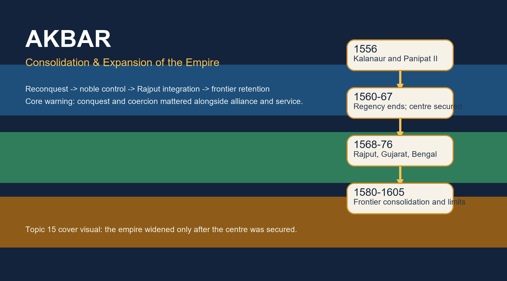

# Akbar: Consolidation & Expansion of the Empire — Complete Topic Package



> **Subject:** Medieval History | **Topic:** 15 | **Repair date:** 2026-09-20  
> **Approval:** false - awaiting explicit user approval.  
> **Canonical sources audited first:** `upsc-ai-kit\knowledge\Medieval-Indian-History\basic\15_Akbar-Consolidation-and-Expansion.md` and `upsc-ai-kit\knowledge\Medieval-Indian-History\advanced\15_Akbar-Consolidation-and-Expansion.md`.

## BASIC LEARNING SESSION

### SESSION 1 — TOPIC BOUNDARY, CHRONOLOGY AND THE CORE QUESTION

#### DEFINITION / WHAT THIS IS CALLED

**Plain-language definition:** This topic asks how Akbar turned a restored but insecure throne into a wider empire.

**Technical definition:** Topic 15 owns political consolidation, campaign geography, elite incorporation, frontier strategy and the uneven geography of control; it does not reteach mansabdari, dahsala or Akbar's religious doctrine in full.

#### ANSWER-GRABBING OPENING — WRITE/ADAPT IN THE EXAM

> Akbar's empire did not grow out of one victory alone; it grew when reconquest, internal discipline, alliance and repeated follow-up campaigns began to work together.

#### MUST-WRITE KEYWORDS

- **Kalanaur**
- **Panipat II**
- **1560**
- **1567**
- **1572-73**
- **1580-81**

**How to use them:** Use the dates as turning points: accession and Panipat, the end of regency, the defeat of internal noble challenge, Gujarat-Bengal expansion and the reconsolidation crisis of 1580-81.

```text
1542 birth at Amarkot
  -> 1556 Kalanaur accession + Panipat II
  -> 1560 Bairam Khan removed
  -> 1567 major Uzbek challenge broken
  -> 1568-69 Chittor and Ranthambhor
  -> 1572-73 Gujarat
  -> 1576 Daud defeated and Haldighati
  -> 1580-81 rebellion + Mirza Hakim
  -> 1605 death
```

*Visual 1. Learn Akbar through turning points in political capacity, not through an undifferentiated conquest list.*

The canonical Basic and Advanced owners agree that Akbar inherited vulnerability rather than settled dominance. Humayun's restoration was recent, Afghan alternatives remained alive, Kabul was politically sensitive, and the Mughal coalition still depended heavily on leadership and discipline. The exam therefore rewards sequence: first recover the core, then control the coalition, then widen imperial reach.

This boundary matters because neighbouring topics own the deeper institutional or doctrinal detail. Topic 16 takes mansab, jagir, suba and revenue mechanics; Topic 17 takes Ibadat Khana, mahzar, sulh-i kul and Din-i Ilahi in depth; Topic 18 takes the mature Deccan story. Topic 15 must still mention those elements when they explain political retention, but it must stop before they become separate essays.

#### PARAGRAPH DEMONSTRATION

A secure opening paragraph can claim that Akbar's achievement was sequential rather than instantaneous. Kalanaur and Panipat II provide the first named evidence because they mark restored legitimacy and battlefield recovery. The defeat of major Uzbek resistance by 1567 then explains why later campaigns in Rajasthan and Gujarat were more systematic. The qualification is essential: even after those milestones, Bengal, Mewar and the north-west still show that empire remained uneven and renewable, not finished once and for all.

**UPSC trap:** Do not begin as if Akbar inherited the fully formed Mughal order of the 1580s in 1556.

**Mains angle:** How should Akbar's reign be periodised as consolidation first and expansion second?

**Study link:** Take Topic 13 for Humayun's collapse and Topic 16 for detailed institutions; here the focus stays on political capacity.

#### CLOSING RECALL FLOW — TOPIC BOUNDARY, CHRONOLOGY AND THE CORE QUESTION

```text
START / CONCEPT: Topic boundary, chronology and the core question
EXACT TERMS: Kalanaur | Panipat II | 1560 | 1567 | 1572-73 | 1580-81
MECHANISM / ARGUMENT: The empire widened only after the restored centre survived battle, regency and noble challenge.
CONSEQUENCE / CONTRAST: Expansion becomes intelligible as staged consolidation, not as a single triumphant march.
UPSC TRAP / ANSWER-USE: Do not collapse adjoining topics into Topic 15 or skip the chronology spine.
ANSWER-GRABBING FORMULATION: Akbar's empire did not grow out of one victory alone; it grew when reconquest, internal discipline, alliance and repeated follow-up campaigns began to work together.
```

### SESSION 2 — HEMU AND PANIPAT II: RECONQUEST WITH CONTINGENCY

#### DEFINITION / WHAT THIS IS CALLED

**Plain-language definition:** Panipat II restored Mughal control over Delhi-Agra, but it did not end Afghan politics in India.

**Technical definition:** The battle must be read through command, captured artillery, elephants, cavalry, leadership and contingency; Hemu's wound mattered within that larger battle structure.

#### ANSWER-GRABBING OPENING — WRITE/ADAPT IN THE EXAM

> Panipat II was decisive for survival at the core, yet misleading if it is written as the final extinction of Afghan resistance or as a communal war.

#### MUST-WRITE KEYWORDS

- **Hemu**
- **Adil Shah**
- **5 November 1556**
- **captured artillery**
- **contingency**

**How to use them:** Name Hemu's rise under Adil Shah, state the date, mention the artillery issue and treat the arrow wound as a battlefield turning point rather than a magical explanation.

```text
Hemu's rise under Adil Shah
  -> Agra and Delhi captured
  -> Mughal position threatened
  -> artillery separated/captured before main clash
  -> battlefield disorder + Hemu wounded
  -> Mughal recovery of Delhi-Agra
  -> Afghan challenge survives in the east
```

*Visual 2. Panipat II solves the problem of immediate survival, not the entire problem of imperial durability.*

The Basic owner insists that Hemu cannot be reduced to a communal symbol. He had served in the Sur-Adil Shah world, rose through military and administrative capability, and marched with a force whose political field remained deeply Afghan. That is why the safest exam line calls Panipat II a contest inside a fractured post-Sur order rather than a civilisational duel.

The battle narrative also needs discipline. Hemu's eye wound mattered because visible command in a sixteenth-century field army was crucial, but the battle involved more than one dramatic anecdote. Mughal leadership under Bairam Khan, battlefield organisation, cavalry-elephant interaction and the prior capture or separation of artillery all belong in the explanation.

#### PARAGRAPH DEMONSTRATION

A strong paragraph can argue that Panipat II mattered by restoring the Mughal core without dissolving the wider Afghan problem. Hemu's advance on Agra and Delhi is the named evidence for the depth of the crisis. The battle then shows how command, cavalry and artillery interacted before Hemu's wound disrupted the field. The qualification is that eastern Afghan resistance, later Bengal campaigns and continuing Sur residues make it unsafe to equate one victory with complete pacification.

**UPSC trap:** Do not write Haldighati, Chittor or Bengal details inside a Panipat answer unless they serve a later contrast.

**Mains angle:** Explain Panipat II as core recovery rather than total consolidation.

**Study link:** Use this session with the next one on Bairam Khan: battlefield recovery and regency stability belong together.

#### CLOSING RECALL FLOW — HEMU AND PANIPAT II: RECONQUEST WITH CONTINGENCY

```text
START / CONCEPT: Hemu and Panipat II
EXACT TERMS: Hemu | Adil Shah | 5 November 1556 | artillery | contingency
MECHANISM / ARGUMENT: Battlefield recovery came from leadership, command and disruption of Hemu's field position.
CONSEQUENCE / CONTRAST: Delhi-Agra returned to Mughal hands, but Afghan politics still survived elsewhere.
UPSC TRAP / ANSWER-USE: Reject the twin exaggerations of communal war and final pacification.
ANSWER-GRABBING FORMULATION: Panipat II was decisive for survival at the core, yet misleading if it is written as the final extinction of Afghan resistance or as a communal war.
```

### SESSION 3 — BAIRAM KHAN'S REGENCY: BRIDGE, NOT SUBSTITUTE SOVEREIGNTY

#### DEFINITION / WHAT THIS IS CALLED

**Plain-language definition:** Bairam Khan kept minority kingship workable from 1556 to 1560.

**Technical definition:** As wakil mutlaq and guardian, Bairam Khan stabilised command and nobles in an emergency, but a regency strong enough to save the throne could also become politically overbearing.

#### ANSWER-GRABBING OPENING — WRITE/ADAPT IN THE EXAM

> Bairam Khan mattered because a thirteen-year-old emperor needed concentrated command, yet concentrated command could not continue indefinitely without provoking a sovereignty question.

#### MUST-WRITE KEYWORDS

- **wakil mutlaq**
- **1556-60**
- **minority kingship**
- **dismissal**
- **Patan**

**How to use them:** First define Bairam's office, then show why it was necessary, then explain why dismissal in 1560 cannot be reduced to sect alone.

```text
Humayun dies -> minor Akbar crowned
      |
      +-> Bairam commands army
      +-> Bairam manages nobles
      +-> Bairam secures restored centre
      -> tension over autonomy and access
      -> 1560 dismissal, rebellion, pardon, pilgrimage
      -> later assassination near Patan
```

*Visual 3. Regency solved the emergency of 1556, but it also generated the later problem of delegated authority.*

The Advanced owner sharpens a vital distinction: Bairam Khan was stabiliser, not sovereign. His authority worked through Akbar's legitimacy, which is why Panipat and the early consolidation phase should not be narrated as Bairam's independent kingship. In exam writing, the regency is best treated as an institutional bridge during a minority.

Equally important is the reason for its end. Court jealousy, appointment struggles, Akbar's desire for direct rule and the political strain of concentrated delegated authority explain the dismissal better than a crude Shia-only formula. After dismissal came rebellion, pardon and permission for pilgrimage; the sequence itself shows how Akbar reasserted personal sovereignty.

#### PARAGRAPH DEMONSTRATION

An examiner-ready paragraph may claim that Bairam Khan was indispensable in 1556 but politically unsustainable in the longer run. The named evidence is the regency itself: he rallied nobles, commanded the army and held the restored centre together after Humayun's death. That proves the utility of concentrated delegation under a minor emperor. The qualification follows from 1560 and after: once Akbar matured, the same concentration of power encouraged resentment and had to yield to direct kingship, though not necessarily through total destruction of the regent.

**UPSC trap:** Do not merge Bairam's dismissal, rebellion, pardon and later assassination into one undifferentiated event.

**Mains angle:** Assess the regency as both stabilising device and source of tension.

**Study link:** The next session shows how personal kingship was asserted through the Adham Khan and Uzbek episodes.

#### CLOSING RECALL FLOW — BAIRAM KHAN'S REGENCY: BRIDGE, NOT SUBSTITUTE SOVEREIGNTY

```text
START / CONCEPT: Bairam Khan's regency
EXACT TERMS: wakil mutlaq | 1556-60 | minority kingship | dismissal | Patan
MECHANISM / ARGUMENT: Delegated authority saved the throne, but maturity of kingship made endless regency impossible.
CONSEQUENCE / CONTRAST: Akbar reclaimed appointment and pardon without denying the regency's earlier necessity.
UPSC TRAP / ANSWER-USE: Avoid the sect-only explanation and keep the chronology distinct.
ANSWER-GRABBING FORMULATION: Bairam Khan mattered because a thirteen-year-old emperor needed concentrated command, yet concentrated command could not continue indefinitely without provoking a sovereignty question.
```

### SESSION 4 — HOUSEHOLD FACTIONS, ADHAM KHAN AND THE UZBEK CHALLENGE

#### DEFINITION / WHAT THIS IS CALLED

**Plain-language definition:** After the regency, Akbar had to master both household influence and armed noble alternatives.

**Technical definition:** Household access, foster ties, jagir expectations and old-noble networks formed a political field that required punishment, pardon, transfer and redistribution rather than one simple administrative order.

#### ANSWER-GRABBING OPENING — WRITE/ADAPT IN THE EXAM

> Akbar became a durable ruler only when neither foster-household proximity nor Uzbek noble muscle could override imperial arbitration.

#### MUST-WRITE KEYWORDS

- **Maham Anaga**
- **Adham Khan**
- **Atka Khan**
- **Khan-i-Zaman**
- **1567**

**How to use them:** Name the household episode first, then connect it to the wider issue of autonomous noble power culminating in the defeat of major Uzbek resistance in 1567.

```text
Household access -> Maham Anaga / Adham Khan / Atka Khan
                         |
                         -> Atka murdered -> Adham executed -> emperor as final arbiter
Old nobles / Uzbeks -> jagir + command + regional base
                         -> rebellion and suppression
                         -> 1567 major challenge broken
```

*Visual 4. Personal rule required Akbar to defeat both intimate court violence and wider noble defiance.*

The Basic owner explicitly warns against lazy phrases such as “petticoat government.” Maham Anaga, Adham Khan and Atka Khan belong in a harder analytical vocabulary: access, patronage, armed followers and the relationship between household intimacy and state power. When Adham Khan murdered Atka Khan and Akbar executed him, the issue was not court gossip but the restoration of a public chain of sovereignty.

The Uzbek and old-noble challenge extended the same problem onto a wider scale. Figures such as Khan-i-Zaman resisted the centre's effort to supervise command and redistribution. The defeat of major Uzbek resistance by 1567 did not eliminate faction, but it did reduce the risk that a large regional campaign would be undermined by a rival bloc at the centre.

#### PARAGRAPH DEMONSTRATION

A high-scoring paragraph can state that Akbar's consolidation was as much internal as territorial. Adham Khan's murder of Atka Khan is the named evidence for how household access could threaten ordered rule from within. Khan-i-Zaman and the Uzbek challenge then broaden the point: command, jagir and status made the nobility politically consequential. The qualification is that noble power was not abolished after 1567; it was disciplined enough for expansion to proceed more systematically.

**UPSC trap:** Do not narrate noble control as if Topic 15 were already a detailed mansabdari chapter.

**Mains angle:** Why did internal noble control matter before large-scale regional expansion?

**Study link:** Keep detailed rank, zat and sawar mechanics for Topic 16.

#### CLOSING RECALL FLOW — HOUSEHOLD FACTIONS, ADHAM KHAN AND THE UZBEK CHALLENGE

```text
START / CONCEPT: Household factions, Adham Khan and the Uzbek challenge
EXACT TERMS: Maham Anaga | Adham Khan | Atka Khan | Khan-i-Zaman | 1567
MECHANISM / ARGUMENT: Personal kingship was asserted by disciplining both household violence and old-noble alternatives.
CONSEQUENCE / CONTRAST: A more secure centre increased the credibility of later campaigns in Rajasthan and Gujarat.
UPSC TRAP / ANSWER-USE: Do not replace political mechanism with gossip or with fully formed later institutions.
ANSWER-GRABBING FORMULATION: Akbar became a durable ruler only when neither foster-household proximity nor Uzbek noble muscle could override imperial arbitration.
```

### SESSION 5 — MALWA AND GARH-KATANGA: EXPANSION WITH COERCIVE COST

#### DEFINITION / WHAT THIS IS CALLED

**Plain-language definition:** Malwa and Garh-Katanga show that early expansion joined conquest to correction, plunder and selective incorporation.

**Technical definition:** These campaigns are essential because they test any one-sided benevolent reading of Akbarian expansion through regional evidence, commander behaviour and post-conquest outcomes.

#### ANSWER-GRABBING OPENING — WRITE/ADAPT IN THE EXAM

> Malwa and Garh-Katanga show that Akbar's empire widened through a mixture of victory, punishment, plunder and later incorporation, not through soft accommodation alone.

#### MUST-WRITE KEYWORDS

- **Baz Bahadur**
- **Adham Khan**
- **Rani Durgavati**
- **Asaf Khan**
- **plunder**

**How to use them:** Use Malwa to show conquest plus later incorporation, and Garh-Katanga to show the harsher moral limit of imperial expansion.

```text
Malwa 1561 -> Baz Bahadur defeated -> Adham/Pir Muhammad misconduct -> imperial correction -> Baz later in service
Garh-Katanga 1564 -> Rani Durgavati resists -> Asaf Khan campaigns -> conquest and plunder -> uneven integration
```

*Visual 5. These campaigns prevent a triumphalist narrative by keeping coercion visible.*

Malwa is not just a name on a map. Baz Bahadur's defeat enlarges Mughal space, but Adham Khan's conduct also reveals the problem of delegated violence. That is why the campaign belongs to both expansion and internal supervision. Baz Bahadur's later incorporation into Mughal service further shows that conquest and co-option could follow one another.

Garh-Katanga adds a harder qualification. Rani Durgavati's resistance, her death and the heavy plunder associated with the campaign prevent any clean claim that integration was consensual. In exam answers, this regional case is powerful because it gives named evidence for the coercive underside of expansion outside the better-known Rajput theatre.

#### PARAGRAPH DEMONSTRATION

A good paragraph may claim that Akbar's early expansion cannot be understood without its coercive regional cases. Baz Bahadur and Malwa show one pattern: defeat followed by later service inside the imperial framework. Rani Durgavati and Garh-Katanga show another: determined resistance and severe extraction. The qualification is that coercion does not cancel later incorporation everywhere, but it does destroy any claim that imperial growth moved only through negotiated goodwill.

**UPSC trap:** Do not confuse Garh-Katanga with Bengal, or write Baz Bahadur as if he were a Rajput ruler.

**Mains angle:** How do Malwa and Garh-Katanga qualify celebratory accounts of Akbarian integration?

**Study link:** These cases prepare the later Rajput discussion by keeping both force and follow-up visible.

#### CLOSING RECALL FLOW — MALWA AND GARH-KATANGA: EXPANSION WITH COERCIVE COST

```text
START / CONCEPT: Malwa and Garh-Katanga
EXACT TERMS: Baz Bahadur | Adham Khan | Rani Durgavati | Asaf Khan | plunder
MECHANISM / ARGUMENT: Regional conquest widened the empire but also exposed the moral and political cost of expansion.
CONSEQUENCE / CONTRAST: The topic's verdict must hold together incorporation and coercion.
UPSC TRAP / ANSWER-USE: Never write Akbarian integration as if all regional actors entered willingly.
ANSWER-GRABBING FORMULATION: Malwa and Garh-Katanga show that Akbar's empire widened through a mixture of victory, punishment, plunder and later incorporation, not through soft accommodation alone.
```

### SESSION 6 — RAJPUT POLICY: ALLIANCE, HONOUR, OFFICE AND SERVICE

#### DEFINITION / WHAT THIS IS CALLED

**Plain-language definition:** Rajput policy worked through selective bargains, not through marriage alone.

**Technical definition:** Amber, service mansabs, governorships, outside jagirs and watan security formed a graded political integration mechanism in which different Rajput houses responded differently.

#### ANSWER-GRABBING OPENING — WRITE/ADAPT IN THE EXAM

> Akbar's Rajput policy succeeded when imperial superiority was translated into honour, service, office and local security rather than into conquest alone.

#### MUST-WRITE KEYWORDS

- **Bhara Mal**
- **Bhagwant Das**
- **Man Singh**
- **watan jagir**
- **Surjan Hada**

**How to use them:** Start with Amber, then show office and watan interests, and use Surjan Hada to destroy the marriage-only reduction.

```text
Amber alliance 1562 -> Bhara Mal enters relation
                     -> Bhagwant Das and Man Singh rise in imperial service
                     -> office + mansab + outside jagir + watan security
Ranthambhor route -> Surjan Hada shows service without universal marriage
Outcome -> composite elite grows, but acceptance remains uneven
```

*Visual 6. Rajput policy is best learnt as a graded bargain under imperial superiority.*

The Advanced owner is especially useful here because it presents Rajput policy in phases: early reliable allies, Rajputs as the sword-arm of campaigns such as Gujarat, and later partners in the ruling structure. That phased view prevents students from treating one marriage tie as the entire explanation. Bhara Mal, Bhagwant Das and Man Singh show continuity across generations of service, not a single isolated concession.

The mechanism of integration was broader than kinship. High office, campaign command, governorships, outside jagirs and secure watan claims tied regional prestige to imperial careers. Surjan Hada of Ranthambhor is therefore indispensable as the clearest counterexample to the marriage-only formula.

#### PARAGRAPH DEMONSTRATION

An examiner-grade paragraph can claim that Rajput policy was political engineering through incentives as much as through force. Bhara Mal, Bhagwant Das and Man Singh are the named evidence for how local authority could be connected to imperial careers and campaign leadership. Surjan Hada then proves that matrimonial alliance was not universal. The qualification is that this was never equal partnership in a modern sense: imperial superiority, command and the possibility of coercion remained present throughout.

**UPSC trap:** Do not flatten all Rajput houses into one response or all integration into one ritual of marriage.

**Mains angle:** Discuss Rajput policy as differentiated political integration.

**Study link:** Use the next two sessions to test this bargain against Chittor, Ranthambhor and Mewar.

#### CLOSING RECALL FLOW — RAJPUT POLICY: ALLIANCE, HONOUR, OFFICE AND SERVICE

```text
START / CONCEPT: Rajput policy as alliance, honour, office and service
EXACT TERMS: Bhara Mal | Bhagwant Das | Man Singh | watan jagir | Surjan Hada
MECHANISM / ARGUMENT: Akbar converted some Rajput houses into imperial partners through office, honour and protected local interests.
CONSEQUENCE / CONTRAST: The ruling coalition widened without erasing hierarchy or the possibility of resistance.
UPSC TRAP / ANSWER-USE: Reject the phrases marriage policy and universal Rajput surrender.
ANSWER-GRABBING FORMULATION: Akbar's Rajput policy succeeded when imperial superiority was translated into honour, service, office and local security rather than into conquest alone.
```

### SESSION 7 — CHITTOR AND RANTHAMBHOR: FORTS, CORRIDORS AND COERCION

#### DEFINITION / WHAT THIS IS CALLED

**Plain-language definition:** Chittor and Ranthambhor mattered for route security, prestige and the limits of accommodation.

**Technical definition:** The Rajasthan campaigns combined operational geography with symbolic sovereignty: Chittor in particular tested whether the empire could punish refusal while securing the Gujarat-Malwa corridor.

#### ANSWER-GRABBING OPENING — WRITE/ADAPT IN THE EXAM

> Chittor is historically important not just because it fell, but because its strategic value and the massacre after the siege force any answer on Akbar to move beyond easy praise.

#### MUST-WRITE KEYWORDS

- **Chittor 1568**
- **Ranthambhor 1569**
- **Jaimal**
- **Patta**
- **corridor security**

**How to use them:** Write the dates precisely, explain the corridor logic, then add the massacre as the indispensable qualification.

```text
Rajasthan forts -> Ganga core linked to Malwa/Gujarat routes
      Chittor: prestige + route control + refusal
          -> siege -> fall in 1568 -> massacre -> memory debate
      Ranthambhor: submission/service route strengthened in 1569
```

*Visual 7. Rajasthan forts mattered strategically and symbolically at the same time.*

The basic owner gives the strategic key: Chittor symbolised Rajput resistance and controlled routes toward Gujarat. That means the campaign cannot be written as a merely emotional imperial response. Military geography and political prestige converged there. Ranthambhor similarly mattered because fort submission strengthened Rajasthan route security even where settlements rather than annihilation followed.

But Chittor also supplies one of the strongest limits on celebratory Akbar narratives. The massacre after the siege must remain visible in any serious answer. Jaimal and Patta belong to memory and honour traditions, yet those traditions do not remove the need to analyse corridor politics, siege warfare and imperial exemplarity.

#### PARAGRAPH DEMONSTRATION

A secure paragraph can argue that Chittor joined strategy and coercion in one campaign. The fort's corridor value toward Gujarat and Malwa is the named evidence for its operational importance. The 1568 fall and subsequent massacre then show that imperial integration could be backed by exemplary violence. The qualification is that Chittor does not summarise the entire Rajput policy by itself, because Amber and Ranthambhor reveal other routes of settlement and service.

**UPSC trap:** Do not confuse Chittor with Haldighati; one is a siege and massacre episode, the other a later field battle with incomplete political closure.

**Mains angle:** Examine Chittor as the coercive underside of integration.

**Study link:** The next session carries the Mewar question forward into Haldighati and its aftermath.

#### CLOSING RECALL FLOW — CHITTOR AND RANTHAMBHOR: FORTS, CORRIDORS AND COERCION

```text
START / CONCEPT: Chittor and Ranthambhor
EXACT TERMS: Chittor 1568 | Ranthambhor 1569 | Jaimal | Patta | corridor security
MECHANISM / ARGUMENT: Forts secured routes and prestige, while refusal invited punitive imperial force.
CONSEQUENCE / CONTRAST: Rajput integration must be written alongside coercion, not as its opposite.
UPSC TRAP / ANSWER-USE: Keep siege, route security and memory distinct inside one answer.
ANSWER-GRABBING FORMULATION: Chittor is historically important not just because it fell, but because its strategic value and the massacre after the siege force any answer on Akbar to move beyond easy praise.
```

### SESSION 8 — MEWAR AND HALDIGHATI: FIELD RESULT VERSUS POLITICAL OUTCOME

#### DEFINITION / WHAT THIS IS CALLED

**Plain-language definition:** Mewar remained the major Rajput exception to full submission in Akbar's reign.

**Technical definition:** Haldighati must be analysed through coalition composition, tactical result and long-term political outcome; those three levels are not identical.

#### ANSWER-GRABBING OPENING — WRITE/ADAPT IN THE EXAM

> Haldighati strengthened Mughal pressure on Mewar, but it neither produced a neat final conquest nor supports a Hindu-versus-Muslim simplification.

#### MUST-WRITE KEYWORDS

- **Rana Pratap**
- **Haldighati 1576**
- **Man Singh**
- **Hakim Khan Sur**
- **Chavand**

**How to use them:** Name the mixed coalitions first, then separate field advantage from later political incompletion and Pratap's continued resistance.

```text
Coalitions
  Mughal side -> Man Singh + imperial service army
  Mewar side -> Rana Pratap + Rajputs + Hakim Khan Sur + Bhils
Outcome ladder
  tactical field result -> Mughal advantage
  operational effect -> pressure on plains and forts
  political effect -> Pratap survives, Chavand, continued resistance
```

*Visual 8. Haldighati becomes clear when tactical, operational and political outcomes are kept separate.*

The canonical owners repeatedly warn against two distortions: turning Haldighati into a decisive final conquest, or turning it into a pure religious war. Man Singh led the Mughal force, while Hakim Khan Sur fought on Pratap's side and Bhils were part of the resistance coalition. That mixed composition alone should keep communal simplification out of a secure answer.

The second distinction is between holding the field and closing the political question. Pratap was neither killed nor captured, later operated from Chavand and recovered parts of Mewar. A full Mughal-Mewar accommodation belongs to the Jahangir-Amar Singh settlement beyond Topic 15.

#### PARAGRAPH DEMONSTRATION

A high-quality paragraph may claim that Haldighati was significant but limited. Man Singh and Hakim Khan Sur are the named evidence that coalition politics, not civilisational binaries, structured the battle. Mughal field advantage then explains immediate leverage. The qualification is decisive: Pratap's survival, hill resistance and later recovery mean that one battlefield result did not close the Mewar problem inside Akbar's lifetime.

**UPSC trap:** Never write that Haldighati ended Mewar resistance or that every Rajput fought on one side.

**Mains angle:** Separate strategic and mythic meanings of Haldighati.

**Study link:** This session completes the Rajput block by showing where the integration bargain did not secure submission.

#### CLOSING RECALL FLOW — MEWAR AND HALDIGHATI: FIELD RESULT VERSUS POLITICAL OUTCOME

```text
START / CONCEPT: Mewar and Haldighati
EXACT TERMS: Rana Pratap | Haldighati 1576 | Man Singh | Hakim Khan Sur | Chavand
MECHANISM / ARGUMENT: A mixed-coalition field battle gave Mughal leverage but not final settlement.
CONSEQUENCE / CONTRAST: Mewar remains the key limit case inside Rajput policy.
UPSC TRAP / ANSWER-USE: Do not confuse tactical advantage with complete political closure.
ANSWER-GRABBING FORMULATION: Haldighati strengthened Mughal pressure on Mewar, but it neither produced a neat final conquest nor supports a Hindu-versus-Muslim simplification.
```

### SESSION 9 — GUJARAT: PORTS, REVENUE AND THE IMPERIAL WEST

#### DEFINITION / WHAT THIS IS CALLED

**Plain-language definition:** Gujarat mattered because it linked imperial politics to sea-facing wealth, routes and rebel risk.

**Technical definition:** The 1572-73 conquest must be interpreted through commercial cities, Surat, fertile revenues, textile wealth and the problem of containing Mirza opposition in the west.

#### ANSWER-GRABBING OPENING — WRITE/ADAPT IN THE EXAM

> Gujarat was not a decorative conquest; it connected Akbar's empire to oceanic commerce, western revenue and the political necessity of crushing rival Timurid-Mirza bases.

#### MUST-WRITE KEYWORDS

- **Gujarat 1572-73**
- **Surat**
- **Cambay**
- **Mirzas**
- **speed of return march**

**How to use them:** Mention both commerce and politics, then use the famous return march only as supporting evidence of Akbar's concern for retention.

```text
Why Gujarat?
  -> rich agriculture
  -> textiles and urban commerce
  -> Surat/Cambay maritime links
  -> Mirza challenge in the west
How conquered?
  -> rapid campaign 1572-73
  -> follow-up against rebellion
Why important?
  -> western gate of empire secured
```

*Visual 9. Gujarat is a political-economic conquest, not simply a western excursion.*

The advanced owner correctly resists reducing Gujarat to the anecdote of Akbar's dramatic return march. That march matters because it shows the emperor's insistence on retention after rebellion, but the deeper explanation lies in the province itself: ports, merchants, textiles, fertile revenue zones and the need to deny western refuge to hostile Timurid elements.

Surat deserves specific mention because it tied the empire to a major maritime outlet. Cambay too carried commercial weight. In mains answers, गुजरात is strongest when written as an intersection of strategy, wealth and post-conquest vigilance rather than as a mere checkbox in a conquests list.

#### PARAGRAPH DEMONSTRATION

A strong paragraph can state that Gujarat transformed the western profile of the Mughal empire. Surat and Cambay are the named evidence for why maritime commerce and urban wealth mattered. The Mirza problem then adds a political dimension, while Akbar's rapid return to suppress rebellion shows how conquest had to be followed by reassertion. The qualification is that access to sea-facing wealth did not make the Mughals a naval empire; it strengthened inland imperial power through revenue and route control.

**UPSC trap:** Do not write Gujarat as if Portuguese sea power automatically made the Mughal conquest irrelevant.

**Mains angle:** Explain Gujarat as a convergence of commerce, strategy and retention.

**Study link:** Use the west-coast Bhatkal-related prelims route only as adjacent context, not as the centre of this topic.

#### CLOSING RECALL FLOW — GUJARAT: PORTS, REVENUE AND THE IMPERIAL WEST

```text
START / CONCEPT: Gujarat
EXACT TERMS: Gujarat 1572-73 | Surat | Cambay | Mirzas | return march
MECHANISM / ARGUMENT: Western expansion combined port wealth, urban revenue and denial of rival political bases.
CONSEQUENCE / CONTRAST: The empire gained maritime-facing resources without becoming a sea-power state.
UPSC TRAP / ANSWER-USE: Do not reduce Gujarat to one anecdote or to Portuguese presence alone.
ANSWER-GRABBING FORMULATION: Gujarat was not a decorative conquest; it connected Akbar's empire to oceanic commerce, western revenue and the political necessity of crushing rival Timurid-Mirza bases.
```

### SESSION 10 — BIHAR AND BENGAL: RIVERINE CONQUEST AND RETENTION PROBLEMS

#### DEFINITION / WHAT THIS IS CALLED

**Plain-language definition:** Bengal was annexed through repeated campaigning, not through one simple victory.

**Technical definition:** The Bihar-Bengal story runs through Afghan Karrani power, Tukaroi, the settlement with Daud Khan, renewed struggle and the challenge of holding a riverine, frontier-rich region.

#### ANSWER-GRABBING OPENING — WRITE/ADAPT IN THE EXAM

> Bengal entered the Mughal empire through layered campaigning and uneasy retention, which is why one battle name never captures the whole eastern process.

#### MUST-WRITE KEYWORDS

- **Daud Khan Karrani**
- **Tukaroi 1575**
- **Rajmahal 1576**
- **Bihar**
- **riverine retention**

**How to use them:** Use Tukaroi and Rajmahal together, name Daud Khan, and explain why Bengal was harder to hold than Delhi-Agra.

```text
Afghan east -> Bihar + Bengal under Karranis
      -> Mughal pressure increases
      -> Tukaroi 1575
      -> temporary arrangement with Daud
      -> renewed conflict
      -> Rajmahal 1576 and annexation
      -> difficult retention in riverine zone
```

*Visual 10. The east was conquered in stages because military success had to be converted into durable retention.*

The east remained one of the clearest reminders that Afghan political alternatives survived after Panipat II. Daud Khan Karrani's role matters because it keeps the eastern theatre tied to the broader post-Sur world. Tukaroi alone is insufficient; the settlement after the battle and renewed conflict explain why Rajmahal also needs to be named.

A strong answer then adds geography. Bengal's rivers, distance from the core and complex local power relations made retention difficult. The imperial state could annex the region, yet it still had to labour continuously to turn military success into everyday control.

#### PARAGRAPH DEMONSTRATION

An examiner-ready paragraph may argue that eastern conquest was a process of repeated military and political closure. Tukaroi and Rajmahal provide the named evidence for sequential rather than singular victory, while Daud Khan Karrani keeps Afghan resistance central to the narrative. The analysis lies in the riverine geography of Bengal, which made governance costly and uneven. The qualification is that annexation was real, but the region never became politically effortless.

**UPSC trap:** Do not replace Bengal's chronology with a vague line such as “Akbar later conquered the east.”

**Mains angle:** Why was Bengal both essential and difficult for the Mughal empire?

**Study link:** Odisha appears next as part of this eastern extension, but the institutional management of the east belongs more fully to later administrative chapters.

#### CLOSING RECALL FLOW — BIHAR AND BENGAL: RIVERINE CONQUEST AND RETENTION PROBLEMS

```text
START / CONCEPT: Bihar and Bengal
EXACT TERMS: Daud Khan Karrani | Tukaroi 1575 | Rajmahal 1576 | Bihar | riverine retention
MECHANISM / ARGUMENT: Sequential campaigning and renewed engagement were needed to break eastern Afghan power.
CONSEQUENCE / CONTRAST: Annexation was genuine, yet distance and rivers made control persistently demanding.
UPSC TRAP / ANSWER-USE: Keep Tukaroi, settlement and Rajmahal in sequence.
ANSWER-GRABBING FORMULATION: Bengal entered the Mughal empire through layered campaigning and uneasy retention, which is why one battle name never captures the whole eastern process.
```

### SESSION 11 — ODISHA, KABUL, KASHMIR, SINDH AND QANDAHAR: THE FRONTIER ARC

#### DEFINITION / WHAT THIS IS CALLED

**Plain-language definition:** Akbar's frontier policy connected the east, the north-west and the lower Indus into one broad security arc.

**Technical definition:** These campaigns should be studied through strategic corridors, dynastic legitimacy, mountain entry points, river zones and the need to deny rival refuge.

#### ANSWER-GRABBING OPENING — WRITE/ADAPT IN THE EXAM

> Akbar's frontiers were not a decorative rim around a finished empire; they were moving security zones whose value lay in route control, rival exclusion and strategic depth.

#### MUST-WRITE KEYWORDS

- **Mirza Hakim**
- **Lahore**
- **Kashmir 1586**
- **Sindh 1591**
- **Qandahar 1595**

**How to use them:** Show why Kabul and Mirza Hakim mattered first, then move through Kashmir, Sindh and Qandahar as linked pieces of frontier depth.

```text
North-west logic
  Kabul/Mirza Hakim -> dynastic and invasion concern
  Lahore shift -> emperor closer to frontier
  Kashmir 1586 -> mountain gateway secured
  Sindh 1591 -> Indus lower zone integrated
  Qandahar 1595 -> buffer and route node recovered
Eastward edge -> Odisha extension remains uneven
```

*Visual 11. The frontier arc joins dynastic security, route control and strategic depth.*

The canonical sources stress that Kabul was never a distant afterthought. Mirza Hakim's existence created a dynastic and political problem because it offered an alternative locus of Timurid legitimacy. Akbar's move to Lahore during part of this frontier phase shows that the emperor treated the north-west as a live governing concern.

Kashmir, Sindh and Qandahar then widen the picture. Kashmir was not just scenic annexation; it was a mountain gateway with strategic significance. Sindh linked the empire more firmly to the lower Indus. Qandahar, recovered in 1595, mattered because it sat on a crucial route system and served as a buffer zone in the Persian-Central Asian field.

#### PARAGRAPH DEMONSTRATION

A well-built paragraph can claim that Akbar's frontier policy expanded strategic depth rather than merely adding distant territory. Mirza Hakim and Lahore supply named evidence that the north-west was politically immediate. Kashmir, Sindh and Qandahar then show a connected route logic across mountains, river systems and transregional corridors. The qualification is that frontier gains always required renewed military and diplomatic attention; they were held spaces, not self-maintaining margins.

**UPSC trap:** Do not place Qandahar in Bengal or turn Kashmir into a purely cultural annexation.

**Mains angle:** Discuss frontier expansion as security architecture.

**Study link:** The Roshanai challenge and mobile-camp governance refine this frontier story in the next sessions.

#### CLOSING RECALL FLOW — ODISHA, KABUL, KASHMIR, SINDH AND QANDAHAR: THE FRONTIER ARC

```text
START / CONCEPT: Frontier arc
EXACT TERMS: Mirza Hakim | Lahore | Kashmir 1586 | Sindh 1591 | Qandahar 1595
MECHANISM / ARGUMENT: Frontier expansion created strategic depth by controlling rival nodes, corridors and river approaches.
CONSEQUENCE / CONTRAST: The empire widened in a ring of defended connections rather than in a smooth uniform block.
UPSC TRAP / ANSWER-USE: Keep geography accurate and tie each frontier to function.
ANSWER-GRABBING FORMULATION: Akbar's frontiers were not a decorative rim around a finished empire; they were moving security zones whose value lay in route control, rival exclusion and strategic depth.
```

### SESSION 12 — THE DECCAN OPENING: BERAR, AHMADNAGAR AND ASIRGARH AS AN UNFINISHED STORY

#### DEFINITION / WHAT THIS IS CALLED

**Plain-language definition:** Akbar entered the Deccan late, and the problem outlived him.

**Technical definition:** The Deccan phase includes Ahmadnagar, Chand Bibi, Berar, Khandesh and Asirgarh, but it must be written as a late opening whose settlement remained incomplete by 1605.

#### ANSWER-GRABBING OPENING — WRITE/ADAPT IN THE EXAM

> Akbar's Deccan policy enlarged the imperial horizon, but it also exposed the limits of ruling a subcontinent through late and expensive frontier pushes.

#### MUST-WRITE KEYWORDS

- **Ahmadnagar**
- **Chand Bibi**
- **Berar**
- **Khandesh**
- **Asirgarh**

**How to use them:** Name Chand Bibi for resistance and negotiation, then state clearly that the Deccan was opened, not finally settled, in Akbar's reign.

```text
Late 1590s Deccan push
   -> Ahmadnagar contested
   -> Chand Bibi resists and negotiates
   -> Berar acquired
   -> Khandesh and Asirgarh added
   -> imperial reach deepens southward
   -> unfinished burden passes forward
```

*Visual 12. The Deccan under Akbar is an opening chapter, not the completed book.*

Students often over-import later Mughal-Deccan history into Akbar's reign. The safer method is to state that Akbar pushed the imperial frontier into the Deccan, but the fully consuming Deccan struggle belongs far more to the seventeenth century. Ahmadnagar and Chand Bibi are central because they dramatise both resistance and negotiation.

Berar and Khandesh widened the empire; Asirgarh carried gateway importance. Yet no careful answer should end by claiming that Akbar solved the Deccan problem. By 1605 the imperial state had entered the arena, not mastered it completely.

#### PARAGRAPH DEMONSTRATION

A precise paragraph may argue that Akbar's Deccan expansion was consequential but incomplete. Ahmadnagar and Chand Bibi are the named evidence for how resistance could delay easy incorporation. Berar, Khandesh and Asirgarh show that the Mughal push still had real territorial consequences. The qualification is unavoidable: the Deccan question remained open and would demand much greater imperial investment after Akbar.

**UPSC trap:** Do not write Bijapur and Golconda as if they were fully absorbed under Akbar.

**Mains angle:** Assess Akbar's Deccan policy as promise and burden.

**Study link:** Topic 18 can carry the later Mughal-Deccan dynamic much further than Topic 15 should.

#### CLOSING RECALL FLOW — THE DECCAN OPENING: BERAR, AHMADNAGAR AND ASIRGARH AS AN UNFINISHED STORY

```text
START / CONCEPT: Deccan opening
EXACT TERMS: Ahmadnagar | Chand Bibi | Berar | Khandesh | Asirgarh
MECHANISM / ARGUMENT: Late southward expansion created new reach but also a long future commitment.
CONSEQUENCE / CONTRAST: Akbar opened the Deccan problem more than he solved it.
UPSC TRAP / ANSWER-USE: Resist importing the entire later Deccan story backward into 1605.
ANSWER-GRABBING FORMULATION: Akbar's Deccan policy enlarged the imperial horizon, but it also exposed the limits of ruling a subcontinent through late and expensive frontier pushes.
```

### SESSION 13 — CAPITALS, MOBILITY AND RULING SPACE

#### DEFINITION / WHAT THIS IS CALLED

**Plain-language definition:** Akbar ruled from more than one capital and also from a moving camp.

**Technical definition:** Agra, Fatehpur Sikri, Lahore and the mobile imperial camp reveal a political geography of rule in which the emperor shifted the centre according to strategic need.

#### ANSWER-GRABBING OPENING — WRITE/ADAPT IN THE EXAM

> Akbar's empire was governed from courts, forts and marching camps alike, which is why capital shifts should be read as strategic choices rather than as signs of whim alone.

#### MUST-WRITE KEYWORDS

- **Agra**
- **Fatehpur Sikri**
- **Lahore**
- **mobile camp**
- **frontier proximity**

**How to use them:** Show that place choice followed campaign, frontier and court needs instead of treating Sikri as a purely symbolic city.

```text
Agra -> Gangetic core and imperial base
Fatehpur Sikri -> political display + court concentration + westward convenience
Lahore -> north-west attention and frontier proximity
Mobile camp -> emperor carries sovereignty across moving spaces
```

*Visual 13. Capitals are best understood as shifting operational centres inside a moving empire.*

The canonical owners refuse a static map of rule. Agra mattered as a core base, Fatehpur Sikri as a major courtly-political centre, Lahore as a frontier-facing capital and the moving camp as an active instrument of imperial presence. This mobility belongs directly to Topic 15 because it helps explain how consolidation and expansion were physically managed.

A useful exam point is that a premodern empire often governed through itinerant presence. The emperor's movement itself signalled supervision, response and access to different theatres. That makes the geography of power part of the story of expansion.

#### PARAGRAPH DEMONSTRATION

A strong paragraph can claim that Akbar's ruling space was mobile by design. Agra, Fatehpur Sikri and Lahore are the named evidence for changing strategic centres, while the imperial camp demonstrates that sovereignty could travel with the ruler. The analysis is that a widening empire demanded such spatial flexibility. The qualification is that mobility did not remove the need for provincial structures; it complemented them and often compensated for their limits.

**UPSC trap:** Do not explain every capital shift only through water shortage, court taste or folklore.

**Mains angle:** How did mobility strengthen consolidation in a geographically widening empire?

**Study link:** Topic 16 explains how provincial offices stabilised this space administratively; Topic 15 only needs the political geography.

#### CLOSING RECALL FLOW — CAPITALS, MOBILITY AND RULING SPACE

```text
START / CONCEPT: Capitals, mobility and ruling space
EXACT TERMS: Agra | Fatehpur Sikri | Lahore | mobile camp | frontier proximity
MECHANISM / ARGUMENT: Akbar governed by shifting centres and itinerant presence across a widening empire.
CONSEQUENCE / CONTRAST: Mobility helped connect distant theatres before later institutions became the whole explanation.
UPSC TRAP / ANSWER-USE: Avoid folklore-only explanations for capital change.
ANSWER-GRABBING FORMULATION: Akbar's empire was governed from courts, forts and marching camps alike, which is why capital shifts should be read as strategic choices rather than as signs of whim alone.
```

### SESSION 14 — SOURCES, BOUNDED CONTEXTS AND HOW NOT TO OVERWRITE THE TOPIC

#### DEFINITION / WHAT THIS IS CALLED

**Plain-language definition:** Good answers on Akbar depend on using the right topic boundary and the right kind of source claim.

**Technical definition:** Abul Fazl, Badauni and later imperial memory each illuminate Akbar differently; meanwhile mansabdari, revenue reform and religious doctrine are adjacent explanatory contexts, not this topic's full syllabus.

#### ANSWER-GRABBING OPENING — WRITE/ADAPT IN THE EXAM

> The safest Akbar answer uses institutions and religion only to explain political expansion, while keeping their full technical detail for the topics that actually own them.

#### MUST-WRITE KEYWORDS

- **Abul Fazl**
- **Badauni**
- **mansabdari reference only**
- **religious policy reference only**
- **source criticism**

**How to use them:** Cite sources with awareness of voice, then signal adjacency when you mention religion or institutions without allowing them to swallow the answer.

```text
Source handling
  Abul Fazl -> imperial articulation and legitimation
  Badauni -> critical insider perspective
Boundary handling
  Topic 15 -> consolidation and expansion
  Topic 16 -> mansab, jagir, suba, revenue detail
  Topic 17 -> sulh-i kul, Ibadat Khana, Din-i Ilahi depth
```

*Visual 14. Source criticism and topic discipline prevent good material from becoming the wrong answer.*

Akbar is overexposed in textbooks, which creates a special danger: students often answer the wrong question with correct information. A prompt on consolidation and expansion can be spoiled by lengthy descriptions of Din-i Ilahi or the dahsala system. The canonical basic owner repeatedly enforces the border: such material may appear briefly if it explains retention or imperial legitimacy, but it must not displace campaign logic and elite politics.

Source criticism sharpens the answer further. Abul Fazl's imperial prose is invaluable but self-conscious in its legitimation; Badauni's critical stance offers another angle without becoming pure neutral truth. Naming this tension elevates a mains answer quickly.

#### PARAGRAPH DEMONSTRATION

A disciplined paragraph may claim that Akbar answers improve when sources and boundaries are handled explicitly. Abul Fazl and Badauni are the named evidence because they present contrasting yet situated views of the reign. That contrast allows the writer to use religion or institutions only as bounded explanation for political success. The qualification is that no single chronicler or adjacent topic can stand in for the whole process of consolidation and expansion.

**UPSC trap:** Do not turn Topic 15 into Topic 16 or Topic 17 simply because those chapters feel more familiar.

**Mains angle:** Why does topic ownership matter in long answers on Akbar?

**Study link:** Use this session as a final answer-discipline check before writing any mixed question on Akbar.

#### CLOSING RECALL FLOW — SOURCES, BOUNDED CONTEXTS AND HOW NOT TO OVERWRITE THE TOPIC

```text
START / CONCEPT: Sources, bounded contexts and topic discipline
EXACT TERMS: Abul Fazl | Badauni | mansabdari reference only | religious policy reference only | source criticism
MECHANISM / ARGUMENT: Strong answers use adjacent themes only to explain political outcomes while preserving the topic boundary.
CONSEQUENCE / CONTRAST: Evidence becomes sharper and the answer stays relevant.
UPSC TRAP / ANSWER-USE: Correct material can still earn low marks if it belongs to the wrong topic.
ANSWER-GRABBING FORMULATION: The safest Akbar answer uses institutions and religion only to explain political expansion, while keeping their full technical detail for the topics that actually own them.
```

### SESSION 15 — FINAL VERDICT: A DURABLE BUT UNEVEN EMPIRE

#### DEFINITION / WHAT THIS IS CALLED

**Plain-language definition:** By 1605 Akbar had built the broadest and most durable Mughal political framework so far, but not a smooth or completed subcontinental order.

**Technical definition:** The final judgement must combine restored legitimacy, disciplined nobility, Rajput integration, multi-regional conquest and stubborn zones of incompletion such as Mewar, frontiers and the late Deccan.

#### ANSWER-GRABBING OPENING — WRITE/ADAPT IN THE EXAM

> Akbar's greatness in this topic lies less in abstract glory than in making a repeatedly threatened throne command a much wider, more governable and more defensible empire by 1605.

#### MUST-WRITE KEYWORDS

- **durable core**
- **uneven control**
- **Rajput integration**
- **frontier depth**
- **unfinished Deccan**

**How to use them:** Use the first three for achievement, then use the last two to prevent overstatement.

```text
Achievement side -> core restored + nobles disciplined + Rajputs integrated + Gujarat/Bengal/frontier gains
Limit side -> Mewar unresolved in full + frontier vigilance continuous + Deccan unfinished
Verdict -> durable empire, not uniform mastery
```

*Visual 15. The highest-scoring conclusion balances durability with unevenness.*

A final answer on Akbar should resist both hero worship and needless contrarianism. The empire was far stronger and wider in 1605 than in 1556. That transformation required military victory, political bargaining, disciplined elite control and repeated follow-up across multiple regions. Those are real achievements.

Yet the empire remained uneven. Mewar was not neatly closed in Akbar's lifetime, frontier gains required ongoing attention, and the Deccan was opened more than completed. The best conclusion therefore stresses durable imperial architecture without describing a fully standardised nation-state.

#### PARAGRAPH DEMONSTRATION

A concluding paragraph can argue that Akbar built the first fully durable Mughal imperial framework while never eliminating every zone of difficulty. Rajput incorporation, Gujarat and Bengal are the named evidence for geographic and political enlargement. Frontier depth in Kashmir, Sindh and Qandahar shows strategic reach, while the unfinished Deccan and incomplete Mewar settlement hold the judgement back from triumphal excess. The qualification is that later emperors inherited a powerful base, but they also inherited unresolved burdens.

**UPSC trap:** Do not conclude with “Akbar unified India completely” or with “nothing really changed under Akbar.”

**Mains angle:** Frame the verdict as durable empire with uneven closure.

**Study link:** This conclusion bridges backward to Humayun-Sur instability and forward to Jahangir, Shah Jahan and the Deccan burden.

#### CLOSING RECALL FLOW — FINAL VERDICT: A DURABLE BUT UNEVEN EMPIRE

```text
START / CONCEPT: Final verdict on Akbar's consolidation and expansion
EXACT TERMS: durable core | uneven control | Rajput integration | frontier depth | unfinished Deccan
MECHANISM / ARGUMENT: Success came from layered consolidation, coalition-building and multi-regional conquest.
CONSEQUENCE / CONTRAST: The empire became governable on a larger scale without becoming uniformly settled everywhere.
UPSC TRAP / ANSWER-USE: End with calibrated judgement, not with total praise or total denial.
ANSWER-GRABBING FORMULATION: Akbar's greatness in this topic lies less in abstract glory than in making a repeatedly threatened throne command a much wider, more governable and more defensible empire by 1605.
```

## BASIC MCQS / REMEDIATION

### Learning MCQ 1
**Question:** Panipat II primarily restored which immediate Mughal advantage?  
A. Delhi-Agra core recovery  
B. Final control over the Deccan  
C. Portuguese sea power  
D. Lasting settlement with Mewar  
**Answer:** **Correct answer: A**.  
**Explanation:** The battle restored the Delhi-Agra core after Hemu's advance. The Deccan belonged to a much later frontier opening, Portuguese power lay at sea, and Mewar remained unsettled long after 1556.

### Learning MCQ 2
**Question:** Bairam Khan's regency is best described as  
A. a permanent dual monarchy  
B. a temporary bridge during minority kingship  
C. an administrative detail unrelated to warfare  
D. a purely sectarian episode  
**Answer:** **Correct answer: B**.  
**Explanation:** The regency held together a minority kingship in crisis. It was neither co-sovereignty, nor detached from war, nor reducible to one sectarian label.

### Learning MCQ 3
**Question:** Which event most clearly asserted Akbar's personal authority against household violence?  
A. Battle of Tukaroi  
B. Fall of Asirgarh  
C. Execution of Adham Khan after Atka Khan's murder  
D. Recovery of Qandahar  
**Answer:** **Correct answer: C**.  
**Explanation:** Adham Khan's execution after the murder of Atka Khan dramatised the emperor as final arbiter. The other events belong to separate theatres of expansion.

### Learning MCQ 4
**Question:** Why is Garh-Katanga important in this topic?  
A. It completed Mughal rule in Mewar  
B. It created the Ibadat Khana  
C. It proves every conquest ended in easy integration  
D. It reveals the coercive and extractive side of expansion  
**Answer:** **Correct answer: D**.  
**Explanation:** The campaign against Rani Durgavati and the associated plunder expose the harder edge of empire. The other options belong to different themes or are historically false.

### Learning MCQ 5
**Question:** Rajput policy under Akbar cannot be reduced to marriage because  
A. office, command and watan interests also mattered  
B. no Rajput ever entered Mughal service  
C. Rajput states were already annexed in 1556  
D. Mewar welcomed Mughal rule immediately  
**Answer:** **Correct answer: A**.  
**Explanation:** Akbar used service, rank, honour and protection of local interests alongside matrimonial ties. Rajputs did enter service, annexation was not complete in 1556, and Mewar did not surrender immediately.

### Learning MCQ 6
**Question:** Chittor's significance in 1568 lay especially in its  
A. control over eastern Bengal rivers  
B. role in Gujarat-Malwa corridor security and imperial prestige  
C. status as Akbar's religious debating hall  
D. position inside Kabul  
**Answer:** **Correct answer: B**.  
**Explanation:** Chittor mattered strategically and symbolically for Rajasthan and westward routes. It was not in Bengal, not the Ibadat Khana, and not part of Kabul.

### Learning MCQ 7
**Question:** Haldighati is best remembered as  
A. a naval victory over the Portuguese  
B. the battle that annexed Bengal  
C. a battle whose tactical result did not end the political problem of Mewar  
D. the final surrender of Rana Pratap  
**Answer:** **Correct answer: C**.  
**Explanation:** Mughal field advantage at Haldighati did not close the Mewar issue; Rana Pratap survived and resistance continued. The other options misplace the battle entirely.

### Learning MCQ 8
**Question:** Gujarat was important to Akbar mainly because it offered  
A. only desert fortresses with no commercial value  
B. a route to Tibet  
C. direct settlement of the Deccan issue  
D. ports, revenue and control over a western rival zone  
**Answer:** **Correct answer: D**.  
**Explanation:** Gujarat combined port wealth, urban commerce and strategic denial of western bases to rivals. It was not a Tibetan or Deccan solution.

### Learning MCQ 9
**Question:** The sequence Tukaroi followed by Rajmahal helps prove that Bengal  
A. required staged conquest and retention  
B. had been settled fully at Panipat II  
C. never saw Afghan resistance  
D. was politically easier than Delhi  
**Answer:** **Correct answer: A**.  
**Explanation:** The east needed more than one military-political closure. Afghan resistance persisted and Bengal was harder, not easier, to retain than the core.

### Learning MCQ 10
**Question:** Why did Mirza Hakim matter for Akbar?  
A. He was the governor of Chittor  
B. He represented a north-western dynastic challenge  
C. He led the Portuguese in Gujarat  
D. He founded Fatehpur Sikri  
**Answer:** **Correct answer: B**.  
**Explanation:** Mirza Hakim created a dynastic problem linked to Kabul and the north-west. The other associations are invented.

### Learning MCQ 11
**Question:** Which frontier gain is correctly matched with year?  
A. Kashmir - 1560  
B. Sindh - 1556  
C. Qandahar - 1595  
D. Bengal - 1605  
**Answer:** **Correct answer: C**.  
**Explanation:** Qandahar was recovered in 1595. Kashmir entered in 1586, Sindh in 1591, and Bengal was annexed well before 1605.

### Learning MCQ 12
**Question:** Chand Bibi appears in Topic 15 because she is linked with  
A. Panipat II  
B. Rajmahal  
C. Bhara Mal's alliance  
D. Ahmadnagar and the late Deccan opening  
**Answer:** **Correct answer: D**.  
**Explanation:** Chand Bibi belongs to Ahmadnagar and the late Deccan theatre. She is not part of Panipat, Bengal's Rajmahal campaign or the Amber alliance.

### Learning MCQ 13
**Question:** Lahore's importance in Akbar's reign best illustrates  
A. the emperor's north-western strategic focus  
B. the completion of revenue reform  
C. the first Mughal contact with Bengal  
D. the abolition of jagirs  
**Answer:** **Correct answer: A**.  
**Explanation:** Lahore served the frontier orientation toward Kabul and the north-west. The other options misidentify its role.

### Learning MCQ 14
**Question:** Which statement about Topic 15 boundaries is correct?  
A. It must ignore religion and institutions completely  
B. It may use religion and institutions briefly to explain political expansion  
C. It should teach mansabdari and Din-i Ilahi in full detail  
D. It is only a battle chronology with no answer architecture  
**Answer:** **Correct answer: B**.  
**Explanation:** Topic 15 can mention adjacent themes when they explain consolidation, but full treatment belongs to Topic 16 and Topic 17.

### Learning MCQ 15
**Question:** The safest final judgement on Akbar's empire is that it was  
A. complete and uniform everywhere by 1560  
B. smaller than Humayun's restored realm  
C. durable but uneven by 1605  
D. unrelated to Rajput participation  
**Answer:** **Correct answer: C**.  
**Explanation:** By 1605 the empire was far stronger and wider, yet Mewar, frontiers and the Deccan still reveal uneven closure.

### Learning MCQ 16
**Question:** Which statement is historically most accurate?  
A. Bengal submitted permanently after one encounter  
B. Gujarat had no strategic importance beyond court prestige  
C. Panipat II ended every Afghan political possibility in India  
D. Rajput policy operated through alliance, force and service in varying combinations  
**Answer:** **Correct answer: D**.  
**Explanation:** The Rajput field was differentiated. Bengal required repeated closure, Gujarat mattered strategically and economically, and Afghan resistance remained alive after Panipat II.

## PYQS AND ANSWER PRACTICE

### Routed / Adjacent PYQ signals for this topic

1. **UPSC Prelims 2021 (adjacent, territorial vocabulary route):** *With reference to medieval India, which one of the following is the correct sequence in ascending order in terms of size?*  
   Use: good for spatial vocabulary that underlies consolidation, but the full institutional explanation belongs to Topic 16.

2. **UPSC Mains 2020 GS-I (routed source-method support):** *Persian literary sources of medieval India reflect the spirit of the age. Comment. (Answer in 250 words)*  
   Use: strengthens the source-criticism session on Abul Fazl and Badauni.

3. **UPSC Prelims 2024 GS-I (adjacent west-coast context):** *Who of the following rulers of medieval India gave permission to the Portuguese to build a fort at Bhatkal?*  
   Use: coastal strategic awareness around the western seaboard; not a core Topic 15 ownership item.

4. **UPSC Mains 2025 GS-I (adjacent Topic 17 route):** *Examine the main aspects of Akbar's religious syncretism. (Answer in 150 words)*  
   Use: useful boundary reminder that religious doctrine belongs primarily to the next topic.

### Fully solved routed and original practice set

### Solved Item 1 — UPSC Prelims 2021 (Adjacent support)
**Status:** Adjacent, verified from local prelims export.  
**Question:** *With reference to medieval India, which one of the following is the correct sequence in ascending order in terms of size?*  
**Working route:** The useful option is the one that places **Pargana -> Sarkar -> Suba** in ascending order.

#### Demand decoding
The question tests territorial vocabulary rather than Akbar's campaigns directly, but it supports Topic 15 because consolidation and expansion only make sense when the student can picture the scale of imperial space.

#### Executable answer/elimination plan
Reject options that invert the middle and largest units. Keep the smallest fiscal-administrative block first, then the larger district-level unit, then the province. Even without full institutional depth, the ascending order must end with suba.

#### Why this earns marks / route earns marks
The route earns marks because it uses hierarchical reasoning instead of blind recall. It also stays honest about adjacency: the conceptual backbone is useful here, while the full technical explanation belongs to Topic 16.

#### How to improve/strengthen
After solving, attach a quick margin note: Topic 15 uses this ladder only to visualise how conquest turned into governable space. Do not drift into detailed mansabdari when writing a Topic 15 answer.

### Solved Item 2 — UPSC Mains 2020 GS-I (Routed source-method support)
**Status:** Routed support, verified from local mains export.  
**Question:** *Persian literary sources of medieval India reflect the spirit of the age. Comment. (Answer in 250 words)*

**Model answer:** Persian literary sources illuminate medieval India because they preserve court ideals, elite anxieties, administrative language and political self-fashioning. In Akbar's reign, Abul Fazl's writings reveal how the Mughal state wished to portray sovereignty: universal kingship, ordered rule and imperial legitimacy. Badauni, by contrast, provides a more critical voice from within the same age, especially on court culture and religious departures. Together they show that sources do not merely list events; they register argument, approval, discomfort and ideological framing. For the wider medieval period, Persian chronicles also help reconstruct campaigns, revenue claims, dynastic succession and elite values. Yet they reflect the spirit of the age precisely because they arise from located authorship. Court proximity can magnify imperial claims, while personal or doctrinal hostility can sharpen criticism. Therefore, Persian literary sources are indispensable not as transparent mirrors but as historically situated records through which the political and cultural temper of an age can be read.

#### Demand decoding
The demand is not to catalogue books but to show how sources express political culture, values and tensions. For Topic 15, the pay-off lies in using Abul Fazl and Badauni as a paired source-criticism tool.

#### Executable answer/elimination plan
Open with what Persian literary sources reveal; then give Akbar-era evidence through Abul Fazl and Badauni; finally add a qualification about perspective and authorial location. That three-step plan keeps the answer analytical rather than bibliographic.

#### Why this earns marks / route earns marks
It earns marks because it moves from source utility to source criticism and names evidence directly. The route also strengthens Topic 15 answers by teaching students to cite sources without treating them as neutral transcripts.

#### How to improve/strengthen
A stronger version could add one non-Akbar example from another period to widen the comment. In a Topic 15 notebook, however, keep the focus tight on the Akbar-era pair.

### Solved Item 3 — UPSC Prelims 2024 GS-I (Adjacent west-coast context)
**Status:** Adjacent, verified from local 2024 paper JSON and answer-key JSON.  
**Question:** *Who of the following rulers of medieval India gave permission to the Portuguese to build a fort at Bhatkal?*  
**Correct option:** Krishnadevaraya.

#### Demand decoding
The question is not owned by Topic 15, but it helps students avoid overextending Akbar into every west-coast development merely because Gujarat and Surat appear in the same macro-period.

#### Executable answer/elimination plan
Anchor Bhatkal on the Vijayanagara-Portuguese relationship, not on Mughal Gujarat. Eliminate Akbar-related thinking immediately because the stem concerns permission on the south-west coast, not Mughal conquest of Gujarat.

#### Why this earns marks / route earns marks
This route earns marks by protecting regional accuracy. It is useful inside Topic 15 revision because Gujarat's maritime relevance can otherwise tempt candidates to choose an anachronistic Mughal answer.

#### How to improve/strengthen
Pair this with a map revision of Gujarat, Konkan and Vijayanagara coastal zones. The improvement lies in separating adjacent maritime contexts rather than memorising one isolated fact.

### Solved Item 4 — UPSC Mains 2025 GS-I (Adjacent Topic 17 reminder)
**Status:** Adjacent, verified from local mains export.  
**Question:** *Examine the main aspects of Akbar's religious syncretism. (Answer in 150 words)*

**Model answer:** Akbar's religious syncretism arose from a search for imperial legitimacy in a diverse realm and from his intellectual engagement with multiple traditions. Its main aspects included abolition of pilgrimage tax and jizya, discussion among scholars at the Ibadat Khana, interest in inter-faith debate, and the language of sulh-i kul or universal peace. The mahzar signalled a claim to arbitrate among opinions, while Din-i Ilahi represented a small court-centred ethical fellowship rather than a mass religion. Akbar's religious posture thus combined practical governance with an effort to elevate the emperor above sectarian contest. Yet its scope should not be exaggerated: it did not erase political coercion elsewhere, nor did it become a popular religion across society.

#### Demand decoding
The demand is doctrinal and ideological, not primarily territorial. It is included here to remind students where Topic 15 should stop and how Akbar's religious choices may be mentioned only as bounded context.

#### Executable answer/elimination plan
Use a four-part frame: taxes, debate spaces, imperial arbitration and limited ethical fellowship. End with a qualification so the answer does not become devotional praise.

#### Why this earns marks / route earns marks
It earns marks because it names key elements precisely and distinguishes Din-i Ilahi from a mass conversion project. As a route inside Topic 15, it teaches syllabus discipline by showing what adjacent material looks like when owned by another chapter.

#### How to improve/strengthen
If this item is revised alongside Topic 15, add one linking sentence: these religious measures could aid imperial legitimacy, but they do not substitute for military and political consolidation.

### Solved Item 5 — Original 10-mark answer
**Question:** *How did Akbar move from regency dependence to personal sovereignty between 1556 and 1567? (Answer in 150 words)*

**Model answer:** Akbar's first decade as ruler was shaped by the problem of turning a rescued throne into personal kingship. Bairam Khan's regency was indispensable after Humayun's death because a minor emperor required concentrated military and political command. Panipat II restored the Delhi-Agra core, but the emperor still depended on delegated authority. The shift began with Bairam Khan's dismissal in 1560, which signalled the end of regency rule. Yet personal sovereignty required more than removing one guardian. Household influence under Maham Anaga and the violence of Adham Khan showed that access politics could still destabilise the court. Akbar's punishment of Adham Khan and the later breaking of major Uzbek resistance by 1567 established the emperor as final arbiter over both intimate court networks and powerful nobles. Thus personal rule emerged through sequential control over regent, household faction and armed aristocratic challenge.

#### Demand decoding
The demand is chronological and political: explain a transition, not a biography of Akbar or Bairam Khan alone. The answer must end in 1567 because noble control is the real destination.

#### Executable answer/elimination plan
Use a three-step spine: regency necessity -> dismissal and household assertion -> Uzbek suppression. Write one named example inside each step so the answer moves by evidence rather than by generic commentary.

#### Why this earns marks / route earns marks
It earns marks because it treats sovereignty as a process. Panipat, Bairam Khan, Adham Khan and the Uzbek challenge give concrete anchors that show movement from dependence to command.

#### How to improve/strengthen
A stronger version could add one line clarifying why 1567 matters more than 1560 alone. That refinement would sharpen the difference between nominal and effective personal rule.

### Solved Item 6 — Original 10-mark answer
**Question:** *Why can Akbar's Rajput policy not be reduced to a “marriage alliance policy”? (Answer in 150 words)*

**Model answer:** Akbar's Rajput policy cannot be reduced to marriage because its real strength lay in selective political integration. The alliance with Bhara Mal of Amber was important, yet the larger pattern included high office for Bhagwant Das and Man Singh, command in imperial campaigns and recognition of local status within an imperial hierarchy. Watan interests and service opportunities tied regional elites to Mughal power more durably than one matrimonial bond could. The case of Surjan Hada is especially important because it shows that accommodation and service did not always depend on marriage. At the same time, the policy retained an unmistakable coercive edge: Chittor and later pressure on Mewar prove that refusal could invite military punishment. Therefore Rajput policy combined honour, office, alliance and force in varying proportions rather than operating as a simple matrimonial formula.

#### Demand decoding
The demand is argumentative: demolish an inadequate label and replace it with a fuller mechanism. You need both positive evidence and one counterexample to the common simplification.

#### Executable answer/elimination plan
Start by acknowledging Amber, then broaden to office, service and watan interests, then use Surjan Hada and Chittor/Mewar as corrective evidence. That sequence defeats the slogan without ignoring why the slogan arose.

#### Why this earns marks / route earns marks
It earns marks because it replaces a textbook cliché with a differentiated political explanation. The answer also balances integration with coercion, which examiners reward in Akbar questions.

#### How to improve/strengthen
To strengthen it further, add one line on how Rajput commanders later served as the imperial sword-arm in campaigns such as Gujarat. That would connect alliance to expansion even more clearly.

### Solved Item 7 — Original 15-mark answer
**Question:** *Examine the significance of Gujarat in Akbar's imperial expansion. (Answer in 250 words)*

**Model answer:** Gujarat was one of the most consequential conquests of Akbar's reign because it joined strategy, revenue and commerce in a single province. Politically, the conquest of 1572-73 denied western space to rebellious Mirza elements and strengthened imperial control beyond the north Indian core. Economically, Gujarat was attractive for its fertile tracts, urban centres, textile production and major ports such as Surat and Cambay. These ports did not make the Mughals a naval empire, but they connected inland imperial power to maritime wealth and wider commercial circuits. The campaign also demonstrates Akbar's concern for retention, not just conquest. His rapid return to suppress rebellion in Gujarat is useful evidence that the province mattered too much to be left to uncertain subordinates. Gujarat also improved the empire's western communications and deepened the material base from which later expansion could proceed. Yet a balanced answer should avoid reducing the conquest to commercial greed alone. Gujarat was important because political security, elite rivalry and access to revenue-rich urban-maritime resources converged there. In that sense, Gujarat was not a peripheral annexation but a major step in transforming the Mughal state into a broader imperial formation.

#### Demand decoding
The demand asks for significance, so the answer must go beyond chronology. It should explain why Gujarat mattered in several dimensions at once.

#### Executable answer/elimination plan
Use a three-basket structure: political value, economic-maritime value and retention value. End with one cautionary line so the answer stays analytical rather than celebratory.

#### Why this earns marks / route earns marks
It earns marks because it treats Gujarat as an intersection of commerce and statecraft. Named evidence such as Surat, Cambay and the return march makes the explanation concrete.

#### How to improve/strengthen
You can improve it by adding a map phrase like “western gate of empire” in the opening line. That gives the examiner an immediate spatial handle.

### Solved Item 8 — Original 15-mark answer
**Question:** *Why was Bengal difficult for Akbar to conquer and retain? (Answer in 250 words)*

**Model answer:** Bengal was difficult for Akbar because it combined surviving Afghan political strength with demanding geography and distance from the imperial core. After Panipat II, Afghan alternatives did not disappear; in the east, the Karrani regime under Daud Khan kept resistance alive. This is why Bengal had to be approached through a sequence rather than a single final battle. Tukaroi in 1575 produced a temporary arrangement, but renewed conflict made Rajmahal in 1576 necessary for firmer annexation. Even then, conquest did not equal effortless possession. Bengal's riverine environment complicated troop movement, supply and routine enforcement. Its distance from Delhi-Agra also raised the cost of supervision. In political terms, Bengal mattered too much to ignore because it was rich, populous and strategically connected to Bihar and Odisha. Yet it remained a zone in which imperial success had to be renewed through continuing military and administrative effort. Therefore Bengal was difficult not because Akbar lacked military capacity, but because the region demanded repeated closure against Afghan survival and because its terrain made retention inherently more exacting than in the core north Indian plain.

#### Demand decoding
The demand has two halves—conquer and retain—so a one-sided battle answer is insufficient. Geography and post-battle control must be kept alongside Afghan resistance.

#### Executable answer/elimination plan
Write in four moves: surviving Afghan challenge -> Tukaroi -> Rajmahal -> riverine retention. Each move answers a separate aspect of the demand and keeps the chronology intact.

#### Why this earns marks / route earns marks
It earns marks because it distinguishes annexation from governance. The answer names Daud Khan, Tukaroi and Rajmahal while showing why geography altered the politics of retention.

#### How to improve/strengthen
A stronger answer could add one short line on Odisha as part of the wider eastern extension. That would show awareness of how Bengal linked to a broader frontier.

### Solved Item 9 — Original 20-mark answer
**Question:** *“Akbar's empire expanded through a combination of coercion and incorporation.” Discuss with suitable examples. (Answer in 250-300 words)*

**Model answer:** Akbar's imperial expansion cannot be explained either as pure conquest or as pure reconciliation; it worked through coercion and incorporation in changing combinations. Coercion is visible from the beginning. Panipat II restored the Mughal core through military victory. Malwa and Garh-Katanga show that regional conquest could involve harsh extraction and the correction of commander excess. Chittor in 1568 demonstrates the punitive side of empire even more starkly, because strategic gain was accompanied by massacre after the siege. The Mewar campaign and Haldighati further confirm that force remained indispensable when resistance persisted.

Incorporation, however, was equally important to durability. Bairam Khan's regency initially held the empire together, but Akbar's later assertion over household factions and Uzbek nobles allowed the centre to redistribute favour more credibly. Rajput policy shows incorporation at its most sophisticated: Bhara Mal's alliance, Man Singh's high command and the protection of local honour and watan interests tied regional elites to the Mughal project. Gujarat similarly became valuable not only because it was conquered, but because its commerce and urban resources were absorbed into imperial power. Bengal too was annexed only when repeated military action was followed by retention.

The relationship between coercion and incorporation was therefore sequential and interactive. Force opened doors, but incorporation made rule last; incorporation broadened the coalition, but force remained available against refusal. Akbar's success lay in managing both instruments without allowing either one alone to define the empire.

#### Demand decoding
The quotation demands balance. If you supply only violent episodes or only alliance stories, you miss the central conceptual contrast.

#### Executable answer/elimination plan
Divide the answer into coercion examples and incorporation examples, then end with an integrative conclusion. Chittor and Rajput service should appear on opposite sides of the answer so the contrast is visible.

#### Why this earns marks / route earns marks
It earns marks because it answers the quotation directly and uses named cases across multiple regions. The final synthesis shows why the two processes must be analysed together rather than as rival interpretations.

#### How to improve/strengthen
To strengthen it further, add one sentence on frontier gains such as Kashmir or Qandahar as incorporation of strategic depth after conquest. That broadens the answer beyond Rajasthan and the core.

### Solved Item 10 — Original 20-mark answer
**Question:** *Assess the extent and limits of Akbar's imperial consolidation by 1605. (Answer in 250-300 words)*

**Model answer:** By 1605 Akbar had created the most durable Mughal political framework yet seen, but consolidation remained extensive rather than absolute. On the side of achievement, the contrast with 1556 is dramatic. The Delhi-Agra core had been rescued at Panipat II, regency dependence had given way to direct sovereignty, and major noble challenges such as the Uzbek resistance had been checked. Rajput policy widened the ruling coalition through service, honour and selective alliance. Territorial gains in Gujarat and Bengal enlarged the empire's fiscal and strategic base. Frontier advances in Kashmir, Sindh and Qandahar deepened security beyond the immediate core. Even the late Deccan opening showed an empire capable of projecting itself far beyond north India.

Yet limits persisted. Mewar did not yield a fully settled political closure within Akbar's lifetime; Haldighati produced leverage, not finality. Bengal was annexed but remained difficult to hold because of geography and distance. Frontier gains demanded constant vigilance, and Qandahar in particular was never a self-maintaining possession. The Deccan remained the clearest unfinished burden, since Ahmadnagar and related advances opened a problem that future rulers would have to carry much further. Moreover, Akbar's empire was not a modern nation-state; it was a layered imperial order built through superiority, negotiation and force.

Therefore, Akbar's consolidation by 1605 was profound in scale and durability, but incomplete in closure. He handed later Mughals a powerful imperial base together with unresolved frontier and regional challenges.

#### Demand decoding
The question asks for a measured assessment, so both extent and limits must receive real evidence. A one-paragraph praise song cannot score highly.

#### Executable answer/elimination plan
Build two explicit halves: achievements first, limits second, then a calibrated verdict. Use at least one example each from the core, Rajasthan, Bengal and the frontiers.

#### Why this earns marks / route earns marks
It earns marks because it periodises the reign from vulnerability to strength while preserving unresolved zones. The answer is broad enough to show command of the whole topic and disciplined enough to stay within it.

#### How to improve/strengthen
The answer becomes even stronger if you insert one compact line on capitals and mobility, showing that consolidation was also spatially managed. Use that only if word space permits.

**2026 standing rule result:** Local 2026 paper transcriptions, routing ledgers and audits were searched; no directly relevant Akbar-consolidation / Rajput-policy / Gujarat-Bengal-frontier 2026 question was verified for Topic 15.

## OPTIONAL ADVANCED DEPTH — NOT REQUIRED FOR A CORE ANSWER

### Advanced Thread 1 — Why 1567 matters more than students usually realise
The advanced owner highlights 1567 as a major internal turning point because the defeat of strong Uzbek resistance reduced the probability that large expansionary campaigns would be undercut by autonomous military elites. This does not mean faction ended. It means the centre acquired greater credibility when asking leading groups to serve outside their own regional comfort zones.

### Advanced Thread 2 — Rajput policy worked in phases, not as a single formula
A high-level answer can distinguish three movements: first, winning dependable allies such as Amber; second, using Rajput commanders within wider imperial campaigns; third, converting service and honour into a more stable imperial elite partnership. This layered interpretation is better than the weak textbook phrase “marriage alliance policy.”

### Advanced Thread 3 — Empire as a geography of differing depths of control
Delhi-Agra formed the safest core; Rajasthan and Gujarat became more closely tied through conquest and service; Bengal remained expensive to hold; Qandahar and Kashmir had frontier depth value; the Deccan remained a late, unfinished burden. This gradient of control is often what separates average answers from excellent ones.

### Advanced Thread 4 — Why the word “integration” requires caution
Integration in this topic does not mean equal citizenship, cultural fusion without coercion or the disappearance of local autonomy. It refers to linking regional rulers, commanders and revenue-bearing territories to imperial sovereignty through force, office, bargaining and supervision. Chittor, Garh-Katanga and the continuing Mewar problem all remind us why the term must remain qualified.

## CONSOLIDATED REGISTER NOTES

### One-page answer spine
- 1556: Kalanaur accession under conditions of fragility.
- Panipat II restored the Delhi-Agra core but did not eliminate all Afghan alternatives.
- Bairam Khan's regency stabilised minority kingship; 1560 marks the shift toward direct rule.
- Household and Uzbek challenges proved that internal consolidation mattered before wider expansion.
- Malwa and Garh-Katanga reveal both expansion and coercive cost.
- Rajput policy worked through alliance, honour, office, service and protected local interests.
- Chittor and Ranthambhor show route security and imperial coercion.
- Mewar and Haldighati prove that tactical success did not guarantee political closure.
- Gujarat brought ports, commerce, revenue and western strategic depth.
- Bengal required staged conquest: Tukaroi, settlement, Rajmahal and continued retention effort.
- The frontier arc ran through Kabul, Kashmir, Sindh and Qandahar.
- The late Deccan push widened reach but remained incomplete by 1605.
- Agra, Fatehpur Sikri, Lahore and the mobile camp show political geography in motion.
- Religion and institutions may be cited briefly, but their full teaching belongs to Topics 16 and 17.
- Final verdict: durable empire, uneven closure.

### Mini chronology strip
```text
1556 accession at Kalanaur -> Panipat II
1560 Bairam removed
1561 Malwa
1564 Garh-Katanga
1568 Chittor
1569 Ranthambhor
1572-73 Gujarat
1575 Tukaroi
1576 Rajmahal + Haldighati
1580-81 rebellion and Mirza Hakim crisis
1586 Kashmir
1591 Sindh
1595 Qandahar
Late 1590s-1601 Ahmadnagar / Berar / Khandesh / Asirgarh
1605 Akbar dies
```

### Fast revision contrasts
| Issue | What to write | What to avoid |
|---|---|---|
| Panipat II | core recovery with continuing Afghan challenge | final total pacification |
| Bairam Khan | necessary regency, later unsustainable | independent co-sovereign king |
| Rajput policy | differentiated integration through service and honour | marriage-only slogan |
| Chittor | route security plus massacre | unqualified benevolent integration |
| Haldighati | tactical result but incomplete political closure | final conquest of Mewar |
| Gujarat | port wealth + Mirza politics | decorative western annexation |
| Bengal | staged conquest and riverine retention | one-battle annexation story |
| Frontiers | strategic depth and rival exclusion | distant marginal additions |
| Deccan | late opening, unfinished burden | completely settled south |

### Final exam-use formulation
**Akbar consolidated and expanded the empire by first stabilising a vulnerable restored throne, then disciplining nobles, integrating selected Rajput houses, conquering key revenue and route zones such as Gujarat and Bengal, and widening strategic depth on multiple frontiers; yet Mewar, the frontiers and the Deccan show that the empire remained uneven even at the end of his reign.**


