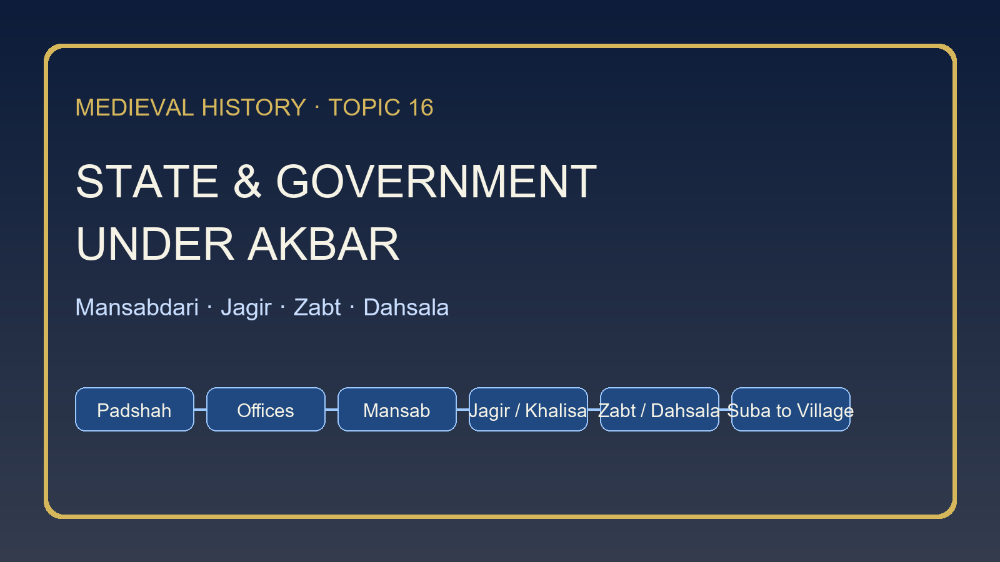

# State & Government under Akbar (Mansabdari, Dahsala) — Complete Topic Package



> **Subject:** Medieval History | **Topic:** 16 | **Repair date:** 2026-09-20  
> **Approval:** false - awaiting explicit user approval.  
> **Canonical sources audited first:** `upsc-ai-kit\knowledge\Medieval-Indian-History\basic\16_State-and-Government-under-Akbar.md` and `upsc-ai-kit\knowledge\Medieval-Indian-History\advanced\16_State-and-Government-under-Akbar.md`.

## BASIC LEARNING SESSION

### SESSION 1 — TOPIC BOUNDARY AND THE STATE-CAPACITY QUESTION

#### DEFINITION / WHAT THIS IS CALLED

**Plain-language definition:** This topic studies how Akbar made rule governable through offices, ranks, revenue records and supervision.

**Technical definition:** Topic 16 owns the machinery of rule: ruler-centred checks, central and provincial offices, mansab-jagir relations, revenue methods and the limits of implementation. It does not retell Topic 15 campaigns or Topic 17 religious doctrine in full.

#### ANSWER-GRABBING OPENING — WRITE/ADAPT IN THE EXAM

> Akbar's government mattered not because it created a modern bureaucracy, but because it linked command, remuneration, information and revenue into one imperial operating system.

#### MUST-WRITE KEYWORDS

- **state capacity**
- **mansab**
- **jagir**
- **zabt**
- **negotiated rule**

**How to use them:** Use the first four words to name the moving parts of rule, then use negotiated rule to qualify any claim of total centralisation.

```text
PADSHAH -> appoints, transfers, judges
      -> offices manage finance, army, grants and household
      -> mansab ranks service and pay
      -> jagir/khalisa finance obligations
      -> zabt/dahsala and alternatives assess land
      -> news, musters and records test paper claims
```

*Visual 1. Topic 16 is best learnt as an integrated state architecture, not as disconnected definitions.*

The canonical Basic owner opens from the fiscal and military logic of the state. Offices mattered because revenue had to be assessed, elites had to be rewarded, troops had to be verified and provinces had to remain tied to the centre. The Advanced owner adds the crucial caution that this was still a personal monarchy. Institutions overlapped and checked one another, but they all remained subordinate to the emperor rather than to an impersonal constitution.

This boundary protects answer quality. Topic 15 explains how Akbar widened the empire; Topic 16 explains how that wider empire was administered. Topic 17 takes Ibadat Khana, sulh-i kul and Din-i Ilahi. Topic 23 may revisit later jagirdari crisis dynamics; here they appear only as bounded seeds, not as a fully developed seventeenth-century crisis.

#### PARAGRAPH DEMONSTRATION

A strong opening paragraph can claim that Akbar's state was a system of linked capacities rather than a list of offices. Mansab and jagir are the named evidence because they tied elite service and remuneration to imperial control. Zabt-dahsala and provincial duplication of offices then show how revenue and territory were made legible. The qualification is that legibility was never complete: local power, ecological variation and paper-versus-practice gaps kept the system negotiated and uneven.

**UPSC trap:** Do not write Topic 16 as if it were either a perfect modern bureaucracy or a mere synonym for conquest.

**Mains angle:** How far can Akbar's state be called a military-fiscal monarchy with negotiated local implementation?

**Study link:** Read Topic 14 for Sher Shah precedents and Topic 15 for territorial expansion; Topic 16 owns the operating mechanism of rule.

#### CLOSING RECALL FLOW — TOPIC BOUNDARY AND THE STATE-CAPACITY QUESTION

```text
START / CONCEPT: TOPIC BOUNDARY AND THE STATE-CAPACITY QUESTION
EXACT TERMS: state capacity | mansab | jagir | zabt | negotiated rule
MECHANISM / ARGUMENT: Imperial rule worked by linking office, rank, finance, assessment and supervision into one operating chain.
CONSEQUENCE / CONTRAST: The state was stronger and more codified than earlier systems, yet still depended on people, reports and local bargains.
UPSC TRAP / ANSWER-USE: Do not slide into Topic 15 campaigns or Topic 17 doctrine.
ANSWER-GRABBING FORMULATION: Akbar's government mattered not because it created a modern bureaucracy, but because it linked command, remuneration, information and revenue into one imperial operating system.
```

### SESSION 2 — CHRONOLOGY OF ADMINISTRATIVE EVOLUTION, 1556-1605

#### DEFINITION / WHAT THIS IS CALLED

**Plain-language definition:** Akbar's system was built in stages; it did not appear fully formed on the day of accession.

**Technical definition:** The chronology matters because vakil power, mansab ranking, dagh verification, revenue experiments, twelve subas and the late zat-sawar distinction emerged at different points of the reign.

#### ANSWER-GRABBING OPENING — WRITE/ADAPT IN THE EXAM

> The safest way to write Akbar's administration is to periodise it: reduced regency concentration, sharper fiscal control, experimental reform, then late-system clarification.

#### MUST-WRITE KEYWORDS

- **1556**
- **1565**
- **1573-74**
- **1580**
- **1595-96**

**How to use them:** Use the dates as turning points: minority kingship, diwanic strengthening, dagh, dahsala plus twelve subas, and late zat-sawar clarification.

```text
1556 minority + powerful wakil
 -> 1565 Muzaffar Khan Turbati strengthens fiscal control
 -> 1567 numerical mansabs associated with the 11th regnal year
 -> 1573-74 dagh tightened
 -> 1580 dahsala + twelve subas
 -> 1595-96 late zat-sawar distinction
```

*Visual 2. Administrative chronology prevents anachronism inside Akbar's own reign.*

The basic owner gives the bare sequence; the advanced owner explains why it matters. A powerful vakil was politically necessary in Akbar's minority, but the Bairam Khan experience made the emperor cautious about allowing a second over-mighty minister. The diwanic and military spheres were gradually separated and specialised. That is why later Akbar appears more differentiated than the first years of the reign.

Revenue and mansab questions also punish timeless language. Dagh belongs to the 1570s, not to a vague undated system. Dahsala belongs to 1580. The dual zat-sawar distinction is late, in the fortieth regnal year. A candidate who collapses all these stages into one undifferentiated formula loses both chronology and explanation.

#### PARAGRAPH DEMONSTRATION

An examiner-ready paragraph may argue that Akbar's administration matured through sequenced correction. Muzaffar Khan Turbati, the strengthening of dagh in 1573-74 and the 1580 revenue-suba reorganisation are the named evidence for that argument. Together they show movement from regency-era concentration to specialised offices and wider territorial standardisation. The qualification is that even the later system remained evolutionary: the famous zat-sawar distinction itself belongs only to the end of Akbar's reign.

**UPSC trap:** Do not present zat, sawar and dagh as if they were fixed in complete form from 1556 onward.

**Mains angle:** Why is chronology essential to explaining Akbar's administration rather than merely narrating it?

**Study link:** Use this session before answering on mansab or revenue; most close-option traps are really chronology traps.

#### CLOSING RECALL FLOW — CHRONOLOGY OF ADMINISTRATIVE EVOLUTION

```text
START / CONCEPT: CHRONOLOGY OF ADMINISTRATIVE EVOLUTION
EXACT TERMS: 1556 | 1565 | 1573-74 | 1580 | 1595-96
MECHANISM / ARGUMENT: Administrative differentiation sharpened through experiments and later clarification, not instant blueprint creation.
CONSEQUENCE / CONTRAST: Late-Akbar formulas should not be projected backward onto the minority phase.
UPSC TRAP / ANSWER-USE: Avoid timeless descriptions of mansab and revenue.
ANSWER-GRABBING FORMULATION: The safest way to write Akbar's administration is to periodise it: reduced regency concentration, sharper fiscal control, experimental reform, then late-system clarification.
```

### SESSION 3 — PADSHAHSHIP, WAKIL AND RULER-CENTRED CHECKS

#### DEFINITION / WHAT THIS IS CALLED

**Plain-language definition:** Akbar remained the final source of appointment, transfer, justice and access.

**Technical definition:** The empire had checks, but they were ruler-centred checks: the all-powerful vakil was reduced after Bairam Khan, while departments were balanced under imperial supervision rather than under separation of powers.

#### ANSWER-GRABBING OPENING — WRITE/ADAPT IN THE EXAM

> Akbar did not abolish great offices; he prevented any one great office from growing into a second kingship.

#### MUST-WRITE KEYWORDS

- **padshah**
- **vakil**
- **Bairam Khan**
- **jharoka**
- **court access**

**How to use them:** Use vakil and Bairam Khan to explain why concentrated delegated authority was cut back, then use jharoka and court access to show visible kingship.

```text
PADSHAH -> appointment + transfer + justice + audience
   |
   +-> VAKIL prestige remains, but overwhelming regency power is reduced
   +-> public visibility through jharoka and daily access ritual
   +-> departments report upward, not sideways into autonomy
```

*Visual 3. The emperor was the balancing point of the system, not a decorative figure above it.*

The advanced owner makes the political logic explicit. Bairam Khan's regency showed Akbar that concentrated delegated power could rescue a state yet later threaten personal sovereignty. Therefore the vakil did not disappear, but its ability to overshadow the rest of government was curtailed. The emperor became the necessary point through which competing streams of authority were balanced.

Kingship also had a performative side. Jharoka darshan mattered because it turned rule into a visible daily relation with subjects and petitioners. That practice did not create constitutional accountability, but it did reinforce the image of the ruler as the centre of justice, favour and surveillance.

#### PARAGRAPH DEMONSTRATION

A high-scoring paragraph can argue that Akbar's solution to over-mighty delegation was not office abolition but imperial recentring. Bairam Khan's regency is the named evidence because it explains why the vakil's field had to be reduced. Jharoka darshan and court access then show how the emperor made that recentring visible in practice. The qualification is that a ruler-centred system remained personal: its balance depended heavily on the emperor's own vigilance and appointments.

**UPSC trap:** Do not equate Mughal checks and balances with modern constitutional separation of powers.

**Mains angle:** Explain how Akbar reduced concentrated regency power without turning the monarchy into a passive symbol.

**Study link:** Pair this with the next session on central departments; office balance makes sense only when the emperor's role is clear first.

#### CLOSING RECALL FLOW — PADSHAHSHIP, VAKIL AND RULER-CENTRED CHECKS

```text
START / CONCEPT: PADSHAHSHIP, VAKIL AND RULER-CENTRED CHECKS
EXACT TERMS: padshah | vakil | Bairam Khan | jharoka | court access
MECHANISM / ARGUMENT: Akbar kept offices powerful enough to function but not powerful enough to rival the throne.
CONSEQUENCE / CONTRAST: Public kingship reinforced authority without creating impersonal constitutional restraint.
UPSC TRAP / ANSWER-USE: Do not treat the vakil as a timeless all-powerful wazir.
ANSWER-GRABBING FORMULATION: Akbar did not abolish great offices; he prevented any one great office from growing into a second kingship.
```

### SESSION 4 — CENTRAL OFFICES: DIWAN, MIR BAKHSHI, SADR, MIR SAMAN

#### DEFINITION / WHAT THIS IS CALLED

**Plain-language definition:** Akbar's central government worked through specialised offices whose functions overlapped enough to check one another.

**Technical definition:** The diwan handled revenue, accounts, khalisa, jagir and expenditure; the mir bakhshi handled mansab presentation, muster, pay verification and intelligence links; the sadr/qazi field covered grants and judicial-religious work; the mir saman or buyutat sphere managed the household and karkhanas.

#### ANSWER-GRABBING OPENING — WRITE/ADAPT IN THE EXAM

> The safest office answer under Akbar is functional, not merely nominative: ask who handled money, who tested service, who controlled grants, and who supplied the court.

#### MUST-WRITE KEYWORDS

- **diwan**
- **mir bakhshi**
- **sadr**
- **mir saman**
- **buyutat**

**How to use them:** State each office with its operating function; the examiner wants portfolio clarity, not a memorised Persian label list.

| Office | Core portfolio | Close-option caution |
|---|---|---|
| Diwan | revenue, accounts, khalisa, jagir, expenditure | not a military commander |
| Mir Bakhshi | mansab presentation, muster, pay verification, intelligence links | not a simple defence minister |
| Sadr / Qazi | grants, learned appointments, religious-judicial functions | grant powers changed over time |
| Mir Saman / Buyutat | household, karkhanas, stores, material supply | more than ceremonial household display |

*Visual 4. Functional portfolios are the key to eliminating office-confusion questions.*

The canonical files repeatedly warn against office flattening. The diwan cannot be collapsed into the mir bakhshi because finance and service verification were deliberately kept apart. The mir bakhshi mattered not just for cavalry matters but also for the presentation of mansabdars and the scrutiny of service claims. That link between nobility management and military verification explains why the office was politically central.

The mir saman and related buyutat accounts broaden the picture of government beyond textbook revenue-and-army binaries. Household supply, karkhanas and material provisioning were part of imperial capacity. The sadr-qazi field likewise reminds us that grants, learned appointments and legal-religious authority remained embedded in governance even when Akbar curbed over-concentrated clerical influence.

#### PARAGRAPH DEMONSTRATION

A secure paragraph may claim that Akbar's central offices were differentiated to reduce dangerous concentration. The named evidence is the diwan versus mir bakhshi divide: finance and accounts moved separately from muster and mansab presentation. Sadr and mir saman then extend the argument by showing that grants, justice and household supply were also kept inside visible portfolios. The qualification is that overlap did not erase politics; effective balance still depended on imperial supervision and changing officeholders.

**UPSC trap:** Do not write mir bakhshi as if it were a modern army chief or diwan as if it were the only important office.

**Mains angle:** How did the specialisation of central offices strengthen Akbarian control without depersonalising monarchy?

**Study link:** The next session shows how this central pattern was duplicated in provinces as a field of counterweights.

#### CLOSING RECALL FLOW — CENTRAL OFFICES

```text
START / CONCEPT: CENTRAL OFFICES
EXACT TERMS: diwan | mir bakhshi | sadr | mir saman | buyutat
MECHANISM / ARGUMENT: Office specialisation made the state legible by dividing finance, muster, grants and supply.
CONSEQUENCE / CONTRAST: A differentiated office chart still required ruler-centred supervision.
UPSC TRAP / ANSWER-USE: Avoid portfolio confusion between finance and service verification.
ANSWER-GRABBING FORMULATION: The safest office answer under Akbar is functional, not merely nominative: ask who handled money, who tested service, who controlled grants, and who supplied the court.
```

### SESSION 5 — FROM SUBA TO VILLAGE: HIERARCHY AND COUNTERWEIGHTS

#### DEFINITION / WHAT THIS IS CALLED

**Plain-language definition:** Akbar organised rule territorially from suba downward, but each layer still worked through mediation and cross-checks.

**Technical definition:** The empire was divided into twelve subas in 1580, with later expansion changing the count. Provincial government reproduced central balancing through the subadar, provincial diwan, bakhshi, sadr-qazi and news writer; below it stood sarkar, pargana and village layers.

#### ANSWER-GRABBING OPENING — WRITE/ADAPT IN THE EXAM

> Akbar's territorial order is easiest to remember as a ladder whose rungs checked one another more than they fused into one line of command.

#### MUST-WRITE KEYWORDS

- **suba**
- **subadar**
- **sarkar**
- **pargana**
- **patwari**

**How to use them:** Move down the ladder in order, then show where fiscal, military and record functions were split.

```text
EMPIRE
  -> SUBA: subadar + provincial diwan + bakhshi + sadr/qazi + waqia-navis
      -> SARKAR: faujdar + amil/amalguzar and staff
          -> PARGANA: shiqdar + amin/munsif + qanungo + chaudhuri + fotedar
              -> VILLAGE: muqaddam + patwari + panchayat + cultivators
```

*Visual 5. The Mughal ladder is useful only when the officer mix at each rung is remembered.*

The basic owner gives the hierarchy and immediately qualifies it. The provincial diwan did not simply obey the governor; he checked the governor by retaining a direct fiscal link with the centre. The waqia-navis or news-writer further ensured that the emperor did not depend on one provincial narrative alone. This duplication is what made a large empire governable without making it fully uniform.

The lower ladder also mattered. Sarkar and pargana were not decorative labels; they were the spaces where revenue, record and police-military functions met local knowledge. Village-level officials and panchayat structures kept the state from being present only at the top. Yet that reach remained mediated rather than direct. Rural elites, custom and ecology still shaped outcomes.

#### PARAGRAPH DEMONSTRATION

An answer paragraph can claim that Akbarian territorial order worked through graded supervision rather than a single unbroken command line. Twelve subas in 1580, the pairing of subadar and provincial diwan, and the use of news-writers are the named evidence. Those features show how the centre watched its own agents while extending rule downward. The qualification is that the formal ladder never erased local bargaining; village and pargana practice still depended on intermediaries, records and regional conditions.

**UPSC trap:** Do not write the hierarchy correctly but then assign every function to the governor alone.

**Mains angle:** Explain how provincial duplication of central offices limited but did not abolish provincial autonomy.

**Study link:** Carry this ladder into the 2021 prelims hierarchy question and into any answer on revenue realisation.

#### CLOSING RECALL FLOW — FROM SUBA TO VILLAGE

```text
START / CONCEPT: FROM SUBA TO VILLAGE
EXACT TERMS: suba | subadar | sarkar | pargana | patwari
MECHANISM / ARGUMENT: Territorial administration scaled rule by layering offices and counterweights from province to village.
CONSEQUENCE / CONTRAST: Formal hierarchy worked with local mediation, not against its complete disappearance.
UPSC TRAP / ANSWER-USE: Do not let correct order hide incorrect portfolios.
ANSWER-GRABBING FORMULATION: Akbar's territorial order is easiest to remember as a ladder whose rungs checked one another more than they fused into one line of command.
```

### SESSION 6 — MANSAB: RANK, STATUS, PAY AND SERVICE

#### DEFINITION / WHAT THIS IS CALLED

**Plain-language definition:** Mansab was an imperial service rank, not a hereditary landed title.

**Technical definition:** A mansab located a service-holder in a numerical hierarchy that connected status, remuneration and obligation. The system included diverse elites and could assign military, provincial, courtly or administrative work inside one service order.

#### ANSWER-GRABBING OPENING — WRITE/ADAPT IN THE EXAM

> The word mansab never means private lordship; it means a ruler-given place inside an imperial service hierarchy.

#### MUST-WRITE KEYWORDS

- **mansab**
- **single service**
- **status**
- **salary**
- **transfer**

**How to use them:** Define mansab first, then add single service and transfer to show why the system integrated elites without making their position hereditary.

| Element | What to write | What not to write |
|---|---|---|
| Mansab | numerical service rank | feudal estate title |
| Status | court standing and precedence | caste rank |
| Salary | cash or jagir realisation | permanent land ownership |
| Service | military plus civil uses | cavalry only |
| Transfer | discipline and anti-local entrenchment | hereditary succession |

*Visual 6. Mansab questions usually turn on the difference between service rank and landholding.*

The advanced owner emphasises why the system is historically distinctive: it joined civil and military service more closely than a modern departmentally separated bureaucracy would. A mansabdar could move between court, province, campaign and administrative duty. That flexibility helped the emperor bind many elite groups into one hierarchy while preserving his power to promote or transfer them.

The same files also warn against over-modernisation. The system was not an impersonal merit service. Lineage, patronage, politics and imperial need shaped rank. Nor was the army identical with mansab cavalry alone: ahadis, artillery, infantry and elephants complicate any oversimplified description.

#### PARAGRAPH DEMONSTRATION

A precise paragraph can claim that mansabdari was a service-ranking system designed to integrate elites without conceding hereditary autonomy. The named evidence is the numerical rank itself, its link to salary and its dependence on transfer and imperial favour. Together these show how the emperor converted elite ambition into ranked service. The qualification is that recruitment remained hierarchical and political, so mansabdari should not be praised as a neutral modern merit bureaucracy.

**UPSC trap:** Do not translate mansab as land grant, province or caste position.

**Mains angle:** Why did mansabdari strengthen imperial integration without dissolving elite politics?

**Study link:** The next sessions add the late zat-sawar distinction and the verification machinery that made service claims testable.

#### CLOSING RECALL FLOW — MANSAB: RANK, STATUS, PAY AND SERVICE

```text
START / CONCEPT: MANSAB: RANK, STATUS, PAY AND SERVICE
EXACT TERMS: mansab | single service | status | salary | transfer
MECHANISM / ARGUMENT: Rank bound elite service to the emperor through status, remuneration and mobility.
CONSEQUENCE / CONTRAST: A service hierarchy is not the same thing as landed ownership or neutral merit bureaucracy.
UPSC TRAP / ANSWER-USE: Never confuse mansab with jagir.
ANSWER-GRABBING FORMULATION: The word mansab never means private lordship; it means a ruler-given place inside an imperial service hierarchy.
```

### SESSION 7 — ZAT, SAWAR AND THE PROBLEM OF EVOLVING DEFINITIONS

#### DEFINITION / WHAT THIS IS CALLED

**Plain-language definition:** Late Akbar distinguished personal rank from cavalry obligation more clearly through zat and sawar.

**Technical definition:** The dual formula belongs to the fortieth regnal year. Zat broadly indicates personal status and pay basis; sawar broadly indicates cavalry obligation. Ratios and categories changed, so earlier mansabs cannot be read automatically through the final dual-rank scheme.

#### ANSWER-GRABBING OPENING — WRITE/ADAPT IN THE EXAM

> Zat and sawar clarify Akbar's late system only if we remember that the clarification itself was late.

#### MUST-WRITE KEYWORDS

- **zat**
- **sawar**
- **1595-96**
- **personal rank**
- **cavalry obligation**

**How to use them:** Always pair the definitions with the date; that one move prevents most prelims and mains errors.

```text
BEFORE LATE AKBAR: mansab exists, but later dual labels are not yet fully fixed
1595-96: ZAT -> personal status/pay basis
          SAWAR -> cavalry obligation
AFTERWARD: more precise distinction, but actual service still depends on muster and realization
```

*Visual 7. The date is part of the definition in any safe answer on zat and sawar.*

The canonical files avoid overclaiming and so should we. Zat and sawar are presented in broad, exam-safe terms rather than as rigid mathematical rules for the whole reign. The key teaching point is not a technical obsession with later categories; it is the administrative need to separate personal standing from mounted service more clearly.

This session also marks boundaries. Du-aspa sih-aspa belongs to later Mughal refinement, especially Jahangir's world, and should appear here only as a forward caution. Likewise, later crisis language should not be back-projected onto Akbar's own administrative adjustments.

#### PARAGRAPH DEMONSTRATION

A balanced paragraph can argue that the late zat-sawar distinction sharpened administrative clarity within mansabdari. The named evidence is its association with 1595-96 and its broad separation of personal rank from cavalry obligation. That evidence shows a state trying to describe elite service more precisely. The qualification is that precision on paper did not abolish older ambiguity or practical gaps: earlier ranks, actual musters and jagir realisation still complicate a neat formula.

**UPSC trap:** Do not use du-aspa sih-aspa as if it were ordinary Akbar-period vocabulary from the start of the reign.

**Mains angle:** Why does the date of the zat-sawar distinction matter as much as the definitions themselves?

**Study link:** Use this with the next session on dagh and chehra; obligation mattered only when the state could verify it.

#### CLOSING RECALL FLOW — ZAT, SAWAR AND EVOLVING DEFINITIONS

```text
START / CONCEPT: ZAT, SAWAR AND EVOLVING DEFINITIONS
EXACT TERMS: zat | sawar | 1595-96 | personal rank | cavalry obligation
MECHANISM / ARGUMENT: Late Akbar clarified mansab by separating personal standing from mounted obligation more cleanly.
CONSEQUENCE / CONTRAST: A late clarification cannot be projected backward onto every earlier mansab.
UPSC TRAP / ANSWER-USE: Date-free definitions are unsafe definitions.
ANSWER-GRABBING FORMULATION: Zat and sawar clarify Akbar's late system only if we remember that the clarification itself was late.
```

### SESSION 8 — DAGH, CHEHRA, ARMY AND INFORMATION

#### DEFINITION / WHAT THIS IS CALLED

**Plain-language definition:** Akbar tried to reduce paper claims through inspection, branding, descriptive rolls and reporting.

**Technical definition:** Dagh branded horses; chehra recorded descriptive rolls of personnel; mir bakhshi-linked musters tested service claims; ahadis, artillery, infantry, elephants, routes and news networks remind us that the empire's military field was broader than mansab cavalry alone.

#### ANSWER-GRABBING OPENING — WRITE/ADAPT IN THE EXAM

> Akbar's army was not just a list of ranks; it was a recurring problem of verification, logistics and information.

#### MUST-WRITE KEYWORDS

- **dagh**
- **chehra**
- **ahadis**
- **waqia-navis**
- **muster**

**How to use them:** Link dagh and chehra to the problem they solved, then widen the answer with ahadis and waqia-navis so the state appears operational rather than abstract.

```text
claimed rank -> claimed cavalry -> chehra roll -> dagh branding -> muster scrutiny
         -> pay verification -> report to mir bakhshi/centre
army frame = mansabdars + ahadis + artillery + infantry + elephants + supply routes
```

*Visual 8. Verification turns rank on paper into service that can at least be checked.*

The basic owner ties military organisation to revenue and record-keeping. Dagh and chehra mattered because rank alone did not guarantee actual horsemen in the field. The advanced owner adds the political cost: inspection could provoke noble resentment and harassment, yet without it the gap between paper cavalry and real force widened dangerously.

The same caution applies to information. Waqia-navis, messengers and reporting lines gave the court a wider field of vision, but not omniscience. Reports depended on access, patronage and local conditions. The Mughal state improved surveillance and verification; it did not abolish substitution, concealment or logistical strain.

#### PARAGRAPH DEMONSTRATION

A useful paragraph can claim that Akbar strengthened service verification because rank and reality could diverge sharply. Dagh and chehra are the named evidence, while ahadis and reporting networks show that the state used more than one channel to test paper claims. This supports the larger point that military power under Akbar depended on information and logistics as much as on noble status. The qualification is that verification reduced fraud without extinguishing it; corruption, substitution and hostile local conditions remained persistent limits.

**UPSC trap:** Do not write dagh and chehra as decorative vocabulary detached from the problem of paper troops.

**Mains angle:** How did verification and information systems support, but not perfect, Akbar's military organisation?

**Study link:** Link backward to Sher Shah for precedent and forward to later Mughal adjustments without collapsing the periods.

#### CLOSING RECALL FLOW — DAGH, CHEHRA, ARMY AND INFORMATION

```text
START / CONCEPT: DAGH, CHEHRA, ARMY AND INFORMATION
EXACT TERMS: dagh | chehra | ahadis | waqia-navis | muster
MECHANISM / ARGUMENT: Verification machinery tried to make service claims auditable inside a wider military-logistical system.
CONSEQUENCE / CONTRAST: Documentation constrained paper fraud but never guaranteed full field truth.
UPSC TRAP / ANSWER-USE: Do not equate the whole army with mansab cavalry alone.
ANSWER-GRABBING FORMULATION: Akbar's army was not just a list of ranks; it was a recurring problem of verification, logistics and information.
```

### SESSION 9 — JAGIR, KHALISA, JAMA, HASIL AND THE REMUNERATION CHAIN

#### DEFINITION / WHAT THIS IS CALLED

**Plain-language definition:** A jagir assigned revenue demand; it did not transfer ownership of soil or people.

**Technical definition:** Tankhwah jagirs met salary claims through assignment; khalisa remained reserved for direct imperial expenditure; jama meant assessed revenue on paper, while hasil meant actual realization. Jagirdars and zamindars were different kinds of power-holders.

#### ANSWER-GRABBING OPENING — WRITE/ADAPT IN THE EXAM

> A jagir paid service through revenue claims, not through private property rights over land.

#### MUST-WRITE KEYWORDS

- **jagir**
- **khalisa**
- **jama**
- **hasil**
- **tankhwah**

**How to use them:** Use jagir and khalisa first, then finish with jama-hasil to show why paper revenue and real payment could diverge.

```text
imperial demand assessed
   -> either kept as KHALISA for central use
   -> or assigned as JAGIR for salary/service support
   -> paper assessment = JAMA
   -> actual realisation = HASIL
```

*Visual 9. The remuneration chain works only when jagir, khalisa, jama and hasil are kept distinct.*

The canonical source is very firm on one distinction: jagir is revenue assignment, not private ownership. That matters because a mansabdar was often paid through assignment rather than ready cash, yet the state still claimed the sovereign right behind the revenue demand. Transferability kept jagirdars from hardening too easily into local hereditary lords, even though it also encouraged short-horizon extraction.

The jama-hasil distinction then complicates every easy assumption about salary. A high paper assessment might not yield equivalent realization. This is why jagir allocation, peasant burden and imperial finance cannot be understood through nominal figures alone. The official record had to meet agrarian and political realities on the ground.

#### PARAGRAPH DEMONSTRATION

An exam paragraph can claim that jagir was the fiscal bridge between service rank and landed revenue without becoming landed property. Tankhwah jagir and khalisa are the named evidence because they divide assigned and directly retained revenue. Jama and hasil then show why assigned income on paper could still disappoint in practice. The qualification is that transfers limited local entrenchment but did not solve extraction pressure or information failure.

**UPSC trap:** Do not write jagirdar and zamindar as synonyms or treat jama as money already collected.

**Mains angle:** How did the jagir-khalisa distinction support Akbar's state while creating practical stress inside the revenue chain?

**Study link:** Use this session together with the 2019 Jagirdar–Zamindar prelims question and with Topic 23 only for a bounded forward reference.

#### CLOSING RECALL FLOW — JAGIR, KHALISA, JAMA, HASIL

```text
START / CONCEPT: JAGIR, KHALISA, JAMA, HASIL
EXACT TERMS: jagir | khalisa | jama | hasil | tankhwah
MECHANISM / ARGUMENT: Revenue assignment financed service while sovereign claim over land remained with the state.
CONSEQUENCE / CONTRAST: Paper assessment and actual realization often diverged.
UPSC TRAP / ANSWER-USE: Jagir is assignment, not ownership.
ANSWER-GRABBING FORMULATION: A jagir paid service through revenue claims, not through private property rights over land.
```

### SESSION 10 — REVENUE REFORM AS EVOLUTION: MUZAFFAR KHAN, TODAR MAL, SHAH MANSUR

#### DEFINITION / WHAT THIS IS CALLED

**Plain-language definition:** Akbar's revenue system was built by a team through stages, not by one official acting alone in a single year.

**Technical definition:** The canonical files trace early restoration, price-schedule problems, karori and measurement experiments, and later refinement through officials such as Muzaffar Khan Turbati, Todar Mal and Shah Mansur. Todar Mal was a major organizer, not the sole inventor.

#### ANSWER-GRABBING OPENING — WRITE/ADAPT IN THE EXAM

> Calling the whole system “Todar Mal's settlement” is a useful mnemonic handle only if the answer immediately adds that the reform was experimental, collective and cumulative.

#### MUST-WRITE KEYWORDS

- **Muzaffar Khan**
- **Todar Mal**
- **Shah Mansur**
- **karori**
- **team reform**

**How to use them:** Name the team first, then use karori and team reform to defeat the lone-genius myth.

```text
restored assessment after early conquest
 -> central price schedule shows delay/distortion problem
 -> 1570s karori and measurement experiments
 -> Muzaffar Khan / Todar Mal / Shah Mansur refine records and rates
 -> 1580 developed zabt-dahsala phase
```

*Visual 10. Revenue reform under Akbar is a chain of experiments, not one administrative miracle.*

The basic owner explicitly links Akbar to Sher Shah's precedents while refusing a copy-and-paste narrative. Central price schedules could distort assessment when court rates moved away from countryside conditions. That is why experimentation mattered: the state was trying to replace rougher or delayed estimates with more usable localised records.

Todar Mal remains important, but the advanced owner resists hero worship. Muzaffar Khan Turbati strengthened the fiscal side, Shah Mansur also mattered, and local qanungo knowledge remained indispensable. This broader team frame produces better answers because it explains administrative capacity as co-ordinated state work, not as one isolated official's genius.

#### PARAGRAPH DEMONSTRATION

A strong paragraph can argue that Akbar's revenue reform was cumulative team administration. Muzaffar Khan, Todar Mal, Shah Mansur and the karori-measurement phase are the named evidence. They show a regime experimenting with record, rate and supervision instead of announcing a ready-made permanent settlement. The qualification is that even a better-designed system remained regionally bounded and dependent on local information.

**UPSC trap:** Do not say Todar Mal alone “invented” a finished dahsala on day one.

**Mains angle:** Why does the team-based history of revenue reform give a stronger explanation than the Todar-Mal-alone textbook shortcut?

**Study link:** This session prepares the technical chain of measurement, land categories, dastur and annual cash assessment.

#### CLOSING RECALL FLOW — REVENUE REFORM AS EVOLUTION

```text
START / CONCEPT: REVENUE REFORM AS EVOLUTION
EXACT TERMS: Muzaffar Khan | Todar Mal | Shah Mansur | karori | team reform
MECHANISM / ARGUMENT: Revenue reform advanced through staged experimentation and collective fiscal expertise.
CONSEQUENCE / CONTRAST: Memory labels should not erase collaborators, precedents or experimentation.
UPSC TRAP / ANSWER-USE: Never write a lone-inventor myth.
ANSWER-GRABBING FORMULATION: Calling the whole system “Todar Mal's settlement” is a useful mnemonic handle only if the answer immediately adds that the reform was experimental, collective and cumulative.
```

### SESSION 11 — MEASUREMENT, ILAHI GAZ, BIGHA AND LAND CATEGORIES

#### DEFINITION / WHAT THIS IS CALLED

**Plain-language definition:** The state tried to assess land more reliably by standard measurement and classification.

**Technical definition:** Jarib measurement, the Ilahi gaz, bigha calculation and the categories polaj, parauti, chachar and banjar formed the technical base of assessed cultivation under zabt-linked practice.

#### ANSWER-GRABBING OPENING — WRITE/ADAPT IN THE EXAM

> Akbar's revenue reform became credible only when land, not merely demand, was measured, classified and recorded.

#### MUST-WRITE KEYWORDS

- **jarib**
- **Ilahi gaz**
- **bigha**
- **polaj**
- **banjar**

**How to use them:** Define the measuring unit first, then move to land categories to show that assessment depended on cultivation quality and continuity.

| Category | Basic meaning | Revenue significance |
|---|---|---|
| Polaj | regularly cultivated land | stable productive base |
| Parauti | fallow for recovery | not identical to waste |
| Chachar | longer fallow | weaker immediate yield logic |
| Banjar | uncultivated/waste | low or absent current output |

*Visual 11. Measurement and classification convert agrarian diversity into assessable categories.*

The canonical material uses technical vocabulary carefully because the examiners do too. Jarib and Ilahi gaz matter because without a standard of measurement, comparison and rate-setting become uncertain. The bigha is not a casual local guess in this context; it is part of the attempt to render land legible for assessment.

Land categories matter equally. The point is not to recite Persian terms for their own sake, but to show that cultivated continuity, fallow and waste implied different productive expectations. This helps explain why zabt was strongest in relatively stable, measured tracts rather than everywhere across the empire.

#### PARAGRAPH DEMONSTRATION

A clear paragraph can argue that technical measurement was the foundation beneath Akbar's fiscal claims. Jarib, Ilahi gaz and bigha provide the named evidence of standardisation, while the categories polaj to banjar show sensitivity to productive condition. Together they indicate that the regime sought assessable knowledge, not a rough tribute claim alone. The qualification is that such technical order depended on local enforcement and worked unevenly across regions with varying ecology and record depth.

**UPSC trap:** Do not turn land categories into social classes or confuse parauti with permanently barren land.

**Mains angle:** Explain why measurement and classification mattered to the credibility of zabt.

**Study link:** Carry these terms directly into the next session on zabt, dahsala and dastur.

#### CLOSING RECALL FLOW — MEASUREMENT AND LAND CATEGORIES

```text
START / CONCEPT: MEASUREMENT AND LAND CATEGORIES
EXACT TERMS: jarib | Ilahi gaz | bigha | polaj | banjar
MECHANISM / ARGUMENT: Standard measurement and land classification made assessment more regular and comparable.
CONSEQUENCE / CONTRAST: Technical order was regionally strongest where cultivation and records were most stable.
UPSC TRAP / ANSWER-USE: Do not confuse agrarian categories with social ranking.
ANSWER-GRABBING FORMULATION: Akbar's revenue reform became credible only when land, not merely demand, was measured, classified and recorded.
```

### SESSION 12 — ZABT, DAHSALA, DASTUR AND THE CASH NEXUS

#### DEFINITION / WHAT THIS IS CALLED

**Plain-language definition:** Zabt was the measured assessment method; dahsala used a ten-year average; dastur referred to local schedule or rate structure.

**Technical definition:** In the 1580 settlement, average produce and prices over ten years helped generate a cash demand in zabt areas. The system linked measurement, schedules and commutation, but it was not a universal method for all regions.

#### ANSWER-GRABBING OPENING — WRITE/ADAPT IN THE EXAM

> Dahsala is best understood as a technique inside zabt, not as a magical synonym for all Mughal revenue administration.

#### MUST-WRITE KEYWORDS

- **zabt**
- **dahsala**
- **dastur**
- **ten-year average**
- **cash commutation**

**How to use them:** Define the hierarchy among the terms first; most confusion comes from treating them as interchangeable labels.

```text
MEASURE LAND -> classify cultivation -> estimate produce -> average over ten years
-> apply local schedule/dastur -> express state share in cash demand
= ZABT framework with DAHSALA averaging in suitable regions
```

*Visual 12. Zabt is the larger assessment frame; dahsala is the averaging technique within it.*

The basic owner is especially useful here because it prevents a common textbook shortcut. Dahsala is not the name of the entire Mughal revenue world. It is a specific averaging procedure associated with the wider zabt framework. Dastur gives the local rate schedule sense, helping explain why one imperial formula still relied on locally grounded calculations.

The cash nexus was significant but must be written soberly. Cash assessment could facilitate comparison, salary assignment and market-linked fiscal planning, yet the agrarian economy did not become uniformly monetised merely because the state preferred commuted demand in zabt areas. This is a classic place to score by adding a qualification.

#### PARAGRAPH DEMONSTRATION

A high-quality paragraph can claim that Akbar's major revenue innovation lay in making assessment more measured, averaged and cash-expressible. Zabt, dahsala and dastur are the named evidence because together they connect measured land, ten-year averaging and localised schedules. This combination explains why the regime could claim more predictability in suitable regions. The qualification is that cash commutation and standardisation were strongest where records, prices and cultivation patterns were stable enough to sustain them.

**UPSC trap:** Do not call dahsala a crop-sharing method or write zabt and dahsala as unrelated systems.

**Mains angle:** Distinguish zabt from dahsala and explain how both reflected the Mughal search for fiscal predictability.

**Study link:** The next session compares this with batai, kankut and nasaq, which coexisted rather than disappeared.

#### CLOSING RECALL FLOW — ZABT, DAHSALA, DASTUR

```text
START / CONCEPT: ZABT, DAHSALA, DASTUR
EXACT TERMS: zabt | dahsala | dastur | ten-year average | cash commutation
MECHANISM / ARGUMENT: Measured land, averaged prices/produce and local schedules produced a more regular cash demand.
CONSEQUENCE / CONTRAST: Standardisation did not become universal empire-wide practice.
UPSC TRAP / ANSWER-USE: Dahsala is not a synonym for all revenue methods.
ANSWER-GRABBING FORMULATION: Dahsala is best understood as a technique inside zabt, not as a magical synonym for all Mughal revenue administration.
```

### SESSION 13 — BATAI, KANKUT, NASAQ AND REGIONAL FLEXIBILITY

#### DEFINITION / WHAT THIS IS CALLED

**Plain-language definition:** Mughal revenue practice remained plural; not every area was suited to measured cash assessment.

**Technical definition:** Batai or ghalla-bakhshi referred to crop-sharing, kankut to estimate by standing crop and measurement, and nasaq to rougher or past-based estimation. Their coexistence shows administrative adaptation to ecology and record conditions.

#### ANSWER-GRABBING OPENING — WRITE/ADAPT IN THE EXAM

> Akbar's revenue strength lay not in one universal method, but in knowing where measurement, sharing or estimation each made more sense.

#### MUST-WRITE KEYWORDS

- **batai**
- **ghalla-bakhshi**
- **kankut**
- **nasaq**
- **regional suitability**

**How to use them:** Define each briefly, then use regional suitability to explain coexistence instead of contradiction.

| Method | Exam-safe description | Why used |
|---|---|---|
| Batai / Ghalla-bakhshi | share in actual crop | useful where direct division was workable |
| Kankut | estimate through crop and measurement | useful where exact produce figures were uncertain |
| Nasaq | rough/lump assessment often using past data | useful where detailed measurement was impractical |

*Visual 13. Revenue plurality is a sign of adaptation, not of administrative failure alone.*

The basic owner refuses the lazy binary of “zabt good, everything else backward.” In reality, crop conditions, local habits, distance and record depth forced a repertoire of methods. A uniform system would have looked impressive on paper but could fail badly on difficult terrain or unstable cultivation.

This matters analytically. If a question asks whether Akbar centralised revenue, the best answer is yes, but through graded flexibility. The centre standardised categories, aims and supervision while tolerating multiple techniques. That is more historically accurate than either total uniformity or total fragmentation.

#### PARAGRAPH DEMONSTRATION

A nuanced paragraph can claim that Mughal revenue administration combined central aspiration with regional flexibility. Batai, kankut and nasaq are the named evidence because their continued use shows that not all areas could bear the same assessed-cash formula. That evidence supports the idea of a practical empire adapting technique to condition. The qualification is that flexibility also reduced uniformity, so comparison and central extraction remained easier in some tracts than in others.

**UPSC trap:** Do not write alternative methods as pre-Akbar leftovers that disappeared once dahsala began.

**Mains angle:** Does the coexistence of revenue methods weaken or strengthen the case for Akbar's administrative sophistication?

**Study link:** Pair with the previous session to argue that zabt was important precisely because it was not universal.

#### CLOSING RECALL FLOW — BATAI, KANKUT, NASAQ

```text
START / CONCEPT: BATAI, KANKUT, NASAQ
EXACT TERMS: batai | ghalla-bakhshi | kankut | nasaq | regional suitability
MECHANISM / ARGUMENT: Multiple methods allowed the state to adapt demand to agrarian and ecological variation.
CONSEQUENCE / CONTRAST: Flexibility improved reach but reduced uniformity.
UPSC TRAP / ANSWER-USE: Do not treat plurality as mere disorder or as total replacement by zabt.
ANSWER-GRABBING FORMULATION: Akbar's revenue strength lay not in one universal method, but in knowing where measurement, sharing or estimation each made more sense.
```

### SESSION 14 — ZAMINDARS, LOCAL ELITES, PEASANT BURDEN AND NEGOTIATED RULE

#### DEFINITION / WHAT THIS IS CALLED

**Plain-language definition:** The Mughal state ruled villages through intermediaries and local power, not by directly dissolving them.

**Technical definition:** Zamindars represented local claims, collection rights, coercive capacity and social influence; village officers such as muqaddam and patwari remained important; peasant burden and resistance set practical limits to extraction. This is why the Mughal state is often described as centralised yet negotiated.

#### ANSWER-GRABBING OPENING — WRITE/ADAPT IN THE EXAM

> The Mughal state under Akbar penetrated the countryside most effectively when it worked through local society rather than imagining that local society had vanished.

#### MUST-WRITE KEYWORDS

- **zamindar**
- **muqaddam**
- **patwari**
- **peasant burden**
- **negotiated sovereignty**

**How to use them:** Name the intermediaries, then use negotiated sovereignty to qualify any claim of total bureaucratic control.

```text
imperial demand
   -> district/pargana officials
   -> zamindars and village headmen mediate collection, coercion and information
   -> cultivators bear demand, bargain, evade or resist
RESULT: authority expands, but through mediation and social power
```

*Visual 14. Rural governance is the best place to see why Akbar's state was strong yet incomplete.*

The canonical files stress that zamindars were not identical with jagirdars. A jagirdar held an assignable claim to revenue for salary support; a zamindar rooted power in locality, custom, armed capacity and intermediary control. Keeping these categories distinct improves both prelims elimination and mains analysis.

Peasant burden also matters because revenue success cannot be measured only by administrative elegance. Collection pressure, bad seasons, local resistance and mediation costs shaped what the state could actually realise. This is another reason to use the phrase negotiated rule: it captures imperial reach without erasing agrarian limits.

#### PARAGRAPH DEMONSTRATION

A strong paragraph can argue that Akbar's state expanded rural control by incorporating local power rather than replacing it. Zamindars, muqaddams and patwaris are the named evidence because they carried information, local leverage and collection capacity. Their presence shows why imperial rule penetrated deeply while remaining mediated. The qualification is that mediation lowered directness: it preserved local bargaining space and could intensify peasant burden or concealment.

**UPSC trap:** Do not merge zamindars into the mansab-jagir chain as if they were simply another imperial salary category.

**Mains angle:** How does the role of zamindars modify the claim that Akbar created a fully centralised bureaucracy?

**Study link:** This session is essential for concluding any answer on the character of the Mughal state.

#### CLOSING RECALL FLOW — ZAMINDARS, LOCAL ELITES, PEASANT BURDEN

```text
START / CONCEPT: ZAMINDARS, LOCAL ELITES, PEASANT BURDEN
EXACT TERMS: zamindar | muqaddam | patwari | peasant burden | negotiated sovereignty
MECHANISM / ARGUMENT: Rural control moved through intermediaries who linked the empire to village society.
CONSEQUENCE / CONTRAST: Mediation expanded reach but preserved local bargaining and friction.
UPSC TRAP / ANSWER-USE: Do not confuse jagirdars with zamindars.
ANSWER-GRABBING FORMULATION: The Mughal state under Akbar penetrated the countryside most effectively when it worked through local society rather than imagining that local society had vanished.
```

### SESSION 15 — OVERALL CHARACTER OF THE MUGHAL STATE UNDER AKBAR

#### DEFINITION / WHAT THIS IS CALLED

**Plain-language definition:** Akbar's state was centralised, information-seeking and military-fiscal, but it was not mechanically uniform or socially all-powerful.

**Technical definition:** Historiographical debate turns on how far the Mughal state should be read as patrimonial-bureaucratic, military-fiscal, segmentary or negotiated. The canonical Basic and Advanced owners support a balanced conclusion: powerful central monarchy, differentiated offices, ranked service and stronger records, yet uneven reach, mediated extraction and continuing local autonomy.

#### ANSWER-GRABBING OPENING — WRITE/ADAPT IN THE EXAM

> Akbar's state was strongest when viewed as centralised enough to rank, record and redistribute, yet negotiated enough to depend on local intermediaries, information and ecological fit.

#### MUST-WRITE KEYWORDS

- **centralised monarchy**
- **military-fiscal**
- **recorded extraction**
- **local mediation**
- **qualified verdict**

**How to use them:** Use the first three to build the positive case and the last two to qualify it into a balanced verdict.

```text
CENTRE STRONG -> emperor + differentiated offices + mansab + jagir + assessed revenue
BUT
IMPLEMENTATION UNEVEN -> local elites + ecology + jama/hasil gaps + multiple methods + supervision costs
THEREFORE -> centralised but negotiated state
```

*Visual 15. The best conclusion is synthetic: strength and limits in the same frame.*

This final session gathers the whole topic. Akbar's empire clearly exceeded looser tribute polities because it could appoint, transfer, record, assess, classify and redistribute on a large scale. Mansabdari and revenue procedures were not ornamental; they were the engines of military and fiscal integration.

Yet the same evidence forbids simplistic absolutism. The centre depended on jagir assignments that did not always realise paper value, on provincial officers who had to be watched, on zamindars and village records that translated state demand into rural practice, and on regional flexibility that admitted the limits of universal standardisation. That is why a qualified verdict is historically stronger than an all-powerful-state claim.

#### PARAGRAPH DEMONSTRATION

A concluding paragraph can argue that Akbar built one of the early modern world's most formidable military-fiscal monarchies in South Asia, but not an omnipotent impersonal bureaucracy. Mansabdari, jagir assignment, provincial counterweights and zabt-dahsala supply the named evidence for centralising strength. Local intermediaries, jama-hasil gaps and regional plurality show why implementation remained negotiated. The qualification is that these limits do not cancel state power; they explain the actual texture of that power.

**UPSC trap:** Do not end with either “perfectly centralised” or “hardly centralised at all.”

**Mains angle:** Evaluate the character of the Mughal state under Akbar with equal attention to capacity and limits.

**Study link:** This verdict session should shape every long answer in Topic 16.

#### CLOSING RECALL FLOW — OVERALL CHARACTER OF THE MUGHAL STATE UNDER AKBAR

```text
START / CONCEPT: OVERALL CHARACTER OF THE MUGHAL STATE UNDER AKBAR
EXACT TERMS: centralised monarchy | military-fiscal | recorded extraction | local mediation | qualified verdict
MECHANISM / ARGUMENT: Imperial strength rested on ranking, assigning, assessing and supervising across a large territory.
CONSEQUENCE / CONTRAST: That strength remained mediated and uneven rather than mechanically uniform.
UPSC TRAP / ANSWER-USE: Always conclude with a balanced verdict, not a slogan.
ANSWER-GRABBING FORMULATION: Akbar's state was strongest when viewed as centralised enough to rank, record and redistribute, yet negotiated enough to depend on local intermediaries, information and ecological fit.
```

## BASIC MCQS / REMEDIATION

### Learning MCQ 1

**Question:** Under Akbar, the safest way to define a mansab is as a:

A. numerical imperial service rank linking status and remuneration  
B. hereditary landed estate held in perpetuity  
C. village-level revenue office of the patwari  
D. crop-sharing method in revenue assessment

**Correct answer:** A

**Explanation:** Mansab was an imperial service rank. It fixed place, pay basis and obligation within the ruling hierarchy. It was not hereditary property, not a village record office and not a revenue-sharing technique.

### Learning MCQ 2

**Question:** The distinction between zat and sawar became clearly articulated in Akbar's reign in the:

A. minority years under Bairam Khan  
B. fortieth regnal year, roughly 1595-96  
C. second regnal year only  
D. first year of Jahangir's reign only

**Correct answer:** B

**Explanation:** The canonical advanced owner treats the explicit dual distinction as late-Akbar, around 1595-96. Earlier mansabs existed, but the later dual formula should not be projected backward unchanged.

### Learning MCQ 3

**Question:** Which pair is correctly matched under Akbar's central administration?

A. Diwan - army branding and descriptive rolls  
B. Mir Saman - village police and criminal justice only  
C. Mir Bakhshi - mansab presentation, muster and service verification  
D. Sadr - branding horses for mansabdars

**Correct answer:** C

**Explanation:** The mir bakhshi handled presentation of mansabdars, musters and verification. The diwan managed finance, the mir saman handled household-karkhana supply, and the sadr-qazi field related to grants and judicial-religious functions.

### Learning MCQ 4

**Question:** In Akbar's provincial hierarchy, the correct descending order is:

A. Sarkar - Suba - Pargana - Village  
B. Pargana - Sarkar - Suba - Village  
C. Suba - Pargana - Sarkar - Village  
D. Suba - Sarkar - Pargana - Village

**Correct answer:** D

**Explanation:** Akbar's territorial order moved from suba to sarkar to pargana to village. The order matters because officers and records were distributed differently at each rung.

### Learning MCQ 5

**Question:** Dagh under Akbar refers to:

A. branding of horses for verification  
B. remission of revenue in famine years  
C. village crop-sharing assessment  
D. hereditary transfer of jagirs

**Correct answer:** A

**Explanation:** Dagh was branding of horses to check fraudulent cavalry claims. It belongs to the verification machinery tied to mansab and muster.

### Learning MCQ 6

**Question:** Which statement best explains khalisa?

A. Permanent private estate of the mansabdar  
B. Land reserved for direct imperial revenue and expenditure needs  
C. Village commons outside state demand  
D. A court ritual associated with jharoka

**Correct answer:** B

**Explanation:** Khalisa denoted revenue kept under direct crown management. It contrasts with jagir assignment made for supporting salaries and service claims.

### Learning MCQ 7

**Question:** Dahsala is most accurately described as:

A. a permanent ban on crop-sharing methods  
B. a military department run by the mir bakhshi  
C. a ten-year averaging technique within the zabt framework  
D. the name of Akbar's only provincial revenue officer

**Correct answer:** C

**Explanation:** Dahsala used ten-year averages and worked within the larger zabt framework. It did not abolish other methods everywhere, nor was it an office.

### Learning MCQ 8

**Question:** Which pair is correctly matched with an alternative revenue method?

A. Batai - branding horses  
B. Nasaq - descriptive roll of troopers  
C. Dagh - division of the actual harvest  
D. Kankut - estimation by crop and measurement

**Correct answer:** D

**Explanation:** Kankut used crop estimate plus measurement. Batai or ghalla-bakhshi referred to crop-sharing, nasaq to rougher estimation, and dagh belonged to military verification.

### Learning MCQ 9

**Question:** Jama in Mughal revenue vocabulary means:

A. assessed demand on paper  
B. actual collection already deposited  
C. local caste dues outside state records  
D. price schedule for cavalry horses only

**Correct answer:** A

**Explanation:** Jama is assessed demand, while hasil is actual realization. Confusing the two hides one of the most important fiscal gaps in the system.

### Learning MCQ 10

**Question:** Which statement about jagir is correct?

A. It gave the assignee private ownership of land  
B. It was a revenue assignment often used to meet salary claims  
C. It was identical to zamindari right  
D. It referred only to khalisa territory

**Correct answer:** B

**Explanation:** Jagir was a transferable revenue assignment, not ownership of soil and not the same as zamindari. It was commonly used in the remuneration chain of service-holders.

### Learning MCQ 11

**Question:** The main reason the provincial diwan matters in Topic 16 is that he:

A. replaced the emperor in all judicial matters  
B. commanded all cavalry contingents in the province  
C. checked the subadar by retaining fiscal responsibility  
D. personally measured every field in the empire

**Correct answer:** C

**Explanation:** The provincial diwan provided a counterweight to the governor. This shows that Akbarian provincial order used duplication and checks rather than a single unreviewed authority.

### Learning MCQ 12

**Question:** Which category refers to regularly cultivated land in the revenue vocabulary?

A. Banjar  
B. Chachar  
C. Parauti  
D. Polaj

**Correct answer:** D

**Explanation:** Polaj referred to land under regular cultivation. Banjar meant uncultivated/waste, while parauti and chachar denoted different fallow conditions.

### Learning MCQ 13

**Question:** Why is it misleading to call the entire system simply “Todar Mal's settlement”?

A. Because revenue reform under Akbar was cumulative and team-based  
B. Because Todar Mal belonged only to Jahangir's reign  
C. Because Akbar rejected measurement altogether  
D. Because mansabdari replaced revenue assessment completely

**Correct answer:** A

**Explanation:** Todar Mal was important, but the canonical files also emphasise Muzaffar Khan, Shah Mansur, experimentation and local record knowledge. That makes the reform cumulative rather than a lone-official miracle.

### Learning MCQ 14

**Question:** Which statement best captures the role of zamindars under Akbar?

A. They were simply identical to tankhwah jagirdars  
B. They functioned as local intermediaries with social and coercive influence  
C. They were purely ceremonial court nobles with no rural power  
D. They replaced village headmen and patwaris entirely

**Correct answer:** B

**Explanation:** Zamindars mattered as local intermediaries in agrarian society. They were not mere salary assignees and did not erase the continued importance of village-level officials.

### Learning MCQ 15

**Question:** Which phrase best summarises the character of Akbar's state?

A. Fully decentralised tribal confederacy  
B. Theocratic state ruled only by the ulama  
C. Centralised yet negotiated military-fiscal monarchy  
D. Purely urban court without agrarian foundations

**Correct answer:** C

**Explanation:** The strongest conclusion combines imperial capacity with mediated implementation. Mansab, jagir and zabt show central power; local intermediaries and regional variation show negotiated limits.

### Learning MCQ 16

**Question:** Which practice is most closely associated with ruler-centred visibility rather than revenue technique?

A. Dahsala averaging  
B. Kankut estimation  
C. Jama-hasil comparison  
D. Jharoka darshan

**Correct answer:** D

**Explanation:** Jharoka darshan belongs to the public performance of kingship. The other options all belong to revenue vocabulary and assessment logic.

## PYQS AND ANSWER PRACTICE

### Verified/routed 2026 status for Topic 16

- Searched mandated 2026 repositories and ledgers: `books\mains\2026\`, `knowledge-export\Mains PYQ\`, `exams\papers`, `new_papers`, `upsc-ai-kit\knowledge\_PYQ-GS1-2026.md`, `upsc-ai-kit\knowledge\_PYQ-GS1-GS3-Static-2026.md`, `upsc-ai-kit\knowledge\_PYQ-ROUTING-PRELIMS-2026.md`, `upsc-ai-kit\knowledge\PYQ-INTEGRATION-AUDIT-2026.md`, `upsc-ai-kit\knowledge\PYQ-MAINS-COVERAGE-AUDIT-2026.md`.
- Source-verified outcome: no direct 2026 question routed to Medieval-Indian-History Topic 16. `PYQ-INTEGRATION-AUDIT-2026.md` records Medieval-Indian-History with **0** routed 2026 questions.

### PYQ 1 — UPSC Prelims 2021 (direct route)

**Paper route evidence:** `_PYQ-ROUTING-PRELIMS-2018-2023.md` routes 2021 Q45 to `Medieval-Indian-History/basic/16_State-and-Government-under-Akbar` as “Mughal administrative hierarchy paragana sarkar suba order.” The local OCR text in `attempts\_pyq_text\QP-CSP-21-GeneralStudiesPaper-I-121021.pdf.txt` preserves the options `Paragana-Sarkar-Suba`, `Sarkar-Paragana-Suba`, `Suba-Sarkar-Paragana`, `Paragana-Suba-Sarkar`.

**Question (reconstructed only to the extent preserved by local OCR and routing note):** Identify the correct Mughal administrative hierarchy using the printed options above.

**Solution:** The safe order is **Suba -> Sarkar -> Pargana** before the village layer. Therefore the correct printed sequence is the option carrying `Suba-Sarkar-Paragana`.

**Demand decoding:** This is a sequence-identification prelims item. It tests territorial order, not the names of officers.

**Executable answer/elimination plan:** First place **Suba** at the top because it is the province. Then place **Pargana** below **Sarkar** because pargana is the smaller fiscal-administrative unit. Any option beginning with pargana or placing it above sarkar collapses immediately.

**Why this earns marks / route earns marks:** The route fits Topic 16 exactly because Session 5 owns the suba-sarkar-pargana ladder. A two-step elimination based on scale secures the answer even if one forgets intermediate officer names.

**How to improve/strengthen:** Add the village layer mentally after pargana and revise the linked officers—subadar, faujdar, shiqdar, qanungo, patwari—to prevent future order-plus-function confusion.

### PYQ 2 — UPSC Prelims 2019 (adjacent but highly relevant)

**Paper route evidence:** The local OCR in `attempts\_pyq_text\csp-p1.pdf.txt` preserves the stem “difference/differences between Jagirdar and Zamindar” and statements including “Jagirdars were holders of land assignments...” plus the heredity contrast. The routing ledger keeps this item elsewhere, but it is indispensable adjacent practice for Topic 16 because the jagirdar-zamindar distinction is core content here.

**Question focus:** Distinguish Jagirdar from Zamindar.

**Solution:** Jagirdars were imperial assignees of revenue claims, generally tied to service and transfer. Zamindars represented locally rooted intermediary rights, coercive capacity and social authority. Any statement converting jagir into ordinary hereditary landed ownership, or treating zamindari as a simple salary assignment, should be rejected.

**Demand decoding:** The item checks conceptual differentiation between two rural power forms that students often blur.

**Executable answer/elimination plan:** Accept statements that preserve jagir as assignment-in-lieu-of-remuneration and zamindari as local intermediary right. Reject statements that reverse heredity patterns mechanically or collapse both into identical landed offices.

**Why this earns marks / route earns marks:** Topic 16 explicitly teaches jagir versus zamindari under Sessions 9 and 14. The question is adjacent in ledger routing but direct in conceptual utility because it protects the most common prelims confusion in Mughal agrarian administration.

**How to improve/strengthen:** Memorise one contrast sentence: *jagir was a transferable revenue assignment from above; zamindari was rooted local power from below*. Then add jama-hasil and peasant mediation for mains enrichment.

### PYQ 3 — UPSC Mains GS-I 2020, Q12 (adjacent source-method route)

**Official routing evidence:** `_PYQ-ROUTING-MAINS-GS1-GS2-ESSAY-2018-2023.md` line 156 records: “Persian literary sources of medieval India and the spirit of the age” and routes it to Topic 24. It is adjacent here because Abul Fazl, Ain-i Akbari and Akbarnama are crucial evidentiary supports when writing Topic 16 answers.

**Question:** *Persian literary sources of medieval India reflect the spirit of the age. Comment.* (15 marks, 250 words)

**Model answer:** Persian chronicles illuminate the Mughal age not merely by narrating events but by revealing the ideological and administrative world of the court. In the Akbar period, **Abul Fazl's Akbarnama and Ain-i Akbari** are especially valuable because they describe imperial offices, ranking practices, revenue schedules and the ruler's own self-image. They therefore help historians reconstruct the administrative grammar of empire.

These sources reflect the “spirit of the age” in three ways. First, they capture the language of **universal kingship and imperial order**. Akbar appears as a ruler seeking disciplined service, measured revenue and a morally elevated monarchy. Second, they preserve the **recording impulse** of the state: lists of offices, rates, departments and provincial arrangements show a regime increasingly concerned with classification and supervision. Third, they expose the **courtly limits of evidence**. Because they are elite productions, they often amplify imperial intention more clearly than village-level practice.

Thus Persian literary sources are indispensable for Topic 16, but they must be read critically alongside regional evidence and the distinction between administrative norm and lived implementation.

**Demand decoding:** The question is about historical sources, not a direct administration note. Yet it becomes useful for Topic 16 when the answer explains what such texts reveal about administrative ideology and record culture.

**Executable answer/elimination plan:** Begin with named sources, then state what they reveal—kingship, offices, revenue, ranked service. Finish with a historian's caution on courtly bias and normative description.

**Why this earns marks / route earns marks:** It earns marks by moving from source identification to interpretive value. It is honestly adjacent, not direct, because the paper routes it to Topic 24; still, Topic 16 answers repeatedly depend on Ain-i Akbari as evidence.

**How to improve/strengthen:** Add one line on why administrative descriptions in court texts need checking against agrarian realization, regional variation and jama-hasil gaps.

### PYQ 4 — UPSC Mains GS-I 2025 (adjacent boundary practice)

**Local OCR evidence:** `attempts\_pyq_text\UPSC Mains 2025 GS Paper 1.txt` preserves: *Examine the main aspects of Akbar's religious syncretism. (Answer in 150 words).* This is Topic 17 territory, but it is included here as a boundary-control practice item because Topic 16 answers must resist drifting into it.

**Question:** *Examine the main aspects of Akbar's religious syncretism.* (10 marks, 150 words)

**Model answer:** Akbar's religious syncretism lay in his attempt to widen the ethical base of kingship beyond narrow sectarian control. He encouraged debates in the **Ibadat Khana**, reduced the exclusive hold of orthodox opinion in statecraft, and moved toward the ideal of **sulh-i kul**, or peace with all. His experiments drew selectively from Islamic, Hindu, Jain, Zoroastrian and Christian currents. The best-known symbolic culmination was **Din-i Ilahi**, though its social reach remained extremely limited.

The significance of this syncretism was political as well as spiritual: it supported a broader imperial coalition and a more universal image of the padshah. Yet it should not be exaggerated into a mass religious movement. It remained a court-centred experiment in imperial ethics.

**Demand decoding:** This is a scope-boundary question. It asks about religious policy, not mansab, jagir or revenue institutions.

**Executable answer/elimination plan:** Use Ibadat Khana, sulh-i kul and Din-i Ilahi as the three anchors. Avoid dragging in administrative machinery unless linking kingship style briefly.

**Why this earns marks / route earns marks:** It is adjacent practice because it sharpens a frequent exam risk: Topic 16 answers on state should not get swallowed by Topic 17 doctrine. Boundary control is part of examiner-grade relevance.

**How to improve/strengthen:** In a Topic 17 answer, add brief reasons for limited appeal. In Topic 16, mention this only when explaining broader kingship style.

### Original Mains 1 — 10 marks, 150 words

**Question:** Explain why mansabdari under Akbar should be described as a service-ranking system rather than a landed order.

**Model answer:** Mansabdari under Akbar was a **numerical service hierarchy** that linked rank, status and remuneration to imperial service. A mansab indicated a holder's place in the courtly order and the scale of obligations attached to him. It was therefore different from private landed lordship.

The distinction becomes clearer when we separate **mansab** from **jagir**. A mansab was rank; a jagir was often the revenue assignment through which salary claims could be met. Because the emperor could **appoint, promote and transfer** mansabdars, their position remained dependent on imperial favour rather than hereditary local possession. The late distinction between **zat** and **sawar** further shows concern with personal rank and cavalry obligation, not with conceding autonomous territorial power.

Hence mansabdari integrated elites into a central service chain. It created graded obligation and mobility, while stopping service rank from becoming ordinary property right.

**Demand decoding:** Define first, then differentiate from jagir and landed ownership.

**Executable answer/elimination plan:** Use three steps—mansab as numerical rank, jagir as separate revenue assignment, transferability as anti-hereditary control.

**Why this earns marks / route earns marks:** It earns marks because it answers the “why” through differentiation and mechanism, not just definition.

**How to improve/strengthen:** Add the late zat-sawar clarification and one sentence on why combined civil-military service strengthened imperial integration.

### Original Mains 2 — 10 marks, 150 words

**Question:** How did the pairing of subadar and provincial diwan act as a check within Akbar's provincial administration?

**Model answer:** Akbar's provincial administration copied the centre's habit of **divided authority**. The **subadar** represented executive, military and political authority in the province, but he was not allowed to monopolise the fiscal sphere. That role belonged to the **provincial diwan**, who supervised revenue and accounts with a distinct line of responsibility.

This pairing mattered because conquest alone could not hold provinces together. Revenue records, assessment and remittance required a counterweight to the governor. By separating fiscal supervision from gubernatorial command, Akbar reduced the risk that a powerful subadar would absorb all provincial resources into a personal following. The presence of bakhshi, sadr-qazi and waqia-navis further thickened the field of oversight.

Thus the subadar-diwan pairing did not create modern separation of powers, but it did create a practical imperial check. Provincial administration became more governable because one office watched what the other could otherwise dominate.

**Demand decoding:** The question asks for the checking function, not just officer definition.

**Executable answer/elimination plan:** Identify each office, show the risk of concentration, then explain how divided responsibility restrained it.

**Why this earns marks / route earns marks:** It converts a static list into an analytical mechanism of control.

**How to improve/strengthen:** Add one line on the news-writer and direct reporting to the centre for an even fuller oversight picture.

### Original Mains 3 — 15 marks, 250 words

**Question:** “Calling Akbar's revenue system ‘Todar Mal's settlement’ is useful but misleading.” Discuss.

**Model answer:** The phrase “Todar Mal's settlement” remains useful because **Raja Todar Mal** became the most memorable face of Mughal revenue rationalisation. Yet the label is misleading if it suggests a single man produced a finished system in one stroke.

Akbar's revenue administration evolved through **experimentation, correction and cumulative record-building**. The process involved **Muzaffar Khan Turbati**, **Todar Mal**, **Shah Mansur** and the indispensable knowledge of **qanungos** and local record-holders. Early reliance on broad schedules and price lists exposed distortions. The **karori** phase, measurement drives, classification of land and later standardisation were all part of a reform sequence rather than one isolated invention.

Todar Mal's importance remains real. He is strongly associated with the **1580** phase, with clearer measurement procedures, schedules and assessment routines that underpinned the better-known **zabt-dahsala** order. He therefore represents the reform well. But historical accuracy requires that he be seen as a principal organiser within a **team-based fiscal project**.

The best conclusion is therefore balanced. The phrase is useful as a memory handle, but misleading if it erases collaboration, experimentation and regional adaptation in Akbar's revenue regime.

**Demand decoding:** The directive is discuss, so both usefulness and misleadingness must appear.

**Executable answer/elimination plan:** Start with why the phrase survived, then widen to the broader reform team and staged evolution, then close with a qualified verdict.

**Why this earns marks / route earns marks:** It avoids one-sided negation and directly addresses the quotation through a two-sided structure.

**How to improve/strengthen:** Add specific references to karori experiments and the local role of qanungos to deepen the collective-reform case.

### Original Mains 4 — 15 marks, 250 words

**Question:** Distinguish jagir from khalisa and explain why the distinction was central to Akbar's imperial finance.

**Model answer:** Under Akbar, **khalisa** referred to revenue kept under direct imperial management, while **jagir** referred to revenue assigned to a service-holder, often in lieu of salary. This was not a distinction between state and private property in the modern sense; rather, it was a distinction in **mode of fiscal use**.

The importance of the distinction lay in imperial finance. Khalisa supplied resources that the centre could deploy more directly for court, household, campaigns and state expenditure. Jagir assignment, by contrast, allowed the emperor to support the **mansabdari service hierarchy** without paying everything in immediate cash. In this way, rank and remuneration were connected without surrendering sovereign claim over land.

The distinction also generated administrative pressure. A jagir's **jama** might look sufficient on paper while its **hasil** proved disappointing in practice. Frequent transfers curbed local entrenchment but could encourage short-term extraction. That is why jagir management became central to the functioning of the imperial order.

Hence jagir and khalisa were not merely revenue labels. Together they formed the financial hinge between the emperor, the nobility and the agrarian base of the empire.

**Demand decoding:** The question needs both definitional contrast and an explanation of fiscal significance.

**Executable answer/elimination plan:** Define khalisa, define jagir, then explain salary financing, sovereign control and jama-hasil stress.

**Why this earns marks / route earns marks:** It moves from terminology to state function, which is exactly what the directive requires.

**How to improve/strengthen:** Add one sentence on why transferability both helped control nobles and hurt longer-term local accountability.

### Original Mains 5 — 20 marks, 250 words

**Question:** Evaluate the significance and limits of zabt-dahsala in Akbar's agrarian administration.

**Model answer:** **Zabt-dahsala** was significant because it represented the Mughal attempt to make agrarian demand more **measured, averaged and administratively predictable**. Through standard measurement, land classification, local schedules and ten-year averaging, the state sought to convert fluctuating agrarian production into a relatively stable cash claim. In suitable regions this improved comparability, strengthened record culture and helped connect agrarian extraction with imperial finance and service payments.

Its significance was therefore institutional as much as fiscal. It encouraged the state to think in terms of **survey, category, rate and realization** rather than rough tribute. It also supported a wider cash nexus, making assessment more portable across records and helping a large empire manage salary obligations.

Yet the system had clear limits. First, **zabt was not universal**. Areas with unstable cultivation, weak records or difficult ecologies required other methods such as **batai, kankut and nasaq**. Second, the gap between **jama** and **hasil** meant that paper assessment did not guarantee actual realization. Third, commuted demand could intensify pressure on cultivators when prices, harvests or local conditions shifted adversely.

Thus zabt-dahsala was one of Akbar's great administrative achievements, but not a magic formula. Its real significance lies in improved fiscal intelligibility; its real limit lies in uneven implementation and agrarian constraint.

**Demand decoding:** Evaluate means balance, so write both achievement and limit with equal seriousness.

**Executable answer/elimination plan:** Open with what zabt-dahsala tried to do, explain its administrative gains, then list regional, realization and agrarian limits.

**Why this earns marks / route earns marks:** It earns marks by distinguishing system design from actual field performance.

**How to improve/strengthen:** Add an opening line distinguishing zabt from dahsala explicitly if the examiner appears to be testing terminology too.

### Original Mains 6 — 20 marks, 250 words

**Question:** “Akbar created a centralised but negotiated state.” Examine.

**Model answer:** The phrase “centralised but negotiated state” captures Akbar's government better than either bureaucratic absolutism or loose feudalism. The empire was clearly **centralised** in several senses. The emperor controlled high appointments and transfers; central offices such as the **diwan** and **mir bakhshi** differentiated finance from service verification; the **mansabdari** system ranked elites within one imperial order; and the provincial ladder from **suba to pargana** carried state structure deep into the countryside.

Revenue administration strengthens the case further. Measurement, classification, schedules and **zabt-dahsala** procedures show a serious attempt to make agrarian resources legible to the state. **Jagir-khalisa** distinctions linked that revenue base to imperial remuneration and expenditure.

Yet the same system was also **negotiated**. Provincial power required internal checks because governors could not be left unchecked. Rural realization depended on **zamindars, muqaddams, patwaris** and local knowledge. Regional variation kept alternative methods like **batai, kankut and nasaq** alive. Even where assessment was carefully designed, **jama** could differ sharply from **hasil**.

Akbar therefore built a formidable military-fiscal monarchy, but not an omnipotent impersonal bureaucracy. The empire's strength lay in its capacity to rank, assign, assess and supervise; its limits lay in mediated implementation, ecological diversity and local bargaining. That combination is exactly what makes the phrase analytically sound.

**Demand decoding:** The quotation demands a two-part argument—show centralisation, then show negotiation, then synthesise.

**Executable answer/elimination plan:** Use one paragraph for centralising mechanisms, one for mediating limits, and a closing verdict that retains both.

**Why this earns marks / route earns marks:** It answers the quotation directly and uses evidence from offices, mansab, jagir and revenue instead of abstract labels alone.

**How to improve/strengthen:** Add one sentence on ruler-centred kingship and the reduced vakil after Bairam Khan for a sharper political opening.

## OPTIONAL ADVANCED DEPTH — NOT REQUIRED FOR A CORE ANSWER

### Advanced note 1 — Why the Bairam Khan episode matters

The advanced owner insists that early Akbar cannot be written as if later administrative equilibrium already existed. The Bairam Khan regency showed the utility and danger of concentrated delegated power. This is why later Akbar reduced the possibility of a second over-mighty vakil without erasing the prestige of the office itself.

### Advanced note 2 — Historiographical caution on zat and sawar

The exam-safe line is that **zat** broadly denotes personal rank and **sawar** cavalry obligation in late Akbar. Do not crowd a core answer with technical scholastic debate unless the question explicitly asks for it. The scoring move is chronological caution, not pedantry.

### Advanced note 3 — Administrative norm versus agrarian field reality

Ain-style descriptions are strongest for administrative intent. They must still be read beside mediation by zamindars, the jama-hasil gap and ecological variation. This is why “recorded extraction” should be paired with “negotiated realization” in advanced answers.

### Advanced note 4 — Forward boundary to Topic 23

Topic 16 may mention the **seeds** of later jagir strain—especially the tension between paper assignment and actual realization—but it should not teach the full jagirdari crisis here. That belongs to the later Mughal-decay topic frame.

## CONSOLIDATED REGISTER NOTES

### One-page revision spine

- Akbar's government should be read as an integrated **military-fiscal and informational system**.
- **Bairam Khan's regency** explains why the vakil could not remain overwhelmingly powerful.
- The emperor remained the **personal centre of appointment, transfer and justice**, reinforced by court access and jharoka.
- Key central offices: **diwan** (finance), **mir bakhshi** (mansab presentation, muster, verification), **sadr/qazi** (grants and judicial-religious functions), **mir saman/buyutat** (household and karkhanas).
- Provincial ladder: **suba -> sarkar -> pargana -> village**.
- Provincial checks mattered: **subadar** did not monopolise finance because the **provincial diwan** retained fiscal responsibility.
- **Mansab** means numerical imperial **service rank**, not hereditary estate.
- **Zat-sawar** distinction is **late Akbar (1595-96)**; never project it backward without caution.
- **Dagh** and **chehra** belonged to verification, intended to reduce paper cavalry fraud.
- **Jagir** was revenue assignment; **khalisa** was directly retained crown revenue.
- **Jama** means assessed demand on paper; **hasil** means actual realization.
- Revenue reform was **team-based**: Muzaffar Khan, Todar Mal, Shah Mansur and local record experts all mattered.
- Technical fiscal vocabulary: **jarib**, **Ilahi gaz**, **bigha**, **polaj**, **parauti**, **chachar**, **banjar**.
- **Zabt** is the larger assessment frame; **dahsala** is the ten-year averaging technique within it; **dastur** gives the local schedule-rate logic.
- Alternative methods continued: **batai/ghalla-bakhshi**, **kankut**, **nasaq**.
- **Zamindars** remained locally rooted intermediaries; they were not identical to jagirdars.
- Best final verdict: Akbar built a **centralised but negotiated state**—powerful in ranking, recording and redistributing, yet dependent on local mediation and uneven realization.
