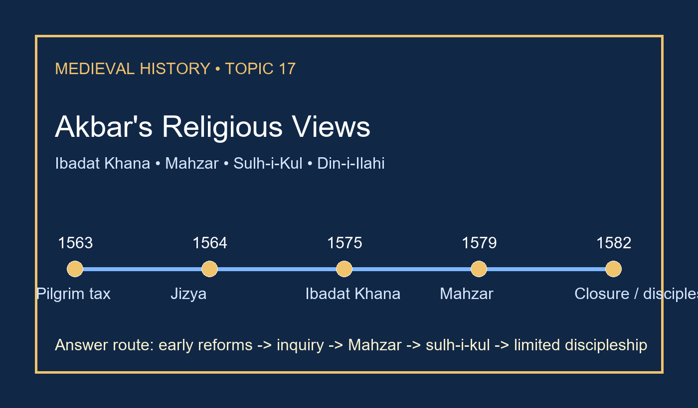

# Akbar's Religious Views: Ibadat Khana & Din-i-Ilahi - Complete Topic Package



> **Subject:** Medieval Indian History | **GS-I + Prelims** | **Repair date:** 20 September 2026
>
> **Learning purpose:** complete, evidence-led understanding of Akbar's religious policy with direct 2025 GS-I ownership and fixed MCQ/workbook structure.

## BASIC LEARNING SESSION

### SESSION 1 — TOPIC BOUNDARY AND THE FIVE-LAYER MODEL

#### DEFINITION / WHAT THIS IS CALLED

**Plain-language definition:** This topic studies how Akbar moved from selective accommodation to a broader imperial language of debate, arbitration and plural governance.

**Technical definition:** Topic 17 owns early reforms, Ibadat Khana, Mahzar, sulh-i-kul, translation policy, interfaith encounters, Tauhid-i-Ilahi and the source debate. It does not retell Topic 15 campaigns, Topic 16 administration or Topic 18 Deccan history except as bounded context.

#### ANSWER-GRABBING OPENING — WRITE/ADAPT IN THE EXAM

> Akbar's religious policy is best written as five linked but non-identical layers: reform, debate, arbitration, accommodation and restricted discipleship.

#### MUST-WRITE KEYWORDS

- **five-layer model**
- **religious policy**
- **Ibadat Khana**
- **sulh-i-kul**
- **Tauhid-i-Ilahi**

**How to use them:** Use the first terms to name the session, then use the last term to qualify the answer.

```text
reform -> debate -> Mahzar -> sulh-i-kul -> discipleship
belief != policy != sovereignty != encounter != fellowship
```

*Visual 1. Keep each layer distinct before linking them.*

The canonical owners repeatedly warn against collapsing the topic into one claim that Akbar founded a strange new religion in 1582. The evidence is broader and earlier. The best answer separates fiscal measures, public debate, legal arbitration, translation policy and the tiny discipleship circle before giving a final verdict.

#### PARAGRAPH DEMONSTRATION

A strong opening paragraph can claim that Akbar's experiment was layered rather than event-like. The named evidence is the sequence 1563-64 tax relief, 1575 Ibadat Khana, 1579 Mahzar and the later Tauhid-i-Ilahi circle. That proves development by stages. The qualification is that even this sequence remained ruler-centred and never created modern secular equality.

**UPSC trap:** Do not define the whole topic through Din-i-Ilahi alone.

**Mains angle:** Explain why “syncretism” here means layered imperial practice rather than one fully formed creed.

**Study link:** Use Topic 15 only for political context and Topic 16 only for bounded administrative linkage.

#### CLOSING RECALL FLOW — TOPIC BOUNDARY AND THE FIVE-LAYER MODEL

```text
START / CONCEPT: TOPIC BOUNDARY AND THE FIVE-LAYER MODEL
EXACT TERMS: five-layer model | religious policy | Ibadat Khana | sulh-i-kul | Tauhid-i-Ilahi
MECHANISM / ARGUMENT: Akbar's religious policy is best written as five linked but non-identical layers: reform, debate, arbitration, accommodation and restricted discipleship.
UPSC TRAP / ANSWER-USE: Do not define the whole topic through Din-i-Ilahi alone.
```

### SESSION 2 — CHRONOLOGY: EARLY ACCOMMODATION BEFORE THE DEBATE HALL

#### DEFINITION / WHAT THIS IS CALLED

**Plain-language definition:** Akbar did not suddenly discover pluralism in 1582; major reforms came earlier.

**Technical definition:** The chronology spine is 1563 pilgrim-tax remission -> 1564 jizya abolition -> 1575 Ibadat Khana -> after 1578 widening -> 1579 Mahzar -> 1581/82 closure -> later sulh-i-kul and Tauhid-i-Ilahi.

#### ANSWER-GRABBING OPENING — WRITE/ADAPT IN THE EXAM

> The safest exam move is to turn chronology into argument: early fiscal reform proves that inclusion preceded the famous debate hall.

#### MUST-WRITE KEYWORDS

- **1563**
- **1564**
- **1575**
- **1579**
- **1582**

**How to use them:** Use the first terms to name the session, then use the last term to qualify the answer.

| Date | Development | Why it matters |
|---|---|---|
|1563|Pilgrim tax remitted|selected disability reduced|
|1564|Jizya abolished|inclusion enters fiscal policy|
|1575|Ibadat Khana|inquiry becomes institutional|
|1579|Mahzar|bounded imperial arbitration|
|1581/82|closure|policy outlives the forum|

*Visual 2. The chronology blocks the sudden-1582 myth.*

Pilgrim-tax remission and jizya abolition belong to a phase when Akbar still operated within an Islamic idiom. That matters because it shows that policy widened before the public controversies of the late 1570s. Later stages then become sharper: the Ibadat Khana institutionalised inquiry, the Mahzar addressed juristic conflict, and the discipleship circle belonged to the late courtly phase.

#### PARAGRAPH DEMONSTRATION

A chronology paragraph should argue that fiscal inclusion came before interfaith disputation, and disputation before the restricted discipleship phase. The named evidence is 1563, 1564, 1575, 1579 and 1581/82. The qualification is that chronology alone does not settle motive: the same stages support readings of sincere inquiry, political integration or both.

**UPSC trap:** Never place jizya abolition after the Ibadat Khana.

**Mains angle:** Trace evolution; do not narrate a single late “event”.

**Study link:** Use Topic 22 only as a later jizya contrast, not as a substitute for Akbar's own chronology.

#### CLOSING RECALL FLOW — CHRONOLOGY: EARLY ACCOMMODATION BEFORE THE DEBATE HALL

```text
START / CONCEPT: CHRONOLOGY: EARLY ACCOMMODATION BEFORE THE DEBATE HALL
EXACT TERMS: 1563 | 1564 | 1575 | 1579 | 1582
MECHANISM / ARGUMENT: The safest exam move is to turn chronology into argument: early fiscal reform proves that inclusion preceded the famous debate hall.
UPSC TRAP / ANSWER-USE: Never place jizya abolition after the Ibadat Khana.
```

### SESSION 3 — EARLY REFORMS, CHISHTI SETTING AND SOCIAL ACCOMMODATION

#### DEFINITION / WHAT THIS IS CALLED

**Plain-language definition:** Akbar reduced selected religious disabilities and operated within a Chishti-Sufi environment before the famous debate phases.

**Technical definition:** The owned content includes pilgrim tax remission, jizya abolition, limits on enslavement of rebels' families, selected social regulations, and Ajmer/Fatehpur Sikri Chishti links with a warning that orders do not prove uniform enforcement.

#### ANSWER-GRABBING OPENING — WRITE/ADAPT IN THE EXAM

> Before Akbar debated theology in public, he had already changed how many subjects met the state.

#### MUST-WRITE KEYWORDS

- **pilgrim tax**
- **jizya**
- **Chishti**
- **Ajmer**
- **symbolic inclusion**

**How to use them:** Use the first terms to name the session, then use the last term to qualify the answer.

| Early measure / setting | Secure use | Unsafe leap |
|---|---|---|
|1563 pilgrim tax|visible disability reduced|full equality achieved|
|1564 jizya|major fiscal distinction removed|religion no longer mattered|
|Ajmer / Salim Chishti|Sufi setting of kingship|one doctrine copied mechanically|
|social regulations|moral-political aspiration|uniform transformation proved|

*Visual 3. Early inclusion was real but still bounded.*

These reforms mattered both materially and symbolically. They reduced selected disabilities and helped tell Hindu subjects that imperial service was open to them in new ways. Yet the same evidence needs restraint: neither shrine links nor social orders prove one fixed blueprint or empire-wide implementation.

#### PARAGRAPH DEMONSTRATION

A good paragraph can claim that Akbar's religious policy began with selective inclusion before it became an explicit ideology. The named evidence is 1563 pilgrim-tax remission, 1564 jizya abolition and the Ajmer-Salim Chishti devotional setting. The qualification is that neither the tax changes nor the shrine links prove uniform social reform or a single-source origin for later syncretism.

**UPSC trap:** Do not turn Chishti devotion into a one-cause explanation for everything later.

**Mains angle:** Use early reforms to show that plural imperial policy preceded Mahzar and Din-i-Ilahi.

**Study link:** Topic 15 gives Rajput political context; Topic 17 owns the religious significance.

#### CLOSING RECALL FLOW — EARLY REFORMS, CHISHTI SETTING AND SOCIAL ACCOMMODATION

```text
START / CONCEPT: EARLY REFORMS, CHISHTI SETTING AND SOCIAL ACCOMMODATION
EXACT TERMS: pilgrim tax | jizya | Chishti | Ajmer | symbolic inclusion
MECHANISM / ARGUMENT: Before Akbar debated theology in public, he had already changed how many subjects met the state.
UPSC TRAP / ANSWER-USE: Do not turn Chishti devotion into a one-cause explanation for everything later.
```

### SESSION 4 — IBADAT KHANA: FIRST PHASE, MUSLIM-ONLY DEBATES AND THE COURT SETTING

#### DEFINITION / WHAT THIS IS CALLED

**Plain-language definition:** The Ibadat Khana began as a court-controlled Muslim debate forum, not as an equal parliament of all religions.

**Technical definition:** Advanced coverage fixes 1575, Fatehpur Sikri, Thursday nights, the court zone around Shaikh Abdullah Niyazi's cell and Anup Talao, and the first participant circle of ulama, Sufi shaikhs, learned men and selected companions.

#### ANSWER-GRABBING OPENING — WRITE/ADAPT IN THE EXAM

> The first corrective about the Ibadat Khana is institutional: it began inside a Mughal court world and only later widened outward.

#### MUST-WRITE KEYWORDS

- **Fatehpur Sikri**
- **Thursday night**
- **ulama**
- **Sufi shaikhs**
- **court forum**

**How to use them:** Use the first terms to name the session, then use the last term to qualify the answer.

```text
1575 hall at Fatehpur Sikri
-> Thursday-night discussion
-> ulama + Sufi shaikhs + learned men + companions
-> doctrine + law + status + access
```

*Visual 4. The first phase was intra-court and mainly Muslim.*

This first phase matters because it shows what Akbar was reacting against. The forum exposed how juristic disagreement, scholastic pride and court status could collide under imperial gaze. The material setting is also exam-worthy: the texts link the hall with the Fatehpur Sikri court zone, yet exact archaeological identification of one surviving structure remains uncertain.

#### PARAGRAPH DEMONSTRATION

A precise paragraph can argue that the Ibadat Khana first revealed conflict within learned Muslim circles before it revealed plurality across religions. The named evidence is the 1575 Fatehpur Sikri hall, Thursday-night meetings and the initial participant circle. The qualification is that Abu'l Fazl's anti-clerical tone should not be turned into a blanket verdict on every member of the ulama.

**UPSC trap:** Do not describe the first phase as multi-faith from the outset.

**Mains angle:** Explain how a royal forum could magnify both theology and status competition.

**Study link:** Link Topic 16 only when grants and court rank make the disputes politically charged.

#### CLOSING RECALL FLOW — IBADAT KHANA: FIRST PHASE, MUSLIM-ONLY DEBATES AND THE COURT SETTING

```text
START / CONCEPT: IBADAT KHANA: FIRST PHASE, MUSLIM-ONLY DEBATES AND THE COURT SETTING
EXACT TERMS: Fatehpur Sikri | Thursday night | ulama | Sufi shaikhs | court forum
MECHANISM / ARGUMENT: The first corrective about the Ibadat Khana is institutional: it began inside a Mughal court world and only later widened outward.
UPSC TRAP / ANSWER-USE: Do not describe the first phase as multi-faith from the outset.
```

### SESSION 5 — WIDENING AFTER 1578, QUARRELS AND THE CLOSURE PARADOX

#### DEFINITION / WHAT THIS IS CALLED

**Plain-language definition:** Akbar widened the debates to non-Muslim interlocutors, but wider participation produced sharper controversy rather than harmony.

**Technical definition:** After 1578 the debates opened to Hindu, Jain, Christian, Zoroastrian and other sceptical voices; practical decline came in 1581 and closure is usually placed in 1582.

#### ANSWER-GRABBING OPENING — WRITE/ADAPT IN THE EXAM

> The Ibadat Khana matters because it failed as concord while succeeding as a trigger for wider imperial reflection.

#### MUST-WRITE KEYWORDS

- **1578 widening**
- **revelation**
- **prophethood**
- **1581**
- **1582**

**How to use them:** Use the first terms to name the session, then use the last term to qualify the answer.

| Stage | What changed | Historical result |
|---|---|---|
|first phase|Muslim debate under royal gaze|clerical conflict exposed|
|widened phase|Hindu, Jain, Christian, Parsi participation|questions multiplied|
|late phase|bitterness and competition|public forum declined|
|after closure|private inquiry and translations continue|policy moves toward sulh-i-kul|

*Visual 5. Public debate ended, but comparative engagement did not.*

Widening access did not create a modern equal parliament of faiths. Attendance, rank, purpose and surviving evidence remained unequal. Closure around 1581-82 therefore has to be written carefully: it ended a public forum, not Akbar's larger comparative search.

#### PARAGRAPH DEMONSTRATION

A convincing paragraph can state that the Ibadat Khana failed institutionally but succeeded intellectually. The named evidence is the post-1578 inclusion of Hindu, Jain, Christian and Zoroastrian interlocutors, followed by closure of the public forum in 1581-82. The qualification is that the surviving reports are unequal and often polemical, so one must not invent a representative all-faith parliament.

**UPSC trap:** Do not write that debate closure ended all interfaith contact.

**Mains angle:** Ask what the debates changed in imperial thinking, not whether they produced harmony.

**Study link:** This session bridges directly into Mahzar and sulh-i-kul.

#### CLOSING RECALL FLOW — WIDENING AFTER 1578, QUARRELS AND THE CLOSURE PARADOX

```text
START / CONCEPT: WIDENING AFTER 1578, QUARRELS AND THE CLOSURE PARADOX
EXACT TERMS: 1578 widening | revelation | prophethood | 1581 | 1582
MECHANISM / ARGUMENT: The Ibadat Khana matters because it failed as concord while succeeding as a trigger for wider imperial reflection.
UPSC TRAP / ANSWER-USE: Do not write that debate closure ended all interfaith contact.
```

### SESSION 6 — MAHZAR (1579): DECISION RULE, SOVEREIGNTY AND LIMITS

#### DEFINITION / WHAT THIS IS CALLED

**Plain-language definition:** The Mahzar gave Akbar a bounded power to choose among conflicting juristic opinions; it did not make him a prophet or pope.

**Technical definition:** Where qualified jurists disagreed, the emperor could select an existing opinion for public welfare and administrative order, provided it did not contradict an explicit Quranic or hadith command.

#### ANSWER-GRABBING OPENING — WRITE/ADAPT IN THE EXAM

> The Mahzar matters less as a slogan of infallibility than as a carefully bounded transfer of arbitration from rival jurists to the emperor.

#### MUST-WRITE KEYWORDS

- **Mahzar**
- **juristic disagreement**
- **public welfare**
- **administrative order**
- **bounded sovereignty**

**How to use them:** Use the first terms to name the session, then use the last term to qualify the answer.

```text
qualified jurists disagree
-> emperor selects an existing opinion
-> public welfare + administrative order
-> no contradiction of explicit Quran/hadith command
-> imperial arbitration strengthened
```

*Visual 6. The Mahzar is a decision ladder, not a blank cheque.*

The background matters: the Ibadat Khana had exposed doctrinal rivalry, while disputes over punishment and grants made religious authority an institutional question. The safe exam judgment is double-edged. The document did enlarge sovereignty by placing final choice with the emperor under stated conditions. It still remained within an Islamic legal-moral frame.

#### PARAGRAPH DEMONSTRATION

A high-scoring paragraph can claim that the Mahzar converted juristic disagreement into a ruler-centred mechanism of arbitration. The named evidence is the 1579 declaration signed by leading ulama and its tests of welfare and order. The qualification is that hostile observers such as Badauni still show how radical that redistribution of authority looked from within the orthodox court.

**UPSC trap:** The phrase “Decree of Infallibility” must be corrected, not repeated as fact.

**Mains angle:** Assess the Mahzar as sovereignty within limits, not beyond all limits.

**Study link:** This is the cleanest bridge from the Ibadat Khana to a broader imperial ideology.

#### CLOSING RECALL FLOW — MAHZAR (1579): DECISION RULE, SOVEREIGNTY AND LIMITS

```text
START / CONCEPT: MAHZAR (1579): DECISION RULE, SOVEREIGNTY AND LIMITS
EXACT TERMS: Mahzar | juristic disagreement | public welfare | administrative order | bounded sovereignty
MECHANISM / ARGUMENT: The Mahzar matters less as a slogan of infallibility than as a carefully bounded transfer of arbitration from rival jurists to the emperor.
UPSC TRAP / ANSWER-USE: The phrase “Decree of Infallibility” must be corrected, not repeated as fact.
```

### SESSION 7 — SULH-I-KUL: JUSTICE, INCLUSION AND THE LIMITS OF ACCOMMODATION

#### DEFINITION / WHAT THIS IS CALLED

**Plain-language definition:** Sulh-i-kul means peace with all or universal peace, but in practice it was a ruler-centred principle of plural governance.

**Technical definition:** The canonical owners tie sulh-i-kul to justice, paternal kingship, public welfare, fiscal inclusion, wider service opportunities and plural patronage, while stressing that coercion and hierarchy remained.

#### ANSWER-GRABBING OPENING — WRITE/ADAPT IN THE EXAM

> Sulh-i-kul outlived the debate hall because it governed how the emperor should rule a heterogeneous empire.

#### MUST-WRITE KEYWORDS

- **sulh-i-kul**
- **justice**
- **public welfare**
- **composite nobility**
- **hierarchy**

**How to use them:** Use the first terms to name the session, then use the last term to qualify the answer.

| Mechanism | Evidence | Limit |
|---|---|---|
|fiscal inclusion|1563-64 tax changes|not full equality|
|service and alliance|broader recruitment|selective access|
|patronage|grants, churches, temples, welfare houses|uneven reach|
|knowledge policy|debates + translations|elite-centred|
|state principle|peace with all|still ruler-centred|

*Visual 7. Sulh-i-kul was a governing grammar, not a constitution.*

This is the most durable concept in the topic because it links religious policy to state formation. A plural empire could not rely permanently on one sectarian network if it wanted loyalty from Rajputs, Indian Muslims, Iranis and Turanis. Yet the same state remained conquest-based and ranked, which is why sulh-i-kul must be qualified with Chittor, rebellion punishment and personality-dependent rule.

#### PARAGRAPH DEMONSTRATION

A strong paragraph can argue that sulh-i-kul was the governing outcome of Akbar's experiments rather than merely his private temperament. The named evidence is the fiscal measures of 1563-64, broader service and patronage patterns, and Abu'l Fazl's language of justice. The qualification is that accommodation never erased coercion, hierarchy or dependence on the emperor's will.

**UPSC trap:** Sulh-i-kul is not the same thing as Din-i-Ilahi.

**Mains angle:** Explain why the principle is stronger as state ideology than as a slogan of tolerance.

**Study link:** Use Topic 16 only for the mechanics that made composite service possible.

#### CLOSING RECALL FLOW — SULH-I-KUL: JUSTICE, INCLUSION AND THE LIMITS OF ACCOMMODATION

```text
START / CONCEPT: SULH-I-KUL: JUSTICE, INCLUSION AND THE LIMITS OF ACCOMMODATION
EXACT TERMS: sulh-i-kul | justice | public welfare | composite nobility | hierarchy
MECHANISM / ARGUMENT: Sulh-i-kul outlived the debate hall because it governed how the emperor should rule a heterogeneous empire.
UPSC TRAP / ANSWER-USE: Sulh-i-kul is not the same thing as Din-i-Ilahi.
```

### SESSION 8 — TRANSLATION POLICY AND INTERFAITH ENCOUNTERS

#### DEFINITION / WHAT THIS IS CALLED

**Plain-language definition:** Akbar's translation programme widened elite comparative knowledge, but it did not create a mass blended religion.

**Technical definition:** Owned content includes the Maktab Khana and Persian renderings or adaptations of the Mahabharata (Razmnama), Ramayana, Gita, Atharva Veda, Rajatarangini, Lilavati and Gospel material, alongside encounters involving Purushottam, Hiravijaya Suri, Jesuit missions from Goa and Meherji Rana.

#### ANSWER-GRABBING OPENING — WRITE/ADAPT IN THE EXAM

> The right method for this material is encounter -> evidence -> bounded influence -> non-equivalence.

#### MUST-WRITE KEYWORDS

- **Maktab Khana**
- **Razmnama**
- **Hiravijaya Suri**
- **Jesuits from Goa**
- **bounded influence**

**How to use them:** Use the first terms to name the session, then use the last term to qualify the answer.

| Encounter / text | Safe use | Unsafe leap |
|---|---|---|
|Razmnama and other translations|comparative court knowledge|mass religious fusion|
|Hiravijaya Suri|Jain ethical influence|permanent empire-wide vegetarianism|
|Jesuit missions|Christian encounter and books|Akbar's conversion|
|Meherji Rana|Parsi/Zoroastrian strand|exclusive source of all solar symbolism|

*Visual 8. Translation and encounter widen inquiry without proving conversion or merger.*

Translation converted oral exchange into Persianate courtly knowledge. That made comparative inquiry durable even after the public debates waned. Yet the process remained elite and mediated. The strongest use of this material is therefore to show widening intellectual policy, not to claim that every community entered one common creed.

#### PARAGRAPH DEMONSTRATION

A high-value paragraph can argue that Akbar's interfaith encounters broadened imperial comparison more than they produced doctrinal adoption. The named evidence is Hiravijaya Suri, Jesuit missions from Goa and Meherji Rana, together with the Razmnama. The qualification is that every one of these claims must be limited by genre, missionary expectation or later sectarian memory.

**UPSC trap:** Never turn courteous hearing into proof of personal conversion.

**Mains angle:** Use four encounters comparatively; do not turn them into a shopping list of borrowings.

**Study link:** Topic 24 owns the wider culture survey; Topic 17 owns translation as religious-intellectual policy.

#### CLOSING RECALL FLOW — TRANSLATION POLICY AND INTERFAITH ENCOUNTERS

```text
START / CONCEPT: TRANSLATION POLICY AND INTERFAITH ENCOUNTERS
EXACT TERMS: Maktab Khana | Razmnama | Hiravijaya Suri | Jesuits from Goa | bounded influence
MECHANISM / ARGUMENT: The right method for this material is encounter -> evidence -> bounded influence -> non-equivalence.
UPSC TRAP / ANSWER-USE: Never turn courteous hearing into proof of personal conversion.
```

### SESSION 9 — TAUHID-I-ILAHI / DIN-I-ILAHI, SOURCE DEBATE AND THE FINAL VERDICT

#### DEFINITION / WHAT THIS IS CALLED

**Plain-language definition:** Din-i-Ilahi was not a mass religion, yet saying that nothing existed at all is also inaccurate.

**Technical definition:** Abu'l Fazl primarily used Tauhid-i-Ilahi; Badauni used both expressions; the circle lacked scripture, priesthood, congregation and mass conversion, but sources still report initiation, shast, greetings and four degrees of devotion. Final evaluation must balance inclusion with coercion, hierarchy and ruler-dependence.

#### ANSWER-GRABBING OPENING — WRITE/ADAPT IN THE EXAM

> The safest verdict is double-edged: Tauhid-i-Ilahi was too small to be a new world religion, but too structured to be dismissed as pure fiction.

#### MUST-WRITE KEYWORDS

- **Tauhid-i-Ilahi**
- **Din-i-Ilahi**
- **shast**
- **four degrees**
- **qualified verdict**

**How to use them:** Use the first terms to name the session, then use the last term to qualify the answer.

| Question | Safe answer |
|---|---|
|Preferred term?|Tauhid-i-Ilahi in Abu'l Fazl|
|What was absent?|scripture, clergy, congregation, mass mission|
|What was present?|initiation, shast, greetings, graded devotion|
|Scale?|very small elite circle; Birbal prominent Hindu name|
|Final verdict?|restricted spiritual-political fellowship in a hierarchical empire|

*Visual 9. The best conclusion holds absence of mass institutions together with presence of restricted practice.*

This is the single most tested close-option distinction in the topic. The owners explicitly reject two opposite distortions: one, that Akbar founded a vast replacement religion; two, that hostile sources invented the entire phenomenon. The middle position is evidence-based and therefore exam-safe. The best overall verdict on the whole topic is similar: innovative plural statecraft, yet still coercive in places and dependent on the emperor.

#### PARAGRAPH DEMONSTRATION

A strong final paragraph can claim that Akbar's syncretism linked inquiry to governance. The named evidence is sulh-i-kul, translation policy, the limited Tauhid-i-Ilahi circle and the contrasting voices of Abu'l Fazl, Badauni and Jesuit writers. The qualification is that coercion, hierarchy and personality dependence remained built into the Mughal order, so the result was not constitutional equality or a surviving universal religion.

**UPSC trap:** Avoid both errors: “new religion for all” and “absolutely nothing existed.”

**Mains angle:** The strongest conclusion is graded, not absolute.

**Study link:** Use Topic 20 and Topic 22 only as bounded legacy contrasts.

#### CLOSING RECALL FLOW — TAUHID-I-ILAHI / DIN-I-ILAHI, SOURCE DEBATE AND THE FINAL VERDICT

```text
START / CONCEPT: TAUHID-I-ILAHI / DIN-I-ILAHI, SOURCE DEBATE AND THE FINAL VERDICT
EXACT TERMS: Tauhid-i-Ilahi | Din-i-Ilahi | shast | four degrees | qualified verdict
MECHANISM / ARGUMENT: The safest verdict is double-edged: Tauhid-i-Ilahi was too small to be a new world religion, but too structured to be dismissed as pure fiction.
UPSC TRAP / ANSWER-USE: Avoid both errors: “new religion for all” and “absolutely nothing existed.”
```

## BASIC MCQS / REMEDIATION

### Learning MCQ 1

**Question:** Which sequence is chronologically correct for Akbar's religious policy?

A. 1563 pilgrim-tax remission -> 1564 jizya abolition -> 1575 Ibadat Khana  
B. 1575 Ibadat Khana -> 1579 Mahzar -> 1564 jizya abolition  
C. 1564 jizya abolition -> 1563 pilgrim-tax remission -> 1582 Din-i-Ilahi  
D. 1579 Mahzar -> 1575 Ibadat Khana -> 1563 pilgrim-tax remission  

**Correct answer:** A

**Explanation:** Fiscal accommodation came before the famous debate hall. That sequence blocks the myth of a sudden late-1580s invention.

### Learning MCQ 2

**Question:** The Ibadat Khana in its initial phase is best described as a forum for

A. equal delegations from all Indian religions  
B. Muslim scholars, Sufi shaikhs, learned men and court companions  
C. Jesuit missionaries alone  
D. public congregational worship of a new creed  

**Correct answer:** B

**Explanation:** The first phase was court-centred and mainly Muslim. Wider interfaith participation came later.

### Learning MCQ 3

**Question:** Why is the label “Decree of Infallibility” misleading for the Mahzar?

A. It abolished every qazi's role instantly  
B. It created a new sacred scripture  
C. It obscures a bounded power to choose among conflicting juristic opinions for public welfare  
D. It proves Akbar announced himself prophet  

**Correct answer:** C

**Explanation:** The Mahzar enlarged imperial arbitration but within a defined field of existing legal opinions.

### Learning MCQ 4

**Question:** Sulh-i-kul is most accurately used as

A. a hereditary land grant  
B. a modern constitutional secular order  
C. a complete merger of all religions into one theology  
D. a ruler-centred principle of justice and accommodation in a plural empire  

**Correct answer:** D

**Explanation:** The term belongs to imperial governance. It is broader than private tolerance and narrower than modern secular citizenship.

### Learning MCQ 5

**Question:** The Maktab Khana is relevant to Topic 17 chiefly because it

A. translated Sanskrit and other texts into the Persian court world  
B. organised cavalry branding  
C. was the tax office that collected jizya  
D. replaced the Ibadat Khana as a mass church  

**Correct answer:** A

**Explanation:** The translation bureau turned comparative curiosity into elite textual policy.

### Learning MCQ 6

**Question:** How should Badauni be handled in this topic?

A. As a source to reject completely  
B. As a hostile but valuable contemporary whose claims must be cross-checked  
C. As the official court panegyrist of Akbar  
D. As the author of the Mahzar itself  

**Correct answer:** B

**Explanation:** Badauni preserves dissent and anxiety from within the age. His hostility is a reason for careful use, not for dismissal.

### Learning MCQ 7

**Question:** Which statement best qualifies Tauhid-i-Ilahi / Din-i-Ilahi?

A. It became the compulsory religion of the empire  
B. It had no practices of any kind  
C. It was a small elite discipleship circle without scripture or priesthood  
D. It functioned as a public congregational church  

**Correct answer:** C

**Explanation:** The safest answer avoids two extremes at once: restricted practice existed, but the institutions of a mass religion did not.

### Learning MCQ 8

**Question:** After 1578 the Ibadat Khana debates widened to include

A. only revenue officers  
B. only Rajput military chiefs  
C. only Shia jurists  
D. Hindu, Jain, Christian and Zoroastrian interlocutors among others  

**Correct answer:** D

**Explanation:** The widening mattered because it made the forum comparative, though not equal in representation or status.

### Learning MCQ 9

**Question:** Which named figure is most closely associated as a prominent Hindu member of Akbar's restricted discipleship circle?

A. Birbal  
B. Todar Mal  
C. Raja Man Singh  
D. Abdur Rahim Khan-i-Khanan  

**Correct answer:** A

**Explanation:** Birbal is the recurrent named example used to show how small the circle was.

### Learning MCQ 10

**Question:** The safest inference from Jesuit reports is that

A. Akbar accepted baptism  
B. missionary hopes often exaggerated the meaning of Akbar's curiosity  
C. Christianity became state religion  
D. Jesuit letters have no value at all  

**Correct answer:** B

**Explanation:** Curiosity, audience and textual exchange are well supported; conversion is not.

### Learning MCQ 11

**Question:** The four degrees of devotion associated with the late discipleship phase invoked readiness to sacrifice

A. prayer, fasting, alms and pilgrimage  
B. land, cattle, grain and tax  
C. property, life, honour and religion  
D. book, temple, idol and shrine  

**Correct answer:** C

**Explanation:** This phrasing shows the ethical-loyalist and Sufi-like character of the circle.

### Learning MCQ 12

**Question:** Which item is the clearest example of the translation programme owned by Topic 17?

A. Ain-i Akbari  
B. Mahzar  
C. Jharoka darshan  
D. Razmnama, the Persian Mahabharata  

**Correct answer:** D

**Explanation:** Razmnama is the signature example of comparative court translation.

### Learning MCQ 13

**Question:** Khairpura, Dharmapura and Jogipura are best used as evidence for

A. court-centred welfare and plural patronage  
B. the conquest of Gujarat  
C. a census of Tauhid-i-Ilahi members  
D. village-level tax classification  

**Correct answer:** A

**Explanation:** These establishments show accommodation through patronage and provision.

### Learning MCQ 14

**Question:** What is the most important caution when using Akbar's social-reform regulations?

A. They should be ignored entirely  
B. They reveal policy intent but not uniform social implementation  
C. They prove full modern gender equality  
D. They belong only to Topic 18  

**Correct answer:** B

**Explanation:** Imperial orders matter, but enforcement varied across a large hierarchical empire.

### Learning MCQ 15

**Question:** Which statement best captures the political meaning of sulh-i-kul?

A. It removed all imperial hierarchy  
B. It had no relation to state formation  
C. It supported a composite nobility and a non-sectarian governing language  
D. It replaced Islam with an empire-wide new religion  

**Correct answer:** C

**Explanation:** The term becomes strongest when linked to plural imperial rule.

### Learning MCQ 16

**Question:** The best final verdict on Akbar's religious policy is that it

A. created modern secular democracy  
B. was merely personal eccentricity unrelated to politics  
C. abolished coercion from the Mughal Empire  
D. joined inquiry, sovereignty and integration in an innovative but ruler-centred project  

**Correct answer:** D

**Explanation:** The strongest conclusion preserves both achievement and limit.

## PYQS AND ANSWER PRACTICE

### Verified/routed 2026 status for Topic 17

- Searched mandated 2026 roots: `books\mains\2026\`, `knowledge-export\Mains PYQ\`, `exams\papers`, `new_papers`, `upsc-ai-kit\knowledge\_PYQ-GS1-2026.md`, `upsc-ai-kit\knowledge\_PYQ-GS1-GS3-Static-2026.md`, `upsc-ai-kit\knowledge\_PYQ-ROUTING-PRELIMS-2026.md`, `upsc-ai-kit\knowledge\PYQ-INTEGRATION-AUDIT-2026.md`, and `upsc-ai-kit\knowledge\PYQ-MAINS-COVERAGE-AUDIT-2026.md`.
- Source-verified outcome: no 2026 direct Topic-17-owned prelims or mains item was verified locally.

### PYQ 1 — UPSC Mains GS-I 2025 (direct route)

**Paper route evidence:** `attempts\_pyq_text\UPSC Mains 2025 GS Paper 1.txt` preserves the exact wording at line 13, and `_PYQ-ROUTING-MAINS-GS1-GS2-ESSAY-2024-2025.md` routes 2025 GS-I Q2 to `Medieval-Indian-History/basic/17_Akbar-Religious-Views-Din-i-Ilahi.md` as the owning topic.

**Question:** *Examine the main aspects of Akbar's religious syncretism.* (10 marks, 150 words)

**Model answer:** Akbar's religious syncretism was a layered imperial programme rather than the sudden creation of a new mass faith. First, he reduced visible religious disabilities by remitting pilgrim tax in 1563 and abolishing jizya in 1564. Second, the Ibadat Khana at Fatehpur Sikri widened inquiry from Muslim scholars to Hindu, Jain, Christian and Zoroastrian interlocutors, even though the debates ended in bitterness. Third, the Mahzar (1579) gave Akbar a bounded right to choose among conflicting juristic opinions for public welfare, not unlimited infallibility. Fourth, sulh-i-kul turned justice and non-sectarian accommodation into a principle of rule, reinforced by a composite nobility and translation projects such as the Razmnama. Finally, Tauhid-i-Ilahi / Din-i-Ilahi remained a tiny elite discipleship with no scripture or priesthood. Thus Akbar's syncretism integrated a plural empire, but remained ruler-centred, hierarchical and far from modern secular equality.

**Demand decoding:** This direct 10-mark mains question asks for the “main aspects” of syncretism. The answer therefore needs compact coverage of multiple layers rather than an essay on only Din-i-Ilahi or only tolerance.

**Executable answer/elimination plan:** Use five compressed anchors in order: 1563-64 fiscal opening -> Ibadat Khana inquiry -> Mahzar -> sulh-i-kul -> limited Tauhid-i-Ilahi. Reserve the last line for the hierarchy/dependence qualification.

**Why this earns marks / route earns marks:** It earns marks because each aspect is attached to named evidence and because the conclusion rejects both the mass-religion myth and the modern-secularism anachronism.

**How to improve/strengthen:** If extra space existed, add one named interfaith example such as Hiravijaya Suri or the Razmnama to deepen the “syncretism” dimension without upsetting the 150-word balance.

### PYQ 2 — UPSC Mains GS-I 2020 (adjacent source-method route)

**Paper route evidence:** `_PYQ-ROUTING-MAINS-GS1-GS2-ESSAY-2018-2023.md` routes 2020 GS-I Q12 — “Persian literary sources of medieval India and the spirit of the age” — to Topic 24. It is retained here as an adjacent support item because Abu'l Fazl, Badauni and translation evidence are indispensable source families inside Topic 17 answers.

**Question:** *Persian literary sources of medieval India reflect the spirit of the age. Comment.* (15 marks, 250 words)

**Model answer:** Persian literary sources reveal medieval India not simply by narrating events but by preserving the ideological language through which courts understood power, faith and society. In the Akbar period, Abu'l Fazl's *Akbarnama* and *Ain-i Akbari* are crucial because they articulate kingship, sulh-i-kul and court order. Badauni's *Muntakhab-ut-Tawarikh* records unease over debate and innovation. Read together, these texts show that the age was not one of unanimous harmony but of contested sovereignty and competing orthodoxies. Persian translation activity under Akbar, including the Razmnama, also reflects a courtly appetite for comparative knowledge. Yet these texts remain elite productions. They illuminate the courtly “spirit of the age” more clearly than village reception or social implementation. Thus Persian literary sources are indispensable, but they must be read comparatively and critically, especially in topics like Akbar's religious policy where ideology and polemic are built into the evidence.

**Demand decoding:** The directive “comment” needs interpretation, not a list of titles. For Topic 17 use, the focus should be on what Persian sources reveal about kingship, controversy and comparative knowledge.

**Executable answer/elimination plan:** Name Abu'l Fazl first, contrast him with Badauni, then add translation activity as a third evidentiary block. End with a caution on elite perspective.

**Why this earns marks / route earns marks:** This route earns marks because it moves from source identification to evidentiary value and bias. It also honestly preserves the item's adjacent status rather than falsely claiming direct ownership.

**How to improve/strengthen:** To strengthen it further, add one line distinguishing normative court ideology from uneven provincial and social implementation.

### Original Mains 1 — 10 marks, 150 words

**Question:** Trace the evolution of Akbar's religious policy from early accommodation to sulh-i-kul. (Answer in 150 words)

**Model answer:** Akbar's religious policy evolved through connected stages rather than a single doctrinal break. The early phase centred on accommodation: pilgrim tax was remitted in 1563 and jizya abolished in 1564, signalling that non-Muslim subjects need not bear those fiscal disabilities in a widening empire. From 1575 the Ibadat Khana turned personal inquiry into public dispute; after 1578 the forum widened beyond Muslim circles but exposed the limits of courtly consensus. The Mahzar of 1579 then gave Akbar a bounded arbitral role among conflicting juristic opinions. Out of this sequence emerged sulh-i-kul: justice and non-sectarian accommodation as an imperial principle. Thus the policy moved from selective reform to a broader state ideology, while remaining ruler-centred and socially uneven.

**Demand decoding:** “Trace” requires chronology with analytical transitions.

**Executable answer/elimination plan:** Write in four steps: early reforms -> Ibadat Khana -> Mahzar -> sulh-i-kul.

**Why this earns marks / route earns marks:** It earns marks because chronology itself becomes the explanation of policy development.

**How to improve/strengthen:** Add the 1581-82 closure point if you want to sharpen the move from public debate to governing principle.

### Original Mains 2 — 10 marks, 150 words

**Question:** Why did the Ibadat Khana debates fail as dialogue yet matter for Mughal statecraft? (Answer in 150 words)

**Model answer:** The Ibadat Khana failed as dialogue because a royal court was a poor setting for equal theological exchange. Built at Fatehpur Sikri in 1575, it first gathered Muslim scholars, Sufis and learned men; later, after 1578, Hindu, Jain, Christian and Zoroastrian interlocutors also entered. Instead of convergence, the debates sharpened disputes over revelation, legal authority and superiority. Yet the debates mattered deeply for statecraft. They convinced Akbar that rival truth-claims could not be governed by one clerical monopoly alone. This intellectual crisis helped prepare the Mahzar and later the broader principle of sulh-i-kul. Even after public closure around 1581-82, private inquiry and translation continued. Therefore the Ibadat Khana mattered less as a successful interfaith institution than as the failed forum out of which a more durable imperial policy of accommodation emerged.

**Demand decoding:** The word “why” here has two parts: why failure happened, and why that failure still mattered.

**Executable answer/elimination plan:** Use one short paragraph on failure and one on political consequence.

**Why this earns marks / route earns marks:** It earns marks because it answers both halves instead of narrating only the debates themselves.

**How to improve/strengthen:** If space permits, mention Thursday-night court setting or the 1578 widening to add sharper factual texture.

### Original Mains 3 — 15 marks, 250 words

**Question:** Assess the Mahzar of 1579 as an assertion of imperial sovereignty. (Answer in 250 words)

**Model answer:** The Mahzar of 1579 was an assertion of imperial sovereignty, but its scope must be described with care. It was a declaration signed by leading ulama stating that where qualified jurists disagreed, the emperor could choose among existing opinions for the welfare of mankind and proper administration. Therefore it did not make Akbar a prophet, pope or unlimited maker of sacred law. Its political significance was still considerable. The Ibadat Khana had exposed sharp disagreement among court scholars, while issues of punishment and madad-i-maash grants made religious authority an institutional question. By placing final arbitration with the emperor, the Mahzar reduced the ability of rival clerical networks to claim the last word against imperial policy. At the same time, it should not be presented as an anti-Islamic rupture. It worked through juristic disagreement and within an Islamic political vocabulary. The best verdict is that the Mahzar strengthened ruler-centred arbitration inside a legal-moral frame and prepared the path toward sulh-i-kul without authorising boundless religious infallibility.

**Demand decoding:** “Assess” needs scope plus consequence.

**Executable answer/elimination plan:** Define the declaration first, then analyse its force, then qualify it with Islamic framing and hostile reaction.

**Why this earns marks / route earns marks:** It earns marks because the answer begins with boundaries before moving to significance.

**How to improve/strengthen:** Mention the welfare-and-order clause explicitly if an examiner appears to be testing close textual precision.

### Original Mains 4 — 15 marks, 250 words

**Question:** Explain how Akbar's translation programme became part of his religious policy. (Answer in 250 words)

**Model answer:** Akbar's translation programme became part of religious policy because it transformed comparative curiosity into an institution of imperial knowledge. Through the Maktab Khana, works such as the *Mahabharata* as *Razmnama*, the *Ramayana*, the *Bhagavad Gita*, the *Atharva Veda*, *Rajatarangini* and Gospel material entered the Persianate courtly sphere. This made the Mughal centre a site where doctrines could be compared in a common learned language. The policy significance lies in two connected moves. First, translation reduced dependence on hearsay and broadened elite access to non-Islamic intellectual traditions. Second, it supported the logic of sulh-i-kul by making plural traditions legible to a court that sought to rule heterogeneous subjects. Yet the programme remained mediated and elite. Pandits, munshis and courtiers filtered the process; rural society did not suddenly become part of a universal conversation. The stronger historical claim is that Akbar's policy moved from oral disputation to textual comparison and thereby deepened the intellectual infrastructure of plural imperial rule.

**Demand decoding:** “Explain how” asks for mechanism.

**Executable answer/elimination plan:** Name the bureau and texts, explain what translation enabled, then end with the elite-scale qualification.

**Why this earns marks / route earns marks:** It earns marks because it converts a culture fact into a state-and-ideas argument.

**How to improve/strengthen:** Add one named translator or pandit if you want to deepen the courtly process rather than only the outcomes.

### Original Mains 5 — 20 marks, 250 words

**Question:** Was Tauhid-i-Ilahi a new religion? Discuss with source caution. (Answer in 250 words)

**Model answer:** Tauhid-i-Ilahi should not be described as a new religion in the full institutional sense. Abu'l Fazl's preferred terminology foregrounded divine monotheism, while “Din-i-Ilahi” gained greater force in Badauni's hostile narrative and later retellings. The negative evidence is substantial: there was no scripture, priesthood, public congregation or empire-wide missionary programme. Membership was tiny; Birbal appears as the prominent Hindu name usually cited. Yet the contrary claim — that nothing at all existed — is also false. Sources report initiation, shast, greeting formulas and four degrees of devotion involving property, life, honour and religion. These practices make best sense when compared with Sufi pir-murid idioms and with the political need to bind a heterogeneous elite to the emperor. Therefore Tauhid-i-Ilahi is best understood as a restricted spiritual-political fellowship, not an organised universal religion. Source caution matters because both Abu'l Fazl's idealising tone and Badauni's hostility can distort scale and intention.

**Demand decoding:** “Discuss with source caution” requires a direct answer to the binary plus explicit handling of terminology and bias.

**Executable answer/elimination plan:** Move in three steps: what was absent, what was present, why the sources disagree about meaning and scale.

**Why this earns marks / route earns marks:** It earns marks because it rejects both extremes while using the source problem itself as evidence.

**How to improve/strengthen:** Add Abu'l Fazl versus Badauni explicitly in the opening sentence if you want the source-caution dimension visible earlier.

### Original Mains 6 — 20 marks, 250 words

**Question:** Analyse Akbar's religious policy as a project of plural imperial state formation. (Answer in 250 words)

**Model answer:** Akbar's religious policy can be analysed most fruitfully as a project of plural imperial state formation. A conquering Timurid dynasty ruling a heterogeneous realm needed more than military victory; it required a political language that could reduce sectarian distrust without dissolving sovereignty. The project began with selected inclusion through 1563-64 fiscal relief. The Ibadat Khana then exposed the inability of one clerical milieu to command unquestioned authority for the empire. The Mahzar of 1579 strengthened ruler-centred arbitration among juristic disputes, while translation projects and interfaith encounters widened comparative knowledge at the imperial centre. Sulh-i-kul gave these tendencies their most durable formulation by linking justice, public welfare and non-sectarian governance. Still, the project remained early-modern and hierarchical. Chittor, rebellion punishment, unequal social order and the narrow reach of Tauhid-i-Ilahi show that inclusion coexisted with coercion and dependence on the emperor's will. The best verdict is therefore not that Akbar created secular democracy, but that he forged an innovative language of plural rule through which empire could govern diversity more effectively than a narrow sectarian order would allow.

**Demand decoding:** “Analyse” needs mechanism and relationship.

**Executable answer/elimination plan:** Open with the empire problem, then show how reforms, debate, Mahzar, translation and sulh-i-kul addressed it, and finish with coercion and hierarchy.

**Why this earns marks / route earns marks:** It earns marks because every named element is tied back to the problem of ruling plurality rather than left as trivia.

**How to improve/strengthen:** Add one line on composite nobility or grant redistribution if you want the state-formation angle even more institutional.

## OPTIONAL ADVANCED DEPTH — NOT REQUIRED FOR A CORE ANSWER

### Advanced note 1 — Ibadat Khana topography and Thursday-night rhythm

The advanced owner adds two refinements: the Ibadat Khana is textually placed near Shaikh Abdullah Niyazi's cell and Anup Talao, and the discussions are linked to Thursday nights after state business. These details enrich answers, but they do not settle the archaeological identification of one surviving structure.

### Advanced note 2 — Mahzar beyond the slogan of infallibility

The advanced file insists that the Mahzar be read clause by clause. Its essence lies in imperial selection among conflicting qualified juristic opinions for public welfare and order.

### Advanced note 3 — Tauhid-i-Ilahi as political device

Satish Chandra treats Tauhid-i-Ilahi chiefly as a political device for binding a heterogeneous elite to a just sovereign. This does not cancel personal spirituality, but it prevents the topic from being written as either pure theology or pure eccentricity.

### Advanced note 4 — Positioned sources

Abu'l Fazl rationalises Akbar, Badauni attacks him and Jesuit writers often mistake curiosity for near-conversion. The historian must turn disagreement among sources into evidence about faction, ideology and courtly competition.

## CONSOLIDATED REGISTER NOTES

### 1. Chronology that prevents the sudden-1582 myth

- 1563: pilgrim tax remitted.
- 1564: jizya abolished.
- 1575: Ibadat Khana built.
- After 1578: debates widened.
- 1579: Mahzar.
- 1581-82: public forum closes while inquiry continues.

### 2. The five-layer answer framework

- Fiscal inclusion != interfaith debate != Mahzar != sulh-i-kul != Tauhid-i-Ilahi.
- Always separate belief, policy, arbitration, translation and discipleship before synthesising.

### 3. Ibadat Khana precision card

- Fatehpur Sikri, Thursday-night debates, first phase mainly Muslim.
- Later widening to Hindu, Jain, Christian and Zoroastrian interlocutors.
- Outcome: quarrel and closure, yet a wider policy horizon.

### 4. Mahzar precision card

- Signed declaration of 1579, not a new scripture.
- Emperor chooses among conflicting opinions for welfare and order.
- Not prophethood, papacy or unlimited sacred lawmaking.

### 5. Sulh-i-kul precision card

- Universal peace / peace with all.
- Justice, public welfare and non-sectarian rule.
- Not modern constitutional secularism.

### 6. Tauhid-i-Ilahi precision card

- Abu'l Fazl foregrounds Tauhid-i-Ilahi; Badauni/later writers foreground Din-i-Ilahi.
- No scripture, clergy, congregation or mass conversion.
- Restricted initiation, shast, greetings and four degrees of devotion did exist.

### 7. Source method in one glance

- Abu'l Fazl = court ideology + detail + bias.
- Badauni = dissent + polemic + indispensable caution.
- Jesuits = encounter evidence + conversion lens.

### 8. PYQ spine

- 2025 GS-I direct owner: “Examine the main aspects of Akbar's religious syncretism. (Answer in 150 words)”
- Route: 1563-64 -> Ibadat Khana -> Mahzar -> sulh-i-kul -> Tauhid limit.
- 2026 search outcome: no direct Topic-17-owned question verified locally.

### ASCII MASTER FLOW DIAGRAM

```text
ASCII MASTER FLOW DIAGRAM — TOPIC 17: AKBAR'S RELIGIOUS VIEWS
1563 pilgrim tax remitted -> 1564 jizya abolished -> 1575 Ibadat Khana
-> after 1578 wider participation -> 1579 Mahzar -> 1581/82 closure
-> private inquiry + translations + sulh-i-kul + restricted discipleship
RULE: policy evolved; 1582 did not create a mass religion.

reform -> debate -> Mahzar -> sulh-i-kul -> discipleship
belief != policy != sovereignty != encounter != fellowship

IBADAT KHANA
Fatehpur Sikri / Niyazi cell + Anup Talao -> Thursday-night forum
-> first phase: ulama + Sufi shaikhs + learned men + companions
-> later phase: Hindu + Jain + Christian + Zoroastrian voices
-> closure of public forum, continuation of inquiry elsewhere

MAHZAR
qualified jurists disagree -> emperor selects existing opinion
-> public welfare + administrative order -> bounded imperial arbitration
LIMIT: not prophethood, papacy or unlimited sacred legislation.

SULH-I-KUL
justice + public welfare + non-sectarian governance
-> tax relief + service inclusion + plural patronage + translation policy
LIMIT: hierarchy, coercion and ruler-centred authority remained.

TAUHID-I-ILAHI / DIN-I-ILAHI
Absent: scripture + priesthood + congregation + mass mission
Present: initiation + shast + greetings + four degrees of devotion
Scale: very small elite circle; Birbal prominent Hindu name
Verdict: restricted spiritual-political fellowship, not mass religion.

SOURCE METHOD
Abu'l Fazl -> ideology and detail | limit: panegyrical court project
Badauni -> dissent and anxiety | limit: polemical hostility
Jesuits -> encounter and books | limit: conversion expectation
Orders / grants / material setting -> concrete tests | limit: uneven reach / uncertain identification

2025 GS-I direct route: early reforms -> Ibadat Khana -> Mahzar -> sulh-i-kul -> limited Tauhid-i-Ilahi -> ruler-centred qualification
2026 search outcome: no direct Topic-17-owned question verified locally.
```
