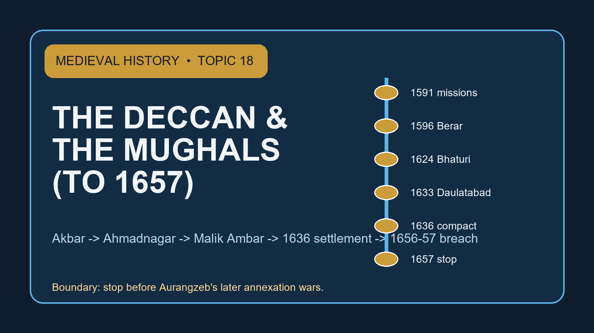

# The Deccan & the Mughals (to 1657) — Solved Practice Workbook

## BASIC MCQS / REMEDIATION

### Questions — all questions precede the matching key

#### Workbook MCQ 1

**Question:** Which grouping correctly identifies the principal Deccan powers in Mughal politics after the Bahmani break-up?

A. Ahmadnagar, Bijapur and Golconda, with Khandesh as the northern gateway.
B. Delhi, Lahore and Kabul, with Khandesh as a Himalayan corridor.
C. Madurai, Kochi and Travancore, with Khandesh as their coastal port.
D. Mewar, Malwa and Gujarat, with Khandesh as a Rajput buffer.

#### Workbook MCQ 2

**Question:** Why did Khandesh matter so much to Mughal Deccan policy?

A. It was the first capital of the Qutb Shahis.
B. Burhanpur and Asirgarh made it the route-and-fort gateway to the plateau.
C. It removed the need for diplomacy with Ahmadnagar.
D. It was the only region in the Deccan with cavalry horses.

#### Workbook MCQ 3

**Question:** The 1591 Mughal missions to the Deccan are best understood as

A. ceremonial exchanges among equal sovereigns.
B. the formal annexation of Bijapur and Golconda.
C. coercive diplomacy seeking acceptance of Mughal over-lordship.
D. a Portuguese-backed sea treaty.

#### Workbook MCQ 4

**Question:** Which statement best captures Chand Bibi's political role?

A. She founded the Nizam Shahi dynasty.
B. She was merely a romantic warrior with no negotiation role.
C. She surrendered Bijapur to the Mughals in 1596.
D. She defended Ahmadnagar and negotiated Berar cession to preserve Bahadur's regency.

#### Workbook MCQ 5

**Question:** How should the 1597 battle printed as Sonepat in one source be handled?

A. As a Berar-Deccan campaign episode whose nomenclature should not be confused with Sonipat.
B. As the definitive proof that all naming variants are false except one.
C. As a north Indian Haryana battle detached from the Deccan crisis.
D. As an unimportant event outside Mughal-Deccan relations.

#### Workbook MCQ 6

**Question:** Which statement best captures Mughal success in 1600-01?

A. Bijapur and Golconda were turned into Mughal provinces.
B. The Mughals secured Ahmadnagar fort and Khandesh, but a Nizam Shahi remnant still survived.
C. The Deccan question ended permanently.
D. Portuguese power on the west coast disappeared.

#### Workbook MCQ 7

**Question:** Malik Ambar is identified most safely as

A. the founder of the Mughal Deccan viceroyalty.
B. a Portuguese governor at Goa.
C. an Ethiopian or Habshi figure who became Nizam Shahi Peshwa.
D. a Maratha sovereign who ruled from Raigad.

#### Workbook MCQ 8

**Question:** Which chain best explains Malik Ambar's strength?

A. Portuguese naval aid plus Kabul horses plus direct Mughal subsidy.
B. Only sectarian solidarity inside one fixed Shia bloc.
C. Only fort walls without mobile cavalry.
D. Nizam Shahi legitimacy plus Habshi-Deccani-Afghan manpower plus Maratha mobility plus opportunistic Bijapuri support.

#### Workbook MCQ 9

**Question:** Why is “guerrilla” only a guarded label for Ambar's military style?

A. Because it names mobility and supply-cutting but should not be equated with a modern ideological insurgency.
B. Because it refers here to Atlantic naval raiding.
C. Because Ambar refused to use intelligence or terrain.
D. Because the Deccan had no forts.

#### Workbook MCQ 10

**Question:** What is the safest claim about Malik Ambar's revenue measures?

A. No fiscal reconstruction is associated with his regime at all.
B. Later Marathi evidence links him with measurement and zabti-type changes, though exact uniformity cannot be assumed.
C. He copied Todar Mal without change in every district.
D. He abolished all landed intermediaries overnight.

#### Workbook MCQ 11

**Question:** Khirki matters in Topic 18 mainly as

A. a Portuguese fort on the Konkan coast.
B. a Mughal capital founded after 1707.
C. a Nizam Shahi urban and logistical centre associated with Malik Ambar.
D. the original Bahmani capital at Gulbarga.

#### Workbook MCQ 12

**Question:** The main lesson of the failed 1611 Mughal operation is that

A. sheer numbers solved the Deccan problem once and for all.
B. Bhaturi had already been won by the Mughals.
C. Jahangir abandoned the Deccan permanently in 1611.
D. rivalry and poor coordination could undo even a large imperial advance.

#### Workbook MCQ 13

**Question:** How should Jahangir's 1616-17 recovery be qualified?

A. It restored leverage, but Jahangir still avoided a wider annexation drive.
B. It permanently annexed Bijapur and Golconda.
C. It ended Malik Ambar's career immediately.
D. It made Deccan finance irrelevant.

#### Workbook MCQ 14

**Question:** Why does Bhaturi (1624) deserve mention?

A. It marked Daulatabad's surrender to Shah Jahan.
B. It was a late peak of Malik Ambar's prestige after victory over Mughal-Adil Shahi forces.
C. It was the treaty that inserted Shah Jahan's name in the Golconda khutba.
D. It inaugurated Aurangzeb's second viceroyalty.

#### Workbook MCQ 15

**Question:** Which statement best explains the Maratha bridge inside Topic 18?

A. Marathas never served Mughal or Bijapuri interests.
B. A unified nationalist Maratha kingdom already existed under Malik Ambar.
C. Maratha service networks supplied cavalry, local knowledge and negotiable allegiance before Shivaji's later state.
D. The topic must narrate the whole later Maratha war to make sense.

#### Workbook MCQ 16

**Question:** Shahji Bhonsale matters in Topic 18 chiefly because

A. he abolished the Nizam Shahi claimant after 1633.
B. he annexed Golconda for Shah Jahan.
C. he served only one state throughout his career.
D. he sustained claimant politics and mobile resistance after dynastic extinction.

#### Workbook MCQ 17

**Question:** Why did Shah Jahan harden policy against Ahmadnagar?

A. Because Ahmadnagar sheltered enemies such as Khan-i-Jahan Lodi and kept the northern Deccan unstable.
B. Because Jahangir had already annexed Bijapur.
C. Because the Portuguese demanded Daulatabad.
D. Because Mir Jumla ruled Ahmadnagar.

#### Workbook MCQ 18

**Question:** What did the fall of Daulatabad in 1633 actually do?

A. It annexed Bijapur.
B. It ended the ruling Nizam Shahi line.
C. It resolved every Deccan deficit.
D. It forced the Portuguese out of Goa.

#### Workbook MCQ 19

**Question:** Which pair best captures the 1636 Bijapur terms?

A. Immediate provincial annexation and abolition of the Adil Shahi court.
B. Transfer of Delhi to Bijapur and cancellation of all tribute.
C. Recognition of Mughal suzerainty plus indemnity and arbitration obligations.
D. Mandatory union with Golconda under one crown.

#### Workbook MCQ 20

**Question:** What is the key Golconda signal in the 1636 settlement?

A. The destruction of the Qutb Shahi court.
B. The cession of every Karnataka interest at once.
C. The appointment of Malik Ambar as governor.
D. The insertion of Shah Jahan's name in the khutba under Mughal-protective hierarchy.

#### Workbook MCQ 21

**Question:** Why is the 1636 settlement called statesmanlike in the assigned interpretation?

A. Because it reduced direct administrative cost by using subordinate buffers.
B. Because it ended every future Deccan dispute permanently.
C. Because it created religious equality among all states.
D. Because it required no military pressure at all.

#### Workbook MCQ 22

**Question:** What does khutba or sikka recognition prove most safely in Topic 18?

A. Complete district-level administration everywhere under Mughal officers.
B. A sovereign claim or accepted superiority, not full effective control by itself.
C. The disappearance of local courts.
D. A guaranteed stable revenue yield.

#### Workbook MCQ 23

**Question:** Which statement best fits Mughal provincial incorporation in the Deccan?

A. Every Deccan jagir immediately paid more than expected.
B. Fort garrisons made local elites irrelevant.
C. Paper jama could exceed real hasil, so conquest did not automatically finance itself.
D. Distance from court improved coordination by itself.

#### Workbook MCQ 24

**Question:** Aurangzeb's first Deccan viceroyalty should be described as

A. the later full annexation programme already completed in the 1630s.
B. the moment when Bijapur vanished as a state.
C. an interval before Mughal power entered the Deccan at all.
D. the implementation phase of the post-1636 order.

#### Workbook MCQ 25

**Question:** What changed in Aurangzeb's second Deccan viceroyalty?

A. Deficit and low realization sharpened demands for indemnity or territory.
B. The region was already fully annexed, so no policy issue remained.
C. Mughal contact with Golconda ended altogether.
D. Nothing; it repeated the first phase without fiscal strain.

#### Workbook MCQ 26

**Question:** Mir Jumla enters Topic 18 chiefly through

A. the foundation of the Bahmani kingdom in 1347.
B. his break with Golconda and the wealth-politics of Karnataka in 1656.
C. the 1596 Berar settlement with Chand Bibi.
D. the execution of Malik Ambar.

#### Workbook MCQ 27

**Question:** Why did the 1656 Golconda settlement matter?

A. It abolished Mughal claims in the Deccan.
B. It restored Ahmadnagar as an independent dynasty.
C. It brought money and Ramgir but also widened pressure beyond the spirit of 1636.
D. It solved the Bijapur succession crisis.

#### Workbook MCQ 28

**Question:** What is the safest description of the 1657 Bijapur outcome?

A. The whole Adil Shahi state was annexed permanently.
B. The settlement recreated the exact confidence of 1636.
C. The Mughal state withdrew from the Deccan thereafter.
D. Bijapur surrendered former Nizam Shahi lands without losing its entire separate court.

#### Workbook MCQ 29

**Question:** Which boundary statement is correct for Topic 18?

A. It ends with the breach of the 1636 order by 1657 and stops before the later full wars.
B. It must narrate the entire later reign of Aurangzeb.
C. It ignores Shah Jahan completely and jumps from Akbar to Shivaji.
D. It treats 1687 as the natural climax of the same narrative.

#### Workbook MCQ 30

**Question:** How should Persian court chronicles be used in this topic?

A. As neutral photographs of every event and motive.
B. As indispensable campaign and diplomatic evidence read with patronage bias in mind.
C. As irrelevant once architecture survives.
D. As replacements for all local and material evidence.

#### Workbook MCQ 31

**Question:** What is the main limit of later bakhars and regional memories in Topic 18?

A. They can never be used for any purpose.
B. They prove Portuguese naval policy exactly.
C. They are later testimonies, so they must not be treated as unfiltered seventeenth-century administrative files.
D. They remove the need to cite Persian texts.

#### Workbook MCQ 32

**Question:** What is the best overall conclusion for Topic 18?

A. The Mughals solved Deccan governance once they won a few major sieges.
B. The topic is only about one ruler, Malik Ambar.
C. Everything after Akbar belongs outside the syllabus.
D. The Deccan question moved from embassy to foothold to coalition resistance to buffer settlement to renewed breach.

#### Workbook MCQ 33

**Question:** Which statements hold? 1. Khandesh was a Bahmani successor; 2. Ahmadnagar was Nizam Shahi; 3. Berar had been absorbed by Ahmadnagar before the Mughal intervention.

A. 2 and 3 only
B. 1 and 2 only
C. 1 and 3 only
D. All three

#### Workbook MCQ 34

**Question:** Place these in order: 1. Asirgarh annexation; 2. Chand Bibi’s Berar compromise; 3. Ahmadnagar fort captured; 4. Mughal missions.

A. 2–4–3–1
B. 4–2–3–1
C. 4–3–2–1
D. 4–2–1–3

#### Workbook MCQ 35

**Question:** Which of the following 1636 pairings are sound? 1. Bijapur — arbitration and limiting Shahji near the frontier; 2. Golconda — khutba and payment under protection; 3. Both — directly incorporated as subas.

A. 1 only
B. 2 and 3
C. 1 and 2
D. All three

#### Workbook MCQ 36

**Question:** A captured fort is supplied precariously because neighbouring deshmukhs cut grain routes; jagir hasil trails jama. What follows?

A. A garrison proves uniform control of all villages.
B. The empire had no claim to the territory.
C. Artillery could not have been used in the siege.
D. Fort possession need not secure countryside, supply or actual receipts.

#### Workbook MCQ 37

**Question:** Assertion: Bijapur aided Malik Ambar at one point and joined the Mughals against him at another. Reason: buffer interests, rivalries and patronage shaped shifting alliances.

A. Both are true and the reason explains the assertion.
B. Both are true but unrelated.
C. The assertion is true but the reason false.
D. The assertion is false but the reason true.

#### Workbook MCQ 38

**Question:** How should Malik Ambar’s reported replacement of ijara by a zabti-type settlement be tested?

A. Assume later Marathi texts record every contemporary village precisely.
B. Use later testimony and records cautiously without claiming uniform rates or universal implementation.
C. Treat Khirki waterworks as proof of an exact Todar Mal replica.
D. Dismiss fiscal measures as irrelevant to mobile warfare.

#### Workbook MCQ 39

**Question:** Which combination best explains renewed Mughal intervention in 1656–57 after the 1636 compact?

A. Both Deccan courts had been annexed in 1636.
B. Portuguese withdrawal ended all inland fiscal issues.
C. Karnataka expansion, payment disputes, low Deccan hasil, Mir Jumla and Bijapur succession altered incentives.
D. Shivaji had already conquered every Mughal province.

#### Workbook MCQ 40

**Question:** Which contrast between the 1656 Golconda and 1657 Bijapur outcomes is most defensible?

A. Both ended with complete annexation.
B. Golconda lost its whole coast while Bijapur retained all former Nizam Shahi lands.
C. Shah Jahan and Aurangzeb agreed unconditionally on Golconda annexation.
D. Golconda paid money and ceded Ramgir amid Mir Jumla’s disputed claims; Bijapur surrendered former Nizam Shahi lands without total annexation.

### Matching answer key and remediation

#### Workbook MCQ 1 — A

**Correct answer:** A

**Option-wise explanation:**
- **A:** Correct. These are the principal Deccan interlocutors here, while Khandesh functions as the corridor into the plateau rather than as a Bahmani successor.
- **B:** This shifts the story to the Indo-Afghan north-west. Khandesh is no Himalayan approach.
- **C:** These belong to a different southern frame. Topic 18 is centred on the Deccan successor states reached through Khandesh.
- **D:** Malwa and Gujarat mattered strategically, but they do not replace the Ahmadnagar-Bijapur-Golconda triangle that structures this topic.

**Examiner trap:** gateway misread as successor-state list

#### Workbook MCQ 2 — B

**Correct answer:** B

**Option-wise explanation:**
- **A:** Golconda's history is being imported here by mistake. Khandesh mattered for access and staging, not because it housed the Qutb Shahi capital.
- **B:** Correct. Burhanpur and Asirgarh tied together movement, stores and military access.
- **C:** Control of a gateway increased pressure, but it did not make diplomacy unnecessary. The 1591 missions and later settlements show that negotiation remained integral.
- **D:** Horse supply mattered widely in the Deccan. Khandesh's decisive value lay in corridor control.

**Examiner trap:** economic detail substituted for corridor logic

#### Workbook MCQ 3 — C

**Correct answer:** C

**Option-wise explanation:**
- **A:** That makes the missions too polite. Presents and courtesy existed, but the political demand was hierarchy, not parity.
- **B:** Annexation did not occur in 1591. Even in 1636 Bijapur and Golconda were subordinated rather than annexed outright.
- **C:** Correct. The embassies tested whether Deccan rulers would accept Mughal suzerainty before wider force was used.
- **D:** No sea treaty defines the episode. The missions belonged to inland imperial diplomacy aimed at Deccan courts.

**Examiner trap:** courtesy answer mistaken for submission

#### Workbook MCQ 4 — D

**Correct answer:** D

**Option-wise explanation:**
- **A:** The dynasty long predated her crisis-management role. Chand Bibi entered this story as regent and defender.
- **B:** A battlefield-only portrait leaves out the central fact that she bargained under pressure to keep the regency alive.
- **C:** The settlement concerned Ahmadnagar, Bahadur and Berar. Bijapur remained a separate court.
- **D:** Correct. Her importance lies in combining fort defence, regency politics and negotiated territorial concession.

**Examiner trap:** heroic memory replacing regency politics

#### Workbook MCQ 5 — A

**Correct answer:** A

**Option-wise explanation:**
- **A:** This is the secure contextual reading, even if one printed form resembles Sonipat.
- **B:** The careful move is the opposite: note the nomenclature issue and preserve only what the source lets you say securely.
- **C:** No. The name can mislead, but the event belongs to the Berar-Ahmadnagar struggle, not to north India.
- **D:** Its significance is not minor. The battle shows the Deccani effort to reverse the Berar cession.

**Examiner trap:** name similarity turned into geographical certainty

#### Workbook MCQ 6 — B

**Correct answer:** B

**Option-wise explanation:**
- **A:** Neither state was annexed in 1600-01. That came nowhere near the actual scope of Akbar's gains.
- **B:** Correct. This answer preserves both achievement and limit.
- **C:** The survival of a Nizam Shahi remnant is enough to overturn that sweeping conclusion.
- **D:** Coastal Portuguese power was not erased because Ahmadnagar fort and Asirgarh fell.

**Examiner trap:** foothold mistaken for final conquest

#### Workbook MCQ 7 — C

**Correct answer:** C

**Option-wise explanation:**
- **A:** The Mughal viceroyalty was an imperial institution, not something created by Ambar from within Ahmadnagar.
- **B:** Goa belonged to a completely different polity. Ambar's world was the inland Deccan court and campaign field.
- **C:** Correct. His origin, service trajectory and office are the secure identifiers.
- **D:** This turns a coalition leader inside Nizam Shahi politics into a later Maratha monarch.

**Examiner trap:** Ambar collapsed into later Maratha kingship

#### Workbook MCQ 8 — D

**Correct answer:** D

**Option-wise explanation:**
- **A:** No such chain anchors his power in the assigned sources. Ambar's leverage came from inland coalition and logistics.
- **B:** Sect mattered in Deccan politics, yet this strips away the service, office and military dimensions that actually made the coalition work.
- **C:** Forts mattered, but Ambar's edge came from combining them with movement, intelligence and supply disruption.
- **D:** Correct. This formula keeps together legitimacy, personnel, mobility and contingent interstate backing.

**Examiner trap:** single-cause coalition reading

#### Workbook MCQ 9 — A

**Correct answer:** A

**Option-wise explanation:**
- **A:** This is the historically careful use of the label.
- **B:** No. The campaigns were inland, not Atlantic. Naval language misses the logistical environment of the plateau and fort network.
- **C:** Terrain knowledge and intelligence were central to Ambar's method, so this reverses the evidence.
- **D:** Forts remained vital throughout the contest; the point is that mobility challenged the armies besieging or supplying them.

**Examiner trap:** modern insurgency projected backward

#### Workbook MCQ 10 — B

**Correct answer:** B

**Option-wise explanation:**
- **A:** That throws away a real evidentiary strand. The safer move is not denial but bounded acceptance.
- **B:** Correct. This preserves the association while keeping the source problem visible.
- **C:** The assigned sources do not authorise that level of certainty. Similarity does not prove an exact empire-wide replica.
- **D:** Local intermediaries remained important in Deccan politics; they were not erased by a single administrative stroke.

**Examiner trap:** administrative resemblance inflated into identity

#### Workbook MCQ 11 — C

**Correct answer:** C

**Option-wise explanation:**
- **A:** Khirki is inland and tied to Deccan state-building, not to a Portuguese coastal fort.
- **B:** That date and function belong to a later period entirely.
- **C:** Correct. Its waterworks and urban setting help explain how resistance was supported materially.
- **D:** Gulbarga belongs to Bahmani capital history, not to the Malik Ambar-Khirki association.

**Examiner trap:** urban evidence shifted to the wrong polity

#### Workbook MCQ 12 — D

**Correct answer:** D

**Option-wise explanation:**
- **A:** The failure teaches the opposite: manpower alone did not secure the field.
- **B:** Bhaturi belongs to Malik Ambar's 1624 success, not to the failed Mughal effort of 1611.
- **C:** Jahangir continued to intervene, which is why the later 1616-17 and 1621 recoveries matter.
- **D:** Correct. The Deccan repeatedly exposed the penalty of divided command and loose coordination.

**Examiner trap:** numerical strength mistaken for command success

#### Workbook MCQ 13 — A

**Correct answer:** A

**Option-wise explanation:**
- **A:** This is the balanced reading of recovery with restraint.
- **B:** No. Neither state became Mughal provinces in 1616-17. That wording overshoots the evidence.
- **C:** Ambar returned again after Mughal successes; the reversibility of gains is part of the lesson.
- **D:** Finance remained central because the Deccan was hard to hold and expensive to campaign in.

**Examiner trap:** recovery written as irreversible conquest

#### Workbook MCQ 14 — B

**Correct answer:** B

**Option-wise explanation:**
- **A:** Daulatabad fell in 1633, almost a decade later and in a different phase.
- **B:** Correct. Bhaturi shows that Ambar still retained operational force even after Mughal recoveries.
- **C:** The Golconda khutba change belongs to the 1636 settlement, not to Bhaturi.
- **D:** Aurangzeb's second viceroyalty begins in 1652, far beyond this campaign moment.

**Examiner trap:** late-Ambar peak mixed up with Shah Jahan chronology

#### Workbook MCQ 15 — C

**Correct answer:** C

**Option-wise explanation:**
- **A:** The record shows the opposite: Maratha families served different Deccan and Mughal masters.
- **B:** That imports a later political form too early.
- **C:** This is the secure bridge from Deccan service politics to later Maratha power.
- **D:** The bridge is real, but Topic 18 stops before the later full-scale Mughal-Maratha war.

**Examiner trap:** later nationalism projected onto service society

#### Workbook MCQ 16 — D

**Correct answer:** D

**Option-wise explanation:**
- **A:** Shahji did not extinguish claimant politics; he prolonged them by backing a claimant.
- **B:** Golconda was not annexed by Shahji or by Shah Jahan in this phase.
- **C:** His significance lies partly in shifting service alignments, so the one-state-only claim misses the point.
- **D:** Correct. His career shows how service networks could keep the Deccan field alive even after Daulatabad fell.

**Examiner trap:** dynastic extinction confused with political extinction

#### Workbook MCQ 17 — A

**Correct answer:** A

**Option-wise explanation:**
- **A:** Correct. The asylum issue and persistent instability made Ahmadnagar intolerable from Shah Jahan's perspective.
- **B:** Bijapur had not been annexed under Jahangir; that premise is historically false.
- **C:** Portuguese pressure forms part of wider context elsewhere, not the specific reason for Shah Jahan's Ahmadnagar policy.
- **D:** Mir Jumla belongs to the later Golconda crisis, not to Ahmadnagar in the early 1630s.

**Examiner trap:** cause assigned from the wrong decade

#### Workbook MCQ 18 — B

**Correct answer:** B

**Option-wise explanation:**
- **A:** Bijapur remained outside Mughal direct rule; the later 1636 arrangement preserved it as a subordinate court.
- **B:** Correct. Daulatabad's surrender ended the ruling dynasty, though not every form of resistance.
- **C:** Fiscal and administrative strain persisted long after 1633.
- **D:** Goa belongs to a different strategic context and was unaffected in this way by Daulatabad's fall.

**Examiner trap:** capital fall turned into total settlement

#### Workbook MCQ 19 — C

**Correct answer:** C

**Option-wise explanation:**
- **A:** Bijapur was not annexed in 1636; the court survived under a subordinate arrangement.
- **B:** No such reversal of imperial geography or tribute occurred.
- **C:** Correct. Suzerainty, indemnity and arbitration conditions define the relationship most safely.
- **D:** The settlement regulated relations among states; it did not fuse Bijapur and Golconda into one monarchy.

**Examiner trap:** treaty hierarchy mistaken for annexation

#### Workbook MCQ 20 — D

**Correct answer:** D

**Option-wise explanation:**
- **A:** Golconda remained a ruling house after 1636, so this is far too absolute.
- **B:** Karnataka disputes mattered later, especially in the Mir Jumla crisis, but not in this total form in 1636.
- **C:** Malik Ambar died long before the Golconda terms and had no such office there.
- **D:** Correct. The khutba shift signalled sovereign subordination while leaving the local court intact.

**Examiner trap:** symbolic recognition confused with direct takeover

#### Workbook MCQ 21 — A

**Correct answer:** A

**Option-wise explanation:**
- **A:** Correct. The value of 1636 lay in matching imperial superiority to a cheaper and more governable frontier structure.
- **B:** The later 1656-57 breach is enough to show that permanence was not achieved.
- **C:** The settlement concerned hierarchy and strategic order, not a modern programme of interstate equality.
- **D:** Force had already created the negotiating environment, so a no-pressure reading is inaccurate.

**Examiner trap:** favourable verdict stripped of coercive context

#### Workbook MCQ 22 — B

**Correct answer:** B

**Option-wise explanation:**
- **A:** That reads symbolic recognition as if it were a cadastral survey and district report.
- **B:** Correct. Khutba and similar markers signal hierarchy, but they still need revenue, garrison and cooperation to become durable control.
- **C:** Local courts could survive within a suzerain relationship, as 1636 itself shows.
- **D:** Revenue realization depended on much more than symbolic recognition.

**Examiner trap:** symbol translated into administration

#### Workbook MCQ 23 — C

**Correct answer:** C

**Option-wise explanation:**
- **A:** The opposite pattern is the real caution. The Deccan was often deficit-prone rather than instantly lucrative.
- **B:** Local elites remained crucial for intelligence, collection and stability.
- **C:** Correct. This is the fiscal heart of the Deccan problem.
- **D:** Distance usually complicated rather than automatically improved coordination.

**Examiner trap:** jama figures treated as actual income

#### Workbook MCQ 24 — D

**Correct answer:** D

**Option-wise explanation:**
- **A:** That projects the later emperor's wars backward into a different conjuncture.
- **B:** Bijapur survived the 1630s settlement and remained a negotiated power.
- **C:** Mughal entry into the Deccan long predated Aurangzeb's service there.
- **D:** Correct. The first tenure belongs to supervision and implementation of the newly arranged frontier.

**Examiner trap:** later emperor read into earlier viceroyalty

#### Workbook MCQ 25 — A

**Correct answer:** A

**Option-wise explanation:**
- **A:** Correct. Weak realization and deficit made harder remedies look attractive in the 1650s.
- **B:** Full annexation had not occurred; the unresolved fiscal burden is part of the evidence.
- **C:** Golconda became more important in the 1650s, especially through the Mir Jumla crisis.
- **D:** The second tenure is defined precisely by greater pressure, not by calm repetition.

**Examiner trap:** second viceroyalty detached from fiscal context

#### Workbook MCQ 26 — B

**Correct answer:** B

**Option-wise explanation:**
- **A:** This jumps back three centuries to a different polity altogether.
- **B:** Correct. Mir Jumla matters because his rupture and interests widened the Golconda crisis under Aurangzeb.
- **C:** Mir Jumla had nothing to do with the Ahmadnagar compromise of 1596.
- **D:** Malik Ambar died in 1626; Mir Jumla belongs to a later field of conflict.

**Examiner trap:** Mir Jumla inserted into the wrong phase

#### Workbook MCQ 27 — C

**Correct answer:** C

**Option-wise explanation:**
- **A:** The settlement moved in the opposite direction: Mughal demands grew more exacting rather than disappearing.
- **B:** Ahmadnagar's ruling line had ended in 1633, so this is impossible.
- **C:** Correct. Compensation and territorial gain came with a broader political cost—the weakening of the earlier compact.
- **D:** Bijapur's succession issue was separate and followed its own path into 1657.

**Examiner trap:** financial settlement mistaken for restored equilibrium

#### Workbook MCQ 28 — D

**Correct answer:** D

**Option-wise explanation:**
- **A:** The state survived; the 1657 pressure stopped short of total annexation.
- **B:** Confidence in the 1636 order was precisely what had been damaged, not restored.
- **C:** The Deccan remained central to imperial politics after 1657.
- **D:** Correct. Territory was yielded, but the distinction between pressure and complete absorption still mattered.

**Examiner trap:** territorial concession inflated into total annexation

#### Workbook MCQ 29 — A

**Correct answer:** A

**Option-wise explanation:**
- **A:** Correct. The topic closes at the breach-point, not at the later annexation endgame.
- **B:** That would erase the topic boundary fixed in the owner files and the audit brief.
- **C:** Shah Jahan is central because 1633, 1636 and 1656-57 all belong to his Deccan policy.
- **D:** 1687 belongs to a later topic because by then the whole political situation had changed.

**Examiner trap:** later-war hindsight replacing syllabus boundary

#### Workbook MCQ 30 — B

**Correct answer:** B

**Option-wise explanation:**
- **A:** Court chronicles are rich, but they are not motive-free snapshots of reality.
- **B:** Correct. They are essential for sequence and imperial language, yet they must be checked against genre and patronage.
- **C:** Material remains help, but they do not make textual evidence unnecessary.
- **D:** No single source family can replace all the others in a topic built on comparison and qualification.

**Examiner trap:** court narrative mistaken for transparent record

#### Workbook MCQ 31 — C

**Correct answer:** C

**Option-wise explanation:**
- **A:** Total rejection wastes useful remembered administrative and service traditions.
- **B:** Bakhars are not the route for exact Portuguese naval policy.
- **C:** Correct. The right method is controlled use, not blind acceptance or blanket dismissal.
- **D:** Persian sources remain central; later Marathi memory supplements them rather than replacing them.

**Examiner trap:** later memory treated as contemporary file copy

#### Workbook MCQ 32 — D

**Correct answer:** D

**Option-wise explanation:**
- **A:** Sieges mattered, but the topic shows repeatedly why control outstripped consolidation.
- **B:** Malik Ambar is crucial, yet the topic also requires Chand Bibi, Jahangir, Shah Jahan, 1636 and the 1650s crises.
- **C:** Akbar opens the topic, but Jahangir and Shah Jahan carry it to the 1657 stopping point.
- **D:** Correct. This sequence preserves policy change, regional agency and the unresolved cost-control dilemma by 1657.

**Examiner trap:** one-phase summary replacing the full policy arc

#### Workbook MCQ 33 — A

**Correct answer:** A

**Option-wise explanation:**
- **A:** Correct: Khandesh was a Faruqi-ruled gateway, not a Bahmani successor.
- **B:** The Khandesh claim is false and Berar absorption should not be omitted.
- **C:** Statement 1 is false although the dynastic identification is true.
- **D:** Geographic proximity does not establish a shared Bahmani genealogy.

**Examiner trap:** Political geography must not be mistaken for dynastic genealogy.

#### Workbook MCQ 34 — B

**Correct answer:** B

**Option-wise explanation:**
- **A:** The missions preceded the Berar compromise.
- **B:** Correct: 1591, 1595–96, 1600, 1601.
- **C:** The fort fell after the earlier compromise.
- **D:** Asirgarh fell after Ahmadnagar fort.

**Examiner trap:** Submission, cession and capture were distinct stages.

#### Workbook MCQ 35 — C

**Correct answer:** C

**Option-wise explanation:**
- **A:** Golconda’s recognition and payment are also attested.
- **B:** Direct annexation did not occur in either court.
- **C:** Correct: distinct obligations framed graded suzerainty.
- **D:** The third pairing conflates suzerainty with provincial incorporation.

**Examiner trap:** Tribute and khutba do not automatically mean annexation.

#### Workbook MCQ 36 — D

**Correct answer:** D

**Option-wise explanation:**
- **A:** Fort and countryside control are separate.
- **B:** A claim and garrison can coexist with weak collection.
- **C:** Revenue shortfalls reveal nothing about whether artillery was deployed.
- **D:** Correct: local cooperation and collections decide durable control.

**Examiner trap:** A captured fort is not a verified revenue ledger.

#### Workbook MCQ 37 — A

**Correct answer:** A

**Option-wise explanation:**
- **A:** Correct: contingent interests explain changing alignments.
- **B:** The reason directly accounts for the change.
- **C:** A fixed communal-bloc account cannot explain these shifts.
- **D:** Both alignments appear in the source narrative.

**Examiner trap:** Changing coalitions are not permanent sectarian armies.

#### Workbook MCQ 38 — B

**Correct answer:** B

**Option-wise explanation:**
- **A:** Later narratives need corroboration and are not comprehensive surveys.
- **B:** Correct: the evidence supports bounded reforms, not complete replication.
- **C:** Urban infrastructure alone cannot establish a universal revenue formula.
- **D:** Cultivation and local intermediaries helped support cavalry and forts.

**Examiner trap:** Evidence of a reform is not evidence of universal enforcement.

#### Workbook MCQ 39 — C

**Correct answer:** C

**Option-wise explanation:**
- **A:** The subordinate courts survived the earlier settlement.
- **B:** Maritime context did not resolve treasury or tribute questions.
- **C:** Correct: intersecting fiscal and political causes reopened the bargain.
- **D:** A later conflict is wrongly pushed into this pre-1657 scope.

**Examiner trap:** A useful settlement can unravel under changed conditions.

#### Workbook MCQ 40 — D

**Correct answer:** D

**Option-wise explanation:**
- **A:** The courts survived.
- **B:** Neither territorial claim describes the documented settlements.
- **C:** Shah Jahan’s immediate goal was more limited than the viceroy’s wish.
- **D:** Correct: separate imperial outcomes from expansive proposals.

**Examiner trap:** Do not substitute Aurangzeb’s preference for the actual negotiated result.

## PYQS AND ANSWER PRACTICE

### Verified/routed 2026 status for Topic 18

- Searched the mandated 2026 official-paper and routing roots listed in the audit brief.
- Checked `books\mains\2026\`, `knowledge-export\Mains PYQ\`, `exams\papers\`, `new_papers\`, `upsc-ai-kit\knowledge\_PYQ-GS1-2026.md`, `upsc-ai-kit\knowledge\_PYQ-GS1-GS3-Static-2026.md`, `upsc-ai-kit\knowledge\_PYQ-ROUTING-PRELIMS-2026.md`, `upsc-ai-kit\knowledge\PYQ-INTEGRATION-AUDIT-2026.md` and `upsc-ai-kit\knowledge\PYQ-MAINS-COVERAGE-AUDIT-2026.md`.
- Result: **no direct Topic 18-owned 2026 prelims or mains item** on Mughal-Deccan policy to 1657, Ahmadnagar, Chand Bibi, Malik Ambar, the 1636 settlement, Mir Jumla or the 1656-57 Deccan breach was verified locally.

### PYQ 1 — UPSC Mains GS-I 2020 (adjacent source-method route)

**Paper route evidence:** `_PYQ-ROUTING-MAINS-GS1-GS2-ESSAY-2018-2023.md` routes 2020 GS-I Q12 — “Persian literary sources of medieval India and the spirit of the age” — to Topic 24. It is retained here as an adjacent support item because Mughal and Deccani Persian chronicles are indispensable source families for Topic 18 answers.

**Question:** *Persian literary sources of medieval India reflect the spirit of the age. Comment.* (15 marks, 250 words)

**Model answer:** Persian literary sources reflect the spirit of medieval India because they preserve the political language through which courts understood sovereignty, hierarchy and regional rivalry. For the Mughal-Deccan field, Abu'l Fazl helps reveal Akbar's claim to all-India over-lordship; Jahangir's memoirs and Shah Jahan-period chronicles illuminate imperial campaign sequence, diplomatic idiom and the limits of consolidation. On the Deccan side, narratives such as Ferishta preserve rival state perspectives, factional memory and the importance of Berar, Ahmadnagar, Bijapur and Golconda. Read together, these texts show an age shaped not by a simple north-south binary but by competing courts, negotiated suzerainty, service mobility and the political use of history itself. Yet the same sources have clear limits. Mughal chronicles reward victory and hierarchy; Deccani chronicles carry regional patronage and retrospective framing. Therefore Persian literary sources do reflect the spirit of the age, but only when they are read comparatively and with attention to genre, patronage and the distinction between imperial claim and actual control.

**Demand decoding:** “Comment” requires interpretation, not a list of texts. For Topic 18 use, the answer must connect source value with court ideology, campaign sequence and bias.

**Executable answer/elimination plan:** Open with what Persian chronicles reveal, then use one Mughal and one Deccani evidentiary strand, and end by separating narrative claim from patronage-driven exaggeration.

**Why this earns marks / route earns marks:** This adjacent route earns marks because it converts source names into a method. It also fits Topic 18 honestly: you are not pretending the item directly belongs to Mughal-Deccan policy, but you are using the exact source family that shapes those answers.

**How to improve/strengthen:** Add one material counter-check such as forts, khutba/sikka or treaty evidence if extra space allows, so the answer shows how chronicles are tested against non-literary evidence.

### PYQ 2 — UPSC Prelims GS-I 2024 Q56 (adjacent maritime-context route)

**Paper route evidence:** `_PYQ-ROUTING-PRELIMS-2024-2025.md` routes 2024 Prelims Q56 — “Medieval ruler who allowed the Portuguese a fort at Bhatkal” — to Topic 09. The locally refreshed Topic 09 learner-v2 session preserves the exact official Set-A wording and notes that the official key marks **A = Krishnadevaraya** while the provenance of the Bhatkal-fort wording is discussed with caution.

**Question:** *Who of the following rulers of medieval India gave permission to the Portuguese to build a fort at Bhatkal?*

- A. Krishnadevaraya
- B. Narasimha Saluva
- C. Muhammad Shah III
- D. Yusuf Adil Shah

**Answer:** A

**Model explanation:** The official Set-A key preserved locally marks **A. Krishnadevaraya**. Topic 18 keeps this item only as an adjacent support route because the west-coast and Vijayanagara-Portuguese setting belongs primarily to Topic 09. Its limited value here is contextual: the Deccan was linked to horse trade, coastal commerce and Portuguese pressure, so maritime facts could influence inland statecraft. The careful exam move is to preserve the official answer while also remembering that the exact Bhatkal-fort wording is discussed in the repository with source-provenance caution.

**Demand decoding:** This is a direct factual prelims question. In Topic 18 it functions only as a bounded reminder that maritime context mattered to Deccan politics.

**Executable answer/elimination plan:** Eliminate Muhammad Shah III and Yusuf Adil Shah as Deccan-sultanate distractors once the question explicitly asks for the ruler associated with Portuguese Bhatkal permission in the preserved UPSC route. Do not over-extend the fact into a whole essay on Mughal policy.

**Why this earns marks / route earns marks:** It earns marks because it preserves official exam routing honestly while keeping ownership boundaries clear. The route earns marks in Topic 18 only when used as supporting coastal context, not as a falsely direct Mughal-Deccan PYQ.

**How to improve/strengthen:** If you use this fact in a mains answer, immediately relate it back to the horse-trade and western-coast strategic setting instead of leaving it as isolated trivia.

### Original Mains 1 — 10 marks, 150 words

**Question:** Why did Mughal victory in 1600-01 fail to produce durable control in the Deccan? (Answer in 150 words)

**Model answer:** Mughal victory in 1600-01 created a serious foothold but not durable Deccan control because fort capture and corridor annexation did not automatically pacify the wider political field. Ahmadnagar fort fell in 1600 and Asirgarh-Khandesh in 1601, giving the empire Berar, a major stronghold and the northern gateway through Burhanpur. Yet a Nizam Shahi remnant survived, and the countryside beyond garrisons remained contested. Malik Ambar later showed how local legitimacy, mobile cavalry, forts and supply disruption could outlast imperial map claims. The deeper limit was administrative and fiscal: assessed authority still needed routes, grain, fodder, local cooperation and revenue realization. Thus the Mughal state won nodes of command, but not the durable integration needed to turn victory into stable Deccan rule.

**Demand decoding:** The word “why” asks for causes, not a narrative of campaigns alone. The answer must move from victory to limit.

**Executable answer/elimination plan:** Begin with the exact gains of 1600-01, then explain three limits: remnant legitimacy, logistics and revenue-local cooperation.

**Why this earns marks / route earns marks:** It earns marks because the answer does not stop at “Malik Ambar resisted.” It explains structurally why fort victory was insufficient.

**How to improve/strengthen:** Add Berar and Burhanpur by name if you want sharper geography within the same word limit.

### Original Mains 2 — 10 marks, 150 words

**Question:** Explain Chand Bibi's place in Mughal-Deccan relations. (Answer in 150 words)

**Model answer:** Chand Bibi occupies a central place in Mughal-Deccan relations because she turned regency, fort defence and negotiated compromise into one political strategy. During the Ahmadnagar succession crisis of 1595-96, she backed the infant Bahadur, drew support from important factions and held off the Mughal siege for months. Her significance lies not only in resistance but also in settlement: the 1596 compromise ceded Berar while preserving Bahadur's regency under Mughal suzerainty. This gave the Mughals their first durable foothold without immediately destroying the Nizam Shahi state. Chand Bibi therefore cannot be reduced either to a romantic warrior-queen or to a surrender figure. She exemplifies constrained but active statecraft inside a fragmented Deccan field.

**Demand decoding:** “Explain” requires role and significance together. A one-dimensional heroic sketch will not be enough.

**Executable answer/elimination plan:** Use the three anchors: succession crisis -> defence -> Berar settlement and regency survival.

**Why this earns marks / route earns marks:** It earns marks because Chand Bibi is presented as a political actor under constraint, not as a decorative anecdote.

**How to improve/strengthen:** Mention Habshi backing or Bijapur-Golconda appeal if you want to show the wider coalition setting more clearly.

### Original Mains 3 — 15 marks, 250 words

**Question:** Assess Malik Ambar's significance in Mughal-Deccan relations. (Answer in 250 words)

**Model answer:** Malik Ambar was the single most important intermediary figure between Akbar's incomplete Deccan foothold and Shah Jahan's later reorganisation of the region. His significance began with office and coalition. An Ethiopian or Habshi figure who rose in Deccan service, he became Peshwa of the restored Nizam Shahi regime and tied together dynastic legitimacy, Habshi-Deccani-Afghan manpower, opportunistic Bijapuri support and Maratha bargi mobility. Militarily, he exposed Mughal weakness in terrain, communication and supply. Instead of offering the kind of decisive battle the empire preferred, he relied on movement, harassment, intelligence and the cutting of grain and fodder lines. Administratively, later evidence associates him with measurement and zabti-type agrarian reconstruction; even with source caution, this shows that resistance required fiscal rebuilding, not merely cavalry raiding. His limitations matter too. Mughal recoveries in 1616-17 and 1621, his difficult relations with Bijapur and the eventual extinction of the Nizam Shahi line after his death show that he did not permanently solve the Ahmadnagar problem. His largest historical importance lies in delaying consolidation, revealing the cost of direct rule and deepening the service-military world from which later Maratha power would draw.

**Demand decoding:** “Assess” needs balanced significance, not hero worship or dismissal.

**Executable answer/elimination plan:** Move through coalition -> warfare -> revenue -> limitation -> legacy. Keep one sentence for qualification.

**Why this earns marks / route earns marks:** It earns marks because each claim is attached to named evidence and because the answer resists the two easy extremes: permanent saviour or marginal spoiler.

**How to improve/strengthen:** Add Khirki and Bhaturi if you want sharper evidence of urban capacity and late prestige within the same structure.

### Original Mains 4 — 15 marks, 250 words

**Question:** How should the 1636 Deccan settlement be understood: annexation or graded suzerainty? (Answer in 250 words)

**Model answer:** The 1636 Deccan settlement should be understood as graded Mughal suzerainty, not as direct annexation of the surviving Deccan sultanates. Shah Jahan had already ended the ruling Nizam Shahi line at Daulatabad in 1633, but he did not extend the same mode of direct incorporation to Bijapur and Golconda. Instead, he created a layered political order. Bijapur accepted Mughal superiority, paid indemnity, came under imperial arbitration in disputes and was bound by conditions relating to Shahji. Golconda accepted protection and hierarchy through tribute and the khutba shift toward Shah Jahan. These markers mattered because they proclaimed superiority without extinguishing the local courts. That is why the settlement can be called statesmanlike: it stabilised the frontier more cheaply than total annexation would have done. Yet “statesmanlike” should not be romanticised. The compact was imposed from a position of force, remained unequal, and depended on continuing capacity and trust. Therefore the most accurate formulation is coercive buffer management under Mughal over-lordship rather than full provincial absorption.

**Demand decoding:** The binary in the question is the key. You must define both terms before judging the settlement.

**Executable answer/elimination plan:** Define annexation and suzerainty in the opening line, then assign Bijapur and Golconda evidence to the correct side and close with the cost argument.

**Why this earns marks / route earns marks:** It earns marks because it resolves the conceptual distinction clearly instead of mixing symbolic recognition with direct administration.

**How to improve/strengthen:** Add one sentence on direct Mughal provinces in the northern Deccan if you want to sharpen the contrast between what was annexed and what was subordinated.

### Original Mains 5 — 20 marks, 250 words

**Question:** Trace the evolution of Mughal Deccan policy from the 1591 missions to the 1636 settlement. (Answer in 250 words)

**Model answer:** Mughal Deccan policy evolved from pressure for recognition to selective annexation and finally to graded suzerainty. In 1591 Akbar's missions demanded acceptance of Mughal over-lordship. Khandesh complied, but the major Deccan states did not. The Ahmadnagar succession crisis then opened the way for intervention. Chand Bibi's 1596 compromise preserved Bahadur's regency but ceded Berar, giving the Mughals their first durable foothold. The next stage was harder conquest: Ahmadnagar fort fell in 1600 and Asirgarh-Khandesh in 1601. Yet this did not produce complete control because a Nizam Shahi remnant survived and Malik Ambar reorganised resistance through coalition and mobility. Jahangir's reign therefore mixed recovery with restraint. Mughal victories in 1616-17 and 1621 restored leverage, but the empire still avoided limitless annexation. Shah Jahan hardened policy against Ahmadnagar, using the Khan-i-Jahan Lodi issue, Fath Khan's defection and the siege of Daulatabad to extinguish the ruling Nizam Shahi line in 1633. The final adjustment came in 1636, when Bijapur and Golconda were subordinated without being annexed. Thus Mughal policy moved from embassy to foothold to direct pressure and then to a buffer-state settlement designed to match power with administrative capacity.

**Demand decoding:** “Trace” needs chronology plus policy shifts. Dates should support transitions, not become a bare list.

**Executable answer/elimination plan:** Divide the answer into four turns: missions, Akbar's foothold, Jahangir's restrained recovery, Shah Jahan's 1633-36 reordering.

**Why this earns marks / route earns marks:** It earns marks because every stage changes the policy form: diplomacy, foothold, limited recovery and suzerainty settlement.

**How to improve/strengthen:** Add Burhanpur-Khandesh route logic in the introduction if you want a stronger geographical frame from the first line.

### Original Mains 6 — 20 marks, 250 words

**Question:** Analyse the causes and consequences of the breakdown of the 1636 Deccan settlement by 1657. (Answer in 250 words)

**Model answer:** The 1636 Deccan settlement broke down by 1657 because a frontier designed around subordinate buffers came under pressure from fiscal weakness, changing regional opportunity and more demanding Mughal intervention. The original compact had worked by combining direct Mughal control in the northern Deccan with subordinate but surviving courts in Bijapur and Golconda. Over time, however, two strains deepened. First, the Mughal Deccan remained fiscally difficult: assessed income exceeded realisation, and the region could require support from richer northern centres. Second, Bijapur and Golconda expanded into Karnataka and the Coromandel, increasing both their resources and their strategic weight. Aurangzeb's second viceroyalty from 1652 sharpened these tensions. With Murshid Quli Khan, he pressed for revenue improvement and looked more favourably on territorial or indemnity solutions. Mir Jumla's rupture with Golconda in 1656 and the dispute over tribute, exchange and Karnataka wealth created one opening; Muhammad Adil Shah's death and the Bijapur succession crisis created another. The resulting interventions won Ramgir from Golconda and former Nizam Shahi lands from Bijapur, but they also destroyed confidence in the 1636 order. By 1657 the Mughals had reopened the annexation question without resolving the cost of direct rule. That unresolved dilemma forms the immediate background to the later imperial-Deccan wars.

**Demand decoding:** “Analyse” requires causation and consequence together. Do not stop at the list of 1656-57 events.

**Executable answer/elimination plan:** Explain the original compact first, then give fiscal and political causes, then show why the outcome was breach rather than finished conquest.

**Why this earns marks / route earns marks:** It earns marks because it connects event triggers to structural strain and closes at the correct 1657 boundary instead of drifting into the later succession war.

**How to improve/strengthen:** Add the phrase “suzerainty without annexation” early if you want the contrast with 1656-57 pressure to stand out more sharply.
