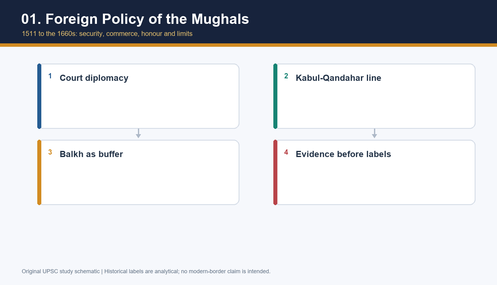

# Foreign Policy of the Mughals — Solved Practice Workbook

## BASIC LEARNING SESSION

> Use the repaired main learning session for full teaching. This workbook starts with application and practice only.

## BASIC MCQS / REMEDIATION

### Part I — 44 workbook MCQs (questions first; matched key in Part II)

#### Workbook MCQ 1
**Question:** Which is the safest inference from a gift exchange?

- A. It indicates a relationship being staged through material rank and reciprocity, not an automatic political settlement.
- B. It proves the receiver surrendered sovereignty.
- C. It proves no territorial dispute survived.
- D. It has no connection to status.

#### Workbook MCQ 2
**Question:** Why did travel time matter to policy?

- A. It made every embassy permanent.
- B. It delayed information, orders and relief, increasing the value of local preparation and buffers.
- C. It allowed forts to move with a caravan.
- D. It abolished the need for frontier officials.

#### Workbook MCQ 3
**Question:** What did Safavid strength mean for Mughal strategy?

- A. It obliged the Mughals to join Ottoman wars.
- B. It made Qandahar meaningless for the Mughals.
- C. It could restrain Uzbek pressure while simultaneously sustaining a rival claim to Qandahar.
- D. It ended all commercial links with Iran.

#### Workbook MCQ 4
**Question:** Which statement about the Ottomans is most accurate?

- A. They appointed Mughal envoys permanently.
- B. They ruled the Kabul-Ghazni-Qandahar line.
- C. They supplied every Mughal siege gun.
- D. Their prestige and rivalry with Safavids mattered, but there was no sustained Mughal-Ottoman alliance directing Mughal policy.

#### Workbook MCQ 5
**Question:** What did Akbar's Qandahar policy seek to strengthen?

- A. A defensible Kabul-Ghazni-Qandahar line while protecting route security and balancing Uzbek pressure.
- B. A permanent conquest of Iran.
- C. A route exclusively controlled by Ottoman officials.
- D. A surrender of Kabul to Mirza Hakim.

#### Workbook MCQ 6
**Question:** Which statement best qualifies the phrase 'Hindukush boundary'?

- A. It was an internationally surveyed frontier treaty.
- B. It describes a practical strategic understanding and terrain-based defensive logic, not a modern fixed international border.
- C. It meant the Mughals held every pass in all seasons.
- D. It placed Qandahar on the Oxus.

#### Workbook MCQ 7
**Question:** Why was Shah Abbas's cordial diplomacy not enough to protect Jahangir?

- A. The Uzbek court administered Qandahar.
- B. Jahangir had no contact with Iran before 1622.
- C. Cordiality could not replace fort readiness, adequate command and timely relief when the Qandahar claim was acted upon.
- D. Gifts abolished the need for an army.

#### Workbook MCQ 8
**Question:** Which explanation of 1622 should be rejected?

- A. Mughal unpreparedness was one element.
- B. Safavid initiative was one element.
- C. Court-princely coordination was one element.
- D. That Qandahar fell solely because of a Nur Jahan conspiracy.

#### Workbook MCQ 9
**Question:** What is the correct relation between Ali Mardan Khan and Qandahar?

- A. His 1638 defection/transfer gave the Mughals Qandahar in a political opening.
- B. He surrendered Kabul to Abdul Aziz in 1647.
- C. He commanded Dara's successful 1653 recapture.
- D. He was the Uzbek ruler who took Balkh in 1583.

#### Workbook MCQ 10
**Question:** What was the client-state logic in the Balkh campaign?

- A. Let Abdul Aziz occupy Kabul as tribute.
- B. Restore or support a friendly ruler so that Uzbek power remained divided without a costly permanent occupation.
- C. Transfer Qandahar to the Ottomans.
- D. Annex every city up to Samarqand regardless of cost.

#### Workbook MCQ 11
**Question:** Why is the Oxus not a sufficient 'scientific frontier' answer?

- A. It lay between Multan and Qandahar.
- B. It was the court title of Abdul Aziz.
- C. It was not reliably defensible around Balkh and the campaign itself moved back toward client restoration.
- D. It was a canal built by Ali Mardan Khan.

#### Workbook MCQ 12
**Question:** Which factor was NOT a reason the Balkh occupation became hard to sustain?

- A. Reluctance among Mughal and Rajput nobles.
- B. Winter and inadequate supplies.
- C. Hostile local reception.
- D. A stable, locally legitimate client administration accepted by all major actors.

#### Workbook MCQ 13
**Question:** How should Aurangzeb's 1647 action outside Balkh be used?

- A. As evidence of a battlefield success that did not itself produce durable political control.
- B. As a Qandahar siege of 1653.
- C. As proof that Balkh became a permanent Mughal suba.
- D. As proof no Uzbek force was present.

#### Workbook MCQ 14
**Question:** Which statement about Balkh is most defensible?

- A. It was another name for Qandahar.
- B. It was a forward buffer/client-zone problem, distinct from Qandahar's fort-and-route role.
- C. It was Mughal India's principal sea port.
- D. It was an Ottoman province ceded in 1595.

#### Workbook MCQ 15
**Question:** Why did the 1649-53 recovery campaigns fail?

- A. The Mughals never brought guns to the region.
- B. Cavalry could not move outside India.
- C. Prepared fortifications, defender resistance, supply from Lahore, winter pressure and siege limits interacted.
- D. Persian troops never defended the fort.

#### Workbook MCQ 16
**Question:** What does 'Mughal artillery was weak' miss?

- A. It proves there was no artillery in 1647.
- B. It identifies the Oxus as a fort wall.
- C. It correctly explains every Mughal battle.
- D. It collapses a specific fort-siege and logistics problem into an unsupported general judgement.

#### Workbook MCQ 17
**Question:** How did winter affect Mughal strategy?

- A. It constrained a prolonged occupation or siege when supplies and return routes were precarious.
- B. It ended all diplomatic correspondence forever.
- C. It made road junctions irrelevant.
- D. It turned Qandahar into Gandhara.

#### Workbook MCQ 18
**Question:** Which is a proper conclusion on Qandahar after 1653?

- A. The Uzbeks permanently controlled Iran.
- B. Repeated failure made further recovery attempts less rational, but diplomacy with Iran later resumed.
- C. All Mughal-Persian relations permanently ended.
- D. The fort ceased to have prestige instantly.

#### Workbook MCQ 19
**Question:** What commercial point is supported without inventing volumes?

- A. Qandahar carried every Indian export.
- B. Sea routes had vanished.
- C. Caravan networks through Qandahar linked horses, textiles and goods; route security and customs mattered to state interests.
- D. Merchants had no political information role.

#### Workbook MCQ 20
**Question:** Why are merchants relevant to diplomatic history?

- A. They automatically dictated imperial policy.
- B. They held modern diplomatic immunity.
- C. They replaced all envoys.
- D. They could be protected actors, information carriers and observers of route risk.

#### Workbook MCQ 21
**Question:** What does a traveller account require?

- A. Genre and trade-lens caution, plus comparison with court and material evidence.
- B. Use only when it supports imperial praise.
- C. Discard it because it is not a chronicle.
- D. Automatic acceptance as neutral state policy.

#### Workbook MCQ 22
**Question:** Which statement avoids a stereotype about the northwest frontier?

- A. A fort gave total control of every valley.
- B. Control was layered through forts, routes, local alliances, tribute and seasonal reach, not a uniform contest with timeless 'tribes'.
- C. Every local society opposed all Mughal routes in the same way.
- D. All frontier campaigns were foreign diplomacy.

#### Workbook MCQ 23
**Question:** How should the Roshani or Yusufzai material be used here?

- A. As evidence that the Ottomans ruled Kabul.
- B. As proof that all Afghans formed one permanent bloc.
- C. Only to illuminate route security and external-frontier overlap; detailed internal rebellion belongs to its owner topic.
- D. As a replacement for Qandahar analysis.

#### Workbook MCQ 24
**Question:** Which ruler-policy comparison is most accurate?

- A. Only Aurangzeb cared about the northwest.
- B. All three had identical goals and methods.
- C. Akbar conquered Persia, Jahangir annexed Balkh, Shah Jahan ignored Qandahar.
- D. Akbar balanced and secured the line; Jahangir's cordiality had a readiness gap; Shah Jahan projected forward and met sustainability limits.

#### Workbook MCQ 25
**Question:** Which comparison with the Deccan is legitimate?

- A. Both theatres reveal buffers and state-capacity limits, while their geography and political actors differ sharply.
- B. Balkh was a Deccan sultanate.
- C. The northwest and Deccan were the same route network.
- D. Topic 18 has no relation to state capacity.

#### Workbook MCQ 26
**Question:** What is the best reading of 'India-centric'?

- A. It is a contemporary Mughal constitutional term.
- B. Indian revenue and northwest security shaped durable interests, without equating the Mughal state with modern nationalism.
- C. It proves the Mughals ignored Central Asia.
- D. It means all wars were fought inside modern India.

#### Workbook MCQ 27
**Question:** How should Timurid prestige enter an answer?

- A. As proof all emperors planned permanent Samarqand annexation.
- B. As a Safavid administrative rank.
- C. As a real qualification that could enlarge ambition, not as the sole explanation for every policy.
- D. As evidence Qandahar had no commercial value.

#### Workbook MCQ 28
**Question:** What can coins and forts contribute to the source base?

- A. They prove a route was used in only one direction.
- B. They disclose every private diplomatic conversation.
- C. They replace all letters and chronicles.
- D. They can show material claims, construction and spatial capacity, while needing textual context for intention.

#### Workbook MCQ 29
**Question:** Why is 'prestige' insufficient as a complete explanation of Qandahar?

- A. It leaves out fort strength, Kabul defence, roads and commercial movement.
- B. Prestige was never relevant.
- C. It proves the fort lay in modern Gandhara.
- D. Only Safavid prestige mattered.

#### Workbook MCQ 30
**Question:** Why is 'trade' insufficient as a complete explanation of Qandahar?

- A. It proves the fort had no water.
- B. It leaves out defensive depth, local political claims and imperial honour.
- C. Every route passed only by sea.
- D. Trade did not exist in the region.

#### Workbook MCQ 31
**Question:** What should a map label 'SCHEMATIC - NOT TO SCALE' prevent?

- A. The comparison of forts and routes.
- B. The use of place names.
- C. The projection of simplified learning geography into precise modern borders or distances.
- D. The use of any historical route.

#### Workbook MCQ 32
**Question:** What is a good final verdict on Mughal foreign policy?

- A. A permanent anti-Iran alliance.
- B. A simple series of cavalry victories.
- C. A policy with no commercial dimension.
- D. A changing court practice combining security, trade, status and constrained military capacity rather than modern diplomacy or pure nostalgia.

#### Workbook MCQ 33

**Question:** Put the Uzbek movements relevant to Akbar's Balkh policy in defensible order.

- A. Abdullah's first capture of Balkh → Shahrukh Mirza's recovery → Abdullah's renewed capture → Uzbek capture of Badakhshan.
- B. Abdullah's first capture of Balkh → Uzbek capture of Badakhshan → Shahrukh Mirza's recovery → Abdullah's renewed capture.
- C. Shahrukh Mirza's recovery → Abdullah's first capture of Balkh → Uzbek capture of Badakhshan → Abdullah's renewed capture.
- D. Abdullah's renewed capture → Shahrukh Mirza's recovery → Abdullah's first capture → Uzbek capture of Badakhshan.

#### Workbook MCQ 34

**Question:** Abdullah Khan argued for an anti-Safavid coalition in 1577 on sectarian and pilgrimage grounds. Which pair best captures Akbar's counter-calculation?

- A. Pilgrimage had stopped permanently; Kabul was already an Ottoman province.
- B. Iran checked Uzbek power; Gujarat offered an alternative pilgrimage route.
- C. Safavids had ceded Qandahar in a modern border treaty; India had no interest in Kabul.
- D. Iran controlled the Oxus; Mughal forces had already annexed Balkh.

#### Workbook MCQ 35

**Question:** Which inference best fits Akbar's understanding conveyed through Hakim Humam?

- A. A formal treaty permanently extinguished Mughal claims to all Central Asia.
- B. The Uzbeks were recognised as sovereign over Kabul and Qandahar.
- C. A practical Hindukush division constrained immediate moves without extinguishing every future claim.
- D. The Oxus became an unfordable, continuously garrisoned imperial border.

#### Workbook MCQ 36

**Question:** A source records Akbar's 1591 instruction to use the “golden key” and a 1595 transfer of Qandahar by local Mirzas. Which conclusion follows?

- A. Akbar personally besieged Herat in 1591.
- B. The Safavids unconditionally renounced Qandahar thereafter.
- C. Uzbek pressure played no part in the transfer.
- D. Political inducement and regional isolation of the fort mattered alongside Mughal strategic design.

#### Workbook MCQ 37

**Question:** Two narratives give a Qandahar garrison of 3,000 and “300 or 400 servants” in the context of 1622. What should a critical answer do?

- A. Attribute the first to the *Iqbalnama-i Jahangiri* and the second to Jahangir's memoir, noting that the latter may count a commandant's personal following.
- B. Add both to produce the verified total of the garrison.
- C. Prefer the smaller figure as the certified complete garrison because it comes from a ruler.
- D. Reject both because the siege did not occur under Jahangir.

#### Workbook MCQ 38

**Question:** Which sequence accurately distinguishes diplomatic aspiration from action in Shah Jahan's Iran policy?

- A. Ottoman conquest of Qandahar (1636) → Mughal siege recovery (1638).
- B. Proposal to Murad IV for pressure on Iran (1636) → Ali Mardan Khan's transfer of Qandahar (1638).
- C. Tripartite treaty signed at Balkh (1636) → Ottoman garrison placed in Kabul (1638).
- D. Ali Mardan Khan's defection (1636) → Aurangzeb's recapture from Shah Abbas II (1638).

#### Workbook MCQ 39

**Question:** The 1628 Kabul episode illustrates which contrast?

- A. Nazr Muhammad held Kabul permanently; the Mughals abandoned the fort without resistance.
- B. Mughal occupation of Samarqand triggered Ottoman intervention in Kabul.
- C. Nazr Muhammad occupied the city and invested its fort, then withdrew before Mughal reinforcements; Bamiyan was held only temporarily.
- D. Shah Abbas II conquered Kabul and appointed Nazr Muhammad governor.

#### Workbook MCQ 40

**Question:** A historian calls the 1646 Balkh operation a simple failed invasion. Which missing step most directly challenges that label?

- A. Shah Jahan meant to replace Nazr Muhammad with an Ottoman governor.
- B. The Mughals refused all cooperation with Uzbek rulers in principle.
- C. Nazr Muhammad never appealed to the Mughal court.
- D. Nazr Muhammad had sought help, and Shah Jahan initially envisioned his restoration as a friendly buffer; Murad's coercive entry upset that design.

#### Workbook MCQ 41

**Question:** Which pairing is consistent with the *source-attributed* strength and operational design of the Balkh expedition?

- A. The Part II narrative's 50,000 horse and 10,000 foot for the 1646 force; Aurangzeb later used pickets plus a mobile main force rather than relying on the fordable Oxus alone.
- B. A permanent empire-wide total of 50,000 soldiers; a fixed defensive wall across the Oxus.
- C. A verified expenditure of 50,000 rupees; abandonment of artillery at Balkh.
- D. A Safavid army of 10,000 foot; a Mughal naval blockade of the Oxus.

#### Workbook MCQ 42

**Question:** Match the three failed recovery efforts after the 1649 loss of Qandahar to commanders.

- A. 1649 Dara; 1652 Murad; 1653 Aurangzeb.
- B. 1649 Aurangzeb; 1652 Aurangzeb; 1653 Dara Shukoh.
- C. 1649 Ali Mardan; 1652 Shah Abbas I; 1653 Dara.
- D. 1649 Sadullah Khan; 1652 Aurangzeb; 1653 Nazr Muhammad.

#### Workbook MCQ 43

**Question:** Which reading best accounts for the switch from Shah Abbas I's conquest to Shah Abbas II's recapture in the Qandahar chronology?

- A. They are two names for one ruler conducting a single siege.
- B. Shah Abbas II lost the fort to Jahangir in 1622 and regained it in 1638.
- C. Shah Abbas I took the fort in 1622; it changed hands in 1638; Shah Abbas II retook it in 1649.
- D. Shah Abbas I took Balkh in 1649 and Shah Abbas II seized Qandahar in 1653.

#### Workbook MCQ 44

**Question:** An account claims that a Mughal victory in the field outside Qandahar in 1649 necessarily implied imminent capture of the fort. Which rebuttal is strongest?

- A. A field victory automatically proves artillery was unnecessary.
- B. A prepared fort could not be defended if its army lost one encounter.
- C. Qandahar had no water or stores, so siege logistics were irrelevant.
- D. Defeating forces outside walls does not overcome fortifications, stores, siege engineering problems and a remote supply line.

### Part II — Matched answer key and remediation

#### Answer & reasoning — Workbook MCQ 1

**Correct answer:** A

**Option-wise explanations:**
- **A. It indicates a relationship being staged through material rank and reciprocity, not an automatic political settlement.** — Correct. Courtly gifts publicised abundance, honour and relative status, but they did not by themselves dispose of a live territorial claim. Jahangir and Shah Abbas could exchange splendid presents while still disagreeing over Qandahar.
- **B. It proves the receiver surrendered sovereignty.** — A surrender of sovereignty would need a clearer act of submission, cession or military defeat. Ceremonial exchange alone is too thin a basis for that conclusion.
- **C. It proves no territorial dispute survived.** — This fails because the whole Qandahar story shows disputes surviving polite diplomatic forms. Courtesy and contention often travelled together.
- **D. It has no connection to status.** — Status was one of the main things gifts communicated. Robes, rarities and return presents were part of the theatre of rank.

**Examiner trap:** Read gifts as diplomatic theatre, not as a title deed.

#### Answer & reasoning — Workbook MCQ 2

**Correct answer:** B

**Option-wise explanations:**
- **A. It made every embassy permanent.** — Slow travel did not create resident embassies; Mughal diplomacy remained mission-based. The delay actually made episodic reports and returning envoys more important.
- **B. It delayed information, orders and relief, increasing the value of local preparation and buffers.** — Correct. When news, orders and reinforcements moved slowly, courts needed forts, frontier officers and buffer arrangements that could hold the line before relief arrived.
- **C. It allowed forts to move with a caravan.** — Forts did not become mobile. The point is that distant forts had to survive longer on their own because messages and supplies took time to arrive.
- **D. It abolished the need for frontier officials.** — Distance made frontier officials more necessary, not less. Someone on the spot had to judge roads, passes, provisioning and danger before the centre could react.

**Examiner trap:** Information lag is one reason buffers, forts and delegated frontier judgement mattered so much.

#### Answer & reasoning — Workbook MCQ 3

**Correct answer:** C

**Option-wise explanations:**
- **A. It obliged the Mughals to join Ottoman wars.** — The Mughals watched Ottoman-Iranian rivalry, but they did not place themselves under Ottoman direction. Their calculation stayed centred on Kabul, Qandahar and Uzbek pressure.
- **B. It made Qandahar meaningless for the Mughals.** — If anything, a stronger Iran made Qandahar more sensitive, because it remained a serious Safavid claim as well as a strategic hinge for the Mughals.
- **C. It could restrain Uzbek pressure while simultaneously sustaining a rival claim to Qandahar.** — Correct. Safavid strength helped prevent an unchecked Uzbek thrust, yet the same Safavid court remained the principal rival over Qandahar.
- **D. It ended all commercial links with Iran.** — Commercial links with Iran continued despite rivalry. Trade, embassies and political competition coexisted rather than cancelling one another out.

**Examiner trap:** Safavid Iran must be read as both counterweight and competitor.

#### Answer & reasoning — Workbook MCQ 4

**Correct answer:** D

**Option-wise explanations:**
- **A. They appointed Mughal envoys permanently.** — Mughal envoys were not Ottoman appointees. Missions were sent by the ruler whose court needed to negotiate, warn, congratulate or gather news.
- **B. They ruled the Kabul-Ghazni-Qandahar line.** — The Ottoman Empire mattered in West Asian politics, but it did not hold the Kabul-Ghazni-Qandahar chain that structured Mughal frontier defence.
- **C. They supplied every Mughal siege gun.** — Nothing in the Topic 19 source base supports a picture of every Mughal siege depending on Ottoman matériel. That inserts an operational link the evidence does not supply.
- **D. Their prestige and rivalry with Safavids mattered, but there was no sustained Mughal-Ottoman alliance directing Mughal policy.** — Correct. Ottoman prestige, Red Sea-Gulf rivalry and anti-Safavid conflict formed part of the wider field, yet no durable Mughal-Ottoman alliance dictated Mughal choices.

**Examiner trap:** Ottoman relevance here is contextual and status-laden, not command over Mughal policy.

#### Answer & reasoning — Workbook MCQ 5

**Correct answer:** A

**Option-wise explanations:**
- **A. A defensible Kabul-Ghazni-Qandahar line while protecting route security and balancing Uzbek pressure.** — Correct. Akbar wanted a stronger outer line for Kabul, safer routes and a better balance against Uzbek pressure; Qandahar served all three purposes at once.
- **B. A permanent conquest of Iran.** — Akbar did not launch a Persian conquest. The 1595 outcome was a frontier gain achieved through local political opportunity, not a march on Safavid imperial centres.
- **C. A route exclusively controlled by Ottoman officials.** — This invents an Ottoman-controlled route structure that the sources do not support. Qandahar mattered precisely because the Mughals wanted their own defensible access.
- **D. A surrender of Kabul to Mirza Hakim.** — 1585 moved in the opposite direction: Kabul came under firmer Mughal control after Mirza Hakim died. It did not revert to him.

**Examiner trap:** Akbar used Qandahar to reinforce the Kabul line, not to begin a conquest of Iran.

#### Answer & reasoning — Workbook MCQ 6

**Correct answer:** B

**Option-wise explanations:**
- **A. It was an internationally surveyed frontier treaty.** — The phrase does not describe a surveyed treaty frontier in the modern legal sense. It is a historian's shorthand for a defensible strategic arrangement.
- **B. It describes a practical strategic understanding and terrain-based defensive logic, not a modern fixed international border.** — Correct. The Hindukush line captures practical depth, terrain and route control, not a precise international border with permanent demarcation.
- **C. It meant the Mughals held every pass in all seasons.** — The Mughals never held every pass in every season. Reach depended on forts, intelligence, local cooperation and the campaigning calendar.
- **D. It placed Qandahar on the Oxus.** — Qandahar lay in the Kabul-Herat-Multan system, not on the Oxus. Moving it there collapses two separate strategic zones.

**Examiner trap:** A “scientific frontier” here means usable defensive logic, not modern cartographic fixity.

#### Answer & reasoning — Workbook MCQ 7

**Correct answer:** C

**Option-wise explanations:**
- **A. The Uzbek court administered Qandahar.** — Qandahar was not being run by the Uzbek court in Jahangir's time. The crisis turned on a Mughal-Safavid contest over a fort both courts valued.
- **B. Jahangir had no contact with Iran before 1622.** — Jahangir had extensive contact with Iran before 1622 through embassies, gifts and commercial links. The problem was misreading cordiality as security.
- **C. Cordiality could not replace fort readiness, adequate command and timely relief when the Qandahar claim was acted upon.** — Correct. Friendly language and ceremonial exchange could not compensate for an inadequately prepared fort, weak relief coordination and a rival claim backed by action.
- **D. Gifts abolished the need for an army.** — Gifts could dramatise friendship, but they never abolished the military side of frontier politics. Qandahar still needed defence, command and relief.

**Examiner trap:** Cordial diplomacy could soften relations, but it could not replace preparedness at Qandahar.

#### Answer & reasoning — Workbook MCQ 8

**Correct answer:** D

**Option-wise explanations:**
- **A. Mughal unpreparedness was one element.** — This belongs in any serious explanation. Mughal unreadiness helps explain why the Safavid move succeeded when it did.
- **B. Safavid initiative was one element.** — This too is part of the answer. Shah Abbas acted with initiative and preparation rather than merely inheriting the fort by etiquette.
- **C. Court-princely coordination was one element.** — Court-princely coordination problems mattered, especially because relief depended on timely action from a distracted imperial system.
- **D. That Qandahar fell solely because of a Nur Jahan conspiracy.** — Correct. Turning the entire episode into a Nur Jahan conspiracy flattens a multi-causal event into court gossip and erases strategy, garrison readiness and Safavid planning.

**Examiner trap:** Treat 1622 as a convergence of rival claim, Persian initiative, Mughal unreadiness and court delay.

#### Answer & reasoning — Workbook MCQ 9

**Correct answer:** A

**Option-wise explanations:**
- **A. His 1638 defection/transfer gave the Mughals Qandahar in a political opening.** — Correct. Ali Mardan Khan is tied to the 1638 transfer of Qandahar, where political defection achieved what a formal siege had not.
- **B. He surrendered Kabul to Abdul Aziz in 1647.** — Abdul Aziz belongs to the Central Asian field around Balkh, not to a Kabul surrender by Ali Mardan Khan. This mixes two different theatres.
- **C. He commanded Dara's successful 1653 recapture.** — Dara Shukoh's 1653 attempt failed, so there was no successful recapture for Ali Mardan Khan to command there. The chronology itself rules this out.
- **D. He was the Uzbek ruler who took Balkh in 1583.** — The Uzbek ruler who took Balkh in 1583 was Abdullah Khan Uzbek. Ali Mardan Khan belongs to a much later Safavid-Mughal episode.

**Examiner trap:** Anchor Ali Mardan Khan to 1638 and to transfer of allegiance, not to the later failed sieges.

#### Answer & reasoning — Workbook MCQ 10

**Correct answer:** B

**Option-wise explanations:**
- **A. Let Abdul Aziz occupy Kabul as tribute.** — Allowing Abdul Aziz to occupy Kabul would have reversed the whole defensive logic of the campaign. Kabul was the line to be protected, not offered up.
- **B. Restore or support a friendly ruler so that Uzbek power remained divided without a costly permanent occupation.** — Correct. The cheaper design was to restore or sustain a friendly arrangement beyond the Hindukush so Uzbek power stayed divided without long Mughal occupation.
- **C. Transfer Qandahar to the Ottomans.** — Qandahar-to-Ottomans has nothing to do with the Balkh problem. It drags in an external court where the immediate issue was Uzbek balance north of Kabul.
- **D. Annex every city up to Samarqand regardless of cost.** — A permanent annexation drive to Samarqand ignores the stated client-buffer logic and the very costs that later made direct occupation untenable.

**Examiner trap:** The Balkh move began as buffer politics; it became far riskier once it slipped into occupation.

#### Answer & reasoning — Workbook MCQ 11

**Correct answer:** C

**Option-wise explanations:**
- **A. It lay between Multan and Qandahar.** — Multan and Qandahar belonged to the southern side of the route system. The Oxus mattered farther north in the Balkh-Badakhshan zone.
- **B. It was the court title of Abdul Aziz.** — The Oxus was a river, not one of Abdul Aziz's titles. Treating it as a label for a ruler dodges the strategic question entirely.
- **C. It was not reliably defensible around Balkh and the campaign itself moved back toward client restoration.** — Correct. A fordable river and a forward occupation could not by themselves guarantee security; the campaign itself drifted back toward the need for a workable client settlement.
- **D. It was a canal built by Ali Mardan Khan.** — Ali Mardan Khan is remembered for canals and engineering elsewhere, but the Oxus itself was obviously not one of his constructions.

**Examiner trap:** A river obstacle is helpful only when politics, supply and local authority also hold.

#### Answer & reasoning — Workbook MCQ 12

**Correct answer:** D

**Option-wise explanations:**
- **A. Reluctance among Mughal and Rajput nobles.** — Reluctant nobles were part of the sustainability problem. Distant campaigning asked a great deal from elites who saw little durable gain in holding Balkh directly.
- **B. Winter and inadequate supplies.** — Winter and supply shortages are central to why the occupation became expensive and fragile. Climate mattered through fodder, movement and return routes.
- **C. Hostile local reception.** — A hostile population increased the political and provisioning burden on the Mughals. Occupation without local acceptance remained brittle.
- **D. A stable, locally legitimate client administration accepted by all major actors.** — Correct. A stable accepted client would have reduced the burden; its absence was precisely what made direct Mughal possession harder to sustain.

**Examiner trap:** The missing piece at Balkh was not more ground alone; it was a viable client arrangement.

#### Answer & reasoning — Workbook MCQ 13

**Correct answer:** A

**Option-wise explanations:**
- **A. As evidence of a battlefield success that did not itself produce durable political control.** — Correct. Aurangzeb's 1647 victory should be used as evidence that Mughal arms could win in the field even when the larger occupation remained unsustainable.
- **B. As a Qandahar siege of 1653.** — The 1653 siege belonged to Qandahar, not to Balkh. Using Aurangzeb's 1647 action that way collapses two separate campaigns.
- **C. As proof that Balkh became a permanent Mughal suba.** — The empire withdrew; Balkh did not become a settled Mughal suba. Administrative permanence is exactly what the campaign failed to achieve.
- **D. As proof no Uzbek force was present.** — If no Uzbek force were present, there would have been no battlefield success to discuss. The whole significance of 1647 lies in defeating a real opponent without solving the larger political problem.

**Examiner trap:** Use Aurangzeb's 1647 action to show the gap between battlefield success and durable control.

#### Answer & reasoning — Workbook MCQ 14

**Correct answer:** B

**Option-wise explanations:**
- **A. It was another name for Qandahar.** — Balkh and Qandahar sat in the same broad north-western field, but they were not the same place and did not serve the same strategic function.
- **B. It was a forward buffer/client-zone problem, distinct from Qandahar's fort-and-route role.** — Correct. Balkh posed the problem of buffer politics and client management beyond the Hindukush, whereas Qandahar was a fort-route hinge tied directly to Kabul's defence.
- **C. It was Mughal India's principal sea port.** — Balkh was inland Central Asian territory, not a sea port of Mughal India. The distractor is absurd geographically as well as historically.
- **D. It was an Ottoman province ceded in 1595.** — No Ottoman cession created Balkh's place in Mughal strategy. That issue arose from Uzbek politics, Timurid memory and Kabul security.

**Examiner trap:** Never flatten Balkh into “another Qandahar”; the two zones ask different strategic questions.

#### Answer & reasoning — Workbook MCQ 15

**Correct answer:** C

**Option-wise explanations:**
- **A. The Mughals never brought guns to the region.** — The Mughals did bring artillery to the region, including very heavy guns in the last attempt. The failure lay elsewhere.
- **B. Cavalry could not move outside India.** — Mughal cavalry operated well beyond the Indo-Gangetic plain. The difficulty at Qandahar was not inability to move, but inability to reduce a defended fort cheaply and quickly.
- **C. Prepared fortifications, defender resistance, supply from Lahore, winter pressure and siege limits interacted.** — Correct. The fort's strength, determined defence, Lahore-based supply, engineering limits and seasonal pressure made siege warfare a different problem from open battle.
- **D. Persian troops never defended the fort.** — Persian defenders were exactly why the fort did not simply fall to prestige or cavalry pressure. The garrison mattered.

**Examiner trap:** The 1649-53 story is about siege conditions, not about the empire forgetting how to fight.

#### Answer & reasoning — Workbook MCQ 16

**Correct answer:** D

**Option-wise explanations:**
- **A. It proves there was no artillery in 1647.** — This statement is disproved by the Balkh campaign itself, where artillery formed part of Mughal battlefield strength. It overcorrects from one later failure.
- **B. It identifies the Oxus as a fort wall.** — Calling the Oxus a fort wall turns a river into masonry. The historical issue was whether a natural obstacle could be converted into secure defence, not whether it was literally a bastion.
- **C. It correctly explains every Mughal battle.** — One slogan cannot explain every Mughal battle because Topic 19 contains both successful field action and failed sieges. The military record is mixed and contextual.
- **D. It collapses a specific fort-siege and logistics problem into an unsupported general judgement.** — Correct. “Artillery was weak” erases the difference between an open-field victory and the stubborn reduction of a fortified place supplied from afar.

**Examiner trap:** Do not turn the Qandahar siege problem into a blanket verdict on all Mughal warfare.

#### Answer & reasoning — Workbook MCQ 17

**Correct answer:** A

**Option-wise explanations:**
- **A. It constrained a prolonged occupation or siege when supplies and return routes were precarious.** — Correct. Winter tightened the question of fodder, transport, morale and safe withdrawal, so it shaped whether a siege or occupation could be prolonged at all.
- **B. It ended all diplomatic correspondence forever.** — Diplomatic communication did not vanish forever in winter. The harder issue was sustaining men, animals and supplies in the field.
- **C. It made road junctions irrelevant.** — Road junctions became more important in bad conditions because relief and retreat depended on them. Winter sharpened logistical geography rather than erasing it.
- **D. It turned Qandahar into Gandhara.** — Season could change campaign prospects, but it could not change Qandahar into Gandhara. That option just plays on name confusion.

**Examiner trap:** Winter matters through logistics: transport, forage, timing and survival.

#### Answer & reasoning — Workbook MCQ 18

**Correct answer:** B

**Option-wise explanations:**
- **A. The Uzbeks permanently controlled Iran.** — The Uzbeks never permanently controlled Iran, and this claim has little to do with the post-1653 Mughal decision. It confuses separate power fields.
- **B. Repeated failure made further recovery attempts less rational, but diplomacy with Iran later resumed.** — Correct. After repeated costly failure, further recovery became harder to justify, while diplomacy with Iran remained the more workable course.
- **C. All Mughal-Persian relations permanently ended.** — Relations with Iran did not end forever. Later diplomacy proves that rivalry over one fort did not erase all interstate contact.
- **D. The fort ceased to have prestige instantly.** — Prestige did not evaporate overnight. What changed was the strategic calculation about whether another expensive recovery attempt made sense.

**Examiner trap:** After 1653 the rational shift was toward diplomacy, not toward permanent rupture.

#### Answer & reasoning — Workbook MCQ 19

**Correct answer:** C

**Option-wise explanations:**
- **A. Qandahar carried every Indian export.** — No evidence allows the claim that every Indian export passed through Qandahar. That turns importance into monopoly.
- **B. Sea routes had vanished.** — Sea routes remained active; they are one reason historians insist that Qandahar had great value without making it the only corridor.
- **C. Caravan networks through Qandahar linked horses, textiles and goods; route security and customs mattered to state interests.** — Correct. The safe commercial claim is about importance to caravans, customs, horses, textiles and information, not about fabricated totals or exclusivity.
- **D. Merchants had no political information role.** — Merchants helped carry information as well as goods. Their relevance extends beyond pure commerce into political awareness of routes and risk.

**Examiner trap:** State Qandahar's trade value without inflating it into the empire's sole commercial artery.

#### Answer & reasoning — Workbook MCQ 20

**Correct answer:** D

**Option-wise explanations:**
- **A. They automatically dictated imperial policy.** — Merchants influenced the environment within which policy was made, but they did not become hidden sovereigns issuing imperial orders.
- **B. They held modern diplomatic immunity.** — Merchant protection and privilege should not be confused with modern diplomatic immunity. They travelled under varying political conditions and risks.
- **C. They replaced all envoys.** — Envoys and merchants overlapped in information flows, yet one did not replace the other. Court diplomacy still required formal missions.
- **D. They could be protected actors, information carriers and observers of route risk.** — Correct. Merchants mattered because they moved through the routes, needed protection and could report prices, danger and political conditions.

**Examiner trap:** Merchants are historically important as carriers and observers, not as a secret foreign office.

#### Answer & reasoning — Workbook MCQ 21

**Correct answer:** A

**Option-wise explanations:**
- **A. Genre and trade-lens caution, plus comparison with court and material evidence.** — Correct. Traveller evidence is useful when read with attention to genre, itinerary, audience and commercial angle, then checked against court texts and material facts.
- **B. Use only when it supports imperial praise.** — Using a traveller only when he flatters the court turns evidence into propaganda selection. The source has to be tested, not cherry-picked.
- **C. Discard it because it is not a chronicle.** — Being non-chronicle material is not a reason for rejection. Travellers can reveal route use, merchant presence and observed court practice.
- **D. Automatic acceptance as neutral state policy.** — No traveller offers automatic neutrality. Outsider status brings its own limits, blind spots and commercial interests.

**Examiner trap:** Read traveller accounts comparatively: what did the traveller see, and what could he not see?

#### Answer & reasoning — Workbook MCQ 22

**Correct answer:** B

**Option-wise explanations:**
- **A. A fort gave total control of every valley.** — A strong fort improved leverage, but it did not magically command every valley, tribe, pass and season. Frontier reach stayed uneven.
- **B. Control was layered through forts, routes, local alliances, tribute and seasonal reach, not a uniform contest with timeless 'tribes'.** — Correct. The north-west worked through layered authority—forts, routes, tribute, allies, supervision and campaigning windows—not through one flat sovereignty.
- **C. Every local society opposed all Mughal routes in the same way.** — Local societies did not respond identically. Their choices varied with leadership, terrain, pressure, opportunity and outside encouragement.
- **D. All frontier campaigns were foreign diplomacy.** — Many frontier campaigns sat between internal administration and external diplomacy. Calling them purely foreign erases that overlap.

**Examiner trap:** The north-west frontier must be described as layered, negotiated and seasonal.

#### Answer & reasoning — Workbook MCQ 23

**Correct answer:** C

**Option-wise explanations:**
- **A. As evidence that the Ottomans ruled Kabul.** — Neither Roshani nor Yusufzai material proves Ottoman rule at Kabul. That imports a distant court into the wrong evidence set.
- **B. As proof that all Afghans formed one permanent bloc.** — This stereotype converts varied frontier actors into one timeless bloc. Topic 19 needs them only where they illuminate pass security and outside influence.
- **C. Only to illuminate route security and external-frontier overlap; detailed internal rebellion belongs to its owner topic.** — Correct. Use the material to explain why Kabul-route control could not be secured by diplomacy alone, while leaving the full rebellion narrative to its proper owner.
- **D. As a replacement for Qandahar analysis.** — Qandahar remains central to Topic 19 and cannot be displaced by frontier-society material. The latter is supporting context, not the main hinge.

**Examiner trap:** Bring frontier-society evidence in only when it explains route security and external overlap.

#### Answer & reasoning — Workbook MCQ 24

**Correct answer:** D

**Option-wise explanations:**
- **A. Only Aurangzeb cared about the northwest.** — Akbar, Jahangir and Shah Jahan all cared about the north-west; the difference lies in their methods and outcomes, not in the existence of concern.
- **B. All three had identical goals and methods.** — There was structural continuity, but not identical practice. Akbar balanced, Jahangir misread cordiality, and Shah Jahan pushed farther forward.
- **C. Akbar conquered Persia, Jahangir annexed Balkh, Shah Jahan ignored Qandahar.** — Every clause here is chronologically and substantively wrong. Akbar did not conquer Persia, Jahangir did not annex Balkh, and Shah Jahan certainly did not ignore Qandahar.
- **D. Akbar balanced and secured the line; Jahangir's cordiality had a readiness gap; Shah Jahan projected forward and met sustainability limits.** — Correct. This is the most accurate synthetic comparison because it preserves both recurring objectives and changing strategic style.

**Examiner trap:** A good reign comparison keeps continuity of concern together with variation in method and result.

#### Answer & reasoning — Workbook MCQ 25

**Correct answer:** A

**Option-wise explanations:**
- **A. Both theatres reveal buffers and state-capacity limits, while their geography and political actors differ sharply.** — Correct. The comparison works only at the level of buffers, indirect control and the cost of turning victory into durable rule; the actors and geography remain quite different.
- **B. Balkh was a Deccan sultanate.** — Balkh belonged to the Central Asian field, not to the Deccan sultanate system. The option collapses two unrelated regions.
- **C. The northwest and Deccan were the same route network.** — The Deccan and the north-west were not one route network. Their strategic problems could rhyme without sharing the same geography.
- **D. Topic 18 has no relation to state capacity.** — Topic 18 says a great deal about limits of state capacity and indirect rule. Denying that erases the only legitimate comparative bridge.

**Examiner trap:** Use the Deccan here only as a bounded comparison about state capacity and buffers, not as merged content.

#### Answer & reasoning — Workbook MCQ 26

**Correct answer:** B

**Option-wise explanations:**
- **A. It is a contemporary Mughal constitutional term.** — “India-centred” is a historian's analytical phrase, not a Mughal constitutional term. The empire did not speak in modern nationalist categories.
- **B. Indian revenue and northwest security shaped durable interests, without equating the Mughal state with modern nationalism.** — Correct. The phrase highlights the Indian fiscal core and the defence of Kabul-linked approaches while avoiding any claim that the Mughals thought in modern national terms.
- **C. It proves the Mughals ignored Central Asia.** — The Mughals clearly did not ignore Central Asia; Timurid memory, Uzbek diplomacy and the Balkh campaign all show engagement.
- **D. It means all wars were fought inside modern India.** — Wars and strategies were not confined to modern India. The phrase points to the location of the core interest, not to the physical limit of every action.

**Examiner trap:** “India-centred” refers to the revenue-defensive core, not to modern nationalism or geographical confinement.

#### Answer & reasoning — Workbook MCQ 27

**Correct answer:** C

**Option-wise explanations:**
- **A. As proof all emperors planned permanent Samarqand annexation.** — Timurid prestige did not amount to a standing operational plan to annex Samarqand at all costs. The record is more conditional than that.
- **B. As a Safavid administrative rank.** — Timurid prestige is a dynastic memory and language of honour, not an administrative rank in the Safavid system.
- **C. As a real qualification that could enlarge ambition, not as the sole explanation for every policy.** — Correct. Prestige qualifies the story by explaining why ambition could expand, but it cannot replace security, route and balance calculations.
- **D. As evidence Qandahar had no commercial value.** — Qandahar's commercial value is independently attested. Prestige adds another layer; it does not cancel the others.

**Examiner trap:** Treat Timurid memory as a real qualifier that enlarges ambition, not as the single key to every decision.

#### Answer & reasoning — Workbook MCQ 28

**Correct answer:** D

**Option-wise explanations:**
- **A. They prove a route was used in only one direction.** — A coin or a fort cannot prove that traffic moved only one way. Material remains usually need wider contextual evidence before such fine claims are made.
- **B. They disclose every private diplomatic conversation.** — Private diplomatic conversations are exactly the kind of thing material evidence cannot fully reveal. For that, letters and narrative sources still matter.
- **C. They replace all letters and chronicles.** — Texts and material remains answer different questions. Replacing one with the other would shrink, not improve, the evidence base.
- **D. They can show material claims, construction and spatial capacity, while needing textual context for intention.** — Correct. Coins and forts can show claims, construction, capacity and spatial logic, but intention and negotiation still require textual comparison.

**Examiner trap:** Material evidence is strongest on claim and capacity; motive still needs textual testing.

#### Answer & reasoning — Workbook MCQ 29

**Correct answer:** A

**Option-wise explanations:**
- **A. It leaves out fort strength, Kabul defence, roads and commercial movement.** — Correct. Prestige matters, but by itself it cannot explain the fort's water, roads, Kabul connection and commercial pull.
- **B. Prestige was never relevant.** — Prestige was certainly relevant in imperial politics. The problem is not that honour was absent, but that honour alone is too narrow.
- **C. It proves the fort lay in modern Gandhara.** — This repeats the name-confusion error. Qandahar's importance has nothing to do with being in ancient Gandhara.
- **D. Only Safavid prestige mattered.** — Safavid prestige was only one side of the story. Mughal honour, frontier defence and trade also mattered.

**Examiner trap:** Do not reduce Qandahar to prestige alone; the fort's strategic and commercial logic is inseparable from honour.

#### Answer & reasoning — Workbook MCQ 30

**Correct answer:** B

**Option-wise explanations:**
- **A. It proves the fort had no water.** — Trade does not prove the absence of water; in fact, the fortified-watered character of Qandahar was part of its wider value.
- **B. It leaves out defensive depth, local political claims and imperial honour.** — Correct. Trade is central, but a full answer also needs defence of Kabul, the local political claim and imperial honour.
- **C. Every route passed only by sea.** — Sea routes existed alongside overland ones. Their existence qualifies any monopoly claim; it does not erase Qandahar's overland importance.
- **D. Trade did not exist in the region.** — Trade plainly existed in the region. The question is how much explanatory weight to assign it relative to defence and prestige.

**Examiner trap:** A strong Qandahar answer joins commerce to defence, political claim and honour.

#### Answer & reasoning — Workbook MCQ 31

**Correct answer:** C

**Option-wise explanations:**
- **A. The comparison of forts and routes.** — A schematic map is still meant to help comparison. It becomes misleading only when the learner mistakes relation-diagrams for surveyed cartography.
- **B. The use of place names.** — Place names remain necessary on a teaching map. The warning is about precision, not about naming locations.
- **C. The projection of simplified learning geography into precise modern borders or distances.** — Correct. “Not to scale” blocks the leap from a learning sketch to exact modern distance, alignment or border claims.
- **D. The use of any historical route.** — Historical routes can and should appear on a schematic. The caution lies in treating them as precise cadastral lines.

**Examiner trap:** A schematic map teaches relationships; it is not evidence for exact modern borders or measured distances.

#### Answer & reasoning — Workbook MCQ 32

**Correct answer:** D

**Option-wise explanations:**
- **A. A permanent anti-Iran alliance.** — Mughal policy never hardened into a permanent anti-Iran alliance. Iran was too often both rival and useful counterweight for that formula to work.
- **B. A simple series of cavalry victories.** — Cavalry victories are only one part of the picture. Forts, envoys, merchants, supplies and prestige all shaped outcomes as much as field fighting did.
- **C. A policy with no commercial dimension.** — Commerce was one durable strand of policy, so removing it produces an artificially military account.
- **D. A changing court practice combining security, trade, status and constrained military capacity rather than modern diplomacy or pure nostalgia.** — Correct. This verdict keeps together security of the Indian core, trade, rank, frontier logistics and the difference between ambition and sustainable control.

**Examiner trap:** The final judgement must hold balance, commerce, prestige and military limits in one frame.

#### Answer & reasoning — Workbook MCQ 33

**Correct answer:** A

**Option-wise explanations:**
- **A.** Correct: 1572–73 first capture, intervening Timurid recovery, 1583 renewed capture and 1585 Badakhshan.
- **B.** Badakhshan fell after the second Balkh capture, not before the recovery.
- **C.** Shahrukh's recovery presupposes the first loss of Balkh.
- **D.** A “renewed” capture cannot precede the first capture and intervening recovery.

**Examiner trap:** Two different captures of Balkh are not conflicting dates for one conquest.

#### Answer & reasoning — Workbook MCQ 34

**Correct answer:** B

**Option-wise explanations:**
- **A.** Neither a permanent pilgrimage closure nor Ottoman rule in Kabul is supported.
- **B.** Correct: Akbar valued an Iranian counterweight and the Gujarat maritime alternative.
- **C.** No modern border treaty settled Qandahar, and Kabul remained central to Mughal defence.
- **D.** Mughal annexation of Balkh belongs to no 1577 Akbar chronology.

**Examiner trap:** Do not mistake refusal of sectarian war for indifference to pilgrims.

#### Answer & reasoning — Workbook MCQ 35

**Correct answer:** C

**Option-wise explanations:**
- **A.** Practical restraint did not erase all inherited claims.
- **B.** The arrangement checked Uzbek designs toward Kabul and Qandahar.
- **C.** Correct: a working frontier understanding was not a modern permanent territorial renunciation.
- **D.** A fordable river and a strategic mountain concept are not a continuously policed treaty boundary.

**Examiner trap:** “Scientific frontier” describes strategic defensibility, not a surveyed border treaty.

#### Answer & reasoning — Workbook MCQ 36

**Correct answer:** D

**Option-wise explanations:**
- **A.** The “golden key” means preference for inducement, not a Herat siege.
- **B.** Safavid claims continued after the 1595 Mughal acquisition.
- **C.** Uzbek pressure near the fort helped condition local choices.
- **D.** Correct: court negotiation and changing regional power together explain the surrender.

**Examiner trap:** A transferred fort is not proof of conquest of the rival state.

#### Answer & reasoning — Workbook MCQ 37

**Correct answer:** A

**Option-wise explanations:**
- **A.** Correct: separate sources and possibly different units of counting must be retained.
- **B.** Adding figures that may describe different categories creates a fictional total.
- **C.** A memoir's smaller number need not count the entire garrison.
- **D.** The documented 1622 loss was under Jahangir.

**Examiner trap:** Numerical disagreement requires attribution, not arithmetic reconciliation.

#### Answer & reasoning — Workbook MCQ 38

**Correct answer:** B

**Option-wise explanations:**
- **A.** Neither an Ottoman conquest nor a successful Mughal siege describes the transfer.
- **B.** Correct: a proposed multi-front pressure preceded the governor's change of allegiance.
- **C.** No executed three-power treaty or Ottoman Kabul garrison follows from the proposal.
- **D.** Ali Mardan's transfer occurred in 1638; Shah Abbas II retook the fort in 1649.

**Examiner trap:** A diplomatic proposal is not evidence of an operational coalition.

#### Answer & reasoning — Workbook MCQ 39

**Correct answer:** C

**Option-wise explanations:**
- **A.** The city was occupied briefly, but the fort held and the attackers withdrew.
- **B.** Mughal occupation of Samarqand and Ottoman intervention are invented here.
- **C.** Correct: distinguish the occupied city from the invested fort and later temporary Bamiyan position.
- **D.** Nazr Muhammad's action was Uzbek, not a conquest by Shah Abbas II.

**Examiner trap:** “Kabul fell” without city/fort distinction overstates the episode.

#### Answer & reasoning — Workbook MCQ 40

**Correct answer:** D

**Option-wise explanations:**
- **A.** The intended friendly client was Nazr Muhammad, not an Ottoman appointee.
- **B.** The client-buffer design required working with an Uzbek ruler.
- **C.** Nazr Muhammad's appeal in 1645 provided the opening.
- **D.** Correct: the contingent political design became an unsustainable occupation after Murad alienated the prospective client.

**Examiner trap:** Judge the failed campaign against its initial design, not only its final map.

#### Answer & reasoning — Workbook MCQ 41

**Correct answer:** A

**Option-wise explanations:**
- **A.** Correct: the campaign-specific figures are attributed to the Part II account; mobile artillery and pickets met a fordable-river threat.
- **B.** A campaign strength is not the permanent imperial army, and the river was not an impassable wall.
- **C.** The source supplies no verified 50,000-rupee cost; artillery was important to the battle.
- **D.** These are not Safavid troop figures, nor was the river blockaded by Mughal ships.

**Examiner trap:** Do not convert a contingent force figure into a total army statistic.

#### Answer & reasoning — Workbook MCQ 42

**Correct answer:** B

**Option-wise explanations:**
- **A.** Dara led the third attempt, not the first; Murad is misplaced.
- **B.** Correct: Aurangzeb attempted the first two; Dara led the final 1653 effort.
- **C.** Ali Mardan's role was the 1638 transfer; Shah Abbas I had died before these attempts.
- **D.** Nazr Muhammad belongs to Balkh's political story, not this siege command sequence.

**Examiner trap:** Separate the loss in 1649 from all three unsuccessful recovery expeditions.

#### Answer & reasoning — Workbook MCQ 43

**Correct answer:** C

**Option-wise explanations:**
- **A.** Abbas I and Abbas II are distinct Safavid rulers.
- **B.** Abbas II was not the 1622 conqueror; 1638 was a Mughal recovery.
- **C.** Correct: the ruler identity and the 1622–1638–1649 changes of possession both align.
- **D.** Balkh and the 1653 Mughal siege are wrongly assigned as Safavid conquests.

**Examiner trap:** The reused royal name must not flatten three distinct transfer episodes.

#### Answer & reasoning — Workbook MCQ 44

**Correct answer:** D

**Option-wise explanations:**
- **A.** Field success cannot remove the need to breach or compel surrender.
- **B.** A garrison can defend a stocked fort after an outside reverse.
- **C.** The fort's water and stores were important siege advantages.
- **D.** Correct: tactical success beyond the walls and operational siege success are different tests.

**Examiner trap:** Never infer a fort's capture from an open-field victory.

## PYQS AND ANSWER PRACTICE

### Verified/routed 2026 status for Topic 19

- Searched the mandated 2026 official-paper and routing roots listed in the audit brief.
- Result: **no direct Topic 19-owned 2026 prelims or mains item** was verified locally. Modern Central Asia items remain outside medieval ownership and are not counted here.

### PYQ 1 — UPSC Mains GS-I 2020 (adjacent source-method route)

**Route evidence:** `_PYQ-ROUTING-MAINS-GS1-GS2-ESSAY-2018-2023.md` routes the 2020 GS-I Persian-sources question to the Persian-source bank rather than to Topic 19. It is retained here only as an adjacent support item because Topic 19 answers rely heavily on careful reading of Persian chronicles, memoirs and diplomatic texts.

**Question:** *“Persian literary sources of medieval India reflect the spirit of the age.” Comment. (15 marks, 250 words)*

**Model answer:** Persian literary sources do reflect the spirit of the age because they preserve the political language through which medieval courts imagined sovereignty, rivalry and rank. For Topic 19 this matters in a specific way. The *Akbarnama* helps recover the rationale of Akbar’s balance against Abdullah Khan Uzbek; the *Tuzuk-i Jahangiri* and related Persian court narratives reveal how Jahangir represented friendship, gifts and equality with Shah Abbas; and Shah Jahan-period chronicles illuminate Balkh, Qandahar and noble reluctance. These texts capture the ceremonial, strategic and ideological atmosphere of the age. Yet they do not speak without mediation. Persian chronicles were often written within courts, rewarded by patrons and shaped by victory language. A strong answer therefore reads them comparatively: against rival Safavid or Uzbek materials, embassy records, merchant reports and the material logic of forts and routes. Used that way, Persian literary sources do reveal the age’s political spirit while still demanding source criticism.

**Demand decoding:** “Comment” requires a direct judgement, then evidence, then a qualification about bias. In Topic 19 the safest route is to connect Persian texts to diplomatic language, frontier policy and the need for source comparison.

**Executable answer/elimination plan:** Open with what these sources reveal, name at least three relevant Persian text traditions or courts, and finish by distinguishing court rhetoric from transparent truth.

**Why this earns marks / route earns marks:** This earns marks because it turns a source question into method. It also stays honest about topic ownership: the item is adjacent, yet the evidence class is central to Topic 19 answer-writing.

**How to improve/strengthen:** Add one non-literary counter-check such as forts, route logic or merchant evidence so the source-critical method becomes visible rather than implied.

### Original Mains 1 — 10 marks, 150 words

**Question:** Why must the term “foreign policy” be used with caution for the Mughal Empire? (Answer in 150 words)

**Model answer:** The term “foreign policy” is useful for the Mughal Empire because it groups embassies, frontier defence, trade routes, pilgrimage pressures and war into one analytical field. Yet it must be used with caution because the Mughal state was not a modern nation-state with fixed borders, resident embassies or a permanent external-affairs ministry. Policy emerged through the emperor, princes, nobles, frontier officers, envoys and merchant information. The north-west also blurred the distinction between internal and external spheres: Kabul, passes, forts and local alliances were administrative problems as well as diplomatic ones. Still, the label should not be abandoned. Akbar’s handling of Abdullah Khan Uzbek, the Qandahar problem across three reigns and Shah Jahan’s Balkh experiment show a recognisable external strategy centred on security of the Indian fiscal core. Therefore the safest formula is to use “foreign policy” as a modern analytical shorthand while explicitly rejecting modern institutional assumptions.

**Demand decoding:** The answer must explain both utility and limit. A one-sided attack on the term or a one-sided defence of it will stay incomplete.

**Executable answer/elimination plan:** Define the label, name the modern assumptions it can falsely import, then recover its value through Kabul, Qandahar and diplomacy.

**Why this earns marks / route earns marks:** This earns marks because it gives the examiner a balanced conceptual answer rather than a dictionary note or a vague warning about anachronism.

**How to improve/strengthen:** Name one concrete example such as Akbar’s Uzbek policy or the Qandahar cycle if you want the caution to appear evidence-led from the first paragraph.

### Original Mains 2 — 10 marks, 150 words

**Question:** Why was Qandahar more than a prestige fort in Mughal policy? (Answer in 150 words)

**Model answer:** Qandahar was more than a prestige fort because several strategic and economic logics converged there. First, it formed the outer support of the Kabul-Ghazni defensive line, so its possession affected the safety of the Mughal north-west. Second, it sat on roads linking Kabul, Herat, Multan and the Indus, which made it relevant to caravans, customs and movement of information. Third, the fort itself had water and defensive strength, giving the holder a real military advantage. Prestige still mattered: Timurid memory and imperial honour explain why repeated loss or recovery had symbolic force. But prestige alone cannot explain the persistence of Mughal effort. Akbar sought it in 1595 through political opening, Jahangir lost it when friendship lacked readiness, and Shah Jahan’s later failures showed how costly fort recovery could be. Qandahar therefore mattered because honour, commerce and defence met in one frontier hinge.

**Demand decoding:** “Why” asks for causal dimensions, not a narrative of all the sieges. Keep the answer multi-causal.

**Executable answer/elimination plan:** Move from defence to commerce to prestige, then close with one chronology line to prove repeated relevance.

**Why this earns marks / route earns marks:** This earns marks because it prevents the two classic weak answers: prestige only and trade only.

**How to improve/strengthen:** Name Multan or Herat specifically if you want the route argument to appear less generic.

### Original Mains 3 — 15 marks, 200 words

**Question:** Analyse Akbar's policy toward Abdullah Khan Uzbek and Safavid Iran. (Answer in 200 words)

**Model answer:** Akbar’s policy toward Abdullah Khan Uzbek and Safavid Iran was fundamentally a policy of balance. Abdullah tried to mobilise Mughal support against Safavid Iran through Sunni solidarity and the pilgrimage issue. Akbar refused to treat religious difference as sufficient ground for conquest. This was not political innocence. A strong Iran restrained Uzbek expansion and prevented the emergence of one concentrated threat to Kabul and the Mughal north-west. The chronology sharpens the point. Uzbek gains in Balkh in 1572-73 and again in 1583, followed by Badakhshan in 1585, made frontier pressure real. Kabul’s annexation after Mirza Hakim’s death brought Mughal responsibility for the outer line into even sharper focus. In that context, anti-Safavid adventure would have weakened the very counterweight Akbar needed. His later acquisition of Qandahar in 1595 therefore fits the same logic: strengthen the defensive-commercial line without turning Mughal policy into a sectarian crusade. The qualification is important. Akbar was not indifferent to force or prestige; he was selective about where force served security and where it would merely increase exposure.

**Demand decoding:** “Analyse” requires mechanism. Merely praising Akbar’s tolerance misses the strategic structure behind the refusal.

**Executable answer/elimination plan:** Use the 1577 invitation as the hinge, then connect Balkh-Badakhshan pressure, Kabul 1585 and Qandahar 1595.

**Why this earns marks / route earns marks:** This earns marks because it converts a moral anecdote into a geopolitical argument while retaining Akbar’s explicit anti-sectarian reply.

**How to improve/strengthen:** Add one sentence on Gujarat as the pilgrimage-route qualification if you want to show that Akbar also answered the route problem, not just the sectarian claim.

### Original Mains 4 — 15 marks, 200 words

**Question:** Why did Jahangir lose Qandahar in 1622? (Answer in 200 words)

**Model answer:** Jahangir lost Qandahar in 1622 because cordial diplomacy with Shah Abbas was not matched by strategic preparedness. Persian embassies and gift exchange had created an atmosphere of friendship, and Jahangir responded through return missions such as Khan Alam’s embassy. Yet the Safavid claim over Qandahar never disappeared. By 1620 it was being raised again explicitly. When Shah Abbas moved, Persian initiative and preparation proved stronger than Mughal readiness. The fort was not organised for a rapid and energetic defence, and long-distance relief required coordination that the Mughal court could not deliver in time. Prince Khurram’s refusal or delay deepened the problem, but it should not become the entire explanation. Source caution is needed even on numbers: one Persianate court narrative gives 3,000 troops while Jahangir’s own memoir notes only a much smaller personal following around the commandant. The safer historical conclusion is therefore institutional rather than sensational. Jahangir did not lose Qandahar because friendship was absent; he lost it because friendship was misread as security, while a rival claim backed by preparation remained very much alive.

**Demand decoding:** The question asks for causes, so begin with the unresolved claim and the readiness gap rather than with court gossip.

**Executable answer/elimination plan:** Use three clusters: cordial embassies, persistent Safavid claim, relief failure shaped by preparation and princely politics.

**Why this earns marks / route earns marks:** This earns marks because it stays multi-causal and source-conscious while still giving a clear verdict.

**How to improve/strengthen:** Mention the 1620 raising of the claim if you want the transition from cordiality to conflict to appear more sharply staged.

### Original Mains 5 — 20 marks, 250 words

**Question:** Evaluate Shah Jahan's Balkh-Badakhshan campaign as an experiment in forward defence. (Answer in 250 words)

**Model answer:** Shah Jahan’s Balkh-Badakhshan campaign of 1646-47 can be defended as an experiment in forward defence, though not as a successful one. Its rational core lay in the Kabul problem. If Uzbek power under Nazr Muhammad and related actors became too concentrated north of the Hindukush, pressure on Kabul would intensify. Supporting or restoring a friendly configuration at Balkh could divide that pressure before it reached the Mughal line. The campaign was therefore not merely a romantic Timurid excursion. The source-supported size of the force—50,000 horse, 10,000 foot, with musketeers, rocketeers, gunners and Rajputs—shows that the Mughal court treated the issue seriously. Yet the experiment failed when policy moved from client logic to coercive occupation. Murad’s behaviour drove Nazr Muhammad away, leaving the Mughals with possession but no reliable local client. Aurangzeb later won a real field success against Uzbek forces in 1647, but battlefield success could not answer the deeper problems: hostile local reception, winter, supply strain, noble reluctance and the lack of a viable political settlement. The best verdict is therefore qualified. Balkh was strategically intelligible as forward defence, but once the client design collapsed, the occupation outran the Mughal ability to convert military movement into durable control.

**Demand decoding:** “Evaluate” requires both rationale and failure. Calling the campaign either pure folly or total success will flatten the evidence.

**Executable answer/elimination plan:** State the Kabul-security logic first, then show how Murad changed the problem from client management to direct occupation, and close with the 1647 battlefield-vs-political distinction.

**Why this earns marks / route earns marks:** This earns marks because it preserves Shah Jahan’s strategic reasoning while still explaining why the result was unsustainable.

**How to improve/strengthen:** Add Abdul Aziz or Nazr Muhammad by name if you want the Central Asian political field to appear less generic in the body.

### Original Mains 6 — 20 marks, 250 words

**Question:** Assess the objectives, limits and results of Mughal foreign policy from Akbar to Shah Jahan. (Answer in 250 words)

**Model answer:** From Akbar to Shah Jahan, Mughal foreign policy pursued three linked objectives: defence of the Indian revenue core through the Kabul-Qandahar line, prevention of dangerous concentration of Uzbek power, and protection of trade and prestige within the wider Persianate world. Akbar provides the clearest balanced model. He rejected Abdullah Khan Uzbek’s sectarian anti-Safavid invitation because Iran served as a counterweight, annexed Kabul in 1585 and strengthened the line through the 1595 acquisition of Qandahar. Jahangir inherited the same structure but mishandled it. Cordial embassies with Shah Abbas did not remove the Qandahar dispute, and the fort fell in 1622 because diplomacy outran preparedness and relief. Shah Jahan partially restored Mughal position through Ali Mardan Khan’s 1638 transfer, then tested a more ambitious forward policy at Balkh. That experiment showed the limits of projection beyond the Hindukush: a large army could win in the field yet still fail to sustain occupation when clients, supplies, winter and local support were missing. The repeated Qandahar failures of 1649-53 exposed a second limit: even a strategically important fort could not be recovered simply by prestige, heavy guns or princely effort if siege engineering and long supply lines worked against the besieger. Thus the results were mixed. The Mughal court often understood the strategic logic of the north-west, but success remained conditional on the fit between ambition, logistics and political design.

**Demand decoding:** The question asks for a synthetic judgement. Organise by objectives, then by limits, then by reign-wise results rather than by an unstructured narrative.

**Executable answer/elimination plan:** Use Akbar for the stable objective set, Jahangir for the readiness failure, and Shah Jahan for recovery plus overextension.

**Why this earns marks / route earns marks:** This earns marks because it links all three reigns through one argument instead of treating them as disconnected ruler sketches.

**How to improve/strengthen:** A concluding line on trade and merchant information will sharpen the economic dimension if you have room after the core military-diplomatic analysis.

## OPTIONAL ADVANCED DEPTH — NOT REQUIRED FOR A CORE ANSWER

- Advanced distinction to preserve: **Qandahar** = fortified hinge of security, commerce and prestige; **Balkh** = forward client-buffer experiment.
- Advanced source rule: compare Mughal chronicles with Safavid/Uzbek materials, merchants and the material logic of forts and routes.
- Advanced historiography: India-centred defensive logic is persuasive, but Timurid memory and honour remain necessary qualifications.

## CONSOLIDATED REGISTER NOTES

- Qandahar mattered for defence, commerce and prestige together.
- Akbar balanced Uzbeks against Safavids instead of joining an anti-Shia bloc.
- Jahangir lost Qandahar when cordiality outran readiness.
- Shah Jahan recovered Qandahar in 1638 by political transfer, not by conquering Persia.
- Balkh showed that field success could still fail politically.
- The 1649-53 failures belonged to fort, supply, season and siege limits rather than one weak-guns slogan.
