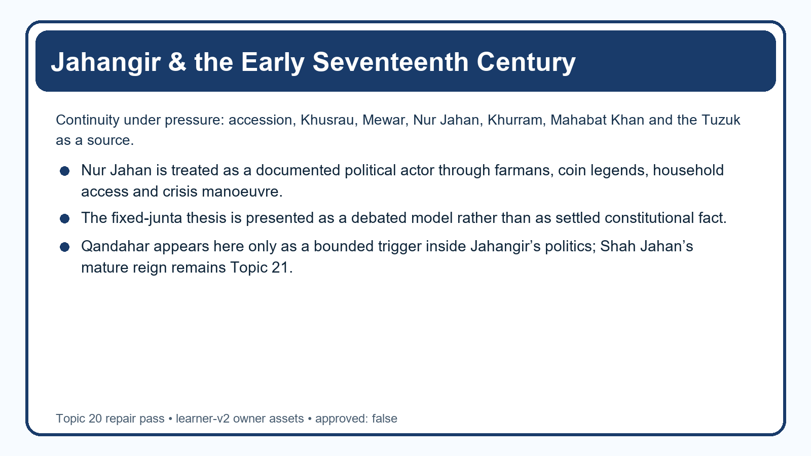
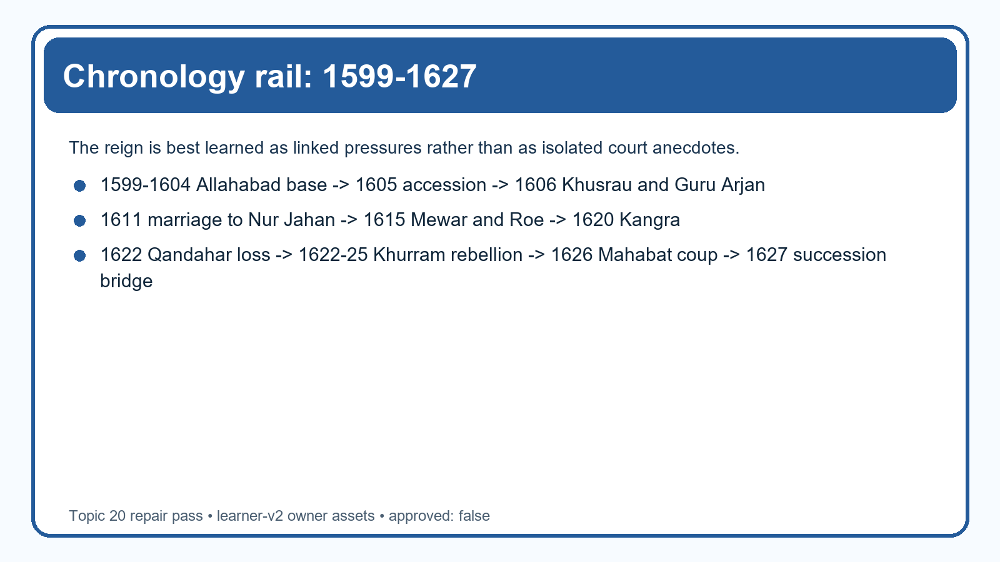
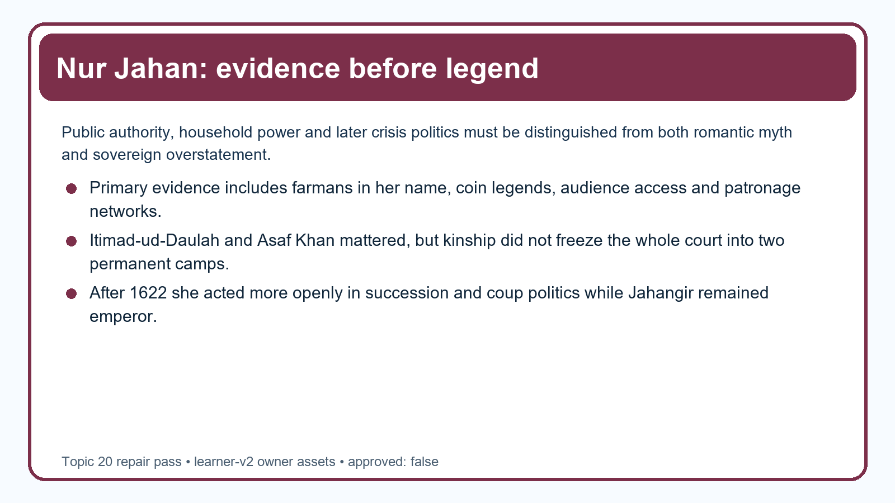
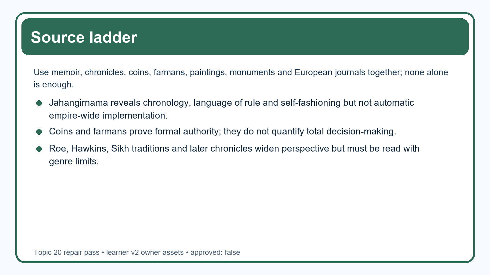

# Jahangir & the Early Seventeenth Century (Nur Jahan)

**Package scope note:** This owner file has been fully repaired in place within the locked Topic 20 review scope. Canonical knowledge owners remain unchanged; the learning session now follows the clean learner-v2 sequence, the fixed-count practice contract and the Topic 19 / Topic 21 ownership firewall.



*Topic 20 repair cover — accession, consolidation, Nur Jahan, crisis politics and source criticism*

## BASIC LEARNING SESSION



*Chronology rail: learn the reign as linked pressures rather than isolated anecdotes.*

### SESSION 1 — REIGN FRAME: CONTINUITY, CONSOLIDATION AND CONTEST

**Plain-English core:** Jahangir inherited Akbar's state; he did not inherit a crisis-free throne.

**Technical precision:** Topic 20 is best organised as consolidation under pressure: institutional continuity, negotiated frontiers, household authority, princely rebellion and source-conscious verdict.

**Distinctive framing:** A safe answer resists both shortcuts — neither “nothing changed after Akbar” nor “decline began automatically in 1605” works.

```text
1599-1604  Allahabad base under Salim
   -> 1605 accession as Jahangir
   -> 1606 Khusrau revolt / Guru Arjan episode
   -> 1611 Nur Jahan marriage
   -> 1615 Mewar settlement / Roe embassy begins
   -> 1620 Kangra captured
   -> 1622 Qandahar loss (Topic 19 owns the full foreign-policy chain)
   -> 1622-25/26 Khurram rebellion
   -> 1626 Mahabat Khan seizes the emperor
   -> 1627 death of Jahangir; succession bridge to Topic 21
```

| Topic 20 owns | Keep bounded here |
|---|---|
| accession, Khusrau, Guru Arjan, Mewar, Bengal, Kangra, Roe/Hawkins, Nur Jahan, Khurram, Mahabat, Jahangirnama | full Deccan system (Topic 18), full Qandahar external-policy analysis (Topic 19), Shah Jahan's mature reign (Topic 21) |

[FACT] Prince Salim became Jahangir in 1605 and ruled until 1627. The basic owner insists that the reign be read through accession problems, frontier settlements, Nur Jahan's rise, the rebellions of Khurram and Mahabat Khan, and Jahangir's own style of rulership. The advanced owner adds that even the famous “Nur Jahan junta” belongs to a debate about the shape of court politics, not to a settled constitutional category.

[ANALYSIS] The most productive formula is “continuity plus pressure.” Akbar's revenue-military structure, composite nobility and imperial idiom survived. Yet they were repeatedly tested by an early princely challenge, a new household nexus around Nur Jahan, unfinished frontier zones, commercial diplomacy and succession anxiety after 1622. In other words, Jahangir's reign shows how a strong imperial framework could continue operating while the politics around access to the emperor became sharper.

[LIMIT] Do not treat the reign as a simple bridge chapter between Akbar and Shah Jahan. It had its own logic, achievements and documentary personality. At the same time, do not let the chapter absorb Topic 19's Qandahar analysis or Topic 21's post-1627 state evolution.

#### Analytical drill

**Question:** What single sentence should open a Mains answer on Jahangir's reign?

**How to use it:** Begin with continuity under pressure, then distribute evidence across accession, Mewar, Nur Jahan, Khurram and Mahabat rather than narrating the reign as a court romance.

#### PARAGRAPH DEMONSTRATION — CLAIM → EVIDENCE → ANALYSIS → QUALIFICATION

**Claim:** Jahangir's reign is best judged as consolidation under pressure rather than immediate decline or static continuation.

**Named evidence / example:** The 1615 Mewar settlement, eastern consolidation and Kangra show state capacity, while Khusrau, Khurram and Mahabat show recurrent elite and dynastic stress.

**Analysis:** That combination lets you explain how the inherited Mughal framework kept functioning even as the court became more contested after 1622.

**Qualification:** Use Qandahar only as a bounded trigger here; the full external-policy system belongs to Topic 19.

#### CLOSING RECALL FLOW

**MUST-WRITE KEYWORDS (5–6 only):**
- 1605-1627
- continuity under pressure
- composite nobility
- household politics
- succession anxiety
- bounded ownership

**How to use them in a sentence:** A high-scoring answer treats Jahangir as a governing emperor operating inside a field of rising succession and household pressure.

**One contrast to remember:** Institutional continuity does not mean political calm.

**Examiner trap to avoid:** Do not collapse the whole reign into either “Nur Jahan ruled everything” or “nothing happened between Akbar and Shah Jahan.”

### SESSION 2 — ACCESSION BARGAIN, TWELVE ORDERS AND THE CHAIN OF JUSTICE

**Plain-English core:** The 1605 accession had to be staged as a settlement, and Jahangir's justice language was part of that work.

**Technical precision:** A strong answer links Salim's earlier Allahabad autonomy, Abu'l Fazl's killing, noble recognition, public regulation and ruler-centred justice imagery into one accession bargain.

**Distinctive framing:** Treat the twelve orders and the zanjir-i-adl first as evidence of proclaimed royal intentions, then ask what each source can or cannot prove about implementation.

```text
ALLAHABAD AUTONOMY + damaged trust
        +
dynastic claim after Akbar
        +
noble recognition / offices / rewards
        +
public justice language (orders + chain)
        =
ACCESSION SETTLEMENT OF 1605
```

| Evidence level | Safe claim |
|---|---|
| memoir records a regulation | Jahangir wanted it known publicly |
| order sent to officials | administrative transmission is possible |
| local practice everywhere | needs separate evidence; cannot be assumed |

[FACT] Before accession, Salim had maintained a semi-autonomous base at Allahabad, issued coinage and was linked to Abu'l Fazl's killing through Bir Singh Deo Bundela. After 1605, Jahangir did not purge the Akbar-era elite wholesale. The *Jahangirnama* records the well-known early regulations and the chain of justice at Agra, while Satish Chandra also notes a punitive intervention in a case involving Muqarrab Khan's establishment.

[ANALYSIS] These pieces belong together. Jahangir needed to prove that the throne remained continuous, accessible and morally purposeful. The twelve orders broadcast rectitude; the chain turned justice into a visible royal performance; selective punishment dramatized that performance. Such devices were not ornamental extras but tools for making a contested succession look like legitimate sovereignty.

[LIMIT] Neither the orders nor the chain created an impersonal modern legal system. A memoir can record what the emperor wanted associated with his name; it cannot by itself certify uniform empire-wide enforcement or equal access for every subject.

#### Analytical drill

**Question:** How should you use the chain of justice in a Prelims or Mains answer?

**How to use it:** Call it a ruler-centred symbol and possible petition route that projected royal accessibility; do not misdescribe it as a modern judiciary.

#### PARAGRAPH DEMONSTRATION — CLAIM → EVIDENCE → ANALYSIS → QUALIFICATION

**Claim:** Jahangir's accession rhetoric joined public justice with dynastic legitimacy.

**Named evidence / example:** The memoir's twelve orders and the Agra chain of justice both present the emperor as corrective, accessible and morally vigilant.

**Analysis:** That evidence explains why justice imagery mattered politically in 1605: it helped convert a doubtful princely succession into a visibly righteous kingship.

**Qualification:** Keep a three-step caution in view: proclamation is secure, transmission is plausible, empire-wide implementation requires separate proof.

#### CLOSING RECALL FLOW

**MUST-WRITE KEYWORDS (5–6 only):**
- Allahabad autonomy
- Abu'l Fazl
- accession bargain
- twelve orders
- zanjir-i-adl
- implementation caution

**How to use them in a sentence:** Jahangir's justice language did not replace politics; it was one of the main ways politics was made legitimate at accession.

**One contrast to remember:** Royal accessibility is not the same thing as a uniform judicial order.

**Examiner trap to avoid:** Do not turn the chain of justice into evidence for constitutional equality or a modern court structure.

### SESSION 3 — KHUSRAU'S REVOLT, 1606: SUCCESSION POLITICS IN A PUNJAB FIELD

**Plain-English core:** Khusrau's rebellion was an early princely challenge, not a later succession war or a communal master-key.

**Technical precision:** The correct frame is unsettled accession + Punjab routes + mobile supporters + exemplary punishment.

**Distinctive framing:** Always locate Khusrau in 1606, connect him to Lahore and Bhairowal, and show why the revolt kept succession politics alive after accession.

```text
new emperor in 1605
      -> Khusrau escapes in 1606
      -> movement toward Lahore / north-west corridor
      -> support expands on the route
      -> imperial interception near Bhairowal
      -> capture, punishment, later blinding and continuing intrigue
```

| Unsafe shortcut | Better explanation |
|---|---|
| later Mughal war of succession | early Jahangir-period princely revolt |
| communal binary | dynastic claim, route, followers and imperial punishment |
| solved forever in one battle | succession problem remained alive until Khusrau's death |

[FACT] Six months after accession, Khusrau escaped with a small following and moved toward Lahore. Dilawar Khan kept the city closed; Jahangir defeated the rising near Bhairowal. Followers faced severe punishment, Khusrau was later blinded after another alleged conspiracy, and he remained politically significant until his death in 1621 while in Khurram's custody.

[ANALYSIS] The rebellion mattered because it exposed how fragile post-accession loyalty could be. Punjab was not a random backdrop: it was a movement corridor where regional alignments, route control and princely charisma could intersect. Jahangir's harsh response was meant to end imitation and teach that a rival Timurid prince could not turn local sympathy into a second centre of sovereignty.

[LIMIT] Do not write the episode as if every Punjabi or noble actor became a permanent anti-imperial bloc. The point is not fixed disloyalty; it is that dynastic monarchy depended on ongoing political settlement.

#### Analytical drill

**Question:** What is the shortest defensible causal formula for Khusrau's revolt?

**How to use it:** Write: unsettled accession + princely claim + Punjab movement routes + elite calculation + exemplary punishment.

#### PARAGRAPH DEMONSTRATION — CLAIM → EVIDENCE → ANALYSIS → QUALIFICATION

**Claim:** Khusrau's revolt turned accession anxiety into a continuing political problem.

**Named evidence / example:** The north-west movement toward Lahore, the city's closure, the Bhairowal defeat and later punitive steps all show that the crisis extended beyond one court quarrel.

**Analysis:** That sequence reveals why Jahangir's early regime had to combine military success with a visible lesson about disobedient princes.

**Qualification:** Do not merge this 1606 episode with the 1657-58 war of succession or with Khurram's different rebellion after 1622.

#### CLOSING RECALL FLOW

**MUST-WRITE KEYWORDS (5–6 only):**
- Khusrau 1606
- Lahore corridor
- Bhairowal
- princely challenge
- exemplary punishment
- continuing intrigue

**How to use them in a sentence:** Khusrau's revolt shows that a Mughal accession could be formally complete and still politically unfinished.

**One contrast to remember:** An early dynastic challenge is not identical to a later empire-wide succession war.

**Examiner trap to avoid:** Do not detach Khusrau from Punjab movement routes or from the wider issue of how a new emperor secured loyalty.

### SESSION 4 — GURU ARJAN, 1606: POLITICAL SUSPICION, RELIGIOUS LANGUAGE AND SOURCE CAUTION

**Plain-English core:** The Guru Arjan episode requires layered explanation, not a one-line slogan.

**Technical precision:** A secure answer separates Jahangir's accusation, Sikh memory, punitive action and later consequences instead of flattening them into one motive.

**Distinctive framing:** Start with the rebellion context, then keep politics, religious language, fine/punishment and long-term Sikh-Mughal consequences analytically distinct.

| Evidence strand | What it shows | What it does not settle by itself |
|---|---|---|
| *Jahangirnama* | emperor's accusation that Guru Arjan assisted or blessed Khusrau | full and final motive map |
| Sikh traditions | community memory of martyrdom and coercion | exact imperial administrative procedure |
| Jesuit / other testimony | alternative outside emphasis | complete access to court intention |
| later history | major turning point in relations | instant appearance of the later Sikh military field |

[FACT] Jahangir's memoir presents Guru Arjan as a religious leader with Hindu and Muslim followers and alleges that he assisted or blessed Khusrau. Sikh traditions and other testimony preserve different emphases involving fine, torture, martyrdom and coercion. Satish Chandra notes uncertainty over whether a direct execution order or a crushing fine that ended fatally is the more exact reconstruction.

[ANALYSIS] The historical value lies in holding several truths together. The emperor clearly read the episode through political suspicion in the aftermath of rebellion. His language could also be hostile and exclusionary. The Sikh memory of martyrdom is therefore not a dispensable appendix; it is part of how the event acquired long-term historical force. A balanced answer explains interaction between state suspicion, religious vocabulary and later communal memory rather than sacrificing one dimension to another.

[LIMIT] Avoid two symmetrical errors: making the event a pure administrative reaction with no religious edge, or making it a timeless communal war detached from the 1606 political crisis. The later militarised Sikh-Mughal conflict belongs to a longer chronology that includes Guru Hargobind and later Gurus.

#### Analytical drill

**Question:** Why is this episode so often mishandled in exam answers?

**How to use it:** Because students choose one total explanation. The safer method is layered causation with explicit source criticism.

#### PARAGRAPH DEMONSTRATION — CLAIM → EVIDENCE → ANALYSIS → QUALIFICATION

**Claim:** Guru Arjan's death must be read through overlapping political and religious registers.

**Named evidence / example:** Jahangir's own accusation after Khusrau's revolt, the dispute over fine versus direct execution, and the Sikh memory of martyrdom pull the episode into more than one evidentiary lane.

**Analysis:** Using those strands together lets you explain why the episode was immediately political and later formative for Sikh historical memory.

**Qualification:** Do not project the later full Sikh-Mughal military struggle unchanged back onto 1606.

#### CLOSING RECALL FLOW

**MUST-WRITE KEYWORDS (5–6 only):**
- Guru Arjan
- 1606 context
- imperial accusation
- Sikh memory
- fine versus execution
- turning point

**How to use them in a sentence:** The safest account of Guru Arjan's death is neither denial of coercion nor reduction of the event to one single motive.

**One contrast to remember:** Source disagreement does not mean the event is unknowable; it means the answer must preserve layers of explanation.

**Examiner trap to avoid:** Do not treat Jahangir's memoir as the only voice or use later conflict to erase the immediate Khusrau context.

### SESSION 5 — MEWAR, 1615: SUZERAINTY WITH SISODIA HONOUR

**Plain-English core:** The Mewar settlement worked because pressure and honour were combined, not because force disappeared.

**Technical precision:** Jahangir and Khurram achieved durable Mughal suzerainty by allowing Sisodia dignity while securing submission and service.

**Distinctive framing:** Use Mewar to show that Mughal power could consolidate a frontier by conciliation after coercive leverage, not only by annexation.

```text
renewed Mughal pressure from Ajmer / Khurram's command
        +
Mewar's exhaustion
        +
Rana not forced into personal attendance
        +
Karan Singh honoured at court with mansab/service
        +
Rana house retains Mewar
        =
NEGOTIATED SUZERAINTY, 1615
```

| Not the right description | Why |
|---|---|
| equal alliance | hierarchy remained Mughal |
| humiliating annexation | Sisodia line retained its place |
| generosity without force | military pressure mattered throughout |

[FACT] From Ajmer Jahangir intensified the inherited conflict, and Prince Khurram helped press Mewar into settlement. Rana Amar Singh was not compelled to attend court personally; a son or brother would serve, Karan Singh entered Mughal service with honour, the Sisodia house retained Mewar, and the Chittor restriction tradition captured the asymmetry of the compact.

[ANALYSIS] This was classic Mughal frontier statecraft: unequal accommodation. By preserving Sisodia dignity, the settlement lowered the prestige-cost of submission while still confirming imperial superiority. That is why it became more durable than a merely punitive solution would have been. In exam language, the settlement demonstrates that conciliation could serve consolidation better than humiliation when the Mughal objective was obedience, not provincial obliteration.

[LIMIT] Never call the settlement equality or independence. Mewar was accommodated inside Mughal suzerainty. Conversely, avoid the annexation label because the Rana house was not extinguished or replaced by a normal provincial regime.

#### Analytical drill

**Question:** What is the single best phrase to remember for the Mewar settlement?

**How to use it:** Write “suzerainty with Sisodia honour” and then unpack the terms through attendance, service and retention of the ruling house.

#### PARAGRAPH DEMONSTRATION — CLAIM → EVIDENCE → ANALYSIS → QUALIFICATION

**Claim:** The Mewar settlement succeeded because it fused imperial pressure with honour-sensitive accommodation.

**Named evidence / example:** Khurram's military role, the excusal of Rana Amar Singh from personal attendance, and the honourable reception of Karan Singh are the central evidentiary points.

**Analysis:** Together they show how Mughal hierarchy could be accepted more durably when the terms allowed Rajput prestige to survive publicly.

**Qualification:** Keep the result inside hierarchy: honour was preserved, but sovereign equality was not conceded.

#### CLOSING RECALL FLOW

**MUST-WRITE KEYWORDS (5–6 only):**
- Mewar 1615
- Khurram
- suzerainty
- Sisodia honour
- Karan Singh
- unequal accommodation

**How to use them in a sentence:** Mewar teaches that Mughal power often worked through graded submission rather than through total displacement of local dynasties.

**One contrast to remember:** Retention of honour is not the same thing as retention of independence.

**Examiner trap to avoid:** Do not describe 1615 as either annexation or a friendship pact; it was a hierarchical settlement.

### SESSION 6 — BENGAL, KANGRA AND THE BOUNDED DECCAN CONTEXT

**Plain-English core:** Jahangir's reign did not only manage court factions; it also produced real frontier consolidation.

**Technical precision:** Islam Khan's Bengal drive, Kangra's capture and Khurram's Deccan service show layered expansion, selective conciliation and strategic limit-setting.

**Distinctive framing:** This session exists to stop a common distortion: later court crisis should not erase the reign's administrative and military achievements.

| Field | Core evidence | Safe interpretation |
|---|---|---|
| Bengal | Islam Khan, Dacca, Musa Khan, Usman Khan, selective restoration | layered consolidation through campaign and incorporation |
| Kangra | failed 1615 attempt, success in 1620, khutba and mosque gestures | fort-level strategic and symbolic success |
| Deccan | Khurram's pressure against Malik Ambar, limited settlement logic | bounded context only; Topic 18 owns the full system |

[FACT] Islam Khan's appointment in 1608 and the shift to Dacca helped break the Barah-Bhuiyan alignment around Musa Khan and later Usman Khan; defeated chiefs were sometimes restored and more Afghans entered Mughal service. In 1620 Kangra fort fell after an earlier failure; Mughal sovereignty was staged through khutba, mosque and faujdar placement. Meanwhile Jahangir-period Deccan pressure under Khurram checked Malik Ambar but did not produce an unlimited annexation project.

[ANALYSIS] The common thread is that Mughal consolidation was rarely one-dimensional. It could involve campaign, headquarters relocation, alliance-making, selective restoration and symbolic sovereignty at the same time. Bengal teaches incorporation after conquest; Kangra teaches how one fort could carry both military and performative significance; the Deccan caution teaches that success did not erase strategic restraint or later reversal.

[LIMIT] Do not write “Bengal was conquered in a single stroke” or “Kangra meant effortless Himalayan command.” Likewise, do not let the Deccan aside balloon into Topic 18's full Malik Ambar narrative.

#### Analytical drill

**Question:** Why should Bengal and Kangra be mentioned in a Jahangir answer even when the question seems court-centred?

**How to use it:** They prove that the reign was not only about palace politics; frontier consolidation is part of the verdict.

#### PARAGRAPH DEMONSTRATION — CLAIM → EVIDENCE → ANALYSIS → QUALIFICATION

**Claim:** Jahangir's reign combined court contest with substantial, if uneven, territorial consolidation.

**Named evidence / example:** Islam Khan's Bengal reorganisation, the 1620 fall of Kangra and Khurram's earlier Deccan effectiveness all demonstrate active state capacity beyond the court.

**Analysis:** These examples block the lazy decline narrative by showing the empire could still campaign, absorb local elites and project symbolic sovereignty across difficult terrains.

**Qualification:** Use the Deccan only as bounded support here; the full campaign-treaty sequence belongs elsewhere.

#### CLOSING RECALL FLOW

**MUST-WRITE KEYWORDS (5–6 only):**
- Islam Khan
- Dacca
- Barah-Bhuiyan
- Kangra 1620
- selective conciliation
- bounded Deccan

**How to use them in a sentence:** Jahangir's later crises matter, but they should be set against a reign that still won forts, reorganised provinces and integrated defeated elites.

**One contrast to remember:** A fort captured or a province reorganised is not the same thing as complete regional homogenisation.

**Examiner trap to avoid:** Do not let one-topic recall reduce Bengal, Kangra and the Deccan to a single undifferentiated “expansion” label.

### SESSION 7 — HAWKINS, SWALLY AND ROE: COMMERCIAL DIPLOMACY ON MUGHAL TERMS

**Plain-English core:** The English appeared at court as petitioners for trade, not as future rulers in embryo.

**Technical precision:** Hawkins, Swally and Roe belong to the history of commercial diplomacy within Mughal sovereignty, not to a teleological story of inevitable British rule.

**Distinctive framing:** Every answer should keep the hierarchy clear: the Company sought facilities; the Mughal state decided their scope on its own terms.

```text
English Company petition
      -> Hawkins seeks access
      -> 1612 Swally weakens Portuguese leverage at sea
      -> Roe negotiates at court, 1615-19
      -> limited facilities / confirmations around Surat on Mughal terms
```

| Bad reading | Better reading |
|---|---|
| England already controlled Gujarat | the English still depended on Mughal permission |
| farman = territorial sovereignty | farman = bounded commercial facility |
| trade diplomacy = colonial state already formed | commercial foothold without political supremacy |

[FACT] William Hawkins approached Jahangir's court seeking Company access in the Surat world. The English naval success near Swally/Suvali in 1612 altered bargaining conditions vis-a-vis the Portuguese. Sir Thomas Roe, ambassador of James I from 1615 to 1619, recorded rank disputes, audiences and commercial objectives. The 1618 permissions/farman are safest when described as limited trading facilities and confirmations, especially around Surat, granted within Mughal sovereignty.

[ANALYSIS] These episodes matter because they show the Mughal empire engaging European commercial actors from a position of superiority. The English were not yet a territorial state in India. Their hopes depended on court favour, coastal bargaining and local practice. That is precisely why Roe's frustrations are valuable: they reveal the asymmetry of the encounter more clearly than a triumphalist colonial hindsight ever could.

[LIMIT] Do not treat Swally as if it transferred western India to English control, and do not inflate one farman into an empire-wide monopoly or a constitutional beginning of British rule.

#### Analytical drill

**Question:** How do you stop a Roe question from turning into a colonial teleology paragraph?

**How to use it:** State first that the Company sought facilities within Mughal sovereignty, then mention Swally and Roe only as conditions that improved bargaining, not as political takeover.

#### PARAGRAPH DEMONSTRATION — CLAIM → EVIDENCE → ANALYSIS → QUALIFICATION

**Claim:** Early English diplomacy under Jahangir remained commercial, negotiated and subordinate to Mughal authority.

**Named evidence / example:** Hawkins's petitioning role, Roe's repeated dependence on audiences, and the limited character of the 1618 permissions all point in the same direction.

**Analysis:** That evidence shows why the encounter belongs to Mughal commercial sovereignty rather than to an already-formed colonial state.

**Qualification:** European travel accounts are useful precisely when checked against farmans, factory records and local enforcement.

#### CLOSING RECALL FLOW

**MUST-WRITE KEYWORDS (5–6 only):**
- Hawkins
- Swally 1612
- Roe 1615-19
- Surat
- commercial facility
- Mughal sovereignty

**How to use them in a sentence:** Roe matters less as a harbinger of conquest than as proof that the Company still had to negotiate like a petitioner inside a Mughal political order.

**One contrast to remember:** A trading privilege is not territorial sovereignty.

**Examiner trap to avoid:** Do not read the 1618 farman as an empire-wide monopoly or as a ready-made British constitution.

### SESSION 8 — NUR JAHAN: BIOGRAPHY, PUBLIC AUTHORITY AND PATRONAGE

**Plain-English core:** Nur Jahan was neither a decorative consort nor a lone sovereign outside all limits.

**Technical precision:** Her importance rests on documented household command, access politics, farmans, coin legends, patronage and especially post-1622 crisis intervention inside a patriarchal court.

**Distinctive framing:** Write Nur Jahan as an exceptional female political actor whose authority was real, public and evidentiary — but still embedded within Jahangirian sovereignty and a wider elite field.

| Person / evidence | Political meaning |
|---|---|
| Ghiyas Beg / Itimad-ud-Daulah | experienced official father within the high administrative order |
| Asaf Khan | major noble and marriage link to Khurram through Mumtaz Mahal |
| farmans in Nur Jahan's name | formal authority that can be named directly |
| coin legends with Badshah Begum language | unusually public female visibility in sovereignty-symbols |
| Itimad-ud-Daulah tomb | patronage, family memory and architectural transition |
| post-1622 action | active intervention in succession and coup politics |

[FACT] Mihr-un-Nisa, later Nur Jahan, came from the migrant family of Mirza Ghiyas Beg, first married Ali Quli Istajlu (Sher Afghan), then married Jahangir in 1611 after living at court. The romantic tale that Jahangir engineered Sher Afghan's death to secure her is treated by Satish Chandra as unproven. More securely, evidence connects Nur Jahan with household control, reception of petitioners, patronage and appointments, farmans in her name, coins carrying Badshah Begum language, travel and hunting with the emperor, and the commemoration of her father through the Itimad-ud-Daulah tomb.

[ANALYSIS] This is why Nur Jahan must be treated as a documented political actor. Farmans and coin legends take her beyond anecdote into formal evidence. Patronage makes her visible in architecture, gardens, taste and charitable action. Household access mattered because in a personalised monarchy the route to the emperor could shape outcomes. After 1622, when Jahangir's health declined and succession pressure mounted, these forms of authority became even more politically consequential.

[LIMIT] Do not jump from “exceptional evidence of formal authority” to “she ruled alone.” Coins and farmans prove unusual public status; they do not prove monopoly over every decision or abolition of patriarchy. Her career was extraordinary precisely because the imperial order remained gendered.

#### Analytical drill

**Question:** What single sentence avoids both legend and caricature in a Nur Jahan answer?

**How to use it:** Say that she exercised exceptional formal and household authority inside Jahangir's reign, especially in crisis politics after 1622, without becoming a constitutional replacement for the emperor.

#### PARAGRAPH DEMONSTRATION — CLAIM → EVIDENCE → ANALYSIS → QUALIFICATION

**Claim:** Nur Jahan's authority is historically demonstrable, not merely romantic or ceremonial.

**Named evidence / example:** Farmans in her name, coin legends, family office-holding, petitionary access and the Itimad-ud-Daulah patronage complex together give unusually strong evidence for female power at the Mughal court.

**Analysis:** This combination lets you show how authority worked through documents, symbols, household management and patronage rather than through a modern office title alone.

**Qualification:** Her exceptional visibility should be stated alongside the continued sovereignty of Jahangir and the wider distribution of noble power.

#### CLOSING RECALL FLOW

**MUST-WRITE KEYWORDS (5–6 only):**
- Mihr-un-Nisa
- farmans
- Badshah Begum
- Itimad-ud-Daulah
- household access
- patriarchal court

**How to use them in a sentence:** Nur Jahan's importance lies in how unusually public, documentary and politically operative her authority became within a still male sovereign order.

**One contrast to remember:** Evidence of formal female authority is not evidence that all political decisions passed through one hand.

**Examiner trap to avoid:** Do not reduce Nur Jahan to romance, and do not exaggerate her into a fiction of solitary imperial rule.



*Nur Jahan evidence map — documents, family nexus, patronage and crisis politics.*

### SESSION 9 — THE “NUR JAHAN JUNTA” DEBATE: REAL FAMILY POWER, NO PROVEN FIXED BLOC

**Plain-English core:** The most careful answer rejects both extremes: no permanent junta is proven, but Nur Jahan's influence was very real.

**Technical precision:** Beni Prasad's fixed-junta thesis must be set beside Nurul Hasan's promotion-based critique, Satish Chandra's periodisation and Irfan Habib's evidence for concentrated family advancement.

**Distinctive framing:** Use this debate to demonstrate historiographical discipline: define the thesis fairly, test the evidence, then retain the part that survives.

| Interpretation | What it gets right | What needs correction |
|---|---|---|
| fixed Nur Jahan junta | kinship and concentration of influence matter | no secure proof of one permanent 1611-20 bloc controlling all promotions |
| personal-rule caricature | notices her public authority | overstates her into sovereign replacement |
| no Nur Jahan power at all | resists exaggeration | ignores farmans, coins, patronage and post-1622 crisis action |

```text
BEST PERIODISATION
1611-1621 -> strong household influence, fluid alignments, Jahangir still deciding
After 1622 -> illness + Itimad-ud-Daulah's death + Qandahar + Khurram + Mahabat
            -> Nur Jahan enters overt crisis politics more directly
```

[FACT] Beni Prasad proposed that Nur Jahan, Itimad-ud-Daulah, Asaf Khan and Khurram formed a stable dominant grouping after 1611. Nurul Hasan challenged this by showing that promotions remained widely distributed and that no secure contemporary evidence proves a fixed Nur Jahan-Khurram alliance across 1611-20. Satish Chandra adopts the critique while still acknowledging substantial family advancement; Irfan Habib's evidence on offices and governorships reinforces that advancement without automatically proving two permanent camps.

[ANALYSIS] The debate teaches a precise lesson. Household kinship clearly mattered, and Nur Jahan's family rose high. But Mughal politics usually worked through overlapping family, service, regional and personal alignments, not through perfectly frozen camps. The best way to preserve both evidence and caution is to periodise: before 1622, influence is strong but alignments remain fluid; after 1622, with Jahangir's health weakening and crises multiplying, Nur Jahan's political intervention becomes more overt and factional stakes intensify.

[LIMIT] Do not use “junta” as a neutral fact-word. If you use it at all, flag it as a debated historiographical label. Equally, do not let revisionist caution erase the plain documentary evidence that Nur Jahan's authority and family position were exceptional.

#### Analytical drill

**Question:** How should the word “junta” appear in an exam answer?

**How to use it:** Use it only as “the debated Beni Prasad model,” then explain why later historians prefer shifting alignments and sharper post-1622 crisis politics.

#### PARAGRAPH DEMONSTRATION — CLAIM → EVIDENCE → ANALYSIS → QUALIFICATION

**Claim:** The fixed-junta model is too rigid, but the evidence still supports unusual family concentration and Nur Jahan's expanding political role.

**Named evidence / example:** Promotion patterns, the lack of secure proof for a stable Nur Jahan-Khurram alliance, and the more dramatic post-1622 conjuncture together shape the safer interpretation.

**Analysis:** That method keeps the real weight of household power visible without turning historiographical shorthand into constitutional fact.

**Qualification:** Always retain the post-1622 turning point; it explains why the later reign looked more sharply factional than the earlier phase.

#### CLOSING RECALL FLOW

**MUST-WRITE KEYWORDS (5–6 only):**
- Beni Prasad
- Nurul Hasan
- Irfan Habib
- family advancement
- post-1622 periodisation
- shifting alignments

**How to use them in a sentence:** The right verdict is not “no junta and therefore no power,” but “real family power without proof of a fixed monopoly.”

**One contrast to remember:** A debated label can still illuminate politics if its evidentiary limits are kept explicit.

**Examiner trap to avoid:** Do not treat every promotion under Jahangir as if one four-person bloc distributed the entire empire.

### SESSION 10 — KHURRAM'S REBELLION, 1622-25/26: SUCCESSION ANXIETY MEETS RESOURCE POLITICS

**Plain-English core:** Khurram rebelled through a cluster of pressures, not because of a single court quarrel.

**Technical precision:** The correct matrix is princely strength + Qandahar command dispute + jagir and troop bargaining + Shahryar-Ladli politics + fear of absence from court.

**Distinctive framing:** A high-level answer names several causes in one sentence and then shows how they converged after 1622.

```text
Khurram's high mansab, title “Shah Jahan”, Mewar and Deccan prestige
        + custody of Khusrau / succession advantage
        + 1622 Qandahar emergency and command dispute
        + resource and jagir bargaining
        + Shahryar-Ladli marriage and court anxiety
        =
REBELLION, 1622-25/26
```

| Weak explanation | Stronger explanation |
|---|---|
| Nur Jahan alone caused it | succession, frontier command, resources and rival claimants all mattered |
| Qandahar alone caused it | external shock mattered only through court and princely politics |
| pure ideology | material and dynastic calculations were central |

[FACT] Khurram's earlier military successes in Mewar and the Deccan had made him the strongest princely contender. He held extraordinary rank, the title Shah Jahan and control advantages such as Hisar-Firuza. When the Safavids took Qandahar in 1622, Khurram feared that a long frontier absence would expose his succession claim; disputes widened over command, troops, jagirs, family security and the elevation of Shahryar through his marriage to Ladli Begum. After defeat at Bilochpur in 1623, he moved through eastern India and the Deccan before eventual submission with Dara and Aurangzeb sent as hostages.

[ANALYSIS] The rebellion therefore belongs to the political economy of succession. An imperial prince needed military credit, access to the court, resources and trusted allies. Qandahar mattered here not because Topic 20 reteaches foreign policy, but because the command question sharpened Khurram's fear that service away from court could cost him the throne. Once rebellion began, the empire lost years of coordination, and the Deccan as well as Qandahar suffered from the distraction.

[LIMIT] Do not write “Khurram rebelled because Nur Jahan hated him” or “because Qandahar fell.” Both elements matter, neither alone is enough. Likewise, do not drift into Shah Jahan's later imperial reign; Topic 20 stops with the princely crisis inside Jahangir's lifetime.

#### Analytical drill

**Question:** Why is 1622 such an important date in this topic even when Topic 19 owns Qandahar in depth?

**How to use it:** Because 1622 connects an external shock to an internal succession crisis: command, absence from court and resource bargaining all sharpened after it.

#### PARAGRAPH DEMONSTRATION — CLAIM → EVIDENCE → ANALYSIS → QUALIFICATION

**Claim:** Khurram's rebellion was a multi-causal succession struggle intensified by the 1622 Qandahar emergency.

**Named evidence / example:** His prior military prestige, the Qandahar command dispute, jagir and troop bargaining, Shahryar's emergence and the later hostage settlement all belong to the same crisis chain.

**Analysis:** Putting these elements together shows that the revolt came from the structure of Mughal princely politics, not from a melodramatic single grievance.

**Qualification:** Use Qandahar only as the trigger within Jahangir's reign; leave the fuller Safavid-Mughal contest to Topic 19.

#### CLOSING RECALL FLOW

**MUST-WRITE KEYWORDS (5–6 only):**
- Khurram
- 1622 turning point
- Qandahar command dispute
- jagir bargaining
- Shahryar
- hostage submission

**How to use them in a sentence:** Khurram rebelled when frontier service, court access and succession security could no longer be kept in one bundle.

**One contrast to remember:** External pressure mattered here because of internal dynastic politics, not instead of them.

**Examiner trap to avoid:** Do not let Khurram's later fame as Shah Jahan erase the fact that Topic 20 owns him first as a rebel prince.

### SESSION 11 — MAHABAT KHAN'S COUP, 1626: CUSTODY OF THE EMPEROR IS NOT CUSTODY OF THE STATE

**Plain-English core:** Mahabat Khan seized Jahangir's person, but he could not turn that seizure into durable rule.

**Technical precision:** The coup shows the vulnerability of personalised monarchy and the equally important difference between bodily custody, administrative control and lasting legitimacy.

**Distinctive framing:** Use the episode to explain state structure, not merely as dramatic palace narrative.

```text
grievance over accounts / elephants / summons + separation from Parvez
        -> Mahabat acts with a trusted Rajput force near the Jhelum
        -> emperor seized during river-crossing movement
        -> Nur Jahan first resists, then enters the captive camp
        -> nobles detach; Mahabat loses the wider coalition
        -> temporary custody ends without a new regime
```

| Possession of emperor's body gave | It did not guarantee |
|---|---|
| immediate command leverage | treasury control |
| intimidation at the camp | broad noble coalition |
| symbolic shock | enduring legitimacy or bureaucracy |

[FACT] Mahabat Khan had been central to suppressing Khurram, but later tensions grew over his transfer, separation from Prince Parvez, demands for accounts and elephants, and fear of court reprisal. In 1626, near the Jhelum on the road to Kabul, he seized Jahangir with a Rajput-backed force. Nur Jahan's first armed attempt failed; she then entered the captive camp, manoeuvred politically and helped detach support from Mahabat until the coup unravelled.

[ANALYSIS] This episode illuminates how a Mughal empire centred on the emperor's person could still resist a captor. Mahabat could command obedience in the immediate physical presence of the emperor, but he lacked the full machinery of durable rule: treasury, bureaucracy, consensus within the nobility and an alternative principle of legitimacy. Nur Jahan's role matters here again — not as proof that she always ruled, but as evidence that she could think and act politically under acute crisis.

[LIMIT] Do not overstate the coup into “the empire ended in 1626,” and do not understate it into a minor quarrel. It was a serious structural shock that nonetheless failed to create a new order.

#### Analytical drill

**Question:** What is the shortest analytical lesson of the Mahabat Khan coup?

**How to use it:** Write: capture of the emperor gave leverage, not durable possession of the state.

#### PARAGRAPH DEMONSTRATION — CLAIM → EVIDENCE → ANALYSIS → QUALIFICATION

**Claim:** Mahabat Khan's coup exposed the body-centred vulnerability of Mughal sovereignty without proving institutional collapse.

**Named evidence / example:** The Jhelum seizure worked instantly, but the inability to retain the wider nobility, treasury and administrative control doomed the enterprise within months.

**Analysis:** That contrast explains why bodily custody mattered enormously in the short term yet could not substitute for a functioning ruling coalition.

**Qualification:** Mention Nur Jahan's manoeuvre as a recovery mechanism, not as proof that she had already replaced Jahangir constitutionally.

#### CLOSING RECALL FLOW

**MUST-WRITE KEYWORDS (5–6 only):**
- Mahabat Khan
- Jhelum 1626
- Rajput force
- custody versus control
- Nur Jahan's manoeuvre
- personalised monarchy

**How to use them in a sentence:** Mahabat Khan could seize the emperor, but he could not seize the empire in the same act.

**One contrast to remember:** Immediate coercive success is not the same thing as lasting sovereignty.

**Examiner trap to avoid:** Do not narrate the coup without explaining why it failed structurally.

### SESSION 12 — JAHANGIR AS RULER: COMPOSITE NOBILITY, RELIGION, NATURALISM AND THE TUZUK

**Plain-English core:** Jahangir was a ruling emperor with a distinctive documentary and artistic personality, not only a passive figure in court intrigues.

**Technical precision:** The safest verdict combines composite nobility, broad accommodation with contextual coercion, natural-history connoisseurship and source criticism of the *Jahangirnama*.

**Distinctive framing:** End the topic by balancing rule, religion, art and source method, because UPSC often rewards a verdict that is analytical rather than sensational.

| Domain | Secure points | Needed qualification |
|---|---|---|
| nobility | Rajputs, Afghans, early Maratha sardars, retained mansab-jagir framework | access politics changed; the institutional core survived |
| religion | no jizya restoration, multiple festival contacts, Jadrup, support to some establishments | Guru Arjan, Mewar/Kangra coercion, Pushkar, anti-Jain order and Sirhindi complicate the picture |
| art and naturalism | painting, Ustad Mansur, flora-fauna observation, household patronage | representation is not transparent reality |
| *Tuzuk* | chronology, self-fashioning, stated orders, observations | authorship layers, silence, self-presentation, implementation gaps |

[FACT] Jahangir broadly retained Akbar's composite nobility, bringing in Rajputs beyond the Kachhwahas, high Afghans such as Khan-i-Jahan Lodi, and early leading Maratha sardars. He did not restore jizya, interacted with multiple festivals and thinkers such as Jadrup, and left a memoir notable for close natural observation. Yet the reign also includes Guru Arjan's death, coercive moments in Mewar and Kangra, Pushkar's Varaha-image episode, a 1617 anti-Jain order in Gujarat that seems unevenly implemented, and the imprisonment of Shaikh Ahmad Sirhindi for a period. The *Jahangirnama* is central, but later continuation/redaction layers must be remembered.

[ANALYSIS] This mix is exactly why Jahangir resists flat labels. He was not a second Akbar in every respect, but neither was he a simple bigot or a detached aesthete. The same emperor who cherished painting, flora and fauna also presided over episodes of coercion; the same ruler who maintained a composite elite also faced new strains around household access and princely challenge. A mature answer therefore closes with graded judgement: negotiated consolidation and cultural vitality persisted, but the later reign exposed the structural risks of a personalised monarchy under succession pressure.

[LIMIT] Do not use a painting or memoir line as if it were a photograph of empire-wide reality. Likewise, do not let one coercive episode erase the broader composite and accommodative structure of the reign.

#### Analytical drill

**Question:** What should the conclusion of a 15- or 20-mark answer on Jahangir sound like?

**How to use it:** Conclude that Jahangir remained a governing emperor; Nur Jahan exercised exceptional but bounded authority; and the reign's crises reveal structural strain, not straightforward collapse.

#### PARAGRAPH DEMONSTRATION — CLAIM → EVIDENCE → ANALYSIS → QUALIFICATION

**Claim:** Jahangir's reign combined state continuity, selective coercion and a distinctive culture of observation and self-representation.

**Named evidence / example:** Composite nobility, no jizya restoration, Jadrup and Ustad Mansur stand beside Guru Arjan, campaign coercion, Pushkar and the source limits of the *Jahangirnama*.

**Analysis:** Using those paired evidences produces the balanced verdict UPSC usually rewards: continuity was real, but it was never free from contradiction or strain.

**Qualification:** End with source method: the *Tuzuk* is indispensable, but it must be corroborated and periodised rather than read transparently.

#### CLOSING RECALL FLOW

**MUST-WRITE KEYWORDS (5–6 only):**
- composite nobility
- no jizya restoration
- Jadrup
- Ustad Mansur
- Jahangirnama
- graded verdict

**How to use them in a sentence:** Jahangir's best historical image is not of an idle ruler, but of an emperor whose court, conscience and crises all survive vividly in a source-rich yet source-limited reign.

**One contrast to remember:** Source richness does not cancel source criticism.

**Examiner trap to avoid:** Do not end the topic with a court-gossip verdict; finish with evidence across rule, religion, art and source method.



*Source ladder — use memoir, chronicles, documents, monuments and observers together.*

## BASIC MCQS / REMEDIATION

### Part I — 16 core retrieval MCQs (locked count)

#### Learning MCQ 1

Which formulation best captures the reign of Jahangir?

- A. Static continuation without crisis.
- B. Immediate collapse from 1605.
- C. A reign defined only by Nur Jahan's romance.
- D. Continuity of Mughal structure under repeated succession and court pressure.

**Answer:** D.

**Explanation:** The correct answer keeps together inherited state capacity and later strain; the tempting continuation-only reading misses Khusrau, Khurram and Mahabat.

#### Learning MCQ 2

What can the *Jahangirnama*'s twelve orders most securely establish?

- A. That every district obeyed them uniformly.
- B. That Jahangir publicly advertised a programme of regulation and justice.
- C. That the empire adopted a modern written constitution.
- D. That later popular lists are automatically exact.

**Answer:** B.

**Explanation:** The memoir proves proclaimed intention most clearly; empire-wide implementation is the extra claim that still needs separate evidence.

#### Learning MCQ 3

The chain of justice is safest as evidence for

- A. a representative parliament.
- B. a complete judicial code.
- C. a ruler-centred claim of accessibility and rectitude.
- D. equal legal remedy for every subject in practice.

**Answer:** C.

**Explanation:** Its value lies in royal self-presentation and possible petition access, not in proving an impersonal constitutional order.

#### Learning MCQ 4

Khusrau's revolt of 1606 should first be analysed as

- A. a later post-1627 war of succession.
- B. a Portuguese naval conflict.
- C. a communal war between fixed religious blocs.
- D. an early princely challenge moving through the Punjab political field.

**Answer:** D.

**Explanation:** Date, actor and region matter: Khusrau's revolt belongs to Jahangir's early succession crisis, not to maritime or later succession history.

#### Learning MCQ 5

Why does the Guru Arjan episode require source caution?

- A. Because Jahangir's accusation is crucial but not exhaustive of motive.
- B. Because all sources say only a harmless fine was imposed.
- C. Because Sikh traditions have no value at all.
- D. Because the event lacked any political context.

**Answer:** A.

**Explanation:** The secure method is to retain Jahangir's accusation and Sikh memory together instead of letting one voice erase the other.

#### Learning MCQ 6

Which statement best describes the 1615 Mewar settlement?

- A. Mewar recovered complete independence.
- B. Mughal suzerainty was accepted while Sisodia honour was publicly preserved.
- C. Rana Amar Singh had to attend court in person every year.
- D. Mewar was converted into a normal annexed province.

**Answer:** B.

**Explanation:** The correct answer combines hierarchy with honour; annexation and independence are opposite overstatements.

#### Learning MCQ 7

Which statement most safely captures Jahangir-period frontier consolidation?

- A. Bengal was settled in one battle and Assam permanently subdued.
- B. Kangra meant effortless control of every Himalayan polity.
- C. Islam Khan's Bengal policy and Kangra's capture show layered but limited consolidation.
- D. The Deccan was fully annexed under Jahangir.

**Answer:** C.

**Explanation:** The best answer keeps success and limit together: campaign, reorganisation and symbolic sovereignty were real, but totalisation is false.

#### Learning MCQ 8

Roe's embassy is best understood as

- A. the first English rule over Gujarat.
- B. a Safavid embassy against Qandahar.
- C. a proof that Mughal sovereignty had vanished.
- D. commercial diplomacy conducted within Mughal political superiority.

**Answer:** D.

**Explanation:** Roe negotiated for facilities, not territory; his frustrations reveal subordination to Mughal court protocol rather than equality.

#### Learning MCQ 9

Nur Jahan's farmans and coin legends most directly show

- A. exceptional formal authority made publicly visible.
- B. complete abolition of patriarchy.
- C. that Jahangir no longer ruled at all.
- D. that every appointment came from one family.

**Answer:** A.

**Explanation:** Farmans and coins are unusually strong evidence for formal female authority, but they do not prove sovereign replacement or universal social equality.

#### Learning MCQ 10

The Itimad-ud-Daulah tomb is strongest evidence for

- A. Jahangir's own mausoleum policy at Lahore.
- B. family commemoration and patronage linked to Nur Jahan.
- C. a permanent Nur Jahan-Khurram alliance.
- D. the full architecture syllabus of Topic 24.

**Answer:** B.

**Explanation:** The monument anchors family memory and patronage; it cannot by itself prove a fixed political bloc.

#### Learning MCQ 11

Why is the fixed-junta thesis disputed?

- A. Because Nur Jahan had no power at all.
- B. Because no family advancement occurred.
- C. Because promotion patterns and alignments do not prove a stable four-person monopoly from 1611 to 1620.
- D. Because Khurram never served successfully in Mewar or the Deccan.

**Answer:** C.

**Explanation:** Revisionist criticism does not erase family influence; it questions the rigidity of the monopoly model.

#### Learning MCQ 12

Khurram's rebellion is best explained by

- A. religious reform alone.
- B. a single personal insult alone.
- C. Portuguese naval pressure alone.
- D. succession insecurity, command dispute, resources and rival claimants acting together.

**Answer:** D.

**Explanation:** The strongest answer uses a causal cluster; one-cause stories flatten the politics of 1622-25.

#### Learning MCQ 13

Mahabat Khan's coup reveals that

- A. seizing the emperor gave leverage but not durable command of the whole state.
- B. the Mughal empire ended immediately in 1626.
- C. Nur Jahan played no role in the aftermath.
- D. the treasury and nobility automatically obeyed the captor forever.

**Answer:** A.

**Explanation:** The correct reading hinges on the gap between custody of the emperor and possession of a stable governing coalition.

#### Learning MCQ 14

Which assessment of Jahangir's religious policy is most defensible?

- A. Uniform persecution after 1605.
- B. Broad accommodation with politically charged coercive episodes.
- C. Complete identity with Akbar in every case.
- D. A world with no coercive edge at all.

**Answer:** B.

**Explanation:** The reign cannot be reduced to a single mood; composite accommodation and hard episodes both belong in the answer.

#### Learning MCQ 15

The safest use of the *Jahangirnama* is to

- A. treat every royal claim as social fact.
- B. reject it because it is a court text.
- C. read it for chronology, language of rule and observation while corroborating its reach.
- D. use it only for English trade history.

**Answer:** C.

**Explanation:** Source criticism preserves the memoir's great value while preventing proclamations from being mistaken for universal implementation.

#### Learning MCQ 16

Which concluding verdict best fits Topic 20?

- A. Nur Jahan ruled alone and Jahangir disappeared.
- B. The empire simply declined from accession onward.
- C. Only foreign policy mattered in the reign.
- D. Jahangir remained a governing emperor; Nur Jahan's documented authority and later crises reveal strain without proving collapse.

**Answer:** D.

**Explanation:** The correct verdict combines rule, household power and crisis without slipping into romance, collapse shorthand or Topic-19 takeover.

## PYQS AND ANSWER PRACTICE

### Part II — Verified direct and routed PYQs

Local 2018-2026 ledgers, OCR exports, official 2026 paper transcriptions and routing audits were searched for Jahangir / Nur Jahan / Khusrau / Khurram / Mahabat Khan / Guru Arjan / Roe / Hawkins / Kangra / justice-imagery routes. **Result: no direct or adjacent PYQ was retained for Topic 20 without risking owner overlap or fabricated routing.** This section therefore records the verified absence rather than inventing a question route.

### Part III — Six original mains models (locked count)

#### Original Mains 1 — 10 marks (150 words)

**Question:** Why should Jahangir's accession be described as a political settlement rather than a routine hereditary transfer?

**Model answer:** Jahangir's accession in 1605 was dynastic, but not merely automatic. Prince Salim had already damaged trust through his Allahabad autonomy, coinage and association with Abu'l Fazl's killing. Hence succession needed noble recognition, redistribution of offices and a public language of justice before it could look settled.

The *Jahangirnama*'s early regulations and the chain of justice are important in this context. They projected a ruler who was accessible, corrective and morally purposeful. That image helped convert contested princely succession into acceptable kingship. At the same time, Jahangir did not destroy Akbar's wider elite structure. He kept the revenue-military machine and much of the composite nobility functioning.

Therefore, accession was best understood as a bargain: dynastic claim plus elite recognition plus public justice language. It was more than routine inheritance, but less than a free election by nobles.

**Demand decoding:** “Why should … be described” asks for reasons supporting a specific interpretation, not a general biography of Salim or a later-reign narrative.

**Executable answer/elimination plan:** Open with the dynastic-but-not-automatic contrast; use Allahabad and Abu'l Fazl as evidence of damaged trust; add orders and chain of justice as public legitimation; close with the accession bargain formula.

**Why this earns marks / route earns marks:** This answer earns marks because it turns “accession” into an explanatory process by naming Allahabad, Abu'l Fazl, noble recognition and justice language rather than offering a bare date.

**How to improve/strengthen:** A stronger version could name one trusted associate promoted at accession, such as Shaikh Farid Bukhari, to make the noble-settlement point even sharper.

#### Original Mains 2 — 10 marks (150 words)

**Question:** How should the 1615 Mewar settlement be used to explain Mughal consolidation under Jahangir?

**Model answer:** The 1615 Mewar settlement is one of the clearest examples of Mughal consolidation through unequal accommodation. Jahangir and Prince Khurram applied enough pressure to make resistance costly, but the final terms allowed Sisodia honour to survive publicly. Rana Amar Singh was not compelled to attend court in person, while Karan Singh was received with honour and service.

This matters because Mughal power did not always seek annexation. By preserving the ruling house yet securing suzerainty, the empire turned a chronic frontier into a more manageable political relationship. The arrangement therefore demonstrates that conciliation could be a technology of consolidation when outright humiliation might have kept resistance alive.

However, the settlement should not be romanticised as equality. Mewar accepted Mughal superiority. Its significance lies in the combination of hierarchy and honour, not in either one alone.

**Demand decoding:** The directive asks how the settlement explains consolidation, so the answer must connect terms to political effect rather than list them mechanically.

**Executable answer/elimination plan:** Define the settlement as unequal accommodation; insert Amar Singh/Karan Singh evidence; explain why honour made submission durable; conclude by rejecting both equality and annexation.

**Why this earns marks / route earns marks:** This answer earns marks because it explains the mechanism of consolidation through named terms — Rana Amar Singh, Karan Singh, suzerainty and honour — instead of narrating Mewar as a generic Rajput story.

**How to improve/strengthen:** You could add Jahangir's Ajmer position and Khurram's military role in one compact clause to make the coercive backdrop more visible.

#### Original Mains 3 — 15 marks (250 words)

**Question:** “The Guru Arjan episode of 1606 must be read through political suspicion and source conflict rather than communal shorthand.” Discuss.

**Model answer:** The Guru Arjan episode of 1606 cannot be handled responsibly through a single slogan. It emerged immediately after Khusrau's revolt, when the new emperor was acutely suspicious of any support network around a rival prince. Jahangir's own memoir represents Guru Arjan as a revered leader with a wide following and accuses him of assisting or blessing Khusrau. That political context is indispensable.

At the same time, Jahangir's language is not politically neutral. The memoir contains a sharper religious register than a purely administrative note would require. Sikh traditions and other testimony preserve the memory of martyrdom, coercion and punitive intent in forms that cannot be waved away. Satish Chandra also notes disagreement over whether the decisive action was direct execution or a crushing fine whose enforcement caused death.

Therefore, the event must be read through layered evidence: princely rebellion, imperial suspicion, punitive action and the making of Sikh historical memory. Such a reading avoids two errors. The first is to reduce the episode to neutral statecraft with no religious edge. The second is to remove it entirely from the 1606 crisis and recast it as a timeless communal conflict.

The historical significance is large because the episode became a turning point in Mughal-Sikh relations. Yet that larger trajectory belongs to a longer chronology reaching beyond Jahangir's immediate political crisis.

**Demand decoding:** “Discuss” here requires weighing the sufficiency of political suspicion and source conflict against simpler communal or administrative labels.

**Executable answer/elimination plan:** Open with the anti-shorthand thesis; one paragraph on Khusrau and Jahangir's accusation; one on Sikh memory and source disagreement; one on why layered causation is superior; close with the turning-point qualification.

**Why this earns marks / route earns marks:** This answer earns marks because it names Khusrau, Jahangir's memoir, Sikh memory and the fine-versus-execution debate, then explains why each evidentiary strand matters to interpretation.

**How to improve/strengthen:** A sharper version could add one explicit line that later militarisation under Guru Hargobind should not be projected backward unchanged into 1606.

#### Original Mains 4 — 15 marks (250 words)

**Question:** Assess Nur Jahan's authority as a documented political power within the Mughal court.

**Model answer:** Nur Jahan should be treated as a documented political actor of exceptional importance in Jahangir's reign. She was not merely a romantic figure or a decorative consort. After her 1611 marriage to Jahangir, she occupied a position in which household command, petitionary access, patronage and kinship could all acquire political weight.

The strongest evidence is formal. Farmans issued in her name and coin legends associated with Badshah Begum language give her authority an unusually public and material visibility. Such evidence is stronger than court gossip because it links her directly to documentary and symbolic forms of sovereignty. Her father Itimad-ud-Daulah and brother Asaf Khan also occupied major positions, while the Itimad-ud-Daulah tomb preserves the patronage side of her influence in durable material form.

Yet her power should not be overstated into a fiction that she ruled the empire alone. Jahangir remained emperor, promotions were not all monopolised by a single bloc, and Mughal politics still depended on a wider noble field. The later intensification of her role after 1622 is especially important: Qandahar, Jahangir's health, Khurram's rebellion and Mahabat Khan's challenge made her intervention more overt.

Thus Nur Jahan's authority was real, exceptional and documentable, but it operated within Jahangirian sovereignty and a patriarchal imperial order rather than outside them.

**Demand decoding:** “Assess” requires a measured judgement: neither denial of power nor exaggerated sovereign replacement is enough.

**Executable answer/elimination plan:** Define Nur Jahan as a documented actor; use farmans/coins first, then family and patronage evidence; periodise the stronger post-1622 phase; conclude with bounded but exceptional authority.

**Why this earns marks / route earns marks:** This answer earns marks because it grounds authority in farmans, coin legends, kinship offices and patronage, then explicitly qualifies the temptation to convert those facts into a total-rule claim.

**How to improve/strengthen:** Add one concise gender sentence — exceptional female authority inside a patriarchal court — if space permits, because it sharpens the interpretive frame without drifting into theory-heavy prose.

#### Original Mains 5 — 20 marks (250 words)

**Question:** Examine the causes and significance of Khurram's rebellion during Jahangir's reign.

**Model answer:** Khurram's rebellion was not an impulsive act by an offended prince; it was a major succession crisis produced by military success, resource politics and the unstable conjunction created after 1622. By the early 1620s Khurram had become the strongest princely contender. His Mewar and Deccan record, high mansab, title “Shah Jahan,” and control advantages such as Hisar-Firuza all strengthened his claim.

The immediate turning point was the Safavid capture of Qandahar in 1622. Khurram feared that commanding a difficult frontier campaign away from court might expose him to rivals. Hence he sought guarantees over command, family security, troops and jagirs. These anxieties sharpened further because Shahryar's position rose through his connection with Ladli Begum, making succession appear less predictable.

The rebellion then moved through defeat, regrouping and shifting theatres, including eastern India and the Deccan, before eventual submission. This sequence shows that Mughal princes commanded serious military and regional resources of their own. The crisis distracted the empire for years, weakened coordination over Qandahar and enabled Deccani recovery.

Its significance lies in what it reveals about the Mughal polity. Under Jahangir, imperial structure remained strong enough to defeat and reintegrate a rebel prince, but succession remained perilously tied to access, command and resource bargaining. Khurram's revolt therefore illuminates the political economy of dynastic monarchy more clearly than any one-cause personal explanation can.

**Demand decoding:** “Examine causes and significance” requires both the trigger-matrix and the larger implications for Mughal political structure.

**Executable answer/elimination plan:** Use one opening sentence on Khurram's strength; one body block on 1622 command/resource anxieties; one on campaign course and submission; one on significance for succession and imperial capacity; conclude with the dynastic-monarchy verdict.

**Why this earns marks / route earns marks:** This answer earns marks because it links princely prestige, Qandahar, jagirs, Shahryar and the later imperial distraction into one coherent causal and analytical chain.

**How to improve/strengthen:** A stronger version could add Bilochpur and the hostage dispatch of Dara and Aurangzeb as named evidence to sharpen the rebellion's sequence.

#### Original Mains 6 — 20 marks (250 words)

**Question:** Did factional politics overwhelm Mughal sovereignty in the later Jahangir period? Discuss with reference to Nur Jahan, Mahabat Khan and the source problem.

**Model answer:** Factional politics became sharper in Jahangir's later years, but they did not wholly overwhelm Mughal sovereignty. The most careful reading begins by rejecting two simplifications: that Nur Jahan exercised no serious political power, and that she replaced Jahangir as sole ruler. Evidence such as farmans, coin legends and post-1622 crisis action proves her exceptional authority, especially once Jahangir's health declined and succession rivalries intensified.

Yet later court politics were not reducible to a single permanent camp. The fixed “Nur Jahan junta” thesis associated with Beni Prasad has been qualified by historians such as Nurul Hasan and Satish Chandra, who show that promotions and alignments remained wider and more fluid. Real family concentration existed, but the whole nobility was not frozen into two blocks.

Mahabat Khan's coup of 1626 then reveals the limits of both faction and imperial personhood. By seizing Jahangir near the Jhelum, Mahabat demonstrated how much immediate power flowed from custody of the emperor's body. But he could not convert that seizure into durable control over treasury, administration and the wider nobility. Nur Jahan's manoeuvres helped reverse the situation, showing her political capability without proving sovereign replacement.

The source problem is central. The *Jahangirnama*, later chronicles, European observers, coins and farmans all illuminate the reign, but each reflects its own genre and angle. Therefore the strongest conclusion is graded: factional politics deeply strained the later reign, yet Mughal sovereignty remained operative enough to outlast both rebellion and coup.

**Demand decoding:** The question asks “Did factional politics overwhelm … ?” so the answer must weigh the extent of strain and stop short of an all-or-nothing conclusion.

**Executable answer/elimination plan:** Define the problem through Nur Jahan first; test the junta thesis; use Mahabat as the structural case-study; insert one sentence on source limits; conclude with strain without collapse.

**Why this earns marks / route earns marks:** This answer earns marks because it connects historiography, documentary evidence and the Mahabat episode to a single verdict about the resilience and strain of Jahangirian sovereignty.

**How to improve/strengthen:** If more space were available, add one line on composite nobility and the continued functioning of frontier policy to reinforce why sovereignty was strained rather than extinguished.

## OPTIONAL ADVANCED DEPTH — NOT REQUIRED FOR A CORE ANSWER

### Advanced evidence bank 1 — Periodising Nur Jahan's power

| Phase | Safer judgement |
|---|---|
| 1611-1621 | strong household influence, family advancement and public authority, but alignments still fluid and Jahangir still visibly governing |
| After 1622 | Qandahar, Itimad-ud-Daulah's death, Jahangir's health, Khurram's rebellion and Mahabat Khan's challenge made Nur Jahan's crisis politics much more overt |

The advanced owner is especially useful here because it preserves the distinction between **real influence** and a **fixed long-term monopoly**. This periodisation is the easiest way to keep both truths in view.

### Advanced evidence bank 2 — The strongest evidence for Nur Jahan as a political actor

1. **Farmans in her name** — formal documentary authority.
2. **Coin legends with Badshah Begum language** — public symbolic authority.
3. **Control of household access and petitionary space** — political significance inside a personalised monarchy.
4. **Family nexus around Itimad-ud-Daulah and Asaf Khan** — concentrated influence, not identical interests.
5. **Itimad-ud-Daulah tomb and patronage sphere** — material memory and elite taste.
6. **Mahabat-coup and succession politics after 1622** — active political manoeuvre under acute strain.

### Advanced evidence bank 3 — Religion with implementation caution

| Secure point | Qualification to retain |
|---|---|
| no jizya restoration | does not erase coercive episodes |
| Jadrup, multiple festivals, support to some establishments | broad accommodation was real but not universal or friction-free |
| Guru Arjan, Pushkar, anti-Jain order, Sirhindi episode | each requires context, locality and implementation caution |
| Kangra and Mewar symbolic Islamicate sovereignty | ceremony does not by itself prove a uniformly persecutory state |

The advanced rule is simple: **distinguish declaration, locality, political context and actual reach**.

### Advanced evidence bank 4 — Source ladder for early seventeenth-century Mughal politics

| Source | Best use | Major limit |
|---|---|---|
| *Jahangirnama / Tuzuk* | chronology, self-fashioning, stated orders, natural observation | self-representation, silence, continuation layers |
| Mutamad Khan and Persian chronicles | offices, sequence, later court explanation | patronage and hindsight |
| farmans, seals and coins | named formal authority, titulature, public symbolism | do not quantify total control |
| Roe, Hawkins and factory records | commercial diplomacy, protocol, friction at court | merchant or ambassadorial angle |
| Sikh traditions / Jesuit evidence | alternative witnessing and community memory | genre and transmission issues |
| monuments and paintings | patronage, iconography, representational intent | not transparent photographs of political reality |

### Advanced evidence bank 5 — Historiographical balance sheet

| Interpretation | Use it for | Guard against |
|---|---|---|
| “weak pleasure-loving ruler” | noticing health, access and drinking/opium issues | ignoring real settlements, campaigns and decisions |
| “Nur Jahan ruled in all but name” | taking farmans, coins and crisis action seriously | converting exceptional influence into sole sovereignty |
| “fixed Nur Jahan junta” | highlighting family concentration | forgetting promotion spread and changing alignments |
| “simple Akbarian continuity” | composite nobility and broad accommodation | underplaying Guru Arjan, Qandahar, Khurram and Mahabat |
| “decline from 1605” | noticing later strain | confusing serious strain with later imperial collapse |

### Advanced answer spine

For a 15- or 20-mark answer, the strongest order is:

1. define the reign as **continuity under pressure**;
2. show one consolidation example (**Mewar**, Bengal or Kangra);
3. establish Nur Jahan through **documentary evidence**, not legend;
4. explain why the **fixed-junta** model is too rigid;
5. use **Khurram** and **Mahabat** as structural crisis evidence;
6. close with the **graded verdict**: strain without proven collapse.

## CONSOLIDATED REGISTER NOTES

### 1. Reign frame and chronology

- Jahangir = Prince Salim; reign **1605-1627**.
- Topic formula: **continuity + consolidation + household authority + succession strain + source caution**.
- Core dates: **1606** Khusrau/Guru Arjan; **1611** Nur Jahan marriage; **1615** Mewar and Roe; **1620** Kangra; **1622** Qandahar loss and Khurram crisis; **1626** Mahabat coup; **1627** Jahangir's death.
- Topic 19 owns the full Qandahar/Safavid system; Topic 21 owns Shah Jahan's mature reign.

### 2. Accession, justice and the early crisis

- Salim's Allahabad autonomy and Abu'l Fazl link made trust a real issue before 1605.
- Accession = **dynastic claim + noble recognition + rewards/offices + public justice language + continuity of machinery**.
- Twelve orders = strongest as proclaimed programme, not automatic proof of uniform enforcement.
- **zanjir-i-adl** = ruler-centred accessibility symbol; not a modern judiciary.
- Khusrau's revolt = early princely challenge in the **Punjab-Lahore** field.
- Guru Arjan = political suspicion + hostile religious language + source disagreement + turning-point significance.

### 3. Consolidation beyond the court

- Mewar 1615 = **suzerainty with Sisodia honour**.
- Rana Amar Singh excused from personal attendance; **Karan Singh** honoured in service.
- Bengal under **Islam Khan**: Dacca shift, Barah-Bhuiyan pressure, selective incorporation.
- Kangra 1620 = strategic fort success plus symbolic sovereignty.
- Deccan reference remains bounded here: Khurram's service mattered, Malik Ambar remained a limiting force, full system belongs Topic 18.

### 4. Europeans and the maritime-commercial field

- Hawkins = Company representative seeking access.
- Swally 1612 changed bargaining conditions against the Portuguese.
- Roe 1615-19 = embassy on **Mughal terms**, not equality.
- 1618 permissions/farman = limited trading facility, not territory or monopoly.

### 5. Nur Jahan, family power and debate

- Nur Jahan = Mihr-un-Nisa; married Jahangir in **1611**.
- Documentary authority: **farmans**, **coin legends**, access politics, patronage.
- Itimad-ud-Daulah and Asaf Khan matter, but kinship did not fuse every interest.
- “Nur Jahan junta” = debated Beni Prasad model; criticised by **Nurul Hasan** and qualified by **Satish Chandra**.
- Best periodisation: **1611-21 strong influence with fluid alignments; post-1622 more overt crisis politics**.

### 6. Later crisis politics and final verdict

- Khurram's rebellion = succession anxiety + Qandahar command dispute + resources/jagirs + Shahryar factor.
- Mahabat Khan coup = custody of emperor != custody of state.
- Jahangir retained composite nobility and broad accommodation, but coercive episodes remained real.
- Cultural signature: **Ustad Mansur**, natural-history observation, memoir culture, Nur Jahan's patronage.
- Source rule: **claim -> named evidence -> analysis -> qualification**.
- Final verdict: Jahangir remained a governing emperor; Nur Jahan exercised exceptional but bounded authority; later crises reveal strain without proving institutional collapse.
