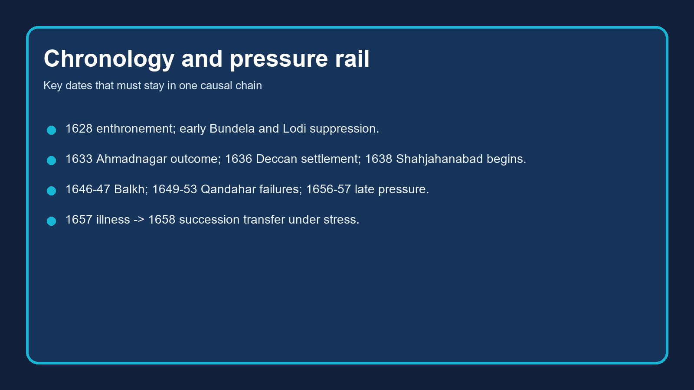

# Shah Jahan & the Evolution of the Mughal Ruling Class

**Package scope note:** This owner file has been fully repaired in place within the locked Topic 21 review scope. Canonical knowledge owners remain unchanged; the learning session now follows the clean learner-v2 sequence, the fixed-count practice contract and the Topic 19 / Topic 20 / Topic 22 boundary firewall.


*Topic 21 repair cover — accession, ruling-class evolution, mansab-jagir strain and the succession bridge to 1658*

## BASIC LEARNING SESSION



*Chronology and pressure rail: visible imperial confidence alongside widening service claims.*

### SESSION 1 — REIGN FRAME: VISIBLE APEX, MANAGED STRAIN, STRICT BOUNDARIES

**Plain-English core:** Shah Jahan's reign looked like the Mughal empire at full brilliance, yet the same reign also exposed widening pressure inside an expanding service elite.

**Technical precision:** Topic 21 is safest when organised as imperial capacity under strain: accession and consolidation, composite nobility, mansab-jagir adjustment, politically relevant magnificence, and the 1657-58 succession bridge.

**Distinctive framing:** Do not turn this topic into three other owners at once. Topic 20 owns Khurram under Jahangir, Topic 19 owns the full Qandahar-Balkh foreign-policy system, Topic 24 owns deep architecture and social life, and Topic 22 begins with Aurangzeb after accession.

```text
TOPIC 21 CORE LOGIC
1628 accession and consolidation
    -> visible imperial confidence
    -> larger composite ruling class
    -> more rank / service claims
    -> month-scale and contingent adjustment
    -> bounded frontier and Deccan costs
    -> 1657-58 succession war as transfer stress
```

| This topic owns | Keep bounded here |
|---|---|
| Shah Jahan's accession, consolidation, magnificence as political language, ruling-class composition, mansab-jagir evolution, 1657-58 endpoint | Jahangir's mature reign (Topic 20), full Deccan detail (Topic 18), full foreign policy (Topic 19), post-1658 Aurangzeb policy (Topic 22), full architecture survey (Topic 24) |

**Evidence anchor:** The canonical basic owner defines the reign through accession, consolidation, the ruling class, month-scale and the succession war. The advanced owner sharpens this by showing that the jama series rose much more slowly than elite claims, while mansab technique kept adjusting to reality.

**Analysis:** That is why the best opening verdict is neither a simple golden-age celebration nor a collapse thesis. Court splendour, organised command and major construction were real. So were the institutional devices created to stop rank, pay and jagir claims from outrunning the resource base.

**Qualification:** A safe answer must stop before Aurangzebian long-war crisis language. Topic 21 owns visible roots, not the completed later jagirdari breakdown.

#### Analytical drill

**Question:** What single line should open a 15- or 20-mark answer on Shah Jahan?

**How to use it:** Write that the reign combined exceptional ceremonial and administrative capacity with a growing mismatch between service claims and realised resources.

#### PARAGRAPH DEMONSTRATION

**Claim:** Shah Jahan's reign should be read as a visibly powerful empire managing structural pressure rather than as an already collapsed state.

**Named evidence / example:** The chronology joins 1630s consolidation and capital-building with later month-scale adjustments, Deccan shortfalls and the 1657-58 succession conflict.

**Analysis:** Putting those strands together lets you show that grandeur and strain were simultaneous products of the same imperial expansion.

**Qualification:** Do not project the full later jagirdari crisis or Aurangzeb's religious-policy debates backward into this chapter.

#### CLOSING RECALL FLOW

**MUST-WRITE KEYWORDS (5-6 only):**
- 1628-1658
- visible apex
- managed strain
- composite elite
- month-scale
- bounded ownership

**How to use them in a sentence:** A strong answer begins by pairing visible imperial confidence with resource-management strain rather than choosing only one side.

**One contrast to remember:** Ceremonial brilliance is not identical to fiscal ease.

**Examiner trap to avoid:** Do not let the word classical tempt you into ignoring institutional pressure or ownership boundaries.

### SESSION 2 — ACCESSION, RIVAL ELIMINATION AND EARLY CONSOLIDATION

**Plain-English core:** Shah Jahan did not simply inherit the throne; he secured it through coalition, coercion and the removal of rivals.

**Technical precision:** After Jahangir's death, Asaf Khan, leading nobles, the diwan and the army converted Khurram's claim into enthronement, while alternative claimants were eliminated and early rebellions were suppressed.

**Distinctive framing:** This session begins where Topic 20 ends. Khurram's earlier rebellion belongs to Jahangir's reign; Topic 21 starts with the 1627-28 transfer and asks what kind of monarchy that transfer produced.

```text
JAHANGIR DIES (1627)
    -> Asaf Khan backs Khurram
    -> rival princes / claimants removed
    -> enthronement in 1628
    -> Bundela and Khan Jahan Lodi challenges crushed
    -> harsher succession precedent enters Mughal memory
```

| Early challenge | What it tested | Imperial response |
|---|---|---|
| Jujhar Singh Bundela | local autonomy, wealth seizure, frontier discipline | pressure, confiscation, renewed campaign, redistribution |
| Khan Jahan Lodi | Afghan-noble mistrust and Deccan linkage | pursuit, defeat, reinforced monarchy-noble hierarchy |
| Hugli / frontier chiefs | coastal authority and route security | coercive assertion of imperial reach |

**Evidence anchor:** The basic owner records Asaf Khan's role, elimination of rival princes, Jujhar Singh's repeated defiance, Khan Jahan Lodi's rebellion and varied pressure on chiefs, zamindars and route-holders. It also notes that succession remained political rather than governed by primogeniture.

**Analysis:** The accession therefore set a sharper precedent than Akbar's or Jahangir's transitions. Shah Jahan came in as a successful claimant determined to prevent rival princes and semi-autonomous chiefs from maturing into alternative centres of power.

**Qualification:** Do not re-teach Jahangir's court politics here, and do not overstate every frontier expedition as complete annexation. Many results were graded: tribute, route control, fort possession or service obligation rather than uniform integration.

#### Analytical drill

**Question:** Why is 1628 a harsher succession precedent than the reigns before it?

**How to use it:** Link Asaf Khan's coalition, the elimination of claimants and the memory of violent transfer. That gives the accession both a political and institutional meaning.

#### PARAGRAPH DEMONSTRATION

**Claim:** Shah Jahan's accession strengthened the monarchy, but it did so by hardening the political culture of succession.

**Named evidence / example:** Asaf Khan secured enthronement, rival claimants were removed, and the Bundela and Lodi challenges were dealt with quickly and punitively.

**Analysis:** That sequence signalled to nobles and princes that the new emperor intended to close off rival centres before they could gather wider support.

**Qualification:** This is still a Mughal dynastic monarchy, not a system with legal primogeniture or routine inheritance.

#### CLOSING RECALL FLOW

**MUST-WRITE KEYWORDS (5-6 only):**
- Asaf Khan
- coalition succession
- rival elimination
- Jujhar Singh
- Khan Jahan Lodi
- harsher precedent

**How to use them in a sentence:** Use the accession to show that Mughal kingship required military-political settlement, and that Shah Jahan made that settlement especially unforgiving.

**One contrast to remember:** Formal enthronement is not the same thing as uncontested legitimacy.

**Examiner trap to avoid:** Do not reduce early consolidation either to a neutral administrative cleanup or to a single communal script.

### SESSION 3 — DECCAN AND NORTH-WEST: EXPANSION, SUZERAINTY AND LIMITS

**Plain-English core:** Shah Jahan expanded, negotiated and fought across major frontiers, but expansion did not always mean durable annexation.

**Technical precision:** Ahmadnagar ended in 1633, the 1636 Deccan settlement imposed hierarchy on Bijapur and Golconda, Balkh exposed logistical limits, and Qandahar revealed the difficulty of holding and recovering a fortress frontier.

**Distinctive framing:** Topic 21 uses these campaigns to explain state capacity and fiscal pressure, not to retell Topic 18 or Topic 19 in full detail.

```text
DAULATABAD 1633 -> Nizam Shahi end
        -> 1636 Deccan settlement
        -> unequal Mughal suzerainty, not total annexation

BALKH 1646-47 -> battlefield reach
               -> logistical strain
               -> withdrawal

QANDAHAR 1649 -> loss
               -> repeated failed recoveries
               -> prestige and supply limits exposed
```

| Campaign field | Safe use in Topic 21 |
|---|---|
| Deccan | new claims, new service opportunities, and future fiscal burden |
| Balkh | separate tactical success from sustainable control |
| Qandahar | show frontier limits and princely command stress without retelling Topic 19 |

**Evidence anchor:** The basic file dates Ahmadnagar's end, the 1636 settlement, Balkh in 1646-47 and the 1649-53 Qandahar failures. It insists that these episodes reveal the limits of logistics, siege capacity and long-distance control.

**Analysis:** Used properly, these campaigns explain why imperial splendour cannot be equated with effortless control. Every expansion created posts, garrisons, offices and claims, while every difficult frontier exposed the difference between nominal command and durable possession.

**Qualification:** Do not let Balkh or Qandahar occupy the whole answer. They are bounded examples here, not the chapter's sole centre of gravity.

#### Analytical drill

**Question:** What one sentence links the Deccan and north-west to the ruling-class problem?

**How to use it:** Write that expansion widened imperial reach but also multiplied commanders, assignments and resource claims that had to be sustained.

#### PARAGRAPH DEMONSTRATION

**Claim:** Frontier campaigning under Shah Jahan displayed capacity and simultaneously enlarged the empire's maintenance burden.

**Named evidence / example:** The 1636 Deccan hierarchy, the unsustainable Balkh venture and the failed Qandahar recoveries all show different sides of that burden.

**Analysis:** Together they explain why military reach increased the pressure on the mansab-jagir system instead of simply enriching it.

**Qualification:** Avoid treating any one campaign as the single cause of later Mughal weakness.

#### CLOSING RECALL FLOW

**MUST-WRITE KEYWORDS (5-6 only):**
- Ahmadnagar 1633
- 1636 settlement
- Balkh
- Qandahar
- suzerainty
- logistics limit

**How to use them in a sentence:** Use frontier history here as evidence for the cost and limits of expansion, not as a substitute for the chapter on foreign policy.

**One contrast to remember:** Entry into a region is not the same as secure retention of it.

**Examiner trap to avoid:** Do not call the 1636 settlement total annexation, and do not describe Balkh as permanent conquest.

### SESSION 4 — MAGNIFICENCE AS POLITICAL LANGUAGE: THRONE, TAJ AND NEW CAPITAL

**Plain-English core:** Shah Jahan's monuments and ceremonial spaces mattered politically because they materialised hierarchy, dynastic memory and sovereign order.

**Technical precision:** The Peacock Throne, Taj Mahal, Red Fort, Jama Masjid and Shahjahanabad should be read as instruments of imperial image-making, labour coordination and fiscal display, not as a free-standing art-history unit.

**Distinctive framing:** Keep architecture here light and political. Construction detail, style vocabulary and full cultural survey belong elsewhere.

```text
PEACOCK THRONE (1635 use)
    -> visible hierarchy / precious sovereignty
TAJ MAHAL
    -> dynastic memory / memorial kingship
SHAHJAHANABAD (from 1638)
    -> planned capital / elite residence / urban order
RED FORT + JAMA MASJID
    -> ceremonial centre / imperial audience / public projection
```

| Monument or space | Political meaning to foreground |
|---|---|
| Peacock Throne | staged superiority and court precedence |
| Taj Mahal | dynastic memory, legitimacy, imperial resources |
| Shahjahanabad | new capital as a claim to ordered sovereignty |
| Major mosque-fort complex | fusion of court, city and imperial audience |

**Evidence anchor:** The basic owner uses the Peacock Throne and Shahjahanabad dates, while the advanced owner adds Shireen Moosvi's cited figure of a little over Rs 289 lakhs across twenty-eight years and warns against treating buildings as automatic proof of fiscal ruin.

**Analysis:** That is the right balance. Monumental construction proves real organisational depth: artisans, workshops, materials, transport and courtly supervision. At the same time, monuments cannot by themselves serve as a social-welfare survey or a single-cause explanation of later crisis.

**Qualification:** Do not re-teach the full Taj Mahal or Mughal-architecture syllabus here. Mention only what earns political or fiscal marks.

#### Analytical drill

**Question:** How should Taj Mahal and Shahjahanabad appear in a core answer?

**How to use it:** Use them as evidence of dynastic memory and capital-city sovereignty, then qualify cost claims through source caution rather than decorative description.

#### PARAGRAPH DEMONSTRATION

**Claim:** Shah Jahan's monumental programme is valuable evidence for imperial ideology only when linked to capacity and carefully qualified on cost.

**Named evidence / example:** The Peacock Throne, Taj Mahal and Shahjahanabad each required organised labour and projected a ruler-centred image, while Moosvi's cost citation stops short of proving fiscal breakdown.

**Analysis:** This lets you show that display was an active part of governance and not merely an aesthetic afterthought.

**Qualification:** Monument evidence must be paired with administrative and revenue evidence before making large social conclusions.

#### CLOSING RECALL FLOW

**MUST-WRITE KEYWORDS (5-6 only):**
- Peacock Throne
- Taj Mahal
- Shahjahanabad
- dynastic memory
- ceremonial sovereignty
- cost caution

**How to use them in a sentence:** The safest architecture line in this topic is that monumental building projected order and memory while requiring, but not by itself exhausting, imperial resources.

**One contrast to remember:** Political use of architecture is not the same thing as a full art-history answer.

**Examiner trap to avoid:** Do not claim that one monument either proves universal prosperity or single-handedly caused decline.

### SESSION 5 — WHAT WAS THE MUGHAL RULING CLASS?

**Plain-English core:** The Mughal ruling class was a ranked service elite, not a fixed racial bloc or a hereditary peerage.

**Technical precision:** Membership depended on mansab, office, jagir assignment, court access, military service, kinship and demonstrated competence. Composition mattered, but function mattered first.

**Distinctive framing:** This definition is the hinge of the whole chapter. Once you mistake the ruling class for a static ethnic census, you lose both the mansab-jagir logic and the politics of faction.

```text
RULING CLASS = imperial service elite
    -> mansab rank
    -> office / governorship
    -> jagir assignment
    -> household / kin networks
    -> military command
    -> court access
```

| Unsafe label | Safer description |
|---|---|
| ethnic caste | composite service elite under imperial appointment |
| hereditary nobility in European sense | rank and office reproduced through empire, though family advantage mattered |
| fixed religious bloc | shifting patronage and service networks with multiple identities |

**Evidence anchor:** The basic owner defines the ruling class as a ranked imperial service elite and stresses that patronage, region, office and kinship shaped faction more reliably than broad labels such as Irani or Rajput alone.

**Analysis:** That is why noble politics under Shah Jahan cannot be read like a modern legislature. Service, favour, mobility and office made the elite composite, while scarcity of the best assignments kept it competitive.

**Qualification:** Do not erase hierarchy inside the language of inclusion. Composite does not mean egalitarian or frictionless.

#### Analytical drill

**Question:** Why should a Mains answer define the ruling class before listing its groups?

**How to use it:** Because the chapter is about how imperial service worked. Categories matter only after you have identified the elite as a service order tied to rank and appointment.

#### PARAGRAPH DEMONSTRATION

**Claim:** The ruling class under Shah Jahan is best defined by service relationship rather than by ethnicity alone.

**Named evidence / example:** Mansab, office, jagir assignment and court access structured elite standing, while broad categories such as Turani, Irani, Rajput or Afghan described only part of a noble's political location.

**Analysis:** This approach explains why the same empire could widen recruitment and still intensify competition over posts and assignments.

**Qualification:** Family continuity and origin labels still mattered; they just did not mechanically decide every alignment.

#### CLOSING RECALL FLOW

**MUST-WRITE KEYWORDS (5-6 only):**
- service elite
- mansab
- office
- jagir assignment
- court access
- factional fluidity

**How to use them in a sentence:** Define the ruling class first as an imperial service elite, then explain how composition shaped competition inside that service order.

**One contrast to remember:** Composite inclusion does not abolish hierarchy.

**Examiner trap to avoid:** Do not translate noble categories into fixed and permanent voting blocs.

### SESSION 6 — CHANGING COMPOSITION: ATHAR ALI'S SERIES AND THE WIDENING INDIAN ELEMENT

**Plain-English core:** Under Shah Jahan the elite became larger and more composite, even though immigrant-origin groups remained central to high politics.

**Technical precision:** Athar Ali's 500-zat-and-above series moves from 123 men in 1595 to 518 in 1656, while the combined Irani-Turani share falls proportionally even as their absolute numbers rise.

**Distinctive framing:** The exam-safe habit is to cite the direction of change, then anchor it with named groups and one or two figures. Do not fabricate uncited percentages beyond the ones explicitly present in the source.

| Group (500 zat and above) | 1595 | 1621 | 1647-48 | 1656 | Safe inference |
|---|---:|---:|---:|---:|---|
| Iranis | 27 | 68 | 126 | 139 | strong growth, central-office presence |
| Turanis | 46 | 48 | 103 | 123 | still major, proportion falls |
| Afghans | 4 | 15 | 26 | 34 | partial recovery of imperial trust |
| Indian Muslims | 14 | 35 | 65 | 59 | durable administrative layer |
| Rajputs | 20 | 34 | 73 | 87 | enduring military-political partners |
| Marathas | 0 | 1 | 10 | 12 | limited but visible inclusion |
| Total | 123 | 242 | 443 | 518 | elite expansion about 4.2 times |

**Evidence anchor:** The canonical tables also note that Iranis and Turanis together fall from about 62.6 percent in 1595 to about 52.12 percent in 1656, while Rajputs, Afghans, Indian Muslims and some Maratha entrants become more visible. Sadullah Khan exemplifies the importance of Indian Muslim talent within the higher elite.

**Analysis:** This data matters in two ways. It shows integration: the empire widened the service field. It also shows pressure: more high-ranking claimants meant more competition for office, reward and good jagirs.

**Qualification:** Prosopographical categories are historian-made and record-dependent. They are not proof that every political alignment followed origin alone.

#### Analytical drill

**Question:** How do you use the Athar Ali series without sounding like you are reciting a census?

**How to use it:** Move from numbers to consequence: the elite broadened, immigrant groups stayed important, and a larger competitive service field pressed on rank and jagir allocation.

#### PARAGRAPH DEMONSTRATION

**Claim:** The changing composition of Shah Jahan's nobility widened imperial incorporation while sharpening internal competition.

**Named evidence / example:** Athar Ali's series shows expansion from 123 to 518 high mansabdars, growth among Iranis, Turanis, Rajputs and Afghans, and a modest but visible Maratha entry.

**Analysis:** That wider field helped the empire integrate regions, but it also multiplied claims on posts, favour and revenue assignments.

**Qualification:** Use category labels cautiously; they reveal broad trends, not automatic political blocs.

#### CLOSING RECALL FLOW

**MUST-WRITE KEYWORDS (5-6 only):**
- Athar Ali
- 123 to 518
- Iranis and Turanis
- Rajputs
- Afghans
- widening Indian element

**How to use them in a sentence:** Turn the composition table into an argument about integration plus competition, not a memorised list of communities.

**One contrast to remember:** Absolute growth is not the same thing as unchanged proportional dominance.

**Examiner trap to avoid:** Do not quote an exact percentage unless the dataset, date and denominator travel with it.

### SESSION 7 — MANSAB FUNDAMENTALS: ZAT, SAWAR, DAGH, CHEHRA, DU-ASPA SIH-ASPA

**Plain-English core:** The mature mansab system under Shah Jahan still rested on distinctions created earlier, but he inherited a system that required tighter adjustment between paper rank and actual service.

**Technical precision:** Zat expressed personal status and pay grade; sawar expressed cavalry obligation and its pay claim; dagh and chehra were verification devices; du-aspa sih-aspa intensified specified cavalry duty without automatically raising zat.

**Distinctive framing:** This session is a terminology gate. If you lose the difference between rank, obligation, verification and assignment here, every later argument about jagirs and month-scale collapses.

```text
MANSAB VOCABULARY
zat   -> personal rank / status / salary grade
sawar -> cavalry obligation / related pay claim
jagir -> transferable revenue assignment
jama  -> assessed revenue
hasil -> realised collection

dagh   -> horse branding
chehra -> descriptive muster roll

du-aspa sih-aspa -> doubled obligation for a specified part of sawar rank
```

**Evidence anchor:** The basic owner locates the mature dual rank in Akbar's system, while the advanced owner notes that du-aspa sih-aspa first appears in the assigned source under Jahangir. It also preserves Badayuni's warning that inspection could still be gamed through borrowed men and horses.

**Analysis:** That evidence gives you the correct historical grammar: Shah Jahan was not inventing mansabdari from zero. He was governing through inherited categories while trying to make declared rank, cavalry obligation and real resources fit more tightly together.

**Qualification:** Do not present dagh and chehra as magical fraud-erasing devices. They mattered precisely because evasion remained possible.

#### Analytical drill

**Question:** What is the cleanest one-line difference between zat and sawar?

**How to use it:** Write that zat marks personal status and pay grade, while sawar marks the cavalry obligation attached to the holder.

#### PARAGRAPH DEMONSTRATION

**Claim:** Shah Jahan's mansab order depended on keeping several distinct technical fields from collapsing into each other.

**Named evidence / example:** The source differentiates zat from sawar, explains dagh and chehra as checks, and treats du-aspa sih-aspa as a way to intensify cavalry duty without rewriting personal rank.

**Analysis:** Holding those distinctions lets you explain later contingent rules and month-scale adjustments with precision.

**Qualification:** Technical distinction does not mean flawless execution; musters and assignments still diverged from paper claims.

#### CLOSING RECALL FLOW

**MUST-WRITE KEYWORDS (5-6 only):**
- zat
- sawar
- dagh
- chehra
- du-aspa sih-aspa
- nominal versus actual

**How to use them in a sentence:** The mansab system worked through linked but non-identical categories, so treat each term as doing separate institutional work.

**One contrast to remember:** A rank field is not the same thing as a revenue assignment.

**Examiner trap to avoid:** Do not say du-aspa sih-aspa automatically doubled the whole mansab or raised zat itself.

### SESSION 8 — EFFECTIVE CONTINGENTS: SALARY CUTS, BARAWARDI AND MUSTER RATIOS

**Plain-English core:** Shah Jahan's state recognised that nominal rank and actual field service could diverge, so it regularised reduced contingent obligations instead of pretending the paper total always existed.

**Technical precision:** The advanced owner records progressive reductions in contract rates, one-third or one-fourth muster expectations, one-fifth in difficult theatres, and a worked 2000/2000 example in which a partly du-aspa rank yields an effective 750.

**Distinctive framing:** This is where the topic moves from vocabulary to mechanism. You are showing how the state preserved a high-ranking military order by openly adjusting its effective service demand.

```text
WORKED EXAMPLE
Nominal mansab: 2000 zat / 2000 sawar
Specified du-aspa sih-aspa portion: 1000
Outside-province jagir rule: one-fourth effective muster

barawardi 1000 -> one-fourth = 250
specified du-aspa 1000 -> doubled then quartered = 500
TOTAL effective contingent = 750
```

| Rule | Safe meaning |
|---|---|
| one-third | jagir in the same province; larger effective contingent |
| one-fourth | outside-province jagir; reduced effective contingent |
| one-fifth | harsher theatres such as Balkh-Badakhshan, and perhaps the Deccan |
| contract rate cuts | payment to mansabdars for maintaining cavalry, not a uniform trooper wage |

**Evidence anchor:** The advanced owner explicitly states that sawar rates were contract figures paid to mansabdars for hiring and maintaining cavalry, while actual trooper pay varied. It also records a 1630 document suggesting broader zat reduction and sharper percentage cuts lower down the scale.

**Analysis:** This turns a common exam mistake on its head. Reduced contingents do not show that rank became meaningless. They show that the empire chose to acknowledge effective service realities rather than blindly equate declared and actual strength.

**Qualification:** Do not attach modern budgeting language to the system. Keep the explanation in Mughal rank, service and jagir terms.

#### Analytical drill

**Question:** Why does the 2000/2000 example matter in a long answer?

**How to use it:** Because it proves you understand the mechanism, not just the vocabulary. A short worked example immediately lifts answer quality.

#### PARAGRAPH DEMONSTRATION

**Claim:** Contingent rules under Shah Jahan were mechanisms of realistic military-fiscal adjustment, not admissions that the mansab system had ceased to function.

**Named evidence / example:** The one-third, one-fourth and one-fifth rules, plus the 2000/2000 worked example, show how the state converted nominal rank into practical service expectations.

**Analysis:** That conversion preserved the hierarchy while recognising geographical distance, remount burdens and uneven revenue support.

**Qualification:** Reduced effective numbers still imply pressure; adjustment is not the same thing as institutional comfort.

#### CLOSING RECALL FLOW

**MUST-WRITE KEYWORDS (5-6 only):**
- contract rates
- barawardi
- one-third
- one-fourth
- one-fifth
- 2000/2000 example

**How to use them in a sentence:** Use the contingent rules to show how the empire translated paper rank into manageable service obligations under strain.

**One contrast to remember:** Nominal cavalry obligation is not identical to campaign-ready strength.

**Examiner trap to avoid:** Do not mistake sawar contract rates for a flat wage paid directly and equally to every trooper.

### SESSION 9 — JAGIR, JAMA, HASIL AND THE MONTH-SCALE

**Plain-English core:** The month-scale existed because assessed revenue and realised revenue did not coincide, especially when the pool of attractive assignments tightened.

**Technical precision:** Jagirs were graded by effective month value; a nominal twelve-month assignment might realise only ten, eight, six or four months, while Deccan cases could fall to three or four because assessment was especially inflated there.

**Distinctive framing:** This is the central close-option zone of Topic 21. If you can separate jagir, jama, hasil and month-scale cleanly, you can handle most UPSC traps in the chapter.

| Term or device | Meaning | Exam-safe caution |
|---|---|---|
| jagir | transferable claim on revenue assignment | not freehold ownership of land |
| jama | assessed revenue on paper | not the same as realised cash |
| hasil | realised collection | may fall well below jama |
| month-scale | pay/service adjustment to effective yield | not a bonus scheme |
| Deccan 3-4 month case | low usable return despite high assessment | do not infer easy wealth from a big region |

**Evidence anchor:** The advanced owner supplies the illustrative sawar rates: Rs 40 on a twelve-month jagir, Rs 30 on an eight-month jagir and Rs 25 on a six-month jagir. It also notes that the reduction was not exactly proportional because remount obligations also fell.

**Analysis:** That is why the month-scale matters so much. It is an accounting and service device that admits shortfall without abolishing the rank structure. In effect, it shows a state trying to keep a large military-fiscal order credible when paper assessments outran dependable realisation.

**Qualification:** Do not treat month-rating as proof that every jagir holder was ruined or that every district yielded the same sort of shortfall.

#### Analytical drill

**Question:** What is the shortest correct explanation of the month-scale?

**How to use it:** Call it a salary-and-service adjustment based on effective yield, then add one concrete rate or Deccan example to prove precision.

#### PARAGRAPH DEMONSTRATION

**Claim:** The month-scale is the clearest evidence that Shah Jahan's empire managed rather than denied the gap between paper assignments and actual returns.

**Named evidence / example:** The source distinguishes jama from hasil, grades jagirs by month value and records lower sawar contract rates on short-rated assignments, with Deccan cases often especially poor.

**Analysis:** That evidence shows the empire preserving its rank structure by scaling entitlement to expected realisation instead of pretending all jagirs yielded a full year.

**Qualification:** Management of shortfall does not equal full solution of the problem; it simply keeps the structure operating.

#### CLOSING RECALL FLOW

**MUST-WRITE KEYWORDS (5-6 only):**
- jagir
- jama
- hasil
- month-scale
- Deccan 3-4 months
- not a bonus

**How to use them in a sentence:** In this topic, month-scale is the bridge between revenue vocabulary and political strain.

**One contrast to remember:** Assessment is not collection.

**Examiner trap to avoid:** Do not translate a month-rated jagir into a reward or into automatic evidence of final collapse.

### SESSION 10 — REVENUE GROWTH, BE-JAGIRI ROOTS AND THE SUCCESSION WAR OF 1657-58

**Plain-English core:** By Shah Jahan's later years the empire still functioned impressively, but its expanding elite was generating claims faster than the assessed-revenue series was rising.

**Technical precision:** The assigned series moves from jama index 100 in 1595-96 to about 122 in 1627 and about 176 by 1656-57, while the 500-zat-and-above elite expands from 123 to 518. Shah Jahan's illness in September 1657 then turns those accumulated patronage claims into armed succession alignments.

**Distinctive framing:** This final session closes the chapter by joining fiscal structure to dynastic transfer. The war of succession is not an isolated family drama; it is the political moment in which elite competition becomes military.

```text
JAMA INDEX: 100 -> 122 -> about 162 -> 176
ELITE SCALE: 123 -> 242 -> 443 -> 518
        -> more claims on rank, office and jagir
        -> month-scale / contingent adjustment
        -> growing be-jagiri pressure
        -> Shah Jahan ill in 1657
        -> Dara / Shuja / Murad / Aurangzeb mobilise networks
        -> Dharmat and Samugarh
        -> 1658 deposition; Topic 22 begins after accession
```

| Unsafe reading | Better reading |
|---|---|
| liberal Dara versus orthodox Aurangzeb referendum | princely rivalry, military resources, noble alignment and dynastic uncertainty |
| collapse already complete under Shah Jahan | functioning system carrying visible roots of later strain |
| every origin group chose one prince permanently | alignments shifted with reward, survival and command |

**Evidence anchor:** The basic owner ties the larger elite and slower revenue rise to pressure on productive jagirs. It also frames the 1657-58 war around Dara, Shuja, Murad and Aurangzeb, with Dharmat and Samugarh as decisive moments before Shah Jahan's confinement.

**Analysis:** This allows a strong conclusion. Shah Jahan did not hand over a dead empire. He handed over a formidable but more burdened one. The succession war then revealed how quickly a composite service elite could become a field of military competition when the allocator of offices and jagirs appeared weak.

**Qualification:** Stop at the accession outcome. Aurangzeb's post-1658 reign, Rajput conflict and long Deccan-war consequences belong to Topic 22 and Topic 23.

#### Analytical drill

**Question:** How should the final paragraph of a Topic 21 answer sound?

**How to use it:** State that imperial magnificence and administrative reach remained real, yet the enlarged elite and jagir pressure made succession transfer increasingly dangerous.

#### PARAGRAPH DEMONSTRATION

**Claim:** The 1657-58 succession war exposed the political consequences of a service elite whose competition had outgrown routine transfer mechanisms.

**Named evidence / example:** The revenue and elite series, month-scale adjustments, princely commands and the battles of Dharmat and Samugarh all point in the same direction.

**Analysis:** Together they show that the struggle was not merely domestic quarrel; it was the armed release of accumulated patronage and military claims.

**Qualification:** Even this war should not be described as instant institutional collapse or as the full history of Aurangzeb's reign.

#### CLOSING RECALL FLOW

**MUST-WRITE KEYWORDS (5-6 only):**
- 100 to 176
- 123 to 518
- be-jagiri roots
- Dharmat
- Samugarh
- bounded endpoint

**How to use them in a sentence:** End the topic by linking fiscal strain to transfer vulnerability, not by jumping directly to eighteenth-century decline.

**One contrast to remember:** Violent succession transfer is not identical to immediate administrative extinction.

**Examiner trap to avoid:** Do not turn the succession war into a simple ideology plebiscite or extend this topic deep into Aurangzeb's later reign.

## BASIC MCQS / REMEDIATION

### Part I — 16 learning MCQs (strict ABCD x4)

#### Learning MCQ 1

Which statement best defines a Mughal jagir in this topic?

- A. A transferable assignment of a state revenue claim linked to service
- B. Unrestricted private ownership of a province
- C. A cash pension unrelated to military obligations
- D. A hereditary village office held by every zamindar

**Answer:** A.

**Explanation:** The key discriminator is assignment of revenue claim rather than proprietary title; the land-ownership option is the classic translation error.

#### Learning MCQ 2

In the mature Akbari dual-rank framework, zat primarily expressed:

- A. the number of months for which a jagir yielded revenue
- B. personal status and the related pay grade
- C. a prince's territorial base
- D. the actual annual hasil of a jagir

**Answer:** B.

**Explanation:** Zat is a hierarchy-and-pay field. Sawar, not zat, is the field that connects a mansab to cavalry obligation.

#### Learning MCQ 3

What did the sawar component of a mansab specify?

- A. the crown's reserved revenue
- B. the noble's legal title to land
- C. the stipulated cavalry obligation
- D. the amount of jama retained as khalisa

**Answer:** C.

**Explanation:** Sawar concerns cavalry service. The khalisa option confuses crown revenue with a personal rank field.

#### Learning MCQ 4

Du-aspa sih-aspa, as placed in the assigned source tradition, is associated first with:

- A. Shah Jahan
- B. Alauddin Khalji
- C. Aurangzeb
- D. Jahangir

**Answer:** D.

**Explanation:** The placement under Jahangir is the chronology test; Shah Jahan inherited and managed later adjustments rather than inventing this device.

#### Learning MCQ 5

The most careful reading of du-aspa sih-aspa is that it:

- A. increased specified cavalry obligation without necessarily raising zat
- B. doubled every component of a noble's mansab
- C. abolished branding of horses
- D. converted jagir into hereditary property

**Answer:** A.

**Explanation:** It modifies specified military duty. The 'whole mansab doubled' lure ignores the separate zat and sawar fields.

#### Learning MCQ 6

Dagh and chehra are best understood as:

- A. titles for Rajput contingents
- B. branding and descriptive-muster controls intended to check fraud
- C. two categories of khalisa land
- D. a pair of Shah Jahan's architectural offices

**Answer:** B.

**Explanation:** Branding and descriptive rolls are verification devices. They did not guarantee that borrowed men or horses could never be presented.

#### Learning MCQ 7

Which provenance sequence is correct for dagh/chehra controls?

- A. Sher Shah invented them; Alauddin copied him; Akbar ended them
- B. Akbar invented them; Jahangir abandoned them; Shah Jahan restored them
- C. Alauddin Khalji used them; Sher Shah revived/adapted them; Akbar systematised them
- D. Shah Jahan created them solely for Deccan warfare

**Answer:** C.

**Explanation:** The sequence guards against an Akbar-first or Shah Jahan-invented claim while preserving the difference between use and systematisation.

#### Learning MCQ 8

Jama is most accurately described as:

- A. a mansabdar's personal status rank
- B. a fortification assessment
- C. actual realised collection in every year
- D. assessed or estimated revenue

**Answer:** D.

**Explanation:** Jama is an assessment claim; hasil is realised collection. Treating jama as cash in hand erases the fiscal problem the month-scale addresses.

#### Learning MCQ 9

Hasil refers to:

- A. actual realised collection
- B. the crown's reserved revenue
- C. a city foundation process
- D. a nominal rank increase under du-aspa

**Answer:** A.

**Explanation:** Hasil is the realised side of the revenue vocabulary. Khalisa is crown-reserved revenue, not a synonym for collection.

#### Learning MCQ 10

The month-scale was designed principally to:

- A. grant a bonus to officers sent to difficult districts
- B. scale pay and service claims to a jagir's effective month rating
- C. end all transfer of jagirdars
- D. make every jagir a full twelve-month yield

**Answer:** B.

**Explanation:** It records and adjusts for a shortfall; it does not transform a weak yield into a reward or abolish imperial rotation.

#### Learning MCQ 11

The repository's cited Deccan three-to-four-month cases illustrate:

- A. that Qandahar was a Deccan province
- B. that jagirs became freehold estates
- C. a high assessed jama could coexist with a low effective return
- D. that Deccan posts were uniformly the richest

**Answer:** C.

**Explanation:** The point is the jama-hasil mismatch under difficult conditions; 'richest posts' reverses the source-bound implication.

#### Learning MCQ 12

The source-bound jama series 100, about 122, about 176 should be used as:

- A. a count of mansabdars by reign
- B. a price series for marble
- C. a measurement of uniform peasant prosperity
- D. an index of assessed revenue claims, not GDP or actual cash

**Answer:** D.

**Explanation:** It is an assessed-revenue index. The other readings add a denominator and meaning the source does not provide.

#### Learning MCQ 13

Which statement best captures Shah Jahan's fiscal condition?

- A. managed strain in a functioning system, not a completed later crisis
- B. a fiscally effortless golden age
- C. an empire already administratively collapsed in 1628
- D. a system without any jagir mismatch before Aurangzeb

**Answer:** A.

**Explanation:** The calibrated verdict holds resource pressure and functioning administration together; both extreme alternatives flatten chronology.

#### Learning MCQ 14

The standard chronology for Mumtaz Mahal's death is:

- A. 1630
- B. 1631
- C. 1658
- D. 1638

**Answer:** B.

**Explanation:** Use 1631. The assigned Part II note's 1630 printing is a documented source discrepancy/typo, not the standard fact.

#### Learning MCQ 15

Shahjahanabad's relevant date and caution are:

- A. 1658 foundation by Aurangzeb as a successor city
- B. 1628 foundation before accession; it had no market life
- C. 1638 foundation/transfer process; it was not built in a single year
- D. 1649 foundation after Qandahar's loss; it was completed at once

**Answer:** C.

**Explanation:** 1638 anchors the project, while a process framing prevents the false image of an instantly completed city.

#### Learning MCQ 16

The 1646-47 Balkh venture is best summarised as:

- A. a Deccan revenue settlement
- B. a campaign led after Shah Jahan's deposition
- C. permanent annexation that solved the northwest frontier
- D. temporary military success that proved strategically and logistically unsustainable

**Answer:** D.

**Explanation:** Balkh demonstrates that battlefield performance and sustainable possession differ; permanent annexation overstates the result.

## PYQS AND ANSWER PRACTICE

### Part II — Verified direct and routed PYQs

Local 2018-2026 ledgers, OCR exports, 2026 official-paper transcriptions and routing audits were searched for Shah Jahan, Shahjahanabad, mansab-jagir adjustment, noble composition, month-scale, jagir pressure, the 1657-58 succession war and closely related demand families. **Result: no direct or adjacent PYQ is retained for Topic 21 without risking owner overlap or fabricated routing.** This section therefore records the verified absence rather than inventing a question route or an official key.

### Part III — Six original mains models (locked count)

#### Original Mains 1 — 10 marks (150 words)

**Question:** Why should Shah Jahan's reign be described as a visibly powerful empire under managed strain rather than as a simple golden age?

**Model answer:** Shah Jahan's reign should be described as a visibly powerful empire under managed strain because the very decades that displayed Mughal ceremonial confidence also required repeated military-fiscal adjustment. The Peacock Throne, Shahjahanabad, the Taj Mahal and the Red Fort reveal an empire capable of organising labour, materials and hierarchy on a large scale. The 1633 Ahmadnagar outcome and 1636 Deccan settlement similarly show operational strength.

Yet the same reign exposes pressure inside the service structure. The higher nobility expanded sharply, jagirs did not yield uniformly, and devices such as month-scale and contingent reduction tried to align paper entitlement with effective return. Deccan three-to-four-month assignments make the mismatch particularly visible. Balkh and Qandahar further separated battlefield reach from sustainable control.

Hence the safest verdict is qualified. Shah Jahan presided over a formidable empire, but one already compelled to manage the mismatch between visible grandeur and the material support required by a larger ruling class.

**Demand decoding:** The directive asks for a reasoned characterisation of the reign, so the answer must balance evidence of capacity with evidence of strain rather than narrate only monuments or only decline.

**Executable answer/elimination plan:** Open with the qualified verdict; one paragraph on magnificence and capacity; one on month-scale, jagir pressure and frontier cost; conclude with the phrase visible power under managed strain.

**Why this earns marks / route earns marks:** This earns marks because it names monuments, the Deccan settlement and fiscal devices, then converts them into one graded judgement instead of a slogan.

**How to improve/strengthen:** You could strengthen it with one precise numerical anchor, such as the jama index rising only to about 176 while the higher elite expanded much faster.

#### Original Mains 2 — 10 marks (150 words)

**Question:** How did Shah Jahan's accession establish a harsher succession precedent within the Mughal empire?

**Model answer:** Shah Jahan's accession was harsher than the transfers under Akbar or Jahangir because it joined coalition politics to determined elimination of rivals. After Jahangir's death, Asaf Khan and leading imperial actors secured Khurram's enthronement in 1628. Rival princes and claimants were removed rather than merely contained. This gave the new reign a sharper edge from the outset.

The early rebellions of Jujhar Singh Bundela and Khan Jahan Lodi show the same mood. Shah Jahan did not wait for alternative centres of power to ripen. He moved quickly to punish, confiscate and reassert imperial hierarchy. In that sense, succession was not only a dynastic event; it was a political lesson sent to princes, nobles and chiefs.

The result was stronger immediate monarchy, but also a precedent that made later Mughal transfer look more openly military and less easily reversible.

**Demand decoding:** The answer must explain what was harsher about the accession, so it needs both the court transfer mechanism and the follow-up pattern of coercive consolidation.

**Executable answer/elimination plan:** State the coalition-enthronement point first, then add the removal of rivals and one early rebellion as evidence, before drawing the institutional implication for later succession culture.

**Why this earns marks / route earns marks:** This earns marks because it links Asaf Khan, rival elimination and early coercive consolidation to one argument about political precedent.

**How to improve/strengthen:** Add one short comparison with Jahangir's own accession to sharpen what changed in the tone of dynastic transfer.

#### Original Mains 3 — 15 marks (250 words)

**Question:** Examine how the composition of the Mughal ruling class under Shah Jahan combined integration with competition.

**Model answer:** The Mughal ruling class under Shah Jahan was a composite imperial service elite. It cannot be reduced either to a single ethnicity or to a hereditary peerage. Rank, office, jagir assignment, military command, household proximity and court recognition together shaped membership.

Its composition shows clear integrative breadth. Athar Ali's 500-zat-and-above series rises from 123 men in 1595 to 518 by 1656, with Iranis, Turanis, Rajputs, Afghans, Indian Muslims and a limited Maratha element all visible. Rajputs remained enduring military-political partners; Afghans partly recovered space lost under Akbar; Indian Muslim figures such as Sadullah Khan show the importance of administrative talent; and selective Maratha entry indicates that regional incorporation did not stop at the north Indian core.

The same expansion intensified competition. A larger high-ranking elite meant more claimants for office, favour and productive jagirs. Formal non-heredity did not eliminate family advantage: clients, kinship and court familiarity still mattered. Nor did origin labels mechanically predict allegiance. Faction moved through princes, patrons, rewards and opportunity rather than through frozen communal blocs.

Therefore the ruling class combined integration with competition. It widened imperial reach by drawing in multiple service groups, yet that very breadth made succession and jagir allocation more contentious in the later reign.

**Demand decoding:** Examine requires explanation of both sides of the formula, so the answer must show how diversity strengthened the empire and why it simultaneously sharpened competition.

**Executable answer/elimination plan:** Define the ruling class first; insert Athar Ali data and named groups; explain integrative value; then shift to office, jagir and factional competition; conclude with a balanced verdict.

**Why this earns marks / route earns marks:** This earns marks because it uses named groups, one quantitative anchor, Sadullah Khan and the service-elite definition to explain both integration and rivalry.

**How to improve/strengthen:** A stronger version could add the proportional fall of the combined Irani-Turani share to show that absolute growth and proportional change are different arguments.

#### Original Mains 4 — 15 marks (250 words)

**Question:** Explain the month-scale and effective contingent rules under Shah Jahan. What problem were they trying to solve?

**Model answer:** The month-scale and effective contingent rules were Mughal attempts to reconcile paper rank with uneven real support. They did not abolish mansabdari; they adjusted it.

The month-scale addressed the gap between nominal assessment and effective yield. Jagirs could be treated as twelve-, ten-, eight-, six- or four-month assignments depending on how much revenue they could actually support. In the Deccan, where assessment could be especially inflated, some assignments yielded only three or four effective months. The source's illustrative sawar rates - Rs 40 on a twelve-month jagir, Rs 30 on an eight-month jagir and Rs 25 on a six-month jagir - show that entitlement was scaled down to practical support.

The contingent rules performed a related military function. A mansabdar with his jagir in the same province might maintain about one-third of nominal sawar rank; outside-province assignment could reduce this to one-fourth; harsher theatres could require one-fifth rules. Du-aspa sih-aspa further intensified specified cavalry duty without automatically lifting zat.

These devices tried to solve one problem: a larger service elite and more demanding theatres were pressing harder on a jagir system whose paper assessments did not translate evenly into realised support. Adjustment preserved the structure, but it also revealed the pressure inside it.

**Demand decoding:** The question asks for explanation plus purpose, so define both devices clearly and then tie them to the paper-versus-real resource problem.

**Executable answer/elimination plan:** Define month-scale first with one rate example; then explain one-third/one-fourth contingent rules and du-aspa; end by naming the mismatch between nominal claims and real support.

**Why this earns marks / route earns marks:** This earns marks because it combines technical vocabulary, numerical illustration and the larger fiscal mechanism instead of listing terms mechanically.

**How to improve/strengthen:** You could add the 2000/2000 worked example in one line if extra space is available.

#### Original Mains 5 — 20 marks (250 words)

**Question:** Assess the view that Shah Jahan's reign represents the classical age of the Mughal empire.

**Model answer:** The description of Shah Jahan's reign as the classical age of the Mughal empire is defensible only when it is qualified. The reign certainly displayed a striking consolidation of ceremonial kingship, urban projection and imperial command. The Peacock Throne, the Red Fort, Jama Masjid, the Taj Mahal and the founding of Shahjahanabad gave the empire an unrivalled visual grammar of sovereignty. Campaigns in the Deccan and the continued centrality of imperial rank also confirm that the state remained formidable.

Yet the same reign warns against an unqualified golden-age label. Monumental construction proved capacity, but not universal prosperity. Shireen Moosvi's cited cost figure shows significant expenditure without by itself proving fiscal breakdown. More important, the ruling class and higher mansabdar corps expanded faster than the assessed revenue series. Jagirs did not yield uniformly, and the month-scale plus contingent rules reveal repeated effort to align entitlement with effective support. Deccan shortfalls, Balkh's unsustainability and the failed Qandahar recoveries further exposed the limits of imperial reach.

The final blow to any simple classical-age formula comes in 1657-58. Shah Jahan's illness turned princely commands and elite alignments into open war. Therefore the reign can be called classical only in the sense of visible Mughal high culture and mature imperial form. It cannot be called carefree, socially uniform or structurally effortless.

**Demand decoding:** Assess requires a graded judgement, so the answer must weigh the evidence for classical magnificence against the evidence for limits and pressure.

**Executable answer/elimination plan:** Open with a qualified yes; use monuments and capital as positive evidence; shift to month-scale, elite growth and frontier strain; finish with succession transfer as the final qualification.

**Why this earns marks / route earns marks:** This earns marks because it gives the examiner both sides of the judgement and anchors each side in named evidence rather than in abstract praise or abstract decline.

**How to improve/strengthen:** If word space permits, add the 123-to-518 elite expansion figure to make the competition side even more concrete.

#### Original Mains 6 — 20 marks (250 words)

**Question:** How did the 1657-58 war of succession reveal the strengths and vulnerabilities of Mughal ruling-class politics?

**Model answer:** The 1657-58 succession war revealed both the remarkable depth and the dangerous vulnerability of Mughal ruling-class politics. It showed strength because the empire had multiple experienced princes, provincial commands, military networks and a service elite capable of rapid mobilisation. It showed vulnerability because the same resources could be turned inward the moment the emperor's authority became uncertain.

Shah Jahan's illness in September 1657 triggered precisely that reversal. Dara Shukoh enjoyed exceptional favour and heir-like status, yet no fixed law of primogeniture made his succession automatic. Shuja, Murad and Aurangzeb each possessed regional bases, military resources and circles of support. Dharmat and Samugarh were not accidental clashes; they were the points at which princely households, noble patrons and command structures became succession armies.

The war also reveals why composition alone cannot explain politics. Origin labels such as Irani, Turani, Rajput or Afghan did not mechanically assign nobles to one camp. Calculation, reward, survival and the expected future distributor of offices mattered more.

At the same time, the war does not prove instant collapse. Aurangzeb's victory and Shah Jahan's confinement demonstrate a violent transfer mechanism, not the disappearance of state structure. The correct conclusion is therefore double-edged: Mughal ruling-class politics was broad, energetic and deeply connected to imperial command, but it lacked a stable principle of transfer and could become militarised with destructive speed.

**Demand decoding:** The directive asks for strengths and vulnerabilities together, so the answer must not narrate the battle sequence alone; it must infer what the sequence shows about elite politics.

**Executable answer/elimination plan:** Open with the double verdict; explain the illness trigger and absence of primogeniture; use the princes plus Dharmat and Samugarh as evidence; end by distinguishing violent transfer from total collapse.

**Why this earns marks / route earns marks:** This earns marks because it links the succession war to princely bases, noble calculation and the broader service structure instead of reducing it to personalities alone.

**How to improve/strengthen:** A sharper version could add one short line on jagir and office expectation to connect elite politics even more explicitly to resource distribution.

## OPTIONAL ADVANCED DEPTH — NOT REQUIRED FOR A CORE ANSWER

### Advanced evidence bank 1 — Source ladder and factual controls

| Source | Strongest use | Built-in limit |
|---|---|---|
| Padshahnama / Lahori / Qazwini | campaigns, ceremony, appointments, ideology | courtly triumphal framing |
| Administrative records and mansab documents | rank, rates, assignments, revenue language | paper norm is not identical with practice |
| Athar Ali prosopography | noble-composition trends | categories are historian-made and record-bound |
| Buildings and urban fabric | patronage, labour and dynastic image | cannot alone prove welfare or crisis |
| Travellers | observation on court and commerce | outsider perspective and chronology limits |

Date control points remain essential: Jahangir dies in 1627, Shah Jahan's formal accession is conventionally 1628; Mumtaz Mahal's standard death date is 1631 despite one 1630 printed variant; and the obvious 1947-48 typo in one source line must be read as 1647-48.

### Advanced evidence bank 2 — Salary reduction and contingent arithmetic

The advanced owner is especially valuable when a question asks for mechanism rather than vocabulary. It records progressive cuts in zat and sawar contract rates, warns that contract pay to mansabdars is not identical to each trooper's wage, and preserves the worked 2000/2000 example with a 1000 du-aspa portion yielding an effective 750 under the one-fourth rule. If you can reproduce that logic in compact form, your answer rises above stock narration.

### Advanced evidence bank 3 — Reading the ruling-class data carefully

The table of groups at 500 zat and above should not be cited as if it were a modern census of immutable communities. Use it to show three things only: the higher elite expanded sharply; the combined Irani-Turani share fell proportionally even while absolute numbers rose; and Rajputs, Afghans, Indian Muslims and a small Maratha element show wider incorporation. The exam-safe inference is integration under hierarchy, not communal arithmetic.

### Advanced evidence bank 4 — Magnificence with fiscal caution

The Moosvi cost citation matters because it blocks overstatement in both directions. Shah Jahan's major construction was undeniably significant and relied on khalisa expenditure, yet the cited figure does not by itself prove that monument-building ruined the empire. A better analytical line is that monumental building materialised dynastic and imperial power while coexisting with a wider military-fiscal strain that must be proved from rank, jagir and frontier evidence.

## CONSOLIDATED REGISTER NOTES

### 1. Reign boundary and chronology
- 1627 death of Jahangir; 1628 formal enthronement of Shah Jahan.
- 1633 Daulatabad and the end of Nizam Shahi power in Ahmadnagar.
- 1635 first use of the completed Peacock Throne.
- 1636 hierarchical Deccan settlement with Bijapur and Golconda.
- 1638 beginning of Shahjahanabad.
- 1646-47 Balkh shows the problem of sustainability.
- 1649 loss of Qandahar; repeated recovery failures continue to 1653.
- 1656-57 late Deccan operations and jama peak in the assigned series.
- 1657 illness -> 1658 deposition; stop before Aurangzeb's later reign.

### 2. Accession and consolidation logic
- Asaf Khan, leading nobles and the army converted Khurram's claim into enthronement.
- Rival princes and claimants were removed, giving the succession a harsher precedent.
- Jujhar Singh Bundela and Khan Jahan Lodi show early coercive consolidation.
- Frontier and chief-based pressure brought tribute, forts, service or route control in uneven forms.
- Mughal succession remained political-military settlement, not legal primogeniture.

### 3. Magnificence as political evidence
- Peacock Throne = staged hierarchy and jewelled sovereignty.
- Taj Mahal = dynastic memory and memorial kingship.
- Shahjahanabad = planned capital expressing court, city and ordered sovereignty together.
- Moosvi's cited expenditure figure supports significance with caution, not a collapse claim.
- Monuments prove organisation of labour and patronage, not uniform prosperity.

### 4. The ruling class and its changing composition
- Define first: ranked imperial service elite, not a fixed ethnic caste or hereditary peerage.
- Components: mansab, office, jagir assignment, military command, household access, kinship, competence.
- Athar Ali series: 123 -> 242 -> 443 -> 518 at 500 zat and above.
- Iranis and Turanis remain central but their combined proportion falls.
- Rajputs, Afghans, Indian Muslims and a small Maratha element show broader incorporation.
- Sadullah Khan is a named example of Indian Muslim administrative prominence.
- Family continuity and patronage mattered even without legal heredity of mansab.

### 5. Mansab-jagir vocabulary and adjustment devices
- zat = personal rank and pay grade.
- sawar = cavalry obligation and related pay claim.
- dagh = horse branding; chehra = descriptive muster roll.
- du-aspa sih-aspa intensifies specified cavalry obligation without itself raising zat.
- jagir = transferable revenue assignment; khalisa = crown-retained revenue.
- jama = assessed revenue; hasil = realised collection.
- one-third / one-fourth / one-fifth rules turn nominal rank into effective contingent expectation.
- month-scale grades jagirs by effective yield; Deccan cases could be 3-4 months.
- illustrative sawar rates: Rs 40 on 12-month, Rs 30 on 8-month, Rs 25 on 6-month assignments.

### 6. Strain, succession and final verdict
- jama index rises from 100 (1595-96) to about 176 (1656-57), while the high elite grows much faster.
- Resulting pressure = more claims on office, cavalry maintenance and productive jagirs.
- Balkh and Qandahar show frontier limits; the Deccan widened both reach and burden.
- 1657-58 war of succession: Dara, Shuja, Murad and Aurangzeb mobilise princely and noble networks.
- Dharmat and Samugarh show how patronage politics becomes military politics when the emperor weakens.
- Best verdict: visible apex + composite expansion + adaptive fiscal strain.
- Do not say full collapse under Shah Jahan; do not drag the answer deep into Topic 22 or Topic 23.
