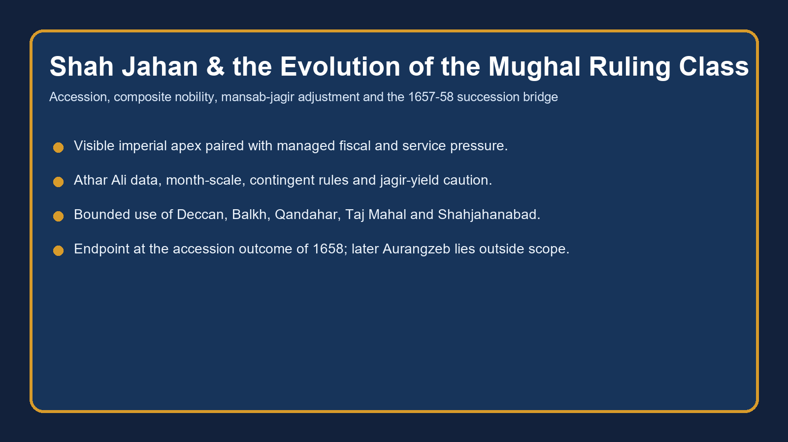

# Shah Jahan & the Evolution of the Mughal Ruling Class — Solved Practice Workbook

## BASIC MCQS / REMEDIATION

### Part I — 44 workbook MCQs (questions first; matched key below)

#### Workbook MCQ 1
**Question:** Which statement best defines a Mughal jagir in this topic?

- A. A transferable assignment of a state revenue claim linked to service
- B. Unrestricted private ownership of a province
- C. A cash pension unrelated to military obligations
- D. A hereditary village office held by every zamindar

#### Workbook MCQ 2
**Question:** In the mature Akbari dual-rank framework, zat primarily expressed:

- A. the number of months for which a jagir yielded revenue
- B. personal status and the related pay grade
- C. a prince's territorial base
- D. the actual annual hasil of a jagir

#### Workbook MCQ 3
**Question:** What did the sawar component of a mansab specify?

- A. the crown's reserved revenue
- B. the noble's legal title to land
- C. the stipulated cavalry obligation
- D. the amount of jama retained as khalisa

#### Workbook MCQ 4
**Question:** Du-aspa sih-aspa, as placed in the assigned source tradition, is associated first with:

- A. Shah Jahan
- B. Alauddin Khalji
- C. Aurangzeb
- D. Jahangir

#### Workbook MCQ 5
**Question:** The most careful reading of du-aspa sih-aspa is that it:

- A. increased specified cavalry obligation without necessarily raising zat
- B. doubled every component of a noble's mansab
- C. abolished branding of horses
- D. converted jagir into hereditary property

#### Workbook MCQ 6
**Question:** Dagh and chehra are best understood as:

- A. titles for Rajput contingents
- B. branding and descriptive-muster controls intended to check fraud
- C. two categories of khalisa land
- D. a pair of Shah Jahan's architectural offices

#### Workbook MCQ 7
**Question:** Which provenance sequence is correct for dagh/chehra controls?

- A. Sher Shah invented them; Alauddin copied him; Akbar ended them
- B. Akbar invented them; Jahangir abandoned them; Shah Jahan restored them
- C. Alauddin Khalji used them; Sher Shah revived/adapted them; Akbar systematised them
- D. Shah Jahan created them solely for Deccan warfare

#### Workbook MCQ 8
**Question:** Jama is most accurately described as:

- A. a mansabdar's personal status rank
- B. a fortification assessment
- C. actual realised collection in every year
- D. assessed or estimated revenue

#### Workbook MCQ 9
**Question:** Hasil refers to:

- A. actual realised collection
- B. the crown's reserved revenue
- C. a city foundation process
- D. a nominal rank increase under du-aspa

#### Workbook MCQ 10
**Question:** The month-scale was designed principally to:

- A. grant a bonus to officers sent to difficult districts
- B. scale pay and service claims to a jagir's effective month rating
- C. end all transfer of jagirdars
- D. make every jagir a full twelve-month yield

#### Workbook MCQ 11
**Question:** The repository's cited Deccan three-to-four-month cases illustrate:

- A. that Qandahar was a Deccan province
- B. that jagirs became freehold estates
- C. a high assessed jama could coexist with a low effective return
- D. that Deccan posts were uniformly the richest

#### Workbook MCQ 12
**Question:** The source-bound jama series 100, about 122, about 176 should be used as:

- A. a count of mansabdars by reign
- B. a price series for marble
- C. a measurement of uniform peasant prosperity
- D. an index of assessed revenue claims, not GDP or actual cash

#### Workbook MCQ 13
**Question:** Which statement best captures Shah Jahan's fiscal condition?

- A. managed strain in a functioning system, not a completed later crisis
- B. a fiscally effortless golden age
- C. an empire already administratively collapsed in 1628
- D. a system without any jagir mismatch before Aurangzeb

#### Workbook MCQ 14
**Question:** The standard chronology for Mumtaz Mahal's death is:

- A. 1630
- B. 1631
- C. 1658
- D. 1638

#### Workbook MCQ 15
**Question:** Shahjahanabad's relevant date and caution are:

- A. 1658 foundation by Aurangzeb as a successor city
- B. 1628 foundation before accession; it had no market life
- C. 1638 foundation/transfer process; it was not built in a single year
- D. 1649 foundation after Qandahar's loss; it was completed at once

#### Workbook MCQ 16
**Question:** The 1646-47 Balkh venture is best summarised as:

- A. a Deccan revenue settlement
- B. a campaign led after Shah Jahan's deposition
- C. permanent annexation that solved the northwest frontier
- D. temporary military success that proved strategically and logistically unsustainable

#### Workbook MCQ 17
**Question:** Qandahar was lost to Safavid Persia in:

- A. 1649
- B. 1628
- C. 1657
- D. 1633

#### Workbook MCQ 18
**Question:** The 1657 illness matters because it:

- A. created a fixed Turani-Irani war
- B. activated a contest in a polity without a fixed primogeniture rule
- C. ended all provincial commands
- D. automatically installed Dara Shukoh as constitutional heir

#### Workbook MCQ 19
**Question:** A sound statement about Mughal noble composition is that:

- A. foreign-born elites disappeared under Shah Jahan
- B. all Rajputs held identical rank and loyalty
- C. the Indian element broadened while immigrant groups remained important
- D. one exact percentage applies without date or denominator

#### Workbook MCQ 20
**Question:** Shahji Bhonsale is used in this topic as:

- A. the founder of Shahjahanabad
- B. a Safavid governor of Qandahar
- C. proof of mass, stable Maratha incorporation
- D. a bounded example of elite movement and service in the Deccan field

#### Workbook MCQ 21
**Question:** Why can monuments be used as evidence for state capacity?

- A. They show coordination of labour, materials, workshops and court demand
- B. They make administrative records unnecessary
- C. They directly reveal the empire's annual cash balance
- D. They prove uniform rural prosperity

#### Workbook MCQ 22
**Question:** Which is the best distinction between jagirdar and zamindar?

- A. A jagirdar is the same as khalisa
- B. An imperial assignee differs from a locally rooted intermediary category
- C. A zamindar is always a transferable mansabdar
- D. Both are identical legal owners of all village land

#### Workbook MCQ 23
**Question:** A short-rated jagir could encourage which response?

- A. end of all imperial dependence
- B. conversion of jama into hasil by definition
- C. competition for a better posting and pressure on local revenue channels
- D. automatic abolition of cavalry obligations

#### Workbook MCQ 24
**Question:** Which factor is NOT sufficient by itself to explain inflated jama?

- A. distance and collection difficulty
- B. war and interrupted cultivation
- C. survey or assessment error
- D. a universal assumption that every officer committed fraud

#### Workbook MCQ 25
**Question:** The 1636 Deccan settlement should be described as:

- A. a temporary political framework, not total annexation of all Deccan states
- B. permanent incorporation of every Deccan polity
- C. a post-1658 arrangement
- D. a Safavid-Mughal treaty over Qandahar

#### Workbook MCQ 26
**Question:** Why do rank awards create fiscal pressure?

- A. They eliminate the need for jagirs
- B. They generate salary and service claims that need support
- C. They automatically raise realised hasil
- D. They reduce the number of court households

#### Workbook MCQ 27
**Question:** A high sawar number should NOT be assumed to prove:

- A. that a cavalry obligation existed
- B. that verification mattered
- C. that the stated number of troops was always campaign-effective
- D. that remount resources were relevant

#### Workbook MCQ 28
**Question:** What does transfer of jagirdars seek to preserve?

- A. the abolition of central appointment
- B. permanent village ownership by assignees
- C. hereditary provincial sovereignty
- D. imperial dependence and limits on local entrenchment

#### Workbook MCQ 29
**Question:** Court ceremony is relevant to political analysis because it:

- A. orders access, precedence and the public image of sovereignty
- B. establishes modern equality before law
- C. proves no noble bargaining occurred
- D. replaces military command and revenue

#### Workbook MCQ 30
**Question:** The term 'composite elite' is strongest when it means:

- A. a permanent ethnic federation with fixed voting blocs
- B. a coalition incorporating varied service networks under imperial appointment
- C. a modern representative legislature
- D. an elite without factional rivalry

#### Workbook MCQ 31
**Question:** The best reason to avoid an exact noble-composition percentage here is:

- A. Mansabs had no numerical rank
- B. all chronicles prohibit counting
- C. the package lacks a stated dataset, date, rank threshold and denominator
- D. percentages are never useful in history

#### Workbook MCQ 32
**Question:** Khalisa revenue is:

- A. a cavalry allowance within sawar
- B. a Rajput kinship tie
- C. a synonym for hasil
- D. revenue retained for the crown rather than assigned as jagir

#### Workbook MCQ 33

**Question:** Which chronology best distinguishes the succession, ceremonial, urban and frontier milestones of Shah Jahan's reign?

- A. Jahangir's death (1627) → formal enthronement (1628) → first sitting on completed Peacock Throne (1635) → Shahjahanabad begun (1638) → Qandahar lost (1649).
- B. Formal enthronement (1628) → Jahangir's death (1627) → Qandahar lost (1649) → Peacock Throne (1635) → Shahjahanabad (1638).
- C. Shahjahanabad begun (1638) → Peacock Throne (1635) → Jahangir's death (1627) → Qandahar lost (1649) → enthronement (1628).
- D. Qandahar lost (1649) → Jahangir's death (1627) → Peacock Throne (1635) → enthronement (1628) → Shahjahanabad (1638).

#### Workbook MCQ 34

**Question:** Which account of Jujhar Singh Bundela's relations with Shah Jahan avoids conflating two phases?

- A. He was never pressured into submission before his final rebellion.
- B. An initial submission with indemnity and partial jagir confiscation preceded later Gond conflict involving Prem Narayan and renewed defiance.
- C. He captured Portuguese Hugli and received the Deccan viceroyalty as recompense.
- D. He succeeded Aurangzeb after winning at Samugarh.

#### Workbook MCQ 35

**Question:** Which pair correctly matches the early Shah-Jahan-period theatres and results while respecting topic boundaries?

- A. Daulatabad's fall in 1633 established direct Mughal annexation of all Bijapur and Golconda.
- B. The 1636 settlement confirmed an equal alliance of independent states and ended Deccan politics permanently.
- C. Daulatabad's fall ended the Nizam Shahi dynasty in 1633; the 1636 settlement subjected Bijapur and Golconda to an unequal relationship without annexing the entire Deccan.
- D. Balkh's 1646–47 occupation and Qandahar's 1649 loss were both permanent Mughal territorial acquisitions.

#### Workbook MCQ 36

**Question:** What is the most careful interpretation of the source-attributed building expenditure quoted by Satish Chandra from Shireen Moosvi?

- A. All Mughal building was financed by private jagirdars with no state cost.
- B. The building total is a verified direct measure of the empire's entire military deficit.
- C. Monument construction alone caused the 1657 succession struggle.
- D. A little over Rs 289 lakhs across twenty-eight years was significant khalisa expenditure, but the source does not make it a stand-alone explanation of fiscal collapse.

#### Workbook MCQ 37

**Question:** Using Athar Ali's source-attributed series for nobles of 500 zat and above, which numerical comparison is supported?

- A. The total increased from 123 (1595) to 518 (1656), while recorded Marathas increased from 0 to 12; neither category proves a fixed political bloc.
- B. The total decreased from 518 to 123 and recorded Marathas remained zero throughout.
- C. Every Irani was dismissed between 1595 and 1656.
- D. Rajputs numbered 518 in 1595, accounting for the entire high elite.

#### Workbook MCQ 38

**Question:** Iranis and Turanis both increased in absolute numbers between 1595 and 1656, while their combined share declined. Which inference follows?

- A. Their declining percentage proves all Iranis left Mughal service.
- B. The 500-zat-and-above elite expanded and diversified; a falling share need not imply falling headcounts.
- C. The category “Indian Muslims” was entirely absent in the earlier record.
- D. Proportional decline automatically proves an Irani–Turani coalition against Rajputs.

#### Workbook MCQ 39

**Question:** For a 2000/2000 rank with 1000 du-aspa sih-aspa sawars, a jagir outside the posting province and the relevant one-fourth muster rule, what is the source's worked effective muster?

- A. 250, because the special sawars receive no separate multiplier.
- B. 500, because zat replaces the sawar obligation.
- C. 750: 250 ordinary sawars plus 500 from the doubled designated portion.
- D. 4,000, because the whole zat and sawar rank must each be doubled.

#### Workbook MCQ 40

**Question:** Which pairing of posting and indicative muster ratio is consistent with the Shah Jahan source, without making each ratio universal?

- A. Jagir in posting province: one-fifth; jagir elsewhere: one-third; Balkh: full nominal sawar.
- B. Jagir in posting province: one-fourth; jagir elsewhere: one-fifth; Balkh: half.
- C. Jagir in posting province: full nominal sawar; jagir elsewhere: one-half; Balkh: one-third.
- D. Jagir in posting province: about one-third; jagir elsewhere: one-fourth; Balkh-Badakhshan: one-fifth.

#### Workbook MCQ 41

**Question:** Which comparison correctly reads the illustrative month-scale contract rates per sawar per month?

- A. Twelve-month: Rs 40; eight-month: Rs 30; six-month: Rs 25, with non-proportional adjustment also reflecting reduced remount obligations.
- B. Twelve-month: Rs 25; eight-month: Rs 30; six-month: Rs 40, because smaller jagirs commanded higher pay.
- C. All three scales paid exactly Rs 40 in cash to each trooper, regardless of the mansabdar's contract.
- D. Eight-month: Rs 40; six-month: Rs 30; twelve-month: Rs 25, because jama equalled hasil.

#### Workbook MCQ 42

**Question:** Which conclusion is justified by juxtaposing the source's jama index and high-rank elite series?

- A. The jama index reached 518 in 1656, exactly matching the number of nobles.
- B. The 500-zat-and-above elite increased about 4.2-fold (123 to 518), while indexed paper jama rose from 100 to about 176; this invites inquiry into claims versus realised revenue, not an instant-collapse verdict.
- C. An increase in assessed jama proves that every jagir's realised hasil increased at the same rate.
- D. All fiscal pressure started only after 1707, so Shah Jahan used no salary or contingent adjustments.

#### Workbook MCQ 43

**Question:** The assigned OCR narrative prints “1630” for Mumtaz Mahal's death and “1947–48” in a sentence about the noble series. Which editorial treatment follows the core's factual controls?

- A. Treat both OCR strings as new standard historical dates.
- B. Date Mumtaz's death to 1947–48 and the elite table to 1630.
- C. Use the standard 1631 date for Mumtaz while noting the variant; read the contextual elite-table year as 1647–48 rather than reproducing an obvious typo.
- D. Remove all dates for the entire reign because one source has discrepancies.

#### Workbook MCQ 44

**Question:** Which interpretation of the 1657–58 succession contest best connects court rank with military politics?

- A. Dara's exceptional favour legally abolished rival princes' claims under accepted primogeniture.
- B. Dharmat and Samugarh were votes on an empire-wide religious referendum.
- C. Shah Jahan's illness occurred after Aurangzeb's uncontested coronation.
- D. Dara's favour did not prevent his brothers' mobilisation; provincial resources, noble alignments and battles decided the succession and led to Shah Jahan's confinement.

### Part II — Matched answer key and remediation

#### Answer & reasoning — Workbook MCQ 1

**Correct answer:** A

**Option-wise explanations:**
- **A. A transferable assignment of a state revenue claim linked to service** — Correct. In this topic a jagir is a transferable assignment of state revenue linked to service and remuneration.
- **B. Unrestricted private ownership of a province** — No. That choice turns a revenue assignment into outright proprietary ownership, the precise confusion this chapter tells you to avoid.
- **C. A cash pension unrelated to military obligations** — No. A cash pension severs the service and revenue-assignment link that makes a jagir institutionally important.
- **D. A hereditary village office held by every zamindar** — No. A hereditary village office belongs to a different local order; it is not the empire-wide jagir mechanism.

**Examiner trap:** The Persian term invites a landownership translation when the institution is actually a service-linked revenue assignment.

#### Answer & reasoning — Workbook MCQ 2

**Correct answer:** B

**Option-wise explanations:**
- **A. the number of months for which a jagir yielded revenue** — No. Month value belongs to the rating of a jagir, not to the meaning of zat.
- **B. personal status and the related pay grade** — Correct. Zat denotes personal status and the pay grade attached to that standing.
- **C. a prince's territorial base** — No. A prince's territorial base may affect politics, but it is not what the zat field records.
- **D. the actual annual hasil of a jagir** — No. Hasil is realised collection, whereas zat is a rank term inside mansabdari.

**Examiner trap:** Students often drag month-scale or hasil vocabulary into a rank term and lose the status-pay distinction.

#### Answer & reasoning — Workbook MCQ 3

**Correct answer:** C

**Option-wise explanations:**
- **A. the crown's reserved revenue** — No. That phrase belongs to khalisa, the crown-retained share of revenue, whereas sawar records a cavalry liability inside rank structure.
- **B. the noble's legal title to land** — No. Legal title to land is the wrong frame; sawar concerns cavalry service, not landed property.
- **C. the stipulated cavalry obligation** — Correct. Sawar specifies the cavalry obligation and the pay claim related to that obligation.
- **D. the amount of jama retained as khalisa** — No. Jama retained as khalisa is a revenue question, while sawar is a military-rank question.

**Examiner trap:** Military obligation is easily mistaken for a revenue category because rank terms are memorised without their functions.

#### Answer & reasoning — Workbook MCQ 4

**Correct answer:** D

**Option-wise explanations:**
- **A. Shah Jahan** — No. Shah Jahan inherited and worked with the device; the assigned source first places it under Jahangir.
- **B. Alauddin Khalji** — No. Alauddin belongs to an earlier Sultanate world and is unrelated to this Mughal term.
- **C. Aurangzeb** — No. Aurangzeb is too late for the first appearance of this device in the assigned tradition.
- **D. Jahangir** — Correct. The source sequence first associates du-aspa sih-aspa with Jahangir.

**Examiner trap:** The exam can shift from first appearance to later use and trap anyone who only remembers Shah Jahan's mature phase.

#### Answer & reasoning — Workbook MCQ 5

**Correct answer:** A

**Option-wise explanations:**
- **A. increased specified cavalry obligation without necessarily raising zat** — Correct. The device intensified a specified cavalry obligation without automatically lifting the holder's zat rank.
- **B. doubled every component of a noble's mansab** — No. The whole mansab did not mechanically double; the point was a targeted increase in cavalry duty.
- **C. abolished branding of horses** — No. Horse branding remained relevant; du-aspa sih-aspa did not abolish verification.
- **D. converted jagir into hereditary property** — No. Hereditary property has nothing to do with this cavalry-enhancement device.

**Examiner trap:** A targeted cavalry enhancement is frequently inflated into a doubling of the entire mansab.

#### Answer & reasoning — Workbook MCQ 6

**Correct answer:** B

**Option-wise explanations:**
- **A. titles for Rajput contingents** — No. Rajput contingents may serve inside the empire, but dagh and chehra are not their titles.
- **B. branding and descriptive-muster controls intended to check fraud** — Correct. Horse branding and descriptive muster rolls were verification devices meant to check fraudulent claims.
- **C. two categories of khalisa land** — No. Khalisa categories concern revenue retention, not muster control.
- **D. a pair of Shah Jahan's architectural offices** — No. These are administrative-military checks, not architectural or urban offices.

**Examiner trap:** Verification devices look technical and are therefore often misremembered as labels or land categories.

#### Answer & reasoning — Workbook MCQ 7

**Correct answer:** C

**Option-wise explanations:**
- **A. Sher Shah invented them; Alauddin copied him; Akbar ended them** — No. That sequence reverses chronology and even falsely makes Akbar the one who ended the controls.
- **B. Akbar invented them; Jahangir abandoned them; Shah Jahan restored them** — No. Akbar did not invent the whole lineage from nothing, and Jahangir did not abandon it.
- **C. Alauddin Khalji used them; Sher Shah revived/adapted them; Akbar systematised them** — Correct. Alauddin used comparable checks, Sher Shah revived or adapted them, and Akbar systematised them in Mughal practice.
- **D. Shah Jahan created them solely for Deccan warfare** — No. Shah Jahan did not create dagh and chehra merely for Deccan warfare.

**Examiner trap:** Chronology questions here punish anyone who confuses earlier precedent, revival and Mughal systematisation.

#### Answer & reasoning — Workbook MCQ 8

**Correct answer:** D

**Option-wise explanations:**
- **A. a mansabdar's personal status rank** — No. Personal status belongs to zat, not to jama.
- **B. a fortification assessment** — No. A fortification assessment is not the technical meaning of jama in this chapter.
- **C. actual realised collection in every year** — No. Actual realised collection is hasil; jama is the paper assessment.
- **D. assessed or estimated revenue** — Correct. Jama is the assessed or estimated revenue claim recorded on paper.

**Examiner trap:** Paper assessment is routinely mistaken for money actually available to the state or noble.

#### Answer & reasoning — Workbook MCQ 9

**Correct answer:** A

**Option-wise explanations:**
- **A. actual realised collection** — Correct. Hasil names the cash actually realised from an assignment after the paper estimate has passed through collection on the ground.
- **B. the crown's reserved revenue** — No. That phrase identifies revenue kept in the emperor's own hands; the asked-for term is realised collection from an assignment.
- **C. a city foundation process** — No. City foundation has no connection with this revenue term.
- **D. a nominal rank increase under du-aspa** — No. Hasil is not a rank increment or a cavalry device.

**Examiner trap:** Candidates who memorise jama and hasil together often swap them under pressure.

#### Answer & reasoning — Workbook MCQ 10

**Correct answer:** B

**Option-wise explanations:**
- **A. grant a bonus to officers sent to difficult districts** — No. The month-scale cut or adjusted claims downward; it was not a hardship allowance.
- **B. scale pay and service claims to a jagir's effective month rating** — Correct. It scaled pay and service expectations to the effective month value of the jagir.
- **C. end all transfer of jagirdars** — No. Imperial transfer continued; the month-scale dealt with yield, not with ending rotation.
- **D. make every jagir a full twelve-month yield** — No. It recognised that many jagirs did not yield a full twelve months in practice.

**Examiner trap:** Adjustment downward gets retold as a privilege or bonus when the whole point is reduced effective yield.

#### Answer & reasoning — Workbook MCQ 11

**Correct answer:** C

**Option-wise explanations:**
- **A. that Qandahar was a Deccan province** — No. Qandahar and the Deccan belong to different strategic theatres.
- **B. that jagirs became freehold estates** — No. A low month value did not convert assignment into freehold property.
- **C. a high assessed jama could coexist with a low effective return** — Correct. The cited cases show that a high assessed jama could still produce a poor usable return.
- **D. that Deccan posts were uniformly the richest** — No. The whole point of these Deccan examples is that nominal richness could mask unattractive real yield.

**Examiner trap:** A large strategic region is lazily assumed to be uniformly rich, which reverses the source logic.

#### Answer & reasoning — Workbook MCQ 12

**Correct answer:** D

**Option-wise explanations:**
- **A. a count of mansabdars by reign** — No. The sequence does not count nobles; it tracks assessed revenue movement.
- **B. a price series for marble** — No. Marble prices are unrelated to the cited revenue index.
- **C. a measurement of uniform peasant prosperity** — No. The source does not turn the series into a direct measure of peasant prosperity.
- **D. an index of assessed revenue claims, not GDP or actual cash** — Correct. It is an index of assessed revenue claims, not a GDP figure or a count of cash actually collected.

**Examiner trap:** Revenue indexes tempt over-reading into GDP, welfare or actual cash flow.

#### Answer & reasoning — Workbook MCQ 13

**Correct answer:** A

**Option-wise explanations:**
- **A. managed strain in a functioning system, not a completed later crisis** — Correct. The strongest reading is a functioning empire under managed strain, not a fully matured later crisis.
- **B. a fiscally effortless golden age** — No. The reign was brilliant, but not fiscally effortless.
- **C. an empire already administratively collapsed in 1628** — No. The empire did not begin in administrative collapse in 1628.
- **D. a system without any jagir mismatch before Aurangzeb** — No. Jagir mismatch and adjustment were already visible before Aurangzeb.

**Examiner trap:** The chapter punishes both triumphalist and collapse-first binaries.

#### Answer & reasoning — Workbook MCQ 14

**Correct answer:** B

**Option-wise explanations:**
- **A. 1630** — No. 1630 survives only as a source-variant typo in one assigned narrative.
- **B. 1631** — Correct. 1631 is the standard date for Mumtaz Mahal's death.
- **C. 1658** — No. 1658 belongs to the deposition year, not to Mumtaz Mahal.
- **D. 1638** — No. 1638 is tied to Shahjahanabad, not to Mumtaz's death.

**Examiner trap:** A printed source variant can dislodge the standard chronology if you have not labelled it as a typo risk.

#### Answer & reasoning — Workbook MCQ 15

**Correct answer:** C

**Option-wise explanations:**
- **A. 1658 foundation by Aurangzeb as a successor city** — No. 1658 belongs to the succession outcome, and Aurangzeb did not found Shahjahanabad.
- **B. 1628 foundation before accession; it had no market life** — No. The city project is not pre-accession, and it certainly did not lack market life.
- **C. 1638 foundation/transfer process; it was not built in a single year** — Correct. 1638 marks the beginning of the capital project, which unfolded as a process rather than a one-year event.
- **D. 1649 foundation after Qandahar's loss; it was completed at once** — No. Qandahar's 1649 loss is unrelated to the city's foundation chronology.

**Examiner trap:** Capital projects are often reduced to one date, erasing the process nature of urban foundation.

#### Answer & reasoning — Workbook MCQ 16

**Correct answer:** D

**Option-wise explanations:**
- **A. a Deccan revenue settlement** — No. Balkh was not a Deccan settlement.
- **B. a campaign led after Shah Jahan's deposition** — No. The venture occurred during Shah Jahan's reign, not after his deposition.
- **C. permanent annexation that solved the northwest frontier** — No. Permanent annexation is exactly what the campaign failed to secure.
- **D. temporary military success that proved strategically and logistically unsustainable** — Correct. Balkh showed that temporary battlefield success could still be strategically and logistically unsustainable.

**Examiner trap:** Campaign-entry narratives often get overstated into permanent conquest.

#### Answer & reasoning — Workbook MCQ 17

**Correct answer:** A

**Option-wise explanations:**
- **A. 1649** — Correct. Qandahar was lost in 1649, after which repeated recovery attempts failed.
- **B. 1628** — No. 1628 is the accession year, not the Qandahar loss.
- **C. 1657** — No. 1657 marks the illness crisis, not the Safavid recovery of Qandahar.
- **D. 1633** — No. 1633 belongs to Ahmadnagar and Daulatabad, not to Qandahar.

**Examiner trap:** North-west chronology gets scrambled when Ahmadnagar, accession and illness dates are mixed together.

#### Answer & reasoning — Workbook MCQ 18

**Correct answer:** B

**Option-wise explanations:**
- **A. created a fixed Turani-Irani war** — No. The conflict did not freeze into one ethnic civil war formula.
- **B. activated a contest in a polity without a fixed primogeniture rule** — Correct. The illness activated a succession contest in a polity without a fixed rule of primogeniture.
- **C. ended all provincial commands** — No. Provincial commands became more important, not irrelevant, once succession opened up.
- **D. automatically installed Dara Shukoh as constitutional heir** — No. Dara's favour and designation did not make his accession constitutionally automatic.

**Examiner trap:** Heir-apparent language is regularly confused with a legal rule of automatic succession.

#### Answer & reasoning — Workbook MCQ 19

**Correct answer:** C

**Option-wise explanations:**
- **A. foreign-born elites disappeared under Shah Jahan** — No. Foreign-born or immigrant-origin elites remained important under Shah Jahan.
- **B. all Rajputs held identical rank and loyalty** — No. Rajput houses did not all hold the same rank or make the same political choices.
- **C. the Indian element broadened while immigrant groups remained important** — Correct. The Indian element widened, yet immigrant groups such as Iranis and Turanis stayed influential.
- **D. one exact percentage applies without date or denominator** — No. Without a date, threshold and denominator, an exact percentage would pretend to evidence the question has not supplied.

**Examiner trap:** Composition questions lure students into fake precision or into flattening diversity into one bloc.

#### Answer & reasoning — Workbook MCQ 20

**Correct answer:** D

**Option-wise explanations:**
- **A. the founder of Shahjahanabad** — No. Shahji Bhonsale did not found Shahjahanabad.
- **B. a Safavid governor of Qandahar** — No. He was not a Safavid official at Qandahar.
- **C. proof of mass, stable Maratha incorporation** — No. One Deccan elite career cannot stand in for mass, stable Maratha incorporation.
- **D. a bounded example of elite movement and service in the Deccan field** — Correct. Shahji is a bounded example of elite movement and service politics in the Deccan field.

**Examiner trap:** One Deccan career can be wrongly stretched into the full later Maratha story.

#### Answer & reasoning — Workbook MCQ 21

**Correct answer:** A

**Option-wise explanations:**
- **A. They show coordination of labour, materials, workshops and court demand** — Correct. Major monuments show the court's capacity to organise labour, workshops, materials and imperial demand.
- **B. They make administrative records unnecessary** — No. Monuments do not eliminate the need for administrative or revenue evidence.
- **C. They directly reveal the empire's annual cash balance** — No. A building project is not the same thing as a full annual fiscal ledger.
- **D. They prove uniform rural prosperity** — No. Monumental splendour cannot certify uniform prosperity across the countryside.

**Examiner trap:** Monuments are either treated as total proof or dismissed as useless, instead of being used with proper limits.

#### Answer & reasoning — Workbook MCQ 22

**Correct answer:** B

**Option-wise explanations:**
- **A. A jagirdar is the same as khalisa** — No. Khalisa is crown-retained revenue, not the same thing as a jagirdar.
- **B. An imperial assignee differs from a locally rooted intermediary category** — Correct. The best distinction is between an imperial assignee and a more locally rooted intermediary category.
- **C. A zamindar is always a transferable mansabdar** — No. A zamindar is not simply a transferable mansabdar under another name.
- **D. Both are identical legal owners of all village land** — No. These categories cannot be collapsed into one idea of universal legal landownership.

**Examiner trap:** Imperial assignee and locally rooted intermediary are classic close-option categories.

#### Answer & reasoning — Workbook MCQ 23

**Correct answer:** C

**Option-wise explanations:**
- **A. end of all imperial dependence** — No. A short-rated jagir did not end imperial dependence; it often intensified dependence on finding a better assignment.
- **B. conversion of jama into hasil by definition** — No. Jama never turns into hasil merely by assertion.
- **C. competition for a better posting and pressure on local revenue channels** — Correct. Shortfall encouraged competition for stronger postings and harder pressure on available local revenue channels.
- **D. automatic abolition of cavalry obligations** — No. Cavalry obligations persisted, though effective maintenance became harder.

**Examiner trap:** Shortfall is often remembered as a bookkeeping note rather than as an incentive structure.

#### Answer & reasoning — Workbook MCQ 24

**Correct answer:** D

**Option-wise explanations:**
- **A. distance and collection difficulty** — No. Distance and collection difficulty can contribute to inflation of assessment.
- **B. war and interrupted cultivation** — No. War and broken cultivation can also widen the gap between paper and real yield.
- **C. survey or assessment error** — No. Survey or assessment error is another plausible factor.
- **D. a universal assumption that every officer committed fraud** — Correct. A blanket story that every shortfall came from officer fraud ignores the multi-causal structure of the problem.

**Examiner trap:** Moralising fraud stories often displace harder multi-causal fiscal reasoning.

#### Answer & reasoning — Workbook MCQ 25

**Correct answer:** A

**Option-wise explanations:**
- **A. a temporary political framework, not total annexation of all Deccan states** — Correct. The 1636 settlement is safest as a hierarchical political framework rather than total annexation of all Deccan states.
- **B. permanent incorporation of every Deccan polity** — No. Bijapur and Golconda were subordinated, not wiped out as separate courts in 1636.
- **C. a post-1658 arrangement** — No. The settlement belongs to Shah Jahan's reign before 1658.
- **D. a Safavid-Mughal treaty over Qandahar** — No. Qandahar belongs to the Safavid frontier, not to the Deccan settlement.

**Examiner trap:** The word settlement tempts some students into annexation language and others into equality language.

#### Answer & reasoning — Workbook MCQ 26

**Correct answer:** B

**Option-wise explanations:**
- **A. They eliminate the need for jagirs** — No. More rank awards created a greater need for supported assignments rather than eliminating it.
- **B. They generate salary and service claims that need support** — Correct. Rank awards generate salary, command and service claims that must be sustained materially.
- **C. They automatically raise realised hasil** — No. A paper promotion cannot by itself raise realised collection.
- **D. They reduce the number of court households** — No. Court households multiplied rather than shrank under a larger service elite.

**Examiner trap:** An honorific-looking rank is easy to misread as costless prestige.

#### Answer & reasoning — Workbook MCQ 27

**Correct answer:** C

**Option-wise explanations:**
- **A. that a cavalry obligation existed** — No. A high sawar number does indicate a cavalry obligation.
- **B. that verification mattered** — No. Verification mattered precisely because cavalry claims could be inflated.
- **C. that the stated number of troops was always campaign-effective** — Correct. The nominal sawar figure cannot be read as proof that all listed troops were always ready and effective in the field.
- **D. that remount resources were relevant** — No. Remount resources are very much part of why the distinction matters.

**Examiner trap:** Nominal cavalry figures are repeatedly mistaken for a field-ready headcount.

#### Answer & reasoning — Workbook MCQ 28

**Correct answer:** D

**Option-wise explanations:**
- **A. the abolition of central appointment** — No. Transfer worked through central appointment; it did not abolish it.
- **B. permanent village ownership by assignees** — No. The system was not designed to entrench permanent village ownership by the assignee.
- **C. hereditary provincial sovereignty** — No. Jagir transfer was meant to restrain hereditary provincial sovereignty, not create it.
- **D. imperial dependence and limits on local entrenchment** — Correct. Rotation helped preserve imperial dependence and limit local entrenchment by assignees.

**Examiner trap:** Transfer can look like inconvenience unless you connect it to imperial anti-entrenchment logic.

#### Answer & reasoning — Workbook MCQ 29

**Correct answer:** A

**Option-wise explanations:**
- **A. orders access, precedence and the public image of sovereignty** — Correct. Ceremony ordered access, precedence and the public image of sovereignty.
- **B. establishes modern equality before law** — No. Court ritual did not create modern equality before law.
- **C. proves no noble bargaining occurred** — No. Noble bargaining could occur inside, not outside, ceremonial order.
- **D. replaces military command and revenue** — No. Ceremony mattered politically, but it did not replace military command or revenue extraction.

**Examiner trap:** Ceremony appears ornamental unless you tie it to access and sovereignty.

#### Answer & reasoning — Workbook MCQ 30

**Correct answer:** B

**Option-wise explanations:**
- **A. a permanent ethnic federation with fixed voting blocs** — No. The Mughal elite was not a permanent federation of fixed communal voting blocs.
- **B. a coalition incorporating varied service networks under imperial appointment** — Correct. A composite elite means varied service networks held together under imperial appointment and reward.
- **C. a modern representative legislature** — No. The empire was not a representative legislature.
- **D. an elite without factional rivalry** — No. Composite recruitment did not erase rivalry; it often made rivalry more crowded.

**Examiner trap:** Composite recruitment is often romanticised into harmony, which hides competition.

#### Answer & reasoning — Workbook MCQ 31

**Correct answer:** C

**Option-wise explanations:**
- **A. Mansabs had no numerical rank** — No. Mansabs certainly had numerical rank; that is not the problem the question asks about.
- **B. all chronicles prohibit counting** — No. Chronicles do not forbid counting, though their evidence must be handled carefully.
- **C. the package lacks a stated dataset, date, rank threshold and denominator** — Correct. Precision is unsafe here because the package does not carry a fully stated dataset, date, threshold and denominator for such a percentage claim.
- **D. percentages are never useful in history** — No. Percentages can be useful when properly sourced; the issue is unsupported precision, not arithmetic itself.

**Examiner trap:** A neat percentage feels scholarly even when its evidentiary base is missing.

#### Answer & reasoning — Workbook MCQ 32

**Correct answer:** D

**Option-wise explanations:**
- **A. a cavalry allowance within sawar** — No. Khalisa is not a cavalry allowance embedded inside sawar.
- **B. a Rajput kinship tie** — No. Rajput kinship language belongs elsewhere, not to khalisa.
- **C. a synonym for hasil** — No. Khalisa is not a synonym for realised collection.
- **D. revenue retained for the crown rather than assigned as jagir** — Correct. Khalisa is revenue retained for the crown rather than assigned away as jagir.

**Examiner trap:** Crown-retained revenue is easily confused with realised revenue or rank terminology.

#### Answer & reasoning — Workbook MCQ 33

**Correct answer:** A

**Option-wise explanations:**
- **A.** Correct: death and accession are distinct dates; the throne, capital and Qandahar follow in that order.
- **B.** The predecessor's death must precede enthronement, and Qandahar fell after both court-display milestones.
- **C.** Shahjahanabad began after the completed throne was used, not before.
- **D.** The Safavid recovery of Qandahar belongs late in the sequence.

**Examiner trap:** Do not turn the 1627 succession into an incorrectly dated 1627 formal enthronement.

#### Answer & reasoning — Workbook MCQ 34

**Correct answer:** B

**Option-wise explanations:**
- **A.** The first submission followed imperial pressure in 1628–29.
- **B.** Correct: later defiance followed an initial settlement and Deccan service.
- **C.** Hugli was an imperial campaign against Portuguese forces, not Jujhar's reward.
- **D.** Samugarh belongs to the later war of succession, not Jujhar's career.

**Examiner trap:** Two episodes of resistance cannot be compressed into one uninterrupted initial refusal.

#### Answer & reasoning — Workbook MCQ 35

**Correct answer:** C

**Option-wise explanations:**
- **A.** Ending the Nizam Shahi dynasty did not annex all other Deccan kingdoms.
- **B.** The 1636 settlements were unequal and were later reopened.
- **C.** Correct: distinguish Ahmadnagar's fall from the status of Bijapur and Golconda.
- **D.** Balkh occupation was abandoned and Qandahar was a loss, not an acquisition.

**Examiner trap:** Suzerainty, conquest of a dynasty and permanent annexation are different outcomes.

#### Answer & reasoning — Workbook MCQ 36

**Correct answer:** D

**Option-wise explanations:**
- **A.** The calculation describes a material khalisa cost, not a costless private programme.
- **B.** Building expenditure is not identical with a measured military deficit.
- **C.** Succession involved princely claims and alliances; monumental cost is no single sufficient cause.
- **D.** Correct: the source measures major expenditure but rejects its use as proof of military-financial ruin.

**Examiner trap:** “Expensive” does not logically entail “bankrupted the empire.”

#### Answer & reasoning — Workbook MCQ 37

**Correct answer:** A

**Option-wise explanations:**
- **A.** Correct: both endpoint counts reproduce the attributed high-elite series, not an empire-wide population census.
- **B.** The recorded total grew, and Marathas appear in later entries.
- **C.** The Irani column rises in absolute numbers, not disappears.
- **D.** The Rajput 1595 count was 20, not 518.

**Examiner trap:** “500 zat and above” is the sample's threshold, not the whole Mughal service class.

#### Answer & reasoning — Workbook MCQ 38

**Correct answer:** B

**Option-wise explanations:**
- **A.** The Irani headcount rose even as the combined share fell.
- **B.** Correct: a larger denominator allows numerical growth alongside a smaller fraction.
- **C.** Indian Muslims already appear in the 1595 series.
- **D.** Category percentages are not evidence of a unified faction.

**Examiner trap:** Never substitute a percentage trend for an absolute-number trend.

#### Answer & reasoning — Workbook MCQ 39

**Correct answer:** C

**Option-wise explanations:**
- **A.** The special designated 1000 sawars count doubly in the example.
- **B.** Zat is the personal-status rank; it does not cancel the sawar calculation.
- **C.** Correct: one-fourth of the 1000 ordinary portion plus one-fourth of 1000 doubled gives 250 + 500.
- **D.** Du-aspa sih-aspa does not double the whole mansab, much less add zat to muster.

**Examiner trap:** Double only the *specified sawar portion*, not the entire nominal rank.

#### Answer & reasoning — Workbook MCQ 40

**Correct answer:** D

**Option-wise explanations:**
- **A.** The local jagir normally has the higher indicative ratio, and Balkh the lower.
- **B.** Both ordinary provincial ratios and Balkh's hardship allowance are misplaced.
- **C.** These full/half values are not the source's systematised figures.
- **D.** Correct: posting geography and special theatres condition effective muster.

**Examiner trap:** One-fifth relates to unusually difficult service; do not apply it to every assignment.

#### Answer & reasoning — Workbook MCQ 41

**Correct answer:** A

**Option-wise explanations:**
- **A.** Correct: the 40/30/25 illustration reflects contract adjustments, not simply a linear month fraction.
- **B.** The quoted rates decline, rather than rise, across the scales.
- **C.** These are mansabdar contract rates, not uniform wages directly handed to all cavalrymen.
- **D.** The order is reversed, and jama and hasil are explicitly distinct.

**Examiner trap:** An “eight-month” designation does not require exactly eight-twelfths of every nominal rate.

#### Answer & reasoning — Workbook MCQ 42

**Correct answer:** B

**Option-wise explanations:**
- **A.** The elite count is 518; the indexed jama endpoint is about 176.
- **B.** Correct: divergent series and the jama–hasil gap explain adaptation without asserting completed breakdown.
- **C.** Assessed revenue cannot by itself establish what was actually collected.
- **D.** Shah Jahan's reign already saw salary, muster and month-scale adjustment.

**Examiner trap:** Juxtapose comparable series cautiously: persons and revenue indices have different units.

#### Answer & reasoning — Workbook MCQ 43

**Correct answer:** C

**Option-wise explanations:**
- **A.** OCR errors must not be elevated to new historical facts.
- **B.** The categories of death date and table year cannot be exchanged.
- **C.** Correct: retain the standard 1631 date with variant attribution and correct the contextual 1647–48 typo.
- **D.** Two transcription problems do not invalidate every well-supported chronological marker.

**Examiner trap:** A variant in an assigned text is evidence to qualify, not licence to silently invent chronology.

#### Answer & reasoning — Workbook MCQ 44

**Correct answer:** D

**Option-wise explanations:**
- **A.** No accepted primogeniture ended the rival claimants' political options.
- **B.** Religious argument did not eliminate the battles' military and coalition character.
- **C.** Shah Jahan's illness preceded the brothers' competition for the throne.
- **D.** Correct: extraordinary favour could sharpen rivalry; noble, provincial and battlefield calculations settled the outcome.

**Examiner trap:** A designated heir is not an automatic successor in a contested Mughal succession.

## PYQS AND ANSWER PRACTICE

### Part II — Verified direct and routed PYQs

The same local 2018-2026 search was repeated here against the paper roots and routing ledgers. No direct or adjacent PYQ is retained for Topic 21 without risking owner overlap or invented wording. Accordingly, this workbook records the verified absence honestly and keeps the practice section fully original.

### Part III — Six original mains models (locked count)

#### Original Mains 1 — 10 marks (150 words)

**Question:** Why should Shah Jahan's reign be described as a visibly powerful empire under managed strain rather than as a simple golden age?

**Model answer:** Shah Jahan's reign should be described as a visibly powerful empire under managed strain because the very decades that displayed Mughal ceremonial confidence also required repeated military-fiscal adjustment. The Peacock Throne, Shahjahanabad, the Taj Mahal and the Red Fort reveal an empire capable of organising labour, materials and hierarchy on a large scale. The 1633 Ahmadnagar outcome and 1636 Deccan settlement similarly show operational strength.

Yet the same reign exposes pressure inside the service structure. The higher nobility expanded sharply, jagirs did not yield uniformly, and devices such as month-scale and contingent reduction tried to align paper entitlement with effective return. Deccan three-to-four-month assignments make the mismatch particularly visible. Balkh and Qandahar further separated battlefield reach from sustainable control.

Hence the safest verdict is qualified. Shah Jahan presided over a formidable empire, but one already compelled to manage the mismatch between visible grandeur and the material support required by a larger ruling class.

**Demand decoding:** The directive asks for a reasoned characterisation of the reign, so the answer must balance evidence of capacity with evidence of strain rather than narrate only monuments or only decline.

**Executable answer/elimination plan:** Open with the qualified verdict; one paragraph on magnificence and capacity; one on month-scale, jagir pressure and frontier cost; conclude with the phrase visible power under managed strain.

**Why this earns marks / route earns marks:** This earns marks because it names monuments, the Deccan settlement and fiscal devices, then converts them into one graded judgement instead of a slogan.

**How to improve/strengthen:** You could strengthen it with one precise numerical anchor, such as the jama index rising only to about 176 while the higher elite expanded much faster.

#### Original Mains 2 — 10 marks (150 words)

**Question:** How did Shah Jahan's accession establish a harsher succession precedent within the Mughal empire?

**Model answer:** Shah Jahan's accession was harsher than the transfers under Akbar or Jahangir because it joined coalition politics to determined elimination of rivals. After Jahangir's death, Asaf Khan and leading imperial actors secured Khurram's enthronement in 1628. Rival princes and claimants were removed rather than merely contained. This gave the new reign a sharper edge from the outset.

The early rebellions of Jujhar Singh Bundela and Khan Jahan Lodi show the same mood. Shah Jahan did not wait for alternative centres of power to ripen. He moved quickly to punish, confiscate and reassert imperial hierarchy. In that sense, succession was not only a dynastic event; it was a political lesson sent to princes, nobles and chiefs.

The result was stronger immediate monarchy, but also a precedent that made later Mughal transfer look more openly military and less easily reversible.

**Demand decoding:** The answer must explain what was harsher about the accession, so it needs both the court transfer mechanism and the follow-up pattern of coercive consolidation.

**Executable answer/elimination plan:** State the coalition-enthronement point first, then add the removal of rivals and one early rebellion as evidence, before drawing the institutional implication for later succession culture.

**Why this earns marks / route earns marks:** This earns marks because it links Asaf Khan, rival elimination and early coercive consolidation to one argument about political precedent.

**How to improve/strengthen:** Add one short comparison with Jahangir's own accession to sharpen what changed in the tone of dynastic transfer.

#### Original Mains 3 — 15 marks (250 words)

**Question:** Examine how the composition of the Mughal ruling class under Shah Jahan combined integration with competition.

**Model answer:** The Mughal ruling class under Shah Jahan was a composite imperial service elite. It cannot be reduced either to a single ethnicity or to a hereditary peerage. Rank, office, jagir assignment, military command, household proximity and court recognition together shaped membership.

Its composition shows clear integrative breadth. Athar Ali's 500-zat-and-above series rises from 123 men in 1595 to 518 by 1656, with Iranis, Turanis, Rajputs, Afghans, Indian Muslims and a limited Maratha element all visible. Rajputs remained enduring military-political partners; Afghans partly recovered space lost under Akbar; Indian Muslim figures such as Sadullah Khan show the importance of administrative talent; and selective Maratha entry indicates that regional incorporation did not stop at the north Indian core.

The same expansion intensified competition. A larger high-ranking elite meant more claimants for office, favour and productive jagirs. Formal non-heredity did not eliminate family advantage: clients, kinship and court familiarity still mattered. Nor did origin labels mechanically predict allegiance. Faction moved through princes, patrons, rewards and opportunity rather than through frozen communal blocs.

Therefore the ruling class combined integration with competition. It widened imperial reach by drawing in multiple service groups, yet that very breadth made succession and jagir allocation more contentious in the later reign.

**Demand decoding:** Examine requires explanation of both sides of the formula, so the answer must show how diversity strengthened the empire and why it simultaneously sharpened competition.

**Executable answer/elimination plan:** Define the ruling class first; insert Athar Ali data and named groups; explain integrative value; then shift to office, jagir and factional competition; conclude with a balanced verdict.

**Why this earns marks / route earns marks:** This earns marks because it uses named groups, one quantitative anchor, Sadullah Khan and the service-elite definition to explain both integration and rivalry.

**How to improve/strengthen:** A stronger version could add the proportional fall of the combined Irani-Turani share to show that absolute growth and proportional change are different arguments.

#### Original Mains 4 — 15 marks (250 words)

**Question:** Explain the month-scale and effective contingent rules under Shah Jahan. What problem were they trying to solve?

**Model answer:** The month-scale and effective contingent rules were Mughal attempts to reconcile paper rank with uneven real support. They did not abolish mansabdari; they adjusted it.

The month-scale addressed the gap between nominal assessment and effective yield. Jagirs could be treated as twelve-, ten-, eight-, six- or four-month assignments depending on how much revenue they could actually support. In the Deccan, where assessment could be especially inflated, some assignments yielded only three or four effective months. The source's illustrative sawar rates - Rs 40 on a twelve-month jagir, Rs 30 on an eight-month jagir and Rs 25 on a six-month jagir - show that entitlement was scaled down to practical support.

The contingent rules performed a related military function. A mansabdar with his jagir in the same province might maintain about one-third of nominal sawar rank; outside-province assignment could reduce this to one-fourth; harsher theatres could require one-fifth rules. Du-aspa sih-aspa further intensified specified cavalry duty without automatically lifting zat.

These devices tried to solve one problem: a larger service elite and more demanding theatres were pressing harder on a jagir system whose paper assessments did not translate evenly into realised support. Adjustment preserved the structure, but it also revealed the pressure inside it.

**Demand decoding:** The question asks for explanation plus purpose, so define both devices clearly and then tie them to the paper-versus-real resource problem.

**Executable answer/elimination plan:** Define month-scale first with one rate example; then explain one-third/one-fourth contingent rules and du-aspa; end by naming the mismatch between nominal claims and real support.

**Why this earns marks / route earns marks:** This earns marks because it combines technical vocabulary, numerical illustration and the larger fiscal mechanism instead of listing terms mechanically.

**How to improve/strengthen:** You could add the 2000/2000 worked example in one line if extra space is available.

#### Original Mains 5 — 20 marks (250 words)

**Question:** Assess the view that Shah Jahan's reign represents the classical age of the Mughal empire.

**Model answer:** The description of Shah Jahan's reign as the classical age of the Mughal empire is defensible only when it is qualified. The reign certainly displayed a striking consolidation of ceremonial kingship, urban projection and imperial command. The Peacock Throne, the Red Fort, Jama Masjid, the Taj Mahal and the founding of Shahjahanabad gave the empire an unrivalled visual grammar of sovereignty. Campaigns in the Deccan and the continued centrality of imperial rank also confirm that the state remained formidable.

Yet the same reign warns against an unqualified golden-age label. Monumental construction proved capacity, but not universal prosperity. Shireen Moosvi's cited cost figure shows significant expenditure without by itself proving fiscal breakdown. More important, the ruling class and higher mansabdar corps expanded faster than the assessed revenue series. Jagirs did not yield uniformly, and the month-scale plus contingent rules reveal repeated effort to align entitlement with effective support. Deccan shortfalls, Balkh's unsustainability and the failed Qandahar recoveries further exposed the limits of imperial reach.

The final blow to any simple classical-age formula comes in 1657-58. Shah Jahan's illness turned princely commands and elite alignments into open war. Therefore the reign can be called classical only in the sense of visible Mughal high culture and mature imperial form. It cannot be called carefree, socially uniform or structurally effortless.

**Demand decoding:** Assess requires a graded judgement, so the answer must weigh the evidence for classical magnificence against the evidence for limits and pressure.

**Executable answer/elimination plan:** Open with a qualified yes; use monuments and capital as positive evidence; shift to month-scale, elite growth and frontier strain; finish with succession transfer as the final qualification.

**Why this earns marks / route earns marks:** This earns marks because it gives the examiner both sides of the judgement and anchors each side in named evidence rather than in abstract praise or abstract decline.

**How to improve/strengthen:** If word space permits, add the 123-to-518 elite expansion figure to make the competition side even more concrete.

#### Original Mains 6 — 20 marks (250 words)

**Question:** How did the 1657-58 war of succession reveal the strengths and vulnerabilities of Mughal ruling-class politics?

**Model answer:** The 1657-58 succession war revealed both the remarkable depth and the dangerous vulnerability of Mughal ruling-class politics. It showed strength because the empire had multiple experienced princes, provincial commands, military networks and a service elite capable of rapid mobilisation. It showed vulnerability because the same resources could be turned inward the moment the emperor's authority became uncertain.

Shah Jahan's illness in September 1657 triggered precisely that reversal. Dara Shukoh enjoyed exceptional favour and heir-like status, yet no fixed law of primogeniture made his succession automatic. Shuja, Murad and Aurangzeb each possessed regional bases, military resources and circles of support. Dharmat and Samugarh were not accidental clashes; they were the points at which princely households, noble patrons and command structures became succession armies.

The war also reveals why composition alone cannot explain politics. Origin labels such as Irani, Turani, Rajput or Afghan did not mechanically assign nobles to one camp. Calculation, reward, survival and the expected future distributor of offices mattered more.

At the same time, the war does not prove instant collapse. Aurangzeb's victory and Shah Jahan's confinement demonstrate a violent transfer mechanism, not the disappearance of state structure. The correct conclusion is therefore double-edged: Mughal ruling-class politics was broad, energetic and deeply connected to imperial command, but it lacked a stable principle of transfer and could become militarised with destructive speed.

**Demand decoding:** The directive asks for strengths and vulnerabilities together, so the answer must not narrate the battle sequence alone; it must infer what the sequence shows about elite politics.

**Executable answer/elimination plan:** Open with the double verdict; explain the illness trigger and absence of primogeniture; use the princes plus Dharmat and Samugarh as evidence; end by distinguishing violent transfer from total collapse.

**Why this earns marks / route earns marks:** This earns marks because it links the succession war to princely bases, noble calculation and the broader service structure instead of reducing it to personalities alone.

**How to improve/strengthen:** A sharper version could add one short line on jagir and office expectation to connect elite politics even more explicitly to resource distribution.
