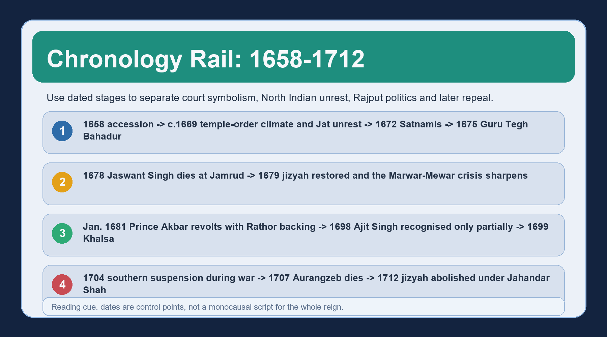
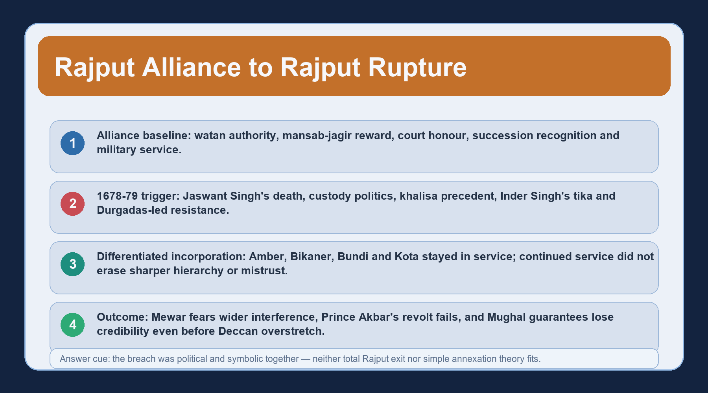

# Aurangzeb: Religious Policy, North India & the Rajputs

**Topic orientation:** This topic studies how Aurangzeb's legal-symbolic choices, North Indian unrest and the Marwar-Mewar rupture affected Mughal legitimacy. It follows the 1657-58 succession outcome and precedes the Deccan-Maratha war as the main story; a strong UPSC answer should move from claim to dated evidence, then explain consequence and qualification.


*Topic 22 cover visual: chronology, law, jizyah, temple evidence, North Indian unrest and the Rajput rupture under Aurangzeb.*

## BASIC LEARNING SESSION



*Chronology rail: use dates to separate unlike developments before interpreting them.*

### SESSION 1 - REIGN FRAME, TOPIC BOUNDARY AND CHRONOLOGY

**Plain-English core:** Begin with a controlled chronology and a strict topic boundary, not with a ready-made moral verdict.

**Technical precision:** Topic 22 owns Aurangzeb's post-1658 North Indian religious-policy and alliance problem: sharia-zawabit relations, jizyah, temple-policy evidence, Jat/Satnami/Sikh contexts, and the Marwar-Mewar rupture.

**Distinctive framing:** Topic 21 stops with the 1657-58 succession outcome; Topic 23 owns Shivaji, the Marathas, the prolonged Deccan war and the jagirdari crisis.

```text
TOPIC 22 SPINE
1658 accession result
    -> law, idiom and sovereignty
    -> jizyah and temple controversies
    -> north Indian unrest
    -> Marwar-Mewar rupture
    -> prestige loss before Deccan overstretch
```

Use chronology to keep unlike events apart: the 1669 temple-order context, the 1672 Satnami rising, the 1675 execution of Guru Tegh Bahadur, Jaswant Singh's death in 1678, jizyah in 1679, Prince Akbar's revolt in 1681, Ajit Singh's recognition in 1698, the Khalsa in 1699, Aurangzeb's death in 1707 and the formal abolition of jizyah in 1712. The point is not to list dates mechanically; the point is to stop one development from being lazily used to explain every other development. A disciplined answer begins with differentiated rule under pressure, then specifies which measure, locality, source type and political setting is under discussion. That method already blocks the two laziest errors: turning the reign into a single communal script, or erasing religious differentiation because political calculation also existed.

#### Analytical drill

**Question:** What opening sentence keeps Topic 22 inside its proper syllabus boundary?

**How to use it:** Write that Aurangzeb's reign in North India must be read through differentiated rule under pressure, with each policy or conflict tied to its own date, locality and source base.

#### PARAGRAPH DEMONSTRATION

**Claim:** Topic 22 becomes analytically clear only when chronology and ownership boundaries are fixed before interpretation begins.

**Named evidence / example:** The syllabus boundary itself is explicit: Topic 21 stops with the 1657-58 succession result, Topic 22 owns jizyah, temple evidence, North Indian unrest and the Rajput rupture, and Topic 23 owns Shivaji, the Marathas and the long Deccan war.

**Analysis:** That boundary discipline prevents a student from importing the whole Deccan war into a Marwar answer or from reteaching Shah Jahan while discussing Aurangzeb's North Indian legitimacy problem.

**Qualification:** Chronology is a control device, not the answer itself; the examiner still expects explanation of mechanism, evidence and consequence.

#### CLOSING RECALL FLOW

**MUST-WRITE KEYWORDS (5-6 only):**
- 1658-1712 frame
- topic boundary
- differentiated rule
- dated evidence
- North India
- Topic 23 limit

**How to use them in a sentence:** A safe introduction says that Topic 22 explains how Aurangzeb's legal-symbolic choices and Rajput policy affected North Indian legitimacy between 1658 and 1707, with later abolition of jizyah as a postscript.

**One contrast to remember:** A chronology rail is not a monocausal chain.

**Examiner trap to avoid:** Do not let a Deccan narrative swallow a North Indian legitimacy question.

### SESSION 2 - SHARIA, ZAWABIT, FATAWA-I-ALAMGIRI AND IMPERIAL SOVEREIGNTY

**Plain-English core:** Aurangzeb was personally orthodox, but orthodoxy did not dissolve imperial discretion.

**Technical precision:** Sharia supplied the legal idiom and moral preference; zawabit remained ruler-made regulations through which a Timurid sovereign selected, adapted and enforced policy.

**Distinctive framing:** The state was neither an ulama-run theocracy nor a modern secular state. It was a legal-political monarchy with multiple institutional channels.

```text
LEGAL-POLITICAL CHAIN
sharia opinion
    -> emperor chooses / frames order
    -> provincial officer or qazi applies or evades
    -> locality negotiates, resists or absorbs
```

The Fatawa-i-Alamgiri matters because it shows imperial investment in Hanafi jurisprudence, not because it converts the empire into a modern written constitution. A legal compendium is not self-enforcing. Equally, the continued use of zawabit means political need could still shape appointments, remissions, revenue arrangements and military command. Satish Chandra's balance is crucial here: Aurangzeb wished to remain closer to Islamic law than his predecessors, yet he still ruled as a sovereign who had to choose among opinions and live with uneven enforcement. The ulama, qazis and sadrs benefited from patronage, but they were not one disciplined bloc. Their influence varied across locality, office and circumstance, and even a formally legal measure could acquire different meanings once it moved through ordinary administration.

#### Analytical drill

**Question:** Why is “orthodox emperor” not the same statement as “ulama ruled the empire”?

**How to use it:** Because the emperor retained appointment power, revenue authority, military command and regulatory discretion; orthodoxy shaped preference, not automatic total control by jurists.

#### PARAGRAPH DEMONSTRATION

**Claim:** Aurangzeb's reign is best understood as an orthodox legal idiom operating inside continued imperial sovereignty, not as a simple replacement of monarchy by clerical rule.

**Named evidence / example:** Aurangzeb sponsored the Fatawa-i-Alamgiri as a Hanafi compendium, yet he still appointed officials, regulated through zawabit, granted exceptions and retained sovereign discretion over revenue, war and settlement.

**Analysis:** That distinction lets you explain why the emperor could reimpose jizyah or sponsor juristic compilation while still retaining the power to suspend collection, grant exceptions or pursue political settlements.

**Qualification:** This does not soften the discriminatory force of some measures; it only describes the actual institutional form more accurately.

#### CLOSING RECALL FLOW

**MUST-WRITE KEYWORDS (5-6 only):**
- sharia
- zawabit
- Fatawa-i-Alamgiri
- Timurid sovereignty
- ulama patronage
- uneven enforcement

**How to use them in a sentence:** Use the pair sharia-plus-zawabit to show that Aurangzeb tightened legal-symbolic language without abolishing imperial discretion.

**One contrast to remember:** A legal idiom is not identical with identical enforcement.

**Examiner trap to avoid:** Do not call the Fatawa-i-Alamgiri a constitution or a uniform criminal code.

### SESSION 3 - PERIODISE POLICY: COURT PURITANISM, SYMBOLIC CHANGE AND IMPLEMENTATION LIMITS

**Plain-English core:** A long reign must be periodised; otherwise stray anecdotes harden into folklore.

**Technical precision:** The safest phases are early pragmatic continuity, selective puritan and court-symbolic regulation, a sharper 1669-79 legal-symbolic turn, and later wartime rule with continued exceptions and uneven reach.

**Distinctive framing:** This is not a claim that every province changed on one date. It is a way to organise evidence without pretending the reign was static.

| Phase | Best exam-safe description |
|---|---|
| early reign | pragmatic continuity with growing orthodoxy |
| mid-reign | court-symbolic change and moral regulation |
| c. 1669-79 | sharper legal-symbolic differentiation |
| later war years | continued coercion plus exceptions and administrative variation |

Reported action against intoxicants, gambling, prostitution, selected ceremonies and court practices must be read with care. The question to ask is whether the evidence describes a court ritual change, a moral instruction, a province-specific order or a verified implementation chain. Measures such as the end of jharoka darshan, the reduced place of Nauroz, the reported constraints on music at court, the regulation of coin formulae, the appointment of muhtasibs and mosque repair all mattered symbolically because they altered the public language of sovereignty. Coin formulae belong in exactly that court-symbolic group beside Nauroz and court music: coinage was one of the standing public declarations of rulership, so regulating its formulae altered the sovereign idiom rather than proving any change in local practice. Yet symbolic force does not prove identical village enforcement. The opposite mistake is equally bad: uneven implementation does not make the order meaningless. A strong answer therefore periodises policy, notes genre and locality, and then distinguishes between public idiom, administrative order and social penetration. Each listed measure - coin formulae included - still needs its own date, source genre, locality and evidence of implementation or exception before it is written into an answer.

#### Analytical drill

**Question:** How do you stop court anecdotes from becoming empire-wide claims?

**How to use it:** Always ask: exact date, type of action, source genre, locality and evidence of implementation or exception.

#### PARAGRAPH DEMONSTRATION

**Claim:** Periodisation is the simplest way to keep Aurangzeb's long reign from collapsing into either a static-label narrative or a pile of disconnected moral anecdotes.

**Named evidence / example:** Aurangzeb ended jharoka darshan, reduced the court place of Nauroz, regulated coin formulae, appointed muhtasibs, saw the 1669 temple-order context sharpen public idiom, and then reimposed jizyah in 1679 - concrete markers that separate a court-symbolic turn from the later legal-symbolic hardening.

**Analysis:** Once you periodise, a court-centred symbolic shift can be treated as politically meaningful without being falsely expanded into a perfectly enforced social revolution.

**Qualification:** Phases are analytical aids, not airtight chronological walls.

#### CLOSING RECALL FLOW

**MUST-WRITE KEYWORDS (5-6 only):**
- periodisation
- court symbolism
- muhtasib
- jharoka
- implementation gap
- public idiom

**How to use them in a sentence:** Write that court puritanism changed the idiom of sovereignty, but each order still needs separate evidence before it is scaled into a social-history claim.

**One contrast to remember:** A symbolic change can matter even when enforcement was patchy.

**Examiner trap to avoid:** Do not quote popular lists of prohibitions as if every item had the same date, reach and proof.

### SESSION 4 - JIZYAH IN 1679: LEGAL CATEGORY, MOTIVE DEBATE AND POLITICAL EFFECT

**Plain-English core:** Jizyah was a differentiated poll tax with real symbolic force, but it cannot be explained or used as if it were one-dimensional.

**Technical precision:** It was neither land revenue nor a tax on every Hindu without exception; categories, exemptions, remissions and enforcement variation mattered, and the receipts were assigned to a separate treasury for needy Muslims and the ulama rather than to the general treasury.

**Distinctive framing:** The right question is not “religious or political?” as a forced binary. The right question is how legal idiom, public signal, patronage, fiscal form and wartime pressure interacted.

```text
JIZYAH, 1679
legal distinction
    + public assertion of Islamic rulership
    + separate treasury for needy Muslims / ulama
    + collector-subject friction
    + corruption / remission / suspension
    -> symbolic alienation beyond cash yield
```

Several linked facts have to stay together here. Jizyah marked differentiated non-Muslim subjecthood in classical Islamic law. It did not replace land revenue. Women, children and indigent persons figured among exempt categories, and the category structure and unit problem make casual rate-quoting unsafe unless the source is specified. Where the money went is itself an examinable fact. The proceeds were placed in a separate treasury earmarked for needy Muslims and the ulama, rather than simply flowing into the general treasury to relieve ordinary imperial expenditure. That accounting choice is analytically useful because it shows the measure carrying a declared confessional and patronage purpose alongside its fiscal form: the tax cannot be described as a neutral supplement to ordinary agrarian finance, and its earmarking reinforced the same public message about differentiated status that the reimposition itself sent. Satish Chandra also notes an awkward administrative truth: he cites a large official total, yet revenue claims and official totals do not automatically equal clean realised yield, so a court figure must never be converted into exact realised revenue. Some collection was corrupt or grasping, and remissions occurred in crop-failure conditions. In 1704 collection was suspended in the south for the duration of war, and the tax was formally abolished under Jahandar Shah in 1712. The political meaning lay not only in money but in visible reversal of Akbarian precedent and in new sites of collector-subject friction. That is why uneven collection did not cancel the measure's symbolic effect.

#### Analytical drill

**Question:** What is the safest verdict on why jizyah matters historically?

**How to use it:** State that it mattered as legal-symbolic differentiation with administrative and political consequences, even though it was not the sole cause of rebellion or decline.

#### PARAGRAPH DEMONSTRATION

**Claim:** Jizyah became politically consequential less because it solved a fiscal problem than because it publicly re-marked hierarchy and widened mistrust under pressure.

**Named evidence / example:** The 1679 reimposition, exempt categories, the assignment of receipts to a separate treasury for needy Muslims and the ulama, crop-failure remissions, corruption among some collectors, the 1704 southern suspension and the 1712 abolition together show a policy whose meaning was public and political as well as fiscal.

**Analysis:** That evidence supports a multi-causal reading in which the tax is neither reduced to pure piety nor exaggerated into a single mechanical cause of all resistance.

**Qualification:** Because collection varied and revenue realisation is uncertain, cash totals should be used carefully and only with explicit source control.

#### CLOSING RECALL FLOW

**MUST-WRITE KEYWORDS (5-6 only):**
- 1679 jizyah
- poll tax with exemptions
- separate treasury
- symbolic reversal
- collector corruption
- 1712 abolition

**How to use them in a sentence:** In an answer, call jizyah a differentiated poll tax whose receipts were earmarked for needy Muslims and the ulama and whose symbolic reversal of Akbarian precedent outweighed any neat fiscal success story.

**One contrast to remember:** Uneven collection is not proof of political insignificance.

**Examiner trap to avoid:** Do not confuse jizyah with kharaj, customs duty or an undifferentiated tax on every Hindu, and do not treat it as ordinary revenue that simply relieved the general treasury.

### SESSION 5 - TEMPLE POLICY: DATED SITES, EVIDENCE CATEGORIES AND REJECTING BOTH CARICATURES

**Plain-English core:** Temple policy cannot be handled by one slogan because grants, restraint, punitive demolition, conversion and local variation all appear in the record.

**Technical precision:** The secure method is dated site -> source type -> stated context -> actual action -> regional reach -> counter-evidence.

**Distinctive framing:** This topic must reject both caricatures: “all temples were destroyed everywhere” and “only new or rebellious temples were ever touched.”

| Evidence category | Example of what it can prove | Built-in caution |
|---|---|---|
| general order | policy language and target category | does not itself prove uniform empire-wide action |
| site-specific destruction | actual coercive action at a named place | one site is not the whole empire |
| grant/protection | transaction or protection in a locality | does not erase punitive action elsewhere |
| wartime temple action | political punishment linked to conflict | politics does not make the religious dimension vanish |

Temple evidence in this reign has to be read through a graded ladder rather than one slogan. A formal legal distinction could protect old places of worship of dhimmis while opposing new construction or perceived challenge. Actual Mughal practice did not stay inside one neat rule. The 1669 order sits in a court-chronicle setting connected with objectionable teaching; Kashi Vishvanath and the Keshava Rai temple at Mathura became major cases. During the 1679-80 Rajput war, old temples in Jodhpur and Udaipur areas were also destroyed. At the same time, grants, protection and non-interference continued elsewhere. The analytical gain comes from separating types of action: demolition, conversion, defacement, confiscation, restriction, restoration and grant are not interchangeable. Nor should politics be used as a magic solvent. Political punishment may help explain timing or target, but it does not erase real coercion or religious differentiation.

#### Analytical drill

**Question:** What sentence shows the examiner that you are not writing temple policy as polemic?

**How to use it:** Say that each temple case must be read through its date, source, action and context, because neither universal destruction nor blanket exoneration matches the evidence.

#### PARAGRAPH DEMONSTRATION

**Claim:** Temple policy under Aurangzeb can be defended only through case-based source criticism, because the record combines both punitive destruction and continued patronage or protection.

**Named evidence / example:** The court-chronicle record of the 1669 order, the major site cases at Kashi Vishvanath and the Keshava Rai temple at Mathura, the Rajput-war demolitions in Jodhpur-Udaipur zones, and the survival of grants or protection elsewhere belong in one dated evidence ladder.

**Analysis:** That ladder lets you explain why old-versus-new temple distinctions mattered formally while also showing that old-standing temples could still be attacked in particular political settings.

**Qualification:** Not every surviving or damaged structure has equally strong documentation, so site-specific claims should be phrased with the exact level of certainty the evidence permits.

#### CLOSING RECALL FLOW

**MUST-WRITE KEYWORDS (5-6 only):**
- 1669 order
- Kashi
- Mathura
- Rajput-war demolitions
- grants and protection
- case method

**How to use them in a sentence:** A high-quality answer rejects both caricatures and then works through named sites, source type and actual action.

**One contrast to remember:** One grant does not cancel one demolition; one demolition does not define the entire empire.

**Examiner trap to avoid:** Do not let present-day litigation language substitute for dated medieval evidence.

### SESSION 6 - CONTINUED HINDU SERVICE AND DIFFERENTIATED INCORPORATION

**Plain-English core:** Religious differentiation and continued Hindu-Rajput service existed together; the right category is differentiated incorporation.

**Technical precision:** Hindu, Rajput and later some Maratha mansabdars continued in imperial service even while discriminatory orders and symbolic hierarchy sharpened.

**Distinctive framing:** Elite inclusion is not the same claim as mass religious equality, and discrimination is not the same claim as total exclusion from service.

```text
COMPOSITE SERVICE UNDER STRAIN
continued mansabdars
    + administrative need
    + imperial rank/jagir incentives
    - jizyah and discriminatory symbolism
    - mistrust in some regions and houses
```

Continued service cannot be treated as exoneration. Rajput houses such as Amber, Bikaner, Bundi and Kota remained in Mughal service after 1679. Hindu service numbers could still grow. Yet some discriminatory orders regarding appointments or customs were issued, modified or locally evaded. The right inference is therefore not equality but differentiated incorporation: the empire still needed skilled commanders, administrators and regional intermediaries, but it increasingly projected a sharper public hierarchy. This distinction matters in both Prelims and Mains. In Prelims, it stops absolute statements like “Aurangzeb expelled Hindus from service.” In Mains, it shows that composite recruitment survived institutionally even while legitimacy worsened politically.

#### Analytical drill

**Question:** Why is “continued Hindu service” a necessary but incomplete sentence?

**How to use it:** Because it proves continued elite incorporation, but it does not settle the separate question of legal-symbolic differentiation and political trust.

#### PARAGRAPH DEMONSTRATION

**Claim:** Aurangzeb's state retained a composite service structure, but the terms of inclusion became more sharply differentiated and politically costly.

**Named evidence / example:** Rajput houses such as Amber, Bikaner, Bundi and Kota remained in Mughal service after 1679 even while discriminatory orders, sharper hierarchy and jizyah-temple controversies altered the political climate.

**Analysis:** That phrasing preserves two truths together: the empire did not become an all-Muslim service machine, and it also did not preserve the older idiom of equal partnership unchanged.

**Qualification:** Exact late-reign percentages are unsafe unless the source, denominator and rank threshold are clearly cited.

#### CLOSING RECALL FLOW

**MUST-WRITE KEYWORDS (5-6 only):**
- continued service
- Rajput mansabdars
- administrative need
- discriminatory orders
- differentiated incorporation
- elite vs mass

**How to use them in a sentence:** Write that Aurangzeb still ruled through a composite service elite, but one operating under a sharper legal-symbolic hierarchy.

**One contrast to remember:** Inclusion in office is not identical with equal public standing.

**Examiner trap to avoid:** Do not let one true statement about mansabdars erase the equally true statement about discrimination.

### SESSION 7 - JATS, SATNAMIS AND BUNDELAS: NORTH INDIAN UNREST WITHOUT FLATTENING

**Plain-English core:** North Indian unrest under Aurangzeb was not one uniform communal rebellion.

**Technical precision:** The Jat rising around Mathura-Agra, the 1672 Satnami revolt near Narnaul and Bundela resistance each had distinct social base, locality and trigger structure, and the Jat case itself recurred under later leaders rather than ending with one rising.

**Distinctive framing:** These movements should be explained through local power, agrarian pressure, official coercion, community mobilisation and political opportunity, not through one abstract label.

| Movement | Region / date anchor | Exam-safe causal frame |
|---|---|---|
| Jat rising | Mathura-Agra, c. 1669 under Gokula, with later resistance under Rajaram and Churaman | revenue, zamindari, coercion, community leadership |
| Satnami revolt | Narnaul, 1672 | local clash escalated through sect-community mobilisation |
| Bundela resistance | Bundelkhand, Champat Rai / Chhatrasal contexts | local chiefship, extraction, service and rebellion |

The Jats were cultivators, zamindars and clan communities; Gokula's rising in the Mathura region cannot be collapsed into either pure peasant revolt or pure temple politics. Nor did Jat resistance end when that rising was crushed. Later Jat resistance under Rajaram and then Churaman shows recurrence rather than a single event: the same Mathura-Agra belt produced renewed armed leadership across the later reign, which is why the Jat case is best written as a repeating state-society conflict in one agrarian zone, not as one suppressed revolt. The recurrence is the analytical point, and it should still be kept separate from the eighteenth-century consolidation of a Jat state at Bharatpur. The Satnami case began from a local clash and escalated through a community of cultivators and artisans before rapid suppression. Bundela resistance belonged to a longer frontier-chiefship world of Mughal extraction, local autonomy and service bargaining. The analytical value of keeping them apart is large. It shows that imperial legitimacy in North India was being tested in several registers at once: revenue pressure, local honour, sectarian identity, coercive officials and military opportunity. It also shows why religion alone cannot explain every rising, even though religious-symbolic developments formed part of the atmosphere in which some conflicts sharpened.

#### Analytical drill

**Question:** What is the most useful one-line verdict on these rebellions?

**How to use it:** Say that they reveal state-society conflict becoming armed challenge through locally specific combinations of agrarian pressure, coercion, community mobilisation and political setting.

#### PARAGRAPH DEMONSTRATION

**Claim:** Jat, Satnami and Bundela unrest matters because it reveals multiple local routes by which Mughal authority could become vulnerable in North India.

**Named evidence / example:** The c. 1669 Gokula rising in the Mathura region and its later continuation under Rajaram and Churaman, the 1672 Satnami mobilisation near Narnaul, and the Bundelkhand careers of Champat Rai and Chhatrasal point to three different North Indian routes from local conflict to armed challenge.

**Analysis:** Reading them side by side shows both a common imperial problem - coercive extraction meeting local mobilisation - and the danger of flattening unlike movements into a single rebellion template; the Jat sequence from Gokula to Rajaram and Churaman further shows that one suppression did not settle the zone.

**Qualification:** They were not modern national revolts, and each chronology must be kept separate from later political formations such as Bharatpur or eighteenth-century Bundela expansion.

#### CLOSING RECALL FLOW

**MUST-WRITE KEYWORDS (5-6 only):**
- Jats: Gokula, Rajaram, Churaman
- Satnamis
- Bundelas
- local mobilisation
- agrarian pressure
- state-society conflict

**How to use them in a sentence:** In an answer, compare social base and trigger structure rather than forcing all unrest into one communal box.

**One contrast to remember:** Shared imperial context does not mean identical rebellion type.

**Examiner trap to avoid:** Do not write Bharatpur-state hindsight into Gokula's initial rising.

### SESSION 8 - SIKH CONTEXT, GURU TEGH BAHADUR AND LIMITS OF THE SOURCE RECORD

**Plain-English core:** The 1675 execution of Guru Tegh Bahadur is central to North Indian legitimacy, but the evidence must be handled with explicit source criticism.

**Technical precision:** Contemporary Persian narratives are incomplete; later Persian texts, Sikh memory and the Kashmir-Pandit tradition do not carry the same evidentiary weight, yet none can be ignored.

**Distinctive framing:** Topic 22 owns the state-policy connection under Aurangzeb, not the entire later Sikh institutional history.

```text
1675 SIKH QUESTION
imperial security framing
    <-> Sikh martyr memory
    <-> later tradition and community identity
    -> hardened relations, but not one-step causation to every later event
```

Source caution is essential here. Guru Tegh Bahadur became Guru in 1664, travelled eastward and returned to Punjab before his arrest and execution at Delhi in November 1675. Later Persian accounts often frame the punishment as law-and-order or rebellion; Sikh tradition centres martyrdom and defence of religious freedom; the Kashmir-Pandit story enters memory through later textual routes that require chronology care. Satish Chandra nonetheless regards the punishment as unjustified. The secure analytical move is to acknowledge imperial security framing, religious coercion and the making of Sikh martyr memory together. Then add the bounded consequence: Guru Gobind Singh's Khalsa in 1699 hardened the political-military edge of the community, but 1675 should not be treated as a single automatic switch that mechanically explains every later Sikh development.

#### Analytical drill

**Question:** How do you answer this without pretending that one source settles every motive?

**How to use it:** By stating the competing source traditions, identifying the punishment as unjustified in Chandra's view, and connecting it to harder Sikh-Mughal relations without claiming one-step causation.

#### PARAGRAPH DEMONSTRATION

**Claim:** Guru Tegh Bahadur's execution matters historically because it fused coercive imperial action with a durable memory of martyrdom, thereby deepening the legitimacy cost of Aurangzeb's rule in the Punjab sphere.

**Named evidence / example:** The secure chronology runs from Guru Tegh Bahadur's guruship in 1664 to his Delhi execution in November 1675, while Persian security framing, Sikh martyr memory and later Kashmir-linked tradition all survive in different genres.

**Analysis:** That evidence supports a balanced answer which neither collapses the event into mere security administration nor claims that one late narrative transparently settles every detail.

**Qualification:** Detailed Sikh institutional history and later battles belong to separate owners; Topic 22 keeps the focus on the Aurangzeb-period policy connection.

#### CLOSING RECALL FLOW

**MUST-WRITE KEYWORDS (5-6 only):**
- Guru Tegh Bahadur
- 1675 execution
- source criticism
- martyr memory
- imperial security framing
- Khalsa boundary

**How to use them in a sentence:** Use the event as a legitimacy and memory question, not as a licence for uncritical narrative certainty.

**One contrast to remember:** A profound antecedent is not the same thing as a sole cause.

**Examiner trap to avoid:** Do not pretend a single transparent contemporary narrative exists.

### SESSION 9 - THE RAJPUT ALLIANCE BEFORE THE BREACH: WATAN, HONOUR AND SERVICE

**Plain-English core:** To understand why Marwar-Mewar mattered, you must first know what the Mughal-Rajput partnership promised.

**Technical precision:** The alliance rested on watan authority, imperial mansab and jagir, honour-status at court, succession recognition and military service.

**Distinctive framing:** This was not equality, but it was a durable political bargain whose credibility depended on Mughal guarantees.

```text
AKBARI-TO-SHAH JAHANI RAJPUT BARGAIN
watan authority
    + imperial mansab / jagir
    + honour and precedence
    + succession recognition
    -> long-term service partnership
```

Aurangzeb initially worked with leading Rajput rulers such as Jai Singh and Jaswant Singh. Jai Singh shaped the 1665 settlement with Shivaji; Jaswant continued in major service. That earlier collaboration matters because it shows the Marwar crisis was not the expression of a permanent anti-Rajput plan from 1658 onward. The partnership nevertheless rested on sensitive political goods: recognition of hereditary authority, honour, control over watan, stable ranking at court and trust that succession disputes would be handled in a manner compatible with service. Once that trust weakened, the issue was larger than one succession quarrel. It raised the question whether Mughal centralisation still protected old allies or had begun to treat them as disposable intermediaries.

#### Analytical drill

**Question:** Why should a Rajput answer begin with the older bargain rather than with 1678 alone?

**How to use it:** Because rupture has meaning only against the background of a tested exchange of watan, mansab, honour and succession recognition.

#### PARAGRAPH DEMONSTRATION

**Claim:** The Marwar-Mewar rupture damaged Mughal legitimacy most deeply because it broke a partnership that had earlier integrated major Rajput houses into imperial command.

**Named evidence / example:** The Rajput compact joined watan authority, mansab-jagir reward, court honour, succession recognition and military service, and Aurangzeb's early collaboration with Jai Singh and Jaswant Singh shows that this bargain still functioned before 1678.

**Analysis:** That formula shows why later interference was interpreted not as a routine administrative correction but as a threat to the political terms of alliance itself.

**Qualification:** Different Rajput houses responded differently, so the breach with Marwar-Mewar must not be confused with total Rajput secession.

#### CLOSING RECALL FLOW

**MUST-WRITE KEYWORDS (5-6 only):**
- watan
- mansab-jagir
- honour
- succession recognition
- Jai Singh
- Jaswant Singh

**How to use them in a sentence:** Always define the Rajput alliance as an exchange system before explaining why the breach was so costly.

**One contrast to remember:** An unequal bargain can still be politically stable until its guarantees lose credibility.

**Examiner trap to avoid:** Do not write as if Aurangzeb never collaborated with Rajput grandees before 1678.

### SESSION 10 - MARWAR CRISIS, 1678-79: JASWANT SINGH, AJIT SINGH, KHALISA AND DURGADAS

**Plain-English core:** Marwar did not explode because of one tax alone; it became a legitimacy crisis when succession, custody, debt, honour and religious mistrust converged.

**Technical precision:** After Jaswant Singh's death at Jamrud in 1678, Marwar was taken into khalisa amid disputed succession, debt, withheld revenue and disorder; Ajit Singh emerged as the posthumous claimant, the competing claims of the ranis and the Rathor sardars were mishandled, the Rathors restored Ajit's tika at Jodhpur against the emperor's recognition of Inder Singh, and Durgadas Rathore organised the resistance.

**Distinctive framing:** Khalisa control had precedents and does not by itself prove a pre-set plan of permanent annexation. The crisis lay in how the settlement was handled.



*Rajput rupture visual: succession, khalisa and honour turning into political breach.*

| Escalation point | Why it mattered |
|---|---|
| khalisa takeover | imperial interim control during disputed succession |
| recognition of Inder Singh | signalled disregard for Rathor expectation |
| mishandled claims of the ranis and Rathor sardars | left the question of who spoke for Marwar open instead of settling it |
| search / official conduct | made Mughal power look like conquest |
| Ajit's custody issue | turned succession into honour politics |
| Rathor restoration of Ajit's tika at Jodhpur | a rival investiture answering the imperial choice |
| temple action and jizyah climate | deepened mistrust and fear |

The newer evidence ladder from Waqa-i-Ajmer and the Jodhpur Hukumat-ri-Bahi matters because it corrects a simplistic annexation story without absolving Aurangzeb. Taking Marwar into khalisa amid disputed succession and debt had administrative precedents. Yet the actual policy became clumsy and coercive. Officials behaved as conquerors, imperial intervention in custody and succession offended honour, Aurangzeb backed Inder Singh for the tika, and the Rathor sardars rejected the proposed arrangements. The competing claims of the ranis and the Rathor sardars were mishandled rather than settled, so the question of who legitimately spoke for Marwar stayed open. The Rathors then answered the imperial choice directly: they restored Ajit's tika at Jodhpur, which converted a contested succession into two rival investitures - one recognised by the emperor, one performed by the clan in its own capital. Durgadas organised resistance and protected Ajit Singh's claim. The Marwar evidence therefore points to a layered explanation: succession, watan, debt and imperial overreach formed the immediate frame, while religion sharpened the legitimacy crisis rather than standing outside it.

#### Analytical drill

**Question:** What sentence distinguishes a high-quality Marwar answer from a crude annexation story?

**How to use it:** Write that khalisa had precedents, but the actual handling of succession, custody, honour and official conduct converted interim control into a major legitimacy breach.

#### PARAGRAPH DEMONSTRATION

**Claim:** Marwar became explosive not because interim khalisa control was unprecedented, but because Mughal policy made a disputed succession look like hostile conquest and dishonour.

**Named evidence / example:** Waqa-i-Ajmer and Jodhpur Hukumat-ri-Bahi emphasise disputed succession, debt, official behaviour, Inder Singh's tika and Durgadas's resistance, while the Marwar sequence itself adds the mishandled claims of the ranis and Rathor sardars and the Rathor restoration of Ajit's tika at Jodhpur.

**Analysis:** That reading improves on both extremes: it rejects the claim that annexation was automatic from the first hour, and it also rejects the idea that administrative precedent makes Aurangzeb's conduct harmless.

**Qualification:** Individual rescue stories and later bardic embellishments need provenance control; the stable historical core lies in succession, resistance and failed settlement.

#### CLOSING RECALL FLOW

**MUST-WRITE KEYWORDS (5-6 only):**
- Jaswant 1678
- Ajit Singh
- khalisa
- Inder Singh
- Durgadas
- honour crisis

**How to use them in a sentence:** Frame Marwar as disputed succession mishandled into a conquest-like legitimacy crisis.

**One contrast to remember:** Administrative precedent does not guarantee political wisdom.

**Examiner trap to avoid:** Do not say khalisa automatically ended Rathor claims or that religion alone explains the whole crisis.

### SESSION 11 - MEWAR, PRINCE AKBAR AND THE PRESTIGE COST OF THE BREACH

**Plain-English core:** Mewar entered the conflict because Mughal handling of Marwar threatened Rajput security and political autonomy more broadly.

**Technical precision:** Rana Raj Singh opposed Mughal occupation of Marwar and interference in Rajput succession; Prince Akbar's 1681 revolt with Rathor support then turned the crisis into a dynastic-political challenge.

**Distinctive framing:** After 1681 the immediate military cost was uneven, but the prestige and trust cost remained deep, especially as Aurangzeb moved into the prolonged Deccan war owned by Topic 23.

```text
MARWAR -> MEWAR -> PRINCE AKBAR
occupation of Marwar
    -> Mewar fears wider interference
    -> Rathor-Mewar cooperation
    -> Prince Akbar revolt, Jan 1681
    -> revolt fails, mistrust survives
```

Rana Raj Singh was not merely helping a relative; he was defending a political order in which Mughal intrusion into Rajput succession could threaten more than one house. Terrain and local alliances raised imperial costs. Prince Akbar's revolt in January 1681 added a new layer by bringing Mughal dynastic politics into the Rajput breach. Aurangzeb used letters, intelligence and political manoeuvre to split the coalition; Akbar fled toward the Deccan. Mewar later reached a settlement after Rana Raj Singh's death, but Rathor war continued intermittently, and Ajit Singh's recognition in 1698 still fell short of full restoration. The key judgement is that the political cost exceeded the immediate later military cost because faith in Mughal guarantees had been damaged at exactly the moment the empire was entering deeper southern commitments.

#### Analytical drill

**Question:** What is the best concluding line on the Rajput wars?

**How to use it:** Say that the breach with Marwar-Mewar damaged the credibility of Mughal protection more than it delivered durable strategic gain, and that this cost mattered when Deccan overstretch followed.

#### PARAGRAPH DEMONSTRATION

**Claim:** The gravest consequence of the Marwar-Mewar rupture was not a total military collapse in Rajasthan but a serious loss of prestige and confidence in Mughal alliance guarantees.

**Named evidence / example:** Rana Raj Singh's support, difficult Aravalli terrain, Prince Akbar's revolt in January 1681, Mewar's later settlement and Ajit Singh's only limited recognition in 1698 form one continuous chain of prestige loss rather than a clean Rajput reconciliation.

**Analysis:** That chain explains why the Rajput wars belong inside a larger political-legitimacy story even when they are not treated as the empire's sole military disaster.

**Qualification:** Topic 23 owns the full Deccan-Maratha war and the jagirdari crisis; here the Deccan appears only as a bounded timing and resource bridge.

#### CLOSING RECALL FLOW

**MUST-WRITE KEYWORDS (5-6 only):**
- Mewar support
- Rana Raj Singh
- Prince Akbar 1681
- prestige cost
- limited 1698 recognition
- Deccan bridge

**How to use them in a sentence:** Conclude that the Rajput breach eroded trust in Mughal guarantees just as the empire needed reliable allies elsewhere.

**One contrast to remember:** A revolt can fail militarily and still succeed in exposing a political weakness.

**Examiner trap to avoid:** Do not confuse a limited later settlement with restoration of the pre-1678 compact.

### SESSION 12 - HISTORIOGRAPHY, SOURCE CRITICISM AND THE VERDICT ON NORTH INDIAN GOVERNANCE

**Plain-English core:** The best answer neither demonises by slogan nor sanitises by administrative euphemism; it uses source criticism to reach a graded verdict.

**Technical precision:** Court chronicles, farmans, temple grants, local Rajput records, Sikh tradition and material evidence each prove different things and carry different limits.

**Distinctive framing:** Satish Chandra's balanced frame rejects both communal monocause and pure statecraft-only revision: orthodoxy mattered, but political context and uneven administration shaped timing, reach and consequence.

| Historiographical position | What it sees well | What it misses if unqualified |
|---|---|---|
| communal monocause | real discrimination and symbolic alienation | explains too much through one identity axis |
| statecraft-only revision | succession, fiscal and strategic settings | can understate religious coercion and meaning |
| balanced view | orthodoxy plus political context plus uneven reach | requires patient evidence work, not slogan answers |

Satish Chandra calls Aurangzeb both a victim of circumstances and a maker of the circumstances that trapped him. That phrasing is useful because it preserves structure and agency together. The empire faced military pressure and complex regional politics, but the emperor also chose to sharpen legal-symbolic differentiation and handled Marwar-Mewar clumsily. Satish Chandra's judgement on the Rajput policy is especially clear: it was blundering and yielded no real advantage. The same balanced method should guide temple and Sikh questions. Court chronicles reveal official idiom and chronology, but they are selective. Farmans and grants prove local action, not empire-wide uniformity. Material remains show survival, damage or repair, but survival alone cannot prove motive. The final verdict for North Indian governance is therefore graded: differentiated incorporation survived institutionally, yet sharper hierarchy and mishandled Rajput succession widened the gap between coercive reach and political legitimacy.

#### Analytical drill

**Question:** What concluding sentence captures the whole topic without slipping into monocausality?

**How to use it:** Say that Aurangzeb's legal-symbolic turn and Rajput mismanagement weakened trust and legitimacy in North India, contributing to later strain without single-handedly causing imperial decline.

#### PARAGRAPH DEMONSTRATION

**Claim:** A defensible verdict on Topic 22 must combine real coercion and discrimination with careful limits on over-generalisation and monocausal decline narratives.

**Named evidence / example:** Court chronicles, farmans, temple grants, local Rajput records, Sikh memory traditions and material remains each prove different things, and Satish Chandra's description of the Marwar-Mewar line as clumsy and blundering fixes the verdict's sharpest edge.

**Analysis:** That evidence yields a strong exam answer because it acknowledges genuine exclusionary effects while still explaining how succession, administration, locality and alliance politics shaped the outcome.

**Qualification:** The empire did not stop functioning in 1679, and decline belongs to a longer chronology than this topic alone can carry.

#### CLOSING RECALL FLOW

**MUST-WRITE KEYWORDS (5-6 only):**
- source ladder
- Satish Chandra
- communal monocause
- statecraft-only revision
- blundering Rajput policy
- graded verdict

**How to use them in a sentence:** Finish with a graded verdict: sharper hierarchy and mishandled alliance politics weakened North Indian legitimacy, but they were contributory rather than solitary causes of later imperial strain.

**One contrast to remember:** Balanced history is not the same as false equivalence.

**Examiner trap to avoid:** Do not turn nuance into evasiveness; the topic still requires clear judgement on coercion and political damage.

### COMPLETE TOPIC ASCII MASTER FLOW DIAGRAM

#### ASCII MASTER FLOW — PANEL 1/6: Starting question, topic boundary and chronology

```ascii-master
STARTING QUESTION
  How far did sharper hierarchy, uneven coercive practice and Rajput
  mismanagement weaken Mughal legitimacy in North India?

1) TOPIC BOUNDARY
  Topic 21 -> succession war only as bridge to 1658.
  Topic 22 -> law, jizyah, temple evidence, Jat/Satnami/Sikh context, Rajput rupture.
  Topic 23 -> Shivaji, Marathas, Deccan war, jagirdari crisis.

2) CHRONOLOGY ANCHORS
  1658 accession result
   -> 1667 Jai Singh dies
   -> c.1669 temple-order/Jat environment
   -> 1672 Satnami rising near Narnaul
   -> 1675 Guru Tegh Bahadur executed at Delhi (Nov.)
   -> 1678 Jaswant Singh dies at Jamrud
   -> 1679 jizyah reimposed + Rajput war sharpens
   -> Jan. 1681 Prince Akbar revolt
   -> 1698 Ajit Singh recognised (limited)
   -> 1699 Khalsa founded
   -> 1704 southern suspension of jizyah
   -> 1707 Aurangzeb dies / 1712 formal abolition
```

#### ASCII MASTER FLOW — PANEL 2/6: Law, sovereignty and periodisation

```ascii-master
3) LAW AND SOVEREIGNTY
  sharia -> legal idiom / moral preference
  zawabit -> ruler-made regulation / political discretion
  Fatawa-i-Alamgiri -> Hanafi compendium, NOT constitution
  empire -> emperor appoints / taxes / wars / grants exceptions
  chain -> sharia opinion -> emperor frames order -> qazi or officer applies
           or evades -> locality absorbs, negotiates or resists

4) PERIODISE POLICY
  early pragmatic continuity
   -> court-symbolic puritan turn
      (end of jharoka darshan / reduced Nauroz / limits on court music /
       regulated coin formulae / muhtasibs appointed / mosque repair)
   -> c.1669-79 sharper legal-symbolic differentiation
   -> late wartime rule with exceptions and uneven enforcement
  RULE -> symbolic change matters; uneven enforcement does not erase it.
```

#### ASCII MASTER FLOW — PANEL 3/6: Jizyah and the temple-policy method

```ascii-master
5) JIZYAH, 1679
  poll tax on differentiated non-Muslim subjecthood; not land revenue, not customs
  exempt categories -> women, children, indigent persons and some dependants
  receipts -> separate treasury for needy Muslims / ulama, NOT general-treasury relief
   + orthodoxy
   + public assertion of Islamic rulership
   + juristic / ulama patronage
   + fiscal form
   -> collector-subject friction, corruption, crop-failure remission
   -> large official total (Satish Chandra) != realised yield
   -> 1704 southern suspension -> 1712 abolition under Jahandar Shah
   -> symbolic cost > neat fiscal gain

6) TEMPLE POLICY METHOD
  evidence ladder
   1. general or provincial order
   2. site-specific destruction / conversion / defacement
   3. wartime punishment in rebellious zones
   4. grants, protection or non-interference elsewhere
   5. material remains and later complaint records
  method -> dated site -> source type -> stated context -> actual action
            -> regional reach -> counter-evidence
  named cases -> c.1669 order context; Kashi Vishvanath; Keshava Rai temple at
                 Mathura; 1679-80 Rajput-war demolitions in Jodhpur-Udaipur areas
  counter-evidence -> grants, protection and non-interference continue elsewhere
  RULE -> reject both caricatures: neither universal destruction nor blanket
          exoneration fits the dated site-by-site evidence.
```

#### ASCII MASTER FLOW — PANEL 4/6: Differentiated incorporation, North Indian unrest and the Sikh case

```ascii-master
7) DIFFERENTIATED INCORPORATION
  continued Hindu, Rajput and some Maratha mansabdars in imperial service
   + administrative need
   + rank-jagir incentives
  houses still in service after 1679 -> Amber, Bikaner, Bundi, Kota
   - sharper public hierarchy
   - discriminatory orders issued, modified or locally evaded
   = composite service survives, equality does not
  RULE -> continued service != equality; discrimination != total exclusion.

8) NORTH INDIAN UNREST
  Jats -> Mathura-Agra / cultivators, zamindars and clan communities
       -> revenue pressure, local power, official coercion, religious-political climate
       -> c.1669 rising under Gokula
       -> later resistance under Rajaram and Churaman = recurrence, not one event
  Satnamis -> Narnaul 1672 / local clash -> cultivator-artisan mobilisation -> suppression
  Bundelas -> Champat Rai and later Chhatrasal / chiefship, extraction, service, rebellion
  RULE -> each movement has its own locality, social base and chronology;
          do not project the later Bharatpur state backward on to Gokula.

9) GURU TEGH BAHADUR
  guruship 1664 -> eastern travels -> return to Punjab -> arrest
   -> execution at Delhi, November 1675
  Persian security / rebellion framing
    <-> Sikh martyr memory and defence of religious freedom
    <-> later Kashmir-Pandit tradition: genre and chronology caution
  Satish Chandra -> the punishment was unjustified
  1699 Khalsa under Guru Gobind Singh -> major later consequence
  verdict -> profound antecedent and deep legitimacy cost,
             not a single automatic switch for every later Sikh development.
```

#### ASCII MASTER FLOW — PANEL 5/6: Rajput baseline, Marwar crisis and Mewar

```ascii-master
10) RAJPUT ALLIANCE BEFORE BREACH
  watan authority + mansab/jagir + honour and precedence
   + succession recognition + military service
  early Aurangzeb still relies on Jai Singh (1665 settlement with Shivaji)
   and on Jaswant Singh in major service
  RULE -> an unequal bargain stayed stable only while Mughal guarantees
          remained credible.

11) MARWAR CRISIS, 1678-79
  Jaswant Singh dies at Jamrud, 1678
   -> posthumous claimant Ajit Singh
   -> Marwar taken into khalisa amid disputed succession, debt, withheld revenue
      and disorder (khalisa precedent exists)
   -> official overreach, search and conduct, custody of Ajit, honour politics
   -> Inder Singh receives the tika -> Rathor sardars reject the settlement
   -> competing claims of the ranis and Rathor sardars mishandled
   -> Durgadas Rathore organises resistance and protects Ajit's claim
   -> Rathors restore Ajit's tika at Jodhpur -> rival investiture, not imperial grant
   -> succession + watan + debt + mistrust converge
  evidence -> Waqa-i-Ajmer and the Jodhpur Hukumat-ri-Bahi
  RULE -> khalisa != automatic annexation; the credibility of Mughal guarantees
          is the real issue.

12) MEWAR AND PRINCE AKBAR
  Rana Raj Singh opposes occupation of Marwar and interference in succession
   -> Mewar supports the Rathors -> Aravalli terrain raises imperial cost
   -> Prince Akbar revolts January 1681 with Rathor support
   -> Aurangzeb splits the coalition by letters, intelligence and manoeuvre;
      Akbar flees towards the Deccan
   -> revolt fails militarily; prestige and trust damage remains
   -> Mewar settles after Raj Singh's death; Rathor war continues intermittently
   -> 1698 recognition of Ajit Singh is limited, not full restoration
```

#### ASCII MASTER FLOW — PANEL 6/6: Historiography, prelims traps and answer spine

```ascii-master
13) HISTORIOGRAPHY AND VERDICT
  communal monocause -> sees real discrimination, over-explains by identity
  statecraft-only revision -> sees succession/debt/strategy, understates coercion
  balanced view (Satish Chandra) -> orthodoxy + politics + locality + uneven reach
  Chandra -> victim of circumstances AND maker of those circumstances
  Chandra on Rajput policy -> blundering, yielding no real advantage
  source ladder
   - court chronicles -> official idiom and chronology, but selective
   - farmans and grants -> local action, not empire-wide uniformity
   - local Rajput records -> Waqa-i-Ajmer, Hukumat-ri-Bahi
   - Sikh tradition -> memory and identity, genre caution
   - material remains -> survival, damage, repair; never motive by itself
  verdict -> differentiated incorporation survives institutionally, yet sharper
             hierarchy and mishandled Rajput succession widen the gap between
             coercive reach and political legitimacy.

PRELIMS TRAPS
  jizyah != land revenue, customs duty or a tax on every Hindu
  jizyah receipts != relief of the general treasury
  Fatawa-i-Alamgiri != constitution or uniform criminal code
  khalisa != automatic or final annexation
  continued Hindu service != equality
  old/new temple distinction mattered formally but did not settle every case
  one grant or one demolition never proves the whole empire
  1698 recognition != restoration of the pre-1678 compact
  Topic 23 owns the Deccan-Maratha war

MAINS ANSWER SPINE
  intro -> differentiated rule under pressure, dated and localised
  body 1 -> sharia / zawabit and periodisation
  body 2 -> jizyah and the temple evidence ladder
  body 3 -> North Indian unrest and the Sikh legitimacy cost
  body 4 -> Marwar-Mewar rupture and prestige loss
  conclusion -> contributory to weakened legitimacy and alliance trust,
                not the sole cause of imperial decline
```

## BASIC MCQS / REMEDIATION

### Part I - 16 learning MCQs

*These sixteen items are practice questions written for Topic 22; none of them is a reproduction of a past Civil Services Examination paper. Answer each one from the session you have just read before checking the explanation.*

#### Learning MCQ 1

**Question:** Which opening frame is most defensible for Topic 22?

- A. A dated, locality-specific analysis of differentiated rule
- B. A complete retelling of the Deccan war
- C. A moral verdict without chronology
- D. A denial that religion mattered at all

**Answer:** A.
**Explanation:** Topic 22 works best when each policy or conflict is tied to its own date, locality and source base; the distractors either cross into Topic 23 or erase the legal-symbolic problem.

#### Learning MCQ 2

**Question:** Which pair is correctly matched?

- A. Prince Akbar - revolt in 1675
- B. Jizyah - reimposed in 1679
- C. Jaswant Singh - death in 1698
- D. Khalsa - founded in 1672

**Answer:** B.
**Explanation:** 1679 is the secure date for reimposition of jizyah; the other options scramble the chronology of Prince Akbar, Jaswant Singh and the Khalsa.

#### Learning MCQ 3

**Question:** Why is the Fatawa-i-Alamgiri not safely described as a modern constitution?

- A. It abolished imperial regulations
- B. It was written after Aurangzeb's death
- C. It was a Hanafi legal compendium whose uniform enforcement cannot be presumed
- D. It was a Rajput succession register

**Answer:** C.
**Explanation:** The secure distinction is compendium versus administrative constitution; treating it as a self-executing code ignores zawabit and the emperor's continued discretion.

#### Learning MCQ 4

**Question:** What does zawabit indicate most clearly?

- A. A hereditary Rajput homeland
- B. A jizyah exemption category
- C. A Sikh corporate identity
- D. Ruler-made regulations operating alongside legal idiom

**Answer:** D.
**Explanation:** Zawabit names ruler-made regulations. The other options confuse it with watan, tax categories or Sikh institutional vocabulary.

#### Learning MCQ 5

**Question:** What is the safest inference about court puritan measures?

- A. A court-centred change needs separate evidence before it becomes an empire-wide social claim
- B. Every report is fabricated
- C. Every report was uniformly enforced
- D. Symbolic shifts had no political meaning

**Answer:** A.
**Explanation:** This answer respects scale. The reign's symbolic changes mattered, but each one still needs separate proof before it is expanded into a total social history statement.

#### Learning MCQ 6

**Question:** Jizyah should be distinguished most directly from:

- A. An order with symbolic meaning
- B. Land revenue and customs duty
- C. A tax reimposed in 1679
- D. A levy connected with non-Muslim subjecthood

**Answer:** B.
**Explanation:** The key conceptual separation is between jizyah as poll tax and agrarian/customs levies such as land revenue or transit-related dues.

#### Learning MCQ 7

**Question:** Which statement best captures the motive debate around jizyah?

- A. Only private piety explains it
- B. Only a fiscal emergency explains it
- C. Orthodoxy, political signalling and fiscal form can be weighed together
- D. It had no political meaning because collection varied

**Answer:** C.
**Explanation:** A multi-causal explanation fits the evidence. The other options each force a one-factor verdict the evidence does not justify.

#### Learning MCQ 8

**Question:** What is the safest conclusion about jizyah's impact?

- A. It instantly ended Hindu service
- B. It solved imperial finance
- C. It reached every subject uniformly
- D. Patchy collection did not stop it from carrying major symbolic cost

**Answer:** D.
**Explanation:** The tax mattered politically even where collection was uneven. That is exactly why symbolic and administrative history have to be read together.

#### Learning MCQ 9

**Question:** Which distinction is essential in temple-policy analysis?

- A. Demolition, conversion, confiscation, restriction and grant are separate actions
- B. One temple case proves a universal order
- C. A grant proves no destruction elsewhere
- D. A court chronicle proves uniform village practice

**Answer:** A.
**Explanation:** Separating action-types is the only reliable way to avoid both exaggeration and blanket exoneration.

#### Learning MCQ 10

**Question:** How should the 1669 order be used in an answer?

- A. As an undated universal destruction order
- B. As a chronicle-context claim whose wording, sites and follow-through need checking
- C. As a modern court finding
- D. As proof that no old temple suffered

**Answer:** B.
**Explanation:** The order must be read through genre, wording, target category and known cases. That is why a single sweeping conclusion is unsafe.

#### Learning MCQ 11

**Question:** What does a documented temple grant prove most directly?

- A. That no punitive action occurred elsewhere
- B. That all temples stood on equal legal footing
- C. That a particular locality saw protection or transaction in the stated context
- D. That all court chronicles are worthless

**Answer:** C.
**Explanation:** A grant is strongest as case-specific evidence. It checks universal claims, but it does not settle every other site or policy question.

#### Learning MCQ 12

**Question:** What does continued Rajput and Hindu service demonstrate?

- A. That discrimination disappeared
- B. That no Rajput resisted the empire
- C. That jizyah had no effect
- D. That elite incorporation continued under a differentiated hierarchy

**Answer:** D.
**Explanation:** The correct formulation is differentiated incorporation: continued service plus sharper legal-symbolic distinction.

#### Learning MCQ 13

**Question:** What is the strongest frame for the Jat rising around Mathura?

- A. Revenue pressure, local power and community mobilisation interacted
- B. It was already the Bharatpur state
- C. A single temple issue alone explains it
- D. It was an all-India revolt

**Answer:** A.
**Explanation:** The Jat movement needs a regional agrarian-political explanation. Later Bharatpur history or all-India language distorts the original scale.

#### Learning MCQ 14

**Question:** How should Guru Tegh Bahadur's execution be handled?

- A. As an event with no religious consequence
- B. By weighing imperial security framing and Sikh martyr memory together
- C. By relying on one transparent contemporary narrative
- D. As the sole direct cause of every later Sikh development

**Answer:** B.
**Explanation:** This answer respects the limits of the source record while still recognising the event's major legitimacy and memory consequences.

#### Learning MCQ 15

**Question:** What did taking Marwar into khalisa automatically mean?

- A. Permanent annexation was already complete
- B. All Rathor claims legally ended
- C. Interim crown-revenue control during disputed succession, not automatic final annexation
- D. That Prince Akbar had already rebelled

**Answer:** C.
**Explanation:** Khalisa had precedents in disputed succession. The crisis came from how the arrangement was handled, not from the word alone.

#### Learning MCQ 16

**Question:** Which final verdict is most defensible?

- A. Aurangzeb's religious policy caused immediate imperial collapse
- B. Religion is irrelevant because politics mattered
- C. The Rajput breach destroyed all Rajput service everywhere
- D. Sharper hierarchy and mismanaged alliances weakened legitimacy without acting as the sole cause of decline

**Answer:** D.
**Explanation:** The evidence supports a contributory, graded judgement rather than monocausal decline or apologetic erasure.

## PYQS AND ANSWER PRACTICE

### How this topic appears in Mains questions

Aurangzeb's reign is examined regularly, but most recent Mains questions that mention him move through the Deccan campaign, the Marathas and the jagirdari crisis, which are studied in Topic 23 - The Marathas, Shivaji and Aurangzeb's Deccan. Topic 22 supplies the North Indian half of the answer: sharia and zawabit, the 1679 jizyah, temple-policy evidence, Jat-Satnami-Sikh unrest and the Marwar-Mewar rupture. Practise that half with the six models below; they are written to the same directive words, mark weights and word limits as the examination, so a question on religious policy, temple evidence or Rajput alliance politics can be answered directly from them.

### Six original mains models

#### Original Mains 1 - 10 marks (150 words)

**Question:** Explain the relationship between sharia, zawabit and imperial sovereignty under Aurangzeb.

**Model answer:** Aurangzeb's reign cannot be reduced either to a pure juristic state or to value-free political pragmatism. He was personally orthodox and sought greater conformity with Islamic law, but the Mughal emperor still ruled through sovereignty, appointment power, revenue control and military command. That is why the pair sharia and zawabit is essential.

The Fatawa-i-Alamgiri shows imperial investment in Hanafi legal learning. Yet it was a juristic compendium, not a self-executing constitution. The emperor could still choose among opinions, sponsor officials, frame regulations and respond to political need. Court and provincial administration mediated every measure before it reached local society.

Hence the safest conclusion is that sharia shaped idiom and preference, while zawabit preserved sovereign discretion. Aurangzeb tightened legal-symbolic language more sharply than earlier emperors, but he did not abolish imperial politics or administrative unevenness.

**Demand decoding:** The directive asks for a conceptual explanation, so the answer must define both terms and then show how they interacted in actual sovereignty.

**Executable answer/elimination plan:** Open by rejecting both extremes; define sharia and zawabit; use the Fatawa-i-Alamgiri as named evidence; conclude with the phrase legal idiom plus sovereign discretion.

**Why this earns marks / route earns marks:** This earns marks because it converts technical vocabulary into a working model of monarchy instead of listing terms mechanically.

**How to improve/strengthen:** A stronger version could add one line on how jizyah or temple policy demonstrates this relationship in practice.

#### Original Mains 2 - 10 marks (150 words)

**Question:** Why did the reimposition of jizyah in 1679 matter politically even though collection was uneven?

**Model answer:** Jizyah mattered politically because it was more than a fiscal levy. In Islamic legal idiom it marked differentiated non-Muslim subjecthood, and under Aurangzeb it visibly reversed an Akbarian precedent. That symbolic shift affected trust even where collection was irregular.

The tax also created new points of friction between collectors and subjects. Satish Chandra notes corruption and grasping behaviour among some officials, while the record preserves exemptions, remissions and the 1704 southern suspension. These limits show why realised yield should not be romanticised as a fiscal cure.

Its significance therefore lies in political meaning rather than in a simple cash total. Jizyah announced hierarchy, widened mistrust and reinforced opposition, even though it did not alone cause every rebellion or explain imperial decline by itself.

**Demand decoding:** The question asks for political significance under a condition of uneven collection, so both symbolism and administrative variation must be addressed together.

**Executable answer/elimination plan:** Define jizyah first, then explain reversal of precedent, collector-subject friction and uneven enforcement; end with a contributory-not-monocausal verdict.

**Why this earns marks / route earns marks:** This earns marks because it answers the “even though” clause directly instead of writing only about tax categories or only about symbolism.

**How to improve/strengthen:** You could strengthen it by naming the 1704 southern suspension and the 1712 formal abolition to show chronology and policy variation.

#### Original Mains 3 - 15 marks (250 words)

**Question:** Examine Aurangzeb's temple policy. Why do both the “uniform destruction” and the “pure toleration” caricatures fail?

**Model answer:** Aurangzeb's temple policy must be handled through evidence categories rather than slogans. The legal idiom formally distinguished between old places of worship of dhimmis and new or objectionable construction, but actual practice did not remain inside one neat rule.

The record includes general or provincial orders, site-specific punitive action, wartime destruction in Rajput areas, defacement or conversion in some cases, and grants or protection in others. The 1669 order sits inside a court-chronicle context; Kashi Vishvanath and the Keshava Rai temple at Mathura are major named cases; and old temples in Jodhpur-Udaipur zones were also attacked during the Rajput war. At the same time, grants and non-interference continued elsewhere.

This evidence destroys both caricatures. A “uniform destruction everywhere” thesis ignores variation, survival and continuing grants. A “pure toleration except for new or rebellious temples” thesis fails because old-standing temples could also be targeted and because punitive politics did not erase the religious meaning of coercion.

The strongest conclusion is case-based: dated site, source type, actual action, political context and counter-evidence. Only that method keeps temple policy historically precise and analytically honest.

**Demand decoding:** Examine requires a balanced but decisive treatment, so the answer must classify evidence and then show why each caricature collapses before the full record.

**Executable answer/elimination plan:** Begin with method, move to named cases, then take each caricature in turn and refute it with evidence; conclude with the case-based rule.

**Why this earns marks / route earns marks:** This earns marks because it uses named sites and evidence categories to demonstrate nuance instead of substituting a slogan for analysis.

**How to improve/strengthen:** A stronger version could add one explicit sentence on why politics and religion should be read together rather than treated as mutually exclusive motives.

#### Original Mains 4 - 15 marks (250 words)

**Question:** Discuss the Jat, Satnami and Sikh challenges in North India under Aurangzeb without reducing them to one rebellion type.

**Model answer:** North Indian challenges under Aurangzeb shared a setting of coercive imperial power, yet they differed sharply in social base, locality and historical mechanism. Treating them as one rebellion type erases what made each politically significant.

The Jat rising around Mathura-Agra involved cultivators, zamindars and clan networks reacting to revenue pressure, official coercion and community leadership. The Satnami revolt of 1672 near Narnaul grew from a local clash that escalated through sect-community mobilisation and was then suppressed by imperial force. The Sikh case turned on a different register again: Guru Tegh Bahadur's execution in 1675 fused coercive state action with martyr memory, and later militarisation under Guru Gobind Singh gave the relationship a harder edge.

Their common thread is that local or community conflict could become a challenge to Mughal legitimacy. Their difference lies in social composition, chronology and institutional outcome. That is why neither pure communal language nor pure class language is sufficient.

A careful answer therefore compares trigger structure and consequence rather than collapsing unlike events into one all-purpose rebellion narrative.

**Demand decoding:** Discuss asks for comparison and differentiation, so the answer must identify common setting and then keep each movement distinct.

**Executable answer/elimination plan:** Use three short subsections - Jat, Satnami, Sikh - then add one synthesising paragraph on common context and difference in outcome.

**Why this earns marks / route earns marks:** This earns marks because it avoids flattening and shows that North Indian resistance under Aurangzeb had several routes, not one template.

**How to improve/strengthen:** You could improve it by naming Gokula and the 1672 Narnaul setting even more explicitly if space permits.

#### Original Mains 5 - 20 marks (250 words)

**Question:** Assess the Marwar-Mewar crisis as a turning point in Mughal-Rajput relations under Aurangzeb.

**Model answer:** The Marwar-Mewar crisis was a turning point because it damaged the credibility of a long-tested alliance system built on watan, mansab, honour and succession recognition. It did not break all Rajput service everywhere, but it broke confidence in Mughal guarantees where that confidence had mattered most.

Jaswant Singh's death at Jamrud in 1678 created a disputed succession. Taking Marwar into khalisa had precedents during minority or disputed succession, so the crisis cannot be reduced to a simple pre-planned annexation. Yet the actual policy proved disastrous. Official conduct looked conqueror-like, Aurangzeb backed Inder Singh for the tika, custody and succession became matters of honour, and Durgadas Rathore organised resistance around Ajit Singh's claim.

Mewar joined because Mughal interference in Marwar threatened Rajput autonomy more broadly. Rana Raj Singh's support and the terrain problem widened imperial cost, while Prince Akbar's revolt in 1681 turned the issue into a dynastic-political challenge. Although Mewar later settled and Ajit gained limited recognition in 1698, the old compact was not simply restored.

Satish Chandra's verdict that the policy was clumsy and blundering is persuasive. The immediate military effect after 1681 was not the empire's largest war, but the political cost - lost prestige and shaken alliance trust - was profound.

**Demand decoding:** Assess requires a graded judgement, so the answer must explain why the crisis mattered while also qualifying what it did not do.

**Executable answer/elimination plan:** Define the pre-existing alliance first; explain Marwar succession and khalisa nuance; add Mewar and Prince Akbar; conclude with prestige cost greater than immediate strategic gain.

**Why this earns marks / route earns marks:** This earns marks because it joins succession detail, administrative nuance and alliance theory into one turning-point argument.

**How to improve/strengthen:** A sharper version could name Waqa-i-Ajmer and Jodhpur Hukumat-ri-Bahi to show the revised evidence base more explicitly.

#### Original Mains 6 - 20 marks (250 words)

**Question:** Evaluate the view that Aurangzeb's religious policy weakened North Indian legitimacy but cannot by itself explain Mughal decline.

**Model answer:** The view is convincing because Aurangzeb's religious policy did weaken North Indian legitimacy through sharper hierarchy, symbolic reversal and coercive action. Yet the evidence also shows that imperial decline was not the product of one policy line alone.

Jizyah in 1679 publicly marked differentiated subjecthood and widened mistrust even when collection was uneven. Temple policy combined major punitive cases at Kashi, Mathura and Rajput-war zones with continued grants or non-interference elsewhere, making the policy both real and uneven. Guru Tegh Bahadur's execution deepened Sikh-Mughal tension, while Jat and Satnami unrest revealed how local power and coercive governance could produce armed challenge. Most serious of all, the mishandling of Marwar-Mewar damaged the credibility of Mughal protection for old allies.

However, these developments must still be placed beside military pressure, southern war, fiscal strain and the larger jagirdari problem that Topic 23 and Topic 25 develop further. The empire also retained continued Hindu-Rajput service and considerable coercive capacity.

Therefore religious policy should be treated as a contributory mechanism of weakened legitimacy, not as a monocausal explanation of decline and not as a negligible side issue either.

**Demand decoding:** Evaluate requires a reasoned verdict on both halves of the statement: why legitimacy weakened and why decline remained multi-causal.

**Executable answer/elimination plan:** Build the answer in two halves: first, named religious-policy evidence; second, limits of monocausality through continued service and wider military-fiscal pressures; finish with the graded verdict.

**Why this earns marks / route earns marks:** This earns marks because it preserves real coercion and political damage without collapsing the entire empire's later history into a one-factor story.

**How to improve/strengthen:** You could improve it by adding one concise bridge sentence showing how the Rajput breach and Deccan overstretch intersected in timing.

## OPTIONAL ADVANCED DEPTH — NOT REQUIRED FOR A CORE ANSWER

### Advanced evidence bank 1 - source ladder and documentary reach

| Source type | Strongest use | Limit you must state |
|---|---|---|
| court chronicles such as *Maasir-i-Alamgiri* | official chronology, idiom, campaigns, orders | selection, patronage and triumphal framing |
| farmans and grants | local transactions, protection, revenue or patronage | one locality cannot stand for the entire empire |
| Waqa-i-Ajmer | Marwar-Mewar administrative sequence | official-local perspective, not total neutrality |
| Jodhpur Hukumat-ri-Bahi | Rathor-side succession and custody context | dynastic-local emphasis |
| Sikh tradition and later Persian texts | memory, identity and competing explanation | genre distance and retrospective framing |
| material remains and inscriptions | survival, damage, repair and named sites | physical survival or damage alone does not settle motive |

### Advanced evidence bank 2 - deeper jizyah cautions

One caution matters especially here: corruption and grasping behaviour among some jizyah officials mean that official totals are not identical with clean realised yield. The chronology also matters: reimposition in 1679, suspension in the south in 1704 for the duration of war, and formal abolition in 1712 under Jahandar Shah at Asad Khan's instance. This is enough to show the tax's political life-cycle without pretending to know every realised rupee.

### Advanced evidence bank 3 - why Marwar-Mewar needs the revised local records

The older annexation thesis catches the coercive edge of imperial policy but oversimplifies the succession setting. The revised use of *Waqa-i-Ajmer* and *Jodhpur Hukumat-ri-Bahi* restores disputed succession, debt, custody and local administrative conduct to the centre of analysis. The correct upgrade is not exoneration; it is a better explanation of why a policy with precedent could still become, in Chandra's words, clumsy and blundering.

### Advanced evidence bank 4 - final historiographical discipline

Three recurrent historian mistakes should be named and rejected explicitly:

1. **Communal monocause** - it notices discrimination but explains too much through one identity axis.
2. **Statecraft-only sanitisation** - it notices succession and strategy but can understate coercion and symbolism.
3. **Presentist litigation transfer** - it imports modern legal disputes as if they were direct medieval proof.

A strong advanced answer keeps orthodoxy, politics, locality and source form in the same frame without allowing any one of them to erase the others.

## CONSOLIDATED REGISTER NOTES

### 1. Reign boundary and chronology anchors
- 1658: Aurangzeb secures the throne after the succession struggle already owned by Topic 21.
- 1667: Jai Singh dies; a key Rajput mediator disappears.
- c. 1669: Jat disturbance environment and major temple-order context.
- 1672: Satnami rising near Narnaul.
- 1675: Guru Tegh Bahadur executed at Delhi.
- 1678: Jaswant Singh dies at Jamrud; posthumous claimant politics begins.
- 1679: jizyah reimposed; Marwar-Mewar crisis sharpens.
- Jan. 1681: Prince Akbar rebels with Rathor support.
- 1698: Ajit Singh recognised, but restoration remains incomplete.
- 1699: Khalsa founded; later Sikh militarisation hardens.
- 1704: jizyah suspended in the south for the duration of war.
- 1707: Aurangzeb dies.
- 1712: jizyah formally abolished.

### 2. Law, sovereignty and state form
- Aurangzeb = personally orthodox Hanafi ruler, not a mere puppet of jurists.
- **Sharia** supplied legal idiom and preference.
- **Zawabit** = ruler-made regulations and administrative discretion.
- *Fatawa-i-Alamgiri* = Hanafi legal compendium, not a modern constitution.
- Court ideology, provincial officers and local society stood between order and enforcement.

### 3. Religious policy essentials
- Court puritan and symbolic shifts mattered even when enforcement was uneven.
- The court-symbolic list is specific: end of jharoka darshan, reduced Nauroz, limits on court music, regulated coin formulae, muhtasibs and mosque repair - each item needs its own date, genre and locality before use.
- Jizyah = differentiated poll tax, not land revenue or customs duty.
- Receipts went to a separate treasury for needy Muslims and the ulama, not into the general treasury; a large official total still coexists with corruption and remission.
- Its importance lay in symbolic reversal, collector-subject friction and mistrust as much as in cash.
- Temple evidence must be sorted into orders, site-specific action, wartime destruction, grants/protection and material remains.
- Reject both caricatures: neither universal destruction nor blanket toleration fits the record.

### 4. North Indian unrest and Sikh context
- Jat, Satnami and Bundela unrest shared imperial pressure but had different social bases and trigger structures.
- Jat sequence = Gokula, c. 1669, then later resistance under Rajaram and Churaman: recurrence in one agrarian belt, not a single rising.
- Guru Tegh Bahadur's execution requires source criticism: Persian framing, Sikh martyr memory and later tradition all differ.
- 1675 mattered greatly, but it does not single-handedly explain every later Sikh development.

### 5. Rajput alliance and rupture
- Rajput alliance formula = watan + mansab/jagir + honour + succession recognition + service.
- Aurangzeb initially relied on Rajput grandees; the late breach was not the whole reign from the start.
- Jaswant's death created disputed succession; khalisa had precedent but the handling was disastrous.
- Inder Singh's tika, custody disputes, official conduct, Durgadas's resistance and wider mistrust escalated Marwar.
- The ranis' and sardars' competing claims were mishandled, and the Rathors then restored Ajit's tika at Jodhpur - a rival investiture against the emperor's recognition of Inder Singh.
- Mewar joined because Mughal interference threatened broader Rajput autonomy.
- Prince Akbar's 1681 revolt failed, but prestige and trust were already damaged.

### 6. Final answer spine and exam traps
- Opening line: differentiated rule under pressure, not moral slogan.
- Temple method: dated site -> source -> action -> context -> reach -> counter-evidence.
- Rajput method: alliance baseline -> disputed succession -> khalisa nuance -> mismanagement -> prestige cost.
- Do not confuse jizyah with land revenue.
- Do not call khalisa automatic annexation.
- Do not treat continued Hindu service as proof of equality.
- Do not let Topic 23's Deccan war replace Topic 22's North Indian legitimacy problem.
- Verdict: differentiated incorporation survived, but sharper hierarchy and the mishandled Rajput breach weakened North Indian legitimacy and alliance trust without single-handedly causing imperial decline.
