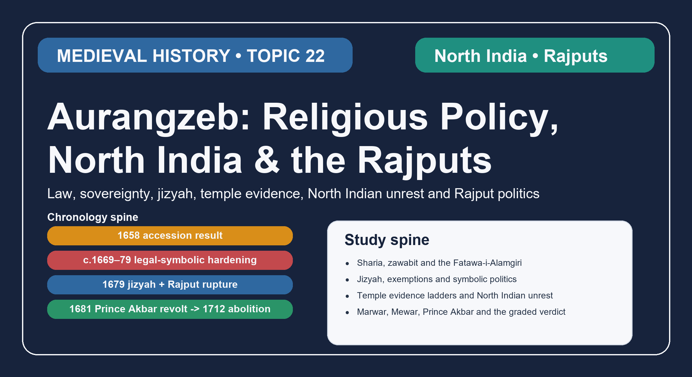

# Aurangzeb: Religious Policy, North India & the Rajputs — Solved Practice Workbook

## BASIC MCQS / REMEDIATION

### Part I - 40 workbook MCQs with full option-wise explanations

*These forty items go beyond the sixteen questions in the learning session. They test deeper chronology, institutional roles, source attribution, numeracy discipline, North Indian unrest, Rajput-alliance mechanics and historiography, so use them as a second and harder pass over the topic. None of them is a reproduction of a past Civil Services Examination paper.*

#### Workbook MCQ 1

**Question:** Which development best marks the shift from early pragmatic continuity toward the sharper 1669-79 phase of legal-symbolic differentiation?

- A. The c.1669 order context linked with temple controversy and Jat disturbance
- B. The 1704 southern suspension of jizyah
- C. Ajit Singh's limited recognition in 1698
- D. The 1712 abolition of jizyah

#### Workbook MCQ 2

**Question:** Which sequence gives the safest analytical periodisation of Aurangzeb's North Indian religious policy?

- A. later wartime exception -> early continuity -> 1669-79 hardening -> court-symbolic shift
- B. early pragmatic continuity -> selective court-symbolic puritanism -> sharper 1669-79 differentiation -> later wartime rule with exceptions
- C. 1669-79 hardening -> accession continuity -> abolition -> Rajput settlement
- D. court symbolism -> 1712 abolition -> early continuity -> jizyah suspension

#### Workbook MCQ 3

**Question:** What is the most accurate description of the muhtasib under Aurangzeb?

- A. He was the hereditary guardian of Rajput watan rights
- B. He replaced imperial zawabit with automatic clerical government
- C. He was a moral-supervisory official whose appointment signalled heightened public regulation without ending imperial sovereignty
- D. He was the revenue officer who converted jizyah into land tax

#### Workbook MCQ 4

**Question:** Which statement about the ulama under Aurangzeb is most defensible?

- A. They uniformly dictated policy from Delhi to every district
- B. Their patronage created a single Muslim consensus behind the regime
- C. They disappeared from relevance once jizyah was reimposed
- D. They received patronage and sometimes influence, but locality, office and interest prevented them from acting as one disciplined bloc

#### Workbook MCQ 5

**Question:** What follows most securely from the 1704 suspension of jizyah in the south?

- A. Even a discriminatory measure could be bent by war pressure and regional necessity
- B. The tax had been abolished across the empire from 1679 onward
- C. Jizyah was only a rumour and never a working measure
- D. The Marwar conflict ended because the south received a suspension

#### Workbook MCQ 6

**Question:** Why are official jizyah totals unsafe as neat proof of realised fiscal success?

- A. Mughal states kept no revenue paperwork at all
- B. Official totals do not remove the problems of corruption, remission and imperfect collection
- C. The tax was paid only in kind and never monetised
- D. All surviving figures belong to Jahandar Shah, not Aurangzeb

#### Workbook MCQ 7

**Question:** Which set consists entirely of people or categories that could fall outside routine jizyah collection?

- A. Mansabdars, qazis and muhtasibs
- B. Temple mahants, Rajput sardars and zamindars
- C. Women, children and indigent persons
- D. Only Brahmans, because all other Hindus necessarily paid

#### Workbook MCQ 8

**Question:** What does the separate treasury destination of jizyah receipts show most clearly?

- A. The tax was identical with land revenue accounting
- B. It existed only to replace all other taxes
- C. Fiscal placement automatically made the policy popular
- D. The measure cannot be described simply as a neutral supplement to ordinary agrarian finance

#### Workbook MCQ 9

**Question:** Which evidence chain is strongest for a short Mains paragraph on temple policy?

- A. dated site -> source type -> actual action -> political context -> regional reach -> counter-evidence
- B. modern slogan -> one famous site -> empire-wide conclusion
- C. legal rule -> automatic local compliance -> final verdict
- D. damaged structure -> assumed motive -> no need for chronology

#### Workbook MCQ 10

**Question:** Which pairing is correctly matched?

- A. Kashi Vishvanath - Mathura
- B. Keshava Rai temple - Mathura
- C. Keshava Rai temple - Delhi
- D. Kashi Vishvanath - Jodhpur

#### Workbook MCQ 11

**Question:** Why do the Jodhpur-Udaipur temple demolitions during the Rajput war matter analytically?

- A. They prove every temple in India was destroyed
- B. They show grants never existed anywhere else
- C. They show that old-standing temples could also be attacked in wartime, so the old/new distinction never settled every case
- D. They reduce the Rajput crisis to an architectural issue alone

#### Workbook MCQ 12

**Question:** Which evidence base most effectively revised the old Marwar-annexation story into a more precise succession-and-governance problem?

- A. A single later heroic escape tale treated as the full archive
- B. Temple-survival lists read without succession records
- C. General jizyah totals used as a Rajasthan chronicle
- D. Local records such as Waqa-i-Ajmer and Jodhpur Hukumat-ri-Bahi read alongside imperial material

#### Workbook MCQ 13

**Question:** Why did Jai Singh's death in 1667 matter for Topic 22?

- A. It removed a senior Rajput mediator who had linked imperial service, diplomacy and alliance management
- B. It created the Khalsa
- C. It formally abolished jizyah
- D. It settled Marwar succession before Jaswant Singh died

#### Workbook MCQ 14

**Question:** Why are precise late-reign percentages risky unless cited carefully?

- A. Because numbers are useless in history
- B. Because the date, denominator, dataset and rank threshold must be known
- C. Because Aurangzeb abolished all rank records
- D. Because only Rajputs counted as nobles

#### Workbook MCQ 15

**Question:** Which frame best distinguishes Bundela resistance from the Jat and Satnami cases?

- A. A uniform temple-only protest identical in social base to Mathura and Narnaul
- B. An all-India ideological rebellion with one central command
- C. A frontier-chiefship world of Champat Rai and Chhatrasal shaped by service, extraction, autonomy and rebellion
- D. A clerical movement led by imperial qazis against Rajputs

#### Workbook MCQ 16

**Question:** What does the Satnami revolt of 1672 show most clearly?

- A. Mughal rule had ceased in every province
- B. The Satnamis were identical to Rathor war bands
- C. The event was too minor to illuminate state-society conflict
- D. A local clash could widen through sect-community mobilisation and still be rapidly crushed by imperial force

#### Workbook MCQ 17

**Question:** Which chronology is correct for Guru Tegh Bahadur and the bounded Sikh bridge in this topic?

- A. 1664 guruship -> 1671 return to Punjab -> November 1675 execution -> 1699 Khalsa
- B. 1675 guruship -> 1664 execution -> 1699 return to Punjab -> 1707 Khalsa
- C. 1664 guruship -> 1699 execution -> 1671 return to Punjab -> 1675 Khalsa
- D. 1671 execution -> 1675 guruship -> 1699 arrest -> 1704 Khalsa

#### Workbook MCQ 18

**Question:** How should the 1699 Khalsa be used inside Topic 22?

- A. As proof that 1675 had no long-term consequence
- B. As a later development showing hardened Sikh-Mughal relations, without reteaching the whole later Sikh story
- C. As the beginning of Mughal rule in Punjab
- D. As evidence that every Persian account of 1675 was false

#### Workbook MCQ 19

**Question:** Which proposition about Rajput relations before 1678 is best supported?

- A. Aurangzeb planned the destruction of Rajput service from the first day of his reign
- B. The Marwar crisis began only after Prince Akbar rebelled
- C. Aurangzeb initially relied on major Rajput rulers such as Jai Singh and Jaswant Singh
- D. All Rajputs had been excluded from mansabs before the Marwar dispute

#### Workbook MCQ 20

**Question:** What did watan mean most centrally in the Rajput context?

- A. A temporary jizyah remission
- B. A jagirdar's mobile imperial posting
- C. The Khalsa as Sikh corporate identity
- D. Hereditary homeland and authority whose recognition shaped honour and service

#### Workbook MCQ 21

**Question:** Which formulation about Jaswant Singh's death is accurate?

- A. He died at Jamrud in 1678 and the surviving claim emerged through posthumous succession politics
- B. He died in 1681 during Prince Akbar's revolt
- C. He was recognised in 1698 as ruler of Marwar
- D. He died childless with no claimant issue at all

#### Workbook MCQ 22

**Question:** Why did the custody question around Ajit Singh deepen the Marwar crisis?

- A. It proved the succession had already been accepted by all Rathor factions
- B. It turned a disputed succession into a question of honour, trust and imperial intrusion inside a claimant's future
- C. It shifted the whole conflict from Rajasthan to Bengal
- D. It made Prince Akbar emperor at once

#### Workbook MCQ 23

**Question:** What did backing Inder Singh for the tika signal politically?

- A. That Ajit Singh's claim had already been accepted by all Rathor factions
- B. That Mughal power planned immediate withdrawal from Marwar
- C. That the emperor was willing to shape succession from above, deepening Rathor distrust
- D. That Mewar had already made peace with the empire

#### Workbook MCQ 24

**Question:** What is the secure core of Durgadas Rathore's role?

- A. Every later escape narrative detail is independently verified
- B. He permanently expelled the empire in 1679 itself
- C. He led the Satnami revolt near Narnaul
- D. He became central to Rathor resistance and the defence of Ajit Singh's claim

#### Workbook MCQ 25

**Question:** Which factor did NOT by itself explain the failure of compromise in Marwar?

- A. A single uncomplicated religious motive
- B. Faction, centralisation and honour concerns
- C. Custody and succession mistrust
- D. Official conduct and occupation anxiety

#### Workbook MCQ 26

**Question:** Why did Mewar support Marwar?

- A. Because jizyah alone automatically determined all Rajput choices
- B. Because kinship, security, autonomy and fear of imperial interference all mattered
- C. Because Mewar had no independent political interest in the issue
- D. Because Rana Raj Singh had already accepted full Mughal control of Marwar

#### Workbook MCQ 27

**Question:** What terrain lesson follows from the Mewar war?

- A. Mewar lay on the Bengal delta and was fought mainly by river flotillas
- B. Terrain had no bearing on imperial operations
- C. Aravalli conditions increased the importance of mobility, passes and local knowledge
- D. Terrain made all Mughal movement impossible from the first march

#### Workbook MCQ 28

**Question:** How should the forged-letter episode in Prince Akbar's revolt be handled?

- A. As a jizyah regulation
- B. As a fully settled master explanation of Rajput motive
- C. As an event before Jaswant Singh's death
- D. As a provenance-sensitive episode that must not be asked to prove too much

#### Workbook MCQ 29

**Question:** Which outcome of Prince Akbar's 1681 revolt is accurate?

- A. The dynastic challenge failed, but the Rajput breach and mistrust did not simply disappear
- B. Every Rajput house immediately abandoned Mughal service
- C. Ajit Singh was fully restored in 1681
- D. Prince Akbar replaced Aurangzeb as emperor

#### Workbook MCQ 30

**Question:** What is the safest account of Ajit Singh's 1698 recognition?

- A. It completely restored the pre-1678 settlement
- B. It was a limited recognition that did not erase the long political damage
- C. It permanently ended every Rajput grievance at once
- D. It took place before Jaswant Singh died

#### Workbook MCQ 31

**Question:** What is the sharpest statement of the Rajput breach's long-term political cost?

- A. It converted every Rajput house into a permanent rebel camp
- B. It proved Mughal warfare had ended in Rajasthan
- C. It weakened confidence that the empire would protect watan, honour and succession rights even when some service ties survived
- D. It abolished the need for local intermediaries

#### Workbook MCQ 32

**Question:** Which answer structure is strongest for a 20-mark answer on Topic 22?

- A. Begin with Deccan war detail, then jump to Shivaji, then close with temple slogans
- B. Start from one temple site, ignore law and chronology, and finish with immediate-collapse language
- C. Open with fiscal decline alone and treat Rajputs as a minor footnote
- D. Set the boundary and chronology first, then move through law and periodisation, jizyah and temple evidence, unrest and the Rajput breach, and finish with a graded verdict

#### Workbook MCQ 33

**Question:** Consider the Fatawa-i-Alamgiri: 1. It was a collectively compiled Hanafi legal compendium. 2. It automatically displaced all emperor-made zawabit in provincial government. Which is correct?

- A. 1 only
- B. 2 only
- C. Both 1 and 2
- D. Neither 1 nor 2

#### Workbook MCQ 34

**Question:** Match the source to its strongest use: Waqa-i-Ajmer / Jodhpur Hukumat-ri-Bahi / farmans. Which pairing best respects their limits?

- A. Farmans: a complete empire-wide implementation census; Waqa: Sikh martyr memory; Bahi: Hanafi legal code
- B. Waqa: Marwar-Mewar official/local events; Bahi: Rathor court evidence; farmans: dated administrative acts
- C. Waqa: exclusively Rathor oral memory; Bahi: 1712 imperial tax order; farmans: universal motive proof
- D. Waqa: temple archaeology; Bahi: emperor-made regulations; farmans: undated community memory

#### Workbook MCQ 35

**Question:** An inscription proves that one temple survived, while a court chronicle records an order against another site. What inference survives both records?

- A. Every temple was destroyed because an order survives
- B. There was no temple coercion anywhere because one shrine survived
- C. Site-specific coercion and site-specific survival can coexist; test chronology and local implementation
- D. Material survival proves the emperor personally protected every shrine

#### Workbook MCQ 36

**Question:** Which ordering best captures the North Indian rupture and its later partial accommodation?

- A. Prince Akbar rebelled -> Satnamis rose -> Jaswant died -> Mewar settled
- B. Jizyah abolished in 1712 -> Jaswant died -> Mewar settled -> Akbar rebelled
- C. Ajit recognised in 1698 -> Jaswant died -> Prince Akbar rebelled -> jizyah imposed
- D. Jaswant died in 1678 -> jizyah reimposed in 1679 -> Prince Akbar rebelled in 1681 -> Ajit recognised in 1698

#### Workbook MCQ 37

**Question:** Which comparison most accurately distinguishes the Satnami and Jat challenges?

- A. Satnamis mobilised after a local clash near Narnaul in 1672; Jat resistance in the Mathura-Agra area recurred under multiple leaders
- B. Both were one centrally commanded 1679 movement created solely by jizyah
- C. Jats were confined to Narnaul artisans while Satnamis controlled the Mathura-Agra zamindaris
- D. Neither involved a clash between local society and imperial authority

#### Workbook MCQ 38

**Question:** In a source-critical answer on Guru Tegh Bahadur, which pairing correctly identifies contrasting evidence?

- A. All contemporary Persian chronicles transparently confirm every detail of later Sikh tradition
- B. Later Persian law-and-order explanations and Sikh martyr memory require genre and chronology checks
- C. The Khalsa of 1699 is a contemporary eyewitness narrative of the 1675 execution
- D. A later tradition is necessarily false whenever a court record is incomplete

#### Workbook MCQ 39

**Question:** Consider Marwar after Jaswant Singh: 1. Khalisa administration could have precedents during disputed minority succession. 2. Recognising Inder Singh and mishandling the ranis made a limited administrative measure politically explosive. Which is correct?

- A. 2 only
- B. 1 only
- C. Both 1 and 2
- D. Neither 1 nor 2

#### Workbook MCQ 40

**Question:** A student cites Ajit Singh's recognition in 1698 and continued service by Amber and Bundi to claim the Rajput alliance suffered no damage. What is the strongest correction?

- A. Ajit had already regained unconditional control of Jodhpur in 1698
- B. The Rajput dispute was purely theological, not about succession or watan
- C. All Rajput houses had permanently left imperial service by 1681
- D. Partial recognition and continuing service coexist with impaired trust in imperial succession guarantees

### Solved key - option-wise explanations and examiner traps

#### Workbook MCQ 1

**Correct answer:** A

**Option-wise explanations:**
- **A.** Yes. The c.1669 cluster is the clearest hinge between early continuity and the harder legal-symbolic turn that culminated in 1679.
- **B.** This belongs to the late wartime phase, when pressure forced adjustment rather than initial tightening.
- **C.** 1698 sits inside the long afterlife of the Rajput breach, not at the onset of the sharper turn.
- **D.** Abolition under Jahandar Shah is a post-Aurangzeb reversal, not the hinge point of Aurangzeb's hardening phase.

**Examiner trap:** Do not confuse the opening of a policy phase with its later modification or reversal.

#### Workbook MCQ 2

**Correct answer:** B

**Option-wise explanations:**
- **A.** This runs the phases backward and makes the war years precede the accession settlement.
- **B.** Correct. It preserves the long-reign logic: continuity first, symbolic adjustment next, sharper differentiation afterward, then wartime variation.
- **C.** The sequence breaks chronology and drags the 1712 abolition into Aurangzeb's own ruling phases.
- **D.** One mid-reign tendency and two late reversals cannot substitute for a real periodisation.

**Examiner trap:** A phase question tests historical sequencing, not random date recognition.

#### Workbook MCQ 3

**Correct answer:** C

**Option-wise explanations:**
- **A.** This confuses a moral-regulatory office with Rajput hereditary authority.
- **B.** The appointment mattered, but the emperor still retained sovereign regulation, appointments and war-making power.
- **C.** Correct. Muhtasibs signal a moralising public turn without proving that clerics displaced imperial sovereignty.
- **D.** Jizyah and land revenue remained separate categories, and the muhtasib was not that fiscal officer.

**Examiner trap:** Define the office first; only then judge its constitutional significance.

#### Workbook MCQ 4

**Correct answer:** D

**Option-wise explanations:**
- **A.** The empire never worked through such frictionless clerical command.
- **B.** Patronage did not produce one undivided political community among Muslims.
- **C.** Reimposition of jizyah increased the visibility of some religious officials, not their disappearance.
- **D.** Correct. Patronage mattered, yet office, doctrine and locality kept the ulama from becoming a uniform imperial machine.

**Examiner trap:** Patronage is visible; fragmentation is what the stronger answer preserves.

#### Workbook MCQ 5

**Correct answer:** A

**Option-wise explanations:**
- **A.** Correct. The suspension shows that sovereign and military pressures could alter implementation without erasing earlier political meaning.
- **B.** A regional wartime suspension is not the same thing as empire-wide abolition.
- **C.** A policy can be real and later adjusted; suspension proves flexibility, not fiction.
- **D.** The southern war context and the Rajput conflict are linked only at a larger chronological level.

**Examiner trap:** Suspension modifies a policy's chronology; it does not retroactively cancel that policy.

#### Workbook MCQ 6

**Correct answer:** B

**Option-wise explanations:**
- **A.** The issue is not a total absence of records but the gap between paper total and realised yield.
- **B.** Correct. A large official figure can coexist with corruption, remissions and weak political utility.
- **C.** The caution is methodological, not a claim about pure payment form.
- **D.** The chronology is wrong and misses the problem of interpretation.

**Examiner trap:** Large numbers impress only until the examiner asks what was assessed, what was collected and what was remitted.

#### Workbook MCQ 7

**Correct answer:** C

**Option-wise explanations:**
- **A.** These describe offices, not the exemption categories being tested here.
- **B.** Rank or local prominence is not the category logic preserved in the tax discussion.
- **C.** Correct. This cluster keeps jizyah from being described as a flat all-Hindu levy without distinction.
- **D.** That old shortcut is too crude for the differentiated category structure in the sources.

**Examiner trap:** The tax was discriminatory, but it was not socially undifferentiated.

#### Workbook MCQ 8

**Correct answer:** D

**Option-wise explanations:**
- **A.** A separate destination is evidence against, not for, a collapse into ordinary land-revenue logic.
- **B.** No secure source basis permits such a sweeping substitution claim.
- **C.** Administrative placement says nothing about popularity; symbolic resentment could remain sharp.
- **D.** Correct. The treasury distinction reinforces the legal-symbolic and patronage side of the measure.

**Examiner trap:** Treating every tax as generic finance erases why this one had political meaning.

#### Workbook MCQ 9

**Correct answer:** A

**Option-wise explanations:**
- **A.** Correct. This sequence forces the answer to stay with evidence rather than rhetoric.
- **B.** One famous site cannot carry an all-India verdict by itself.
- **C.** Formal law mattered, yet practice refused to stay inside one automatic line.
- **D.** Material damage without chronology or source type invites over-reading.

**Examiner trap:** Temple questions are usually lost at the jump from one case to a universal slogan.

#### Workbook MCQ 10

**Correct answer:** B

**Option-wise explanations:**
- **A.** Kashi Vishvanath belongs to Banaras/Kashi, not Mathura.
- **B.** Correct. The Keshava Rai temple is the major Mathura case in this topic.
- **C.** Delhi is not the relevant site for the Keshava Rai discussion.
- **D.** Jodhpur enters through Rajput-war temple action, not through the Kashi case.

**Examiner trap:** Remembering the controversy without anchoring it to the right city is a common Prelims slip.

#### Workbook MCQ 11

**Correct answer:** C

**Option-wise explanations:**
- **A.** A wartime cluster can be decisive evidence without becoming a universal template.
- **B.** Counter-evidence elsewhere remains real even when wartime coercion is real here.
- **C.** Correct. The cases matter because they prevent the formal legal distinction from being treated as a complete map of practice.
- **D.** Temple action mattered, but succession, honour, custody and overreach remained central to the broader crisis.

**Examiner trap:** Formal distinctions matter, yet war can drive practice beyond the neat boundary they seem to draw.

#### Workbook MCQ 12

**Correct answer:** D

**Option-wise explanations:**
- **A.** A dramatic later episode can enrich memory, but it cannot stand in for the whole documentary base.
- **B.** Temple evidence matters, yet it does not reconstruct debt, custody and succession procedure by itself.
- **C.** A tax total cannot do the work of a local political archive.
- **D.** Correct. Those local records sharpen the crisis into succession, debt, custody and official conduct rather than a flat annexation slogan.

**Examiner trap:** A better source base narrows the question before it widens the verdict.

#### Workbook MCQ 13

**Correct answer:** A

**Option-wise explanations:**
- **A.** Correct. Jai Singh's disappearance mattered because it removed an experienced broker inside the Mughal-Rajput compact before the later crisis sharpened.
- **B.** The Khalsa belongs to 1699 under Guru Gobind Singh, not to Jai Singh's death.
- **C.** Jizyah was reimposed in 1679 and abolished only later in 1712.
- **D.** Marwar's succession crisis begins after Jaswant Singh's death in 1678, not in 1667.

**Examiner trap:** Personnel losses can matter politically long before open rupture begins.

#### Workbook MCQ 14

**Correct answer:** B

**Option-wise explanations:**
- **A.** Quantification can clarify change; unsupported precision is the real danger.
- **B.** Exactly. A clean percentage means little unless the historian states who is counted, at what date and above which rank threshold.
- **C.** The records problem here is interpretation, not total abolition.
- **D.** The Mughal ruling class remained broader than Rajputs alone.

**Examiner trap:** Decorative percentages collapse quickly when the denominator is missing.

#### Workbook MCQ 15

**Correct answer:** C

**Option-wise explanations:**
- **A.** Bundelkhand cannot be reduced to the same social mechanism as either the Jat or Satnami case.
- **B.** This inflates a regional political world into a single centrally directed revolt.
- **C.** Correct. Bundela resistance belongs to a chiefship frontier where service bargaining, extraction and autonomy created its own rebellious pattern.
- **D.** Nothing in the Bundela setting turns it into a qazi-led campaign.

**Examiner trap:** Shared North Indian context does not mean shared social mechanism.

#### Workbook MCQ 16

**Correct answer:** D

**Option-wise explanations:**
- **A.** A quickly suppressed local rising is poor evidence for total imperial collapse.
- **B.** Rathor resistance and Satnami mobilisation arose in very different settings.
- **C.** Its scale was limited, but its mechanism is precisely why it matters.
- **D.** Correct. The episode shows how local confrontation could escalate without becoming a permanent alternative state.

**Examiner trap:** Small scale does not mean small analytical value.

#### Workbook MCQ 17

**Correct answer:** A

**Option-wise explanations:**
- **A.** Correct. This sequence keeps the state-policy episode and the later Khalsa bridge in their proper order.
- **B.** Every stage is scrambled, including the execution date and Khalsa chronology.
- **C.** The Khalsa did not precede the execution, and 1699 is not the execution year.
- **D.** The option invents an impossible order of arrest, execution and institution-building.

**Examiner trap:** The Sikh bridge belongs here only when the chronology stays tightly bounded.

#### Workbook MCQ 18

**Correct answer:** B

**Option-wise explanations:**
- **A.** The founding of the Khalsa makes little sense as evidence that the 1675 rupture was inconsequential.
- **B.** Correct. It is a bounded consequence bridge, not a licence to abandon Topic 22's own state-policy focus.
- **C.** Mughal rule in Punjab long predates the Khalsa.
- **D.** Later Sikh institutional development does not invalidate every earlier Persian account.

**Examiner trap:** The Khalsa belongs here as a bridge of consequence, not as a topic takeover.

#### Workbook MCQ 19

**Correct answer:** C

**Option-wise explanations:**
- **A.** Early reliance on Rajput grandees directly undercuts this claim of an unchanged permanent design.
- **B.** The succession crisis in Marwar predates Prince Akbar's revolt and helps explain it.
- **C.** Correct. Jai Singh and Jaswant Singh remained central to imperial service before the late-1670s breach.
- **D.** The continued service of several Rajput houses disproves this outright.

**Examiner trap:** If you start Rajput history in 1678, you cannot explain why the later breach mattered so much.

#### Workbook MCQ 20

**Correct answer:** D

**Option-wise explanations:**
- **A.** Tax remission language belongs elsewhere; watan is not a jizyah category.
- **B.** A mobile jagir and hereditary watan are almost opposite political ideas.
- **C.** Sikh Khalsa vocabulary has no connection with Rajput watan politics.
- **D.** Correct. Watan names the hereditary territorial-political base whose recognition was crucial to Rajput honour and alliance.

**Examiner trap:** The Rajput crisis becomes unintelligible if watan is mistaken for a routine transferable assignment.

#### Workbook MCQ 21

**Correct answer:** A

**Option-wise explanations:**
- **A.** Yes. The Jamrud death and later posthumous claimant issue are the secure historical anchors.
- **B.** The 1681 revolt belongs later and involves Prince Akbar, not Jaswant Singh's death.
- **C.** 1698 recognition belongs to Ajit Singh, not to Jaswant Singh himself.
- **D.** That wipes out the entire posthumous-claimant problem that made the succession so combustible.

**Examiner trap:** The exam often tests whether you remember that claimant politics followed, rather than ended with, Jaswant's death.

#### Workbook MCQ 22

**Correct answer:** B

**Option-wise explanations:**
- **A.** The custody controversy mattered because acceptance was absent, not because unanimity already existed.
- **B.** Correct. Once custody touched the future of the claimant, succession ceased to look like neutral revenue management and began to look like dishonourable imperial domination.
- **C.** The political theatre remained Rajasthan and the Rajput alliance world, not Bengal.
- **D.** Prince Akbar's revolt came later and did not arise from any automatic custody-to-throne conversion.

**Examiner trap:** Succession disputes become explosive when family honour and control over the claimant are folded into them.

#### Workbook MCQ 23

**Correct answer:** C

**Option-wise explanations:**
- **A.** The very controversy shows that unanimity around Ajit's claim did not exist in a settled form.
- **B.** Imperial sponsorship of an alternative claimant pointed toward deeper intervention, not withdrawal.
- **C.** Correct. Backing Inder Singh suggested that the court would manage Rajput succession from above, which intensified distrust and honour anxiety.
- **D.** Mewar's later involvement reflects widening alarm, not an already completed peace.

**Examiner trap:** Succession symbols matter because they reveal who claims the right to recognise rule.

#### Workbook MCQ 24

**Correct answer:** D

**Option-wise explanations:**
- **A.** The historical core does not depend on certifying every later dramatic flourish.
- **B.** Resistance mattered, but permanent expulsion in 1679 is far too sweeping.
- **C.** Satnami revolt and Rathor resistance belong to different theatres and communities.
- **D.** Correct. Durgadas is securely placed as organiser of Rathor resistance and protector of Ajit's succession claim.

**Examiner trap:** The safest answer isolates the stable political role from later heroic embroidery.

#### Workbook MCQ 25

**Correct answer:** A

**Option-wise explanations:**
- **A.** Correct as the NOT option: religion mattered, but one uncomplicated religious motive cannot by itself explain the whole failure of compromise.
- **B.** These were real ingredients in the breakdown, not dispensable details.
- **C.** Custody and succession were central to the legitimacy crisis.
- **D.** Official behaviour mattered because it made imperial intervention look conqueror-like.

**Examiner trap:** When a question asks for the least sufficient factor, beware of one-dimensional explanations.

#### Workbook MCQ 26

**Correct answer:** B

**Option-wise explanations:**
- **A.** Jizyah intensified the climate, but it does not exhaust Mewar's strategic and political calculations.
- **B.** Correct. Mewar reacted to a broader threat: interference in succession and Rajput autonomy, not to one symbolic measure alone.
- **C.** Mewar's interest was precisely that the Marwar precedent could widen into a larger Rajput problem.
- **D.** The very conflict shows that Rana Raj Singh did not read events this way.

**Examiner trap:** A political decision with several motives is often falsely reduced to one tax signal.

#### Workbook MCQ 27

**Correct answer:** C

**Option-wise explanations:**
- **A.** This relocates Mewar to the wrong geography altogether.
- **B.** Hill terrain and local route knowledge mattered greatly, which is why this dismissal fails.
- **C.** Correct. The Aravalli setting rewarded mobility, local knowledge and alliance support instead of straight-line imperial control.
- **D.** Terrain raised cost and difficulty; it did not create literal impossibility in every instance.

**Examiner trap:** Geography questions here test calibrated influence, not absolute determinism.

#### Workbook MCQ 28

**Correct answer:** D

**Option-wise explanations:**
- **A.** The episode belongs to dynastic manoeuvre inside the revolt, not to tax legislation.
- **B.** Even if the episode mattered, no single anecdote should be made to carry the whole burden of Rajput motive.
- **C.** Jaswant Singh's death in 1678 precedes the 1681 revolt, not the other way around.
- **D.** Correct. The event is useful only when treated with provenance caution and limited explanatory reach.

**Examiner trap:** A vivid anecdote can overwhelm analysis unless its evidentiary status is kept visible.

#### Workbook MCQ 29

**Correct answer:** A

**Option-wise explanations:**
- **A.** Correct. The revolt failed, yet political trust was not magically repaired by that failure.
- **B.** Several Rajput houses stayed in service, which is why the breach must be specified rather than universalised.
- **C.** Full restoration did not occur in 1681; later recognition remained limited and delayed.
- **D.** Prince Akbar did not succeed in seizing the throne.

**Examiner trap:** Failed revolt is not synonymous with healed alliance.

#### Workbook MCQ 30

**Correct answer:** B

**Option-wise explanations:**
- **A.** Pre-1678 trust and terms were not simply recreated by a late recognition.
- **B.** Correct. Recognition mattered, but it remained partial and could not cancel the preceding legitimacy damage.
- **C.** The settlement did not dissolve every grievance or memory of the breach.
- **D.** The sequence is reversed: Jaswant Singh's death created the crisis decades earlier.

**Examiner trap:** A compromise settlement is often overstated into total restoration.

#### Workbook MCQ 31

**Correct answer:** C

**Option-wise explanations:**
- **A.** The breach was severe, but several Rajput houses remained in service rather than becoming permanent rebels.
- **B.** The conflict did not end Mughal warfare; it changed the credibility of alliance politics.
- **C.** Correct. The deepest damage lay in shaken trust that Mughal protection still covered hereditary authority, honour and succession guarantees.
- **D.** The empire still depended on intermediaries, which is exactly why losing confidence in them mattered so much.

**Examiner trap:** Alliance systems usually fail first in credibility, not in literal headcount.

#### Workbook MCQ 32

**Correct answer:** D

**Option-wise explanations:**
- **A.** This imports Topic 23 too early and never builds the North Indian legitimacy argument properly.
- **B.** One site without legal and chronological framing cannot sustain the whole topic.
- **C.** Fiscal pressure matters, yet Topic 22 fails if legal-symbolic change and Rajput politics are reduced to side notes.
- **D.** Correct. That sequence mirrors the topic's internal logic: it keeps the Deccan-Maratha war inside Topic 23 where it belongs, and it prevents a monocausal conclusion.

**Examiner trap:** Many weak long answers know facts but still lose marks because their order destroys the argument.

#### Workbook MCQ 33

**Correct answer:** A

**Option-wise explanations:**
- **A.** The sponsored compilation was Hanafi; imperial discretion and regulations persisted.
- **B.** The second statement falsely turns a juristic compilation into an automatic executive order.
- **C.** The first is right, but the second exaggerates the compendium's administrative force.
- **D.** The first statement is supported; both cannot be rejected.

**Examiner trap:** Do not turn sponsored jurisprudence into a constitution or an implementation record.

#### Workbook MCQ 34

**Correct answer:** B

**Option-wise explanations:**
- **A.** A dated farman is local evidence, not an exhaustive empire-wide census; the other attributions also fail.
- **B.** Each source is assigned its documented evidentiary role without universalising its reach.
- **C.** The dynastic and official perspectives have been reversed or replaced by unrelated claims.
- **D.** These genres cannot be swapped with archaeology, legal codes or retrospective oral memory.

**Examiner trap:** A source can prove an action without proving identical implementation elsewhere.

#### Workbook MCQ 35

**Correct answer:** C

**Option-wise explanations:**
- **A.** A chronicle order does not establish universal destruction.
- **B.** Survival at one site cannot erase documented action at another.
- **C.** The two records can be true together once site, date and action are separated.
- **D.** A surviving structure alone does not establish an emperor's intent.

**Examiner trap:** Do not use one locality to invalidate contradictory evidence from another.

#### Workbook MCQ 36

**Correct answer:** D

**Option-wise explanations:**
- **A.** Akbar's revolt followed the Satnami rising and Jaswant's death.
- **B.** The post-Aurangzeb abolition cannot initiate the 1678-81 crisis.
- **C.** The recognition came long after the death, not before it.
- **D.** This preserves the succession, symbolic-policy, revolt and incomplete-recognition sequence.

**Examiner trap:** Recognition of a claimant is not proof that Jodhpur was fully restored.

#### Workbook MCQ 37

**Correct answer:** A

**Option-wise explanations:**
- **A.** The bases and chronologies differ: one escalating local clash, the other recurrent regional resistance.
- **B.** Jizyah was reimposed after the Satnami rising; neither movement fits one-command theory.
- **C.** This reverses region and social context of both movements.
- **D.** Both movements arose amid state-society frictions, though of different kinds.

**Examiner trap:** Do not project a 1679 tax backward onto the 1672 revolt.

#### Workbook MCQ 38

**Correct answer:** B

**Option-wise explanations:**
- **A.** The contemporary Persian record does not deliver one complete transparent account.
- **B.** Competing traditions can be weighed without declaring one late genre conclusive.
- **C.** A later institutional development does not function as an eyewitness record.
- **D.** Later memory needs scrutiny, not automatic rejection.

**Examiner trap:** Distinguish memory, security framing and proven execution chronology.

#### Workbook MCQ 39

**Correct answer:** C

**Option-wise explanations:**
- **A.** The second is right, but khalisa alone was not unprecedented permanent annexation.
- **B.** The first is right, but it omits the political escalation captured by statement 2.
- **C.** Both administrative precedent and mishandled claims are necessary to explain the rupture.
- **D.** Both propositions are supported by the Marwar sequence.

**Examiner trap:** Precedent does not absolve the way officials exercised power.

#### Workbook MCQ 40

**Correct answer:** D

**Option-wise explanations:**
- **A.** Recognition was not full restoration of Jodhpur.
- **B.** Succession, hereditary rights and honour were central alongside religion.
- **C.** Rajput service persisted, so total defection is unsupported.
- **D.** Institutional credibility can fall without all alliance links breaking at once.

**Examiner trap:** Alliance survival is not the same as alliance confidence.

## PYQS AND ANSWER PRACTICE

### How this topic appears in Mains questions

Recent Mains questions that name Aurangzeb usually travel south into the Deccan campaign, the Marathas and the jagirdari crisis, which belong to Topic 23 - The Marathas, Shivaji and Aurangzeb's Deccan. The North Indian half of the examiner's expectation - sharia and zawabit, the 1679 jizyah, temple-policy evidence, Jat-Satnami-Sikh unrest and the Marwar-Mewar rupture - is what this topic supplies. The six solved models below are written to the same directive words, mark weights and word limits as the examination, so treat them as the working answer bank for this half of the syllabus.

### Part II - Six original mains models

#### Original Mains 1 - 10 marks (150 words)

**Question:** Explain the relationship between sharia, zawabit and imperial sovereignty under Aurangzeb.

**Model answer:** Aurangzeb's reign cannot be reduced either to a pure juristic state or to value-free political pragmatism. He was personally orthodox and sought greater conformity with Islamic law, but the Mughal emperor still ruled through sovereignty, appointment power, revenue control and military command. That is why the pair sharia and zawabit is essential.

The Fatawa-i-Alamgiri shows imperial investment in Hanafi legal learning. Yet it was a juristic compendium, not a self-executing constitution. The emperor could still choose among opinions, sponsor officials, frame regulations and respond to political need. Court and provincial administration mediated every measure before it reached local society.

Hence the safest conclusion is that sharia shaped idiom and preference, while zawabit preserved sovereign discretion. Aurangzeb tightened legal-symbolic language more sharply than earlier emperors, but he did not abolish imperial politics or administrative unevenness.

**Demand decoding:** The directive asks for a conceptual explanation, so the answer must define both terms and then show how they interacted in actual sovereignty.

**Executable answer/elimination plan:** Open by rejecting both extremes; define sharia and zawabit; use the Fatawa-i-Alamgiri as named evidence; conclude with the phrase legal idiom plus sovereign discretion.

**Why this earns marks / route earns marks:** This earns marks because it converts technical vocabulary into a working model of monarchy instead of listing terms mechanically.

**How to improve/strengthen:** A stronger version could add one line on how jizyah or temple policy demonstrates this relationship in practice.

#### Original Mains 2 - 10 marks (150 words)

**Question:** Why did the reimposition of jizyah in 1679 matter politically even though collection was uneven?

**Model answer:** Jizyah mattered politically because it was more than a fiscal levy. In Islamic legal idiom it marked differentiated non-Muslim subjecthood, and under Aurangzeb it visibly reversed an Akbarian precedent. That symbolic shift affected trust even where collection was irregular.

The tax also created new points of friction between collectors and subjects. Satish Chandra notes corruption and grasping behaviour among some officials, while the record preserves exemptions, remissions and the 1704 southern suspension. These limits show why realised yield should not be romanticised as a fiscal cure.

Its significance therefore lies in political meaning rather than in a simple cash total. Jizyah announced hierarchy, widened mistrust and reinforced opposition, even though it did not alone cause every rebellion or explain imperial decline by itself.

**Demand decoding:** The question asks for political significance under a condition of uneven collection, so both symbolism and administrative variation must be addressed together.

**Executable answer/elimination plan:** Define jizyah first, then explain reversal of precedent, collector-subject friction and uneven enforcement; end with a contributory-not-monocausal verdict.

**Why this earns marks / route earns marks:** This earns marks because it answers the “even though” clause directly instead of writing only about tax categories or only about symbolism.

**How to improve/strengthen:** You could strengthen it by naming the 1704 southern suspension and the 1712 formal abolition to show chronology and policy variation.

#### Original Mains 3 - 15 marks (250 words)

**Question:** Examine Aurangzeb's temple policy. Why do both the “uniform destruction” and the “pure toleration” caricatures fail?

**Model answer:** Aurangzeb's temple policy must be handled through evidence categories rather than slogans. The legal idiom formally distinguished between old places of worship of dhimmis and new or objectionable construction, but actual practice did not remain inside one neat rule.

The record includes general or provincial orders, site-specific punitive action, wartime destruction in Rajput areas, defacement or conversion in some cases, and grants or protection in others. The 1669 order sits inside a court-chronicle context; Kashi Vishvanath and the Keshava Rai temple at Mathura are major named cases; and old temples in Jodhpur-Udaipur zones were also attacked during the Rajput war. At the same time, grants and non-interference continued elsewhere.

This evidence destroys both caricatures. A “uniform destruction everywhere” thesis ignores variation, survival and continuing grants. A “pure toleration except for new or rebellious temples” thesis fails because old-standing temples could also be targeted and because punitive politics did not erase the religious meaning of coercion.

The strongest conclusion is case-based: dated site, source type, actual action, political context and counter-evidence. Only that method keeps temple policy historically precise and analytically honest.

**Demand decoding:** Examine requires a balanced but decisive treatment, so the answer must classify evidence and then show why each caricature collapses before the full record.

**Executable answer/elimination plan:** Begin with method, move to named cases, then take each caricature in turn and refute it with evidence; conclude with the case-based rule.

**Why this earns marks / route earns marks:** This earns marks because it uses named sites and evidence categories to demonstrate nuance instead of substituting a slogan for analysis.

**How to improve/strengthen:** A stronger version could add one explicit sentence on why politics and religion should be read together rather than treated as mutually exclusive motives.

#### Original Mains 4 - 15 marks (250 words)

**Question:** Discuss the Jat, Satnami and Sikh challenges in North India under Aurangzeb without reducing them to one rebellion type.

**Model answer:** North Indian challenges under Aurangzeb shared a setting of coercive imperial power, yet they differed sharply in social base, locality and historical mechanism. Treating them as one rebellion type erases what made each politically significant.

The Jat rising around Mathura-Agra involved cultivators, zamindars and clan networks reacting to revenue pressure, official coercion and community leadership. The Satnami revolt of 1672 near Narnaul grew from a local clash that escalated through sect-community mobilisation and was then suppressed by imperial force. The Sikh case turned on a different register again: Guru Tegh Bahadur's execution in 1675 fused coercive state action with martyr memory, and later militarisation under Guru Gobind Singh gave the relationship a harder edge.

Their common thread is that local or community conflict could become a challenge to Mughal legitimacy. Their difference lies in social composition, chronology and institutional outcome. That is why neither pure communal language nor pure class language is sufficient.

A careful answer therefore compares trigger structure and consequence rather than collapsing unlike events into one all-purpose rebellion narrative.

**Demand decoding:** Discuss asks for comparison and differentiation, so the answer must identify common setting and then keep each movement distinct.

**Executable answer/elimination plan:** Use three short subsections - Jat, Satnami, Sikh - then add one synthesising paragraph on common context and difference in outcome.

**Why this earns marks / route earns marks:** This earns marks because it avoids flattening and shows that North Indian resistance under Aurangzeb had several routes, not one template.

**How to improve/strengthen:** You could improve it by naming Gokula and the 1672 Narnaul setting even more explicitly if space permits.

#### Original Mains 5 - 20 marks (250 words)

**Question:** Assess the Marwar-Mewar crisis as a turning point in Mughal-Rajput relations under Aurangzeb.

**Model answer:** The Marwar-Mewar crisis was a turning point because it damaged the credibility of a long-tested alliance system built on watan, mansab, honour and succession recognition. It did not break all Rajput service everywhere, but it broke confidence in Mughal guarantees where that confidence had mattered most.

Jaswant Singh's death at Jamrud in 1678 created a disputed succession. Taking Marwar into khalisa had precedents during minority or disputed succession, so the crisis cannot be reduced to a simple pre-planned annexation. Yet the actual policy proved disastrous. Official conduct looked conqueror-like, Aurangzeb backed Inder Singh for the tika, custody and succession became matters of honour, and Durgadas Rathore organised resistance around Ajit Singh's claim.

Mewar joined because Mughal interference in Marwar threatened Rajput autonomy more broadly. Rana Raj Singh's support and the terrain problem widened imperial cost, while Prince Akbar's revolt in 1681 turned the issue into a dynastic-political challenge. Although Mewar later settled and Ajit gained limited recognition in 1698, the old compact was not simply restored.

Satish Chandra's verdict that the policy was clumsy and blundering is persuasive. The immediate military effect after 1681 was not the empire's largest war, but the political cost - lost prestige and shaken alliance trust - was profound.

**Demand decoding:** Assess requires a graded judgement, so the answer must explain why the crisis mattered while also qualifying what it did not do.

**Executable answer/elimination plan:** Define the pre-existing alliance first; explain Marwar succession and khalisa nuance; add Mewar and Prince Akbar; conclude with prestige cost greater than immediate strategic gain.

**Why this earns marks / route earns marks:** This earns marks because it joins succession detail, administrative nuance and alliance theory into one turning-point argument.

**How to improve/strengthen:** A sharper version could name Waqa-i-Ajmer and Jodhpur Hukumat-ri-Bahi to show the revised evidence base more explicitly.

#### Original Mains 6 - 20 marks (250 words)

**Question:** Evaluate the view that Aurangzeb's religious policy weakened North Indian legitimacy but cannot by itself explain Mughal decline.

**Model answer:** The view is convincing because Aurangzeb's religious policy did weaken North Indian legitimacy through sharper hierarchy, symbolic reversal and coercive action. Yet the evidence also shows that imperial decline was not the product of one policy line alone.

Jizyah in 1679 publicly marked differentiated subjecthood and widened mistrust even when collection was uneven. Temple policy combined major punitive cases at Kashi, Mathura and Rajput-war zones with continued grants or non-interference elsewhere, making the policy both real and uneven. Guru Tegh Bahadur's execution deepened Sikh-Mughal tension, while Jat and Satnami unrest revealed how local power and coercive governance could produce armed challenge. Most serious of all, the mishandling of Marwar-Mewar damaged the credibility of Mughal protection for old allies.

However, these developments must still be placed beside military pressure, southern war, fiscal strain and the larger jagirdari problem that Topic 23 and Topic 25 develop further. The empire also retained continued Hindu-Rajput service and considerable coercive capacity.

Therefore religious policy should be treated as a contributory mechanism of weakened legitimacy, not as a monocausal explanation of decline and not as a negligible side issue either.

**Demand decoding:** Evaluate requires a reasoned verdict on both halves of the statement: why legitimacy weakened and why decline remained multi-causal.

**Executable answer/elimination plan:** Build the answer in two halves: first, named religious-policy evidence; second, limits of monocausality through continued service and wider military-fiscal pressures; finish with the graded verdict.

**Why this earns marks / route earns marks:** This earns marks because it preserves real coercion and political damage without collapsing the entire empire's later history into a one-factor story.

**How to improve/strengthen:** You could improve it by adding one concise bridge sentence showing how the Rajput breach and Deccan overstretch intersected in timing.
