# Medieval History Topic 23 — The Marathas, Shivaji & Aurangzeb's Deccan; Jagirdari Crisis

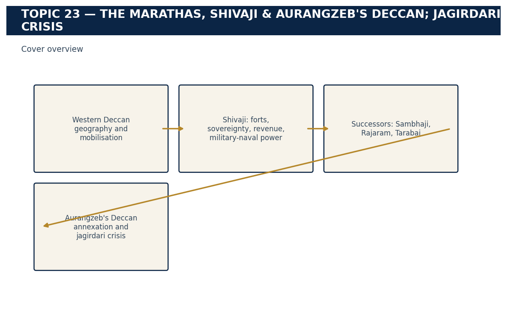
*Cover: the western Deccan operational world, Raigad sovereignty and the jagirdari crisis in one frame.*

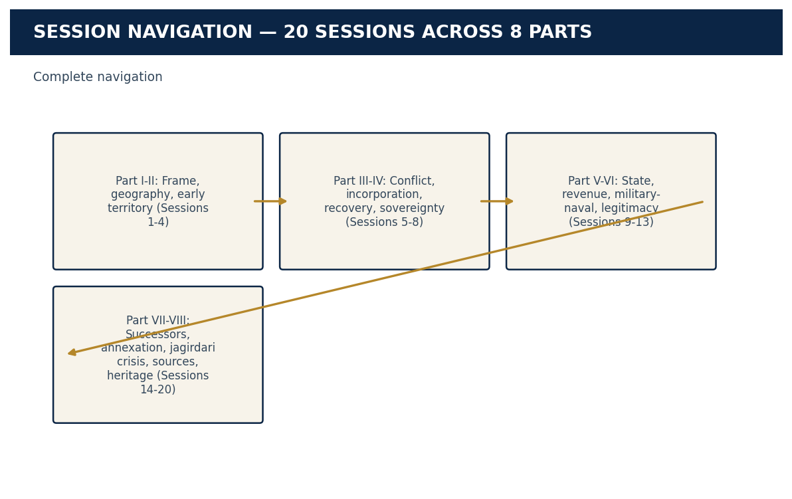
*Complete session navigation: 20 sessions across 8 parts, then MCQs, PYQ/Mains practice, optional Advanced depth, and consolidated register notes.*

**Contents / Session Index**

- Basic Learning Session (Parts I-VIII, Sessions 1-20)
  - Part I — Frame, Geography and Historical Method
  - Part II — Pre-Shivaji Background and Early Territorial Logic
  - Part III — Afzal Khan, Mughal Conflict and Negotiated Incorporation
  - Part IV — Recovery, Coronation and Southern Reach
  - Part V — State, Revenue, Fiscal Claims and War
  - Part VI — Religion, Legitimacy and Imperial War
  - Part VII — Aurangzeb's Deccan Policy and Jagirdari Crisis
  - Part VIII — Sources, PYQ Verification and Heritage Link
- Basic MCQs / Remediation (16 items, A/B/C/D rotation)
- PYQs and Answer Practice
  - Verified PYQ Ledger, 2018-2026
  - Six Original Solved Mains Answers
- Optional Advanced Depth — Not Required for a Core Answer
- Consolidated Register Notes

## BASIC LEARNING SESSION

### PART I - FRAME, GEOGRAPHY AND HISTORICAL METHOD

#### Session 1 — THE WESTERN DECCAN AS AN ECOLOGICAL-POLITICAL ZONE

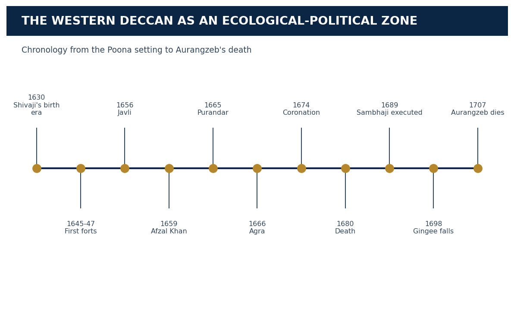
*Chronology from the Poona setting to Aurangzeb's death*

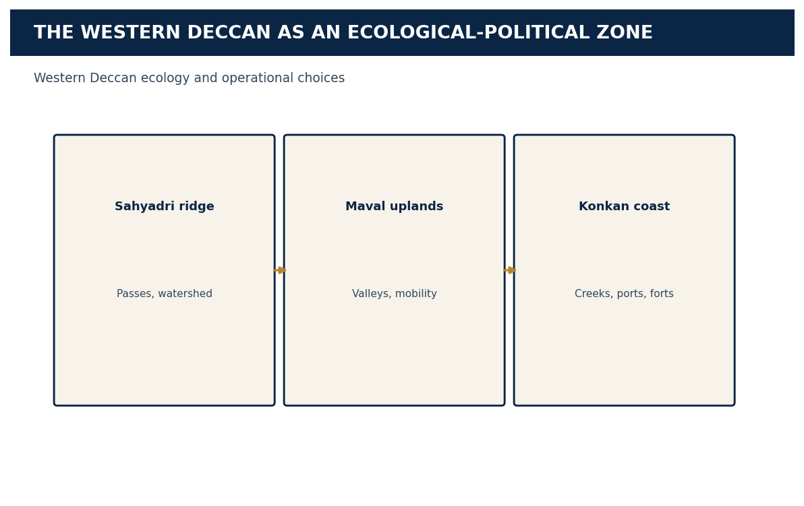
*Western Deccan ecology and operational choices*

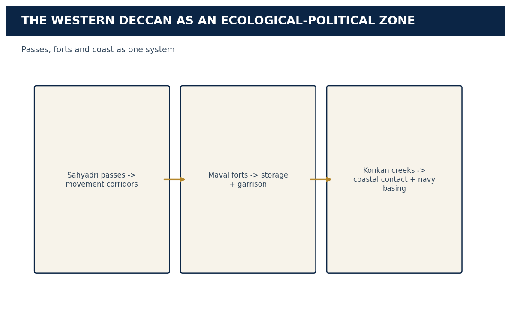
*Passes, forts and coast as one system*

**Plain-language definition:** The western Deccan is the belt of the Sahyadri (Western Ghats), the Maval uplands and the Konkan coast whose passes, hill forts and creeks supplied the operational base for Maratha power.

**Technical precision:** Ecological-political zone: a region where a fixed physical layout (ridge, pass, valley, creek) is converted into repeatable political and military capacity through fort-holding, garrisoning, supply and local alliance, rather than a zone whose terrain by itself produces a state.

**Answer-ready opening:** Terrain supplied opportunities and constraints; only organisation, coercion and diplomacy turned those opportunities into Maratha state power.

#### PARAGRAPH DEMONSTRATION

**Claim:** Western Deccan geography enabled, but did not by itself create, Maratha state power. **Evidence:** named evidence: the Sahyadri ridge separated the upland plateau from the Konkan littoral; Maval valleys and passes shaped movement and supply; a hill fort could observe a route, store grain and arms, and signal a neighbouring garrison. **Analysis:** these features made a distributed operational system possible: forts, passes and creeks could be linked into one network of storage, intelligence and short-radius movement. **Qualification:** the same landscape held villages, hereditary office-holders, competing patrons and several states, so geography without coercion, negotiation, administration and a ruler-centred idiom of sovereignty produced no state at all.

The Sahyadri or Western Ghats divided the upland plateau from the Konkan littoral; the Maval valleys, ridges, passes and monsoon rhythms shaped movement, storage and communication. A hill fort could observe a route, hold grain and arms, shelter a garrison, signal a neighbour and stage a raid. The coast and its creeks added customs, maritime access and rivalry with the Sidis of Janjira, the Portuguese and the English. These features made a distributed operational system possible.

FACT: geography mattered because armies had to feed horses, move artillery, secure passes and keep lines of information open. ANALYSIS: geography did not confer command by itself. Shivaji's achievement lay in converting selected nodes into a political and fiscal network through coercion, negotiation, administration and a ruler-centred idiom of sovereignty. A fort without stores, men, records and nearby social support was not a state.

A good answer therefore rejects two opposite errors: it should not call the Marathas a mere product of hills, and it should not present terrain as a theatrical backdrop to a lone hero. Link ecology to choices — use of passes, fort stores, short movement, local intelligence and coastal defence — then qualify with Bijapur's distractions, Mughal priorities, service networks and local bargains.

**Keywords (use each once in your own recall sentence):** Sahyadri passes and Maval uplands, Konkan coastal creeks, Sidis of Janjira, Portuguese and English footholds, distributed fort-based operational system

**Recall flow:** Western Deccan geography enabled, but did not by itself create, Maratha state power. -> Sahyadri passes and Maval uplands -> Konkan coastal creeks -> Sidis of Janjira -> the same landscape held villages, patrons and rival states, so only coercion, negotiation and a ruler-centred idiom of sovereignty converted terrain into a state.

#### Session 2 — MOBILISATION, IDENTITY AND COMPETING HISTORICAL FRAMES

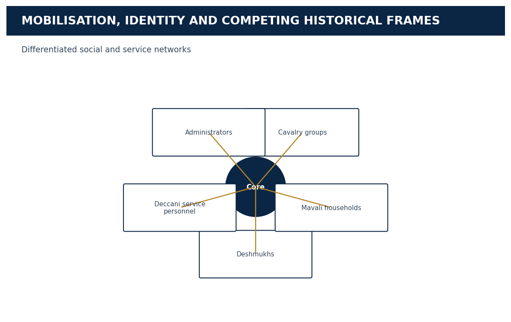
*Differentiated social and service networks*

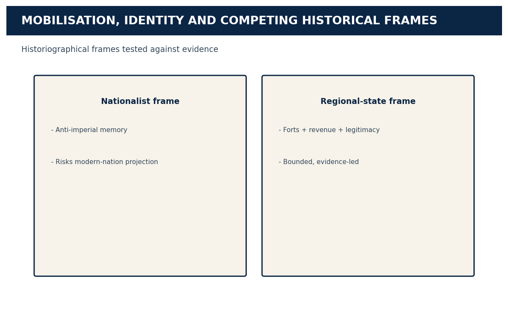
*Historiographical frames tested against evidence*

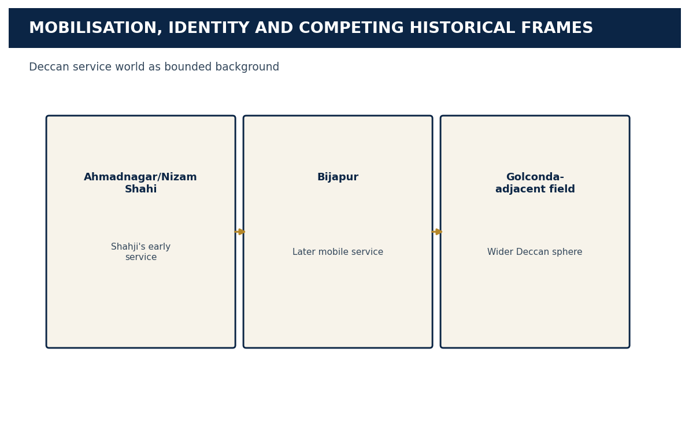
*Deccan service world as bounded background*

**Plain-language definition:** Maratha political mobilisation is the process by which deshmukhs, Mavali peasant-soldiers, cavalry households, Brahman administrators, artisans, sailors and Deccani service personnel were drawn into one political project.

**Technical precision:** Historiographical frame: an organising interpretive lens (nationalist, communal, regional-state, peasant/zamindar or institutional-continuity) that historians apply to the same evidence, each capturing part of the process and each needing source-checked limits.

**Answer-ready opening:** Four rival frames explain parts of Maratha mobilisation, but none stands alone as a complete account.

#### PARAGRAPH DEMONSTRATION

**Claim:** Maratha political mobilisation cannot be collapsed into a primordial nation, a homogeneous caste bloc, or a pure Hindu reaction. **Evidence:** named evidence: the coalition drew on deshmukhs and village elites, Mavalis, bargir and silhedar cavalry households, Brahman administrators, artisans, sailors and Muslim or other Deccani service personnel. **Analysis:** a nationalist frame captures anti-imperial political memory; a communal frame notes royal Hindu idiom; a regional-state frame explains forts, revenue and legitimacy; a peasant/zamindar frame highlights local power and recruitment. **Qualification:** none of these frames should be applied without source method: a saint's verse, a courtly genealogy, a later bakhar or a modern commemoration cannot by itself prove a universal political programme.

Marathi language, landed and service networks, household claims, Bhakti-cultural settings and conflicts among Deccan powers all supplied resources for political action. Their interests could overlap, but they were not identical.

Four frames deserve testing rather than ritual recitation. A nationalist frame foregrounds independence and heroic resistance; it captures an anti-imperial political memory but risks modern nation-state language. A communal frame treats the state as an exclusive Hindu reaction; royal Hindu idiom is real, yet Persianate and Deccani institutions, Muslim officers and pragmatic diplomacy prevent that reduction. A regional-state frame explains forts, revenue, legitimacy and territorial coordination. A peasant/zamindar mobilisation frame highlights local power, extraction and recruitment, but must not dissolve the ruler and court into an automatic social uprising. Institutional-continuity analysis asks what was borrowed from Deccani practice.

Source method makes the distinction operational: ask who produced a record, for whom, and what it can show. The strongest conclusion is layered — a regional state gained durability by mobilising diverse local and service networks while articulating a royal idiom that could claim autonomy.

**Keywords (use each once in your own recall sentence):** deshmukhs and village elites, Mavali peasant-soldiery, bargir and silhedar cavalry households, Bhakti-cultural networks, nationalist and communal historiographical frames

**Recall flow:** Maratha political mobilisation cannot be collapsed into a primordial nation, a homogeneous caste bloc, or a pure Hindu reaction. -> deshmukhs and village elites -> Mavali peasant-soldiery -> bargir and silhedar cavalry households -> none of these frames should be applied without source method, since a saint's verse, a courtly genealogy or a later bakhar each proves a different, narrower claim rather than one universal political programme.

### PART II - PRE-SHIVAJI BACKGROUND AND EARLY TERRITORIAL LOGIC

#### Session 3 — SHAHJI, THE POONA HOUSEHOLD AND THE FIRST FORT PHASE

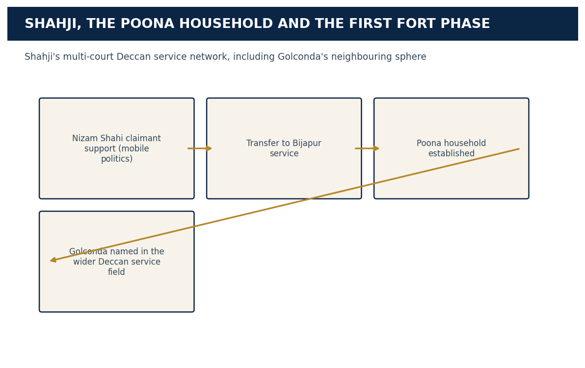
*Shahji's multi-court Deccan service network, including Golconda's neighbouring sphere*

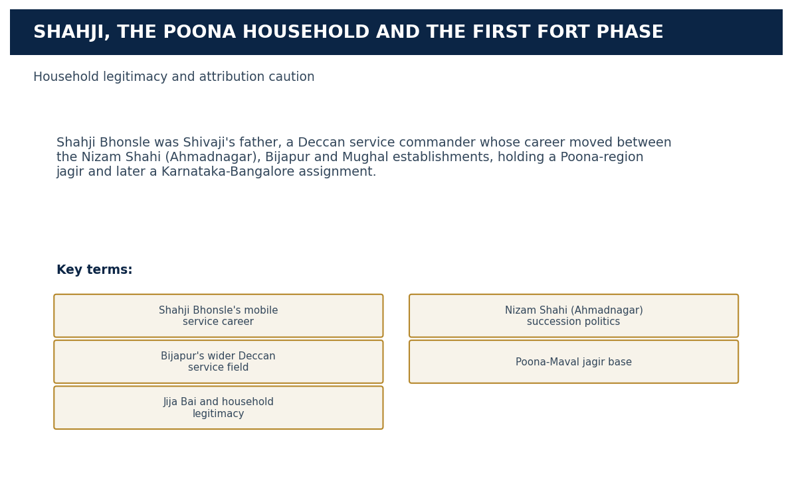
*Household legitimacy and attribution caution*

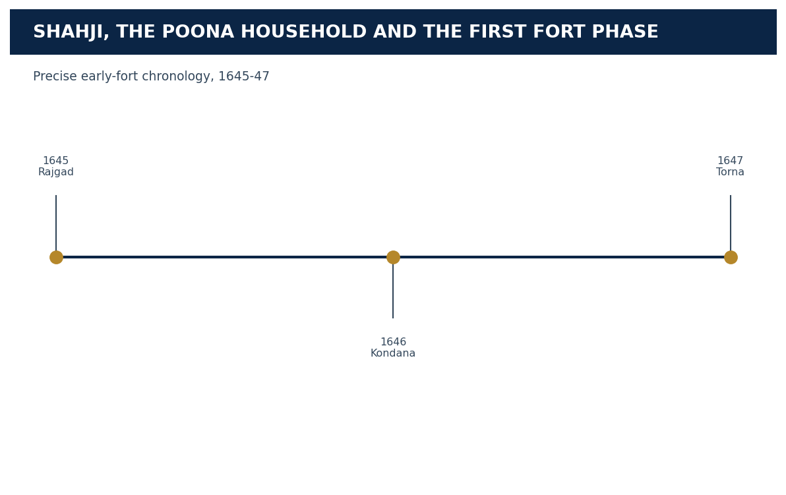
*Precise early-fort chronology, 1645-47*

**Plain-language definition:** Shahji Bhonsle was Shivaji's father, a Deccan service commander whose career moved between the Nizam Shahi (Ahmadnagar), Bijapur and Mughal establishments, holding a Poona-region jagir and later a Karnataka-Bangalore assignment.

**Technical precision:** Mobile service politics: a career pattern in which a commander's loyalty followed shifting employment and patronage across rival Deccan/Mughal courts, distinct from a hereditary or nationalist anti-Mughal programme.

**Answer-ready opening:** Shahji's career shows mobile service politics across the Deccan, not a hereditary national programme handed down to his son.

#### PARAGRAPH DEMONSTRATION

**Claim:** Shahji Bhonsle's career demonstrates political mobility under pressure, not a straight national programme inherited by his son. **Evidence:** named evidence: Shahji served Ahmadnagar (Nizam Shahi), Bijapur and Mughal establishments in turn, supported a Nizam Shahi claimant during the contested final years of that sultanate, held a Poona-region base and later a Karnataka-Bangalore assignment; Bijapur employed him within its own wider Deccan service field that also touched Golconda's neighbouring sphere without Shahji serving every Deccan state simultaneously. **Analysis:** this pattern is best read as a commander converting shifting patronage into local footholds — a household base at Poona and a southern assignment — rather than as continuous resistance to a single named enemy. **Qualification:** claims that Shahji ran a continuous hereditary anti-Mughal programme, or that he served Golconda directly as a matter of course, outrun the evidence; his support for a Nizam Shahi claimant was mobile service politics in a fluid succession contest, not proto-nationalism.

Topic 18 supplies the fuller story of Bahmani successor states, Malik Ambar and the 1636 Deccan settlement; here those structures are background for a narrower question — how could a Poona-based household acquire room for action? Shahji Bhonsle moved among Nizam Shahi, Bijapur and Mughal service environments. During the contested last years of the Ahmadnagar (Nizam Shahi) sultanate he backed a Nizam Shahi claimant to the throne — a documented instance of mobile service politics inside a collapsing court, not evidence of a continuous hereditary anti-Mughal national programme carried forward to his son. Bijapur's own Deccan service world extended toward Golconda's neighbouring sphere of influence; Shahji operated within that wider, overlapping field of Deccan service opportunities without having served every Deccan state himself. His later Karnataka-Bangalore assignment under Bijapur added a southern sphere alongside the Poona jagir.

Jija Bai belongs in the account as a figure of household legitimacy and local authority; claims about her exact political direction should not outrun the record. Dadoji Konddev may be discussed as an administrative actor in the Poona setting where evidence is secure; later arguments that turn him into an all-explaining tutor or erase him altogether are not a substitute for source criticism. Bhakti figures such as Tukaram or Ramdas are valuable cultural context, but a direct blueprint for state formation should not be asserted without a precise contemporary link.

The early fort phase is normally dated 1645-47. Use verbs carefully: Torna was taken early; Murumbdev was developed and associated with the name Rajgad, rather than being casually described as a simple 'capture of Rajgad'; Kondana was another key early acquisition. The outcome was a Poona-Maval base, not yet a finished territorial kingdom.

**Keywords (use each once in your own recall sentence):** Shahji Bhonsle's mobile service career, Nizam Shahi (Ahmadnagar) succession politics, Bijapur's wider Deccan service field, Poona-Maval jagir base, Jija Bai and household legitimacy

**Recall flow:** Shahji Bhonsle's career demonstrates political mobility under pressure, not a straight national programme inherited by his son. -> Shahji Bhonsle's mobile service career -> Nizam Shahi (Ahmadnagar) succession politics -> Bijapur's wider Deccan service field -> claims that Shahji ran a continuous hereditary anti-Mughal programme outrun the evidence, since his shifting service was mobile-service politics in a fluid succession contest, not proto-nationalism.

#### Session 4 — JAVLI AND THE CONVERSION OF TERRAIN INTO TERRITORIAL CAPACITY

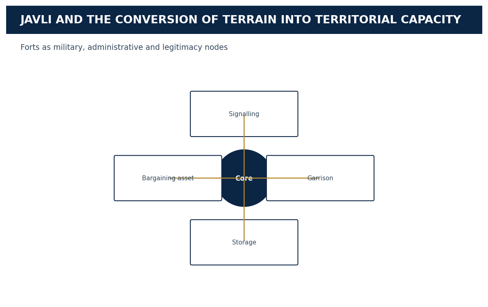
*Forts as military, administrative and legitimacy nodes*

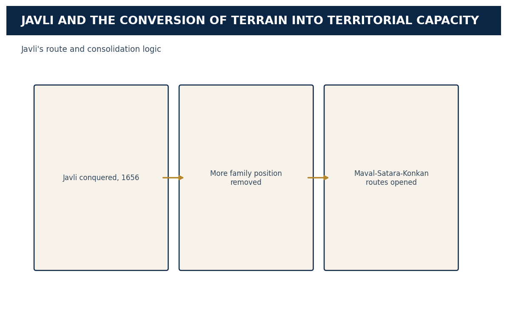
*Javli's route and consolidation logic*

**Plain-language definition:** The 1656 conquest of Javli removed the More family's political position in the Maval highlands and opened routes toward Satara and the Konkan.

**Technical precision:** Territorial capacity: the conversion of a jagir and a set of local relations (manpower, routes, local knowledge) into an administratively usable corridor, distinguished from a mere increase in map area.

**Answer-ready opening:** Javli converted a jagir and local relations into territorial logic; geography enabled the repertoire, but political organisation and calculated coercion made it durable.

#### PARAGRAPH DEMONSTRATION

**Claim:** The Javli campaign should be read as institutional-territorial consolidation, not as a romantic proof of inevitable statehood. **Evidence:** named evidence: Javli's conquest in 1656 removed the More family's political position and strengthened access from the Maval highlands towards Satara and the Konkan, widening the pool of local knowledge, manpower and routes available to the emerging power. **Analysis:** forts functioned as nodes in this transformation — sites of garrison command, storage, intelligence, record-keeping, refuge, communications and political visibility — so a network of forts, not a single conquest, produced mobility. **Qualification:** calling Javli a mere geographical gain leaves out the political elimination and coercion involved, while calling it only violence misses its lasting administrative and operational consequences; Bijapur's wider difficulties and Shahji's position created openings but did not make consolidation automatic.

Javli's conquest in 1656 was strategically consequential because it removed the More family's political position and strengthened access from the Maval highlands towards Satara and the Konkan. It also widened the pool of local knowledge, manpower and routes available to the emerging power.

Forts worked as nodes in this transformation. They were sites of garrison command, storage, intelligence, record-keeping, refuge, communications and political visibility. Their network could support mobility precisely because it was not only mobile: men and animals required provisions, information and safe points of concentration. At the same time, forts changed hands — an answer that treats a map as permanently coloured by one power mistakes a campaign system for a static state.

Bijapur's wider difficulties and Shahji's position created openings, but they did not make consolidation automatic. The early strategy alternated between negotiation, local pressure and carefully chosen seizure. The appropriate verdict is that Shivaji translated a jagir and a set of local relations into a territorial logic.

**Keywords (use each once in your own recall sentence):** Javli conquest of 1656, More family's political position, Maval-Satara-Konkan corridor, forts as garrison, storage and intelligence nodes, negotiation and calculated coercion

**Recall flow:** The Javli campaign should be read as institutional-territorial consolidation, not as a romantic proof of inevitable statehood. -> Javli conquest of 1656 -> More family's political position -> Maval-Satara-Konkan corridor -> calling Javli a mere geographical gain leaves out the political elimination and coercion involved.

### PART III - AFZAL KHAN, MUGHAL CONFLICT AND NEGOTIATED INCORPORATION

#### Session 5 — AFZAL KHAN, PANHALA AND THE PROBLEM OF HEROIC NARRATIVE

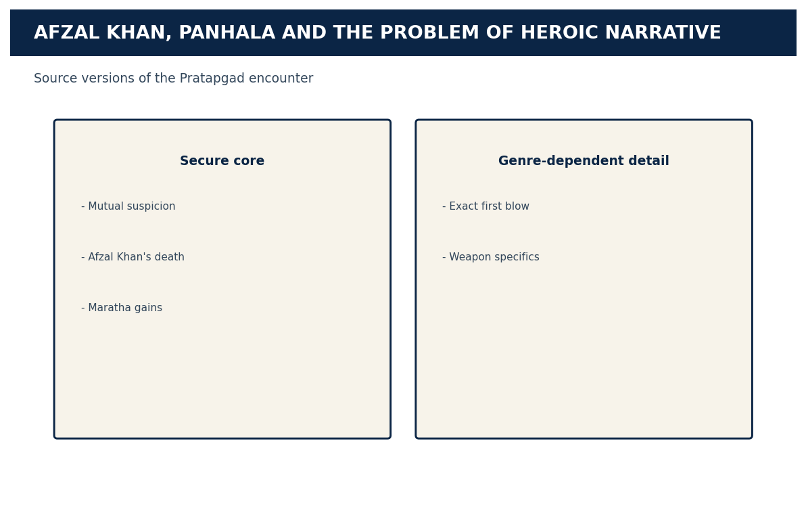
*Source versions of the Pratapgad encounter*

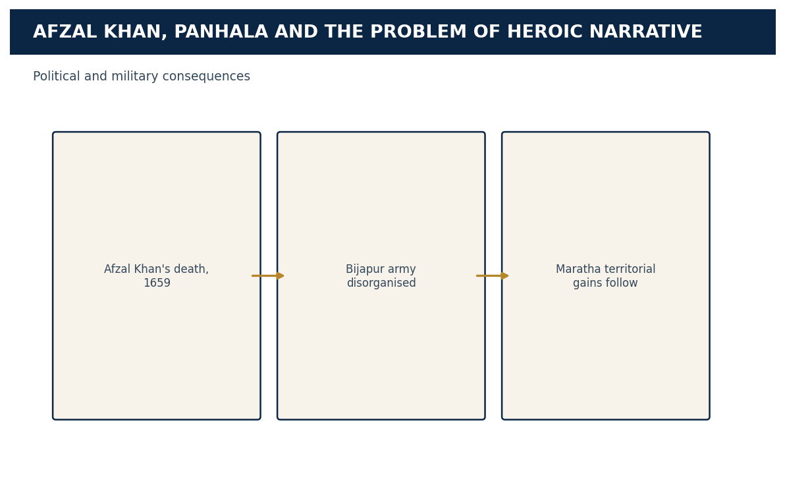
*Political and military consequences*

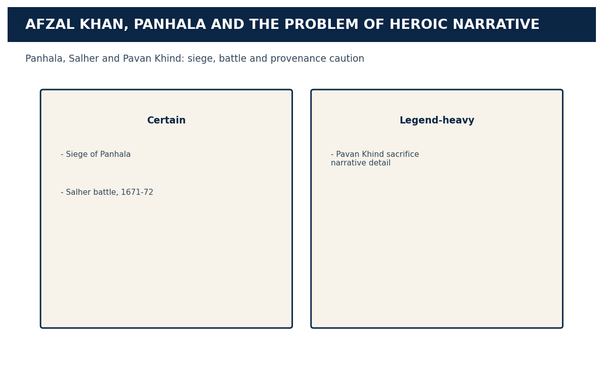
*Panhala, Salher and Pavan Khind: siege, battle and provenance caution*

**Plain-language definition:** The 1659 Pratapgad encounter was a meeting between Shivaji and the Bijapuri commander Afzal Khan, held in mutual suspicion, that ended with Afzal Khan's death.

**Technical precision:** Heroic-narrative problem: the historiographical difficulty that later retellings of a real event (exact first blow, concealed weapons, sequence) diverge across genres, so a secure factual core must be separated from genre-specific elaboration.

**Answer-ready opening:** The Pratapgad encounter is historically secure at its core, but its most dramatic details belong to later retelling, not to a single verified script.

#### PARAGRAPH DEMONSTRATION

**Claim:** The Bijapur expedition under Afzal Khan and the Pratapgad meeting of 1659 are historically important precisely because their vivid retellings must be separated from a secure factual core. **Evidence:** named evidence: the meeting occurred in a setting of mutual suspicion; both sides prepared for danger; Afzal Khan was killed; the outcome gave Shivaji captured camp resources, artillery, recruitment and enlarged political reputation. **Analysis:** the political lesson is that a seemingly stronger state could be challenged through preparation, site choice, intelligence and a network ready to exploit the moment — this explains the effect without granting supernatural agency to either side. **Qualification:** the exact first blow and the sequence of concealed weapons differ across accounts, so a responsible answer presents versions and their provenance; equally, the Panhala siege and the Salher campaigns show that mobile Maratha war did not exclude siege, defence or set-piece battle — Shivaji's forces both withstood and conducted formal sieges when the situation demanded it.

The Bijapur expedition under Afzal Khan and the meeting at Pratapgad in 1659 are central precisely because their later retellings are so vivid. A secure core can be stated: the meeting occurred in a setting of mutual suspicion; both sides prepared for danger; Afzal Khan was killed; and the outcome gave Shivaji military resources, prestige and an enlarged political reputation. The exact first blow and the sequence of concealed weapons differ across accounts; a responsible answer presents versions and their provenance rather than declaring an uncontested moral script.

The aftermath mattered beyond the encounter: captured camp resources and artillery, recruitment, renewed confidence and a signal to local chiefs enhanced Shivaji's position.

Panhala, Siddi Jauhar's siege and the Baji Prabhu/Pavan Khind tradition require the same discipline. A difficult withdrawal and later memory can both be historically important. The named evidence at Panhala — a fortress under prolonged siege, requiring defence, negotiation and an eventual break-out — together with the later Salher campaign of 1671-72, where Maratha forces met and defeated a Mughal army in open battle, shows that ganimi kava-style mobility did not exclude siege-holding, defensive stands or set battle when the terrain and balance of force allowed it. Detail belongs to genres: early documentation, later bakhar narrative and public commemoration do not carry equal evidentiary weight.

**Keywords (use each once in your own recall sentence):** Afzal Khan's 1659 Bijapur expedition, Pratapgad meeting under mutual suspicion, captured camp resources and artillery, Panhala siege by Siddi Jauhar, Baji Prabhu/Pavan Khind tradition

**Recall flow:** The Bijapur expedition under Afzal Khan and the Pratapgad meeting of 1659 are historically important precisely because their vivid retellings must be separated from a secure factual core. -> Afzal Khan's 1659 Bijapur expedition -> Pratapgad meeting under mutual suspicion -> captured camp resources and artillery -> the exact first blow and the sequence of concealed weapons differ across accounts.

#### Session 6 — SHAISTA KHAN, SURAT, JAI SINGH AND PURANDAR

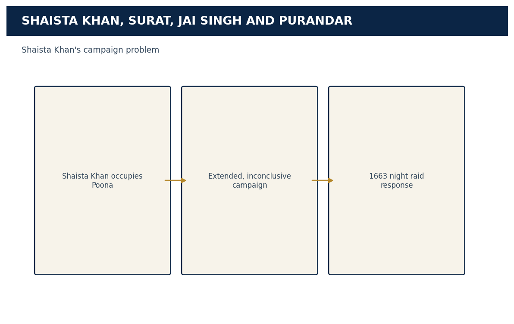
*Shaista Khan's campaign problem*

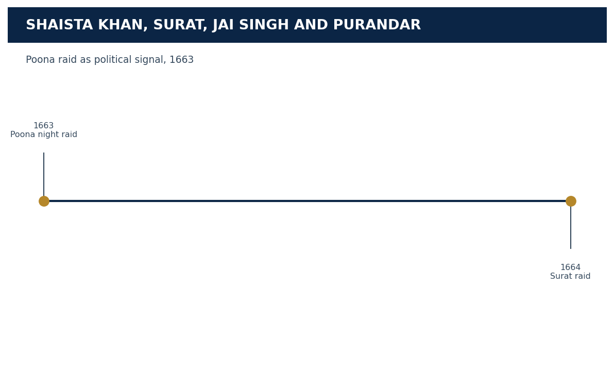
*Poona raid as political signal, 1663*

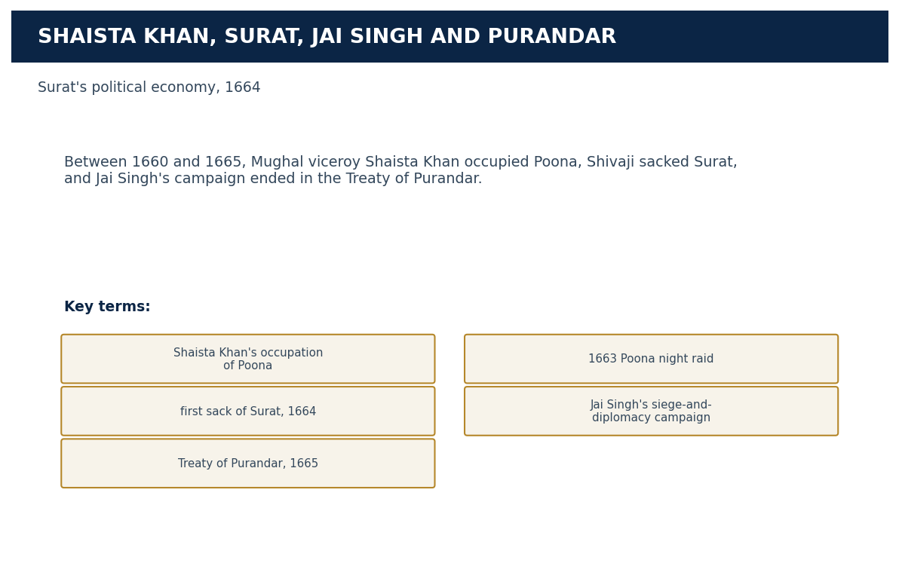
*Surat's political economy, 1664*

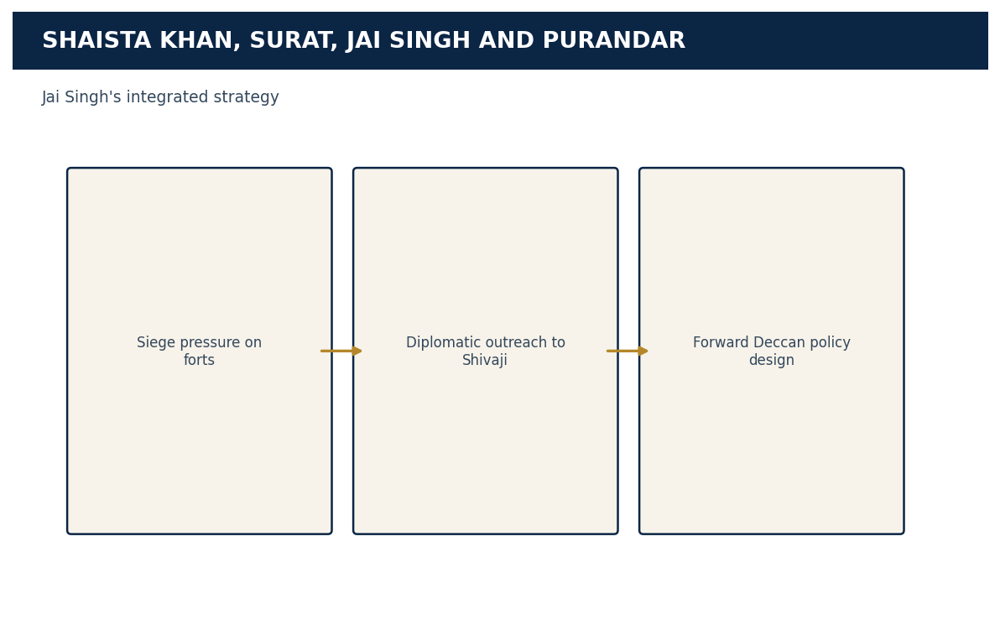
*Jai Singh's integrated strategy*

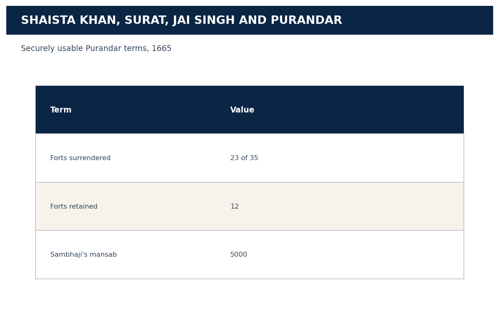
*Securely usable Purandar terms, 1665*

**Plain-language definition:** Between 1660 and 1665, Mughal viceroy Shaista Khan occupied Poona, Shivaji sacked Surat, and Jai Singh's campaign ended in the Treaty of Purandar.

**Technical precision:** Treaty of Purandar (1665): a negotiated settlement in which Shivaji surrendered 23 of 35 forts, retained 12, and Sambhaji was granted a Mughal mansab of 5000, making Shivaji a subordinate ally rather than an eliminated rebel.

**Answer-ready opening:** Mughal-Maratha conflict before Purandar was not a simple contest between a giant empire and small raiders; it was a negotiated, incomplete incorporation.

#### PARAGRAPH DEMONSTRATION

**Claim:** Mughal-Maratha conflict before Purandar was not a simple contest between a giant empire and small raiders. **Evidence:** named evidence: Shaista Khan's occupation of Poona was punctured by Shivaji's 1663 night raid; Surat was sacked in 1664; Jai Singh combined siege, diplomacy and a forward Bijapur policy, culminating in the 1665 Treaty of Purandar, which transferred 23 of 35 forts, retained 12, and granted Sambhaji mansab 5000. **Analysis:** Purandar is best read as an attempted incorporation — Mughal hierarchy tried to make Shivaji a useful subordinate ally while Shivaji retained a territorial base and strategic agency. **Qualification:** implausible dramatic detail should not replace the raid's real strategic meaning, Surat should not be read as banditry or as evidence of a modern national revenue system, and Purandar's terms should not be treated as a final or permanent settlement.

Mughal-Maratha conflict before Purandar was not a simple contest between a giant empire and small raiders. Shaista Khan's occupation of Poona made Mughal power locally visible but exposed an army dispersed across hostile terrain and dependent on information. The 1663 raid had a large symbolic effect because it punctured the image of secure occupation; implausible dramatic detail should not be allowed to replace its strategic meaning. Mughal commanders also faced Bijapur as a competing front and a fort-and-mobility problem that a conventional siege could not instantly solve.

Surat's sack in 1664 struck a premier Mughal port and a commercial world connected to merchants, customs and imperial credit. European factory records are useful for commercial disruption and rumour, not neutral total accounts of motive or loss. The event can be analysed as coercive political economy: it created resources and visibility while challenging Mughal prestige. It was neither mere banditry nor evidence of a modern national revenue system.

Jai Singh combined siege pressure, diplomacy and a forward policy toward Bijapur. The Treaty of Purandar (1665) transferred 23 forts while 12 were retained, and Sambhaji was granted mansab 5000; it also involved service and Bijapur-facing obligations. The agreement is best read as an attempted incorporation: Mughal hierarchy tried to make Shivaji useful, while Shivaji retained a territorial base and strategic agency. Records differ on revenue detail; avoid unverified figures.

**Keywords (use each once in your own recall sentence):** Shaista Khan's occupation of Poona, 1663 Poona night raid, first sack of Surat, 1664, Jai Singh's siege-and-diplomacy campaign, Treaty of Purandar, 1665

**Recall flow:** Mughal-Maratha conflict before Purandar was not a simple contest between a giant empire and small raiders. -> Shaista Khan's occupation of Poona -> 1663 Poona night raid -> first sack of Surat, 1664 -> implausible dramatic detail should not replace the raid's real strategic meaning.

#### Session 7 — AGRA: STATUS, CONFINEMENT, ESCAPE AND THE LIMITS OF SETTLEMENT

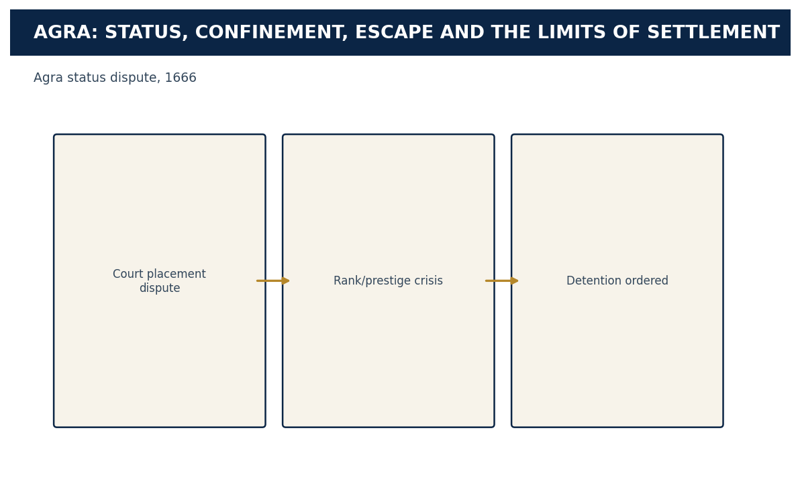
*Agra status dispute, 1666*

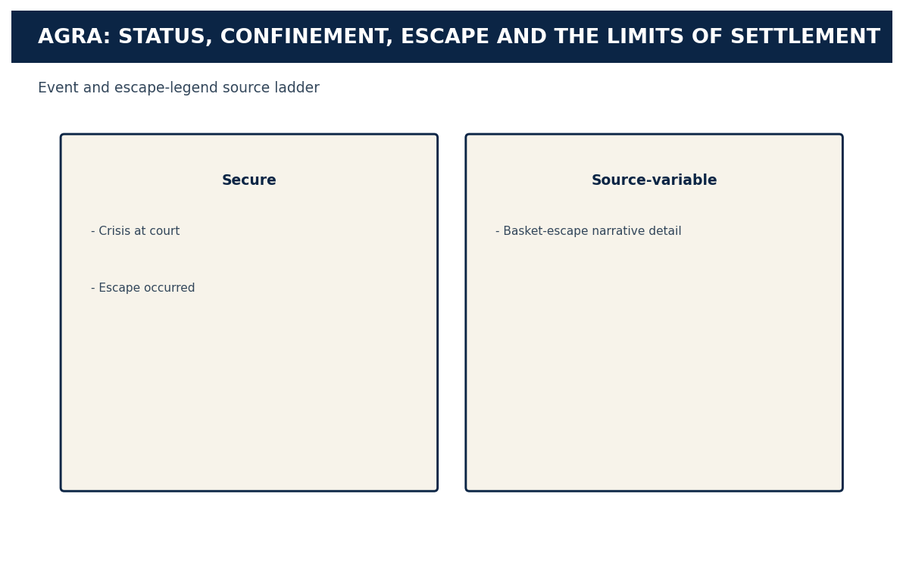
*Event and escape-legend source ladder*

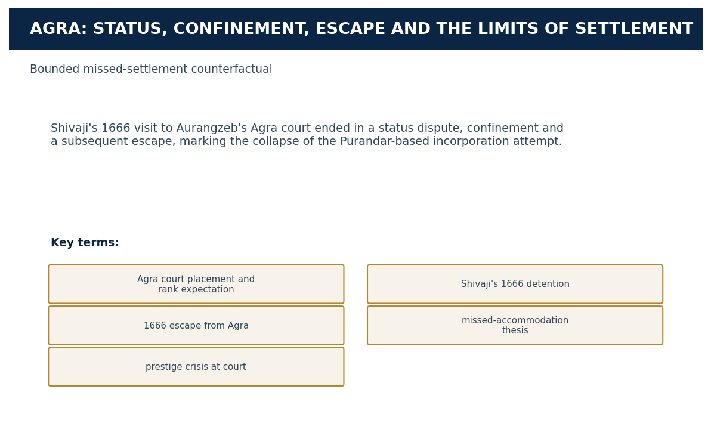
*Bounded missed-settlement counterfactual*

**Plain-language definition:** Shivaji's 1666 visit to Aurangzeb's Agra court ended in a status dispute, confinement and a subsequent escape, marking the collapse of the Purandar-based incorporation attempt.

**Technical precision:** Missed accommodation: a historiographical judgment (notably Satish Chandra's) that Aurangzeb's failure to durably value Shivaji as an ally was a major, though not inevitable, political error.

**Answer-ready opening:** Agra shows that a negotiated settlement was possible but not guaranteed; a status crisis, not a predetermined betrayal, broke the incorporation attempt.

#### PARAGRAPH DEMONSTRATION

**Claim:** Agra in 1666 created a prestige crisis rather than confirming any prior plan to eliminate Shivaji. **Evidence:** named evidence: court placement, rank expectation and detention at Agra created a status dispute; Shivaji subsequently escaped from confinement. **Analysis:** Satish Chandra treats Aurangzeb's failure to durably value Shivaji as an ally as a major political mistake, useful as an analytical judgment about a missed accommodation rather than as proof of inevitability. **Qualification:** avoid teleology: settlement was possible but not guaranteed, and the exact escape method (including the well-known basket story) carries variable source weight that should be labelled rather than recited as certain fact.

At Agra in 1666, court placement, rank expectation and detention created a prestige crisis. Shivaji escaped. Satish Chandra treats Aurangzeb's failure to value Shivaji as a durable ally as a major political mistake. Avoid teleology: settlement was possible but not guaranteed.

The status dispute at Agra should be read against the Purandar terms: a mansab and a subordinate-ally role were offered, but rank placement, precedence and treatment at court could not be reconciled with Shivaji's own claim to independent standing. The escape restored Shivaji's freedom of action and effectively ended this particular incorporation attempt.

A missed-settlement counterfactual is useful only if bounded: it explains why one route to accommodation failed without claiming any single decision alone determined the outcome of 1707.

**Keywords (use each once in your own recall sentence):** Agra court placement and rank expectation, Shivaji's 1666 detention, 1666 escape from Agra, missed-accommodation thesis, prestige crisis at court

**Recall flow:** Agra in 1666 created a prestige crisis rather than confirming any prior plan to eliminate Shivaji. -> Agra court placement and rank expectation -> Shivaji's 1666 detention -> 1666 escape from Agra -> avoid teleology: settlement was possible but not guaranteed.

### PART IV - RECOVERY, CORONATION AND SOUTHERN REACH

#### Session 8 — RECOVERY AFTER 1670, CORONATION AND THE SOUTHERN EXPEDITION

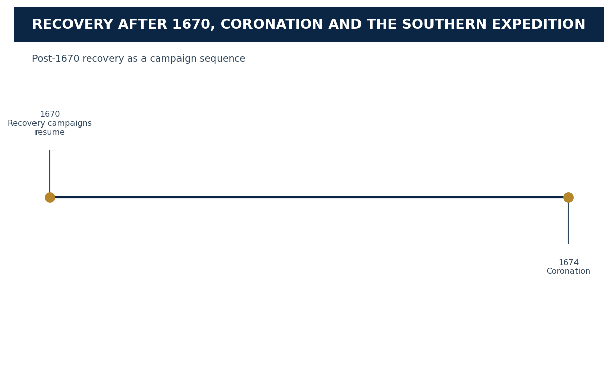
*Post-1670 recovery as a campaign sequence*

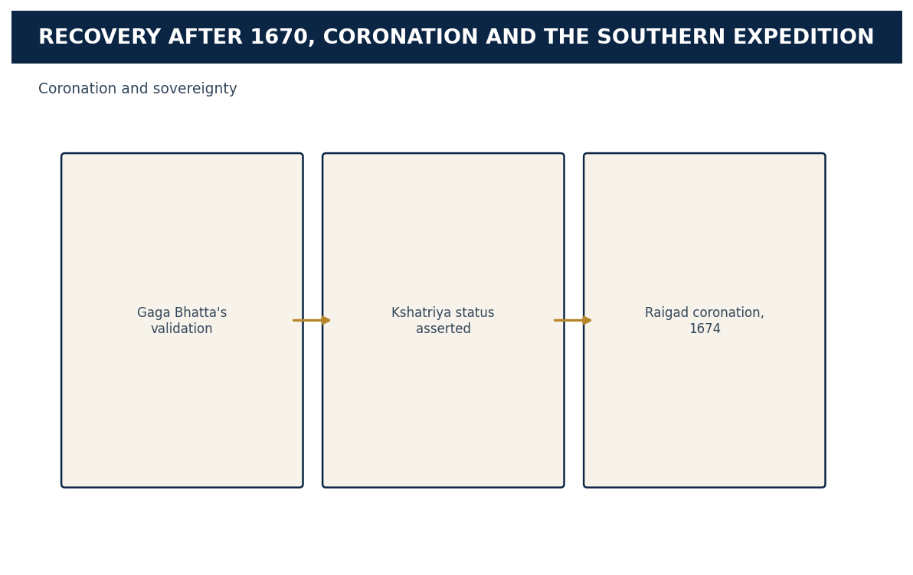
*Coronation and sovereignty*

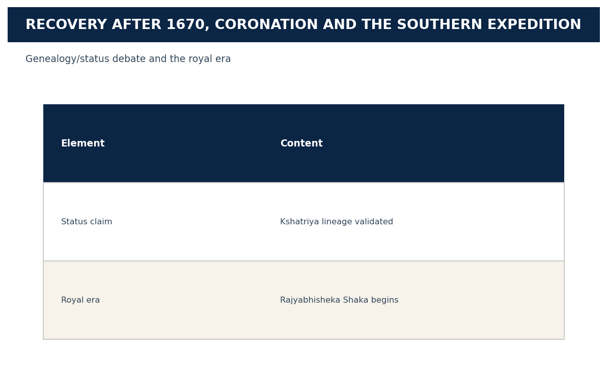
*Genealogy/status debate and the royal era*

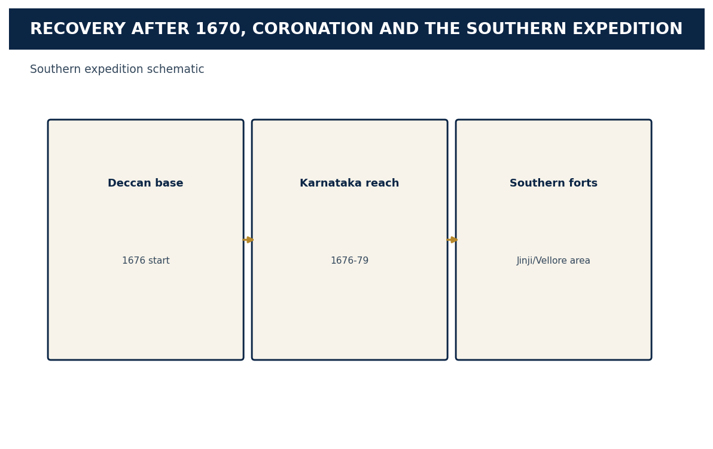
*Southern expedition schematic*

**Plain-language definition:** After 1670 Shivaji recovered forts, sacked Surat a second time, and in 1674 was crowned Chhatrapati at Raigad with the Vedic scholar Gaga Bhatta officiating.

**Technical precision:** Coronation and era-dating: the 1674 Raigad coronation instituted a formal royal chronology (the Rajyabhisheka Shaka, counted from the coronation year) used on later Maratha documents and coinage, which is bounded evidence of assumed sovereignty, not of a modern calendar reform.

**Answer-ready opening:** The 1674 coronation converted a regional chief into a recognised sovereign whose reign was thereafter dated from his own royal era.

#### PARAGRAPH DEMONSTRATION

**Claim:** The Raigad coronation of 1674 supplied a sovereign idiom in the political language of the time, with a bounded but real dating consequence. **Evidence:** named evidence: Gaga Bhatta's role, Kshatriya genealogy, royal ritual and the assertion of chhatrapati status; a subsequent second rite is recorded in some accounts; the coronation year founded the Rajyabhisheka Shaka era used to date later Maratha documents and coinage. **Analysis:** the status debate itself is evidence that royal rank had to be made and defended — it addressed hierarchy, diplomacy and legitimacy toward chiefs and Deccani rulers in contemporary terms, and its own calendar shows contemporaries treated it as a genuine founding moment. **Qualification:** coronation did not create modern national independence or a universal calendar reform; if a second rite is mentioned, specify the source and its stated ritual reason rather than adding invented expenditure or ceremony detail.

From 1670, recovery involved renewed fort operations, the second sack of Surat and reassertion of leverage. Kondana/Sinhagad and Tanaji have an unusually powerful later narrative life; use the fort's recovery as a dated campaign context while qualifying legend-heavy detail. Recovery was not a single reversal: it was a sequence of resource acquisition, fort recapture, renewed confidence and altered bargaining position.

The Raigad coronation of 1674 supplied a sovereign idiom in the political language of the time. Gaga Bhatta's role, Kshatriya genealogy, royal ritual and the assertion of chhatrapati status addressed hierarchy, diplomacy and legitimacy. The status debate itself is evidence that royal rank had to be made and defended; it is not a transparent census of social origin. The coronation year also became the starting point of a royal era (the Rajyabhisheka Shaka) used to date subsequent Maratha grants and coins — a bounded but genuine sign that contemporaries treated 1674 as instituting a new sovereign chronology, not merely a ceremony. If a second rite is mentioned, specify the source and its stated ritual reason rather than adding invented expenditure or ceremony details. Coronation did not create a modern national independence; it created a recognised royal status that could address chiefs and Deccani rulers in contemporary terms.

The Karnataka/southern expedition of 1676-79 introduced strategic depth, resources and relations with the Tanjavur/Karnataka branch represented by Ekoji or Venkoji. Jinji and Vellore belong to a longer southern strategic geography. Do not turn this bounded episode into a full later Tamil or Peshwa story. Shivaji's death in 1680 leaves a succession problem; Topic 25 owns the later eighteenth-century transformation.

**Keywords (use each once in your own recall sentence):** renewed fort operations after 1670, second sack of Surat, 1670, Raigad coronation, 1674, and Gaga Bhatta, Kshatriya-status debate, Rajyabhisheka Shaka royal era-dating

**Recall flow:** The Raigad coronation of 1674 supplied a sovereign idiom in the political language of the time, with a bounded but real dating consequence. -> renewed fort operations after 1670 -> second sack of Surat, 1670 -> Raigad coronation, 1674, and Gaga Bhatta -> coronation did not create modern national independence or a universal calendar reform; if a second rite is mentioned, name its source and stated ritual reason rather than inventing ceremonial or expenditure detail.

### PART V - STATE, REVENUE, FISCAL CLAIMS AND WAR

#### Session 9 — KINGSHIP, ASHTAPRADHAN AND FORT-LOCAL ADMINISTRATION

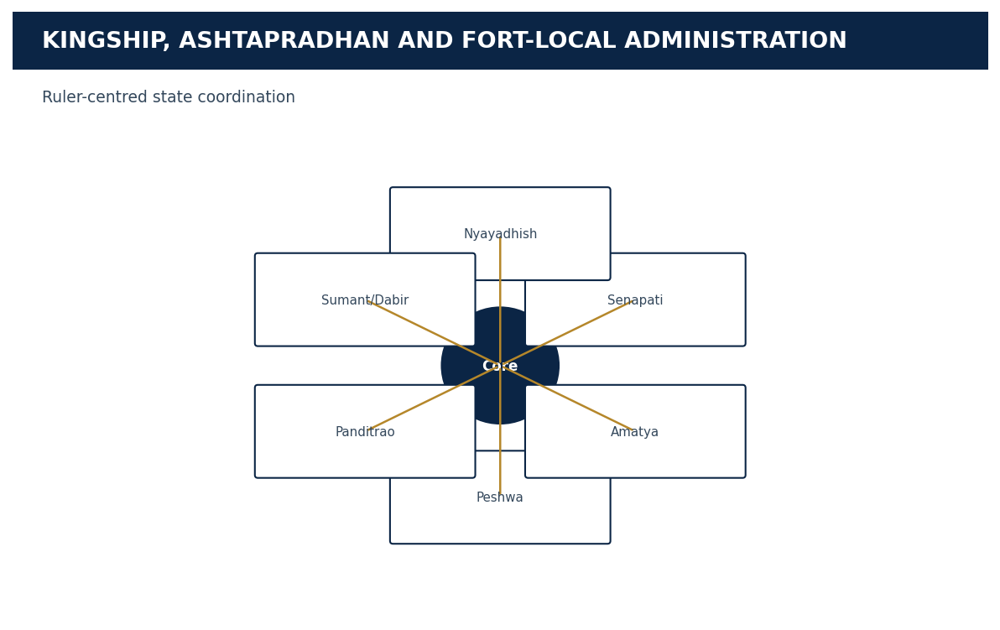
*Ruler-centred state coordination*

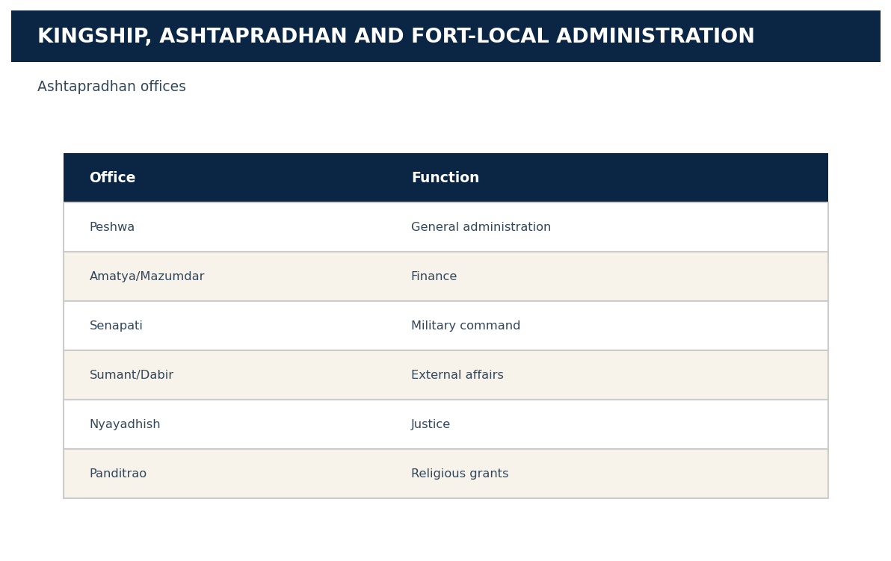
*Ashtapradhan offices*

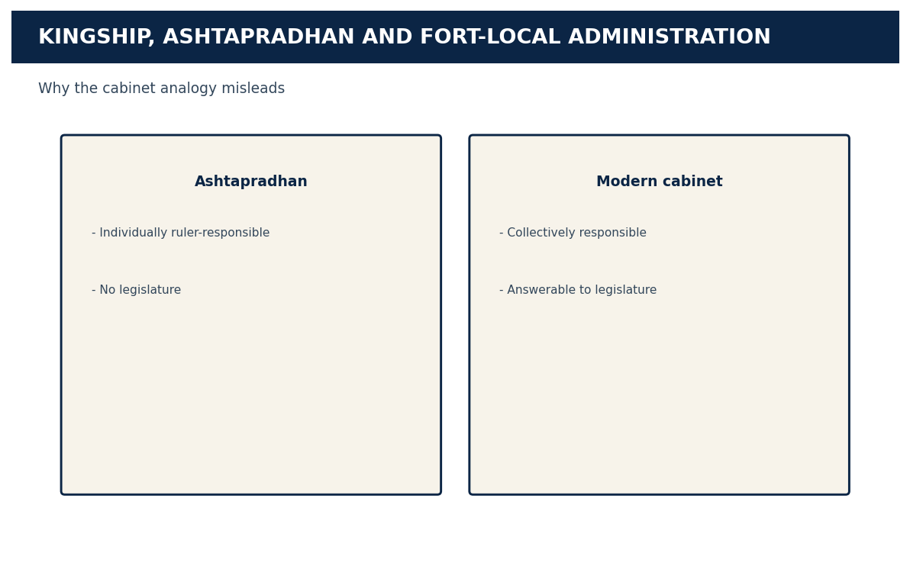
*Why the cabinet analogy misleads*

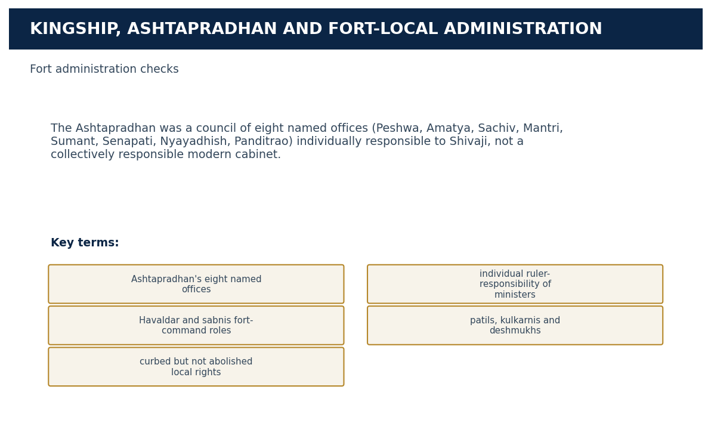
*Fort administration checks*

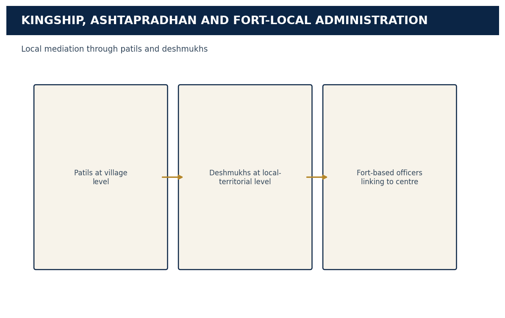
*Local mediation through patils and deshmukhs*

**Plain-language definition:** The Ashtapradhan was a council of eight named offices (Peshwa, Amatya, Sachiv, Mantri, Sumant, Senapati, Nyayadhish, Panditrao) individually responsible to Shivaji, not a collectively responsible modern cabinet.

**Technical precision:** Ruler-centred administration: a system in which named central offices, fort commands and hereditary local intermediaries (deshmukhs, patils, kulkarnis) operated together under negotiated central supervision, rather than through a uniform bureaucratic hierarchy.

**Answer-ready opening:** Shivaji's state combined eight ruler-responsible offices with negotiated, not abolished, local power — the opposite of both a modern cabinet and a stateless raiding band.

#### PARAGRAPH DEMONSTRATION

**Claim:** The Ashtapradhan was not a collective cabinet responsible to a legislature. **Evidence:** named evidence: the eight offices were Peshwa, Amatya/Mazumdar, Sachiv, Mantri/Waqia-navis, Sumant/Dabir, Senapati, Nyayadhish and Panditrao, each individually answerable to the ruler and several capable of holding military as well as civil duties. **Analysis:** fort administration shows the same pattern of checks rather than uniform bureaucracy: Havaldar, sabnis and other command, store or record roles were commonly divided, and provincial/village administration ran through existing intermediaries such as patils, kulkarnis and deshmukhs. **Qualification:** later Peshwa-era dominance must not be projected backward onto the seventeenth century, and the specialised judicial/religious functions of Nyayadhish and Panditrao should not be merged into one modern department; Shivaji curbed illegal exactions but did not abolish deshmukhs, mirasdars or hereditary local rights.

Shivaji's kingship joined sovereign terminology, royal household, forts, fiscal practice and local mediation. The state was ruler-centred but not therefore institutionless. The Ashtapradhan named Peshwa, Amatya or Mazumdar, Sachiv, Mantri or Waqia-navis, Senapati or Sar-i-naubat, Sumant or Dabir, Nyayadhish and Panditrao. Variants of title and description occur; an answer should give the functions cautiously rather than make the list a modern organisational chart.

The key qualification is that the Ashtapradhan was not a collective cabinet responsible to a legislature. Officers were individually responsible to the ruler, and several could perform military as well as administrative duties. The specialised judicial and religious functions of Nyayadhish and Panditrao should not be casually merged into a single modern department. Later Peshwa-era dominance must not be projected backward to make seventeenth-century offices look like a later constitutional arrangement.

Fort administration similarly reveals checks rather than a neat bureaucracy. Havaldar, sabnis and other command, store or record roles are commonly discussed as divided responsibilities; local variations and evidence limits need acknowledgment. Provincial and village-level administration operated through existing intermediaries. This is why central authority and local mediation must be presented together: Shivaji curbed illegal exactions and over-mighty deshmukhs/mirasdars but did not abolish hereditary local rights, mokasa/jagir or landed intermediaries.

**Keywords (use each once in your own recall sentence):** Ashtapradhan's eight named offices, individual ruler-responsibility of ministers, Havaldar and sabnis fort-command roles, patils, kulkarnis and deshmukhs, curbed but not abolished local rights

**Recall flow:** The Ashtapradhan was not a collective cabinet responsible to a legislature. -> Ashtapradhan's eight named offices -> individual ruler-responsibility of ministers -> Havaldar and sabnis fort-command roles -> later Peshwa-era dominance must not be projected backward onto the seventeenth century.

#### Session 10 — REVENUE, AGRARIAN RELATIONS AND THE LIMITS OF REFORM

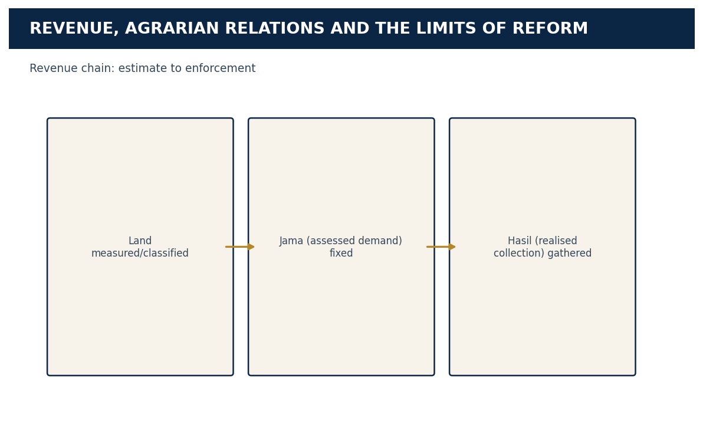
*Revenue chain: estimate to enforcement*

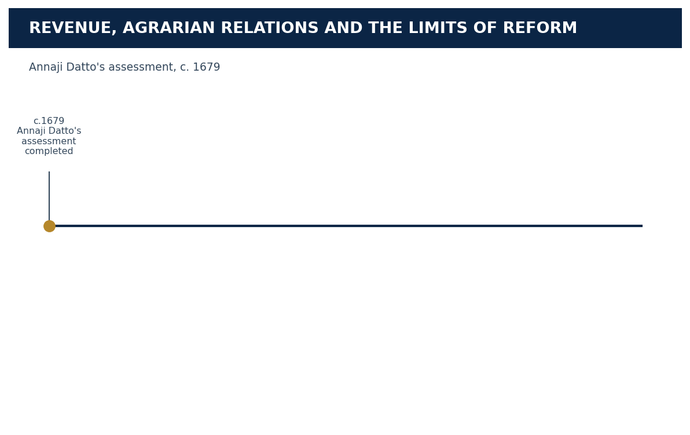
*Annaji Datto's assessment, c. 1679*

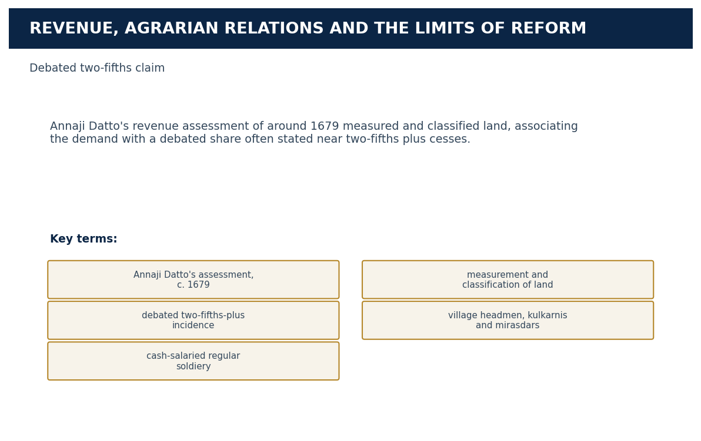
*Debated two-fifths claim*

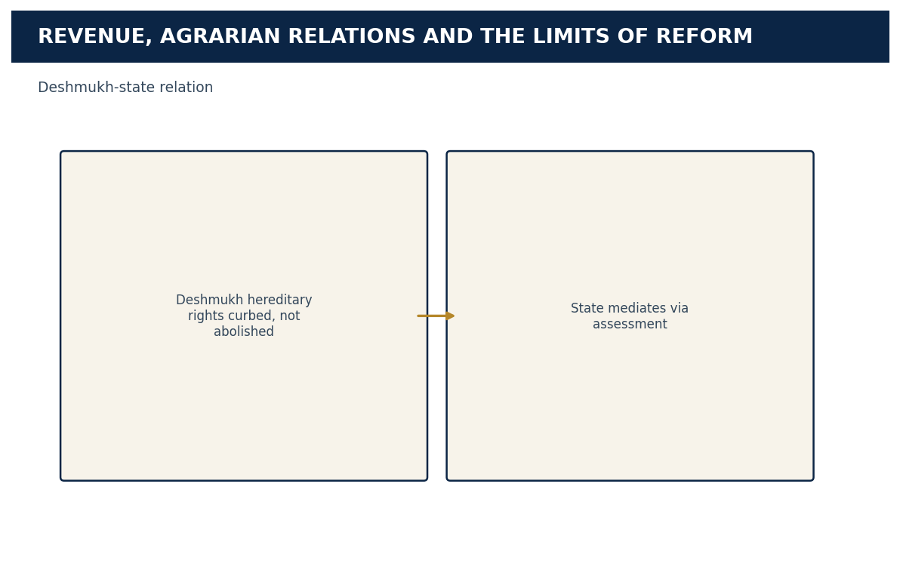
*Deshmukh-state relation*

**Plain-language definition:** Annaji Datto's revenue assessment of around 1679 measured and classified land, associating the demand with a debated share often stated near two-fifths plus cesses.

**Technical precision:** Assessment versus collection: jama is the paper/assessed demand fixed by measurement and classification, while realised collection depended on local intermediaries, cesses, enforcement and war conditions — the two must never be treated as identical.

**Answer-ready opening:** A precise-looking revenue fraction from one source is not licence to claim a uniform all-Deccan revenue law.

#### PARAGRAPH DEMONSTRATION

**Claim:** Assessment strengthened the state's capacity to estimate demand, but assessment is not the same as realised collection or a uniform cultivator burden. **Evidence:** named evidence: Annaji Datto's assessment around 1679 measured and classified land; some standard accounts describe a demand near two-fifths plus cesses. **Analysis:** the analytical payoff is to track the chain — estimate, demand, village mediation, payment and enforcement — and ask where it broke down, since village headmen, patils, kulkarnis, deshmukhs and mirasdars remained essential to actual realisation. **Qualification:** a precise-looking fraction is not licence to claim an all-Deccan revenue law; Shivaji curbed illegal exactions but did not abolish hereditary rights or all jagir/mokasa arrangements, and revenue farming (ijara) must be named only where a specific source states it.

Annaji Datto's assessment around 1679 is associated with measurement and classification of land. It strengthened the state's capacity to estimate demand, but assessment is not the same as realised collection or a uniform cultivator burden. Some standard accounts describe a demand around two-fifths plus cesses. Treat that as source-specific and debated: local conditions, extra levies, intermediaries, war and actual enforcement could change incidence. A precise-looking fraction is not a license to claim an all-Deccan revenue law.

Village headmen and patils, kulkarnis, deshmukhs, mirasdars and cultivators remained essential. Shivaji curbed some illegal exactions and the arbitrary power of intermediaries, but he did not abolish hereditary rights, all jagir/mokasa arrangements or all forms of local authority. Cash salaries for regular soldiers improved ruler control in some contexts; they did not dissolve the wider agrarian and service economy. Revenue farming or ijara must be described only where a given source specifies it.

The analytical payoff is to avoid peasant-liberator hagiography and cynical reduction alike. Measurement, oversight and curbs on predation could enhance capacity and protect parts of the revenue base, while the same system extracted a demand and relied on intermediaries.

**Keywords (use each once in your own recall sentence):** Annaji Datto's assessment, c. 1679, measurement and classification of land, debated two-fifths-plus incidence, village headmen, kulkarnis and mirasdars, cash-salaried regular soldiery

**Recall flow:** Assessment strengthened the state's capacity to estimate demand, but assessment is not the same as realised collection or a uniform cultivator burden. -> Annaji Datto's assessment, c. 1679 -> measurement and classification of land -> debated two-fifths-plus incidence -> a precise-looking fraction is not licence to claim an all-Deccan revenue law; Shivaji curbed illegal exactions but did not abolish hereditary rights or all jagir/mokasa arrangements.

#### Session 11 — CHAUTH, SARDESHMUKHI AND OVERLAPPING FISCAL AUTHORITY

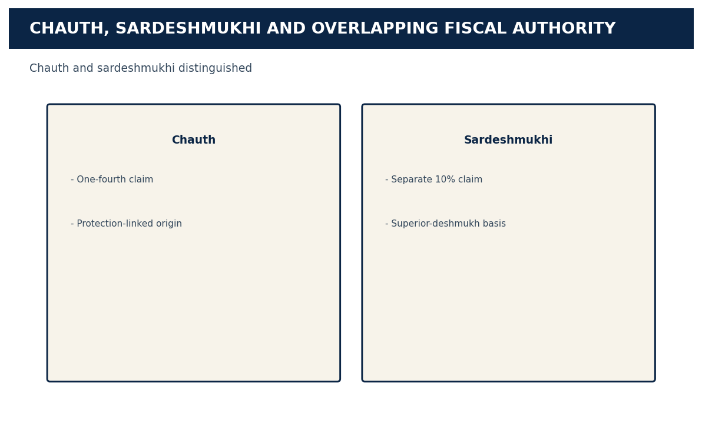
*Chauth and sardeshmukhi distinguished*

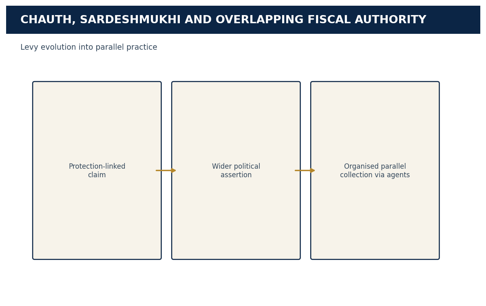
*Levy evolution into parallel practice*

**Plain-language definition:** Chauth was a one-fourth claim linked to a protection bargain in neighbouring territory; sardeshmukhi was a distinct additional ten-per-cent claim based on an asserted superior deshmukh right.

**Technical precision:** Overlapping fiscal authority: a condition in which chauth/sardeshmukhi collection by Maratha agents (kamaishdars) coexisted with continuing Mughal revenue claims in the same district, so payment did not automatically transfer territorial sovereignty.

**Answer-ready opening:** Chauth and sardeshmukhi were two distinct, named fiscal claims, and neither automatically equalled full territorial sovereignty.

#### PARAGRAPH DEMONSTRATION

**Claim:** Chauth and sardeshmukhi were distinct claims that must not be merged into a single label or equated with full sovereignty. **Evidence:** named evidence: chauth was a one-quarter claim commonly explained through a protection-payment bargain but also backed by coercion; sardeshmukhi was an additional ten-per-cent claim justified through asserted superior deshmukh right. **Analysis:** in the later Deccan war, collection through agents and kamaishdars became a parallel fiscal network affecting Mughal jagirdars, local intermediaries and cultivators, which is why fiscal overlap explains how mobile war acquired a durable revenue mechanism. **Qualification:** a Mains response must add that neither fiscal label settles the question of actual control — an agent could collect, bargain or threaten in a district where Mughal officials still claimed authority, so payment could buy temporary security rather than transfer settled sovereignty.

Chauth was a one-quarter claim or contribution in neighbouring territory, commonly explained through a protection-payment bargain but also backed by coercion. It had precedents in western Indian political practice and could not be equated mechanically either with sovereignty or with undifferentiated plunder. Its political meaning changed as collection became more organised and as later war and expansion generated parallel fiscal authority.

Sardeshmukhi was distinct: an additional ten-percent claim justified through asserted superior deshmukh right. A Prelims response must keep the two percentages and rationales separate. A Mains response should add that neither fiscal label settles the question of actual control. An agent could collect, bargain or threaten in a district where Mughal officials still claimed authority; a payment could purchase temporary security rather than transfer settled sovereignty.

In the late Deccan war, collection through agents and kamaishdars became historically important. Parallel demands affected Mughal jagirdars, local intermediaries and cultivators. The bridge to Topic 25 is later formalisation and eighteenth-century expansion; do not import the full confederacy narrative here.

**Keywords (use each once in your own recall sentence):** chauth: one-fourth protection claim, sardeshmukhi: ten-per-cent superior-deshmukh claim, kamaishdars and parallel collection, protection-payment bargain, Mughal jagirdars under fiscal pressure

**Recall flow:** Chauth and sardeshmukhi were distinct claims that must not be merged into a single label or equated with full sovereignty. -> chauth: one-fourth protection claim -> sardeshmukhi: ten-per-cent superior-deshmukh claim -> kamaishdars and parallel collection -> a Mains response must add that neither fiscal label settles the question of actual control, since an agent could collect, bargain or threaten in a district where Mughal officials still claimed authority, so payment bought temporary security rather than settled sovereignty.

#### Session 12 — MILITARY ORGANISATION, FORTS AND THE COAST

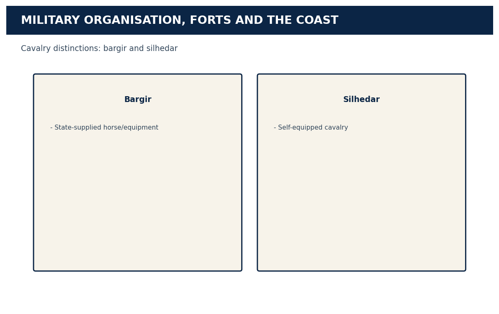
*Cavalry distinctions: bargir and silhedar*

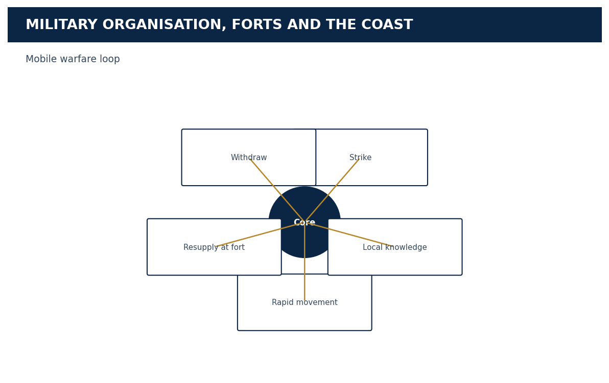
*Mobile warfare loop*

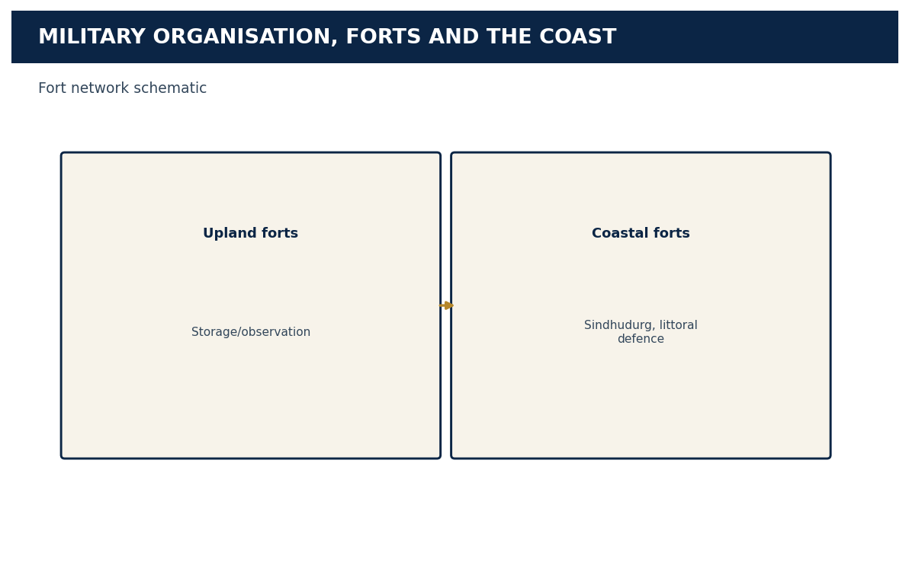
*Fort network schematic*

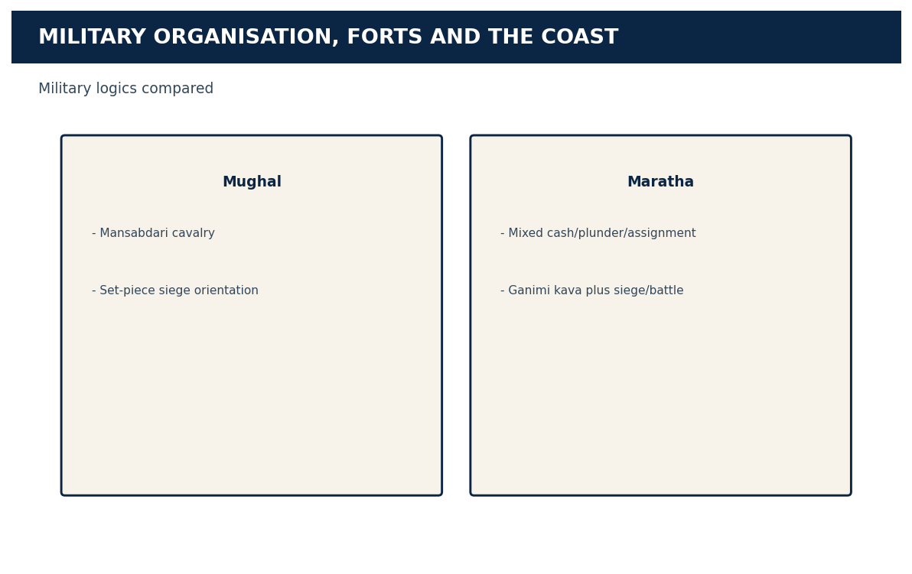
*Military logics compared*

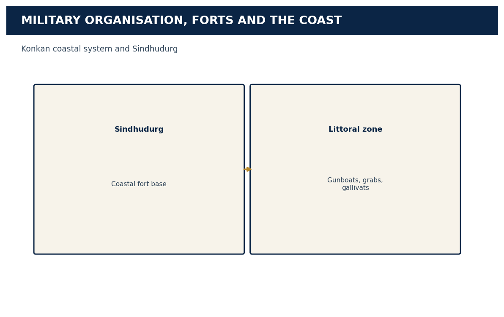
*Konkan coastal system and Sindhudurg*

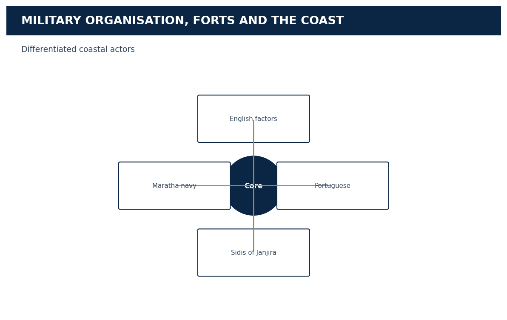
*Differentiated coastal actors*

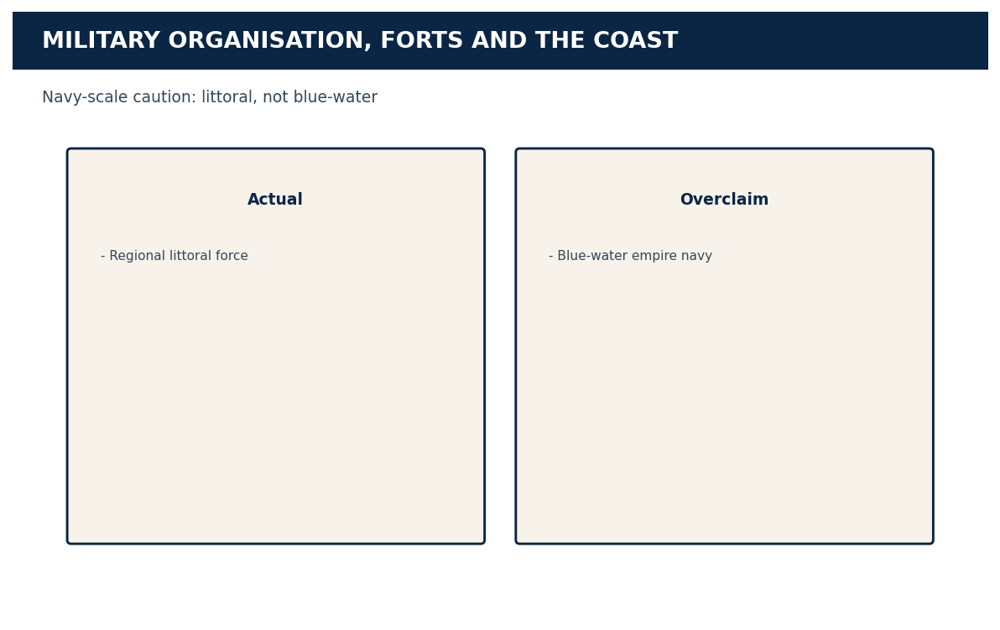
*Navy-scale caution: littoral, not blue-water*

**Plain-language definition:** Shivaji's forces combined Mavali infantry, bargir and silhedar cavalry, fort garrisons and intelligence with a littoral navy of gunboats, grabs and gallivats based on fortified coastal points such as Sindhudurg.

**Technical precision:** Ganimi kava: a repertoire of surprise, information, supply disruption, avoidance of unfavourable pitched battle and retreat toward secure fort nodes, adapted to Deccan terrain — not a single timeless 'guerrilla doctrine' and not a description that excludes sieges or set battles.

**Answer-ready opening:** The Maratha military advantage was situational, resting on information, forts and mixed remuneration, not a magical or purely mobile formula.

#### PARAGRAPH DEMONSTRATION

**Claim:** The Maratha military advantage was situational, not magical: it depended on information, local support, forts and the opponent's overstretch. **Evidence:** named evidence: bargir cavalry rode state-provided horses while silhedar cavalry maintained their own; Mavali infantry, fort garrisons and intelligence networks complemented cavalry; the navy used gunboats, grabs and gallivats crewed by Koli, Bhandari and Muslim seafarers, based at forts such as Sindhudurg. **Analysis:** regular troops were typically paid in cash, but remuneration was mixed in practice — supplemented by plunder shares and local assignments — and this mixed system, not a purely cash or purely plunder-based force, sustained both mobile raiding and formal siege or battle capacity. **Qualification:** ganimi kava should not be turned into a modern ideological theory of insurgency, and it did not exclude siege-holding or pitched battle (Panhala, Salher); equally, the navy was a regional littoral force for creek defence, anti-Sidi operations and trade protection, not a blue-water empire-scale navy capable of commanding the Indian Ocean.

Bargir and silhedar cavalry should be distinguished rather than treated as labels for all Maratha soldiers. A bargir was associated with a state-provided horse and equipment; a silhedar maintained his own. Mavali infantry, fort garrisons, intelligence networks and short operational movement complemented cavalry. Ganimi kava is best explained as a repertoire of surprise, information, supply disruption, avoidance of unfavourable battle and retreat toward secure nodes. It should not be turned into a modern ideological theory of insurgency.

Remuneration was mixed rather than uniform: regular troops were commonly cash-paid, but plunder shares and local assignments (mokasa-type grants) also supported soldiers and commanders, so an all-cash caricature of the Maratha military economy is as misleading as an all-plunder one.

Comparison with Mughal military power should be concrete. The Mughal system could mobilise large cavalry formations, artillery and siege resources through a mansab-jagir apparatus; its size did not eliminate the costs of hill warfare, communication and holding dispersed positions. The Maratha advantage was situational, not magical: it depended on information, support, forts and the opponent's overstretch. Fort recapture cycles show why one successful siege could fail to end a campaign.

The navy had regional strategic value. Konkan creeks, coastal forts and trade brought Shivaji into contact and conflict with the Sidis of Janjira, the Portuguese and the English. The fleet used gunboats, grabs and gallivats alongside trading and supply craft, and Sindhudurg — built on a coastal island — together with other forts such as Vijaydurg anchored this littoral capacity. Koli, Bhandari, Muslim and other sailors/commanders prevent a homogeneous communal description. This was not a blue-water empire-scale navy; it was a coastal capacity for defence, mobility, trade protection and pressure.

**Keywords (use each once in your own recall sentence):** bargir (state-horsed) and silhedar (self-equipped) cavalry, Mavali infantry and fort garrisons, ganimi kava mobile repertoire, gunboats, grabs and gallivats, Sindhudurg and other coastal forts

**Recall flow:** The Maratha military advantage was situational, not magical: it depended on information, local support, forts and the opponent's overstretch. -> bargir (state-horsed) and silhedar (self-equipped) cavalry -> Mavali infantry and fort garrisons -> ganimi kava mobile repertoire -> ganimi kava should not be turned into a modern ideological theory of insurgency.

### PART VI - RELIGION, LEGITIMACY AND IMPERIAL WAR

#### Session 13 — HINDU ROYAL IDIOM, INSTITUTIONAL BORROWING AND SOURCE-CRITICAL INCLUSION

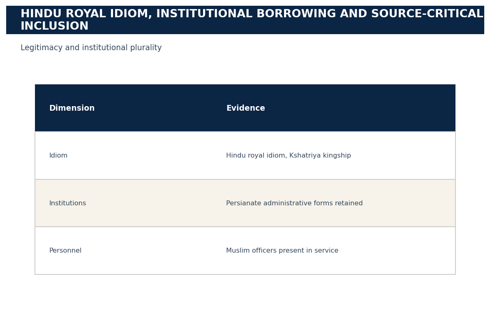
*Legitimacy and institutional plurality*

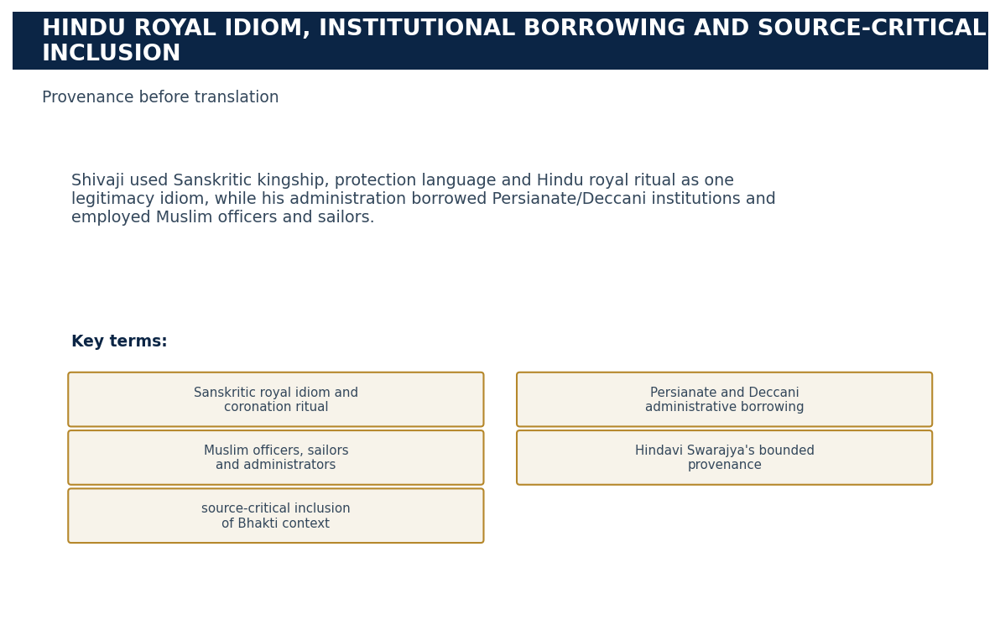
*Provenance before translation*

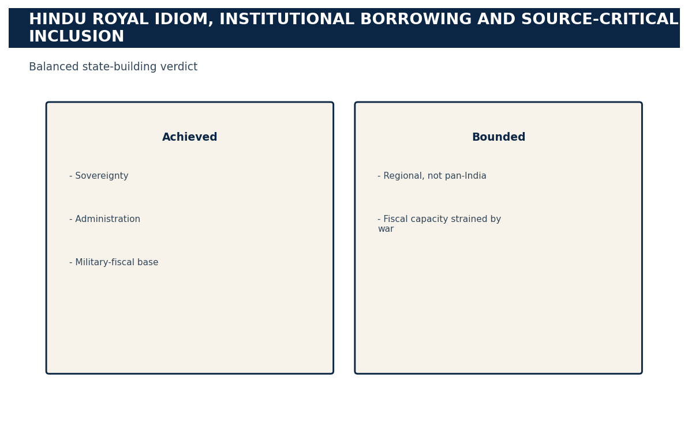
*Balanced state-building verdict*

**Plain-language definition:** Shivaji used Sanskritic kingship, protection language and Hindu royal ritual as one legitimacy idiom, while his administration borrowed Persianate/Deccani institutions and employed Muslim officers and sailors.

**Technical precision:** 'Hindu state' as a bounded legitimacy idiom: a description valid only for the ceremonial and rhetorical register of kingship, and invalid the moment it is extended into a claim of an ethnically pure administration or a modern communal nation-state.

**Answer-ready opening:** Royal Hindu idiom and Persianate institutional borrowing coexisted; neither a perfect-tolerance legend nor an exclusive Hindu-state formula fits the evidence.

#### PARAGRAPH DEMONSTRATION

**Claim:** Shivaji's kingship combined a genuine Hindu royal idiom with pragmatic institutional borrowing, and both dimensions must be held together. **Evidence:** named evidence: Hindu royal idiom, protection claims, Sanskritised ceremony and coronation ritual coexisted with Persianate and Deccani administrative practices, Muslim officers and sailors in service, and pragmatic diplomatic choices. **Analysis:** the right conclusion is neither a perfect-tolerance legend nor an exclusive Hindu-state formula — royal idiom, administrative language, personnel and local practice belong to different evidentiary categories that must be assessed separately. **Qualification:** claims about protection of mosques, Qurans, women or particular communities, and the term Hindavi Swarajya, require exceptional source care: a prescription, a courtly anecdote, a later bakhar and a documented local act each prove different things, and Bhakti context should not be read as a direct political programme without a precise link.

Shivaji used Hindu royal idiom, protection claims, Sanskritised ceremony and coronation ritual. These dimensions are part of historical legitimacy and should not be erased. Yet the state also drew on Persianate and Deccani administrative practices, employed Muslim officers and sailors, and made pragmatic diplomatic choices. The right conclusion is neither a perfect-tolerance legend nor an exclusive Hindu-state formula. Royal idiom, administrative language, personnel and local practice belong to different evidentiary categories.

Claims about protection of mosques, Qurans, women or particular communities require exceptional care. A prescription, a courtly anecdote, a later bakhar and a documented local act prove different things. Secure evidence may demonstrate a norm or an event; it cannot automatically demonstrate uniform enforcement. This caution also applies to claims of indiscriminate communal violence. Source criticism is not moral evasion; it prevents a modern identity debate from flattening the seventeenth-century archive.

Hindavi Swarajya should be used only when a precise source and context are supplied. It cannot automatically be translated into modern nation-state nationalism. A defensible formulation is that Shivaji articulated autonomy and sovereignty in a political world of multiple legitimacies. Bhakti context may illuminate a Marathi cultural field, but direct political programme should not be inferred from devotional literature alone.

**Keywords (use each once in your own recall sentence):** Sanskritic royal idiom and coronation ritual, Persianate and Deccani administrative borrowing, Muslim officers, sailors and administrators, Hindavi Swarajya's bounded provenance, source-critical inclusion of Bhakti context

**Recall flow:** Shivaji's kingship combined a genuine Hindu royal idiom with pragmatic institutional borrowing, and both dimensions must be held together. -> Sanskritic royal idiom and coronation ritual -> Persianate and Deccani administrative borrowing -> Muslim officers, sailors and administrators -> claims about protection of mosques, Qurans, women or particular communities require exceptional source care, since a prescription, a courtly anecdote and a documented local act each prove a different, narrower thing.

#### Session 14 — SAMBHAJI, ANNEXATION AND THE END OF BUFFER POLITICS

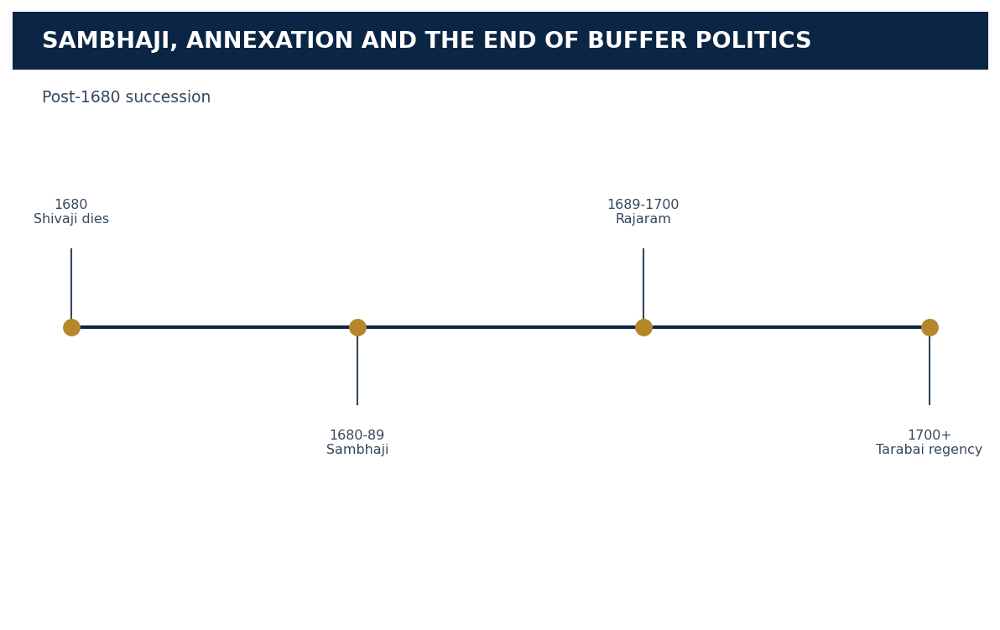
*Post-1680 succession*


*Sambhaji's strategic field*


*Annexation and burden*


*Buffer-removal paradox*


*Sambhaji capture source matrix*


*Decentralisation after execution*

**Plain-language definition:** Sambhaji succeeded Shivaji in 1680, continued the war under mounting Mughal, Sidi and Portuguese pressure, and was captured at Sangameshwar and executed in 1689 after Aurangzeb's 1686 Bijapur and 1687 Golconda annexations.

**Technical precision:** Buffer politics: a regional order in which independent sultanates (Bijapur, Golconda) mediated between the Mughals and the Marathas; their annexation removed this mediating layer and converted a three/four-cornered contest into a direct, more diffuse Mughal-Maratha war.

**Answer-ready opening:** Sambhaji's reign and execution mark the end of buffer politics, not the end of Maratha resistance.

#### PARAGRAPH DEMONSTRATION

**Claim:** Aurangzeb's annexation of Bijapur in 1686 and Golconda in 1687 removed buffer states that had previously mediated Deccan politics. **Evidence:** named evidence: the annexations brought new territories, revenue claims and nobles, but also required garrisons, administration and long communications across disturbed districts; Sambhaji was captured at Sangameshwar and executed in 1689. **Analysis:** a nominal addition to jama was not equivalent to readily realised hasil, so the empire enlarged its sovereign claim while making the Maratha contest more diffuse and costly; Sambhaji's death removed a recognised negotiating head and helped shift resistance toward dispersed commanders, forts, local networks and fiscal claims. **Qualification:** Sambhaji should not be treated as either an inevitable failure or a simple continuation of Shivaji, since his administration and war choices were constrained by Prince Akbar's alliance and Mughal pressure; graphic execution details and a single immediate motive vary by source and should be separated from the secure chronological anchor.

Sambhaji's accession after 1680 followed an internal succession struggle. His administration and war choices must be located in a constrained field that included Prince Akbar's alliance, Mughal pressure and conflict around Portuguese and Sidi positions. The point is not to narrate every campaign, but to avoid treating him as either an inevitable failure or a simple continuation of Shivaji.

Aurangzeb's annexation of Bijapur in 1686 and Golconda in 1687 removed buffer states that had previously mediated Deccan politics. The acquisitions brought territories, revenue claims and nobles, but they also required garrisons, administration and long communications across disturbed districts. A nominal addition to jama was not equivalent to readily realised hasil. The paradox is consequential: the empire enlarged its sovereign claim while making the Maratha contest more diffuse and costly.

Sambhaji was captured at Sangameshwar and executed in 1689. The capture and execution are secure chronological anchors. Graphic details, a single immediate motive and total religious interpretation vary by source and should be separated. His death did not end resistance; it removed a recognised negotiating head and helped shift resistance toward dispersed commanders, forts, local networks and fiscal claims. That is a mechanism, not a claim that decentralisation was automatically harmonious.

**Keywords (use each once in your own recall sentence):** Sambhaji's succession struggle, 1680, Prince Akbar's alliance with Sambhaji, Bijapur (1686) and Golconda (1687) annexation, capture and execution at Sangameshwar, 1689, removal of a negotiable head, not of resistance

**Recall flow:** Aurangzeb's annexation of Bijapur in 1686 and Golconda in 1687 removed buffer states that had previously mediated Deccan politics. -> Sambhaji's succession struggle, 1680 -> Prince Akbar's alliance with Sambhaji -> Bijapur (1686) and Golconda (1687) annexation -> Sambhaji should not be treated as either an inevitable failure or a simple continuation of Shivaji.

#### Session 15 — RAJARAM, JINJI, TARABAI AND THE DECENTRALISED RESISTANCE


*Rajaram and Jinji (Gingee) strategic depth*


*Decentralised command wheel*


*Operations against dispersed deployment*


*Tarabai's regency for Shivaji II*


*Siege-recapture loop, 1700-05*

**Plain-language definition:** After Sambhaji's execution, Rajaram escaped to the distant fort of Gingee, which fell in 1698 after a long Mughal siege only once Rajaram himself had already escaped; on his death in 1700 his widow Tarabai directed resistance in the name of their son, Shivaji II.

**Technical precision:** Decentralised resistance: a war conducted through dispersed commanders (Santaji Ghorpade, Dhanaji Jadhav), fiscal agents and fort networks connected by loyalty to a royal cause rather than by one central command post.

**Answer-ready opening:** Gingee's fall in 1698 marked the loss of a fortress, not the capture of Rajaram, who had already escaped; Tarabai's regency for Shivaji II then carried the royal cause forward.

#### PARAGRAPH DEMONSTRATION

**Claim:** Distance, fortification and alternative lines of communication at Gingee could force a powerful empire to distribute men and resources across a very wide theatre. **Evidence:** named evidence: Rajaram's escape and the Jinji (Gingee) base supplied strategic depth; the long Mughal siege of Gingee ended only in 1698, by which time Rajaram had already escaped; Santaji Ghorpade, Dhanaji Jadhav, Ramchandra Pant Amatya and Shankaraji Narayan sustained command, fiscal and administrative functions after Rajaram's death in 1700, when Tarabai took up the regency for her son Shivaji II. **Analysis:** this dispersed structure allowed the war to survive the loss of a central leader, and during 1700-05 Aurangzeb's personal fort campaigns confronted a repetitive siege-recapture dynamic that explains why operational success could yield weak strategic return. **Qualification:** the fall of Gingee in 1698 must not be confused with the capture of Rajaram, who had escaped earlier; the named commanders should not be treated as one frictionless organisation, since personal followings, local bargaining and coordination problems remained, and decentralisation, while it increased resilience, also strengthened autonomous commanders and later fed confederate tendencies that Topic 25 examines in full.

Rajaram's escape and the Jinji (Gingee) base supplied strategic depth when the Mughal court expected a decisive settlement. The long Mughal siege of Gingee lasted years and ended only in 1698 — importantly, Rajaram himself had already escaped the fortress before its fall, so Gingee's capture removed a fort, not the person of the king. Its analytical value is clear: distance, fortification and alternative lines of communication could force a powerful empire to distribute men and resources across a very wide theatre.

Santaji Ghorpade, Dhanaji Jadhav, Ramchandra Pant Amatya and Shankaraji Narayan are evidence that resistance rested on several command, fiscal and administrative nodes. Raids on communication, pressure on smaller detachments, fort links and collection systems created a war that could survive loss of a central leader. The names should not be made into a single frictionless organisation: personal followings, local bargaining and coordination problems remained.

Rajaram died in 1700. His widow Tarabai then led the resistance as regent for their young son Shivaji II, the dynastic basis of her authority; her regency and leadership are not a ceremonial footnote. She exercised political authority in organising legitimacy, patronage and resistance. During c.1700-05, Aurangzeb's personal fort campaigns confronted repetitive siege-recapture dynamics. This does not mean the Mughals were militarily powerless; it explains why operational success could yield weak strategic return. Decentralisation increased resilience but also strengthened autonomous commanders and fed later confederate tendencies — a bridge that Topic 25 examines in full, without importing that later story here. Shahu's captivity and later negotiation are a bridge only; the detailed eighteenth-century story belongs to Topic 25.

**Keywords (use each once in your own recall sentence):** Rajaram's escape to Gingee, Gingee's fall in 1698 after Rajaram's escape, Santaji Ghorpade and Dhanaji Jadhav's operations, Tarabai's regency for Shivaji II, 1700-05 siege-recapture cycle

**Recall flow:** Distance, fortification and alternative lines of communication at Gingee could force a powerful empire to distribute men and resources across a very wide theatre. -> Rajaram's escape to Gingee -> Gingee's fall in 1698 after Rajaram's escape -> Santaji Ghorpade and Dhanaji Jadhav's operations -> the fall of Gingee in 1698 must not be confused with the capture of Rajaram.

### PART VII - AURANGZEB'S DECCAN POLICY AND JAGIRDARI CRISIS

#### Session 16 — AURANGZEB'S DECCAN POLICY: FORMIDABLE EMPIRE, FAILING SETTLEMENT


*Multiple Deccan motives*


*Nominal gain and realised cost*


*Settlement counterfactual limits*

**Plain-language definition:** Aurangzeb's post-1681 Deccan policy pursued imperial sovereignty, the removal of sultanate shelter for rebels, the subduing of Maratha power and the acquisition of strategic territory, sustained by a formidable but increasingly strained military apparatus.

**Technical precision:** 'Won Bijapur and Golconda but lost the Deccan': an analytical paradox distinguishing conquest recorded on a map from governable, revenue-realising authority on the ground.

**Answer-ready opening:** The Mughal empire remained formidable in the Deccan even as its settlement strategy repeatedly failed to convert conquest into governable authority.

#### PARAGRAPH DEMONSTRATION

**Claim:** Religious motivation can be a dimension of legitimacy and policy, but it is not a sufficient explanation for every Mughal decision in the Deccan. **Evidence:** named evidence: Aurangzeb's policy combined securing imperial sovereignty, removing sultanate shelter, subduing Maratha power, obtaining strategic territory and managing dynastic and security considerations; his long personal presence from 1681-82 intensified command centralisation and distance from northern politics. **Analysis:** the phrase that Aurangzeb 'won Bijapur and Golconda but lost the Deccan' names the difference between conquest on a map and governable authority, since annexation lengthened communications, added administrative claims, removed buffers and created more opportunities for local resistance and bargaining. **Qualification:** the empire remained formidable — simplified language of instant collapse is wrong — and missed-settlement arguments at Purandar/Agra remain counterfactual illustrations of an alternative path, not proof that one meeting alone determined 1707; 'Deccan ulcer' should not be used as an unexamined quotation without identifying its provenance.

Aurangzeb's policy had interacting objectives: to secure imperial sovereignty in the Deccan, remove the support or shelter offered by sultanates, subdue Maratha power, obtain strategic territory and manage dynastic, security and religious considerations. Religious motivation can be a dimension of legitimacy and policy, but it is not a sufficient explanation for every decision in the Deccan. The empire remained formidable; simplified language of instant collapse obscures its capacity to sustain major campaigns.

The phrase that Aurangzeb 'won Bijapur and Golconda but lost the Deccan' is useful as an analytical paradox. It names the difference between conquest on a map and governable authority. Annexation lengthened communications, added administrative claims, removed buffers and created more opportunities for local resistance and bargaining. His long personal presence from 1681/82 intensified command centralisation and distance from northern politics, while age and succession concerns compounded the burden. Do not use 'Deccan ulcer' as an unexamined quotation; identify its provenance if used.

Missed-settlement arguments at Purandar/Agra and later stages remain counterfactual. They illuminate how Jai Singh's policy differed from narrow coercion, but Shivaji, Sambhaji and later actors were not passive candidates for absorption. The best verdict is multi-causal: a difficult regional war interacted with imperial decision-making, not a morality tale in which one meeting alone determined 1707. Annexation also displaced a layer of Deccani nobles and soldiers who had served Bijapur and Golconda; absorbing their assignment claims into the Mughal mansab-jagir system added new competitors for a limited pool of productive jagirs, a link developed fully in Session 17.

**Keywords (use each once in your own recall sentence):** multiple interacting Deccan objectives, annexation of Bijapur and Golconda, 'won but lost the Deccan' paradox, long personal imperial presence from 1681-82, missed-settlement counterfactuals at Purandar and Agra

**Recall flow:** Religious motivation can be a dimension of legitimacy and policy, but it is not a sufficient explanation for every Mughal decision in the Deccan. -> multiple interacting Deccan objectives -> annexation of Bijapur and Golconda -> 'won but lost the Deccan' paradox -> the empire remained formidable — simplified language of instant collapse is wrong — and missed-settlement arguments at Purandar/Agra remain counterfactual illustrations of an alternative path.

#### Session 17 — JAGIRDARI CRISIS: DEFINITIONS, ROOTS AND AN EVIDENCE-LED MECHANISM


*Jagir vocabulary: mansab, jama, hasil, be-jagiri, paibaqi*


*Jama and hasil distinction*


*Be-jagiri and jagir quality*


*Multi-causal crisis wheel*


*Inflated Deccan jama and rank inflation*

**Plain-language definition:** The jagirdari crisis was the deepening gap, from the 1680s-90s Deccan, between the number and rank of claimants seeking productive jagirs and the supply of jagirs actually able to yield their assessed revenue.

**Technical precision:** Mansab/jagir/jama/hasil/be-jagiri/paibaqi precisely distinguished: mansab is ranked service obligation; a jagir is the revenue assignment meant to support it; jama is assessed revenue; hasil is revenue actually collected; be-jagiri is a shortage of assignable productive jagirs; paibaqi is land recorded as unassigned or awaiting assignment, whose paper availability did not guarantee productive, realised income.

**Answer-ready opening:** The jagirdari crisis must be built term by term from Topic 21, not recited as the slogan 'too many mansabdars'.

#### PARAGRAPH DEMONSTRATION

**Claim:** The jagirdari crisis was a multi-term, multi-causal fiscal-administrative-military problem, not a single arithmetic shortage. **Evidence:** named evidence: mansab expressed rank and service obligation; jama denoted assessed revenue while hasil denoted collection actually realised; be-jagiri named the shortage of assignable productive jagirs; paibaqi named land recorded as unassigned or awaiting assignment, whose presence on paper did not guarantee real, collectable income. **Analysis:** rank inflation — an expanding body of Mughal khanazads and princes, absorbed Deccani nobles from annexed Bijapur and Golconda, and Maratha or Maratha-origin mansabdars all claiming rank — pressed directly on a limited pool of productive jagirs; this rank-inflation pressure is distinct from be-jagiri (there being too few usable jagirs to go round) and from the jama-hasil gap (an assigned jagir yielding less than its paper value), even though all three interacted. **Qualification:** a worked numerical example (jama 100, hasil 55 after war and collection costs) illustrates the mechanism without asserting it as a recorded historical figure for any named district; short jagirdar tenure and frequent transfers, intended to limit any one noble's local entrenchment, instead encouraged extraction, corruption and factional competition, undermining the very troop maintenance the assignment was meant to fund.

The jagirdari crisis should be built from Topic 21 rather than treated as a slogan. A mansab expressed rank and service obligation; a jagir was a revenue assignment intended to support that obligation. Jama denotes assessed revenue, while hasil denotes collection actually realised. A jagir that looked adequate in assessed figures could be disturbed, over-assessed, expensive to collect or unable to yield cash at the required time. Be-jagiri refers to shortage of assignable productive jagirs, not merely a shortage of labels on paper. Paibaqi refers to land recorded in the revenue rolls as currently unassigned or awaiting assignment; its existence on paper was not the same as productive, realised income, and it must always be read with the record context that defines a specific entry.

Rank inflation is a distinct mechanism from be-jagiri and from the jama-hasil gap, though the three fed one another. An expanding pool of claimants — Mughal khanazads and princes seeking advancement, Deccani nobles absorbed after the 1686-87 annexation of Bijapur and Golconda, and Maratha or Maratha-origin commanders newly given mansabs — all pressed for rank and an accompanying jagir at the same time as the supply of productive assignments was shrinking under war disruption. This is rank inflation: more claimants with rank than the fisc could support with real jagirs, a problem of numbers and status that is conceptually separate from be-jagiri's problem of jagir quality and from the jama-hasil gap's problem of assessment versus collection.

A worked analytical example clarifies the distinction without inventing a historical statistic: if an assignment has jama of 100 units but war, resistance and collection costs yield hasil of 55, the nominal service basis is already misleading. The jagirdar must maintain retainers from what can actually be realised, not from an accountant's claim. Short tenure and frequent transfers of jagirdars, meant to prevent local entrenchment, instead gave officials incentive to extract quickly, seek bribes and build factional protection before the next transfer — weakening rather than strengthening troop maintenance. The example is a model, not evidence that any named district had those exact figures.

The crisis was not only 'too many mansabdars'. It involved the quality and realisation of assignments, rank inflation among named claimant groups, inflated Deccan assessment, transfer corruption, factional competition, local resistance, Maratha parallel claims, the cost of contingent maintenance and administrative overload. Annexation increased nominal resources and claimants at the same time. The strongest answer separates fiscal mismatch, administrative malfunction, agrarian/social conflict and military consequence before reconnecting them.

**Keywords (use each once in your own recall sentence):** mansab as ranked service obligation, jama-hasil assessment-collection gap, be-jagiri: shortage of productive jagirs, paibaqi: unsettled, awaiting-assignment land, rank inflation among Mughal, Deccani and Maratha claimants

**Recall flow:** The jagirdari crisis was a multi-term, multi-causal fiscal-administrative-military problem, not a single arithmetic shortage. -> mansab as ranked service obligation -> jama-hasil assessment-collection gap -> be-jagiri: shortage of productive jagirs -> a worked numerical example (jama 100, hasil 55 after war and collection costs) illustrates the mechanism as a model, not as a recorded figure for any named district.

#### Session 18 — LOCAL POWER, PARALLEL COLLECTION AND A MULTI-CAUSAL TRANSITION


*Overlapping fiscal claims*


*Local revenue burden*


*Private-pact cycle*


*Military-fiscal feedback*


*Managed strain to crisis*


*Topic 18-21-22-23-24-25 boundary continuity*

**Plain-language definition:** Zamindars, deshmukhs and local armed groups mediated, resisted or bargained over revenue in a Deccan where Mughal jama-hasil gaps and Maratha chauth claims overlapped in the same district.

**Technical precision:** Parallel collection: the coexistence, in one locality, of a Mughal jagirdar's formal claim and a Maratha agent's (kamaishdar's) chauth claim, which made sovereignty a matter of practical bargaining rather than an uncontested fact.

**Answer-ready opening:** Local power and parallel collection, not Aurangzeb's decisions alone, drove the jagirdari crisis into a genuinely multi-causal transition.

#### PARAGRAPH DEMONSTRATION

**Claim:** Zamindars, deshmukhs and local armed groups were neither merely officials nor simply landlords, and their bargaining power made sovereignty negotiable in practice. **Evidence:** named evidence: in a disturbed locality, a Mughal jagirdar might confront a gap between jama and hasil, while a Maratha agent or kamaishdar could seek chauth in the same district; private arrangements between jagirdars and Maratha collectors could ease short-term disruption while eroding formal authority. **Analysis:** the final causal loop runs from long Deccan communications raising logistics, to campaigning disturbing hasil, to poorer jagir quality weakening troop maintenance, to troop shortfalls making campaigning harder, to repeated campaigns intensifying the disturbance. **Qualification:** do not homogenise local society — outcomes depended on locality, force and bargaining power — and this was neither full bankruptcy nor instant collapse, nor a crisis made only by Aurangzeb; it matured under the Deccan war, interacted with the Rajput rupture and religious-policy legitimacy issues owned by Topic 22, and fed the post-1707 transition that Topic 25 analyses in full.

Zamindars, deshmukhs and local armed groups were neither merely officials nor simply landlords. They mediated collection, supplied information, resisted demands or made bargains. In a disturbed locality, a Mughal jagirdar might confront a gap between jama and hasil, while a Maratha agent or kamaishdar could seek chauth. Local intermediaries and cultivators could face overlapping claims. That overlap is central to the political meaning of fiscal collection: it makes sovereignty negotiable in practice.

Private arrangements could ease short-term disruption yet erode imperial authority. A jagirdar unable to realise paper income might tolerate or make payments to secure movement or reduce raids. Such arrangements did not mean the state had formally ceded territory, but they created incentives, information channels and legitimacy for parallel collectors. Pressure could then fall upon subordinate intermediaries and cultivators. Do not homogenise local society; the outcome depended on locality, force and bargaining power.

The final causal loop is best drawn rather than memorised as a list: long Deccan communications raised logistics; campaigning disturbed hasil; poorer jagir quality weakened troop maintenance; troop shortfalls made campaigning harder; repeated campaigns intensified the disturbance. Rajput rupture and religious-policy legitimacy issues from Topic 22 are linked factors, not substitute explanations. This was neither full bankruptcy nor instant collapse, nor a crisis made only by Aurangzeb. It matured under the Deccan war and fed the post-1707 transition that Topic 25 will analyse.

**Keywords (use each once in your own recall sentence):** zamindars, deshmukhs and local armed groups, parallel Mughal-Maratha collection, private jagirdar-Maratha bargains, long Deccan communications, capture-garrison-move-recapture loop

**Recall flow:** Zamindars, deshmukhs and local armed groups were neither merely officials nor simply landlords, and their bargaining power made sovereignty negotiable in practice. -> zamindars, deshmukhs and local armed groups -> parallel Mughal-Maratha collection -> private jagirdar-Maratha bargains -> do not homogenise local society — outcomes depended on locality.

### PART VIII - SOURCES, PYQ VERIFICATION AND HERITAGE LINK

#### Session 19 — SOURCES, HISTORIOGRAPHY AND THE FACT-RISK LEDGER


*Source matrix by genre*


*Fact-risk ledger*

**Plain-language definition:** Topic 23 evidence spans Marathi bakhars (Sabhasad, Chitnis), Jedhe chronology/shakavali, Mughal Persian chronicles, European factory records, and material evidence (forts, coins, seals, inscriptions).

**Technical precision:** Fact-risk ledger: a working list of specific claims in this topic (Afzal Khan's first blow, Agra's basket-escape detail, revenue incidence, Hindavi Swarajya, navy size, Sambhaji's execution detail, jagirdari terminology) flagged for source-grounded, qualified use rather than confident recitation.

**Answer-ready opening:** Every source genre in this topic proves a different thing, and a fact-risk ledger converts that limit into an analytical safeguard.

#### PARAGRAPH DEMONSTRATION

**Claim:** Genre determines what a source is good for, and no single genre transparently narrates motive, popular support or exact numbers. **Evidence:** named evidence: Sabhasad Bakhar is an early courtly Maratha narrative valuable for political memory; Mughal Persian chronicles reveal imperial perception and campaign priorities, including the vocabulary of rebel or bandit; European factory records illuminate Surat and commercial disruption; forts, coins, seals and inscriptions show capacity, legitimacy and spatial organisation. **Analysis:** the Mughal 'rebel/bandit' vocabulary is itself evidence of state perspective, not a neutral social description, so modern nationalist, communal, Marxist/peasant and regional-state interpretations must be tied to evidence rather than offered as a forced false balance. **Qualification:** a working fact-risk ledger keeps six items in view: early forts need action-specific wording; Afzal Khan's first blow and Agra's basket detail are contested; revenue incidence is uneven; Hindavi Swarajya needs provenance; navy size must not be inflated; and jagirdari terminology needs conceptual precision.

Sabhasad Bakhar is a relatively early courtly Maratha narrative and is valuable for political memory and an elite perspective, but patronage and heroic form require checking. Later bakhars, including Chitnis traditions, can preserve detail and legend; they demand corroboration rather than automatic rejection. Jedhe chronology or shakavali and administrative letters can anchor dates and local networks, yet they are terse and selective. Genre determines what a source is good for.

Mughal Persian chronicles reveal imperial perception, campaign priorities and the vocabulary of rebel or bandit; that vocabulary is itself evidence of state perspective, not a neutral social description. European factory records illuminate Surat, coast and commercial disruption, while carrying merchant interests and rumour. Forts, coins, seals, inscriptions and landscape show capacity, legitimacy and spatial organisation; they do not transparently narrate every meeting or battle. Modern nationalist, communal, Marxist/peasant and regional-state interpretations should therefore be tied to evidence, not offered as a forced false balance.

Keep a fact-risk ledger. Early forts require action-specific wording; Afzal Khan's first blow and Agra's basket detail are contested; revenue incidence is uneven; Hindavi Swarajya needs provenance; navy size must not be inflated; Sambhaji's execution details need genre caution; and jagirdari terminology needs conceptual precision. These safeguards make an answer more, not less, analytical.

**Keywords (use each once in your own recall sentence):** Sabhasad Bakhar's courtly perspective, Jedhe chronology/shakavali dating anchors, Mughal Persian chronicles' 'rebel/bandit' vocabulary, European factory records on Surat, forts, coins, seals and inscriptions as material evidence

**Recall flow:** Genre determines what a source is good for, and no single genre transparently narrates motive, popular support or exact numbers. -> Sabhasad Bakhar's courtly perspective -> Jedhe chronology/shakavali dating anchors -> Mughal Persian chronicles' 'rebel/bandit' vocabulary -> a working fact-risk ledger keeps six items in view: early forts need action-specific wording; Afzal Khan's first blow and Agra's basket detail are contested; revenue incidence is uneven; Hindavi Swarajya needs provenance; navy size must not be inflated; and jagirdari terminology needs conceptual precision.

#### Session 20 — BOUNDED HERITAGE AND SOURCE-METHOD LINKAGE


*UNESCO's 2025 twelve-component static heritage link*


*Heritage recognition and the 2026 conservation update are not event-proof*

**Plain-language definition:** UNESCO's 2025 World Heritage listing of the Maratha Military Landscapes of India names twelve fortifications as a permanent heritage record, while a dated 2026 PIB release separately reports site-management and conservation arrangements for the same forts.

**Technical precision:** Heritage-to-history bridge: a rule that a current heritage listing or conservation notice may only be used to open or close an answer, never to supply the historical narrative, chronology, motive or institutional meaning that period sources and scholarship alone can establish.

**Answer-ready opening:** A live heritage source is a bounded bridge into the historical argument, never a substitute for it.

#### PARAGRAPH DEMONSTRATION

**Claim:** Heritage recognition supports present conservation value and the importance of a networked landscape, but it is not independent proof of any specific seventeenth-century event or institution. **Evidence:** named evidence: UNESCO's World Heritage Centre lists the Maratha Military Landscapes of India as a 2025 inscription covering twelve major fortifications — Salher, Shivneri, Lohgad, Khanderi, Raigad, Rajgad, Pratapgad, Suvarnadurg, Panhala, Vijaydurg, Sindhudurg and Gingee — describing a network built, adapted or expanded by the Marathas between the late seventeenth and early nineteenth centuries; a separate, dated PIB release of 16 March 2026 reports site-management and conservation arrangements for these forts, including ASI or state responsibility. **Analysis:** the two items must be kept apart by date and function: the 2025 UNESCO listing is a static heritage fact usable as a spatial/significance bridge, while the 2026 PIB item is a current conservation-administration update usable only as a current-affairs anchor, and neither substitutes for period evidence on tactics, numbers or institutions. **Qualification:** in an answer, use UNESCO or the conservation update only after finishing the historical argument from period sources and modern scholarship; neither proves every battle legend, administrative office, exact force size, or the institutional meaning of chauth or the jagirdari crisis.

UNESCO's World Heritage Centre lists the Maratha Military Landscapes of India as a 2025 inscription with twelve major fortifications, mostly in Maharashtra and one in Tamil Nadu: Salher, Shivneri, Lohgad, Khanderi, Raigad, Rajgad, Pratapgad, Suvarnadurg, Panhala, Vijaydurg, Sindhudurg and Gingee. UNESCO describes a network built, adapted or expanded by the Marathas between the late seventeenth and early nineteenth centuries, located across mountainous and coastal terrain and linked to defence, trade protection and territorial control. This is a static heritage fact, not a recent current-affairs event, and it supports present conservation value and the importance of a networked landscape without independently proving any specific seventeenth-century tactical episode, administrative office or claimed military number.

Separately, and later in date, a Government of India (PIB) release of 16 March 2026 reports site-management and conservation arrangements for the same twelve Maratha Military Landscapes forts, including ASI or state responsibility for upkeep. This 2026 item is a dated current-affairs anchor about present-day heritage administration; it must not be merged with the 2025 UNESCO listing or presented as if it were seventeenth-century evidence.

In an answer, use either source only as a bridge — after the historical argument is complete from period sources and modern scholarship — to show that the topic remains institutionally and publicly significant today. Historical chronology, causation, attribution and institutional claims remain controlled by period sources and explicit source criticism, not by a heritage listing or a conservation press note.

**Keywords (use each once in your own recall sentence):** UNESCO's 2025 Maratha Military Landscapes listing, twelve named component forts, 2026 PIB conservation/site-management update, heritage-to-history evidentiary boundary, spatial/defence-network significance

**Recall flow:** Heritage recognition supports present conservation value and the importance of a networked landscape, but it is not independent proof of any specific seventeenth-century event or institution. -> UNESCO's 2025 Maratha Military Landscapes listing -> twelve named component forts -> 2026 PIB conservation/site-management update -> in an answer, use either source only as a bridge after the historical argument is complete, since neither independently proves any seventeenth-century tactic, office or institutional meaning.

## BASIC MCQS / REMEDIATION

Exactly 16 MCQs; correct-option rotation is A, B, C, D repeated 4 times (Q1=A, Q2=B, Q3=C, Q4=D, Q5=A, ...).

**Q1.** Why is western Deccan geography relevant to Shivaji's rise?
- A. It offered routes, nodes and constraints that political organisation could exploit.
- B. It prevented all Mughal movement permanently.
- C. It made diplomacy unnecessary.
- D. It mechanically created a unified Maratha nation.
**Answer:** A
**Explanation:** Terrain shaped choices, especially passes, forts and logistics. The closest distractor confuses enabling conditions with automatic national unity.

**Q2.** Which formulation best describes Shahji Bhonsle's career?
- A. A continuous anti-Mughal hereditary crusade later inherited by Shivaji.
- B. Mobile service politics across Nizam Shahi, Bijapur and Mughal establishments, not a hereditary national programme.
- C. Permanent, exclusive service to Golconda alone.
- D. A purely ceremonial role with no territorial base.
**Answer:** B
**Explanation:** Shahji's shifting service commitments, including support for a Nizam Shahi claimant, show mobility under pressure, not proto-nationalism.

**Q3.** What did the conquest of Javli in 1656 most directly change?
- A. It abolished all hereditary local rights in the Deccan.
- B. It created a permanent naval base.
- C. It removed the More family's political position and opened Maval-Satara-Konkan routes.
- D. It ended Bijapur's involvement in the region entirely.
**Answer:** C
**Explanation:** Javli's fall converted a rival's position into territorial capacity; it did not erase local rights or Bijapur's wider presence.

**Q4.** Which statement is most defensible about Afzal Khan at Pratapgad, 1659?
- A. Every dramatic detail in later retellings is independently verified.
- B. The episode is entirely fictional invention.
- C. Bijapur's power collapsed completely and immediately afterward.
- D. A secure core (mutual suspicion, Afzal Khan's death, Maratha gains) is certain; the exact first blow is genre-dependent.
**Answer:** D
**Explanation:** The encounter's core outcome is secure; the vivid blow-by-blow sequence depends on later bakhar genre, not primary certainty.

**Q5.** What is the safest reading of the Treaty of Purandar, 1665?
- A. An attempted incorporation transferring 23 of 35 forts, retaining 12, with Sambhaji granted mansab 5000.
- B. A final, unchangeable settlement ending all conflict.
- C. A total, unconditional Maratha surrender of sovereignty.
- D. An agreement with no fort or rank provisions at all.
**Answer:** A
**Explanation:** Purandar made Shivaji a subordinate ally while he retained a base and agency; it was not final or unconditional.

**Q6.** Which claim about Agra in 1666 is source-critical?
- A. The basket-escape detail is settled beyond any source debate.
- B. Court placement, rank dispute and detention created a prestige crisis that Shivaji escaped.
- C. Aurangzeb had already decided in advance to execute Shivaji.
- D. The visit permanently ended all Mughal-Maratha contact.
**Answer:** B
**Explanation:** The crisis and escape are secure; the exact escape method carries variable, labelled source weight, and contact continued afterward.

**Q7.** What did the 1674 coronation at Raigad most directly express?
- A. A declaration of modern parliamentary democracy.
- B. The founding of an exclusively Hindu bureaucratic state.
- C. A recognised sovereign status validated by Gaga Bhatta, with its own royal era for dating documents.
- D. A ceremonial event with no political or dating consequence.
**Answer:** C
**Explanation:** Coronation asserted Kshatriya kingship and founded a royal era; it did not create a modern nation-state or communal administration.

**Q8.** Why is the Ashtapradhan not a modern cabinet?
- A. Because it had fewer than three named offices.
- B. Because it existed only after Shivaji's death.
- C. Because it excluded all military functions from every office.
- D. Its eight officers were individually responsible to the ruler, not collectively responsible to a legislature.
**Answer:** D
**Explanation:** Individual ruler-responsibility, with several officers also holding military duties, is the key structural difference from a modern cabinet.

**Q9.** What is the best use of Annaji Datto's revenue assessment, c. 1679?
- A. It measured and classified land, strengthening estimation, but assessment is not the same as realised collection.
- B. It proves a single uniform Deccan-wide tax rate applied everywhere.
- C. It shows Shivaji abolished all hereditary revenue rights.
- D. It is evidence of a fully cash-based modern treasury.
**Answer:** A
**Explanation:** Assessment (jama) and realised collection (hasil) must stay distinct; the two-fifths figure is source-specific, not a universal law.

**Q10.** How do chauth and sardeshmukhi differ?
- A. Both terms describe the same single twenty-five-per-cent levy.
- B. Chauth was a one-fourth protection-linked claim; sardeshmukhi was a separate ten-per-cent superior-deshmukh claim.
- C. Chauth applied only to sea trade and sardeshmukhi only to forts.
- D. Sardeshmukhi preceded chauth by two centuries and replaced it.
**Answer:** B
**Explanation:** The two claims were distinct in rate and justification and must never be merged into one label.

**Q11.** Which formulation best fits Shivaji's military system?
- A. An all-cash professional army with no plunder or local assignment.
- B. A force that only ever avoided sieges and pitched battles.
- C. A mixed force of cash-paid regulars, plunder shares and local assignments using ganimi kava alongside sieges and battles.
- D. A navy-only force with no land component.
**Answer:** C
**Explanation:** Remuneration was mixed, and mobile tactics coexisted with siege-holding (Panhala) and set battle (Salher).

**Q12.** Why should Shivaji's navy not be called a blue-water empire navy?
- A. Because it had no ships at all.
- B. Because it operated only against the Mughals and never the Sidis.
- C. Because it was administratively identical to the Ashtapradhan.
- D. It was a regional littoral force of gunboats, grabs and gallivats based at forts like Sindhudurg for coastal defence and trade protection.
**Answer:** D
**Explanation:** Coastal defence, anti-Sidi operations and trade protection describe a littoral capacity, not command of the open ocean.

**Q13.** Which formulation best captures religious legitimacy under Shivaji?
- A. A genuine Hindu royal idiom coexisted with Persianate institutions and Muslim officers, not an exclusive Hindu-state formula.
- B. An exclusively Hindu administration with no Muslim personnel.
- C. A purely secular state with no religious idiom at all.
- D. A state whose legitimacy rested only on Bhakti poetry.
**Answer:** A
**Explanation:** Idiom, institutions and personnel are separate evidentiary categories that must be assessed together, not reduced to one formula.

**Q14.** Why did Sambhaji's execution in 1689 not end Maratha resistance?
- A. Because Sambhaji had already abdicated years earlier.
- B. It removed a recognised negotiating head but shifted resistance toward dispersed commanders, forts and fiscal claims.
- C. Because Aurangzeb immediately withdrew from the Deccan.
- D. Because the Marathas had no other leaders remaining.
**Answer:** B
**Explanation:** Decapitation of leadership decentralised, rather than ended, a war sustained by multiple commanders and networks.

**Q15.** What is the correct sequence for Gingee (Jinji)?
- A. Gingee fell in 1689 with Rajaram captured inside it.
- B. Gingee was never besieged by Mughal forces.
- C. Rajaram escaped there for strategic depth; the fort fell in 1698 only after Rajaram himself had already escaped.
- D. Gingee's fall ended all Maratha resistance in 1698.
**Answer:** C
**Explanation:** Distinguishing the fort's fall from Rajaram's person avoids the common error of conflating the two events.

**Q16.** What does the jagirdari crisis mean in Topic 23?
- A. Only an arithmetic excess of mansabdars over jagirs.
- B. A single decision by Aurangzeb with no prior roots.
- C. Total bureaucratic collapse completed by 1690.
- D. A multi-causal gap combining rank inflation, be-jagiri, the jama-hasil gap, paibaqi ambiguity, war disruption and administrative strain.
**Answer:** D
**Explanation:** Reducing the crisis to one cause or one date misses its layered fiscal, administrative and military mechanism.

## PYQS AND ANSWER PRACTICE

### Verified PYQ Ledger, 2018-2026

| Year | Exam | Item | Routing | Marks/word-count | Key status |
|---|---|---|---|---|---|
| 2026 | Prelims/GS-I | No verified Topic-23 item located. | Not applicable — absence verified against the source-verification pass for this cycle. | — | No official key applicable (no verified question). |
| 2024 | Prelims | Bhatkal (coastal Karnataka trade-port item). | Routed to Topic 09 (Indian Ocean trade/ports), not Topic 23 — Bhatkal's routing is a trade-history point, not a Maratha-Deccan one. | Prelims, marks not item-stated (word-count field not applicable to Prelims). | Official key exists for the cycle; routed away from Topic 23 on subject-matter grounds. |
| 2022 | Prelims | Goa/Bijapur-linked options in a Portuguese/European-settlements question. | Routed to Modern-era European-settlements coverage, not Topic 23 — the tested content concerned European coastal settlement, not Maratha-Deccan state formation. | Prelims, marks not item-stated. | Official key exists for the cycle; routed away from Topic 23 on subject-matter grounds. |
| 2019 | Prelims | Jagirdar/Zamindar distinction item. | Routed to Topic 24 (Mughal administration/society-economy), not Topic 23 — the tested distinction is a general Mughal-administration term, not the Deccan jagirdari-crisis mechanism. | Prelims, marks not item-stated. | Official key exists for the cycle; routed away from Topic 23 on subject-matter grounds. |
| 2018 | Prelims | A question using the term 'Shivaji' in a non-Maratha (Modern-era) context. | Routed to Modern Indian History — a false keyword hit; the question's actual subject was a later-period figure/movement, not the seventeenth-century Maratha state. | Prelims, marks not item-stated. | Official key exists for the cycle; routed away from Topic 23 as a false keyword match. |

No verified direct Topic-23 PYQ exists for 2018-2026, and no relevant 2026 item was found; only routing-ledger evidence for adjacent, non-Topic-23 items above is stated. Older-paper claims here rest on routing-ledger evidence only, not on independent inspection of the original papers.

### Six Original Solved Mains Answers

### Mains 1 — State formation / forts (10 marks)

**Question:** Examine the role of hill forts in structuring Maratha state formation under Shivaji.

**Demand decoding:** The demand word 'examine' requires a reasoned account of function, not a list; the question is bounded to forts as a structuring device, not a full biography.

**Executable plan:** 1) State the forts-as-network claim. 2) Give three named functions with evidence (Javli/Purandar/Panhala). 3) Add the qualification that forts alone did not suffice. 4) Close with a verdict.

**Model answer** (150 words):

Hill forts gave Shivaji's early state a repeatable operational structure rather than a single capital-centred base. The conquest of Javli in 1656 removed the More family's control and opened Maval-Konkan routes, converting a contested pocket into a linked chain of garrisoned points. Purandar functioned as a negotiated strategic asset in 1665, when 23 of 35 forts passed to Mughal control while 12 were retained, showing forts as bargaining counters, not just walls. Panhala's 1660 siege and later recovery show forts sustaining defence and supply, not only shelter for retreat. Held forts allowed storage, intelligence and short-radius movement, letting a small core project authority over a wider, discontinuous territory. This capacity was necessary but not sufficient: forts needed garrisons, revenue and negotiated loyalty from deshmukhs and Mavali households to remain useful, and Purandar shows fort-holding itself was subject to negotiation and reversal. Forts therefore structured, without alone creating, Maratha state formation.

**Marks-rationale (evidence-based):** Marks reward three distinct, named fort-linked functions (route control, negotiated asset, siege/defence) plus the explicit qualification that forts required garrisons/loyalty/revenue to matter; an answer naming only one fort or treating forts as sufficient on their own loses marks.

**Answer-specific improvement:** A weaker answer would describe forts only as passive shelters; strengthen it by naming the specific mechanism (route control, bargaining counter, siege-defence) each fort illustrates.

### Mains 2 — Sovereignty / administration (10 marks)

**Question:** Discuss how the 1674 coronation and the Ashtapradhan together expressed Shivaji's claim to sovereign authority.

**Demand decoding:** 'Discuss' requires linking two named institutions (coronation, Ashtapradhan) to one shared claim (sovereignty), not describing each in isolation.

**Executable plan:** 1) State the joint-claim thesis. 2) Coronation evidence: Gaga Bhatta, Kshatriya status, royal era. 3) Ashtapradhan evidence: eight ruler-responsible offices. 4) Qualify against modern-state or cabinet analogy. 5) Verdict.

**Model answer** (147 words):

The 1674 Raigad coronation and the Ashtapradhan together converted military success into a recognised claim to sovereign authority. Gaga Bhatta's validation of Kshatriya status let Shivaji be crowned rather than remain a subordinate chief, and the new royal era (Rajyabhisheka Shaka) let documents and coins be dated from the ruler's reign, a mark of asserted sovereignty. Alongside this ceremonial claim, the Ashtapradhan gave it administrative substance: eight officers, such as Peshwa, Amatya, Senapati and Nyayadhish, individually responsible to the ruler, covered finance, justice, correspondence and military command. This pairing shows sovereignty asserted in idiom and institution, not ceremony alone. The structure is not a modern constitutional monarchy or collective cabinet: offices were individually answerable to Shivaji, several combined civil and military duties, and no legislature existed. The coronation and council are best read as a regional, early-modern assertion of kingship through ritual legitimacy and functionally divided administration.

**Marks-rationale (evidence-based):** Full marks require both institutions linked to one claim, at least one named office beyond Peshwa, and the explicit anti-cabinet qualification; describing the coronation alone or listing all eight offices without the sovereignty link loses marks.

**Answer-specific improvement:** If an answer treats the Ashtapradhan as a modern cabinet, correct it by stressing individual ruler-responsibility rather than collective legislative accountability.

### Mains 3 — Military-fiscal structure (20 marks)

**Question:** Analyse the military-fiscal structure that sustained Maratha state power under Shivaji, with reference to the army, the navy and revenue claims.

**Demand decoding:** 'Analyse' demands causal linkage between military organisation and fiscal claims, covering all three named elements (army, navy, revenue), not a description of any one alone.

**Executable plan:** 1) Thesis: military capacity and fiscal claims were mutually reinforcing. 2) Army: mixed cash-plunder-assignment pay, ganimi kava plus siege/battle (Salher). 3) Navy: littoral gunboats/grabs/gallivats/Sindhudurg. 4) Revenue: Annaji Datto assessment, chauth/sardeshmukhi distinction. 5) Qualification on assessment vs collection. 6) Verdict.

**Model answer** (225 words):

Maratha state power under Shivaji rested on a military-fiscal structure in which army, navy and revenue claims reinforced one another rather than functioning as separate departments. The army combined cash-paid regulars, plunder shares and local assignments, and used mobile tactics (ganimi kava) alongside genuine siege defence at Panhala and a pitched battle at Salher (1671-72), giving flexible capacity across terrain and threat type. The navy was a regional littoral force of gunboats, grabs and gallivats based at coastal forts such as Sindhudurg, built to protect trade and contest the Sidis of Janjira rather than to command open-ocean routes. Sustaining both forces required revenue: Annaji Datto's assessment around 1679 measured and classified land to strengthen the jama (assessed demand), while chauth, a one-fourth protection-linked claim, and sardeshmukhi, a separate superior-deshmukh claim, extended fiscal reach beyond directly administered territory. These three elements were mutually reinforcing: assessed and claimed revenue paid regulars and financed the fleet, while army and navy protected the routes and coasts from which that revenue was drawn. The structure had real limits: assessment (jama) is not the same as realised collection (hasil), incidence of chauth varied by locality, and the navy's regional character meant it never became a deep-water force. The military-fiscal structure was therefore an integrated but bounded system, sufficient for regional power projection but resting on assessed rather than fully guaranteed resources.

**Marks-rationale (evidence-based):** High marks require all three elements (army, navy, revenue) integrated causally, at least one named fiscal term correctly distinguished (chauth vs sardeshmukhi, jama vs hasil), and the limits qualification; treating any one element in isolation or omitting the jama-hasil distinction caps the score.

**Answer-specific improvement:** A common weakness is listing army/navy/revenue separately without showing the causal loop; strengthen by explicitly stating how revenue funded forces and how forces protected revenue sources.

### Mains 4 — Successors / war (15 marks)

**Question:** Examine how Sambhaji, Rajaram and Tarabai sustained Maratha resistance against Mughal power after 1680.

**Demand decoding:** 'Examine' requires tracing continuity and change in leadership and method across three named rulers, ending with an assessment of why resistance did not collapse.

**Executable plan:** 1) Thesis: leadership changed while resistance continued through adaptation. 2) Sambhaji's reign and 1689 execution. 3) Rajaram's shift to Gingee, escape before its 1698 fall. 4) Tarabai's regency for Shivaji II from 1700. 5) Qualification: decentralisation, bridge to Topic 25. 6) Verdict.

**Model answer** (208 words):

After Shivaji's death in 1680, Maratha resistance persisted through successive leaders who adapted method to circumstance rather than repeating one fixed strategy. Sambhaji held the Mughal war effort through the 1680s until his capture and execution in 1689, which removed a recognised negotiating head but did not end the capacity to resist. Rajaram shifted the centre of resistance southward to the distant fort of Gingee for strategic depth; the fort itself fell only in 1698, after Rajaram had already escaped, so its capture marked a logistical, not a leadership, loss. Following Rajaram's death in 1700, Tarabai led resistance as regent for her young son Shivaji II, organising patronage and command in his name rather than ruling in a purely personal capacity. Across these three phases, authority became progressively more decentralised, resting increasingly on autonomous commanders and forts rather than one unchallenged court. This decentralisation strengthened resistance in the short run by multiplying points of command the Mughals had to defeat, and it is best read as a qualified bridge toward the more openly confederate tendencies treated fully under the later, post-1707 period, without collapsing that later development into this phase. Maratha resistance therefore survived 1680-1700 through adaptive, increasingly distributed leadership rather than through any single successor's unbroken command.

**Marks-rationale (evidence-based):** Full marks require all three named successors with the correct fort-versus-person distinction for Gingee, Shivaji II named as the basis of Tarabai's regency, and an explicit, bounded bridge to later confederacy without overclaiming into Topic 25's territory.

**Answer-specific improvement:** If Gingee's fall is wrongly equated with Rajaram's capture, correct by stating the fort fell in 1698 only after his earlier escape.

### Mains 5 — Annexation strategy (20 marks)

**Question:** Analyse why Aurangzeb's annexation of Bijapur and Golconda strengthened Mughal territorial claims but weakened Mughal capacity in the Deccan.

**Demand decoding:** 'Analyse' requires explaining the paradox causally: how the same act produced a formal gain and a real operational cost, using named administrative/military evidence.

**Executable plan:** 1) State the paradox thesis. 2) Territorial/formal gain: 1686 Bijapur, 1687 Golconda annexed. 3) Cost: displaced nobles/soldiers and unrealised claims on assignable land (paibaqi), long communications, jagirdari strain. 4) Add Gingee/Sambhaji war costs. 5) Qualification distinguishing map-conquest from governable authority. 6) Verdict.

**Model answer** (245 words):

Aurangzeb's annexation of Bijapur in 1686 and Golconda in 1687 extended Mughal territorial claims across the Deccan, yet the same act weakened the empire's practical capacity to govern the region it had formally absorbed. On the gain side, annexation removed two independent Deccan sultanates and placed their revenue and administrative apparatus nominally under Mughal control, a real extension of the map of imperial authority. On the cost side, annexation displaced Deccani nobles and soldiers who had served Bijapur and Golconda, and these displaced claimants added fresh demands for mansab and productive jagirs precisely when assignable land (paibaqi) and realised revenue were already strained, feeding the wider jagirdari crisis. Absorbing two additional sultanates lengthened supply and communication lines from the imperial core, while continuing war against Sambhaji, then Rajaram from Gingee (which fell only in 1698, after his escape), tied down large forces for years without a decisive end. The paradox is best read through the distinction between formal, map-level conquest and governable, revenue-realising authority: annexation produced the former quickly but the latter only partially and at high administrative-military cost. This does not mean the annexations were valueless; they were real territorial and fiscal gains, but they were achieved by adding unresolved claimant pressure and logistical strain rather than by a clean transfer of stable authority. Aurangzeb's Deccan strategy therefore illustrates how conquest and governability can diverge when absorbed elites, distance and prolonged war outrun an administration's capacity to convert new territory into secure, collectable revenue.

**Marks-rationale (evidence-based):** Top marks require the paradox stated causally (not just described), named displaced-claimant evidence (unrealised paibaqi assignments), the Gingee/Sambhaji war cost, and the map-conquest-versus-governable-authority distinction; omitting the claimant-pressure link to the jagirdari crisis caps the score.

**Answer-specific improvement:** A frequent gap is treating annexation as a cost-free gain; strengthen by explicitly naming displaced nobles/soldiers and their assignment claims as the mechanism connecting conquest to strain.

### Mains 6 — Jagirdari crisis (15 marks)

**Question:** Examine the mechanisms behind the jagirdari crisis in the Mughal Deccan during Aurangzeb's reign.

**Demand decoding:** 'Examine' requires naming and linking multiple distinct mechanisms, not restating 'too many mansabdars, too few jagirs' as a single sufficient explanation.

**Executable plan:** 1) Thesis: multi-causal, not single-cause. 2) Rank inflation and claimant pressure (named groups). 3) Be-jagiri distinct from jama-hasil gap; paibaqi definition. 4) War disruption and short tenure/transfer/corruption. 5) Qualification. 6) Verdict.

**Model answer** (217 words):

The Deccan jagirdari crisis under Aurangzeb was not a single arithmetic imbalance but the outcome of several linked mechanisms operating together. Continuous campaigning drew Mughal khanazads and princes, Deccani nobles and soldiers absorbed after the Bijapur and Golconda annexations, and Maratha-origin mansabdars into competition for rank, producing rank inflation, an increase in ranked claimants that outran the supply of productive jagirs. This claimant pressure fed be-jagiri, a shortage of assignable productive jagirs, which is distinct from the jama-hasil gap, the difference between assessed revenue (jama) and revenue actually collected (hasil) on land that was assigned; a jagir could exist on paper yet yield little real income. Paibaqi, land recorded as unassigned or awaiting assignment, compounded the problem because its paper availability did not guarantee productive, collectable income once granted. War disruption reduced agricultural output and made collection harder in contested tracts, while short tenures and frequent transfers gave jagirdars incentive to extract quickly rather than invest, encouraging corruption and straining troop maintenance obligations tied to rank. These mechanisms reinforced one another: rank inflation raised claims on a shrinking productive base, disrupted collection widened the jama-hasil gap, and short-tenure extraction worsened both. The jagirdari crisis is therefore best explained as a compounding, multi-causal fiscal-administrative strain rather than a single decision or a simple excess of claimants over posts.

**Marks-rationale (evidence-based):** Full marks require naming and distinguishing at least three mechanisms (rank inflation, be-jagiri, jama-hasil gap, paibaqi, short-tenure/transfer corruption) with the specific claimant groups; collapsing all mechanisms into 'too many mansabdars' alone loses significant marks.

**Answer-specific improvement:** If be-jagiri and the jama-hasil gap are merged, correct by stating one concerns jagir supply and the other concerns assessment-versus-collection on an already-assigned jagir.

## OPTIONAL ADVANCED DEPTH — NOT REQUIRED FOR A CORE ANSWER

Optional depth only; 12 source-to-argument labs. Nothing here is required for a core Basic answer.

**Lab 1 — Jai Singh vs Aurangzeb on Shivaji.** *Source point:* Jai Singh treated Shivaji as a potential ally to fold into a forward Deccan policy; Aurangzeb treated him as a minor bhumia and refused durable concessions. *Task:* Which reading better explains the post-Agra breakdown, and what does the divergence cost the Mughal side?

**Lab 2 — Be-jagiri as a distinct mechanism.** *Source point:* Be-jagiri names a shortage of assignable productive jagirs, separate from the jama-hasil gap on jagirs already assigned. *Task:* Show how the two mechanisms could operate on the same mansabdar at once without being the same problem.

**Lab 3 — Chauth's documentary evolution.** *Source point:* Chauth moved from a protection-linked claim toward an organised levy collected through local agents (kamaish-dars) in contested districts. *Task:* What evidence would distinguish 'organised parallel administration' from 'mere extortion' in describing this shift?

**Lab 4 — Navy composition and communal claims.** *Source point:* The navy drew on local seafaring communities, including Muslim personnel, alongside Marathas. *Task:* Why does this evidence weigh against a narrowly communal description of Shivaji's state?

**Lab 5 — Revenue reform's real limit.** *Source point:* The 1679 assessment curbed but did not abolish deshmukh power, and its exact incidence is hard to reconstruct from surviving records. *Task:* State precisely what can and cannot be claimed about the assessment's completeness.

**Lab 6 — Annexation's dual consequence.** *Source point:* Annexing Bijapur and Golconda extended Mughal territorial claims while exposing longer communication lines and adding displaced claimants. *Task:* Construct the two-sided argument in no more than four sentences, naming the mechanism each time.

**Lab 7 — Sambhaji's removal and decentralisation.** *Source point:* Sambhaji's execution removed a recognised head but made resistance more diffuse and harder to negotiate with as a whole. *Task:* Explain why removing a leader can decentralise, rather than end, an armed movement.

**Lab 8 — Cavalry-bureaucracy vs fort-guerrilla mismatch.** *Source point:* A cavalry-heavy mansabdari system faced prolonged fort-sieges and mobile Maratha operations across difficult terrain. *Task:* Identify the specific logistical mismatch this created for a Mughal army used to open-country campaigning.

**Lab 9 — Inflated Deccan jama and rank pressure.** *Source point:* Deccan assessments were pushed upward under war pressure even as productive capacity to match them lagged. *Task:* Trace how an inflated jama figure could still coexist with a real be-jagiri shortage.

**Lab 10 — Hindavi Swarajya provenance caution.** *Source point:* A phrase sometimes attributed to Shivaji requires checking translation and manuscript provenance before use as a direct quotation. *Task:* Draft one sentence that uses the idea without over-claiming its exact documentary origin.

**Lab 11 — Local zamindars as a third actor.** *Source point:* Local zamindars and headmen bargained with both Mughal jagirdars and Maratha collectors rather than acting as passive subjects. *Task:* What does this add to a two-sided (Mughal-versus-Maratha) account of Deccan power?

**Lab 12 — Reading 'won but lost' as a governability claim.** *Source point:* The paradox phrase separates formal conquest from realised, collectable administrative authority. *Task:* Restate the claim once as an overclaim and once correctly bounded, and mark the difference.

**Twelve rapid-recall drills:**

1. Distinguish jama from hasil in one sentence, using a number only as an illustration, not a historical statistic.
2. Name the two officers of the Ashtapradhan most often confused with each other, and state their correct functions.
3. State one reason a hill fort mattered beyond shelter (route control, storage, signalling, or bargaining asset).
4. Give the correct year-order for Javli, Purandar and Agra without checking notes.
5. Explain why chauth and sardeshmukhi must not be merged into a single levy label.
6. State the difference between be-jagiri and paibaqi in one line each.
7. Give one named piece of evidence that Maratha warfare was not purely mobile/evasive.
8. State why Gingee's 1698 fall is not the same event as Rajaram's capture.
9. Name the dynastic basis of Tarabai's regency.
10. State one reason annexation increased administrative strain rather than only revenue.
11. Give one reason the Ashtapradhan should not be called a modern cabinet.
12. State the current, dated status of the 2025 UNESCO heritage listing without merging it with the 2026 conservation update.
## CONSOLIDATED REGISTER NOTES

```
ASCII MASTER FLOW -- TOPIC 23: THE MARATHAS, SHIVAJI & AURANGZEB'S DECCAN; JAGIRDARI CRISIS (16 panels)

[1] DEFINITION & SETTING
  Topic 23 = Marathas' regional state formation under Shivaji (to 1680) + Aurangzeb's Deccan
  annexation and prolonged war (1680s-1707) + the jagirdari fiscal-administrative crisis that
  followed.
  Sahyadri ridge + Maval upland valleys + Konkan coastal creeks -> distributed base:
    ridge = passes/mobility | Maval = forts/supply | Konkan = customs/coastal contact/rival powers
  CAUTION: terrain enabled, but did not by itself create, Maratha state power (no geography-
  determinism).

[2] DECCAN SERVICE FIELD & SHAHJI BHONSLE
  Nizam Shahi Ahmadnagar (collapsing) -> Bijapur / Mughal / Golconda-adjacent service world.
  Shahji Bhonsle: mobile service politics, incl. support for a Nizam Shahi claimant -> Poona
  jagir/household. NOT a hereditary anti-Mughal crusade; NOT proto-nationalism.
  Jija Bai = household legitimacy/local authority (bounded); Dadoji Konddev = secure
  administrative actor in the Poona setting (not sole state-architect).

[3] STATE FORMATION: JAVLI -> FORTS -> AFZAL KHAN
  Javli, 1656: the More family's position removed -> Maval-Satara-Konkan routes opened
  (territorial capacity gained, not abolition of all hereditary rights).
  First forts, 1645-47 -> expanding fort-anchored base.
  Afzal Khan's death, Pratapgad, 1659: secure core (mutual suspicion, his death, Maratha
  gains) is certain; the exact first-blow sequence is bakhar-genre dependent, not primary
  certainty.

[4] MUGHAL CONTACT: SHAISTA KHAN -> SURAT -> PURANDAR -> AGRA
  1663: Poona night raid on Shaista Khan (bold strike, dents Mughal prestige; not a war-
  ending blow).
  1664: first sack of Surat (commercial disruption; factory records = merchant source, not
  a neutral or administrative one).
  1665: Jai Singh's siege+diplomacy -> Treaty of Purandar: 23/35 forts transferred, 12
  retained, Sambhaji granted mansab 5000 (incorporation attempt, NOT a final or
  unconditional surrender).
  1666: Agra detention -> prestige/rank crisis -> escape (secure); the basket-escape DETAIL
  is a popular-narrative element whose provenance is separately flagged, not an
  administrative record.

[5] SOVEREIGNTY: CORONATION & LEGITIMACY
  1674 Raigad coronation: Gaga Bhatta validates Kshatriya status -> Rajyabhisheka Shaka
  (royal era used on later documents/coins = bounded dating evidence, not a modern
  calendar reform).
  Legitimacy idiom = Hindu royal symbolism + Persianate administrative institutions + Muslim
  officers together -> plural legitimacy, NOT an exclusive Hindu-state formula.

[6] ADMINISTRATION: ASHTAPRADHAN & FORT-LOCAL CHECKS
  Ashtapradhan (8 offices: Peshwa, Amatya/Mazumdar, Sachiv, Mantri/Waqia-navis, Sumant/Dabir,
  Senapati, Nyayadhish, Panditrao) -> each individually ruler-responsible (NOT a collective
  cabinet answerable to a legislature); several offices combine civil+military duties.
  Fort level: Havaldar/sabnis command-store-record roles = a local administrative check.
  Village/provincial level: patils, kulkarnis, deshmukhs retained (illegal exactions curbed,
  hereditary local rights NOT abolished).

[7] REVENUE & FISCAL CLAIMS
  Annaji Datto's assessment, c.1679: strengthens jama (assessed demand) estimation; jama is
  not the same as hasil (realised collection) -- the gap is source-specific, not a universal
  rate.
  Chauth = one-fourth protection-linked claim (origin) -> widened into a political/fiscal
  claim over time.
  Sardeshmukhi = a separate ten-per-cent superior-deshmukh claim.
  Chauth and sardeshmukhi must stay distinct (different rate AND rationale); collection is
  not the same as settled sovereignty.

[8] MILITARY, NAVAL & FORT NETWORK
  Cavalry: bargir (state-provided horse) + silhedar (own horse); Mavali infantry; fort
  garrisons; intelligence networks.
  Remuneration MIXED: cash pay + plunder shares + local (mokasa-type) assignments -- not
  all-cash, not all-plunder.
  Ganimi kava = a repertoire of surprise, information, supply-disruption and avoidance of
  unfavourable battle; it COEXISTED with siege-holding (Panhala) and pitched battle (Salher)
  -- it does not exclude conventional warfare.
  Navy: gunboats, grabs, gallivats + trading/supply craft, based at Sindhudurg/Vijaydurg --
  a REGIONAL LITTORAL force (coastal defence, anti-Sidi operations, trade protection), NOT a
  blue-water empire navy.
  Fort network: storage + observation + signalling + short-radius movement across linked
  (not isolated) nodes.

[9] SUCCESSORS: SAMBHAJI -> RAJARAM/GINGEE -> TARABAI
  Sambhaji (r.1680-89): succession constrained by Prince Akbar's alliance and Mughal
  pressure; captured at Sangameshwar, executed 1689 -- this removed a recognised
  negotiating head but did NOT end resistance; it shifted resistance toward dispersed
  commanders, forts and fiscal claims.
  Rajaram: escaped to Gingee (Jinji) for strategic depth; the fort itself fell only in
  1698, AFTER Rajaram had already escaped -- a fort's fall is not the same as its ruler's
  capture.
  Santaji Ghorpade, Dhanaji Jadhav, Ramchandra Pant Amatya and Shankaraji Narayan sustained
  command, fiscal and administrative functions through decentralisation (not one
  frictionless organisation).
  Rajaram d.1700 -> Tarabai becomes regent for her son Shivaji II.

[10] AURANGZEB'S ANNEXATION & PROLONGED WAR
  Bijapur annexed 1686 -> Golconda annexed 1687: removed buffer states that had mediated
  Deccan politics; added territory, revenue claims and nobles, but ALSO required garrisons,
  administration and long, disturbed communications.
  'Aurangzeb won Bijapur and Golconda but lost the Deccan' = an analytical paradox
  distinguishing MAP-CONQUEST from governable, revenue-realising authority -- not a
  contemporary court verdict, and not proof the annexations achieved nothing.
  1700-05: a repetitive siege-recapture dynamic around Gingee and other forts --
  operational success with weak strategic return.

[11] JAGIRDARI CRISIS MECHANISMS (multi-causal, NOT one single cause)
  Rank inflation: Mughal khanazads + absorbed Deccani nobles/soldiers + Maratha-origin
  mansabdars all compete for a limited pool of productive jagirs.
  Be-jagiri = a shortage of assignable productive jagirs (claimant pressure).
  Jama-hasil gap = assessed revenue exceeding what is actually collected (the illustrative
  worked example 'jama 100, hasil 55' is a TEACHING MODEL, not a verified district
  statistic).
  Paibaqi = land recorded as unassigned/awaiting assignment; paper status does not equal
  realised income.
  Short jagirdar tenure/frequent transfers: meant to prevent entrenchment, instead
  encouraged quick extraction, bribery and factional competition -- weakening troop
  maintenance.
  War disruption (long Deccan campaigns) -> lower realised hasil -> poorer jagir quality ->
  weaker troop maintenance -> more campaigning needed -> loop repeats.

[12] LOCAL POWER & MULTI-CAUSAL CONSEQUENCES
  Zamindars, deshmukhs and local armed groups = neither pure officials nor simple landlords
  -- they bargained, resisted, or struck private pacts amid PARALLEL Mughal jama-hasil gaps
  and Maratha chauth claims in the same district, making sovereignty negotiable in practice.
  Consequence chain: long communications raise logistics costs -> campaigning disturbs
  hasil -> poorer jagir quality weakens troop maintenance -> troop shortfalls make
  campaigning harder -> repeated campaigns intensify the disturbance (a closed loop, not a
  single 1707 event).
  Matured under the Deccan war; interacts with Topic 22's Rajput rupture/religious-policy
  legitimacy issues; feeds the post-1707 transition that Topic 25 analyses in full
  (boundary, not scope creep).

[13] SOURCES, HISTORIOGRAPHY & FACT-RISK LEDGER
  Genres show different things: Sabhasad Bakhar (courtly Maratha memory) | Mughal Persian
  chronicles (imperial perception; 'rebel/bandit' vocabulary is state perspective, not
  neutral description) | European factory records (commercial disruption/rumour, not
  Maratha ledgers) | forts/coins/inscriptions (capacity, legitimacy, spatial organisation).
  Historiographical frames (nationalist / communal / Marxist-peasant / regional-state) must
  be tied to evidence, not asserted as automatically complete.
  FACT-RISK LEDGER (six items needing qualified language): early-fort action wording;
  Afzal Khan's exact first blow; Agra's basket-escape detail; revenue-incidence figures;
  Hindavi Swarajya's provenance; navy size (must not be inflated).

[14] PYQ STATUS, ANSWER SPINE & TRAPS
  No verified DIRECT Topic-23 Prelims PYQ exists for 2018-2026; the 2018/2019/2022/2024
  items are ROUTED to other topics (a Modern-History keyword hit; Topic 24 Mughal
  administration; Modern-era European settlements; Topic 09 Indian-Ocean trade/ports) on
  subject-matter grounds -- marks are NOT item-stated in the official record, so a fixed
  mark value should not be asserted.
  ANSWER SPINE: (1) frame geography as enabling, not determining -> (2) state formation via
  forts, revenue and legitimacy, not romantic myth -> (3) plural legitimacy plus a real
  administrative structure -> (4) a multi-causal jagirdari crisis, not 'too many
  mansabdars' alone -> (5) qualify contested details using the fact-risk ledger.
  RECURRING TRAPS: geography-determinism; treating Purandar or the coronation as final;
  collapsing chauth/sardeshmukhi into one claim; inflating the navy to blue-water scale;
  single-cause jagirdari-crisis claims; conflating a fort's fall with its ruler's capture.

[15] HERITAGE & CURRENT LINKAGE (dated, bounded; not historical proof)
  2025: UNESCO's 'Maratha Military Landscapes' listing names twelve component forts --
  present-day heritage recognition, usable as a bounded bridge into the historical
  argument, NOT primary evidence for any specific seventeenth-century battle or force size.
  2026: a PIB conservation/site-management release -- a separate, later, administratively
  distinct item; it must not be merged with the 2025 listing or treated as seventeenth-
  century evidence.

[16] TOPIC BOUNDARY (scope discipline)
  Topic 18 = Mughal policy through 1657 | Topic 22 = religion/Rajput/North India |
  Topic 23 (HERE) = Marathas/Shivaji/Aurangzeb's Deccan/jagirdari crisis |
  Topic 24 = society/economy/culture | Topic 25 = post-1707 confederate period.
```

### Register Notes

- Geography (Sahyadri/Maval/Konkan) enabled but did not by itself create Maratha state power.
- Shahji's career was mobile Deccan service (Bijapur, a Nizam Shahi claimant, and the wider Golconda-adjacent field), not hereditary nationalism.
- Javli (1656) converted a contested pocket into route/node control; Afzal Khan's death (1659) is secure even where the blow-by-blow account is genre-dependent.
- Purandar (1665) transferred 23 of 35 forts and granted Sambhaji mansab 5000 — a negotiated incorporation, not a final surrender.
- Agra (1666) was a status/rank crisis Shivaji escaped; the exact escape method carries variable source weight.
- The 1674 coronation founded a royal era (Rajyabhisheka Shaka) and asserted Kshatriya sovereignty; the Ashtapradhan's eight offices were individually ruler-responsible, not a collective cabinet.
- Annaji Datto's c.1679 assessment strengthened estimation (jama); it is not the same as realised collection (hasil).
- Chauth (one-fourth, protection-linked) and sardeshmukhi (a separate superior-deshmukh claim) must stay distinct.
- Military remuneration mixed cash, plunder and local assignments; ganimi kava coexisted with siege defence (Panhala) and pitched battle (Salher).
- The navy was a littoral force (gunboats, grabs, gallivats) based at forts like Sindhudurg — regional capacity, not a blue-water fleet.
- Religious legitimacy combined a genuine Hindu royal idiom with Persianate institutions and Muslim personnel.
- Sambhaji's 1689 execution decentralised, not ended, resistance; Rajaram used Jinji (Gingee) for depth and had already escaped when the fort fell in 1698; Tarabai regented for the named heir Shivaji II.
- Bijapur (1686) and Golconda (1687) annexations added formal territory and displaced Deccani nobles/soldiers whose assignment claims fed jagir pressure.
- The jagirdari crisis combines rank inflation (named Mughal, Deccani and Maratha-origin claimant groups), be-jagiri, the jama-hasil gap, paibaqi ambiguity, war disruption and short-tenure/transfer corruption — not one single cause.
- Boundary discipline: Topic 18 carries policy through 1657, Topic 22 carries religion/Rajput/North India, Topic 24 carries society/economy/culture, Topic 25 carries the post-1707 confederate period.
- No verified direct Topic-23 PYQ exists for 2018-2026; only routing-ledger evidence exists for adjacent items.
