# Mughal Society, Economy & Culture - Complete Topic Package

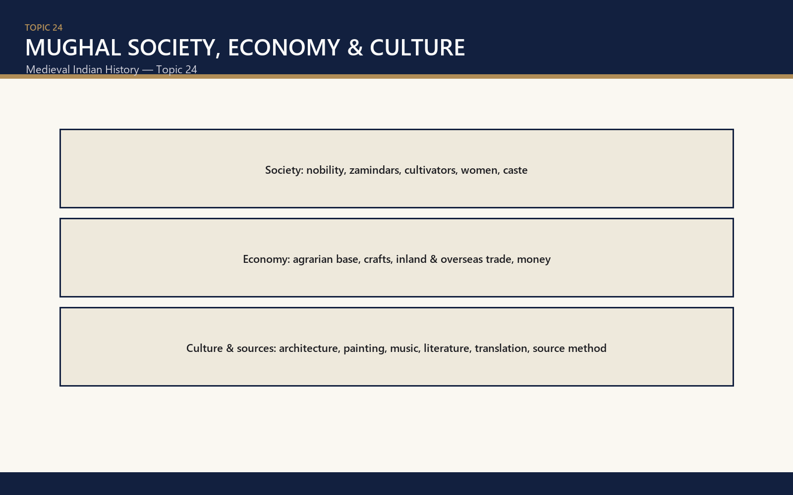

> Subject: Medieval Indian History | GS-I + Prelims | Date: 2026-08-30 | Complete learning session.

### What this session covers

This session develops the complete topic from source method and social structure through agrarian/urban economy, commercial institutions, technology and culture. It then solves exact routed PYQs, runs one 16-question learning MCQ loop, supplies seven examiner-grade Mains answers, and ends with consolidated register notes. Every claim in this session follows claim → named site/text/inscription/coin/example → analysis → qualification, so facts stay source-grounded, competing interpretations stay attributed and bounded, and certainty is never manufactured. Complete Medieval History Core is taught before the optional enrichment section.

## BASIC LEARNING SESSION

### EVIDENCE, PYQ AND CURRENT-STATUS NOTES

- **Archaeological inference:** material context supports bounded reconstruction; absence is not automatic proof of non-existence.
- **Textual testimony:** genre, authorship, redaction, patronage and temporal distance control what a text can prove.
- **Inscription and coin evidence:** contemporary names, titles, claims and circulation are powerful but do not by themselves map uniform territorial control.
- **Scholarly interpretation:** historian labels are arguments to test, not facts to memorise without evidence.
- **PYQ discipline:** official option-key values for the four routed 2018-2022 Prelims PYQs below are not held locally; every such answer is explicitly labelled as locally inferred, never as official.
- **Current-status note, rechecked 2026-08-30:** The ASI mandate and UNESCO Taj Mahal and Red Fort pages support monument conservation, skilled and artisanal production, composite architectural traditions, material setting and patronage. They are not evidence of universal prosperity, social equality, exact GDP, private landownership, or the reach of imperial policy. No genuinely topic-specific new official event was found in the preceding six months, so static relevance is retained. A check of the 2026 Prelims GS-I and 2026 Mains GS-I question sets confirms, source-honestly and without fabrication, that Topic 24/Medieval-Mughal content received **no question in either the 2026 Prelims GS-I paper or the 2026 Mains GS-I paper**.

**Live/primary context sources:**

- `https://culture.gov.in/our-organisations/archaeological-survey-india-new-delhi`
- `https://whc.unesco.org/en/list/252/`
- `https://whc.unesco.org/en/list/231/`

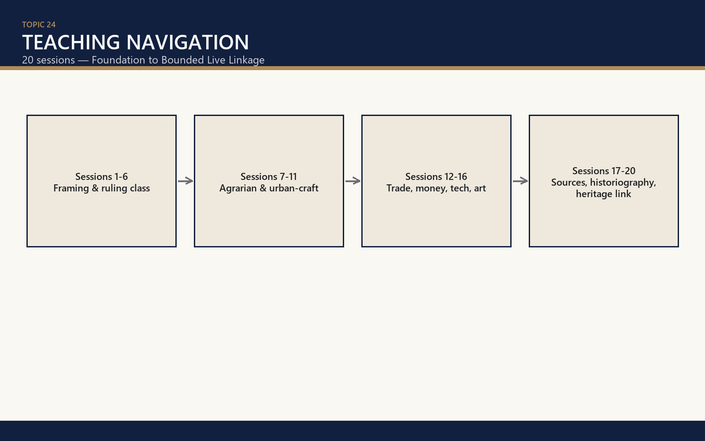

*Distinct embedded teaching-navigation image summarising the 20-session structure. No separate graphical flowchart package is included in this delivery; see the ASCII Master Flowchart deliverable for an at-a-glance overview.*

### Foundation dossier: society, economy, culture and answer architecture

> **Subject:** History (Medieval India) · **Tier:** Must-Do (foundation) · **GS Paper:** GS-I (also Prelims).
> **Grounded in:** Satish Chandra, *History of Medieval India* — chapters on Mughal economy, trade, society, cultural/religious developments, architecture, painting, music and literature.
> ✅ = from source book · ⚠️ = inference / standard knowledge · 📰 = current affairs.

---

### Mini-timeline

| Date | Event |
|---|---|
| ✅ 1556–1605 | Akbar consolidates Mughal administration and cultural patronage |
| ✅ c. 1567 | Akbar orders illustrated **Hamza Nama** project; painting becomes an imperial karkhana |
| ✅ 1573 | Buland Darwaza begun to commemorate Gujarat victory |
| ✅ 1605–27 | Jahangir's reign: portrait, animal and naturalistic painting flourish |
| ✅ 1628–58 | Shah Jahan's reign: marble architecture and Taj Mahal phase |
| ✅ 1650s–1700s | Seventeenth century = high point of trade, textiles and Indo-Mughal culture |
| ✅ 1719–48 | Muhammad Shah later patronises music strongly in the eighteenth century |

### 1. Snapshot & core idea

**Foundation — society and economy expanded under Mughal peace.**

✅ Satish Chandra links Mughal political integration with roads, sarais, stable silver currency, urban life, trade and handicraft growth.
- ✅ Trade and manufacture expanded in the seventeenth century; India was known as a major textile producer for Asian and wider markets.
- ✅ Nobles, merchants and royal family members participated in trade; some owned ships or invested in commercial ventures. Merchants such as **Virji Vohra** of Surat and the ship-owner **Abdul Ghaffur** show the scale of Indian private commercial wealth.
- ✅ Rural society centred on peasants, zamindars and land revenue. Zamindars had armed strength, local caste/clan ties, and were too important for the state to ignore.
- ✅ Rural society was internally stratified: privileged resident **khud-kasht/riyayati** cultivators, ordinary **raiyati/muzarian**, outsider **pahi-kasht**, tenants, village servants and labouring groups had unequal rights and revenue burdens.
- ✅ European travellers such as **Tavernier** and **Bernier** are valuable external sources, but their commercial and social judgments need source criticism.

**Foundation — culture was composite and creative.**

✅ Mughal architecture developed from Akbar's experimental Fatehpur Sikri to Shah Jahan's marble style, culminating in the **Taj Mahal**; it combined arched and trabeate forms, Indian craftsmanship and Turko-Iranian devices.
- ✅ Mughal painting became an imperial **karkhana** under Akbar; Hindus and Muslims worked together, and Jahangir's reign marked a high point in portrait/animal studies.
- ✅ Persian, Sanskrit and regional languages flourished; Bhakti and Sufi currents helped cultural contact, while orthodox elements continued.
- ✅ Music was not simply "buried" under Aurangzeb; singing was banished from court, but instruments and patronage by nobles/queens continued.
- ✅ Women participated in agriculture, spinning, embroidery and elite patronage, but property, marriage, purdah and labour conditions varied sharply by class, caste and region.

### 2. Key classification / data

| Field | Must-know features |
|---|---|
| ✅ Rural society | Peasants, zamindars, village headmen; zamindars often armed and locally rooted |
| ✅ Cultivator categories | Khud-kasht/riyayati, raiyati/muzarian, pahi-kasht; unequal dues and privileges |
| ✅ Trade | Textiles, spices, indigo, sugar/raw silk, horses, bullion inflow |
| ✅ Trade institutions / actors | **Aurang** (warehouse), **banian** broker, merchant houses such as **Virji Vohra** and **Abdul Ghaffur** |
| ✅ Nobility | High mansabdars had opulent lifestyles; patronised arts; some engaged in trade |
| ✅ Land-right term | **Mirasidar** = hereditary occupancy-right holder, especially in south India |
| ✅ Architecture | Fatehpur Sikri, Buland Darwaza, Itimad-ud-Daula, Taj Mahal, Red Fort, Jama Masjid |
| ✅ Painting | Akbar's karkhana; Hamza Nama; Jahangir = portrait/animal/natural studies |
| ✅ Literature / sources | Persian prose/poetry; translations; regional languages; Tulsidas, Rahim, Eknath, Tukaram; Tavernier and Bernier as external observers |
| ⚠️ Culture | Composite, not mechanically "Hindu + Muslim" in separate compartments |

### 3. Study links

> **Study link:** ✅ Mughal administration/revenue connects to Akbar's mansabdari system; later jagirdari stress feeds directly into the empire's eighteenth-century decline.
> **Study link:** ✅ Persian-chronicle source-methodology (genre, authorship, redaction) builds on the same source-criticism skills used for Sultanate-era administration and society.
> **Study link:** ⚠️ Culture links to Bhakti-Sufi movements and Art & Culture (GS-I).

### 4. Must-Know Facts (Prelims)

- ✅ **Hamza Nama** was illustrated under Akbar; painting was organised as an imperial **karkhana**.
- ✅ **Abul Fazl** says Akbar encouraged painting; many named painters were Hindus, including lower-caste artists such as Daswant.
- ✅ **Itimad-ud-Daula** used marble and pietra dura before the Taj Mahal.
- ✅ **Taj Mahal** under Shah Jahan is presented as a culmination of earlier Mughal architectural forms.
- ✅ Jahangir's period is associated with **portrait painting, animals, birds and flowers**; Mansur is important.
- ✅ **Jean-Baptiste Tavernier** (French jeweller-traveller; six visits c. 1631–1668) described Indian **diamond mines** and the **Golconda/Kollur** trade in detail.
- ✅ **Aurang** = warehouse/depot for goods, especially textiles awaiting trade or export.
- ✅ **Banian / Banyan / Bania** = Indian merchant-broker who handled local purchases, credit and market access for European traders.
- ✅ **Mirasidar** = hereditary occupancy-right holder in land, especially in south India, based on long-standing cultivation rights rather than revenue assignment.
- ✅ **Yogavasistha**, a Sanskrit philosophical text attributed to Valmiki, was translated into Persian by **Nizamuddin Panipati** under **Akbar's** patronage; Dara Shukoh's own translation projects were separate works (**Majma-ul-Bahrain**, **Sirr-i-Akbar**).
- ✅ Mughal nobles and royal family members were not allergic to commerce; many invested in trade/ships.

### 5. UPSC Traps

> 🔑 Trap: Mughal culture was a living synthesis; do not label every architectural or artistic element as exclusively "Hindu" or "Islamic."

- ❌ Aurangzeb abolished music completely. → Correct: he banished singing from court, but instruments and patronage continued.
- ❌ Taj Mahal was an isolated foreign design. → Correct: Chandra presents it as the culmination of Mughal-Indian architectural evolution.
- ❌ Zamindars were just tax clerks. → Correct: they had armed power, local roots and social authority.
- ❌ **Aurang** was a military rank and **banian** a caste label only. → Correct: **aurang** was a warehouse/depot; **banian** was a merchant-broker/intermediary.
- ❌ Bernier's critique that Mughal India lacked all private property can be accepted literally. → Correct: it reflected a European mercantilist lens and is contested by evidence of zamindars, mirasidars and large merchant wealth.
- ❌ Mughal elite ignored trade. → Correct: nobles, princes and royal women invested in trade and shipping.

### 6. 📰 Current link

📰 **Current linkage (verify live before use):** Handloom and craft policy can connect historical textile production with living artisan economies. Verify scheme, GI and export claims from official textile/ministry data.

### 7. Mains angles

- ⚠️ "The seventeenth century was a second classical age of Indian cultural creativity." Discuss with architecture, painting and literature.
- ⚠️ Explain how Mughal political integration encouraged trade, currency circulation and urban growth.
- ⚠️ Analyse the role of zamindars as both collaborators and constraints in the Mughal rural order.

---

### 8. Answer Architecture (Future-Question Support)

#### 8.1 Thesis options

| Directive family | Qualified thesis |
|---|---|
| Discuss cultural creativity | "The seventeenth century was a creative apex: Taj Mahal, Mughal miniature painting, Persian and regional literature, music patronage and composite urban culture — funded by imperial revenue and a vibrant trade economy." |
| Examine trade and economy | "Mughal political unification created the conditions for trade expansion — standard silver currency, safe roads, sarais and a wealthy consuming elite — making 17th-century India a major node in Asian and global textile trade." |
| Analyse agrarian structure | "Mughal agrarian order rested on intense revenue extraction mediated by zamindars and stratified cultivator groups; its productivity was real, but so were hierarchy, negotiation and periodic stress." |
| Analyse zamindars and society | "Zamindars were simultaneously revenue intermediaries, local military powers and social leaders — they collaborated with the Mughal system when patronised and resisted when squeezed, making them both pillars and constraints of imperial rule." |
| Evaluate travel/source debates | "European observers such as Tavernier and Bernier are indispensable for Mughal trade and society, but their testimony must be filtered through commercial interest, comparison with Persian chronicles and awareness of European bias." |

#### 8.2 Demand-family evidence banks

##### A. Society

| # | Evidence | Claim it supports | Analytical function | Limitation |
|---|---|---|---|---|
| 1 | ✅ Zamindars possessed armed retainers, caste/clan authority and local roots | Mughal society was not a simple centre-vs-peasant binary | Shows layered rural power and social leadership | Zamindars varied enormously by region and scale |
| 2 | ✅ Cultivator categories: **khud-kasht/riyayati**, **raiyati/muzarian**, **pahi-kasht** | Rural society was internally stratified | Prevents treating peasants as one homogeneous class | Labels were ideal types; local usage varied |
| 3 | ✅ Women worked in agriculture, spinning, embroidery and elite patronage | Women's roles were economically significant though unequal by class | Adds gender to social-history answers | Elite visibility should not be mistaken for general female autonomy |
| 4 | ✅ Nobles and wealthy merchants lived opulently while peasants, labourers and artisans bore insecurity | Mughal prosperity was socially uneven | Balances "golden age" narratives with hierarchy | Source emphasis often comes from elite observers |
| 5 | ✅ Expanding towns, bazaars, karkhanas and sarais created vibrant urban life | Urban society was commercially and culturally active | Links imperial peace with urban growth | Urban prosperity depended on continued fiscal extraction from countryside |

##### B. Agrarian structure

| # | Evidence | Claim it supports | Analytical function | Limitation |
|---|---|---|---|---|
| 1 | ✅ Measurement, cash demand and one-third state share under zabt/dahsala (see Topic 16) | Agrarian extraction was increasingly codified | Connects Mughal revenue with village-level pressure and predictability | Application varied by crop, terrain and province |
| 2 | ✅ Zamindar-peasant relations combined mediation, protection and coercion | Revenue collection required negotiation through local power holders | Explains why zamindars were both collaborators and rebels | Formal categories hide many local bargains |
| 3 | ✅ **Khud-kasht** cultivators had stronger occupancy position than **pahi-kasht** outsiders | Agrarian rights were unequal and historically rooted | Useful for Prelims distinction and Mains social analysis | Rights could still erode under pressure or indebtedness |
| 4 | ✅ Seasonal/cash-crop pattern included wheat, rice, sugarcane, cotton, indigo and oilseeds | Mughal agriculture was diversified and commercially linked | Supports answers on market-oriented agrarian expansion | Commercial crops could deepen peasant vulnerability in bad years |
| 5 | ✅ Revenue remissions existed for crop failure, yet peasant flight, local disorder and later jagirdari stress indicate agrarian strain | Productivity coexisted with crisis indicators | Prevents romanticising agrarian abundance | Evidence of crisis is uneven and stronger for the later Mughal phase |
| 6 | ✅ François Bernier argued that insecure assignment and lack of private landed property weakened economic incentives; ⚠️ this conclusion is contested by historians such as Irfan Habib and Satish Chandra, who note strong merchant wealth and layered landed claims | European critique of Mughal agrarian order needs contextual reading | Turns Bernier into a historiographical debate rather than a ready-made truth | Bernier viewed India through a European mercantilist lens |

##### C. Trade / economy

| # | Evidence | Claim it supports | Analytical function | Limitation |
|---|---|---|---|---|
| 1 | ✅ Indian textiles moved to the Red Sea, Persian Gulf, Southeast Asia and beyond | Mughal India was a major manufacturing exporter | Establishes India's place in 17th-century global trade | Export gains were unevenly distributed socially |
| 2 | ✅ India imported large quantities of bullion while exporting manufactures | Trade was structurally favourable to India in specie terms | Shows why silver currency remained strong | Bullion inflow did not eliminate rural poverty |
| 3 | ✅ European companies expanded coastal trade but initially operated within a still-dominant Indian merchant world | Europeans were entrants into, not founders of, Indian Ocean commerce | Corrects Eurocentric narratives | Their military-commercial power would grow later |
| 4 | ✅ **Virji Vohra** of Surat and **Abdul Ghaffur** as major ship-owner show the scale of Indian merchant capital | Private Indian commerce remained powerful alongside European companies | Demonstrates indigenous capitalist capacity | Merchant wealth was regionally concentrated |
| 5 | ✅ **Jean-Baptiste Tavernier** described the **Golconda/Kollur** diamond mines and trade circuits in detail | European traveller evidence illuminates high-value commerce | Supplies named travel evidence for trade questions | Traveller focus privileges luxury trade over ordinary production |
| 6 | ✅ **Aurang** as warehouse/depot and **banian** as broker/intermediary | Commercial infrastructure and middlemen linked production to export | Gives statement-level clarity for institutional terms | Terms varied across regions and commercial communities |

##### D. Literature / sources

| # | Evidence | Claim it supports | Analytical function | Limitation |
|---|---|---|---|---|
| 1 | ✅ Persian chronicles and memoirs — *Akbarnama*, *Ain-i Akbari*, *Muntakhab-ut-Tawarikh*, *Tuzuk-i Jahangiri* — remain the main textual spine (see Topic 07 §9) | Mughal society/culture is best studied through multiple Persian genres, not one court text | Provides source-method depth for 15/20 markers | Courtly bias requires cross-checking with other evidence |
| 2 | ✅ Regional literary florescence: **Tulsidas**, **Rahim**, **Eknath**, **Tukaram** and others | Cultural creativity moved beyond Persian court culture into vernaculars | Shows linguistic democratisation alongside imperial patronage | Regional traditions differed in theology and audience |
| 3 | ✅ Translation projects linked Sanskrit and Persian worlds; **Nizamuddin Panipati** translated the **Yogavasistha** into Persian under **Akbar**, while **Dara Shukoh** separately produced **Majma-ul-Bahrain** and **Sirr-i-Akbar** | Mughal elite culture could sponsor intellectual convergence | Strengthens answers on syncretic or dialogic culture | Such projects remained elite and court-centred |
| 4 | ✅ **Gulbadan Begum**, **Badauni** and European travellers offer alternative angles to official praise | Cross-verification reveals internal disagreement and social texture | Helps source-criticism answers avoid single-text dependence | Each alternative source has its own bias and partiality |

##### E. Visual culture

| # | Evidence | Claim it supports | Analytical function | Limitation |
|---|---|---|---|---|
| 1 | ✅ **Taj Mahal**, **Red Fort** and **Jama Masjid** represent the mature Shahjahani synthesis of scale, symmetry, marble and inlay | Architecture expressed imperial confidence and composite craftsmanship | Supplies named monuments for culture answers | Monumentality depended on extraction and court patronage |
| 2 | ✅ Akbar's imperial **karkhana** and the illustrated **Hamza Nama** institutionalised painting | Mughal painting was a state-supported collaborative art | Shows organised artistic production, not isolated genius | Court sponsorship also shaped themes and hierarchy |
| 3 | ✅ Under Jahangir, naturalistic painting, portraiture and artists like **Mansur** reached a high point | Mughal aesthetics included close observation of flora/fauna | Distinguishes Jahangiri taste from Akbar's narrative scale | Still largely elite and courtly in audience |
| 4 | ✅ Music survived even under Aurangzeb through instruments and patronage by nobles and women; later centres continued the tradition | Cultural continuity did not depend on a single emperor's taste | Corrects the simplistic "Aurangzeb killed music" narrative | Much later growth occurred in provincial rather than central courts |

#### 8.3 Counterpoints

- ⚠️ "Composite culture" should not erase hierarchy: elite Persianate culture and popular vernacular culture did not operate identically.
- ⚠️ Trade prosperity coexisted with peasant hardship — monetisation and revenue pressure could impoverish producers even as commerce boomed.
- ⚠️ Bernier is valuable as an observer, but his generalisations on private property and decline cannot be accepted without checking Indian evidence.
- ⚠️ Women's roles varied sharply by class, caste and region: elite patronage and peasant labour should not be conflated.

#### 8.4 Verdict scaffolding

- **10-mark (trade/economy):** Use sub-bank C with textiles + bullion + one institutional term (aurang/banian) or Tavernier.
- **15-mark (agrarian/society):** Use sub-bank B plus one or two units from A; conclude: productive but stratified and pressured.
- **15-mark (culture/sources):** Use D + E; add Topic 07 §9 cross-link for Persian-source methodology.
- **20-mark:** Combine the most relevant sub-banks rather than narrating everything; close with a graded verdict on prosperity, hierarchy and cultural synthesis.

---

### 9. Semantic-completeness synthesis

#### 9.1 Ownership boundary

Topic 24 owns Mughal agrarian society, peasants and zamindars; crafts and
manufacture; inland and overseas trade; monetisation; merchants, towns,
transport and European companies; hierarchy, caste, gender and slavery;
education, languages, literature, visual and performing arts; science,
technology and source/quantification limits.

- Ruler narratives remain Topics 15-23.
- Mansabdari mechanics remain Topics 16 and 21.
- Aurangzeb's jagirdari crisis remains Topic 23.
- Post-1707 regional/colonial transition remains Topic 25.
- Indian Art and Culture retains form-centred monument ownership; this topic
  supplies historical institutions and social economy.

#### 9.2 Agrarian structure and expansion

✅ The agrarian economy supported most population and imperial revenue.
Expansion occurred through forest clearance, migration, wells, tanks,
irrigation, settlement concessions and extension of cultivation. Productivity
varied sharply by ecology and crop.

✅ Crops included food grains and market crops such as cotton, indigo,
sugarcane, oilseeds, tobacco, mulberry/raw silk and opium. Commercialisation
did not mean that all peasants chose crops freely or that subsistence needs
disappeared.

Rural hierarchy:

| Category | Core position | Qualification |
|---|---|---|
| khud-kasht/riyayati | resident cultivator with stronger local occupancy and often lower customary dues | not an equal class; caste, cattle and credit varied |
| raiyati/muzarian | ordinary cultivator/tenant category | terminology and burden varied regionally |
| pahi-kasht | non-resident or incoming cultivator | could receive concessions but had weaker local embeddedness |
| landless labour/service groups | wage, attached or customary service | poorly visible in elite records |
| village headmen/accountants | patel/muqaddam, chaudhari, qanungo, patwari and equivalents | could mediate and exploit |

✅ Peasant migration and flight were bargaining strategies as well as signs of
distress. Access to cattle, seed, labour and credit shaped cultivation.

⚠️ Avoid treating “the peasant” as one class or a revenue schedule as realised
income. Jama, hasil, crop failure, remissions and local coercion must be
distinguished.

#### 9.3 Zamindars: rights, power and variation

Zamindar could describe a spectrum from village-level claimants to large rajas
and regional chiefs. Common features could include:

- hereditary revenue claims and perquisites;
- forts/garhis and armed retainers;
- caste, clan and village authority;
- assistance in collection, policing and cultivation;
- rights in land without modern absolute ownership; and
- capacity for negotiation, resistance or imperial service.

**Jagirdar versus zamindar**

| Jagirdar | Zamindar |
|---|---|
| imperial assignee of a transferable revenue claim | locally rooted hereditary claimant/chief |
| rank/service relationship to Mughal state | social, political and agrarian roots in locality |
| assignment usually transferable | rights often hereditary but contestable |
| not owner of all soil in jagir | not merely a salaried tax clerk |

Neither category was uniform, and the same person could enter imperial service
while retaining local/watan interests.

#### 9.4 Crafts and manufacture

✅ Major manufactures included cotton and silk textiles, carpets, metalwork,
arms, paper, sugar, indigo processing, shipbuilding, jewellery, leather,
construction and luxury crafts.

Production forms:

- household and village production;
- artisan workshop;
- merchant advance/order;
- urban master-craftsman and hired labour;
- imperial/noble **karkhana**; and
- dispersed production coordinated through brokers and warehouses.

⚠️ Karkhana was not a modern mechanised factory. Merchant advances could
connect producer to distant markets while creating dependence.

Textile regions included Gujarat, Coromandel and Bengal, with product and
quality specialisation. Manufacture was commercially dynamic without becoming
modern industrialisation.

#### 9.5 Monetisation, credit and transport

✅ The silver rupee, copper dam and gold mohur existed within a bimetallic/
trimetallic circulation whose local availability changed. Bullion imports
supported minting and monetised exchange but did not eliminate barter,
payments in kind or coin scarcity.

Commercial instruments and actors:

- **hundi** — credit/remittance instrument, not simply a modern cheque;
- **sarraf/shroff** — money changer, assayer and banker;
- **dalal/banian** — broker/intermediary;
- **aurang** — warehouse/depot, especially for textiles;
- merchant partnership, family firm, agents and correspondent networks.

✅ Banjaras and other carriers moved bulk grain and supplies; pack bullocks,
ox-carts, river craft, coastal shipping, roads, sarais and ferries formed a
multimodal system.

⚠️ Roads were political-commercial corridors, not modern all-weather highways.
Transport cost, monsoon, tolls, insecurity and local power remained important.

#### 9.6 Inland and overseas trade

Inland circuits linked producing villages, qasbas, towns, pilgrimage centres,
army markets, capitals and ports. Urban consumption by court and nobility
stimulated luxury production, while ordinary trade moved food, cloth, salt,
metals and daily goods.

Exports included textiles, indigo, pepper, rice, sugar, raw silk and other
goods; imports included bullion, horses, metals and luxuries. Commodity lists
varied by route and decade.

Major merchant examples include Virji Vohra and Abdul Ghaffur of Surat,
Multani/Khatri networks, Bohra and Jain merchants, Armenian merchants, Chettis
and south Indian Muslim trading groups. Labels identify communities/networks,
not one corporate political interest.

#### 9.7 European companies: bounded role

✅ Portuguese, Dutch, English and French traders entered established Asian
commercial worlds. In the seventeenth century, Indian merchants and shipping
remained powerful; European companies did not immediately monopolise trade.

The Mughal state:

- generally kept ports open and customs comparatively low;
- granted farmans and facilities without surrendering sovereignty;
- opposed or limited fortification;
- could seize factories and agents on land when companies used maritime
  coercion; and
- bargained through provincial officials, merchants and imperial court.

⚠️ Company military-commercial power grew unevenly. Do not project the
post-Plassey colonial state backward into Jahangir or Shah Jahan's reign.

#### 9.8 Towns and middle strata

Urban hierarchy included imperial capitals, provincial centres, ports,
manufacturing towns, qasbas, pilgrimage towns and military camps.

Middle strata included:

- merchants and shopkeepers;
- brokers, bankers and accountants;
- clerks, qanungos, patwaris and revenue specialists;
- physicians, teachers, jurists and literati;
- master artisans, contractors and builders; and
- lower mansabdars and service households.

✅ This evidence qualifies Bernier's court-versus-miserable-mass binary.
⚠️ “Middle class” is a modern label and should not imply modern bourgeois
politics.

#### 9.9 Social hierarchy, caste and mobility

Mughal society was ordered through rank, occupation, caste/jati, lineage,
religious community, gender, locality, slavery and access to state/market.

Mobility occurred through:

- mansab and military service;
- clerical/revenue skill;
- merchant wealth;
- migration and new cultivation;
- religious institutions;
- patronage, marriage and conversion.

Mobility did not erase hierarchy. Persianate elite culture could incorporate
Rajputs, Indian Muslims, Marathas and service castes while retaining status
distinctions. Caste shaped village labour, artisan organisation, marriage and
social honour but was regionally variable rather than a single unchanging grid.

#### 9.10 Gender, family and work

Women worked in sowing, transplanting, harvesting, animal care, spinning,
weaving preparation, food processing, construction support and domestic
service. Elite women managed estates, trade, ships, charity, architecture and
household patronage.

Examples such as Nur Jahan, Jahanara and merchant/royal women prove agency at
particular levels, not general equality.

Key controls:

- purdah varied by status, region and occupation;
- inheritance and property rights existed in legal traditions but access and
  enforcement were unequal;
- marriage, dowry, widowhood and sati differed by community/class;
- court chronicles under-record ordinary women's labour;
- coercion and vulnerability must not be romanticised as “complementarity”.

#### 9.11 Slavery and servitude

✅ Domestic, military, court and labour slavery/servitude existed. Enslavement
could follow war, purchase, debt, birth or trafficking. Manumission was praised
but did not remove the institution.

⚠️ Conditions varied and should not be collapsed into either Atlantic
plantation slavery or benign household service. Slavery lowered status and
affected free labour even where treatment differed.

#### 9.12 Education and knowledge

Education operated through:

- maktabs and madrasas;
- mosques, khanqahs and scholars' households;
- pathshalas, temples, maths and learned lineages;
- apprenticeship in crafts and professions;
- court libraries, translation bureaus and manuscript workshops.

Literacy was socially limited and multilingual. Persian was central to high
administration; Arabic to Islamic learning; Sanskrit retained scholastic
traditions; Marathi, Braj, Awadhi, Bengali, Punjabi, Gujarati, Telugu, Tamil
and other languages expanded literary publics.

Translation projects connected Sanskrit and Persian intellectual worlds, but
elite translation did not automatically transform popular society.

#### 9.13 Literature and religious-cultural interaction

Persian chronicles, memoirs, poetry, biographies, letters and manuals served
different purposes. Named examples include Akbarnama/Ain, Tuzuk, Padshahnama,
Muntakhab-ut-Tawarikh and later court histories.

Regional literature included Tulsidas, Surdas, Rahim, Eknath, Tukaram and
others; Bhakti and Sufi traditions created devotional and social languages
without erasing doctrinal, caste or institutional difference.

**2020 GS-I route:** Persian sources “reflect” the age only after being treated
as **refracting** it through patronage, genre, court position and silence.
Corroborate with regional texts, travellers, documents, inscriptions, coins,
paintings and material evidence.

#### 9.14 Architecture, painting and music

Architecture evolved through collective labour and patronage:

- Akbarian experimentation and trabeate-arched synthesis;
- Jahangiri gardens, tombs and marble/inlay transition;
- Shahjahani symmetry, marble, pietra dura and imperial urbanism;
- regional and post-imperial dispersal.

Painting:

- Akbar: large karkhana, illustrated narrative and collaborative atelier;
- Jahangir: portraiture, naturalism, attribution and Ustad Mansur;
- Shah Jahan: courtly refinement and formality;
- Aurangzeb: reduced personal patronage, not extinction; artists moved to
  regional courts.

Music survived through court, noble, royal-women, devotional and regional
patronage. The “burial of music” anecdote is a moral story, not proof that
music ended.

#### 9.15 Science and technology

Capabilities included irrigation devices, shipbuilding, textile skill, metal
and gun casting, architecture, surveying/accounting, medicine and astronomical
traditions. Selective adoption included mechanical devices, clocks, telescopes
and European knowledge contacts.

⚠️ Avoid “technologically stagnant” and “proto-industrial take-off” extremes.
Satish Chandra's central limitation is the weak institutional connection
between elite theoretical learning and artisanal experimentation, alongside
limited mechanisation and printing diffusion.

#### 9.16 Quantification and source limits

| Evidence | Strength | Limit |
|---|---|---|
| Ain and revenue records | assessment, categories, official norms | jama is not hasil; normative and date-bound |
| chronicles/memoirs | court, events, ideology | patronage, elite silence, self-fashioning |
| travellers | prices, routes, observed practice | short visits, comparison bias and exaggeration |
| factory records | commodity, credit and company transactions | company-centred slice |
| merchant letters/hundis | network and finance | survival is selective |
| paintings/monuments | technique, hierarchy and patronage | representation cannot quantify society |
| archaeology/coins/inscriptions | material production and formal claim | incomplete distribution and motive limits |

Never convert a traveller estimate, port turnover, jama, workshop size or
building cost into an empire-wide census without an explicit source and
qualification.

#### 9.17 Integrated verdict

> Mughal India was agrarian and hierarchical, yet highly monetised,
> commercially connected and culturally productive. Political integration,
> merchant networks and skilled labour supported growth, while intense revenue
> claims, unequal rights, caste/gender hierarchy, technological-institutional
> limits and regional variation qualify every “golden age” description.

---

#### Historical PYQ Integration (2018-2023)

> **Status:** Question-level PYQ demand is integrated into this session.
> **Answer-key rule:** Official 2018-2023 Prelims/CSAT keys are not held locally. Four routed PYQs below (2018, 2019, 2020, 2022) each carry one locally inferred, high-confidence answer, clearly labelled "INFERRED ANSWER - NOT OFFICIALLY VERIFIED" where it is solved; no official key is claimed for any of them.

- **Years represented:** 2018, 2019, 2020, 2022
- **Paper(s):** Prelims GS-I
- **Routed question demands:** 4

| Year | Paper | Q | PYQ demand (neutral rendering) | Directive / format | Source status | What this session must cover |
|---:|---|---:|---|---|---|---|
| 2018 | Prelims GS-I | 73 | Foreign traveler who discussed diamonds and diamond mines India | Objective question; official key unavailable locally | Routed; key unavailable locally | Cover the named fact/concept and its likely statement-level distinctions. |
| 2019 | Prelims GS-I | 1 | Jagirdar and Zamindar differences in Mughal India | Objective question; official key unavailable locally | Routed; key unavailable locally | Cover the named fact/concept and its likely statement-level distinctions. |
| 2020 | Prelims GS-I | 21 | Mughal era terms Aurang Banian Mirasidar roles | Objective question; official key unavailable locally | Routed; key unavailable locally | Cover the named fact/concept and its likely statement-level distinctions. |
| 2022 | Prelims GS-I | 94 | Yogavasistha Persian translation during Mughal reign | Objective question; official key unavailable locally | Routed; key unavailable locally | Cover the named fact/concept and its likely statement-level distinctions. |

#### What this session must now support

- Foreign traveler who discussed diamonds and diamond mines India
- Jagirdar and Zamindar differences in Mughal India
- Mughal era terms Aurang Banian Mirasidar roles
- Yogavasistha Persian translation during Mughal reign

> The table integrates the examinable demand and paper metadata. It does not turn an unkeyed objective question into a solved answer, and it does not claim that lexical presence alone proves full conceptual sufficiency.

### PART I - Guided teaching: core to advanced

### SESSION 1 — FRAMING THE MUGHAL CENTURIES

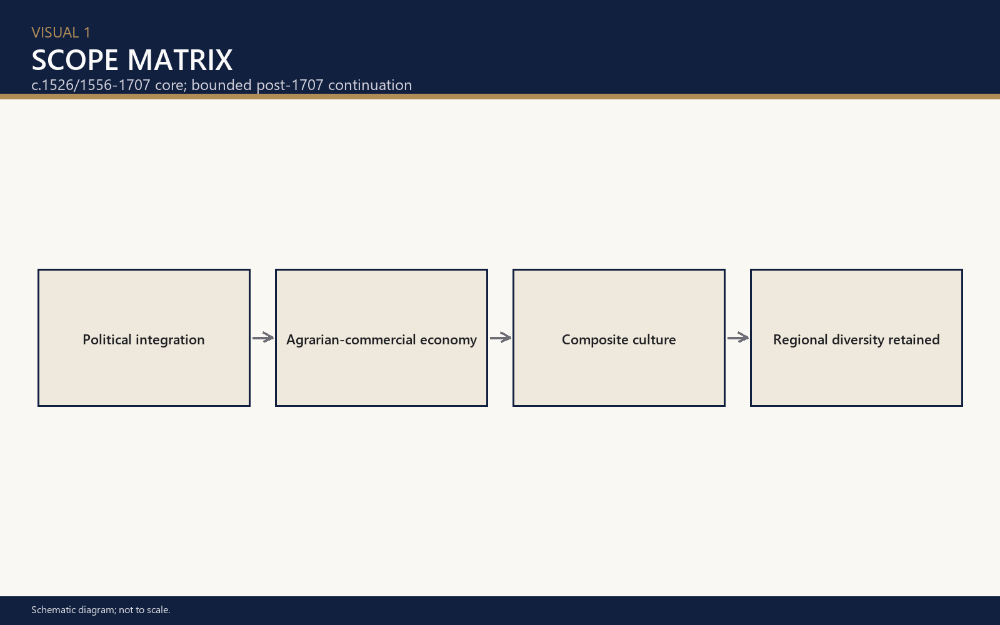

*Visual 1: SCOPE MATRIX. Schematic maps are NOT TO SCALE.*

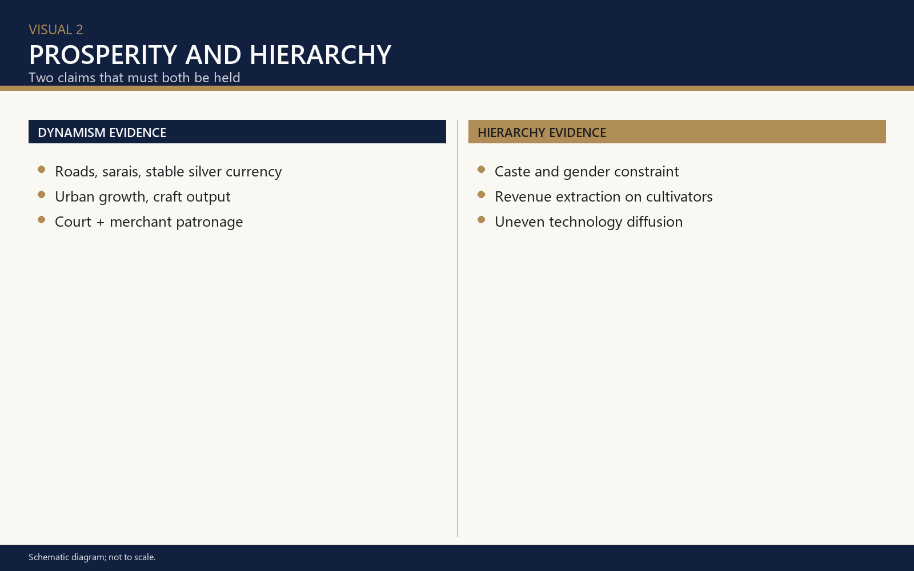

*Visual 2: PROSPERITY AND HIERARCHY. Schematic maps are NOT TO SCALE.*

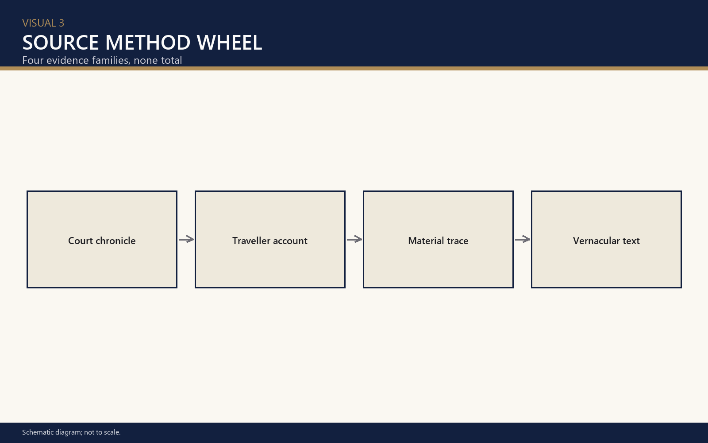

*Visual 3: SOURCE METHOD WHEEL. Schematic maps are NOT TO SCALE.*

#### DEFINITION / WHAT THIS IS CALLED

**Plain-language definition:** The core frame is the sixteenth and seventeenth imperial centuries, with a bounded early-eighteenth-century continuation where cultural and commercial networks persisted despite political stress.

**Technical definition:** A defensible one-line thesis names political integration as the driver of commercial/cultural dynamism while naming hierarchy, extraction and unevenness as its qualifiers.

#### ANSWER-GRABBING OPENING — WRITE/ADAPT IN THE EXAM

> Mughal India was commercially dynamic and agrarianly productive, yet hierarchical, extractive and technologically uneven — no single adjective covers the whole period.

#### MUST-WRITE KEYWORDS

- **Political integration**
- **Agrarian-commercial dynamism**
- **Composite culture**
- **Regional diversity**
- **Technological unevenness**

**How to use them:** Open with Political integration, define Agrarian-commercial dynamism against it, connect Composite culture to the mechanism, and close on Technological unevenness as the decisive qualification.

#### Demonstration — claim, evidence, analysis, qualification

**Claim:** Mughal political integration created the framework for wider economic and cultural dynamism across the sixteenth and seventeenth centuries.

**Evidence:** Akbar's 1580s mansab-zat/sawar reorganisation and provincial network extended fiscal reach from Agra and Lahore to Bengal and the Deccan; this reach fed named commercial nodes such as Surat and Masulipatnam and court karkhanas at Fatehpur Sikri and Shahjahanabad, and the same administrative logic persisted in bounded form into Farrukhsiyar's 1717 firman to the English East India Company.

**Analysis:** This shows that court-driven administrative reach, not merely population or geography, explains higher trade volume through named ports, craft output through named karkhana centres, and artistic patronage across the period — dynamism tracked the reach of the state, not just its size.

**Qualification:** Court prosperity recorded at Agra, Fatehpur Sikri or Surat is not general welfare, commercialisation at these named nodes is not industrialisation, and cultural synthesis under named patrons is not equality — the thesis must hold dynamism and hierarchy together.

#### Mains articulation

For **framing the mughal centuries**, the exam-ready move is: state the claim, attach the named evidence above, explain the mechanism, and close with the stated qualification. Cross-link rather than duplicate: Topic 07 for Persian-source method, Topic 10 for Bhakti/Sufi theology, Topic 11 for Sultanate antecedents, Topic 16 for full revenue, Topic 17 for translation, Topic 21 for ruling class, Topic 23 for jagirdari crisis and Topic 25 for transition.

#### CLOSING RECALL FLOW — FRAMING THE MUGHAL CENTURIES

```text
START / CONCEPT: Framing the mughal centuries
        |
        v
EXACT TERMS: Political integration, Agrarian-commercial dynamism, Composite culture, Regional diversity and Technological unevenness
        |
        v
MECHANISM / ARGUMENT: This shows that court-driven order, not merely population or geography, explains higher trade volume, craft output and artistic patronage across the period.
        |
        v
CONSEQUENCE / CONTRAST: Court prosperity is not welfare, commercialisation is not industrialisation, and cultural synthesis is not equality — the thesis must hold dynamism and hierarchy together.
        |
        v
UPSC TRAP / ANSWER-USE: Treating the entire period as a uniform, all-India 'golden age' erases regional diversity and agrarian hierarchy.
        |
        v
ANSWER-GRABBING FORMULATION: Mughal India was commercially dynamic and agrarianly productive, yet hierarchical, extractive and technologically uneven — no single adjective covers the whole period.
```

### SESSION 2 — SOURCE METHOD AS AN ARGUMENT

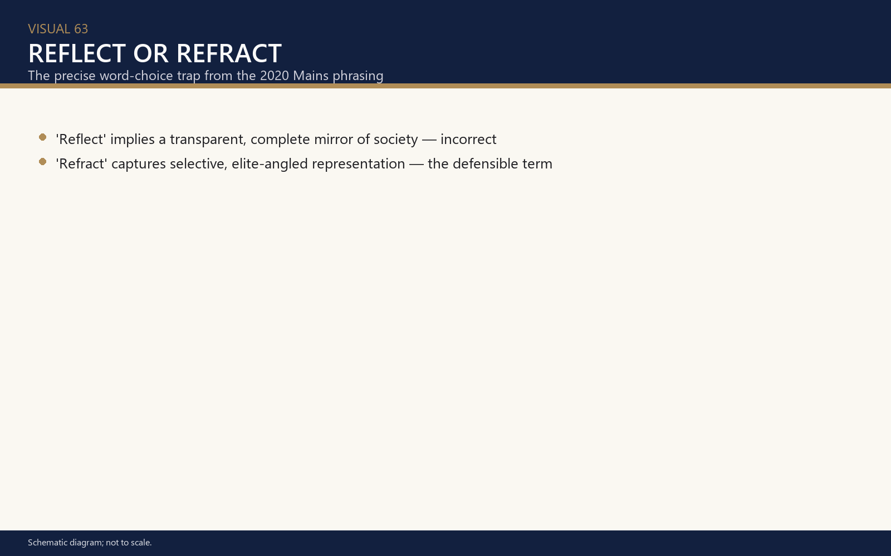

*Visual 4: REFLECT OR REFRACT. Schematic maps are NOT TO SCALE.*

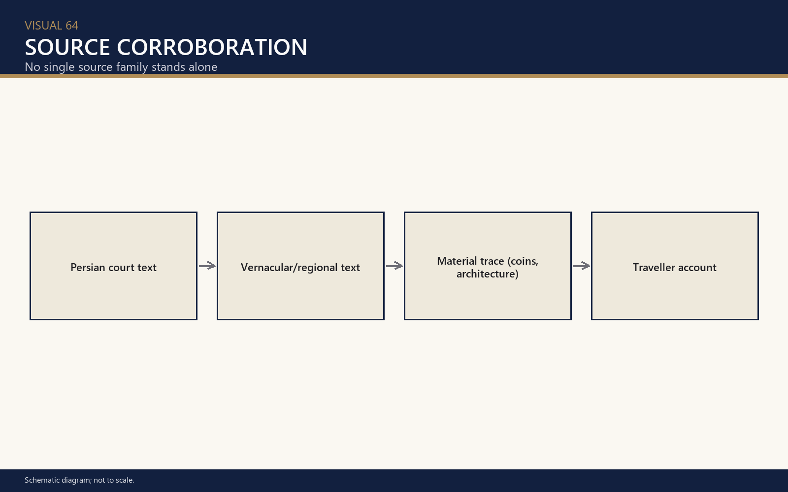

*Visual 5: SOURCE CORROBORATION. Schematic maps are NOT TO SCALE.*

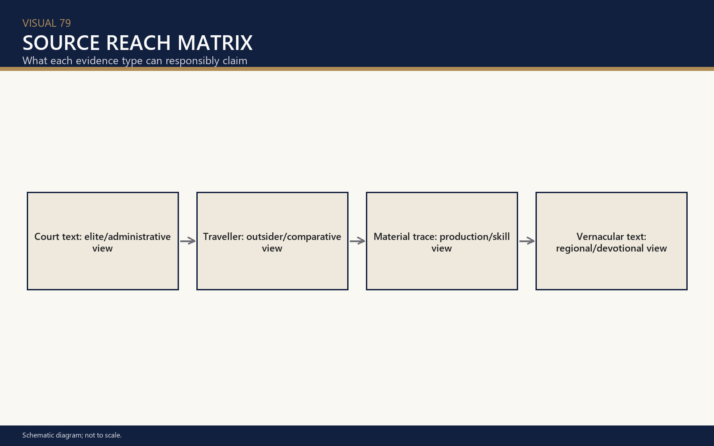

*Visual 6: SOURCE REACH MATRIX. Schematic maps are NOT TO SCALE.*

#### DEFINITION / WHAT THIS IS CALLED

**Plain-language definition:** Source method here means treating each text or account as a genre with its own audience and purpose, not as a neutral window onto Mughal society.

**Technical definition:** A defensible method states the genre, audience and vantage point of a source before extracting any claim from it.

#### ANSWER-GRABBING OPENING — WRITE/ADAPT IN THE EXAM

> Before any fact from Ain-i-Akbari or a traveller account is used, its genre and audience must be named.

#### MUST-WRITE KEYWORDS

- **Ain-i-Akbari**
- **Akbarnama**
- **Tuzuk-i-Jahangiri**
- **Padshahnama**
- **Traveller bias**

**How to use them:** Open with Ain-i-Akbari, define Akbarnama against it, connect Tuzuk-i-Jahangiri to the mechanism, and close on Traveller bias as the decisive qualification.

#### Demonstration — claim, evidence, analysis, qualification

**Claim:** Different Mughal-era text types were built to answer different questions, so a single genre cannot be read as a total account of society.

**Evidence:** Ain-i-Akbari and farmans classify administration and revenue; Akbarnama, Tuzuk-i-Jahangiri, Padshahnama and Maasir-i-Alamgiri show courtly representation; Bernier compares property and political economy, Tavernier reports luxury commerce, and Pelsaert notes urban poverty.

**Analysis:** Each genre therefore supplies a different, partial angle: administrative classification, courtly legitimacy, or an outsider's comparative lens.

**Qualification:** A traveller's route-bound, occasionally hearsay-based observation (as in Mundy or Thevenot) cannot be given the same evidentiary weight as an administrative record without stating that limit.

#### Mains articulation

For **source method as an argument**, the exam-ready move is: state the claim, attach the named evidence above, explain the mechanism, and close with the stated qualification. Cross-link rather than duplicate: Topic 07 for Persian-source method, Topic 10 for Bhakti/Sufi theology, Topic 11 for Sultanate antecedents, Topic 16 for full revenue, Topic 17 for translation, Topic 21 for ruling class, Topic 23 for jagirdari crisis and Topic 25 for transition.

#### CLOSING RECALL FLOW — SOURCE METHOD AS AN ARGUMENT

```text
START / CONCEPT: Source method as an argument
        |
        v
EXACT TERMS: Ain-i-Akbari, Akbarnama, Tuzuk-i-Jahangiri, Padshahnama and Traveller bias
        |
        v
MECHANISM / ARGUMENT: Each genre therefore supplies a different, partial angle: administrative classification, courtly legitimacy, or an outsider's comparative lens.
        |
        v
CONSEQUENCE / CONTRAST: A traveller's route-bound, occasionally hearsay-based observation (as in Mundy or Thevenot) cannot be given the same evidentiary weight as an administrative record without stating that limit.
        |
        v
UPSC TRAP / ANSWER-USE: Quoting a traveller's opinion as settled social fact, without naming his vantage point, is the commonest source-method trap.
        |
        v
ANSWER-GRABBING FORMULATION: Before any fact from Ain-i-Akbari or a traveller account is used, its genre and audience must be named.
```

### SESSION 3 — SOCIAL STRUCTURE AND RULING CLASSES

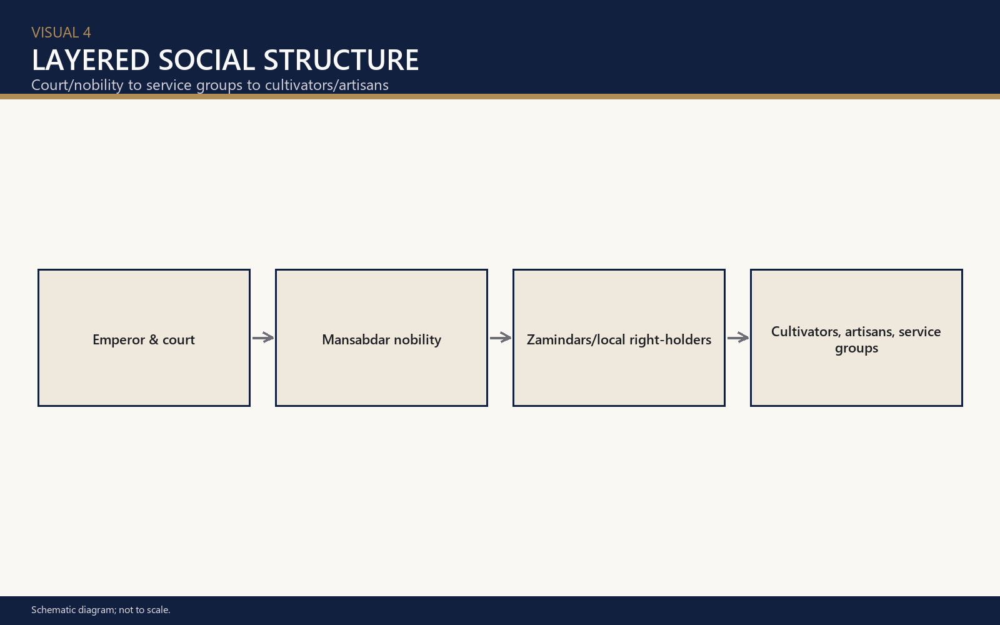

*Visual 7: LAYERED SOCIAL STRUCTURE. Schematic maps are NOT TO SCALE.*

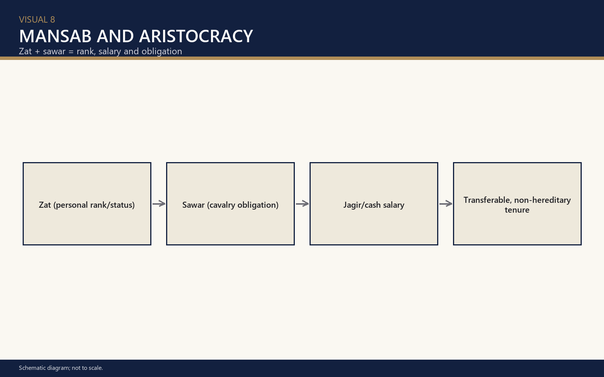

*Visual 8: MANSAB AND ARISTOCRACY. Schematic maps are NOT TO SCALE.*

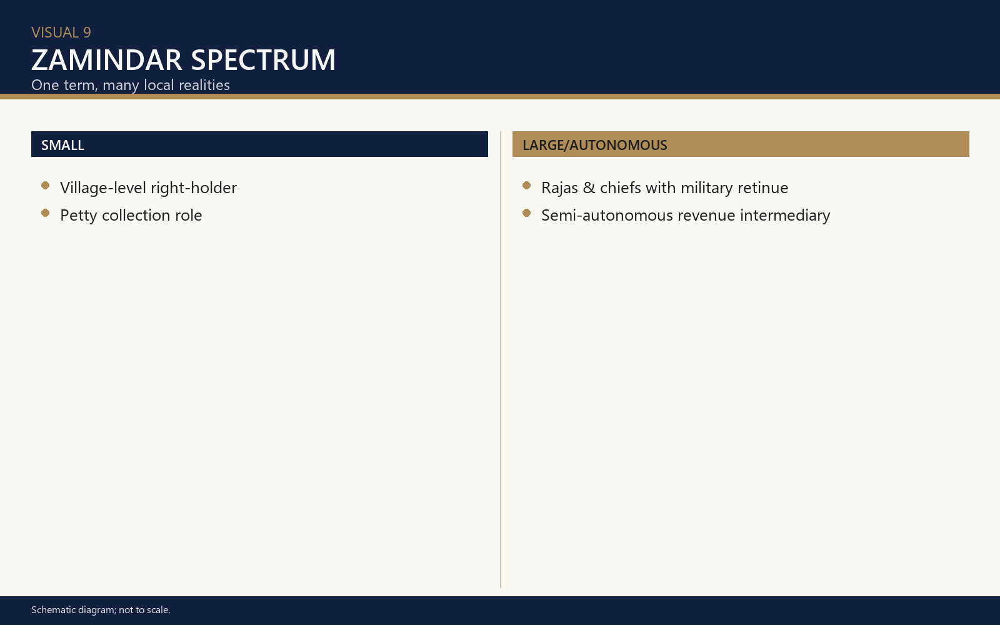

*Visual 9: ZAMINDAR SPECTRUM. Schematic maps are NOT TO SCALE.*

#### DEFINITION / WHAT THIS IS CALLED

**Plain-language definition:** Mughal social structure was a layered order — emperor and household, mansabdars, zamindars, merchants and professionals, artisans and service groups, cultivators, labourers and mobile communities — rather than a fixed pyramid.

**Technical definition:** A defensible structural claim names each layer and the channel (service, trade, migration) through which limited movement between layers occurred.

#### ANSWER-GRABBING OPENING — WRITE/ADAPT IN THE EXAM

> Mughal society is best read as layered, not a rigid pyramid or a simple court-versus-peasant binary.

#### MUST-WRITE KEYWORDS

- **Layered hierarchy**
- **Mansabdars**
- **Zamindars**
- **Mobility channels**
- **Caste and gender constraint**

**How to use them:** Open with Layered hierarchy, define Mansabdars against it, connect Zamindars to the mechanism, and close on Caste and gender constraint as the decisive qualification.

#### Demonstration — claim, evidence, analysis, qualification

**Claim:** The recognised layers run from emperor and household through mansabdars, chiefs and zamindars, to merchants and professionals, artisans and service groups, and cultivators, labourers and mobile communities.

**Evidence:** Raja Man Singh of Amber's rise to a 7,000 zat mansab and the 1615 Mewar settlement negotiated with Rana Amar Singh show a Rajput zamindar lineage entering the mansabdar hierarchy without losing local zamindari standing, while Raja Todar Mal's zabt/dahsala revenue settlement linked village-level assessment directly to imperial administration.

**Analysis:** Both nobles and zamindars extracted agrarian surplus, but Man Singh's incorporation and Amar Singh's continued subordinate zamindari status show these were not identical positions, so 'ruling class' cannot be treated as one uniform group.

**Qualification:** Collapsing nobles and zamindars into a single undifferentiated 'ruling class' erases this distinction, visible even within one Rajput lineage's mixed mansabdar-zamindar position, and their differing relationship to revenue and to village society.

#### Mains articulation

For **social structure and ruling classes**, the exam-ready move is: state the claim, attach the named evidence above, explain the mechanism, and close with the stated qualification. Cross-link rather than duplicate: Topic 07 for Persian-source method, Topic 10 for Bhakti/Sufi theology, Topic 11 for Sultanate antecedents, Topic 16 for full revenue, Topic 17 for translation, Topic 21 for ruling class, Topic 23 for jagirdari crisis and Topic 25 for transition.

#### CLOSING RECALL FLOW — SOCIAL STRUCTURE AND RULING CLASSES

```text
START / CONCEPT: Social structure and ruling classes
        |
        v
EXACT TERMS: Layered hierarchy, Mansabdars, Zamindars, Mobility channels and Caste and gender constraint
        |
        v
MECHANISM / ARGUMENT: Both nobles and zamindars extracted agrarian surplus, but neither held an identical relationship to village society, so 'ruling class' cannot be treated as one uniform group.
        |
        v
CONSEQUENCE / CONTRAST: Collapsing nobles and zamindars into a single undifferentiated 'ruling class' erases their distinct relationship to revenue and to village society.
        |
        v
UPSC TRAP / ANSWER-USE: Name the specific layer before making a claim about hierarchy or mobility.
        |
        v
ANSWER-GRABBING FORMULATION: Mughal society is best read as layered, not a rigid pyramid or a simple court-versus-peasant binary.
```

### SESSION 4 — NOBILITY: ORIGIN, MANSAB AND HOUSEHOLD

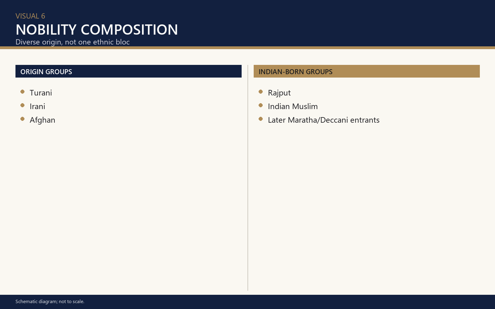

*Visual 6: NOBILITY COMPOSITION. Schematic maps are NOT TO SCALE.*

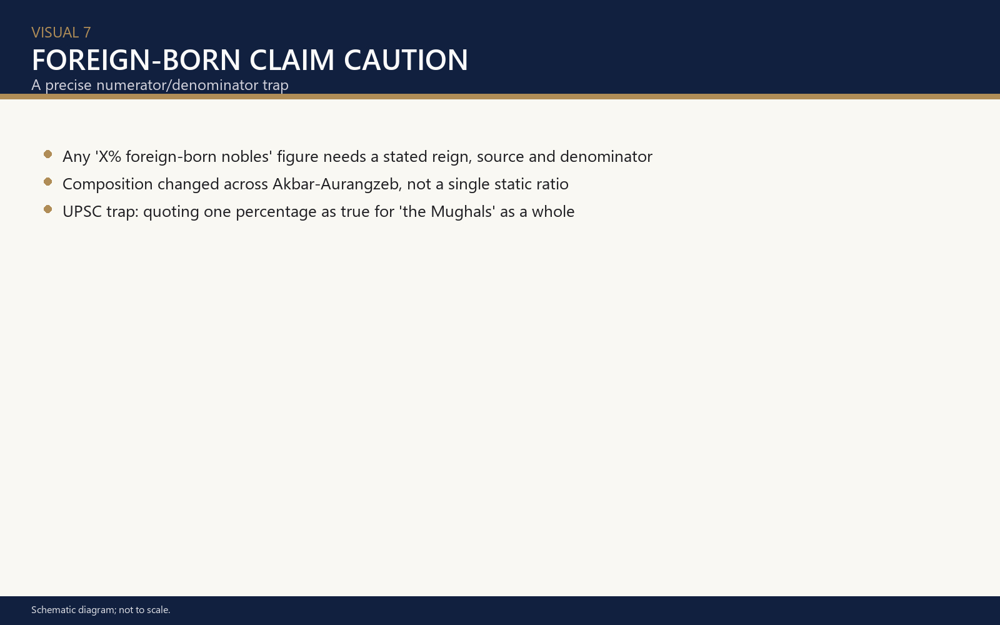

*Visual 50: FOREIGN-BORN CLAIM CAUTION. Schematic maps are NOT TO SCALE.*

#### DEFINITION / WHAT THIS IS CALLED

**Plain-language definition:** Mansab was a numerical dual rank (zat and sawar) that fixed a noble's salary, status and military obligation, without being a hereditary title.

**Technical definition:** A defensible claim about nobility must separate the mansab system (rank/salary/obligation) from household patronage and from any dated origin statistic.

#### ANSWER-GRABBING OPENING — WRITE/ADAPT IN THE EXAM

> Mansab bureaucratised aristocratic rank, salary and service without removing the aristocratic household, patronage and consumption that surrounded a noble.

#### MUST-WRITE KEYWORDS

- **Mansab**
- **Zat and sawar**
- **Turani-Irani-Rajput origin**
- **Khanazad**
- **1679-1707 foreign-born data**

**How to use them:** Open with Mansab, define Zat and sawar against it, connect Turani-Irani-Rajput origin to the mechanism, and close on 1679-1707 foreign-born data as the decisive qualification.

#### Demonstration — claim, evidence, analysis, qualification

**Claim:** Turani, Irani, Hindustani Muslim, Rajput, Afghan and Deccani/Maratha entrants all appear in the imperial nobility; for 1679-1707, Iranis and Turanis were 40 percent of nobles holding 1000 zat and above, but less than a quarter of that group was born outside India — so foreign-born nobles were under 10 percent of that dated, ranked total.

**Evidence:** This precise, dated figure corrects a loose 'foreign nobility' generalisation (the kind Bernier implies) without erasing the real prestige that Turani/Irani ancestry carried at court.

**Analysis:** Formal non-heredity of mansab coexisted with khanazad (household-born) family advantage, so social reproduction persisted despite the rule against hereditary rank.

**Qualification:** Quoting any foreign-born percentage without its reign-window and rank-threshold denominator is the exact 2019-2020-style Prelims trap.

#### Mains articulation

For **nobility: origin, mansab and household**, the exam-ready move is: state the claim, attach the named evidence above, explain the mechanism, and close with the stated qualification. Cross-link rather than duplicate: Topic 07 for Persian-source method, Topic 10 for Bhakti/Sufi theology, Topic 11 for Sultanate antecedents, Topic 16 for full revenue, Topic 17 for translation, Topic 21 for ruling class, Topic 23 for jagirdari crisis and Topic 25 for transition.

#### CLOSING RECALL FLOW — NOBILITY: ORIGIN, MANSAB AND HOUSEHOLD

```text
START / CONCEPT: Nobility: origin, mansab and household
        |
        v
EXACT TERMS: Mansab, Zat and sawar, Turani-Irani-Rajput origin, Khanazad and 1679-1707 foreign-born data
        |
        v
MECHANISM / ARGUMENT: Formal non-heredity of mansab coexisted with khanazad (household-born) family advantage, so social reproduction persisted despite the rule against hereditary rank.
        |
        v
CONSEQUENCE / CONTRAST: Quoting any foreign-born percentage without its reign-window and rank-threshold denominator is the exact 2019-2020-style Prelims trap.
        |
        v
UPSC TRAP / ANSWER-USE: Cite the mansab mechanism first, then the dated 1679-1707 figure only with its stated denominator.
        |
        v
ANSWER-GRABBING FORMULATION: Mansab bureaucratised aristocratic rank, salary and service without removing the aristocratic household, patronage and consumption that surrounded a noble.
```

### SESSION 5 — ZAMINDARS AND LOCAL POWER

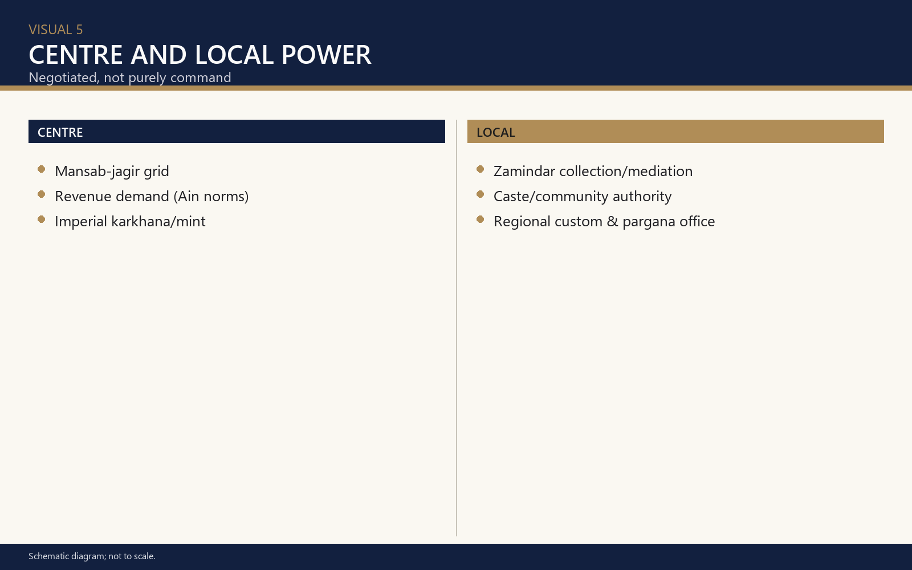

*Visual 5: CENTRE AND LOCAL POWER. Schematic maps are NOT TO SCALE.*

#### DEFINITION / WHAT THIS IS CALLED

**Plain-language definition:** Zamindar is a flexible Mughal category spanning revenue claimant, village leader, deshmukh, patil, nayak, chief and raja — not a single fixed rank.

**Technical definition:** A defensible zamindar claim names the specific scale (village-level to autonomous raja) before attributing rights or power to 'the zamindar' as a class.

#### ANSWER-GRABBING OPENING — WRITE/ADAPT IN THE EXAM

> Zamindar cannot be reduced to a British-style landlord or to a mere revenue clerk.

#### MUST-WRITE KEYWORDS

- **Zamindar spectrum**
- **Hereditary revenue claim**
- **Garhi and armed retainers**
- **Watan arrangements**
- **Centre-local negotiation**

**How to use them:** Open with Zamindar spectrum, define Hereditary revenue claim against it, connect Garhi and armed retainers to the mechanism, and close on Centre-local negotiation as the decisive qualification.

#### Demonstration — claim, evidence, analysis, qualification

**Claim:** Zamindari rights could be hereditary, divisible and saleable; power could include a produce claim, cesses, garhi/armed retainers, caste-clan ties and local information, while the centre sought incorporation, assessment and revenue control and chiefs sought legitimacy and room for autonomy.

**Evidence:** Gokula's 1669 Jat uprising near Mathura began as local zamindar/peasant resistance to Mughal revenue assessment, showing the same zamindari authority that normally sustained imperial revenue collection turning into armed local resistance once assessment or policy pressure rose too far. The 1672 Satnami revolt near Narnaul is a distinct case, not a zamindari-revenue rising: it began as a local clash between Satnami cultivators and artisans and Mughal troops/officials — traditionally traced to a low-ranking soldier's violence against a Satnami peasant — which escalated rapidly into a broader armed confrontation with imperial forces; it is bounded here as an example of non-zamindar rural unrest, with its fuller religious/sectarian dimension belonging to Topic 22.

**Analysis:** Gokula's rising shows zamindars functioning simultaneously as revenue intermediaries and local military power — cooperative in most years, but able to convert the same garhi/armed-retainer base into rebellion, so watan arrangements and local resistance must be read as regionally bounded practices, not one uniform empire-wide policy. The Satnami case shows, by contrast, that local unrest could also erupt outside the zamindari channel altogether, among cultivators and artisans with no revenue-intermediary role — a reminder that not every rural rising of this period was a zamindar rising.

**Qualification:** Reducing every zamindar to either a passive tax collector or a rebel like Gokula ignores the huge scale-range from village claimant to raja, and the fact that most zamindars neither rebelled nor were merely passive; the Satnami revolt should not be folded into this zamindar spectrum at all, since its participants were cultivators and artisans escalating a local clash, not zamindars asserting or defending a revenue claim.

#### Mains articulation

For **zamindars and local power**, the exam-ready move is: state the claim, attach the named evidence above, explain the mechanism, and close with the stated qualification. Cross-link rather than duplicate: Topic 07 for Persian-source method, Topic 10 for Bhakti/Sufi theology, Topic 11 for Sultanate antecedents, Topic 16 for full revenue, Topic 17 for translation, Topic 21 for ruling class, Topic 23 for jagirdari crisis and Topic 25 for transition.

#### CLOSING RECALL FLOW — ZAMINDARS AND LOCAL POWER

```text
START / CONCEPT: Zamindars and local power
        |
        v
EXACT TERMS: Zamindar spectrum, Hereditary revenue claim, Garhi and armed retainers, Watan arrangements and Centre-local negotiation
        |
        v
MECHANISM / ARGUMENT: Watan arrangements and local resistance must be read as regionally bounded practices, not as one uniform empire-wide policy.
        |
        v
CONSEQUENCE / CONTRAST: Reducing every zamindar to either a passive tax collector or an autonomous rebel ignores the huge scale-range from village claimant to raja.
        |
        v
UPSC TRAP / ANSWER-USE: Name the zamindar's scale before assigning it either full autonomy or bare clerkship.
        |
        v
ANSWER-GRABBING FORMULATION: Zamindar cannot be reduced to a British-style landlord or to a mere revenue clerk.
```

### SESSION 6 — RURAL CATEGORIES AND LAND RIGHTS

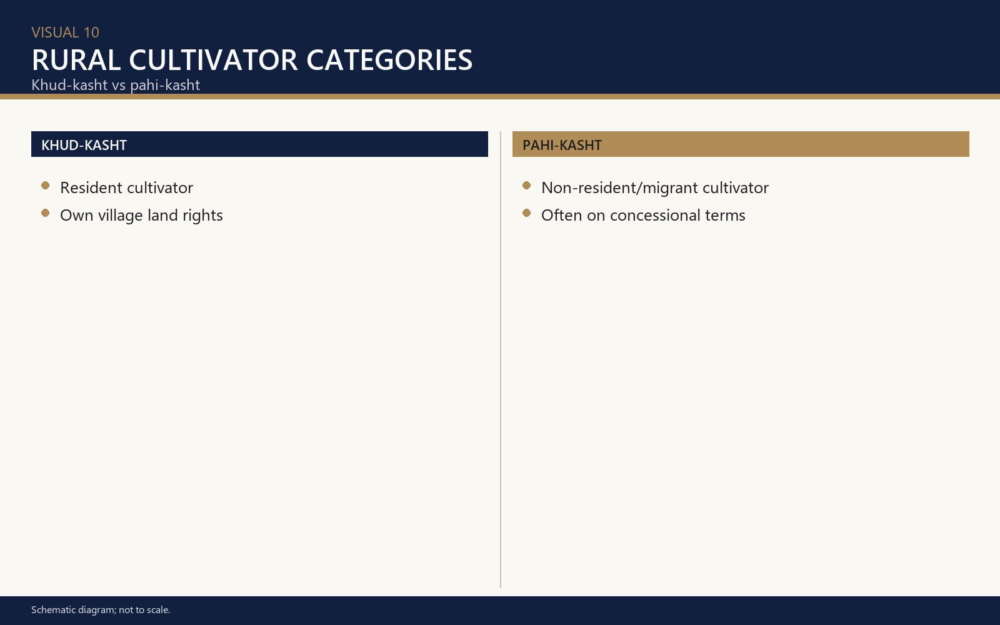

*Visual 10: RURAL CULTIVATOR CATEGORIES. Schematic maps are NOT TO SCALE.*

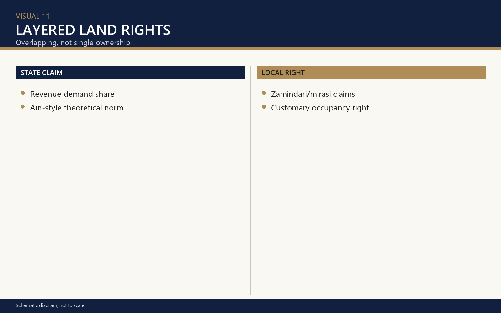

*Visual 11: LAYERED LAND RIGHTS. Schematic maps are NOT TO SCALE.*

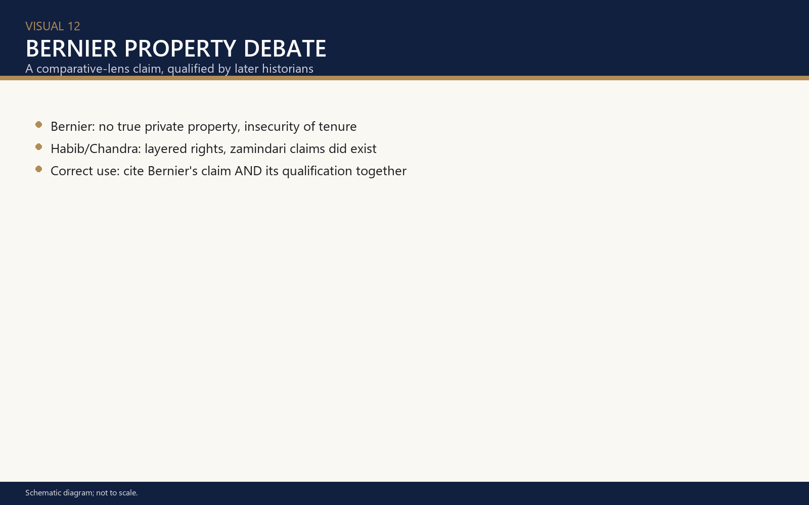

*Visual 12: BERNIER PROPERTY DEBATE. Schematic maps are NOT TO SCALE.*

#### DEFINITION / WHAT THIS IS CALLED

**Plain-language definition:** Khud-kasht marks resident owner-cultivation, normally with stronger occupancy, cattle/credit access and social status than other cultivator categories.

**Technical definition:** A defensible land-rights claim separates cultivation, occupancy, revenue demand, produce share, customary access and local office as distinct, sometimes differently held, rights.

#### ANSWER-GRABBING OPENING — WRITE/ADAPT IN THE EXAM

> Rural land rights in Mughal India were layered across several named cultivator categories, not held by one uniform 'peasant class'.

#### MUST-WRITE KEYWORDS

- **Khud-kasht**
- **Raiyati/muzarian**
- **Pahi-kasht**
- **Layered land rights**
- **Patil/qanungo/patwari**

**How to use them:** Open with Khud-kasht, define Raiyati/muzarian against it, connect Pahi-kasht to the mechanism, and close on Patil/qanungo/patwari as the decisive qualification.

#### Demonstration — claim, evidence, analysis, qualification

**Claim:** Raiyati/muzarian covers ordinary cultivators with variable ownership or tenancy, while pahi-kasht denotes an incoming settler on surplus, new or abandoned land, sometimes on a concession.

**Evidence:** Patil, muqaddam, chaudhuri, qanungo, patwari and deshmukh mediated these categories with real regional variation, and land rights were layered — cultivation, occupancy, revenue demand, produce share, customary access and office could rest with different people at once.

**Analysis:** This layering shows why neither 'the state owned all land' nor 'modern private property existed' captures Mughal land rights.

**Qualification:** Neither total state ownership nor modern private ownership is a safe description of Mughal land rights — both erase the layering evidence.

#### Mains articulation

For **rural categories and land rights**, the exam-ready move is: state the claim, attach the named evidence above, explain the mechanism, and close with the stated qualification. Cross-link rather than duplicate: Topic 07 for Persian-source method, Topic 10 for Bhakti/Sufi theology, Topic 11 for Sultanate antecedents, Topic 16 for full revenue, Topic 17 for translation, Topic 21 for ruling class, Topic 23 for jagirdari crisis and Topic 25 for transition.

#### CLOSING RECALL FLOW — RURAL CATEGORIES AND LAND RIGHTS

```text
START / CONCEPT: Rural categories and land rights
        |
        v
EXACT TERMS: Khud-kasht, Raiyati/muzarian, Pahi-kasht, Layered land rights and Patil/qanungo/patwari
        |
        v
MECHANISM / ARGUMENT: This layering shows why neither 'the state owned all land' nor 'modern private property existed' captures Mughal land rights.
        |
        v
CONSEQUENCE / CONTRAST: Neither total state ownership nor modern private ownership is a safe description of Mughal land rights — both erase the layering evidence.
        |
        v
UPSC TRAP / ANSWER-USE: Distinguish khud-kasht from pahi-kasht by occupancy strength, not merely by residence, before making a rights claim.
        |
        v
ANSWER-GRABBING FORMULATION: Rural land rights in Mughal India were layered across several named cultivator categories, not held by one uniform 'peasant class'.
```

### SESSION 7 — AGRARIAN EXPANSION, CROPS AND IRRIGATION

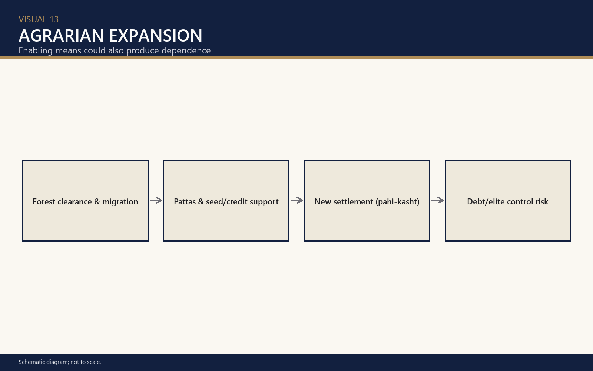

*Visual 13: AGRARIAN EXPANSION. Schematic maps are NOT TO SCALE.*

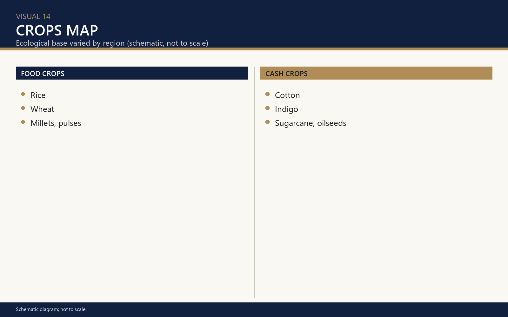

*Visual 14: CROPS MAP - SCHEMATIC - NOT TO SCALE. Schematic maps are NOT TO SCALE.*


*Visual 15: IRRIGATION SYSTEMS. Schematic maps are NOT TO SCALE.*

#### DEFINITION / WHAT THIS IS CALLED

**Plain-language definition:** Agrarian expansion under the Mughals proceeded through forest clearance, migration, new settlement and pahi resettlement, enlarging the area under cultivation.

**Technical definition:** A defensible expansion claim names the enabling means (pattas, credit, water) and states that the same means could also produce dependence.

#### ANSWER-GRABBING OPENING — WRITE/ADAPT IN THE EXAM

> Cultivation expanded through forest clearance, migration, new settlements and pahi resettlement across the sixteenth and seventeenth centuries.

#### MUST-WRITE KEYWORDS

- **Forest clearance and pahi resettlement**
- **Pattas and credit**
- **Food versus cash crops**
- **Wells and Persian wheels**
- **One-third revenue norm**

**How to use them:** Open with Forest clearance and pahi resettlement, define Pattas and credit against it, connect Food versus cash crops to the mechanism, and close on One-third revenue norm as the decisive qualification.

#### Demonstration — claim, evidence, analysis, qualification

**Claim:** Pattas, delayed revenue demand, seed, bullocks, wells and credit could enable this expansion, while debt and elite control could turn the same means into dependence; rice, wheat, millets and pulses retained different ecological bases, while cotton around Gujarat, indigo around Bayana and sugarcane in Bengal linked particular regions to markets, and wells, Persian wheels, tanks and Ali Mardan Khan's Punjab canal works reveal regional irrigation capacity rather than a universal state system.

**Evidence:** The Ain-i-Akbari's dastur-ul-amal schedules record cash-crop assessment rates distinct from foodgrain rates for tracts such as cotton, indigo and sugarcane, while Ali Mardan Khan's canal-building in Punjab and named well/Persian-wheel irrigation in drier tracts show investment concentrated where cash-crop or court demand justified it.

**Analysis:** The one-third revenue share is a theoretical Ain-i-Akbari reference point tied to these named dastur-ul-amal schedules, not a claim about every actual collection outcome across every crop and region.

**Qualification:** Quoting the one-third figure as if it were the guaranteed real revenue take everywhere — ignoring this named regional variation in crop, canal and assessment evidence — is the standard over-generalisation trap.

#### Mains articulation

For **agrarian expansion, crops and irrigation**, the exam-ready move is: state the claim, attach the named evidence above, explain the mechanism, and close with the stated qualification. Cross-link rather than duplicate: Topic 07 for Persian-source method, Topic 10 for Bhakti/Sufi theology, Topic 11 for Sultanate antecedents, Topic 16 for full revenue, Topic 17 for translation, Topic 21 for ruling class, Topic 23 for jagirdari crisis and Topic 25 for transition.

#### CLOSING RECALL FLOW — AGRARIAN EXPANSION, CROPS AND IRRIGATION

```text
START / CONCEPT: Agrarian expansion, crops and irrigation
        |
        v
EXACT TERMS: Forest clearance and pahi resettlement, Pattas and credit, Food versus cash crops, Wells and Persian wheels and One-third revenue norm
        |
        v
MECHANISM / ARGUMENT: The one-third revenue share is a theoretical Ain-i-Akbari reference point, not a claim about every actual collection outcome.
        |
        v
CONSEQUENCE / CONTRAST: Quoting the one-third figure as if it were the guaranteed real revenue take everywhere is the standard over-generalisation trap.
        |
        v
UPSC TRAP / ANSWER-USE: Name the mechanism (credit/water/settlement) and its double edge before citing the one-third norm as a limit, not a fact.
        |
        v
ANSWER-GRABBING FORMULATION: Cultivation expanded through forest clearance, migration, new settlements and pahi resettlement across the sixteenth and seventeenth centuries.
```

### SESSION 8 — WOMEN, FAMILY, CASTE AND MOBILITY


*Visual 17: WOMEN LABOUR MATRIX. Schematic maps are NOT TO SCALE.*

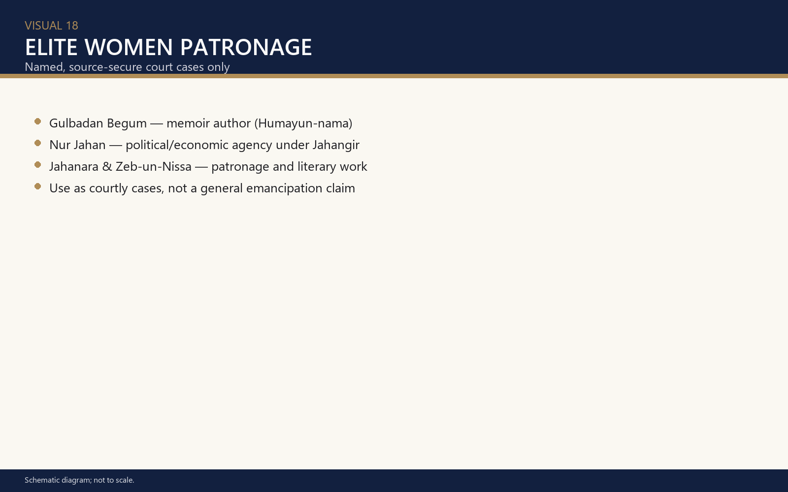

*Visual 18: ELITE WOMEN PATRONAGE. Schematic maps are NOT TO SCALE.*

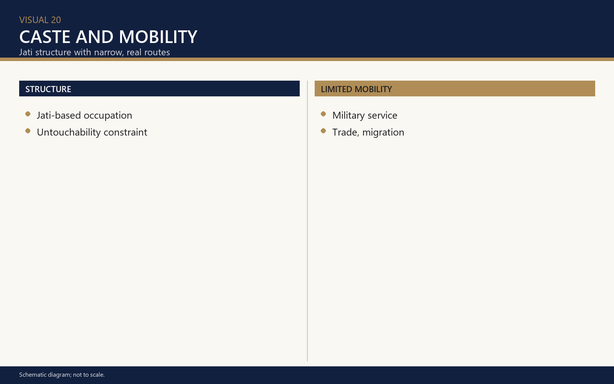

*Visual 20: CASTE AND MOBILITY. Schematic maps are NOT TO SCALE.*

#### DEFINITION / WHAT THIS IS CALLED

**Plain-language definition:** Women worked across agriculture, spinning, embroidery and domestic production, and sometimes in markets, with this labour visible mainly where elite records happen to note it.

**Technical definition:** A defensible claim about women must separate documented labour/patronage evidence from any inference about general female autonomy.

#### ANSWER-GRABBING OPENING — WRITE/ADAPT IN THE EXAM

> Women's productive labour and, separately, elite women's patronage are both real but distinct kinds of evidence.

#### MUST-WRITE KEYWORDS

- **Women's agricultural and craft labour**
- **Elite patronage cases**
- **Purdah and inheritance variation**
- **Jati and untouchability**
- **Limited mobility routes**

**How to use them:** Open with Women's agricultural and craft labour, define Elite patronage cases against it, connect Purdah and inheritance variation to the mechanism, and close on Limited mobility routes as the decisive qualification.

#### Demonstration — claim, evidence, analysis, qualification

**Claim:** Gulbadan Begum, Nur Jahan, Jahanara and Zeb-un-Nissa must each be used only where secure, as courtly cases rather than a general emancipation story; purdah, marriage, widowhood, inheritance and sati varied by class, caste, region and community, and court orders require implementation evidence before being treated as social reality.

**Evidence:** Jati structured occupation and untouchability constrained lives, while service, trade, military work and migration opened only limited routes without dissolving the underlying hierarchy.

**Analysis:** Domestic servitude and eunuch institutions require named source evidence, not sensational generalisation.

**Qualification:** Turning one named elite woman's agency (e.g. Nur Jahan) into a claim about general female autonomy is the key trap.

#### Mains articulation

For **women, family, caste and mobility**, the exam-ready move is: state the claim, attach the named evidence above, explain the mechanism, and close with the stated qualification. Cross-link rather than duplicate: Topic 07 for Persian-source method, Topic 10 for Bhakti/Sufi theology, Topic 11 for Sultanate antecedents, Topic 16 for full revenue, Topic 17 for translation, Topic 21 for ruling class, Topic 23 for jagirdari crisis and Topic 25 for transition.

#### CLOSING RECALL FLOW — WOMEN, FAMILY, CASTE AND MOBILITY

```text
START / CONCEPT: Women, family, caste and mobility
        |
        v
EXACT TERMS: Women's agricultural and craft labour, Elite patronage cases, Purdah and inheritance variation, Jati and untouchability and Limited mobility routes
        |
        v
MECHANISM / ARGUMENT: Domestic servitude and eunuch institutions require named source evidence, not sensational generalisation.
        |
        v
CONSEQUENCE / CONTRAST: Turning one named elite woman's agency (e.g. Nur Jahan) into a claim about general female autonomy is the key trap.
        |
        v
UPSC TRAP / ANSWER-USE: Keep elite-women evidence and general-labour evidence in two separate sentences before drawing any conclusion.
        |
        v
ANSWER-GRABBING FORMULATION: Women's productive labour and, separately, elite women's patronage are both real but distinct kinds of evidence.
```

### SESSION 9 — TOWNS AND MIDDLE STRATA

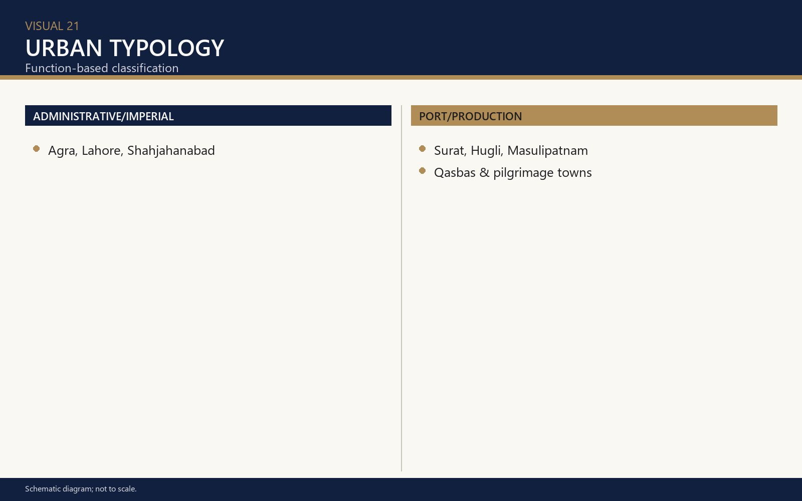

*Visual 21: URBAN TYPOLOGY. Schematic maps are NOT TO SCALE.*

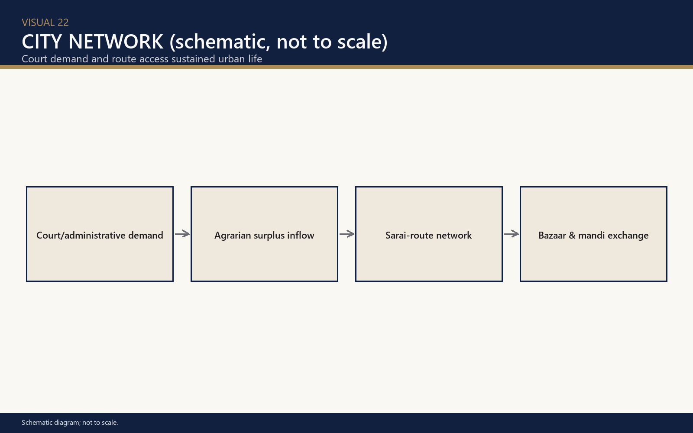

*Visual 22: CITY NETWORK - SCHEMATIC - NOT TO SCALE. Schematic maps are NOT TO SCALE.*

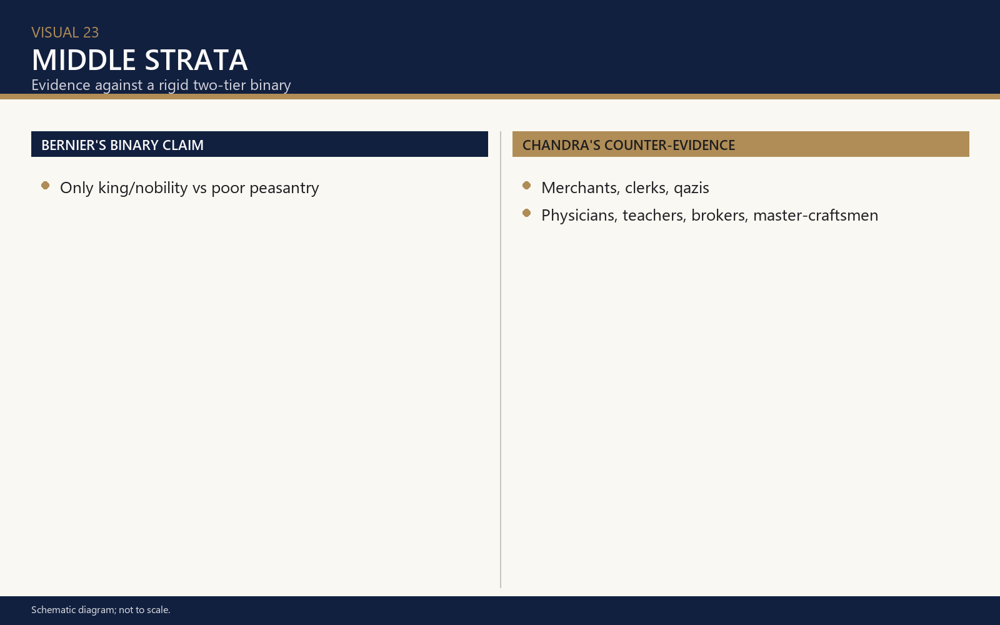

*Visual 23: MIDDLE STRATA. Schematic maps are NOT TO SCALE.*

#### DEFINITION / WHAT THIS IS CALLED

**Plain-language definition:** Mughal towns divided by function — imperial/administrative cities such as Agra and Lahore, ports such as Surat and Hugli, and qasbas/pilgrimage-production centres — rather than forming one uniform urban type.

**Technical definition:** A defensible urban claim names the town's function before drawing any conclusion about 'Mughal cities' in general.

#### ANSWER-GRABBING OPENING — WRITE/ADAPT IN THE EXAM

> Chandra directly challenges Bernier's claim that Mughal society had no middle state between king/nobility and the poor.

#### MUST-WRITE KEYWORDS

- **Imperial/administrative cities**
- **Port towns**
- **Qasbas**
- **Chandra's middle-strata evidence**
- **Bernier's binary claim**

**How to use them:** Open with Imperial/administrative cities, define Port towns against it, connect Qasbas to the mechanism, and close on Bernier's binary claim as the decisive qualification.

#### Demonstration — claim, evidence, analysis, qualification

**Claim:** Court demand, agrarian surplus, routes, sarais, bazaars, mandis, karkhanas and service populations made urban life possible in towns such as Agra, Surat and Ahmedabad, while merchants, shopkeepers, clerks, revenue officials, qazis, physicians, teachers, brokers and master-craftsmen provide the evidence for a genuine middle stratum.

**Evidence:** John Ovington's account of Surat's resident brokers and shroffs and Satish Chandra's identification of a documented professional/service layer in Mughal towns both record intermediate groups distinct from the court elite or the labouring poor that Bernier's account of Delhi tends to collapse into a single binary.

**Analysis:** Political shifts could redirect urban prosperity, so town growth also depended on continued political stability and agrarian surplus flow — visible in Agra's diminished role once the court's later focus shifted toward Shahjahanabad and the Deccan campaigns.

**Qualification:** Relabelling Chandra's middle-strata evidence as a 'modern middle class', or treating Ovington's brokers as proof of a stable bourgeoisie, overstates what the named evidence supports.

#### Mains articulation

For **towns and middle strata**, the exam-ready move is: state the claim, attach the named evidence above, explain the mechanism, and close with the stated qualification. Cross-link rather than duplicate: Topic 07 for Persian-source method, Topic 10 for Bhakti/Sufi theology, Topic 11 for Sultanate antecedents, Topic 16 for full revenue, Topic 17 for translation, Topic 21 for ruling class, Topic 23 for jagirdari crisis and Topic 25 for transition.

#### CLOSING RECALL FLOW — TOWNS AND MIDDLE STRATA

```text
START / CONCEPT: Towns and middle strata
        |
        v
EXACT TERMS: Imperial/administrative cities, Port towns, Qasbas, Chandra's middle-strata evidence and Bernier's binary claim
        |
        v
MECHANISM / ARGUMENT: Political shifts could redirect urban prosperity, so town growth also depended on continued political stability and agrarian surplus flow.
        |
        v
CONSEQUENCE / CONTRAST: Relabelling Chandra's middle-strata evidence as a 'modern middle class' overstates what the evidence supports.
        |
        v
UPSC TRAP / ANSWER-USE: Name the town's function, then use Chandra's middle-strata list only against Bernier's binary, not as a modern-class claim.
        |
        v
ANSWER-GRABBING FORMULATION: Chandra directly challenges Bernier's claim that Mughal society had no middle state between king/nobility and the poor.
```

### SESSION 10 — CRAFT PRODUCTION AND KARKHANAS

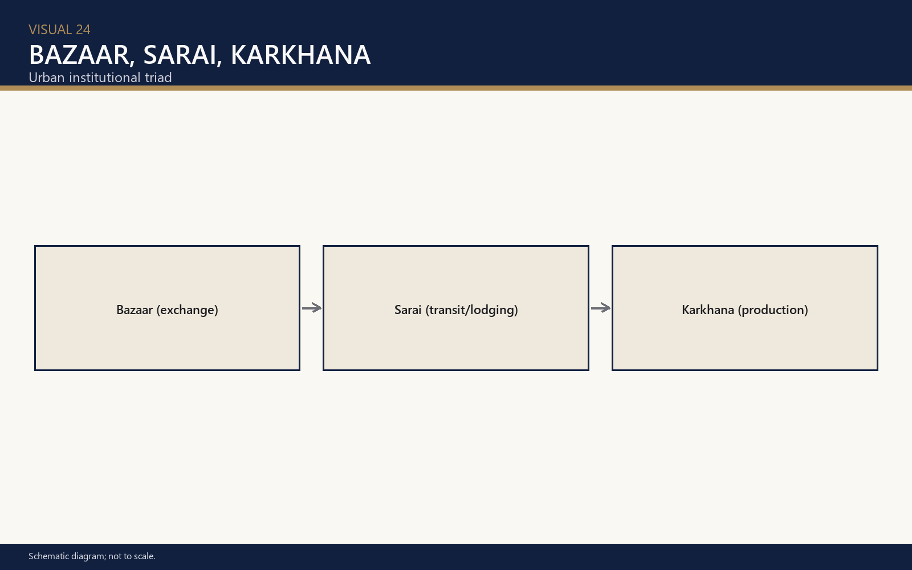

*Visual 24: BAZAAR, SARAI, KARKHANA. Schematic maps are NOT TO SCALE.*

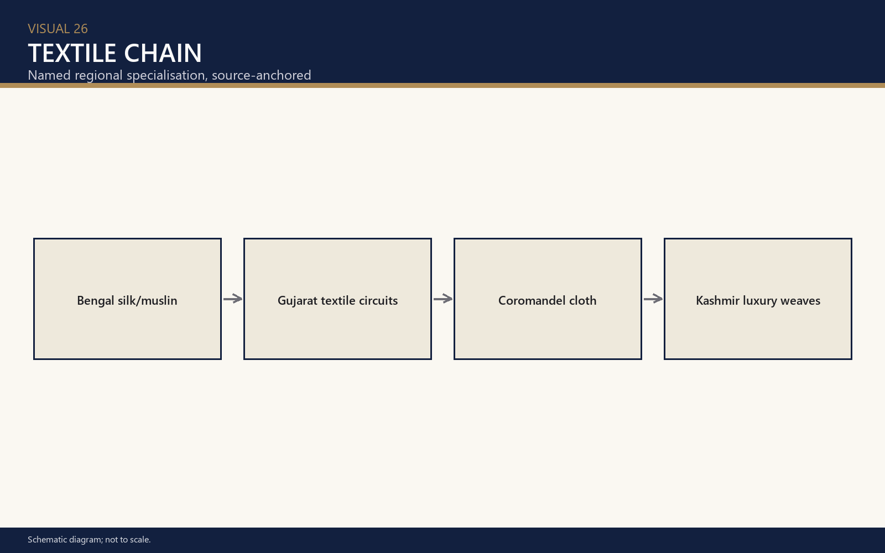

*Visual 26: TEXTILE CHAIN. Schematic maps are NOT TO SCALE.*

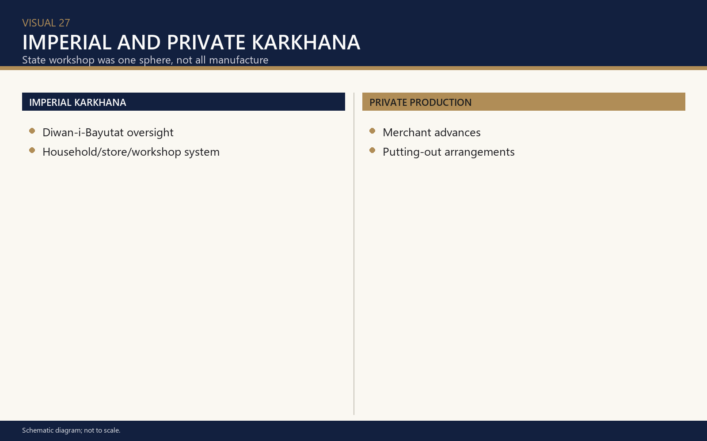

*Visual 27: IMPERIAL AND PRIVATE KARKHANA. Schematic maps are NOT TO SCALE.*

#### DEFINITION / WHAT THIS IS CALLED

**Plain-language definition:** Karkhana was an imperial or noble household workshop-and-store system, organising production and storage, not a mechanised factory.

**Technical definition:** A defensible craft claim names a specific regional specialisation with its source before generalising about 'Mughal manufacture'.

#### ANSWER-GRABBING OPENING — WRITE/ADAPT IN THE EXAM

> Craft production under the Mughals combined broad-based manufacture with named regional specialisation, organised through household, workshop, karkhana and merchant-advance forms together.

#### MUST-WRITE KEYWORDS

- **Cotton and silk textiles**
- **Named regional specialisation**
- **Imperial karkhana**
- **Diwan-i-Bayutat**
- **Private/putting-out production**

**How to use them:** Open with Cotton and silk textiles, define Named regional specialisation against it, connect Imperial karkhana to the mechanism, and close on Private/putting-out production as the decisive qualification.

#### Demonstration — claim, evidence, analysis, qualification

**Claim:** Cotton and silk textiles, muslin, calico/chintz, carpets, shawls, indigo, saltpetre, sugar, metalwork, paper, leather, jewellery, arms and shipbuilding together show a broad craft base, not a textile-only economy.

**Evidence:** Regional specialisation must be named only with a source: Bengal silk/muslin, Gujarat textile circuits, Coromandel cloth and Kashmir luxuries are the usable, named examples.

**Analysis:** Imperial karkhanas under the Diwan-i-Bayutat's sphere covered household, workshop and store systems, but this does not make all manufacture state-owned, since private production, merchant advances and putting-out arrangements coexisted alongside them.

**Qualification:** Assuming that because imperial karkhanas existed, all Mughal manufacture was state-owned or factory-organised is the central trap here.

#### Mains articulation

For **craft production and karkhanas**, the exam-ready move is: state the claim, attach the named evidence above, explain the mechanism, and close with the stated qualification. Cross-link rather than duplicate: Topic 07 for Persian-source method, Topic 10 for Bhakti/Sufi theology, Topic 11 for Sultanate antecedents, Topic 16 for full revenue, Topic 17 for translation, Topic 21 for ruling class, Topic 23 for jagirdari crisis and Topic 25 for transition.

#### CLOSING RECALL FLOW — CRAFT PRODUCTION AND KARKHANAS

```text
START / CONCEPT: Craft production and karkhanas
        |
        v
EXACT TERMS: Cotton and silk textiles, Named regional specialisation, Imperial karkhana, Diwan-i-Bayutat and Private/putting-out production
        |
        v
MECHANISM / ARGUMENT: Imperial karkhanas under the Diwan-i-Bayutat's sphere covered household, workshop and store systems, but this does not make all manufacture state-owned, since private production, merchant advances and putting-out arrangements coexisted alongside them.
        |
        v
CONSEQUENCE / CONTRAST: Assuming that because imperial karkhanas existed, all Mughal manufacture was state-owned or factory-organised is the central trap here.
        |
        v
UPSC TRAP / ANSWER-USE: Name one specific regional craft example before making any general claim about karkhana or manufacture.
        |
        v
ANSWER-GRABBING FORMULATION: Craft production under the Mughals combined broad-based manufacture with named regional specialisation, organised through household, workshop, karkhana and merchant-advance forms together.
```

### SESSION 11 — INLAND COMMERCE AND FINANCE

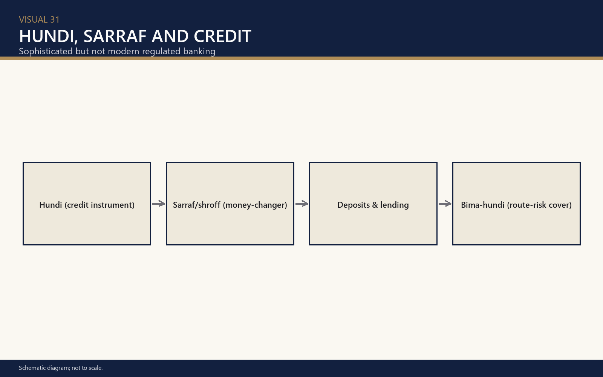

*Visual 31: HUNDI, SARRAF AND CREDIT. Schematic maps are NOT TO SCALE.*


*Visual 32: BANIAN: BROKER-AGENT. Schematic maps are NOT TO SCALE.*


*Visual 33: MIRASIDAR: LOCAL RIGHT. Schematic maps are NOT TO SCALE.*

#### DEFINITION / WHAT THIS IS CALLED

**Plain-language definition:** Hundi was a credit instrument that transmitted value across distance and time without physically moving coin, used alongside sarrafs who changed money and held deposits.

**Technical definition:** A defensible finance claim names the specific instrument or actor (hundi, sarraf, banian, aurang) with its precise function, not a generic 'banking system'.

#### ANSWER-GRABBING OPENING — WRITE/ADAPT IN THE EXAM

> Roads, sarais, rivers, pack animals, carts and banjaras moved different kinds of goods across Mughal India, with banjaras carrying bulk foodstuffs by oxen while rivers and coastal movement reduced the cost of moving bulky goods.

#### MUST-WRITE KEYWORDS

- **Hundi**
- **Sarraf/shroff**
- **Banjaras**
- **Banian**
- **Aurang versus treasury**

**How to use them:** Open with Hundi, define Sarraf/shroff against it, connect Banjaras to the mechanism, and close on Aurang versus treasury as the decisive qualification.

#### Demonstration — claim, evidence, analysis, qualification

**Claim:** Hundi and sarraf/shroff practice, including bima-hundi route-risk cover, show a sophisticated credit system; banian was an Indian broker/agent (notably for European company purchase, credit and information), and aurang was a warehouse/depot, not a treasury office.

**Evidence:** These instruments show sophisticated commerce, but not a modern regulated banking system, and confusing aurang with a treasury office is the exact 2020 Prelims pairing trap.

**Analysis:** Mirasidar must retain its local, hereditary land-right meaning and the 2020 exam's revenue-payer framing, not be treated as a generic landlord term.

**Qualification:** Confusing aurang (a depot) with a treasury office, or banian (a broker) with a caste label, is the precise 2020 Prelims trap.

#### Mains articulation

For **inland commerce and finance**, the exam-ready move is: state the claim, attach the named evidence above, explain the mechanism, and close with the stated qualification. Cross-link rather than duplicate: Topic 07 for Persian-source method, Topic 10 for Bhakti/Sufi theology, Topic 11 for Sultanate antecedents, Topic 16 for full revenue, Topic 17 for translation, Topic 21 for ruling class, Topic 23 for jagirdari crisis and Topic 25 for transition.

#### CLOSING RECALL FLOW — INLAND COMMERCE AND FINANCE

```text
START / CONCEPT: Inland commerce and finance
        |
        v
EXACT TERMS: Hundi, Sarraf/shroff, Banjaras, Banian and Aurang versus treasury
        |
        v
MECHANISM / ARGUMENT: Mirasidar must retain its local, hereditary land-right meaning and the 2020 exam's revenue-payer framing, not be treated as a generic landlord term.
        |
        v
CONSEQUENCE / CONTRAST: Confusing aurang (a depot) with a treasury office, or banian (a broker) with a caste label, is the precise 2020 Prelims trap.
        |
        v
UPSC TRAP / ANSWER-USE: Name the exact commercial term (hundi/sarraf/banian/aurang) and its precise function before making any finance claim.
        |
        v
ANSWER-GRABBING FORMULATION: Roads, sarais, rivers, pack animals, carts and banjaras moved different kinds of goods across Mughal India, with banjaras carrying bulk foodstuffs by oxen while rivers and coastal movement reduced the cost of moving bulky goods.
```

### SESSION 12 — OVERSEAS TRADE AND INDIAN OCEAN

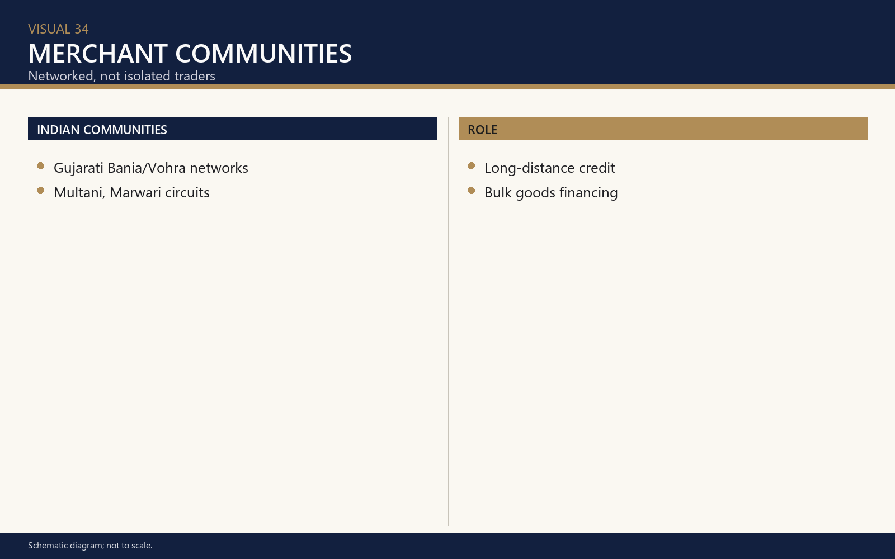

*Visual 34: MERCHANT COMMUNITIES. Schematic maps are NOT TO SCALE.*

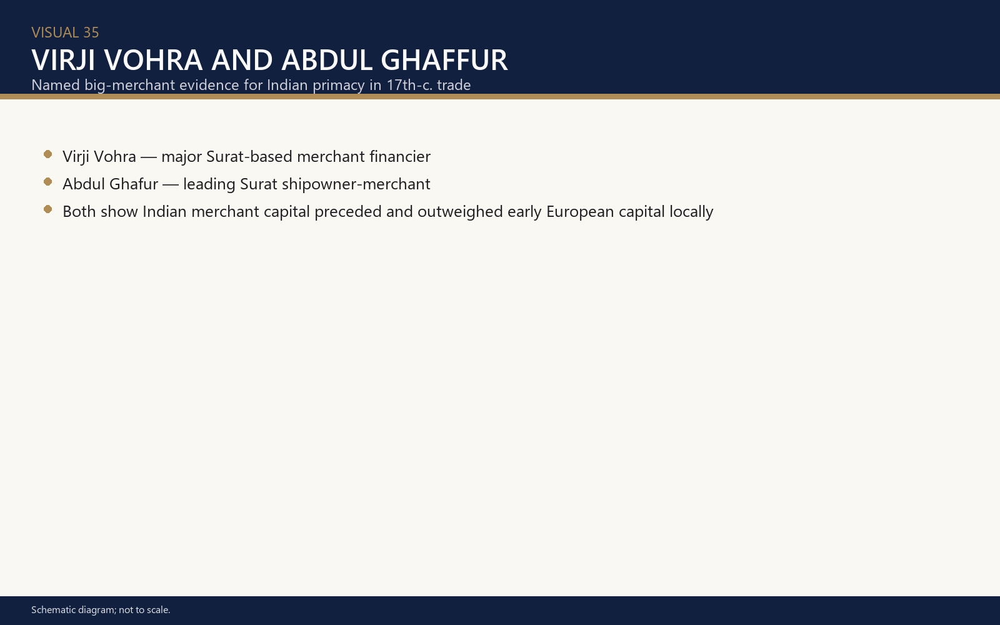

*Visual 35: VIRJI VOHRA AND ABDUL GHAFFUR. Schematic maps are NOT TO SCALE.*

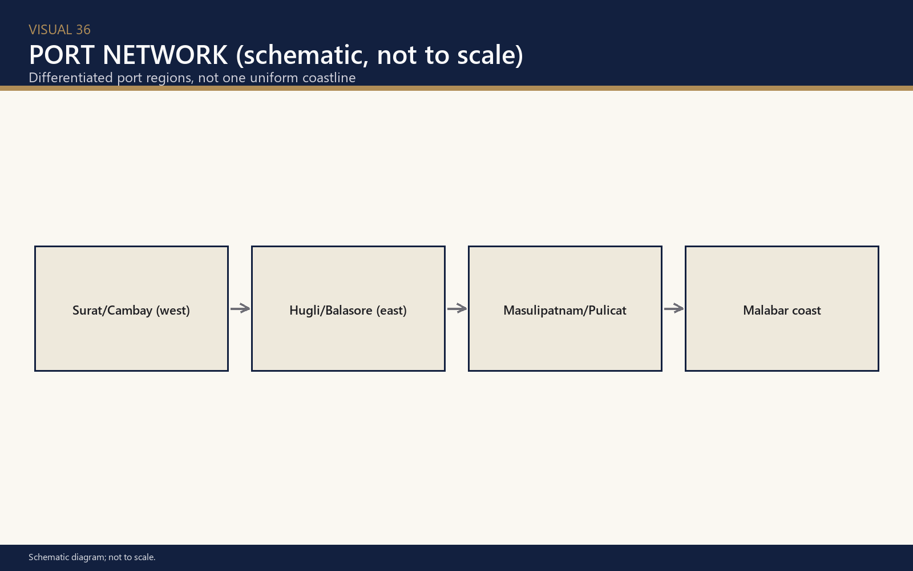

*Visual 36: PORT NETWORK - SCHEMATIC - NOT TO SCALE. Schematic maps are NOT TO SCALE.*

#### DEFINITION / WHAT THIS IS CALLED

**Plain-language definition:** Mughal-era overseas trade ran through differentiated port regions — Surat/Cambay, Hugli/Balasore, Masulipatnam/Pulicat and the Malabar coast — each with its own hinterland and route.

**Technical definition:** A defensible overseas-trade claim names a specific port/commodity pair and states what the bullion evidence does and does not prove.

#### ANSWER-GRABBING OPENING — WRITE/ADAPT IN THE EXAM

> Seventeenth-century India was a major Indian Ocean trading participant, not a passive host to European commerce.

#### MUST-WRITE KEYWORDS

- **Surat/Cambay, Hugli, Masulipatnam**
- **Textile and bullion exchange**
- **Indian merchant centrality**
- **European chartered companies**
- **State trade policy**

**How to use them:** Open with Surat/Cambay, Hugli, Masulipatnam, define Textile and bullion exchange against it, connect Indian merchant centrality to the mechanism, and close on State trade policy as the decisive qualification.

#### Demonstration — claim, evidence, analysis, qualification

**Claim:** India exported textiles, raw silk, rice/grain, sugar, indigo and saltpetre, and imported horses, metals and luxury goods, with bullion inflow supporting silver currency.

**Evidence:** Indian ships and merchants remained central to seventeenth-century circuits, and European companies entered these existing networks with chartered capital and naval coercion, while Mughal port policy was generally commerce-protecting and wary of coastal fortification.

**Analysis:** Bullion inflow supported silver currency but did not by itself prove universal prosperity, and factories could be land-vulnerable and face seizure even as European maritime leverage grew.

**Qualification:** Reading European trading-company entry as instant dominance over an already-developed Indian Ocean system is the key trap here.

#### Mains articulation

For **overseas trade and indian ocean**, the exam-ready move is: state the claim, attach the named evidence above, explain the mechanism, and close with the stated qualification. Cross-link rather than duplicate: Topic 07 for Persian-source method, Topic 10 for Bhakti/Sufi theology, Topic 11 for Sultanate antecedents, Topic 16 for full revenue, Topic 17 for translation, Topic 21 for ruling class, Topic 23 for jagirdari crisis and Topic 25 for transition.

#### CLOSING RECALL FLOW — OVERSEAS TRADE AND INDIAN OCEAN

```text
START / CONCEPT: Overseas trade and indian ocean
        |
        v
EXACT TERMS: Surat/Cambay, Hugli, Masulipatnam, Textile and bullion exchange, Indian merchant centrality, European chartered companies and State trade policy
        |
        v
MECHANISM / ARGUMENT: Bullion inflow supported silver currency but did not by itself prove universal prosperity, and factories could be land-vulnerable and face seizure even as European maritime leverage grew.
        |
        v
CONSEQUENCE / CONTRAST: Reading European trading-company entry as instant dominance over an already-developed Indian Ocean system is the key trap here.
        |
        v
UPSC TRAP / ANSWER-USE: Name the specific port and commodity before drawing any conclusion about who controlled seventeenth-century Indian Ocean trade.
        |
        v
ANSWER-GRABBING FORMULATION: Seventeenth-century India was a major Indian Ocean trading participant, not a passive host to European commerce.
```

### SESSION 13 — TAVERNIER, DIAMONDS AND MONEY

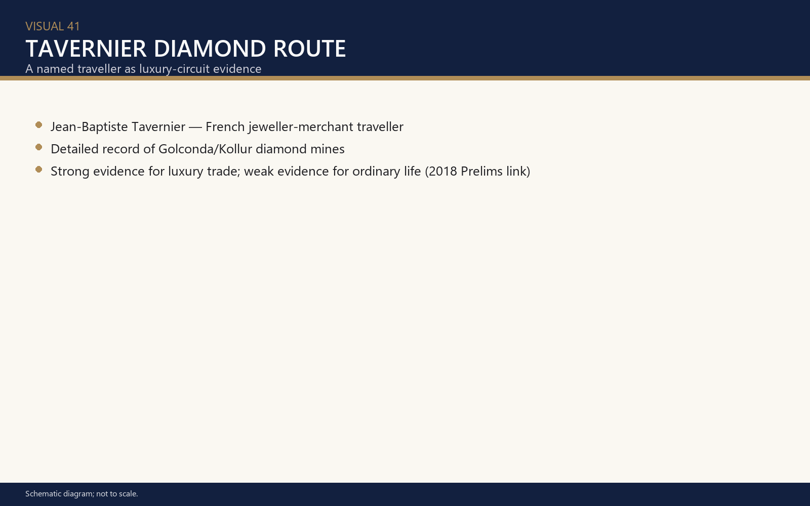

*Visual 41: TAVERNIER DIAMOND ROUTE. Schematic maps are NOT TO SCALE.*

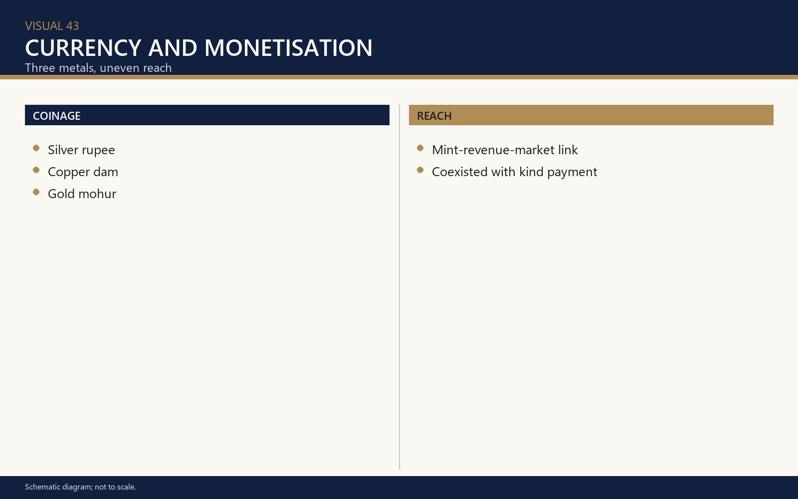

*Visual 43: CURRENCY AND MONETISATION. Schematic maps are NOT TO SCALE.*

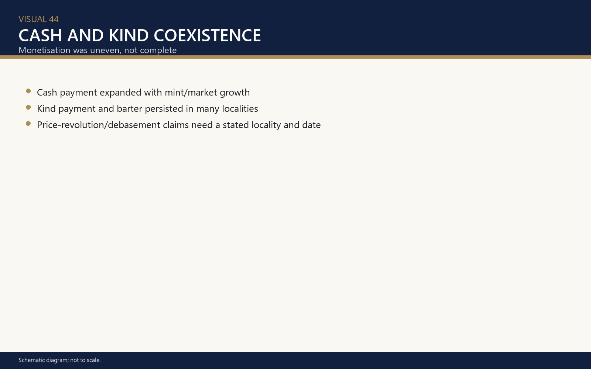

*Visual 44: CASH AND KIND COEXISTENCE. Schematic maps are NOT TO SCALE.*

#### DEFINITION / WHAT THIS IS CALLED

**Plain-language definition:** Jean-Baptiste Tavernier was a French jeweller-merchant traveller (six visits, c.1631-1668) whose detailed account of Indian diamond mines is the specific evidence tested in the 2018 Prelims.

**Technical definition:** A defensible money/traveller claim names the traveller's specific expertise before generalising to 'ordinary Mughal life'.

#### ANSWER-GRABBING OPENING — WRITE/ADAPT IN THE EXAM

> Tavernier's diamond-trade testimony and Mughal India's currency system are two distinct, precisely bounded evidence types.

#### MUST-WRITE KEYWORDS

- **Jean-Baptiste Tavernier**
- **Golconda/Kollur diamond mines**
- **Silver rupee, copper dam, gold mohur**
- **Uneven monetisation**
- **Locality-and-date rule**

**How to use them:** Open with Jean-Baptiste Tavernier, define Golconda/Kollur diamond mines against it, connect Silver rupee, copper dam, gold mohur to the mechanism, and close on Locality-and-date rule as the decisive qualification.

#### Demonstration — claim, evidence, analysis, qualification

**Claim:** Tavernier elaborately discussed diamonds and diamond mines, especially the Golconda/Kollur context, making him strong evidence for luxury commercial circuits.

**Evidence:** His commercial expertise supports the 2018 Prelims demand precisely because it is narrow — diamonds and mining, not ordinary agrarian or urban life; separately, the silver rupee, copper dam and gold mohur connected mint, revenue and market, while monetisation remained uneven, with kind payments and barter persisting.

**Analysis:** Any claim of price revolution, stability or debasement needs a stated locality and date; it must never be imported mechanically from a European model.

**Qualification:** Treating Tavernier's luxury-trade lens as evidence for the whole economy, or citing a European price-revolution model without an Indian date/locality, are the two linked traps here.

#### Mains articulation

For **tavernier, diamonds and money**, the exam-ready move is: state the claim, attach the named evidence above, explain the mechanism, and close with the stated qualification. Cross-link rather than duplicate: Topic 07 for Persian-source method, Topic 10 for Bhakti/Sufi theology, Topic 11 for Sultanate antecedents, Topic 16 for full revenue, Topic 17 for translation, Topic 21 for ruling class, Topic 23 for jagirdari crisis and Topic 25 for transition.

#### CLOSING RECALL FLOW — TAVERNIER, DIAMONDS AND MONEY

```text
START / CONCEPT: Tavernier, diamonds and money
        |
        v
EXACT TERMS: Jean-Baptiste Tavernier, Golconda/Kollur diamond mines, Silver rupee, copper dam, gold mohur, Uneven monetisation and Locality-and-date rule
        |
        v
MECHANISM / ARGUMENT: Any claim of price revolution, stability or debasement needs a stated locality and date; it must never be imported mechanically from a European model.
        |
        v
CONSEQUENCE / CONTRAST: Treating Tavernier's luxury-trade lens as evidence for the whole economy, or citing a European price-revolution model without an Indian date/locality, are the two linked traps here.
        |
        v
UPSC TRAP / ANSWER-USE: Name Tavernier's specific diamond-mine expertise, then separately state the money evidence with its locality and date.
        |
        v
ANSWER-GRABBING FORMULATION: Tavernier's diamond-trade testimony and Mughal India's currency system are two distinct, precisely bounded evidence types.
```

### SESSION 14 — TECHNOLOGY AND PRODUCTION DEBATE


*Visual 46: PRINTING NUANCE. Schematic maps are NOT TO SCALE.*

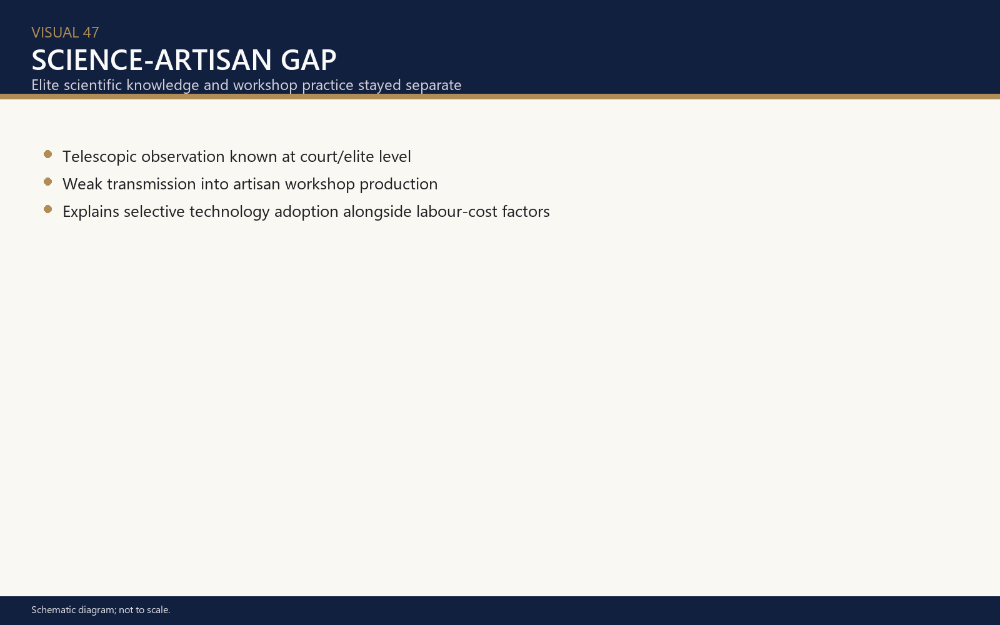

*Visual 47: SCIENCE-ARTISAN GAP. Schematic maps are NOT TO SCALE.*

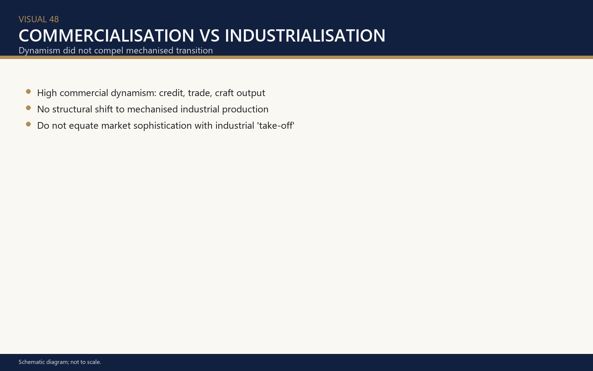

*Visual 48: COMMERCIALISATION VS INDUSTRIALISATION. Schematic maps are NOT TO SCALE.*

#### DEFINITION / WHAT THIS IS CALLED

**Plain-language definition:** Mughal-era technology was sectoral: high artisanal skill in some crafts coexisted with slow or uneven uptake of other techniques.

**Technical definition:** A defensible technology claim names the specific sector before making any general 'advanced' or 'stagnant' judgement.

#### ANSWER-GRABBING OPENING — WRITE/ADAPT IN THE EXAM

> Mughal technological capacity was sector-specific, so it cannot be judged by one civilisational label.

#### MUST-WRITE KEYWORDS

- **Weaving, dyeing, shipbuilding**
- **Uneven technology uptake**
- **Printing nuance**
- **Science-artisan gap**
- **Commercialisation versus industrialisation**

**How to use them:** Open with Weaving, dyeing, shipbuilding, define Uneven technology uptake against it, connect Printing nuance to the mechanism, and close on Commercialisation versus industrialisation as the decisive qualification.

#### Demonstration — claim, evidence, analysis, qualification

**Claim:** Weaving, dyeing and shipbuilding displayed high artisanal skill, while water pumps, large furnace/bellows, cannon casting, screws/springs, precision instruments and telescopic observation had uneven uptake.

**Evidence:** Selective adoption may relate to labour abundance, cost, merchant advances without tool investment, and weak links between elite/scientific knowledge and workshop production; printing needs the same nuance — textile block printing, knowledge of presses, missionary/regional printing and limited court uptake are distinct facts, so both 'no printing' and an automatic mass press must be avoided.

**Analysis:** Commercial dynamism, however extensive, did not by itself compel a mechanised industrial transition.

**Qualification:** Claiming either 'Mughal India had no printing at all' or that commercial dynamism naturally led to industrialisation are the two matched traps.

#### Mains articulation

For **technology and production debate**, the exam-ready move is: state the claim, attach the named evidence above, explain the mechanism, and close with the stated qualification. Cross-link rather than duplicate: Topic 07 for Persian-source method, Topic 10 for Bhakti/Sufi theology, Topic 11 for Sultanate antecedents, Topic 16 for full revenue, Topic 17 for translation, Topic 21 for ruling class, Topic 23 for jagirdari crisis and Topic 25 for transition.

#### CLOSING RECALL FLOW — TECHNOLOGY AND PRODUCTION DEBATE

```text
START / CONCEPT: Technology and production debate
        |
        v
EXACT TERMS: Weaving, dyeing, shipbuilding, Uneven technology uptake, Printing nuance, Science-artisan gap and Commercialisation versus industrialisation
        |
        v
MECHANISM / ARGUMENT: Commercial dynamism, however extensive, did not by itself compel a mechanised industrial transition.
        |
        v
CONSEQUENCE / CONTRAST: Claiming either 'Mughal India had no printing at all' or that commercial dynamism naturally led to industrialisation are the two matched traps.
        |
        v
UPSC TRAP / ANSWER-USE: Name the specific sector, then state the uptake evidence for that sector alone, not for 'technology' in general.
        |
        v
ANSWER-GRABBING FORMULATION: Mughal technological capacity was sector-specific, so it cannot be judged by one civilisational label.
```

### SESSION 15 — ARCHITECTURE AS COLLECTIVE PRODUCTION

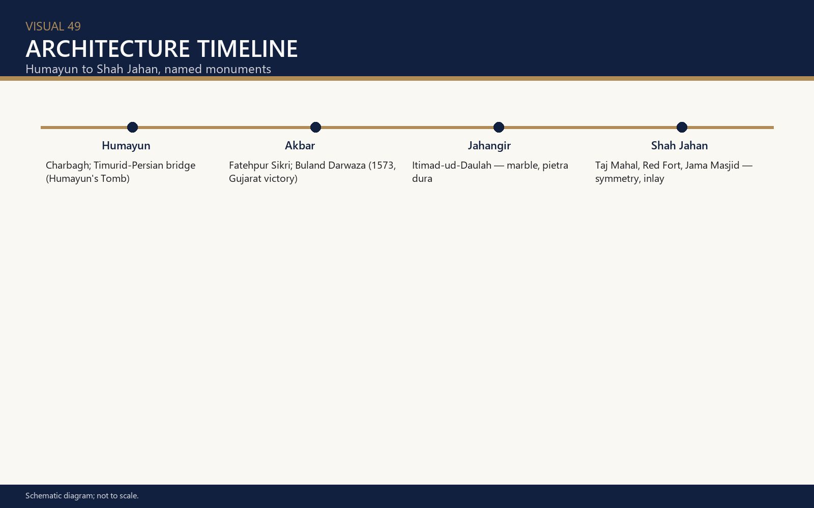

*Visual 43: ARCHITECTURE TIMELINE. Schematic maps are NOT TO SCALE.*

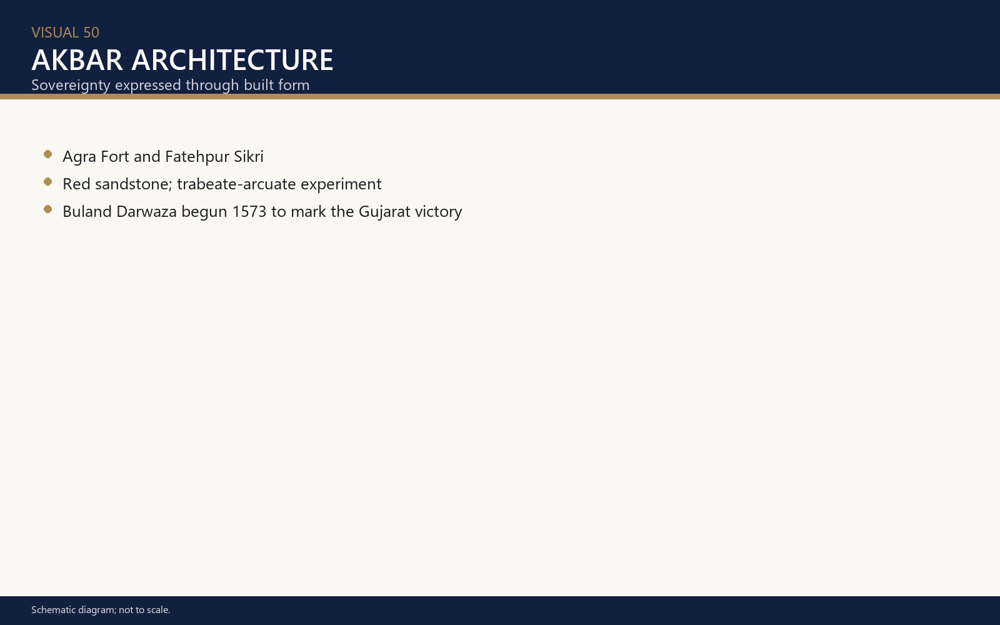

*Visual 44: AKBAR ARCHITECTURE. Schematic maps are NOT TO SCALE.*

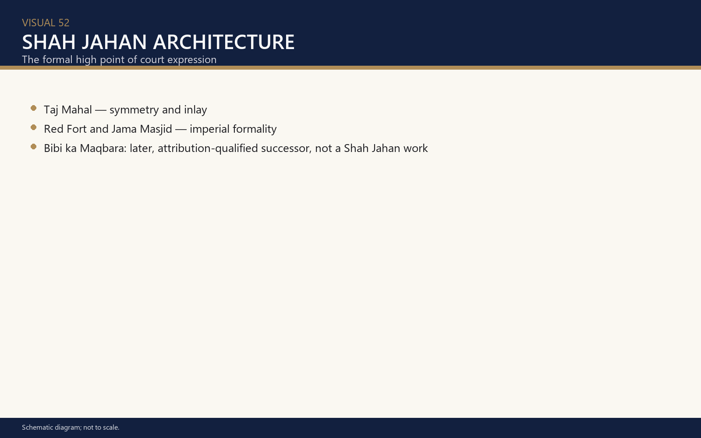

*Visual 45: SHAH JAHAN ARCHITECTURE. Schematic maps are NOT TO SCALE.*

#### DEFINITION / WHAT THIS IS CALLED

**Plain-language definition:** Mughal architecture was a collective, resourced production involving a patron, master builder, artisans, quarry and transport labour, and karkhana supply — not a single ruler's personal creation.

**Technical definition:** A defensible architecture claim names the specific monument and reign before drawing any general conclusion about 'Mughal style'.

#### ANSWER-GRABBING OPENING — WRITE/ADAPT IN THE EXAM

> Every major Mughal monument is best read as an institutional, multi-reign production chain, not a single emperor's personal artistic act.

#### MUST-WRITE KEYWORDS

- **Humayun's Tomb (charbagh)**
- **Buland Darwaza (1573)**
- **Itimad-ud-Daulah (pietra dura)**
- **Taj Mahal, Red Fort, Jama Masjid**
- **Patron-artisan-quarry chain**

**How to use them:** Open with Humayun's Tomb (charbagh), define Buland Darwaza (1573) against it, connect Itimad-ud-Daulah (pietra dura) to the mechanism, and close on Patron-artisan-quarry chain as the decisive qualification.

#### Demonstration — claim, evidence, analysis, qualification

**Claim:** Humayun's Tomb gives the charbagh form and a Timurid-Persian bridge; Akbar's Agra Fort, Fatehpur Sikri and Buland Darwaza (begun 1573 for the Gujarat victory) combine red sandstone with trabeate-arcuate experimentation; Jahangir's Itimad-ud-Daulah develops marble and pietra dura; Shah Jahan's Taj Mahal, Red Fort and Jama Masjid show symmetry, inlay and formal court expression.

**Evidence:** Each stage required a named patron, master builder, artisan, quarry, transport and labour chain, and Bibi ka Maqbara needs accurate, attribution-qualified use as a later, distinct successor monument.

**Analysis:** Monumentality neither proves social harmony nor universal prosperity across the empire that funded it.

**Qualification:** Citing Bibi ka Maqbara as a Shah Jahan monument, or reading monumental scale as proof of general prosperity, are the two traps here.

#### Mains articulation

For **architecture as collective production**, the exam-ready move is: state the claim, attach the named evidence above, explain the mechanism, and close with the stated qualification. Cross-link rather than duplicate: Topic 07 for Persian-source method, Topic 10 for Bhakti/Sufi theology, Topic 11 for Sultanate antecedents, Topic 16 for full revenue, Topic 17 for translation, Topic 21 for ruling class, Topic 23 for jagirdari crisis and Topic 25 for transition.

#### CLOSING RECALL FLOW — ARCHITECTURE AS COLLECTIVE PRODUCTION

```text
START / CONCEPT: Architecture as collective production
        |
        v
EXACT TERMS: Humayun's Tomb (charbagh), Buland Darwaza (1573), Itimad-ud-Daulah (pietra dura), Taj Mahal, Red Fort, Jama Masjid and Patron-artisan-quarry chain
        |
        v
MECHANISM / ARGUMENT: Monumentality neither proves social harmony nor universal prosperity across the empire that funded it.
        |
        v
CONSEQUENCE / CONTRAST: Citing Bibi ka Maqbara as a Shah Jahan monument, or reading monumental scale as proof of general prosperity, are the two traps here.
        |
        v
UPSC TRAP / ANSWER-USE: Name the specific monument and reign, then state the institutional production chain before any interpretive claim.
        |
        v
ANSWER-GRABBING FORMULATION: Every major Mughal monument is best read as an institutional, multi-reign production chain, not a single emperor's personal artistic act.
```

### SESSION 16 — PAINTING, MUSIC AND PERFORMANCE

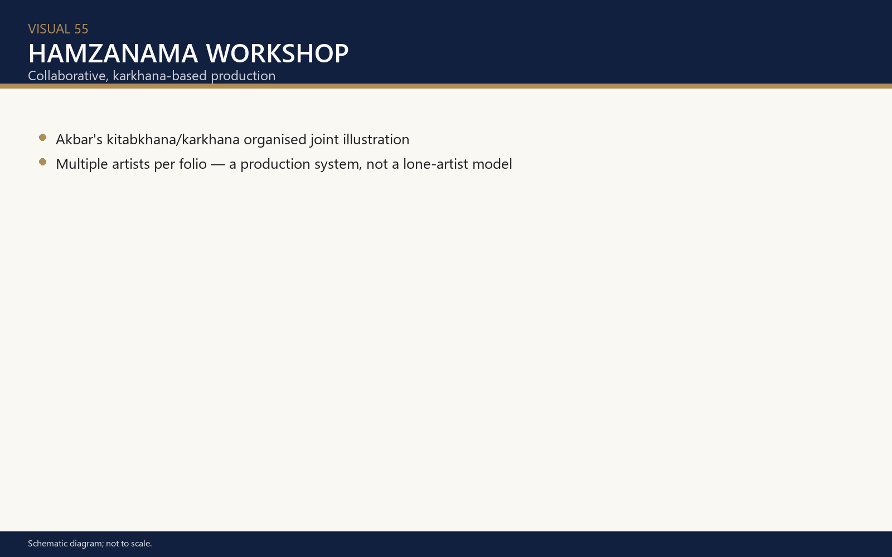

*Visual 55: HAMZANAMA WORKSHOP. Schematic maps are NOT TO SCALE.*


*Visual 56: JAHANGIR NATURALISM. Schematic maps are NOT TO SCALE.*

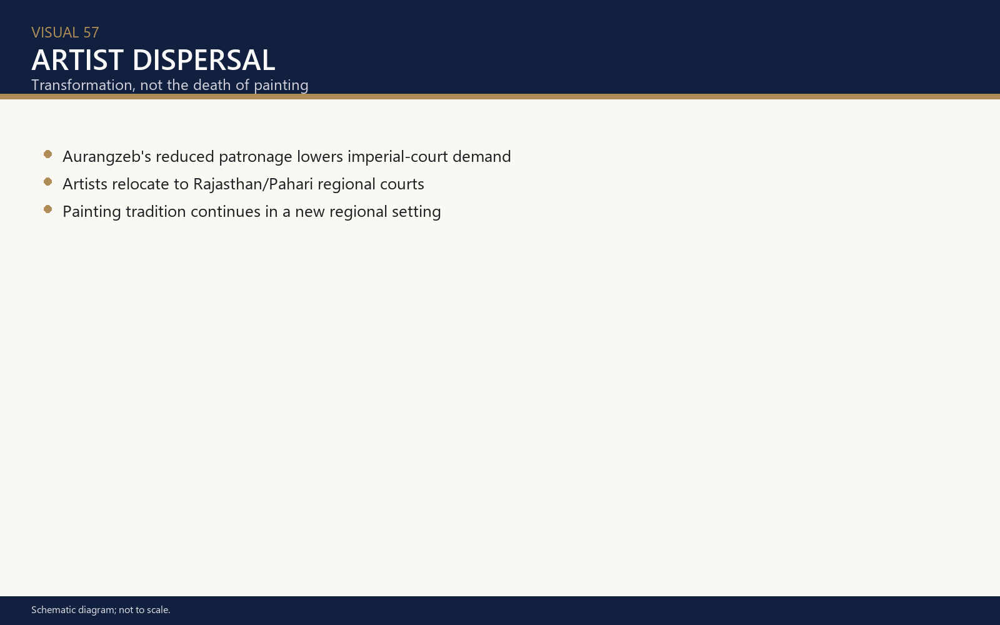

*Visual 57: ARTIST DISPERSAL. Schematic maps are NOT TO SCALE.*

#### DEFINITION / WHAT THIS IS CALLED

**Plain-language definition:** Mughal painting was organised through an imperial kitabkhana/karkhana, producing collaborative illustrated works such as the Hamzanama, rather than being the output of isolated individual artists.

**Technical definition:** A defensible painting/music claim names the specific reign and named artist/practice before making a general 'Mughal art' statement.

#### ANSWER-GRABBING OPENING — WRITE/ADAPT IN THE EXAM

> Aurangzeb's court did not simply extinguish Mughal painting and music; both institutions transformed rather than died.

#### MUST-WRITE KEYWORDS

- **Akbar's kitabkhana and Hamzanama**
- **Jahangir's naturalism (Mansur)**
- **Artist dispersal under Aurangzeb**
- **Tansen and dhrupad**
- **Music-continuity correction**

**How to use them:** Open with Akbar's kitabkhana and Hamzanama, define Jahangir's naturalism (Mansur) against it, connect Artist dispersal under Aurangzeb to the mechanism, and close on Music-continuity correction as the decisive qualification.

#### Demonstration — claim, evidence, analysis, qualification

**Claim:** Humayun's Persian links are the antecedent; Akbar's kitabkhana/karkhana made Hamzanama a collaborative illustrated production, and Akbar favoured narrative illustration while Jahangir developed portraiture, albums/muraqqa and natural studies, with Mansur securely associated with flora/fauna work; Shah Jahan formalised the court image.

**Evidence:** Aurangzeb's reduced interest encouraged artist dispersal to Rajasthan/Pahari courts — a transformation of painting's setting, not its death — and, similarly, Tansen and dhrupad anchor Akbar's reign while Aurangzeb banished singers from court after early patronage, yet instrumental music, noble/household patronage and music-writing continued.

**Analysis:** The 'funeral of music' anecdote under Aurangzeb is satire, not literal historical proof of music's extinction.

**Qualification:** Treating the satirical 'funeral of music' story as literal historical fact is the key trap in this session.

#### Mains articulation

For **painting, music and performance**, the exam-ready move is: state the claim, attach the named evidence above, explain the mechanism, and close with the stated qualification. Cross-link rather than duplicate: Topic 07 for Persian-source method, Topic 10 for Bhakti/Sufi theology, Topic 11 for Sultanate antecedents, Topic 16 for full revenue, Topic 17 for translation, Topic 21 for ruling class, Topic 23 for jagirdari crisis and Topic 25 for transition.

#### CLOSING RECALL FLOW — PAINTING, MUSIC AND PERFORMANCE

```text
START / CONCEPT: Painting, music and performance
        |
        v
EXACT TERMS: Akbar's kitabkhana and Hamzanama, Jahangir's naturalism (Mansur), Artist dispersal under Aurangzeb, Tansen and dhrupad and Music-continuity correction
        |
        v
MECHANISM / ARGUMENT: The 'funeral of music' anecdote under Aurangzeb is satire, not literal historical proof of music's extinction.
        |
        v
CONSEQUENCE / CONTRAST: Treating the satirical 'funeral of music' story as literal historical fact is the key trap in this session.
        |
        v
UPSC TRAP / ANSWER-USE: Name the specific reign and named artist/musician before making any claim about painting's or music's fate under the Mughals.
        |
        v
ANSWER-GRABBING FORMULATION: Aurangzeb's court did not simply extinguish Mughal painting and music; both institutions transformed rather than died.
```

### SESSION 17 — PERSIAN LITERATURE AND SOURCE CRITIQUE

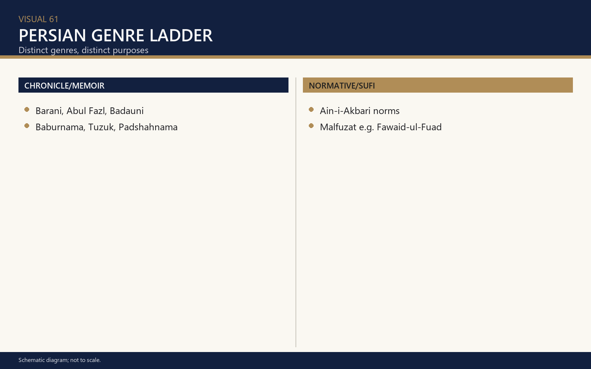

*Visual 49: PERSIAN GENRE LADDER. Schematic maps are NOT TO SCALE.*

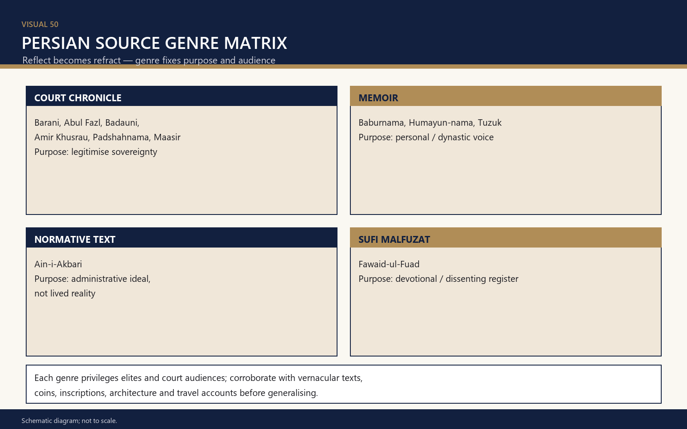

*Visual 50: PERSIAN SOURCE GENRE MATRIX. Schematic maps are NOT TO SCALE.*

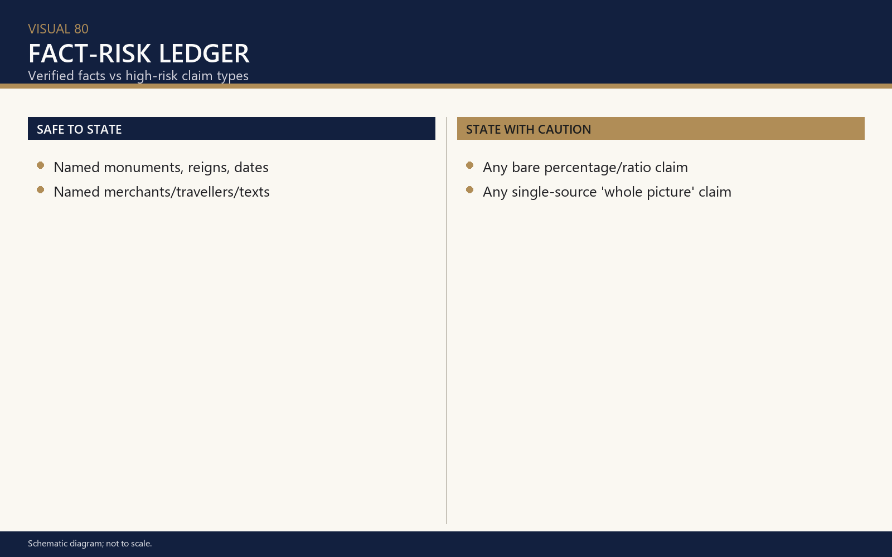

*Visual 51: FACT-RISK LEDGER. Schematic maps are NOT TO SCALE.*

#### DEFINITION / WHAT THIS IS CALLED

**Plain-language definition:** Persian literary sources of medieval India form a genre family — court chronicle, memoir, normative text and Sufi malfuzat — each with a distinct purpose and audience.

**Technical definition:** A defensible source-critique claim replaces the 2020 Mains word 'reflect' with 'refract' and names the specific genre being used.

#### ANSWER-GRABBING OPENING — WRITE/ADAPT IN THE EXAM

> Persian literary sources of medieval India refract the spirit of the age rather than mechanically reflecting it — the precise 2020 GS-I demand.

#### MUST-WRITE KEYWORDS

- **Barani, Abul Fazl, Badauni**
- **Baburnama, Tuzuk, Padshahnama**
- **Ain-i-Akbari as normative text**
- **Sufi malfuzat (Fawaid-ul-Fuad)**
- **Reflect-versus-refract**

**How to use them:** Open with Barani, Abul Fazl, Badauni, define Baburnama, Tuzuk, Padshahnama against it, connect Ain-i-Akbari as normative text to the mechanism, and close on Reflect-versus-refract as the decisive qualification.

#### Demonstration — claim, evidence, analysis, qualification

**Claim:** Court chronicles (Barani, Amir Khusrau, Abul Fazl, Badauni, Padshahnama, Maasir), memoirs (Baburnama, Humayun-nama, Tuzuk), the Ain, normative texts, Sufi malfuzat such as Fawaid-ul-Fuad, letters and biographies each have distinct purposes.

**Evidence:** The 2020 Mains word 'reflect' must be qualified to 'refract': these sources reveal sovereignty, hierarchy, religion, administration, literary aesthetics and dissent, but also privilege elites and silence many peasants, women, oral and non-court worlds.

**Analysis:** Any conclusion from Persian literary sources must be corroborated with vernacular texts, coins, inscriptions, architecture, archaeology, paintings and travellers before it is generalised.

**Qualification:** Answering the 2020 Mains question with the word 'reflect' left unqualified, rather than 'refract', misses the examiner's core demand.

#### Mains articulation

For **persian literature and source critique**, the exam-ready move is: state the claim, attach the named evidence above, explain the mechanism, and close with the stated qualification. Cross-link rather than duplicate: Topic 07 for Persian-source method, Topic 10 for Bhakti/Sufi theology, Topic 11 for Sultanate antecedents, Topic 16 for full revenue, Topic 17 for translation, Topic 21 for ruling class, Topic 23 for jagirdari crisis and Topic 25 for transition.

#### CLOSING RECALL FLOW — PERSIAN LITERATURE AND SOURCE CRITIQUE

```text
START / CONCEPT: Persian literature and source critique
        |
        v
EXACT TERMS: Barani, Abul Fazl, Badauni, Baburnama, Tuzuk, Padshahnama, Ain-i-Akbari as normative text, Sufi malfuzat (Fawaid-ul-Fuad) and Reflect-versus-refract
        |
        v
MECHANISM / ARGUMENT: Any conclusion from Persian literary sources must be corroborated with vernacular texts, coins, inscriptions, architecture, archaeology, paintings and travellers before it is generalised.
        |
        v
CONSEQUENCE / CONTRAST: Answering the 2020 Mains question with the word 'reflect' left unqualified, rather than 'refract', misses the examiner's core demand.
        |
        v
UPSC TRAP / ANSWER-USE: Replace 'reflect' with 'refract', name the genre, and add one corroborating non-Persian evidence type.
        |
        v
ANSWER-GRABBING FORMULATION: Persian literary sources of medieval India refract the spirit of the age rather than mechanically reflecting it — the precise 2020 GS-I demand.
```

### SESSION 18 — TRANSLATION, VERNACULARS AND COMPOSITE CULTURE

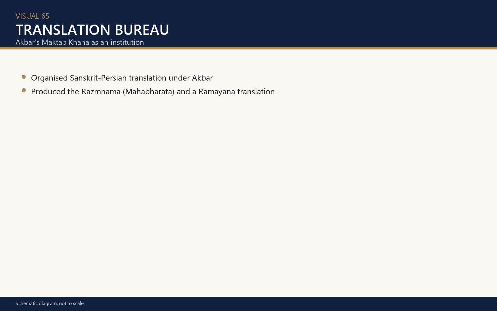

*Visual 52: TRANSLATION BUREAU. Schematic maps are NOT TO SCALE.*

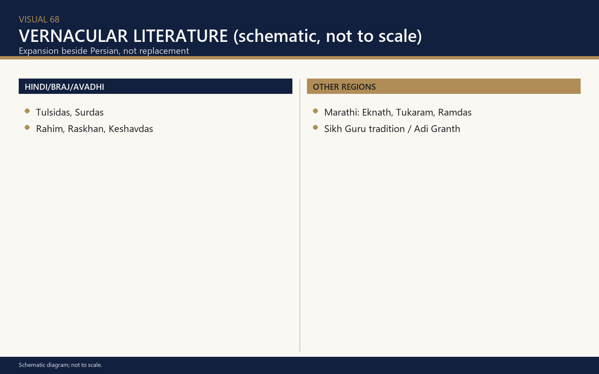

*Visual 53: VERNACULAR LITERATURE - SCHEMATIC - NOT TO SCALE. Schematic maps are NOT TO SCALE.*

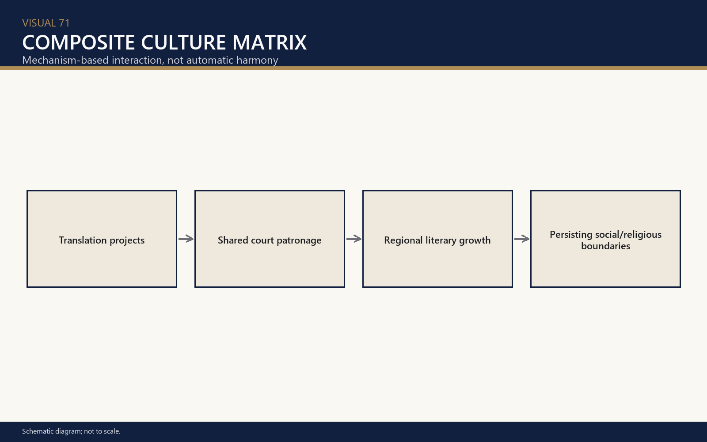

*Visual 54: COMPOSITE CULTURE MATRIX. Schematic maps are NOT TO SCALE.*

#### DEFINITION / WHAT THIS IS CALLED

**Plain-language definition:** Composite culture here means documented, mechanism-based interaction — such as court-sponsored translation — not a claim of social equality or the absence of conflict.

**Technical definition:** A defensible composite-culture claim names the specific translation project and its correct reign before drawing a general 'syncretism' conclusion.

#### ANSWER-GRABBING OPENING — WRITE/ADAPT IN THE EXAM

> Translation and vernacular literary growth show real cultural interaction under the Mughals, provided each named project is dated to its correct reign.

#### MUST-WRITE KEYWORDS

- **Akbar's Maktab Khana**
- **Razmnama (Mahabharata)**
- **Nizamuddin Panipati's Yogavasistha**
- **Dara Shukoh's Majma-ul-Bahrain/Sirr-i-Akbar**
- **Vernacular expansion (Tulsidas, Tukaram, Adi Granth)**

**How to use them:** Open with Akbar's Maktab Khana, define Razmnama (Mahabharata) against it, connect Nizamuddin Panipati's Yogavasistha to the mechanism, and close on Vernacular expansion (Tulsidas, Tukaram, Adi Granth) as the decisive qualification.

#### Demonstration — claim, evidence, analysis, qualification

**Claim:** Akbar's Maktab Khana fostered Sanskrit-Persian translation, including the Razmnama/Mahabharata and a Ramayana project.

**Evidence:** A critical correction is essential here: Nizamuddin Panipati's Persian Yogavasistha/Jug Basis belongs to Akbar's reign (conventionally the late sixteenth century), while Dara Shukoh has distinct, later works — Majma-ul-Bahrain and Sirr-i-Akbar/Upanishad translation; alongside this, Hindi/Braj/Avadhi writers (Tulsidas, Surdas, Rahim, Raskhan, Keshavdas), Marathi writers (Eknath, Tukaram, Ramdas) and Sikh Guru traditions/Adi Granth show vernacular expansion beside Persian, not its replacement.

**Analysis:** Composite culture therefore means mechanism-based interaction, not equality or the absence of conflict.

**Qualification:** Conflating the Akbar-era Yogavasistha translation with Dara Shukoh's later, separate translation projects is the exact 2022 Prelims trap.

#### Mains articulation

For **translation, vernaculars and composite culture**, the exam-ready move is: state the claim, attach the named evidence above, explain the mechanism, and close with the stated qualification. Cross-link rather than duplicate: Topic 07 for Persian-source method, Topic 10 for Bhakti/Sufi theology, Topic 11 for Sultanate antecedents, Topic 16 for full revenue, Topic 17 for translation, Topic 21 for ruling class, Topic 23 for jagirdari crisis and Topic 25 for transition.

#### CLOSING RECALL FLOW — TRANSLATION, VERNACULARS AND COMPOSITE CULTURE

```text
START / CONCEPT: Translation, vernaculars and composite culture
        |
        v
EXACT TERMS: Akbar's Maktab Khana, Razmnama (Mahabharata), Nizamuddin Panipati's Yogavasistha, Dara Shukoh's Majma-ul-Bahrain/Sirr-i-Akbar and Vernacular expansion (Tulsidas, Tukaram, Adi Granth)
        |
        v
MECHANISM / ARGUMENT: Composite culture therefore means mechanism-based interaction, not equality or the absence of conflict.
        |
        v
CONSEQUENCE / CONTRAST: Conflating the Akbar-era Yogavasistha translation with Dara Shukoh's later, separate translation projects is the exact 2022 Prelims trap.
        |
        v
UPSC TRAP / ANSWER-USE: Name the exact translation project and reign, then state one vernacular example, before any composite-culture conclusion.
        |
        v
ANSWER-GRABBING FORMULATION: Translation and vernacular literary growth show real cultural interaction under the Mughals, provided each named project is dated to its correct reign.
```

### SESSION 19 — BERNIER, TRAVELLERS AND HISTORIOGRAPHY

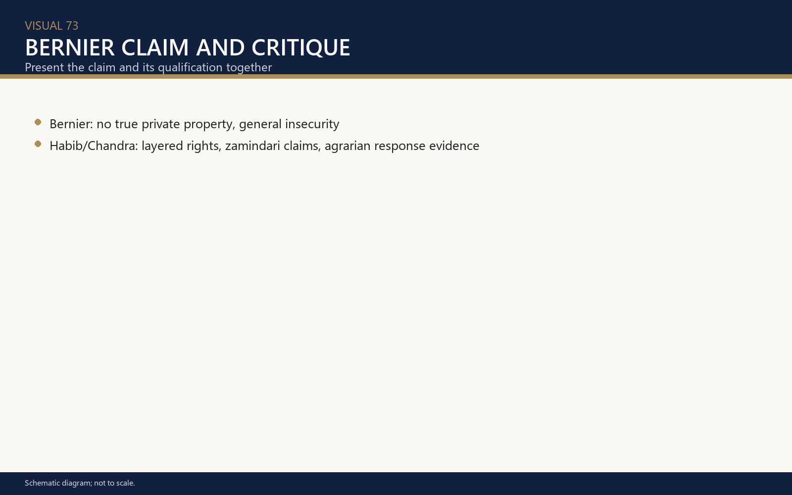

*Visual 73: BERNIER CLAIM AND CRITIQUE. Schematic maps are NOT TO SCALE.*

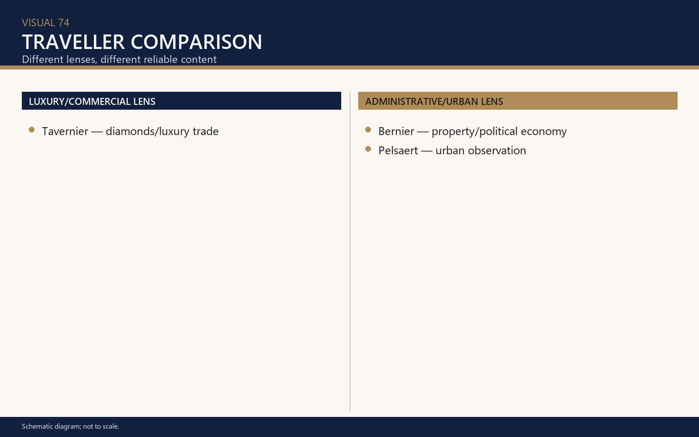

*Visual 74: TRAVELLER COMPARISON. Schematic maps are NOT TO SCALE.*


*Visual 42: TRAVELLER LUXURY BIAS. Schematic maps are NOT TO SCALE.*

#### DEFINITION / WHAT THIS IS CALLED

**Plain-language definition:** Historiography here means reading a traveller's claim together with the historians who have since qualified it, not accepting either alone.

**Technical definition:** A defensible historiography claim states the traveller's original claim and its named historian-qualification in the same sentence.

#### ANSWER-GRABBING OPENING — WRITE/ADAPT IN THE EXAM

> No single traveller's account can stand as unqualified proof of Mughal agrarian or social conditions without a named historian's correction alongside it.

#### MUST-WRITE KEYWORDS

- **Bernier's property/jagir argument**
- **Habib and Chandra's qualification**
- **Tavernier's luxury lens**
- **Pelsaert, Roe, Manucci**
- **Multi-causal historiography**

**How to use them:** Open with Bernier's property/jagir argument, define Habib and Chandra's qualification against it, connect Tavernier's luxury lens to the mechanism, and close on Multi-causal historiography as the decisive qualification.

#### Demonstration — claim, evidence, analysis, qualification

**Claim:** Bernier observed inequality and insecurity but framed his property/jagir argument through a European comparative lens.

**Evidence:** Habib and Chandra qualify Bernier with evidence of layered rights, zamindari claims, merchant wealth, professions and agrarian response — this is not a denial of real distress, only a correction of Bernier's totalising claim; Tavernier's luxury lens, Pelsaert's urban observations, Roe/Hawkins's diplomacy, Manucci's anecdotes and Mundy/Thevenot's route-bound accounts each need separate, named treatment.

**Analysis:** Modern debates over the agrarian system, commercial capitalism/proto-industrialisation, technology divergence and composite culture all reject any single-cause explanation, and any quantitative claim requires a stated source, date and denominator.

**Qualification:** Citing Bernier's claim alone, without Habib's or Chandra's named qualification, is the standard historiography-question trap.

#### Mains articulation

For **bernier, travellers and historiography**, the exam-ready move is: state the claim, attach the named evidence above, explain the mechanism, and close with the stated qualification. Cross-link rather than duplicate: Topic 07 for Persian-source method, Topic 10 for Bhakti/Sufi theology, Topic 11 for Sultanate antecedents, Topic 16 for full revenue, Topic 17 for translation, Topic 21 for ruling class, Topic 23 for jagirdari crisis and Topic 25 for transition.

#### CLOSING RECALL FLOW — BERNIER, TRAVELLERS AND HISTORIOGRAPHY

```text
START / CONCEPT: Bernier, travellers and historiography
        |
        v
EXACT TERMS: Bernier's property/jagir argument, Habib and Chandra's qualification, Tavernier's luxury lens, Pelsaert, Roe, Manucci and Multi-causal historiography
        |
        v
MECHANISM / ARGUMENT: Modern debates over the agrarian system, commercial capitalism/proto-industrialisation, technology divergence and composite culture all reject any single-cause explanation, and any quantitative claim requires a stated source, date and denominator.
        |
        v
CONSEQUENCE / CONTRAST: Citing Bernier's claim alone, without Habib's or Chandra's named qualification, is the standard historiography-question trap.
        |
        v
UPSC TRAP / ANSWER-USE: State Bernier's claim and its named historian-correction together, never Bernier alone.
        |
        v
ANSWER-GRABBING FORMULATION: No single traveller's account can stand as unqualified proof of Mughal agrarian or social conditions without a named historian's correction alongside it.
```

### SESSION 20 — HERITAGE LINKAGE, SOURCE-METHOD BRIDGE AND 2026 STATUS

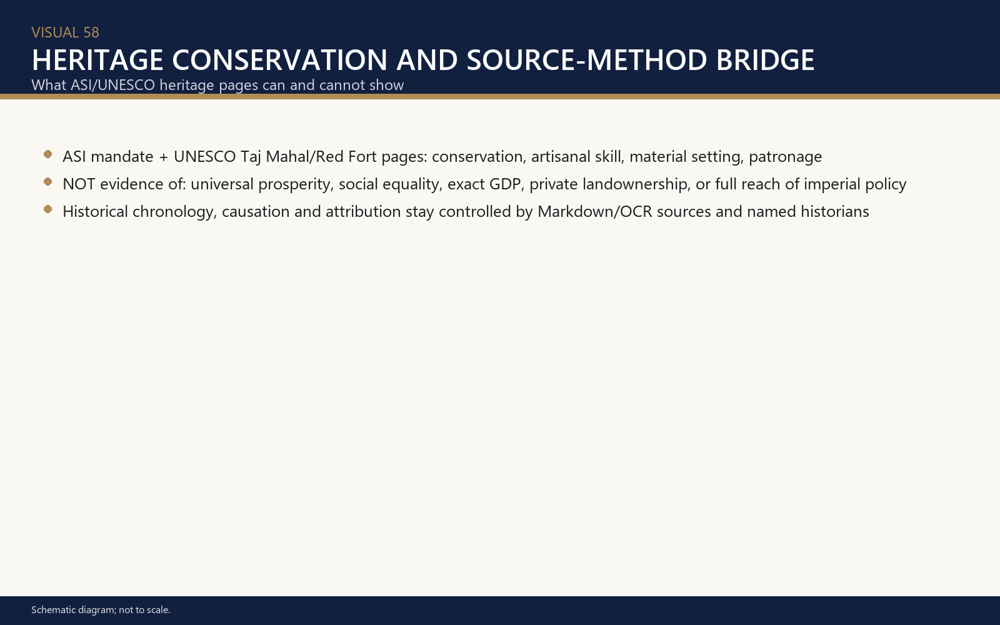

*Visual 58: HERITAGE CONSERVATION AND SOURCE-METHOD BRIDGE. Schematic maps are NOT TO SCALE.*


*Visual 59: 2026 PRELIMS/MAINS GS-I VERIFIED ABSENCE. Schematic maps are NOT TO SCALE.*


*Visual 60: TOPIC BOUNDARY AND RISK LEDGER. Schematic maps are NOT TO SCALE.*

#### DEFINITION / WHAT THIS IS CALLED

**Plain-language definition:** This session is a bounded live-linkage bridge: it connects Topic 24's historical content to today's heritage-conservation status and to the verified, dated 2026 current-affairs record, without letting either substitute for historical argument.

**Technical definition:** A defensible current-status claim states the check date, the source consulted, and exactly what that source can and cannot prove.

#### ANSWER-GRABBING OPENING — WRITE/ADAPT IN THE EXAM

> A heritage-conservation webpage is evidence of monument upkeep and material setting alone, never of social or economic conditions.

#### MUST-WRITE KEYWORDS

- **ASI conservation mandate**
- **UNESCO World Heritage listing**
- **Heritage-is-not-welfare boundary**
- **2026 Prelims/Mains GS-I verified absence**
- **Topic boundary hand-off**

**How to use them:** Open with ASI conservation mandate, define UNESCO World Heritage listing against it, connect Heritage-is-not-welfare boundary to the mechanism, and close on Topic boundary hand-off as the decisive qualification.

#### Demonstration — claim, evidence, analysis, qualification

**Claim:** The ASI mandate and the UNESCO Taj Mahal and Red Fort pages support monument conservation, skilled and artisanal production, composite architectural traditions, material setting and patronage.

**Evidence:** They are not evidence of universal prosperity, social equality, exact GDP, private landownership, or the reach of imperial policy, and no topic-specific new official event was found in the preceding six months, so static relevance is retained; separately and specifically, a direct check of the locally verified 2026 Prelims GS-I routing ledger and the locally verified 2026 Mains GS-I ledger (20/20 questions routed) confirms that Topic 24/Medieval-Mughal content received no question in either paper.

**Analysis:** Historical chronology, causation, attribution and institutional claims remain controlled by the session's own sourced notes and OCR-searchable books with explicit source criticism — the live heritage page is a bridge, not a substitute for that evidence.

**Qualification:** Treating an ASI/UNESCO conservation page as evidence of social or economic conditions, rather than of conservation and material setting alone, is the trap this session exists to block.

#### Mains articulation

For **heritage linkage, source-method bridge and 2026 status**, the exam-ready move is: state the claim, attach the named evidence above, explain the mechanism, and close with the stated qualification. Cross-link rather than duplicate: Topic 07 for Persian-source method, Topic 10 for Bhakti/Sufi theology, Topic 11 for Sultanate antecedents, Topic 16 for full revenue, Topic 17 for translation, Topic 21 for ruling class, Topic 23 for jagirdari crisis and Topic 25 for transition.

#### CLOSING RECALL FLOW — HERITAGE LINKAGE, SOURCE-METHOD BRIDGE AND 2026 STATUS

```text
START / CONCEPT: Heritage linkage, source-method bridge and 2026 status
        |
        v
EXACT TERMS: ASI conservation mandate, UNESCO World Heritage listing, Heritage-is-not-welfare boundary, 2026 Prelims/Mains GS-I verified absence and Topic boundary hand-off
        |
        v
MECHANISM / ARGUMENT: Historical chronology, causation, attribution and institutional claims remain controlled by the session's own sourced notes and OCR-searchable books with explicit source criticism — the live heritage page is a bridge, not a substitute for that evidence.
        |
        v
CONSEQUENCE / CONTRAST: Treating an ASI/UNESCO conservation page as evidence of social or economic conditions, rather than of conservation and material setting alone, is the trap this session exists to block.
        |
        v
UPSC TRAP / ANSWER-USE: State the check date and source first, then the single 2026 absence fact, before returning to the topic's historical argument.
        |
        v
ANSWER-GRABBING FORMULATION: A heritage-conservation webpage is evidence of monument upkeep and material setting alone, never of social or economic conditions.
```

### MEDIEVAL DEEP-REVIEW CORE CONTROL

- **Must remember:** Peasants, zamindars, artisans, merchants and nobles occupied unequal positions within an agrarian-commercial economy.
- **Close distinction:** Monetisation and long-distance trade coexisted with coercion, subsistence risk and marked regional variation.
- **Evidence / interpretation limit:** Bernier, court chronicles and Mughal painting reveal positioned observations, not a complete social census.

### TOPIC 24 CLOSING MUGHAL SOCIETY-ECONOMY-CULTURE LEDGER

Topic 24 owns agrarian structures, peasants/zamindars, manufacture, trade,
monetisation, merchants, towns, transport, bounded European companies, social
hierarchy/caste/gender/slavery, education/languages/literature, art/music/
architecture, science/technology and quantification limits. Ruler narratives,
mansabdari mechanics, jagirdari crisis and post-1707 transition remain Topics
15-23 and 25.

Agrarian analysis separates khud-kasht/riyayati, raiyati/muzarian, pahi-kasht,
labour/service groups and village officials; cultivation expansion from
uniform prosperity; jama from hasil; and peasant mobility from freedom.
Zamindars range from village claimants to rajas, combining hereditary local
rights, armed followings and revenue mediation. Jagirdar is a transferable
imperial revenue assignee, not the same category.

Crafts include textiles, silk, carpets, metals, arms, paper, sugar, indigo,
shipbuilding, jewellery and construction through household, workshop,
merchant-advance and karkhana forms. Karkhana is not a mechanised factory.
Silver currency, bullion, hundi, sarraf, banian/dalal, aurang, merchant agents,
banjara carriers, roads, sarais, rivers and coastal craft supported exchange
without eliminating kind payments, transport cost or insecurity.

Indian merchants and shipping remained major in Gujarat, Coromandel and
Bengal. Virji Vohra, Abdul Ghaffur, Multanis/Khatris, Bohras/Jains, Armenians,
Chettis and Muslim maritime groups show plural networks. European companies
entered an existing Asian system; facilities and land-based Mughal control did
not equal territorial sovereignty or immediate monopoly.

Nobles, zamindars, cultivators, merchants, clerks, professionals, artisans,
labourers and slaves formed a layered society. “Middle strata” correct
Bernier's binary without becoming a modern middle class. Caste, lineage,
religion, gender and locality structured mobility. Women's agrarian/craft
labour and elite estate/trade/patronage prove work and agency, not general
equality. Slavery varied across domestic, military, court and labour settings;
it was neither Atlantic plantation identity nor harmless service.

Education linked maktab/madrasa, pathshala/math/temple, household learning,
apprenticeship, libraries and translation workshops. Persian, Arabic,
Sanskrit and regional languages had different institutional publics. Bhakti,
Sufi and translation interaction did not erase doctrine, caste or unequal
access.

Architecture and painting were collaborative institutional production:
Akbarian atelier/experimentation, Jahangiri naturalism, Shahjahani marble/
symmetry and later regional dispersal. Music survived beyond imperial taste.
Science/technology combined high artisanal skill and selective adoption with
weak links between learned theory and workshop experimentation; avoid both
stagnation and industrial-takeoff teleology.

PYQs: 2018 Prelims Q73 Tavernier/diamonds, 2019 Q1 jagirdar-zamindar, 2020 Q21
aurang/banian/mirasidar, 2022 Q94 Persian Yogavasistha and 2020 GS-I Q12
Persian literary sources are directly routed. Preserve official wording and
option order; 2018-23 objective keys are unavailable locally, so any answer is
explicitly inferred, never official. The Mains demand requires “reflect” to be
qualified as “refract” through genre, patronage and silence.

**Answer:** define layer/system -> named category/commodity/text/monument ->
mechanism -> regional/social/source limit -> prosperity-with-hierarchy or
synthesis-with-inequality verdict.

## BASIC MCQS / REMEDIATION

### PART III - Independent practice and remedies

### Learning MCQ loop (16; keys A-B-C-D x4)

Original learning practice. Correct positions rotate A -> B -> C -> D without changing the underlying answer.
#### Q1. Which description best avoids a uniform-society error?

- A. A layered Mughal order whose hierarchy and mobility varied by region
- B. A rigid all-India legal pyramid
- C. A society without occupational difference
- D. A court-versus-peasant binary

**Answer: A.**
**Explanation:** The answer retains hierarchy and variation; the binary distractor suppresses merchants, professionals, artisans and local chiefs.

#### Q2. Which late-Aurangzeb foreign-born statement is careful?

- A. Ancestry had no elite importance
- B. Under 10 percent of 1000-zat-and-above nobles were foreign-born in 1679-1707
- C. Foreign-born nobles were always a majority
- D. All Iranis/Turanis were foreign-born

**Answer: B.**
**Explanation:** Date and denominator control the claim. Iranis/Turanis are not identical to foreign-born persons.

#### Q3. Mansab is best described as

- A. A port customs office
- B. A hereditary European title
- C. A service-rank system bureaucratising an aristocratic patronage world
- D. A village revenue tax

**Answer: C.**
**Explanation:** Mansab regulates service and rank without abolishing elite household power; hereditary title reverses the formal rule.

#### Q4. A zamindar should not be reduced to

- A. A category with variable scale
- B. An actor sometimes linked to force and clan
- C. A locally rooted claimant with varied rights
- D. A British landlord or a mere tax clerk

**Answer: D.**
**Explanation:** The correct answer blocks both anachronisms. Local claimant is true but too partial as a definition.

#### Q5. Khud-kasht most carefully denotes

- A. A resident owner-cultivator with stronger resource and status position
- B. Only landless seasonal labour
- C. A transferable jagir holder
- D. Every village resident

**Answer: A.**
**Explanation:** Residence alone is insufficient: cultivation, ownership and resource position matter.

#### Q6. Pahi-kasht were often

- A. Treasury officials
- B. Incoming cultivators settling new, surplus or abandoned land on possible concessions
- C. Non-cultivating nomads only
- D. A synonym for all khud-kasht

**Answer: B.**
**Explanation:** Pahi concerns entrant settlement. Khud-kasht reverses the resident/entrant distinction.

#### Q7. Layered Mughal land rights mean

- A. Modern private ownership was complete
- B. Every zamindar owned every field
- C. Cultivation, occupancy, revenue claim and customary access could be separated
- D. State alone held every right

**Answer: C.**
**Explanation:** Layering defeats both simple state ownership and modern property assumptions.

#### Q8. Bernier is best treated as

- A. A total census of property
- B. A source to discard because European
- C. Proof that agriculture never grew
- D. A situated observer whose property argument needs comparison with Indian evidence

**Answer: D.**
**Explanation:** His observed inequality matters; the mistake is converting comparison into a complete theory.

#### Q9. A sound inference about women is

- A. Labour and elite patronage show agency without proving general equality
- B. Women had no productive role
- C. Elite women prove equality for all
- D. Every inheritance practice was identical

**Answer: A.**
**Explanation:** Elite visibility is the closest false leap because archives privilege courtly women.

#### Q10. Mughal urbanisation included

- A. Only army camps
- B. Imperial cities, ports, production/pilgrimage centres and qasbas
- C. Only coast cities
- D. One craft in every city

**Answer: B.**
**Explanation:** Functional diversity, not a single urban form, is the evidence-based approach.

#### Q11. Chandra's middle-strata argument names

- A. No urban occupations
- B. A modern democratic middle class
- C. Merchants, clerks, professionals, brokers and master-craftsmen
- D. Only company employees

**Answer: C.**
**Explanation:** The listed groups refute Bernier's binary but should not be relabelled a modern middle class.

#### Q12. Imperial karkhanas were

- A. Agrarian assignments
- B. All Mughal manufacture
- C. Only barracks
- D. Household/workshop/store systems alongside private production

**Answer: D.**
**Explanation:** Coexistence with private workshops and putting-out is the discriminator.

#### Q13. Aurang in the 2020 pair was not

- A. The in-charge of the state treasury
- B. A warehouse/depot term
- C. A trade-infrastructure word
- D. Commercial storage

**Answer: A.**
**Explanation:** Aurang is a depot/warehouse. Treasury office is the specific mismatch.

#### Q14. Banian in company trade meant

- A. Any foreign merchant
- B. An Indian broker-agent connecting purchase, credit and information
- C. Hereditary military rank
- D. Treasury officer

**Answer: B.**
**Explanation:** Generic merchant is too broad; the intermediary function is decisive.

#### Q15. Mirasidar is safest as

- A. A sea captain
- B. A mansabdar
- C. A hereditary/local right-holder, contextually a designated revenue payer in 2020
- D. A factory resident

**Answer: C.**
**Explanation:** Local-right context prevents confusing it with service rank.

#### Q16. A hundi was

- A. A fortification permit
- B. A fixed silver coin
- C. A noble title
- D. A credit instrument transmitting value across distance/time

**Answer: D.**
**Explanation:** Hundi reduces risky cash movement; a coin is financial but not the instrument.

## PYQS AND ANSWER PRACTICE

### PART II - Exact PYQs and direct routes

### Exact routed UPSC PYQs: wording, option order and answer status

#### 2018 Prelims GS-I Q73
**Which one of the following foreign travellers elaborately discussed about diamonds and diamond mines of India?**

A. Francois Bernier  
B. Jean-Baptiste Tavernier  
C. Jean de Thevenot  
D. Abbe Barthelemy Carre

**INFERRED ANSWER - NOT OFFICIALLY VERIFIED: B. Jean-Baptiste Tavernier (high confidence).** A local official key is not held. Tavernier was a French jeweller-merchant whose account is specialised in diamonds/mines. Bernier is the property debate traveller; Thevenot and Carre are not the specialised diamond source. Original option order retained.

#### 2019 Prelims GS-I Q1
**With reference to Mughal India, what is/are the difference/differences between Jagirdar and Zamindar?**

1. Jagirdars were holders of land assignments in lieu of judicial and police duties, whereas Zamindars were holders of revenue rights without obligation to perform any duty other than revenue collection.  
2. Land assignments to Jagirdars were hereditary and revenue rights of Zamindars were not hereditary.

Select the correct answer using the code given below:

A. 1 only  
B. 2 only  
C. Both 1 and 2  
D. Neither 1 nor 2

**INFERRED ANSWER - NOT OFFICIALLY VERIFIED: D. Neither 1 nor 2 (high confidence).** Jagirdari was a transferable revenue assignment, not hereditary land assignment in the asserted contrast. Zamindars could have hereditary rights and were not limited to bare collection. Original option order retained.

#### 2020 Prelims GS-I Q21
**With reference to the history of India, consider the following pairs:**

1. Aurang : In-charge of treasury of the State  
2. Banian : Indian agent of the East India Company  
3. Mirasidar : Designated revenue payer to the State

Which of the pairs given above is/are correctly matched?

A. 1 and 2 only  
B. 2 and 3 only  
C. 3 only  
D. 1, 2 and 3

**INFERRED ANSWER - NOT OFFICIALLY VERIFIED: B. 2 and 3 only (high confidence).** Aurang is warehouse/depot, so Pair 1 fails. Banian fits company agent/broker and Mirasidar the exam's revenue-payer frame. Original option order retained.

#### 2022 Prelims GS-I Q94
**"Yogavasistha" was translated into Persian by Nizamuddin Panipati during the reign of:**

A. Akbar  
B. Humayun  
C. Shahjahan  
D. Aurangzeb

**INFERRED ANSWER - NOT OFFICIALLY VERIFIED: A. Akbar (high confidence).** Nizamuddin Panipati's Persian Yogavasistha/Jug Basis belongs to Akbar's reign. Dara Shukoh's Majma-ul-Bahrain and Sirr-i-Akbar are distinct. Original option order retained.

#### 2020 GS-I Q12
**Persian literary sources of medieval India reflect the spirit of the age. Comment. (250 words, 15 marks)**

The direct ~250-word examiner-grade answer appears as Mains 1 below. It treats "reflect" as qualified "refract," uses named genres and evidence, and ends with corroboration.

### Seven examiner-grade solved Mains questions

Each answer follows claim -> named evidence -> analysis -> qualification -> verdict.
#### Mains 1. 2020 GS-I Q12 (15 marks, 250 words): Persian literary sources of medieval India reflect the spirit of the age. Comment.

**Model solution**

Persian literary sources are indispensable to medieval India, but "reflect" requires qualification. Court chronicles such as Barani's Tarikh-i-Firuz Shahi and Abul Fazl's Akbarnama disclose ideas of sovereignty, hierarchy and legitimate rule; Ain-i-Akbari turns revenue categories, offices and courtly order into an imperial knowledge project. Memoirs such as Baburnama and Tuzuk-i-Jahangiri offer more personal registers, while Sufi malfuzat such as Fawaid-ul-Fuad reveal devotional language and urban religious worlds. Translation projects such as Razmnama show scholarly contact across Sanskrit and Persian fields.

These sources reveal political vocabulary, literary aesthetics, patronage, religious debate and administrative aspiration. Badauni's dissenting tone itself prevents their reduction to unbroken official praise. Yet genre is a limit: chronicles seek legitimacy, compendia classify for rule, and memoirs centre privileged observers. Peasants, many women, oral communities and non-court regions remain unevenly visible; silence is not absence.

Persian letters, biographies and regional chronicles further register networks of service, learning and memory that a single imperial chronicle cannot exhaust. They also remind us that Persian was a working language of administration and literary exchange, not merely a royal ornament. Their evidence must still be located in patronage and circulation before it is made representative.

Persian literary sources therefore refract rather than mechanically mirror the spirit of the age. A reliable reconstruction reads them with vernacular literature, inscriptions, coins, paintings, buildings, archaeology and travellers. Their partiality is historically productive because it identifies the priorities and exclusions through which medieval power represented itself.

**Why this earns marks:** It directly answers the directive, uses named genres/texts, explains reach and silence, and ends with corroboration.

**Demand decoding:** "Reflect" is the trap word in the 2020 wording; the demand is to state that Persian sources *refract* the age through genre, patronage and audience, then prove it by naming at least one chronicle, one memoir, one normative text and one Sufi malfuzat, closing with a named non-Persian corroborating evidence type.

**Detailed examiner-grade model status:** The answer earns full marks by naming four distinct genres (chronicle, memoir, normative text, malfuzat) rather than treating "Persian sources" as one undifferentiated block, and by using Badauni's dissent as internal proof against a single-voice reading.

**Executable exam-length answer / compression plan:** Open with the reflect-versus-refract correction in the first two lines; give one named example per genre (Barani/Abul Fazl, Baburnama/Tuzuk, Ain-i-Akbari, Fawaid-ul-Fuad); state what each can and cannot prove; close by naming vernacular texts, coins, inscriptions and travellers as the required corroboration set.

**How to improve this answer:** Add one dated named example of a corroborating non-Persian source (for instance, a regional inscription or a named traveller account) to make the closing corroboration line verifiable rather than a general instruction.

#### Mains 2. Discuss social hierarchy and mobility in Mughal India. (15 marks, 250 words)

**Model solution**

Mughal society was layered, not frozen. Emperor and household, mansabdars, local chiefs/zamindars, merchants, professionals, artisans, cultivators and labourers held different claims on office, income and status. Mansab made service rank legible, yet khanazad advantage shows social reproduction despite formal non-heredity. The dated 1679-1707 evidence that foreign-born nobles were under 10 percent of 1000-zat-and-above total corrects Bernier's foreigner generalisation without erasing ancestry prestige.

Local power complicates a court-only account. Zamindars combined revenue claims, clan/caste links, armed following and local information; their scale ranged from village gentry to rajas. Mobility came through service, military employment, trade, migration and settlement. Raja Man Singh's rise to a leading Amber-linked mansab shows upward mobility through recruitment; Pahi cultivators could enter new land on concession; Virji Vohra's Surat network shows commercial mobility. Downward movement existed too: displaced or dispossessed lineages and localised revolts, such as Gokula's 1669 Jat uprising and the 1672 Satnami revolt, show that exclusion from these channels could produce resistance rather than assured advancement. Caste, gender, access to cattle/credit and patronage constrained outcomes throughout. Gulbadan or Jahanara illuminate elite female agency, not general equality.

The correct verdict is hierarchy with channelled, two-directional movement, not either a rigid caste prison or an open, equal-opportunity ladder.

**Why this earns marks:** It defines structure, gives mansab/zamindar/pahi/merchant evidence and distinguishes mobility from equality.

**Demand decoding:** "Discuss" here demands both a structural map of who held rank, land and wealth, and a distinct discussion of the channels — service, trade, migration — through which individuals moved between those positions, closing with a verdict that separates mobility from equality.

**Detailed examiner-grade model status:** The answer's strongest feature is the dated 1679-1707 foreign-born-noble statistic (under 10 percent of 1000-zat-and-above ranks), which directly rebuts Bernier's foreigner claim with a quantified, sourced fact rather than a general denial.

**Executable exam-length answer / compression plan:** Lead with the mansab/khanazad tension (rank is non-hereditary in form, reproduced in practice); follow with the zamindar-scale evidence; use Virji Vohra for commercial mobility and Gulbadan/Jahanara for bounded elite female agency; close with the hierarchy-with-channelled-movement verdict.

**How to improve this answer:** Add one further named case of downward mobility or loss of status (for example, a displaced zamindar lineage) to balance the upward-mobility examples already used.

#### Mains 3. Examine the agrarian structure of Mughal India. (20 marks, 250 words)

**Model solution**

Mughal agrarian structure combined productive expansion with differentiated rights and fiscal pressure. Khud-kasht were resident owner-cultivators with stronger resource position; raiyati/muzarian categories covered varied owners and tenants; pahi-kasht entered new or abandoned land, often on concession. These are local social categories, not a uniform all-India caste schedule.

Rights were layered: cultivators held labour/occupancy claims, zamindars revenue and social claims, and the state assessment. Patil, muqaddam, chaudhuri, qanungo, patwari and deshmukh mediated with regional variation, recording, verifying and adjusting demand against local conditions rather than applying one fixed all-India schedule. Clearance, migration and resettlement extended cultivation; pattas, seed and cattle could enable it, while debt could bind it. Wells, Persian wheels, tanks and canals served different ecological settings, and Ali Mardan Khan's Punjab canal-building shows investment concentrated where court or cash-crop demand justified the cost.

Cash demand and cotton, indigo, sugarcane and oilseeds connected some regions to markets, but food crops and kind exchange remained important elsewhere. Bernier observed extraction and argued that transferable, non-hereditary jagirs removed any incentive to improve the land; this claim is qualified rather than confirmed by the layered-rights and expansion evidence above, which shows continued investment and settlement alongside insecurity. Thus the order was productive and commercially integrated but negotiated, unequal and insecure at once.

**Why this earns marks:** It connects categories, rights, ecology, market and source debate instead of reciting revenue formulae.

**Demand decoding:** "Examine" at 20 marks requires the full agrarian chain in one answer — cultivator categories, layered rights, local intermediaries, ecology/irrigation and commercial crops — plus a named historiographical test (Bernier) rather than a bare description of any single element.

**Detailed examiner-grade model status:** The answer's strongest move is refusing to flatten khud-kasht/raiyati/pahi-kasht into "the peasantry", instead tying each category to a specific rights-bundle and then testing Bernier's transferable-jagir thesis against that layered evidence.

**Executable exam-length answer / compression plan:** Open with the three cultivator categories and their rights; add the mediating officials (patwari/qanungo/muqaddam); state the crop/irrigation evidence (Persian wheels, tanks, cash crops); close by weighing Bernier's claim against the expansion evidence for a graded, non-romanticised verdict.

**How to improve this answer:** Name one specific irrigation technology and one specific commercial-crop region together (for example, Persian-wheel-irrigated wheat tracts versus indigo/cotton belts) to sharpen the ecology-market link beyond a general list.

#### Mains 4. Analyse zamindars in the Mughal rural order. (10 marks, 150 words)

**Model solution**

Zamindars were local power-holders rather than mere collectors. The term covered a range from village-linked claimants to chiefs and rajas, often with armed retainers, garhis, caste-clan ties and local knowledge. Zamindari rights could be hereditary, divisible and saleable, and joined revenue share to prestige.

The state needed these actors for collection, order and cultivation but also tried to regulate dues and incorporate chiefs into the mansab hierarchy. This created cooperation, mansab links and, where dues were pressed too hard, armed resistance. A zamindar could assist pahi settlement and improvement while also making exactions on the same cultivators, so the relationship carried both a stabilising and an extractive edge.

They were therefore both bridge and constraint between centre and countryside: enabling revenue flow and rural order while retaining independent armed power. Scale is the required qualification: a small rural holder cannot be equated with an autonomous raja commanding a substantial following.

**Why this earns marks:** It defines, gives mechanisms and ends with regional/scale qualification appropriate to ten marks.

**Demand decoding:** At 10 marks, "analyse" wants a compact double-sided treatment — zamindars as both collection/order-enabling collaborators and as armed, semi-autonomous local powers — not a one-sided description of either function alone.

**Detailed examiner-grade model status:** The answer's decisive line is the closing scale caveat (a small rural holder is not equivalent to an autonomous raja), which prevents the entire answer from collapsing into a single "zamindars were powerful" generalisation.

**Executable exam-length answer / compression plan:** In three short paragraphs: define the term across its village-to-raja range; state the cooperation/resistance mechanism with one named element (garhis, mansab links); close with the bridge-and-constraint verdict plus the scale qualification.

**How to improve this answer:** Add one line naming a specific revenue-era term (jagirdar-versus-zamindar contrast) to sharpen the definitional boundary the 10-mark word limit otherwise compresses too quickly.

#### Mains 5. Discuss literature and translation as cultural interaction under the Mughals. (15 marks, 250 words)

**Model solution**

Cultural interaction was institutional and linguistic, not a simple fusion. Persian was imperial language of administration and high literature, while Akbar's Maktab Khana sponsored Sanskrit-Persian dialogue through Razmnama and Ramayana projects. Precision is decisive: Nizamuddin Panipati's Persian Yogavasistha/Jug Basis belongs to Akbar, whereas Dara Shukoh's secure associations are Majma-ul-Bahrain and Sirr-i-Akbar.

Vernacular production widened cultural fields well beyond the court. Tulsidas, Surdas, Rahim, Raskhan and Keshavdas gave Awadhi/Braj literary voice; Eknath, Tukaram and Ramdas carried a parallel Marathi bhakti tradition; Sikh Guru traditions and the Adi Granth show a distinct scriptural-literary strand. Persian and regional languages coexisted and cross-fertilised, each serving different patrons, audiences and purposes, rather than one displacing the other.

Translation and literature together reveal elite intellectual dialogue, active vernacularisation and plural, overlapping cultural publics operating side by side. They do not by themselves prove that caste hierarchy, gender inequality, religious orthodoxy or political coercion vanished; orthodox objection to translated or heterodox texts is recorded precisely because such projects remained contested, not universally welcomed.

**Why this earns marks:** It uses exact correction, named texts/authors and distinguishes coexistence from equality.

**Demand decoding:** "Discuss" requires naming an actual translation project (not "translation" in the abstract) and correctly dating it to its reign, then adding a vernacular example, before drawing any conclusion about cultural interaction.

**Detailed examiner-grade model status:** The answer's essential safeguard is the Nizamuddin Panipati/Akbar versus Dara Shukoh/Majma-ul-Bahrain-Sirr-i-Akbar correction — the exact 2022 Prelims trap — which stops the answer from conflating two separate, differently-dated intellectual projects.

**Executable exam-length answer / compression plan:** State the Maktab Khana/Razmnama mechanism first; immediately apply the Akbar-versus-Dara-Shukoh correction; add one vernacular strand (Tulsidas/Tukaram/Adi Granth) for breadth; close by separating "coexistence" from "equality" as the graded verdict.

**How to improve this answer:** Add one named example of orthodox resistance to translation or vernacular growth (rather than only listing the vernacular successes) to make the "did not erase difference" qualification concrete.

#### Mains 6. "Composite culture was real, but not socially egalitarian." Discuss. (10 marks, 150 words)

**Model solution**

Composite culture is observable through collaborative workshops, translation, architecture, painting, music and regional patronage. Maktab Khana translations of Sanskrit epics, Akbar's painting workshop blending Persian and Indian idioms, and artist movement into Rajasthan/Pahari courts show concrete mechanisms of interaction rather than vague harmony. Persian and vernacular literary fields coexisted and drew on each other for form and audience.

But cultural contact did not equal an equal distribution of power. Caste hierarchy, gendered restrictions, elite patronage, orthodoxy and coercion persisted alongside this exchange. Translation and painting remained largely elite pursuits; court art represented sovereignty and hierarchy as much as synthesis; elite women's visible cultural agency did not establish ordinary women's autonomy.

The verdict is relational, not egalitarian: cultural forms were made through genuine contact and adaptation, but inside an unequal social order that the contact itself left substantially intact.

**Why this earns marks:** It defines the claim through concrete institutions, then separates interaction from equality.

**Demand decoding:** At 10 marks, "discuss" the quoted claim wants the two halves treated in strict sequence — first the mechanisms proving "real" interaction, then the specific evidence proving "not egalitarian" — never blended into one vague synthesis paragraph.

**Detailed examiner-grade model status:** The answer's strength is naming the mechanism (Maktab Khana, painting workshop, artist dispersal to Rajasthan/Pahari courts) before naming the limiting evidence (caste, gender, orthodoxy), which mirrors the quoted claim's own two-part structure.

**Executable exam-length answer / compression plan:** First sentence states the claim is accepted; next two sentences give the interaction mechanisms; final two sentences give the inequality evidence; close with the "relational, not equal" verdict in one line.

**How to improve this answer:** Add one named counter-example of resistance to composite practice (for instance, an orthodox objection recorded in a chronicle) to make the "not egalitarian" half as evidence-specific as the "real" half.

#### Mains 7. Assess the Mughal economy: prosperity, integration and limits. (20 marks, 250 words)

**Model solution**

The Mughal economy combined agrarian productivity, commercial integration and cultural consumption, but gains were uneven and technical transition incomplete. Silver currency, revenue demand, roads, sarais, rivers, hundis and merchant networks linked many regions. Textiles, indigo, sugar, saltpetre and foodstuffs moved through Surat, Hugli and Masulipatnam; Virji Vohra and Abdul Ghaffur show merchant agency.

Expansion used forest clearance, pahi settlement and investment in cattle, seed and water, while khud-kasht, raiyati/muzarian, pahi, service and labour groups held sharply unequal resources and status. Zamindars mediated revenue collection and local power, joining centre and countryside; credit dependence and cess demands could turn seasonal growth into recurring insecurity for smaller cultivators. Bullion inflow, silver-currency circulation and court demand supported specific sectors and cities but cannot be read as evidence of universal welfare.

Craft skill coexisted with selective, sector-specific technology adoption — clocks, pumps, telescopes and Persian-wheel irrigation were absorbed where useful, without a matching institutional bridge from workshop skill to sustained theoretical or mechanised advance. The best judgement is dynamic, integrated and genuinely productive within a hierarchical agrarian order — neither a golden-age of shared abundance nor a stagnant, isolated economy.

**Why this earns marks:** It synthesises agriculture, trade, finance, class and technology with named evidence and a graded verdict.

**Demand decoding:** "Assess" at 20 marks demands a genuine synthesis across all four demand-family banks (agrarian, trade, society, technology) with an explicit weighing of "prosperity" against "limits" in the same paragraph, not four separate mini-essays placed side by side.

**Detailed examiner-grade model status:** The answer's synthesis works because each sector's evidence (silver currency, named ports, named merchants, cultivator categories, craft skill) is immediately paired with its own limiting qualification, so "dynamic but hierarchical" is earned sector-by-sector rather than asserted once at the end.

**Executable exam-length answer / compression plan:** Sequence agrarian expansion, then trade/finance (ports, hundi, named merchants), then social stratification, then technology, pairing each with its qualification; close with the single "dynamic, integrated, hierarchical" verdict line.

**How to improve this answer:** Add one explicit cross-sector link (for example, how bullion inflow from overseas trade fed silver-currency circulation that in turn financed revenue collection) to make the "integration" claim causally explicit rather than a listed juxtaposition.

## OPTIONAL ADVANCED DEPTH — NOT REQUIRED FOR A CORE ANSWER

### Mughal Society, Economy & Culture — ADVANCED (optional, deeper refinements only)

> **Subject:** History (Medieval India) · **Tier:** Optional — refinements beyond the sessions above only.
> **Grounded in:** Satish Chandra, *Medieval India: From Sultanat to the Mughals — Part II (Mughal Empire)* — chapters on society-structure and growth, trade and commerce, technology, architecture, painting, literature and cultural integration.
> ✅ = from source book · ⚠️ = inference / standard knowledge.
> This block does not restate the sessions' facts, timeline, classifications or traps; it adds only what they do not already cover.

**Deeper — historiographic framing beyond the session facts.**

✅ Chandra's central move is not merely listing Indian merchants but rejecting a specific counter-thesis: that European maritime presence automatically meant European commercial dominance. Indian shipping and capital remained the larger share of Gujarat-Coromandel-Bengal circulation through most of the seventeenth century, so "European arrival" and "European dominance" are two separately evidenced claims that a Mains answer must not collapse into one.

⚠️ The technology debate is sharper than a stagnation-versus-industrialisation binary: the missing element is specifically an institutional bridge converting artisanal skill and scattered scientific curiosity into repeatable, capital-intensive production — not an absence of skill, curiosity or selective device adoption, all of which are independently well evidenced.

### Concept — Composite culture without romanticism

⚠️ Chandra's composite-culture frame recognises synthesis in architecture, painting, literature and music, but also notes social hierarchy, caste, gender limits, orthodoxy and uneven access to power.

### Historical PYQ Integration (2018-2023)

> **Status:** Question-level PYQ demand is integrated into this session.

- **Years represented:** 2020
- **Paper(s):** GS-I
- **Routed question demands:** 1

| Year | Paper | Q | PYQ demand (neutral rendering) | Directive / format | Source status | What this session must cover |
|---:|---|---:|---|---|---|---|
| 2020 | GS-I | 12 | Persian literary sources of medieval India and the spirit of the age | Comment · 15 marks · 250 words | Routed to this topic | Prepare context, core dimensions, evidence/examples, counterpoint and a concise conclusion. |

#### What this session must now support

- Persian literary sources of medieval India and the spirit of the age

> The table integrates the examinable demand and paper metadata. It does not turn an unkeyed objective question into a solved answer, and it does not claim that lexical presence alone proves full conceptual sufficiency.

## CONSOLIDATED REGISTER NOTES

### COMPLETE TOPIC ASCII MASTER FLOW DIAGRAM

#### ASCII MASTER FLOW — PANEL 1/17: Chronology and source method

```ascii-master
TIMELINE -> 1556-1605 Akbar | 1605-27 Jahangir naturalism | 1628-58 Shah Jahan marble peak
TIMELINE -> 1573 Buland Darwaza begun | 1679-1707 late Aurangzeb Deccan stress | 1719-48 music
SOURCE TYPES -> chronicle + memoir + normative text (Ain) + Sufi malfuzat + traveller + material
METHOD -> genre + patronage + audience + date control exactly what each source type can prove
RULE -> Persian sources refract, not mechanically reflect, the age; corroborate across source types.
VERDICT -> chronology anchors the argument; source method disciplines every claim drawn from it.
```

#### ASCII MASTER FLOW — PANEL 2/17: Layered society, not a court-peasant binary

```ascii-master
TOP -> emperor/princes/nobles | LOCAL POWER -> rajas/zamindars
MIDDLE -> merchants + clerks + professionals + master artisans + lower service
RURAL -> khud-kasht + raiyati/muzarian + pahi-kasht + labour/service groups
AXES -> rank + caste/jati + lineage + religion + gender + locality + slavery
MOBILITY -> service + commerce + migration + cultivation + patronage
VERDICT -> hierarchy and mobility coexist; Bernier's binary is inadequate.
MUST REMEMBER: Peasants, zamindars, artisans, merchants and nobles occupied unequal positions
  within an agrarian-commercial economy.
```

#### ASCII MASTER FLOW — PANEL 3/17: Nobility: mansab, household and reproduction

```ascii-master
FORM -> ranked service aristocracy; mansab/jagir/office/household
ORIGIN -> immigrant and India-born Iranis/Turanis + Indian groups
LATE AURANGZEB -> under 10% of 1000-zat+ nobles born outside India
HOUSEHOLD -> retainers, stables, mansions, patronage and commerce
REPRODUCTION -> kinship helps but rank remains imperial and transferable
TRAP -> neither foreign caste nor modern bureaucracy alone.
```

#### ASCII MASTER FLOW — PANEL 4/17: Zamindars across a spectrum

```ascii-master
RANGE -> village claimant -> deshmukh/taluqdar -> armed raja
RIGHTS -> hereditary local claims/perquisites; not absolute modern property
POWER -> garhi + retainers + caste/clan links + revenue mediation
STATE -> discipline + negotiate + recruit + use for cultivation/collection
JAGIRDAR -> transferable imperial revenue assignee; category differs
VERDICT -> pillar and constraint of Mughal rural authority.
```

#### ASCII MASTER FLOW — PANEL 5/17: Cultivators and layered rights

```ascii-master
KHUD-KASHT/RIYAYATI -> resident, stronger occupancy/customary position
RAIYATI/MUZARIAN -> ordinary cultivator/tenant category
PAHI-KASHT -> incoming/non-resident; concessions and weaker embeddedness
INPUT -> cattle + seed + labour + water + credit determine capacity
MOBILITY -> migration/flight can bargain or signal distress
RULE -> jama != hasil; crop diversity != universal prosperity.
```

#### ASCII MASTER FLOW — PANEL 6/17: Agrarian-fiscal depth: revenue system and assessment

```ascii-master
ASSESSMENT -> zabt/dahsala cash demand; measurement and a one-third state-share norm (see Topic 16)
OFFICIALS -> patwari/qanungo/muqaddam/chaudhari mediate assessment and collection locally
GAP -> jama (paper assessment) is not hasil (realised collection); remissions existed for failure
ZAMINDAR ROLE -> collection assistance, local mediation, coercion and negotiation together
STRAIN SIGNS -> peasant flight and local disorder signal stress; full jagirdari crisis stays T23
RULE -> never convert an assessed jama figure into proof of realised income or rural prosperity.
```

#### ASCII MASTER FLOW — PANEL 7/17: Crop and irrigation ecology

```ascii-master
FOOD CROPS -> wheat, rice and millets sustain subsistence and the revenue base across regions
CASH CROPS -> cotton, indigo, sugarcane, oilseeds, tobacco, mulberry/raw silk and opium
IRRIGATION -> wells, Persian-wheel lift, tanks and canals; ecology sets crop-and-yield limits
EXPANSION -> forest clearance, migration and settlement concessions extend cultivation
LINK -> commercial cropping deepened market ties but also peasant price and weather vulnerability
RULE -> productivity varied sharply by ecology and crop; no single all-India yield figure exists.
```

#### ASCII MASTER FLOW — PANEL 8/17: Women, work and source silence

```ascii-master
LABOUR -> sow/harvest/animals + spinning/processing + construction/service
ELITE -> estate + ship/trade + charity + architecture + household patronage
LAW/PRACTICE -> property and inheritance rights meet unequal access
PURDAH/MARRIAGE -> vary by class, caste, region and occupation
SLAVERY -> domestic/military/court/labour forms; manumission does not erase it
SOURCE -> elite chronicles under-record ordinary women and coerced labour.
```

#### ASCII MASTER FLOW — PANEL 9/17: Towns and the middle strata

```ascii-master
TYPES -> capital + provincial centre + port + qasba + pilgrimage/manufacture town
ACTORS -> merchant/shopkeeper + banker/broker + clerk + professional + artisan
DEMAND -> court/army/urban consumers stimulate production and services
LINK -> countryside revenue/food/raw materials sustain urban growth
BERNIER -> useful observation, but no-middle-strata claim is rejected
TRAP -> middle strata are not a modern political middle class.
```

#### ASCII MASTER FLOW — PANEL 10/17: Karkhana and craft production

```ascii-master
GOODS -> cotton/silk + carpet + metal/arms + paper + sugar/indigo + ships
FORMS -> household + workshop + merchant advance + master labour + karkhana
KARKHANA -> imperial/noble organised workshop/store, not mechanised factory
TEXTILE ZONES -> Gujarat + Coromandel + Bengal specialisation
MERCHANT ADVANCE -> market coordination plus producer dependence
VERDICT -> high skill and commercial scale without modern industrialisation.
```

#### ASCII MASTER FLOW — PANEL 11/17: Inland trade, hundi and banjara

```ascii-master
MONEY -> rupee/dam/mohur + bullion; kind/barter and coin scarcity persist
HUNDI -> credit/remittance | SARRAF -> assay/change/banking
BANIAN/DALAL -> broker | AURANG -> warehouse/depot
BANJARA -> bulk grain/supply carrier; pack bullock and cart networks
ROUTES -> road/sarai/ferry + river + coastal craft + army markets
FRICTION -> monsoon + toll + insecurity + transport cost + local power.
```

#### ASCII MASTER FLOW — PANEL 12/17: Overseas trade, companies and bullion

```ascii-master
EXPORT -> textiles + indigo + pepper + rice/sugar/raw silk by route
IMPORT -> bullion + horses + metals + luxuries; lists vary by decade
INDIAN NETWORKS -> Virji Vohra + Abdul Ghaffur + Bohras/Jains/Chettis
EUROPEANS -> Portuguese/Dutch/English/French enter existing Asian system
MUGHAL -> facilities/open ports; oppose fortification and seize agents on land
TRAP -> company growth is not immediate monopoly or territorial sovereignty.
```

#### ASCII MASTER FLOW — PANEL 13/17: Technology without stagnation or industrial teleology

```ascii-master
CAPACITY -> irrigation + textiles + metallurgy/guns + ships + architecture
CONTACT -> clocks + pumps + telescope + mechanical devices adopted selectively
STRENGTH -> specialised artisanal skill and practical adaptation
LIMIT -> weak institutional bridge between learned theory and workshop experiment
OTHER LIMITS -> mechanisation + printing diffusion + energy organisation
VERDICT -> neither stagnant civilisation nor inevitable industrial takeoff.
CLOSE DISTINCTION: Monetisation and long-distance trade coexisted with coercion, subsistence
  risk and marked regional variation.
```

#### ASCII MASTER FLOW — PANEL 14/17: Culture as institutional and composite production

```ascii-master
EDUCATION -> maktab/madrasa + pathshala/math + household + apprenticeship
LANGUAGE -> Persian/Arabic/Sanskrit + expanding regional literary publics
PAINT -> Akbar atelier -> Jahangir naturalism -> Shah Jahan formality -> dispersal
ARCH -> trabeate/arched craft -> marble/inlay/symmetry + regional labour
MUSIC -> court and regional/devotional patronage survive Aurangzeb
SYNTHESIS -> interaction without equal access, doctrinal erasure or romance.
EVIDENCE LIMIT: Bernier, court chronicles and Mughal painting reveal positioned observations,
  not a complete social census.
```

#### ASCII MASTER FLOW — PANEL 15/17: Literature and translation named evidence

```ascii-master
COURT GENRE -> Barani, Abul Fazl, Badauni, Baburnama, Tuzuk-i-Jahangiri, Padshahnama, Ain-i-Akbari
MALFUZAT -> Fawaid-ul-Fuad anchors the Sufi devotional-record genre
TRANSLATION -> Akbar's Maktab Khana sponsors Razmnama (Mahabharata) and a Ramayana project
CORRECTION -> Nizamuddin Panipati's Yogavasistha belongs to Akbar's reign, NOT Dara Shukoh
DARA SHUKOH -> distinct later works: Majma-ul-Bahrain and Sirr-i-Akbar/Upanishad translation
VERNACULAR -> Tulsidas, Surdas, Rahim, Eknath, Tukaram and the Adi Granth expand beside Persian.
```

#### ASCII MASTER FLOW — PANEL 16/17: 2026 verified current-affairs result

```ascii-master
STATIC EVIDENCE -> ASI mandate and UNESCO Taj Mahal/Red Fort pages consulted
PROVES -> conservation, artisanal/composite production, material setting and patronage only
DOES NOT PROVE -> universal prosperity, social equality, exact GDP or private landownership
PYQ CHECK -> locally verified 2026 Prelims GS-I ledger and 2026 Mains GS-I ledger (20/20 routed)
RESULT -> Topic 24/Medieval-Mughal received NO question in either 2026 Prelims GS-I or Mains GS-I
RULE -> a heritage page is a bridge to today, never a substitute for historical evidence.
```

#### ASCII MASTER FLOW — PANEL 17/17: Topic 24 final answer spine

```ascii-master
DEFINE -> agrarian hierarchy + monetised commerce + institutional culture
SOCIETY -> noble/zamindar/cultivator/middle strata + caste/gender/slavery
ECONOMY -> crops/crafts + money/credit + transport + Indian/company trade
CULTURE -> education/languages + literature + painting/music/architecture
METHOD -> source estimate != census | jama != hasil | image != social total
PYQ -> direct 2018/19/20/22 Prelims + 2020 GS-I Persian-source demand
KEY -> 2018-23 objective key unavailable; inferred answer labelled
VERDICT -> dynamic and creative, but hierarchical, uneven and non-industrial.
```

### Final consolidated register notes: Mughal society, economy and culture

#### Thesis and evidence
- Core: sixteenth-seventeenth centuries; early eighteenth century only bounded.
- Verdict: dynamic/integrated/productive yet extractive/hierarchical/uneven/diverse.
- Court record = ideology/administration; traveller = situated encounter; material = form/production; vernacular = wider language/public.
- Triangulate genre, purpose, date, route, audience and silence.

#### Society and countryside
- Emperor/household; mansabdars; chiefs/zamindars; merchants/professionals; artisans/service groups; cultivators/labourers/mobile communities.
- Mansab bureaucratised aristocracy; khanazad shows social reproduction.
- Foreign-born figure: under 10% of 1000 zat+ total, 1679-1707 only.
- Zamindar: layered rural right/local force, not British landlord or mere clerk.
- Khud-kasht resident owner; raiyati/muzarian varied ordinary cultivator; pahi entrant settler.
- Rights layered: cultivation, occupancy, revenue, customary access, office.
- Expansion: settlement/credit/water/crops; debt, cesses, failure and flight qualify growth.
- Women's work + elite cases; never turn visibility into equality. Caste/gender constrain mobility.
- Slavery/servitude (domestic, military, court, labour) existed via war/purchase/debt/birth; manumission praised but did not end the institution; not Atlantic plantation slavery nor benign service.
- Education: maktab/madrasa, mosque/khanqah, pathshala/temple/math, craft apprenticeship, court libraries/translation bureaus; literacy socially limited and multilingual (Persian/Arabic/Sanskrit/regional languages).

#### Towns, craft, trade
- City types: imperial, port, qasba, production/pilgrimage. Middle strata refute Bernier binary.
- Karkhana imperial household/store/workshop; private/putting-out coexists.
- Aurang = depot, NOT treasury. Banian = broker-agent. Mirasidar = local right; 2020 frame payer.
- Hundi credit, sarraf finance, banjara bulk transport.
- Ports: Surat/Cambay; Hugli/Balasore; Masulipatnam/Pulicat; Malabar.
- Textiles/silk/grain/sugar/indigo/saltpetre; horses/metals/luxuries; bullion is not welfare.
- Companies enter existing networks; gradual coercive leverage, no instant dominance.

#### Culture, sources, traps
- Architecture: Humayun Tomb -> Akbar/Fatehpur -> Itimad -> Taj/Red Fort/Jama Masjid; collective makers.
- Painting: Akbar/Hamzanama; Jahangir/Mansur; dispersal transforms regional schools.
- Music: court singers banned under Aurangzeb, not music extinguished.
- Persian sources reflect AND refract: chronicle/memoir/Ain/malfuzat; corroborate.
- Translation: Akbar/Maktab Khana/Razmnama; Yogavasistha=Nizamuddin Panipati, Akbar; Dara=Majma/Sirr.
- Persian and vernacular coexist; composite culture does not erase hierarchy.
- 2018 Tavernier B; 2019 neither D; 2020 pairs 2+3 B; 2022 Akbar A: all inferred/unofficial locally.
- Mains spine: qualified thesis -> named evidence -> mechanism -> limitation -> verdict.
