# Decline of the Mughal Empire & the Eighteenth Century - Complete Topic Package

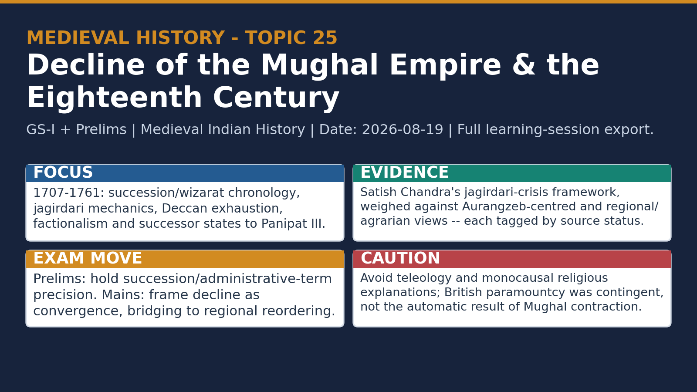

> Subject: Medieval Indian History | GS-I | Prelims.

> FACT statements below are source-grounded; ANALYSIS statements are qualified, and no single-cause or religious-only explanation is offered.

### Learning roadmap

1. Periodisation and scope  2. Source method and historiography  3. Post-1707 succession and the Sayyid wizarat  4. Decline-causation system map  5. Jagirdari mechanics  6. The jagirdari feedback loop  7. Deccan exhaustion  8. Noble factionalism  9. Zamindar and peasant resistance  10. Centre-region spectrum  11. Successor states compared  12. Bengal  13. Awadh  14. Hyderabad  15. Jats, Sikhs, Marathas  16. Maratha fiscal claims  17. Nadir Shah, 1739  18. Abdali's invasions, 1748-1767  19. Third Battle of Panipat  20. Central thesis: fragmentation vs continuity  21. Eighteenth-century economy  22. Cultural patronage  23. Non-inevitability of British rule  24. Two wrong framings to name and reject  25. PYQ route panel and the fact-risk ledger  26. Bounded live linkage.

### PRE-TEACH CHECKLIST

**Book context:** queried - Topic 25 basic/advanced notes (Satish Chandra's jagirdari-crisis framework and Part II conclusions), the Master Chronology, the repository's PYQ-integration audits for 2018-2023, 2024-2025 and 2026, and the Prelims/Mains routing ledgers were checked. Medieval Topics 16, 21, 22, 23 and 24 are cross-linked only where their owned content is needed; Modern History Topics 01, 02 and 05 are named only as the bounded forward hand-off, not re-taught here.

**CA Search:** "ASI Archaeological Survey of India Panipat war memorial Kala Amb Third Battle of Panipat 1761 conservation news 2026"

**CA Found:** No dated, officially sourced development record for any Panipat war memorial could be verified within this pass's allowed evidence, so no memorial-development claim is made. STATIC LINK retained for exam use: Kala Amb, Panipat, is the site traditionally and popularly associated with the Third Battle of Panipat; its formal protection status is not independently verified within this pass's allowed evidence and should not be cited as a settled official fact without further confirmation.

## BASIC LEARNING SESSION

### DEEP-REVIEW LEARNING CONTRACT

| Control | Binding rule for this package |
|---|---|
| Syllabus boundary | Complete Medieval History Core is taught before optional enrichment. |
| Evidence method | Claim → named site/text/inscription/coin/example → analysis → qualification. |
| Source hierarchy | Archaeology, textual testimony, inscriptions, coins and scholarly interpretation remain visibly distinct. |
| Contested issues | Competing interpretations are attributed, evidenced and bounded; certainty is not manufactured. |
| Practice contract | Every solved item has demand decoding, an examiner-grade model, an executable answer/compression plan, marks rationale and answer-specific improvement. |

### EVIDENCE, PYQ AND CURRENT-STATUS CONTROL

- **Archaeological inference:** material context supports bounded reconstruction; absence is not automatic proof of non-existence.
- **Textual testimony:** genre, authorship, redaction, patronage and temporal distance control what a text can prove.
- **Inscription and coin evidence:** contemporary names, titles, claims and circulation are powerful but do not by themselves map uniform territorial control.
- **Scholarly interpretation:** historian labels are arguments to test, not facts to memorise without evidence.
- **PYQ discipline:** repository ledgers and locally held official papers control wording and metadata; reconstructed wording and unavailable official keys must be labelled.
- **Current-status note, rechecked 2026-09-04:** Official conservation materials were rechecked on 30 August 2026 and provide only a bounded modern bridge to preserving monuments and archives. No genuinely topic-specific recent official event was found for Mughal successor states or the 1707-1761 transition. Heritage policy is not evidence for eighteenth-century causal claims; those remain controlled by canonical Markdown, OCR books and source criticism.

**Live/primary context sources checked for this package:**

- `https://culture.gov.in/our-organisations/archaeological-survey-india-new-delhi`
- `https://static.pib.gov.in/WriteReadData/specificdocs/documents/2026/apr/doc2026418850901.pdf`


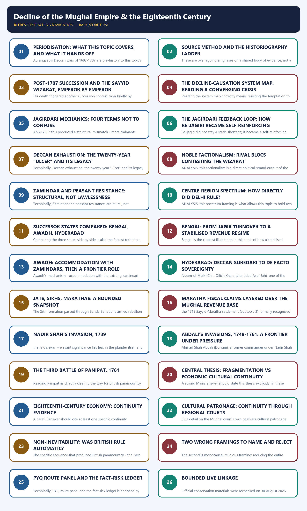

*At-a-glance teaching map for this topic's 26 sessions. The graphical flowchart package is intentionally omitted from this export; this embedded image is the only navigation visual.*

### PART I - EVIDENCE, PERIODISATION AND METHOD

### SESSION 1 — PERIODISATION: WHAT THIS TOPIC COVERS, AND WHAT IT HANDS OFF

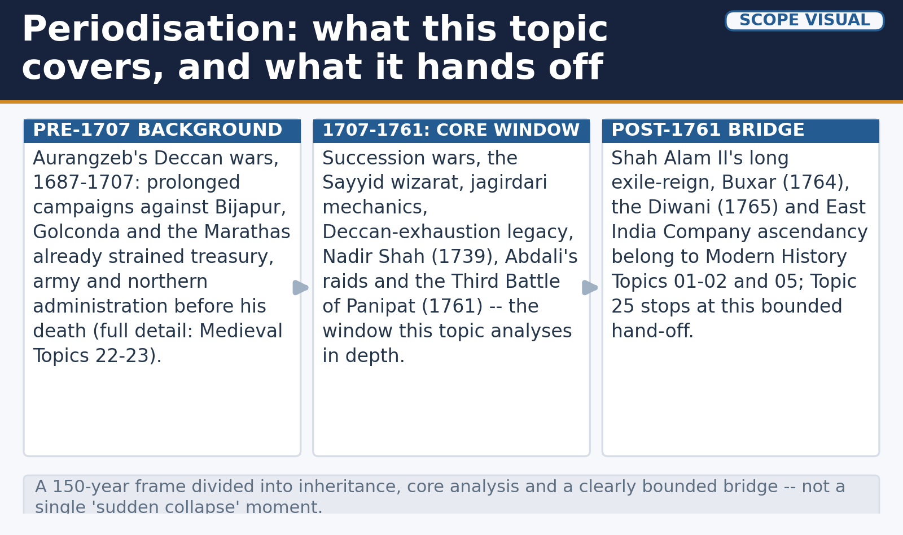

*Visual 1: periodisation -- what this topic covers, and what it hands off. Schematic maps are NOT TO SCALE where marked.*

#### DEFINITION / WHAT THIS IS CALLED

**Plain-language definition:** A precise date frame is the first discipline this topic requires.

**Technical definition:** Aurangzeb's Deccan wars of 1687-1707 are pre-history to this topic's core problem, not its content: they are analysed in depth under Medieval Topics 22 and 23, and are used here only as the inherited strain that the post-1707 empire had to carry.

#### ANSWER-GRABBING OPENING — WRITE/ADAPT IN THE EXAM

> A precise date frame is the first discipline this topic requires.

#### MUST-WRITE KEYWORDS

- **Periodisation**
- **what this topic covers**
- **what it hands off**
- **A precise date frame**
- **1687-1707**
- **1707-1761**

**How to use them:** Open with the 1707-1761 window, name what precedes it (1687-1707) and what follows it (post-1761), and use that periodisation to frame the whole answer.

A precise date frame is the first discipline this topic requires. Aurangzeb's Deccan wars of 1687-1707 are pre-history to this topic's core problem, not its content: they are analysed in depth under Medieval Topics 22 and 23, and are used here only as the inherited strain that the post-1707 empire had to carry. The core window this topic owns is 1707-1761: the succession wars, the Sayyid wizarat, the maturing jagirdari crisis, the rise of Bengal, Awadh and Hyderabad as autonomous successor states, the consolidation of Jats, Sikhs and Marathas as regional powers, Nadir Shah's 1739 raid, Ahmad Shah Abdali's repeated invasions, and the Third Battle of Panipat in 1761. Everything after 1761 - Shah Alam II's long and difficult reign, Buxar in 1764, the Diwani of Bengal in 1765 and the East India Company's rise to paramount power - belongs to Modern History Topics 01, 02 and 05, and is named here only as a clearly bounded bridge.

FACT: the empire did not legally or administratively end in 1707 or even in 1761; a recognised Mughal emperor continued to sit, however weakly, at Delhi until 1857. ANALYSIS: this makes "decline" a slow, uneven, and partly reversible process of political and fiscal devolution rather than a single dramatic collapse, so a good answer must periodise carefully rather than compress 150 years into one moment.

A second discipline follows from the first: this topic must not silently re-teach what neighbouring packages already own in depth. Topic 23 owns the detailed institutional history of Shivaji's state, the Ashtapradhan, chauth's origin and the jagirdari crisis's roots under Aurangzeb; Topic 24 owns the full account of Mughal economy, society and cultural patronage under the empire's peak. Topic 25 draws on both only as much as its own eighteenth-century argument requires, and hands its own conclusion forward to Modern History rather than absorbing that later material.

#### DEMONSTRATION

**Claim:** Mughal “decline” names a slow, multi-generational process, not one collapse event. **Evidence:** a recognised Mughal emperor continued to sit, however weakly, at Delhi until 1857, long after both 1707 and 1761. **Analysis:** this longevity of the formal office, alongside the real loss of power documented across this topic, shows that political and fiscal devolution can proceed for generations while the throne itself survives. **Qualification:** a precise answer must therefore periodise carefully around 1707, 1720 and 1761 rather than compress a century and a half into a single dramatic moment.

#### CLOSING RECALL FLOW — PERIODISATION: WHAT THIS TOPIC COVERS, AND WHAT IT HANDS OFF

```text
START / CONCEPT: Periodisation: what this topic covers, and what it hands off
        |
        v
EXACT TERMS: Periodisation · what this topic covers · what it hands off · A precise date frame · 1687-1707 · 1707-1761
        |
        v
MECHANISM / ARGUMENT: A second discipline follows from the first: this topic must not silently re-teach what neighbouring packages already own in depth.
        |
        v
CONSEQUENCE / CONTRAST: Aurangzeb's Deccan wars of 1687-1707 are pre-history to this topic's core problem, not its content: they are analysed in depth under Medieval Topics 22 and 23, and are used here only as the inherited strain that the post-1707 empire had to carry.
        |
        v
UPSC TRAP / ANSWER-USE: Topic 25 draws on both only as much as its own eighteenth-century argument requires, and hands its own conclusion forward to Modern History rather than absorbing that later material.
        |
        v
ANSWER-GRABBING FORMULATION: A precise date frame is the first discipline this topic requires.
```
### SESSION 2 — SOURCE METHOD AND THE HISTORIOGRAPHY LADDER

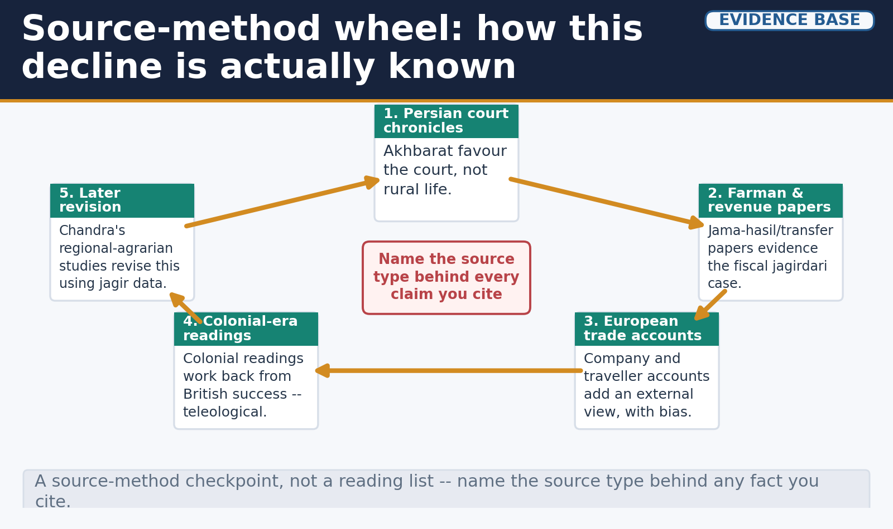

*Visual 2: source-method wheel -- how this decline is actually known. Schematic maps are NOT TO SCALE where marked.*

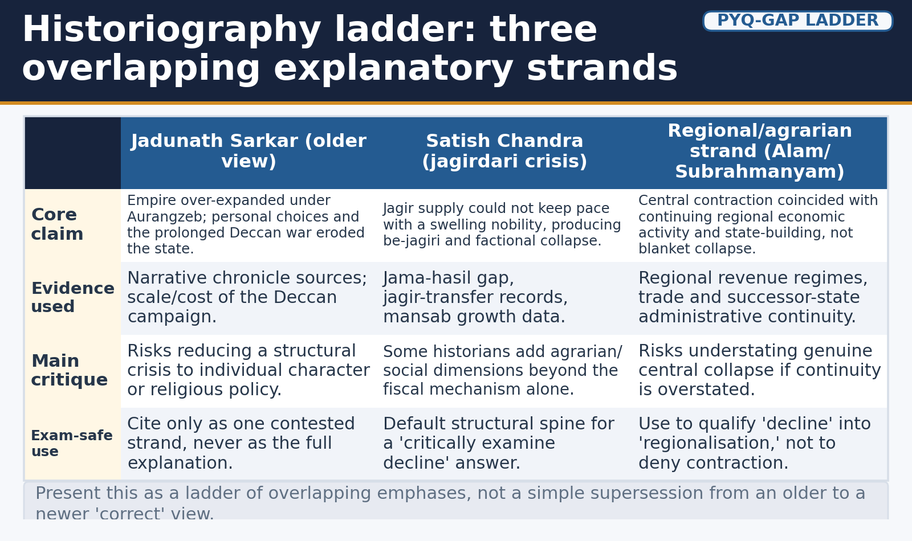

*Visual 3: historiography ladder -- three overlapping explanatory strands. Schematic maps are NOT TO SCALE where marked.*

#### DEFINITION / WHAT THIS IS CALLED

**Plain-language definition:** A historiography ladder is only useful if it is handled as a set of qualified strands.

**Technical definition:** These are overlapping emphases on a shared body of evidence, not a simple ladder in which each later view cancels the one before it, and this topic states each strand's evidential basis rather than picking a single winner.

#### ANSWER-GRABBING OPENING — WRITE/ADAPT IN THE EXAM

> A historiography ladder is only useful if it is handled as a set of qualified strands.

#### MUST-WRITE KEYWORDS

- **Source method**
- **the historiography ladder**
- **Jadunath Sarkar's strand**
- **Alam and Subrahmanyam**
- **Farman**
- **Colonial-era**

**How to use them:** Name Satish Chandra's jagirdari-crisis framework as the spine, then place Jadunath Sarkar's earlier reading and Alam/Subrahmanyam's regional-continuity caution alongside it rather than treating any one as final.

This topic's evidence base is layered and each layer has a characteristic bias. Persian court chronicles (akhbarat and court histories) describe events from the vantage of Delhi and favour the court's own framing; they say little about rural life or regional administration in its own terms. Farman and revenue papers - assessment orders, jagir-transfer records - are the technical evidence for the jagirdari mechanism itself, showing the gap between assessed and collected revenue. European trading-company records add an external, commercially interested vantage on Bengal, Surat and the Deccan, useful for corroboration but not a neutral source. Colonial-era historical writing frequently read the eighteenth century backward from British success, producing a teleological "decline-to-conquest" story that this topic must avoid.

FACT: Satish Chandra's jagirdari-crisis framework is built substantially from jama-hasil and jagir-transfer evidence, and is the source book's own central explanatory thread for this topic. ANALYSIS: it should be placed alongside, not simply above, an older Aurangzeb-centred reading associated with Jadunath Sarkar, and alongside more recent regional and agrarian-focused historians (named in the source material as Alam and Subrahmanyam) who stress continuing regional economic vitality and caution against reading the eighteenth century only as imperial breakdown. These are overlapping emphases on a shared body of evidence, not a simple ladder in which each later view cancels the one before it, and this topic states each strand's evidential basis rather than picking a single winner.

A historiography ladder is only useful if it is handled as a set of qualified strands. Jadunath Sarkar's early-twentieth-century account emphasised Aurangzeb's personal responsibility and religious policy; it is now read as one input into a wider debate rather than a settled verdict. Satish Chandra's administrative-fiscal account explains mechanism without needing a moral verdict on any one ruler. Regional/agrarian-focused historians add that provincial economies, trade and cultural patronage often continued or reorganised rather than uniformly collapsing. A defensible answer names the strand it is using and states its evidentiary basis, rather than blending all three into one undifferentiated narrative.

#### DEMONSTRATION

**Claim:** this topic's explanatory backbone is Satish Chandra's jagirdari-crisis framework, read alongside rather than above other historiography. **Evidence:** the source book builds its argument substantially from jama-hasil and jagir-transfer evidence, while Jadunath Sarkar's older Aurangzeb-centred reading and the regional/agrarian caution associated with Alam and Subrahmanyam are named as parallel lenses. **Analysis:** treating these as overlapping emphases rather than a single ranked hierarchy allows the fiscal, political and regional-continuity evidence to be held together. **Qualification:** an answer should name which framework is being used for which specific claim, rather than citing “historians” generically.

#### CLOSING RECALL FLOW — SOURCE METHOD AND THE HISTORIOGRAPHY LADDER

```text
START / CONCEPT: Source method and the historiography ladder
        |
        v
EXACT TERMS: Source method · the historiography ladder · Jadunath Sarkar's strand · Alam and Subrahmanyam · Farman · Colonial-era
        |
        v
MECHANISM / ARGUMENT: Farman and revenue papers - assessment orders, jagir-transfer records - are the technical evidence for the jagirdari mechanism itself, showing the gap between assessed and collected revenue.
        |
        v
CONSEQUENCE / CONTRAST: These are overlapping emphases on a shared body of evidence, not a simple ladder in which each later view cancels the one before it, and this topic states each strand's evidential basis rather than picking a single winner.
        |
        v
UPSC TRAP / ANSWER-USE: ANALYSIS: it should be placed alongside, not simply above, an older Aurangzeb-centred reading associated with Jadunath Sarkar, and alongside more recent regional and agrarian-focused historians (named in the source material as Alam and Subrahmanyam) who stress continuing regional economic vitality and caution against reading the eighteenth century only as imperial breakdown.
        |
        v
ANSWER-GRABBING FORMULATION: A historiography ladder is only useful if it is handled as a set of qualified strands.
```
### PART II - SUCCESSION, WIZARAT AND THE CAUSATION MAP

### SESSION 3 — POST-1707 SUCCESSION AND THE SAYYID WIZARAT, EMPEROR BY EMPEROR

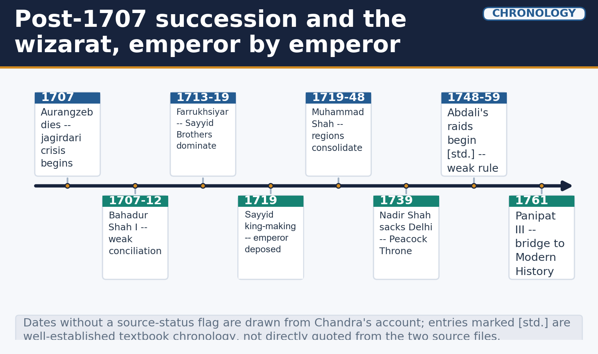

*Visual 4: post-1707 succession and the wizarat, emperor by emperor. Schematic maps are NOT TO SCALE where marked.*

#### DEFINITION / WHAT THIS IS CALLED

**Plain-language definition:** Post-1707 succession moved through five short reigns before a noble-controlled wizarat took over the throne.

**Technical definition:** Bahadur Shah I (1707-12) and Jahandar Shah (1712-13) gave way to Farrukhsiyar (1713-19), whose accession and eventual deposition were both controlled by the Sayyid Brothers; the Sayyids then briefly enthroned two further emperors before installing Muhammad Shah in 1719 and losing power themselves in 1720.

#### ANSWER-GRABBING OPENING — WRITE/ADAPT IN THE EXAM

> When Farrukhsiyar later tried to free himself from their control, the Sayyid Brothers deposed and killed him in 1719 - the clearest possible evidence that the throne itself had become a prize contested by noble coalitions, not merely a hereditary office weakly filled.

#### MUST-WRITE KEYWORDS

- **Post-1707 succession**
- **the Sayyid wizarat**
- **emperor by emperor**
- **1707-1712**
- **1712-13**
- **1748-54**

**How to use them:** Trace the throne emperor by emperor - Bahadur Shah I, Jahandar Shah, Farrukhsiyar, the Sayyid wizarat - and use the exact years to show how kingmaking, not weak character, drove succession.

Aurangzeb's death in 1707 opened a war of succession among his sons; Bahadur Shah I (Muazzam) prevailed and ruled 1707-1712 with a broadly conciliatory policy toward Rajput rulers, Shahu's Marathas and, less successfully, the Sikhs under Banda Bahadur's rebellion. His death triggered another succession contest, won briefly by Jahandar Shah (1712-13), whose reign was dominated by his noble patron Zulfiqar Khan; Jahandar Shah was overthrown and killed by Farrukhsiyar in 1713.

FACT: Farrukhsiyar's own accession depended on the military support of two brothers, Sayyid Abdullah Khan and Sayyid Hussain Ali Khan Barha, who were rewarded with the empire's highest offices and effectively controlled the wizarat from 1713. When Farrukhsiyar later tried to free himself from their control, the Sayyid Brothers deposed and killed him in 1719 - the clearest possible evidence that the throne itself had become a prize contested by noble coalitions, not merely a hereditary office weakly filled. The Sayyid period was not uniformly destructive: it abolished jizyah in 1713 and negotiated an important settlement with Shahu's Marathas over chauth and sardeshmukhi in the Deccan in exchange for military assistance, a bargain that itself shows how far central authority had already come to share power with a regional claimant.

After briefly installing and losing two further emperors in 1719 (Rafi-ud-Darajat and Rafi-ud-Daulah, each dying within months), the Sayyid Brothers themselves enthroned Muhammad Shah later in 1719, still fully under their tutelage; it was only in 1720 that a wider noble coalition - including Nizam-ul-Mulk (Chin Qilich Khan) - defeated and killed the Sayyid Brothers, ending their wizarat while Muhammad Shah, already emperor since 1719, continued to reign until 1748 under a new set of power-holders. Muhammad Shah's long reign saw continuing factional competition, the Nizam's effective withdrawal to found Hyderabad, and Nadir Shah's catastrophic 1739 raid. Later emperors - Ahmad Shah Bahadur (1748-54), Alamgir II (1754-59), the briefly and externally installed Shah Jahan III (1759-60, enthroned by Imad-ul-Mulk with Maratha backing after Alamgir II's assassination, then deposed) and finally Shah Alam II from 1760 - presided over an empire whose real power had passed substantially to regional and successor authorities well before the string of names runs out; Shah Alam II's own reign extends far beyond this topic's 1761 boundary and its later phases (including Buxar and the Diwani) belong to Modern History.

#### DEMONSTRATION

**Claim:** post-1707 Mughal succession became a contest run by noble kingmakers rather than a smooth hereditary line. **Evidence:** the Sayyid Brothers, Abdullah Khan and Hussain Ali Khan Barha, controlled the wizarat from 1713, enthroned and deposed several emperors, and installed Muhammad Shah in 1719 before a wider noble coalition defeated them in 1720. **Analysis:** this sequence is the clearest evidence that the throne itself had become a prize contested by noble coalitions, not merely a hereditary office weakly filled. **Qualification:** Muhammad Shah's own installation in 1719 must not be conflated with the Sayyids' separate 1720 downfall - he continued reigning under new power-holders until 1748.

#### CLOSING RECALL FLOW — POST-1707 SUCCESSION AND THE SAYYID WIZARAT, EMPEROR BY EMPEROR

```text
START / CONCEPT: Post-1707 succession and the Sayyid wizarat, emperor by emperor
        |
        v
EXACT TERMS: Post-1707 succession · the Sayyid wizarat · emperor by emperor · 1707-1712 · 1712-13 · 1748-54
        |
        v
MECHANISM / ARGUMENT: His death triggered another succession contest, won briefly by Jahandar Shah (1712-13), whose reign was dominated by his noble patron Zulfiqar Khan; Jahandar Shah was overthrown and killed by Farrukhsiyar in 1713.
        |
        v
CONSEQUENCE / CONTRAST: The Sayyid period was not uniformly destructive: it abolished jizyah in 1713 and negotiated an important settlement with Shahu's Marathas over chauth and sardeshmukhi in the Deccan in exchange for military assistance, a bargain that itself shows how far central authority had already come to share power with a regional claimant.
        |
        v
UPSC TRAP / ANSWER-USE: Do not miss this limiting distinction: Farrukhsiyar's own accession depended on the military support of two brothers, Sayyid Abdullah Khan (Qutb-ul-Mulk) and Sayyid Hussain Ali Khan, whose wizarat rested on personal military leverage rather than any sanctioned constitutional office - a distinction an answer must state explicitly, since it is exactly this leverage, not formal law, that let the same brothers depose the emperor they had installed.
        |
        v
ANSWER-GRABBING FORMULATION: When Farrukhsiyar later tried to free himself from their control, the Sayyid Brothers deposed and killed him in 1719 - the clearest possible evidence that the throne itself had become a prize contested by noble coalitions, not merely a hereditary office weakly filled.
```
### SESSION 4 — THE DECLINE-CAUSATION SYSTEM MAP: READING A CONVERGING CRISIS

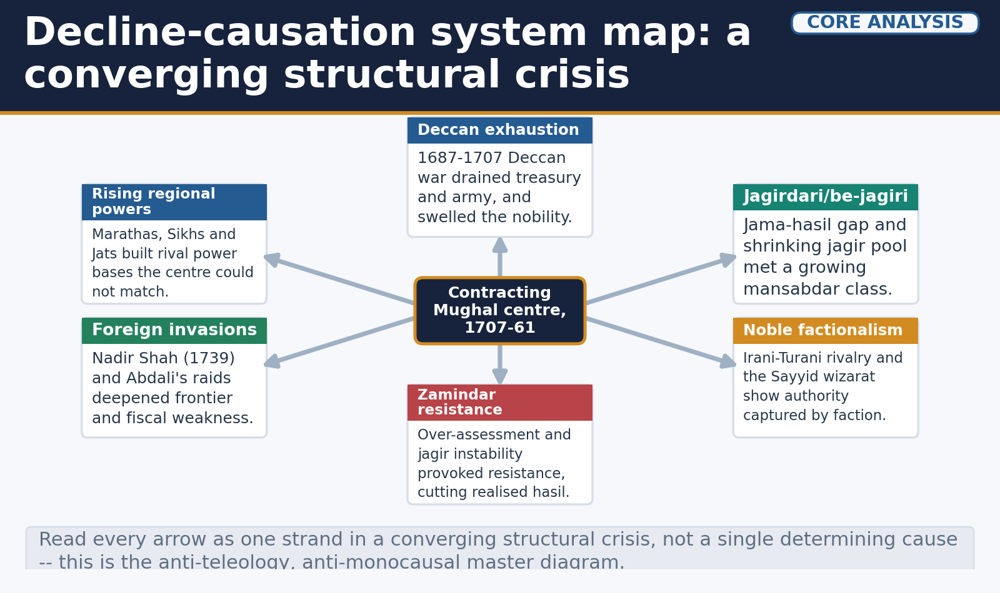

*Visual 5: decline-causation system map -- a converging structural crisis. Schematic maps are NOT TO SCALE where marked.*

#### DEFINITION / WHAT THIS IS CALLED

**Plain-language definition:** Each strand alone is an incomplete explanation; together they describe a self-reinforcing structural crisis.

**Technical definition:** Reading the system map correctly means resisting the temptation to draw a single arrow to "British conquest." The map's arrows loop back on each other - Deccan exhaustion feeds be-jagiri, be-jagiri feeds factional competition for scarce jagirs, factional competition weakens central administration, weak administration invites zamindar resistance and external raids, and each of these in turn deepens the fiscal problem - without any arrow running deterministically out of the system toward one external power.

#### ANSWER-GRABBING OPENING — WRITE/ADAPT IN THE EXAM

> A defensible account of Mughal decline treats it as a converging system, not a chain with one first domino.

#### MUST-WRITE KEYWORDS

- **The decline-causation system map**
- **reading a converging crisis**
- **Mughal**
- **Each strand alone**
- **khutba and sikka legitimacy**
- **Aurangzeb's**

**How to use them:** Draw the five converging strands as a system, not a chain, and use the symbols of khutba and sikka to explain how formal legitimacy persisted while real power did not.

A defensible account of Mughal decline treats it as a converging system, not a chain with one first domino. Five strands feed one another: a fiscal-administrative strand (jama-hasil mismatch and be-jagiri); a political strand (noble factionalism and the contest for the wizarat); a military-financial strand (Deccan war exhaustion); a social strand (zamindar and peasant resistance to extraction); and an external strand (Nadir Shah, Abdali, and the rise of Maratha, Jat and Sikh power). Each strand alone is an incomplete explanation; together they describe a self-reinforcing structural crisis.

FACT: the source book explicitly frames decline as a convergence rather than a single cause, and explicitly rejects reducing it to Aurangzeb's personal religious policy. ANALYSIS: a converging-system frame also helps explain why the empire's nominal survival to 1857 is not a contradiction - a converging crisis can hollow out real power while leaving formal structures (the emperor's khutba and sikka, the idea of Mughal legitimacy) standing for generations, which is precisely what the successor-state pattern in Parts IV-VI exploits.

Reading the system map correctly means resisting the temptation to draw a single arrow to "British conquest." The map's arrows loop back on each other - Deccan exhaustion feeds be-jagiri, be-jagiri feeds factional competition for scarce jagirs, factional competition weakens central administration, weak administration invites zamindar resistance and external raids, and each of these in turn deepens the fiscal problem - without any arrow running deterministically out of the system toward one external power. That forward arrow, when it eventually appears in history, belongs to Modern History's own contingent argument, examined later in Part IX.

#### DEMONSTRATION

**Claim:** Mughal decline is best read as a converging system of causes, not a single trigger. **Evidence:** the Deccan wars (1682-1707) drained the treasury before this topic's own window even opens, the jama-hasil mismatch drove be-jagiri (Sessions 5-6), Sayyid-era noble factionalism over the wizarat (1713-1720) weakened central administration, and Nadir Shah's 1739 Karnal raid and Ahmad Shah Abdali's 1748-1767 invasions delivered the external shocks - each strand reinforcing the others rather than any one alone explaining the outcome. **Analysis:** a converging-system frame also explains why the empire's nominal survival to 1857 is not a contradiction, since a converging crisis can hollow out real power while leaving formal structures standing. **Qualification:** naming a convergence is not sufficient by itself - an answer must specify which named strands (fiscal, political, regional, external) are converging in any given period.

#### CLOSING RECALL FLOW — THE DECLINE-CAUSATION SYSTEM MAP: READING A CONVERGING CRISIS

```text
START / CONCEPT: The decline-causation system map: reading a converging crisis
        |
        v
EXACT TERMS: The decline-causation system map · reading a converging crisis · Mughal · Each strand alone · khutba and sikka legitimacy · Aurangzeb's
        |
        v
MECHANISM / ARGUMENT: the source book explicitly frames decline as a convergence rather than a single cause, and explicitly rejects reducing it to Aurangzeb's personal religious policy.
        |
        v
CONSEQUENCE / CONTRAST: ANALYSIS: a converging-system frame also helps explain why the empire's nominal survival to 1857 is not a contradiction - a converging crisis can hollow out real power while leaving formal structures (the emperor's khutba and sikka, the idea of Mughal legitimacy) standing for generations, which is precisely what the successor-state pattern in Parts IV-VI exploits.
        |
        v
UPSC TRAP / ANSWER-USE: Do not miss this limiting distinction: each strand alone is an incomplete explanation.
        |
        v
ANSWER-GRABBING FORMULATION: A defensible account of Mughal decline treats it as a converging system, not a chain with one first domino.
```
### PART III - THE JAGIRDARI CRISIS

### SESSION 5 — JAGIRDARI MECHANICS: FOUR TERMS NOT TO CONFUSE

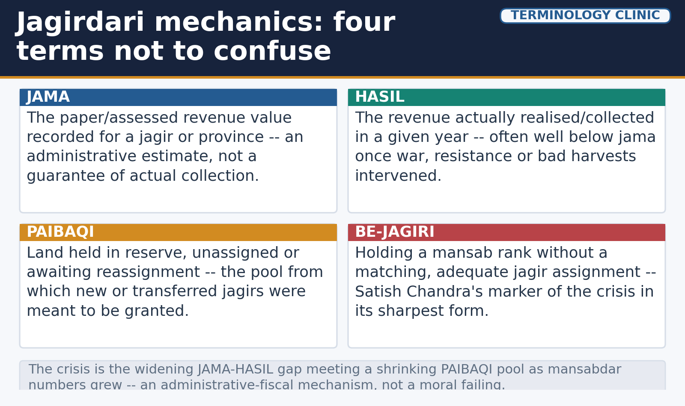

*Visual 6: jagirdari mechanics -- four terms not to confuse. Schematic maps are NOT TO SCALE where marked.*

#### DEFINITION / WHAT THIS IS CALLED

**Plain-language definition:** The jagirdari crisis is a technical fiscal-administrative argument, and its four working terms are frequently confused in weak answers.

**Technical definition:** Jama is the assessed paper revenue; hasil is the amount actually collected; paibaqi is the reserve of unassigned crown land available for new jagir grants; be-jagiri is the condition of holding no adequate jagir. The crisis is the mismatch between a growing number of mansabdars and a paibaqi pool that could not expand to match them.

#### ANSWER-GRABBING OPENING — WRITE/ADAPT IN THE EXAM

> The jagirdari crisis is a technical fiscal-administrative argument, and its four working terms are frequently confused in weak answers.

#### MUST-WRITE KEYWORDS

- **Jagirdari mechanics**
- **four terms not to confuse**
- **The jagirdari crisis**
- **Jama**
- **Hasil**
- **Paibaqi**

**How to use them:** Define jama, hasil, paibaqi and be-jagiri in that order before using any of them, since a precise answer depends on keeping the four terms distinct.

The jagirdari crisis is a technical fiscal-administrative argument, and its four working terms are frequently confused in weak answers. Jama is the assessed or paper revenue of a territorial unit, fixed by administrative reckoning. Hasil is the revenue actually collected in a given year, which could fall well short of the jama because of poor harvests, local resistance, or an assignee's weak control. Paibaqi is crown land held in reserve, not currently assigned to any mansabdar as jagir, functioning as the pool from which new or transferred assignments were meant to be made. Be-jagiri is the condition of a mansabdar being without a suitable jagir, or holding one whose hasil could not support his sanctioned rank - the symptom that gives the whole crisis its name.

FACT: after the prolonged Deccan campaigns, large numbers of Deccani and Maratha nobles were absorbed into the Mughal mansabdari system, sharply increasing the number of nobles entitled to a jagir without a matching increase in productive, readily assignable land. ANALYSIS: this produced a structural mismatch - more claimants chasing a paibaqi pool that was itself shrinking in real yield because of war-damaged Deccan lands - and it is this mismatch, not any single ruler's decision, that Satish Chandra's framework identifies as the fiscal engine of decline; a precise answer defines all four terms before using any of them.

Because jama was a paper figure and hasil the lived reality, the jama-hasil gap is the single number a careful answer should reach for first when asked to explain the crisis mechanically - this gap is a distinct measure from paibaqi, which is the separate stock of unassigned reserve land, not a shortfall figure - rather than reaching straight for noble intrigue or foreign invasion.

#### DEMONSTRATION

**Claim:** jagirdari-crisis reasoning depends on keeping four related fiscal terms strictly distinct. **Evidence:** after the Deccan wars, large numbers of Deccani and Maratha nobles were absorbed into the mansabdari system, sharply increasing the number of nobles entitled to a jagir without a matching increase in productive, readily assignable paibaqi land. **Analysis:** this structural mismatch between claimants and available, revenue-adequate assignable land, not any single ruler's decision, is what Chandra's framework identifies as the fiscal engine of decline. **Qualification:** paibaqi - land or revenue available or awaiting assignment - is a distinct concept from a raw jama-hasil (assessed-versus-realised) revenue shortfall, and the two must not be used interchangeably.

#### CLOSING RECALL FLOW — JAGIRDARI MECHANICS: FOUR TERMS NOT TO CONFUSE

```text
START / CONCEPT: Jagirdari mechanics: four terms not to confuse
        |
        v
EXACT TERMS: Jagirdari mechanics · four terms not to confuse · The jagirdari crisis · Jama · Hasil · Paibaqi
        |
        v
MECHANISM / ARGUMENT: ANALYSIS: this produced a structural mismatch - more claimants chasing a paibaqi pool that was itself shrinking in real yield because of war-damaged Deccan lands - and it is this mismatch, not any single ruler's decision, that Satish Chandra's framework identifies as the fiscal engine of decline; a precise answer defines all four terms before using any of them.
        |
        v
CONSEQUENCE / CONTRAST: Paibaqi is crown land held in reserve, not currently assigned to any mansabdar as jagir, functioning as the pool from which new or transferred assignments were meant to be made.
        |
        v
UPSC TRAP / ANSWER-USE: Be-jagiri is the condition of a mansabdar being without a suitable jagir, or holding one whose hasil could not support his sanctioned rank - the symptom that gives the whole crisis its name.
        |
        v
ANSWER-GRABBING FORMULATION: The jagirdari crisis is a technical fiscal-administrative argument, and its four working terms are frequently confused in weak answers.
```
### SESSION 6 — THE JAGIRDARI FEEDBACK LOOP: HOW BE-JAGIRI BECAME SELF-REINFORCING

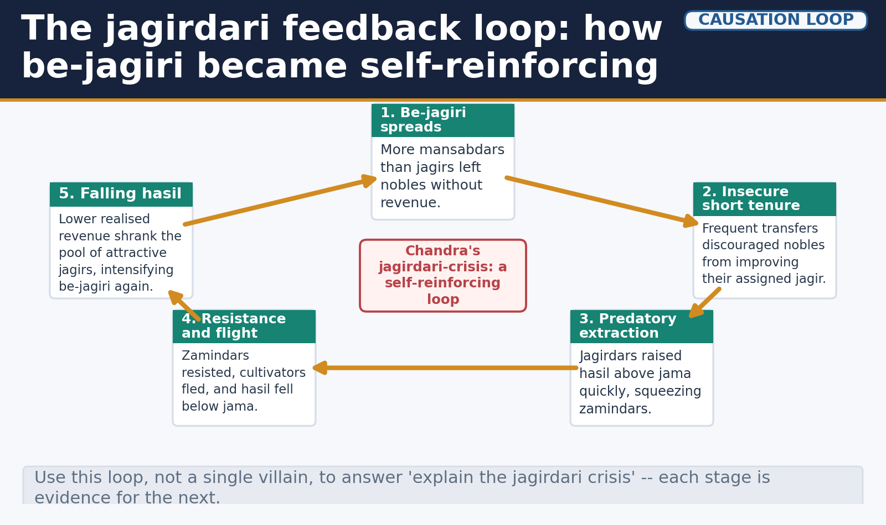

*Visual 7: the jagirdari feedback loop -- how be-jagiri became self-reinforcing. Schematic maps are NOT TO SCALE where marked.*

#### DEFINITION / WHAT THIS IS CALLED

**Plain-language definition:** A feedback loop, not a one-way chain, is the correct model for how be-jagiri perpetuated itself.

**Technical definition:** Short-tenure jagir-holders over-extracted hasil to compensate for insecurity, which discouraged investment and provoked local resistance, which in turn lowered future hasil and intensified competition for the few secure jagirs that remained - each stage reproducing the shortage that caused it.

#### ANSWER-GRABBING OPENING — WRITE/ADAPT IN THE EXAM

> Be-jagiri did not stay a static shortage; it became a self-reinforcing loop.

#### MUST-WRITE KEYWORDS

- **The jagirdari feedback loop**
- **how be-jagiri became self-reinforcing**
- **Be-jagiri**
- **short-tenure extraction**
- **Over-extraction**
- **self-reinforcing loop**

**How to use them:** Walk the loop stage by stage - short-tenure extraction, under-investment, resistance, renewed competition - to show why the crisis was self-reinforcing rather than a single event.

Be-jagiri did not stay a static shortage; it became a self-reinforcing loop. A mansabdar without a secure, revenue-adequate jagir had every incentive to extract as much hasil as possible from whatever assignment he did hold, as quickly as possible, since frequent transfers meant he had no guarantee of holding the same jagir for long. Short tenures discouraged any investment in the land's long-term productivity - there was no incentive to maintain irrigation works or protect cultivators from over-assessment if another noble might hold the jagir next year. Over-extraction provoked zamindar and peasant resistance (examined in subtopic 9), which further reduced actual hasil, which widened the jama-hasil gap, which intensified competition among nobles for the dwindling number of jagirs that still yielded close to their assessed value - reinforcing the very shortage that started the cycle.

FACT: the loop's four linked stages - short-tenure extraction, under-investment, local resistance, and intensified competition for scarce good jagirs - are the mechanism by which a fiscal-administrative problem translated into the political factionalism examined next. ANALYSIS: this is why the jagirdari crisis is better described as a feedback loop than a one-way chain of cause and effect: each stage feeds back into the shortage that produced it, which also explains why the crisis proved so difficult for any single vigorous ruler to reverse by decree alone.

A precise Mains answer on this theme should name the loop's stages in order and explicitly identify at least one feedback arrow (for example, resistance-to-extraction reducing hasil and thereby worsening be-jagiri), rather than listing the four terms from subtopic 5 as an inert glossary.

#### DEMONSTRATION

**Claim:** the jagirdari crisis operated as a self-reinforcing feedback loop rather than a one-way chain of cause and effect. **Evidence:** four linked stages - short-tenure extraction, under-investment, local resistance, and intensified competition for scarce good jagirs - repeatedly fed back into one another. **Analysis:** describing the crisis as a loop, not a chain, explains why it proved so difficult for any single vigorous ruler to reverse by decree alone. **Qualification:** the loop's persistence is a structural property of the system, and should not be attributed to the personal weakness of any one emperor.

#### CLOSING RECALL FLOW — THE JAGIRDARI FEEDBACK LOOP: HOW BE-JAGIRI BECAME SELF-REINFORCING

```text
START / CONCEPT: The jagirdari feedback loop: how be-jagiri became self-reinforcing
        |
        v
EXACT TERMS: The jagirdari feedback loop · how be-jagiri became self-reinforcing · Be-jagiri · short-tenure extraction · Over-extraction · self-reinforcing loop
        |
        v
MECHANISM / ARGUMENT: ANALYSIS: this is why the jagirdari crisis is better described as a feedback loop than a one-way chain of cause and effect: each stage feeds back into the shortage that produced it, which also explains why the crisis proved so difficult for any single vigorous ruler to reverse by decree alone.
        |
        v
CONSEQUENCE / CONTRAST: A precise Mains answer on this theme should name the loop's stages in order and explicitly identify at least one feedback arrow (for example, resistance-to-extraction reducing hasil and thereby worsening be-jagiri), rather than listing the four terms from subtopic 5 as an inert glossary.
        |
        v
UPSC TRAP / ANSWER-USE: Do not miss this limiting distinction: short tenures discouraged any investment in the land's long-term productivity - there was no incentive for a jagirdar likely to be transferred within two or three years to invest in wells, drainage or long-term soil improvement, so short-run revenue maximisation crowded out the very investment that could have raised sustainable hasil, tightening rather than easing the jama-hasil gap.
        |
        v
ANSWER-GRABBING FORMULATION: Be-jagiri did not stay a static shortage; it became a self-reinforcing loop.
```
### SESSION 7 — DECCAN EXHAUSTION: THE TWENTY-YEAR "ULCER" AND ITS LEGACY

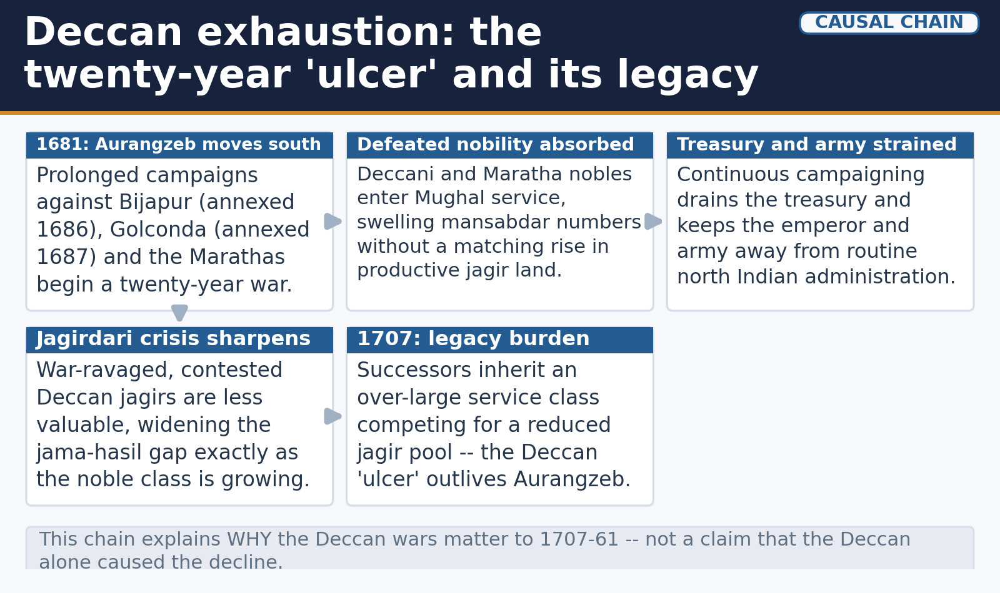

*Visual 8: Deccan exhaustion -- the twenty-year "ulcer" and its legacy. Schematic maps are NOT TO SCALE where marked.*

#### DEFINITION / WHAT THIS IS CALLED

**Plain-language definition:** The prolonged Mughal campaigning in the Deccan under Aurangzeb (detailed in depth under Topics 22 and 23) is treated here strictly as an inherited fiscal and administrative legacy, not as fresh content to re-teach.

**Technical definition:** Two decades of Deccan campaigning enlarged the pool of mansabdars entitled to a jagir, chiefly by absorbing Deccani and Maratha nobles, while reducing the pool of undamaged, revenue-yielding land available to assign them - feeding directly into the jagirdari mechanics of subtopics 5-6.

#### ANSWER-GRABBING OPENING — WRITE/ADAPT IN THE EXAM

> The prolonged Mughal campaigning in the Deccan under Aurangzeb (detailed in depth under Topics 22 and 23) is treated here strictly as an inherited fiscal and administrative legacy, not as fresh content to re-teach.

#### MUST-WRITE KEYWORDS

- **Deccan exhaustion**
- **the twenty-year "ulcer"**
- **its legacy**
- **Mughal**
- **Deccan**
- **Aurangzeb**

**How to use them:** Treat Deccan exhaustion as a contributing structural input feeding subtopics 5-6, not as Aurangzeb's personal failure or an irrelevant prelude.

The prolonged Mughal campaigning in the Deccan under Aurangzeb (detailed in depth under Topics 22 and 23) is treated here strictly as an inherited fiscal and administrative legacy, not as fresh content to re-teach. Two decades of continuous, large-scale campaigning against Bijapur, Golconda and the Marathas drained the treasury, damaged agrarian productivity across much of the Deccan, and swelled the mansabdari ranks with newly absorbed Deccani and Maratha nobles who all needed jagirs somewhere in an empire whose most productive northern lands were already assigned.

FACT: this Deccan legacy is one of the direct structural inputs into the jagirdari crisis described in subtopics 5-6 - it enlarged the pool of jagir claimants and reduced the pool of undamaged, readily assignable revenue-yielding land at the same time. ANALYSIS: describing this only as Aurangzeb's "failure" personalises a structural, decades-long fiscal exhaustion; equally, ignoring it and starting the decline story only in 1707 would erase a documented and quantifiable cause. The balanced position treats Deccan exhaustion as a serious contributing input feeding directly into subtopics 5 and 6's mechanism, not the single or sufficient explanation for everything that follows across the rest of this topic.

A bounded answer therefore states the Deccan campaigns' fiscal-administrative legacy in one or two sentences and moves directly to its structural consequence (be-jagiri and factionalism), rather than narrating Deccan military history that Topics 22-23 already own in depth.

#### DEMONSTRATION

**Claim:** Aurangzeb's prolonged Deccan campaigns left a lasting fiscal “ulcer” that fed directly into the jagirdari crisis. **Evidence:** the two-decade Deccan wars enlarged the pool of jagir claimants while reducing the pool of undamaged, readily assignable revenue-yielding land at the same time. **Analysis:** describing this only as Aurangzeb's personal “failure” personalises what was a structural, decades-long fiscal exhaustion feeding directly into subtopics 5-6's mechanism. **Qualification:** equally, ignoring the Deccan legacy and starting the decline story only in 1707 would erase a documented, quantifiable contributing cause - it is a serious input, not the sole or sufficient explanation.

#### CLOSING RECALL FLOW — DECCAN EXHAUSTION: THE TWENTY-YEAR "ULCER" AND ITS LEGACY

```text
START / CONCEPT: Deccan exhaustion: the twenty-year "ulcer" and its legacy
        |
        v
EXACT TERMS: Deccan exhaustion · the twenty-year "ulcer" · its legacy · Mughal · Deccan · Aurangzeb
        |
        v
MECHANISM / ARGUMENT: The balanced position treats Deccan exhaustion as a serious contributing input feeding directly into subtopics 5 and 6's mechanism, not the single or sufficient explanation for everything that follows across the rest of this topic.
        |
        v
CONSEQUENCE / CONTRAST: A bounded answer therefore states the Deccan campaigns' fiscal-administrative legacy in one or two sentences and moves directly to its structural consequence (be-jagiri and factionalism), rather than narrating Deccan military history that Topics 22-23 already own in depth.
        |
        v
UPSC TRAP / ANSWER-USE: Do not miss this limiting distinction: this Deccan legacy is one of the direct structural inputs into the jagirdari crisis examined in subtopics 5-6, not a standalone military narrative to be re-told for its own sake - an answer should cite it in one bounded sentence as the campaign debt that emptied the treasury and multiplied mansabdars competing for a shrinking jagir pool, then move straight to that fiscal consequence.
        |
        v
ANSWER-GRABBING FORMULATION: The prolonged Mughal campaigning in the Deccan under Aurangzeb (detailed in depth under Topics 22 and 23) is treated here strictly as an inherited fiscal and administrative legacy, not as fresh content to re-teach.
```
### PART IV - CENTRE, NOBLES AND THE LAND

### SESSION 8 — NOBLE FACTIONALISM: RIVAL BLOCS CONTESTING THE WIZARAT

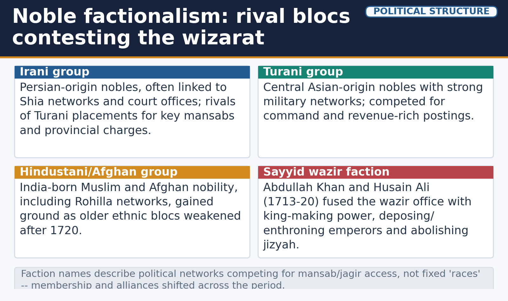

*Visual 9: noble factionalism -- rival blocs contesting the wizarat. Schematic maps are NOT TO SCALE where marked.*

#### DEFINITION / WHAT THIS IS CALLED

**Plain-language definition:** contested succession and the Sayyid wizarat (subtopic 3) are themselves evidence of factionalism operating at the very top of the system; the 1720 coalition that defeated the Sayyid Brothers - who had themselves enthroned Muhammad Shah in 1719 and continued to control him until then - was itself a rival faction ending Sayyid tutelage, not a restoration of undivided royal authority.

**Technical definition:** This factionalism is a direct political-strand output of the fiscal crisis in Part III: as fewer well-endowed jagirs remained to reward loyal service, competition for the wazir's patronage - control over what allocations remained - intensified, turning routine court rivalry into a destabilising contest for the state's shrinking resources.

#### ANSWER-GRABBING OPENING — WRITE/ADAPT IN THE EXAM

> contested succession and the Sayyid wizarat (subtopic 3) are themselves evidence of factionalism operating at the very top of the system; the 1720 coalition that defeated the Sayyid Brothers - who had themselves enthroned Muhammad Shah in 1719 and continued to control him until then - was itself a rival faction ending Sayyid tutelage, not a restoration of undivided royal authority.

#### MUST-WRITE KEYWORDS

- **Noble factionalism**
- **rival blocs contesting the wizarat**
- **Turani**
- **Central Asian-descended**
- **Nizam-ul-Mulk**
- **Deccan**

**How to use them:** Connect noble factionalism directly to the jagirdari shortage in Part III, naming the Turani-Irani-Hindustani rivalry only as a label, not a fixed party system.

The post-1707 court was not simply "weak"; it was actively and continuously contested by identifiable noble blocs competing for the wazir's office and for control of imperial patronage. Turani nobles (Central Asian-descended, including Nizam-ul-Mulk before his Deccan withdrawal), Irani nobles (Persian-descended), Hindustani/Afghan groupings, and the Sayyid Brothers' own Barha-Sayyid faction each built rival coalitions inside the court, and the throne itself repeatedly changed hands as a consequence of these coalitions' shifting fortunes, most starkly in Farrukhsiyar's rise and fall at Sayyid hands in 1713 and 1719.

FACT: contested succession and the Sayyid wizarat (subtopic 3) are themselves evidence of factionalism operating at the very top of the system; the 1720 coalition that defeated the Sayyid Brothers - who had themselves enthroned Muhammad Shah in 1719 and continued to control him until then - was itself a rival faction ending Sayyid tutelage, not a restoration of undivided royal authority. ANALYSIS: this factionalism is a direct political-strand output of the fiscal crisis in Part III - as fewer good jagirs remained to reward loyal service, competition for the wazir's patronage power (who could allocate what remained) intensified, turning noble rivalry from routine court politics into a destabilising contest for the state's shrinking resources.

A careful answer treats noble factionalism as intermediate in the causal chain - a political symptom of the fiscal crisis and simultaneously a cause of administrative paralysis further down the line - rather than as an isolated moral failing of individual nobles.

#### DEMONSTRATION

**Claim:** factional rivalry among nobles was itself both evidence of, and a driver of, Mughal decline. **Evidence:** the contested succession and Sayyid wizarat of subtopic 3, and the rival coalition (including Nizam-ul-Mulk) that overthrew the Sayyid Brothers in 1720, show factionalism operating at the very top of the system. **Analysis:** this factionalism is a direct political-strand output of the fiscal crisis in Part III - as fewer good jagirs remained, competition for the wazir's patronage power intensified. **Qualification:** the 1720 coalition was itself a rival faction replacing another, not a restoration of undivided royal authority.

#### CLOSING RECALL FLOW — NOBLE FACTIONALISM: RIVAL BLOCS CONTESTING THE WIZARAT

```text
START / CONCEPT: Noble factionalism: rival blocs contesting the wizarat
        |
        v
EXACT TERMS: Noble factionalism · rival blocs contesting the wizarat · Turani · Central Asian-descended · Nizam-ul-Mulk · Deccan
        |
        v
MECHANISM / ARGUMENT: The post-1707 court was not simply "weak"; it was actively and continuously contested by identifiable noble blocs competing for the wazir's office and for control of imperial patronage.
        |
        v
CONSEQUENCE / CONTRAST: Turani nobles (Central Asian-descended, including Nizam-ul-Mulk before his Deccan withdrawal), Irani nobles (Persian-descended), Hindustani/Afghan groupings, and the Sayyid Brothers' own Barha-Sayyid faction each built rival coalitions inside the court, and the throne itself repeatedly changed hands as a consequence of these coalitions' shifting fortunes, most starkly in Farrukhsiyar's rise and fall at Sayyid hands in 1713 and 1719.
        |
        v
UPSC TRAP / ANSWER-USE: A careful answer treats noble factionalism as intermediate in the causal chain - a political symptom of the fiscal crisis and simultaneously a cause of administrative paralysis further down the line - rather than as an isolated moral failing of individual nobles.
        |
        v
ANSWER-GRABBING FORMULATION: contested succession and the Sayyid wizarat (subtopic 3) are themselves evidence of factionalism operating at the very top of the system; the 1720 coalition that defeated the Sayyid Brothers - who had themselves enthroned Muhammad Shah in 1719 and continued to control him until then - was itself a rival faction ending Sayyid tutelage, not a restoration of undivided royal authority.
```
### SESSION 9 — ZAMINDAR AND PEASANT RESISTANCE: STRUCTURAL, NOT LAWLESSNESS

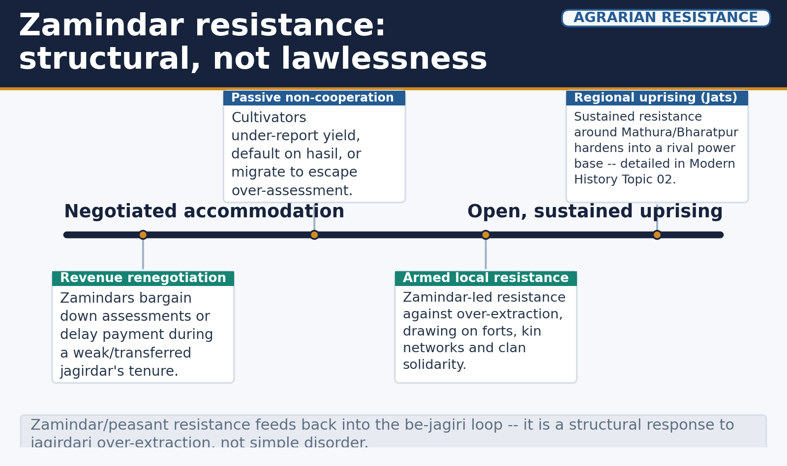

*Visual 10: zamindar resistance -- structural, not lawlessness. Schematic maps are NOT TO SCALE where marked.*

#### DEFINITION / WHAT THIS IS CALLED

**Plain-language definition:** Zamindar and peasant resistance to jagirdar extraction is frequently mischaracterised in weak answers as simple "lawlessness" or a symptom of general disorder.

**Technical definition:** This resistance ranged from passive arrears and non-compliance to fortified defiance and organised regional assertion of autonomy - a graded response to worsening extraction, not a lapse into disorder.

#### ANSWER-GRABBING OPENING — WRITE/ADAPT IN THE EXAM

> Zamindar and peasant resistance to jagirdar extraction is frequently mischaracterised in weak answers as simple "lawlessness" or a symptom of general disorder.

#### MUST-WRITE KEYWORDS

- **Zamindar**
- **peasant resistance**
- **structural**
- **graded response**
- **Zamindar and peasant resistance to jagirdar extraction**
- **fortified local defiance**

**How to use them:** Place zamindar and peasant resistance on its graded spectrum - arrears, fortification, regional assertion - and tie each stage back to the extraction pressure of subtopic 6.

Zamindar and peasant resistance to jagirdar extraction is frequently mischaracterised in weak answers as simple "lawlessness" or a symptom of general disorder. It is better read as a structural response to the extraction pressure created by the jagirdari feedback loop in subtopic 6: when a jagirdar facing short tenure pressed hasil demands above what a locality's zamindars and cultivators considered sustainable, resistance - non-payment, fortification, local militia action, and appeals to rival authorities - was a rational local defence, not a breakdown of order in the abstract.

FACT: this resistance spectrum ranges from passive non-compliance and revenue arrears at one end, through fortified local defiance, to organised regional assertion of autonomy at the other, and the same social forces - zamindars defending customary rights over the peasantry they governed - are visible behind both routine local friction and the more organised eighteenth-century state formation examined in Part VI (Jats, Sikhs and Marathas). ANALYSIS: reading zamindar resistance only as disorder erases its structural origin in the fiscal squeeze; reading it only as proto-nationalist rebellion overstates its coherence. The defensible middle position: it is a graded, locally variable response to a real and worsening extraction problem, whose most organised expressions eventually hardened into the regional polities this topic covers in Parts V-VI.

This resistance spectrum is also the missing link between the jagirdari crisis's fiscal mechanics (Part III) and the rise of durable regional powers (Parts V-VI): it explains why the crisis produced not simple anarchy but new, locally rooted political formations.

#### DEMONSTRATION

**Claim:** zamindar and peasant resistance to extraction was structural, not simple lawlessness. **Evidence:** resistance ranged along a spectrum from passive non-compliance and revenue arrears to fortified local defiance and organised regional assertion, rooted in zamindars defending customary rights over the peasantry they governed. **Analysis:** reading this resistance only as disorder erases its structural origin in the fiscal squeeze, while reading it only as proto-nationalist rebellion overstates its coherence. **Qualification:** the defensible middle position treats it as a graded, locally variable response whose most organised expressions eventually hardened into the regional polities examined later in this topic.

#### CLOSING RECALL FLOW — ZAMINDAR AND PEASANT RESISTANCE: STRUCTURAL, NOT LAWLESSNESS

```text
START / CONCEPT: Zamindar and peasant resistance: structural, not lawlessness
        |
        v
EXACT TERMS: Zamindar · peasant resistance · structural · graded response · Zamindar and peasant resistance to jagirdar extraction · fortified local defiance
        |
        v
MECHANISM / ARGUMENT: It is better read as a structural response to the extraction pressure created by the jagirdari feedback loop in subtopic 6: when a jagirdar facing short tenure pressed hasil demands above what a locality's zamindars and cultivators considered sustainable, resistance - non-payment, fortification, local militia action, and appeals to rival authorities - was a rational local defence, not a breakdown of order in the abstract.
        |
        v
CONSEQUENCE / CONTRAST: This resistance spectrum is also the missing link between the jagirdari crisis's fiscal mechanics (Part III) and the rise of durable regional powers (Parts V-VI): it explains why the crisis produced not simple anarchy but new, locally rooted political formations.
        |
        v
UPSC TRAP / ANSWER-USE: Do not miss this limiting distinction: this resistance spectrum ranges from passive non-compliance and revenue arrears at one end, through fortified local defiance and armed militia action, to outright refusal of jagirdar authority and appeals to a rival claimant at the other - a precise answer must place any named episode somewhere on this graded spectrum rather than flattening all resistance into one undifferentiated category of "rebellion."
        |
        v
ANSWER-GRABBING FORMULATION: Zamindar and peasant resistance to jagirdar extraction is frequently mischaracterised in weak answers as simple "lawlessness" or a symptom of general disorder.
```
### SESSION 10 — CENTRE-REGION SPECTRUM: HOW DIRECTLY DID DELHI RULE?

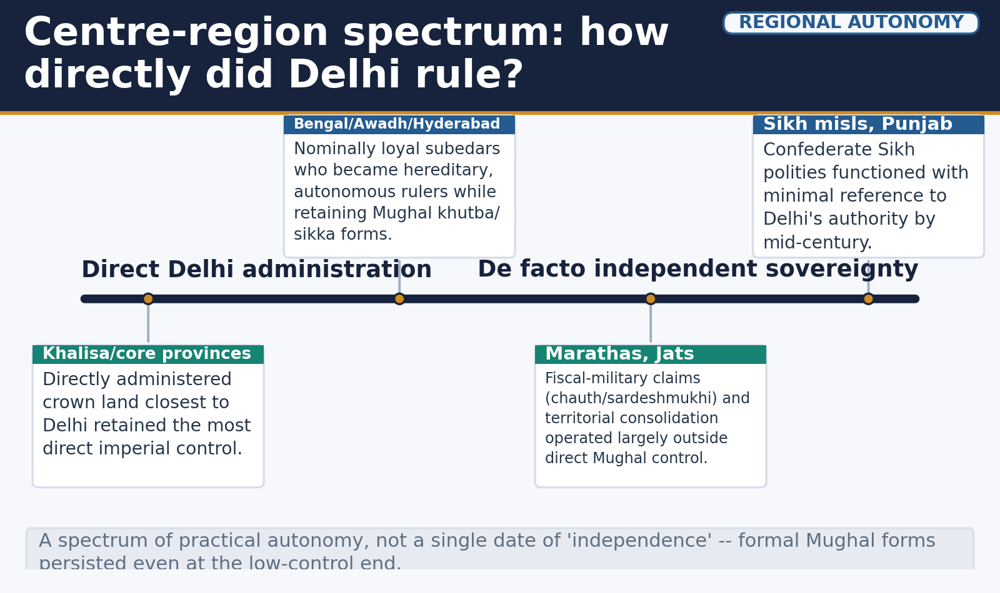

*Visual 11: centre-region spectrum -- how directly did Delhi rule? schematic maps are NOT TO SCALE where marked.*

#### DEFINITION / WHAT THIS IS CALLED

**Plain-language definition:** Mughal authority after 1707 did not switch off uniformly; it thinned out along a spectrum running from closely supervised provinces to regions where it survived only as a legitimating formality.

**Technical definition:** At the spectrum's near end, governors were closely rotated and supervised; in the middle, a subedar built a durable local base while still routing revenue and seeking confirmation of title; at the far end, only the emperor's name in the khutba and on the sikka (coinage) remained, while administration, revenue and command were locally determined.

#### ANSWER-GRABBING OPENING — WRITE/ADAPT IN THE EXAM

> It is better understood as a spectrum: at one end, provinces under close central control with regularly rotated, closely supervised governors; in the middle, provinces where a governor (subedar) built a durable local base while still routing revenue, seeking confirmation of title, and maintaining ceremonial deference to Delhi; and at the far end, regions where Mughal authority survived mainly as a legitimating formality - the emperor's name in the khutba and on the coinage (sikka) - while real administration, revenue and military command were locally determined.

#### MUST-WRITE KEYWORDS

- **Centre-region spectrum**
- **subedar's durable local base**
- **Delhi**
- **Mughal**
- **khutba and sikka**
- **nominal legitimacy versus real power**

**How to use them:** Use the centre-region spectrum to hold two facts together: continuing nominal Mughal legitimacy and substantially devolved real power.

A single "centre versus periphery" binary understates how the eighteenth-century Mughal polity actually worked. It is better understood as a spectrum: at one end, provinces under close central control with regularly rotated, closely supervised governors; in the middle, provinces where a governor (subedar) built a durable local base while still routing revenue, seeking confirmation of title, and maintaining ceremonial deference to Delhi; and at the far end, regions where Mughal authority survived mainly as a legitimating formality - the emperor's name in the khutba and on the coinage (sikka) - while real administration, revenue and military command were locally determined.

FACT: Bengal, Awadh and Hyderabad (Part V) all illustrate the middle-to-far end of this spectrum at different paces and in different ways, while still each continuing, for varying periods, to seek formal Mughal confirmation of their governors' authority. ANALYSIS: this spectrum framing is what allows this topic to hold two facts together without contradiction - that the Mughal emperor remained the nominal fount of legitimacy for regional rulers well into the eighteenth century, and that real administrative and fiscal power had substantially devolved to the regions - rather than forcing a false choice between "the empire still ruled" and "the empire had already ended."

Using this spectrum explicitly is the single most efficient way to answer questions that ask how far Mughal central authority survived after 1707: name the spectrum, place the relevant region on it, and justify the placement with a specific administrative or fiscal fact rather than a general impression.

#### DEMONSTRATION

**Claim:** Mughal authority in the eighteenth century operated along a spectrum of control, not as a simple binary of “ruled” versus “not ruled.” **Evidence:** Bengal, Awadh and Hyderabad each illustrate the middle-to-far end of this spectrum, while all three continued, for varying periods, to seek formal Mughal confirmation of their governors' authority. **Analysis:** this spectrum framing allows two facts to stand together - continuing nominal Mughal legitimacy and substantially devolved real administrative power - without contradiction. **Qualification:** an answer must not force a false choice between “the empire still ruled” and “the empire had already ended.”

#### CLOSING RECALL FLOW — CENTRE-REGION SPECTRUM: HOW DIRECTLY DID DELHI RULE?

```text
START / CONCEPT: Centre-region spectrum: how directly did Delhi rule?
        |
        v
EXACT TERMS: Centre-region spectrum · subedar's durable local base · Delhi · Mughal · khutba and sikka · nominal legitimacy versus real power
        |
        v
MECHANISM / ARGUMENT: ANALYSIS: this spectrum framing is what allows this topic to hold two facts together without contradiction - that the Mughal emperor remained the nominal fount of legitimacy for regional rulers well into the eighteenth century, and that real administrative and fiscal power had substantially devolved to the regions - rather than forcing a false choice between "the empire still ruled" and "the empire had already ended.".
        |
        v
CONSEQUENCE / CONTRAST: Using this spectrum explicitly is the single most efficient way to answer questions that ask how far Mughal central authority survived after 1707: name the spectrum, place the relevant region on it, and justify the placement with a specific administrative or fiscal fact rather than a general impression.
        |
        v
UPSC TRAP / ANSWER-USE: Do not miss this limiting distinction: it is better understood as a spectrum.
        |
        v
ANSWER-GRABBING FORMULATION: It is better understood as a spectrum: at one end, provinces under close central control with regularly rotated, closely supervised governors; in the middle, provinces where a governor (subedar) built a durable local base while still routing revenue, seeking confirmation of title, and maintaining ceremonial deference to Delhi; and at the far end, regions where Mughal authority survived mainly as a legitimating formality - the emperor's name in the khutba and on the coinage (sikka) - while real administration, revenue and military command were locally determined.
```
### PART V - THE SUCCESSOR STATES

### SESSION 11 — SUCCESSOR STATES COMPARED: BENGAL, AWADH, HYDERABAD

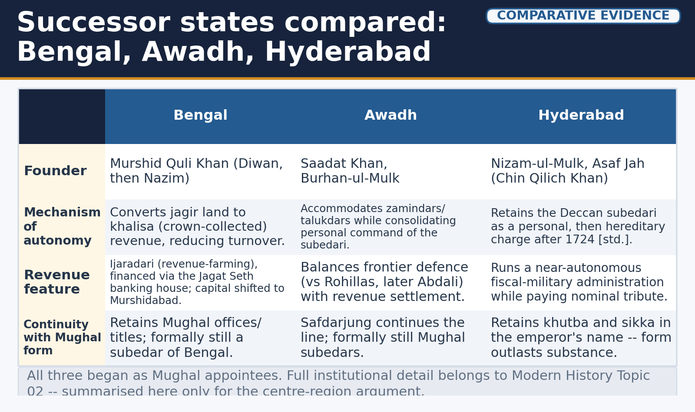

*Visual 12: successor states compared -- Bengal, Awadh, Hyderabad. Schematic maps are NOT TO SCALE where marked.*

#### DEFINITION / WHAT THIS IS CALLED

**Plain-language definition:** Bengal, Awadh and Hyderabad are the three "successor states" this topic covers in depth, and each shows the centre-region spectrum from subtopic 10 operating differently.

**Technical definition:** Comparing the three states side by side is also the fastest route to a strong Mains answer: naming what is common (formal deference, substantive autonomy) and what is distinct (the specific fiscal or military mechanism in each case) demonstrates exactly the structural, non-teleological reading this topic requires.

#### ANSWER-GRABBING OPENING — WRITE/ADAPT IN THE EXAM

> Bengal, Awadh and Hyderabad are the three "successor states" this topic covers in depth, and each shows the centre-region spectrum from subtopic 10 operating differently.

#### MUST-WRITE KEYWORDS

- **Successor states compared**
- **Bengal**
- **Awadh**
- **Hyderabad**
- **Bengal, Awadh and Hyderabad**
- **formal deference, substantive autonomy**

**How to use them:** Compare Bengal, Awadh and Hyderabad side by side on one shared criterion - the specific mechanism each used to convert provincial office into durable autonomy.

Bengal, Awadh and Hyderabad are the three "successor states" this topic covers in depth, and each shows the centre-region spectrum from subtopic 10 operating differently. All three begin as a Mughal subah (province) under a governor who, over one or two generations, converts a formally central appointment into a substantially hereditary regional authority - while continuing, for a considerable time, to seek nominal confirmation from Delhi and to remit at least token revenue or tribute.

FACT: the three states differ sharply in the specific mechanism of their autonomy - Bengal's rests on a stabilised revenue-farming settlement, Awadh's on accommodation with local zamindars combined with a frontier military role, and Hyderabad's on a Deccan subedar's personal military base becoming a self-standing Nizamat - and this topic examines each mechanism in its own subtopic rather than treating "successor state" as one uniform category. ANALYSIS: what unites them is not identical method but a shared outcome - each converts real administrative and fiscal control into durable regional power while retaining a formal, legitimating link to Mughal authority for as long as it remained useful, illustrating the centre-region spectrum's middle-to-far zone in three distinct registers.

Comparing the three states side by side is also the fastest route to a strong Mains answer: naming what is common (formal deference, substantive autonomy) and what is distinct (the specific fiscal or military mechanism in each case) demonstrates exactly the structural, non-teleological reading this topic requires.

#### DEMONSTRATION

**Claim:** Bengal, Awadh and Hyderabad achieved comparable autonomy through three genuinely distinct mechanisms. **Evidence:** Bengal's rests on a stabilised revenue-farming settlement, Awadh's on accommodation with local zamindars combined with a frontier military role, and Hyderabad's on a Deccan subedar's personal military base becoming a self-standing Nizamat. **Analysis:** what unites the three is a shared outcome - converting real administrative and fiscal control into durable regional power while retaining a formal, legitimating Mughal link - not an identical method. **Qualification:** an answer must name the specific mechanism for each state rather than treat “successor state” as one undifferentiated category.

#### CLOSING RECALL FLOW — SUCCESSOR STATES COMPARED: BENGAL, AWADH, HYDERABAD

```text
START / CONCEPT: Successor states compared: Bengal, Awadh, Hyderabad
        |
        v
EXACT TERMS: Successor states compared · Bengal · Awadh · Hyderabad · Bengal, Awadh and Hyderabad · formal deference, substantive autonomy
        |
        v
MECHANISM / ARGUMENT: Comparing the three states side by side is also the fastest route to a strong Mains answer: naming what is common (formal deference, substantive autonomy) and what is distinct (the specific fiscal or military mechanism in each case) demonstrates exactly the structural, non-teleological reading this topic requires.
        |
        v
CONSEQUENCE / CONTRAST: All three begin as a Mughal subah (province) under a governor who, over one or two generations, converts a formally central appointment into a substantially hereditary regional authority - while continuing, for a considerable time, to seek nominal confirmation from Delhi and to remit at least token revenue or tribute.
        |
        v
UPSC TRAP / ANSWER-USE: ANALYSIS: what unites them is not identical method but a shared outcome - each converts real administrative and fiscal control into durable regional power while retaining a formal, legitimating link to Mughal authority for as long as it remained useful, illustrating the centre-region spectrum's middle-to-far zone in three distinct registers.
        |
        v
ANSWER-GRABBING FORMULATION: Bengal, Awadh and Hyderabad are the three "successor states" this topic covers in depth, and each shows the centre-region spectrum from subtopic 10 operating differently.
```
### SESSION 12 — BENGAL: FROM JAGIR TURNOVER TO A STABILISED REVENUE REGIME

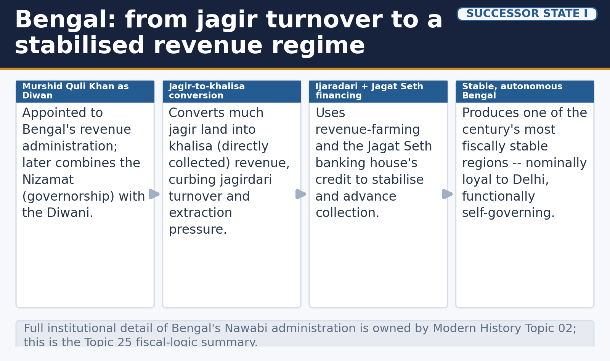

*Visual 13: Bengal -- from jagir turnover to a stabilised revenue regime. Schematic maps are NOT TO SCALE where marked.*

#### DEFINITION / WHAT THIS IS CALLED

**Plain-language definition:** Murshid Quli Khan, appointed Diwan and later Nawab of Bengal, is credited with stabilising the province's finances chiefly through a revenue-farming (ijaradari) settlement that reduced the disruptive turnover of jagir assignments characteristic of the jagirdari crisis elsewhere, replacing frequent jagir transfers with more settled revenue-farming arrangements and closer, locally rooted fiscal administration.

**Technical definition:** Bengal is the clearest illustration in this topic of how a stabilised, locally adapted revenue system - rather than open defiance of Delhi - could produce effective autonomy: the Nawabi continued to seek nominal Mughal sanction while running its own administration, army, and diplomacy, exactly the middle-to-far end of the centre-region spectrum described in subtopic 10.

#### ANSWER-GRABBING OPENING — WRITE/ADAPT IN THE EXAM

> Murshid Quli Khan, appointed Diwan and later Nawab of Bengal, is credited with stabilising the province's finances chiefly through a revenue-farming (ijaradari) settlement that reduced the disruptive turnover of jagir assignments characteristic of the jagirdari crisis elsewhere, replacing frequent jagir transfers with more settled revenue-farming arrangements and closer, locally rooted fiscal administration.

#### MUST-WRITE KEYWORDS

- **Bengal**
- **from jagir turnover to a stabilised revenue regime**
- **Murshid Quli Khan**
- **Diwan**
- **Nawab**
- **ijaradari revenue-farming**

**How to use them:** Name Murshid Quli Khan's ijaradari settlement as Bengal's specific mechanism, and contrast it with Awadh's and Hyderabad's own routes in subtopics 13-14.

FACT: Murshid Quli Khan, appointed Diwan and later Nawab of Bengal, is credited with stabilising the province's finances chiefly through a revenue-farming (ijaradari) settlement that reduced the disruptive turnover of jagir assignments characteristic of the jagirdari crisis elsewhere, replacing frequent jagir transfers with more settled revenue-farming arrangements and closer, locally rooted fiscal administration. His successors - Shuja-ud-Din and then Alivardi Khan - continued this substantially autonomous Bengal Nawabi; Alivardi Khan's reign was notably tested by repeated Maratha (bargi) incursions into Bengal during the 1740s, which he was largely able to contain through negotiated payments and military resistance without losing the province.

ANALYSIS: Bengal is the clearest illustration in this topic of how a stabilised, locally adapted revenue system - rather than open defiance of Delhi - could produce effective autonomy: the Nawabi continued to seek nominal Mughal sanction while running its own administration, army, and diplomacy, exactly the middle-to-far end of the centre-region spectrum described in subtopic 10. Bengal's later history under Siraj-ud-Daulah, including the Battle of Plassey in 1757, belongs to Modern History and is named here only as the bounded forward hand-off point, not analysed in depth.

A precise answer on Bengal should cite Murshid Quli Khan's revenue-farming innovation as the mechanism, not merely assert that "Bengal became independent," since the specific fiscal method is what distinguishes Bengal's path from Awadh's and Hyderabad's.

#### DEMONSTRATION

**Claim:** Bengal's autonomy rested on fiscal stabilisation rather than open military defiance of Delhi. **Evidence:** Murshid Quli Khan, appointed Diwan and later Nawab, stabilised Bengal's finances chiefly through an ijaradari (revenue-farming) settlement that replaced the disruptive jagir turnover characteristic of the jagirdari crisis elsewhere. **Analysis:** Bengal is this topic's clearest illustration of how a stabilised, locally adapted revenue system - rather than confrontation - could produce effective autonomy while the Nawabi still sought nominal Mughal sanction. **Qualification:** Bengal's later Company-era transition, including the Diwani, belongs to Modern History Topic 05 and is bounded out of this topic's own analytical core.

#### CLOSING RECALL FLOW — BENGAL: FROM JAGIR TURNOVER TO A STABILISED REVENUE REGIME

```text
START / CONCEPT: Bengal: from jagir turnover to a stabilised revenue regime
        |
        v
EXACT TERMS: Bengal · from jagir turnover to a stabilised revenue regime · Murshid Quli Khan · Diwan · Nawab · ijaradari revenue-farming
        |
        v
MECHANISM / ARGUMENT: Bengal is the clearest illustration in this topic of how a stabilised, locally adapted revenue system - rather than open defiance of Delhi - could produce effective autonomy: the Nawabi continued to seek nominal Mughal sanction while running its own administration, army, and diplomacy, exactly the middle-to-far end of the centre-region spectrum described in subtopic 10.
        |
        v
CONSEQUENCE / CONTRAST: A precise answer on Bengal should cite Murshid Quli Khan's revenue-farming innovation as the mechanism, not merely assert that "Bengal became independent," since the specific fiscal method is what distinguishes Bengal's path from Awadh's and Hyderabad's.
        |
        v
UPSC TRAP / ANSWER-USE: Bengal's later history under Siraj-ud-Daulah, including the Battle of Plassey in 1757, belongs to Modern History and is named here only as the bounded forward hand-off point, not analysed in depth.
        |
        v
ANSWER-GRABBING FORMULATION: Murshid Quli Khan, appointed Diwan and later Nawab of Bengal, is credited with stabilising the province's finances chiefly through a revenue-farming (ijaradari) settlement that reduced the disruptive turnover of jagir assignments characteristic of the jagirdari crisis elsewhere, replacing frequent jagir transfers with more settled revenue-farming arrangements and closer, locally rooted fiscal administration.
```
### SESSION 13 — AWADH: ACCOMMODATION WITH ZAMINDARS, THEN A FRONTIER ROLE

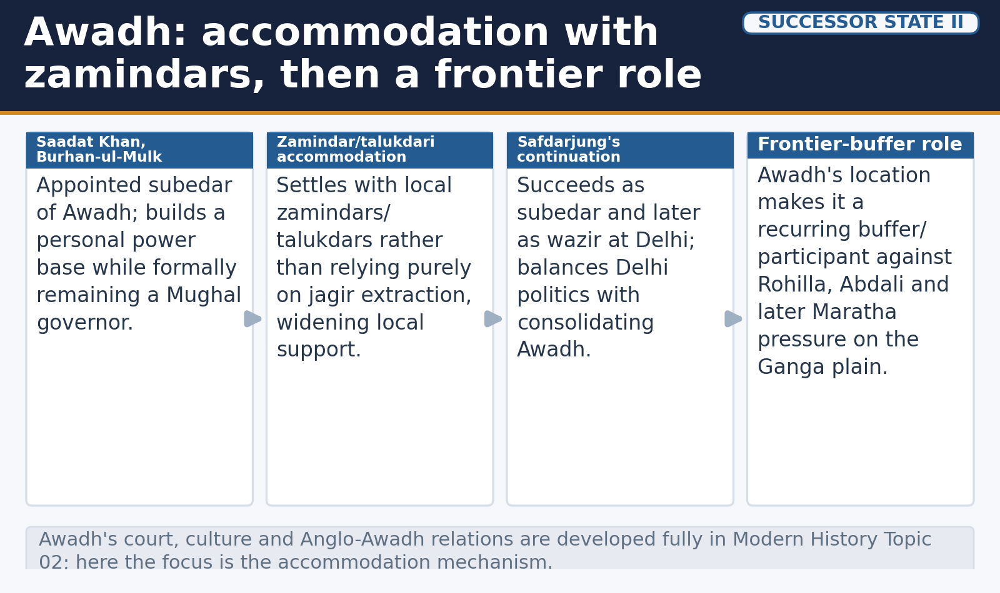

*Visual 14: Awadh -- accommodation with zamindars, then a frontier role. Schematic maps are NOT TO SCALE where marked.*

#### DEFINITION / WHAT THIS IS CALLED

**Plain-language definition:** Saadat Khan (Burhan-ul-Mulk), appointed subedar of Awadh in 1722, built the province's autonomy substantially through accommodation with local zamindars and taluqdars rather than confrontation - negotiating revenue terms that secured steady collection while leaving local landed power intact - and this accommodation, continued by his successor Safdarjung, gave Awadh's Nawabi a durable local base.

**Technical definition:** Awadh's mechanism - accommodation with the existing zamindari structure rather than its dismantling or Bengal's revenue-farming overhaul - shows a second, distinct route to the same substantive autonomy described in subtopic 11, and its frontier position exposed it directly to the external shocks examined in Part VII.

#### ANSWER-GRABBING OPENING — WRITE/ADAPT IN THE EXAM

> Saadat Khan (Burhan-ul-Mulk), appointed subedar of Awadh in 1722, built the province's autonomy substantially through accommodation with local zamindars and taluqdars rather than confrontation - negotiating revenue terms that secured steady collection while leaving local landed power intact - and this accommodation, continued by his successor Safdarjung, gave Awadh's Nawabi a durable local base.

#### MUST-WRITE KEYWORDS

- **Awadh**
- **accommodation with zamindars**
- **then a frontier role**
- **Saadat Khan**
- **Burhan-ul-Mulk**
- **Safdarjung**

**How to use them:** Name Saadat Khan's zamindar accommodation as Awadh's specific mechanism, then use Safdarjung's continuation and the frontier exposure to link forward to Part VII.

FACT: Saadat Khan (Burhan-ul-Mulk), appointed subedar of Awadh in 1722, built the province's autonomy substantially through accommodation with local zamindars and taluqdars rather than confrontation - negotiating revenue terms that secured steady collection while leaving local landed power intact - and this accommodation, continued by his successor Safdarjung, gave Awadh's Nawabi a durable local base. Awadh's later Nawab, Shuja-ud-Daulah, took on an increasingly important frontier role, most consequentially fighting alongside Ahmad Shah Abdali's coalition at the Third Battle of Panipat in 1761 (subtopic 19).

ANALYSIS: Awadh's mechanism - accommodation with the existing zamindari structure rather than its dismantling or Bengal's revenue-farming overhaul - shows a second, distinct route to the same substantive autonomy described in subtopic 11, and its frontier position exposed it directly to the external shocks examined in Part VII. Shuja-ud-Daulah's later defeat at Buxar in 1764, fighting alongside Shah Alam II and Mir Qasim, belongs to Modern History and is named here only as the bounded forward hand-off, not analysed in depth.

A precise answer on Awadh should distinguish its zamindar-accommodation mechanism from Bengal's revenue-farming mechanism, since conflating the two loses the comparative point subtopic 11 establishes.

#### DEMONSTRATION

**Claim:** Awadh's autonomy rested on accommodation with existing zamindars rather than their dismantling. **Evidence:** Saadat Khan (Burhan-ul-Mulk), subedar of Awadh from 1722, negotiated revenue terms that secured collection while leaving local landed power intact, a policy continued by his successor Safdarjung. **Analysis:** this accommodation route is a distinct path to the same substantive autonomy shown by Bengal's revenue-farming overhaul, and Awadh's frontier position later exposed it directly to external shocks. **Qualification:** Shuja-ud-Daulah's 1764 defeat at Buxar belongs to the Company-transition hand-off (Modern History) and is named here only to bound it, not to re-teach it.

#### CLOSING RECALL FLOW — AWADH: ACCOMMODATION WITH ZAMINDARS, THEN A FRONTIER ROLE

```text
START / CONCEPT: Awadh: accommodation with zamindars, then a frontier role
        |
        v
EXACT TERMS: Awadh · accommodation with zamindars · then a frontier role · Saadat Khan · Burhan-ul-Mulk · Safdarjung
        |
        v
MECHANISM / ARGUMENT: Awadh's mechanism - accommodation with the existing zamindari structure rather than its dismantling or Bengal's revenue-farming overhaul - shows a second, distinct route to the same substantive autonomy described in subtopic 11, and its frontier position exposed it directly to the external shocks examined in Part VII.
        |
        v
CONSEQUENCE / CONTRAST: Shuja-ud-Daulah's later defeat at Buxar in 1764, fighting alongside Shah Alam II and Mir Qasim, belongs to Modern History and is named here only as the bounded forward hand-off, not analysed in depth.
        |
        v
UPSC TRAP / ANSWER-USE: A precise answer on Awadh should distinguish its zamindar-accommodation mechanism from Bengal's revenue-farming mechanism, since conflating the two loses the comparative point subtopic 11 establishes.
        |
        v
ANSWER-GRABBING FORMULATION: Saadat Khan (Burhan-ul-Mulk), appointed subedar of Awadh in 1722, built the province's autonomy substantially through accommodation with local zamindars and taluqdars rather than confrontation - negotiating revenue terms that secured steady collection while leaving local landed power intact - and this accommodation, continued by his successor Safdarjung, gave Awadh's Nawabi a durable local base.
```
### SESSION 14 — HYDERABAD: DECCAN SUBEDARI TO DE FACTO SOVEREIGNTY

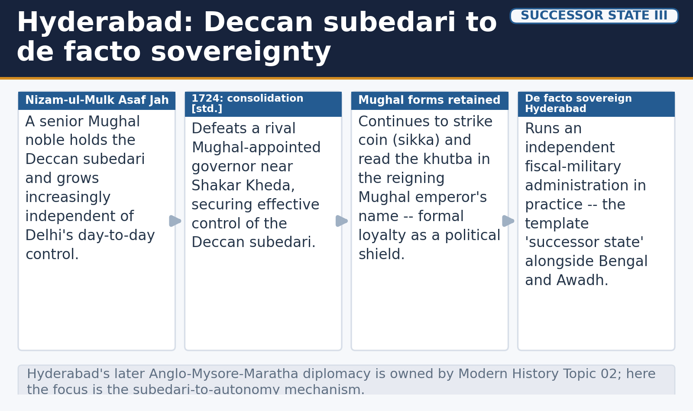

*Visual 15: Hyderabad -- Deccan subedari to de facto sovereignty. Schematic maps are NOT TO SCALE where marked.*

#### DEFINITION / WHAT THIS IS CALLED

**Plain-language definition:** Hyderabad's mechanism - a top-ranking central noble converting personal military strength and a Deccan power base into self-standing regional sovereignty - is the most direct illustration in this topic of how the very people who staffed the imperial centre (Part IV) could also become its most consequential regional successors, and it completes the three-way comparison in subtopic 11 by showing personal-military conversion as a third distinct route, alongside Bengal's revenue-farming and Awadh's zamindar-accommodation.

**Technical definition:** Nizam-ul-Mulk (Chin Qilich Khan, later titled Asaf Jah), one of the empire's most senior nobles and briefly its wazir under Muhammad Shah, withdrew to the Deccan and, after defeating a rival Mughal-appointed governor at the Battle of Shakar Kheda in 1724, established what became a substantially independent Nizamat of Hyderabad while continuing to hold his Mughal subedari titles and formal rank.

#### ANSWER-GRABBING OPENING — WRITE/ADAPT IN THE EXAM

> Nizam-ul-Mulk (Chin Qilich Khan, later titled Asaf Jah), one of the empire's most senior nobles and briefly its wazir under Muhammad Shah, withdrew to the Deccan and, after defeating a rival Mughal-appointed governor at the Battle of Shakar Kheda in 1724, established what became a substantially independent Nizamat of Hyderabad while continuing to hold his Mughal subedari titles and formal rank.

#### MUST-WRITE KEYWORDS

- **Hyderabad**
- **Deccan subedari to de facto sovereignty**
- **Nizam-ul-Mulk**
- **Chin Qilich Khan**
- **Asaf Jah**
- **Muhammad Shah**

**How to use them:** Name Nizam-ul-Mulk's 1724 victory at Shakar Kheda as the concrete event that converted a Mughal subedari into a self-standing Nizamat.

FACT: Nizam-ul-Mulk (Chin Qilich Khan, later titled Asaf Jah), one of the empire's most senior nobles and briefly its wazir under Muhammad Shah, withdrew to the Deccan and, after defeating a rival Mughal-appointed governor at the Battle of Shakar Kheda in 1724, established what became a substantially independent Nizamat of Hyderabad while continuing to hold his Mughal subedari titles and formal rank. Succession disputes among Asaf Jah's sons after his death later drew European trading companies (French and British) into Hyderabad and Carnatic politics through the Carnatic Wars - a development belonging to Modern History and named here only as a bounded forward pointer.

ANALYSIS: Hyderabad's mechanism - a top-ranking central noble converting personal military strength and a Deccan power base into self-standing regional sovereignty - is the most direct illustration in this topic of how the very people who staffed the imperial centre (Part IV) could also become its most consequential regional successors, and it completes the three-way comparison in subtopic 11 by showing personal-military conversion as a third distinct route, alongside Bengal's revenue-farming and Awadh's zamindar-accommodation.

A precise answer on Hyderabad should note that Asaf Jah's autonomy grew out of his position as a central noble (linking back to Part IV's factionalism), rather than presenting Hyderabad's rise as unconnected to the wizarat politics examined earlier in this topic.

#### DEMONSTRATION

**Claim:** Hyderabad's sovereignty grew from a senior central noble converting personal military strength into a self-standing regional state. **Evidence:** Nizam-ul-Mulk (Chin Qilich Khan), briefly wazir under Muhammad Shah, withdrew to the Deccan and, after defeating a rival Mughal-appointed governor at the Battle of Shakar Kheda in 1724, founded what became a substantially independent Nizamat. **Analysis:** this is the most direct illustration in this topic of how the very people who staffed the imperial centre could also become its most consequential regional successors. **Qualification:** the Nizam retained his Mughal subedari titles and formal rank even while functioning independently, so formal and real authority diverged rather than being formally severed.

#### CLOSING RECALL FLOW — HYDERABAD: DECCAN SUBEDARI TO DE FACTO SOVEREIGNTY

```text
START / CONCEPT: Hyderabad: Deccan subedari to de facto sovereignty
        |
        v
EXACT TERMS: Hyderabad · Deccan subedari to de facto sovereignty · Nizam-ul-Mulk · Chin Qilich Khan · Asaf Jah · Muhammad Shah
        |
        v
MECHANISM / ARGUMENT: Hyderabad's mechanism - a top-ranking central noble converting personal military strength and a Deccan power base into self-standing regional sovereignty - is the most direct illustration in this topic of how the very people who staffed the imperial centre (Part IV) could also become its most consequential regional successors, and it completes the three-way comparison in subtopic 11 by showing personal-military conversion as a third distinct route, alongside Bengal's revenue-farming and Awadh's zamindar-accommodation.
        |
        v
CONSEQUENCE / CONTRAST: A precise answer on Hyderabad should note that Asaf Jah's autonomy grew out of his position as a central noble (linking back to Part IV's factionalism), rather than presenting Hyderabad's rise as unconnected to the wizarat politics examined earlier in this topic.
        |
        v
UPSC TRAP / ANSWER-USE: Do not miss this limiting distinction: Nizam-ul-Mulk's Hyderabad broke from Delhi in practice, in 1724, well before Muhammad Shah's death, yet he continued to hold his Mughal subedari titles and never formally renounced imperial allegiance - so Hyderabad's autonomy was substantive, not a legal secession, and an answer must state "de facto sovereignty within a formally continuing Mughal framework" rather than simply "independence."
        |
        v
ANSWER-GRABBING FORMULATION: Nizam-ul-Mulk (Chin Qilich Khan, later titled Asaf Jah), one of the empire's most senior nobles and briefly its wazir under Muhammad Shah, withdrew to the Deccan and, after defeating a rival Mughal-appointed governor at the Battle of Shakar Kheda in 1724, established what became a substantially independent Nizamat of Hyderabad while continuing to hold his Mughal subedari titles and formal rank.
```
### PART VI - JATS, SIKHS AND THE MARATHAS

### SESSION 15 — JATS, SIKHS, MARATHAS: A BOUNDED SNAPSHOT

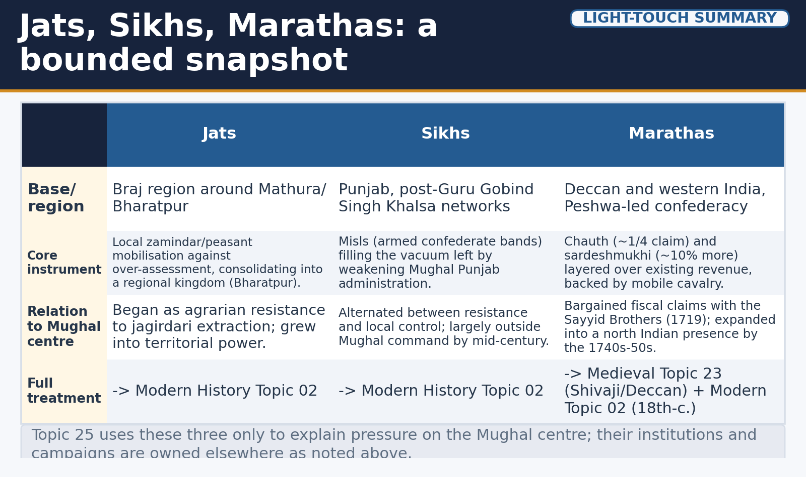

*Visual 16: Jats, Sikhs, Marathas -- a bounded snapshot. Schematic maps are NOT TO SCALE where marked.*

#### DEFINITION / WHAT THIS IS CALLED

**Plain-language definition:** Jats, Sikhs and Marathas each converted local resistance to jagirdar extraction into durable, territorially rooted eighteenth-century power, though by different routes.

**Technical definition:** The Sikh formation passed through Banda Bahadur's armed rebellion (1708-1715, ending with his capture and execution in 1716) and then, after a period of suppression, re-emerged through the mid-eighteenth-century Sikh misls (armed confederacies) consolidating power across Punjab - a process that continues beyond this topic's 1761 boundary toward the later, single-ruler consolidation under Ranjit Singh, which is outside this topic's scope.

#### ANSWER-GRABBING OPENING — WRITE/ADAPT IN THE EXAM

> This topic deliberately keeps its treatment of Jats, Sikhs and Marathas bounded: full institutional detail on Shivaji's state, the Ashtapradhan and the Maratha polity's own internal structure belongs to Topic 23, and is not re-taught here.

#### MUST-WRITE KEYWORDS

- **Jats**
- **Sikhs**
- **Marathas**
- **Rohilla Afghan chiefs**
- **Dal Khalsa confederal umbrella**
- **1708-1715**

**How to use them:** Name the Jats, Sikh misls (organised under the Dal Khalsa), Rohilla Afghan chiefs and Marathas as distinct social bases converting resistance into regional power, while keeping Topic 23's institutional detail out of this answer.

This topic deliberately keeps its treatment of Jats, Sikhs and Marathas bounded: full institutional detail on Shivaji's state, the Ashtapradhan and the Maratha polity's own internal structure belongs to Topic 23, and is not re-taught here. What this topic needs is the eighteenth-century political snapshot - how each of these three formations converted the zamindar-resistance dynamic of subtopic 9 into durable, territorially rooted regional power, alongside the successor states of Part V.

FACT: the Jat formation around Agra-Mathura, consolidated under leaders including Churaman, Badan Singh and later Suraj Mal (whose base at Bharatpur made the Jat state a significant eighteenth-century power), grew from an agrarian, peasant-rooted zamindari base exploiting the space opened by Mughal-Maratha-Afghan contestation of the region. The Sikh formation passed through Banda Bahadur's armed rebellion (1708-1715, ending with his capture and execution in 1716) and then, after a period of suppression, re-emerged through the mid-eighteenth-century Sikh misls (armed confederacies) consolidating power across Punjab - a process that continues beyond this topic's 1761 boundary toward the later, single-ruler consolidation under Ranjit Singh, which is outside this topic's scope; these misls operated loosely under a shared Dal Khalsa confederal umbrella and, further south of the Sikh tract, Rohilla Afghan chiefs (Najib-ud-Daulah prominent among them, see subtopic 19) carved out a separate Rohilkhand power base from the same broader collapse of central authority. The Maratha polity, after Shivaji's founding and its consolidation under later Peshwas (Topic 23), had by the eighteenth century become a subcontinental power projecting fiscal claims (subtopic 16) and military reach as far as Bengal (the 1740s bargi raids noted in subtopic 12) and the Punjab (leading directly to Panipat III, subtopic 19).

ANALYSIS: all three formations illustrate the same underlying pattern identified in subtopic 9 - locally rooted resistance to extraction hardening, over time, into organised regional political power - even though their social bases (peasant-agrarian for the Jats, religious-military confederacy for the Sikhs, and an already-established regional state for the Marathas) differ sharply, and a careful answer should name this shared pattern without collapsing the three into a single undifferentiated "regional resistance" category.

#### DEMONSTRATION

**Claim:** Jats, Sikhs and Marathas each converted local resistance to extraction into durable regional power, but by three distinct routes. **Evidence:** the Jats consolidated an agrarian base under Churaman, Badan Singh and Suraj Mal at Bharatpur; the Sikh misls, operating under a shared Dal Khalsa confederal umbrella, re-emerged after Banda Bahadur's 1708-1716 rebellion; Rohilla Afghan chiefs, prominently Najib-ud-Daulah, carved out a separate Rohilkhand base. **Analysis:** all three illustrate the same underlying pattern of locally rooted resistance hardening into organised regional power, despite sharply different social bases. **Qualification:** full institutional detail on each remains bounded elsewhere - the Maratha polity's own structure to Topic 23, and the Sikh misls' later single-ruler consolidation under Ranjit Singh outside this topic's 1761 scope.

#### CLOSING RECALL FLOW — JATS, SIKHS, MARATHAS: A BOUNDED SNAPSHOT

```text
START / CONCEPT: Jats, Sikhs, Marathas: a bounded snapshot
        |
        v
EXACT TERMS: Jats · Sikhs · Marathas · Rohilla Afghan chiefs · Dal Khalsa confederal umbrella · 1708-1715
        |
        v
MECHANISM / ARGUMENT: all three formations illustrate the same underlying pattern identified in subtopic 9 - locally rooted resistance to extraction hardening, over time, into organised regional political power - even though their social bases (peasant-agrarian for the Jats, religious-military confederacy for the Sikhs, and an already-established regional state for the Marathas) differ sharply, and a careful answer should name this shared pattern without collapsing the three into a single undifferentiated "regional resistance" category.
        |
        v
CONSEQUENCE / CONTRAST: What this topic needs is the eighteenth-century political snapshot - how each of these three formations converted the zamindar-resistance dynamic of subtopic 9 into durable, territorially rooted regional power, alongside the successor states of Part V.
        |
        v
UPSC TRAP / ANSWER-USE: Do not miss this limiting distinction: the Sikh formation passed through Banda Bahadur's armed rebellion (1708-1715, ending with his capture and execution at Delhi in 1716) before consolidating, only after several further decades of struggle, into the confederal misl structure under the Dal Khalsa from the 1730s-40s onward - so an answer must not conflate Banda Bahadur's early revolt with the later, organisationally distinct Dal Khalsa confederacy that actually contested Punjab with Abdali.
        |
        v
ANSWER-GRABBING FORMULATION: This topic deliberately keeps its treatment of Jats, Sikhs and Marathas bounded: full institutional detail on Shivaji's state, the Ashtapradhan and the Maratha polity's own internal structure belongs to Topic 23, and is not re-taught here.
```
### SESSION 16 — MARATHA FISCAL CLAIMS LAYERED OVER THE MUGHAL REVENUE BASE

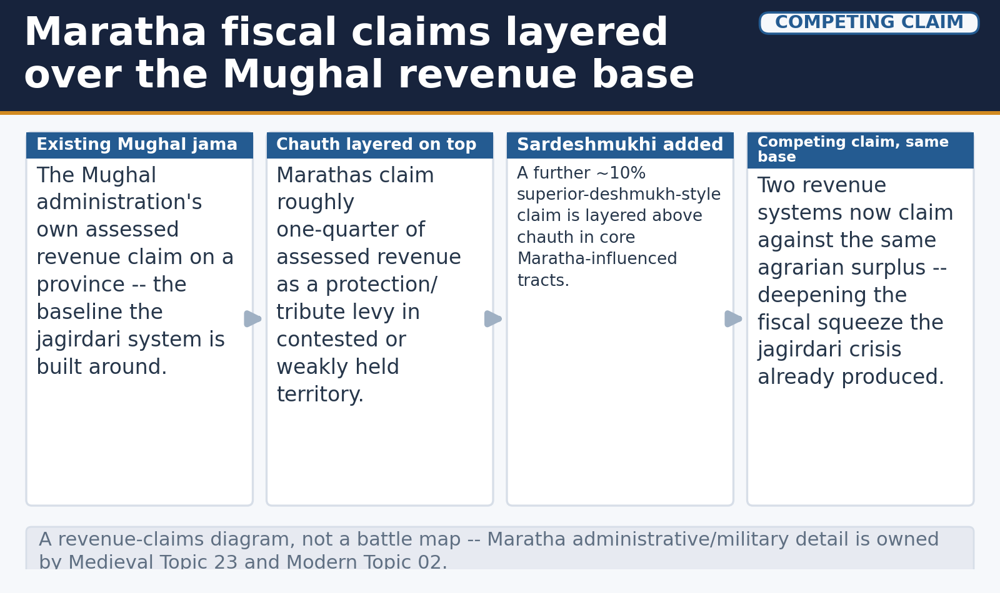

*Visual 17: Maratha fiscal claims layered over the Mughal revenue base. Schematic maps are NOT TO SCALE where marked.*

#### DEFINITION / WHAT THIS IS CALLED

**Plain-language definition:** Maratha chauth and sardeshmukhi claims were layered on top of the Mughal revenue base, not a replacement for it.

**Technical definition:** the 1719 Sayyid-Maratha settlement (subtopic 3) formally recognised Maratha claims to chauth (a claim to roughly one-quarter of the assessed revenue) and sardeshmukhi (an additional claim, of the kind associated with the sardeshmukh's traditional due) across the Deccan subahs, in exchange for Maratha military support against Farrukhsiyar - the clearest single piece of evidence that Maratha fiscal power had become formally layered over, rather than simply opposed to, the Mughal revenue structure.

#### ANSWER-GRABBING OPENING — WRITE/ADAPT IN THE EXAM

> describing this as Marathas "replacing" the Mughal empire overstates the case; the more precise description is a layered fiscal sovereignty, in which Mughal-derived revenue assessments continued to operate as the base layer while Maratha chauth and sardeshmukhi claims were assessed on top of them - a pattern that itself illustrates this topic's larger argument that eighteenth-century regionalisation reorganised authority over a continuing agrarian-fiscal base rather than erasing it.

#### MUST-WRITE KEYWORDS

- **Sayyid-Maratha**
- **Maratha**
- **Deccan**
- **Farrukhsiyar**
- **Mughal**
- **Marathas**

**How to use them:** State the Sayyid-Maratha 1719 settlement's exact terms - chauth and sardeshmukhi over the Deccan subahs - and use the Shahu-Peshwa route (Balaji Vishwanath onward, with the Holkar, Scindia, Gaekwad and Bhonsle houses named as Topic 23's own confederate detail) only to bound the claim, not to re-teach it.

FACT: the 1719 Sayyid-Maratha settlement (subtopic 3) formally recognised Maratha claims to chauth (a claim to roughly one-quarter of the assessed revenue) and sardeshmukhi (an additional claim, of the kind associated with the sardeshmukh's traditional due) across the Deccan subahs, in exchange for Maratha military support against Farrukhsiyar - the clearest single piece of evidence that Maratha fiscal power had become formally layered over, rather than simply opposed to, the Mughal revenue structure. This settlement itself followed the Maratha polity's own succession contest after Shivaji's line split between Shahu and his aunt Tarabai's rival camp; Shahu's eventual ascendancy, consolidated through his Peshwa Balaji Vishwanath, is the internal Maratha detail that Topic 23 owns and is only named here to bound it. Maratha claims subsequently extended northward and eastward well beyond the Deccan, reaching into Malwa, Gujarat, and as far as Bengal (the 1740s bargi incursions noted in subtopic 12) and the Gangetic north, projecting a fiscal-military reach that eventually brought the Maratha confederacy into direct confrontation with Abdali's coalition at Panipat in 1761.

ANALYSIS: describing this as Marathas "replacing" the Mughal empire overstates the case; the more precise description is a layered fiscal sovereignty, in which Mughal-derived revenue assessments continued to operate as the base layer while Maratha chauth and sardeshmukhi claims were assessed on top of them - a pattern that itself illustrates this topic's larger argument that eighteenth-century regionalisation reorganised authority over a continuing agrarian-fiscal base rather than erasing it. (Full detail on the Maratha confederacy's internal Peshwa-led structure remains Topic 23's material and is not repeated here.)

A precise answer should use "layered claim" rather than "replacement" when describing Maratha chauth/sardeshmukhi over Mughal-assessed revenue, since this precision is exactly what distinguishes a structural eighteenth-century argument from a simple "Marathas took over" narrative.

#### DEMONSTRATION

**Claim:** Maratha fiscal claims were layered over the Mughal revenue base, not a replacement for it. **Evidence:** the 1719 Sayyid-Maratha settlement formally recognised Maratha claims to chauth and sardeshmukhi across the Deccan subahs in exchange for military support, itself following the Maratha polity's own Shahu-Tarabai succession contest resolved through Peshwa Balaji Vishwanath. **Analysis:** describing this as Marathas “replacing” the Mughal empire overstates the case; the more precise description is a layered fiscal sovereignty operating on top of a continuing Mughal-derived assessment base. **Qualification:** the Maratha confederacy's internal Peshwa-Holkar-Scindia-Gaekwad-Bhonsle structure remains Topic 23's own material and is named here only to bound the claim.

#### CLOSING RECALL FLOW — MARATHA FISCAL CLAIMS LAYERED OVER THE MUGHAL REVENUE BASE

```text
START / CONCEPT: Maratha fiscal claims layered over the Mughal revenue base
        |
        v
EXACT TERMS: Sayyid-Maratha · Maratha · Deccan · Farrukhsiyar · Mughal · Marathas
        |
        v
MECHANISM / ARGUMENT: the 1719 Sayyid-Maratha settlement (subtopic 3) formally recognised Maratha claims to chauth (a claim to roughly one-quarter of the assessed revenue) and sardeshmukhi (an additional claim, of the kind associated with the sardeshmukh's traditional due) across the Deccan subahs, in exchange for Maratha military support against Farrukhsiyar - the clearest single piece of evidence that Maratha fiscal power had become formally layered over, rather than simply opposed to, the Mughal revenue structure.
        |
        v
CONSEQUENCE / CONTRAST: A precise answer should use "layered claim" rather than "replacement" when describing Maratha chauth/sardeshmukhi over Mughal-assessed revenue, since this precision is exactly what distinguishes a structural eighteenth-century argument from a simple "Marathas took over" narrative.
        |
        v
UPSC TRAP / ANSWER-USE: (Full detail on the Maratha confederacy's internal Peshwa-led structure remains Topic 23's material and is not repeated here.).
        |
        v
ANSWER-GRABBING FORMULATION: describing this as Marathas "replacing" the Mughal empire overstates the case; the more precise description is a layered fiscal sovereignty, in which Mughal-derived revenue assessments continued to operate as the base layer while Maratha chauth and sardeshmukhi claims were assessed on top of them - a pattern that itself illustrates this topic's larger argument that eighteenth-century regionalisation reorganised authority over a continuing agrarian-fiscal base rather than erasing it.
```
### PART VII - EXTERNAL SHOCKS

### SESSION 17 — NADIR SHAH'S INVASION, 1739

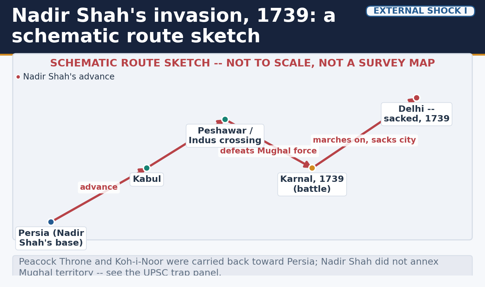

*Visual 18: Nadir Shah's invasion, 1739 -- a schematic route sketch (NOT TO SCALE). Schematic maps are NOT TO SCALE where marked.*

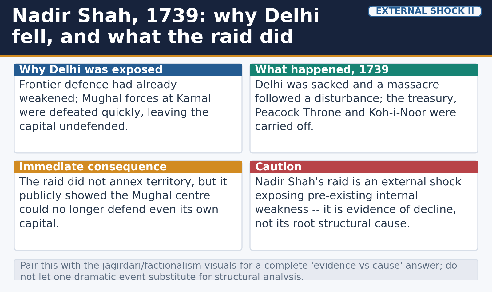

*Visual 19: Nadir Shah, 1739 -- why Delhi fell, and what the raid did. Schematic maps are NOT TO SCALE where marked.*

#### DEFINITION / WHAT THIS IS CALLED

**Plain-language definition:** Nadir Shah did not attempt to annex Mughal territory or hold Delhi permanently - his invasion was a raid for plunder and prestige, not a conquest for rule.

**Technical definition:** the raid's exam-relevant significance lies less in the plunder itself and more in what it exposed and what it caused: it exposed the post-1707 empire's military hollowness at the very centre (a substantially larger Mughal force - exact comparative figures vary by account and are not independently verifiable here - was still decisively defeated at Karnal), and it caused a severe, lasting fiscal shock - the treasury's plunder and the indemnity demanded left the imperial centre financially unable to reassert control even where it might otherwise have tried, deepening exactly the be-jagiri and factionalism dynamics described in Part III-IV.

#### ANSWER-GRABBING OPENING — WRITE/ADAPT IN THE EXAM

> Nadir Shah did not attempt to annex Mughal territory or hold Delhi permanently - his invasion was a raid for plunder and prestige, not a conquest for rule.

#### MUST-WRITE KEYWORDS

- **Nadir Shah's invasion**
- **Nadir Shah**
- **Mughal**
- **Delhi**
- **Karnal**
- **Part III-IV**

**How to use them:** State the raid-versus-conquest distinction first - Nadir Shah plundered and left - then use the fiscal shock it caused to link forward to Part III-IV's factionalism.

FACT: Nadir Shah, the ruler of Persia, invaded the Mughal empire in 1739, defeated Muhammad Shah's army at the Battle of Karnal, and occupied Delhi, where he ordered a notorious massacre after unrest broke out in the city; he then withdrew to Persia the same year, carrying an enormous indemnity and treasure that included, by well-established tradition, the Peacock Throne and the Koh-i-Noor diamond. Nadir Shah did not attempt to annex Mughal territory or hold Delhi permanently - his invasion was a raid for plunder and prestige, not a conquest for rule.

ANALYSIS: the raid's exam-relevant significance lies less in the plunder itself and more in what it exposed and what it caused: it exposed the post-1707 empire's military hollowness at the very centre (a substantially larger Mughal force - exact comparative figures vary by account and are not independently verifiable here - was still decisively defeated at Karnal), and it caused a severe, lasting fiscal shock - the treasury's plunder and the indemnity demanded left the imperial centre financially unable to reassert control even where it might otherwise have tried, deepening exactly the be-jagiri and factionalism dynamics described in Part III-IV. It is best read as an accelerant that exposed and intensified an existing structural crisis, not as the crisis's origin.

#### DEMONSTRATION

**Claim:** Nadir Shah's 1739 raid exposed Mughal military hollowness and inflicted a severe, lasting fiscal shock. **Evidence:** Nadir Shah defeated Muhammad Shah's forces at the Battle of Karnal, occupied Delhi, ordered a massacre after unrest broke out, and withdrew with an enormous indemnity and treasure that, by well-established tradition, included the Peacock Throne and the Koh-i-Noor. **Analysis:** the raid's significance lies less in the plunder itself than in what it exposed (a hollow military centre) and what it caused (a severe fiscal shock to an already-strained treasury). **Qualification:** any specific force-ratio claim about the armies at Karnal requires attribution to a named source rather than assertion as settled fact.

#### CLOSING RECALL FLOW — NADIR SHAH'S INVASION, 1739

```text
START / CONCEPT: Nadir Shah's invasion, 1739
        |
        v
EXACT TERMS: Nadir Shah's invasion · Nadir Shah · Mughal · Delhi · Karnal · Part III-IV
        |
        v
MECHANISM / ARGUMENT: the raid's exam-relevant significance lies less in the plunder itself and more in what it exposed and what it caused: it exposed the post-1707 empire's military hollowness at the very centre (a substantially larger Mughal force - exact comparative figures vary by account and are not independently verifiable here - was still decisively defeated at Karnal), and it caused a severe, lasting fiscal shock - the treasury's plunder and the indemnity demanded left the imperial centre financially unable to reassert control even where it might otherwise have tried, deepening exactly the be-jagiri and factionalism dynamics described in Part III-IV.
        |
        v
CONSEQUENCE / CONTRAST: It is best read as an accelerant that exposed and intensified an existing structural crisis, not as the crisis's origin.
        |
        v
UPSC TRAP / ANSWER-USE: Do not miss this limiting distinction: Nadir Shah did not attempt to annex Mughal territory or hold Delhi permanently - he withdrew after roughly two months, having extracted an indemnity and the treasury's iconic treasures (including the Peacock Throne and the Koh-i-Noor) rather than a province, so an answer must separate "raid for plunder" from "conquest for territory" when assessing the invasion's causal weight.
        |
        v
ANSWER-GRABBING FORMULATION: Nadir Shah did not attempt to annex Mughal territory or hold Delhi permanently - his invasion was a raid for plunder and prestige, not a conquest for rule.
```
### SESSION 18 — ABDALI'S INVASIONS, 1748-1767: A FRONTIER UNDER PRESSURE

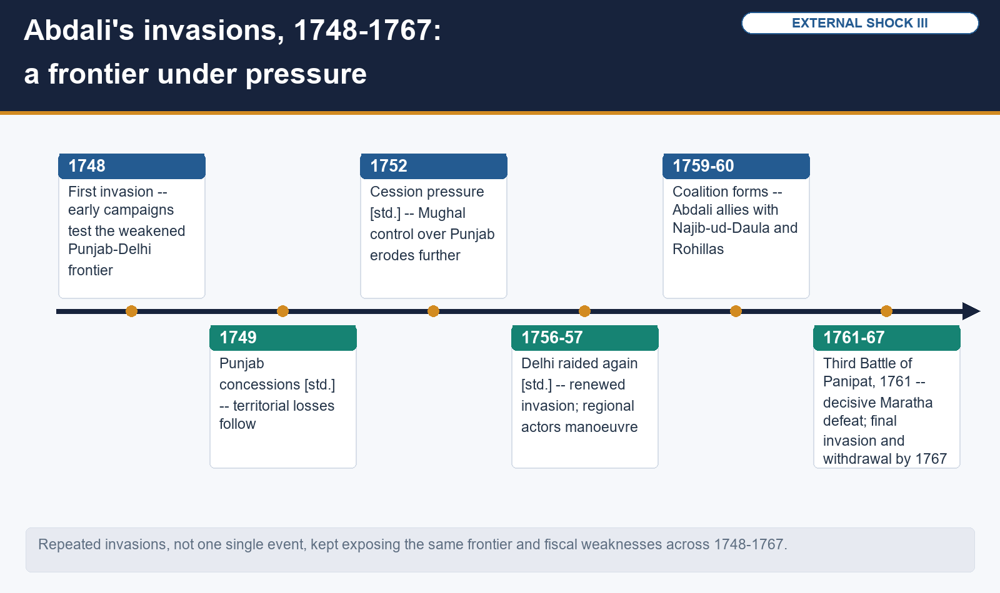

*Visual 20: Abdali's invasions, 1748-1767 -- a frontier under pressure. Schematic maps are NOT TO SCALE where marked.*

#### DEFINITION / WHAT THIS IS CALLED

**Plain-language definition:** the repeated, almost routine character of these invasions across more than a decade is itself evidence of how completely the north-western frontier's defence had passed out of effective central Mughal control, and of how the vacuum was being contested simultaneously by at least three regional claimants (Afghan, Sikh, Maratha) rather than by the Mughal centre and one challenger alone.

**Technical definition:** Ahmad Shah Abdali (Durrani), a former commander under Nadir Shah who established his own Afghan kingdom after Nadir Shah's assassination, launched a series of invasions into north-western India across 1748-1767, repeatedly contesting control of the Punjab frontier with the Mughal governor's remnants, with rising Sikh power in the region, and, in the invasions up to 1761, with the Marathas, whose fiscal and military reach (subtopic 16) had by this period extended into the same frontier zone.

#### ANSWER-GRABBING OPENING — WRITE/ADAPT IN THE EXAM

> Ahmad Shah Abdali (Durrani), a former commander under Nadir Shah who established his own Afghan kingdom after Nadir Shah's assassination, launched a series of invasions into north-western India across 1748-1767, repeatedly contesting control of the Punjab frontier with the Mughal governor's remnants, with rising Sikh power in the region, and, in the invasions up to 1761, with the Marathas, whose fiscal and military reach (subtopic 16) had by this period extended into the same frontier zone.

#### MUST-WRITE KEYWORDS

- **Abdali's invasions**
- **a frontier under pressure**
- **Ahmad Shah Abdali**
- **Durrani**
- **Nadir Shah**
- **1748-1767**

**How to use them:** Name all three contesting claimants on the frontier - Afghan, Sikh, Maratha - and use the 1748-1767 span to show a persistently contested, not vacant, frontier.

FACT: Ahmad Shah Abdali (Durrani), a former commander under Nadir Shah who established his own Afghan kingdom after Nadir Shah's assassination, launched a series of invasions into north-western India across 1748-1767, repeatedly contesting control of the Punjab frontier with the Mughal governor's remnants, with rising Sikh power in the region, and, in the invasions up to 1761, with the Marathas, whose fiscal and military reach (subtopic 16) had by this period extended into the same frontier zone.

ANALYSIS: the repeated, almost routine character of these invasions across more than a decade is itself evidence of how completely the north-western frontier's defence had passed out of effective central Mughal control, and of how the vacuum was being contested simultaneously by at least three regional claimants (Afghan, Sikh, Maratha) rather than by the Mughal centre and one challenger alone. This multi-cornered frontier contest set the direct stage for the decisive confrontation examined next. This topic's own narrative analytically closes at the Third Battle of Panipat (1761); Abdali's later activity on the frontier through 1767 is named here only as the honest outer bound of his invasions, not re-narrated in depth.

#### DEMONSTRATION

**Claim:** Abdali's repeated invasions show a north-western frontier that had passed out of effective Mughal control. **Evidence:** Ahmad Shah Abdali (Durrani) launched invasions into north-western India across roughly 1748-1767, repeatedly contesting the Punjab frontier with Mughal remnants, rising Sikh power, and eventually the Marathas. **Analysis:** the routine, repeated character of these invasions over nearly two decades shows at least three regional claimants contesting the vacuum simultaneously, not a simple Mughal-versus-one-challenger contest. **Qualification:** this topic's own analytical narrative closes at the 1761 Battle of Panipat even though Abdali's incursions continued for several years beyond it.

#### CLOSING RECALL FLOW — ABDALI'S INVASIONS, 1748-1767: A FRONTIER UNDER PRESSURE

```text
START / CONCEPT: Abdali's invasions, 1748-1767: a frontier under pressure
        |
        v
EXACT TERMS: Abdali's invasions · a frontier under pressure · Ahmad Shah Abdali · Durrani · Nadir Shah · 1748-1767
        |
        v
MECHANISM / ARGUMENT: the repeated, almost routine character of these invasions across more than a decade is itself evidence of how completely the north-western frontier's defence had passed out of effective central Mughal control, and of how the vacuum was being contested simultaneously by at least three regional claimants (Afghan, Sikh, Maratha) rather than by the Mughal centre and one challenger alone.
        |
        v
CONSEQUENCE / CONTRAST: The resulting consequence is that Ahmad Shah Abdali (Durrani), a former commander under Nadir Shah who established his own independent Afghan kingdom after Nadir Shah's 1747 assassination, treated the Punjab-Delhi frontier as an extension of his own contest for resources and legitimacy, so each invasion doubled as both plunder and a bid to fix a tributary or client arrangement over Punjab, unlike Nadir Shah's single, one-off 1739 expedition.
        |
        v
UPSC TRAP / ANSWER-USE: Do not miss this limiting distinction: Ahmad Shah Abdali (Durrani), a former commander under Nadir Shah who established his own kingdom rather than merely inheriting one, invaded repeatedly - not once, unlike Nadir Shah - across nearly two decades, so an answer must treat the 1748-1767 span as a sustained frontier contest with multiple named episodes (1748, 1749, 1752, 1756-57, 1759-60, 1761 and the final 1766-67 campaign), not compress it into a single "Abdali invasion" event the way many answers wrongly do with Nadir Shah's 1739 raid.
        |
        v
ANSWER-GRABBING FORMULATION: Ahmad Shah Abdali (Durrani), a former commander under Nadir Shah who established his own Afghan kingdom after Nadir Shah's assassination, launched a series of invasions into north-western India across 1748-1767, repeatedly contesting control of the Punjab frontier with the Mughal governor's remnants, with rising Sikh power in the region, and, in the invasions up to 1761, with the Marathas, whose fiscal and military reach (subtopic 16) had by this period extended into the same frontier zone.
```
### SESSION 19 — THE THIRD BATTLE OF PANIPAT, 1761

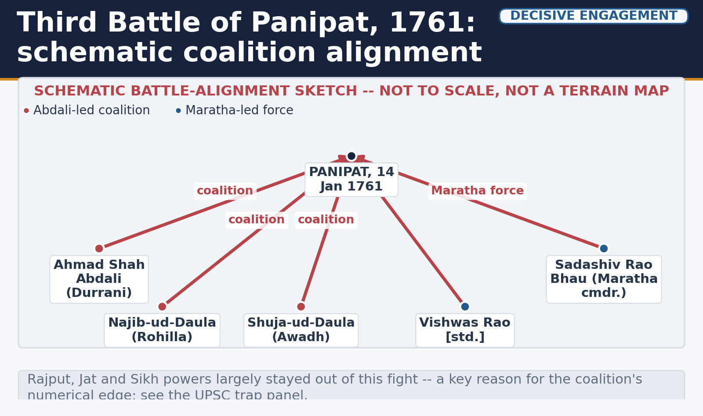

*Visual 21: Third Battle of Panipat, 1761 -- schematic coalition alignment (NOT TO SCALE). Schematic maps are NOT TO SCALE where marked.*

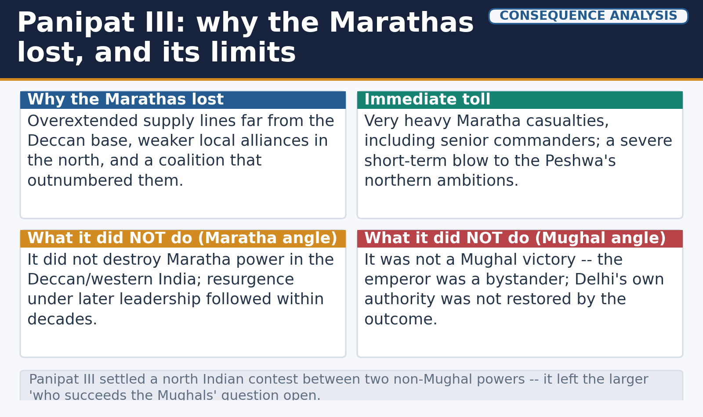

*Visual 22: Panipat III -- why the Marathas lost, and its limits. Schematic maps are NOT TO SCALE where marked.*

#### DEFINITION / WHAT THIS IS CALLED

**Plain-language definition:** Panipat III's most defensible exam framing is as a check, not a terminal collapse, of Maratha power - a serious military and dynastic loss (the death of Vishwasrao and Sadashivrao Bhau among many others) that reshaped the Maratha confederacy's immediate priorities without ending its status as the eighteenth century's most extensive indigenous power.

**Technical definition:** Reading Panipat as directly clearing the way for British paramountcy overstates a single battle's causal reach: the confederacy's recovery under Madhavrao I, and the specific, later, contingent sequence of Company victories in Bengal and the Gangetic north (Modern History Topics 01-02, 05), are what actually mattered for the empire's eventual fate, not this battle alone.

#### ANSWER-GRABBING OPENING — WRITE/ADAPT IN THE EXAM

> Panipat III's most defensible exam framing is as a check, not a terminal collapse, of Maratha power - a serious military and dynastic loss (the death of Vishwasrao and Sadashivrao Bhau among many others) that reshaped the Maratha confederacy's immediate priorities without ending its status as the eighteenth century's most extensive indigenous power.

#### MUST-WRITE KEYWORDS

- **The Third Battle of Panipat**
- **Panipat III's most defensible exam framing**
- **Panipat III's**
- **Maratha**
- **Vishwasrao**
- **Sadashivrao Bhau**

**How to use them:** State the date, the commanders on both sides and the honest casualty consequence, then use the check-not-collapse framing to avoid overstating Panipat's effect on Maratha power.

FACT: on 14 January 1761, a large Maratha army commanded by Sadashivrao Bhau (accompanied by the Peshwa's young heir Vishwasrao, who was killed in the battle) met Ahmad Shah Abdali's coalition - which included the Rohilla Afghan chief Najib-ud-Daulah and Awadh's Nawab Shuja-ud-Daulah (subtopic 13) - at Panipat, and suffered a decisive defeat with very heavy casualties; the Kala Amb site near Panipat is the location traditionally associated with the battle, though its formal protection status is not independently verified within this pass's allowed evidence (see the PRE-TEACH CHECKLIST). The Maratha defeat halted, for a period, further Maratha expansion into the Punjab and the north, but the confederacy recovered its wider power within about a decade under Peshwa Madhavrao I, chiefly through consolidation in the Deccan, Malwa and central India rather than through renewed advance into the Punjab.

ANALYSIS: Panipat III's most defensible exam framing is as a check, not a terminal collapse, of Maratha power - a serious military and dynastic loss (the death of Vishwasrao and Sadashivrao Bhau among many others) that reshaped the Maratha confederacy's immediate priorities without ending its status as the eighteenth century's most extensive indigenous power. Reading Panipat as directly clearing the way for British paramountcy overstates a single battle's causal reach: the confederacy's recovery under Madhavrao I, and the specific, later, contingent sequence of Company victories in Bengal and the Gangetic north (Modern History Topics 01-02, 05), are what actually mattered for the empire's eventual fate, not this battle alone.

#### DEMONSTRATION

**Claim:** the Third Battle of Panipat (1761) was a serious check to Maratha power, not its terminal collapse. **Evidence:** on 14 January 1761, Sadashivrao Bhau's army, accompanied by the Peshwa's heir Vishwasrao, was decisively defeated with heavy casualties by Abdali's coalition, which included the Rohilla chief Najib-ud-Daulah and Awadh's Shuja-ud-Daulah. **Analysis:** Panipat III's most defensible exam framing is as a check that reshaped Maratha priorities without ending its status as the eighteenth century's most extensive indigenous power. **Qualification:** the Kala Amb site near Panipat is only the traditionally associated location; its formal protection status is not independently verified within this pass's allowed evidence.

#### CLOSING RECALL FLOW — THE THIRD BATTLE OF PANIPAT, 1761

```text
START / CONCEPT: The Third Battle of Panipat, 1761
        |
        v
EXACT TERMS: The Third Battle of Panipat · Panipat III's most defensible exam framing · Panipat III's · Maratha · Vishwasrao · Sadashivrao Bhau
        |
        v
MECHANISM / ARGUMENT: Reading Panipat as directly clearing the way for British paramountcy overstates a single battle's causal reach: the confederacy's recovery under Madhavrao I, and the specific, later, contingent sequence of Company victories in Bengal and the Gangetic north (Modern History Topics 01-02, 05), are what actually mattered for the empire's eventual fate, not this battle alone.
        |
        v
CONSEQUENCE / CONTRAST: The resulting consequence is that Panipat III's most defensible exam framing is as a check, not a terminal collapse, of Maratha power in the north - the confederacy's centre of gravity remained the Deccan and central India, so the defeat's sharpest immediate effect was a temporary withdrawal from the Delhi-Punjab theatre rather than the end of Maratha power as such.
        |
        v
UPSC TRAP / ANSWER-USE: Do not miss this limiting distinction: Panipat III's most defensible exam framing is as a check, not a terminal collapse - many weak answers wrongly treat the 14 January 1761 defeat as the moment British paramountcy became inevitable, when the actually decisive, contingent sequence of events lay a few years later and elsewhere, in Bengal and the Gangetic north (Modern History Topics 01, 02 and 05), not on this battlefield.
        |
        v
ANSWER-GRABBING FORMULATION: Panipat III's most defensible exam framing is as a check, not a terminal collapse, of Maratha power - a serious military and dynastic loss (the death of Vishwasrao and Sadashivrao Bhau among many others) that reshaped the Maratha confederacy's immediate priorities without ending its status as the eighteenth century's most extensive indigenous power.
```
### PART VIII - REGIONALISATION, NOT TOTAL COLLAPSE

### SESSION 20 — CENTRAL THESIS: FRAGMENTATION VS ECONOMIC-CULTURAL CONTINUITY

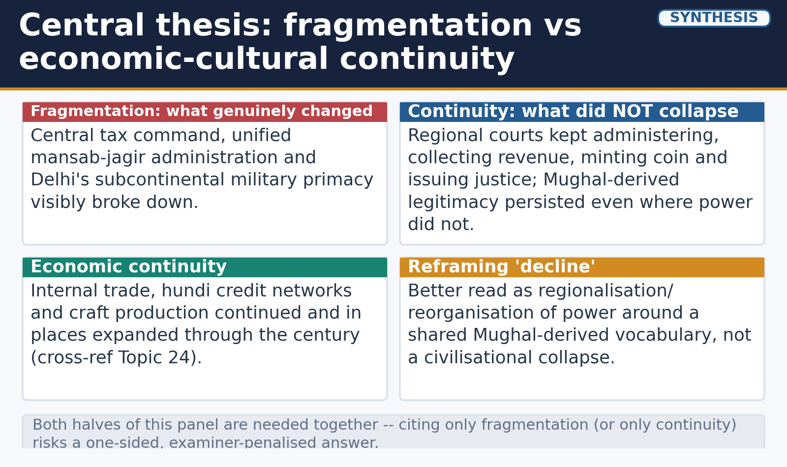

*Visual 23: central thesis -- fragmentation vs economic-cultural continuity. Schematic maps are NOT TO SCALE where marked.*

#### DEFINITION / WHAT THIS IS CALLED

**Plain-language definition:** This topic's central thesis is that eighteenth-century political fragmentation and considerable economic-cultural continuity ran side by side, not that the first simply caused the second's collapse.

**Technical definition:** A strong Mains answer should state this thesis explicitly, in these terms, since it is the single most efficient way to demonstrate a non-teleological, non-collapse-only understanding of the eighteenth century.

#### ANSWER-GRABBING OPENING — WRITE/ADAPT IN THE EXAM

> This topic's central analytical thesis, drawn directly from the source material's own historiography ladder (subtopic 2), is that eighteenth-century political fragmentation and considerable economic-cultural continuity ran side by side, rather than the first simply causing the second's collapse.

#### MUST-WRITE KEYWORDS

- **Central thesis**
- **fragmentation vs economic-cultural continuity**
- **non-teleological reading**
- **Alam**
- **Subrahmanyam**
- **Central thesis: fragmentation vs economic-cultural continuity**

**How to use them:** State the central thesis in one sentence - fragmentation and continuity ran side by side - before using subtopics 21-22 as its two evidence strands.

This topic's central analytical thesis, drawn directly from the source material's own historiography ladder (subtopic 2), is that eighteenth-century political fragmentation and considerable economic-cultural continuity ran side by side, rather than the first simply causing the second's collapse. Political authority fragmented in exactly the ways Parts II-VII trace: contested succession, a hollowed fiscal centre, and increasingly autonomous successor states and regional powers. Yet trade networks, craft production, banking and credit institutions, and courtly cultural patronage did not uniformly collapse alongside the political centre - in many regions they reorganised around new regional courts rather than disappearing.

FACT: this is the specific point the source material's regional/agrarian-focused historians (named as Alam and Subrahmanyam in the advanced notes) use to caution against reading "decline" as uniform, empire-wide economic and cultural collapse. ANALYSIS: the thesis must be handled carefully - it is not a claim that nothing was lost, and it is not a claim that regional courts simply "replaced" the empire's economic role unchanged; it is the more precise claim that political and economic-cultural trajectories partly decoupled, so that a single "decline" label applied uniformly to both dimensions is imprecise. Subtopics 21-22 supply the specific evidence for the economic-cultural half of this thesis; Parts II-VII supply the political-fragmentation half.

A strong Mains answer should state this thesis explicitly, in these terms, since it is the single most efficient way to demonstrate a non-teleological, non-collapse-only understanding of the eighteenth century.

#### DEMONSTRATION

**Claim:** political fragmentation and economic-cultural continuity are two separate trajectories that must not be collapsed into one “decline” narrative. **Evidence:** the regional/agrarian-focused historiography named in the advanced notes (Alam and Subrahmanyam) cautions specifically against reading eighteenth-century “decline” as uniform, empire-wide economic and cultural collapse. **Analysis:** the thesis is not a claim that nothing was lost, nor that regional courts simply replaced the empire's economic role unchanged - it is that political and economic-cultural trajectories partly decoupled. **Qualification:** a single “decline” label cannot be applied uniformly across the political and economic-cultural dimensions at once; the specific evidence for each must be cited separately.

#### CLOSING RECALL FLOW — CENTRAL THESIS: FRAGMENTATION VS ECONOMIC-CULTURAL CONTINUITY

```text
START / CONCEPT: Central thesis: fragmentation vs economic-cultural continuity
        |
        v
EXACT TERMS: Central thesis · fragmentation vs economic-cultural continuity · non-teleological reading · Alam · Subrahmanyam · Central thesis: fragmentation vs economic-cultural continuity
        |
        v
MECHANISM / ARGUMENT: A strong Mains answer should state this thesis explicitly, in these terms, since it is the single most efficient way to demonstrate a non-teleological, non-collapse-only understanding of the eighteenth century.
        |
        v
CONSEQUENCE / CONTRAST: ANALYSIS: the thesis must be handled carefully - it is not a claim that nothing was lost, and it is not a claim that regional courts simply "replaced" the empire's economic role unchanged; it is the more precise claim that political and economic-cultural trajectories partly decoupled, so that a single "decline" label applied uniformly to both dimensions is imprecise.
        |
        v
UPSC TRAP / ANSWER-USE: Do not miss this limiting distinction: this is the specific point the source material's regional/agrarian-focused historians (named as Alam and Subrahmanyam) make when they caution against reading the eighteenth century only as imperial breakdown: political fragmentation at the Mughal centre coexisted with continuing or even expanding regional trade, cultivation and craft production, so "decline" cannot be used as a single, undifferentiated label covering both the political and the economic-cultural record.
        |
        v
ANSWER-GRABBING FORMULATION: This topic's central analytical thesis, drawn directly from the source material's own historiography ladder (subtopic 2), is that eighteenth-century political fragmentation and considerable economic-cultural continuity ran side by side, rather than the first simply causing the second's collapse.
```
### SESSION 21 — EIGHTEENTH-CENTURY ECONOMY: CONTINUITY EVIDENCE

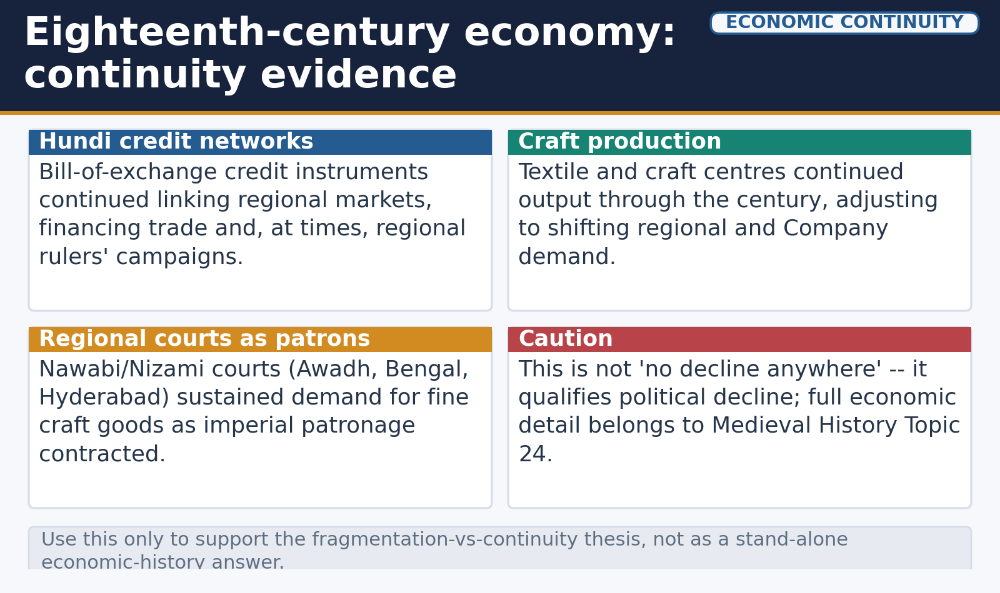

*Visual 24: eighteenth-century economy -- continuity evidence. Schematic maps are NOT TO SCALE where marked.*

#### DEFINITION / WHAT THIS IS CALLED

**Plain-language definition:** Eighteenth-century economic activity - inland and maritime trade, banking and credit houses, and craft production under regional-court patronage - substantially continued despite Mughal political fragmentation.

**Technical definition:** A careful answer should cite at least one specific continuity mechanism (banking/credit houses, or trade networks, or craft-production centres under regional patronage) rather than asserting continuity in only general terms.

#### ANSWER-GRABBING OPENING — WRITE/ADAPT IN THE EXAM

> Eighteenth-century economic activity - trade, credit and craft production - substantially continued despite Mughal political fragmentation, evidenced concretely by Bengal's Jagat Seth banking house.

#### MUST-WRITE KEYWORDS

- **Eighteenth-century economy**
- **continuity evidence**
- **Bengal's Jagat Seth banking house**
- **craft-production centres**
- **agrarian cultivation continuity**
- **trade-route disruption alongside continuity**

**How to use them:** Cite at least one named continuity mechanism (Jagat Seth's banking house, a specific trade network, or a craft centre) and note that some routes were disrupted by war even as continuity held more broadly.

FACT: inland and maritime trade networks continued to operate across the eighteenth century, banking and credit houses (of which Bengal's Jagat Seth firm is the most frequently cited example) financed both regional-court and trading-company activity, and craft production and regional urban centres persisted under the patronage of the new successor courts rather than uniformly declining alongside the Mughal political centre; agrarian cultivation itself mostly continued across the century, even though specific trade routes and caravan traffic suffered real, localised disruption during active campaign seasons (Abdali's Punjab corridor, subtopic 18, and the Panipat marches, subtopic 19, being the clearest cases), so continuity and disruption coexisted rather than one simply displacing the other. ANALYSIS: this evidence directly supports subtopic 20's thesis by locating specific, citable economic activities that continued or reorganised through the very decades in which Parts II-VII document political fragmentation - the two trends must be held together, not treated as mutually exclusive, since both are independently well evidenced. (Full detail on the Mughal-era economy's own institutional peak belongs to Topic 24 and is not repeated here; this subtopic addresses only the eighteenth century's continuity evidence.)

A careful answer should cite at least one specific continuity mechanism (banking/credit houses, or trade networks, or craft-production centres under regional patronage) rather than asserting continuity in only general terms.

#### DEMONSTRATION

**Claim:** economic activity substantially continued across the eighteenth century despite political fragmentation. **Evidence:** inland and maritime trade networks continued to operate, banking and credit houses such as Bengal's Jagat Seth firm financed both regional-court and trading-company activity, and craft production persisted under regional-court patronage. **Analysis:** this evidence directly supports the fragmentation-versus-continuity thesis by locating specific, citable economic activities that continued through the very decades of documented political fragmentation. **Qualification:** continuity was uneven - agrarian cultivation mostly continued, while specific trade routes suffered real, localised disruption during active campaign seasons such as Abdali's Punjab corridor and the Panipat marches.

#### CLOSING RECALL FLOW — EIGHTEENTH-CENTURY ECONOMY: CONTINUITY EVIDENCE

```text
START / CONCEPT: Eighteenth-century economy: continuity evidence
        |
        v
EXACT TERMS: Eighteenth-century economy · continuity evidence · Bengal's Jagat Seth · Mughal · Parts II-VII · route disruption alongside continuity
        |
        v
MECHANISM / ARGUMENT: A careful answer should cite at least one specific continuity mechanism (banking/credit houses, or trade networks, or craft-production centres under regional patronage) rather than asserting continuity in only general terms.
        |
        v
CONSEQUENCE / CONTRAST: ANALYSIS: this evidence directly supports subtopic 20's thesis by locating specific, citable economic activities that continued or reorganised through the very decades in which Parts II-VII document political fragmentation - the two trends must be held together, not treated as mutually exclusive, since both are independently well evidenced.
        |
        v
UPSC TRAP / ANSWER-USE: inland and maritime trade networks continued to operate across the eighteenth century, banking and credit houses (of which Bengal's Jagat Seth firm is the most frequently cited example) financed both regional-court and trading-company activity, and craft production and regional urban centres persisted under the patronage of the new successor courts rather than uniformly declining alongside the Mughal political centre; agrarian cultivation itself mostly continued across the century, even though specific trade routes and caravan traffic suffered real, localised disruption during active campaign seasons (Abdali's Punjab corridor, subtopic 18, and the Panipat marches, subtopic 19, being the clearest cases), so continuity and disruption coexisted rather than one simply displacing the other.
        |
        v
ANSWER-GRABBING FORMULATION: Eighteenth-century economic activity - trade, credit and craft production - substantially continued despite Mughal political fragmentation, evidenced concretely by Bengal's Jagat Seth banking house.
```
### SESSION 22 — CULTURAL PATRONAGE: CONTINUITY THROUGH REGIONAL COURTS

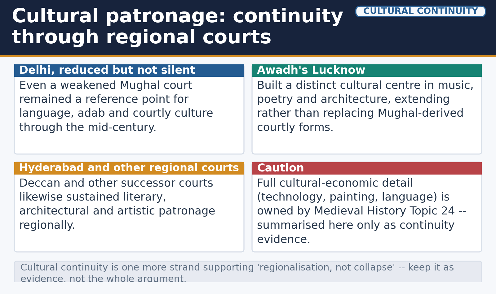

*Visual 25: cultural patronage -- continuity through regional courts. Schematic maps are NOT TO SCALE where marked.*

#### DEFINITION / WHAT THIS IS CALLED

**Plain-language definition:** Cultural patronage did not vanish with central Mughal contraction; it relocated to, and was sustained by, regional successor courts.

**Technical definition:** A precise account names specific regional centres of continued patronage - such as Awadh's Lucknow establishment and Hyderabad's Deccani court - rather than asserting generic continuity without a locatable example.

#### ANSWER-GRABBING OPENING — WRITE/ADAPT IN THE EXAM

> Cultural patronage did not vanish with central Mughal contraction; it relocated to, and was sustained by, regional successor courts such as Awadh's Lucknow establishment and Hyderabad's Deccani court.

#### MUST-WRITE KEYWORDS

- **Cultural patronage**
- **continuity through regional courts**
- **Lucknow and Hyderabad courts**
- **redirected, not lost, patronage**
- **literary and architectural patronage**
- **Awadh's Lucknow establishment**

**How to use them:** Name Lucknow and Hyderabad's courts specifically as the topic's own continuity evidence, and use them as the second strand alongside subtopic 21's economic evidence.

FACT: as central Mughal patronage contracted, regional successor courts - Awadh's Lucknow establishment prominent among them, alongside Hyderabad's Deccani court and other regional centres - took up literary, architectural and artistic patronage, sustaining and in some respects extending cultural production rather than allowing it to lapse with the political centre's fragmentation. ANALYSIS: this cultural-patronage continuity is the second specific evidence strand (alongside subtopic 21's economic evidence) for subtopic 20's central thesis, and it is exactly why this topic insists that "decline" cannot be applied uniformly across the political, economic and cultural dimensions at once - regional courts absorbed and redirected patronage rather than simply losing it. (Full detail on the Mughal court's own peak-era cultural patronage belongs to Topic 24 and is not repeated here.)

A precise answer should name at least one specific regional centre of continued patronage (for example, Awadh's Lucknow establishment) rather than asserting generic "cultural continuity" without a locatable example.

#### DEMONSTRATION

**Claim:** cultural patronage shifted toward, rather than lapsing with, the political centre's fragmentation. **Evidence:** as central Mughal patronage contracted, regional successor courts - Awadh's Lucknow establishment and Hyderabad's Deccani court prominent among them - took up literary, architectural and artistic patronage. **Analysis:** this cultural-patronage continuity is the second specific evidence strand, alongside subtopic 21's economic evidence, for the central fragmentation-versus-continuity thesis. **Qualification:** regional courts absorbed and redirected patronage rather than simply preserving it unchanged, so continuity here means reorganisation, not a static survival of Mughal-centre practice.

#### CLOSING RECALL FLOW — CULTURAL PATRONAGE: CONTINUITY THROUGH REGIONAL COURTS

```text
START / CONCEPT: Cultural patronage: continuity through regional courts
        |
        v
EXACT TERMS: Cultural patronage · continuity through regional courts · Lucknow and Hyderabad courts · redirected, not lost, patronage · Mughal · Topic
        |
        v
MECHANISM / ARGUMENT: A precise answer should name at least one specific regional centre of continued patronage (for example, Awadh's Lucknow establishment) rather than asserting generic "cultural continuity" without a locatable example.
        |
        v
CONSEQUENCE / CONTRAST: (Full detail on the Mughal court's own peak-era cultural patronage belongs to Topic 24 and is not repeated here.).
        |
        v
UPSC TRAP / ANSWER-USE: Do not miss this limiting distinction: full detail on the Mughal court's own peak-era cultural patronage belongs to Topic 24 and is not repeated here - do not credit regional courts with "inventing" a patronage tradition that Topic 24 already shows was inherited and adapted from Mughal-era models, since the accurate claim is redirection and continuation of an existing tradition, not its fresh creation by successor states.
        |
        v
ANSWER-GRABBING FORMULATION: Cultural patronage did not vanish with central Mughal contraction; it relocated to, and was sustained by, regional successor courts such as Awadh's Lucknow establishment and Hyderabad's Deccani court.
```
### PART IX - NON-INEVITABILITY AND THE BRIDGE FORWARD

### SESSION 23 — NON-INEVITABILITY: WAS BRITISH RULE AUTOMATIC?

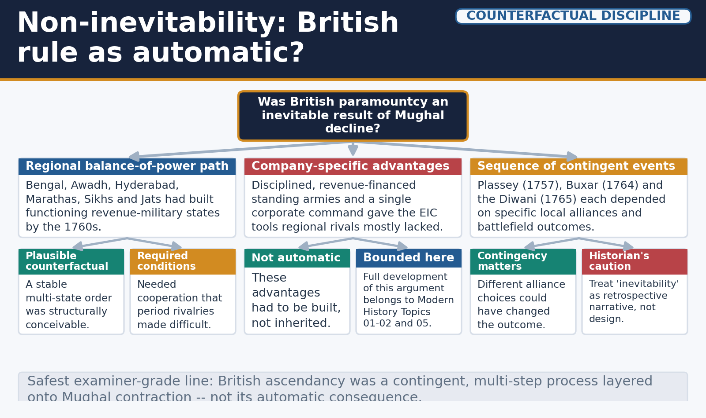

*Visual 26: non-inevitability -- was British rule automatic? schematic maps are NOT TO SCALE where marked.*

#### DEFINITION / WHAT THIS IS CALLED

**Plain-language definition:** Asserting that the Mughal empire's fragmentation "led inevitably" to British rule is a teleological overreach that this topic explicitly rejects; asserting that British success owed nothing to the openness created by Mughal fragmentation would understate the connection.

**Technical definition:** The specific sequence that produced British paramountcy - the East India Company's Bengal military-fiscal base after Plassey (1757) and the Diwani (1765), its distinctive sepoy-army and revenue-extraction model, and a series of further contingent military and diplomatic outcomes across the following decades - belongs to Modern History Topics 01, 02 and 05 and is not analysed in depth here.

#### ANSWER-GRABBING OPENING — WRITE/ADAPT IN THE EXAM

> nothing in the political-fragmentation and jagirdari-crisis evidence examined in Parts II-VII, taken alone, establishes that British colonial rule was the empire's predetermined destination; the eighteenth century instead shows several regional powers - Bengal's Nawabi, Awadh, Hyderabad, the Maratha confederacy, Jat and Sikh formations - each substantial enough that more than one plausible regional-successor outcome was conceivable from a mid-eighteenth-century vantage point.

#### MUST-WRITE KEYWORDS

- **Non-inevitability**
- **Parts II-VII**
- **British**
- **Bengal's Nawabi**
- **Awadh**
- **Hyderabad**

**How to use them:** State the non-inevitability thesis precisely - a genuinely open, multi-polar order, not a vacuum with one certain successor - and use the Modern History hand-off to avoid overreaching into material this topic does not teach.

FACT: nothing in the political-fragmentation and jagirdari-crisis evidence examined in Parts II-VII, taken alone, establishes that British colonial rule was the empire's predetermined destination; the eighteenth century instead shows several regional powers - Bengal's Nawabi, Awadh, Hyderabad, the Maratha confederacy, Jat and Sikh formations - each substantial enough that more than one plausible regional-successor outcome was conceivable from a mid-eighteenth-century vantage point. The specific sequence that produced British paramountcy - the East India Company's Bengal military-fiscal base after Plassey (1757) and the Diwani (1765), its distinctive sepoy-army and revenue-extraction model, and a series of further contingent military and diplomatic outcomes across the following decades - belongs to Modern History Topics 01, 02 and 05 and is not analysed in depth here.

ANALYSIS: the defensible position is that Mughal decline created a genuinely open, multi-polar regional order, not a vacuum with only one possible successor; British paramountcy required its own specific, contingent institutional and military innovations and a sequence of further events that this topic's own evidence does not, by itself, predict. Asserting that the Mughal empire's fragmentation "led inevitably" to British rule is a teleological overreach that this topic explicitly rejects; asserting that British success owed nothing to the openness created by Mughal fragmentation would understate the connection. Both must be held in a qualified balance.

#### DEMONSTRATION

**Claim:** British paramountcy was not the predetermined destination of Mughal decline. **Evidence:** the eighteenth century's political-fragmentation evidence shows several substantial regional powers - Bengal's Nawabi, Awadh, Hyderabad, the Maratha confederacy, and Jat and Sikh formations - each a plausible alternative regional order. **Analysis:** the defensible position is that Mughal decline created a genuinely open, multi-polar regional order, not a vacuum with only one possible successor. **Qualification:** British paramountcy required its own specific, contingent institutional and military innovations and a further sequence of events that this topic's evidence does not, by itself, predict.

#### CLOSING RECALL FLOW — NON-INEVITABILITY: WAS BRITISH RULE AUTOMATIC?

```text
START / CONCEPT: Non-inevitability: was British rule automatic?
        |
        v
EXACT TERMS: Non-inevitability · Parts II-VII · British · Bengal's Nawabi · Awadh · Hyderabad
        |
        v
MECHANISM / ARGUMENT: Asserting that the Mughal empire's fragmentation "led inevitably" to British rule is a teleological overreach that this topic explicitly rejects; asserting that British success owed nothing to the openness created by Mughal fragmentation would understate the connection.
        |
        v
CONSEQUENCE / CONTRAST: The specific sequence that produced British paramountcy - the East India Company's Bengal military-fiscal base after Plassey (1757) and the Diwani (1765), its distinctive sepoy-army and revenue-extraction model, and a series of further contingent military and diplomatic outcomes across the following decades - belongs to Modern History Topics 01, 02 and 05 and is not analysed in depth here.
        |
        v
UPSC TRAP / ANSWER-USE: the defensible position is that Mughal decline created a genuinely open, multi-polar regional order, not a vacuum with only one possible successor; British paramountcy required its own specific, contingent institutional and military innovations and a sequence of further events that this topic's own evidence does not, by itself, predict.
        |
        v
ANSWER-GRABBING FORMULATION: nothing in the political-fragmentation and jagirdari-crisis evidence examined in Parts II-VII, taken alone, establishes that British colonial rule was the empire's predetermined destination; the eighteenth century instead shows several regional powers - Bengal's Nawabi, Awadh, Hyderabad, the Maratha confederacy, Jat and Sikh formations - each substantial enough that more than one plausible regional-successor outcome was conceivable from a mid-eighteenth-century vantage point.
```
### 24. Topic-boundary bridge: what each package owns in depth

A disciplined answer on this topic explicitly respects its neighbours' ownership rather than silently absorbing their material. Medieval Topic 16 owns the Mughal provincial-administrative hierarchy (Suba-Sarkar-Pargana) in institutional depth; Topics 22 and 23 own Aurangzeb's Deccan wars and Shivaji's Maratha state-building in full detail; Topic 24 owns the Mughal empire's own economy, society and cultural patronage at its institutional peak. Modern History Topic 01 owns the East India Company's early establishment and trade; Topic 02 owns "Indian states and society" on the eve of colonialism in its own right (including the very successor-state material this topic teaches, examined from a forward-looking Modern History vantage); and Topic 05 owns British territorial expansion and the military-fiscal explanation for Company victories in detail.

FACT: this topic's own boundary is 1707-1761, and it draws on the neighbouring topics above only as much as its own argument strictly requires, naming each borrowed point's true owner rather than re-teaching it. ANALYSIS: this discipline is not a formality - it is what keeps this topic's own argument (structural, converging, non-teleological decline) from blurring into either a Deccan-war narrative it doesn't own or a colonial-conquest narrative that isn't its to tell; a precise Mains answer that needs to gesture toward 1757-1765 should do so in one clearly bounded sentence naming the correct forward-owning topic, exactly as this subtopic does.


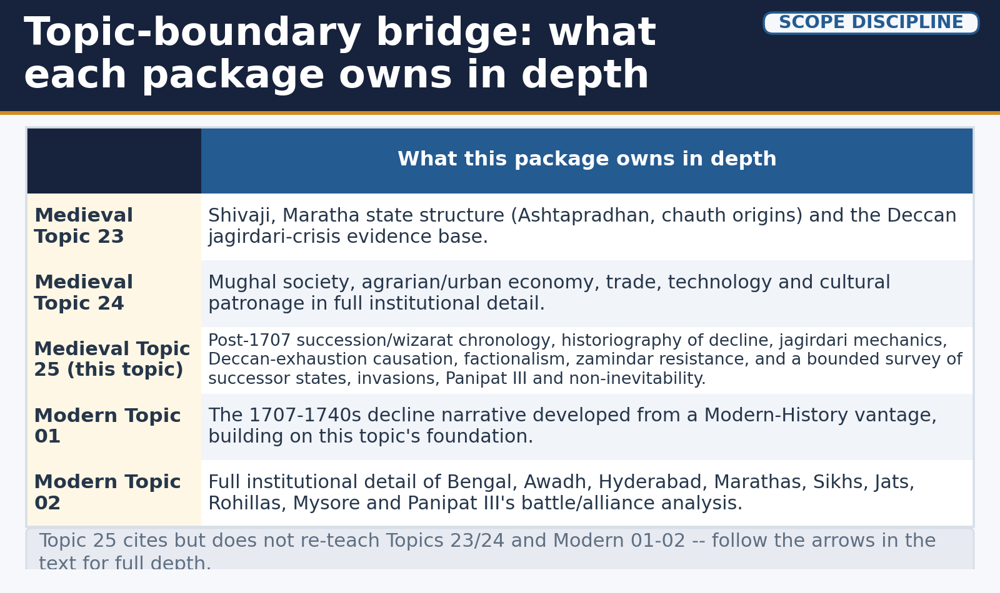

*Visual 27: topic-boundary bridge -- what each package owns in depth. Schematic maps are NOT TO SCALE where marked.*

### SESSION 24 — TWO WRONG FRAMINGS TO NAME AND REJECT

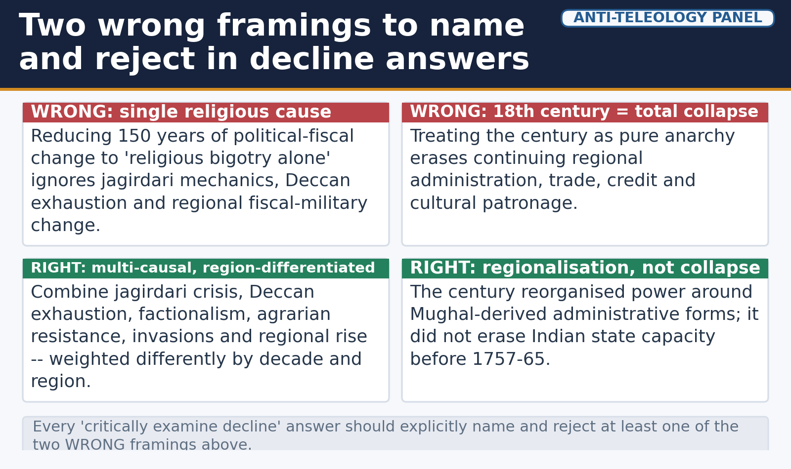

*Visual 28: two wrong framings to name and reject in decline answers. Schematic maps are NOT TO SCALE where marked.*

#### DEFINITION / WHAT THIS IS CALLED

**Plain-language definition:** The first is teleological framing: presenting 1707-1761 as a story whose ending (British paramountcy) was already latent in its beginning, so that every event is narrated as a step "toward" a foreordained outcome.

**Technical definition:** The second is monocausal-religious framing: reducing the entire decline to Aurangzeb's personal religious policy or character, in a way that a converging, multi-strand structural crisis (Part I's system map) cannot support as a sufficient explanation on its own.

#### ANSWER-GRABBING OPENING — WRITE/ADAPT IN THE EXAM

> The first is teleological framing: presenting 1707-1761 as a story whose ending (British paramountcy) was already latent in its beginning, so that every event is narrated as a step "toward" a foreordained outcome.

#### MUST-WRITE KEYWORDS

- **Two wrong framings to name and reject**
- **teleological framing**
- **monocausal-religious framing**
- **British paramountcy as predetermined outcome**
- **Aurangzeb's religious policy overreach**
- **1707-1761**

**How to use them:** Name and reject teleological framing and monocausal-religious framing explicitly, since naming both is itself a discriminating, high-scoring move.

Two specific wrong framings recur often enough in weak answers that they deserve explicit naming and rejection, rather than simply being avoided by omission. The first is teleological framing: presenting 1707-1761 as a story whose ending (British paramountcy) was already latent in its beginning, so that every event is narrated as a step "toward" a foreordained outcome. The second is monocausal-religious framing: reducing the entire decline to Aurangzeb's personal religious policy or character, in a way that a converging, multi-strand structural crisis (Part I's system map) cannot support as a sufficient explanation on its own.

FACT: the source material explicitly frames decline as a multi-strand structural convergence and explicitly cautions against a religious-policy-only explanation; subtopic 23 explicitly establishes non-inevitability as against teleology. ANALYSIS: naming both wrong framings directly in an answer, and stating why each is inadequate (teleology reads history backward from a known outcome; a religious-monocausal account ignores the fiscal-administrative, political and external-shock evidence examined across Parts II-VII), is itself strong evidence of analytical control, and is a discriminating mark of a high-scoring answer on this topic relative to a purely narrative one.

#### DEMONSTRATION

**Claim:** two specific wrong framings of Mughal decline - teleology and religious monocausality - must be named and explicitly rejected, not merely avoided by omission. **Evidence:** Session 23 names Bengal, Awadh, Hyderabad and the Maratha confederacy as substantial, genuinely plausible regional alternatives, directly against a teleological reading toward British paramountcy, while Sessions 4-9's fiscal-administrative convergence (be-jagiri, noble factionalism, Deccan-war exhaustion) shows why Jadunath Sarkar's religious-policy-centred strand (Session 2) cannot stand alone as a sufficient cause. **Analysis:** naming both wrong framings, and stating precisely why each is inadequate, is itself strong evidence of analytical control and a discriminating mark of a high-scoring answer. **Qualification:** teleology reads history backward from a known outcome, while a religious-monocausal account ignores the fiscal-administrative, political and external-shock evidence examined across this topic.

#### CLOSING RECALL FLOW — TWO WRONG FRAMINGS TO NAME AND REJECT

```text
START / CONCEPT: Two wrong framings to name and reject
        |
        v
EXACT TERMS: Two wrong framings to name · reject · teleological framing · British · monocausal-religious framing · 1707-1761
        |
        v
MECHANISM / ARGUMENT: The second is monocausal-religious framing: reducing the entire decline to Aurangzeb's personal religious policy or character, in a way that a converging, multi-strand structural crisis (Part I's system map) cannot support as a sufficient explanation on its own.
        |
        v
CONSEQUENCE / CONTRAST: ANALYSIS: naming both wrong framings directly in an answer, and stating why each is inadequate (teleology reads history backward from a known outcome; a religious-monocausal account ignores the fiscal-administrative, political and external-shock evidence examined across Parts II-VII), is itself strong evidence of analytical control, and is a discriminating mark of a high-scoring answer on this topic relative to a purely narrative one.
        |
        v
UPSC TRAP / ANSWER-USE: Do not miss this limiting distinction: the source material explicitly frames decline as a multi-strand structural convergence and explicitly cautions against reducing it to either a single foreordained trajectory or to one ruler's personal failing, so an answer that names and rejects both the teleological and the monocausal-religious framing in the same paragraph directly demonstrates command of the source material's own stated method, not just its content.
        |
        v
ANSWER-GRABBING FORMULATION: The first is teleological framing: presenting 1707-1761 as a story whose ending (British paramountcy) was already latent in its beginning, so that every event is narrated as a step "toward" a foreordained outcome.
```
### SESSION 25 — PYQ ROUTE PANEL AND THE FACT-RISK LEDGER

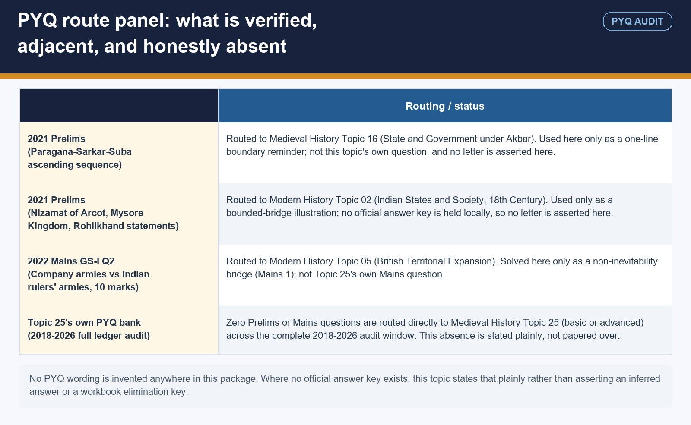

*Visual 29: PYQ route panel -- what is verified, adjacent, and honestly absent. Schematic maps are NOT TO SCALE where marked.*

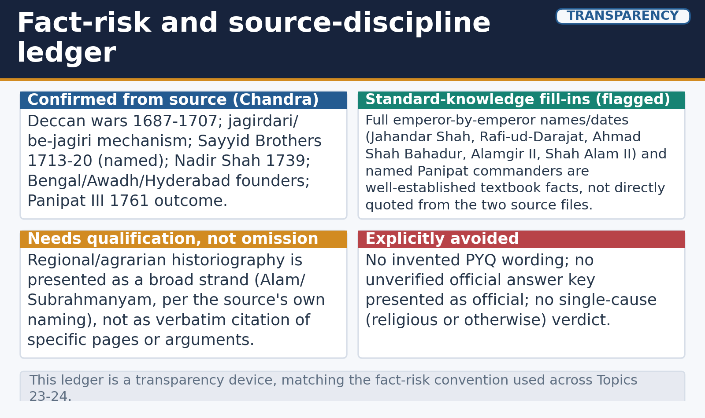

*Visual 30: fact-risk and source-discipline ledger. Schematic maps are NOT TO SCALE where marked.*

#### DEFINITION / WHAT THIS IS CALLED

**Plain-language definition:** No Prelims or Mains question in the verified UPSC record from 2018 to 2026 is directly set on this topic; three thematically adjacent items from neighbouring topics are used only as bounded illustrations, never as this topic's own verified questions.

**Technical definition:** The PYQ route panel lists this topic's own directly routed items, of which there are none across 2018-2026; the fact-risk ledger separately flags which claims are directly evidenced versus which carry more interpretive weight and need visible hedging in an answer.

#### ANSWER-GRABBING OPENING — WRITE/ADAPT IN THE EXAM

> No Prelims or Mains question in the verified UPSC record from 2018 to 2026 is directly set on this topic; three thematically adjacent items from neighbouring topics are used only as bounded illustrations.

#### MUST-WRITE KEYWORDS

- **PYQ route panel**
- **the fact-risk ledger**
- **zero routed PYQs**
- **Paragana-Sarkar-Suba sequence**
- **Nizamat of Arcot bridge item**
- **2022 Company-armies Mains bridge**

**How to use them:** State plainly that zero PYQs route directly to this topic, then use the three disclosed adjacent items only as bounded illustrations, never as this topic's own verified questions.

This subtopic states plainly what the verified UPSC question record shows, rather than assuming this topic must own a large PYQ bank simply because it is a major theme. A transparent, honest disclosure is more useful to an exam candidate than a padded-looking but inaccurate one.

FACT: a full check of the verified Prelims and Mains question record from 2018 through 2026 shows **zero Prelims or Mains questions set directly on Medieval Topic 25 (basic or advanced) across the entire period**. ANALYSIS: this is stated honestly rather than papered over - three thematically close items exist, but each is properly set on a different topic, and each is used below strictly as a clearly disclaimed adjacent/bridge illustration, never as this topic's "own" verified question.

The fact-risk ledger below is this subtopic's second function: a compact reminder of which specific facts in this topic carry the least risk of being wrong (directly evidenced, low-inference) versus which carry more interpretive weight (a named historian's framework, or a qualified analytical thesis) and should be presented with visible hedging in an answer.

#### DEMONSTRATION

**Claim:** this topic honestly discloses that no Prelims or Mains question is set directly on it. **Evidence:** a full check of the verified Prelims and Mains question record for 2018-2023, 2024-2025 and 2026 shows zero questions set directly on Medieval Topic 25. **Analysis:** stating this plainly, rather than papering over the gap, is itself the honest evidentiary discipline this topic requires of every claim it makes. **Qualification:** three thematically close items exist but properly belong to other topics, and are used strictly as disclosed adjacent or bridge illustrations, never as this topic's own verified question.

#### CLOSING RECALL FLOW — PYQ ROUTE PANEL AND THE FACT-RISK LEDGER

```text
START / CONCEPT: PYQ route panel and the fact-risk ledger
        |
        v
EXACT TERMS: PYQ route panel · the fact-risk ledger · zero routed PYQs · 2018-2023 · 2024-2025 · 2018-2026
        |
        v
MECHANISM / ARGUMENT: This subtopic states plainly what the verified UPSC question record shows, rather than assuming this topic must own a large PYQ bank simply because it is a major theme.
        |
        v
CONSEQUENCE / CONTRAST: this is stated honestly rather than papered over - three thematically close items exist, but each properly belongs to a different topic, and each is used below strictly as a clearly disclaimed adjacent/bridge illustration, never as this topic's "own" verified question.
        |
        v
UPSC TRAP / ANSWER-USE: A transparent, honest disclosure is more useful to an exam candidate than a padded-looking but inaccurate one.
        |
        v
ANSWER-GRABBING FORMULATION: No Prelims or Mains question in the verified UPSC record from 2018 to 2026 is directly set on this topic; three thematically adjacent items from neighbouring topics are used only as bounded illustrations.
```
### SESSION 26 — BOUNDED LIVE LINKAGE

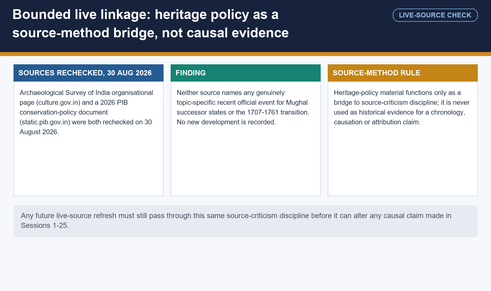

*Visual 26: bounded live linkage -- a dedicated visual for this session, showing the two rechecked heritage sources, the finding, and the source-method rule; it is not the at-a-glance teaching map reused. Schematic maps are NOT TO SCALE where marked.*

#### DEFINITION / WHAT THIS IS CALLED

**Plain-language definition:** Official Indian heritage-conservation sources, rechecked in 2026, record no new topic-specific development for Mughal successor states or the 1707-1761 transition; heritage policy functions only as a source-method bridge, never as historical evidence.

**Technical definition:** Official conservation materials were rechecked on 30 August 2026 and provide only a bounded modern bridge to preserving monuments and archives.

#### ANSWER-GRABBING OPENING — WRITE/ADAPT IN THE EXAM

> Official Indian heritage-conservation sources, rechecked in 2026, record no new topic-specific development for Mughal successor states or the 1707-1761 transition; heritage policy is a source-method bridge only, not historical evidence.

#### MUST-WRITE KEYWORDS

- **Bounded live linkage**
- **Archaeological Survey of India conservation record**
- **heritage-policy bridge**
- **monument and archive preservation**
- **source-criticism discipline**
- **1707-1761**

**How to use them:** Use the heritage-policy note only as a source-method caution, never as evidence for any eighteenth-century causal claim.

Official conservation materials were rechecked on 30 August 2026 and provide only a bounded modern bridge to preserving monuments and archives. No genuinely topic-specific recent official event was found for Mughal successor states or the 1707-1761 transition. Heritage policy is not evidence for eighteenth-century causal claims; those remain governed by this topic's own verified written sources and careful source criticism.

The live page is a heritage and source-method bridge only. Historical chronology, causation, attribution and institutional claims remain governed by this topic's own verified written sources and explicit source criticism, not by any live webpage.

#### DEMONSTRATION

**Claim:** the live heritage-policy page functions only as a bounded source-method bridge, never as historical evidence in its own right. **Evidence:** the Archaeological Survey of India's own organisational page (`culture.gov.in/our-organisations/archaeological-survey-india-new-delhi`) and a PIB conservation-policy document (`static.pib.gov.in`, dated 2026) were rechecked on 30 August 2026, and neither names any genuinely topic-specific recent official event for Mughal successor states or the 1707-1761 transition. **Analysis:** this confirms that heritage-policy material cannot substitute for this topic's own verified written sources and explicit source criticism, which control every chronology, causation and attribution claim in this topic. **Qualification:** any future live-source refresh must still be filtered through this same source-criticism discipline before it is allowed to alter any causal claim made in Sessions 1-25.

#### CLOSING RECALL FLOW — BOUNDED LIVE LINKAGE

```text
START / CONCEPT: Bounded live linkage
        |
        v
EXACT TERMS: Bounded live linkage · Official · heritage-policy bridge · Mughal · Heritage policy · 1707-1761
        |
        v
MECHANISM / ARGUMENT: Heritage policy is not evidence for eighteenth-century causal claims; those remain governed by this topic's own verified written sources and careful source criticism.
        |
        v
CONSEQUENCE / CONTRAST: No genuinely topic-specific recent official event was found for Mughal successor states or the 1707-1761 transition.
        |
        v
UPSC TRAP / ANSWER-USE: Do not miss this limiting distinction: official conservation materials were rechecked on 30 August 2026 and provide only a bounded heritage-policy bridge, not new historical evidence - no genuinely topic-specific official development was found for Mughal successor states or the 1707-1761 transition, so this bridge may be cited only as a live-linkage note, never as evidence inside the historical argument itself.
        |
        v
ANSWER-GRABBING FORMULATION: Official Indian heritage-conservation sources, rechecked in 2026, record no new topic-specific development for Mughal successor states or the 1707-1761 transition; heritage policy is a source-method bridge only, not historical evidence.
```
### MEDIEVAL DEEP-REVIEW CORE CONTROL

- **Must remember:** Mughal decline was multi-causal: jagirdari stress, succession, war, regional power and fiscal-military change interacted.
- **Close distinction:** Hyderabad, Awadh and Bengal were successor states that adapted Mughal institutions, not mere evidence of anarchy.
- **Evidence / interpretation limit:** The eighteenth century is a transition with regional growth and new competition, not a teleological prelude to British rule.

### TOPIC 25 CLOSING MUGHAL-DECLINE-EIGHTEENTH-CENTURY LEDGER

Topic 25 owns 1707-1761: imperial succession and wizarat, fiscal-military
structures, successor states, Jats/Sikhs/Rohillas/Marathas, Nadir Shah,
Abdali/Panipat, economic-cultural continuity and decline historiography. Topic
23 retains Aurangzeb's Deccan war; Company state formation, Buxar and Diwani
belong Modern History Topic 01 onward.

Court spine: Bahadur Shah I 1707-12 -> Jahandar Shah/Zulfiqar 1712-13 ->
Farrukhsiyar/Sayyids 1713-19 -> two brief 1719 emperors -> Muhammad Shah
1719-48 and Sayyid fall 1720 -> Ahmad Shah 1748-54 -> Alamgir II 1754-59 ->
Shah Jahan III 1759-60 -> Shah Alam II from 1760 (proclaimed in absentia 1759). No
primogeniture meant princes required provincial revenue, armies and noble/Rajput
coalitions.

The emperor retained symbolic appointment legitimacy even as wazirs and nobles
captured access, jagirs, governorships and succession. Irani/Turani/Hindustani
labels never map permanent parties.

Structural loop: mansab claims + jagir/paibaqi shortage + be-jagiri +
jama-hasil gap + frequent transfer + zamindar/peasant resistance + war/chauth
+ weak contingents/corruption -> noble faction and lower collection. The
crisis does not mean agriculture or all assignment ceased.

Aurangzeb's 1687-1707 burden matters through annexation, garrisons, claimants,
long supply and northern neglect, but earlier mansab, agrarian and succession
structures prevent a one-ruler explanation.

Bengal under Murshid Quli Khan, Awadh under Saadat Khan and Hyderabad under
Nizam-ul-Mulk combined autonomous revenue/military regimes with Mughal titles,
offices and nominal allegiance. Regionalisation was devolution, not immediate
modern independence.

Jats under Churaman/Badan Singh/Suraj Mal, Sikh misls after Banda Bahadur, and
Rohilla Afghan chiefs in Rohilkhand formed distinct powers. Maratha expansion
joined Shahu-Peshwa coordination, chauth/sardeshmukhi and Holkar/Scindia/
Gaekwad/Bhonsle houses; tribute and recognition did not always mean direct
administration.

Nadir Shah defeated Mughal forces at Karnal and sacked Delhi in 1739, exposing
weak coordination but not causing the original decline or annexing India.
Abdali's repeated invasions culminated in Panipat 1761 against the Marathas.
Supply, alliances, non-combatant burden and Abdali-Rohilla coordination matter.
Panipat checked northward Maratha supremacy, not Maratha existence or an
automatic British succession.

Political contraction coexisted with agriculture, internal trade, textiles,
credit and regional cultural patronage. Violence and multiple levies varied by
region; Bengal strength could coexist with Delhi weakness. Artists and
literati moved to Awadh, Hyderabad, Rajasthan, Punjab, Bengal and Maratha
courts; decentralisation was not civilisational darkness.

Historiography must combine weak-ruler symptom, Jadunath Sarkar's Aurangzeb
emphasis, Satish Chandra's jagirdari crisis, agrarian/local-power analysis,
regional reordering and colonial non-inevitability. Fragmentation was a
permissive condition, not sufficient cause of Company paramountcy.

Direct Topic-25 CSE routes, 2018-2026: zero verified. Original practice is
labelled; Mains has no objective key.

**Answer:** periodise -> explain fiscal-military feedback -> court/noble
mechanism -> regional states/powers -> invasion shocks -> continuity/change ->
historiography -> bounded Modern-History bridge.

## BASIC MCQS / REMEDIATION

Exactly sixteen MCQs, one flat set (no sub-banks). Correct options are deliberately rotated by actual option placement, not by relabeling: A -> B -> C -> D repeated four times through the full set. Read the explanation after attempting each item.


*Visual 34: UPSC traps -- common misreadings vs the defensible position. Schematic maps are NOT TO SCALE where marked.*

#### Q1. What is this topic's own core chronological window?

- A. 1707 to 1761.

- B. 1761 to 1857.

- C. 1526 to 1707.

- D. 1600 to 1657.

**Answer: A.**
**Explanation:** The topic's core window runs from Aurangzeb's death to the Third Battle of Panipat; earlier and later periods are named only as bounded inheritance or hand-off.

#### Q2. The Sayyid Brothers (Abdullah Khan and Hussain Ali Khan Barha) controlled the Mughal wizarat from 1713 and were themselves overthrown by a wider noble coalition in which year?

- A. 1707.

- B. 1720.

- C. 1739.

- D. 1748.

**Answer: B.**
**Explanation:** The Sayyids installed Muhammad Shah in 1719 while still in power, and were defeated by a rival coalition (including Nizam-ul-Mulk) only in 1720; Muhammad Shah's own installation and the Sayyids' downfall are two separate, sequential events, not one.

#### Q3. In jagirdari terminology, paibaqi correctly refers to:

- A. The gap between assessed (jama) and actually realised (hasil) revenue.

- B. A noble's total military contingent obligation.

- C. Land or revenue available or awaiting assignment to a jagir-holder.

- D. The Maratha claim to one-quarter of assessed revenue.

**Answer: C.**
**Explanation:** Paibaqi names the pool of assignable, revenue-yielding land itself; it must not be confused with the jama-hasil gap, which is a separate concept describing under-realisation of already-assessed revenue.

#### Q4. The jagirdari feedback loop's four linked stages, in this topic's account, are:

- A. Succession dispute, factionalism, invasion, fiscal collapse.

- B. Jama assessment, hasil collection, chauth demand, sardeshmukhi demand.

- C. Deccan war, Bengal settlement, Awadh accommodation, Hyderabad sovereignty.

- D. Short-tenure extraction, under-investment, local resistance, intensified competition for scarce good jagirs.

**Answer: D.**
**Explanation:** This is a self-reinforcing loop, not a one-way chain, which is exactly why no single vigorous ruler could reverse it by decree alone.

#### Q5. After the Sayyid Brothers' 1720 defeat, Muhammad Shah's own reign is best described as:

- A. Continuing under a new set of power-holders until 1748, since he had already been installed in 1719.

- B. Ending in 1720 along with the Sayyid wizarat.

- C. Never actually beginning, since the Sayyids ruled in his name throughout.

- D. Beginning only in 1739 after Nadir Shah's invasion.

**Answer: A.**
**Explanation:** Muhammad Shah's installation (1719) and the Sayyid wizarat's fall (1720) are distinct events; his reign continued under a new set of power-holders until 1748, not ending with the Sayyids in 1720.

#### Q6. Zamindar and peasant resistance to jagirdar extraction is best analysed in this topic as:

- A. Pure lawlessness with no structural cause.

- B. A graded, locally variable response rooted in the fiscal squeeze, ranging from non-compliance to organised regional assertion.

- C. Proto-nationalist rebellion with a fully coherent shared programme.

- D. A phenomenon confined only to Bengal.

**Answer: B.**
**Explanation:** Reading resistance only as disorder erases its fiscal origin, while reading it only as coherent rebellion overstates its unity; the defensible middle position is a graded spectrum.

#### Q7. The centre-region spectrum this topic uses to describe Bengal, Awadh and Hyderabad is best applied to show that:

- A. The empire had already fully ended by 1720.

- B. The empire's authority was uniformly absolute everywhere until 1761.

- C. The Mughal emperor's nominal legitimacy and substantially devolved real power could coexist without contradiction.

- D. Only Bengal sought nominal Mughal confirmation.

**Answer: C.**
**Explanation:** The spectrum framing avoids a false choice between “the empire still ruled” and “the empire had already ended,” since both nominal legitimacy and devolved power operated together.

#### Q8. Murshid Quli Khan's principal contribution to Bengal's eighteenth-century autonomy was:

- A. Open military defiance of the Mughal centre.

- B. Confrontation with local zamindars to seize their land.

- C. Alliance with Nadir Shah against Delhi.

- D. A stabilised ijaradari (revenue-farming) settlement that replaced disruptive jagir turnover.

**Answer: D.**
**Explanation:** Bengal's autonomy rested on fiscal stabilisation rather than confrontation, while the Nawabi still sought nominal Mughal sanction.

#### Q9. The Sikh misls that re-emerged after Banda Bahadur's 1708-1716 rebellion are described in this topic as operating loosely under which shared umbrella?

- A. The Dal Khalsa confederal umbrella.

- B. The Ashtapradhan council.

- C. The Peshwa's central command.

- D. The Nizamat of Hyderabad.

**Answer: A.**
**Explanation:** The Sikh misls consolidated under a shared Dal Khalsa confederal umbrella, distinct from the separate Rohilla Afghan chiefs and from the Maratha polity's own Peshwa-led structure.

#### Q10. The 1719 Sayyid-Maratha settlement is best described as having:

- A. Replaced Mughal revenue authority outright with Maratha rule in the Deccan.

- B. Layered Maratha chauth and sardeshmukhi claims over a continuing Mughal-assessed revenue base.

- C. Ended all Maratha military obligations to the Mughal centre.

- D. Been immediately reversed by Muhammad Shah in 1720.

**Answer: B.**
**Explanation:** This is layered fiscal sovereignty, not Marathas “replacing” the empire; Mughal-derived assessments continued to operate as the base layer beneath the new Maratha claims.

#### Q11. Nadir Shah's 1739 raid is best understood in this topic's account as significant chiefly because it:

- A. Directly annexed Mughal territory to Persia.

- B. Was the sole and original cause of Mughal decline.

- C. Exposed the post-1707 empire's military hollowness at Karnal and caused a severe, lasting fiscal shock through plunder and indemnity.

- D. Ended Mughal rule immediately in 1739.

**Answer: C.**
**Explanation:** The raid's exam-relevant significance lies less in the plunder itself than in what it exposed (military hollowness) and what it caused (a severe fiscal shock), not in any claim of annexation or an immediate end to Mughal rule.

#### Q12. Ahmad Shah Abdali's invasions into north-western India, contesting the Punjab frontier with Mughal remnants, Sikh power and the Marathas, are correctly dated across roughly which span?

- A. 1707 to 1719.

- B. 1719 to 1748.

- C. 1739 to 1748.

- D. 1748 to 1767.

**Answer: D.**
**Explanation:** Abdali's invasions ran across roughly 1748-1767, even though this topic's own analytical narrative closes at the 1761 Battle of Panipat.

#### Q13. The Third Battle of Panipat (1761) is most defensibly framed in this topic as:

- A. A serious check to Maratha power that reshaped its immediate priorities, not a terminal collapse of the confederacy.

- B. The complete and final end of the Maratha confederacy as a power.

- C. A minor skirmish with no lasting consequence.

- D. An automatic clearing of the way for British paramountcy.

**Answer: A.**
**Explanation:** Panipat III was a severe military and dynastic loss, but the Maratha confederacy remained the century's most extensive indigenous power afterward, and no automatic British succession followed from it.

#### Q14. This topic's central thesis on political fragmentation versus economic-cultural continuity holds that:

- A. Nothing of value was lost economically or culturally in the eighteenth century.

- B. Political and economic-cultural trajectories partly decoupled, so a single “decline” label cannot be applied uniformly across both.

- C. Regional courts simply replaced the empire's economic role unchanged.

- D. Economic decline was total and matched political fragmentation exactly.

**Answer: B.**
**Explanation:** The thesis is a precise claim about partial decoupling between political and economic-cultural trajectories, not a claim that nothing was lost or that continuity was total.

#### Q15. This topic's position on the non-inevitability of British paramountcy is that Mughal decline:

- A. Directly and automatically caused British colonial rule as its predetermined destination.

- B. Had no relationship at all to later British expansion.

- C. Created a genuinely open, multi-polar regional order, and British paramountcy required its own separate, contingent institutional and military innovations.

- D. Was itself caused by early British intervention.

**Answer: C.**
**Explanation:** Several substantial regional powers offered plausible alternative orders; asserting that Mughal fragmentation “led inevitably” to British rule is a teleological reading this topic explicitly rejects.

#### Q16. Shah Jahan III (Muhi-ul-Millat), enthroned in 1759 after Alamgir II's assassination and deposed in 1760 when Shah Alam II acceded, is best read in this topic's account as illustrating:

- A. A restoration of fully undisputed Mughal sovereignty after the Sayyid period ended in 1720.

- B. A formal, permanent end to any further contest over who held the Delhi throne.

- C. A Maratha military conquest that replaced Mughal rule outright rather than continuing to use it.

- D. The continued external kingmaking of the imperial office by regional power-brokers - here the Marathas - extending the same pattern the Sayyid Brothers had begun decades earlier.

**Answer: D.**
**Explanation:** Shah Jahan III's brief 1759-60 reign was arranged by Maratha backing after Alamgir II's assassination and ended when Shah Alam II acceded; it extends, rather than reverses, the pattern of external noble/regional kingmaking of the Mughal office that the Sayyid Brothers had begun decades earlier, and it must not be misdated to 1748, a year that belongs to Ahmad Shah Bahadur's accession, not Shah Jahan III's.

## PYQS AND ANSWER PRACTICE

### PART X - SOURCES, PYQ AUDIT AND PRACTICE

### Transparent PYQ audit and route decision

**Audit scope:** every Prelims and Mains GS-I/GS-II/Essay routing ledger and integration audit currently in the repository covering 2018 through 2026 was checked line by line for any question mentioning the post-1707 succession, the Sayyid wizarat, the jagirdari crisis, jama/hasil/paibaqi/be-jagiri, Bengal/Awadh/Hyderabad, Jats/Sikhs/Marathas in their eighteenth-century political form, Nadir Shah, Abdali, or the Third Battle of Panipat.

**Audit result:** `PYQ-INTEGRATION-AUDIT-2018-2023.md`, `PYQ-INTEGRATION-AUDIT-2024-2025.md` and `PYQ-INTEGRATION-AUDIT-2026.md` each explicitly list Medieval Topic 25 basic and advanced files as owning no routed question across their respective windows. No Prelims or Mains question in any checked ledger is routed to Topic 25.

**2026 provenance, stated separately:** `_PYQ-ROUTING-PRELIMS-2026.md` (the official 2026 Set-A scan's own routing record) lists zero Medieval-Indian-History rows of any kind, so Topic 25 owns no 2026 Prelims Set-A question. The governing 2026 Mains ledger `_PYQ-GS1-2026.md` lists no Topic-25-routed 2026 Mains GS-I item; its own Q11 ("Vijayanagara architecture exemplifies the amalgamation of past traditions with contemporary practices") is explicitly routed to Indian Art & Culture Topic 03 (Temple Architecture and Chandella-Khajuraho), not to Topic 25. So Topic 25 owns no 2026 Mains GS-I question either. These two absences are independent findings from separate ledger types, and both ledgers agree with each other.

**No other medieval Mains item is borrowed:** the only Vijayanagara-adjacent Mains item anywhere near this audit's scope is the 2026 ledger's Q11, on Vijayanagara **architecture** (not Vijayanagara-Bahmani political/administrative history) - it is routed by `_PYQ-GS1-2026.md` to **Indian Art & Culture Topic 03**, not to Medieval History Topic 09 and not to Topic 25, so it falls outside this topic's 1707-1761 window and is not used as a bridge illustration here. The single Mains item this package does use as a bridge (Mains 1, below) is the verified 2022 Mains GS-I Company-armies question, owned by Modern History Topic 05, not by any medieval topic.

**Workbook/session policy consequence:** because this topic owns zero verified PYQs, this package does not fabricate a "Topic 25 PYQ list." Instead, three thematically adjacent items - each verified for exact wording against reliable sources, and each explicitly routed elsewhere by this repository's own ledgers - are presented below strictly as bounded bridge illustrations. Only one of the three (the 2022 Mains GS-I Company-armies item, below) receives solved treatment in this Part; the other two are named only as one-line boundary reminders and are not worked as solved questions here.

**Adjacent evidence is not substitution:** an adjacent PYQ illustrates a related concept; it is never claimed as "this topic's own question," and a candidate should not cite it in an answer as if Topic 25 were its subject. The three items are:

1. **2021 Prelims** (local ledger numbering) - ascending-size sequence of Paragana-Sarkar-Suba - routed to **Medieval Topic 16** (State and Government under Akbar). Used here only as a one-line boundary reminder that provincial-administrative-hierarchy questions belong to Topic 16, not Topic 25.
2. **2021 Prelims** (local ledger numbering; the same question is indexed elsewhere under a different set/booklet numbering, confirmed identical by content match) - statements on the Nizamat of Arcot, the Mysore Kingdom and Rohilkhand - routed to **Modern History Topic 02** (Indian States and Society, 18th Century). Used here as the best available bounded-bridge illustration, since its subject matter (successor/regional states) is precisely what Topic 25 teaches, even though the routing ledger places the question itself under Modern History's forward-looking treatment.
3. **2022 Mains GS-I**, 10 marks/150 words - why Company armies staffed mainly by Indian soldiers consistently defeated larger, better-equipped Indian armies - routed to **Modern History Topic 05** (British Territorial Expansion). Used here only as a forward "bridge" illustration for the non-inevitability theme (subtopic 23), not as this topic's own Mains question.

No further PYQ is claimed for this topic. Where this package's own original MCQs and Mains questions appear below, they are clearly original practice material, not represented as previous UPSC questions.

### Examiner-grade solved Mains practice (1 verified adjacent PYQ + 6 original answers)


*Visual 31: answer spine -- 10-mark: structural decline in four moves. Schematic maps are NOT TO SCALE where marked.*

#### Mains 1 - 10 marks | 150 words

**ADJACENT VERIFIED PYQ - not owned by Topic 25:** this is the repository's routing ledgers' own record of 2022 Mains GS-I Q2, owned by Modern History Topic 05 (British Territorial Expansion). It is reproduced here, with exact verified wording, only as a bounded forward-bridge illustration for this topic's non-inevitability theme; the solved answer below is original practice by this package, not an official UPSC model answer.

**Question:** Why did the armies of the British East India Company - mostly comprising of Indian soldiers - win consistently against the more numerous and better equipped armies of the then Indian rulers? Give reasons.

**Directive alignment:** Give reasons for a consistent pattern, without retelling any single battle narrative.

**Introduction:** By the mid-to-late eighteenth century, Company armies staffed mainly by Indian sepoys repeatedly defeated larger Indian successor-state forces - a pattern this topic can only explain via its preconditions, not the mechanism itself.

**Claim - evidence - analysis:** First, Bengal, Awadh, Hyderabad and the Marathas were regionally strong but rivalrous, not united - the Nadir Shah, Abdali and Panipat contests show Indian powers already fighting each other before the Company rose. Second, these rivalries let the Company ally with one power against another, an opportunity this topic's own fragmentation had created.

**Qualification:** The Company's disciplined infantry, artillery and revenue-funded army - the actual mechanism - belongs to Topic 05, not here.

**Verdict:** This topic supplies precondition, not mechanism: fragmentation created the rivalrous landscape the Company exploited; the winning method is Topic 05's material.

**Why this earns marks:** It answers the "give reasons" directive from this topic's own bounded vantage, cites the precondition it can defensibly supply, and explicitly hands off the mechanism to its correct owner rather than overreaching.

**Demand decoding:** This is a "give reasons" causal-explanation demand: it requires a mechanism-level answer to why the winning pattern is consistent across successor states, explicitly bounded to what this topic can supply versus what belongs to Topic 05.

**Detailed examiner-grade model status:** This answer functions as a precondition-level supplement to Modern History Topic 05's own military-fiscal explanation; use it only to establish the pre-1757 regional landscape, never as a substitute for Topic 05's actual winning mechanism.

**Executable exam-length answer / compression plan:** In 150 words: one line naming the pattern, two sentences of named evidence on rivalrous successor states and the Company's alliance-exploitation, one explicit hand-off line to Topic 05's mechanism, and a closing one-line verdict.

**How to improve this answer:** Name one additional specific Company alliance against a named successor state to sharpen the "opportunity structure" claim beyond a general statement of rivalry.

#### Mains 2 - 10 marks | 150 words

**Question:** Explain the jama-hasil gap and its structural role in the eighteenth-century jagirdari crisis.

**Directive alignment:** Explain a mechanism precisely, using defined terms, not a general narrative of "decline."

**Introduction:** The jagirdari crisis is best explained as a measurable fiscal mismatch, not a story about individual noble failings.

**Claim - evidence - analysis:** Jama, the assessed revenue figure, frequently ran ahead of hasil, the revenue actually realised, because of local resistance, poor harvests, or an assignee's weak control. This gap widened as the Deccan campaigns swelled the mansabdari ranks while damaging the lands that might otherwise have supplied fresh paibaqi (reserve, assignable land). Facing be-jagiri, mansabdars extracted aggressively from short-tenure jagirs, discouraging investment and provoking zamindar resistance that further widened the gap - a self-reinforcing loop, not a one-off shortfall.

**Qualification:** This is a structural-administrative account; present it alongside, not as a replacement for, the political (noble factionalism) and external-shock (Nadir Shah, Abdali) strands feeding the same crisis.

**Verdict:** The jama-hasil gap is the crisis's measurable core, and the feedback loop is what made it self-sustaining rather than self-correcting.

**Why this earns marks:** It defines every technical term before using it, states the feedback mechanism explicitly, and avoids collapsing a structural argument into a moral one.

**Demand decoding:** This definitional "explain" demand requires jama, hasil, be-jagiri and paibaqi to be used as distinct technical terms feeding one mechanism, not folded into a general narrative of "fiscal decline."

**Detailed examiner-grade model status:** This answer's jama-hasil mechanism is this topic's own core material and may be used directly, without any cross-topic hand-off, since jagirdari mechanics are wholly owned here.

**Executable exam-length answer / compression plan:** In 150 words: define jama and hasil in one line each, state the widening-gap mechanism in two sentences, and close with the be-jagiri feedback-loop verdict.

**How to improve this answer:** Add one named illustrative instance of a jagir subjected to be-jagiri-driven aggressive extraction to move the answer from definition toward applied evidence.

#### Mains 3 - 10 marks | 150 words

**Question:** In what ways was Nadir Shah's 1739 invasion an accelerant of Mughal decline rather than its origin?

**Directive alignment:** Distinguish "accelerant" from "origin" explicitly, rather than treating 1739 as decline's starting point.

**Introduction:** By 1739 the jagirdari crisis and noble factionalism were already well advanced; Nadir Shah's raid intensified rather than initiated this weakness.

**Claim - evidence - analysis:** Nadir Shah's defeat of a substantially larger Mughal force at Karnal (exact comparative figures are not independently verifiable here) exposed a military hollowness built over three decades of post-1707 factional competition, not a sudden new failure. His plunder of Delhi's treasury and the indemnity extracted deepened the existing be-jagiri crisis by cutting resources available for jagir assignment, intensifying the same feedback loop.

**Qualification:** Calling the raid decline's "cause" would wrongly compress thirty prior years of structural erosion into one 1739 event; it is a stress test that revealed and worsened an existing condition.

**Verdict:** Nadir Shah's invasion accelerated and exposed a crisis already in motion; it was a severe shock to an already-weakened system, not the system's origin.

**Why this earns marks:** It uses the Karnal evidence precisely, names the specific fiscal mechanism by which the raid worsened an existing crisis, and avoids the trap of treating 1739 as decline's starting point.


*Visual 32: answer spine -- 15-mark: three strands, monocausality rejected. Schematic maps are NOT TO SCALE where marked.*

**Demand decoding:** This "in what ways" demand requires the accelerant-versus-origin distinction to be argued explicitly, using the Karnal evidence to show exposure of a pre-existing weakness rather than a fresh cause.

**Detailed examiner-grade model status:** This answer's Karnal evidence and fiscal-shock mechanism are this topic's own material and may be used directly.

**Executable exam-length answer / compression plan:** In 150 words: one sentence placing decline before 1739, two sentences on the Karnal exposure and treasury/indemnity shock, and a closing sentence naming the be-jagiri feedback link.

**How to improve this answer:** Name the specific pattern of post-1707 factional competition more precisely to sharpen the "already in motion" claim.

#### Mains 4 - 15 marks | 250 words

**Question:** Discuss the mechanisms through which Bengal, Awadh and Hyderabad each achieved substantial autonomy from Mughal central authority in the eighteenth century.

**Directive alignment:** Discuss requires naming each state's distinct mechanism, not asserting "all three became independent" without specifying how.

**Introduction:** Bengal, Awadh and Hyderabad each evolved from a Mughal provincial governorship into a substantially autonomous successor state, but through three genuinely different mechanisms.

**Bengal's mechanism:** Murshid Quli Khan's revenue-farming (ijaradari) settlement replaced disruptive jagir turnover with a more stable fiscal arrangement, and his successors, including Alivardi Khan, sustained this administration while containing external pressure such as the 1740s Maratha bargi raids.

**Awadh's mechanism:** Saadat Khan (Burhan-ul-Mulk) built autonomy through negotiated accommodation with existing zamindars and taluqdars rather than a fiscal overhaul, a base his successors, including Shuja-ud-Daulah, used while also taking on an exposed frontier military role.

**Hyderabad's mechanism:** Nizam-ul-Mulk (Asaf Jah), a senior central noble and former wazir, converted personal military strength into Deccan autonomy after his 1724 victory at Shakar Kheda, while continuing to hold Mughal-derived titles.

**Qualification:** All three retained formal deference to Delhi - seeking confirmation of title and maintaining ceremonial recognition - for a considerable period even while exercising real autonomy, which is why "successor state" is the accurate term rather than "rebel" or "breakaway" state.

**Verdict:** A shared outcome (durable regional autonomy with continued formal Mughal legitimacy) was reached by three distinct routes - revenue-farming, zamindar-accommodation, and personal-military conversion - and a strong answer must name all three mechanisms, not merely the shared outcome.

**Why this earns marks:** It names each state's specific mechanism with a founding figure and a dated or specific event, and closes with the shared-outcome-versus-distinct-mechanism distinction this topic's comparative method requires.

**Demand decoding:** This "discuss" demand requires three separately named mechanisms - Bengal's revenue-farming, Awadh's zamindar accommodation, Hyderabad's personal-military conversion - not a single shared "they became autonomous" claim.

**Detailed examiner-grade model status:** This answer's three mechanism-paragraphs are this topic's own comparative-method material and may be used directly, one paragraph per successor state.

**Executable exam-length answer / compression plan:** In 250 words: one thesis sentence, three named-mechanism paragraphs (Bengal, Awadh, Hyderabad) each with a founding figure and a dated event, and a closing shared-outcome-versus-distinct-mechanism verdict.

**How to improve this answer:** Add Shuja-ud-Daulah's later frontier military role as a second-generation example to extend the Awadh paragraph beyond its founding mechanism.

#### Mains 5 - 15 marks | 250 words

**Question:** "Eighteenth-century India witnessed political fragmentation but not economic or cultural collapse." Examine this statement with reference to specific evidence.

**Directive alignment:** Examine a two-part claim, providing distinct evidence for both its fragmentation half and its continuity half.

**Introduction:** This topic's central thesis holds that political fragmentation and considerable economic-cultural continuity ran side by side in the eighteenth century, rather than the first causing a uniform collapse of the second.

**Evidence for political fragmentation:** The post-1707 succession crisis, the Sayyid wizarat's kingmaking, the jagirdari feedback loop, and the rise of Bengal, Awadh, Hyderabad, and Jat, Sikh and Maratha power together document real and substantial devolution of central political authority.

**Evidence for economic continuity:** Banking and credit houses, of which Bengal's Jagat Seth firm is the most cited example, continued and in some respects expanded their operations through this same period; trade networks and craft production persisted under regional-court patronage rather than uniformly collapsing.

**Evidence for cultural continuity:** Regional courts, particularly Awadh's Lucknow establishment and Hyderabad's Deccani court, took up literary, architectural and artistic patronage as central Mughal patronage contracted, sustaining rather than abandoning cultural production.

**Qualification:** This is a claim about decoupled trajectories, not a claim that nothing was lost or that regional courts perfectly replaced the imperial centre's economic and cultural role unchanged.

**Verdict:** The evidence supports the statement in a qualified form: political authority fragmented substantially, while economic and cultural life reorganised around new regional centres rather than collapsing uniformly alongside it.

**Why this earns marks:** It treats the statement's two halves separately with distinct named evidence for each, and qualifies the continuity claim rather than overstating it into "no decline occurred."


*Visual 33: answer spine -- 20-mark: full historiography-weighted verdict. Schematic maps are NOT TO SCALE where marked.*

**Demand decoding:** This "examine" demand tests a two-part statement; it requires distinct, separately evidenced treatment of the fragmentation half and the continuity half, not one blended paragraph.

**Detailed examiner-grade model status:** This answer's three evidence paragraphs - political, economic, cultural - are this topic's own thesis material and may be used directly, each addressing one half of the statement.

**Executable exam-length answer / compression plan:** In 250 words: one thesis sentence, one fragmentation-evidence paragraph, one economic-continuity paragraph, one cultural-continuity paragraph, and a closing qualified verdict.

**How to improve this answer:** Name one additional regional court beyond Lucknow and Hyderabad to broaden the cultural-continuity evidence base.

#### Mains 6 - 20 marks | 250 words

**Question:** "The rise of Jats, Sikhs and Marathas in the eighteenth century represented not a collapse of order but a redistribution of political power." Discuss.

**Directive alignment:** Discuss a reframing claim, testing it against each of the three named cases individually.

**Introduction:** Read through this topic's zamindar-resistance and centre-region-spectrum framework, the rise of the Jats, Sikhs and Marathas is better described as a redistribution of political power along existing social fault lines than a simple collapse into disorder.

**The Jat case:** Consolidated under leaders including Churaman, Badan Singh and Suraj Mal around Agra-Mathura, the Jat state grew from an agrarian, peasant-rooted zamindari base resisting extraction, hardening into Bharatpur's organised regional power - redistribution from imperial to local-agrarian control, not anarchy.

**The Sikh case:** Passing through Banda Bahadur's rebellion (1708-1716) and later re-emerging as the mid-century Sikh misls, this shows redistribution to a religious-military confederacy in Punjab, distinct in form from the Jat case but following the same pattern of local resistance consolidating into durable regional power.

**The Maratha case:** Already an established regional state by 1707, the Marathas layered chauth and sardeshmukhi claims over the continuing Mughal revenue base (formalised in the 1719 Sayyid settlement) and projected power as far as Bengal and the Punjab, redistributing fiscal sovereignty over a wide geography while the agrarian-fiscal base persisted.

**Qualification:** These three formations differed sharply in social base and mechanism and should not be collapsed into one undifferentiated "resistance" category; each requires its own named evidence.

**Verdict:** In all three cases, the evidence supports "redistribution" over "collapse": political authority moved to new, locally rooted centres of power over a continuing agrarian-fiscal base, rather than dissolving into an absence of order.

**Why this earns marks:** It tests the reframing claim against three distinct, individually evidenced cases rather than asserting it in general terms, and explicitly guards against collapsing distinct formations into one category.

**Demand decoding:** This "discuss" demand requires the redistribution-versus-collapse reframing to be tested against each of the three named cases individually, not asserted as one general claim.

**Detailed examiner-grade model status:** This answer's three case-paragraphs - Jat, Sikh, Maratha - are this topic's own comparative material and may be used directly, each with its own named leaders and dates.

**Executable exam-length answer / compression plan:** In 250 words: one thesis sentence, three case paragraphs (Jat, Sikh, Maratha) each with named leaders and dates, and a closing verdict distinguishing redistribution from collapse.

**How to improve this answer:** Name one additional Maratha fiscal detail, such as the 1719 chauth and sardeshmukhi settlement, directly inside the Maratha case paragraph to strengthen its evidentiary anchor.

#### Mains 7 - 20 marks | 250 words

**Question:** "The decline of the Mughal empire made British colonial rule in India inevitable." Critically examine this proposition.

**Directive alignment:** Critically examine a strong inevitability claim, weighing supporting and opposing evidence before a qualified verdict.

**Introduction:** This proposition claims a direct, necessary causal line from Mughal fragmentation to British paramountcy; this topic's own evidence supports a more qualified position.

**Evidence that could support the proposition:** Mughal fragmentation - the jagirdari crisis, noble factionalism, and the rise of autonomous successor states and regional powers - did create a genuinely weakened, multi-polar political landscape in which no single Indian power held unchallenged paramountcy, an environment an ambitious external actor could exploit.

**Evidence against inevitability:** This same fragmented landscape contained several substantial regional powers - Bengal's Nawabi, Awadh, Hyderabad, the Maratha confederacy, and Jat and Sikh formations - any of which represented a plausible alternative regional trajectory; nothing in this topic's 1707-1761 evidence uniquely predicts British success over, say, a Maratha-led or Bengal-centred outcome. British paramountcy additionally required its own contingent institutional innovations - a disciplined sepoy army, a subsidiary-alliance method, and a Bengal revenue-extraction model built after 1757-1765 - which belong to Modern History and are not derivable from Mughal fragmentation alone.

**Qualification:** Denying any connection at all would also be wrong; fragmentation is a necessary permissive condition without which the Company's later gains would have been far harder, even though it is not a sufficient cause by itself.

**Verdict:** Mughal decline created the open, contested conditions under which British paramountcy became possible, but the proposition's claim of inevitability overreaches; the specific outcome required Modern History's own contingent sequence of events and institutions, not a predetermined path.

**Why this earns marks:** It weighs both directions of the argument with specific named evidence, correctly separates "permissive condition" from "sufficient cause," and reaches a critical, non-teleological verdict rather than simply agreeing or disagreeing.

**Demand decoding:** This "critically examine" demand requires both supporting and opposing evidence for the inevitability claim before a qualified verdict, not a one-sided agreement or rejection.

**Detailed examiner-grade model status:** This answer's for/against paragraphs are this topic's own non-inevitability material; the institutional-innovation clause must stay hedged as this topic's own bounded hand-off to Modern History.

**Executable exam-length answer / compression plan:** In 250 words: one thesis sentence, one supporting-evidence paragraph, one opposing-evidence paragraph naming specific alternative regional powers, and a closing critical verdict separating permissive condition from sufficient cause.

**How to improve this answer:** Name one additional regional power's contingent strength beyond Bengal, Awadh and Hyderabad to sharpen the "plausible alternative trajectory" claim.

## OPTIONAL ADVANCED DEPTH — NOT REQUIRED FOR A CORE ANSWER

This topic's Basic Learning Session, MCQ bank, PYQ practice and Mains answers already give everything needed for a complete, exam-ready answer. One additional, non-duplicative refinement is offered below for readers who want to go slightly further.

#### Optional depth note - reading unverifiable comparative figures cautiously

Popular accounts of eighteenth-century military encounters (for example, Nadir Shah's 1739 Karnal campaign or Abdali's Panipat-era invasions) often circulate specific troop counts, plunder totals or force-size ratios that are not independently verifiable from this topic's own sourced evidence. An examiner-grade answer should describe such outcomes qualitatively - a decisive defeat, a severe and lasting fiscal shock, a hollowed-out military system - rather than asserting a precise, unverified numerical comparison. This discipline applies consistently across every Mains, MCQ and register statement in this topic.
### COMPLETE TOPIC ASCII MASTER FLOW DIAGRAM

#### ASCII MASTER FLOW — PANEL 1/12: Chronology, 1707-1761

```ascii-master
1707-12 Bahadur Shah -> 1712-13 Jahandar/Zulfiqar
1713-19 Farrukhsiyar/Sayyids -> 1719 brief emperors
1719-48 Muhammad Shah | 1720 Sayyid fall | 1739 Nadir Shah
1748-54 Ahmad Shah -> 1754-59 Alamgir II -> 1759-60 Shah Jahan III -> Shah Alam II from 1760
1748-67 Abdali invasions | 1761 Third Panipat
BOUND -> Buxar 1764/Diwani 1765 and Company state belong Modern History.
MUST REMEMBER: Mughal decline was multi-causal: jagirdari stress, succession, war, regional
  power and fiscal-military change interacted.
```

#### ASCII MASTER FLOW — PANEL 2/12: Decline as a converging system

```ascii-master
NOT -> one weak ruler + one religion + one battle + immediate collapse
STRUCTURE -> succession + noble faction + jagir/agrarian stress + war
REGION -> successor states and resistance powers reorganise authority
SHOCK -> Nadir/Abdali exploit and deepen pre-existing weakness
CONTINUITY -> dynasty, trade, agriculture and culture persist unevenly
VERDICT -> central contraction plus regional reordering.
```

#### ASCII MASTER FLOW — PANEL 3/12: Succession and the Sayyid wizarat

```ascii-master
NO PRIMOGENITURE -> prince needs province + army + noble/Rajput coalition
EMPEROR -> seal/title/appointment legitimacy persists after coercive decline
WAZIR/NOBLES -> compete for access, jagirs, governorships and succession
SAYYIDS -> Abdullah + Husain Ali make/unmake emperors; Farrukhsiyar 1719
1720 FALL -> does not restore uncontested monarchy
TRAP -> Irani/Turani/Hindustani labels are networks, not permanent parties.
```

#### ASCII MASTER FLOW — PANEL 4/12: Four jagirdari terms

```ascii-master
JAGIR -> transferable revenue assignment | MANSAB -> rank/service claim
PAIBAQI -> revenue pool awaiting/available for assignment
BE-JAGIRI -> delay or shortage of suitable productive assignment
JAMA -> paper assessment | HASIL -> realised collection
TRANSFER -> restrains entrenchment but encourages short-term extraction
RULE -> crisis means malfunction and scarcity, not disappearance of jagirs.
```

#### ASCII MASTER FLOW — PANEL 5/12: The jagirdari feedback loop

```ascii-master
MORE CLAIMS -> mansabdars + Deccani/Maratha entrants + court rewards
POOR JAGIR -> low hasil + debt + thin contingent
EXTRACT -> short tenure encourages coercion/corruption
LOCAL RESPONSE -> zamindar bargain/resistance + peasant flight + chauth
RESULT -> still lower hasil -> faction for better office/assignment
VERDICT -> fiscal + administrative + military + social feedback.
```

#### ASCII MASTER FLOW — PANEL 6/12: The inherited Deccan burden

```ascii-master
1687-1707 -> annexation + forts + garrisons + long supply + emperor absent north
CLAIMANTS -> defeated Deccani/Maratha elites enter Mughal service system
MARATHA WAR -> parallel revenue and mobile resistance reduce collection
AURANGZEB CHOICE -> buffers removed and settlements missed
INHERIT -> earlier mansab growth + agrarian/local power + no primogeniture
TRAP -> responsibility matters, but one ruler did not create every structure.
```

#### ASCII MASTER FLOW — PANEL 7/12: From centre to region: a spectrum

```ascii-master
CENTRE -> emperor retains legitimacy and titles
AUTONOMOUS PROVINCE -> Mughal governor controls revenue/army, nominal loyalty
SUCCESSOR STATE -> durable court and provincial fiscal-military regime
RESISTANCE STATE -> zamindar/community/military base builds new authority
TRIBUTE/CHAUTH -> influence without uniform direct administration
RULE -> devolution and adaptation, not simple secession or anarchy.
```

#### ASCII MASTER FLOW — PANEL 8/12: Bengal, Awadh and Hyderabad compared

```ascii-master
BENGAL -> Murshid Quli Khan; revenue control + commerce + nominal tribute
AWADH -> Saadat Khan; zamindar management + Ganga military-fiscal base
HYDERABAD -> Nizam-ul-Mulk; Deccan base after withdrawal from Delhi faction
COMMON -> Mughal titles/offices/administration and Persianate court
DIFFER -> ecology, revenue, military network and company exposure
TRAP -> autonomy did not begin with modern independence declarations.
```

#### ASCII MASTER FLOW — PANEL 9/12: Jats, Sikhs and Marathas: bounded snapshot

```ascii-master
JATS -> Churaman/Badan Singh/Suraj Mal; Bharatpur forts + zamindari/routes
SIKHS -> Banda phase -> repression/reorganisation -> misls/Dal Khalsa
ROHILLAS -> Afghan service/migration networks establish Rohilkhand power
MARATHAS -> Shahu + Peshwa + Holkar/Scindia/Gaekwad/Bhonsle
INSTRUMENT -> chauth/sardeshmukhi + mobile armies + bargaining
TRAP -> no single anti-Mughal bloc or uniform successor empire.
```

#### ASCII MASTER FLOW — PANEL 10/12: Nadir Shah, Abdali and Panipat

```ascii-master
1739 KARNAL -> Mughal command/faction failure -> Delhi sack and extraction
NADIR -> devastating raid and exposure; not original cause or Indian annexation
ABDALI 1748-67 -> repeated Punjab/north-India interventions
1761 -> Abdali coalition defeats Marathas; Mughal emperor not main belligerent
CAUSE -> supply + alliances + non-combatants + Rohilla/Abdali coordination
LIMIT -> Panipat checks northern bid, not Maratha power or British inevitability.
CLOSE DISTINCTION: Hyderabad, Awadh and Bengal were successor states that adapted Mughal
  institutions, not mere evidence of anarchy.
```

#### ASCII MASTER FLOW — PANEL 11/12: Regional economic and cultural continuity

```ascii-master
CONTINUE -> agriculture + textiles + internal trade + credit + urban demand
DISRUPT -> war + multiple levies + route insecurity + invasion by region
BENGAL -> commercial strength can coexist with weak Delhi centre
PATRONAGE -> Awadh/Hyderabad/Rajasthan/Punjab/Bengal/Maratha courts
ARTISTS/LITERATI -> movement creates regional styles using Mughal forms
VERDICT -> political fragmentation is not civilisational darkness.
EVIDENCE LIMIT: The eighteenth century is a transition with regional growth and new
  competition, not a teleological prelude to British rule.
```

#### ASCII MASTER FLOW — PANEL 12/12: Non-inevitability and final answer spine

```ascii-master
PERIODISE -> 1687-1707 burden -> 1707-39 court/region -> 1739-61 multipolarity
EXPLAIN -> jagir feedback + succession/wizarat + local/regional power
SHOCK -> Nadir/Abdali reveal and deepen weakness
QUALIFY -> economy/culture and Mughal legitimacy continue unevenly
HISTORIOGRAPHY -> Sarkar + Chandra + agrarian + regional synthesis
PYQ -> zero direct Topic-25 routes, 2018-2026; Mains has no key
BRIDGE -> fragmentation permits Company gains; Modern History explains them.
```

## CONSOLIDATED REGISTER NOTES

### FINAL CONSOLIDATED REGISTER NOTES - TOPIC 25

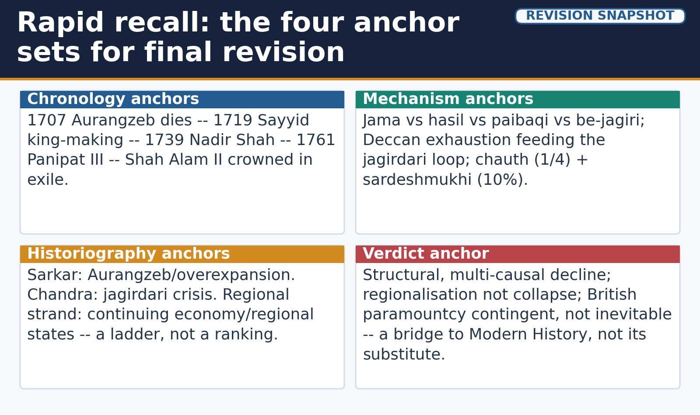

*Visual 35: rapid recall -- the four anchor sets for final revision. Schematic maps are NOT TO SCALE where marked.*


#### Periodisation and scope
- Core window: 1707 (Aurangzeb's death) to 1761 (Third Battle of Panipat). Pre-1707 Deccan wars = Topics 22-23's material, used only as inherited legacy. Post-1761 (Buxar 1764, Diwani 1765) = Modern History Topics 01, 02, 05, named only as bounded hand-off.
- The empire survived nominally to 1857; "decline" is slow, uneven, partly reversible devolution, not a single-date collapse.
- Historiography ladder: Jadunath Sarkar (Aurangzeb's personal responsibility/religious policy, court-chronicle evidence) - Satish Chandra (jama-hasil/jagir-transfer administrative-fiscal crisis, this topic's central thread) - regional/agrarian strand (Alam, Subrahmanyam; trade/credit/patronage evidence; continuity caution). Overlapping strands, not a ladder that cancels earlier views.

#### Succession and the Sayyid wizarat
- Bahadur Shah I (1707-12): conciliatory toward Rajputs/Shahu; conflict with Banda Bahadur's Sikh rebellion.
- Jahandar Shah (1712-13): dominated by Zulfiqar Khan; overthrown by Farrukhsiyar.
- Farrukhsiyar (1713-19): raised by Sayyid Brothers (Abdullah Khan, Hussain Ali Khan Barha); jizyah abolished 1713; 1719 Maratha settlement (Shahu's chauth/sardeshmukhi recognised for military help); deposed and killed by the same Sayyids in 1719 - clearest kingmaking evidence.
- Rafi-ud-Darajat and Rafi-ud-Daulah: both installed and lost within 1719.
- Muhammad Shah (1719-48): installed by the Sayyid Brothers in 1719, at first still fully under their tutelage; a wider noble coalition (including Nizam-ul-Mulk) defeated and killed the Sayyid Brothers in 1720, ending their wizarat while Muhammad Shah, already emperor since 1719, continued to reign to 1748 under this new set of power-holders; long reign, growing regional autonomy, Nadir Shah's 1739 raid falls in this reign.
- Shah Jahan III (1759-60): briefly and externally installed by Imad-ul-Mulk with Maratha backing at Delhi after Alamgir II's 1759 assassination, then deposed in 1760 - a late, clear repeat of the same external-kingmaking pattern the Sayyids had begun decades earlier; must not be misdated to 1748 (Ahmad Shah Bahadur's accession year).
- Later emperors named only as chronology markers: Ahmad Shah Bahadur (1748-54), Alamgir II (1754-59), Shah Alam II (from 1760; post-1761 phase belongs to Modern History).

#### Jagirdari crisis and the feedback loop
- Four terms: jama (assessed revenue) - hasil (actually collected) - paibaqi (reserve/unassigned crown land pool) - be-jagiri (mansabdar without a suitable jagir).
- Deccan campaigns swelled mansab claimants (absorbed Deccani/Maratha nobles) while shrinking productive paibaqi - structural mismatch, not one ruler's failure.
- Feedback loop: short jagir tenure -> extraction incentive over investment -> zamindar/peasant resistance -> lower hasil -> wider jama-hasil gap -> intensified competition for scarce good jagirs -> loop repeats.
- Zamindar/peasant resistance (non-payment, fortification, local militia) = structural response to extraction, not lawlessness; graded spectrum from passive arrears to organised regional assertion.
- Noble factionalism (Turani/Irani/Hindustani-Afghan/Barha-Sayyid blocs) = political-strand output of the same fiscal squeeze, contesting the wazir's shrinking patronage power.

#### Centre-region spectrum and successor states
- Spectrum: close central control (rotated governors) - middle (local base + formal Delhi confirmation) - far (khutba/sikka legitimacy only, real power local).
- Bengal: Murshid Quli Khan's ijaradari (revenue-farming) settlement stabilised finances, reduced jagir turnover; Alivardi Khan contained 1740s Maratha bargi raids.
- Awadh: Saadat Khan (Burhan-ul-Mulk) built autonomy via zamindar/taluqdar accommodation; Shuja-ud-Daulah later fought alongside Abdali at Panipat III (1761).
- Hyderabad: Nizam-ul-Mulk (Chin Qilich Khan/Asaf Jah), former wazir, secured Deccan autonomy after defeating a rival governor at Shakar Kheda (1724); succession disputes among his sons later drew in French/British powers (Carnatic Wars - Modern History).
- Shared feature: real administrative/fiscal/military autonomy plus continued formal Mughal deference (titles, confirmation) - "successor state," not "rebel state."

#### Jats, Sikhs, Rohillas, Marathas: bounded eighteenth-century snapshot
- Jats: Churaman, Badan Singh, Suraj Mal - agrarian, peasant-rooted zamindari base around Agra-Mathura; Bharatpur.
- Sikhs: Banda Bahadur's rebellion (1708-15; captured/executed 1716); mid-century rise of the Sikh misls (confederacies) in Punjab; Ranjit Singh's later consolidation is outside this topic's window.
- Rohillas: Afghan military-settler chiefs, prominently Najib-ud-Daulah, who carved a separate Rohilkhand power base out of the same broader collapse of central authority; distinct both from the agrarian Jat base and from the Sikh misls' confederal structure; Najib-ud-Daulah's Rohilla contingent fought within Abdali's coalition at the Third Battle of Panipat (1761).
- Marathas: chauth and sardeshmukhi layered fiscal claims (not replacement) over the Mughal revenue base, formalised in the 1719 settlement; reach extended to Bengal (1740s bargi raids), Malwa, Gujarat, the Gangetic north. Full Shivaji-era institutional detail remains Topic 23's material.

#### External shocks: Nadir Shah, Abdali, Panipat III
- Nadir Shah (1739): defeated a substantially larger Mughal army at Karnal (exact comparative figures not independently verifiable here); occupied and plundered Delhi (Peacock Throne, Koh-i-Noor by tradition); withdrew to Persia the same year - a raid, not an annexation; severe, lasting fiscal shock that deepened be-jagiri.
- Abdali (Ahmad Shah Durrani), a former Nadir Shah commander, invaded repeatedly across roughly 1748-1767, contesting the Punjab frontier with Mughal remnants, Sikhs and Marathas.
- Third Battle of Panipat, 14 January 1761: Sadashivrao Bhau and Vishwasrao (Peshwa's heir) led the Marathas; Abdali's coalition included Najib-ud-Daulah's Rohillas and Awadh's Shuja-ud-Daulah; heavy Maratha losses, but wider power substantially restored within about a decade under Peshwa Madhavrao I (Deccan/Malwa/central India, not a Punjab return). Kala Amb, Panipat = the site traditionally linked to the battle (formal protection status not independently verified within this pass's allowed evidence; no memorial-development claim is made).

#### Regionalisation, continuity and non-inevitability
- Central thesis: political fragmentation and considerable economic-cultural continuity ran side by side - not one uniform "decline" across every dimension.
- Economic continuity evidence: banking/credit houses (Jagat Seth, Bengal), continuing trade networks, craft production and urban centres under regional-court patronage.
- Cultural continuity evidence: Awadh's Lucknow establishment and Hyderabad's Deccani court sustaining literary/architectural/artistic patronage as central Mughal patronage contracted.
- Non-inevitability: Mughal fragmentation created an open, multi-polar regional order (Bengal, Awadh, Hyderabad, Marathas, Jats, Sikhs all plausible trajectories); British paramountcy required its own contingent institutional-military sequence (Modern History Topics 01, 02, 05) - fragmentation is a permissive condition, not a sufficient cause.
- Two wrong framings to reject: teleology (reading history backward from a known outcome) and monocausal-religious explanation (Aurangzeb's policy alone).

#### Topic-boundary map
- Topic 16: Mughal provincial hierarchy (Suba-Sarkar-Pargana) in institutional depth.
- Topics 22-23: Aurangzeb's Deccan wars and Shivaji-era Maratha state-building in full detail.
- Topic 24: Mughal empire's own economy, society and cultural patronage at its institutional peak.
- Modern History Topic 01: East India Company's early establishment and trade. Topic 02: Indian states and society on the eve of colonialism (including this topic's own successor-state material, from a forward vantage). Topic 05: British territorial expansion and the military-fiscal explanation for Company victories.

#### PYQ audit and heritage route
- 2018-2026 full-ledger audit (Prelims and Mains, all currently available routing/integration files): zero Prelims or Mains questions routed directly to Topic 25 (basic or advanced). State this honestly; do not invent or misroute a PYQ to this topic.
- Three adjacent/bridge items only, each with true ownership named: 2021 Prelims Paragana-Sarkar-Suba sequence (Topic 16); 2021 Prelims Nizamat of Arcot/Mysore/Rohilkhand statements (Modern History Topic 02; the correct answer key is unavailable/not officially verified within this pass's allowed evidence, and no letter is asserted here); 2022 Mains GS-I Q2 on Company armies (Modern History Topic 05, solved above as Mains 1).
- STATIC HERITAGE LINK: Kala Amb, Panipat - site traditionally associated with the Third Battle of Panipat (1761); formal protection status not independently verified within this pass's allowed evidence, and no memorial-development claim is made.
- Mains spine: thesis -> named evidence -> mechanism -> qualification -> graded, non-teleological verdict naming the correct topic boundary where relevant.
