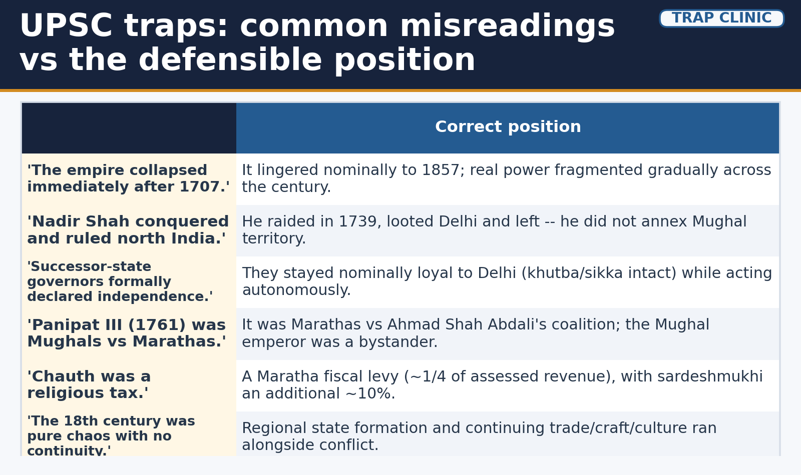
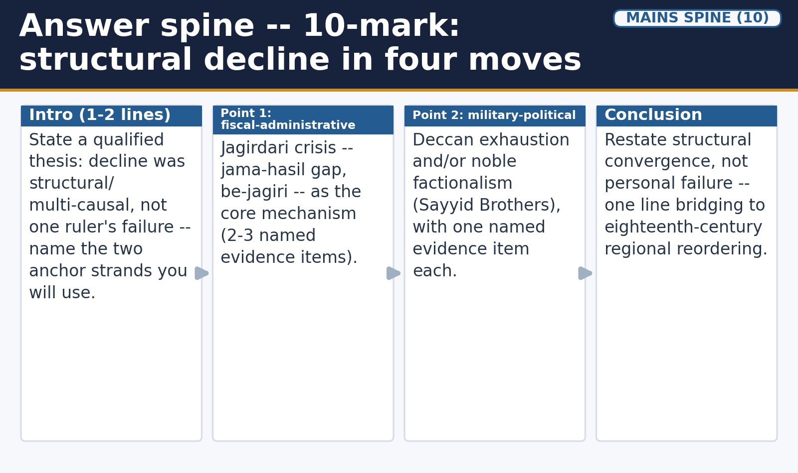
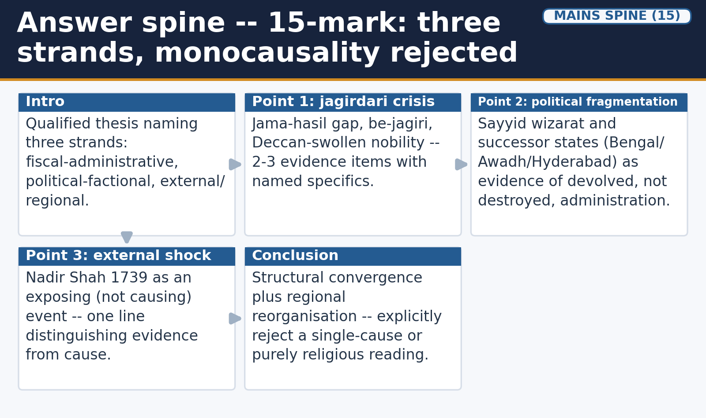
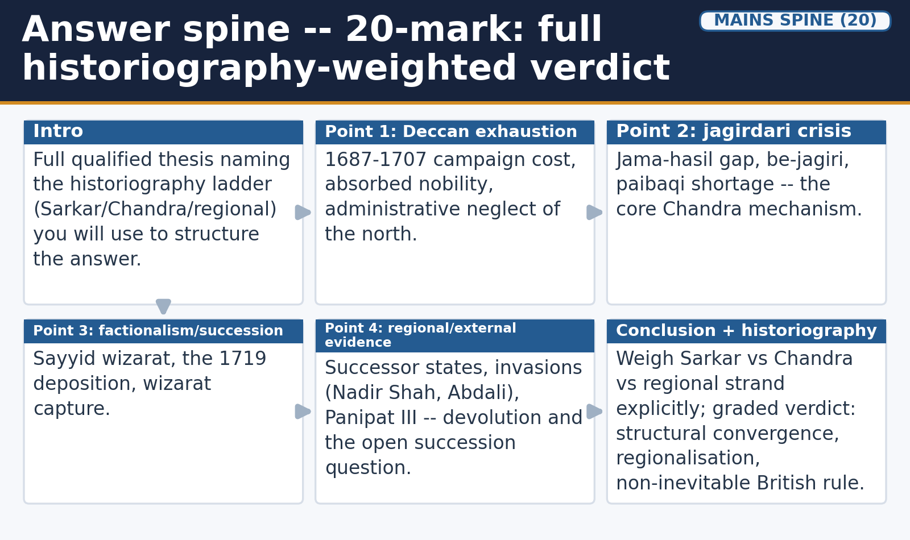

# Decline of the Mughal Empire & the Eighteenth Century — Solved Practice Workbook

## BASIC MCQS / REMEDIATION

Exactly forty MCQs, one flat set (no sub-banks), distinct from the Learning Session's own sixteen. Correct options are deliberately rotated by actual option placement: A -> B -> C -> D repeated ten times through the full set. All practice questions appear first, then a separate solved key with four option-wise explanations and a specific trap per item.

*Visual 34: UPSC traps -- common misreadings vs the defensible position. Schematic maps are NOT TO SCALE where marked.*

#### Q1. Jadunath Sarkar's historiographical strand on Mughal decline is chiefly built on:

- A. Court-chronicle and character-focused evidence emphasising Aurangzeb's personal responsibility and religious policy.
- B. Jama-hasil and jagir-transfer administrative-fiscal records.
- C. Trade, credit and regional-court patronage records.
- D. UNESCO and ASI heritage-management documentation.

#### Q2. Bahadur Shah I's (1707-1712) policy toward Rajput rulers and Shahu's Marathas is best described as:

- A. Uniformly hostile and confrontational toward both groups.
- B. Broadly conciliatory, though less successful against the Sikh rebellion under Banda Bahadur.
- C. A direct continuation of Aurangzeb's Deccan military campaigns.
- D. Entirely focused on suppressing the Sayyid Brothers.

#### Q3. In jagirdari terminology, jama refers to:

- A. Revenue actually realised from an assignment.
- B. A noble's mansab-linked military obligation.
- C. The formally assessed revenue figure for a jagir.
- D. Land available or awaiting assignment.

#### Q4. In jagirdari terminology, hasil refers to:

- A. Land or revenue awaiting assignment.
- B. The formally assessed revenue figure.
- C. A mansabdar's rank-linked cavalry quota.
- D. Revenue actually realised or collected from an assignment.

#### Q5. Be-jagiri, in this topic's account, names the condition of:

- A. A mansabdar lacking a productive jagir assignment despite holding rank.
- B. A zamindar refusing to pay any revenue at all.
- C. An emperor ruling without an active wazir.
- D. A jagir being permanently confiscated by the state.

#### Q6. The Deccan wars' fiscal legacy fed into the jagirdari crisis chiefly by:

- A. Reducing the number of nobles entitled to a jagir.
- B. Enlarging the pool of jagir claimants while reducing the pool of undamaged, readily assignable revenue-yielding land.
- C. Ending the mansabdari system entirely by 1707.
- D. Creating an immediate revenue surplus for the imperial treasury.

#### Q7. The 1720 noble coalition that defeated the Sayyid Brothers prominently included which noble, who later withdrew to found the Hyderabad Nizamat?

- A. Murshid Quli Khan.
- B. Saadat Khan (Burhan-ul-Mulk).
- C. Nizam-ul-Mulk (Chin Qilich Khan).
- D. Sadashivrao Bhau.

#### Q8. Bengal, Awadh and Hyderabad's routes to autonomy are best compared as:

- A. Identical methods producing identical outcomes.
- B. Three unrelated developments with no shared feature at all.
- C. Purely military conquests with no fiscal dimension.
- D. Three distinct mechanisms (revenue-farming, zamindar accommodation, subedar-to-sovereignty conversion) converging on a shared outcome of real autonomy with retained formal Mughal legitimacy.

#### Q9. Saadat Khan (Burhan-ul-Mulk), Awadh's subedar from 1722, built the province's autonomy chiefly through:

- A. Accommodation with local zamindars and taluqdars rather than confrontation.
- B. A stabilised revenue-farming (ijaradari) settlement identical to Bengal's.
- C. Military conquest of Hyderabad's Deccan territory.
- D. Direct alliance with Ahmad Shah Abdali against the Mughal centre.

#### Q10. Nizam-ul-Mulk secured effective Deccan autonomy after defeating a rival Mughal-appointed governor at which 1724 battle?

- A. The Third Battle of Panipat.
- B. The Battle of Shakar Kheda.
- C. The Battle of Karnal.
- D. The Battle of Buxar.

#### Q11. The Jat formation around Agra-Mathura, whose base at Bharatpur became a significant eighteenth-century power, was consolidated under leaders including:

- A. Murshid Quli Khan and Saadat Khan.
- B. Najib-ud-Daulah and the Dal Khalsa misls.
- C. Churaman, Badan Singh and later Suraj Mal.
- D. Sadashivrao Bhau and Vishwasrao.

#### Q12. Rohilla Afghan chiefs, prominently including Najib-ud-Daulah, carved out a separate regional power base known as:

- A. The Nizamat of Hyderabad.
- B. The Dal Khalsa confederacy.
- C. Bharatpur.
- D. Rohilkhand.

#### Q13. The Maratha polity's own succession contest, resolved through Shahu's ascendancy and his Peshwa Balaji Vishwanath, was a dispute between Shahu and:

- A. His aunt Tarabai's rival camp.
- B. Nizam-ul-Mulk's Hyderabad claimants.
- C. The Sayyid Brothers.
- D. Ahmad Shah Abdali.

#### Q14. By well-established tradition, the treasure Nadir Shah carried back to Persia after his 1739 raid is said to have included:

- A. The Kohinoor diamond alone, with no other named item.
- B. The Peacock Throne and the Koh-i-Noor diamond.
- C. The original Quwwat-ul-Islam mosque inscriptions.
- D. Shah Jahan's original manuscript library only.

#### Q15. Ahmad Shah Abdali's invasions across 1748-1767 are best described as a contest for the Punjab frontier involving:

- A. Only the Mughal centre and Abdali, with no other claimant.
- B. Only the Marathas and the Sikh misls, with the Mughal centre absent entirely.
- C. Mughal governors' remnants, rising Sikh power, and eventually the Marathas, all contesting the vacuum simultaneously.
- D. A single unified Indian coalition against Abdali throughout the period.

#### Q16. At the Third Battle of Panipat (1761), the Maratha commander Sadashivrao Bhau was accompanied by which figure who was killed in the battle?

- A. Nizam-ul-Mulk.
- B. Najib-ud-Daulah.
- C. Murshid Quli Khan.
- D. Vishwasrao, the Peshwa's young heir.

#### Q17. Maratha power after the 1761 defeat at Panipat is best described as:

- A. Substantially restored within about a decade under Peshwa Madhavrao I, in the Deccan/Malwa/central India rather than a Punjab return.
- B. Permanently and completely destroyed with no recovery.
- C. Immediately restored to full strength within the same year, including in the Punjab.
- D. Transferred entirely to British control immediately after the battle.

#### Q18. The regional/agrarian-focused historiography (named in the source material as Alam and Subrahmanyam) is used in this topic chiefly to caution against:

- A. Overstating the Sayyid Brothers' administrative competence.
- B. Reading eighteenth-century “decline” as a uniform, empire-wide economic and cultural collapse.
- C. Understating Aurangzeb's role in the Deccan wars.
- D. Accepting Satish Chandra's fiscal framework at all.

#### Q19. Bengal's Jagat Seth banking and credit house is cited in this topic as evidence for:

- A. The complete absence of any credit institution in the eighteenth century.
- B. A purely political, non-economic form of continuity.
- C. Continuing economic activity (banking and credit) across the eighteenth century despite political fragmentation.
- D. The Maratha confederacy's own internal fiscal structure.

#### Q20. The relationship between agrarian cultivation and eighteenth-century trade-route disruption, in this topic's account, is best described as:

- A. Total disruption of both cultivation and trade routes everywhere at once.
- B. Total continuity of both cultivation and trade routes, with no disruption anywhere.
- C. Cultivation collapsing while trade routes remained entirely undisturbed.
- D. Cultivation mostly continuing while specific trade routes suffered real, localised disruption during active campaign seasons such as Abdali's Punjab corridor and the Panipat marches.

#### Q21. Cultural patronage in the eighteenth century, as central Mughal patronage contracted, is described in this topic as chiefly sustained by:

- A. Regional successor courts, including Awadh's Lucknow establishment and Hyderabad's Deccani court.
- B. The British East India Company's own cultural institutions.
- C. No institution at all - patronage simply ceased.
- D. The Sayyid Brothers' wizarat administration.

#### Q22. Before 1757, the English East India Company's political and military footprint in the subcontinent is best described in this topic as:

- A. Already extending inland across most of northern India as the dominant political power.
- B. Already fighting the inland Carnatic Wars (from the 1740s) alongside regional claimants, but not yet a dominant inland political power or a formal territorial ruler.
- C. Non-existent, since the Company had no presence in India before 1757.
- D. Exercised through direct annexation of the Mughal court at Delhi.

#### Q23. Reading Mughal decline as a story that reads history backward from the known outcome of British rule is an example of which wrong framing this topic explicitly names and rejects?

- A. The religious-monocausal framing.
- B. The centre-region spectrum framing.
- C. Teleology.
- D. The convergence-causation framing.

#### Q24. Ignoring the fiscal-administrative, political and external-shock evidence examined across this topic in favour of a single-cause explanation centred only on religious policy is an example of which wrong framing?

- A. The centre-region spectrum.
- B. Teleology.
- C. The layered-fiscal-sovereignty framing.
- D. The religious-monocausal framing.

#### Q25. Alivardi Khan's containment of the Maratha bargi raids into Bengal during the 1740s is best read in this topic as evidence that:

- A. Regional successor states could sustain meaningful state capacity and negotiated/military resilience even under external pressure, not simply collapse passively.
- B. Bengal had already been annexed by the Marathas by the 1740s.
- C. The Mughal centre in Delhi directly organised Bengal's defence against the raids.
- D. The raids were entirely repelled through British East India Company intervention.

#### Q26. At the Third Battle of Panipat (1761), Awadh's Nawab Shuja-ud-Daulah is recorded in this topic as:

- A. Fighting on the Maratha side against Ahmad Shah Abdali's coalition.
- B. Fighting alongside Ahmad Shah Abdali's coalition, extending Awadh's frontier role beyond fiscal-administrative autonomy.
- C. Remaining entirely neutral and uninvolved in the battle.
- D. Leading the Maratha army in place of Sadashivrao Bhau.

#### Q27. Bahadur Shah I's reign (1707-1712) is followed in the court succession spine by which emperor (1712-1713), dominated by his patron Zulfiqar Khan?

- A. Farrukhsiyar.
- B. Muhammad Shah.
- C. Jahandar Shah.
- D. Shah Alam II.

#### Q28. During Muhammad Shah's long reign (1719-1748), which development involving Nizam-ul-Mulk occurred?

- A. He was executed by the Sayyid Brothers.
- B. He negotiated the 1719 chauth-sardeshmukhi settlement with the Marathas.
- C. He was killed at the Battle of Karnal in 1739.
- D. He effectively withdrew to the Deccan and founded what became the independent Nizamat of Hyderabad.

#### Q29. Farrukhsiyar's 1719 deposition and killing by the Sayyid Brothers is cited in this topic as the clearest evidence that:

- A. The Mughal throne had become a prize contested by noble coalitions, not merely a hereditary office weakly filled.
- B. Mughal succession had returned to strict primogeniture by 1719.
- C. The Marathas had by this point annexed Delhi outright.
- D. Nadir Shah had already invaded by this date.

#### Q30. The Sayyid-dominated administration's 1713 abolition of jizyah occurred alongside which other significant development named in this topic?

- A. The Third Battle of Panipat.
- B. A settlement recognising Maratha chauth and sardeshmukhi claims over the Deccan subahs.
- C. Nadir Shah's sack of Delhi.
- D. The founding of the Hyderabad Nizamat.

#### Q31. The centre-region spectrum's key point about Bengal, Awadh and Hyderabad is that all three, despite real autonomy, continued for varying periods to:

- A. Reject any nominal link to the Mughal centre.
- B. Pay full assessed jama revenue directly to Delhi without any local retention.
- C. Seek formal Mughal confirmation of their governors' authority.
- D. Submit their armies to direct Mughal command.

#### Q32. This topic's convergence-causation framing explicitly rejects reducing Mughal decline to:

- A. A single administrative-fiscal mechanism.
- B. A combination of succession, fiscal and external-shock factors.
- C. Regional-power fragmentation as a contributing factor.
- D. Aurangzeb's personal religious policy alone.

#### Q33. Which sequence keeps the brief Sayyid-backed reigns in their correct court setting?

- A. Farrukhsiyar's removal in 1719 was followed by Rafi-ud-Darajat and Shah Jahan II before Muhammad Shah's accession.
- B. Rafi-ud-Darajat ruled before Bahadur Shah I and installed Farrukhsiyar in 1707.
- C. Shah Jahan II defeated Nadir Shah and thereby restored Farrukhsiyar.
- D. Muhammad Shah preceded Jahandar Shah and directly crowned Rafi-ud-Darajat.

#### Q34. After the Sayyid Brothers fell in 1720, why did the imperial seal remain valuable to autonomous provincial elites?

- A. A seal instantly made every Bengal revenue assessment equal to cash collection.
- B. Legitimacy, titles and appointments could still be negotiated through Mughal forms without direct Delhi control.
- C. All provinces resumed uniform direct imperial military control.
- D. A Mughal appointment extinguished every pre-existing zamindari right.

#### Q35. Match the successor state with its source-supported consolidation strategy.

- A. Bengal: Nizam-ul-Mulk after Shakarkheda; Hyderabad: Murshid Quli Khan's revenue reorganisation; Awadh: Rohilla migration.
- B. Bengal: Saadat Khan's Ganga plain; Awadh: Sindhudurg navy; Hyderabad: Banda Bahadur.
- C. Bengal: Murshid Quli Khan and revenue control; Awadh: Saadat Khan and zamindar management; Hyderabad: Nizam-ul-Mulk and Deccan provincial-military power.
- D. All three: immediate declarations of independence with repudiation of Mughal titles.

#### Q36. What distinguishes the Sikh misls' emergence from the earlier Banda Bahadur phase in an eighteenth-century synthesis?

- A. They were a Mughal-appointed single uniform regiment controlling all provinces in 1707.
- B. The misls were identical to Shivaji's Ashtapradhan.
- C. Sikh political history stopped completely after Banda Bahadur.
- D. Repression and reorganisation preceded the growth of multiple armed Sikh centres in the Punjab, later associated with Dal Khalsa.

#### Q37. A claimed high paibaqi pool and low realised hasil appear in different provincial records. What should the historian conclude?

- A. Awaiting-assignment revenue cannot be assumed to yield productive jagirs or collected cash; compare assignment and collection evidence.
- B. A large paibaqi pool proves be-jagiri impossible in every province.
- C. Paibaqi is the synonym of assessed jama and therefore equals hasil.
- D. All Mughal agrarian production must have ceased after 1707.

#### Q38. Which causal comparison of Nadir Shah and Ahmad Shah Abdali avoids collapsing separate shocks?

- A. Nadir Shah's 1739 raid began the 1761 Panipat campaign; Abdali first invaded in 1707.
- B. Karnal and Delhi in 1739 exposed Mughal weakness; Abdali's repeated 1748-67 frontier interventions culminated in the 1761 north Indian coalition conflict.
- C. Both remained to govern all Indian successor states continuously from 1739.
- D. Both raids occurred before Muhammad Shah and before provincial autonomy emerged.

#### Q39. Consider the 1761 Panipat outcome: 1. Abdali's coalition defeated Maratha forces. 2. The Mughal emperor led the principal opposing army. 3. Defeat automatically ended all Maratha power. Which is correct?

- A. 1 and 2 only
- B. 2 and 3 only
- C. 1 only
- D. 1, 2 and 3

#### Q40. A historian compares an East India Company trading ledger, a court chronicle and an Awadh revenue document. Which method best avoids teleology?

- A. Assume that because Plassey occurred, all three records already describe a colonial state.
- B. Use the company ledger as a complete history of peasant livelihoods and ignore other genres.
- C. Infer that Delhi's reduced power removed all provincial institutions.
- D. Read each record for its own institutional viewpoint; explain eighteenth-century regional continuity and reserve later Company conquest mechanisms for Modern History.

## SOLVED MCQ KEY - OPTION-WISE EXPLANATIONS AND TRAPS

#### Q1.

**Answer: A.**

**Option-wise explanations:**
- **A.** Correct - Sarkar's early-twentieth-century account reads decline chiefly through Aurangzeb's own conduct and choices.
- **B.** Incorrect - this is Satish Chandra's evidence base, not Sarkar's.
- **C.** Incorrect - this is the regional/agrarian-continuity strand associated with Alam and Subrahmanyam.
- **D.** Incorrect - heritage-policy material is a bounded modern bridge, never historiographical evidence for eighteenth-century causation.

**Trap:** Do not credit Sarkar's strand with the fiscal-administrative evidence base that actually belongs to Chandra's framework.

#### Q2.

**Answer: B.**

**Option-wise explanations:**
- **A.** Incorrect - his approach was broadly conciliatory, not confrontational, toward Rajputs and Shahu's Marathas.
- **B.** Correct - conciliation worked with Rajputs and Shahu's camp but did not succeed against Banda Bahadur's rebellion.
- **C.** Incorrect - Bahadur Shah I's reign followed Aurangzeb's death and was not itself a continuation of the Deccan wars.
- **D.** Incorrect - the Sayyid Brothers' rise to power came under Farrukhsiyar (1713-19), after Bahadur Shah I's reign.

**Trap:** Do not assume a single uniformly hostile or uniformly successful policy line across all three groups at once.

#### Q3.

**Answer: C.**

**Option-wise explanations:**
- **A.** Incorrect - this is hasil, not jama.
- **B.** Incorrect - jama is a fiscal-assessment term, not a military-rank term.
- **C.** Correct - jama is the assessed, on-paper revenue figure, distinct from what was actually collected.
- **D.** Incorrect - this is paibaqi, a distinct term for assignable land.

**Trap:** Do not swap jama (assessed figure) with hasil (realised figure) - the gap between them is the crisis's measurable core.

#### Q4.

**Answer: D.**

**Option-wise explanations:**
- **A.** Incorrect - this is paibaqi.
- **B.** Incorrect - this is jama.
- **C.** Incorrect - hasil is a fiscal-collection term, not a rank or military term.
- **D.** Correct - hasil is the realised, collected figure, which frequently fell short of jama.

**Trap:** Do not treat hasil as a synonym for jama - the whole crisis depends on the two being different, measurable figures.

#### Q5.

**Answer: A.**

**Option-wise explanations:**
- **A.** Correct - be-jagiri describes rank-holders without an adequately productive assignment, a direct symptom of the paibaqi shortage.
- **B.** Incorrect - this describes a form of resistance, not be-jagiri specifically.
- **C.** Incorrect - be-jagiri is a fiscal-assignment condition, not a description of the court's administrative structure.
- **D.** Incorrect - be-jagiri describes an unassigned or inadequately assigned mansabdar, not a confiscation act.

**Trap:** Do not confuse be-jagiri (a mansabdar's own condition of insufficient assignment) with a zamindar's revenue default.

#### Q6.

**Answer: B.**

**Option-wise explanations:**
- **A.** Incorrect - absorption of Deccani and Maratha nobles increased, not reduced, the pool of jagir claimants.
- **B.** Correct - this dual effect (more claimants, less usable land) is the specific mechanism linking the Deccan legacy to the jagirdari crisis.
- **C.** Incorrect - the mansabdari system continued well beyond 1707; it was strained, not abolished.
- **D.** Incorrect - the Deccan wars' legacy was a fiscal strain, not a surplus.

**Trap:** Do not describe the Deccan legacy as simply reducing noble numbers - it is the mismatch between more claimants and less usable land that matters.

#### Q7.

**Answer: C.**

**Option-wise explanations:**
- **A.** Incorrect - Murshid Quli Khan is Bengal's Diwan/Nawab, not part of the 1720 coalition against the Sayyids.
- **B.** Incorrect - Saadat Khan became Awadh's subedar in 1722, distinct from the 1720 anti-Sayyid coalition's most prominent member.
- **C.** Correct - Nizam-ul-Mulk was a prominent member of the 1720 coalition and later founded the Hyderabad Nizamat.
- **D.** Incorrect - Sadashivrao Bhau commanded the Maratha army at Panipat in 1761, decades after the 1720 coalition.

**Trap:** Do not attribute the Hyderabad founding to whichever noble the question names first - it is specifically Nizam-ul-Mulk, verified by his later Shakar Kheda victory.

#### Q8.

**Answer: D.**

**Option-wise explanations:**
- **A.** Incorrect - the three states used genuinely different mechanisms, not one identical method.
- **B.** Incorrect - despite different mechanisms, they share the outcome of converting real control into durable power while retaining a formal Mughal link.
- **C.** Incorrect - Bengal's route was fiscal (revenue-farming), not primarily military.
- **D.** Correct - this is the topic's own explicit three-way comparison, naming a shared outcome despite different specific mechanisms.

**Trap:** Do not treat 'successor state' as one undifferentiated method - name each state's own specific mechanism.

#### Q9.

**Answer: A.**

**Option-wise explanations:**
- **A.** Correct - Saadat Khan negotiated revenue terms with existing zamindars, leaving local landed power intact, and this was continued by Safdarjung.
- **B.** Incorrect - this is Bengal's route under Murshid Quli Khan, a distinct mechanism from Awadh's zamindar accommodation.
- **C.** Incorrect - Awadh's autonomy did not rest on conquering Hyderabad.
- **D.** Incorrect - Awadh's Nawab Shuja-ud-Daulah later fought alongside Shah Alam II against the British at Buxar (1764), not alongside Abdali against Delhi.

**Trap:** Do not collapse Awadh's zamindar-accommodation route into Bengal's separate revenue-farming route - they are two distinct mechanisms.

#### Q10.

**Answer: B.**

**Option-wise explanations:**
- **A.** Incorrect - Panipat III was fought in 1761 against Abdali's coalition, unrelated to Nizam-ul-Mulk's Deccan consolidation.
- **B.** Correct - Nizam-ul-Mulk defeated a rival governor at Shakar Kheda in 1724, establishing what became the Nizamat of Hyderabad.
- **C.** Incorrect - Karnal (1739) was Nadir Shah's victory over Muhammad Shah's forces, not Nizam-ul-Mulk's Deccan battle.
- **D.** Incorrect - Buxar (1764) belongs to the Company-era transition, Modern History's material.

**Trap:** Do not substitute a better-known later battle (Panipat, Karnal, Buxar) for Nizam-ul-Mulk's own specific 1724 Deccan victory.

#### Q11.

**Answer: C.**

**Option-wise explanations:**
- **A.** Incorrect - these are Bengal's and Awadh's successor-state figures, not Jat leaders.
- **B.** Incorrect - Najib-ud-Daulah is a Rohilla Afghan chief and the Dal Khalsa is the Sikh misls' umbrella, both distinct from the Jat formation.
- **C.** Correct - these leaders consolidated the agrarian, peasant-rooted Jat zamindari base culminating in Suraj Mal's Bharatpur state.
- **D.** Incorrect - these are Maratha commanders at Panipat, not Jat leaders.

**Trap:** Do not substitute Rohilla, Sikh or Maratha named leaders for the Jat formation's own specific leadership line.

#### Q12.

**Answer: D.**

**Option-wise explanations:**
- **A.** Incorrect - this is Nizam-ul-Mulk's Deccan successor state, unrelated to the Rohillas.
- **B.** Incorrect - the Dal Khalsa is the Sikh misls' shared umbrella, not the Rohilla base.
- **C.** Incorrect - Bharatpur is the Jat state's base under Suraj Mal.
- **D.** Correct - the Rohilla Afghan chiefs, with Najib-ud-Daulah prominent among them, established Rohilkhand as their separate power base.

**Trap:** Do not confuse Rohilkhand (the Rohilla Afghan base) with the Sikh Dal Khalsa or the Jat Bharatpur state - all three arose from the same broader collapse of central authority but are three distinct formations.

#### Q13.

**Answer: A.**

**Option-wise explanations:**
- **A.** Correct - the Shahu-Tarabai succession dispute, following Shivaji's line splitting, was resolved through Shahu's ascendancy and consolidated through Balaji Vishwanath.
- **B.** Incorrect - Nizam-ul-Mulk is a Mughal noble turned Hyderabad's founder, unrelated to the internal Maratha succession dispute.
- **C.** Incorrect - the Sayyid Brothers controlled the Mughal wizarat at Delhi, a separate contest from the Maratha polity's own internal succession.
- **D.** Incorrect - Abdali is the Afghan invader who fought the Marathas decades later at Panipat, not a party to their internal succession dispute.

**Trap:** Do not confuse the Maratha polity's own internal Shahu-Tarabai succession dispute with the separate Mughal-centre succession disputes examined earlier in this topic.

#### Q14.

**Answer: B.**

**Option-wise explanations:**
- **A.** Incorrect - tradition names both the Peacock Throne and the Koh-i-Noor together, not the diamond alone.
- **B.** Correct - both items are named together by well-established tradition as part of Nadir Shah's plunder.
- **C.** Incorrect - this is unrelated Sultanate-era material, not part of Nadir Shah's 1739 plunder.
- **D.** Incorrect - the traditionally cited items are the Peacock Throne and Koh-i-Noor, not a manuscript library.

**Trap:** Do not name only one of the two traditionally cited items - the Peacock Throne and the Koh-i-Noor are cited together.

#### Q15.

**Answer: C.**

**Option-wise explanations:**
- **A.** Incorrect - at least three regional claimants contested the vacuum, not just two parties.
- **B.** Incorrect - Mughal remnants, Sikh power and the Marathas were all simultaneously contesting the frontier alongside Abdali.
- **C.** Correct - this three-way (at least) simultaneous contest is the specific point this topic makes about the frontier's collapse.
- **D.** Incorrect - the various regional claimants did not act as one unified coalition across the whole 1748-1767 span.

**Trap:** Do not reduce Abdali's invasions to a simple two-sided Mughal-versus-Abdali contest - name the multiple simultaneous regional claimants.

#### Q16.

**Answer: D.**

**Option-wise explanations:**
- **A.** Incorrect - Nizam-ul-Mulk died decades earlier and was not present at Panipat.
- **B.** Incorrect - Najib-ud-Daulah was a Rohilla chief fighting on Abdali's side, not the Peshwa's heir killed alongside Bhau.
- **C.** Incorrect - Murshid Quli Khan is Bengal's Nawab, unconnected to the Panipat campaign.
- **D.** Correct - Vishwasrao accompanied Sadashivrao Bhau and was killed in the battle, among many other heavy Maratha casualties.

**Trap:** Do not name a Mughal-court or Rohilla figure as the Peshwa's heir killed at Panipat - it is specifically Vishwasrao.

#### Q17.

**Answer: A.**

**Option-wise explanations:**
- **A.** Correct - this is the topic's own qualified account of recovery, specifying both the timeframe and the region of restored strength.
- **B.** Incorrect - the topic explicitly frames Panipat as a check, not a terminal collapse, and records recovery under Madhavrao I.
- **C.** Incorrect - recovery took about a decade, and it occurred in the Deccan/Malwa/central India, not as a Punjab return.
- **D.** Incorrect - no automatic transfer of Maratha power to British control followed directly from Panipat.

**Trap:** Do not claim either total destruction or an instant same-year recovery - the topic specifies a roughly decade-long recovery in a different region (not Punjab).

#### Q18.

**Answer: B.**

**Option-wise explanations:**
- **A.** Incorrect - this caution concerns reading eighteenth-century decline as uniform economic-cultural collapse, not the Sayyids' competence specifically.
- **B.** Correct - this is precisely the caution this named historiographical strand supplies to the central fragmentation-versus-continuity thesis.
- **C.** Incorrect - this concerns economic-cultural continuity, not Aurangzeb's Deccan role specifically.
- **D.** Incorrect - the regional/agrarian strand supplements rather than rejects Chandra's framework; they are read alongside each other.

**Trap:** Do not attach this specific historiographical caution to the wrong target - it concerns uniform economic-cultural collapse, not any single ruler's competence.

#### Q19.

**Answer: C.**

**Option-wise explanations:**
- **A.** Incorrect - Jagat Seth is cited as a surviving, active institution, not evidence of absence.
- **B.** Incorrect - Jagat Seth is specifically economic (banking/credit) evidence, not a political example.
- **C.** Correct - Jagat Seth is the most frequently cited named example of continuing economic institutions financing both regional-court and trading-company activity.
- **D.** Incorrect - Jagat Seth is a Bengal-based banking house, not part of the Maratha confederacy's structure.

**Trap:** Do not cite Jagat Seth as evidence of absence or political continuity - it is specifically named economic (banking/credit) continuity evidence.

#### Q20.

**Answer: D.**

**Option-wise explanations:**
- **A.** Incorrect - cultivation mostly continued; disruption was specific to certain trade routes, not universal.
- **B.** Incorrect - specific trade routes did suffer real, localised disruption during active campaign seasons.
- **C.** Incorrect - this reverses the actual pattern; it is cultivation that mostly continued.
- **D.** Correct - continuity and disruption coexisted rather than one uniformly displacing the other, which is the topic's precise nuance on this point.

**Trap:** Do not flatten this into either total continuity or total collapse - the topic's own nuance is that cultivation and route disruption coexisted unevenly.

#### Q21.

**Answer: A.**

**Option-wise explanations:**
- **A.** Correct - these regional courts took up literary, architectural and artistic patronage as the political centre's own patronage contracted.
- **B.** Incorrect - Company cultural patronage belongs to Modern History, not this topic's eighteenth-century continuity evidence.
- **C.** Incorrect - the topic's point is precisely that patronage continued via regional courts, not that it ceased.
- **D.** Incorrect - the Sayyid wizarat (1713-1720) predates the broader eighteenth-century patronage shift to regional successor courts.

**Trap:** Do not credit the Sayyid wizarat or an outside institution for a continuity that this topic specifically attributes to regional successor courts.

#### Q22.

**Answer: B.**

**Option-wise explanations:**
- **A.** Incorrect - inland political dominance came only after Plassey (1757) and the Company's subsequent territorial expansion, not before it.
- **B.** Correct - before 1757 the Company was already militarily engaged inland through the Carnatic Wars, but formal Company territorial rule (from the Bengal Diwani of 1765 onward) still lay ahead; its presence was real and partly inland, but not yet dominant political paramountcy.
- **C.** Incorrect - the Company had traded from coastal settlements since the seventeenth century and had already fought the inland Carnatic Wars from the 1740s; its presence was real, not absent.
- **D.** Incorrect - no such annexation occurred before 1757; the Mughal court at Delhi remained under indigenous/regional control.

**Trap:** Do not conflate the Company's later inland political paramountcy (post-1757 annexation and Diwani) with its earlier, already-inland-fighting but not-yet-dominant Carnatic Wars-era presence; equally, do not claim it was coastal-only, which ignores the Carnatic Wars.

#### Q23.

**Answer: C.**

**Option-wise explanations:**
- **A.** Incorrect - this is a separate wrong framing (blaming religious policy alone), not the backward-reading error.
- **B.** Incorrect - the centre-region spectrum is this topic's own valid analytical tool, not a wrong framing to reject.
- **C.** Correct - teleology names precisely this error of reading history backward from a known outcome, which this topic explicitly rejects.
- **D.** Incorrect - convergence-causation is this topic's own preferred, valid framing, not a wrong one.

**Trap:** Do not confuse this topic's own valid analytical frames (centre-region spectrum, convergence-causation) with the wrong framings it explicitly names and rejects (teleology, religious monocausality).

#### Q24.

**Answer: D.**

**Option-wise explanations:**
- **A.** Incorrect - this is a valid analytical tool used in this topic, not a wrong framing.
- **B.** Incorrect - teleology is the separate error of reading history backward from a known outcome.
- **C.** Incorrect - this describes Maratha chauth/sardeshmukhi claims, an accurate description, not a wrong framing.
- **D.** Correct - reducing decline to religious policy alone, while ignoring the fiscal-administrative, political and external-shock evidence, is exactly the religious-monocausal error this topic explicitly rejects.

**Trap:** Do not mistake this topic's own valid descriptive frames for the specific wrong framing being tested - the religious-monocausal error is about ignoring multiple evidenced strands in favour of one.

#### Q25.

**Answer: A.**

**Option-wise explanations:**
- **A.** Correct - Alivardi Khan's mixed negotiated-payment/military response shows a successor state retaining real administrative-military capacity, consistent with this topic's continuity thesis.
- **B.** Incorrect - the bargi raids were incursions and tribute pressure, not a territorial annexation of Bengal.
- **C.** Incorrect - Bengal's autonomous Nawabi, not the Mughal centre, organised its own response.
- **D.** Incorrect - the Company's major Bengal political role began later, after 1757, not through repelling the 1740s bargi raids.

**Trap:** Do not read the bargi raids as either a Maratha annexation of Bengal or as evidence of Company/Mughal-centre intervention - Bengal's own Nawabi handled it.

#### Q26.

**Answer: B.**

**Option-wise explanations:**
- **A.** Incorrect - Shuja-ud-Daulah fought alongside Abdali's coalition, not the Maratha side.
- **B.** Correct - his participation alongside Abdali's coalition extended Awadh's regional role from fiscal-administrative autonomy into frontier military alignment.
- **C.** Incorrect - Awadh was not neutral; Shuja-ud-Daulah actively fought in the coalition.
- **D.** Incorrect - Sadashivrao Bhau led the Maratha side; Shuja-ud-Daulah fought against, not in place of, him.

**Trap:** Do not confuse Awadh's earlier fiscal-administrative autonomy (Saadat Khan/Safdarjung) with its later, distinct frontier-military role under Shuja-ud-Daulah at Panipat.

#### Q27.

**Answer: C.**

**Option-wise explanations:**
- **A.** Incorrect - Farrukhsiyar (1713-1719) followed Jahandar Shah, not Bahadur Shah I directly.
- **B.** Incorrect - Muhammad Shah's reign began in 1719, several emperors later.
- **C.** Correct - Jahandar Shah (1712-13), dominated by his noble patron Zulfiqar Khan, directly followed Bahadur Shah I and was overthrown by Farrukhsiyar in 1713.
- **D.** Incorrect - Shah Alam II's reign began only in 1759, decades after Bahadur Shah I.

**Trap:** Do not skip ahead to a later emperor - the court succession spine's immediate next name after Bahadur Shah I is specifically Jahandar Shah.

#### Q28.

**Answer: D.**

**Option-wise explanations:**
- **A.** Incorrect - Nizam-ul-Mulk was part of the coalition that defeated the Sayyid Brothers, not their victim.
- **B.** Incorrect - that settlement is associated with the Sayyid Brothers' administration, not specifically Nizam-ul-Mulk.
- **C.** Incorrect - Nizam-ul-Mulk survived Karnal; it was Muhammad Shah's forces that were defeated there by Nadir Shah, not a battle that killed the Nizam.
- **D.** Correct - this withdrawal and the 1724 Shakar Kheda victory occurred during Muhammad Shah's reign, alongside continuing factional competition at court and Nadir Shah's 1739 raid.

**Trap:** Do not attach unrelated events (the Sayyids' execution, the 1719 Maratha settlement, death at Karnal) to Nizam-ul-Mulk - his own specific development is the Deccan withdrawal and Hyderabad's founding.

#### Q29.

**Answer: A.**

**Option-wise explanations:**
- **A.** Correct - this is exactly the significance this topic attaches to Farrukhsiyar's fate at the Sayyids' hands.
- **B.** Incorrect - the episode shows the opposite: kingmaking by noble coalitions, not orderly primogeniture.
- **C.** Incorrect - the Marathas gained a fiscal settlement (chauth/sardeshmukhi) around this time, not territorial annexation of Delhi.
- **D.** Incorrect - Nadir Shah's invasion came twenty years later, in 1739.

**Trap:** Do not read Farrukhsiyar's fate as evidence of restored orderly succession - it demonstrates the opposite, that the throne was a contested prize.

#### Q30.

**Answer: B.**

**Option-wise explanations:**
- **A.** Incorrect - Panipat III occurred in 1761, decades after the 1713 jizyah abolition.
- **B.** Correct - both the jizyah abolition (1713) and the Maratha fiscal settlement (formalised in 1719 under continuing Sayyid dominance) are cited together as evidence the Sayyid period was not uniformly destructive.
- **C.** Incorrect - Nadir Shah's raid came in 1739, well after the Sayyid period ended in 1720.
- **D.** Incorrect - Hyderabad's founding followed Nizam-ul-Mulk's 1724 Shakar Kheda victory, after the Sayyid wizarat had already fallen in 1720.

**Trap:** Do not pair the 1713 jizyah abolition with a later, unrelated event - the topic pairs it specifically with the Maratha chauth-sardeshmukhi settlement to show the Sayyid period's mixed record.

#### Q31.

**Answer: C.**

**Option-wise explanations:**
- **A.** Incorrect - this is precisely what the three states did not do; they retained a nominal link.
- **B.** Incorrect - the point is about seeking formal confirmation of authority, not about revenue-remittance practice.
- **C.** Correct - this is the specific continuing link the centre-region spectrum highlights even as real power devolved to the regions.
- **D.** Incorrect - the states each built and controlled their own military forces; only nominal legitimacy, not military command, remained linked to Delhi.

**Trap:** Do not claim the three states rejected all formal Mughal linkage - the spectrum's whole point is that nominal confirmation-seeking persisted alongside devolved real power.

#### Q32.

**Answer: D.**

**Option-wise explanations:**
- **A.** Incorrect - the fiscal-administrative (jagirdari) strand is one legitimate contributing input in the convergence, not the framing's rejected target.
- **B.** Incorrect - this combination is exactly what the convergence framing affirms, not rejects.
- **C.** Incorrect - regional fragmentation is affirmed as a genuine strand in the convergence, not rejected.
- **D.** Correct - the source book explicitly frames decline as a convergence of causes and explicitly rejects reducing it to Aurangzeb's personal religious policy alone.

**Trap:** Do not mistake one of the convergence framing's affirmed contributing strands for the single-cause explanation it explicitly rejects.

#### Q33.

**Answer: A.**

**Option-wise explanations:**
- **A.** The two brief reigns belong between Farrukhsiyar's overthrow and Muhammad Shah.
- **B.** These reigns followed the events of 1707-19, not preceded them.
- **C.** Nadir Shah's 1739 raid came during Muhammad Shah, not Shah Jahan II.
- **D.** Muhammad Shah ruled after, not before, Jahandar Shah.

**Trap:** Short-lived monarchs cannot be omitted when tracing who controlled succession.

#### Q34.

**Answer: B.**

**Option-wise explanations:**
- **A.** Assessment and actual collection remain separate even when an official seal survives.
- **B.** Political devolution could coexist with continuing symbolic and administrative vocabulary.
- **C.** The fall of the Sayyids did not restore uncontested central rule.
- **D.** Local landed claims were negotiated and could resist imperial appointments.

**Trap:** Formal allegiance is not equivalent to provincial obedience.

#### Q35.

**Answer: C.**

**Option-wise explanations:**
- **A.** The named founders and state mechanisms are mismatched.
- **B.** These place names and actors belong to different political histories.
- **C.** The comparison distinguishes routes to autonomy while preserving Mughal-era continuity.
- **D.** Regional powers often retained titles and forms rather than repudiating them.

**Trap:** Autonomy took several institutional paths; do not demand one model for all provinces.

#### Q36.

**Answer: D.**

**Option-wise explanations:**
- **A.** The Sikh formations were not an empire-wide single imperial regiment.
- **B.** A Punjabi armed confederative development is not the Maratha royal council.
- **C.** The source explicitly describes later reorganisation and growth.
- **D.** The chronology and plural local bases matter more than a false instant transition.

**Trap:** Do not collapse successive Sikh organisational phases into one event.

#### Q37.

**Answer: A.**

**Option-wise explanations:**
- **A.** Unsettled or awaiting assignment resources need not translate into viable receipts.
- **B.** Quantity on paper does not settle productivity or competition for suitable assignments.
- **C.** Available/awaiting resources, assessed value and collected sums are distinct.
- **D.** Fiscal strain did not imply universal cessation of agriculture.

**Trap:** Paper availability, viable assignment and actual yield are three different things.

#### Q38.

**Answer: B.**

**Option-wise explanations:**
- **A.** The attacks occurred in different phases; neither timing is supported.
- **B.** The raid and the later repeated frontier contests had distinct chronologies and political effects.
- **C.** Nadir did not stay to annex and govern India; Abdali's interventions were not uniform direct rule.
- **D.** The 1739 event occurred during Muhammad Shah after provincial autonomy had grown.

**Trap:** A single invasion is not the original cause of an earlier structural crisis.

#### Q39.

**Answer: C.**

**Option-wise explanations:**
- **A.** The Mughal emperor was not the principal opposing belligerent.
- **B.** Both the Mughal-command and total-collapse claims fail.
- **C.** The result checked north Indian Peshwa ambitions without annihilating Maratha power.
- **D.** The second and third statements are not supported.

**Trap:** A checked bid for supremacy is not extinction of a regional confederacy.

#### Q40.

**Answer: D.**

**Option-wise explanations:**
- **A.** Later victory cannot be projected backward into earlier records.
- **B.** Company records privilege company transactions and cannot stand for all rural society.
- **C.** Regional institutions could thrive despite imperial contraction.
- **D.** Cross-genre comparison preserves contingency and the topic boundary.

**Trap:** A later outcome is not a cause of every earlier event.

## PYQS AND ANSWER PRACTICE

### PART X - SOURCES, PYQ AUDIT AND PRACTICE

### Transparent PYQ audit and route decision

**Audit scope:** every Prelims and Mains GS-I/GS-II/Essay routing ledger and integration audit currently in the repository covering 2018 through 2026 was checked line by line for any question mentioning the post-1707 succession, the Sayyid wizarat, the jagirdari crisis, jama/hasil/paibaqi/be-jagiri, Bengal/Awadh/Hyderabad, Jats/Sikhs/Marathas in their eighteenth-century political form, Nadir Shah, Abdali, or the Third Battle of Panipat.

**Audit result:** `PYQ-INTEGRATION-AUDIT-2018-2023.md`, `PYQ-INTEGRATION-AUDIT-2024-2025.md` and `PYQ-INTEGRATION-AUDIT-2026.md` each explicitly list Medieval Topic 25 basic and advanced files as owning no routed question across their respective windows. No Prelims or Mains question in any checked ledger is routed to Topic 25.

**2026 provenance, stated separately:** `_PYQ-ROUTING-PRELIMS-2026.md` (the official 2026 Set-A scan's own routing record) lists zero Medieval-Indian-History rows of any kind, so Topic 25 owns no 2026 Prelims Set-A question. The governing 2026 Mains ledger `_PYQ-GS1-2026.md` lists no Topic-25-routed 2026 Mains GS-I item; its own Q11 ("Vijayanagara architecture exemplifies the amalgamation of past traditions with contemporary practices") is explicitly routed to Indian Art & Culture Topic 03 (Temple Architecture and Chandella-Khajuraho), not to Topic 25. So Topic 25 owns no 2026 Mains GS-I question either. These two absences are independent findings from separate ledger types, and both ledgers agree with each other.

**No other medieval Mains item is borrowed:** the only Vijayanagara-adjacent Mains item anywhere near this audit's scope is the 2026 ledger's Q11, on Vijayanagara **architecture** (not Vijayanagara-Bahmani political/administrative history) - it is routed by `_PYQ-GS1-2026.md` to **Indian Art & Culture Topic 03**, not to Medieval History Topic 09 and not to Topic 25, so it falls outside this topic's 1707-1761 window and is not used as a bridge illustration here. The single Mains item this package does use as a bridge (Mains 1, below) is the verified 2022 Mains GS-I Company-armies question, owned by Modern History Topic 05, not by any medieval topic.

**Workbook/session policy consequence:** because this topic owns zero verified PYQs, this package does not fabricate a "Topic 25 PYQ list." Instead, three thematically adjacent items - each verified for exact wording against reliable sources, and each explicitly routed elsewhere by this repository's own ledgers - are presented below strictly as bounded bridge illustrations. Only one of the three (the 2022 Mains GS-I Company-armies item) receives solved treatment in this workbook; the other two are named only as one-line boundary reminders and are not worked as solved questions here.

**Adjacent evidence is not substitution:** an adjacent PYQ illustrates a related concept; it is never claimed as "this topic's own question," and a candidate should not cite it in an answer as if Topic 25 were its subject. The three items are:

1. **2021 Prelims** (local ledger numbering) - ascending-size sequence of Paragana-Sarkar-Suba - routed to **Medieval Topic 16** (State and Government under Akbar). Used here only as a one-line boundary reminder that provincial-administrative-hierarchy questions belong to Topic 16, not Topic 25.
2. **2021 Prelims** (local ledger numbering; the same question is indexed elsewhere under a different set/booklet numbering, confirmed identical by content match) - statements on the Nizamat of Arcot, the Mysore Kingdom and Rohilkhand - routed to **Modern History Topic 02** (Indian States and Society, 18th Century). Used here as the best available bounded-bridge illustration, since its subject matter (successor/regional states) is precisely what Topic 25 teaches, even though the routing ledger places the question itself under Modern History's forward-looking treatment.
3. **2022 Mains GS-I**, 10 marks/150 words - why Company armies staffed mainly by Indian soldiers consistently defeated larger, better-equipped Indian armies - routed to **Modern History Topic 05** (British Territorial Expansion). Used here only as a forward "bridge" illustration for the non-inevitability theme (subtopic 23), not as this topic's own Mains question.

No further PYQ is claimed for this topic. Where this package's own original MCQs and Mains questions appear below, they are clearly original practice material, not represented as previous UPSC questions.

### Examiner-grade solved Mains practice (1 verified adjacent PYQ + 6 original answers)

*Visual 31: answer spine -- 10-mark: structural decline in four moves. Schematic maps are NOT TO SCALE where marked.*

#### Mains 1 - 10 marks | 150 words

**ADJACENT VERIFIED PYQ - not owned by Topic 25:** this is the repository's routing ledgers' own record of 2022 Mains GS-I Q2, owned by Modern History Topic 05 (British Territorial Expansion). It is reproduced here, with exact verified wording, only as a bounded forward-bridge illustration for this topic's non-inevitability theme; the solved answer below is original practice by this package, not an official UPSC model answer.

**Question:** Why did the armies of the British East India Company - mostly comprising of Indian soldiers - win consistently against the more numerous and better equipped armies of the then Indian rulers? Give reasons.

**Directive alignment:** Give reasons for a consistent pattern, without retelling any single battle narrative.

**Introduction:** By the mid-to-late eighteenth century, Company armies staffed mainly by Indian sepoys repeatedly defeated larger Indian successor-state forces - a pattern this topic can only explain via its preconditions, not the mechanism itself.

**Claim - evidence - analysis:** First, Bengal, Awadh, Hyderabad and the Marathas were regionally strong but rivalrous, not united - the Nadir Shah, Abdali and Panipat contests show Indian powers already fighting each other before the Company rose. Second, these rivalries let the Company ally with one power against another, an opportunity this topic's own fragmentation had created.

**Qualification:** The Company's disciplined infantry, artillery and revenue-funded army - the actual mechanism - belongs to Topic 05, not here.

**Verdict:** This topic supplies precondition, not mechanism: fragmentation created the rivalrous landscape the Company exploited; the winning method is Topic 05's material.

**Why this earns marks:** It answers the "give reasons" directive from this topic's own bounded vantage, cites the precondition it can defensibly supply, and explicitly hands off the mechanism to its correct owner rather than overreaching.

**Demand decoding:** This is a "give reasons" causal-explanation demand: it requires a mechanism-level answer to why the winning pattern is consistent across successor states, explicitly bounded to what this topic can supply versus what belongs to Topic 05.

**Detailed examiner-grade model status:** This answer functions as a precondition-level supplement to Modern History Topic 05's own military-fiscal explanation; use it only to establish the pre-1757 regional landscape, never as a substitute for Topic 05's actual winning mechanism.

**Executable exam-length answer / compression plan:** In 150 words: one line naming the pattern, two sentences of named evidence on rivalrous successor states and the Company's alliance-exploitation, one explicit hand-off line to Topic 05's mechanism, and a closing one-line verdict.

**How to improve this answer:** Name one additional specific Company alliance against a named successor state to sharpen the "opportunity structure" claim beyond a general statement of rivalry.

#### Mains 2 - 10 marks | 150 words

**Question:** Explain the jama-hasil gap and its structural role in the eighteenth-century jagirdari crisis.

**Directive alignment:** Explain a mechanism precisely, using defined terms, not a general narrative of "decline."

**Introduction:** The jagirdari crisis is best explained as a measurable fiscal mismatch, not a story about individual noble failings.

**Claim - evidence - analysis:** Jama, the assessed revenue figure, frequently ran ahead of hasil, the revenue actually realised, because of local resistance, poor harvests, or an assignee's weak control. This gap widened as the Deccan campaigns swelled the mansabdari ranks while damaging the lands that might otherwise have supplied fresh paibaqi (reserve, assignable land). Facing be-jagiri, mansabdars extracted aggressively from short-tenure jagirs, discouraging investment and provoking zamindar resistance that further widened the gap - a self-reinforcing loop, not a one-off shortfall.

**Qualification:** This is a structural-administrative account; present it alongside, not as a replacement for, the political (noble factionalism) and external-shock (Nadir Shah, Abdali) strands feeding the same crisis.

**Verdict:** The jama-hasil gap is the crisis's measurable core, and the feedback loop is what made it self-sustaining rather than self-correcting.

**Why this earns marks:** It defines every technical term before using it, states the feedback mechanism explicitly, and avoids collapsing a structural argument into a moral one.

**Demand decoding:** This definitional "explain" demand requires jama, hasil, be-jagiri and paibaqi to be used as distinct technical terms feeding one mechanism, not folded into a general narrative of "fiscal decline."

**Detailed examiner-grade model status:** This answer's jama-hasil mechanism is this topic's own core material and may be used directly, without any cross-topic hand-off, since jagirdari mechanics are wholly owned here.

**Executable exam-length answer / compression plan:** In 150 words: define jama and hasil in one line each, state the widening-gap mechanism in two sentences, and close with the be-jagiri feedback-loop verdict.

**How to improve this answer:** Add one named illustrative instance of a jagir subjected to be-jagiri-driven aggressive extraction to move the answer from definition toward applied evidence.

#### Mains 3 - 10 marks | 150 words

**Question:** In what ways was Nadir Shah's 1739 invasion an accelerant of Mughal decline rather than its origin?

**Directive alignment:** Distinguish "accelerant" from "origin" explicitly, rather than treating 1739 as decline's starting point.

**Introduction:** By 1739 the jagirdari crisis and noble factionalism were already well advanced; Nadir Shah's raid intensified rather than initiated this weakness.

**Claim - evidence - analysis:** Nadir Shah's defeat of a substantially larger Mughal force at Karnal (exact comparative figures are not independently verifiable here) exposed a military hollowness built over three decades of post-1707 factional competition, not a sudden new failure. His plunder of Delhi's treasury and the indemnity extracted deepened the existing be-jagiri crisis by cutting resources available for jagir assignment, intensifying the same feedback loop.

**Qualification:** Calling the raid decline's "cause" would wrongly compress thirty prior years of structural erosion into one 1739 event; it is a stress test that revealed and worsened an existing condition.

**Verdict:** Nadir Shah's invasion accelerated and exposed a crisis already in motion; it was a severe shock to an already-weakened system, not the system's origin.

**Why this earns marks:** It uses the Karnal evidence precisely, names the specific fiscal mechanism by which the raid worsened an existing crisis, and avoids the trap of treating 1739 as decline's starting point.

*Visual 32: answer spine -- 15-mark: three strands, monocausality rejected. Schematic maps are NOT TO SCALE where marked.*

**Demand decoding:** This "in what ways" demand requires the accelerant-versus-origin distinction to be argued explicitly, using the Karnal evidence to show exposure of a pre-existing weakness rather than a fresh cause.

**Detailed examiner-grade model status:** This answer's Karnal evidence and fiscal-shock mechanism are this topic's own material and may be used directly.

**Executable exam-length answer / compression plan:** In 150 words: one sentence placing decline before 1739, two sentences on the Karnal exposure and treasury/indemnity shock, and a closing sentence naming the be-jagiri feedback link.

**How to improve this answer:** Name the specific pattern of post-1707 factional competition more precisely to sharpen the "already in motion" claim.

#### Mains 4 - 15 marks | 250 words

**Question:** Discuss the mechanisms through which Bengal, Awadh and Hyderabad each achieved substantial autonomy from Mughal central authority in the eighteenth century.

**Directive alignment:** Discuss requires naming each state's distinct mechanism, not asserting "all three became independent" without specifying how.

**Introduction:** Bengal, Awadh and Hyderabad each evolved from a Mughal provincial governorship into a substantially autonomous successor state, but through three genuinely different mechanisms.

**Bengal's mechanism:** Murshid Quli Khan's revenue-farming (ijaradari) settlement replaced disruptive jagir turnover with a more stable fiscal arrangement, and his successors, including Alivardi Khan, sustained this administration while containing external pressure such as the 1740s Maratha bargi raids.

**Awadh's mechanism:** Saadat Khan (Burhan-ul-Mulk) built autonomy through negotiated accommodation with existing zamindars and taluqdars rather than a fiscal overhaul, a base his successors, including Shuja-ud-Daulah, used while also taking on an exposed frontier military role.

**Hyderabad's mechanism:** Nizam-ul-Mulk (Asaf Jah), a senior central noble and former wazir, converted personal military strength into Deccan autonomy after his 1724 victory at Shakar Kheda, while continuing to hold Mughal-derived titles.

**Qualification:** All three retained formal deference to Delhi - seeking confirmation of title and maintaining ceremonial recognition - for a considerable period even while exercising real autonomy, which is why "successor state" is the accurate term rather than "rebel" or "breakaway" state.

**Verdict:** A shared outcome (durable regional autonomy with continued formal Mughal legitimacy) was reached by three distinct routes - revenue-farming, zamindar-accommodation, and personal-military conversion - and a strong answer must name all three mechanisms, not merely the shared outcome.

**Why this earns marks:** It names each state's specific mechanism with a founding figure and a dated or specific event, and closes with the shared-outcome-versus-distinct-mechanism distinction this topic's comparative method requires.

**Demand decoding:** This "discuss" demand requires three separately named mechanisms - Bengal's revenue-farming, Awadh's zamindar accommodation, Hyderabad's personal-military conversion - not a single shared "they became autonomous" claim.

**Detailed examiner-grade model status:** This answer's three mechanism-paragraphs are this topic's own comparative-method material and may be used directly, one paragraph per successor state.

**Executable exam-length answer / compression plan:** In 250 words: one thesis sentence, three named-mechanism paragraphs (Bengal, Awadh, Hyderabad) each with a founding figure and a dated event, and a closing shared-outcome-versus-distinct-mechanism verdict.

**How to improve this answer:** Add Shuja-ud-Daulah's later frontier military role as a second-generation example to extend the Awadh paragraph beyond its founding mechanism.

#### Mains 5 - 15 marks | 250 words

**Question:** "Eighteenth-century India witnessed political fragmentation but not economic or cultural collapse." Examine this statement with reference to specific evidence.

**Directive alignment:** Examine a two-part claim, providing distinct evidence for both its fragmentation half and its continuity half.

**Introduction:** This topic's central thesis holds that political fragmentation and considerable economic-cultural continuity ran side by side in the eighteenth century, rather than the first causing a uniform collapse of the second.

**Evidence for political fragmentation:** The post-1707 succession crisis, the Sayyid wizarat's kingmaking, the jagirdari feedback loop, and the rise of Bengal, Awadh, Hyderabad, and Jat, Sikh and Maratha power together document real and substantial devolution of central political authority.

**Evidence for economic continuity:** Banking and credit houses, of which Bengal's Jagat Seth firm is the most cited example, continued and in some respects expanded their operations through this same period; trade networks and craft production persisted under regional-court patronage rather than uniformly collapsing.

**Evidence for cultural continuity:** Regional courts, particularly Awadh's Lucknow establishment and Hyderabad's Deccani court, took up literary, architectural and artistic patronage as central Mughal patronage contracted, sustaining rather than abandoning cultural production.

**Qualification:** This is a claim about decoupled trajectories, not a claim that nothing was lost or that regional courts perfectly replaced the imperial centre's economic and cultural role unchanged.

**Verdict:** The evidence supports the statement in a qualified form: political authority fragmented substantially, while economic and cultural life reorganised around new regional centres rather than collapsing uniformly alongside it.

**Why this earns marks:** It treats the statement's two halves separately with distinct named evidence for each, and qualifies the continuity claim rather than overstating it into "no decline occurred."

*Visual 33: answer spine -- 20-mark: full historiography-weighted verdict. Schematic maps are NOT TO SCALE where marked.*

**Demand decoding:** This "examine" demand tests a two-part statement; it requires distinct, separately evidenced treatment of the fragmentation half and the continuity half, not one blended paragraph.

**Detailed examiner-grade model status:** This answer's three evidence paragraphs - political, economic, cultural - are this topic's own thesis material and may be used directly, each addressing one half of the statement.

**Executable exam-length answer / compression plan:** In 250 words: one thesis sentence, one fragmentation-evidence paragraph, one economic-continuity paragraph, one cultural-continuity paragraph, and a closing qualified verdict.

**How to improve this answer:** Name one additional regional court beyond Lucknow and Hyderabad to broaden the cultural-continuity evidence base.

#### Mains 6 - 20 marks | 250 words

**Question:** "The rise of Jats, Sikhs and Marathas in the eighteenth century represented not a collapse of order but a redistribution of political power." Discuss.

**Directive alignment:** Discuss a reframing claim, testing it against each of the three named cases individually.

**Introduction:** Read through this topic's zamindar-resistance and centre-region-spectrum framework, the rise of the Jats, Sikhs and Marathas is better described as a redistribution of political power along existing social fault lines than a simple collapse into disorder.

**The Jat case:** Consolidated under leaders including Churaman, Badan Singh and Suraj Mal around Agra-Mathura, the Jat state grew from an agrarian, peasant-rooted zamindari base resisting extraction, hardening into Bharatpur's organised regional power - redistribution from imperial to local-agrarian control, not anarchy.

**The Sikh case:** Passing through Banda Bahadur's rebellion (1708-1716) and later re-emerging as the mid-century Sikh misls, this shows redistribution to a religious-military confederacy in Punjab, distinct in form from the Jat case but following the same pattern of local resistance consolidating into durable regional power.

**The Maratha case:** Already an established regional state by 1707, the Marathas layered chauth and sardeshmukhi claims over the continuing Mughal revenue base (formalised in the 1719 Sayyid settlement) and projected power as far as Bengal and the Punjab, redistributing fiscal sovereignty over a wide geography while the agrarian-fiscal base persisted.

**Qualification:** These three formations differed sharply in social base and mechanism and should not be collapsed into one undifferentiated "resistance" category; each requires its own named evidence.

**Verdict:** In all three cases, the evidence supports "redistribution" over "collapse": political authority moved to new, locally rooted centres of power over a continuing agrarian-fiscal base, rather than dissolving into an absence of order.

**Why this earns marks:** It tests the reframing claim against three distinct, individually evidenced cases rather than asserting it in general terms, and explicitly guards against collapsing distinct formations into one category.

**Demand decoding:** This "discuss" demand requires the redistribution-versus-collapse reframing to be tested against each of the three named cases individually, not asserted as one general claim.

**Detailed examiner-grade model status:** This answer's three case-paragraphs - Jat, Sikh, Maratha - are this topic's own comparative material and may be used directly, each with its own named leaders and dates.

**Executable exam-length answer / compression plan:** In 250 words: one thesis sentence, three case paragraphs (Jat, Sikh, Maratha) each with named leaders and dates, and a closing verdict distinguishing redistribution from collapse.

**How to improve this answer:** Name one additional Maratha fiscal detail, such as the 1719 chauth and sardeshmukhi settlement, directly inside the Maratha case paragraph to strengthen its evidentiary anchor.

#### Mains 7 - 20 marks | 250 words

**Question:** "The decline of the Mughal empire made British colonial rule in India inevitable." Critically examine this proposition.

**Directive alignment:** Critically examine a strong inevitability claim, weighing supporting and opposing evidence before a qualified verdict.

**Introduction:** This proposition claims a direct, necessary causal line from Mughal fragmentation to British paramountcy; this topic's own evidence supports a more qualified position.

**Evidence that could support the proposition:** Mughal fragmentation - the jagirdari crisis, noble factionalism, and the rise of autonomous successor states and regional powers - did create a genuinely weakened, multi-polar political landscape in which no single Indian power held unchallenged paramountcy, an environment an ambitious external actor could exploit.

**Evidence against inevitability:** This same fragmented landscape contained several substantial regional powers - Bengal's Nawabi, Awadh, Hyderabad, the Maratha confederacy, and Jat and Sikh formations - any of which represented a plausible alternative regional trajectory; nothing in this topic's 1707-1761 evidence uniquely predicts British success over, say, a Maratha-led or Bengal-centred outcome. British paramountcy additionally required its own contingent institutional innovations - a disciplined sepoy army, a subsidiary-alliance method, and a Bengal revenue-extraction model built after 1757-1765 - which belong to Modern History and are not derivable from Mughal fragmentation alone.

**Qualification:** Denying any connection at all would also be wrong; fragmentation is a necessary permissive condition without which the Company's later gains would have been far harder, even though it is not a sufficient cause by itself.

**Verdict:** Mughal decline created the open, contested conditions under which British paramountcy became possible, but the proposition's claim of inevitability overreaches; the specific outcome required Modern History's own contingent sequence of events and institutions, not a predetermined path.

**Why this earns marks:** It weighs both directions of the argument with specific named evidence, correctly separates "permissive condition" from "sufficient cause," and reaches a critical, non-teleological verdict rather than simply agreeing or disagreeing.

**Demand decoding:** This "critically examine" demand requires both supporting and opposing evidence for the inevitability claim before a qualified verdict, not a one-sided agreement or rejection.

**Detailed examiner-grade model status:** This answer's for/against paragraphs are this topic's own non-inevitability material; the institutional-innovation clause must stay hedged as this topic's own bounded hand-off to Modern History.

**Executable exam-length answer / compression plan:** In 250 words: one thesis sentence, one supporting-evidence paragraph, one opposing-evidence paragraph naming specific alternative regional powers, and a closing critical verdict separating permissive condition from sufficient cause.

**How to improve this answer:** Name one additional regional power's contingent strength beyond Bengal, Awadh and Hyderabad to sharpen the "plausible alternative trajectory" claim.
