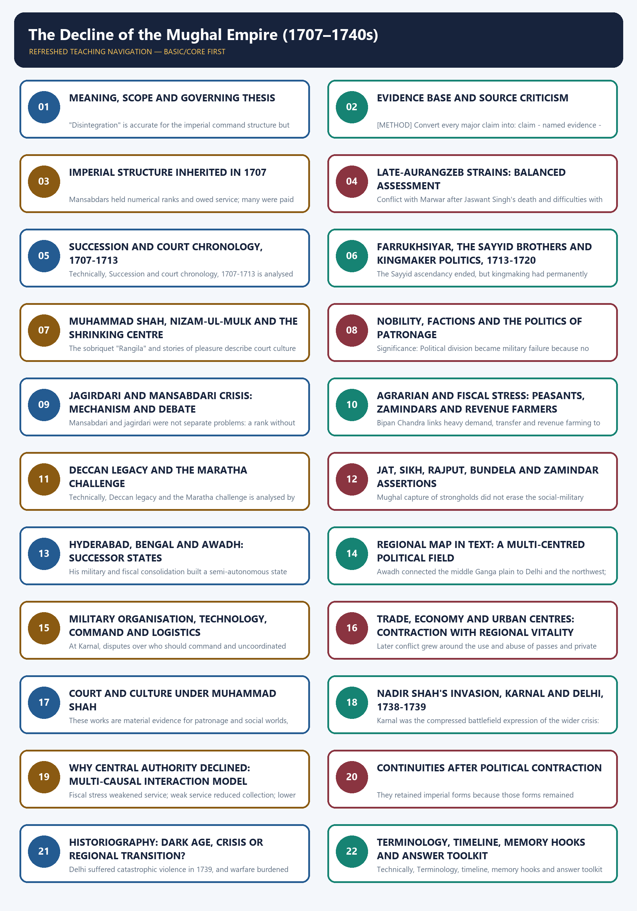

# The Decline of the Mughal Empire (1707–1740s) — Learner-v2 Complete Learning Session

> **Subject:** Modern Indian History | **Paper:** Prelims GS-I + GS-I analytical foundation | **Topic:** 01
>
> **Evidence key:** FACT = supported by a named source/event/institution; INTERPRETATION = evidence-led analytical position; LIMIT = what the evidence cannot establish; METHOD = source-use rule; BOUNDARY = context deliberately kept outside the core period.
>
> **Approval state:** generated, **approved=false**. Status remains yellow until the user explicitly approves all three deliverables.

## BASIC LEARNING SESSION

**Canonical Basic/Core owner:** `upsc-ai-kit\knowledge\Modern-Indian-History\basic\01_Decline-of-the-Mughal-Empire.md`
**Canonical topic owner:** `upsc-ai-kit\knowledge\Modern-Indian-History\basic\01_Decline-of-the-Mughal-Empire.md`  
**Optional Advanced owner:** `upsc-ai-kit\knowledge\Modern-Indian-History\advanced\01_Decline-of-the-Mughal-Empire.md`  
**Official syllabus mapping:** `upsc-ai-kit\knowledge\Modern-Indian-History\OFFICIAL-UPSC-SYLLABUS-MAPPING.md`

### EVIDENCE, PYQ AND CURRENT-STATUS DISCIPLINE

- **Official and primary evidence:** Acts, charters, treaties, proclamations, committee reports, proceedings, organisational resolutions, speeches and contemporary records are dated and read for authorship and purpose.
- **Regional and social evidence:** petitions, newspapers, memoirs, local studies and material geography qualify elite or all-India generalisation.
- **Economic and quantitative evidence:** revenue, trade, price, wage, craft and mortality claims retain unit, region, period and uncertainty; statistics are never invented.
- **Scholarly interpretation:** historian schools are competing explanations tied to named evidence, not memorised verdicts.
- **PYQ discipline:** repository ledgers and locally held official papers control wording and metadata; reconstructed wording and unavailable official keys remain explicitly labelled.
- **Current-status note, rechecked 2026-09-04:** The ASI and UNESCO Red Fort records are used only as a bounded material-heritage bridge for institutional and symbolic continuity. They do not establish the causes of Mughal political contraction or disputed numerical claims about the 1739 sack.

**Live/primary context sources:**

- `https://asi.nic.in/pages/WorldHeritageRedFort`
- `https://whc.unesco.org/en/list/231/`




*Distinct embedded teaching-navigation image. Graphical flowchart intentionally omitted by user export preference.*

#### Source audit and syllabus boundary

Markdown-first assembly uses the canonical package plus the paired Basic and Advanced owners. OCR sources are listed in the manifest for deeper checking; no live source is used except bounded heritage linkage. Verified local PYQs retain their provenance; unavailable keys remain labelled inferred, and no direct UPSC question is invented.

#### Sources actually used

| Source class | Exact source | Use and caveat |
|---|---|---|
| Repository knowledge | Modern History Topic 01 basic/advanced; README; Master Chronology; Revision Chart; PYQ routing; Answer-Worthiness Audit; bounded Topic 02. | Controls scope, chronology, answer architecture, successor-state comparison, terminology and existing answer-worthiness upgrades. |
| Repository bridge | Medieval History Topic 25 basic/advanced. | Supplies late-Aurangzeb, jagirdari, Sayyid, Maratha and eighteenth-century continuity; later Panipat material is kept outside the core. |
| Local OCR book | Bipan Chandra, *Modern India*, Chapter I and bounded Chapter II. | Foundation for ruler sequence, multi-causal decline, nobility, agrarian stress, Nadir Shah and successor states; older generalisations are qualified. |
| Local OCR book | Satish Chandra, *Medieval India: From Sultanat to the Mughals, Part II*, sections on Aurangzeb, northern India and the Marathas. | Detailed control for jagir debate, Sayyid policies, Nizam, regional states, Nadir diplomacy and the caution against overstating economic collapse. |
| Local OCR book | Sekhar Bandyopadhyay, *From Plassey to Partition*, Chapter 1. | Historiographical bridge between conventional decline and revisionist regionalisation; quantitative claims are not repeated as timeless facts. |
| Named primary traditions | Khafi Khan; Dargah Quli Khan; Mirza Mahdi Khan Astarabadi; farmans, sanads, letters, Company records and regional traditions. | Used through source-critical synthesis; no uncertain quotation, casualty total or invitation story is asserted. |
| Material/official heritage | ASI and UNESCO Red Fort pages; National Museum manuscript collection; IGNCA/Rampur Mughal-Persian manuscript catalogue. | Bounded evidence for material continuity, the Peacock Throne setting, manuscript survival and conservation; no current-affairs item is forced. |
| Verified PYQ routing | Repository 2021 Prelims Q45/Q48 and 2022 GS-I Q2 route. | Questions are included; unavailable local official Prelims keys are marked inferred. |

### Bounded authoritative links

- Archaeological Survey of India, Red Fort: https://asi.nic.in/pages/WorldHeritageRedFort
- UNESCO World Heritage Centre, Red Fort Complex: https://whc.unesco.org/en/list/231/
- National Museum, manuscript collection: https://www.nationalmuseumindia.gov.in/en/collections/index/11
- IGNCA, *Mughal and Persian Paintings and Illustrated Manuscripts*: https://ignca.gov.in/divisionss/kalakosa/kalasamalocana/mughal-and-persian-paintings-and-illustrated-manuscripts/

#### PART I - COMPLETE LEARNING SESSION

### SESSION 1 — MEANING, SCOPE AND GOVERNING THESIS

#### DEFINITION / WHAT THIS IS CALLED

**Plain-language definition:** This session defines what 'decline of the Mughal Empire' means for exam purposes: a fall in Delhi's enforceable authority, not the disappearance of the dynasty or its culture.

**Technical definition:** "Disintegration" is accurate for the imperial command structure but misleading if used to imply that administration, trade, urban life, culture or legitimacy vanished everywhere. The best explanation is interactive: unresolved succession + competitive nobility + jagirdari and agrarian pressures + Deccan over-extension + regional military-fiscal mobilisation + weak command adaptation + frontier exposure.

#### ANSWER-GRABBING OPENING — WRITE/ADAPT IN THE EXAM

> Nadir Shah accelerated and advertised the crisis; he did not originate it. Aurangzeb's choices mattered, especially the long Deccan commitment and difficulties with Marathas and some Rajput houses, but neither personal blame nor communal causation can explain the subsequent politics of jagirs, zamindars, successor states and noble coalitions. Background before 1707 is included only where it explains inherited structures and strains.

#### MUST-WRITE KEYWORDS

- **Meaning**
- **scope**
- **governing thesis**
- **Decline**
- **Decentralisation**
- **Regionalisation**

**How to use them:** This session's terms work best as a funnel: state the plain meaning first, fix the 1707-1740s scope, commit to the governing thesis that decline means loss of enforceable command, then use decentralisation and regionalisation to show where that lost command actually went.

#### Compact scope visual

```text
NECESSARY BACKGROUND                  CORE ANALYTICAL WINDOW                   BOUNDED CONSEQUENCE
late seventeenth century              1707 to the 1740s                        after 1740
Deccan war, jagir pressure     ->     succession, factions, regions     ->     Durrani pressure and
agrarian and frontier strain          and Nadir Shah, 1739                     later Company opportunity

The subject is the decline of imperial central authority, not the instant death of Mughal India.
```

#### Core teaching

- The Mughal dynasty did not disappear in 1707. What contracted was the centre's capacity to appoint, transfer, tax, discipline and defend across the empire. Mughal emperors, titles, revenue vocabulary, coins, farmans and symbolic sovereignty survived far longer.
- **Decline** means loss of effective central fiscal-military authority. **Decentralisation** means power moving from Delhi to provinces and local intermediaries. **Regionalisation** means provincial, zamindari and military networks becoming durable political formations. **Eighteenth-century transition** combines central contraction with new regional orders.
- "Disintegration" is accurate for the imperial command structure but misleading if used to imply that administration, trade, urban life, culture or legitimacy vanished everywhere.
- The best explanation is interactive: unresolved succession + competitive nobility + jagirdari and agrarian pressures + Deccan over-extension + regional military-fiscal mobilisation + weak command adaptation + frontier exposure. Nadir Shah accelerated and advertised the crisis; he did not originate it.
- Aurangzeb's choices mattered, especially the long Deccan commitment and difficulties with Marathas and some Rajput houses, but neither personal blame nor communal causation can explain the subsequent politics of jagirs, zamindars, successor states and noble coalitions.
- Background before 1707 is included only where it explains inherited structures and strains. Developments after Muhammad Shah's death in 1748 are used only to show bounded consequences, not to turn this package into a survey of the whole eighteenth century.

#### Decline versus transition matrix

| Analytical term | Correct use | Evidence | Unsafe overstatement |
|---|---|---|---|
| Decline | Loss of enforceable authority at the imperial centre | succession wars, provincial remittance failure, Karnal | "Everything in India declined" |
| Decentralisation | Delegated office and revenue moved toward provincial control | Bengal, Awadh, Hyderabad | "A complete political vacuum appeared" |
| Regionalisation | Local elites, financiers, zamindars and armies made new political arenas | Bengal revenue order, Awadh chiefs, Maratha networks | "All regions followed one identical path" |
| Transition | Old Mughal forms survived while the location and social basis of power changed | coin, khutba, mansab, Persian chancery, hereditary autonomy | "The old order ended in one event" |

#### Exam-safe governing thesis

The Mughal crisis of 1707-1740s was a **decline of central imperial capacity inside a continuing Mughal political culture**. The centre lost resources and obedience faster than it lost legitimacy; provinces and armed regional groups appropriated imperial techniques; and the external shock of 1739 exposed a system already weakened by interacting fiscal, agrarian, military and political pressures.

#### Named-evidence demonstration

- **Claim:** The 1707-1740s crisis is best named a decline of enforceable central command, not a collapse of the Mughal state as such.
- **Evidence:** Aurangzeb's death (1707) was followed by succession war, yet farmans, sanads and imperial coinage continued to be sought and issued for decades afterward, including the 1717 farman to the English Company.
- **Analysis:** If the empire had simply vanished, no later actor would have needed Mughal sanction; the fact that Bengal, Awadh, Hyderabad and even the Marathas continued to seek imperial confirmation shows that legitimacy outlived enforceable control.
- **Qualification:** This does not mean nothing was lost - treasury remittance, army discipline and frontier defence genuinely collapsed; only the symbolic-legal shell survived intact.

#### CLOSING RECALL FLOW — MEANING, SCOPE AND GOVERNING THESIS

```text
START / CONCEPT: Meaning, scope and governing thesis
        |
        v
EXACT TERMS: Meaning · scope · governing thesis · Decline · Decentralisation · Regionalisation
        |
        v
MECHANISM / ARGUMENT: Mughal emperors, titles, revenue vocabulary, coins, farmans and symbolic sovereignty survived far longer. Decline means loss of effective central fiscal-military authority.
        |
        v
CONSEQUENCE / CONTRAST: "Disintegration" is accurate for the imperial command structure but misleading if used to imply that administration, trade, urban life, culture or legitimacy vanished everywhere. The best explanation is interactive: unresolved succession + competitive nobility + jagirdari and agrarian pressures + Deccan over-extension + regional military-fiscal mobilisation + weak command adaptation + frontier exposure.
        |
        v
UPSC TRAP / ANSWER-USE: Developments after Muhammad Shah's death in 1748 are used only to show bounded consequences, not to turn this package into a survey of the whole eighteenth century.
        |
        v
ANSWER-GRABBING FORMULATION: Nadir Shah accelerated and advertised the crisis; he did not originate it. Aurangzeb's choices mattered, especially the long Deccan commitment and difficulties with Marathas and some Rajput houses, but neither personal blame nor communal causation can explain the subsequent politics of jagirs, zamindars, successor states and noble coalitions. Background before 1707 is included only where it explains inherited structures and strains.
```
### SESSION 2 — EVIDENCE BASE AND SOURCE CRITICISM

#### DEFINITION / WHAT THIS IS CALLED

**Plain-language definition:** This session explains how to read and weigh the different kinds of historical evidence - chronicles, official documents and material/heritage sources - used to reconstruct 1707-1740s Mughal history.

**Technical definition:** Convert every major claim into: claim - named evidence - significance - limit. A farman or sanad reveals what an authority wanted recognised.

#### ANSWER-GRABBING OPENING — WRITE/ADAPT IN THE EXAM

> No single chronicle, farman or coin can carry a verdict on 1707-1740s Mughal decline alone: each source class proves a specific claim while hiding a specific blind spot, so an examiner-worthy answer must combine genres rather than trust any one voice.

#### MUST-WRITE KEYWORDS

- **Evidence base**
- **source criticism**
- **claim - named evidence - significance - limit**
- **Persian court chronicles**
- **succession, offices, factions, jagirs, policy and court language**
- **Eyewitness and urban writing**

**How to use them:** Build the answer as a funnel: open with the evidence base and source-criticism principle, apply the claim - named evidence - significance - limit test through Persian court chronicles, then bring in eyewitness and urban writing to check what chronicles alone cannot show about succession, offices, factions, jagirs, policy and court language.

#### Source matrix

| Source family | Named examples | What it can establish | Genre or bias limit |
|---|---|---|---|
| Persian court chronicles | Khafi Khan, *Muntakhab al-Lubab*; later court histories used by Satish Chandra | succession, offices, factions, jagirs, policy and court language | elite and moralising gaze; access and patronage shape emphasis |
| Eyewitness and urban writing | Dargah Quli Khan, *Muraqqa-i Dehli*; Anand Ram Mukhlis's account of 1739 | courtly culture, urban life, invasion experience and elite networks | Delhi-centred, selective and socially narrow |
| Persian conqueror's chronicle | Mirza Mahdi Khan Astarabadi, *Tarikh-i Jahangusha-yi Nadiri* | Nadir's campaigns, diplomacy and imperial self-presentation | triumphalist patronage text; numbers and motives need corroboration |
| Farmans, sanads and letters | Farrukhsiyar's 1717 Company farman; Maratha grants associated with the 1718-19 settlement; diplomatic correspondence with Nadir | legal claims, privileges, bargaining and intended hierarchy | an order proves a claim, not uniform implementation |
| Company records | English factory consultations, letters and commercial accounts from Bengal, Madras and Surat | trade privileges, remittances, urban markets and political risk | corporate and commercial bias; limited knowledge of inland society |
| Regional records | Maratha bakhars and correspondence; Rajput records; Sikh and Jat traditions | mobilisation, local political memory and regional claims | retrospective heroisation, lineage and sectarian framing |
| Material evidence | coins, seals, inscriptions, forts, palaces, tombs, urban fabric and the Red Fort | titulature, mint claim, patronage, continuity and spatial power | survival is selective; symbolic claim is not territorial control |

#### Method rules

- Convert every major claim into: **claim -> named evidence -> significance -> limit**.
- A farman or sanad reveals what an authority wanted recognised. It does not by itself prove that customs officials, zamindars or Maratha commanders obeyed it.
- Coinage and the khutba are strong evidence of symbolic hierarchy. Their continuation under a successor state proves retained Mughal legitimacy, not direct daily control from Delhi.
- Court chronicles are strongest on offices, noble alliances, ceremonial precedence and war. Their silence is weakest evidence for peasant welfare, women's work, artisan agency or village-level implementation.
- Company records are precise about goods, customs and corporate disputes but cannot be treated as neutral descriptions of Indian politics.
- Invasion narratives tend to magnify armies, booty and casualties. This package therefore avoids a fixed casualty total for Delhi and treats famous booty estimates as contested.
- Material continuity matters: the Red Fort's Diwan-i-Khas and its former Peacock Throne setting, surviving coins and late-Mughal painting show that cultural production and symbolic sovereignty outlived the centre's military reach.

#### Source-use flow

```text
QUESTION
   |
define the level: centre / province / locality / economy / culture
   |
name the source: chronicle / farman / letter / coin / building / account
   |
state what it proves
   |
add genre, implementation, regional or numerical limit
   |
give a graded verdict
```

#### UPSC traps

- A contemporary source is not automatically neutral.
- A later regional memory is not useless, but its political purpose must be stated.
- A coin in the emperor's name proves a legitimacy claim, not direct imperial taxation.
- A story about court luxury cannot substitute for evidence on jagirs, army payment or provincial remittance.

#### Named-evidence demonstration

- **Claim:** No single chronicle can carry the whole explanation of decline; each source class has a specific competence and a specific blind spot.
- **Evidence:** Khafi Khan's Muntakhab al-Lubab is strong on court intrigue and noble rivalry but moralises; Dargah Quli Khan's Muraqqa-i Dehli captures Muhammad Shah's Delhi culture but is Delhi-centred; farmans/sanads such as the 1717 grant prove what was claimed, not what was actually enforced.
- **Analysis:** Combining a court chronicle with an administrative document and a regional/economic source lets an answer separate stated intention from realised outcome, which is exactly what the jama-hasil gap requires.
- **Qualification:** Even combined, these sources under-represent peasant and artisan experience directly, so agrarian claims must be treated as reconstructed, not directly testified.

#### CLOSING RECALL FLOW — EVIDENCE BASE AND SOURCE CRITICISM

```text
START / CONCEPT: Evidence base and source criticism
        |
        v
EXACT TERMS: Evidence base · source criticism · claim - named evidence - significance - limit · Persian court chronicles · succession, offices, factions, jagirs, policy and court language · Eyewitness and urban writing
        |
        v
MECHANISM / ARGUMENT: Convert every major claim into: claim - named evidence - significance - limit. A farman or sanad reveals what an authority wanted recognised.
        |
        v
CONSEQUENCE / CONTRAST: The resulting consequence is that their continuation under a successor state proves retained Mughal legitimacy, not direct daily control from Delhi.
        |
        v
UPSC TRAP / ANSWER-USE: A later regional memory is not useless, but its political purpose must be stated.
        |
        v
ANSWER-GRABBING FORMULATION: Their continuation under a successor state proves retained Mughal legitimacy, not direct daily control from Delhi. Court chronicles are strongest on offices, noble alliances, ceremonial precedence and war.
```
### SESSION 3 — IMPERIAL STRUCTURE INHERITED IN 1707

#### DEFINITION / WHAT THIS IS CALLED

**Plain-language definition:** The imperial structure inherited in 1707 is the administrative-and-status framework — the Khalisa treasury lands, the subah-sarkar-pargana-village revenue hierarchy, and Timurid dynastic legitimacy — through which the emperor arbitrated elite rank, office and succession.

**Technical definition:** Mansabdars held numerical ranks and owed service; many were paid through transferable revenue assignments called jagirs rather than ownership of land.

#### ANSWER-GRABBING OPENING — WRITE/ADAPT IN THE EXAM

> The system could govern diversity without uniform bureaucracy because it nested imperial authority within provincial and local intermediaries.

#### MUST-WRITE KEYWORDS

- **Imperial structure inherited in 1707**
- **Khalisa**
- **subah - sarkar - pargana - village**
- **Timurid legitimacy**
- **dynasty arbitrated elite rank and succession**
- **repeated succession wars made arbitration itself a prize**

**How to use them:** Describe the inherited structure top-down — Khalisa treasury lands anchoring the subah-sarkar-pargana-village hierarchy — then show how Timurid legitimacy let the dynasty arbitrate elite rank and succession, until repeated succession wars turned that arbitration itself into the prize being fought over.

#### Institutional map

```text
EMPEROR
  |-- mansab and office allocation
  |-- jagir assignment / transfer
  |-- khalisa revenue and imperial treasury
  |-- farman, title, robe, seal and symbolic arbitration
  |
SUBAH: subahdar (executive/military) + provincial diwan (revenue check)
  |
SARKAR -> PARGANA -> village and revenue intermediaries
  |
ZAMINDARS, qanungos, chaudhuris, cultivators, bankers and local armed followings

The system depended on circulation, audit, remittance and credible imperial arbitration.
```

#### Core teaching

- The emperor stood at the apex of appointment and patronage. Mansabdars held numerical ranks and owed service; many were paid through transferable revenue assignments called jagirs rather than ownership of land.
- **Khalisa** lands sent revenue more directly to the imperial treasury. Converting too much khalisa into jagir reduced the centre's cash flexibility, while withholding productive jagirs alienated nobles.
- The official hierarchy ran broadly from **subah -> sarkar -> pargana -> village**. The 2021 Prelims hierarchy question tests this inherited scale.
- A provincial subahdar exercised executive and military power, while the provincial diwan represented an intended fiscal check. In practice, strong governors could bring both political and revenue networks under personal control.
- Zamindars were not merely tax collectors. They possessed local rights, forts, armed retainers, clan or caste connections and knowledge of cultivation; imperial administration required their cooperation.
- The mansab-jagir mechanism was both a military establishment and a political contract. It tied a mobile nobility to the emperor so long as assignments were credible and service was enforceable.
- The system could govern diversity without uniform bureaucracy because it nested imperial authority within provincial and local intermediaries. Its strength was flexibility; its danger was that office-holders could appropriate delegated power when transfers and sanctions lost credibility.

#### Inherited strength and vulnerability

| Strength in 1707 | Why it had worked | Vulnerability after 1707 |
|---|---|---|
| Timurid legitimacy | dynasty arbitrated elite rank and succession | repeated succession wars made arbitration itself a prize |
| Transferable jagirs | prevented permanent local entrenchment | short tenure encouraged extraction; enforcement weakened |
| Composite nobility | drew talent from several regions and lineages | competition hardened when good assignments became scarce |
| Provincial delegation | extended rule over a vast empire | governors could convert office into hereditary autonomy |
| Gunpowder army | artillery, cavalry and fort war supported expansion | contingent shortfalls and divided command reduced effectiveness |
| Revenue depth | agrarian surplus financed court and army | high demand, jama-hasil gaps and rural resistance reduced remittance |

#### Answer insight

Mughal decline was not the collapse of an institutionless court. It was the failure of a sophisticated but relationship-dependent system to reproduce obedience, revenue and military service after expansion slowed and central arbitration weakened.

#### Named-evidence demonstration

- **Claim:** The pargana-sarkar-subah hierarchy and the mansab-jagir system gave 1707 Mughal India a genuinely sophisticated administrative inheritance, not a fragile improvisation.
- **Evidence:** The verified 2021 Prelims question (routed to Medieval History Topic 16) tests the exact ascending order pargana-sarkar-subah, confirming that this hierarchy was a settled, examinable structure by Akbar's reign and still operative at Aurangzeb's death.
- **Analysis:** Because the skeleton was sound, the eighteenth-century crisis has to be explained by how office-holders used and diverted this structure (jagir competition, transfer, revenue farming), not by inventing a new administrative collapse.
- **Qualification:** A sound structure is not a guarantee of durability - the same delegated-office design that gave flexibility under a strong emperor became the channel for hereditary provincial autonomy under weak ones.

#### CLOSING RECALL FLOW — IMPERIAL STRUCTURE INHERITED IN 1707

```text
START / CONCEPT: Imperial structure inherited in 1707
        |
        v
EXACT TERMS: Imperial structure inherited in 1707 · Khalisa · subah - sarkar - pargana - village · Timurid legitimacy · dynasty arbitrated elite rank and succession · repeated succession wars made arbitration itself a prize
        |
        v
MECHANISM / ARGUMENT: Mansabdars held numerical ranks and owed service; many were paid through transferable revenue assignments called jagirs rather than ownership of land.
        |
        v
CONSEQUENCE / CONTRAST: Mughal decline was not the collapse of an institutionless court.
        |
        v
UPSC TRAP / ANSWER-USE: It was the failure of a sophisticated but relationship-dependent system to reproduce obedience, revenue and military service after expansion slowed and central arbitration weakened.
        |
        v
ANSWER-GRABBING FORMULATION: The system could govern diversity without uniform bureaucracy because it nested imperial authority within provincial and local intermediaries.
```
### SESSION 4 — LATE-AURANGZEB STRAINS: BALANCED ASSESSMENT

#### DEFINITION / WHAT THIS IS CALLED

**Plain-language definition:** This session assesses, in a balanced way, how much of the post-1707 crisis Aurangzeb's own reign had already set in motion, chiefly through the prolonged Deccan war.

**Technical definition:** Conflict with Marwar after Jaswant Singh's death and difficulties with other Rajput houses weakened an alliance that had supplied military and political support, although Rajput-Mughal cooperation was later renewed.

#### ANSWER-GRABBING OPENING — WRITE/ADAPT IN THE EXAM

> The long Deccan phase tied the emperor and large forces to southern warfare, added Bijapur and Golconda, and failed to extinguish mobile Maratha resistance.

#### MUST-WRITE KEYWORDS

- **Late-Aurangzeb strains**
- **balanced assessment**
- **Deccan**
- **prolonged war, fiscal strain and administrative absence**
- **Maratha resilience and Deccan political geography mattered independently**
- **Jagirs**

**How to use them:** Keep the assessment balanced: credit Aurangzeb's Deccan campaigns with real prolonged-war fiscal strain and administrative absence, but weigh in Maratha resilience and Deccan political geography as independent factors, and use jagir competition to show where his legacy fed directly into the post-1707 crisis.

#### Causal background

```text
Deccan annexations and prolonged campaigning
      + unresolved Maratha resistance
      + incorporation of new Deccani and Maratha claimants
      + emperor's long absence from north India
      + Rajput, Jat, Satnami and Sikh tensions
                         |
                         v
more military cost + more claims on jagirs + weaker supervision
                         |
                         v
serious inheritance in 1707, but not an inevitable collapse
```

#### Core teaching

- Aurangzeb left an empire still formidable in army, administration and prestige. Bipan Chandra explicitly notes that the system remained efficient enough in 1707 for recovery to be conceivable.
- The long Deccan phase tied the emperor and large forces to southern warfare, added Bijapur and Golconda, and failed to extinguish mobile Maratha resistance.
- Expansion widened obligations faster than reliable collection. New Deccani and Maratha entrants sought mansabs and jagirs, while contested territories did not always yield the assessed revenue on paper.
- Conflict with Marwar after Jaswant Singh's death and difficulties with other Rajput houses weakened an alliance that had supplied military and political support, although Rajput-Mughal cooperation was later renewed.
- Jat, Satnami and Sikh assertions involved local power and agrarian grievances as well as religious identities. Peasants and zamindars supplied the social base of several movements.
- Religious measures, including the restoration of jizya, could alienate and symbolically narrow the imperial coalition. Yet later rulers and the Sayyids reversed such measures, while Hindu and Muslim elites repeatedly formed cross-religious alliances for power and revenue.
- Aurangzeb's policies created or aggravated constraints; they do not alone explain why later nobles fought over the wizarat, why provincial governors built successor states, or why revenue assignments lost credibility.

#### Balanced responsibility table

| Dimension | Aurangzeb-linked contribution | Qualification |
|---|---|---|
| Deccan | prolonged war, fiscal strain and administrative absence | Maratha resilience and Deccan political geography mattered independently |
| Jagirs | more entrants and assignments under wartime pressure | the crisis developed through later grants, transfers, corruption and remittance failure |
| Rajputs | Marwar conflict weakened an older alliance | many Rajput nobles later returned to high office |
| Religion | jizya and temple actions harmed coalition-building in places | political and class interests cannot be reduced to Hindu-Muslim blocs |
| Frontier | northwest received less attention during southern concentration | post-1707 courts also failed to rebuild diplomacy and defence |

#### Memory hook

**AURANGZEB = accelerator and inheritor of strain, not a communal single-cause explanation and not a complete answer.**

#### Named-evidence demonstration

- **Claim:** Aurangzeb's Deccan commitment was a real structural burden on his successors, but it is an insufficient single-cause explanation for post-1707 decline.
- **Evidence:** Decades of campaigning against Golconda, Bijapur and the Marathas absorbed treasury, transport and experienced commanders without permanently ending Maratha mobility, while incorporating new Deccani mansabdars added claimants to an already-stretched jagir pool.
- **Analysis:** This over-extension explains why be-jagiri (jagir shortage) was already acute in 1707, but it cannot by itself explain the specific post-1707 mechanisms of succession war, Sayyid kingmaking or Nizam-ul-Mulk's regional secession, which required separate political choices.
- **Qualification:** Jadunath Sarkar's older reading, which makes Aurangzeb's personality and religious policy the decisive cause, is a contested position, not a settled verdict - Bipan Chandra and Satish Chandra treat it as a contributing structural strain instead.

#### CLOSING RECALL FLOW — LATE-AURANGZEB STRAINS: BALANCED ASSESSMENT

```text
START / CONCEPT: Late-Aurangzeb strains: balanced assessment
        |
        v
EXACT TERMS: Late-Aurangzeb strains · balanced assessment · Deccan · prolonged war, fiscal strain and administrative absence · Maratha resilience and Deccan political geography mattered independently · Jagirs
        |
        v
MECHANISM / ARGUMENT: The operative mechanism is that the long Deccan phase tied the emperor and large forces to southern warfare, added Bijapur and Golconda, and failed to extinguish mobile Maratha resistance.
        |
        v
CONSEQUENCE / CONTRAST: Conflict with Marwar after Jaswant Singh's death and difficulties with other Rajput houses weakened an alliance that had supplied military and political support, although Rajput-Mughal cooperation was later renewed.
        |
        v
UPSC TRAP / ANSWER-USE: Do not miss this limiting distinction: religious measures, including the restoration of jizya, could alienate and symbolically narrow the imperial coalition, even though later rulers reversed such measures and cross-religious alliances persisted.
        |
        v
ANSWER-GRABBING FORMULATION: The long Deccan phase tied the emperor and large forces to southern warfare, added Bijapur and Golconda, and failed to extinguish mobile Maratha resistance.
```
### SESSION 5 — SUCCESSION AND COURT CHRONOLOGY, 1707-1713

#### DEFINITION / WHAT THIS IS CALLED

**Plain-language definition:** Succession and court chronology, 1707-1713, traces how Bahadur Shah I's reign turned throne-succession, Rajput/Sikh/Maratha bargaining and revenue assignment into a single interlocking political test.

**Technical definition:** Technically, this chronology reads Bahadur Shah's conciliatory settlements — sardeshmukhi conceded to the Marathas, chauth left unresolved, and ijara used to squeeze short-term revenue — as evidence that accommodation bought calm without repairing the underlying fiscal-military mechanism.

#### ANSWER-GRABBING OPENING — WRITE/ADAPT IN THE EXAM

> Bahadur Shah shows that a capable ruler could slow decline but could not simultaneously solve succession, Sikh resistance, Maratha bargaining, Rajput interests and the fiscal cost of elite accommodation.

#### MUST-WRITE KEYWORDS

- **Succession**
- **court chronology**
- **sardeshmukhi**
- **chauth**
- **ijara**
- **1707-1713**

**How to use them:** Anchor the 1707-1713 court chronology to the succession contest first, then show sardeshmukhi conceded against chauth left unresolved, and use ijara-driven short-term extraction as the fiscal symptom that Bahadur Shah's settlements never actually cured.

#### Succession tree

```text
Aurangzeb dies, 1707
   |
   +-- Muazzam -> Bahadur Shah I, victorious at Jajau
   +-- Azam Shah -> defeated and killed
   +-- Kam Bakhsh -> defeated in the Deccan, 1709

Bahadur Shah I dies, 1712
   |
   +-- Jahandar Shah, supported by Zulfiqar Khan
          |
          +-- defeated in 1713 by Farrukhsiyar
              backed by Abdullah Khan and Husain Ali, the Sayyid Brothers
```

#### Bahadur Shah I, 1707-1712

- Bahadur Shah was experienced, learned and conciliatory, not a caricature of immediate incompetence. He attempted accommodation with Rajputs, Marathas, Bundelas and Jats while campaigning against Banda Bahadur's Sikh movement.
- He recognised Maratha **sardeshmukhi** in the Deccan but did not fully settle **chauth** or the Shahu-Tarabai conflict. Conciliation without a stable enforcement formula left the Deccan unsettled.
- Chhatrasal Bundela and Churaman Jat could be incorporated tactically; Banda's movement, however, remained a major Punjab challenge despite Mughal campaigning.
- State finances worsened through promotions and jagir grants. Satish Chandra cites contemporary anxiety that armies required money that was no longer readily visible.
- Bahadur Shah shows that a capable ruler could slow decline but could not simultaneously solve succession, Sikh resistance, Maratha bargaining, Rajput interests and the fiscal cost of elite accommodation.

#### Jahandar Shah and Zulfiqar Khan, 1712-1713

- Jahandar Shah's short reign depended heavily on the experienced wazir Zulfiqar Khan. The political problem was not simply royal frivolity; it was whether a powerful minister could govern without frightening emperor and rival nobles.
- Zulfiqar pursued an inclusionist policy, abolished jizya, conciliated Rajputs, confirmed arrangements with Shahu and sought to restrain reckless jagir growth and enforce mansab contingents.
- Revenue farming or **ijara** spread, transferring collection to contractors who promised a fixed sum and then pressed cultivators for profit.
- A strong wazir offered administrative capacity but also created a coalition problem: the emperor feared replacement, old nobles feared exclusion and rivals organised alternative blocs.
- Farrukhsiyar defeated Jahandar Shah in January 1713 with decisive Sayyid support. Throne-making now visibly depended on armed noble coalitions.

#### Chronology table

| Date | Ruler or event | Analytical significance |
|---|---|---|
| 1707 | Jajau and Bahadur Shah's accession | succession consumed military and political capital |
| 1709 | defeat of Kam Bakhsh | last major phase of Aurangzeb's sons' contest |
| 1710-12 | Banda Bahadur challenge | Punjab resistance remained unresolved |
| 1712 | Bahadur Shah dies; Jahandar Shah succeeds | no institutional rule of succession |
| Jan 1713 | Farrukhsiyar triumphs | Sayyid military-political leverage becomes decisive |

#### Named-evidence demonstration

- **Claim:** The absence of a fixed succession rule converted every death of an emperor into an armed contest for the throne.
- **Evidence:** Bahadur Shah I secured the throne only after defeating his brother Azam at Jajau (1707) and Kam Bakhsh in the Deccan (1709); his conciliatory Deccan and Rajput policy left Maratha chauth/sardeshmukhi claims and the Shahu-Tarabai rivalry unresolved; Jahandar Shah's brief 1712-13 reign then depended entirely on the wazir Zulfiqar Khan.
- **Analysis:** Each succession war removed experienced commanders and forced the winner to reward supporters with jagirs and office immediately, intensifying the be-jagiri scarcity described in Sessions 3-4 before any external shock occurred.
- **Qualification:** Bahadur Shah's conciliation was a genuine attempt at stabilisation, not mere weakness - the failure lay in incompleteness (partial settlement), not in the absence of policy.

#### CLOSING RECALL FLOW — SUCCESSION AND COURT CHRONOLOGY, 1707-1713

```text
START / CONCEPT: Succession and court chronology, 1707-1713
        |
        v
EXACT TERMS: Succession · court chronology · sardeshmukhi · chauth · ijara · 1707-1713
        |
        v
MECHANISM / ARGUMENT: Bahadur Shah was experienced, learned and conciliatory, not a caricature of immediate incompetence.
        |
        v
CONSEQUENCE / CONTRAST: Chhatrasal Bundela and Churaman Jat could be incorporated tactically; Banda's movement, however, remained a major Punjab challenge despite Mughal campaigning.
        |
        v
UPSC TRAP / ANSWER-USE: The political problem was not simply royal frivolity; it was whether a powerful minister could govern without frightening emperor and rival nobles.
        |
        v
ANSWER-GRABBING FORMULATION: Bahadur Shah shows that a capable ruler could slow decline but could not simultaneously solve succession, Sikh resistance, Maratha bargaining, Rajput interests and the fiscal cost of elite accommodation.
```
### SESSION 6 — FARRUKHSIYAR, THE SAYYID BROTHERS AND KINGMAKER POLITICS, 1713-1720

#### DEFINITION / WHAT THIS IS CALLED

**Plain-language definition:** Kingmaker politics, 1713-1720, means a phase in which the Sayyid Brothers, not Emperor Farrukhsiyar, actually controlled appointments, the imperial seal and provincial patronage, so the throne depended on the coalition that held it rather than the reverse.

**Technical definition:** Technically, the Sayyids institutionalised this control through their offices - Abdullah Khan as wazir and Husain Ali Baraha as mir bakhshi - and enforced it in 1719 by deposing and killing Farrukhsiyar when he tried to bypass their office through personal favourites, then installing and replacing three further nominal emperors within the same year.

#### ANSWER-GRABBING OPENING — WRITE/ADAPT IN THE EXAM

> The Sayyid ascendancy ended, but kingmaking had permanently damaged the aura of unchallengeable monarchy.

#### MUST-WRITE KEYWORDS

- **Farrukhsiyar**
- **the Sayyid Brothers**
- **kingmaker politics**
- **emperors already needed noble military coalitions**
- **jagir scarcity encouraged blocs**
- **1713-1720**

**How to use them:** Trace 1713-1720 as kingmaker politics in action: Farrukhsiyar's dependence on the Sayyid Brothers shows that emperors already needed noble military coalitions, and jagir scarcity is the reason such coalitions hardened into competing blocs rather than loyal service.

#### Faction and office map

```text
EMPEROR FARRUKHSIYAR
      | wants personal control through favourites and the imperial seal
      |
      X conflict over appointments, jagirs, army and provincial resources
      |
SAYYID ABDULLAH KHAN (wazir) ----- SAYYID HUSAIN ALI (mir bakhshi / Deccan)
      |                                  |
Rajput, Jat and Hindustani links         Maratha negotiation and Deccan force
      \__________________________________/
                 kingmaker coalition
```

#### Core teaching

- Abdullah Khan and Husain Ali Baraha had raised Farrukhsiyar to the throne. Their subsequent struggle was over the substance of sovereignty: who controlled appointments, the imperial seal, jagirs, the army and provincial resources.
- The Sayyids pursued religious conciliation. Jizya and several pilgrim taxes were abolished; Rajput rulers received high ranks; Churaman Jat was accommodated; negotiation with Shahu produced Maratha grants.
- In the 1718 settlement, formalised through imperial grants in 1719, Shahu's side gained recognition of swarajya and rights connected with chauth and sardeshmukhi in the Deccan in return for service and political support.
- Farrukhsiyar's favourites attempted to bypass the wazir's office in appointments and seal business. Satish Chandra uses Khafi Khan to show the clash between an empowered ministry and personal royal rule.
- The crisis aggravated jagir competition: court parties promised ranks and assignments to recruit armed followers, converting institutional scarcity into immediate factional mobilisation.
- Farrukhsiyar was deposed and killed in 1719. Rafi-ud-Darajat and Shah Jahan II followed briefly before Muhammad Shah was installed. Counting Farrukhsiyar, four emperors occupied the throne during that calendar year.
- Husain Ali was assassinated in 1720; Abdullah Khan's resistance was defeated. The Sayyid ascendancy ended, but kingmaking had permanently damaged the aura of unchallengeable monarchy.

#### Interpretation: symptom and agent

| As symptom | As agent |
|---|---|
| emperors already needed noble military coalitions | deposition and killing of an emperor further reduced dynastic awe |
| jagir scarcity encouraged blocs | patronage promises intensified assignment competition |
| provincial resources mattered more than court title alone | Deccan and Maratha alliances shifted the balance at Delhi |
| composite politics continued | opponents weaponised race, religion and Timurid loyalty against them |

#### Balanced verdict

The Sayyids were not merely villains who "destroyed" the empire. They attempted conciliation and administration under severe constraints, but their use of deposition and puppet succession made the emperor visibly dependent on armed patrons. They reveal how structural scarcity and personal distrust turned the court into a battlefield.

#### Named-evidence demonstration

- **Claim:** The Sayyid Brothers' kingmaking proved that sovereignty had become a function of coalition control, not birthright alone.
- **Evidence:** Abdullah Khan and Husain Ali placed Farrukhsiyar on the throne in 1713, then abolished jizya and pilgrim taxes and negotiated the 1718-19 Maratha settlement recognising Shahu's chauth/sardeshmukhi claims, before deposing and killing Farrukhsiyar in 1719 and enthroning three further rulers within that same year.
- **Analysis:** Their conciliatory policies show they were capable administrators, not simply destroyers, but their willingness to depose and kill an emperor demonstrated to every subsequent noble faction that the throne itself could be captured by force.
- **Qualification:** Their own fall in 1720 (Husain Ali's assassination, Abdullah Khan's defeat) shows kingmaking power was not stable either - the mechanism they created outlived them and was later used against them.

#### CLOSING RECALL FLOW — FARRUKHSIYAR, THE SAYYID BROTHERS AND KINGMAKER POLITICS, 1713-1720

```text
START / CONCEPT: Farrukhsiyar, the Sayyid Brothers and kingmaker politics, 1713-1720
        |
        v
EXACT TERMS: Farrukhsiyar · the Sayyid Brothers · kingmaker politics · emperors already needed noble military coalitions · jagir scarcity encouraged blocs · 1713-1720
        |
        v
MECHANISM / ARGUMENT: Abdullah Khan and Husain Ali Baraha had raised Farrukhsiyar to the throne.
        |
        v
CONSEQUENCE / CONTRAST: The Sayyids were not merely villains who "destroyed" the empire.
        |
        v
UPSC TRAP / ANSWER-USE: They attempted conciliation and administration under severe constraints, but their use of deposition and puppet succession made the emperor visibly dependent on armed patrons.
        |
        v
ANSWER-GRABBING FORMULATION: The Sayyid ascendancy ended, but kingmaking had permanently damaged the aura of unchallengeable monarchy.
```
### SESSION 7 — MUHAMMAD SHAH, NIZAM-UL-MULK AND THE SHRINKING CENTRE

#### DEFINITION / WHAT THIS IS CALLED

**Plain-language definition:** Muhammad Shah, Nizam-ul-Mulk and the shrinking centre traces how a long-reigning but conciliatory emperor watched his most capable minister convert Deccan office into durable Hyderabad autonomy while central appointments turned factional and monetised.

**Technical definition:** Technically, the shrinking centre is measured by transferred function, not by court reputation: Nizam-ul-Mulk's 1724 departure from the wazarat converted revenue, army and patronage capacity into a regional base, while Delhi retained mainly the power to confirm rank and title.

#### ANSWER-GRABBING OPENING — WRITE/ADAPT IN THE EXAM

> The sobriquet "Rangila" and stories of pleasure describe court culture but do not explain the fiscal-military crisis.

#### MUST-WRITE KEYWORDS

- **Muhammad Shah**
- **Nizam-ul-Mulk**
- **the shrinking centre**
- **Nizam leaves the centre; provinces retain revenue**
- **appointments become factional and monetised**
- **late-Mughal painting develops intimate court and urban themes**

**How to use them:** Contrast Muhammad Shah's long reign with Nizam-ul-Mulk's exit: use "Nizam leaves the centre; provinces retain revenue" as the structural fact, "appointments become factional and monetised" as the mechanism, and treat late-Mughal painting's intimate court and urban themes only as cultural evidence of contraction, never as its cause.

#### Political sequence

```text
1719 Muhammad Shah installed
      |
1720 Sayyid power broken
      |
1722 Nizam-ul-Mulk becomes wazir and proposes restraint/reform
      |
1723-24 court resistance + Maratha pressure + Deccan opportunity
      |
1724 Nizam defeats Mubariz Khan and consolidates Hyderabad
      |
1730s regional autonomy deepens while Delhi retains symbolic primacy
```

#### Core teaching

- Muhammad Shah's reign, 1719-1748, brought chronological stability after rapid enthronements. Mughal prestige, artillery and administration still possessed recoverable strength in the early 1720s.
- Nizam-ul-Mulk represented an able noble seeking to restore discipline: review jagirs, resume some khalisa, restrain revenue farming and reduce corrupt appointment practices.
- His reform programme also protected old noble interests and included a proposed revival of jizya that contemporaries, including allied nobles, considered politically inopportune. Reform was itself factional.
- Nizam left the wizarat, moved south and defeated Mubariz Khan at Shakar Kheda in 1724. Hyderabad thereafter exercised practical autonomy while retaining imperial forms.
- Nizam's departure was not a formal declaration of independence. It was the conversion of high imperial office, Deccan networks and military capacity into a regional state.
- Muhammad Shah's court continued to appoint, title and symbolically validate powerful nobles. Yet it lacked reliable cash, disciplined contingents and provincial obedience.
- The sobriquet "Rangila" and stories of pleasure describe court culture but do not explain the fiscal-military crisis. A serious answer must distinguish patronage of music and painting from administrative failure.

#### Muhammad Shah: decline and cultural vitality

| Political contraction | Cultural continuity and change |
|---|---|
| Nizam leaves the centre; provinces retain revenue | Delhi remains a major courtly and urban centre |
| appointments become factional and monetised | late-Mughal painting develops intimate court and urban themes |
| army pay and contingent enforcement weaken | khayal receives important court patronage associated with Sadarang |
| Nadir defeats the imperial host in 1739 | Persianate etiquette, poetry, music and manuscript culture continue |

#### Answer insight

Muhammad Shah's period embodies the central distinction of the topic: **the state at Delhi weakened, while the court and city remained culturally productive and symbolically consequential**.

#### Named-evidence demonstration

- **Claim:** Muhammad Shah's long reign (1719-1748) is the period in which provincial autonomy became structurally normal rather than exceptional.
- **Evidence:** Nizam-ul-Mulk resigned the wizarat and, after defeating the rival claimant Mubariz Khan in 1724, converted his Deccan viceroyalty into the effectively hereditary state of Hyderabad while still striking coin and reading khutba in Muhammad Shah's name.
- **Analysis:** That the empire's own chief minister found provincial secession more secure than central office is the clearest single proof that the fiscal-military centre could no longer out-compete regional power for loyalty.
- **Qualification:** Muhammad Shah was not merely a passive 'Rangila' figurehead throughout; the sobriquet describes his cultural patronage, not a complete absence of political agency, and should not substitute for structural explanation.

#### CLOSING RECALL FLOW — MUHAMMAD SHAH, NIZAM-UL-MULK AND THE SHRINKING CENTRE

```text
START / CONCEPT: Muhammad Shah, Nizam-ul-Mulk and the shrinking centre
        |
        v
EXACT TERMS: Muhammad Shah · Nizam-ul-Mulk · the shrinking centre · Nizam leaves the centre; provinces retain revenue · appointments become factional and monetised · late-Mughal painting develops intimate court and urban themes
        |
        v
MECHANISM / ARGUMENT: It was the conversion of high imperial office, Deccan networks and military capacity into a regional state.
        |
        v
CONSEQUENCE / CONTRAST: Nizam's departure was not a formal declaration of independence.
        |
        v
UPSC TRAP / ANSWER-USE: A serious answer must distinguish patronage of music and painting from administrative failure.
        |
        v
ANSWER-GRABBING FORMULATION: The sobriquet "Rangila" and stories of pleasure describe court culture but do not explain the fiscal-military crisis.
```
### SESSION 8 — NOBILITY, FACTIONS AND THE POLITICS OF PATRONAGE

#### DEFINITION / WHAT THIS IS CALLED

**Plain-language definition:** This session explains how the Mughal nobility organised itself into shifting factional blocs and how those blocs competed for the same limited offices and jagirs.

**Technical definition:** Technically, factional analysis reads Turani, Irani, Afghan and Hindustani labels as patronage networks competing for scarce mansab, jagir and office, so imperial cohesion depended on resource allocation and coalition management rather than on any noble's individual character.

#### ANSWER-GRABBING OPENING — WRITE/ADAPT IN THE EXAM

> When leading nobles could not even agree on a unified command at Karnal in 1739, factional competition for scarce jagirs and office had already converted political division into battlefield failure.

#### MUST-WRITE KEYWORDS

- **Nobility**
- **Factions**
- **the politics of patronage**
- **Turani-Irani-Afghan-Hindustani networks**
- **jagir and office scarcity**
- **Mughal nobles**

**How to use them:** Faction analysis should open by naming the four broad noble networks, show how the wizarat, provincial governorships and productive jagirs were the actual stakes of competition, then use the 1739 Karnal command failure as decisive proof that factional division became military weakness.

#### Faction map

```text
TURANI       IRANI       AFGHAN       HINDUSTANI / BARAHA       DECCANI / MARATHA entrants
   \           |           |                |                         /
    \__________|___________|________________|________________________/
                         competition for
                mansab + jagir + office + provincial base
                                  |
                      coalitions were fluid, not fixed
```

#### Core teaching

- Mughal nobles are commonly described as Turani, Irani, Afghan, Hindustani and Deccani groupings. These labels indicate origin, kinship and recruitment networks; they were not permanent modern political parties.
- Competition centred on the wizarat, mir bakhshi's office, provincial governorships, productive jagirs, access to the emperor and control of armed followers.
- Ethnic vocabulary could organise trust, but coalitions crossed origin and religion when office required it. Nizam's anti-Sayyid coalition invoked Timurid monarchy, "old nobility" and religion together.
- Able figures were abundant: Zulfiqar Khan, the Sayyids, Nizam-ul-Mulk, Saadat Khan, Murshid Quli Khan, Jai Singh and others. The problem was not an absolute disappearance of talent.
- Bandyopadhyay uses this evidence against a simple "incompetent personalities" thesis: capable nobles invested their ability in regional power or factional survival because the imperial reward system no longer aligned private ambition with central service.
- Mansabdars facing inadequate yields often failed to maintain their full sanctioned contingents. A nominally large rank therefore did not guarantee soldiers ready for battle.
- Moral language about luxury and corruption appears frequently in chronicles. It is evidence of elite anxiety, but administrative mechanisms - assignment scarcity, arrears, sale of office and weak audit - explain more than private vice.

#### Named-evidence demonstration

- **Claim:** Factionalism weakened the empire.
- **Evidence:** Farrukhsiyar and the Sayyids competed over seal, appointment and Deccan resources; in 1739 leading nobles could not agree on command at Karnal.
- **Analysis:** Political division became military failure because no accepted authority could coordinate the host.
- **Qualification:** Factions were produced partly by jagir and office scarcity, so they cannot be treated as an isolated moral cause.

#### CLOSING RECALL FLOW — NOBILITY, FACTIONS AND THE POLITICS OF PATRONAGE

```text
START / CONCEPT: Nobility, factions and the politics of patronage
        |
        v
EXACT TERMS: Nobility · Factions · the politics of patronage · Turani-Irani-Afghan-Hindustani networks · jagir and office scarcity · Mughal nobles
        |
        v
MECHANISM / ARGUMENT: Political division became military failure because no single accepted authority could coordinate the host at the moment it mattered most.
        |
        v
CONSEQUENCE / CONTRAST: Ethnic vocabulary could organise trust, but coalitions crossed origin and religion when office required it.
        |
        v
UPSC TRAP / ANSWER-USE: These labels indicate origin, kinship and recruitment networks; they were not permanent modern political parties.
        |
        v
ANSWER-GRABBING FORMULATION: Faction competition for scarce mansab, jagir and office explains Mughal noble behaviour better than any thesis of collective moral decline.
```
### SESSION 9 — JAGIRDARI AND MANSABDARI CRISIS: MECHANISM AND DEBATE

#### DEFINITION / WHAT THIS IS CALLED

**Plain-language definition:** The jagirdari crisis is strongest as a mechanism connecting elite competition, rural extraction and military underperformance.

**Technical definition:** Mansabdari and jagirdari were not separate problems: a rank without adequate assignment produced arrears; an assignment without audit weakened troops; a weakened army reduced collection.

#### ANSWER-GRABBING OPENING — WRITE/ADAPT IN THE EXAM

> Mansabdari and jagirdari were not separate problems: a rank without adequate assignment produced arrears; an assignment without audit weakened troops; a weakened army reduced collection.

#### MUST-WRITE KEYWORDS

- **Jagirdari**
- **mansabdari crisis**
- **debate**
- **Mansab**
- **numerical rank and service status**
- **not itself ownership of land**

**How to use them:** Present the jagirdari-mansabdari crisis as one mechanism, not a debate to summarise abstractly: mansab fixed numerical rank and service status, jagir was never itself ownership of land, and the historiographical debate should be used only to weigh how far this mechanism explains decline.

#### Jagirdari causal flow

```text
expansion slows + wartime entrants and promotions increase
                         |
paper salary claims exceed dependable revenue assignments
                         |
be-jagiri / delayed assignment + competition for productive jagirs
                         |
short tenure and jama-hasil gap encourage rapid extraction
                         |
peasants and zamindars resist / remit less
                         |
nobles cut contingents; centre loses cash and coercive reach
                         |
factional court + hereditary provincial power
```

#### Terminology

| Term | Meaning | Exam caution |
|---|---|---|
| Mansab | numerical rank and service status | not itself ownership of land |
| Jagir | assigned revenue claim used to meet salary/service obligations | transferable in principle; yields varied |
| Khalisa | revenue reserved more directly for the crown | shrinking khalisa weakened central cash |
| Jama | assessed revenue demand | paper assessment could exceed real collection |
| Hasil | revenue actually realised | jama-hasil gap reveals fiscal credibility problem |
| Be-jagiri | lack or delay of a suitable jagir for a claimant | structural scarcity, not a synonym for ordinary corruption |
| Ijara | revenue farming to a contractor | spread pressure and reduced direct administrative control |

#### Satish Chandra's structural thesis

- Satish Chandra locates a central mechanism in the mismatch between a growing body of claimants and dependable revenue-yielding jagirs. Competition for assignments fed noble faction and short-term extraction.
- Frequent transfer was designed to prevent local entrenchment, but it discouraged long-term improvement and encouraged a jagirdar to maximise collection before transfer.
- Granting khalisa land as jagir could temporarily placate nobles while depriving the central treasury of cash needed for transport, artillery, salaries and frontier defence.
- The crisis became visible in court programmes to review ranks, resume assignments, check promotion and prohibit farming of crown lands.
- Mansabdari and jagirdari were not separate problems: a rank without adequate assignment produced arrears; an assignment without audit weakened troops; a weakened army reduced collection.

#### Debate and qualification

| Interpretation | Core claim | Evidence used | Limitation |
|---|---|---|---|
| Satish Chandra | real structural shortage and low-yield assignments | be-jagiri, faction, transfers, depleted paibaqi | conditions varied by province and moment |
| Irfan Habib | agrarian crisis beneath elite fiscal crisis | heavy demand, peasant flight, zamindar-led resistance | resistance also arose from local opportunity and expansion |
| John F. Richards | parts of the crisis were policy-made; Deccan khalisa choices mattered | revenue existed but allocation and war finance distorted access | actual Deccan realisation and security remained uncertain |
| Revisionist regional view | resources did not simply vanish; they moved into regional networks | Bengal growth, bankers, revenue entrepreneurs, local agrarian expansion | regional vitality did not restore imperial coordination or protect all peasants |

#### Verdict

The jagirdari crisis is strongest as a **mechanism connecting elite competition, rural extraction and military underperformance**. It should not be presented as a uniform quantified shortage across every province or as the only cause.

#### Named-evidence demonstration

- **Claim:** Be-jagiri - the shortage of adequate revenue-yielding jagirs relative to the number of mansab-holders - is the structural core of decline identified by Satish Chandra.
- **Evidence:** Jama (assessed revenue) frequently exceeded hasil (realised collection); paibaqi (the reserve pool of assignable jagirs) shrank as khalisa (crown land) grew through grants to favourites, forcing nobles into short-tenure, extraction-heavy assignments or ijara revenue farming.
- **Analysis:** This produced a self-reinforcing loop - scarcity caused extraction, extraction caused resistance and lower hasil, lower hasil caused weaker service, and weaker service caused nobles to seek security through court faction or regional entrenchment instead of loyal central service.
- **Qualification:** The precise numerical scale of the shortfall is debated among historians and must not be quoted as a fixed statistic; present it as a documented structural mismatch, not an invented figure.

#### CLOSING RECALL FLOW — JAGIRDARI AND MANSABDARI CRISIS: MECHANISM AND DEBATE

```text
START / CONCEPT: Jagirdari and mansabdari crisis: mechanism and debate
        |
        v
EXACT TERMS: Jagirdari · mansabdari crisis · debate · Mansab · numerical rank and service status · not itself ownership of land
        |
        v
MECHANISM / ARGUMENT: The jagirdari crisis is strongest as a mechanism connecting elite competition, rural extraction and military underperformance.
        |
        v
CONSEQUENCE / CONTRAST: Frequent transfer was designed to prevent local entrenchment, but it discouraged long-term improvement and encouraged a jagirdar to maximise collection before transfer.
        |
        v
UPSC TRAP / ANSWER-USE: Granting khalisa land as jagir could temporarily placate nobles while depriving the central treasury of cash needed for transport, artillery, salaries and frontier defence.
        |
        v
ANSWER-GRABBING FORMULATION: Mansabdari and jagirdari were not separate problems: a rank without adequate assignment produced arrears; an assignment without audit weakened troops; a weakened army reduced collection.
```
### SESSION 10 — AGRARIAN AND FISCAL STRESS: PEASANTS, ZAMINDARS AND REVENUE FARMERS

#### DEFINITION / WHAT THIS IS CALLED

**Plain-language definition:** Agrarian and fiscal stress means a weakening imperial centre pushing jagirdars, khalisa officials and revenue farmers to extract more from peasants and zamindars, so a court-level cash shortage travelled downward into the village rather than being solved at the top.

**Technical definition:** Technically, this operated through short-tenure ijara (revenue-farming) contracts, in which farmers recovered their investment by collecting above the sanctioned demand; Bipan Chandra links this heavier, less accountable extraction to peasant impoverishment, flight and uprisings associated with Satnamis, Jats and Sikhs.

#### ANSWER-GRABBING OPENING — WRITE/ADAPT IN THE EXAM

> "Agrarian crisis" must therefore be spatially differentiated: extraction and insecurity were severe, but production and commercialisation did not collapse uniformly.

#### MUST-WRITE KEYWORDS

- **Agrarian**
- **fiscal stress**
- **peasants**
- **zamindars**
- **revenue farmers**
- **zamindars resist transfer or payment**

**How to use them:** Build the agrarian chain in sequence: fiscal stress on the state pushes revenue farmers to extract harder from peasants and zamindars, and use the fact that zamindars resist transfer or payment as the concrete evidence that this stress met real social limits.

#### Rural power chain

```text
imperial demand -> jagirdar / khalisa official / revenue farmer
                         |
                  zamindar and local staff
                         |
               cultivator, artisan and village credit

If demand rose while tenure shortened:
extraction -> flight / concealment / arrears -> armed zamindar resistance -> lower remittance
```

#### Core teaching

- Land revenue financed the imperial court and army. A weakening centre often responded by granting more assignments or demanding remittance, shifting pressure downward rather than solving the resource problem.
- Ijara expanded in the early eighteenth century. Revenue farmers combined cash, local knowledge and coercive power; their profit depended on collecting above the contracted payment.
- Bipan Chandra links heavy demand, transfer and revenue farming to peasant impoverishment, flight and uprisings associated with Satnamis, Jats and Sikhs.
- Zamindars could withhold revenue, fortify positions and mobilise cultivators through locality, clan, caste or religious networks. They were both intermediaries of empire and possible leaders against it.
- Peasant movements were not spontaneous class wars alone, nor merely religious rebellions. They often joined agrarian grievance to leadership by landed or warrior groups capable of sustained armed action.
- Bandyopadhyay notes that some regions experienced agricultural expansion, monetisation and stronger local lineages. New resources could empower regional actors even while the centre called their autonomy "rebellion".
- "Agrarian crisis" must therefore be spatially differentiated: extraction and insecurity were severe, but production and commercialisation did not collapse uniformly.

#### Agrarian interpretation matrix

| Observation | Decline reading | Regionalisation reading | Combined answer |
|---|---|---|---|
| zamindars resist transfer or payment | breakdown of imperial discipline | local rights and armed capacity strengthen | weakening centre converts intermediaries into rulers |
| revenue farmers rise | predatory extraction and administrative decay | cash-rich entrepreneurs enter politics | commercial power and coercion combine |
| peasant participation | subsistence pressure and oppression | local solidarity and leadership matter | grievance needs organisation to become durable revolt |
| new cultivation in some areas | contradicts universal economic collapse | expands regional resource base | growth can coexist with conflict and unequal extraction |

#### UPSC trap

Do not write "the peasantry overthrew the Mughals." Rural resistance eroded collection and supplied regional movements, but leadership, weapons, forts, credit and political opportunity shaped outcomes.

#### Named-evidence demonstration

- **Claim:** Agrarian extraction under jagir/ijara pressure directly fed into the political crisis by shrinking the peasant and zamindar base that funded the whole system.
- **Evidence:** Irfan Habib's agrarian-crisis thesis links short-tenure revenue farming and rising demand to peasant flight, arrears and zamindar-led resistance among Jats, Sikhs and other local powers, actions which reduced remittance to Delhi.
- **Analysis:** This rural transmission mechanism explains why a fiscal problem originating in elite competition (Session 9) became a political problem of frontier disorder and regional assertion (Sessions 11-12) rather than remaining confined to the court.
- **Qualification:** Revisionist historians (Alam, Bayly) caution that agrarian growth, monetisation and banking could coexist with resistance in some regions - rural distress was not uniform or total across the empire.

#### CLOSING RECALL FLOW — AGRARIAN AND FISCAL STRESS: PEASANTS, ZAMINDARS AND REVENUE FARMERS

```text
START / CONCEPT: Agrarian and fiscal stress: peasants, zamindars and revenue farmers
        |
        v
EXACT TERMS: Agrarian · fiscal stress · peasants · zamindars · revenue farmers · zamindars resist transfer or payment
        |
        v
MECHANISM / ARGUMENT: Zamindars could withhold revenue, fortify positions and mobilise cultivators through locality, clan, caste or religious networks.
        |
        v
CONSEQUENCE / CONTRAST: Peasant movements were not spontaneous class wars alone, nor merely religious rebellions.
        |
        v
UPSC TRAP / ANSWER-USE: New resources could empower regional actors even while the centre called their autonomy "rebellion".
        |
        v
ANSWER-GRABBING FORMULATION: "Agrarian crisis" must therefore be spatially differentiated: extraction and insecurity were severe, but production and commercialisation did not collapse uniformly.
```
### SESSION 11 — DECCAN LEGACY AND THE MARATHA CHALLENGE

#### DEFINITION / WHAT THIS IS CALLED

**Plain-language definition:** This session traces the unresolved Deccan/Maratha problem inherited from Aurangzeb's reign and how it continued to drain Delhi's resources after 1707.

**Technical definition:** Technically, the Deccan legacy is analysed as a bargaining sequence: sardeshmukhi conceded, chauth left unresolved, and the 1718-19 Sayyid-brokered settlement converting military recognition into a standing regional fiscal claim rather than a single decisive battlefield verdict.

#### ANSWER-GRABBING OPENING — WRITE/ADAPT IN THE EXAM

> Aurangzeb's campaigns dispersed but never destroyed Maratha military capacity, so every post-1707 Deccan settlement bought calm through fiscal concession, not conquest.

#### MUST-WRITE KEYWORDS

- **Deccan legacy**
- **the Maratha challenge**
- **Chauth**
- **Sardeshmukhi**
- **additional claim conventionally represented as ten per cent**
- **asserted superior hereditary or regional fiscal right**

**How to use them:** Present Chauth and Sardeshmukhi as linked fiscal claims, not one payment: Chauth is the roughly one-quarter revenue share, Sardeshmukhi is the additional claim conventionally represented as ten per cent and asserted as a superior hereditary or regional fiscal right, and both illustrate how the Deccan legacy converted the Maratha challenge into a bargained partnership rather than a conquest.

#### Chauth and sardeshmukhi

| Claim | Working meaning | Political significance | Caution |
|---|---|---|---|
| Chauth | conventionally one-fourth of assessed revenue claimed from a territory | paid in return for recognition or restraint from Maratha exaction | not an ordinary village land tax and not always collected uniformly |
| Sardeshmukhi | additional claim conventionally represented as ten per cent | asserted superior hereditary or regional fiscal right | legal claim and realised collection could differ |
| Swarajya | core dominion associated with Shivaji's state | dynastic and territorial recognition for Shahu | contested by rival Maratha houses and local chiefs |

#### Core teaching

- Aurangzeb's campaigns did not destroy Maratha military capacity. Fort networks, mobile cavalry, local revenue knowledge and dispersed sardars allowed resistance to survive the fall of individual centres.
- After 1707, Shahu and Tarabai represented rival Maratha legitimacies. Mughal policy attempted to manage this division rather than recognise one uncontested sovereign.
- Bahadur Shah conceded sardeshmukhi but not a full settlement of chauth. Zulfiqar Khan and later the Sayyids moved further toward negotiated recognition.
- The 1718-19 settlement associated with Husain Ali and Balaji Vishwanath linked Shahu's recognition and Deccan fiscal claims to military support for the Sayyids.
- This was not simply Mughal surrender. It was an attempt to turn Maratha extraction into a regulated partnership; weak enforcement and competing commanders made the compromise unstable.
- Under Baji Rao I from 1720, Maratha strategy shifted decisively toward Malwa, Gujarat and north Indian influence. Mobility allowed revenue claims to precede durable territorial administration.
- "Marathas versus Mughals" is too simple. Maratha forces served Mughal factions; Maratha sardars competed among themselves; the Nizam bargained and fought with different Maratha interests.

#### Deccan interaction model

```text
Mughal campaign cannot eliminate dispersed Maratha power
                    |
court offers fiscal recognition for service
                    |
Maratha chiefs gain legal and revenue leverage
                    |
Nizam builds Hyderabad while bargaining/fighting with Marathas
                    |
Deccan becomes a multi-centred political field, not a clean secession
```

#### Regional limit

Maratha expansion strained Mughal and successor-state finances, yet reach did not equal uniform rule. Collection rights depended on negotiation, military presence and the cooperation of local elites.

#### Named-evidence demonstration

- **Claim:** The Deccan remained the empire's most persistent drain because Maratha resistance was never permanently resolved by conquest or negotiation.
- **Evidence:** Bahadur Shah's Deccan policy recognised sardeshmukhi but left chauth and the Shahu-Tarabai succession dispute unsettled; the 1718-19 Sayyid-negotiated settlement formally linked Maratha chauth/sardeshmukhi claims to Mughal recognition of Shahu, after which Baji Rao's northward campaigns from 1720 extended Maratha reach into Malwa and Gujarat.
- **Analysis:** Each partial settlement bought short-term peace at the cost of conceding real fiscal claims, so Deccan policy is a case study in how imperial bargaining, not only battlefield defeat, transferred revenue rights to a regional power.
- **Qualification:** This session treats the Marathas only as evidence of Delhi's contraction; their internal state-formation, administration and full 1707-1761 trajectory belong to Modern History Topic 02 and Medieval History Topic 25, not to this core answer.

#### CLOSING RECALL FLOW — DECCAN LEGACY AND THE MARATHA CHALLENGE

```text
START / CONCEPT: Deccan legacy and the Maratha challenge
        |
        v
EXACT TERMS: Deccan legacy · the Maratha challenge · Chauth · Sardeshmukhi · additional claim conventionally represented as ten per cent · asserted superior hereditary or regional fiscal right
        |
        v
MECHANISM / ARGUMENT: It was an attempt to turn Maratha extraction into a regulated partnership; weak enforcement and competing commanders made the compromise unstable.
        |
        v
CONSEQUENCE / CONTRAST: This was not simply Mughal surrender.
        |
        v
UPSC TRAP / ANSWER-USE: Do not miss this limiting distinction: this was not simply Mughal surrender.
        |
        v
ANSWER-GRABBING FORMULATION: "Marathas versus Mughals" is too simple.
```
### SESSION 12 — JAT, SIKH, RAJPUT, BUNDELA AND ZAMINDAR ASSERTIONS

#### DEFINITION / WHAT THIS IS CALLED

**Plain-language definition:** This session surveys how the Jats, Sikhs, Rajputs, Bundelas and local zamindars turned regional grievances into durable, armed local power after 1707.

**Technical definition:** Technically, each case is one of local right-holders - zamindari status, peasant or community support, forts and armed retainers - converting existing land and revenue control into durable regional bargaining power, sometimes through direct resistance (Jats, Sikhs) and sometimes through negotiated imperial office (Rajputs, Bundelas), with no single group replacing Mughal sovereignty.

#### ANSWER-GRABBING OPENING — WRITE/ADAPT IN THE EXAM

> J-S-R-B-Z: Jats, Sikhs, Rajputs, Bundelas and Zamindars turned local rights into bargaining power; none alone replaced the empire.

#### MUST-WRITE KEYWORDS

- **Jat**
- **Sikh**
- **Rajput**
- **Bundela**
- **zamindar assertions**
- **Jats of Agra-Mathura**

**How to use them:** Treat Jat, Sikh, Rajput and Bundela assertions as four distinct social routes into regional power, not one rebellion: use the Jats of Agra-Mathura as the concrete case of zamindar assertions converting local revenue control into durable armed authority.

#### Regional assertion table

| Power or region | Named evidence within scope | Basis of assertion | Relation to Mughal order | Limit |
|---|---|---|---|---|
| Jats of Agra-Mathura | Churaman; fortified countryside and highway influence | zamindari, peasant support and local armed power | alternated between resistance, office and negotiated concession | later Bharatpur consolidation extends beyond the early window |
| Sikhs in Punjab | Banda Bahadur, Lohgarh and agrarian mobilisation | religious community, peasant support and armed organisation | Bahadur Shah first conciliated Guru Gobind Singh, then campaigned against Banda | misl and Ranjit Singh phases are later |
| Rajputs | Ajit Singh of Marwar, Jai Singh of Amber, Mewar diplomacy | dynastic states, mansabs and regional armies | high imperial office coexisted with demands for provincial control | Rajputs were not one united anti-Mughal bloc |
| Bundelas | Chhatrasal and Bundelkhand networks | local warrior-landed power | accommodation and autonomy could coexist | alliances changed with Mughal and Maratha pressure |
| Rohillas and Afghan chiefs | emerging Rohilkhand networks | military labour, settlement and local revenue | grew from weakened Mughal territories, not Durrani-created territory | major consolidation belongs partly to the later eighteenth century |

#### Core teaching

- Jat mobilisation around Agra-Mathura drew strength from fortified villages, zamindari authority and peasant participation. Churaman could be both negotiated with and treated as a rebel.
- Banda Bahadur's movement challenged Mughal authority across parts of Punjab after Guru Gobind Singh's death. Mughal capture of strongholds did not erase the social-military networks from which later Sikh power emerged.
- Jai Singh and Ajit Singh sought mansabs, governorships and regional concessions. Their politics demonstrates that autonomy often operated through imperial office rather than formal separation.
- Chhatrasal Bundela built substantial regional power while entering shifting accommodations. His career resists a simple loyalist/rebel binary.
- These movements weakened the centre by withholding revenue, demanding office, controlling forts and forcing military expenditure. They also created institutions and elites later absorbed into regional states.
- Religious identity shaped solidarity, but political economy - land, revenue, fortification, office and armed labour - explains why mobilisation became durable.
- They did not jointly fight for a nation-state. Alliances frequently crossed faith and regional lines, and each pursued its own territorial and fiscal interests.

#### Memory hook

**J-S-R-B-Z: Jats, Sikhs, Rajputs, Bundelas and Zamindars turned local rights into bargaining power; none alone replaced the empire.**

#### Named-evidence demonstration

- **Claim:** Regional assertion after 1707 took several distinct political routes, not one uniform rebellion.
- **Evidence:** Churaman's Jats fortified the Agra-Mathura tract on a peasant-zamindari base; Banda Bahadur's Sikh mobilisation around Lohgarh drew on Punjab's agrarian and militant networks; Rajput houses under Jai Singh and Ajit Singh combined mansabdari status with regional demands; Chhatrasal's Bundelas mixed accommodation with assertion.
- **Analysis:** What made resistance durable in each case was the same combination of land control, revenue rights, forts and armed following described in Session 9's jagir mechanism - identity explains recruitment, but resources explain survival.
- **Qualification:** These actors are bounded here strictly as evidence of Delhi's weakening command; their comparative state-formation and social organisation are the separate analytical property of Modern History Topic 02.

#### CLOSING RECALL FLOW — JAT, SIKH, RAJPUT, BUNDELA AND ZAMINDAR ASSERTIONS

```text
START / CONCEPT: Jat, Sikh, Rajput, Bundela and zamindar assertions
        |
        v
EXACT TERMS: Jat · Sikh · Rajput · Bundela · zamindar assertions · Jats of Agra-Mathura
        |
        v
MECHANISM / ARGUMENT: Their politics demonstrates that autonomy often operated through imperial office rather than formal separation.
        |
        v
CONSEQUENCE / CONTRAST: Mughal capture of strongholds did not erase the social-military networks from which later Sikh power emerged.
        |
        v
UPSC TRAP / ANSWER-USE: Chhatrasal Bundela built substantial regional power while entering shifting accommodations.
        |
        v
ANSWER-GRABBING FORMULATION: J-S-R-B-Z: Jats, Sikhs, Rajputs, Bundelas and Zamindars turned local rights into bargaining power; none alone replaced the empire.
```
### SESSION 13 — HYDERABAD, BENGAL AND AWADH: SUCCESSOR STATES

#### DEFINITION / WHAT THIS IS CALLED

**Plain-language definition:** This session uses Bengal, Awadh and Hyderabad only as three dated, named instances of one process - a Mughal provincial governor converting delegated office into effectively autonomous control over revenue, army and succession, while Delhi's nominal sovereignty was still acknowledged.

**Technical definition:** Technically, each case shows the same fiscal-political transfer - appointment, revenue collection, army command and succession passing from Delhi's direct administration to the regional governor - while coin, khutba and imperial titulature preserved formal Mughal suzerainty; comparing the three states' distinct internal institutions is out of scope here and belongs to Modern History Topic 02.

#### ANSWER-GRABBING OPENING — WRITE/ADAPT IN THE EXAM

> Successor states were continuities in administrative form and transformations in the location of sovereignty.

#### MUST-WRITE KEYWORDS

- **Hyderabad**
- **Bengal**
- **Awadh**
- **successor states**
- **Murshid Quli Khan; governorship confirmed 1717**
- **Persian administration, imperial titles, remittance and formal sanction**

**How to use them:** Read Hyderabad, Bengal and Awadh only as evidence of Delhi's contraction: use Murshid Quli Khan's governorship, confirmed in 1717, as the dated anchor, and show that Persian administration, imperial titles, remittance and formal sanction persisted even as these successor states behaved as autonomous regional powers.

#### Successor-state evidence log — Delhi's contracting command

| State | Foundational figure and date | Mughal continuity retained | Authority that left Delhi's direct command |
|---|---|---|---|
| Bengal | Murshid Quli Khan; governorship confirmed 1717 | Persian administration, imperial titles, remittance and formal sanction | appointments, revenue survey, transfer of jagirs, dynastic succession |
| Awadh | Saadat Khan Burhan-ul-Mulk appointed 1722 | imperial governorship and continued court ambition | subdued chiefs, expanded subah and reduced effective financial dependence |
| Hyderabad | Nizam-ul-Mulk Asaf Jah; decisive consolidation 1724 | coins, khutba, mansabs and nominal Mughal suzerainty | war, treaty, appointment and Deccan revenue controlled regionally |

*Each row is read only as one dated instance of the same evidentiary point — Delhi's loss of direct command — not as a comparative profile of the three regions' distinct institutional character; that comparative analysis of Bengal, Awadh and Hyderabad as regional states in their own right is owned by Modern History Topic 02 (Indian States and Society, 18th Century).*

#### Named evidence of Delhi's contraction

- **Bengal:** Murshid Quli Khan, confirmed governor in 1717, moved revenue collection, appointments and succession out of Delhi's direct control while still remitting funds and retaining imperial titles and formal sanction.
- **Awadh:** Saadat Khan, appointed in 1722, built an autonomous military-fiscal base in the middle-Ganga tract while continuing to seek confirmation and office from Delhi.
- **Hyderabad:** Nizam-ul-Mulk, decisively consolidated in 1724 after defeating Mubariz Khan, converted the Deccan viceroyalty into a hereditary base while coin and khutba continued in the emperor's name.

**Handoff to Modern History Topic 02:** These three entries are read only as dated evidence for one thesis - Delhi's contracting command and fiscal-political decentralisation. Each state's distinct internal institutions, society, economy and administration are the separate, dedicated subject matter of Modern History Topic 02 (Indian States and Society, Eighteenth Century) and are not developed further in this topic.

#### Nature of successor states

```text
MUGHAL PROVINCIAL OFFICE
        +
regional military following
        +
zamindar / banker / merchant support
        +
declining transfer and audit from Delhi
        =
HEREDITARY AUTONOMY WITH IMPERIAL LEGITIMACY
```

#### Verdict

Successor states were **continuities in administrative form and transformations in the location of sovereignty**. They did not produce a power vacuum; they produced a layered order in which Delhi remained the language of legitimacy but not the daily source of command.

#### Named-evidence demonstration

- **Claim:** Bengal, Awadh and Hyderabad show a common formula - provincial office plus regional resources plus nominal Mughal sanction - applied with different regional substance.
- **Evidence:** Murshid Quli Khan (confirmed 1717) built Bengal's autonomy on survey-based revenue collection and zamindar/banker cooperation; Saadat Khan (1722) built Awadh's on subduing local chiefs in the middle-Ganga tract; Nizam-ul-Mulk (1724) built Hyderabad's on Deccan military command after defeating Mubariz Khan.
- **Analysis:** All three retained coin, khutba and Mughal titulature, proving that 'successor state' meant continuity of form with a decisive shift of substantive power, not a declared break from Delhi.
- **Qualification:** These three cases are used here strictly as evidence for one thesis — Delhi's contracting command — and not as a comparative institutional study of the states themselves; the comparative analysis of Bengal's, Awadh's and Hyderabad's distinct regional character is Modern History Topic 02's owned territory, not this topic's.

#### CLOSING RECALL FLOW — HYDERABAD, BENGAL AND AWADH: SUCCESSOR STATES

```text
START / CONCEPT: Hyderabad, Bengal and Awadh: successor states
        |
        v
EXACT TERMS: Hyderabad · Bengal · Awadh · successor states · Murshid Quli Khan; governorship confirmed 1717 · Persian administration, imperial titles, remittance and formal sanction
        |
        v
MECHANISM / ARGUMENT: Each state completed the same fiscal-political transfer - appointment, revenue, army command and succession moving from Delhi's direct administration to the regional governor - while coin, khutba and titulature kept formal Mughal suzerainty intact.
        |
        v
CONSEQUENCE / CONTRAST: This produced continuity in administrative form alongside a real transfer in the location of command, not a declared break from Delhi.
        |
        v
UPSC TRAP / ANSWER-USE: Do not profile Bengal's, Awadh's or Hyderabad's distinct institutions in a core Topic 01 answer - that comparative analysis belongs to Modern History Topic 02.
        |
        v
ANSWER-GRABBING FORMULATION: Successor states were continuities in administrative form and transformations in the location of sovereignty.
```
### SESSION 14 — REGIONAL MAP IN TEXT: A MULTI-CENTRED POLITICAL FIELD

#### DEFINITION / WHAT THIS IS CALLED

**Plain-language definition:** This session assembles the preceding regional evidence into one composite picture of India as a multi-centred political field by the 1730s.

**Technical definition:** Awadh connected the middle Ganga plain to Delhi and the northwest; its rulers could be provincial governors, regional sovereigns and imperial office-seekers at once.

#### ANSWER-GRABBING OPENING — WRITE/ADAPT IN THE EXAM

> Delhi retained titles, ceremonial authority and a strategic upper-Ganga core, but each corridor required cooperation from regional powers.

#### MUST-WRITE KEYWORDS

- **Regional map in text**
- **a multi-centred political field**
- **Jat countryside**
- **Delhi**
- **Ganga**
- **Agra-Mathura**

**How to use them:** Use the regional map in text to place Delhi at the centre of a genuinely multi-centred political field: locate the Jat countryside along the Agra-Mathura belt and the Ganga corridor to show that regional power was geographically distributed, not concentrated in one rival capital.

#### Map

```text
                         KABUL / QANDAHAR
                               |
               Punjab: Sikh assertion + frontier exposure
                               |
      Rajputana ---- DELHI / AGRA ---- Rohilla-Afghan zones
          |          Jat countryside           |
          |                 \                   |
       Malwa <---------- Bundelkhand -------- AWADH
          ^                                      |
          |                                      |
  Maratha movement --------------------------- BENGAL
          |
     HYDERABAD / DECCAN ---- Carnatic
          |
      Mysore and southern polities (bounded context)
```

#### How to read the map

- Delhi retained titles, ceremonial authority and a strategic upper-Ganga core, but each corridor required cooperation from regional powers.
- Punjab combined imperial frontier defence, Sikh mobilisation and the route later used by Nadir Shah and Ahmad Shah Durrani.
- Agra-Mathura was not merely a road from Delhi; Jat fortification and zamindari power could disrupt communications.
- Malwa connected north India to the Deccan and became a major arena of Maratha expansion and Nizam-Maratha competition.
- Bengal's distance, revenue surplus and commercial networks made effective autonomy possible while symbolic Mughal links remained useful.
- Awadh connected the middle Ganga plain to Delhi and the northwest; its rulers could be provincial governors, regional sovereigns and imperial office-seekers at once.
- The map shows why "fragmentation" did not produce isolated boxes. Revenue, troops, bankers, pilgrims, merchants and diplomatic letters continued to move across political boundaries.

#### UPSC map use

In a Mains answer, draw a simple north-centre-east-Deccan arrow map to show that the crisis was spatial: frontier shock in the northwest, regional fiscal consolidation in the east, agrarian-zamindari assertion around the core and Maratha pressure from the Deccan.

#### Named-evidence demonstration

- **Claim:** By the 1730s, India is best pictured as a competitive multi-centred political field rather than either a single empire or total anarchy.
- **Evidence:** Delhi retained symbolic primacy and issued sanads/farmans; Bengal, Awadh and Hyderabad ran regional administrations; Maratha chauth-sardeshmukhi networks and Jat/Sikh power operated alongside; the English Company held only a bounded 1717 trading privilege at this stage, with no territorial sovereignty yet.
- **Analysis:** This multi-centred field is precisely the 'opportunity structure' later exploited by external actors - it explains why a competitive environment, not a power vacuum, is the accurate description of 1730s India.
- **Qualification:** Company territorial expansion is a post-1740s consequence belonging to Modern History Topics 03-05; this session stops at describing the field, not narrating what came after it.

#### CLOSING RECALL FLOW — REGIONAL MAP IN TEXT: A MULTI-CENTRED POLITICAL FIELD

```text
START / CONCEPT: Regional map in text: a multi-centred political field
        |
        v
EXACT TERMS: Regional map in text · a multi-centred political field · Jat countryside · Delhi · Ganga · Agra-Mathura
        |
        v
MECHANISM / ARGUMENT: The map shows why "fragmentation" did not produce isolated boxes.
        |
        v
CONSEQUENCE / CONTRAST: Agra-Mathura was not merely a road from Delhi; Jat fortification and zamindari power could disrupt communications.
        |
        v
UPSC TRAP / ANSWER-USE: Bengal's distance, revenue surplus and commercial networks made effective autonomy possible while symbolic Mughal links remained useful.
        |
        v
ANSWER-GRABBING FORMULATION: Delhi retained titles, ceremonial authority and a strategic upper-Ganga core, but each corridor required cooperation from regional powers.
```
### SESSION 15 — MILITARY ORGANISATION, TECHNOLOGY, COMMAND AND LOGISTICS

#### DEFINITION / WHAT THIS IS CALLED

**Plain-language definition:** Military "technological backwardness" is too broad for 1739.

**Technical definition:** At Karnal, disputes over who should command and uncoordinated action by leading nobles allowed defeat in detail.

#### ANSWER-GRABBING OPENING — WRITE/ADAPT IN THE EXAM

> Technology mattered, but organisation, pay, mobility, intelligence and coalition discipline determined whether technology could be used.

#### MUST-WRITE KEYWORDS

- **Military organisation**
- **technology**
- **command**
- **logistics**
- **fiscal-command crisis expressed on the battlefield**
- **Cavalry**

**How to use them:** Separate military organisation, technology, command and logistics into distinct failure points, then show how each converged at Karnal: the fiscal-command crisis already taught in earlier sessions was simply expressed on the battlefield, not created there.

#### Comparative military matrix

| Dimension | Mughal strength inherited | Early eighteenth-century limit | Comparative implication |
|---|---|---|---|
| Cavalry | large mansab-based mounted establishment | paper ranks, arrears and incomplete contingents | numerical claims overstated field-ready force |
| Artillery | prestigious heavy guns and experienced gunners | slow movement and divided command | hardware without coordination could not decide battle |
| Infantry and firearms | musketeers and fort garrisons existed | no consistent integrated drill across noble contingents | avoid "Mughals had no guns" explanations |
| Command | emperor and great nobles could mobilise major hosts | precedence disputes and factional distrust | Karnal was an organisational as well as tactical defeat |
| Logistics | agrarian revenue, transport staff and road networks | cash shortage, forage and fragmented remittance | prolonged campaigning became harder |
| Frontier system | Kabul-Peshawar-Lahore chain, diplomacy and tribal subsidies | neglect, delayed intelligence and weak reinforcement | Nadir advanced before coherent defence formed |

#### Core teaching

- The Mughal army was not a single standing national army. Imperial forces combined household troops, noble contingents, artillery, infantry, local levies and allied rulers.
- Mansabdars were required to maintain troops according to rank, but fiscal strain and weak inspection encouraged shortfalls.
- Heavy artillery and large camps were not inherently obsolete; they became liabilities when command was divided, movement slow and battlefield initiative uncoordinated.
- Nadir's force possessed an advantage in unified command, mobility, disciplined fire and flexible light artillery. The contrast was organisational integration, not a simple firearm/no-firearm divide.
- At Karnal, disputes over who should command and uncoordinated action by leading nobles allowed defeat in detail. Khan-i-Dauran was mortally wounded; Saadat Khan and Nizam-ul-Mulk were captured or compelled into submission.
- Military "technological backwardness" is too broad for 1739. Mughal India had artillery, skilled metalwork and arms production; the problem was converting resources into a coherent, paid and responsive field force.
- European companies were present as armed commercial corporations with fortified settlements and maritime support, but before the 1740s they were not yet the paramount explanation for Mughal decline.

#### Military-fiscal loop

```text
unreliable jagir yield -> incomplete contingents -> weaker collection
          ^                                      |
          |                                      v
     more arrears <- less remittance <- local resistance
```

#### Answer verdict

The military crisis was a **fiscal-command crisis expressed on the battlefield**. Technology mattered, but organisation, pay, mobility, intelligence and coalition discipline determined whether technology could be used.

#### Named-evidence demonstration

- **Claim:** Mughal military decline was a problem of command coordination and revenue-linked maintenance, not technological backwardness.
- **Evidence:** Contingents remained composite forces of nobles' retinues, artillery and cavalry; paper mansab ranks routinely exceeded deployable troops because of jagir arrears; at Karnal (1739) Saadat Khan engaged without an integrated plan while Khan-i-Dauran was mortally wounded, allowing Nadir Shah's smaller but unified, mobile, fire-disciplined force to prevail.
- **Analysis:** Because Nadir's Persian army did not possess a categorical weapons monopoly, the decisive variable was organisational - unified command and reliable pay against factional, arrears-ridden Mughal contingents.
- **Qualification:** Do not read Karnal as proof of general Indian military inferiority; Marathas, Sikhs and later Mysore repeatedly showed that organised regional forces could match or defeat both Mughal and European-trained armies.

#### CLOSING RECALL FLOW — MILITARY ORGANISATION, TECHNOLOGY, COMMAND AND LOGISTICS

```text
START / CONCEPT: Military organisation, technology, command and logistics
        |
        v
EXACT TERMS: Military organisation · technology · command · logistics · fiscal-command crisis expressed on the battlefield · Cavalry
        |
        v
MECHANISM / ARGUMENT: At Karnal, disputes over who should command and uncoordinated action by leading nobles allowed defeat in detail.
        |
        v
CONSEQUENCE / CONTRAST: Heavy artillery and large camps were not inherently obsolete; they became liabilities when command was divided, movement slow and battlefield initiative uncoordinated.
        |
        v
UPSC TRAP / ANSWER-USE: The Mughal army was not a single standing national army.
        |
        v
ANSWER-GRABBING FORMULATION: Technology mattered, but organisation, pay, mobility, intelligence and coalition discipline determined whether technology could be used.
```
### SESSION 16 — TRADE, ECONOMY AND URBAN CENTRES: CONTRACTION WITH REGIONAL VITALITY

#### DEFINITION / WHAT THIS IS CALLED

**Plain-language definition:** This session examines what happened to trade, revenue and urban life as imperial remittance fell, separating central fiscal contraction from regional economic activity.

**Technical definition:** Later conflict grew around the use and abuse of passes and private trade; the farman was not a grant of territorial sovereignty.

#### ANSWER-GRABBING OPENING — WRITE/ADAPT IN THE EXAM

> The safest economic conclusion is uneven redistribution: some imperial circuits and war zones declined, while regional agrarian, banking, artisanal and commercial centres remained vigorous.

#### MUST-WRITE KEYWORDS

- **Trade**
- **economy**
- **urban centres**
- **contraction with regional vitality**
- **uneven redistribution**
- **warfare damaged routes and cultivation in contested zones**

**How to use them:** Hold two facts together for trade and economy: some urban centres show contraction while regional vitality persisted elsewhere, so treat this as uneven redistribution, and cite warfare's damage to routes and cultivation in contested zones as the specific mechanism, not a claim of uniform economic collapse.

#### Economy balance sheet

| Evidence of disruption | Evidence of continuity or vitality |
|---|---|
| warfare damaged routes and cultivation in contested zones | Bengal's agrarian and textile economy supported strong provincial finance |
| revenue farming and short-term extraction burdened cultivators | bankers and merchants financed remittance and regional courts |
| Delhi's treasury and northern circuits suffered in 1739 | Satish Chandra notes Delhi remained a trade, craft and finance centre after the invasion |
| Deccan war harmed local production and transport | ports, inland markets and merchant networks continued across political boundaries |
| provincial remittance to Delhi declined | resources were often retained and reinvested regionally rather than disappearing |

#### Core teaching

- Mughal political integration had supported roads, markets, mints, urban demand and large craft industries. Central decline disturbed some of these circuits but did not erase them.
- Bengal's revenue and commerce allowed Murshid Quli Khan's regime to combine strong collection with merchant-bankers and a growing provincial capital.
- Indian merchants remained important in inland and maritime trade. Company records reveal commercial competition and negotiation, not an already complete European monopoly.
- Farrukhsiyar's 1717 farman granted the English Company important Bengal trade privileges. Later conflict grew around the use and abuse of passes and private trade; the farman was not a grant of territorial sovereignty.
- Less remittance to Delhi could appear as imperial fiscal decline while simultaneously strengthening regional courts, zamindars and financiers.
- Nadir's invasion removed treasury wealth and disrupted Delhi, yet Satish Chandra warns that the economic effect of famous booty totals is often overstated; the city remained an important centre afterwards.
- Revisionist vitality does not mean a regional golden age. War, exaction and credit dependence could enrich large intermediaries while exposing peasants, artisans and small traders to insecurity.

#### Company presence: bounded context

```text
commercial privilege (1717 farman)
          |
factories + private trade + fortified settlements
          |
political bargaining with regional states
          |
later military-fiscal expansion after the core period

Opportunity was created by a competitive multi-state field; conquest was not automatic in 1707.
```

#### Verdict

The safest economic conclusion is **uneven redistribution**: some imperial circuits and war zones declined, while regional agrarian, banking, artisanal and commercial centres remained vigorous.

#### Named-evidence demonstration

- **Claim:** Imperial fiscal contraction coexisted with real regional and commercial vitality, so 'economic decline' must be stated at the correct level.
- **Evidence:** Bengal's trade, banking (the Jagat Seth house) and revenue administration flourished under Murshid Quli Khan even as central remittance fell; the 1717 farman gave the English Company only duty-free trade privileges in Bengal, a commercial concession, not sovereignty; Delhi itself recovered commercial life within years of the 1739 sack.
- **Analysis:** This regional-vitality evidence supports a two-level verdict - decline of the imperial centre's fiscal capacity alongside continued or growing regional/urban economic activity - rather than a single 'all-India economic collapse' narrative.
- **Qualification:** Regional prosperity was uneven and sometimes rested on harder revenue extraction from smaller zamindars and peasants, so it should not be romanticised as costless growth.

#### CLOSING RECALL FLOW — TRADE, ECONOMY AND URBAN CENTRES: CONTRACTION WITH REGIONAL VITALITY

```text
START / CONCEPT: Trade, economy and urban centres: contraction with regional vitality
        |
        v
EXACT TERMS: Trade · economy · urban centres · contraction with regional vitality · uneven redistribution · warfare damaged routes and cultivation in contested zones
        |
        v
MECHANISM / ARGUMENT: Later conflict grew around the use and abuse of passes and private trade; the farman was not a grant of territorial sovereignty.
        |
        v
CONSEQUENCE / CONTRAST: Revisionist vitality does not mean a regional golden age.
        |
        v
UPSC TRAP / ANSWER-USE: Less remittance to Delhi could appear as imperial fiscal decline while simultaneously strengthening regional courts, zamindars and financiers.
        |
        v
ANSWER-GRABBING FORMULATION: The safest economic conclusion is uneven redistribution: some imperial circuits and war zones declined, while regional agrarian, banking, artisanal and commercial centres remained vigorous.
```
### SESSION 17 — COURT AND CULTURE UNDER MUHAMMAD SHAH

#### DEFINITION / WHAT THIS IS CALLED

**Plain-language definition:** This session studies the cultural and courtly life of Muhammad Shah's Delhi and explains why cultural vitality does not disprove political decline.

**Technical definition:** These works are material evidence for patronage and social worlds, not proof of good government. Dargah Quli Khan's Muraqqa-i Dehli depicts a lively city of nobles, performers, shrines and markets during the Muhammad Shah period.

#### ANSWER-GRABBING OPENING — WRITE/ADAPT IN THE EXAM

> Muhammad Shah's court is associated with important patronage of music, including the development of khayal through musicians such as Niyamat Khan "Sadarang".

#### MUST-WRITE KEYWORDS

- **Court**
- **culture under Muhammad Shah**
- **music and painting patronage**
- **cultural production continued despite contraction**
- **moralising decadence thesis**
- **urban chronicle**

**How to use them:** Use court culture under Muhammad Shah carefully: cite music and painting patronage and the urban chronicle to prove cultural production continued despite contraction, while rejecting the moralising decadence thesis that pleasure, luxury or the "Rangila" sobriquet caused imperial collapse.

#### Culture-state distinction

```text
weaker provincial obedience != absence of cultural production

court patronage -> music, painting, poetry, etiquette and manuscripts
urban networks  -> performers, ateliers, merchants and connoisseurs
regional courts -> dispersal and adaptation of Mughal forms
```

#### Core teaching

- Muhammad Shah's court is associated with important patronage of music, including the development of khayal through musicians such as Niyamat Khan "Sadarang".
- Late-Mughal painting shifted toward intimate court scenes, portraits, festivals, leisure and urban life. These works are material evidence for patronage and social worlds, not proof of good government.
- Dargah Quli Khan's *Muraqqa-i Dehli* depicts a lively city of nobles, performers, shrines and markets during the Muhammad Shah period.
- Persian remained central to administration and elite literary culture, while regional courts and vernacular traditions expanded.
- Provincial autonomy redistributed patronage. Artists, scribes, musicians and administrators could move to Awadh, Bengal, Hyderabad and other centres, carrying Mughal forms into regional idioms.
- The Red Fort remained a powerful spatial symbol. ASI identifies the Diwan-i-Khas as the setting of the Peacock Throne later carried away by Nadir Shah; UNESCO treats the complex as a layered symbol of power and later political change.
- The label "decadent court" converts aesthetic preference into a causal theory. Luxury may appear in moralising sources, but culture cannot explain jagir scarcity, rural resistance or frontier failure.

#### Evidence and inference

| Evidence | Safe inference | Unsafe inference |
|---|---|---|
| music and painting patronage | cultural production continued despite contraction | pleasure caused imperial collapse |
| urban chronicle | Delhi retained social and commercial vitality | every social group prospered |
| regional spread of artists | patronage decentralised | Mughal culture disappeared from Delhi |
| Red Fort and throne memory | symbolic sovereignty remained legible | monumental splendour guaranteed military power |

#### Named-evidence demonstration

- **Claim:** Cultural florescence under Muhammad Shah is evidence of continuity in Persianate elite life, not proof that the political crisis was superficial or absent.
- **Evidence:** Dargah Quli Khan's Muraqqa-i Dehli records music, poetry and urban social life flourishing in Delhi during Muhammad Shah's reign, the same period in which Nizam-ul-Mulk regionalised the Deccan and Bengal/Awadh deepened provincial autonomy.
- **Analysis:** Reading this evidence correctly requires separating the cultural-court register (which a Delhi-centred chronicle records well) from the fiscal-military register (which it does not measure), so cultural vitality cannot be used to deny political contraction.
- **Qualification:** The 'Rangila' (pleasure-loving) label is a historically loaded nickname, not a structural explanation, and must not substitute for the institutional analysis given in Sessions 6-9.

#### CLOSING RECALL FLOW — COURT AND CULTURE UNDER MUHAMMAD SHAH

```text
START / CONCEPT: Court and culture under Muhammad Shah
        |
        v
EXACT TERMS: Court · culture under Muhammad Shah · music and painting patronage · cultural production continued despite contraction · moralising decadence thesis · urban chronicle
        |
        v
MECHANISM / ARGUMENT: The label "decadent court" converts aesthetic preference into a causal theory.
        |
        v
CONSEQUENCE / CONTRAST: These works are material evidence for patronage and social worlds, not proof of good government. Dargah Quli Khan's Muraqqa-i Dehli depicts a lively city of nobles, performers, shrines and markets during the Muhammad Shah period.
        |
        v
UPSC TRAP / ANSWER-USE: Luxury may appear in moralising sources, but culture cannot explain jagir scarcity, rural resistance or frontier failure.
        |
        v
ANSWER-GRABBING FORMULATION: Muhammad Shah's court is associated with important patronage of music, including the development of khayal through musicians such as Niyamat Khan "Sadarang".
```
### SESSION 18 — NADIR SHAH'S INVASION, KARNAL AND DELHI, 1738-1739

#### DEFINITION / WHAT THIS IS CALLED

**Plain-language definition:** Nadir Shah's invasion (1738-1739) was a Persian military campaign that defeated the Mughal army at Karnal, occupied Delhi, and withdrew after plunder and a massacre, without annexing Mughal territory beyond the lands ceded west of the Indus.

**Technical definition:** Technically, the episode is best read as an external shock landing on an already-weakened frontier and command system: divided noble command at Karnal, an unresponsive northwest frontier and a hollow treasury converted a single campaign into catastrophic, but not terminal, loss of prestige, treasury wealth and territory.

#### ANSWER-GRABBING OPENING — WRITE/ADAPT IN THE EXAM

> Stories that Nizam-ul-Mulk or Saadat Khan invited Nadir lack documentary proof in Satish Chandra's assessment and should not be stated as fact.

#### MUST-WRITE KEYWORDS

- **Nadir Shah's invasion**
- **Karnal**
- **Delhi**
- **Prestige**
- **1738-1739**
- **24 February 1739**

**How to use them:** Sequence Nadir Shah's invasion precisely: the 1738-1739 campaign culminates at Karnal on 24 February 1739, after which Delhi is sacked and imperial prestige collapses, but treat this as an accelerant exposing prior weakness, not the origin of decline.

#### Campaign route

```text
Safavid collapse and Nadir's rise
          |
Qandahar captured, 1738
          |
Kabul -> Peshawar -> Lahore
          |
Karnal, 24 February 1739
          |
Muhammad Shah submits; march to Delhi
          |
violence, massacre and negotiated plunder
          |
withdrawal with booty and territories west of the Indus
```

#### Why Nadir invaded

- Nadir had rebuilt Persian power through prolonged war and required resources to sustain a large military establishment.
- He cited Afghan fugitives and Mughal failure to seal the frontier in diplomatic exchanges. Satish Chandra treats these complaints as a pretext rather than a sufficient cause.
- Qandahar, Kabul and the northwest gateway had lost effective Mughal reinforcement. Delhi failed to respond coherently to repeated embassies and warnings.
- India's accumulated treasury wealth and visible political weakness made invasion attractive.
- Stories that Nizam-ul-Mulk or Saadat Khan invited Nadir lack documentary proof in Satish Chandra's assessment and should not be stated as fact.

#### Karnal

- The conventional modern date of the battle is **24 February 1739**. The Mughal camp included Muhammad Shah, Nizam-ul-Mulk, Saadat Khan and Khan-i-Dauran.
- Mughal nobles disagreed over command and plan. Saadat Khan engaged without an integrated strategy; Khan-i-Dauran moved to support him and was mortally wounded.
- Nadir's unified command, mobile firepower and tactical control defeated a larger but fragmented imperial host.
- Karnal was the compressed battlefield expression of the wider crisis: paper strength without coordination, noble precedence without common command and a frontier system without timely response.
- Avoid legendary army totals and claims that the battle alone destroyed the empire.

#### Delhi

- Muhammad Shah submitted and accompanied Nadir to Delhi. After violence against Persian soldiers amid a rumour that Nadir had been killed, Nadir ordered a massacre.
- No fixed casualty number is used here because contemporary and later estimates vary widely and are shaped by the rhetoric of catastrophe.
- Nadir seized the imperial treasury, levied contributions and took celebrated objects including the Peacock Throne and Koh-i-Noor.
- Muhammad Shah retained the throne, while territories west of the Indus and frontier possessions including Thatta passed to Nadir's control.
- Nadir withdrew; he did not establish Persian government over Delhi or the Gangetic plain.

#### Consequence matrix

| Dimension | Consequence | Qualification |
|---|---|---|
| Prestige | emperor and capital visibly subordinated | Mughal legitimacy still remained useful afterwards |
| Frontier | loss west of Indus opened the route to later Afghan pressure | Durrani invasions began after Nadir's death, outside the main window |
| Finance | treasury and elite wealth were removed; fiscal confidence weakened | exact booty totals are contested; regional economy did not uniformly collapse |
| Court | Khan-i-Dauran and Saadat Khan died; old alignments were disrupted | new factions formed instead of institutional recovery |
| Regions | zamindars and provincial rulers saw central weakness | regional autonomy was already advanced before 1739 |
| Companies | foreign merchants observed the loss of imperial coercive capacity | Company conquest required later wars, alliances and Bengal revenue |

#### Bounded post-1740 consequence

Nadir's assassination in 1747 enabled Ahmad Shah Durrani to build Afghan power. His first invasion in 1748 was checked near Sirhind, showing that Mughal resistance had not vanished; repeated later invasions nevertheless exploited the frontier opened in 1739. Those later events are consequences, not causes within this package's core period.

#### Named-evidence demonstration

- **Claim:** Nadir Shah's 1739 invasion was possible because frontier and command weakness already existed; it was a revealer and accelerant of crisis, not its origin.
- **Evidence:** Nadir's forces defeated the Mughals at Karnal (24 February 1739) through unified command against a divided one; he then occupied Delhi, where a massacre followed violence against Persian troops, and departed with the treasury, the Peacock Throne and the Koh-i-Noor diamond, while Muhammad Shah ceded territories west of the Indus.
- **Analysis:** That a single field engagement and a short occupation could inflict this level of loss shows the fiscal-military hollowing already documented in Sessions 9-10 and 15; the shock's severity does not mean it was the underlying cause.
- **Qualification:** Do not state a fixed casualty figure for the Delhi massacre - sources disagree and no headline number should be asserted; Nadir Shah plundered and withdrew, he did not annex the empire, and Muhammad Shah remained emperor afterward.

#### CLOSING RECALL FLOW — NADIR SHAH'S INVASION, KARNAL AND DELHI, 1738-1739

```text
START / CONCEPT: Nadir Shah's invasion, Karnal and Delhi, 1738-1739
        |
        v
EXACT TERMS: Nadir Shah's invasion · Karnal · Delhi · Prestige · 1738-1739 · 24 February 1739
        |
        v
MECHANISM / ARGUMENT: Nadir had rebuilt Persian power through prolonged war and required resources to sustain a large military establishment.
        |
        v
CONSEQUENCE / CONTRAST: His first invasion in 1748 was checked near Sirhind, showing that Mughal resistance had not vanished; repeated later invasions nevertheless exploited the frontier opened in 1739.
        |
        v
UPSC TRAP / ANSWER-USE: Nadir's unified command, mobile firepower and tactical control defeated a larger but fragmented imperial host.
        |
        v
ANSWER-GRABBING FORMULATION: Stories that Nizam-ul-Mulk or Saadat Khan invited Nadir lack documentary proof in Satish Chandra's assessment and should not be stated as fact.
```
### SESSION 19 — WHY CENTRAL AUTHORITY DECLINED: MULTI-CAUSAL INTERACTION MODEL

#### DEFINITION / WHAT THIS IS CALLED

**Plain-language definition:** This session integrates the prior single-factor explanations — fiscal-military strain, succession/faction politics, the jagirdari-agrarian mechanism, and regional/Deccan pressure — into one interaction model showing how each factor fed the next rather than acting alone.

**Technical definition:** Fiscal stress weakened service; weak service reduced collection; lower collection intensified jagir competition; factional conflict encouraged provincial autonomy; autonomy deprived the centre of resources; and the diminished centre could neither control regional powers nor defend the frontier.

#### ANSWER-GRABBING OPENING — WRITE/ADAPT IN THE EXAM

> Structural fiscal-military core: the mansab-jagir contract became less credible because dependable assignments, actual collection and service obligations diverged.

#### MUST-WRITE KEYWORDS

- **Why central authority declined**
- **multi-causal interaction model**
- **Structural fiscal-military core**
- **Political transmission mechanism**
- **Rural and regional feedback**
- **Deccan and Maratha pressure**

**How to use them:** Run the multi-causal interaction model as one continuous loop: start from the structural fiscal-military core, pass through the political transmission mechanism of succession and faction, and let rural/regional feedback plus Deccan and Maratha pressure explain why the loop kept reinforcing itself rather than settling.

#### Interaction diagram

```text
DECCAN OVERSTRETCH -----------\
                               \
SUCCESSION WITHOUT A RULE ------> weak arbitration at the centre
                                 /             |
JAGIR / REVENUE PRESSURE -------/              v
                                      noble factions recruit armies
AGRARIAN + ZAMINDAR RESISTANCE -----------|     |
                                           v     v
REGIONAL GOVERNORS KEEP REVENUE ------> provincial autonomy
                                           |
MARATHA / JAT / SIKH ASSERTION ------------|
                                           v
MILITARY PAY + COMMAND FAILURE ------> frontier exposure
                                           |
                                           v
                                  KARNAL AND DELHI, 1739
```

#### Weighted causal hierarchy

1. **Structural fiscal-military core:** the mansab-jagir contract became less credible because dependable assignments, actual collection and service obligations diverged.
2. **Political transmission mechanism:** succession wars and factional control of office prevented the emperor from arbitrating elite competition.
3. **Rural and regional feedback:** extraction and weak supervision strengthened zamindars, peasants, regional governors and armed entrepreneurs.
4. **Deccan and Maratha pressure:** prolonged war consumed resources and then converted Maratha forces into autonomous collectors and imperial brokers.
5. **Military-organisational failure:** contingent shortfalls, arrears, slow logistics and divided command reduced the usable strength of the army.
6. **External shock:** Nadir Shah exploited and publicised the weakness, further reducing prestige and frontier security.

#### Why single-cause explanations fail

| Single cause | What it correctly notices | What it misses |
|---|---|---|
| weak successors | succession and royal judgement mattered | capable nobles and deep institutional pressures |
| Aurangzeb's religion | coalition and legitimacy could be damaged | post-1707 reversal, cross-religious alliances and fiscal mechanisms |
| noble corruption | appointments, bribery and self-interest weakened service | why incentives changed and resources became contested |
| peasant revolts | revenue pressure reduced collection | elite leadership, regional growth and political opportunity |
| Maratha attacks | mobile fiscal-military competition drained provinces | Mughal-Maratha bargaining and internal imperial crisis |
| Nadir Shah | invasion devastated prestige and frontier security | decline and regional autonomy already preceded 1739 |
| European superiority | later companies possessed maritime-financial advantages | Company territorial rule was not the cause of the 1707-1739 crisis |

#### Synthesis

The decline was a **self-reinforcing loop**. Fiscal stress weakened service; weak service reduced collection; lower collection intensified jagir competition; factional conflict encouraged provincial autonomy; autonomy deprived the centre of resources; and the diminished centre could neither control regional powers nor defend the frontier.

#### Named-evidence demonstration

- **Claim:** Mughal central decline is best explained as an interactive chain, not a list of independent causes.
- **Evidence:** Deccan over-extension and rising elite numbers produced be-jagiri; the resulting scramble drove short-term agrarian extraction; extraction produced resistance and falling remittance; falling remittance weakened the centre's ability to pay and discipline nobles; this fed succession-war factionalism (Sayyid kingmaking, 1719); factional governors then converted office into regional autonomy (Hyderabad, 1724); a hollowed centre finally lost at Karnal (1739).
- **Analysis:** Presenting the causes in this connected sequence, rather than as an unordered list, directly answers 'how' questions and shows why removing any single link - Aurangzeb, the Sayyids, or Nadir Shah alone - leaves the chain, and the outcome, largely intact.
- **Qualification:** Weighting still matters for exam answers: present the fiscal-institutional core (jagir/agrarian) as the structural base, with succession, regional assertion and invasion as its political and military transmission, not as co-equal independent causes.

#### CLOSING RECALL FLOW — WHY CENTRAL AUTHORITY DECLINED: MULTI-CAUSAL INTERACTION MODEL

```text
START / CONCEPT: Why central authority declined: multi-causal interaction model
        |
        v
EXACT TERMS: Why central authority declined · multi-causal interaction model · Structural fiscal-military core · Political transmission mechanism · Rural and regional feedback · Deccan and Maratha pressure
        |
        v
MECHANISM / ARGUMENT: Fiscal stress weakened service; weak service reduced collection; lower collection intensified jagir competition; factional conflict encouraged provincial autonomy; autonomy deprived the centre of resources; and the diminished centre could neither control regional powers nor defend the frontier.
        |
        v
CONSEQUENCE / CONTRAST: The decline was a self-reinforcing loop.
        |
        v
UPSC TRAP / ANSWER-USE: Do not miss this limiting distinction: the mansab-jagir contract became less credible because dependable assignments, actual collection and service obligations diverged.
        |
        v
ANSWER-GRABBING FORMULATION: Structural fiscal-military core: the mansab-jagir contract became less credible because dependable assignments, actual collection and service obligations diverged.
```
### SESSION 20 — CONTINUITIES AFTER POLITICAL CONTRACTION

#### DEFINITION / WHAT THIS IS CALLED

**Plain-language definition:** Continuities after political contraction explains why coins, the khutba, Timurid imperial titles and court-based legitimacy survived even as regional powers captured the actual command of revenue and armies.

**Technical definition:** They retained imperial forms because those forms remained intelligible to nobles, zamindars, merchants and neighbouring rulers.

#### ANSWER-GRABBING OPENING — WRITE/ADAPT IN THE EXAM

> This gap explains why the dynasty survived as a political symbol long after Delhi ceased to command the empire.

#### MUST-WRITE KEYWORDS

- **Continuities after political contraction**
- **FORM SURVIVED, FORCE SHIFTED**
- **Timurid emperor**
- **legitimacy reduced the cost of claiming rule**
- **Coin and khutba**
- **sovereignty remained layered rather than abruptly national**

**How to use them:** Apply the FORM SURVIVED, FORCE SHIFTED rule directly: the Timurid emperor's legitimacy reduced the cost of claiming rule for any successor, which is exactly why coin and khutba continuity is proof of contraction alongside continuity, not evidence against decline.

#### Continuity map

| Surviving Mughal element | Evidence in the transition | Why it mattered |
|---|---|---|
| Timurid emperor | rival nobles and provinces still sought titles and confirmation | legitimacy reduced the cost of claiming rule |
| Coin and khutba | successor states retained the emperor's name | sovereignty remained layered rather than abruptly national |
| Mansab and office vocabulary | Nizam, Awadh and Bengal used imperial ranks and posts | administrative personnel and expectations remained portable |
| Revenue institutions | jagir, khalisa, zamindar, diwan and Persian records continued | regional states inherited a working fiscal language |
| Farman and sanad | Company and Maratha rights were framed through imperial grants | legal memory shaped later disputes |
| Persianate culture | chronicles, painting, music, etiquette and chancery practice continued | regional courts localised rather than discarded Mughal forms |
| Delhi as symbol | control of emperor and capital remained politically valuable | later Marathas and Company used Mughal sanction |

#### Core teaching

- Bengal, Awadh and Hyderabad did not initially declare modern sovereignty. They retained imperial forms because those forms remained intelligible to nobles, zamindars, merchants and neighbouring rulers.
- Regional rulers sought confirmation, titles and succession approval through gifts and court diplomacy even while withholding effective obedience.
- Maratha leaders sought formal sanads for fiscal rights. Imperial recognition could convert repeated exaction into a claim of lawful collection.
- The Company relied on Farrukhsiyar's farman and later Mughal grants in its legal-political arguments. A weakening emperor could still issue documents with consequences.
- Symbolic sovereignty was not the opposite of real power. It was a resource that regional powers used to stabilise new authority.
- Administrative Persian, courtly forms, music, painting and architecture moved into regional capitals. The political centre fragmented more quickly than the cultural-administrative ecumene.
- Mughal power declined before Mughal legitimacy. This gap explains why the dynasty survived as a political symbol long after Delhi ceased to command the empire.

#### Memory hook

**FORM SURVIVED, FORCE SHIFTED:** titles, coins, khutba, revenue language and Persianate culture remained; enforceable command and remittance moved to regions.

#### Named-evidence demonstration

- **Claim:** What survived 1707-1740s political contraction was the Mughal form - dynasty, titles, revenue vocabulary, coinage and Persian chancery practice - even where enforceable control had been lost.
- **Evidence:** Coin and khutba continued in the emperor's name in Bengal, Awadh and Hyderabad; farmans and sanads (including the 1717 Company grant and the 1718-19 Maratha settlement) remained the preferred legal instrument even for rival or regional powers; mansab, diwan and zamindar vocabulary were repurposed inside regional administrations.
- **Analysis:** This continuity had real value - it lowered the legitimacy cost of regional state-building, letting governors exercise independent war-making and taxation while presenting their position as lawful continuation rather than rebellion.
- **Qualification:** Continuity of form is not evidence against decline; it coexisted with, and indeed depended upon, the genuine loss of Delhi's capacity to enforce, tax or defend directly.

#### CLOSING RECALL FLOW — CONTINUITIES AFTER POLITICAL CONTRACTION

```text
START / CONCEPT: Continuities after political contraction
        |
        v
EXACT TERMS: Continuities after political contraction · FORM SURVIVED, FORCE SHIFTED · Timurid emperor · legitimacy reduced the cost of claiming rule · Coin and khutba · sovereignty remained layered rather than abruptly national
        |
        v
MECHANISM / ARGUMENT: They retained imperial forms because those forms remained intelligible to nobles, zamindars, merchants and neighbouring rulers.
        |
        v
CONSEQUENCE / CONTRAST: Symbolic sovereignty was not the opposite of real power.
        |
        v
UPSC TRAP / ANSWER-USE: Do not miss this limiting distinction: imperial recognition could convert repeated exaction into a claim of lawful collection.
        |
        v
ANSWER-GRABBING FORMULATION: This gap explains why the dynasty survived as a political symbol long after Delhi ceased to command the empire.
```
### SESSION 21 — HISTORIOGRAPHY: DARK AGE, CRISIS OR REGIONAL TRANSITION?

#### DEFINITION / WHAT THIS IS CALLED

**Plain-language definition:** This session weighs three labels for the eighteenth century - a total "dark age," a structural crisis or a regional transition - and shows why the debate is resolved only by tying each label to its own evidence base, not by picking one as final truth.

**Technical definition:** Technically, the historiography divides along evidence type: ruler-centred chronicles support an older political/moral-decline thesis (Sarkar), revenue and assignment records support a structural jagirdari-agrarian thesis (Chandra, Habib), and regional, commercial and credit records support a regionalisation thesis (Alam, Bayly) - each valid for the register of evidence it draws on, none sufficient alone.

#### ANSWER-GRABBING OPENING — WRITE/ADAPT IN THE EXAM

> Delhi suffered catastrophic violence in 1739, and warfare burdened cultivators and trade routes. Bengal and other regions retained commercial vitality; local agrarian expansion and banking networks financed successor states; Delhi's cultural and economic life recovered; Mughal institutions remained productive outside the centre. "Dark age" is too total, while "regional vitality" is too celebratory.

#### MUST-WRITE KEYWORDS

- **Historiography**
- **dark age**
- **Jadunath Sarkar and older imperial narratives**
- **Aurangzeb, weak successors, moral and military decline**
- **ruler-centred chronology and political narrative**
- **risks communal, moralising and teleological explanation**

**How to use them:** Weigh the "dark age" historiography against its own risk: Jadunath Sarkar and older imperial narratives explain decline through Aurangzeb, weak successors and moral/military failure using a ruler-centred chronology, but this framing risks communal, moralising and teleological explanation unless checked against structural evidence.

#### Historiographical debate

| Historian or school | Main emphasis | Evidence contribution | Limitation or reply |
|---|---|---|---|
| Jadunath Sarkar and older imperial narratives | Aurangzeb, weak successors, moral and military decline | ruler-centred chronology and political narrative | risks communal, moralising and teleological explanation |
| Satish Chandra | jagirdari crisis, Deccan strain, factions and administrative-social mechanism | links elite assignment to rural and military effects | should not be universalised without regional variation |
| Irfan Habib / Aligarh materialist approach | agrarian crisis and surplus extraction | places peasants, zamindars and revenue relations beneath court politics | resistance did not always mean falling production |
| M. Athar Ali | composition and politics of Mughal nobility; critique of over-decentralised readings | explains elite structure and continuing imperial cohesion | court evidence can overshadow local networks |
| John F. Richards | allocation choices and Deccan khalisa complicate a simple shortage thesis | asks whether crisis was policy-made as well as resource-made | actual realisation, insecurity and service obligations still constrained the system |
| Muzaffar Alam | regional politics and continuing Mughal idiom in Awadh and Punjab | shows decentralisation without instant institutional rupture | regional formation involved conflict and unequal social costs |
| C.A. Bayly | commercial, credit and "portfolio" resources of local groups | reveals bankers, merchants and local elites as political actors | commercial vitality cannot erase imperial military decline |
| Revisionist synthesis | eighteenth century as transition and regionalisation | explains Bengal, Awadh, Hyderabad and urban-cultural vitality | can understate war, peasant pressure and the centre's real collapse |

#### Dark-age debate

- The imperial treasury, army discipline, frontier and provincial remittance deteriorated. Delhi suffered catastrophic violence in 1739, and warfare burdened cultivators and trade routes.
- Bengal and other regions retained commercial vitality; local agrarian expansion and banking networks financed successor states; Delhi's cultural and economic life recovered; Mughal institutions remained productive outside the centre.
- "Dark age" is too total, while "regional vitality" is too celebratory. The period combined central fiscal-military collapse, regional state formation, continuing commerce and culture, and uneven social suffering.

#### Historiographical answer flow

```text
define the level of decline
   -> older ruler-centred explanation
   -> structural jagirdari and agrarian explanation
   -> revisionist regional evidence
   -> source and regional limits
   -> two-level verdict: centre declined, regions reorganised unevenly
```

#### Source-critical verdict

Historiography improves the answer when each interpretation is tied to its evidence. Do not merely list historians. Use Sarkar for the older political thesis, Chandra and Habib for mechanisms, Richards for qualification, and Alam/Bayly for regional redistribution.

#### Named-evidence demonstration

- **Claim:** The 'dark age versus regional transformation' debate is resolved by a two-level verdict, not by choosing one historian's label as final truth.
- **Evidence:** Jadunath Sarkar's older reading stresses moral/personal decline and Aurangzeb's religious policy; Satish Chandra locates a structural jagirdari-agrarian crisis; Irfan Habib emphasises agrarian over-extraction and revolt; Muzaffar Alam and C.A. Bayly argue for regional reordering, commerce and credit rather than universal collapse.
- **Analysis:** Each school is tied to a specific evidence base (court chronicles, revenue records, agrarian data, regional/commercial records respectively), so an examiner-grade answer names the school, states its claim and evidence, and tests it rather than listing historians decoratively.
- **Qualification:** The most defensible synthesis treats the century as decline at the Mughal centre and simultaneous, uneven regional transformation - a single label misdescribes both halves of the picture.

#### CLOSING RECALL FLOW — HISTORIOGRAPHY: DARK AGE, CRISIS OR REGIONAL TRANSITION?

```text
START / CONCEPT: Historiography: dark age, crisis or regional transition?
        |
        v
EXACT TERMS: Historiography · dark age · Jadunath Sarkar and older imperial narratives · Aurangzeb, weak successors, moral and military decline · ruler-centred chronology and political narrative · risks communal, moralising and teleological explanation
        |
        v
MECHANISM / ARGUMENT: Historiography improves the answer when each interpretation is tied to its evidence.
        |
        v
CONSEQUENCE / CONTRAST: Use Sarkar for the older political thesis, Chandra and Habib for mechanisms, Richards for qualification, and Alam/Bayly for regional redistribution.
        |
        v
UPSC TRAP / ANSWER-USE: Do not miss this limiting distinction: delhi suffered catastrophic violence in 1739.
        |
        v
ANSWER-GRABBING FORMULATION: Delhi suffered catastrophic violence in 1739, and warfare burdened cultivators and trade routes. Bengal and other regions retained commercial vitality; local agrarian expansion and banking networks financed successor states; Delhi's cultural and economic life recovered; Mughal institutions remained productive outside the centre. "Dark age" is too total, while "regional vitality" is too celebratory.
```
### SESSION 22 — TERMINOLOGY, TIMELINE, MEMORY HOOKS AND ANSWER TOOLKIT

#### DEFINITION / WHAT THIS IS CALLED

**Plain-language definition:** This session compresses the whole topic into a fixed set of terms, dates and memory hooks for rapid revision and exam recall.

**Technical definition:** Technically, the toolkit compresses the whole causal chain — the mansab/jagir mechanism, succession/faction politics, Deccan-Maratha drag and Nadir Shah's 1739 shock — into fixed terms and a repeatable answer spine for rapid retrieval under exam conditions.

#### ANSWER-GRABBING OPENING — WRITE/ADAPT IN THE EXAM

> Recall the whole topic through five anchors: 1707 succession, the jagir-paibaqi-hasil chain, 1717-1724 successor-state formation, Karnal in 1739, and the coin-khutba-title continuity that outlived Delhi's command.

#### MUST-WRITE KEYWORDS

- **Terminology**
- **timeline**
- **memory hooks**
- **toolkit**
- **Mansab**
- **Jagir**

**How to use them:** Use this session as a lookup, not a lecture: fix terminology and timeline first, lean on the memory hooks under exam pressure, and let Mansab and Jagir anchor the toolkit, since nearly every other term in this package traces back to those two.

#### Timeline ladder

| Date | Event | One-line significance |
|---|---|---|
| 1680s-1707 | final Deccan phase under Aurangzeb | military-fiscal over-extension and unresolved Maratha resistance |
| 1707 | Aurangzeb dies; Jajau | succession reopens elite competition |
| 1709 | Kam Bakhsh defeated | succession among Aurangzeb's sons ends |
| 1712 | Bahadur Shah dies | rapid court instability follows |
| 1713 | Farrukhsiyar installed | Sayyid kingmaker power becomes decisive |
| 1717 | Bengal governorship of Murshid Quli; Company farman | regional autonomy and commercial privilege deepen |
| 1718-19 | Sayyid-Maratha settlement and sanads | Maratha fiscal claims enter imperial bargaining |
| 1719 | Farrukhsiyar deposed; rapid emperors; Muhammad Shah installed | monarchy visibly dependent on noble coalitions |
| 1720 | Sayyid power overthrown | Turani-led counter-coalition restores but cannot repair the centre |
| 1722 | Nizam becomes wazir; Saadat Khan appointed Awadh | reform at Delhi and state formation in the province |
| 1724 | Nizam consolidates Hyderabad | office becomes hereditary regional power |
| 1730s | Maratha expansion in Malwa and Gujarat | Deccan challenge becomes north Indian fiscal pressure |
| 1739 | Karnal and Delhi | external shock exposes the hollowed fiscal-military core |
| 1740 | Alivardi Khan takes Bengal | bounded marker of stronger regional autonomy |
| 1747-48 | Nadir dies; first Durrani invasion; Muhammad Shah dies | post-1740 frontier consequence, not core cause |

#### Terminology bank

- **Mansab:** numerical rank defining status and service obligation.
- **Jagir:** transferable revenue assignment used to meet salary and service.
- **Khalisa:** land revenue more directly reserved for the crown.
- **Be-jagiri:** absence or delay of a suitable jagir for a claimant.
- **Jama / hasil:** assessed demand / revenue actually realised.
- **Ijara:** revenue farming to a contractor.
- **Subah / sarkar / pargana:** descending territorial-administrative units.
- **Wazir:** chief minister and central coordinator, especially of finance and administration.
- **Mir bakhshi:** high military-pay and mansab office.
- **Chauth / sardeshmukhi:** Maratha fiscal claims conventionally represented as one-fourth and an additional ten per cent.
- **Khutba:** Friday sermon in a ruler's name, a marker of acknowledged sovereignty.
- **Farman / sanad:** imperial order / documentary grant or confirmation.
- **Successor state:** a Mughal province converted into hereditary practical autonomy while retaining imperial forms.

#### Memory hooks

- **S-J-A-M-N:** Succession -> Jagir pressure -> Agrarian resistance -> Military weakness -> Nadir.
- **B-A-H:** Bengal, Awadh, Hyderabad = provincial office + regional resources + nominal homage.
- **FORM/FORCE:** Mughal form survived; coercive force shifted.
- **1739 is an X-ray, not the disease:** Karnal exposed structures already weakened.
- **Centre versus region:** political contraction at Delhi can coexist with commercial and cultural vitality elsewhere.

#### High-frequency traps

- The empire did not end in 1707.
- Sayyid Brothers were kingmakers, not emperors.
- Nizam-ul-Mulk did not proclaim a modern independent nation-state in 1724.
- Chauth was not a religious tax.
- Bengal, Awadh and Hyderabad were not identical.
- Nadir Shah did not annex and govern the Gangetic plain.
- Do not quote a Delhi massacre casualty total as settled fact.
- Do not call the eighteenth century uniformly stagnant.
- Do not treat Mughal artillery as absent; coordination and logistics were the issue.
- Do not project later British paramountcy backward as inevitable.

#### Mark-scaled answer architecture

| Marks | Structure | Evidence density |
|---:|---|---|
| 10 | direct thesis + three causal/evidentiary blocks + one qualification + verdict | 2-3 named units |
| 15 | thesis + structural mechanism + political/rural interaction + counter-evidence + verdict | 4-6 named units |
| 20 | define level + weighted causal hierarchy + regional variation + historiography/source criticism + graded verdict | 5-8 named units |

#### Universal answer spine

```text
DIRECT THESIS
  -> define decline at the correct level
  -> claim + named evidence + significance + limit
  -> repeat across structural, political, regional and external dimensions
  -> include counter-evidence on continuity/vitality
  -> conclude with a weighted, two-level verdict
```

#### Named-evidence demonstration

- **Claim:** A workable answer toolkit for this topic rests on a small set of exact terms and dates, not on lengthy narrative recall.
- **Evidence:** Core vocabulary - jagir, jama, hasil, paibaqi, be-jagiri, khalisa, ijara, chauth, sardeshmukhi, khutba - paired with the fixed dates 1707 (Aurangzeb's death), 1719 (Sayyid deposition of Farrukhsiyar), 1724 (Nizam-ul-Mulk's Hyderabad) and 1739 (Karnal/Delhi) covers the entire examinable spine.
- **Analysis:** Keeping term and date exact allows rapid reconstruction of the causal chain (Session 19) and the continuity argument (Session 20) under exam time pressure, without re-deriving the whole narrative from scratch.
- **Qualification:** Memorised terms are only as useful as their correct technical meaning - be-jagiri must never be used as a generic synonym for corruption, and 1719's multiple accessions must never be reduced to a single 'puppet emperor' label.

#### CLOSING RECALL FLOW — TERMINOLOGY, TIMELINE, MEMORY HOOKS AND ANSWER TOOLKIT

```text
START / CONCEPT: Terminology, timeline, memory hooks and answer toolkit
        |
        v
EXACT TERMS: Terminology · timeline · memory hooks · toolkit · Mansab · Jagir
        |
        v
MECHANISM / ARGUMENT: Centre versus region: political contraction at Delhi can coexist with commercial and cultural vitality elsewhere.
        |
        v
CONSEQUENCE / CONTRAST: Do not treat Mughal artillery as absent; coordination and logistics were the issue.
        |
        v
UPSC TRAP / ANSWER-USE: Sayyid Brothers were kingmakers, not emperors.
        |
        v
ANSWER-GRABBING FORMULATION: This compressed terminology and timeline exist to be retrieved instantly, not memorised as isolated trivia — every term traces back to the same fiscal-military mechanism taught across Sessions 1-21.
```

## BASIC MCQS / REMEDIATION

### Q1. Which formulation best defines Mughal decline in this package?

Which formulation best defines Mughal decline in this package?

A. Loss of enforceable central fiscal-military authority amid continuing institutions and legitimacy
B. Replacement of Persian administration by Company rule in 1719
C. Immediate disappearance of the dynasty in 1707
D. Uniform collapse of every regional economy

**Answer: A.**

**Explanation:** Decline is level-specific: central command contracted while the dynasty, revenue idiom and cultural order persisted.

**Trap logic:** Do not equate imperial contraction with instant civilisational collapse.

### Q2. Which sequence correctly describes the administrative scale from smaller to larger?

Which sequence correctly describes the administrative scale from smaller to larger?

A. Pargana -> subah -> sarkar
B. Pargana -> sarkar -> subah
C. Subah -> pargana -> sarkar
D. Sarkar -> subah -> pargana

**Answer: B.**

**Explanation:** A pargana grouped villages, a sarkar grouped parganas and a subah was the larger province.

**Trap logic:** UPSC often reverses the middle and upper units.

### Q3. Which is the strongest qualification to a single-cause 'weak successors' thesis?

Which is the strongest qualification to a single-cause 'weak successors' thesis?

A. Succession ceased to matter after Bahadur Shah
B. Provincial governors possessed no independent revenue base
C. Capable nobles existed, but incentives directed their capacity into factional and regional power
D. Every post-1707 emperor was militarily stronger than Aurangzeb

**Answer: C.**

**Explanation:** Zulfiqar Khan, the Sayyids, Nizam-ul-Mulk and Murshid Quli Khan show that talent survived while institutional alignment failed.

**Trap logic:** Do not replace a ruler-only thesis with a nobles-only thesis.

### Q4. Which statement about the Sayyid Brothers is incorrect?

Which statement about the Sayyid Brothers is incorrect?

A. They helped place Farrukhsiyar on the throne
B. Their deposition of Farrukhsiyar damaged monarchical prestige
C. They pursued conciliation with Rajputs, Jats and Marathas
D. They formally abolished the Mughal dynasty and founded their own royal house

**Answer: D.**

**Explanation:** They remained kingmakers within the Timurid framework and never founded a Sayyid imperial dynasty.

**Trap logic:** Kingmaker does not mean emperor.

### Q5. Why was Muhammad Shah's early reign still a possible recovery moment?

Why was Muhammad Shah's early reign still a possible recovery moment?

A. Chronological stability, continuing prestige and surviving military-administrative resources remained
B. The jagirdari system had already been abolished
C. Nadir Shah had become a Mughal ally
D. All provinces resumed full remittance

**Answer: A.**

**Explanation:** The early 1720s retained resources that a coherent centre might have mobilised.

**Trap logic:** Recovery was possible, not assured.

### Q6. Which pairing is correctly matched?

Which pairing is correctly matched?

A. Churaman - foundation of the Nizamat of Arcot
B. Saadat Khan - foundation of autonomous Awadh
C. Nizam-ul-Mulk - foundation of Bengal
D. Murshid Quli Khan - foundation of Hyderabad

**Answer: B.**

**Explanation:** Saadat Khan was appointed to Awadh in 1722 and built its semi-autonomous order.

**Trap logic:** Successor-state founders are a frequent attribution trap.

### Q7. Which mechanism most directly links jagir pressure to military weakness?

Which mechanism most directly links jagir pressure to military weakness?

A. Jagirdars were legally forbidden to employ cavalry
B. Khalisa revenue automatically went to Maratha forts
C. Inadequate yields and arrears encouraged mansabdars to maintain fewer troops than sanctioned
D. All artillery was owned by zamindars

**Answer: C.**

**Explanation:** The service bargain failed when paper rank and real fiscal support diverged.

**Trap logic:** A large mansab did not guarantee a field-ready contingent.

### Q8. Ijara created which recurring risk?

Ijara created which recurring risk?

A. A ban on cash revenue
B. Permanent restoration of village autonomy
C. Automatic conversion of peasants into mansabdars
D. A contractor's incentive to extract above the fixed payment promised to government

**Answer: D.**

**Explanation:** Revenue farming inserted cash-rich intermediaries whose profit could intensify pressure.

**Trap logic:** It could coexist with commercial sophistication and coercion.

### Q9. Which statement best captures zamindars in the Mughal order?

Which statement best captures zamindars in the Mughal order?

A. They were local right-holders and armed intermediaries whose cooperation or resistance shaped collection
B. They were identical to European freehold landlords
C. They had no role in peasant mobilisation
D. They were salaried clerks without local ties

**Answer: A.**

**Explanation:** Zamindars linked the state to locality and could convert that position into rebellion or rule.

**Trap logic:** Avoid both 'mere collector' and 'absolute owner'.

### Q10. Which claim about eighteenth-century agriculture is safest?

Which claim about eighteenth-century agriculture is safest?

A. Only European capital financed agriculture
B. Severe extraction and resistance coexisted with expansion and monetisation in some regions
C. Cultivation stopped throughout India after 1707
D. Every region experienced equal prosperity

**Answer: B.**

**Explanation:** Regional variation is essential to the decline-versus-transition debate.

**Trap logic:** Do not convert a regional example into an all-India total.

### Q11. Why did the 1718-19 Maratha settlement not end Deccan conflict?

Why did the 1718-19 Maratha settlement not end Deccan conflict?

A. The Deccan had no local forts or sardars
B. The settlement contained no fiscal provisions
C. Competing Maratha, Mughal and Nizam interests made legal recognition difficult to enforce
D. Shahu immediately abolished the Peshwa's office

**Answer: C.**

**Explanation:** A sanad could frame rights but not eliminate rival collectors and political centres.

**Trap logic:** Documentary grant is not uniform implementation.

### Q12. Which statement about Rajput politics is most accurate?

Which statement about Rajput politics is most accurate?

A. Their conflicts were purely religious
B. Rajputs ceased receiving mansabs after 1707
C. All Rajput houses formed one permanent anti-Mughal coalition
D. Rajput rulers could seek high Mughal office while bargaining for regional autonomy

**Answer: D.**

**Explanation:** Jai Singh and Ajit Singh demonstrate simultaneous imperial participation and regional assertion.

**Trap logic:** Avoid binary loyalist/rebel labels.

### Q13. Which best describes Saadat Khan's relation to Delhi?

Which best describes Saadat Khan's relation to Delhi?

A. He built Awadh autonomy while continuing to seek imperial office and confirmation
B. He immediately rejected every Mughal title
C. He became Peshwa after Baji Rao
D. He ruled Bengal as Murshid Quli's deputy

**Answer: A.**

**Explanation:** Provincial state-building and court ambition remained intertwined.

**Trap logic:** Do not project later complete separation backward.

### Q14. Which is the safest way to use Bengal, Awadh and Hyderabad in a core Topic 01 answer?

Which is the safest way to use Bengal, Awadh and Hyderabad in a core Topic 01 answer?

A. As a comparative institutional case study ranking the three regional administrations
B. As evidence that Delhi's practical command contracted while all three still sought and kept Mughal coin, khutba and confirmation
C. As proof that all Mughal provinces had achieved full independence by 1730
D. As background with no bearing on the decline thesis

**Answer: B.**

**Explanation:** The three cases belong here only as evidence for one thesis — Delhi's contracting command; ranking or profiling their distinct regional institutions is Modern History Topic 02's territory, not this topic's.

**Trap logic:** Do not let a Topic 01 answer drift into a comparative-development essay on the successor states themselves.

### Q15. Which was a plausible motive for Nadir Shah's invasion?

Which was a plausible motive for Nadir Shah's invasion?

A. A plan to establish permanent Persian rule over Bengal
B. A Sikh request to conquer Delhi
C. Resources for a war-making Persian state combined with Mughal frontier weakness
D. A verified invitation from Nizam and Saadat Khan

**Answer: C.**

**Explanation:** Fiscal-military motive, wealth and opportunity explain more than unsupported invitation stories.

**Trap logic:** Satish Chandra notes no documentary proof of the invitation claim.

### Q16. Which claim about the Delhi massacre is methodologically safest?

Which claim about the Delhi massacre is methodologically safest?

A. The event was invented by Company records
B. Every chronicle gives the same number
C. No civilian violence occurred
D. The massacre occurred, but a single precise casualty total should not be asserted as settled

**Answer: D.**

**Explanation:** Catastrophe is certain; totals vary across rhetorical and retrospective sources.

**Trap logic:** Numerical restraint is evidence discipline, not denial.

## PYQS AND ANSWER PRACTICE

### PART II - VERIFIED/ROUTED PYQS WITH SOLUTIONS

### PYQ 01 - 2021 Prelims GS-I Q48: eighteenth-century successor states (Owner: Modern History Topic 02 - Indian States and Society, 18th Century; retained here only as a bounded adjacent item)

**Verified question:** With reference to Indian history, which of the following statements is/are correct?

1. The Nizamat of Arcot emerged out of Hyderabad State.
2. The Mysore Kingdom emerged out of Vijayanagara Empire.
3. Rohilkhand Kingdom was formed out of the territories occupied by Ahmad Shah Durrani.

- A. 1 only
- B. 1 and 2 only
- C. 2 and 3 only
- D. 3 only

**INFERRED ANSWER - NOT OFFICIALLY VERIFIED LOCALLY:** B, 1 and 2 only. Confidence: high. The repository routing verifies the question, but a locally readable UPSC key is unavailable.

**Routing note:** The direct owner is Modern History Topic 02. It is retained here only as a verified adjacent/regional-proof item because it tests eighteenth-century successor-state genealogy adjoining this topic's core.

### Solved explanation

- Statement 1 is correct in the conventional successor-state genealogy: Arcot or the Carnatic operated under the Deccan/Hyderabad subordination before its nawabs acquired practical autonomy.
- Statement 2 is correct: the Wodeyar kingdom of Mysore emerged from the political field of the Vijayanagara order.
- Statement 3 is incorrect: Rohilla power in Rohilkhand grew from Afghan military settlement and weakening Mughal authority before Ahmad Shah Durrani's major Indian interventions; Durrani did not create it from his occupied territories.
- Topic significance: the question tests whether eighteenth-century states are traced to their correct imperial or regional predecessor and whether later Afghan intervention is projected backward.

**Why this earns marks:** It evaluates each statement independently, supplies the political genealogy and marks the unavailable official key rather than presenting an inference as official.

**Demand decoding:** Treat “PYQ 01 - 2021 Prelims GS-I Q48: eighteenth-century successor states” as a statement-level chronology and attribution problem: verify every date, Act/provision, person, organisation, region and causal claim independently, without inventing an official key.

**Detailed examiner-grade model status:** The solved analysis above is the executable content base. Preserve its exact chronology, named evidence, causal logic, counter-position and qualification.

**Executable exam-length answer / compression plan:** Fix the tested time window; separate event/enactment/commencement; match each actor and provision; eliminate the closest distractor with one named record, treaty, session or regional fact.

**How to improve this answer:** For “PYQ 01 - 2021 Prelims GS-I Q48: eighteenth-century successor states”, add one explicit line showing why the nearest distractor fails on date, legal status, geography, attribution or degree.

### PYQ 02 - 2021 Prelims GS-I Q45: Mughal administrative hierarchy (Owner: Medieval History Topic 16 - State and Government under Akbar; retained here only as a bounded adjacent item)

**Verified question:** With reference to medieval India, which one of the following is the correct sequence in ascending order in terms of size?

- A. Paragana - Sarkar - Suba
- B. Sarkar - Paragana - Suba
- C. Suba - Sarkar - Paragana
- D. Paragana - Suba - Sarkar

**INFERRED ANSWER - NOT OFFICIALLY VERIFIED LOCALLY:** A, Paragana - Sarkar - Suba. Confidence: high.

**Routing note:** The direct owner is Medieval History Topic 16. It is retained here only as inherited institutional context, since Topic 01 uses the subah-sarkar-pargana grid without owning its administrative history.

### Solved explanation

- A pargana grouped villages and formed the smaller revenue-administrative unit in this sequence.
- A sarkar grouped parganas.
- A subah was the larger province containing sarkars.
- Topic significance: the hierarchy is the territorial skeleton inherited in 1707. Decline occurred when provincial and local officers appropriated power inside this structure, not because the hierarchy instantly disappeared.

**Why this earns marks:** It gives the exact ascending order and links the fact to the mechanism of provincial autonomy rather than treating it as isolated recall.

**Demand decoding:** Treat “PYQ 02 - 2021 Prelims GS-I Q45: Mughal administrative hierarchy” as a statement-level chronology and attribution problem: verify every date, Act/provision, person, organisation, region and causal claim independently, without inventing an official key.

**Detailed examiner-grade model status:** The solved analysis above is the executable content base. Preserve its exact chronology, named evidence, causal logic, counter-position and qualification.

**Executable exam-length answer / compression plan:** Fix the tested time window; separate event/enactment/commencement; match each actor and provision; eliminate the closest distractor with one named record, treaty, session or regional fact.

**How to improve this answer:** For “PYQ 02 - 2021 Prelims GS-I Q45: Mughal administrative hierarchy”, add one explicit line showing why the nearest distractor fails on date, legal status, geography, attribution or degree.

### PYQ 03 - 2022 GS-I Mains Q2: Company armies and Indian rulers

**Verified adjacent question:** Why did the armies of the British East India Company - mostly comprising Indian soldiers - win consistently against the more numerous and better equipped armies of the then Indian rulers? Give reasons. (10 marks, 150 words)

**Routing note:** The direct owner is Modern History Topic 05. It is included here only as a verified bounded consequence because the 1707-1740s transition created a competitive multi-state field; it did not itself make Company victory inevitable.

### Model answer

The Company's victories arose less from the ethnicity of its soldiers than from the organisation that converted them into a reliable fiscal-military force. Indian rulers inherited capable cavalry, artillery and revenue systems, but their armies were often composite contingents tied to chiefs. The Mughal experience at **Karnal (1739)** shows how divided command could neutralise numerical strength; Maratha confederate chiefs and successor states later faced similar coordination problems.

By contrast, the Company combined regular drill, standardised infantry-artillery coordination and promotion within a single command. Its coastal bases and naval network sustained supply, while London and Indian merchant credit financed long campaigns. Political intelligence and alliances divided opponents. After **Plassey (1757)** and the **Diwani (1765)**, Bengal revenue funded further war.

Yet victory was contingent: Mysore, Marathas and Sikhs repeatedly imposed serious reverses. The decisive advantage was a cumulative organisation-credit-revenue system, not inherent European bravery or Indian military incapacity.

**Why this earns marks:** It answers "why" through six mechanisms, uses Karnal only as bounded background, names Plassey and Diwani as later fiscal turning points, and qualifies inevitability with Indian resistance.

**Demand decoding:** The directive **answer** requires a direct position on “PYQ 03 - 2022 GS-I Mains Q2: Company armies and Indian rulers”, coverage of every clause, chronological-causal analysis, named evidence, a counter-position and a qualified verdict.

**Detailed examiner-grade model status:** The solved analysis above is the executable content base. Preserve its exact chronology, named evidence, causal logic, counter-position and qualification.

**Executable exam-length answer / compression plan:** For this 10-mark/150-word Mains item, open with a one-sentence thesis naming organisation over ethnicity; give one short paragraph each on Company military-fiscal organisation and on contingent limits of Indian armies; close with one sentence naming Mysore/Maratha/Sikh reverses as the qualification.

**How to improve this answer:** Add one named financial figure or dated credit arrangement (for example, a specific Bengal revenue-remittance figure after 1765) to make the “organisation-credit-revenue system” claim verifiable rather than a general summary.

### PYQ coverage conclusion

The audited repository routes for this exact topic (2018-2026) confirm zero direct CSE Prelims or Mains question owned by Modern History Topic 01 in this window, and no direct 2026 question exists either. The three items above are retained only as bounded adjacent evidence with their correct owners labelled: PYQ 01 (2021 Prelims Q48) belongs to Modern History Topic 02, PYQ 02 (2021 Prelims Q45) belongs to Medieval History Topic 16, and PYQ 03 (2022 GS-I Mains Q2) belongs to Modern History Topic 05. This topic is adjacent to, not the direct owner of, any of the three routed items. Unavailable official objective keys remain explicitly marked INFERRED ANSWER - NOT OFFICIALLY VERIFIED LOCALLY. No History Optional question is invented.

### PART IV - ORIGINAL SOLVED MAINS PRACTICE

### Mains 10M-1 - Distinguish between decline, decentralisation and regionalisation in the Mughal context after 1707.

**Directive and limit:** Answer in approximately 150 words. Use a direct thesis, evidence-linked analysis, one qualification and a reasoned verdict.

### Model answer

The terms name different levels of one transition. **Decline** is the loss of enforceable authority at Delhi: repeated succession struggles, the Sayyids' deposition of Farrukhsiyar in 1719 and divided command at Karnal in 1739 show the emperor could no longer arbitrate elites or defend the frontier.

**Decentralisation** is the movement of revenue and appointment power from the centre to provinces. Murshid Quli Khan in Bengal, Saadat Khan in Awadh and Nizam-ul-Mulk in Hyderabad kept Mughal offices but made collection, command and succession regional.

**Regionalisation** goes further: governors, zamindars, bankers and military groups formed durable political arenas — Bengal's zamindars and Jagat Seth finance, Maratha chauth networks, and Jat-Sikh mobilisation below Delhi.

The processes overlapped but were not identical. Coin, khutba, Persian chancery and imperial confirmation survived, so force shifted before legitimacy disappeared: decline at the centre, decentralisation of functions, uneven regionalisation of power.

**Why this earns marks:** It defines all three terms, supplies three distinct evidence clusters, shows overlap without collapsing categories and ends with a precise two-level verdict.

**Demand decoding:** ‘Distinguish’ requires three separately defined terms, not one blended definition; each term needs its own named evidence and the answer must end by relating, not merging, the three levels.

**Detailed examiner-grade model status:** Preserve the three-part Decline / Decentralisation / Regionalisation structure exactly, and the closing line separating shifted political force from surviving legitimacy.

**Executable exam-length answer / compression plan:** For this 10-mark/150-word item, open with one sentence naming all three terms as levels of one transition; give each term one two-line evidence-linked definition; close with one qualifying sentence on what survived.

**How to improve this answer:** Add one explicit dated marker for ‘regionalisation’ (for example, the 1720s-30s consolidation of Jat power) so the third term has as precise a chronological anchor as decline and decentralisation already have.

### Mains 10M-3 - Explain why the invasion of Nadir Shah was an exposure rather than the origin of Mughal decline.

**Directive and limit:** Answer in approximately 150 words. Use a direct thesis, evidence-linked analysis, one qualification and a reasoned verdict.

### Model answer

Nadir Shah's invasion was possible because the imperial system had already weakened. Before 1739, Farrukhsiyar had been deposed by noble kingmakers; Nizam-ul-Mulk had converted Deccan office into Hyderabad autonomy in 1724; Bengal and Awadh retained revenue; and mansabdars often failed to maintain full contingents as jagir yields and cash were unreliable.

The frontier reproduced this failure. Delhi did not convert Nadir's repeated embassies or the fall of Qandahar and Kabul into reinforcement. At **Karnal, 24 February 1739**, Muhammad Shah's nobles disputed command; Saadat Khan engaged without an integrated plan, Khan-i-Dauran was mortally wounded, and Nadir's unified force prevailed.

The invasion still accelerated decline: Delhi suffered massacre and plunder, the emperor ceded lands west of the Indus, and prestige collapsed. Yet Muhammad Shah remained emperor and Mughal legitimacy survived.

Karnal was therefore an X-ray of a prior fiscal-command crisis, not its original disease.

**Why this earns marks:** It proves pre-existing weakness with four named units, explains Karnal's mechanism, gives real consequences and avoids minimising the invasion.

**Demand decoding:** ‘Explain why’ requires a causal argument, not a narrative retelling of the invasion: the answer must show pre-existing weakness, the invasion's mechanism, and its consequences, in that order.

**Detailed examiner-grade model status:** Preserve the three-stage structure (pre-1739 weakness → Karnal mechanism → post-1739 consequences) and the closing ‘X-ray... not its original disease’ verdict line.

**Executable exam-length answer / compression plan:** For this 10-mark/150-word item, use a one-sentence thesis, one short paragraph of dated pre-1739 evidence, one short paragraph on Karnal's command failure, one short paragraph on consequences and throne survival, and a single-line verdict.

**How to improve this answer:** Name one additional pre-1739 fiscal indicator (a specific province's arrears or a jama-hasil shortfall instance) so ‘the imperial system had already weakened’ rests on a named case, not only political anecdote.

### Mains 15M-1 - Critically examine the jagirdari-agrarian crisis as an explanation of Mughal decline.

**Directive and limit:** Answer in approximately 250 words. Use a direct thesis, evidence-linked analysis, one qualification and a reasoned verdict.

### Model answer

The jagirdari-agrarian thesis is powerful because it links elite politics, rural extraction and military weakness, but it must be regionally qualified.

**Institutional mechanism:** Satish Chandra argues that mansab and salary claims outgrew dependable assignments. *Be-jagiri*, competition for productive jagirs and the diversion of khalisa weakened the centre's cash. The **jama-hasil** gap meant that paper assessment did not equal realised revenue.

**Rural transmission:** Frequent transfer encouraged short-term extraction. Bipan Chandra notes the spread of **ijara**, under which contractors promised a fixed sum and sought profit from cultivators. Irfan Habib connects high surplus demand to peasant flight, arrears and zamindar-led Jat, Sikh and other resistance.

**Military consequence:** Nobles with inadequate income did not maintain full contingents. Thus fiscal weakness reduced coercion; weaker coercion further reduced collection. Court parties then recruited followers by promising ranks and jagirs, as in the Farrukhsiyar-Sayyid conflict.

**Qualifications:** John F. Richards asks whether Deccan revenues and khalisa choices made part of the scarcity policy-produced. Muzaffar Alam and C.A. Bayly point to agrarian growth, monetisation, bankers and regional states, showing that resources were redistributed rather than universally destroyed. Bengal's strong collection under Murshid Quli Khan is counter-evidence to an all-India production collapse, although it could burden smaller zamindars and peasants.

Therefore the crisis is best treated as a variable mechanism: assignment, extraction and service diverged, but the degree and social outcome differed across regions.

**Why this earns marks:** It defines the mechanism, uses Chandra, Habib, Richards and revisionist counter-evidence, connects fiscal and military outcomes and gives a qualified rather than absolute verdict.

**Demand decoding:** ‘Critically examine’ requires stating the thesis's strength, its evidentiary mechanism and at least one named scholarly qualification, ending in a reasoned verdict rather than flat endorsement or rejection.

**Detailed examiner-grade model status:** Preserve the four labelled sub-sections (Institutional mechanism / Rural transmission / Military consequence / Qualifications) and the named-scholar attributions exactly.

**Executable exam-length answer / compression plan:** For this 15-mark/250-word item, use a one-sentence thesis, roughly 60 words per labelled sub-section, and a qualification paragraph naming at least two scholars before a single-sentence verdict.

**How to improve this answer:** Add one specific regional hasil-shortfall figure or a dated ijara-contracting instance so the ‘rural transmission’ paragraph rests on a named case rather than a general mechanism statement.

### Mains 15M-3 - How far was Aurangzeb responsible for the decline of the Mughal Empire?

**Directive and limit:** Answer in approximately 250 words. Use a direct thesis, evidence-linked analysis, one qualification and a reasoned verdict.

### Model answer

Aurangzeb was substantially responsible for intensifying the empire's constraints, but he cannot be made the single cause of a decline worked out after 1707.

**Real responsibility:** The long Deccan commitment absorbed treasury and troops, added difficult territories and failed to extinguish Maratha mobility. Incorporating Deccani and Maratha entrants increased claims on mansabs and jagirs. The emperor's prolonged southern presence weakened supervision of the north and northwest. Conflict over Marwar damaged a Rajput alliance central to Mughal power; jizya and some temple policies narrowed legitimacy in places.

**Necessary qualification:** Bipan Chandra notes that administration, army and dynastic prestige remained substantial at Aurangzeb's death. Religious measures were reversed: Bahadur Shah and later the Sayyids restored broad accommodation, while Hindu and Muslim nobles repeatedly allied across faith for office and revenue.

**Post-1707 mechanisms:** Succession wars killed commanders and made noble coalitions decisive. The Sayyids deposed Farrukhsiyar; Nizam-ul-Mulk regionalised Deccan power; jagir and agrarian pressures weakened contingents; Bengal and Awadh retained revenue; and Muhammad Shah's nobles failed to coordinate at Karnal.

Jadunath Sarkar's ruler-centred reading therefore identifies important agency but becomes inadequate when communal or moral blame replaces institutional evidence. Satish Chandra's jagirdari-Deccan synthesis better explains transmission.

Aurangzeb aggravated the inheritance; later fiscal, political and regional choices converted strain into systemic decline.

**Why this earns marks:** It answers 'how far' with concession, qualification and ranking; uses Deccan, Rajput, jizya, Sayyids, successor states and Karnal; and attributes historiography accurately.

**Demand decoding:** ‘How far’ requires an explicit degree judgment, not a yes/no answer: a concession paragraph, a qualification paragraph and a post-1707 mechanism paragraph must together rank Aurangzeb's share of responsibility against later actors.

**Detailed examiner-grade model status:** Preserve the three-part structure (Real responsibility / Necessary qualification / Post-1707 mechanisms) and the closing ranking of Sarkar's reading against Satish Chandra's.

**Executable exam-length answer / compression plan:** For this 15-mark/250-word item, use a thesis sentence stating ‘substantial but not sole’, one paragraph of Deccan/Rajput/jizya evidence, one paragraph of continuity/reversal evidence, one paragraph on post-1707 transmission, and a closing historiographical ranking sentence.

**How to improve this answer:** Name the specific year and actor of jizya's reversal so the ‘reversed’ claim is independently verifiable rather than a general assertion.

### Mains 20M-1 - Why did Mughal central authority decline between 1707 and the 1740s? Present a weighted multi-causal explanation.

**Directive and limit:** Answer in approximately 250 words. Use a direct thesis, evidence-linked analysis, one qualification and a reasoned verdict.

### Model answer

Mughal central authority declined because the fiscal-military contract joining emperor, nobility, province and countryside stopped reproducing revenue and service — a deeper interactive crisis, not one cause.

**1. Inherited over-extension:** Aurangzeb left a formidable empire, but the long Deccan war tied down forces and never ended Maratha mobility — a difficult inheritance, not inevitable collapse.

**2. Succession and arbitration:** With no fixed rule, Jajau in 1707 and later contests drained soldiers and made the throne depend on noble coalitions; Farrukhsiyar's 1719 deposition showed kingmakers could control monarchy.

**3. Jagirdari-fiscal mechanism:** Satish Chandra's *be-jagiri* thesis links growing claimants to inadequate assignments. Jama exceeded hasil; ijara contractors pressed cultivators; nobles in arrears kept incomplete contingents.

**4. Agrarian and regional feedback:** Irfan Habib links extraction to peasant and zamindar resistance; Jats, Sikhs and Bundelas withheld revenue. Yet Murshid Quli Khan's Bengal stayed fiscally vigorous as remittance fell.

**5. Provincial and Maratha reordering:** Saadat Khan's Awadh and Nizam-ul-Mulk's Hyderabad converted office into autonomy while keeping legitimacy; Maratha chauth and sardeshmukhi shifted from exaction to bargaining after 1718-19.

**6. Military-command failure:** The army kept artillery and numbers, but paper mansabs and factional command cut usable strength; at Karnal (1739) divided command met Nadir's mobility.

**7. External shock:** Nadir's victory and loss west of the Indus devastated prestige, though weakness predated it.

The order is weighted: fiscal-military and political structures formed the core; rural and regional movements amplified them; military failure transmitted them; Nadir fixed the timing — central decline with uneven transition, not instant disappearance.

**Why this earns marks:** It gives a ranked mechanism rather than a list, uses more than eight named evidence units, separates inherited strain from post-1707 transmission, integrates revisionist counter-evidence and ends with a level-specific verdict.

**Demand decoding:** ‘Present a weighted multi-causal explanation’ requires an explicit ranking across at least five named mechanisms, each with its own evidence, followed by a single ranked-synthesis sentence, not a flat list of factors.

**Detailed examiner-grade model status:** Preserve the seven numbered causal layers exactly as ordered (inherited over-extension through external shock) and the final ranked-synthesis sentence.

**Executable exam-length answer / compression plan:** For this 20-mark/250-word item, use a two-sentence thesis, roughly 30 words per numbered layer, and reserve the final two to three sentences for the explicit weighting statement.

**How to improve this answer:** Add one explicit sentence naming which of the seven layers is treated as first-order/structural versus amplifying, since the current version ranks mainly through ordering rather than stating the ranking rule outright.

### Mains 20M-2 - Was the eighteenth century in India a 'dark age' of decline or an age of regional transformation? Critically discuss with reference to 1707-1740s.

**Directive and limit:** Answer in approximately 250 words. Use a direct thesis, evidence-linked analysis, one qualification and a reasoned verdict.

### Model answer

Neither label is sufficient alone. The period was a darkening of Mughal central fiscal-military capacity and, simultaneously, an uneven transformation of political and economic power toward regions.

**Evidence for decline:** Succession contests after 1707 empowered factions; Farrukhsiyar's deposition by the Sayyids in 1719 eroded monarchical prestige. Jagir competition, jama-hasil gaps and ijara shifted pressure onto cultivators; Jat, Sikh and zamindar resistance disrupted revenue. Provincial remittance weakened, mansabdars under-maintained contingents, and Nadir Shah's 1739 Karnal victory brought massacre, plunder and frontier loss. Older, Jadunath-Sarkar-style narratives read this through Aurangzeb and moral-political decay — preserving chronology but risking court conduct as complete causation.

**Evidence for transformation:** Bengal under Murshid Quli Khan built a strong revenue order backed by zamindars and bankers. Saadat Khan's Awadh and Nizam-ul-Mulk's Hyderabad kept Mughal titles, coins and khutba while regionalising force and revenue. Maratha chauth and sardeshmukhi grew into a wide political system; Jats and Sikhs built durable local mobilisation. Muzaffar Alam and C.A. Bayly stress decentralisation, regional politics and "portfolio" resources; cultural life at Muhammad Shah's Delhi and its movement to regional courts contradicts total collapse.

**Social and regional qualification:** Regional vitality could rest on coercive collection — Murshid Quli's efficient Bengal disadvantaged smaller zamindars, and warfare exposed peasants. Delhi's recovery cannot represent every devastated corridor.

The best synthesis is two-level: the imperial centre declined catastrophically while authority, commerce and culture reorganised through regions unequally. "Transition" is the broader category; "decline" remains indispensable for Delhi's lost capacity.

**Why this earns marks:** It constructs and tests both sides with political, fiscal, regional, economic and cultural evidence; names historiographical positions; adds social costs; and delivers a non-evasive critical verdict.

**Demand decoding:** ‘Critically discuss’ requires constructing evidence for both the ‘dark age’ and ‘transformation’ readings before delivering a non-evasive synthesis verdict; listing only decline evidence is insufficient.

**Detailed examiner-grade model status:** Preserve the four-part structure (Evidence for decline / Evidence for transformation / Social and regional qualification / synthesis) and the named Sarkar-versus-Alam/Bayly contrast.

**Executable exam-length answer / compression plan:** For this 20-mark/250-word item, use a thesis sentence rejecting both labels alone, roughly 65-70 words per evidence side, a short social-cost qualification sentence, and a closing synthesis naming ‘transition’ as the broader category.

**How to improve this answer:** Add one named material-culture or price/wage data point to the ‘evidence for transformation’ paragraph, since it currently relies mainly on political-administrative and cultural evidence rather than economic data.

## OPTIONAL ADVANCED DEPTH — NOT REQUIRED FOR A CORE ANSWER

### The Decline of the Mughal Empire (1707–1740s) — ADVANCED

> **Subject:** History (Modern India) · **Tier:** Advanced (deeper understanding) · **GS Paper:** GS-I (also Prelims).
> **Grounded in:** Bipan Chandra, *Modern India* (Ch. I), cross-checked against Sekhar Bandyopadhyay, *From Plassey to Partition*.
> *Companion: `basic/01_Decline-of-the-Mughal-Empire.md`. Chronology spine: `00_Master-Chronology.md`.*

Sessions 1-22 above already carry the full chronology, the jagirdari-agrarian mechanism, the noble factions, the three successor states, the Nadir Shah shock, the historiographical debate (Jadunath Sarkar / Satish Chandra / Irfan Habib / Muzaffar Alam and C.A. Bayly) and their associated Prelims facts and traps at full depth. No additional Advanced restatement of that material is needed here.

The one genuinely non-duplicative enrichment is a live current-affairs linkage that the core sessions do not carry:

### Current link (non-duplicative)

- Cultural repatriation and the Kohinoor debate. The Kohinoor — looted by Nadir Shah in 1739 and later a British crown jewel — and the Peacock Throne recur in India's periodic demands for the return of looted heritage. This links the topic's 1739 core event to present-day GS-2 cultural-diplomacy and GS-1 art-and-culture debates. Treat this as an inference-level linkage only; escalate to a verified current-affairs citation only once tied to a specific, dated news peg.

## CONSOLIDATED REGISTER NOTES

### COMPLETE TOPIC ASCII MASTER FLOW DIAGRAM

#### ASCII MASTER FLOW — PANEL 1/16: Scope: decline of command, not disappearance

```ascii-master
1707 -> imperial command weakens; dynasty, titles and Persianate grammar endure
CORE WINDOW -> succession, factions, jagirs, regions and Nadir Shah to the 1740s
NOT THE CLAIM -> instant 1707 collapse, universal Indian decline or Company inevitability
ANSWER RULE -> distinguish enforceable authority from symbolic legitimacy.
MUST REMEMBER: Aurangzeb's death in 1707 begins the core sequence; succession wars, factional
  competition, jagirdari-fiscal stress, regional assertion and Nadir Shah's 1739 invasion
  interacted.
```

#### ASCII MASTER FLOW — PANEL 2/16: Chronology from Aurangzeb to the 1740s

```ascii-master
1707 Aurangzeb dies -> Bahadur Shah I 1707-12 -> Jahandar Shah 1712-13
1713 Farrukhsiyar rises with Sayyid support -> 1719 deposition and enthronements
1720 Sayyids fall -> 1724 Nizam's Hyderabad autonomy -> 1739 Karnal and Delhi
1740s -> regional bargaining and frontier pressure; later Durrani/Panipat stay bounded.
```

#### ASCII MASTER FLOW — PANEL 3/16: Bahadur Shah I, 1707-1712: partial conciliation, not a settlement

```ascii-master
JAJAU 1707 -> defeats Azam | DECCAN 1709 -> defeats Kam Bakhsh
POLICY -> conciliation with Rajputs, Marathas and Sikhs, not confrontation
MARATHAS -> sardeshmukhi conceded; chauth and the Shahu-Tarabai succession left unresolved
RESULT -> temporary calm bought at rising fiscal cost; no durable settlement reached.
```

#### ASCII MASTER FLOW — PANEL 4/16: Succession instability: throne becomes a prize

```ascii-master
NO FIXED PRIMOGENITURE -> princes mobilise households and noble clients
SUCCESSION WAR -> victory reallocates mansab, jagir and office
REPEATED CONTEST -> emperor cannot credibly arbitrate elite competition
RESULT -> political transmission fails; it is a mechanism, not a lone cause.
```

#### ASCII MASTER FLOW — PANEL 5/16: Factions, the Sayyid moment and the 1717 farman

```ascii-master
TURANI / IRANI / AFGHAN / HINDUSTANI -> shifting patronage formations
FARRUKHSIYAR 1713 -> Sayyid Brothers supply military-political support
1717 FARMAN -> Farrukhsiyar grants the English Company duty-free trade in Bengal
  (a commercial privilege, not a grant of territory or sovereignty)
1719 -> kingmaking exposes the throne's dependence on coalition control
1720 -> Sayyids removed; factional politics survives the two individuals.
```

#### ASCII MASTER FLOW — PANEL 6/16: Jagirdari vocabulary prevents category errors

```ascii-master
JAGIR -> transferable revenue assignment, not private landownership
JAMA -> assessed claim | HASIL -> realised collection
PAIBAQI -> reserve assignable pool | BE-JAGIRI -> usable jagir shortage
TRAP -> nominal assessment never automatically measures treasury cash or welfare.
```

#### ASCII MASTER FLOW — PANEL 7/16: Fiscal-military feedback loop

```ascii-master
MORE CLAIMANTS + WEAK PAIBAQI -> scramble for productive jagirs
SHORT TENURE / EXTRACTION -> resistance, evasion, flight or negotiation
LOWER HASIL -> unpaid contingents and weaker imperial service
WEAKER CONTROL -> regional retention of revenue -> still lower central capacity.
```

#### ASCII MASTER FLOW — PANEL 8/16: Aurangzeb's legacy: a weighted background

```ascii-master
DECCAN WAR -> garrisons, transport, remounts and unresolved Maratha challenge
ANNEXATIONS -> territory and claims grow faster than reliable realisation
NORTH ABSENCE -> strains of supervision and arbitration
QUALIFY -> legacy mattered, but Aurangzeb alone cannot explain post-1707 factions or regions.
```

#### ASCII MASTER FLOW — PANEL 9/16: Agrarian and regional assertion

```ascii-master
REVENUE PRESSURE -> zamindars, peasants and intermediaries bargain or resist
GOVERNORS + BANKERS + ARMED FOLLOWINGS -> provincial resource control
MARATHA / SIKH / JAT mobilisation -> distinct political routes, not one rebellion
RESULT -> Delhi's weakening and regional state-making reinforce each other.
```

#### ASCII MASTER FLOW — PANEL 10/16: Chauth and sardeshmukhi: Maratha claims turn into imperial bargains

```ascii-master
CHAUTH -> approximately one-quarter revenue claim over designated territory
SARDESHMUKHI -> additional roughly ten-per-cent superior-chieftainship claim
1718-19 SETTLEMENT -> Sayyid-brokered recognition of Shahu's claims for Maratha support
FROM 1720 -> Baji Rao converts settled claims into offensive reach across Malwa/Gujarat.
```

#### ASCII MASTER FLOW — PANEL 11/16: Successor-state spectrum

```ascii-master
BENGAL 1717 -> Murshid Quli Khan | AWADH 1722 -> Saadat Khan | HYDERABAD 1724 -> Nizam-ul-Mulk
IMPERIAL OFFICE -> local revenue, army and patronage become durable
COIN / KHUTBA / TITLE -> formal Mughal legitimacy may remain useful
TRAP -> autonomy in substance does not require a modern declaration of independence.
```

#### ASCII MASTER FLOW — PANEL 12/16: Muhammad Shah, 1719-1748: long reign, shrinking centre

```ascii-master
1719 -> enthroned after the Sayyid-controlled succession crisis; 1720 -> Sayyids overthrown
1724 -> Nizam-ul-Mulk himself quits the imperial wizarat and founds Hyderabad
COURT CULTURE -> Delhi's music, poetry and painting flourish under the 'Rangila' patron-emperor
TRAP -> 'Rangila' names a cultural sobriquet, not a structural cause; do not use it as an answer.
```

#### ASCII MASTER FLOW — PANEL 13/16: Nadir Shah: shock exposes a prior crisis

```ascii-master
FRONTIER WEAKNESS + Persian military capacity -> invasion opportunity
KARNAL, 24 FEBRUARY 1739 -> fragmented command loses to unified command
DELHI -> massacre and plunder; PEACOCK THRONE and KOH-I-NOOR carried off
OUTCOME -> Muhammad Shah remains emperor; territories west of the Indus ceded
VERDICT -> accelerant and revealer, not the original cause of decline.
CLOSE DISTINCTION: decline of enforceable central command did not mean instant state collapse,
  civilisational decline or disappearance of Mughal titles, revenue forms and Persianate
  legitimacy.
```

#### ASCII MASTER FLOW — PANEL 14/16: Bounded post-1740 frontier: Abdali and Panipat stay outside the core

```ascii-master
1747 -> Nadir Shah assassinated; Ahmad Shah Abdali (Durrani) rises in Afghanistan
1748 -> Abdali's first invasion checked near Sirhind; Muhammad Shah dies the same year
1748-1761 -> repeated Durrani invasions exploit the frontier opened in 1739
1761 -> Third Battle of Panipat (Maratha-Durrani contest)
BOUNDARY -> this sequence is a consequence/bridge only; its causes and course belong to
  Medieval History Topic 25 and Modern History Topic 02, not to this core 1707-1740s answer.
```

#### ASCII MASTER FLOW — PANEL 15/16: Institutional continuity after contraction

```ascii-master
EMPEROR / FARMAN / SANAD -> symbolic arbitration and legal vocabulary
COIN + KHUTBA -> layered legitimacy | PERSIAN CHANCERY -> portable administration
MANSAB / DIWAN / ZAMINDAR -> institutions repurposed in regional arenas
RULE -> continuity of form coexists with change in who commands resources.
EVIDENCE LIMIT: Satish Chandra's jagirdari analysis, regional-state evidence and court
  chronicles must be compared; no single-ruler or British-inevitability thesis is sufficient.
```

#### ASCII MASTER FLOW — PANEL 16/16: Source limits, PYQ ownership and Topic 01 answer spine

```ascii-master
SOURCE LIMIT -> no fixed casualty figure for the 1739 Delhi massacre; no invented official key
PYQ OWNERSHIP -> zero direct routed CSE question for Topic 01 across 2018-2026
  2021 Prelims Q48 (successor states) -> owned by Modern History Topic 02
  2021 Prelims Q45 (pargana-sarkar-subah) -> owned by Medieval History Topic 16
  2022 GS-I Mains Q2 (Company armies) -> owned by Modern History Topic 05
OPEN -> central fiscal-military command declined inside a continuing political culture
EXPLAIN -> succession + faction + jagir-agrarian strain + regional assertion
WEIGH -> Deccan legacy matters; reject Aurangzeb-only monocausality
TEST -> Nadir 1739 exposes weakness; continuity and regional variation qualify conclusion
CLOSE -> stop core chronology in the 1740s.
```

### FINAL CONSOLIDATED REGISTER NOTES - MODULES 01-15 (ABSOLUTE FINAL CONTENT)

#### REGISTER 01 - Scope and key terms

- Core window: 1707-1740s; late-Aurangzeb background only where causal; post-1748 developments only as bounded consequence.
- Decline = loss of enforceable central fiscal-military authority.
- Decentralisation = powers and revenues move from Delhi to provinces/localities.
- Regionalisation = local elite, military, zamindari, banking and cultural networks become durable political orders.
- Transition = Mughal forms survive while the location and social basis of force changes.
- One-line thesis: central command declined faster than Mughal legitimacy and institutions.

#### REGISTER 02 - Sources and evidence discipline

- Khafi Khan, *Muntakhab al-Lubab*: court and noble politics; elite/moralising limit.
- Dargah Quli Khan, *Muraqqa-i Dehli*: Muhammad Shah's urban-cultural Delhi; Delhi-centred limit.
- Mirza Mahdi Khan Astarabadi, *Tarikh-i Jahangusha-yi Nadiri*: Nadir's campaign; triumphalist patronage limit.
- Farmans/sanads: 1717 Company privilege; 1718-19 Maratha settlement; claim is not implementation.
- Company records: precise trade disputes; commercial bias and inland limits.
- Coins/khutba/seals/architecture: symbolic legitimacy and patronage; not direct territorial control.
- Never fix legendary army, plunder or casualty numbers without source qualification.

#### REGISTER 03 - Structural inheritance in 1707

- Emperor allocated mansab, jagir, title and office.
- Jagir = transferable revenue assignment; khalisa = crown revenue.
- Jama = assessed; hasil = realised; gap = fiscal credibility problem.
- Administrative order: village -> pargana -> sarkar -> subah.
- Subahdar and diwan were intended executive/revenue checks.
- Zamindars combined local rights, knowledge, forts and armed following.
- Strength: flexible imperial network. Vulnerability: delegated office could become hereditary power.

#### REGISTER 04 - Succession and court chronology

- 1707 Jajau: Bahadur Shah defeats Azam.
- 1709 Kam Bakhsh defeated.
- Bahadur Shah: able conciliator; partial Maratha settlement; Sikh campaign; finances worsen.
- 1712 Jahandar Shah/Zulfiqar Khan: strong-wazir experiment, conciliation, ijara risk.
- 1713 Farrukhsiyar installed by Sayyids.
- 1719 Farrukhsiyar deposed; Rafi-ud-Darajat, Shah Jahan II, Muhammad Shah.
- 1720 Sayyids overthrown; monarchy restored in form, not repaired in capacity.

#### REGISTER 05 - Nobility and the Sayyid Brothers

- Faction labels: Turani, Irani, Afghan, Hindustani/Baraha, Deccani; fluid coalitions.
- Competition: wizarat, mir bakhshi, governorship, jagir, seal and access.
- Sayyids: Abdullah Khan + Husain Ali; kingmakers, not emperors.
- Policies: jizya/pilgrim-tax abolition, Rajput/Jat accommodation, Maratha settlement.
- Structural symptom: emperor already depended on armed coalitions.
- Accelerant: deposition/killing of Farrukhsiyar damaged dynastic awe.
- Best verdict: capable administrators trapped in and deepening factional politics.

#### REGISTER 06 - Jagirdari and fiscal debate

- Be-jagiri = inadequate/delayed suitable assignment.
- Mechanism: more claims -> competition for productive jagirs -> short extraction -> rural resistance -> less remittance -> fewer troops.
- Frequent transfer prevented entrenchment but discouraged improvement.
- Khalisa grants placated nobles but weakened central cash.
- Ijara inserted revenue farmers with profit-driven extraction.
- Satish Chandra: structural jagirdari crisis.
- Irfan Habib: agrarian crisis and peasant/zamindar resistance.
- Richards: allocation and Deccan khalisa complicate real-versus-artificial shortage.
- Regionalists: resources also shifted into expanding local networks.

#### REGISTER 07 - Regional assertions

- Jats: Churaman, Agra-Mathura, fortified zamindari and peasant base.
- Sikhs: Banda Bahadur, Lohgarh, Punjab mobilisation; misls are later.
- Rajputs: Jai Singh/Ajit Singh combined mansab and regional demands; no single bloc.
- Bundelas: Chhatrasal; accommodation and assertion.
- Zamindars: intermediary, armed local leader and potential ruler.
- Rule: identity mattered, but land, revenue, forts, leadership and opportunity made resistance durable.

#### REGISTER 08 - Marathas and Deccan

- Late Aurangzeb: mobile resistance survives fort campaigns.
- Shahu versus Tarabai complicates Mughal bargaining.
- Bahadur Shah: sardeshmukhi concession, no full chauth settlement.
- 1718-19: swarajya + chauth/sardeshmukhi recognition linked to Sayyid alliance.
- Chauth approximately quarter claim; sardeshmukhi additional ten-per-cent claim.
- Baji Rao from 1720: offensive reach into Malwa/Gujarat/north.
- Maratha-Mughal relations included war, service, negotiation and factional alliance.

#### REGISTER 09 - Successor states

- Formula: provincial office + regional army/resources + zamindar/finance coalition + nominal Mughal sanction.
- Bengal: Murshid Quli Khan, 1717; survey, big zamindars, bankers, dynastic succession.
- Awadh: Saadat Khan, 1722; local chiefs, middle-Ganga base, continuing court ambition.
- Hyderabad: Nizam-ul-Mulk, 1724; Deccan force, war/treaty autonomy, coins/khutba continuity.
- Continuity in form, autonomy in substance.
- Evidence role only: these three cases show Delhi's contracting command; comparative institutional profiling of Bengal/Awadh/Hyderabad is Modern History Topic 02's territory.

#### REGISTER 10 - Military and economy

- Army = noble contingents + artillery + cavalry + infantry + allies.
- Paper mansab did not equal deployable force.
- Core military problems: arrears, incomplete contingents, divided command, logistics and frontier response.
- Nadir's edge: unified command, mobility, fire discipline and flexible artillery; not firearm monopoly.
- Economy: imperial remittance declined while regional treasuries and markets could grow.
- Bengal trade, Indian bankers and merchants show vitality.
- 1717 Company farman = commercial privilege, not sovereignty.
- Delhi recovered after 1739; reject immediate all-India economic collapse.

#### REGISTER 11 - Nadir Shah, 1739

- Motives: Persian war finance + Indian wealth + Mughal frontier weakness; refugee dispute as pretext.
- Route: Qandahar -> Kabul -> Peshawar -> Lahore -> Karnal -> Delhi.
- Karnal: 24 February 1739; divided Mughal command versus integrated Persian force.
- Delhi: massacre after violence against Persian soldiers; casualty totals disputed.
- Took treasury, Peacock Throne and Koh-i-Noor; territories west of Indus ceded.
- Did not establish Persian rule over Delhi/Ganga plain.
- Effects: prestige collapse, frontier opening, fiscal shock, regional encouragement.
- Caveat: decline and autonomy predated 1739; economy and legitimacy persisted.

#### REGISTER 12 - Multi-causal interaction model

- Deccan overstretch raised cost and claimant pressure.
- Succession wars weakened arbitration and killed experienced personnel.
- Jagir/agrarian stress reduced revenue and troop maintenance.
- Factions converted scarcity into court warfare.
- Zamindars, Marathas, Jats and Sikhs reduced remittance and built alternatives.
- Bengal, Awadh and Hyderabad retained provincial resources.
- Military-command weakness exposed frontier.
- Nadir accelerated timing and visibility.
- Ranking: structural core -> political transmission -> regional feedback -> external shock.

#### REGISTER 13 - Continuities

- Mughal dynasty and Timurid legitimacy survived.
- Coins and khutba retained emperor's name in successor states.
- Mansab, jagir, diwan, subah and Persian chancery vocabulary continued.
- Farman/sanad remained politically useful to Marathas and Company.
- Delhi remained symbolic; controlling imperial sanction mattered.
- Music, painting, manuscripts, architecture and Persianate etiquette continued and regionalised.
- Memory line: **form survived, force shifted**.

#### REGISTER 14 - Historiography and source limits

- Sarkar: Aurangzeb/personality/moral-political decline; valuable chronology, reduction risk.
- Satish Chandra: jagirdari-Deccan-administrative mechanism.
- Habib: agrarian extraction and resistance.
- Athar Ali: nobility and continuing imperial structure.
- Richards: policy and allocation qualification.
- Alam/Bayly: regional politics, commerce, credit and redistributed power.
- Best synthesis: central decline + regional transformation + uneven social costs.
- Always attach school to evidence; never list names decoratively.

#### REGISTER 15 - PYQ and answer spine

- 2021 Prelims: Arcot/Hyderabad, Mysore/Vijayanagara, Rohilkhand/Durrani; inferred key B, official local key unavailable.
- 2021 Prelims: pargana -> sarkar -> subah; inferred key A.
- 2022 GS-I Company armies: bounded later consequence; Company advantage was organisation-credit-revenue, not ethnicity.
- 10 marks: 2-3 named units + one qualification.
- 15 marks: 4-6 units + counter-evidence.
- 20 marks: 5-8 units + causal ranking + historiography/regional variation.
- Universal formula: define level -> claim -> named evidence -> significance -> limit -> graded verdict.
- Final verdict: Mughal central authority declined; regional power and Mughal political culture continued in transformed form.
