# The British Conquest of Bengal (Plassey 1757, Buxar 1764, Dual Government) — Complete Learning Session

## BASIC LEARNING SESSION

### SESSION 1 — FOUNDATION — 1. BENGAL'S POLITICAL ECONOMY BEFORE 1756: MURSHID QULI KHAN, ALIVARDI KHAN AND THE LIMITS OF COMPANY PRIVILEGE

```text
BENGAL BEFORE 1756
Murshidabad court + Jagat Seth credit + revenue administration
        |                      |
        v                      v
Kasimbazar / Hughli / Dhaka <- commerce -> Calcutta / Chandernagore
        |
1717 FARMAN: Company registered goods exempt
        |
PRIVATE DASTAK ABUSE: servants extend privilege -> Nawabi revenue conflict
```

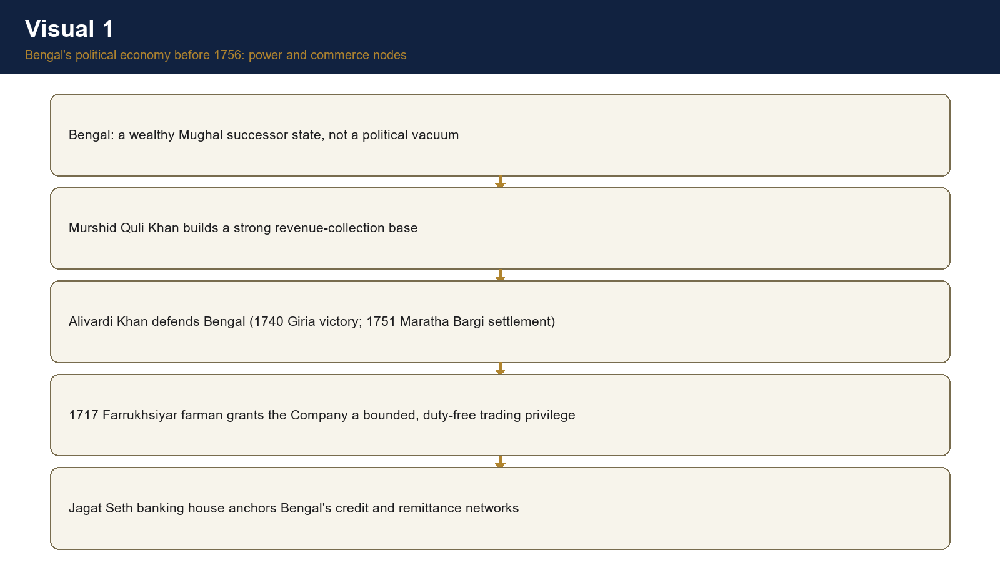

#### DEFINITION / WHAT THIS IS CALLED

**Definition:** Bengal before 1756 was a wealthy Mughal successor province in which a bounded Company trade privilege collided with Nawabi revenue sovereignty.

#### ANSWER-GRABBING OPENING — WRITE/ADAPT IN THE EXAM

> Bengal's conquest began as a dispute over the limits of a legal privilege, not as a battle plan born in a vacuum.

#### KEYWORDS FOR COMPLETE RECALL

- **Bengal successor state**
- **1717 Farrukhsiyar farman**
- **dastak abuse**
- **Murshid Quli Khan**
- **Alivardi Khan**

#### NAMED-EVIDENCE DEMONSTRATION

**Claim:** The crisis long predated Siraj-ud-Daulah. **Evidence:** Farrukhsiyar's 1717 farman gave duty-free movement only to the Company's own registered goods, while Murshid Quli Khan and Alivardi Khan resisted servants' private use of dastaks; Alivardi's 1751 settlement after the Bargi raids also showed how tightly revenue and security were linked. **Analysis:** Bengal was a functioning successor state defending fiscal jurisdiction against a privileged merchant corporation. **Qualification:** the farman itself was genuine; the abuse lay in its unauthorised extension, not in an invented privilege.

Mid-eighteenth-century Bengal was Mughal India's richest subah -- a dense, overlapping web of political authority and commercial opportunity, not a power vacuum waiting to be filled. Murshid Quli Khan, appointed Diwan of Bengal under Aurangzeb and later its de facto Nawab, had shifted the provincial capital from Dhaka to Murshidabad (named for himself) and built a stable ijaradari (revenue-farming) settlement that reduced jagir turnover and tied Bengal's finances closely to the Jagat Seth banking house, which financed the Nawab's treasury and, in time, much of Bengal's internal and external trade. His successors held this settlement together through the 1720s and 1730s; Alivardi Khan then took the throne after defeating and killing Sarfaraz Khan in 1740, and spent much of his reign containing repeated Maratha Bargi raids into western Bengal before agreeing, in 1751, to cede Orissa and pay an annual chauth to keep the Marathas out altogether. Alivardi died in April 1756 and was succeeded by his grandson, Siraj-ud-Daulah.

The English East India Company's core commercial privilege in Bengal rested on the 1717 farman of the Mughal emperor Farrukhsiyar, which confirmed duty-free import and export of the Company's own registered goods and the Company's right to issue dastak passes certifying such cargo as duty-exempt -- an extension of an earlier 1690s Aurangzeb-era concession, layered on Calcutta's existing zamindari and fortification rights. This was a real, treaty-based commercial privilege, not an unlimited licence, and every Bengal Nawab from Murshid Quli Khan onward treated it as exactly that -- a bounded exemption for the Company's own trade, not a cover for private profiteering by its servants or their Indian agents, which is precisely the distinction the next subtopic examines in detail.

Company privilege and Nawabi political authority overlapped at every major node of Bengal's political economy: Murshidabad (the Nawab's capital, mint and the Jagat Seths' headquarters), Kasimbazar (English, Dutch and French silk factories), Calcutta and Fort William (Company headquarters, fortified from 1755 without the Nawab's permission), Chandernagore (the rival French factory) and Hughli and Dhaka (older Mughal-era ports and administrative seats). This structural overlap -- not any single flashpoint -- produced the recurring friction that Siraj-ud-Daulah inherited in 1756, and it is why Part II treats the Calcutta crisis as an escalation ladder rather than a single act of provocation.

Company servants and their Indian trading partners routinely sold or misused dastak passes to cover private trade that had nothing to do with the Company's own registered goods, evading internal transit duties that Indian merchants continued to pay in full. Murshid Quli Khan, Alivardi Khan and Siraj-ud-Daulah in turn all resisted this extension of the 1717 privilege, because it was never authorised by any farman -- a careful Prelims-facing answer must hold this exact line: the 1717 farman was a real, Company-only, treaty-based exemption, while dastak abuse by servants and their agents was an unauthorised extension that no Nawab ever accepted, and confusing the two is the single most common error in Prelims-style option-writing on this period.

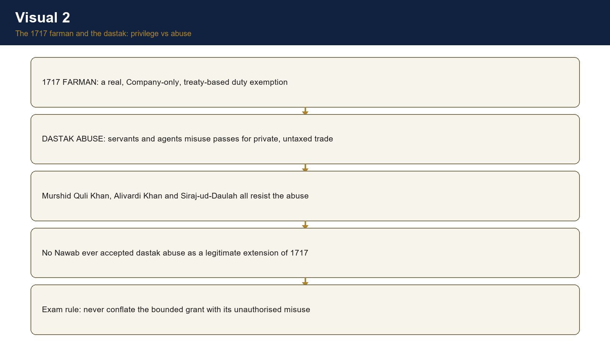

#### CLOSING RECALL FLOW — FOUNDATION — 1. BENGAL'S POLITICAL ECONOMY BEFORE 1756: MURSHID QULI KHAN, ALIVARDI KHAN AND THE LIMITS OF COMPANY PRIVILEGE

```text
START / CONCEPT: SESSION 1 — FOUNDATION — 1. BENGAL'S POLITICAL ECONOMY BEFORE 1756: MURSHID QULI KHAN, ALIVARDI KHAN AND THE LIMITS OF COMPANY PRIVILEGE
        |
        v
KEYWORDS: Bengal successor state · 1717 Farrukhsiyar farman · dastak abuse · Murshid Quli Khan · Alivardi Khan
        |
        v
EVIDENCE ROUTE: Claim: The crisis long predated Siraj-ud-Daulah. Evidence: Farrukhsiyar's 1717 farman gave duty-free movement only to the Company's own registered goods, while Murshid Quli Khan and Alivardi Khan resisted servants' private use of dastaks; Alivardi's 1751 settlement after the Bargi raids also showed how tightly revenue and security were linked. Analysis: Bengal was a functioning successor state defending fiscal jurisdiction against a privileged merchant corporation. Qualification: the farman itself was genuine; the abuse lay in its unauthorised extension, not in an invented privilege.
        |
        v
CORE MEANING: Bengal before 1756 was a wealthy Mughal successor province in which a bounded Company trade privilege collided with Nawabi revenue sovereignty.
        |
        v
EXAM LINE: Bengal's conquest began as a dispute over the limits of a legal privilege, not as a battle plan born in a vacuum.
```
### SESSION 2 — FOUNDATION — 2. SIRAJ-UD-DAULAH, THE CALCUTTA CRISIS AND THE FALL OF FORT WILLIAM, 1756

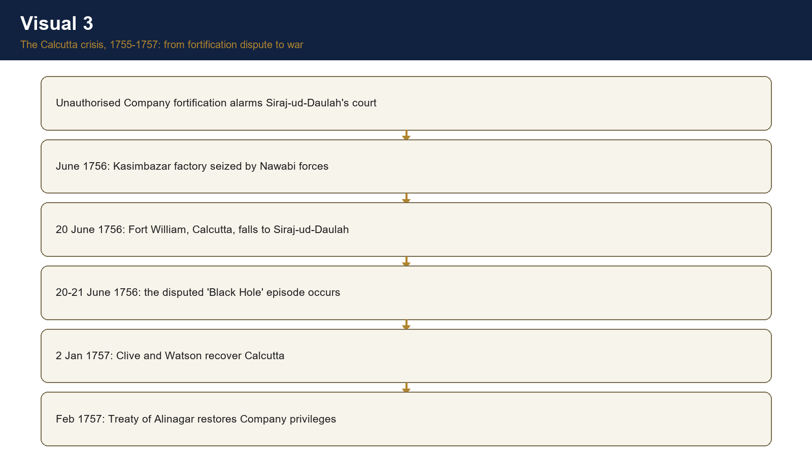

#### DEFINITION / WHAT THIS IS CALLED

**Definition:** The Calcutta crisis of 1756 was Siraj-ud-Daulah's attempt to enforce Nawabi sovereignty against unauthorised English fortification and defiance.

#### ANSWER-GRABBING OPENING — WRITE/ADAPT IN THE EXAM

> The road to Plassey first ran through Fort William, Kasimbazar and the collapse of a negotiated retreat.

#### KEYWORDS FOR COMPLETE RECALL

- **Siraj-ud-Daulah**
- **Fort William fortification**
- **Kasimbazar seizure**
- **Treaty of Alinagar**
- **Chandernagore**

#### NAMED-EVIDENCE DEMONSTRATION

**Claim:** The 1756-57 crisis escalated step by step, not through one sudden outrage. **Evidence:** Siraj seized Kasimbazar in June 1756, captured Fort William on 20 June 1756, Clive and Watson retook Calcutta on 2 January 1757, and the Treaty of Alinagar in February 1757 restored Company privileges before Chandernagore fell in March. **Analysis:** each move widened Company leverage while isolating the Nawab. **Qualification:** the later 'Black Hole' memory must not replace the fortification dispute as the crisis's causal core.

Siraj-ud-Daulah succeeded his grandfather Alivardi Khan in April 1756 as a young, insecure ruler facing rival claimants within his own court and a Company that had, since 1755, been strengthening Fort William's defences without seeking his permission -- ostensibly in anticipation of the wider Anglo-French war then breaking out in Europe (the Seven Years' War, 1756-63), which threatened to spill into Bengal through the rival English and French factories at Calcutta and Chandernagore. Siraj demanded that the English stop this unauthorised fortification and dismantle what had already been built; when the Calcutta Council under Governor Roger Drake refused or prevaricated, Siraj moved from warning to action.

Siraj first seized the English factory at Kasimbazar in early June 1756 as a demonstrative warning, then marched on Calcutta itself and captured Fort William on 20 June 1756; Drake and most senior officials fled downriver to Fulta, leaving the fort's remaining defenders to surrender. Read as a single ladder rather than one betrayal, each stage of this escalation narrowed Siraj's options and widened the Company's -- the unauthorised fortification created the original grievance, the Company's refusal to climb down converted a demand into a demonstration of resolve, and the fall of Calcutta itself then created the very opening (a humiliated Company needing to recover its position by force) that Robert Clive and Admiral Charles Watson exploited from Madras.

The Company's response came in two stages. Clive and Watson sailed from Madras with troops and warships, recovered Calcutta on 2 January 1757, and secured the Treaty of Alinagar in February 1757, which restored the Company's trading privileges and compensation for its losses. They then moved pre-emptively against Chandernagore in March 1757, seizing the French factory and removing Siraj's potential European counterweight before any confrontation with the Nawab himself -- a calculated step that left Siraj diplomatically isolated just as the Plassey conspiracy, examined in Part III, was reaching maturity.

#### CLOSING RECALL FLOW — FOUNDATION — 2. SIRAJ-UD-DAULAH, THE CALCUTTA CRISIS AND THE FALL OF FORT WILLIAM, 1756

```text
START / CONCEPT: SESSION 2 — FOUNDATION — 2. SIRAJ-UD-DAULAH, THE CALCUTTA CRISIS AND THE FALL OF FORT WILLIAM, 1756
        |
        v
KEYWORDS: Siraj-ud-Daulah · Fort William fortification · Kasimbazar seizure · Treaty of Alinagar · Chandernagore
        |
        v
EVIDENCE ROUTE: Claim: The 1756-57 crisis escalated step by step, not through one sudden outrage. Evidence: Siraj seized Kasimbazar in June 1756, captured Fort William on 20 June 1756, Clive and Watson retook Calcutta on 2 January 1757, and the Treaty of Alinagar in February 1757 restored Company privileges before Chandernagore fell in March. Analysis: each move widened Company leverage while isolating the Nawab. Qualification: the later 'Black Hole' memory must not replace the fortification dispute as the crisis's causal core.
        |
        v
CORE MEANING: The Calcutta crisis of 1756 was Siraj-ud-Daulah's attempt to enforce Nawabi sovereignty against unauthorised English fortification and defiance.
        |
        v
EXAM LINE: The road to Plassey first ran through Fort William, Kasimbazar and the collapse of a negotiated retreat.
```
### SESSION 3 — FOUNDATION — 3. THE 'BLACK HOLE' OF CALCUTTA: WHAT THE EVIDENCE SUPPORTS, AND WHAT IT DOES NOT

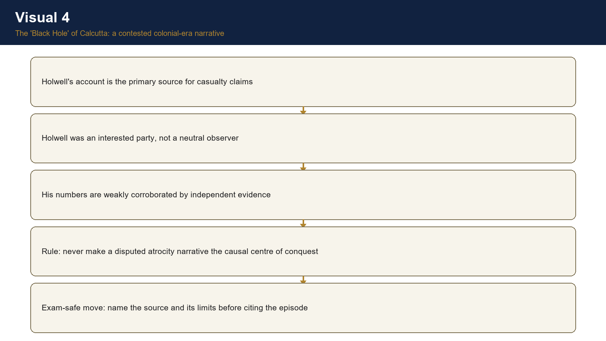

#### DEFINITION / WHAT THIS IS CALLED

**Definition:** The 'Black Hole of Calcutta' belongs to source criticism because its best-known narrative is not supported by independent corroboration.

#### ANSWER-GRABBING OPENING — WRITE/ADAPT IN THE EXAM

> Historiographically, the most famous episode of 1756 is also the least secure as quantified fact.

#### KEYWORDS FOR COMPLETE RECALL

- **John Zephaniah Holwell**
- **single-source problem**
- **corroboration gap**
- **Holwell Monument**
- **contested memory**

#### NAMED-EVIDENCE DEMONSTRATION

**Claim:** A defensible answer treats the Black Hole as a disputed narrative, not an audited casualty table. **Evidence:** the detailed story comes mainly from John Zephaniah Holwell, no independent Indian or French record confirms his numbers, and the Holwell monument became politically contested before its 1940 removal from central Calcutta. **Analysis:** imperial memory gave the episode public afterlife far beyond its evidentiary base. **Qualification:** scepticism about scale is not the same as proving that no confinement episode occurred at all.

The best-known episode of the Calcutta crisis is also its most historiographically contested. J.Z. Holwell, a Company official captured when Fort William fell, later published an account describing English prisoners suffocating overnight, on 20-21 June 1756, in a small guardroom at the fort -- an episode that became known as the 'Black Hole of Calcutta' and, for generations of British readers, a founding atrocity story about Bengal.

Holwell's account rests on a single interested narrator -- a survivor with every institutional and personal incentive to dramatise his own ordeal -- and no independently corroborated casualty count exists; the room's capacity and the number of prisoners involved are both disputed in the historical record. Source-critical practice requires treating a single-witness, self-interested account as exactly that, not as a settled body count, and a careful answer should note the evidentiary weakness explicitly rather than either repeating a specific death toll as fact or (equally unjustifiably) declaring the whole episode invented; the defensible position is agnosticism about the exact numbers, combined with clarity that the episode was real in some form but became inflated and politically instrumentalised in British colonial memory.

This is not merely an antiquarian dispute: the episode's memory became a live political site in the twentieth century. By that period, Indian nationalist opinion increasingly treated the Holwell narrative as exaggerated or invented specifically to blacken Siraj-ud-Daulah's reputation and retrospectively justify Company conquest; Subhas Chandra Bose led an actual civil-disobedience campaign in 1940 demanding the removal of the Holwell memorial in Calcutta, and the monument was subsequently taken down. A defensible Mains-facing treatment of the Black Hole therefore does two things at once: it declines to cite a precise casualty figure as verified fact, and it notes that the episode's contested memory -- not just the event itself -- is part of what a complete historical account must explain.

#### CLOSING RECALL FLOW — FOUNDATION — 3. THE 'BLACK HOLE' OF CALCUTTA: WHAT THE EVIDENCE SUPPORTS, AND WHAT IT DOES NOT

```text
START / CONCEPT: SESSION 3 — FOUNDATION — 3. THE 'BLACK HOLE' OF CALCUTTA: WHAT THE EVIDENCE SUPPORTS, AND WHAT IT DOES NOT
        |
        v
KEYWORDS: John Zephaniah Holwell · single-source problem · corroboration gap · Holwell Monument · contested memory
        |
        v
EVIDENCE ROUTE: Claim: A defensible answer treats the Black Hole as a disputed narrative, not an audited casualty table. Evidence: the detailed story comes mainly from John Zephaniah Holwell, no independent Indian or French record confirms his numbers, and the Holwell monument became politically contested before its 1940 removal from central Calcutta. Analysis: imperial memory gave the episode public afterlife far beyond its evidentiary base. Qualification: scepticism about scale is not the same as proving that no confinement episode occurred at all.
        |
        v
CORE MEANING: The 'Black Hole of Calcutta' belongs to source criticism because its best-known narrative is not supported by independent corroboration.
        |
        v
EXAM LINE: Historiographically, the most famous episode of 1756 is also the least secure as quantified fact.
```
### SESSION 4 — CORE — 4. PLASSEY'S HIDDEN BATTLE: THE CONSPIRACY NETWORK OF 1757

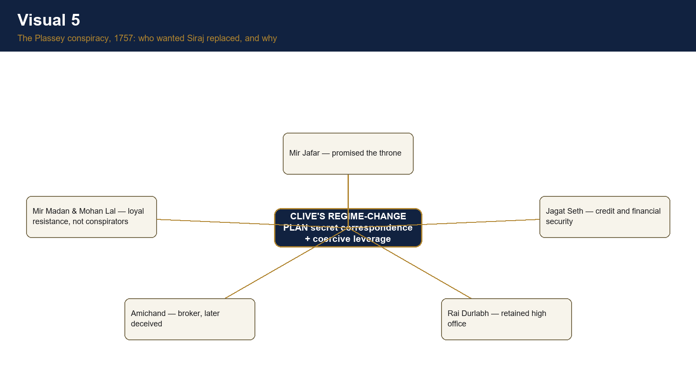

#### DEFINITION / WHAT THIS IS CALLED

**Definition:** The Plassey conspiracy was a coalition of financiers, courtiers and commanders who turned Company force into a regime-change mechanism.

#### ANSWER-GRABBING OPENING — WRITE/ADAPT IN THE EXAM

> Before any cannon decided Plassey, credit, office and succession had already aligned against Siraj-ud-Daulah.

#### KEYWORDS FOR COMPLETE RECALL

- **Mir Jafar**
- **Jagat Seth**
- **Rai Durlabh**
- **Amichand**
- **secret correspondence**

#### NAMED-EVIDENCE DEMONSTRATION

**Claim:** Plassey was prepared politically before it was fought militarily. **Evidence:** Clive negotiated with Mir Jafar, the Jagat Seth banking house backed regime change, Rai Durlabh withheld commitment, and Amichand was handled through the forged 'red treaty'. **Analysis:** elite defection neutralised the Nawab's apparent numerical superiority before battle day. **Qualification:** Indian collaboration was indispensable, but it operated inside a crisis shaped by Company coercive leverage and court insecurity.

While the Chandernagore operation was underway, Clive and the Calcutta Council were simultaneously negotiating, from Fulta and Calcutta, a parallel political plot to replace Siraj-ud-Daulah with a more compliant Nawab. This conspiracy drew together a disaffected court faction with genuinely independent grievances against Siraj, not a group Clive invented from nothing: Mir Jafar, Siraj's Mir Bakshi (army paymaster and senior commander), stood to gain the throne itself and kept his own large contingent out of the Plassey fighting; the Jagat Seth banking house (led by Mahtab Rai and Swarup Chand), Bengal's leading financiers, feared Siraj's hostility to their commercial and political position and both financed and lent legitimacy to the plot; Rai Durlabh, Bengal's Diwan, brought fiscal and administrative backing and likewise held his contingent back from battle; and Amichand (Omichand), a wealthy Armenian-Bengali merchant-financier, served as the crucial go-between with Clive.

Because Amichand knew enough about the conspiracy to threaten exposure unless he received a five per cent commission from the Nawab's treasury, Clive had two versions of the treaty prepared -- a genuine one on white paper without any clause for Amichand, and a second, fraudulent one on red paper carrying the commission clause, which was shown to Amichand alone; Admiral Watson refused to sign the fraudulent copy, so Clive had Watson's signature forged onto it. This episode is frequently cited as the clearest single instance of Clive's personal conduct at Plassey, and it matters analytically because it shows that deception was not confined to the conspiracy's Indian participants alone -- the Company's own commander defrauded his co-conspirator exactly as he was defrauding the sitting Nawab, which complicates any account that reduces Plassey to Indian betrayal alone.

Historians continue to debate whether the conspiracy originated within Murshidabad's own disaffected court faction or was substantially assembled and driven from Calcutta by Clive; what is not seriously disputed is the underlying collusion itself, between a genuinely alienated faction at Siraj's court and a Company willing to use bribery, forged documents and secret letters to engineer regime change before a single major battle was fought.

#### CLOSING RECALL FLOW — CORE — 4. PLASSEY'S HIDDEN BATTLE: THE CONSPIRACY NETWORK OF 1757

```text
START / CONCEPT: SESSION 4 — CORE — 4. PLASSEY'S HIDDEN BATTLE: THE CONSPIRACY NETWORK OF 1757
        |
        v
KEYWORDS: Mir Jafar · Jagat Seth · Rai Durlabh · Amichand · secret correspondence
        |
        v
EVIDENCE ROUTE: Claim: Plassey was prepared politically before it was fought militarily. Evidence: Clive negotiated with Mir Jafar, the Jagat Seth banking house backed regime change, Rai Durlabh withheld commitment, and Amichand was handled through the forged 'red treaty'. Analysis: elite defection neutralised the Nawab's apparent numerical superiority before battle day. Qualification: Indian collaboration was indispensable, but it operated inside a crisis shaped by Company coercive leverage and court insecurity.
        |
        v
CORE MEANING: The Plassey conspiracy was a coalition of financiers, courtiers and commanders who turned Company force into a regime-change mechanism.
        |
        v
EXAM LINE: Before any cannon decided Plassey, credit, office and succession had already aligned against Siraj-ud-Daulah.
```
### SESSION 5 — CORE — 5. PLASSEY, 23 JUNE 1757: WHY THIS WAS A POLITICAL COUP, NOT A CONVENTIONAL MILITARY TRIUMPH

```text
PLASSEY, 23 JUNE 1757
LOYAL WING: Mir Madan + Mohan Lal -> limited real fighting
INACTIVE WINGS: Mir Jafar + Rai Durlabh -> conspiracy neutralises numbers
COMPANY: Clive's force -> waits for political bargain to operate
RESULT: Siraj removed -> Mir Jafar installed -> Company becomes kingmaker
LIMIT: regime change, not yet legal revenue sovereignty
```

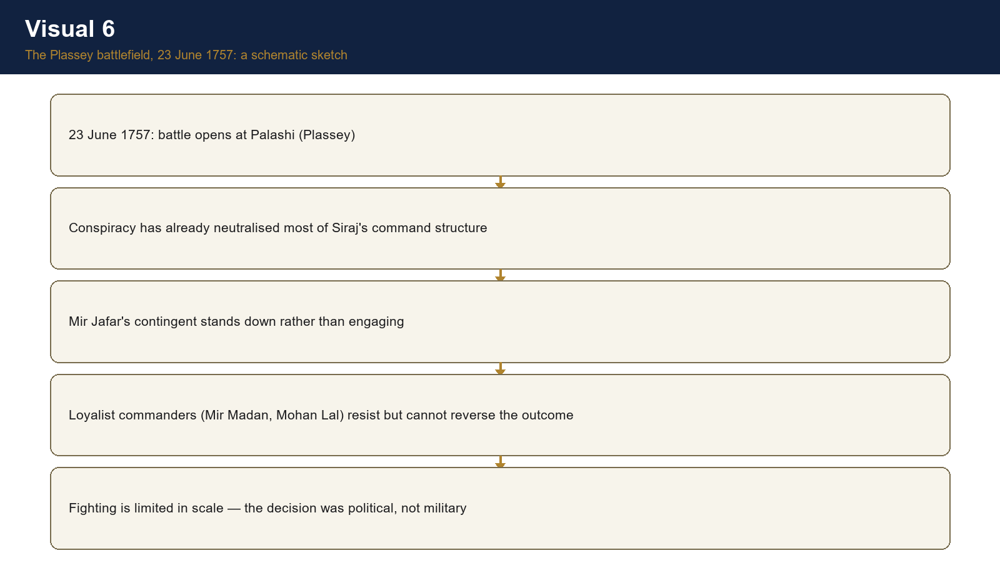

#### DEFINITION / WHAT THIS IS CALLED

**Definition:** Plassey on 23 June 1757 was militarily a brief engagement but politically a pre-arranged coup that made the Company Bengal's kingmaker.

#### ANSWER-GRABBING OPENING — WRITE/ADAPT IN THE EXAM

> On 23 June 1757 the decisive weapon at Plassey was prior defection, not battlefield brilliance.

#### KEYWORDS FOR COMPLETE RECALL

- **Plassey 23 June 1757**
- **Mir Madan**
- **Mohan Lal**
- **Mir Jafar's inaction**
- **client Nawabship**

#### NAMED-EVIDENCE DEMONSTRATION

**Claim:** The battle's result flowed from conspiracy more than combat. **Evidence:** Mir Madan and Mohan Lal led the loyal wing that actually fought, while Mir Jafar and Rai Durlabh kept larger contingents inactive under prior understanding with Clive. **Analysis:** the Company's small force won because most Nawabi strength was politically neutralised before the engagement matured. **Qualification:** some real fighting occurred, so 'bloodless' is careless; yet a purely tactical reading is still more misleading.

The battle fought at Plassey on 23 June 1757 is the best-known date in this topic, and also the most commonly misdescribed. Siraj-ud-Daulah's nominal army heavily outnumbered Clive's Company force, yet numbers barely mattered once the conspiracy had already neutralised the largest wings of that army: Mir Jafar's and Rai Durlabh's contingents, together the bulk of Siraj's strength, had a prior understanding with Clive and gave no order to engage. Real combat that day was confined to the smaller, genuinely loyal wing commanded by Mir Madan and Mohan Lal, which fought hard in an artillery exchange until Mir Madan was mortally wounded; once he fell, Siraj's headquarters lost its nerve, and Siraj -- advised, ironically, by the same Mir Jafar who had already agreed to replace him -- ordered a general retreat. Siraj fled the field, was captured attempting to escape further, and was executed on the orders of Mir Jafar's son Miran on 2 July 1757.

Inherited casualty estimates for Plassey are not supported by an independently audited modern roll and should not be repeated as precise fact, and should be treated with the same caution as any inherited eighteenth-century casualty estimate. Precisely because the fighting itself was this lopsided and this brief, the decisive factor at Plassey was not superior Company generalship or firepower in an open contest but the pre-arranged political conspiracy examined in subtopic 4 -- a matrix comparison makes the point directly: where a conventional military triumph would show a full day's pitched battle deciding the outcome through force of arms, what Plassey actually shows is numbers rendered irrelevant by a bargain struck in advance, with the fighting itself serving mainly to validate a political transaction rather than decide it.

Describing Plassey correctly in an examination therefore means describing a negotiated transfer of power validated by a brief, one-sided skirmish -- not a hard-fought battlefield victory that happened to change the throne. The immediate settlement installed Mir Jafar as Nawab and made the Company Bengal's de facto political kingmaker, but -- and this limit matters for what follows -- it did not yet make the Company Bengal's ruler in any legal sense; that further, more consequential step required Buxar and the Treaty of Allahabad, examined in Parts IV and V.

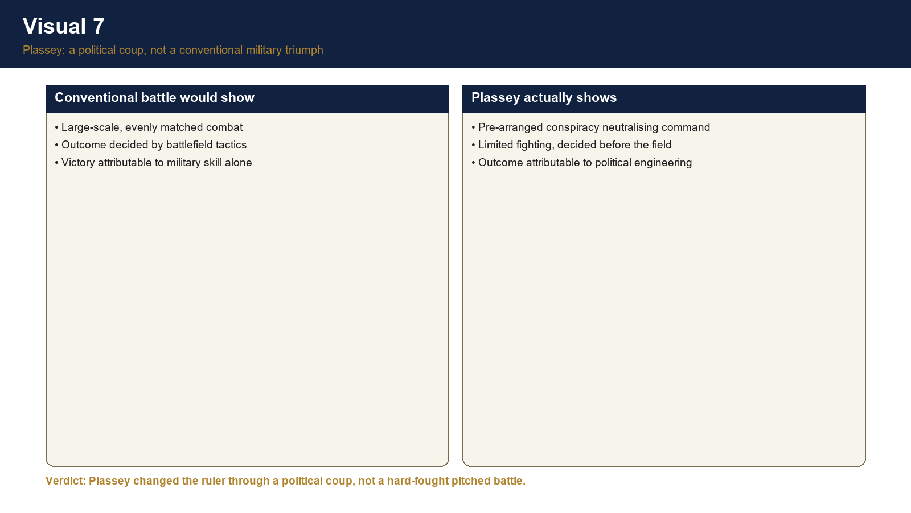

#### CLOSING RECALL FLOW — CORE — 5. PLASSEY, 23 JUNE 1757: WHY THIS WAS A POLITICAL COUP, NOT A CONVENTIONAL MILITARY TRIUMPH

```text
START / CONCEPT: SESSION 5 — CORE — 5. PLASSEY, 23 JUNE 1757: WHY THIS WAS A POLITICAL COUP, NOT A CONVENTIONAL MILITARY TRIUMPH
        |
        v
KEYWORDS: Plassey 23 June 1757 · Mir Madan · Mohan Lal · Mir Jafar's inaction · client Nawabship
        |
        v
EVIDENCE ROUTE: Claim: The battle's result flowed from conspiracy more than combat. Evidence: Mir Madan and Mohan Lal led the loyal wing that actually fought, while Mir Jafar and Rai Durlabh kept larger contingents inactive under prior understanding with Clive. Analysis: the Company's small force won because most Nawabi strength was politically neutralised before the engagement matured. Qualification: some real fighting occurred, so 'bloodless' is careless; yet a purely tactical reading is still more misleading.
        |
        v
CORE MEANING: Plassey on 23 June 1757 was militarily a brief engagement but politically a pre-arranged coup that made the Company Bengal's kingmaker.
        |
        v
EXAM LINE: On 23 June 1757 the decisive weapon at Plassey was prior defection, not battlefield brilliance.
```
### SESSION 6 — CORE — 6. MIR JAFAR'S BENGAL AND COMPANY EXTRACTION, 1757-60

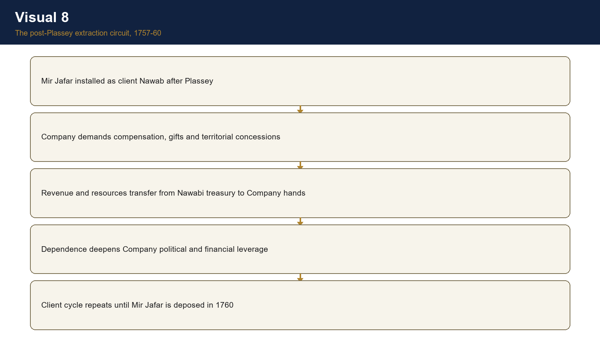

#### DEFINITION / WHAT THIS IS CALLED

**Definition:** Mir Jafar's Bengal was a client regime in which payments, concessions and political dependence deepened Company extraction between 1757 and 1760.

#### ANSWER-GRABBING OPENING — WRITE/ADAPT IN THE EXAM

> Post-Plassey Bengal was not yet direct rule, but it was already a machine for extracting payments through a dependent Nawab.

#### KEYWORDS FOR COMPLETE RECALL

- **Mir Jafar**
- **compensation payments**
- **24 Parganas**
- **Clive's jagir**
- **fiscal exhaustion**

#### NAMED-EVIDENCE DEMONSTRATION

**Claim:** Post-Plassey extraction worked as a self-reinforcing circuit, not as a one-off bribe. **Evidence:** Mir Jafar had to finance compensation, territorial concessions such as the 24 Parganas, and immense private fortunes including Clive's jagir, until he was deposed in 1760 when he could no longer sustain fresh demands. **Analysis:** each payment increased Company leverage and reduced Nawabi autonomy. **Qualification:** this was the opening of a drain mechanism, not yet the full later revenue system associated with nineteenth-century colonial rule.

Mir Jafar's installation as Nawab immediately after Plassey converted the conspiracy's political bargain into a running financial and political relationship, not a one-off reward. The Company and its individual officials received large transfers and concessions from Mir Jafar's treasury, alongside private fortunes accumulated by Company officials -- Clive's own share, combined with a substantial jagir grant, made him one of the wealthiest Company servants ever to return from India, and his later parliamentary testimony ("at this moment I stand astonished at my own moderation") is often cited precisely because it was delivered in his own defence against corruption charges, not as a boast. Mir Jafar also ceded the zamindari of the 24 Parganas near Calcutta to the Company, converting it from a mere trading concern into a substantial territorial revenue-holder in its own right even before any Diwani grant existed.

This extraction operated as a repeating circuit rather than a single transaction -- Mir Jafar's dependence on Company military backing to hold his own throne required continual fresh payments, and each round of payment deepened his financial dependence on the Company, which in turn deepened the Company's political leverage over him. By 1760 Mir Jafar could no longer meet the Company's escalating fresh demands (driven partly by the Company's own regional military commitments, including operations against the Dutch at Chinsura in 1759), and the Company deposed him in favour of his son-in-law, Mir Qasim -- a sequence that shows extraction and political control as mutually reinforcing rather than as a single bribe followed by stable rule. It is worth being precise about scope here: this subtopic bounds itself to 1757-60 Company leverage and personal fortunes; the fuller structural drain-of-wealth analysis, spanning land revenue and the broader colonial economy, is a later economic-history chapter, not repeated here.

#### CLOSING RECALL FLOW — CORE — 6. MIR JAFAR'S BENGAL AND COMPANY EXTRACTION, 1757-60

```text
START / CONCEPT: SESSION 6 — CORE — 6. MIR JAFAR'S BENGAL AND COMPANY EXTRACTION, 1757-60
        |
        v
KEYWORDS: Mir Jafar · compensation payments · 24 Parganas · Clive's jagir · fiscal exhaustion
        |
        v
EVIDENCE ROUTE: Claim: Post-Plassey extraction worked as a self-reinforcing circuit, not as a one-off bribe. Evidence: Mir Jafar had to finance compensation, territorial concessions such as the 24 Parganas, and immense private fortunes including Clive's jagir, until he was deposed in 1760 when he could no longer sustain fresh demands. Analysis: each payment increased Company leverage and reduced Nawabi autonomy. Qualification: this was the opening of a drain mechanism, not yet the full later revenue system associated with nineteenth-century colonial rule.
        |
        v
CORE MEANING: Mir Jafar's Bengal was a client regime in which payments, concessions and political dependence deepened Company extraction between 1757 and 1760.
        |
        v
EXAM LINE: Post-Plassey Bengal was not yet direct rule, but it was already a machine for extracting payments through a dependent Nawab.
```
### SESSION 7 — CORE — 7. MIR QASIM, MUNGER AND THE EQUALITY CRISIS, 1760-63

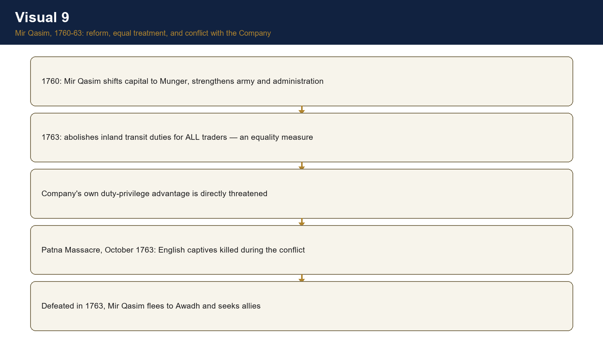

#### DEFINITION / WHAT THIS IS CALLED

**Definition:** Mir Qasim's project was a state-rebuilding attempt that sought fiscal equality and military autonomy from Company pressure.

#### ANSWER-GRABBING OPENING — WRITE/ADAPT IN THE EXAM

> Mir Qasim mattered because he tried to reverse clientage by rebuilding the Nawab's capacity from Munger.

#### KEYWORDS FOR COMPLETE RECALL

- **Mir Qasim**
- **Munger**
- **army reform**
- **inland duties abolition**
- **fiscal parity**

#### NAMED-EVIDENCE DEMONSTRATION

**Claim:** Mir Qasim's conflict with the Company arose from reform, not from personal hostility alone. **Evidence:** after taking power in 1760 he shifted his capital to Munger, reorganised army and administration, and in 1763 abolished inland duties to place Indian and European merchants on equal terms. **Analysis:** fiscal parity directly attacked the servants' private-trade advantage sustained through dastak abuse. **Qualification:** the reform was not modern nationalism; it was an eighteenth-century bid to recover Nawabi state capacity.

Mir Qasim, installed in 1760, was a considerably more capable and assertive ruler than his predecessor, and his reign is best read as a genuine reform effort colliding with the very Company leverage that had installed him. He shifted his capital from Murshidabad to Munger (Monghyr) in Bihar, deliberately putting distance between himself and Calcutta's overbearing influence while positioning himself closer to his own recruits and revenue base; he reorganised revenue collection to strengthen his own fiscal position, and rebuilt a retrained, partly European-drilled army and artillery corps commanded in part by European mercenaries in his service, seeking real military self-sufficiency rather than dependence on Company protection.

In 1763, in direct response to the continuing abuse of dastak privileges by Company servants and their Indian agents -- who used tax-free passes to undercut Indian merchants who still paid internal transit duties in full -- Mir Qasim abolished internal transit duties altogether, for Indian and English private traders alike. Mir Qasim's stated aim was equal, uniform taxation for all merchants regardless of nationality, not an anti-British nationalist gesture in the modern sense; the Company's Calcutta Council, however, read this fairness measure as an intolerable threat to its private-trade profits precisely because it erased the very tax advantage that dastak abuse had manufactured, and rejected equal treatment outright -- a useful corrective to any answer that flattens Mir Qasim's reform into simple anti-colonial resistance, when his own aim was administrative and commercial parity, with conflict with the Company as a consequence rather than his primary objective.

Confrontation escalated through 1763: an exchange of hostilities between Mir Qasim's forces and Company detachments culminated in the killing of a large number of European prisoners at Patna in October 1763 -- an episode remembered as the Patna Massacre and carried out under commanders in Mir Qasim's service after fighting had already broken out -- while Mir Qasim's own forces suffered a rapid series of defeats at Company hands at Katwa, Giria and Udhanala later that year. Defeated and with his own territory lost, Mir Qasim fled to Awadh to seek the protection of its Nawab-Wazir, Shuja-ud-Daula, setting the stage for the coalition examined next.

#### CLOSING RECALL FLOW — CORE — 7. MIR QASIM, MUNGER AND THE EQUALITY CRISIS, 1760-63

```text
START / CONCEPT: SESSION 7 — CORE — 7. MIR QASIM, MUNGER AND THE EQUALITY CRISIS, 1760-63
        |
        v
KEYWORDS: Mir Qasim · Munger · army reform · inland duties abolition · fiscal parity
        |
        v
EVIDENCE ROUTE: Claim: Mir Qasim's conflict with the Company arose from reform, not from personal hostility alone. Evidence: after taking power in 1760 he shifted his capital to Munger, reorganised army and administration, and in 1763 abolished inland duties to place Indian and European merchants on equal terms. Analysis: fiscal parity directly attacked the servants' private-trade advantage sustained through dastak abuse. Qualification: the reform was not modern nationalism; it was an eighteenth-century bid to recover Nawabi state capacity.
        |
        v
CORE MEANING: Mir Qasim's project was a state-rebuilding attempt that sought fiscal equality and military autonomy from Company pressure.
        |
        v
EXAM LINE: Mir Qasim mattered because he tried to reverse clientage by rebuilding the Nawab's capacity from Munger.
```
### SESSION 8 — CORE — 8. THE ROAD TO BUXAR: MIR QASIM, SHUJA-UD-DAULA AND SHAH ALAM II FORM A COALITION

```text
MIR QASIM -> recover Bengal and personal authority
SHUJA-UD-DAULA -> protect Awadh frontier and seek Bihar advantage
SHAH ALAM II -> seek imperial restoration
        \          |          /
         SEPARATE TREASURIES + COMMANDS
                    |
BUXAR, 22 OCT 1764 -> Munro's unified Company command wins
```

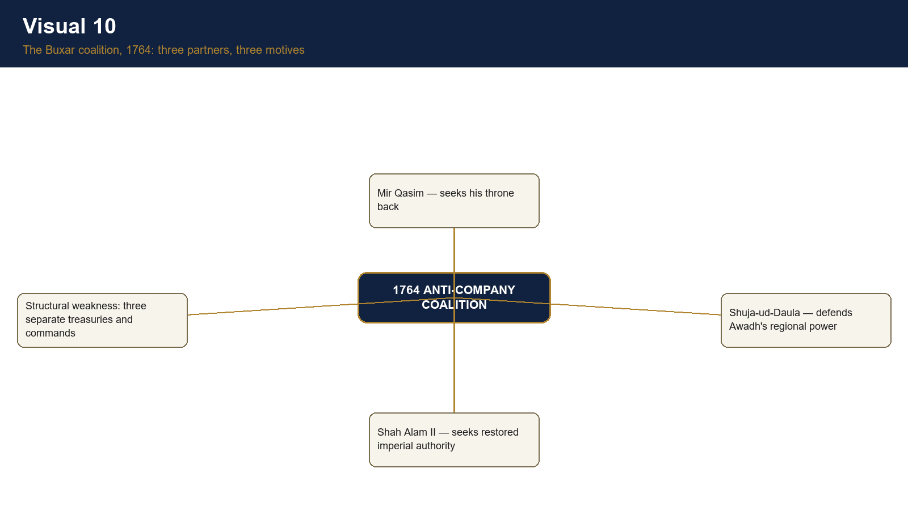

#### DEFINITION / WHAT THIS IS CALLED

**Definition:** The road to Buxar was the coalition phase in which Mir Qasim linked Bengal's crisis to Awadh and the Mughal emperor.

#### ANSWER-GRABBING OPENING — WRITE/ADAPT IN THE EXAM

> After defeat inside Bengal, Mir Qasim transformed a provincial struggle into a wider north Indian coalition war.

#### KEYWORDS FOR COMPLETE RECALL

- **Shuja-ud-Daula**
- **Shah Alam II**
- **Awadh alliance**
- **refuge after 1763**
- **coalition motives**

#### NAMED-EVIDENCE DEMONSTRATION

**Claim:** Buxar cannot be read as a Bengal succession dispute alone. **Evidence:** after defeats at Katwa, Giria and Udhanala in 1763, Mir Qasim fled to Shuja-ud-Daula in Awadh, while Shah Alam II sought restoration through a usable alliance against the Company. **Analysis:** the conflict widened because multiple regional powers now had reasons to resist Company advance. **Qualification:** breadth increased the coalition's weight, but separate interests also made unified command difficult.

Mir Qasim's flight to Awadh in 1763 produced an alliance of genuine but distinct interests rather than a single unified anti-Company front. Mir Qasim, the deposed Nawab, had the deepest personal stake of the three and brought his own treasury and his drilled army to the alliance. Shuja-ud-Daula, Awadh's Nawab-Wazir, joined chiefly for the prospect of gaining Bihar and a promised indemnity from Mir Qasim, calculating that a weakened Company presence on his eastern frontier served Awadh's own interests. Shah Alam II, the fugitive Mughal emperor who had proclaimed himself emperor in Bihar in 1759 after his father Alamgir II's murder in Delhi, sought the coalition's military help to secure his own restoration and had every reason to see a reversal of Company power in Bengal and Bihar as a step toward that goal.

Each of the three coalition partners retained control of their own treasury and their own military contingent, with no single supreme commander and no shared war-chest; coordination depended on shifting personal trust between three rulers who did not, in fact, fully trust one another. This segmented command structure is the analytical key to why the coalition ultimately lost to a numerically smaller but unified Company force under Hector Munro at Buxar -- three motives and three separate commanders produced one alliance in name but not one army in practice, a structural weakness examined directly in the next subtopic's comparison with the Company's command.

#### CLOSING RECALL FLOW — CORE — 8. THE ROAD TO BUXAR: MIR QASIM, SHUJA-UD-DAULA AND SHAH ALAM II FORM A COALITION

```text
START / CONCEPT: SESSION 8 — CORE — 8. THE ROAD TO BUXAR: MIR QASIM, SHUJA-UD-DAULA AND SHAH ALAM II FORM A COALITION
        |
        v
KEYWORDS: Shuja-ud-Daula · Shah Alam II · Awadh alliance · refuge after 1763 · coalition motives
        |
        v
EVIDENCE ROUTE: Claim: Buxar cannot be read as a Bengal succession dispute alone. Evidence: after defeats at Katwa, Giria and Udhanala in 1763, Mir Qasim fled to Shuja-ud-Daula in Awadh, while Shah Alam II sought restoration through a usable alliance against the Company. Analysis: the conflict widened because multiple regional powers now had reasons to resist Company advance. Qualification: breadth increased the coalition's weight, but separate interests also made unified command difficult.
        |
        v
CORE MEANING: The road to Buxar was the coalition phase in which Mir Qasim linked Bengal's crisis to Awadh and the Mughal emperor.
        |
        v
EXAM LINE: After defeat inside Bengal, Mir Qasim transformed a provincial struggle into a wider north Indian coalition war.
```
### SESSION 9 — CORE — 9. BUXAR, 22 OCTOBER 1764: WHY THIS BATTLE MATTERED MORE THAN PLASSEY

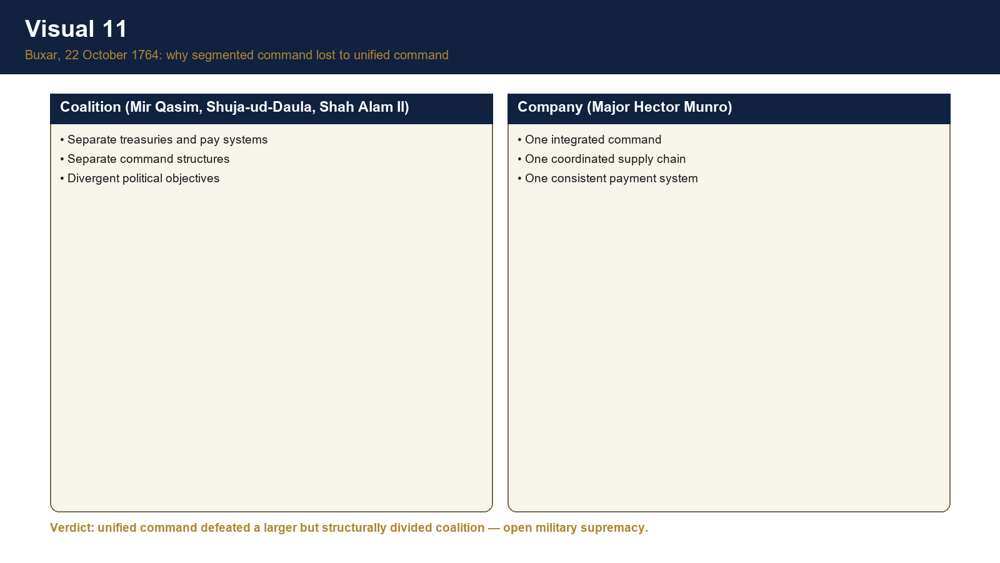

#### DEFINITION / WHAT THIS IS CALLED

**Definition:** Buxar on 22 October 1764 was the decisive conventional battle that proved Company military-fiscal superiority beyond palace intrigue.

#### ANSWER-GRABBING OPENING — WRITE/ADAPT IN THE EXAM

> If Plassey opened Bengal politically, Buxar settled the issue militarily.

#### KEYWORDS FOR COMPLETE RECALL

- **Buxar 22 October 1764**
- **Hector Munro**
- **segmented command**
- **unified chain of command**
- **coalition defeat**

#### NAMED-EVIDENCE DEMONSTRATION

**Claim:** Buxar mattered because command structure, not raw numbers, decided the field. **Evidence:** Hector Munro led one integrated Company force against Mir Qasim, Shuja-ud-Daula and Shah Alam II, whose coalition retained separate treasuries, commanders and political aims. **Analysis:** unified command converted Bengal's post-Plassey resources into military superiority against a broader opposition. **Qualification:** weaponry and numbers mattered, but they do not explain the result as well as organisational coherence does.

The coalition's combined forces met a unified Company army under Hector Munro at Buxar on 22 October 1764. Where Mir Qasim, Shuja-ud-Daula and Shah Alam II each retained separate treasuries and contingents with no shared command, Munro commanded one integrated force with a single chain of command, one supply and pay system, and one battle plan -- a structural advantage that outweighed the coalition's larger combined numbers and produced a comparatively decisive Company victory.

Unlike Plassey, which was settled chiefly through a pre-arranged political conspiracy with minimal real fighting, Buxar was a harder-fought, more conventional pitched battle against a genuine coalition army, decided principally by the coalition's segmented command structure rather than by any comparable political arrangement beforehand. This is precisely why Buxar, not Plassey, is the strategically more decisive of the two engagements for a Mains-facing answer -- Plassey changed who occupied Bengal's throne, but it was Buxar that broke the coalition capable of contesting Company power across Bengal, Bihar and Awadh, clearing the path to the legal settlement examined next; an answer that treats Plassey alone as "the conquest of Bengal" misses the further, arguably more consequential step that Buxar and Allahabad supplied.

Exam framing should read Buxar as a test of command structure and logistics rather than of firepower alone; the fuller territorial-expansion narrative that follows from this military outcome -- the Company's subsequent campaigns and relationships with other regional powers -- is bounded here and belongs in full to the wider territorial-expansion narrative.

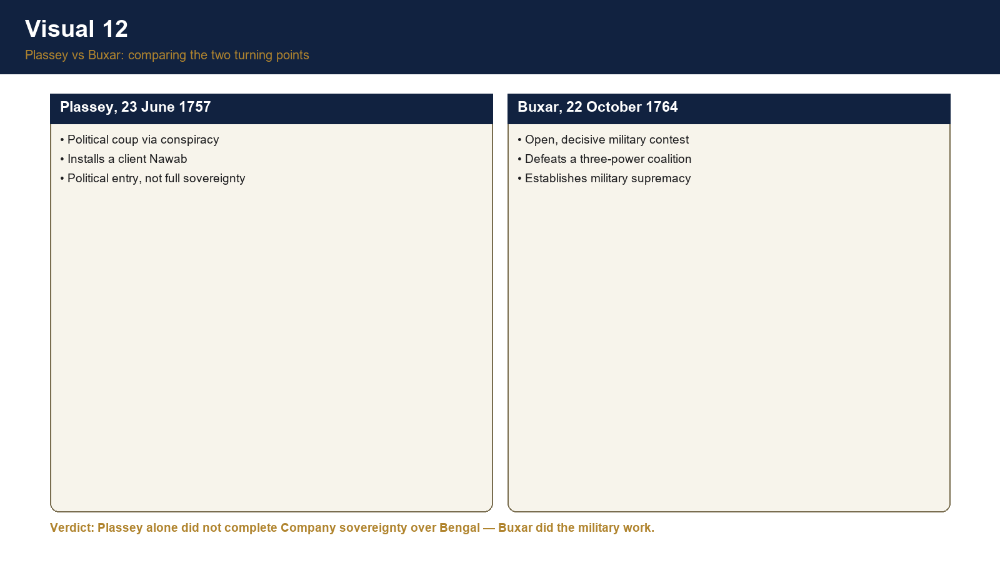

#### CLOSING RECALL FLOW — CORE — 9. BUXAR, 22 OCTOBER 1764: WHY THIS BATTLE MATTERED MORE THAN PLASSEY

```text
START / CONCEPT: SESSION 9 — CORE — 9. BUXAR, 22 OCTOBER 1764: WHY THIS BATTLE MATTERED MORE THAN PLASSEY
        |
        v
KEYWORDS: Buxar 22 October 1764 · Hector Munro · segmented command · unified chain of command · coalition defeat
        |
        v
EVIDENCE ROUTE: Claim: Buxar mattered because command structure, not raw numbers, decided the field. Evidence: Hector Munro led one integrated Company force against Mir Qasim, Shuja-ud-Daula and Shah Alam II, whose coalition retained separate treasuries, commanders and political aims. Analysis: unified command converted Bengal's post-Plassey resources into military superiority against a broader opposition. Qualification: weaponry and numbers mattered, but they do not explain the result as well as organisational coherence does.
        |
        v
CORE MEANING: Buxar on 22 October 1764 was the decisive conventional battle that proved Company military-fiscal superiority beyond palace intrigue.
        |
        v
EXAM LINE: If Plassey opened Bengal politically, Buxar settled the issue militarily.
```
### SESSION 10 — CORE — 10. THE ALLAHABAD SETTLEMENT, 1765: TWO TREATIES, FOUR DAYS APART

```text
BUXAR VICTORY
  -> 12 AUG 1765: SHAH ALAM II TREATY
     -> Diwani of Bengal, Bihar and Orissa to Company
  -> 16 AUG 1765: SHUJA-UD-DAULA TREATY
     -> Awadh restored under indemnity and alliance terms
VERDICT: legal-fiscal title + strategic buffer, through two distinct instruments
```

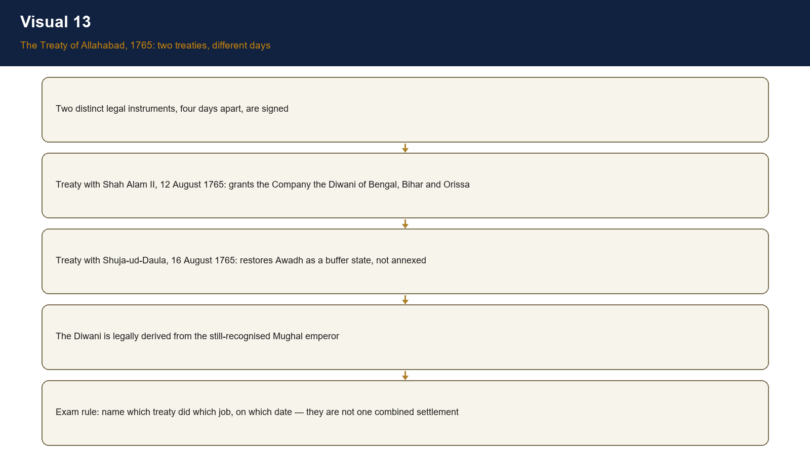

#### DEFINITION / WHAT THIS IS CALLED

**Definition:** The Allahabad settlement comprised the Shah Alam II treaty of 12 August and the Shuja-ud-Daula treaty of 16 August 1765 that turned military victory into legal revenue title and buffer-state strategy.

#### ANSWER-GRABBING OPENING — WRITE/ADAPT IN THE EXAM

> Allahabad mattered because military success was translated there into lawful fiscal title and a strategic frontier design.

#### KEYWORDS FOR COMPLETE RECALL

- **Treaty of Allahabad**
- **Shah Alam II**
- **Shuja-ud-Daula**
- **Diwani grant**
- **Awadh buffer**

#### NAMED-EVIDENCE DEMONSTRATION

**Claim:** 'Allahabad' should be remembered as a legal package, not a single undifferentiated act. **Evidence:** the 12 August 1765 treaty with Shah Alam II granted the Diwani of Bengal, Bihar and Orissa, while the 16 August treaty with Shuja-ud-Daula restored Awadh as a buffer after indemnity. **Analysis:** the Company preferred recognised revenue title plus indirect strategic depth over blanket annexation. **Qualification:** using the singular 'Treaty of Allahabad' is acceptable shorthand only if the answer still remembers the two distinct legal jobs performed four days apart.

Buxar's aftermath was settled diplomatically, not simply by continued conquest. Two separate treaties were signed at Allahabad four days apart: Shah Alam II's on 12 August 1765 and Shuja-ud-Daula's on 16 August 1765. Under the treaty with Shah Alam II, the Company received the Diwani -- the right to collect and administer land revenue -- of Bengal, Bihar and Orissa, in exchange for a stipulated annual payment to the emperor; the settlement assigned the districts of Kora and Allahabad to the emperor, where he took up residence as a pensioned ruler substantially dependent on Company protection rather than as a governing sovereign in any effective sense. Under the separate treaty with Shuja-ud-Daula, Awadh was restored to him -- minus Kora, Allahabad and territory already occupied by the Company -- in exchange for a war indemnity, a defensive alliance, and duty-free Company trade within Awadh.

These were two distinct legal instruments signed four days apart, not one combined settlement -- the Shah Alam II treaty created a legal revenue title for the Company in Bengal, Bihar and Orissa, while the Shuja-ud-Daula treaty separately secured Awadh as a buffer state to the Company's west. A Prelims-facing answer must be able to state which treaty did which job; a Mains-facing answer should further note that receiving the Diwani through an emperor still formally recognised as the ultimate source of legal authority in India let the Company present its new revenue power as legally derived and legitimate, even though that same emperor was, in practical terms, now a Company-protected pensioner with negligible independent power of his own.

#### CLOSING RECALL FLOW — CORE — 10. THE TREATY OF ALLAHABAD, 1765: TWO TREATIES, FOUR DAYS APART

```text
START / CONCEPT: SESSION 10 — CORE — 10. THE TREATY OF ALLAHABAD, 1765: TWO TREATIES, FOUR DAYS APART
        |
        v
KEYWORDS: Treaty of Allahabad · Shah Alam II · Shuja-ud-Daula · Diwani grant · Awadh buffer
        |
        v
EVIDENCE ROUTE: Claim: 'Allahabad' should be remembered as a legal package, not a single undifferentiated act. Evidence: the 12 August 1765 treaty with Shah Alam II granted the Diwani of Bengal, Bihar and Orissa, while the 16 August treaty with Shuja-ud-Daula restored Awadh as a buffer after indemnity. Analysis: the Company preferred recognised revenue title plus indirect strategic depth over blanket annexation. Qualification: using the singular 'Treaty of Allahabad' is acceptable shorthand only if the answer still remembers the two distinct legal jobs performed four days apart.
        |
        v
CORE MEANING: The Allahabad settlement comprised the Shah Alam II treaty of 12 August and the Shuja-ud-Daula treaty of 16 August 1765 that turned military victory into legal revenue title and buffer-state strategy.
        |
        v
EXAM LINE: Allahabad mattered because military success was translated there into lawful fiscal title and a strategic frontier design.
```
### SESSION 11 — CORE — 11. DIWANI AND NIZAMAT: ONE POWER, TWO LEGAL LABELS

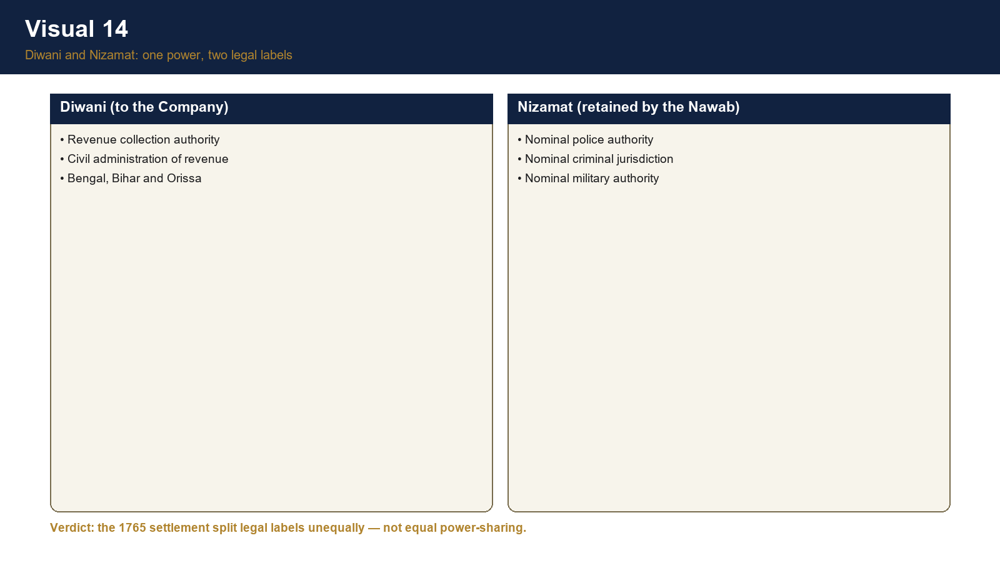

#### DEFINITION / WHAT THIS IS CALLED

**Definition:** After 1765 Bengal's real power was divided between a substantive Diwani and a nominal Nizamat.

#### ANSWER-GRABBING OPENING — WRITE/ADAPT IN THE EXAM

> The conquest was institutionalised not by one grand title, but by a split that hid real power behind older labels.

#### KEYWORDS FOR COMPLETE RECALL

- **Diwani**
- **Nizamat**
- **civil justice**
- **criminal justice**
- **revenue sovereignty**

#### NAMED-EVIDENCE DEMONSTRATION

**Claim:** The Company's supremacy after 1765 was legalised through a split office, not an open proclamation of kingship. **Evidence:** Shah Alam II granted the Diwani, which carried land revenue and the civil side, while the Nawab formally retained the Nizamat -- criminal justice and nominal military responsibility. **Analysis:** substantive power shifted to the Company even while older Mughal-Nawabi forms stayed visible. **Qualification:** the distinction was legally real, but it was never an equal balance of authority.

The Diwani grant requires careful legal precision, because it did not transfer the whole of Bengal's governing authority to the Company in one stroke. The Diwani -- granted by the Mughal emperor -- was specifically the right to collect and administer land revenue in Bengal, Bihar and Orissa; the Company exercised it through Naib Diwans, Muhammad Reza Khan for Bengal and Raja Shitab Rai for Bihar, rather than through direct Company officials in the first instance. The Nizamat -- covering police, criminal justice and military administration -- was nominally retained by the Nawab of Bengal.

In practice, both the Diwani and the Nizamat came to run through the same set of Company-influenced deputies from very early on, so the split between the two was real and legally meaningful on paper but not an equal or operationally independent division of power in fact. Do not present Diwani and Nizamat as a genuine fifty-fifty power-sharing arrangement between the Company and the Nawab -- the correct exam-safe formulation is that the Company held the substantively powerful revenue right directly, while nominal executive authority remained with a Nawab whose own capacity to exercise it independently was already hollowed out, a distinction that becomes the central subject of the Dual Government examined in Part VI.

#### CLOSING RECALL FLOW — CORE — 11. DIWANI AND NIZAMAT: ONE POWER, TWO LEGAL LABELS

```text
START / CONCEPT: SESSION 11 — CORE — 11. DIWANI AND NIZAMAT: ONE POWER, TWO LEGAL LABELS
        |
        v
KEYWORDS: Diwani · Nizamat · civil justice · criminal justice · revenue sovereignty
        |
        v
EVIDENCE ROUTE: Claim: The Company's supremacy after 1765 was legalised through a split office, not an open proclamation of kingship. Evidence: Shah Alam II granted the Diwani, which carried land revenue and the civil side, while the Nawab formally retained the Nizamat -- criminal justice and nominal military responsibility. Analysis: substantive power shifted to the Company even while older Mughal-Nawabi forms stayed visible. Qualification: the distinction was legally real, but it was never an equal balance of authority.
        |
        v
CORE MEANING: After 1765 Bengal's real power was divided between a substantive Diwani and a nominal Nizamat.
        |
        v
EXAM LINE: The conquest was institutionalised not by one grand title, but by a split that hid real power behind older labels.
```
### SESSION 12 — CORE — 12. THE DUAL GOVERNMENT, 1765-72: CLIVE'S DESIGN AND ITS ACCOUNTABILITY PARADOX

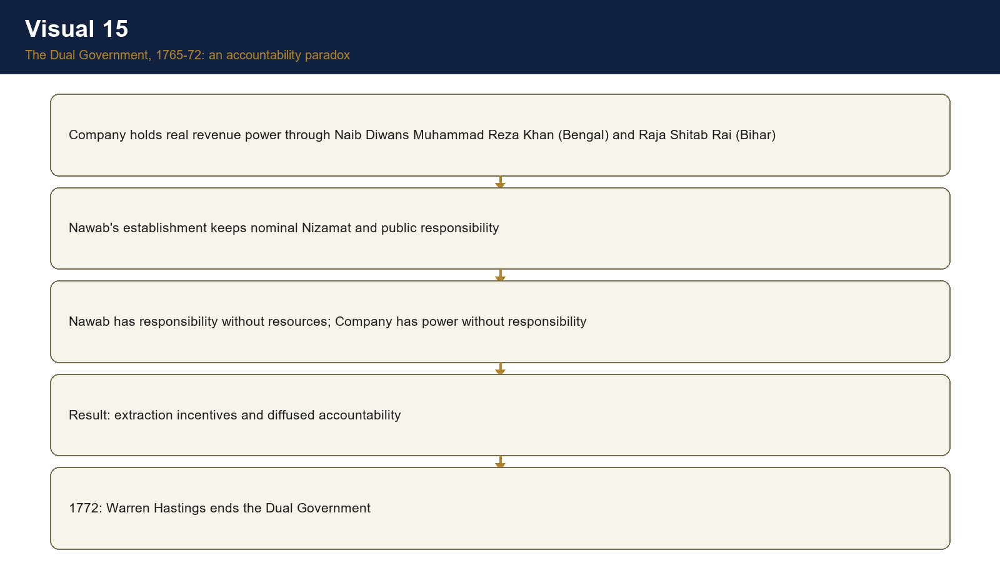

#### DEFINITION / WHAT THIS IS CALLED

**Definition:** The Dual Government of 1765-72 was Clive's design of Company power without open administrative responsibility.

#### ANSWER-GRABBING OPENING — WRITE/ADAPT IN THE EXAM

> The Dual Government failed because it separated the right to take revenue from the duty to govern well.

#### KEYWORDS FOR COMPLETE RECALL

- **Dual Government**
- **Muhammad Reza Khan**
- **Raja Shitab Rai**
- **accountability paradox**
- **Warren Hastings**

#### NAMED-EVIDENCE DEMONSTRATION

**Claim:** The Dual Government's central defect was structural. **Evidence:** the Company drew revenue through deputies such as Muhammad Reza Khan in Bengal and Raja Shitab Rai in Bihar, while the Nawab retained nominal public responsibility; Clive himself later admitted that 'corruption universally prevails, and confusion and mismanagement pervade every department.' **Analysis:** power and accountability pointed in opposite directions. **Qualification:** individual officials could be capable, yet the arrangement still failed because the design itself diffused responsibility.

Robert Clive, returning as Governor for a second term after Allahabad, deliberately chose not to have the Company assume direct, formal administration of Bengal in 1765. Instead he designed what came to be called the Dual Government: the Company held the Diwani and, through its Naib Diwans, the real revenue-collection and administrative power in Bengal, while the Nawab's government nominally retained the Nizamat -- answerability for law, order and criminal justice -- without the revenue or military resources needed to discharge that responsibility, since those now flowed through the Company's own deputies.

This arrangement was Clive's own deliberate design, not an accident of circumstance, and it produced what is best described as an accountability paradox -- the Company exercised real power while bearing no formal responsibility for Bengal's governance or welfare, while the Nawab's government bore nominal responsibility while holding no real power to act on it. This structure suited the Company's immediate interests precisely because it let it extract Bengal's revenue while avoiding the direct political and administrative costs -- and the international scrutiny -- that formal annexation would have invited, but it left no single accountable authority positioned to correct fiscal or administrative failure when one arose, a vulnerability the 1770 famine, examined next, exposed with particular clarity.

The clearest contemporary admission of the system's failure comes from Clive himself: testifying before the House of Commons in 1772, he stated that in Bengal "corruption universally prevails, and confusion and mismanagement pervade every department" -- a striking admission given that Clive had designed the very system he was describing. Warren Hastings, arriving as Governor in 1772, ended the Dual Government that year, having the Company itself "stand forth as Diwan" and administer revenue directly rather than through Naib Diwans, formally closing the seven-year experiment Clive had created.

Holding the full sixteen-year span in view -- from the Calcutta crisis of 1756 through Hastings's reform in 1772 -- is itself an examiner-tested skill: Prelims option-writing routinely tests precise sequencing across 1757, 1764, 1765, 1770 and 1772, and a candidate who can anchor each date to the specific decision it represents, not merely to "a battle" or "a treaty" in the abstract, is far better placed than one who has only memorised the names.

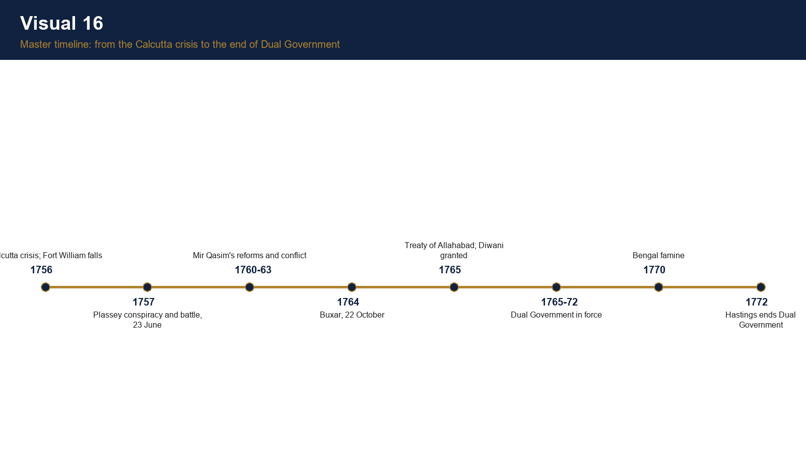

#### CLOSING RECALL FLOW — CORE — 12. THE DUAL GOVERNMENT, 1765-72: CLIVE'S DESIGN AND ITS ACCOUNTABILITY PARADOX

```text
START / CONCEPT: SESSION 12 — CORE — 12. THE DUAL GOVERNMENT, 1765-72: CLIVE'S DESIGN AND ITS ACCOUNTABILITY PARADOX
        |
        v
KEYWORDS: Dual Government · Muhammad Reza Khan · Raja Shitab Rai · accountability paradox · Warren Hastings
        |
        v
EVIDENCE ROUTE: Claim: The Dual Government's central defect was structural. Evidence: the Company drew revenue through deputies such as Muhammad Reza Khan in Bengal and Raja Shitab Rai in Bihar, while the Nawab retained nominal public responsibility; Clive himself later admitted that 'corruption universally prevails, and confusion and mismanagement pervade every department.' Analysis: power and accountability pointed in opposite directions. Qualification: individual officials could be capable, yet the arrangement still failed because the design itself diffused responsibility.
        |
        v
CORE MEANING: The Dual Government of 1765-72 was Clive's design of Company power without open administrative responsibility.
        |
        v
EXAM LINE: The Dual Government failed because it separated the right to take revenue from the duty to govern well.
```
### SESSION 13 — CORE — 13. THE BENGAL FAMINE OF 1770: A BOUNDED CAUSAL READING

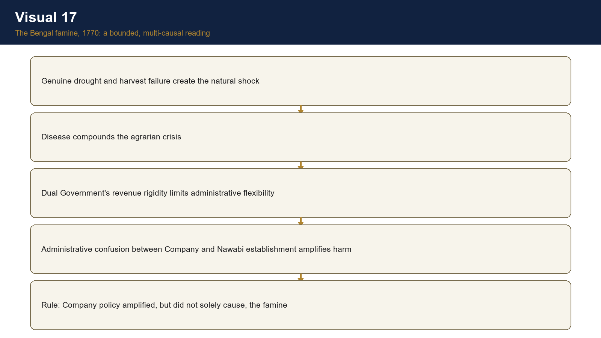

#### DEFINITION / WHAT THIS IS CALLED

**Definition:** The Bengal famine of 1770 must be read as a compound crisis in which environmental shock met a brittle revenue regime.

#### ANSWER-GRABBING OPENING — WRITE/ADAPT IN THE EXAM

> The famine tests whether a fiscal state could respond to scarcity; Bengal's dual regime proved it could not.

#### KEYWORDS FOR COMPLETE RECALL

- **Bengal famine 1770**
- **1768 harvest failure**
- **1769-70 drought**
- **revenue rigidity**
- **administrative confusion**

#### NAMED-EVIDENCE DEMONSTRATION

**Claim:** The famine cannot be explained safely by one cause alone. **Evidence:** a poor 1768 harvest and drought across 1769-70 coincided with revenue rigidity, commercial priorities and the Dual Government's diffused administration. **Analysis:** natural scarcity became catastrophe because the regime extracting Bengal's surplus lacked both incentive and responsibility to respond effectively. **Qualification:** neither a single mortality total nor a monocausal indictment is exam-safe; the answer must pair ecological trigger with institutional vulnerability.

The Bengal famine of 1770 struck during the Dual Government's operation and must be explained with a bounded, multi-causal framing rather than any single, monocausal claim. A poor 1768 harvest and drought conditions sharply reduced food-grain output heading into 1769-70 -- a genuine natural trigger that a defensible account cannot omit. But the famine's severity and the scale of suffering it produced cannot be explained by the natural trigger alone.

The Company continued to insist on near-full land-revenue collection through the famine, in some accounts even raising certain assessments in 1771, while Company and merchant trade in food-grain and other commodities continued to be conducted for commercial profit rather than being redirected toward relief; the Dual Government's own overlapping and unclear lines of Company and Naib Diwan authority further slowed any coordinated relief response. Historical analysis treats the famine as a compound failure -- a poor harvest meeting a fiscally rigid and administratively confused governance structure -- and that compound framing, not drought alone and not Company policy alone, is the defensible exam position; a monocausal answer in either direction should be marked down.

On the human cost, a careful answer withholds any specific mortality figure as verified fact. Published accounts describe an estimate of a very large but disputed scale of population loss, but this is a widely repeated estimate rather than a precise, census-based demographic count, and later colonial-era figures (such as those associated with W.W. Hunter's nineteenth-century account) are themselves historiographically disputed rather than officially audited. A defensible answer states the compound causal structure clearly, notes that contemporary and later estimates of scale exist without treating any single number as settled fact, and explicitly avoids fabricating precision the evidence does not support.

#### CLOSING RECALL FLOW — CORE — 13. THE BENGAL FAMINE OF 1770: A BOUNDED CAUSAL READING

```text
START / CONCEPT: SESSION 13 — CORE — 13. THE BENGAL FAMINE OF 1770: A BOUNDED CAUSAL READING
        |
        v
KEYWORDS: Bengal famine 1770 · 1768 harvest failure · 1769-70 drought · revenue rigidity · administrative confusion
        |
        v
EVIDENCE ROUTE: Claim: The famine cannot be explained safely by one cause alone. Evidence: a poor 1768 harvest and drought across 1769-70 coincided with revenue rigidity, commercial priorities and the Dual Government's diffused administration. Analysis: natural scarcity became catastrophe because the regime extracting Bengal's surplus lacked both incentive and responsibility to respond effectively. Qualification: neither a single mortality total nor a monocausal indictment is exam-safe; the answer must pair ecological trigger with institutional vulnerability.
        |
        v
CORE MEANING: The Bengal famine of 1770 must be read as a compound crisis in which environmental shock met a brittle revenue regime.
        |
        v
EXAM LINE: The famine tests whether a fiscal state could respond to scarcity; Bengal's dual regime proved it could not.
```
### SESSION 14 — CORE SYNTHESIS — 14. FROM TRADER TO REVENUE SOVEREIGN: THE COMPANY'S TRANSFORMATION AND THE SPECTRUM OF INDIAN AGENCY

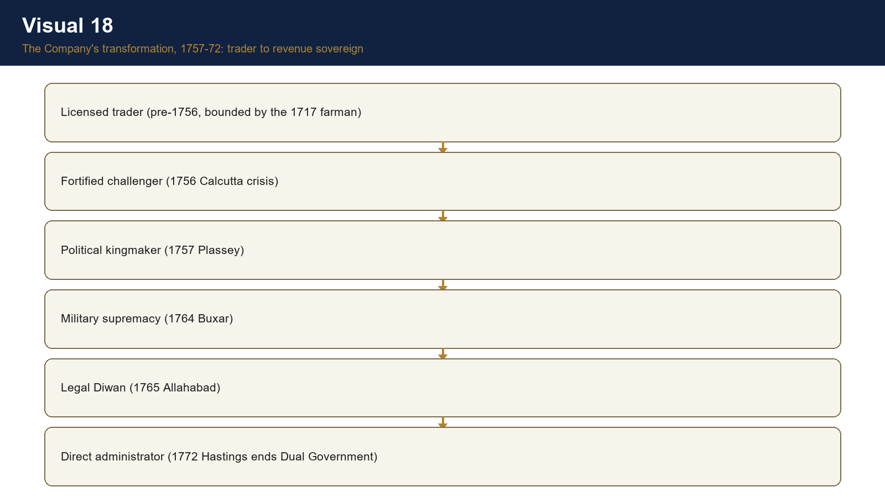

#### DEFINITION / WHAT THIS IS CALLED

**Definition:** Between 1757 and 1772 the Company moved from privileged trader to political kingmaker and then to revenue sovereign.

#### ANSWER-GRABBING OPENING — WRITE/ADAPT IN THE EXAM

> The central transformation in this topic is institutional: a merchant corporation learned to rule through revenue.

#### KEYWORDS FOR COMPLETE RECALL

- **trader to sovereign**
- **political kingmaker**
- **revenue title**
- **Company-state**
- **asymmetrical agency**

#### NAMED-EVIDENCE DEMONSTRATION

**Claim:** The conquest was cumulative, not instantaneous. **Evidence:** Plassey created kingmaking leverage, Buxar established military predominance, and the 1765 Diwani plus Dual Government converted that leverage into routine fiscal power. **Analysis:** each stage widened the Company's capacity to command resources, armies and administrators. **Qualification:** the sequence looks coherent in retrospect, but contemporaries moved through crises more than through a perfectly pre-written master plan.

Tracing the Company's own transformation across this topic's sixteen-year span is itself a useful revision device. Before 1757 it operated as a licensed trader, holding Mughal-Nawabi farman privilege as a commercial tenant of Bengal's political economy, not a ruler. Between 1757 and 1764 it became a political kingmaker, making and unmaking Nawabs (Mir Jafar, then Mir Qasim) while remaining formally a company of merchants. From 1765 it became Bengal's revenue sovereign in law, holding the Diwani and collecting and disposing of land revenue through its own deputies. From 1772, under Hastings, it became an administering state outright, replacing Indian intermediaries with its own officers.

This is best understood as a sequence of thresholds, each converting the gains of the previous stage into a wider claim to authority, rather than a single, sudden seizure of power in 1757. Framing the conquest this way directly counters the common exam trap of treating Plassey alone as "the conquest of Bengal" -- the Company's status changed qualitatively at each of at least four distinct points, and a strong Mains answer should be able to name the specific legal or institutional change (zamindari grant, Diwani grant, Hastings's reform) that marked each threshold rather than treating 1757-72 as one undifferentiated process.

This transformation was not something the Company achieved alone, and Indian participants across the period occupied a genuine spectrum of positions rather than a single moral category of either collaborator or victim. Mir Jafar joined the conspiracy for the throne and became financially and militarily dependent on Company backing -- a case of collaboration. The Jagat Seths financed the plot to protect their own commercial and credit position -- collaboration for calculated institutional interest, not personal ambition alone. Amichand acted as a go-between with Clive and was then cheated of his own promised commission by a forged treaty -- a case of constrained bargaining that still ended in betrayal by the very party he had helped. Mir Qasim cooperated at first as Company-installed Nawab, then resisted equal-trade encroachment on his own fiscal authority and lost -- conditional cooperation giving way to resistance. Siraj-ud-Daulah resisted Company fortification and privilege-abuse outright from the start and was removed from power by force -- direct resistance. Bengal's peasantry, by contrast, bore land-revenue demands and famine risk through 1770 with almost no political voice or protection at all.

Reducing every one of these actors to either "traitor" or "dupe" flattens a set of genuinely different, unequally constrained choices into a single morality tale. The defensible exam position treats Indian agency across the conquest as a spectrum -- collaboration, constrained bargaining, conditional cooperation and resistance -- with each actor's position explicable by their own institutional interests and real (if unequal) options, not as a single verdict on "Indian character" or a simple story of European cunning defeating Indian innocence.

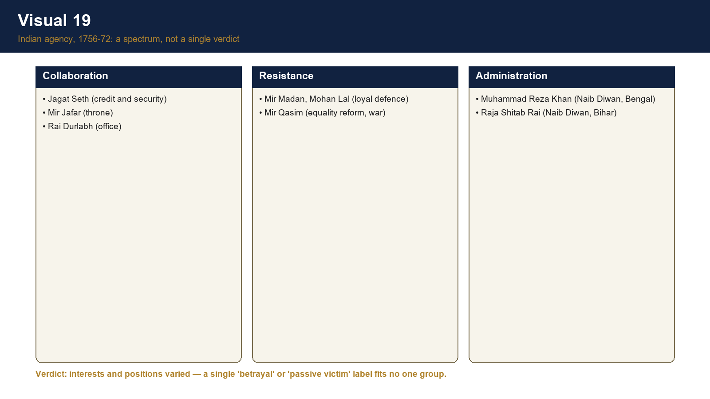

#### CLOSING RECALL FLOW — CORE SYNTHESIS — 14. FROM TRADER TO REVENUE SOVEREIGN: THE COMPANY'S TRANSFORMATION AND THE SPECTRUM OF INDIAN AGENCY

```text
START / CONCEPT: SESSION 14 — CORE SYNTHESIS — 14. FROM TRADER TO REVENUE SOVEREIGN: THE COMPANY'S TRANSFORMATION AND THE SPECTRUM OF INDIAN AGENCY
        |
        v
KEYWORDS: trader to sovereign · political kingmaker · revenue title · Company-state · asymmetrical agency
        |
        v
EVIDENCE ROUTE: Claim: The conquest was cumulative, not instantaneous. Evidence: Plassey created kingmaking leverage, Buxar established military predominance, and the 1765 Diwani plus Dual Government converted that leverage into routine fiscal power. Analysis: each stage widened the Company's capacity to command resources, armies and administrators. Qualification: the sequence looks coherent in retrospect, but contemporaries moved through crises more than through a perfectly pre-written master plan.
        |
        v
CORE MEANING: Between 1757 and 1772 the Company moved from privileged trader to political kingmaker and then to revenue sovereign.
        |
        v
EXAM LINE: The central transformation in this topic is institutional: a merchant corporation learned to rule through revenue.
```
### SESSION 15 — CORE SYNTHESIS — 15. READING THE CONQUEST: FOUR HISTORIOGRAPHICAL LENSES

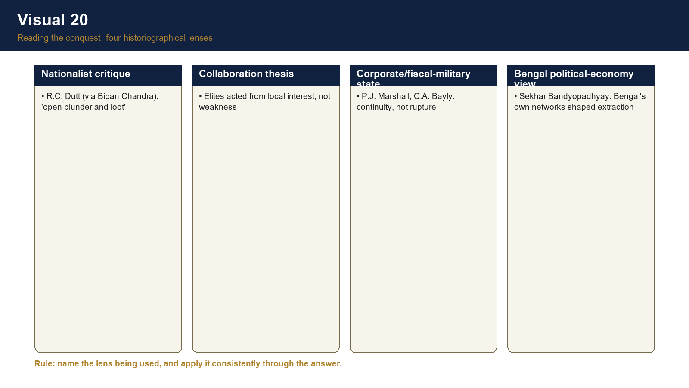

#### DEFINITION / WHAT THIS IS CALLED

**Definition:** Historiography of Bengal's conquest turns on which mechanism a historian treats as decisive: plunder, collaboration, corporate-state formation or Bengal continuity.

#### ANSWER-GRABBING OPENING — WRITE/ADAPT IN THE EXAM

> How one reads Bengal's conquest depends less on the bare facts than on which causal chain is given interpretive priority.

#### KEYWORDS FOR COMPLETE RECALL

- **R. C. Dutt**
- **Sekhar Bandyopadhyay**
- **P. J. Marshall**
- **C. A. Bayly**
- **collaboration thesis**

#### NAMED-EVIDENCE DEMONSTRATION

**Claim:** Competing historiographical lenses illuminate different parts of the same sequence. **Evidence:** R. C. Dutt foregrounded plunder and fiscal extraction, while P. J. Marshall and C. A. Bayly emphasised corporate-state formation; Sekhar Bandyopadhyay's Bengal-centred reading restores regional political economy and indigenous agency. **Analysis:** the same events -- Plassey, Buxar, Diwani, famine -- look different when the explanatory weight shifts. **Qualification:** no single lens exhausts the archive, so the best answers name their chosen lens and acknowledge what it leaves in shadow.

Four historiographical lenses offer distinct, defensible ways of reading this material, and naming the lens being used is itself an exam-earning move. The nationalist critique holds that Plassey and Buxar began a one-way economic drain; R.C. Dutt, as cited within Bipan Chandra's account, characterised the post-Plassey decades as a period of "open plunder and loot" -- a framing useful to explain post-Plassey extraction and the 1770 famine's fiscal backdrop, while leaving the full drain-of-wealth mechanics to later economic analysis. The collaboration thesis holds that Indian elites -- bankers, zamindars, courtiers -- collaborated with the Company for their own local interests, not out of weakness, which explains directly why the Jagat Seths, Mir Jafar and Rai Durlabh joined the Plassey conspiracy. The corporate/fiscal-military state thesis, associated with historians including P.J. Marshall and C.A. Bayly, holds that the Company became a hybrid fiscal-military corporate state, continuous with earlier fiscal practice rather than a sudden rupture -- a lens that explains the Diwani grant and the Dual Government as an evolving revenue-military apparatus. A Bengal political-economy view, consistent with Sekhar Bandyopadhyay's account, emphasises that Bengal's own dense commercial and banking networks shaped how conquest and revenue extraction actually functioned on the ground, which explains the Jagat Seths' and Bengal's credit markets' central role throughout 1757-72.

These four lenses rest on different evidence bases and different emphases, not a single agreed narrative, and each is defensible when applied consistently. A strong Mains answer names the lens it is using explicitly -- "read through a nationalist lens" or "read through the collaboration thesis" -- and applies it consistently through the answer, rather than mixing incompatible framings within a single paragraph, which is precisely what examiners reward and what a mixed, unnamed framing forfeits.

#### CLOSING RECALL FLOW — CORE SYNTHESIS — 15. READING THE CONQUEST: FOUR HISTORIOGRAPHICAL LENSES

```text
START / CONCEPT: SESSION 15 — CORE SYNTHESIS — 15. READING THE CONQUEST: FOUR HISTORIOGRAPHICAL LENSES
        |
        v
KEYWORDS: R. C. Dutt · Sekhar Bandyopadhyay · P. J. Marshall · C. A. Bayly · collaboration thesis
        |
        v
EVIDENCE ROUTE: Claim: Competing historiographical lenses illuminate different parts of the same sequence. Evidence: R. C. Dutt foregrounded plunder and fiscal extraction, while P. J. Marshall and C. A. Bayly emphasised corporate-state formation; Sekhar Bandyopadhyay's Bengal-centred reading restores regional political economy and indigenous agency. Analysis: the same events -- Plassey, Buxar, Diwani, famine -- look different when the explanatory weight shifts. Qualification: no single lens exhausts the archive, so the best answers name their chosen lens and acknowledge what it leaves in shadow.
        |
        v
CORE MEANING: Historiography of Bengal's conquest turns on which mechanism a historian treats as decisive: plunder, collaboration, corporate-state formation or Bengal continuity.
        |
        v
EXAM LINE: How one reads Bengal's conquest depends less on the bare facts than on which causal chain is given interpretive priority.
```
### SESSION 16 — CORE SYNTHESIS — 16. COMPARATIVE SYNTHESIS: PLASSEY, BUXAR, ALLAHABAD AND THE DUAL GOVERNMENT, AND THE BRIDGE FORWARD

```text
CHAPTER SYNTHESIS
PLASSEY 1757 -> political entry and client regime
BUXAR 1764 -> wider military predominance
ALLAHABAD 1765 -> legal revenue title + Awadh buffer
DUAL GOVERNMENT 1765-72 -> revenue power without public responsibility
1772 -> Company assumes direct administrative responsibility
BOUNDARY -> later constitutional regulation, wider expansion and full economic impact follow
```

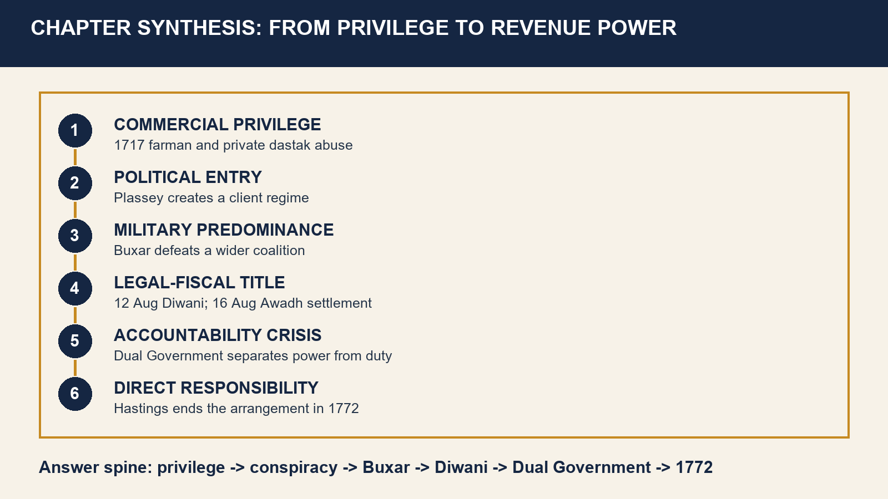

#### DEFINITION / WHAT THIS IS CALLED

**Definition:** The conquest of Bengal was a sequence in which Plassey changed the ruler, Buxar won military predominance, Allahabad gave legal revenue title, and the Dual Government operationalised that title until 1772.

#### ANSWER-GRABBING OPENING — WRITE/ADAPT IN THE EXAM

> Precision in this topic comes from assigning each event its own distinct constitutional work.

#### KEYWORDS FOR COMPLETE RECALL

- **Plassey versus Buxar**
- **Allahabad 1765**
- **Dual Government 1765-72**
- **topic boundaries**
- **1772 closure**

#### NAMED-EVIDENCE DEMONSTRATION

**Claim:** Most exam errors in this topic come from collapsing separate stages into one. **Evidence:** 23 June 1757 marks Plassey, 22 October 1764 marks Buxar, 12 and 16 August 1765 mark the two Allahabad treaties, and 1772 marks Hastings's end of the Dual Government. **Analysis:** once each date is tied to its exact function, the conquest reads as a process of political, military and legal consolidation. **Qualification:** This chapter closes in 1772; later regulatory reform and wider economic synthesis belong to adjacent topics, not to an overextended answer here.

Bringing Plassey and Buxar into direct comparison sharpens exactly the causal-chain precision this topic tests most often. Plassey (1757) was a brief, one-sided skirmish decided mainly by a pre-arranged conspiracy, defeating a single Nawab with divided, half-loyal generals, under Clive's relatively small Company force reinforced from Madras; its mechanism was personal conspiracy and payment substituting for a real military contest, and its immediate outcome was Mir Jafar installed as a Company-dependent Nawab. Buxar (1764) was a harder-fought, more conventional pitched battle against a genuine three-part coalition -- a deposed Nawab, the Wazir of Awadh, and the Mughal emperor -- under Munro's unified force built on Bengal's post-Plassey resources; its mechanism was superior unified command defeating a larger but segmented coalition army, and its immediate outcome was the Treaty of Allahabad, granting the Diwani of Bengal-Bihar-Orissa to the Company.

Plassey made the Company Bengal's political kingmaker in practice; Buxar and Allahabad made the Company a recognised revenue-sovereign in law -- and it is this second, legal transformation that is the more strategically decisive of the two turning points. The recurring exam trap is treating Plassey as the whole story because it is the more famous name; a precise answer must be able to state which specific change followed from which specific event -- regime change from Plassey, legal revenue title from Allahabad -- and the Dual Government (1765-72) as the administrative structure that then converted that legal title into lived governance, however dysfunctionally, until Hastings ended it in 1772.

The chapter boundary is precise: early European settlement rivalry is background, while the detailed expansion beyond Bengal, constitutional regulation from 1773 and the full economic consequences of colonial rule follow later. Here Buxar is examined only insofar as it explains Bengal's political settlement, and the narrative closes when Hastings ended the Dual Government in 1772.

The bridge forward is therefore precise rather than open-ended: this topic's narrative closes in 1772, with Warren Hastings ending the Dual Government and the Company beginning to administer Bengal directly; the Regulating Act of 1773, which first subjected Company rule to parliamentary oversight, and the deeper economic architecture that Company rule then built on the foundation this topic describes, are Topics 06 and 07's material, picked up from exactly this point and not re-derived here.

#### CLOSING RECALL FLOW — CORE SYNTHESIS — 16. COMPARATIVE SYNTHESIS: PLASSEY, BUXAR, ALLAHABAD AND THE DUAL GOVERNMENT, AND THE BRIDGE FORWARD

```text
START / CONCEPT: SESSION 16 — CORE SYNTHESIS — 16. COMPARATIVE SYNTHESIS: PLASSEY, BUXAR, ALLAHABAD AND THE DUAL GOVERNMENT, AND THE BRIDGE FORWARD
        |
        v
KEYWORDS: Plassey versus Buxar · Allahabad 1765 · Dual Government 1765-72 · topic boundaries · 1772 closure
        |
        v
EVIDENCE ROUTE: Claim: Most exam errors in this topic come from collapsing separate stages into one. Evidence: 23 June 1757 marks Plassey, 22 October 1764 marks Buxar, 12 and 16 August 1765 mark the two Allahabad treaties, and 1772 marks Hastings's end of the Dual Government. Analysis: once each date is tied to its exact function, the conquest reads as a process of political, military and legal consolidation. Qualification: This chapter closes in 1772; later regulatory reform and wider economic synthesis belong to adjacent topics, not to an overextended answer here.
        |
        v
CORE MEANING: The conquest of Bengal was a sequence in which Plassey changed the ruler, Buxar won military predominance, Allahabad gave legal revenue title, and the Dual Government operationalised that title until 1772.
        |
        v
EXAM LINE: Precision in this topic comes from assigning each event its own distinct constitutional work.
```

## BASIC MCQS / REMEDIATION

### Q1. What did the 1717 Farrukhsiyar farman actually grant the English East India Company in Bengal?

A. Duty-free import and export of the Company's own registered goods, certified by dastak passes
B. The right to maintain an armed garrison at Murshidabad itself
C. A permanent exemption from internal transit duties for any merchant carrying a Company employee's personal letter
D. Full zamindari and revenue-collection rights over Murshidabad and its surrounding parganas

**Answer: A.**
**Explanation:** The farman was a bounded, Company-only commercial privilege; the other options describe things no Nawab ever granted, or things that mimic servants' later dastak abuse rather than the farman's actual terms.

### Q2. Which of the following was NOT part of the 1757 Plassey conspiracy network?

A. Rai Durlabh, Bengal's Diwan
B. Shuja-ud-Daula, the Nawab-Wazir of Awadh
C. The Jagat Seth banking house
D. Mir Jafar, Siraj-ud-Daulah's own Mir Bakshi

**Answer: B.**
**Explanation:** Shuja-ud-Daula joined the later Buxar coalition of 1764, seven years after Plassey; he had no role in the 1757 conspiracy against Siraj-ud-Daulah.

### Q3. Why was Mir Jafar deposed by the Company in 1760?

A. He allied openly with the French at Chandernagore
B. He abolished internal transit duties, angering Company traders
C. He could no longer meet the Company's escalating fresh financial demands, driven partly by its regional military commitments
D. He refused to pay any compensation after Plassey

**Answer: C.**
**Explanation:** The duty-abolition measure (option B) describes Mir Qasim's later 1763 reform, not Mir Jafar's; Mir Jafar's actual failure was fiscal exhaustion under continuing Company demands.

### Q4. Which statement correctly distinguishes what Plassey changed from what Buxar and Allahabad changed?

A. Plassey granted the Diwani; Buxar merely confirmed Mir Jafar as Nawab
B. Both events achieved identical outcomes and can be treated as a single turning point
C. Buxar changed who sat on Bengal's throne; Plassey created the Company's legal revenue title
D. Plassey changed who sat on the throne; Buxar and Allahabad created the Company's legal revenue title, the more decisive change

**Answer: D.**
**Explanation:** The fourth option states the correct, examiner-tested sequence; the first and third options reverse the actual causal order, and the second collapses a distinction the exam specifically tests.

### Q5. Which term describes Murshid Quli Khan's method of assigning revenue collection to the highest bidder, later criticised for encouraging short-term extraction over long-term agrarian investment?

A. Ijaradari (revenue farming)
B. Permanent Settlement
C. Ryotwari settlement
D. Zamindari settlement

**Answer: A.**
**Explanation:** Ijaradari was Murshid Quli Khan's own method; the other three are different revenue systems from later, mostly post-1793 Company administration, not his Bengal.

### Q6. On which date did Fort William, Calcutta, fall to Siraj-ud-Daulah's forces in 1756?

A. 12 August 1765
B. 20 June 1756
C. 23 June 1757
D. 2 January 1757

**Answer: B.**
**Explanation:** Fort William fell on 20 June 1756; 2 January 1757 is Clive/Watson's recapture, 23 June 1757 is Plassey, and 12 August 1765 is the Treaty of Allahabad.

### Q7. What official position did Rai Durlabh hold in Siraj-ud-Daulah's administration before joining the Plassey conspiracy?

A. Naib Nazim of Bihar
B. Mir Bakshi (paymaster-general)
C. Diwan (chief revenue officer) of Bengal
D. Qiladar of Munger fort

**Answer: C.**
**Explanation:** Rai Durlabh was Bengal's Diwan; Mir Jafar held the Mir Bakshi post, and the other two positions belong to different office-holders later in this topic's timeline.

### Q8. What best describes the post-Plassey extraction mechanism under Mir Jafar?

A. The Company immediately assumed direct administration in 1757.
B. A single payment ended Company intervention in Bengal.
C. Mir Jafar received the Diwani from Shah Alam II.
D. Transfers and concessions deepened the client's dependence and expanded Company political leverage.

**Answer: D.**
**Explanation:** Transfers and concessions deepened the client's dependence and expanded Company political leverage.

### Q9. The Patna Massacre of October 1763 refers to which event?

A. The killing of English Company prisoners by commanders serving Mir Qasim during the 1763 conflict
B. The killing of Siraj-ud-Daulah by Mir Jafar's son
C. A Company massacre of Bengali weavers protesting duty policy
D. A famine-related mass-death event in Patna city

**Answer: A.**
**Explanation:** The Patna Massacre refers to the killing of English captives by commanders in Mir Qasim's service during the escalating 1763 conflict; the other options describe unrelated or fictional events.

### Q10. What happened to Mir Qasim after the Company's victory at Buxar?

A. He was executed publicly by the Company at Munger
B. He disappeared into obscurity, dying in reduced circumstances some years later without recovering political power
C. He became the Company's first Naib Diwan
D. He was restored as Nawab of Bengal under a new treaty

**Answer: B.**
**Explanation:** Unlike Shuja-ud-Daula and Shah Alam II, who both received negotiated 1765 settlements, Mir Qasim's political career effectively ended at Buxar without restoration, execution, or an administrative post.

### Q11. What powers did the Diwani specifically confer on its holder?

A. Command of the Nawab's standing army
B. Criminal justice administration across Bengal
C. The right to collect land revenue and administer civil justice in Bengal, Bihar and Orissa
D. Appointment of the Mughal emperor's own household staff

**Answer: C.**
**Explanation:** Revenue collection and civil justice were the Diwani's specific domain; military command and criminal justice belonged to the Nizamat, and household appointments were an unrelated Mughal court function.

### Q12. Which sequence best captures the Company's transformation described in this topic, from trader to sovereign power?

A. Sovereign power first, then trading company, then kingmaker
B. Kingmaker first, then sovereign power, then trading company
C. Trading company and sovereign power simultaneously from the Company's founding in 1600
D. Trading company with local privileges, then political kingmaker after Plassey, then direct revenue sovereign after Buxar and the Diwani grant

**Answer: D.**
**Explanation:** This sequence -- commerce, then political leverage, then formal revenue sovereignty -- is the structural transformation this topic traces, unfolding across nearly a decade, not instantaneously or in reverse order.

### Q13. Which historiographical approach, associated with historians such as Sekhar Bandyopadhyay, situates the conquest within Bengal's own pre-existing political-economic structures rather than treating it as an external event imposed on a passive region?

A. The Bengal political-economy approach, tracing continuities and ruptures in Bengal's own commercial and agrarian structures across the conquest period
B. The 'purely religious' approach, framing the conquest as a primarily sectarian conflict
C. The 'sudden rupture' approach, treating 1757 as a total break with no prior continuity
D. The 'great man' approach, explaining the conquest solely through Clive's individual genius

**Answer: A.**
**Explanation:** This approach foregrounds Bengal's own internal political-economic structures and continuities, in contrast to a sudden-rupture, sectarian, or purely biographical framing.

### Q14. A student writes: 'Plassey was a hard-fought, evenly matched pitched battle decided by superior British tactics.' What is the correct remedial statement?

A. The statement is accurate; British tactical superiority alone explains the outcome
B. Real fighting was confined mainly to Mir Madan's and Mohan Lal's small loyal wing; the bulk of Siraj's nominal force, under conspirators Mir Jafar and Rai Durlabh, never engaged -- making this substantially a political, not tactical, victory
C. The battle lasted several days of continuous fighting before a British breakthrough
D. Naval bombardment, not land tactics, decided the battle

**Answer: B.**
**Explanation:** The evenly-matched/tactical-superiority framing, and the multi-day and naval-bombardment variants, all misdescribe Plassey's actual, largely pre-arranged, one-day outcome.

### Q15. A student writes: 'Alivardi Khan was defeated at the Battle of Giria.' What is the correct remedial statement?

A. There is no such place as Giria in this topic's chronology
B. Both Giria battles were fought against the Company by the same ruler
C. Alivardi Khan won at Giria in 1740 (over Sarfaraz Khan, to become Nawab); Mir Qasim suffered a defeat at a place also called Giria in 1763, during his conflict with the Company -- two different battles, 23 years apart
D. The statement is accurate as written

**Answer: C.**
**Explanation:** The place-name repetition (Giria, 1740 and 1763) is a frequent trap; year-anchoring each battle to its correct ruler and opponent resolves the confusion.

### Q16. A student blames the 1770 famine entirely on Company revenue policy. What is the correction?

A. Revenue policy had no bearing on vulnerability or relief.
B. The famine should be explained only through a precise population-loss estimate.
C. Dual Government had already ended before the famine.
D. Company governance amplified a crisis with natural and epidemiological dimensions; neither side of the causal pair should be erased.

**Answer: D.**
**Explanation:** Company governance amplified a crisis with natural and epidemiological dimensions; neither side of the causal pair should be erased.

## PYQS AND ANSWER PRACTICE

### BOUNDED PYQ BRIDGE

This topic is best revised through **adjacent bridge questions**, not through a falsely claimed direct Topic-04 PYQ. Two 2022 GS-I illustrations are especially useful:

1. **2022 GS-I, 10 marks:** *Why did the armies of the British East India Company -- mostly comprising Indian soldiers -- defeat larger Indian armies repeatedly?* Use this chapter for the Buxar-side lesson: segmented coalition command lost to Munro's unified chain of command; the wider all-India military-fiscal explanation belongs beyond Bengal.
2. **2022 GS-I, 10 marks:** *Why was there a sudden spurt in famines in colonial India since the mid-eighteenth century?* Use this chapter only for the Bengal opening chapter: the 1770 famine shows how ecological shock and extractive governance combined, while the wider colonial famine pattern belongs to the larger economic history of British rule.

### EVIDENCE AND ANSWER-WRITING DRILLS
### Drill 1 - The 1717 farman is not the same claim as dastak abuse

**Claim:** Write the 1717 Farrukhsiyar farman as a real, treaty-based, Company-only duty exemption; write servants' dastak misuse as a separate, unauthorised extension that Murshid Quli Khan, Alivardi Khan and Siraj-ud-Daulah all resisted. Never merge the two into one generic "trade privilege."

**Exam move:** Prelims statement-pairs on this period are built almost entirely around this exact split -- answer by testing whether a statement describes the 1717 grant itself or servants' abuse of it, not by recalling the year alone.

### Drill 2 - The Black Hole is a source-criticism question, not a body-count question

**Claim:** Name Holwell as a single interested narrator, note the absence of independent corroboration, and mention the episode's own later contested memory (the 1940 campaign against the Holwell monument) as part of the answer, not a footnote.

**Exam move:** If a question asks you to "discuss" the Black Hole, spend as many words on why the evidence is disputed as on what is alleged to have happened -- a answer that states a specific death toll as settled fact has already lost marks before reaching its conclusion.

### Drill 3 - Plassey is a coup question, even when it is asked as a battle question

**Claim:** Whatever the question's wording, describe Plassey's decisive mechanism as the pre-arranged conspiracy (Mir Jafar, Jagat Seth, Rai Durlabh, Amichand), with real fighting confined to Mir Madan's and Mohan Lal's small loyal wing.

**Exam move:** If a question asks "how was Plassey won," the expected answer is political, not tactical; a purely military description of troop movements, without the conspiracy, answers a different and less accurate question.

### Drill 4 - Hold casualty figures loosely, and say so explicitly

**Exam move:** Add a short qualifying clause -- "figures traditionally cited in general accounts" -- whenever a casualty number appears in an answer; this single habit protects against being marked down for false precision.

### Drill 5 - Post-Plassey extraction is a circuit, not a bribe

**Claim:** Describe Mir Jafar's payments, Clive's personal fortune and the 24-Parganas zamindari grant as a self-reinforcing circuit -- dependence produces payment, payment deepens dependence -- ending in Mir Jafar's own deposition in 1760 once he could not sustain it.

**Exam move:** A "why was Mir Jafar deposed" question is answered by this circuit, not by a single act of defiance on his part; keep this subtopic's material bounded to 1757-60 and reserve the wider drain-of-wealth analysis for the economic-impact discussion.

### Drill 6 - Mir Qasim wanted equal taxation, not simply to expel the Company

**Claim:** State his 1763 abolition of internal duties as aimed at equal treatment for Indian and European merchants alike; treat Company hostility to this measure as the consequence of lost tax advantage, not evidence that Mir Qasim was primarily an anti-colonial nationalist in the modern sense.

**Exam move:** A question inviting a character assessment of Mir Qasim rewards naming his specific administrative aims (Munger, army reform, equal duties) before any conflict narrative, not the reverse order.

### Drill 7 - Buxar's coalition lost to structure, not to a lack of courage

**Claim:** Explain the coalition's defeat through its own segmented command -- three treasuries, three commanders, no shared war-chest -- against Munro's single unified chain of command, rather than through any claim about troop quality or morale.

**Exam move:** If a question invites comparison between Plassey and Buxar's military character, lead with command structure, not troop numbers -- numbers favoured the coalition; structure did not.

### Drill 8 - State precisely which event changed what

**Claim:** Attribute regime change (a new Nawab) to Plassey, and the Company's legal revenue title to Buxar plus the Treaty of Allahabad; never credit Plassey alone with establishing Company sovereignty in Bengal.

**Exam move:** Any answer beginning "the British conquered Bengal at Plassey in 1757" without qualification has already made the single most common factual overreach on this topic; add "politically" after "conquered" or replace the sentence with the Plassey-then-Buxar-then-Allahabad sequence.

### Drill 9 - Two treaties at Allahabad did two different jobs

**Claim:** Name the Shah Alam II treaty as the source of the Diwani grant and the Shuja-ud-Daula treaty as the separate Awadh-restoration settlement, signed on 12 and 16 August 1765 respectively; never describe "the Treaty of Allahabad" as a single undifferentiated document.

**Exam move:** A Prelims option that says "the Treaty of Allahabad restored Awadh to Shuja-ud-Daula and granted the Diwani to the Company" is correct only if you recognise it is quietly describing two instruments as one -- true in combined outcome, imprecise in legal form.

### Drill 10 - Diwani and Nizamat were not an equal split

**Claim:** State that the Company held the substantively powerful Diwani directly through its own Naib Diwans, while the Nawab's Nizamat was nominal and, in practice, exercised through the same Company-influenced deputies.

**Exam move:** Reject any statement describing 1765-72 Bengal as "jointly ruled" by the Company and the Nawab on genuinely equal terms; the correct formulation is one substantive power-holder and one nominal title-holder, which is exactly the Dual Government's own internal paradox.

### Drill 11 - Name the Dual Government's paradox in both directions

**Claim:** State both halves explicitly -- Company power without formal responsibility, Nawab's government responsibility without real power -- rather than describing only one side of the arrangement.

**Exam move:** A 15-mark "why did the Dual Government fail" answer that names only Company misrule, or only the Nawab's weakness, has described half the mechanism; both halves together are what "failed by design" means here.

### Drill 12 - The 1770 famine takes two causes, stated together, never one

**Claim:** Pair the natural trigger (poor 1768 harvest, 1769-70 drought) with the governance vulnerability (revenue rigidity, commercial priorities, Dual Government administrative confusion) in the same sentence; never present drought or Company policy as a sufficient standalone cause.

**Exam move:** Do not state a specific famine mortality figure as verified fact; if scale must be mentioned, attribute it explicitly as a repeated secondary-source estimate, not a census result.

### Drill 13 - Indian actors chose within constraints; they were not simply traitors or dupes

**Claim:** Place each named actor (Mir Jafar, Jagat Seth, Amichand, Mir Qasim, Siraj-ud-Daulah, Bengal's peasantry) on the collaboration-to-resistance spectrum with their own institutional motive stated, rather than collapsing all of them into a single moral verdict.

**Exam move:** An answer that uses the word "betrayal" as its entire explanatory mechanism has substituted a moral label for an analytical one; name the specific interest (credit protection, personal ambition, fiscal parity) instead.

### Drill 14 - Respect topic boundaries without weakening the answer

**Claim:** Use this chapter to explain the Bengal sequence up to 1772 -- privilege, conspiracy, Buxar, Diwani and Dual Government -- and hand later constitutional reform, all-India expansion and the full drain-theory architecture to adjacent topics.

**Exam move:** A bounded answer scores better than a sprawling one; end by naming the exact bridge forward instead of silently absorbing later material.

### ORIGINAL MAINS PRACTICE — SOLVED MODEL ANSWERS

The six model answers use a consistent exam structure: thesis, named evidence, analysis, qualification and verdict.

### Original Mains 1 - 10 marks | 150 words

**Question:** Examine the political method by which the English East India Company acquired the Diwani of Bengal in 1765.

**Demand decode:** "Examine" requires the mechanism -- military leverage converted into legal title -- not a simple battle narrative.

**Structured plan:** Buxar as precondition -> Allahabad as legal transfer -> why Mughal sanction still mattered -> limit: Nizamat not transferred.

**Model answer:** The Company acquired the Diwani by turning battlefield leverage into Mughal legal sanction. After Buxar (22 October 1764) defeated Mir Qasim, Shuja-ud-Daula and Shah Alam II, Clive sought grant rather than annexation. At Allahabad on 12 August 1765, Shah Alam II granted the Diwani of Bengal, Bihar and Orissa to the Company in return for tribute and the districts of Kora and Allahabad. Revenue title still needed imperial form, however weak the emperor had become. The limit is important: the Nizamat was not transferred. Criminal justice and nominal military responsibility remained, in form, with the Nawab. Thus the Company secured sovereignty by legal instrument, not kingship.

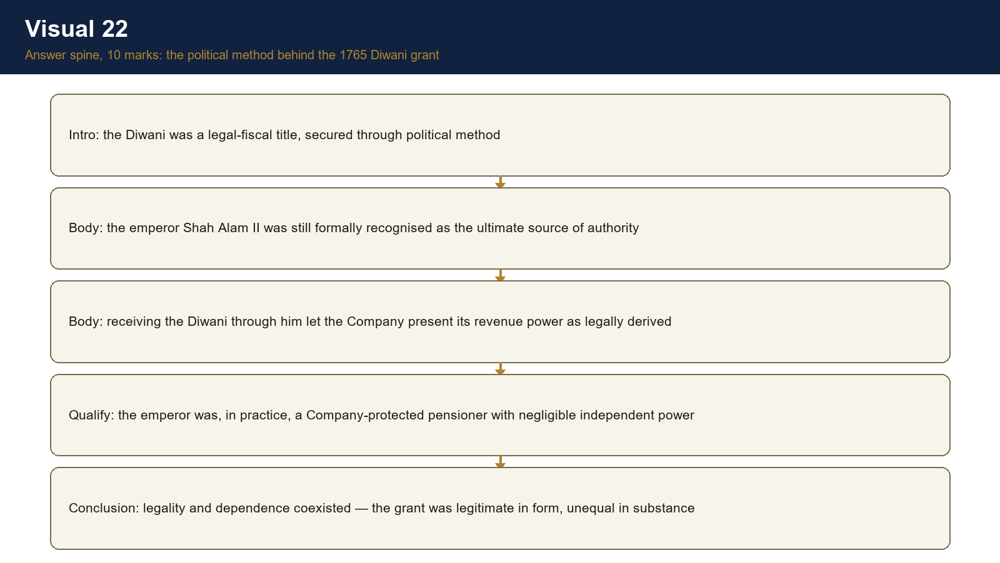

**What earns marks:** Name Buxar, Shah Alam II, the Allahabad grant, and the Nizamat limit in one integrated chain.

**Better answer note:** Add one line on why imperial legality still mattered in 1765, even after military collapse.

### Original Mains 2 - 10 marks | 150 words

**Question:** Account for the source-critical problems in accepting the traditional narrative of the 1756 "Black Hole of Calcutta" as settled historical fact.

**Demand decode:** "Account for" asks why the evidentiary basis is weak; it does not reward dramatic retelling.

**Structured plan:** Holwell as interested narrator -> corroboration gap -> contested public memory -> cautious verdict.

**Model answer:** The Black Hole narrative is source-critically weak because its detailed form rests overwhelmingly on John Zephaniah Holwell, a Company official and self-described survivor with a direct institutional stake in dramatising Fort William's fall. No independent Indian, French or neutral European account securely corroborates Holwell's specific casualty figures, and later scholarship has repeatedly stressed that absence. The episode's afterlife is itself evidence: the Holwell monument became politically contentious and was removed from its central site in 1940, showing that public memory around the story was never neutral. These points do not prove that no confinement episode occurred, but they do make precise numbers and lurid certainty indefensible. A sound UPSC answer should therefore present the Black Hole as alleged and disputed, not as a settled casualty count.

**What earns marks:** Name Holwell, state the corroboration problem, and use the monument controversy as evidence about memory rather than body count.

**Better answer note:** A top answer adds that caution about scale is stronger than either imperial certainty or blanket denial.

### Original Mains 3 - 15 marks | 250 words

**Question:** Discuss why the Dual Government established by Robert Clive in Bengal (1765-72) failed as a system of governance, despite its apparent administrative convenience for the Company.

**Demand decode:** "Discuss" requires multiple structural reasons and a qualified judgement, not one moral label.

**Structured plan:** constitutional design -> Company revenue power -> Nawab's nominal responsibility -> administrative consequences -> 1770 famine and 1772 closure.

**Model answer:** The Dual Government failed because it deliberately split effective power from visible responsibility. After the 1765 Allahabad settlement, the Company held the Diwani -- land revenue and the civil side -- while the Nawab retained the Nizamat in name. In practice the Company extracted Bengal's surplus through Indian deputies such as Muhammad Reza Khan in Bengal and Raja Shitab Rai in Bihar, yet it did not openly accept the burdens of day-to-day governance. The Nawab's establishment, conversely, remained publicly answerable while lacking the resources to govern effectively. This created the arrangement later summarised as Company power without responsibility and Nawabi responsibility without power. Clive's own later testimony that "corruption universally prevails, and confusion and mismanagement pervade every department" captures the structural result. Revenue demand stayed hard, but corrective administration stayed weak; the 1770 famine exposed how dangerous that combination was. The system's defect, therefore, was not primarily personal incompetence. It was a constitutional design that hid real authority behind nominal forms until Warren Hastings ended it in 1772 by making the Company "stand forth as Diwan." The qualification is that Indian intermediaries were indispensable, but indispensability did not remove the design flaw.

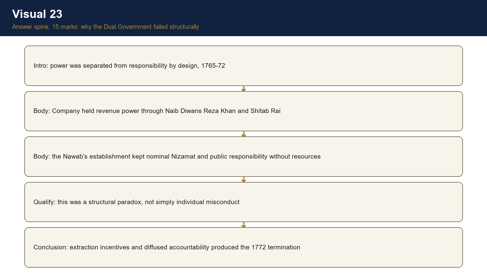

**What earns marks:** State both halves of the accountability paradox, name the Naib Diwans, use Clive's testimony, and connect failure to Hastings's 1772 remedy.

**Better answer note:** Improve further by adding one sentence on how revenue pressure and famine vulnerability interacted, not just coexisted.

### Original Mains 4 - 15 marks | 250 words

**Question:** "The British conquest of Bengal was as much the work of Indian bankers, nobles and soldiers as of the East India Company." Examine this statement with reference to the events of 1756-65.

**Demand decode:** "Examine" requires testing the statement with named actors across the whole period, not moralising betrayal in the abstract.

**Structured plan:** conspirators at Plassey -> administrative intermediaries after conquest -> resistance as counter-evidence -> qualified verdict on asymmetry.

**Model answer:** The statement is substantially correct, provided Indian agency is specified rather than romanticised. At Plassey, Company success depended on Indian choices: the Jagat Seth banking house protected its credit network by backing regime change; Mir Jafar treated alliance with Clive as the quickest route to the masnad; Rai Durlabh withheld effective support from Siraj-ud-Daulah; and Amichand operated as a broker within the conspiracy. Even the battle's military shape reflected Indian decisions, because Mir Madan and Mohan Lal fought while larger contingents stayed inactive. After 1765, the Company still lacked the administrative reach to collect Bengal's revenues directly and therefore relied on Indian intermediaries such as Muhammad Reza Khan and Raja Shitab Rai. Yet the statement must also include resistance: Siraj's stand over fortification and Mir Qasim's reforms from Munger show Indian agency working against Company expansion as well. The conquest was thus co-produced by Company initiative and Indian institutional choice, but not on equal terms. Indian actors operated within a tightening field shaped by Company military force, credit access and political leverage.

**What earns marks:** Use named individuals with distinct motives and show agency in both directions -- collaboration and resistance.

**Better answer note:** A stronger answer briefly distinguishes moral judgement from analytical explanation by naming interest before verdict.
### Original Mains 5 - 20 marks | 250 words

**Question:** Trace the transformation of the English East India Company from a chartered trading concern to a territorial revenue-collecting power in Bengal between 1757 and 1772, and examine the main drivers of this transformation at each stage.

**Demand decode:** "Trace ... and examine" needs a staged chronology plus the driver at each stage, not one undifferentiated story.

**Structured plan:** stage 1 Plassey-client regime -> stage 2 Mir Qasim and Buxar -> stage 3 Diwani and Dual Government -> cross-stage continuity -> qualification.

**Model answer:** The Company's transformation unfolded in three linked stages. First, after Plassey (23 June 1757), it became a political kingmaker. Mir Jafar's installation, compensation payments, the 24 Parganas grant and Clive's jagir gave the Company influence without yet giving it legal revenue sovereignty. The driver here was leverage over a dependent client Nawab whose resources were redirected to Company military and private demands. Second, between 1760 and 1764, Mir Qasim's attempt to rebuild Nawabi autonomy from Munger sharpened the conflict. His army reforms and abolition of inland duties attacked the fiscal privileges of Company servants; the resulting war widened into the Awadh-Mughal coalition defeated at Buxar on 22 October 1764. The driver at this stage was the Company's need to secure its commercial and political advantages against a serious recovery project. Third, in 1765-72, military dominance was converted into institutional power. Shah Alam II's Diwani grant at Allahabad (12 August 1765) gave legal revenue title, and the Dual Government tried to operate that title through Indian deputies under nominal Nawabi cover until Hastings ended the arrangement in 1772. Across all three stages, the continuity was the Company's search for a safer, larger and more direct revenue base. The qualification is that the process was cumulative and crisis-driven, not a perfectly designed master plan from 1757 onward.

**What earns marks:** Separate the three stages clearly, give one named driver for each, and tie them together with the revenue-base argument.

**Better answer note:** To reach the top band, add one sentence on why Mughal legal form remained useful even after Company military success.

### Original Mains 6 - 20 marks | 250 words

**Question:** "The conquest of Bengal is best understood not as a single battle or treaty but as a decade-long process of corporate-state formation, co-produced by Company initiative and Indian institutional choices." Critically evaluate this characterisation with reference to Plassey, Buxar and the Dual Government.

**Demand decode:** "Critically evaluate" requires testing both halves of the statement -- process and co-production -- and then limiting them.

**Structured plan:** test process claim -> test co-production claim -> add historiographical lens -> qualify unequal power -> verdict.

**Model answer:** The characterisation is largely persuasive because no single event completed Bengal's conquest. Plassey in 1757 changed the ruler through conspiracy, but it did not yet give the Company a recognised revenue title. Buxar in 1764 demonstrated wider military predominance against Mir Qasim, Shuja-ud-Daula and Shah Alam II, while the 1765 Allahabad settlement converted that predominance into the Diwani. Even then, the Dual Government remained a transitional device until Hastings ended it in 1772. On the second claim, Indian institutional choices were indeed indispensable. Mir Jafar, Rai Durlabh and the Jagat Seths enabled Plassey; the segmented command of the Buxar coalition shaped defeat; and Indian Naib Diwans made the Dual Government operational on the ground. This is why the corporate-state lens associated with historians such as P. J. Marshall and C. A. Bayly is useful: the Company did not merely conquer; it assembled rule through finance, military force and inherited institutions. Yet the phrase "co-produced" needs qualification. Indian actors operated within an increasingly unequal structure whose ultimate beneficiary was unmistakably the Company. Thus the conquest was a process and it was institutionally co-produced, but the distribution of power and gains remained fundamentally asymmetrical throughout.

**What earns marks:** Test both parts of the quotation against named evidence from Plassey, Buxar and the Dual Government, then add an asymmetry qualification.

**Better answer note:** Strengthen the historiography by pairing the corporate-state lens with a brief nationalist counter-weight on plunder and extraction.
## OPTIONAL ADVANCED DEPTH — NOT REQUIRED FOR A CORE ANSWER

### Advanced visual: how a trading corporation became a fiscal-military state

| Stage | Mechanism | Institutional effect | Analytical significance |
|---|---|---|---|
| Commercial privilege | Farman, dastaks and private trade | Company immunity collides with Nawabi customs authority | A trade dispute becomes a sovereignty dispute |
| Political entry | Plassey and the client regime | Court finance and succession are redirected toward Company interests | Indian collaboration matters, but within unequal power |
| Military predominance | Buxar | A wider Bengal-Awadh-Mughal coalition is defeated in open battle | Company capacity now exceeds palace intrigue |
| Legal-fiscal title | Two Allahabad treaties and the Diwani | Revenue authority gains imperial form; Awadh remains a buffer | Conquest is institutionalised without immediate annexation |
| Indirect administration | Dual Government | Revenue power is separated from public responsibility | Fiscal extraction grows faster than administrative capacity |

This sequence shows that Bengal was not conquered in one stroke. Commercial immunity first weakened fiscal sovereignty; political intervention then created a dependent regime; military victory widened the Company's leverage; and Mughal legal forms converted that leverage into durable revenue power.

### Advanced lens 1: continuity and rupture

The Company did not discard every existing institution. It used the Mughal language of Diwani, worked through Indian revenue deputies and preserved a Nawab in nominal form. That continuity reduced the administrative cost of conquest. The rupture lay in who benefited: Bengal's revenue machinery increasingly financed a corporation whose military and commercial priorities were external to the older Nawabi balance.

### Advanced lens 2: Indian agency under unequal constraints

Indian actors were neither passive victims nor equal partners. The Jagat Seths protected financial interests; Mir Jafar pursued the masnad; Rai Durlabh withheld effective support; Mir Madan and Mohan Lal resisted; Mir Qasim attempted fiscal and military recovery; and Indian Naib Diwans made early Company rule operational. Agency therefore ran from collaboration to resistance, but the Company's growing command of force, credit and revenue steadily narrowed the available choices.

### Advanced lens 3: four historiographical readings

| Lens | Main emphasis | Best evidence | Necessary qualification |
|---|---|---|---|
| Nationalist | Plunder and the material beginnings of drain | Payments, concessions, private fortunes and revenue transfer | Later drain theory should not be projected backward without explanation |
| Collaboration | Indian bankers, nobles and officials enabled conquest | Plassey conspiracy and revenue intermediaries | Collaboration occurred within a rapidly unequal structure |
| Corporate-state | Company rule combined commerce, war and taxation | Buxar, Diwani and revenue-funded military power | Mughal legal forms and Indian personnel remained important |
| Bengal political economy | Local credit, court and revenue networks shaped conquest | Jagat Seth finance, Murshidabad politics and administrative continuity | Local structures did not prevent eventual colonial subordination |

### Advanced answer method

For a high-level answer, use a five-step chain: **privilege -> political intervention -> military predominance -> legal revenue title -> accountability crisis**. Add one named Indian actor at each relevant stage, distinguish Plassey from Buxar, identify both Allahabad treaties, and end with the 1772 termination of the Dual Government. This keeps chronology, institutions and interpretation integrated without turning the answer into a list of battles.

### COMPLETE TOPIC ASCII MASTER FLOW DIAGRAM

### ASCII MASTER FLOW — PANEL 1/12: Bengal before 1756: successor state and sovereignty conflict

```ascii-master
BENGAL -> wealthy Mughal successor state, not a political vacuum
1717 FARMAN -> bounded privilege for Company trade | DASTAK ABUSE -> servants' private trade
FORTIFICATION + customs + jurisdiction -> commercial dispute becomes sovereignty dispute
SIRAJ 1756 -> inherits court rivalry and a Company testing Nawabi authority.
MUST REMEMBER: Plassey on 23 June 1757, Buxar on 22 October 1764, the 1765 Allahabad
  settlement and Diwani grant, and the 1765-72 Dual Government are separate stages.
```

### ASCII MASTER FLOW — PANEL 2/12: Calcutta crisis and the Black Hole caution

```ascii-master
UNAUTHORISED FORTIFICATION -> Kasimbazar seized -> Fort William falls in June 1756
CLIVE / WATSON -> Calcutta recovered -> Alinagar -> Chandernagore removed as counterweight
BLACK HOLE -> Holwell is an interested, weakly corroborated narrator
RULE -> never make a disputed body count or atrocity story the causal centre of conquest.
```

### ASCII MASTER FLOW — PANEL 3/12: Plassey's hidden battle: conspiracy and collaboration

```ascii-master
COMPANY / CLIVE -> regime-change plan + secret correspondence + coercive leverage
MIR JAFAR -> throne | JAGAT SETH -> credit and security | RAI DURLABH -> office
AMICHAND -> broker later deceived | MIR MADAN / MOHAN LAL -> loyal resistance
VERDICT -> interests explain collaboration better than a one-word betrayal morality tale.
```

### ASCII MASTER FLOW — PANEL 4/12: Plassey and the Mir Jafar client regime

```ascii-master
PLASSEY, 23 JUNE 1757 -> conspiracy neutralises most Nawabi command
RESULT -> Mir Jafar installed; Company becomes kingmaker and gains political entry
CLIENT CYCLE -> dependence -> transfers / concessions -> deeper Company leverage
LIMIT -> Plassey changed the ruler; it did not yet grant legal-fiscal sovereignty.
```

### ASCII MASTER FLOW — PANEL 5/12: Mir Qasim: reform, equality and conflict

```ascii-master
MIR QASIM 1760 -> shifts capital to Munger + strengthens administration and army
COMPANY PRIVATE TRADE -> duty privilege distorts competition and weakens Nawabi revenue
RESPONSE 1763 -> abolish inland duties for all traders: equality, not modern nationalism
COMPANY RESISTS LOST ADVANTAGE -> war -> Mir Qasim seeks an Awadh-Mughal coalition.
```

### ASCII MASTER FLOW — PANEL 6/12: Buxar: coalition breadth versus unified Company command

```ascii-master
COALITION -> Mir Qasim + Shuja-ud-Daula + Shah Alam II; distinct motives
STRUCTURAL WEAKNESS -> separate treasuries, commands and political objectives
COMPANY -> Hector Munro's integrated command, supply and payment system
BUXAR, 22 OCTOBER 1764 -> open military supremacy, unlike Plassey's palace coup.
```

### ASCII MASTER FLOW — PANEL 7/12: Three-stage conquest thesis

```ascii-master
PLASSEY 1757 -> POLITICAL ENTRY: client Nawab and Company kingmaking
BUXAR 1764 -> MILITARY SUPREMACY: Bengal-Awadh-emperor coalition defeated
ALLAHABAD / DIWANI 1765 -> LEGAL-FISCAL TITLE: revenue authority institutionalised
RULE -> Plassey alone did not complete Company sovereignty over Bengal.
```

### ASCII MASTER FLOW — PANEL 8/12: Allahabad, Diwani, Nizamat and the Awadh buffer

```ascii-master
12 AUG 1765, SHAH ALAM II -> Company receives Diwani of Bengal, Bihar and Orissa
16 AUG 1765, SHUJA-UD-DAULA -> Awadh restored as a strategic buffer, not annexed
DIWANI -> revenue / civil side | NIZAMAT -> nominal police, criminal and military side
CAUTION -> Diwani was not Nawabship and the legal split was not equal power-sharing.
```

### ASCII MASTER FLOW — PANEL 9/12: Dual Government: power separated from responsibility

```ascii-master
1765-72 -> Company holds revenue power through Indian deputies
NAWAB'S ESTABLISHMENT -> nominal Nizamat and public responsibility without resources
PARADOX -> Company power without responsibility / Nawab responsibility without power
RESULT -> extraction incentives + diffused accountability + weak corrective capacity.
```

### ASCII MASTER FLOW — PANEL 10/12: Famine, accountability and the 1772 termination

```ascii-master
1770 FAMINE -> harvest failure / drought and disease create the natural shock
DUAL GOVERNMENT -> revenue rigidity and administrative confusion amplify vulnerability
CAUTION -> Company policy mattered but did not alone cause drought or the catastrophe
HASTINGS 1772 -> ends Dual Government; direct administration precedes later constitutional regulation.
CLOSE DISTINCTION: Plassey enabled political leverage through conspiracy and finance; Buxar
  established a broader military-fiscal superiority against Mir Qasim, Shuja-ud-Daula and Shah
  Alam II.
```

### ASCII MASTER FLOW — PANEL 11/12: Company-state, early drain mechanism and historiography

```ascii-master
TRADE PRIVILEGE -> kingmaking -> Diwani -> revenue funds purchases and armies
INDIAN AGENCY -> collaboration, resistance and administration operate under unequal power
LENSES -> nationalist extraction | collaboration | corporate-fiscal state | Bengal continuity
MEMORY ANCHOR -> read Plassey through finance, faction and force, not betrayal alone.
EVIDENCE LIMIT: Company records and later nationalist accounts must be checked against Bengal
  court, banking and revenue evidence; conquest was contingent, collaborative and coercive.
```

### ASCII MASTER FLOW — PANEL 12/12: Answer spine and chapter boundaries

```ascii-master
OPEN -> sovereignty conflict over privilege, private trade, fortification and jurisdiction
TRACE -> conspiracy / client regime -> reform and war -> Buxar -> Diwani -> Dual Government
WEIGH -> collaboration + Company capacity; famine is multicausal; reject false precision
CLOSE -> 1772 ends this chapter; wider expansion and 1773+ regulation follow.
```

## CONSOLIDATED REGISTER NOTES

### 1. Bengal before 1756: privilege versus sovereignty
- Bengal was a wealthy Mughal successor state centred on Murshidabad, not a political vacuum waiting for conquest.
- The 1717 Farrukhsiyar farman protected the Company's own registered trade; servants' private dastak abuse was the separate grievance.
- Trap: never merge a lawful privilege with its later unauthorised extension.

### 2. Siraj-ud-Daulah and the Calcutta crisis
- Siraj's core grievance was unauthorised fortification and English refusal to submit to Nawabi authority.
- Sequence: Kasimbazar -> Fort William falls (20 June 1756) -> Clive/Watson return -> Alinagar -> Chandernagore.
- Trap: the causal core is sovereignty and fortification, not retrospective atrocity memory.

### 3. The Black Hole as source criticism
- Holwell is the key narrator and the main evidentiary problem.
- Lack of independent corroboration means scale must remain qualified.
- Trap: neither imperial certainty nor total denial is as strong as disciplined agnosticism.

### 4. The Plassey conspiracy network
- Jagat Seth, Mir Jafar, Rai Durlabh and Amichand represent finance, office, ambition and brokerage.
- Plassey was prepared through secret negotiation before it was fought.
- Trap: "betrayal" alone is a moral label, not a full explanation.

### 5. Plassey as political coup
- Real fighting centred on Mir Madan and Mohan Lal; larger wings stayed inactive.
- 23 June 1757 changed Bengal's ruler and made the Company kingmaker.
- Trap: Plassey was not yet the legal acquisition of Bengal's revenues.

### 6. Mir Jafar and extraction
- Post-Plassey extraction worked through payments, concessions and dependence.
- The 24 Parganas grant and Clive's jagir show the circuit of reward and control.
- Trap: treat 1757-60 as client extraction, not as the full later land-revenue regime.

### 7. Mir Qasim's recovery project
- Munger, army reform and equalisation of duties define Mir Qasim's programme.
- His 1763 duty abolition aimed at fiscal parity between Indian and European traders.
- Trap: do not misread Mir Qasim as a modern nationalist; he was restoring Nawabi capacity.

### 8. The road to Buxar
- Mir Qasim's defeat inside Bengal widened the war into an Awadh-Mughal coalition.
- Shuja-ud-Daula and Shah Alam II joined for their own institutional reasons.
- Trap: Buxar was broader than a Bengal succession quarrel.

### 9. Why Buxar mattered more militarily
- Buxar (22 October 1764) was a genuine field battle against a wider coalition.
- Munro's unified command beat segmented coalition command and finance.
- Trap: avoid explaining the result only through numbers or weapons.

### 10. Allahabad, 1765
- Four days, two instruments: Shah Alam II's Diwani grant and Shuja-ud-Daula's Awadh settlement.
- The Company preferred legal title plus buffer strategy to full annexation.
- Trap: "Treaty of Allahabad" is safe shorthand only if the two legal functions are remembered.

### 11. Diwani and Nizamat
- Diwani = revenue and civil side; Nizamat = criminal justice and nominal military-police side.
- Real power after 1765 sat with the Diwani holder, not with the ceremonial labels.
- Trap: the split was not equal power-sharing.

### 12. The Dual Government
- Formula: Company power without responsibility; Nawabi responsibility without power.
- Muhammad Reza Khan and Raja Shitab Rai were indispensable intermediaries within the system.
- Trap: explain failure structurally, not as mere bad character.

### 13. The Bengal famine of 1770
- Pair ecological trigger with governance vulnerability in the same answer.
- Revenue rigidity and administrative confusion amplified scarcity.
- Trap: avoid a single verified mortality number unless the source is explicitly qualified.

### 14. Trader to revenue sovereign
- Sequence: privileged trader -> political kingmaker -> legal revenue sovereign.
- The Company-state was built cumulatively through crisis, leverage and revenue control.
- Trap: do not compress 1757-72 into one undifferentiated turning point.

### 15. Historiographical lenses
- Nationalist, Bengal-centred, collaboration and corporate-state readings emphasise different mechanisms.
- Name the lens you are using; it sharpens analysis and shows control over debate.
- Trap: no single lens should erase the others' strongest evidence.

### 16. Comparative answer route and boundaries
- Plassey changed the ruler; Buxar proved military predominance; Allahabad created legal revenue title; the Dual Government operationalised it until 1772.
- This chapter closes with Hastings's 1772 intervention.
- Trap: hand 1773 constitutional reform, wider territorial expansion and full drain theory to the adjacent topics rather than overloading this answer.
