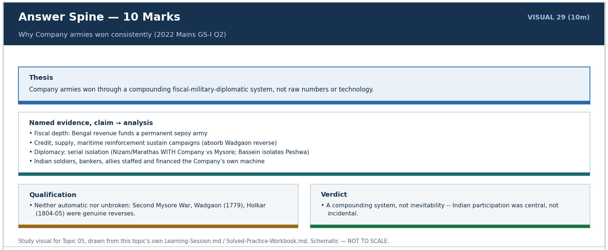
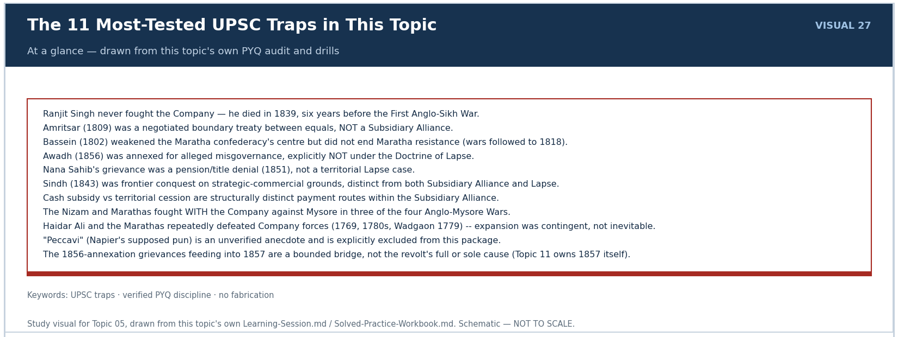
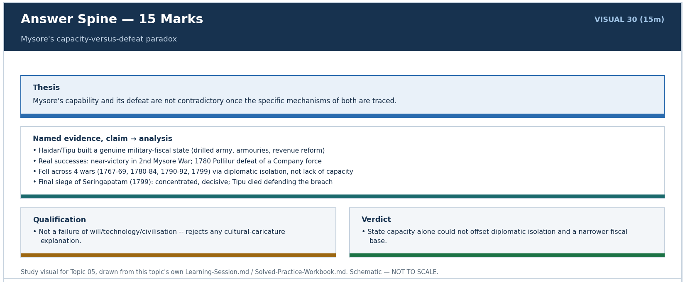
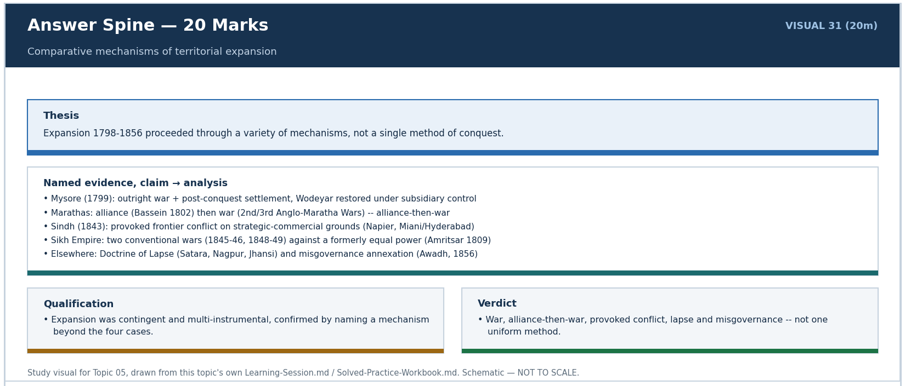

# British Territorial Expansion (Mysore, Marathas, Sikhs; Subsidiary Alliance & Lapse) — Solved Practice Workbook

## BASIC MCQS / REMEDIATION

### Q1. Which feature most directly converted Indian recruitment into durable Company military capacity?

A. A salaried sepoy army integrated with standardised drill, artillery, officers and organised logistics
B. Exclusive dependence on European soldiers for field operations
C. Recruitment alone, without regular pay, drill or supply
D. A refusal to use Indian bankers, suppliers or allied contingents

### Q2. Which factor is specifically identified in this topic as part of "why Company armies prevailed II," alongside credit/supply and maritime reinforcement?

A. Universal Indian passivity toward Company rule
B. Diplomacy that serially isolated opponents, aided by Indian allies and recruits
C. Superior European racial characteristics, as claimed in some colonial-era writing
D. A fixed, unchanging alliance structure applied identically on every frontier

### Q3. Which is the most historically balanced reading of Tipu Sultan's diplomatic outreach to Revolutionary France, per this topic's sourced assessment?

A. It never happened; the French connection is a later British fabrication
B. France formally annexed part of Mysore as a colony before 1799
C. The outreach was real and diplomatically significant, but Edward Ingram's assessment holds that the actual probability of French intervention by 1798-99 was low, exaggerated by Wellesley as partial pretext
D. It was a decisive, fully realised military alliance that came close to defeating the Company outright

### Q4. The First Anglo-Maratha War (1775-82) concluded with which treaty, restoring the pre-war status quo?

A. The Treaty of Seringapatam
B. The Treaty of Bassein
C. The Treaty of Rajghat
D. The Treaty of Salbai (1782), mediated by Mahadji Sindhia

### Q5. At which battle did Lord Lake defeat Sindhia's forces and occupy Delhi and Agra during the Second Anglo-Maratha War?

A. Laswari (1 November 1803)
B. Argaon
C. Chillianwala
D. Assaye

### Q6. The "responsibility paradox" of indirect rule, as this topic defines it, refers to which arrangement?

A. The ruler retained full army and treasury control but lost only ceremonial status
B. The Company created conditions for administrative strain (fiscal pressure, disbanded armies, Resident interference) while the ruler remained formally responsible for governance, later cited to justify further intervention
C. The Company assumed full formal governing responsibility while the ruler retained real power
D. Both sides shared power and responsibility equally at all times

### Q7. How many rulers occupied the Sikh throne in the roughly six years following Ranjit Singh's death in June 1839, illustrating the succession crisis?

A. Only one, in an unbroken and stable succession
B. None; the throne remained vacant throughout
C. Five, amid intense factional rivalry and the Khalsa army's rise as an independent political force
D. Two, with no factional rivalry

### Q8. The "ring-fence" concept in this topic's analytical frame refers to which strategy?

A. Physically walling Company cantonments for defence
B. A Mughal-era customs boundary later inherited unchanged by the Company
C. A purely naval blockade strategy used only against European rivals
D. Creating or supporting a friendly buffer state along a frontier to protect Company territory from a rival power, before any deeper dependency is imposed

### Q9. In the Second Anglo-Mysore War (1780-84), which outcome best illustrates the Company facing a genuine reverse rather than an inevitable advance?

A. Haidar Ali's repeated defeats of Company forces in the Carnatic, with the war ending inconclusively at the Treaty of Mangalore
B. The Nizam's unconditional surrender to the Company
C. Immediate Company capture of Seringapatam
D. A swift, decisive Company naval victory off Mangalore

### Q10. Which combination of factors is cited in this topic as underpinning Company officer, artillery and logistics superiority, alongside sepoy numbers?

A. Complete avoidance of any artillery in the field, relying solely on cavalry
B. A comparatively thin but professionalised British officer corps, standardised artillery, and organised logistics drawing on Bengal's revenue base
C. Reliance purely on mercenary European regiments with no Indian troops at all
D. Superior individual soldier physical stature, as claimed in colonial-era racial theory

### Q11. Which factor, alongside diplomacy and serial isolation of opponents, is specifically named in "why Company armies prevailed II"?

A. Complete Company self-sufficiency in supply, without reliance on Indian bankers or credit
B. Reliance on foreign mercenary loans exclusively from continental Europe
C. Credit and supply networks together with maritime reinforcement capacity
D. A policy of never accepting Indian recruits into any regiment

### Q12. How did Haidar Ali rise to effective control of Mysore by 1761?

A. He was formally crowned king by the Mughal emperor
B. He inherited the throne directly from the previous Wodeyar ruler
C. He was appointed by the Company as a subsidiary ruler
D. He ousted the corrupt dalavai Nanjaraj as a rising army officer, leaving the Wodeyar king a titular figurehead

### Q13. The Treaty of Madras (1769), ending the First Anglo-Mysore War, involved which outcome?

A. Haidar Ali's forces threatened Madras directly and dictated a peace of mutual restoration and mutual defence, which the Company later failed to honour
B. Outright Company annexation of Mysore
C. Formal French recognition of Haidar Ali as emperor
D. A permanent ban on Mysore maintaining any standing army

### Q14. What was the key outcome of the Treaty of Mangalore (1784), ending the Second Anglo-Mysore War?

A. Cession of half of Mysore's territory to the Company
B. Restoration of each side's conquests, concluded after Haidar Ali's death by his son Tipu Sultan
C. Establishment of a Subsidiary Alliance over Mysore
D. Tipu Sultan's death in battle

### Q15. Under the Treaty of Seringapatam (1792), ending the Third Anglo-Mysore War, Tipu Sultan was required to do what?

A. Accept full Company annexation of Mysore
B. Accept a Subsidiary Alliance immediately
C. Cede roughly half his territory to the allied powers and pay a war indemnity
D. Disband his entire army permanently

### Q16. Haidar Ali's 1766 annexation of which coastal region first extended Mysore's reach to lucrative pepper, sandalwood and cardamom trade?

A. Bengal's coastal districts
B. The Coromandel Carnatic coast
C. Sindh's coastline
D. Malabar and Calicut

### Q17. Tipu Sultan's mid-1780s trade policy toward English merchants in his ports involved which measure?

A. Export embargoes on pepper, sandalwood and cardamom, and restrictions on English traders' dealings
B. Free, unrestricted trade access granted specifically to Company merchants
C. A formal customs union with the Company
D. Abolition of all export duties on every commodity

### Q18. How did Tipu Sultan die in 1799?

A. By suicide following the city's fall
B. Defending Seringapatam on 4 May 1799, with his army remaining loyal through the city's fall
C. In a naval battle off the Malabar coast
D. In exile after surrendering Seringapatam without resistance

### Q19. What supplied Lord Cornwallis's direct pretext for launching the Third Anglo-Mysore War (1790-92)?

A. Tipu's refusal to pay tribute to the Mughal emperor
B. A dispute over Sindh's frontier
C. Tipu Sultan's 1789-90 attack on the Raja of Travancore, a state under Company protection
D. A direct Mysorean attack on Madras itself

### Q20. Whose death in 1800 removed the Maratha confederacy's most experienced check on internal rivalry, directly preconditioning the Treaty of Bassein?

A. Mahadji Sindhia
B. Yeshwant Rao Holkar
C. Peshwa Baji Rao II
D. Nana Phadnis

### Q21. Raghunath Rao's 1775 appeal to the Company's Bombay establishment, backed after his defeat in Gujarat, is associated with which early, uncounted-by-Calcutta agreement?

A. An early Bombay-led agreement traditionally associated with the Treaty of Surat, not ratified by the Company's Calcutta authorities
B. The Treaty of Bassein
C. The Treaty of Salbai
D. The Treaty of Rajghat

### Q22. The 1779 Convention/Treaty of Wadgaon required the Company's Bombay force to do what?

A. Install Raghunath Rao as Peshwa immediately
B. Renounce all its conquests and abandon Raghunath Rao's cause outright, after being defeated and encircled
C. Annex additional Maratha territory
D. Pay an indemnity to Mahadji Sindhia only

### Q23. On what date was the Treaty of Bassein signed, formalising Peshwa Baji Rao II's Subsidiary Alliance?

A. 22 October 1764
B. 1 November 1803
C. 31 December 1802
D. 23 June 1757

### Q24. At which battle, in September 1803, did Arthur Wellesley (the future Duke of Wellington) defeat the combined Sindhia-Bhonsle forces in the Deccan theatre?

A. Sobraon
B. Chillianwala
C. Miani
D. Assaye

### Q25. The Treaty of Rajghat (1805/06), restoring much of Holkar's territory, followed which development?

A. Yeshwant Rao Holkar's continued resistance, using mobile cavalry tactics, forcing Company financial strain and a change of Governor-General policy
B. The abolition of the Peshwaship
C. Holkar's alliance with the Company against Sindhia
D. Holkar's immediate surrender at the war's outset

### Q26. Lord Hastings's explicit articulation of the "paramountcy" doctrine from 1813 held which position?

A. The Company should never intervene beyond existing treaty obligations
B. The Company's own security interests entitled it to act against any Indian power it judged a threat, allied or not
C. Only the Mughal emperor retained authority to sanction Company military action
D. Only Parliament in London could authorise any Indian military action

### Q27. Nana Sahib's grievance against the Company, which fed into his later role in 1857, arose from which specific decision?

A. The 1818 abolition of the Peshwaship itself, which Nana Sahib is said to have personally fought against
B. The 1802 Treaty of Bassein's terms
C. Dalhousie's refusal to continue Baji Rao II's personal pension and title to his adopted son after Baji Rao II's 1851 death
D. The Doctrine of Lapse applied to a Maratha territory Nana Sahib ruled directly

### Q28. Under the 1801 Subsidiary Treaty imposed on Awadh, the Nawab surrendered roughly which territories in place of an enlarged cash subsidy?

A. Malabar and Canara
B. The Jullundur Doab and Kashmir
C. Berar and Nagpur
D. Rohilkhand and the Doab (between the Ganga and the Yamuna)

### Q29. What is the precise difference between a "cash subsidy" and a "territorial cession" under the Subsidiary Alliance system, as this topic defines them?

A. A cash subsidy was an annual cash payment for the stationed force's upkeep; a territorial cession transferred revenue-yielding land in lieu of, or partial substitution for, that payment, permanently reducing the state's own resource base
B. A territorial cession was always larger in value than any cash subsidy
C. A cash subsidy applied only to Mysore; a territorial cession applied only to the Marathas
D. They are simply two names for the identical arrangement with no practical difference

### Q30. The 1832 commercial treaty affecting Sindh achieved which outcome?

A. Established a Subsidiary Alliance over the Amirs
B. Opened the Indus river and Sindh's roads to Company trade
C. Ceded Karachi to the Company permanently
D. Outright annexation of Sindh to the Company

### Q31. At which two battles, in 1843, did Charles Napier defeat the Amirs' forces before Sindh's annexation?

A. Chillianwala and Gujrat
B. Assaye and Argaon
C. Miani (17 February 1843) and Dabo/Hyderabad (24 March 1843)
D. Mudki and Ferozeshah

### Q32. Which two Sikh rulers died in rapid succession immediately after Ranjit Singh, deepening the post-1839 crisis?

A. Wajid Ali Shah and Nana Sahib
B. Duleep Singh and Rani Jindan Kaur
C. Baji Rao II and Raghunath Rao
D. Kharak Singh (died 1840) and Nau Nihal Singh (died the same day as his father's funeral procession, 1840)

### Q33. Match the three Anglo-Mysore settlements to their wars: I. First; II. Second; III. Third. Treaties: P. Seringapatam; Q. Madras; R. Mangalore. Which set is correct?

A. I–Q, II–R, III–P
B. I–R, II–Q, III–P
C. I–Q, II–P, III–R
D. I–P, II–R, III–Q

### Q34. Which statement-set best describes the actual obligations of a Wellesley-era Subsidiary Alliance? I. A British force stayed in the state, financed by subsidy or revenue-yielding cession. II. A British Resident was admitted. III. The ruler retained unrestricted independent diplomacy and could hire European officers without British approval.

A. I and III only
B. I and II only
C. II and III only
D. I, II and III

### Q35. A provincial historian lists the following acquisitions as all annexations under the Doctrine of Lapse. Which correction accurately classifies the cases? Satara, Jhansi, Nagpur, Awadh.

A. Satara and Awadh by lapse; Jhansi and Nagpur by alleged misgovernance
B. Only Awadh by lapse; the other three by defeat in field warfare
C. Satara, Jhansi and Nagpur by lapse; Awadh by alleged misgovernance
D. All four by lapse, but Awadh was annexed earlier under Wellesley

### Q36. Which ordered sequence makes the different northwestern expansion routes clear rather than conflating them?

A. Punjab annexed → Sindh annexed → First Anglo-Sikh War → Second Anglo-Sikh War
B. First Anglo-Sikh War → Sindh annexed → Second Anglo-Sikh War → Punjab annexed
C. Sindh annexed → Second Anglo-Sikh War → First Anglo-Sikh War → Punjab annexed
D. Sindh annexed → First Anglo-Sikh War → Second Anglo-Sikh War → Punjab annexed

### Q37. Evaluate these statements about the third and fourth Anglo-Mysore Wars: I. Seringapatam (1792) followed the third war and cost Tipu half his territory. II. Tipu died in the fourth war (1799). III. Wodeyar restoration under subsidiary terms occurred before Tipu’s death. Which combination survives?

A. I and II only
B. I and III only
C. II and III only
D. I, II and III

### Q38. Which chain correctly tracks the Maratha confederacy from the First War to its termination?

A. Salbai ends Third War → Bassein ends First War → Assaye ends Second War
B. Salbai closes First War → Bassein makes the Peshwa a subsidiary ally → Second War → Third War ends with Baji Rao II deposed
C. Bassein closes First War → Salbai makes Holkar a subsidiary ally → Third War ends in 1805
D. Assaye closes First War → Bassein ends Third War → Salbai follows deposition of Baji Rao II

### Q39. Match each loss of sovereignty to its immediate mechanism: 1. Awadh in 1856; 2. Hyderabad in 1798; 3. Punjab in 1849; 4. Nagpur in 1854. Mechanisms: P. postwar annexation; Q. refusal to accept adopted heir; R. alleged misgovernance; S. subsidiary alignment. Choose the sound mapping.

A. 1–R, 2–Q, 3–P, 4–S
B. 1–Q, 2–S, 3–R, 4–P
C. 1–R, 2–S, 3–P, 4–Q
D. 1–P, 2–S, 3–Q, 4–R

### Q40. An account says that Ranjit Singh’s battlefield defeats in the Anglo-Sikh Wars explain the annexation of Punjab. Which evidence-based repair is strongest?

A. His defeat at Assaye began the Sikh wars, but Lahore ended them
B. He lost the First War and later negotiated the annexation after the Second
C. He led Sindh’s armies in 1843 and died before the First Sikh War
D. Sikh power survived while he ruled; wars in 1845–46 and 1848–49 followed his death, and Punjab was annexed in 1849

## ANSWER KEY AND OPTION-BY-OPTION EXPLANATIONS

### Q1 — Answer and reasoning

**Answer: A.**
**Explanation (option-by-option):**
- **A.** Correct -- Indian recruitment became militarily decisive only once integrated with regular pay, standardised drill, artillery and organised logistics, not through numbers alone.
- **B.** Incorrect -- the Company's forces were not exclusively European; Indian sepoys formed the overwhelming majority of the fighting strength.
- **C.** Incorrect -- recruitment without regular pay, drill or supply describes irregular levies, not the Company's own disciplined sepoy system.
- **D.** Incorrect -- the Company relied heavily on Indian bankers and suppliers for credit and provisioning; refusing them would have undercut its own logistics chain.
**Trap:** Treating "mostly Indian soldiers" as proof the Company's advantage was numerical rather than organisational is the commonest error on this question.

### Q2 — Answer and reasoning

**Answer: B.**
**Explanation (option-by-option):**
- **A.** Incorrect -- this package explicitly documents active Indian resistance (Mysore, Marathas, Sikhs), not passivity.
- **B.** Correct -- Subtopic 4 names serial diplomatic isolation, aided by Indian allies and recruits, as a structural factor alongside credit/supply and maritime reinforcement.
- **C.** Incorrect -- racial-superiority claims are colonial-era assertions this package does not adopt as analysis.
- **D.** Incorrect -- the alliance structure varied by case (buffer, subsidiary, war, lapse), not a single fixed template applied identically everywhere.
**Trap:** Assuming "diplomacy" meant one rigid method rather than case-by-case serial isolation of rivals.

### Q3 — Answer and reasoning

**Answer: C.**
**Explanation (option-by-option):**
- **A.** Incorrect -- Tipu's outreach to Revolutionary France, Kabul, Arabia and Turkey is source-attested, not a fabrication.
- **B.** Incorrect -- France never formally annexed any part of Mysore; no such colonial arrangement occurred.
- **C.** Correct -- Subtopic 7 holds both halves together: genuine diplomacy occurred, but Ingram assesses the actual 1798-99 intervention probability as low, with Wellesley invoking the danger partly as pretext.
- **D.** Incorrect -- the outreach never matured into a decisive military alliance capable of defeating the Company.
**Trap:** Collapsing "real diplomatic contact" and "imminent decisive French invasion" into the same claim, when this topic keeps them distinct.

### Q4 — Answer and reasoning

**Answer: D.**
**Explanation (option-by-option):**
- **A.** Incorrect -- Seringapatam settlements belong to the Mysore wars (1792 and 1799), not the Maratha front.
- **B.** Incorrect -- Bassein (1802) is a later Subsidiary Alliance treaty, not the First War's settlement.
- **C.** Incorrect -- Rajghat (1805/06) concerns Holkar's later restoration, a different war and chief entirely.
- **D.** Correct -- Subtopic 10 identifies Salbai as the genuinely negotiated settlement restoring the pre-war position, securing roughly twenty years of peace.
**Trap:** Confusing Salbai (ends First War) with Bassein (a later, unrelated Subsidiary Alliance treaty) because both involve the Marathas.

### Q5 — Answer and reasoning

**Answer: A.**
**Explanation (option-by-option):**
- **A.** Correct -- Subtopic 12 attributes Laswari specifically to Lord Lake's northern campaign, resulting in the occupation of Delhi and Agra.
- **B.** Incorrect -- Argaon was a separate Deccan-theatre action tied to Arthur Wellesley's campaign against Bhonsle, not Lake's northern campaign.
- **C.** Incorrect -- Chillianwala belongs to the unrelated Second Anglo-Sikh War (1848-49), decades later and a different front.
- **D.** Incorrect -- Assaye (September 1803) was Arthur Wellesley's Deccan-theatre victory over Sindhia-Bhonsle, distinct from Lake's northern campaign.
**Trap:** Mixing up Wellesley's southern Deccan victories (Assaye, Argaon) with Lake's separate northern campaign (Laswari, Delhi, Agra) in the same war.

### Q6 — Answer and reasoning

**Answer: B.**
**Explanation (option-by-option):**
- **A.** Incorrect -- Subsidiary Alliance rulers lost real army and treasury control, retaining only nominal sovereignty, the reverse of this option's claim.
- **B.** Correct -- Subtopic 16 defines the paradox precisely as responsibility without power, with the Company's own system later cited to justify intervention.
- **C.** Incorrect -- formal responsibility stayed with the ruler, not the Company; it was the ruler, not the Company, who bore the nominal accountability.
- **D.** Incorrect -- the arrangement was structurally lopsided, not an equal sharing of power and responsibility.
**Trap:** Assuming "responsibility" and "power" moved together, when the paradox is precisely that they were separated.

### Q7 — Answer and reasoning

**Answer: C.**
**Explanation (option-by-option):**
- **A.** Incorrect -- the succession was neither unbroken nor stable; it saw rapid, contested turnover.
- **B.** Incorrect -- the throne was never vacant; multiple claimants and rulers succeeded in quick, often violent succession.
- **C.** Correct -- Subtopic 19 traces this rapid five-ruler succession crisis, directly preconditioning the First Anglo-Sikh War.
- **D.** Incorrect -- two rulers understates the crisis, and factional rivalry was intense, not absent.
**Trap:** Underestimating how unstable the six post-1839 years were, which is precisely what enabled the Khalsa army's independent political rise.

### Q8 — Answer and reasoning

**Answer: D.**
**Explanation (option-by-option):**
- **A.** Incorrect -- "ring-fence" is not a literal fortification term in this topic's usage; it describes a diplomatic-strategic buffer relationship.
- **B.** Incorrect -- this option invents an unrelated inherited-boundary meaning not used by this topic.
- **C.** Incorrect -- the concept concerns land-frontier buffer states, not naval strategy.
- **D.** Correct -- Subtopic 1 defines "ring-fence" as this buffer-creation logic, the first rung before subsidiary dependency, paramountcy and annexation.
**Trap:** Treating "ring-fence" as a literal physical/military term rather than this topic's specific diplomatic buffer-state concept.

### Q9 — Answer and reasoning

**Answer: A.**
**Explanation (option-by-option):**
- **A.** Correct -- Subtopic 6 confirms this war's inconclusive, mutually-restoring settlement after Haidar's battlefield successes -- a clear reverse/stalemate.
- **B.** Incorrect -- the Nizam was not a direct combatant party surrendering in this war's Carnatic fighting.
- **C.** Incorrect -- Seringapatam fell only in 1799, in the Fourth War, not the Second.
- **D.** Incorrect -- no such decisive naval victory is recorded; the war's character was a Company reverse, not a naval triumph.
**Trap:** Assuming every Anglo-Mysore War ended in swift Company advance, when the Second War was a genuine, inconclusive setback.

### Q10 — Answer and reasoning

**Answer: B.**
**Explanation (option-by-option):**
- **A.** Incorrect -- the Company's forces relied heavily on standardised field artillery, not its avoidance.
- **B.** Correct -- Subtopic 3 attributes Company effectiveness to this specific combination of professional officers, standardised artillery, and revenue-funded logistics.
- **C.** Incorrect -- the force was not purely mercenary European; sepoys formed the numerical core.
- **D.** Incorrect -- this package explicitly rejects racial-theory explanations of soldier physique as unsupported colonial-era claims.
**Trap:** Reaching for a racial or purely-technological explanation instead of the organisational factors this topic actually cites.

### Q11 — Answer and reasoning

**Answer: C.**
**Explanation (option-by-option):**
- **A.** Incorrect -- the Company relied on Indian bankers and credit networks, not self-sufficiency apart from them.
- **B.** Incorrect -- reliance on continental European mercenary loans is not the factor this topic names.
- **C.** Correct -- Subtopic 4 names credit/supply and maritime reinforcement as structural advantages alongside diplomacy.
- **D.** Incorrect -- this misstates the Company's own extensive reliance on Indian recruits.
**Trap:** Confusing this credit/supply/maritime factor with the separate diplomacy/serial-isolation factor it is paired with, rather than treating them as two distinct reinforcing causes.

### Q12 — Answer and reasoning

**Answer: D.**
**Explanation (option-by-option):**
- **A.** Incorrect -- no Mughal coronation is recorded; Haidar Ali's rise was internal to Mysore's own court politics.
- **B.** Incorrect -- he was not a hereditary Wodeyar successor; the Wodeyar king remained a titular figurehead.
- **C.** Incorrect -- this predates any Company subsidiary arrangement, which only began in 1799 for Mysore.
- **D.** Correct -- Subtopic 5 confirms this precise rise-to-power route: military talent displacing an existing minister.
**Trap:** Assuming Haidar Ali's power derived from inheritance or external appointment rather than his own displacement of the sitting dalavai.

### Q13 — Answer and reasoning

**Answer: A.**
**Explanation (option-by-option):**
- **A.** Correct -- Subtopic 6 confirms Haidar dictated these terms after a strong military position, and that the Company did not honour the mutual-defence promise when the Marathas attacked Haidar in 1771.
- **B.** Incorrect -- Madras (1769) was a mutual-restoration peace, not an annexation.
- **C.** Incorrect -- no French recognition of Haidar as emperor is recorded in this treaty.
- **D.** Incorrect -- no standing-army ban was imposed; Mysore's army remained intact after Madras.
**Trap:** Assuming the First Anglo-Mysore War's outcome was dictated by the Company, when Haidar Ali in fact dictated favourable terms from strength.

### Q14 — Answer and reasoning

**Answer: B.**
**Explanation (option-by-option):**
- **A.** Incorrect -- territorial cession of roughly half Mysore came only later, at Seringapatam (1792).
- **B.** Correct -- Subtopic 6 confirms Mangalore as a mutual-restoration peace, concluded by Tipu after Haidar's December 1782 death.
- **C.** Incorrect -- a Subsidiary Alliance over Mysore was imposed only after the Fourth War (1799), not at Mangalore.
- **D.** Incorrect -- Tipu Sultan died later, in 1799 at Seringapatam, not at Mangalore in 1784.
**Trap:** Attaching the 1792 cession or the 1799 death of Tipu to the earlier, distinct Treaty of Mangalore.

### Q15 — Answer and reasoning

**Answer: C.**
**Explanation (option-by-option):**
- **A.** Incorrect -- Mysore was not annexed in 1792; annexationist subsidiary control came only after 1799.
- **B.** Incorrect -- the Subsidiary Alliance over Mysore was imposed only after the Fourth War (1799), not in 1792.
- **C.** Correct -- Subtopic 6 confirms this cession-and-indemnity outcome after Cornwallis's combined campaign with the Marathas and the Nizam.
- **D.** Incorrect -- Tipu's army was not permanently disbanded in 1792; he continued to maintain and rebuild forces until his death in 1799.
**Trap:** Attaching the 1799 Subsidiary Alliance settlement to the earlier, distinct 1792 cession-and-indemnity treaty.

### Q16 — Answer and reasoning

**Answer: D.**
**Explanation (option-by-option):**
- **A.** Incorrect -- Bengal's coast lies far from Mysore and belongs to an entirely different topic.
- **B.** Incorrect -- the Carnatic Coromandel coast was contested with the Company directly, not the 1766 annexation target.
- **C.** Incorrect -- Sindh is an entirely separate, much later (1843) frontier annexation, unrelated to Mysore.
- **D.** Correct -- Subtopic 7 confirms this 1766 annexation as the origin of Mysore's recurring friction with the Marathas' own coastal reach and with Travancore.
**Trap:** Confusing Malabar (Mysore's own 1766 coastal gain) with Sindh or Bengal, which belong to entirely different fronts and chronologies.

### Q17 — Answer and reasoning

**Answer: A.**
**Explanation (option-by-option):**
- **A.** Correct -- Subtopic 7 names this specific embargo policy as a commercial friction reinforcing the wider strategic rivalry with the Company.
- **B.** Incorrect -- Tipu restricted, rather than freely granted, English trading access.
- **C.** Incorrect -- no customs union existed; the relationship was adversarial, not integrative.
- **D.** Incorrect -- Tipu did not abolish duties broadly; his policy specifically targeted English traders' access.
**Trap:** Assuming Tipu's trade policy was liberalising rather than a deliberate commercial-strategic restriction aimed at the Company's merchants.

### Q18 — Answer and reasoning

**Answer: B.**
**Explanation (option-by-option):**
- **A.** Incorrect -- no suicide is recorded; Tipu died fighting.
- **B.** Correct -- Subtopic 8 confirms Tipu died defending his capital, with his forces recorded as loyal to the end.
- **C.** Incorrect -- his death occurred at the siege of his capital, not in a naval engagement.
- **D.** Incorrect -- he did not surrender or flee into exile; he died resisting at the breach.
**Trap:** Assuming Tipu surrendered or fled, when this topic's verified account has him dying in active defence of Seringapatam.

### Q19 — Answer and reasoning

**Answer: C.**
**Explanation (option-by-option):**
- **A.** Incorrect -- no Mughal-tribute dispute is recorded as the pretext for this war.
- **B.** Incorrect -- Sindh is unrelated to Mysore and was not annexed until 1843, decades later.
- **C.** Correct -- Subtopic 7 identifies this attack on a Company-protected neighbour as the direct pretext Cornwallis used to launch the war.
- **D.** Incorrect -- Madras itself was not directly attacked as the immediate 1790 pretext.
**Trap:** Looking for a direct Company-Mysore clash as the pretext, when the actual trigger was Tipu's attack on a third-party protected state.

### Q20 — Answer and reasoning

**Answer: D.**
**Explanation (option-by-option):**
- **A.** Incorrect -- Mahadji Sindhia had died earlier (1794), not in 1800, and is not this precipitating figure.
- **B.** Incorrect -- Yeshwant Rao Holkar was a living, active rival chief in this period, not a 1800 death.
- **C.** Incorrect -- Baji Rao II was the reigning Peshwa who signed Bassein in 1802, not a 1800 death.
- **D.** Correct -- Subtopic 11 identifies Nana Phadnis's 1800 death, after roughly three decades holding the confederacy together, as the precipitating event for the succession-era feuding that led to Bassein.
**Trap:** Confusing Nana Phadnis (the unifying statesman whose death mattered) with the confederacy's military chiefs, who remained alive and active rivals at this time.

### Q21 — Answer and reasoning

**Answer: A.**
**Explanation (option-by-option):**
- **A.** Correct -- Subtopic 10 confirms this Bombay-Calcutta split: the Bombay government's own initiative was not endorsed by Calcutta, which instead concluded the separate Treaty of Purandar in 1776.
- **B.** Incorrect -- Bassein (1802) is a much later, separate Subsidiary Alliance treaty with the Peshwa, not this 1775 Bombay initiative.
- **C.** Incorrect -- Salbai (1782) ended the war Calcutta's own separate policy produced, not this earlier Bombay-only agreement.
- **D.** Incorrect -- Rajghat (1805/06) concerns Holkar's later restoration, unrelated to Raghunath Rao's 1775 appeal.
**Trap:** Assuming a single unified Company policy toward the Marathas in the 1770s, when Bombay and Calcutta pursued distinct, uncoordinated approaches.

### Q22 — Answer and reasoning

**Answer: B.**
**Explanation (option-by-option):**
- **A.** Incorrect -- Raghunath Rao's cause was abandoned at Wadgaon, not advanced.
- **B.** Correct -- Subtopic 10 confirms Wadgaon as a humiliating Company reverse: forced renunciation after encirclement, not a negotiated gain.
- **C.** Incorrect -- no annexation occurred; the Bombay force was defeated and forced to retreat from its own gains.
- **D.** Incorrect -- the settlement was a renunciation of conquests, not merely an indemnity payment to one chief.
**Trap:** Treating Wadgaon as any kind of Company gain, when it is this topic's clearest example of a genuine Company military reverse.

### Q23 — Answer and reasoning

**Answer: C.**
**Explanation (option-by-option):**
- **A.** Incorrect -- 22 October 1764 is unrelated to Bassein; it does not mark this treaty.
- **B.** Incorrect -- 1 November 1803 is the date of Laswari, a Second Anglo-Maratha War battle, not Bassein.
- **C.** Correct -- Subtopic 11 fixes this precise date, immediately after Holkar's 25 October 1802 defeat of the combined Peshwa-Sindhia forces near Poona.
- **D.** Incorrect -- 23 June 1757 is the date of Plassey, in Bengal, an entirely different topic and region.
**Trap:** Confusing Bassein's date with Plassey's or Laswari's, since all three are frequently tested fixed dates across different topics/fronts.

### Q24 — Answer and reasoning

**Answer: D.**
**Explanation (option-by-option):**
- **A.** Incorrect -- Sobraon (1846) belongs to the First Anglo-Sikh War, a different front and decades later.
- **B.** Incorrect -- Chillianwala (1849) belongs to the Second Anglo-Sikh War, also unrelated to this Deccan campaign.
- **C.** Incorrect -- Miani (1843) belongs to Napier's Sindh campaign, an unrelated front.
- **D.** Correct -- Subtopic 12 confirms Assaye (September 1803) as Arthur Wellesley's Deccan-theatre victory.
**Trap:** Mixing up Assaye with later Sikh-front (Sobraon, Chillianwala) or Sindh-front (Miani) battles that share a similar 'decisive frontier battle' profile.

### Q25 — Answer and reasoning

**Answer: A.**
**Explanation (option-by-option):**
- **A.** Correct -- Subtopic 12 confirms Holkar's sustained resistance and the Company's recall of Wellesley amid financial strain, leading to Rajghat's comparatively lenient restoration of territory.
- **B.** Incorrect -- the Peshwaship's abolition came only in 1818, a separate, later event tied to the Third Anglo-Maratha War.
- **C.** Incorrect -- Holkar fought the Company, not alongside it against Sindhia, in this period.
- **D.** Incorrect -- Holkar did not surrender immediately; he resisted at length before Rajghat's comparatively lenient settlement.
**Trap:** Assuming Rajghat's leniency reflected Company generosity, rather than Holkar's own sustained, costly resistance forcing a policy change.

### Q26 — Answer and reasoning

**Answer: B.**
**Explanation (option-by-option):**
- **A.** Incorrect -- this states almost the opposite of paramountcy, which asserted broad, not restricted, intervention rights.
- **B.** Correct -- Subtopic 13 attributes this explicit paramountcy doctrine to Hastings, directly enabling the decisive campaign against the Peshwa, Bhonsle and Holkar in 1817-18.
- **C.** Incorrect -- the Mughal emperor held no such sanctioning authority over Company military action by this period.
- **D.** Incorrect -- the doctrine was a Company/Governor-General assertion in India, not a claim of exclusive Parliamentary authorisation.
**Trap:** Understating paramountcy as a restrained, treaty-bound posture when it in fact asserted an expansive right to intervene against any perceived threat.

### Q27 — Answer and reasoning

**Answer: C.**
**Explanation (option-by-option):**
- **A.** Incorrect -- the 1818 Peshwaship abolition predates Nana Sahib's own grievance and is a separate, earlier event.
- **B.** Incorrect -- Bassein (1802) is unrelated to Nana Sahib's personal pension dispute decades later.
- **C.** Correct -- Subtopic 24 (and subtopic 22's title/pension distinction) confirms this was a personal pension/title denial in 1851, structurally separate from territorial Lapse cases.
- **D.** Incorrect -- Nana Sahib's case was a personal pension/title denial, not a territorial Doctrine of Lapse case; he did not rule a state that lapsed.
**Trap:** Classifying Nana Sahib's grievance as a Doctrine of Lapse case, when it was specifically a personal pension/title continuation dispute.

### Q28 — Answer and reasoning

**Answer: D.**
**Explanation (option-by-option):**
- **A.** Incorrect -- Malabar and Canara belong to Mysore's coastal territory, not Awadh.
- **B.** Incorrect -- the Jullundur Doab and Kashmir belong to the later 1846 Sikh settlement, an entirely different front.
- **C.** Incorrect -- Berar and Nagpur relate to later, separate Central India annexations, not Awadh's 1801 cession.
- **D.** Correct -- Subtopic 15 confirms these were the specific territories ceded under Awadh's 1801 settlement.
**Trap:** Mixing up Awadh's 1801 cession with territories ceded on entirely different fronts (Mysore's coast, the Sikh settlement, or later Central India annexations).

### Q29 — Answer and reasoning

**Answer: A.**
**Explanation (option-by-option):**
- **A.** Correct -- Subtopic 16 draws this precise distinction, noting a territorial cession's more permanent impact on the ceding state's future capacity.
- **B.** Incorrect -- relative value was not fixed; this topic draws the distinction on payment form (cash vs land), not a claimed universal value ranking.
- **C.** Incorrect -- both forms were used across multiple states (e.g., the Nizam partly converted to cession too), not confined to single fronts.
- **D.** Incorrect -- the two mechanisms had materially different long-term effects on a state's own resource base, so they are not interchangeable.
**Trap:** Treating "cash subsidy" and "territorial cession" as interchangeable labels rather than distinguishing their different long-term fiscal consequences for the ceding state.

### Q30 — Answer and reasoning

**Answer: B.**
**Explanation (option-by-option):**
- **A.** Incorrect -- a Subsidiary Alliance over Sindh's Amirs came only in 1839, seven years later.
- **B.** Correct -- Subtopic 17 confirms this 1832 treaty's commercial, non-annexationist character, well before the 1839 subsidiary treaty and 1843 annexation.
- **C.** Incorrect -- Karachi's cession is not the 1832 treaty's outcome; this treaty was purely commercial.
- **D.** Incorrect -- outright annexation came only in 1843, following Napier's campaign, not in 1832.
**Trap:** Collapsing Sindh's three-stage timeline (1832 commercial treaty, then 1839 subsidiary treaty, then 1843 annexation) into a single event.

### Q31 — Answer and reasoning

**Answer: C.**
**Explanation (option-by-option):**
- **A.** Incorrect -- Chillianwala and Gujrat belong to the Second Anglo-Sikh War (1848-49), a different front and later date.
- **B.** Incorrect -- Assaye and Argaon belong to the Second Anglo-Maratha War (1803), a different front and decades earlier.
- **C.** Correct -- Subtopic 17 confirms these two 1843 battles as the immediate military prelude to Sindh's annexation.
- **D.** Incorrect -- Mudki and Ferozeshah belong to the First Anglo-Sikh War (1845-46), a different front and later date.
**Trap:** Assigning Sindh's 1843 battles to the wrong front -- Sikh or Maratha battles are frequently confused with Napier's Miani/Hyderabad campaign.

### Q32 — Answer and reasoning

**Answer: D.**
**Explanation (option-by-option):**
- **A.** Incorrect -- Wajid Ali Shah (Awadh) and Nana Sahib (Maratha-linked) belong to entirely different fronts, not the Sikh succession.
- **B.** Incorrect -- Duleep Singh and Rani Jindan Kaur were later, surviving figures (post-annexation), not the two who died in 1840.
- **C.** Incorrect -- Baji Rao II and Raghunath Rao are Maratha Peshwa-line figures, unrelated to the Sikh succession crisis.
- **D.** Correct -- Subtopic 19 confirms this specific, unusually rapid double succession crisis as a key precondition for the Khalsa army's rising political independence.
**Trap:** Substituting later Sikh figures (Duleep Singh, Rani Jindan) or unrelated-front rulers for the actual 1840 double-death pair (Kharak Singh, Nau Nihal Singh).

### Q33 — Answer and reasoning

**Answer: A.**
**Explanation (option-by-option):**
- **A.** Correct: Madras ended the First War (1769), Mangalore the Second (1784), Seringapatam the Third (1792).
- **B.** Wrong: the First ended at Madras, not Mangalore; the Second ended at Mangalore, not Madras.
- **C.** Wrong: Seringapatam followed the Third War, not the Second; Mangalore followed the Second.
- **D.** Wrong: Seringapatam did not close the First War, and Madras did not close the Third.
**Trap:** Tipu died in the Fourth War in 1799; do not assign a First-to-Third peace treaty to that final siege.

### Q34 — Answer and reasoning

**Answer: B.**
**Explanation (option-by-option):**
- **A.** Wrong: independent diplomacy and unrestricted European appointments were curtailed, not protected.
- **B.** Correct: stationing and funding troops and accepting a Resident were central terms; III contradicts the limitations.
- **C.** Wrong: II is right but III is not; I is also a standard alliance obligation.
- **D.** Wrong: the third claim negates the alliance’s diplomatic and military subordination.
**Trap:** The British promise of protection and nominal internal non-interference did not restore external sovereignty.

### Q35 — Answer and reasoning

**Answer: C.**
**Explanation (option-by-option):**
- **A.** Wrong: Satara is an adoption/succession case and Awadh is not.
- **B.** Wrong: Awadh was taken on alleged misgovernance; the three other cases concern adoption/succession.
- **C.** Correct: these are three Dalhousie lapse examples versus the separate Awadh misgovernance ground of 1856.
- **D.** Wrong: Awadh in 1856 was not taken by lapse, and Wellesley was not its annexing governor-general.
**Trap:** Jhansi was annexed in 1854 following a 1853 succession dispute; do not compress the dispute and annexation into one date.

### Q36 — Answer and reasoning

**Answer: D.**
**Explanation (option-by-option):**
- **A.** Wrong: Sindh (1843) was annexed before the Sikh wars and Punjab (1849) after both.
- **B.** Wrong: Sindh was taken in 1843, before the first war of 1845–46.
- **C.** Wrong: the Second Sikh War followed the First, not vice versa.
- **D.** Correct: Sindh (1843) precedes the 1845–46 and 1848–49 wars and Punjab’s annexation in 1849.
**Trap:** The 1843 Sindh conquest was Napier’s; the 1849 Punjab annexation followed Sikh wars under Dalhousie.

### Q37 — Answer and reasoning

**Answer: A.**
**Explanation (option-by-option):**
- **A.** Correct: I and II belong to different wars; Wodeyar restoration followed the 1799 defeat, so III reverses the sequence.
- **B.** Wrong: III is false, and the death of Tipu in 1799 makes II true.
- **C.** Wrong: III is false; the 1792 cession stated in I is true.
- **D.** Wrong: the dynasty was restored after Tipu’s defeat and death, not beforehand.
**Trap:** Do not mistake the 1792 territorial cession for Tipu’s final defeat in 1799.

### Q38 — Answer and reasoning

**Answer: B.**
**Explanation (option-by-option):**
- **A.** Wrong: Salbai ended the First War and Bassein was a Peshwa alliance agreement, not a first-war peace.
- **B.** Correct: negotiated first-war settlement (1782), alliance (1802), wars of 1803–05 and 1817–18, then Baji Rao II’s deposition.
- **C.** Wrong: Bassein was signed in 1802; the Third War ended in 1818, not 1805.
- **D.** Wrong: Assaye was in the Second War in 1803 and the Peshwa’s deposition came after the Third.
**Trap:** Bassein divided Maratha politics before the Second War; it did not itself abolish the Peshwaship.

### Q39 — Answer and reasoning

**Answer: C.**
**Explanation (option-by-option):**
- **A.** Wrong: Hyderabad joined the subsidiary system; Nagpur was a lapse case.
- **B.** Wrong: Awadh was annexed for alleged misgovernance, not refused adoption; Punjab followed war.
- **C.** Correct: these four cases illustrate separate reasons for expansion or dependency rather than one annexation formula.
- **D.** Wrong: Punjab was annexed after war, Nagpur by lapse, Awadh by misgovernance.
**Trap:** Hyderabad’s acceptance of subsidiary terms was not an outright 1798 annexation.

### Q40 — Answer and reasoning

**Answer: D.**
**Explanation (option-by-option):**
- **A.** Wrong: Assaye in 1803 belongs to the Anglo-Maratha, not Anglo-Sikh, conflict.
- **B.** Wrong: Ranjit Singh died before either Anglo-Sikh War and could not have fought the first.
- **C.** Wrong: Sindh’s annexation and Sikh succession are distinct, not a joint Ranjit Singh campaign.
- **D.** Correct: post-Ranjit succession instability preceded the two Sikh wars and Punjab’s annexation.
**Trap:** Correlation between court instability and later defeat is not proof that Ranjit Singh fought those wars.

### Semantic-completeness coverage drills — Modern Topic 05

| Control | Required answer route | Fatal trap |
|---|---|---|
| Chronology | exact event sequence and bounded endpoint | telescoping later events |
| Ownership | state what this topic owns and hands off | duplicate cross-topic narrative |
| Mechanism | connect institution, resources, actors and consequence | list without causation |
| Evidence | named event/office/treaty/source plus qualification | decorative evidence |
| PYQ | preserve direct/adjacent status and key provenance | invented direct PYQ or official key |
| Answer | thesis -> evidence -> analysis -> limit -> verdict | generic narrative |

**PYQ ownership control:** two direct routes: 2018 Prelims Q75 and 2022 GS-I Q2.

## PYQS AND ANSWER PRACTICE

#### Transparent PYQ audit and route decision

**Audit scope:** every Prelims and Mains GS-I/GS-II/Essay routing ledger and integration-audit file currently in the repository, covering 2018 through 2026, was checked line by line for any question mentioning Haidar Ali, Tipu Sultan, the Anglo-Mysore Wars, the Maratha confederacy or Anglo-Maratha Wars, the Treaty of Bassein, the Subsidiary Alliance, Sindh or Napier, Ranjit Singh, the Khalsa army, the Anglo-Sikh Wars, Dalhousie, the Doctrine of Lapse, or the 1856 annexation of Awadh.

**Audit result:** this topic **owns exactly two verified, directly routed PYQs** across the entire 2018-2026 window, confirmed independently against local OCR'd official papers held under `attempts/_pyq_text/`, with no further item found routed here in any checked ledger:

1. **2018 Prelims, GS-I, Q75** -- Subsidiary Alliance, solved in full immediately below, with its answer explicitly labelled `INFERRED ANSWER -- NOT OFFICIALLY VERIFIED`, since no official answer key for this paper is held locally.
2. **2022 Mains, GS-I, Q2** -- on why Company armies prevailed, solved as PYQ 2 below with a complete, non-bounded, multi-theatre examiner-grade model; this is the same question Topic 04's own package deliberately answered only as a bounded, Bengal-only bridge, explicitly deferring the full answer to this topic.

**No further PYQ is claimed for this topic.** Where this package's own original MCQs and Mains questions appear below, they are clearly original practice material, not represented as previous UPSC questions.

##### PYQ 1 solved -- 2018 Prelims, GS-I, Q75 (Subsidiary Alliance)

**Question (verbatim, original option order preserved):** "Which one of the following statements does not apply to the system of Subsidiary Alliance introduced by Lord Wellesley?

(a) To maintain a large standing army at other's expense

(b) To keep India safe from Napoleonic danger

(c) To secure a fixed income for the Company

(d) To establish British paramountcy over the Indian States."

**Official key status:** not held locally; a targeted search for the official Civil Services Preliminary Examination 2018 answer key for this paper was carried out before concluding this, and no locally verifiable official key text was found. The label below therefore applies in full.

**`INFERRED ANSWER -- NOT OFFICIALLY VERIFIED`: (c) To secure a fixed income for the Company.**

**Confidence:** moderate-to-high (independent web corroboration converged on option (c) across multiple sources on a second search attempt; this package's own elimination logic, set out below, independently reaches the same option).

**Elimination reasoning:**
- **(a) does apply:** subtopic 14 establishes that a permanently stationed subsidiary force, maintained at the allied ruler's own expense (by cash subsidy or ceded revenue), was the Subsidiary Alliance's defining first clause -- this is precisely what the system did.
- **(b) does apply:** subtopic 7 and subtopic 14 both confirm that Wellesley repeatedly invoked the danger of French/Napoleonic influence reaching India (via Tipu's outreach, and via the wider European war) as a stated justification for his forward, systematised alliance policy, whatever later historians conclude about how exaggerated that danger actually was.
- **(d) does apply:** subtopic 16's entire analysis of sovereignty erosion, and the case sequence in subtopic 15, show that establishing British paramountcy over Indian states was the system's central strategic effect and openly stated aim.
- **(c) is the best-supported exception:** the Subsidiary Alliance's payment mechanism (subtopic 14, subtopic 16) was structured as cost recovery for maintaining an externally stationed force, or as a compensating territorial cession, not as a scheme to generate a net "fixed income" surplus for the Company's general treasury; describing the system's purpose as securing "a fixed income for the Company" mischaracterises a cost-recovery and control mechanism as a revenue-generation scheme, making it the statement least accurately describing the system's actual design purpose among the four options.

**Why this matters for exam technique:** this is a "does NOT apply" negative-framing question; the safest method is to confirm each of the other three options against a named subtopic before selecting the exception, exactly as done above, rather than guessing directly at the "odd one out."

##### PYQ 2 solved -- 2022 Mains, GS-I, Q2 (why Company armies won consistently; this topic's own PYQ, answered in full)

**Question (verbatim, verified against local official paper):** "Why did the armies of the British East India Company -- mostly comprising of Indian soldiers -- win consistently against the more numerous and better equipped armies of the then Indian rulers? Give reasons."

**Boundary note:** Topic 04's own package answered this question only as a bounded, Bengal-only bridge, explicitly deferring the complete, subcontinent-wide answer to this topic. What follows is that complete answer, drawing on Mysore, Maratha, Sikh and fiscal-diplomatic evidence across this entire package.

**Directive alignment:** "Why... Give reasons" calls for a multi-factor causal answer, not a chronological retelling of any single campaign.

**Introduction:** Company armies, though "mostly comprising of Indian soldiers," won consistently because they combined a larger, more reliable fiscal base with organisational discipline and a diplomacy that kept opponents divided -- not because of any single technological or racial advantage.

**Answer:** Four reinforcing reasons explain this consistency. First, fiscal depth: Bengal's revenue base funded a permanent sepoy army, composed mostly of Indian soldiers, that combined regular pay with a comparatively thin professional officer corps, standardised artillery and organised logistics -- capacity rival states like Mysore and the Marathas could approach but not sustain with equal continuity. Second, credit, supply and maritime reinforcement let the Company sustain campaigns (and absorb reverses like Wadgaon) that would have broken a less resourced state. Third, and most decisively, diplomacy repeatedly isolated opponents serially: the Nizam and Marathas fought with the Company against Mysore in three of four wars; Bassein (1802) removed the Maratha Peshwa from the field, letting Sindhia, Bhonsle and Holkar be fought one at a time; Ranjit Singh's death (1839) produced Sikh succession chaos the Company then exploited. Fourth, Indian soldiers, bankers and regional allies staffed and financed the Company's own machine throughout.

**Qualification:** This advantage was neither automatic nor unbroken -- the Second Mysore War, Wadgaon (1779), and Holkar's 1804-05 resistance were genuine Company reverses, confirming contingency rather than inevitability.

**Verdict:** Company armies won consistently through a compounding fiscal-military-diplomatic system, not raw numbers or technology alone -- and Indian soldiers, credit and allies were central to that system's own operation, not incidental to it.

**Why this earns marks:** Full marks require naming at least three distinct reason-categories (fiscal, diplomatic/isolation, organisational) across more than one theatre, citing the sepoy-growth figures, and acknowledging at least one genuine Company reverse to avoid an inevitability overstatement.

*Visual 29: answer spine, 10 marks -- why Company armies won consistently, 2022 Mains GS-I Q2. Schematic; NOT TO SCALE where marked.*

**Demand decoding:** The directive **answer** requires a direct position on “Why did the armies of the British East India Company -- mostly comprising of Indian soldiers…”, coverage of every clause, chronological-causal analysis, named evidence, a counter-position and a qualified verdict.

**Detailed examiner-grade model status:** The solved analysis above is the executable content base. Preserve its exact chronology, named evidence, causal logic, counter-position and qualification.

**Executable exam-length answer / compression plan:** For a 10-mark answer, open with a two-sentence thesis; organise three named Acts, events, organisations, regions, primary records or scholarly positions as claim → evidence → analysis → qualification; reserve the final lines for a graded conclusion.

**How to improve this answer:** For “Why did the armies of the British East India Company -- mostly comprising of Indian soldiers…”, replace the weakest generalisation with one additional named primary/official record or attributed scholarly interpretation and state exactly what it cannot prove.

#### Evidence and answer-writing drills

*Visual 27: the eleven most-tested UPSC traps in this topic, at a glance. Schematic; NOT TO SCALE where marked.*

##### Drill 1 - Company armies were overwhelmingly Indian, not "British"

**Claim:** State explicitly, as the 2022 PYQ itself frames it, that these armies were "mostly comprising of Indian soldiers" under a comparatively thin layer of British officers. Never describe Company victories as demographically "British"; explain how Indian recruitment was integrated with regular finance, command, artillery and logistics.

**Exam move:** Any answer that explains Company success purely through "British" military or technological superiority, without naming the Indian sepoy composition, has misread the question's own framing and lost an easy opening mark.

##### Drill 2 - Contingency, not inevitability

**Claim:** Present expansion as a sequence of case-by-case choices shaped by local alliance opportunities and each ruler's internal politics (subtopic 2), not as a predetermined "rise of British power" narrative; cite the Company's own reverses (Wadgaon 1779, the Second Mysore War, Holkar's 1804-05 resistance) as direct evidence against inevitability.

**Exam move:** A question asking "how" or "why" expansion succeeded rewards naming at least one specific Company reverse alongside the successes -- this single habit demonstrates the contingency argument rather than merely asserting it.

##### Drill 3 - Tipu's reforms were real but bounded, not myth and not modern industry

**Claim:** Credit Tipu's revenue centralisation, agrarian and irrigation encouragement, and "military fiscalism" (Burton Stein's term) as genuine and source-attested, while also naming Irfan Habib's caution that Mysore's modernising ambition ran ahead of its actual resources -- never claim Mysore rivalled contemporary European industrial capacity, and never dismiss the reforms as fabricated nationalist myth either.

**Exam move:** A balanced answer on Tipu names one specific reform (direct revenue assessment, replacing intermediaries) and one specific limit (resource constraint per Habib) in the same paragraph.

##### Drill 4 - The Mysore wars' alliance pattern shifted every time; it was never fixed

**Claim:** State precisely: Marathas and the Nizam sided WITH the Company in the First (1767-69) and Third (1790-92) wars, but WITH Haidar Ali AGAINST the Company in the Second (1780-84) war; only in the Fourth (1799) was there no comparable counterweight, because Hyderabad was already a Subsidiary Alliance dependency since 1798.

**Exam move:** Never write "the Marathas and the Nizam always supported the Company against Mysore" -- this is factually wrong for the Second War specifically and is one of the most common alliance-sequencing errors in this topic.

##### Drill 5 - Tipu's French connection was real diplomacy, not proof of an imminent French invasion

**Claim:** Confirm Tipu's genuine outreach to Revolutionary France, Kabul, Arabia and Turkey (subtopic 7), while also naming Edward Ingram's assessment that the actual probability of French military intervention by 1798-99 was low -- Wellesley's invocation of the "French danger" functioned significantly as a pretext for a war he had independent reasons to want.

**Exam move:** State both halves together -- "real diplomatic outreach, exaggerated invasion threat" -- rather than either denying the French contact occurred or accepting Wellesley's threat assessment at face value.

##### Drill 6 - Bassein (1802) was a turning point, not the end of Maratha resistance

**Claim:** Bassein removed the Peshwa -- the confederacy's nominal head -- from the field of opposition, but Sindhia, Bhonsle and Holkar all continued fighting through the Second Anglo-Maratha War (1803-05), and the confederacy was defeated only by 1818 in the Third War; never state that Bassein ended Maratha resistance outright.

**Exam move:** A "significance of Bassein" answer earns full marks only by explaining WHY it mattered (removing the confederacy's legitimating head, enabling serial isolation) rather than by overstating WHAT it immediately ended.

##### Drill 7 - Distinguish a cash subsidy from a territorial cession precisely

**Claim:** A cash subsidy was a direct annual payment; a territorial cession transferred revenue-yielding land in lieu of, or partial substitution for, that payment (as at the Nizam's 1800 treaty and Awadh's 1801 settlement) -- both produced dependency, but only cession permanently reduced the state's own resource base.

**Exam move:** For any named Subsidiary Alliance case, state explicitly whether payment was in cash or in ceded land; this is a frequently tested precision point, and the 2018 Prelims PYQ solved above turns on a closely related distinction.

##### Drill 8 - Name the responsibility paradox in both directions

**Claim:** State both halves explicitly -- the Subsidiary Alliance stripped a ruler of army, treasury and diplomacy while leaving him formally responsible for governance outcomes, and the Company then used resulting administrative strain (fiscal pressure, Resident interference, disbanded soldiers turning to Pindari banditry) as its own justification for further intervention.

**Exam move:** An answer naming only "the ruler lost power" or only "the Company blamed misgovernance," without connecting the two as cause and consequence, has described half the mechanism -- exactly as Topic 04's Dual Government paradox required both halves.

##### Drill 9 - Napier's Sindh quote is genuine; the "Peccavi" pun is not

**Claim:** Cite only Napier's attested diary entry ("We have no right to seize Sind, yet we shall do so...") as evidence of the annexation's dubious legality; do not repeat the popular "Peccavi" ("I have sinned"/"I have Sindh") telegram story, which is a widely circulated but historically unverified anecdote excluded from this package.

**Exam move:** If a question invites a quotation on Sindh's annexation, use the diary entry only, and never present the Peccavi pun as a sourced historical fact.

##### Drill 10 - Ranjit Singh never fought an Anglo-Sikh War

**Claim:** State plainly that Ranjit Singh died in June 1839, a full six years before the First Anglo-Sikh War began in December 1845; the Treaty of Amritsar (1809) was a negotiated boundary settlement between the Company and a militarily strong, sovereign equal, not a Subsidiary Alliance and not a war treaty.

**Exam move:** Any statement implying Ranjit Singh fought, negotiated after defeat, or was annexed by the Company is a basic actor-timeline error; the wars followed only after his death produced succession chaos (subtopic 19).

##### Drill 11 - Match each Anglo-Sikh war to its own battles and settlement, never mix them

**Claim:** First War (Dec 1845-Feb 1846): Mudki, Ferozeshah, Aliwal, Sobraon, then the Treaty of Lahore and the Treaty of Bhyrowal (dependency, not annexation). Second War (1848-49): the Multan rebellion trigger, Ramnagar, Chillianwala, Gujrat, then outright annexation of Punjab in March 1849.

**Exam move:** A statement placing Chillianwala or Gujrat in the First War, or Mudki/Sobraon in the Second, is a common date-battle mismatch; anchor each battle to its correct war using the trigger event (Sutlej crossing in 1845; Multan rebellion in 1848) as the memory hook.

##### Drill 12 - Keep Lapse, title/pension denial, and misgovernance annexation as three separate mechanisms

**Claim:** The Doctrine of Lapse applied specifically where a dependent ruler died without a natural heir and an adoption was refused (Satara, Nagpur, Jhansi); Nana Sahib's case was a personal pension/title denial, not territorial Lapse (the Peshwaship itself had already been abolished in 1818); Awadh's 1856 annexation rested on alleged misgovernance, with a living Nawab and no succession dispute at all.

**Exam move:** A question naming "Dalhousie's annexations" collectively still expects each case correctly assigned to its own mechanism; grouping Awadh under "Doctrine of Lapse" is one of the single most common and heavily penalised errors on this topic.

##### Drill 13 - The 1857 bridge is bounded evidence, never a monocausal claim

**Claim:** Name only the specific, attested links this topic owns -- Nana Sahib's pension denial, the Rani of Jhansi's refused adoption, Awadh's dispossessed taluqdars, disbanded soldiers -- as antecedent grievances feeding into 1857, while stating explicitly that the rising's fuller causation (military grievances, religious anxiety, peasant taxation pressure) belongs to Topic 11.

**Exam move:** Never write "territorial expansion and annexation caused the 1857 revolt" as a standalone, sufficient claim; always pair named antecedents with an explicit hand-off statement naming Topic 11 for the fuller picture.

**Demand decoding:** Treat “PYQ 1 solved -- 2018 Prelims, GS-I, Q75 (Subsidiary Alliance)” as a statement-level chronology and attribution problem: verify every date, Act/provision, person, organisation, region and causal claim independently, without inventing an official key.

**Detailed examiner-grade model status:** The solved analysis above is the executable content base. Preserve its exact chronology, named evidence, causal logic, counter-position and qualification.

**Executable exam-length answer / compression plan:** Fix the tested time window; separate event/enactment/commencement; match each actor and provision; eliminate the closest distractor with one named record, treaty, session or regional fact.

**Why this earns marks:** It preserves exact chronology and answer-text mapping, uses named evidence and keeps inferred elimination distinct from an official key.

**How to improve this answer:** For “PYQ 1 solved -- 2018 Prelims, GS-I, Q75 (Subsidiary Alliance)”, add one explicit line showing why the nearest distractor fails on date, legal status, geography, attribution or degree.

##### Drill 14 - Never invent a PYQ, an official key, or a topic boundary

**Claim:** This topic owns exactly two verified routed PYQs (2018 Prelims Q75; 2022 Mains Q2), per this package's own audit above; the 2018 answer is explicitly labelled INFERRED ANSWER -- NOT OFFICIALLY VERIFIED because no local key exists, and no further PYQ, troop strength, subsidy sum, territorial share, casualty figure or quotation is invented anywhere in this package.

**Exam move:** When a question edges toward Topics 02, 04, 06, 07 or 11's material, state the boundary explicitly (e.g., "Topic 02's material," "Topic 11's material") rather than silently absorbing or refusing to engage with adjacent content.

#### Mains practice: solved model answers

Word limits scale with marks in this package's own convention: 10 marks = 150 words, 15 marks = 250 words, 20 marks = 300 words. The "Directive alignment" and "Why this earns marks" notes are examiner-craft scaffolding around the answer, not part of the counted word limit.

**Demand decoding:** The directive **answer** requires a direct position on “Drill 14 - Never invent a PYQ, an official key, or a topic boundary”, coverage of every clause, chronological-causal analysis, named evidence, a counter-position and a qualified verdict.

**Detailed examiner-grade model status:** The solved analysis above is the executable content base. Preserve its exact chronology, named evidence, causal logic, counter-position and qualification.

**Executable exam-length answer / compression plan:** For a 15-mark answer, open with a two-sentence thesis; organise five named Acts, events, organisations, regions, primary records or scholarly positions as claim → evidence → analysis → qualification; reserve the final lines for a graded conclusion.

**How to improve this answer:** For “Drill 14 - Never invent a PYQ, an official key, or a topic boundary”, replace the weakest generalisation with one additional named primary/official record or attributed scholarly interpretation and state exactly what it cannot prove.

##### Mains 1 - 10 marks | 150 words

**Question:** Examine why the Treaty of Bassein (1802) is considered the single most consequential turning point in Company-Maratha relations.

**Directive alignment:** "Examine" requires explaining the mechanism of Bassein's significance, not merely narrating its terms.

**Introduction:** Bassein mattered less for its clauses than for what it removed from the confederacy's chessboard.

**Answer:** Nana Phadnis's 1800 death removed the confederacy's most experienced unifying figure, and succession rivalry between Holkar and Sindhia/Peshwa Baji Rao II intensified. Holkar's decisive victory near Poona (25 October 1802) drove Baji Rao II to accept a Subsidiary Alliance at Bassein (31 December 1802), ceding territory, admitting a Resident, and accepting a permanent British force. This removed the Peshwa -- the confederacy's nominal head and legitimating authority -- from opposition, turning a unified Maratha response into separable conflicts the Company fought individually against Sindhia, Bhonsle and Holkar.

**Qualification:** Bassein did not end Maratha resistance -- the Second (1803-05) and Third (1817-18) wars followed -- its significance is structural, not terminal.

**Verdict:** Bassein's importance lies in fragmenting the confederacy's political unity, enabling the Company's serial-isolation diplomacy to operate at full effect thereafter.

**Why this earns marks:** Full marks require explaining WHY Bassein mattered (removing the Peshwa's legitimating authority), not just WHAT it said, and explicitly denying that it ended Maratha resistance outright.

**Demand decoding:** The directive **examine** requires a direct position on “Examine why the Treaty of Bassein (1802) is considered the single most consequential…”, coverage of every clause, chronological-causal analysis, named evidence, a counter-position and a qualified verdict.

**Detailed examiner-grade model status:** The solved analysis above is the executable content base. Preserve its exact chronology, named evidence, causal logic, counter-position and qualification.

**Executable exam-length answer / compression plan:** For a 10-mark answer, open with a two-sentence thesis; organise three named Acts, events, organisations, regions, primary records or scholarly positions as claim → evidence → analysis → qualification; reserve the final lines for a graded conclusion.

**How to improve this answer:** For “Examine why the Treaty of Bassein (1802) is considered the single most consequential…”, replace the weakest generalisation with one additional named primary/official record or attributed scholarly interpretation and state exactly what it cannot prove.

##### Mains 2 - 10 marks | 150 words

**Question:** Account for the differing outcomes of the Second Anglo-Maratha War (1803-05) for Sindhia and Bhonsle on one hand and Holkar on the other.

**Directive alignment:** "Account for the differing outcomes" requires explaining WHY the outcomes differed, not merely listing each chief's treaty.

**Introduction:** All three major Maratha chiefs faced the Company in 1803-05, but only two were decisively defeated within the war itself.

**Answer:** Sindhia and Bhonsle fought as a coordinated force and suffered concentrated defeats -- Assaye and Laswari (Sindhia, 1803) and Delhi/Argaon-adjacent actions (Bhonsle) -- leading both to accept subsidiary terms by late 1803, ceding territory and accepting Residents. Holkar stayed outside this coalition and fought on alone into 1804, achieving real successes before a costly campaign produced the Treaty of Rajghat (1805) on comparatively less punitive terms.

**Qualification:** This divergence itself illustrates Maratha disunity as a Company advantage -- serial, not simultaneous, engagement -- while confirming Holkar's genuine resistance capacity.

**Verdict:** Differing outcomes reflect differing degrees of coalition unity at the point of engagement, not differing intrinsic strength among the three chiefs.

**Why this earns marks:** Full marks require naming the specific battles/treaties for each chief and explaining the coalition-unity variable, not treating "the Marathas" as a single undifferentiated actor.

**Demand decoding:** The directive **answer** requires a direct position on “Account for the differing outcomes of the Second Anglo-Maratha War (1803-05) for Sindhia…”, coverage of every clause, chronological-causal analysis, named evidence, a counter-position and a qualified verdict.

**Detailed examiner-grade model status:** The solved analysis above is the executable content base. Preserve its exact chronology, named evidence, causal logic, counter-position and qualification.

**Executable exam-length answer / compression plan:** For a 10-mark answer, open with a two-sentence thesis; organise three named Acts, events, organisations, regions, primary records or scholarly positions as claim → evidence → analysis → qualification; reserve the final lines for a graded conclusion.

**How to improve this answer:** For “Account for the differing outcomes of the Second Anglo-Maratha War (1803-05) for Sindhia…”, replace the weakest generalisation with one additional named primary/official record or attributed scholarly interpretation and state exactly what it cannot prove.

##### Mains 3 - 15 marks | 250 words

**Question:** Compare Wellesley's application of the Subsidiary Alliance system at Hyderabad (1798), Mysore (1799), Awadh (1801) and the Maratha Peshwa (Bassein, 1802).

**Directive alignment:** "Compare" requires identifying both the shared mechanism and the case-specific variations, not four separate unconnected narratives.

**Introduction:** Wellesley applied the same six-clause Subsidiary Alliance template in each case, but the immediate trigger and payment form varied by case.

**Shared mechanism:** In all four cases, the ruler accepted a permanently stationed British force, a Resident, a ban on employing Europeans without approval, and loss of independent diplomacy, in exchange for a formal (if seldom honoured) protection promise.

**Case-specific variation:** Hyderabad (1798, enlarged 1800) came first, driven by fear of Maratha encroachment, with payment partly converted from cash to ceded territory in 1800. Mysore (1799) followed immediately after Tipu Sultan's defeat and death at Seringapatam -- a post-conquest settlement restoring the Wodeyar dynasty under subsidiary control, not a peacetime negotiation. Awadh (1801) involved outright cession of Rohilkhand and the Doab in place of an enlarged cash subsidy, alongside British "advice" on internal administration. The Peshwa's Bassein (1802) was extracted from Baji Rao II only after Holkar's battlefield defeat of the combined Peshwa-Sindhia force, exploiting a succession-era Maratha crisis rather than any external Company war.

**Qualification:** Bassein alone triggered further war (the Second Anglo-Maratha War), since Sindhia and Bhonsle rejected the Peshwa's subordination -- a consequence none of the other three cases produced.

**Verdict:** The template was constant; the leverage behind each signature -- conquest, fiscal fear, cession bargaining, or internal rivalry -- was specific to each case.

**Why this earns marks:** A strong answer names the exact years, the payment form (cash/cession) for each case, and explains why only Bassein triggered a subsequent war.

**Demand decoding:** The directive **compare** requires a direct position on “Compare Wellesley's application of the Subsidiary Alliance system at Hyderabad (1798),…”, coverage of every clause, chronological-causal analysis, named evidence, a counter-position and a qualified verdict.

**Detailed examiner-grade model status:** The solved analysis above is the executable content base. Preserve its exact chronology, named evidence, causal logic, counter-position and qualification.

**Executable exam-length answer / compression plan:** For a 15-mark answer, open with a two-sentence thesis; organise five named Acts, events, organisations, regions, primary records or scholarly positions as claim → evidence → analysis → qualification; reserve the final lines for a graded conclusion.

**How to improve this answer:** For “Compare Wellesley's application of the Subsidiary Alliance system at Hyderabad (1798),…”, replace the weakest generalisation with one additional named primary/official record or attributed scholarly interpretation and state exactly what it cannot prove.

##### Mains 4 - 15 marks | 250 words

**Question:** "Haidar Ali and Tipu Sultan built one of the most capable states of eighteenth-century India, yet Mysore fell to the Company." Examine this apparent paradox.

**Directive alignment:** "Examine this apparent paradox" requires reconciling genuine state capacity with eventual defeat -- not choosing one side of the paradox and ignoring the other.

**Introduction:** Mysore's capability and its defeat are not contradictory once the specific mechanisms of both are traced.

**Answer:** Haidar Ali and Tipu built real capacity: a standing, drilled infantry-artillery army, state-organised armouries and (under Tipu) state trading agencies, and administrative reorganisation of revenue collection -- a genuine "military-fiscal" state by regional standards. This capacity explains Mysore's real successes: near-victory in the Second Anglo-Mysore War and the humiliating 1780 Pollilur defeat of a Company force. Yet Mysore fell across four wars (1767-69, 1780-84, 1790-92, 1799) because of compounding disadvantages beyond capacity alone: geographic isolation without a matching subcontinental fiscal base comparable to Company Bengal; repeated diplomatic isolation, as the Nizam and Marathas fought WITH the Company against Mysore in three of the four wars; Tipu's French connections and Malabar/Travancore friction supplying repeated pretexts without ever delivering matching material support; and the concentrated, decisive nature of the final siege of Seringapatam (1799), where Tipu died defending the breach.

**Qualification:** This was not a failure of will, technology, or "civilisational" capacity -- explicitly rejecting any cultural-caricature explanation -- but a specific, contingent combination of isolation and relative fiscal-military scale.

**Verdict:** Mysore's fall illustrates that state capacity alone could not offset diplomatic isolation and a narrower fiscal base against a rival operating at greater and more resilient scale.

**Why this earns marks:** Full marks require citing specific evidence for BOTH sides of the paradox (a genuine Company reverse like Pollilur, AND the isolation/fiscal explanation for defeat), while explicitly rejecting cultural-caricature framing.

*Visual 30: answer spine, 15 marks -- reconciling Mysore's genuine state capacity with its eventual defeat.*

**Demand decoding:** The directive **examine** requires a direct position on “"Haidar Ali and Tipu Sultan built one of the most capable states of eighteenth-century…”, coverage of every clause, chronological-causal analysis, named evidence, a counter-position and a qualified verdict.

**Detailed examiner-grade model status:** The solved analysis above is the executable content base. Preserve its exact chronology, named evidence, causal logic, counter-position and qualification.

**Executable exam-length answer / compression plan:** For a 15-mark answer, open with a two-sentence thesis; organise five named Acts, events, organisations, regions, primary records or scholarly positions as claim → evidence → analysis → qualification; reserve the final lines for a graded conclusion.

**How to improve this answer:** For “"Haidar Ali and Tipu Sultan built one of the most capable states of eighteenth-century…”, replace the weakest generalisation with one additional named primary/official record or attributed scholarly interpretation and state exactly what it cannot prove.

##### Mains 5 - 20 marks | 250 words

**Question:** "British territorial expansion in India after 1798 proceeded through a variety of mechanisms, not a single method of conquest." Discuss with reference to Mysore, the Marathas, Sindh and the Sikh Empire.

**Directive alignment:** "Discuss with reference to" four named cases requires a genuinely comparative essay, not four disconnected mini-narratives.

**Introduction:** Between 1799 and 1849, the Company annexed Mysore-adjacent control, Maratha territory, Sindh and the Punjab through four distinct legal-political mechanisms, not a uniform method.

**Answer:** Mysore (1799) fell through outright war and post-conquest settlement -- Tipu's death at Seringapatam followed by Wodeyar restoration under subsidiary control, not lapse or misgovernance annexation. The Marathas experienced a graduated sequence: Subsidiary Alliance (Bassein, 1802) fragmenting the confederacy, then war against the remaining chiefs (Second, 1803-05; Third, 1817-18), ending in Baji Rao II's exile and the Peshwaship's abolition -- alliance-then-war, not either mechanism alone. Sindh (1843) was annexed under Napier through disputed treaty violations and a deliberately provoked frontier conflict at Miani/Hyderabad, in a strategic (Russo-Persian frontier anxiety) rather than fiscal context -- war on a manufactured pretext, distinct from both subsidiary dependency and lapse. The Sikh Empire fell through two conventional wars (1845-46, 1848-49) fought against a militarily formidable, previously independent equal (Ranjit Singh's Khalsa army), following his death and a succession crisis the British did not create but exploited -- outright annexation after conventional war, not a subsidiary relationship, since the Treaty of Amritsar (1809) had been a negotiated boundary settlement between equals, not a dependency instrument.

**Qualification:** Doctrine of Lapse (Satara, Nagpur, Jhansi) and misgovernance annexation (Awadh, 1856) supply two further, distinct mechanisms outside these four cases, confirming the multi-mechanism thesis further (Part VII).

**Verdict:** Expansion after 1798 was contingent and multi-instrumental -- war, alliance-then-war, provoked frontier conflict, and (elsewhere) lapse/misgovernance -- not a single uniform method of conquest.

**Why this earns marks:** Full marks require correctly differentiating the mechanism (not just outcome) for all four named cases and explicitly naming at least one further mechanism (lapse or misgovernance) to demonstrate range beyond the question's own four cases.

*Visual 31: answer spine, 20 marks -- comparing war, alliance, provoked conflict, lapse and misgovernance as distinct mechanisms.*

**Demand decoding:** The directive **discuss** requires a direct position on “"British territorial expansion in India after 1798 proceeded through a variety of…”, coverage of every clause, chronological-causal analysis, named evidence, a counter-position and a qualified verdict.

**Detailed examiner-grade model status:** The solved analysis above is the executable content base. Preserve its exact chronology, named evidence, causal logic, counter-position and qualification.

**Executable exam-length answer / compression plan:** For a 20-mark answer, open with a two-sentence thesis; organise six to eight named Acts, events, organisations, regions, primary records or scholarly positions as claim → evidence → analysis → qualification; reserve the final lines for a graded conclusion.

**How to improve this answer:** For “"British territorial expansion in India after 1798 proceeded through a variety of…”, replace the weakest generalisation with one additional named primary/official record or attributed scholarly interpretation and state exactly what it cannot prove.

##### Mains 6 - 20 marks | 250 words

**Question:** Critically evaluate the competing historiographical explanations for British territorial expansion in India, 1798-1856.

**Directive alignment:** "Critically evaluate... competing" requires presenting multiple named schools of interpretation and weighing them against each other, not describing one framework as settled fact.

**Introduction:** At least four distinct historiographical lenses have been applied to this period's expansion, each foregrounding a different causal mechanism (Part VIII).

**Answer:** The nationalist "conquest and drain" critique (R.C. Dutt, later Bipan Chandra) reads expansion as extractive dispossession serving metropolitan and Company commercial interests, with subsidiary payments and ceded revenue continuous with Bengal-style resource transfer. The fiscal-military/corporate-state framework (Seema Alavi; for the wider corporate-state literature, P.J. Marshall) foregrounds the Company's own organisational capacity -- army, credit, logistics -- as the primary variable, treating expansion as institutional capability rather than ideological design alone. A collaboration/Indian-agency framework (C.A. Bayly) stresses that Indian bankers, sepoys, regional allies and rival rulers' own strategic choices actively shaped outcomes, cautioning against reducing Indians to passive victims. A military-revolution/contingency framework (Douglas Peers; Burton Stein on Mysore) emphasises tactical-organisational advantages and the genuinely contingent, reversible nature of individual campaigns (Wadgaon, the Second Mysore War) over any inevitabilist reading.

**Qualification:** These frameworks are not mutually exclusive -- fiscal capacity, institutional organisation, Indian collaboration, and contingent battlefield outcomes can all operate simultaneously within a single case (Bassein illustrates fiscal-diplomatic exploitation of Maratha succession politics AND genuine Indian agency at once).

**Verdict:** No single lens fully explains this period; the strongest answer treats expansion as an overdetermined outcome of compounding, not competing, causal mechanisms, examined case by case rather than through one master narrative.

**Why this earns marks:** Full marks require naming at least three distinct schools with an associated scholar or scholarly tradition for each, and explicitly stating that the frameworks can combine rather than simply competing to "win."

**Demand decoding:** The directive **evaluate** requires a direct position on “Critically evaluate the competing historiographical explanations for British territorial…”, coverage of every clause, chronological-causal analysis, named evidence, a counter-position and a qualified verdict.

**Detailed examiner-grade model status:** The solved analysis above is the executable content base. Preserve its exact chronology, named evidence, causal logic, counter-position and qualification.

**Executable exam-length answer / compression plan:** For a 20-mark answer, open with a two-sentence thesis; organise six to eight named Acts, events, organisations, regions, primary records or scholarly positions as claim → evidence → analysis → qualification; reserve the final lines for a graded conclusion.

**How to improve this answer:** For “Critically evaluate the competing historiographical explanations for British territorial…”, replace the weakest generalisation with one additional named primary/official record or attributed scholarly interpretation and state exactly what it cannot prove.
