# 🧠 Buddhism — Philosophy Mindmap

> [!IMPORTANT]
> **UPSC Paper I · Section B · Syllabus Item 14** — Schools of Buddhism: Pratītyasamutpāda; Kṣaṇikavāda; Nairātmyavāda.
> Highest strike-rate in Indian Philosophy with **14 primary-owned question-parts (2018–2026)**.

---

## 🗺️ MASTER OVERVIEW

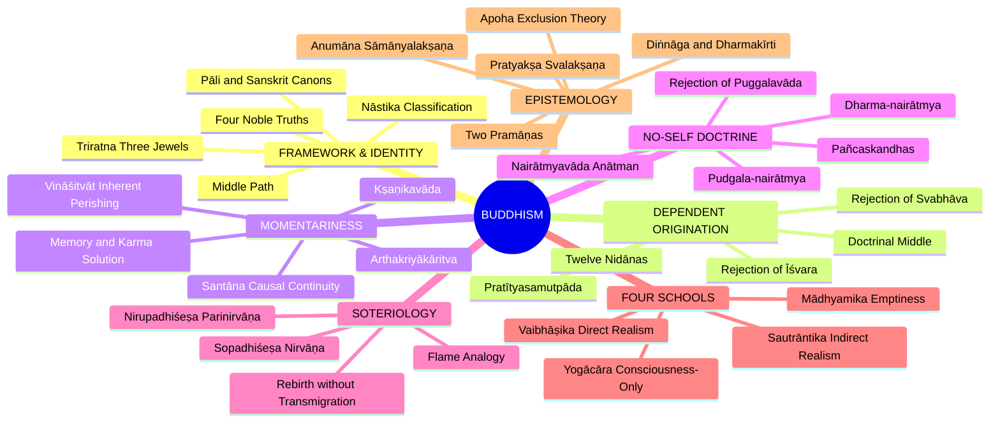

---

## 1. IDENTITY, LINEAGE & HISTORICAL DOXOGRAPHY

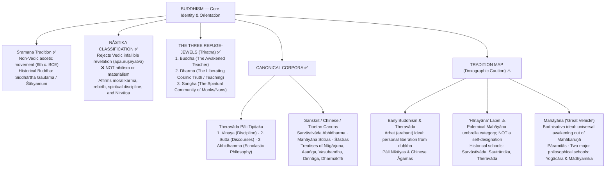

---

## 2. THEORY OF KNOWLEDGE (Buddhist Pramāṇa School)

### 2A. Epistemic Dualism of Diṅnāga & Dharmakīrti

> [!NOTE]
> **Epistemological Economy:** Buddhist logicians (*Diṅnāga* in *Pramāṇasamuccaya* and *Dharmakīrti* in *Pramāṇavārttika*) accept **only two pramāṇas** because there are only two kinds of knowable objects (*prameya*): the uniquely real momentary particular (*svalakṣaṇa*) and the conceptual universal (*sāmānyalakṣaṇa*).

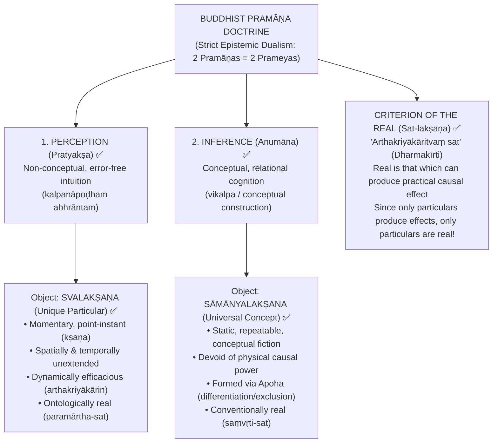

### 2B. The Exclusion Theory of Meaning (*Apohavāda*)

| Dimension | Realist View (Nyāya / Mīmāṃsā) | Buddhist Nominalist View (*Apoha*) |
| :--- | :--- | :--- |
| **Status of Universals** | Real, eternal, objective entity (*jāti* / *sāmānya*) inhering in particulars | Mental construct (*vikalpa*); unreal conceptual fiction |
| **Meaning of 'Cow'** | Denotes the eternal universal *gotva* (cow-ness) | Denotes "exclusion of non-cows" (*atad-vyāvṛtti*) |
| **Mechanism** | Direct perception of universal in individual | Negative differentiation; grouping via shared practical function |
| **Exam Significance** | Defends substance-attribute metaphysics | Preserves radical nominalism and momentariness |

---

## 3. DIALECTICAL WINGS: THE FOUR PHILOSOPHICAL SCHOOLS

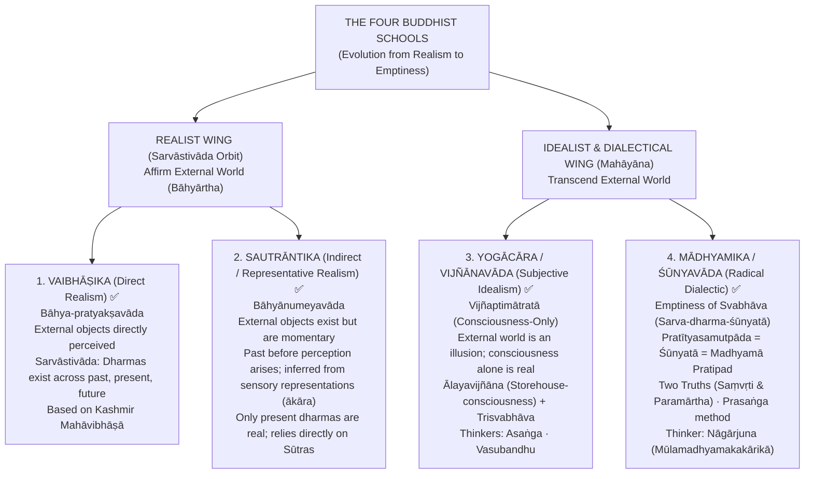

### 3A. Deep Comparative Matrix of the Four Schools

| Dimension | Vaibhāṣika | Sautrāntika | Yogācāra | Mādhyamika |
| :--- | :--- | :--- | :--- | :--- |
| **Ontological Status** | Direct Realism (*Bāhya-pratyakṣavāda*) | Indirect Realism (*Bāhyānumeyavāda*) | Absolute Idealism (*Vijñānavāda*) | Relativism / Non-foundationalism (*Śūnyavāda*) |
| **External Objects** | Directly perceived; real and enduring across 3 times | Inferred through mental forms (*ākāras*); momentary | Denied; external world is projection of consciousness | Neither real nor unreal; empty of intrinsic essence (*svabhāva-śūnya*) |
| **Reality of Mind** | Mind and matter are equally real *dharmas* | Mind and external causes are momentary reals | Consciousness (*vijñāna*) is the sole ultimate reality | Mind is as empty of intrinsic nature as matter |
| **Canonical Base** | *Abhidharma-mahāvibhāṣā* | Sūtras of the Buddha | *Laṅkāvatāra-sūtra*, Vasubandhu's *Viṃśatikā* & *Triṃśikā* | *Prajñāpāramitā-sūtras*, Nāgārjuna's *MMK* |
| **Key Thinkers** | Vasumitra, Kātyāyanīputra | Yaśomitra, Kumāralāta | Asaṅga, Vasubandhu, Xuanzang | Nāgārjuna, Candrakīrti, Āryadeva |

---

## 4. METAPHYSICS & ONTOLOGY: THE CORE TRIAD

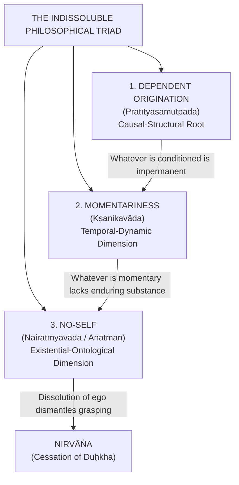

### 4A. Dependent Origination (*Pratītyasamutpāda*) & The 12 Links

```mermaid
flowchart LR
    subgraph PAST ["PAST LIFE"]
        N1["1. Avidyā\n(Ignorance)"] --> N2["2. Saṃskāra\n(Karmic Volitions)"]
    end

    subgraph PRESENT ["PRESENT LIFE"]
        N2 --> N3["3. Vijñāna\n(Rebirth Consciousness)"]
        N3 --> N4["4. Nāmarūpa\n(Mind-Body Organism)"]
        N4 --> N5["5. Ṣaḍāyatana\n(Six Sense Bases)"]
        N5 --> N6["6. Sparśa\n(Sense Contact)"]
        N6 --> N7["7. Vedanā\n(Feeling / Sensation)"]
        N7 --> N8["8. Tṛṣṇā\n(Craving / Thirst)"]
        N8 --> N9["9. Upādāna\n(Clinging / Grasping)"]
        N9 --> N10["10. Bhava\n(Becoming / Karmic Potency)"]
    end

    subgraph FUTURE ["FUTURE LIFE"]
        N10 --> N11["11. Jāti\n(Rebirth / Birth)"]
        N11 --> N12["12. Jarāmaraṇa\n(Aging & Death / Duḥkha)"]
    end
```

> [!IMPORTANT]
> **Two Orders of the Twelve Links:**
> - **Anuloma (Forward Order):** With the arising of ignorance, volitions arise... leading to the whole mass of suffering (*samudaya*).
> - **Pratiloma (Reverse Order):** With the complete cessation of ignorance, volitions cease... leading to the complete cessation of suffering (*nirodha*).

### 4B. Momentariness (*Kṣaṇikavāda*): Proofs & Continuity

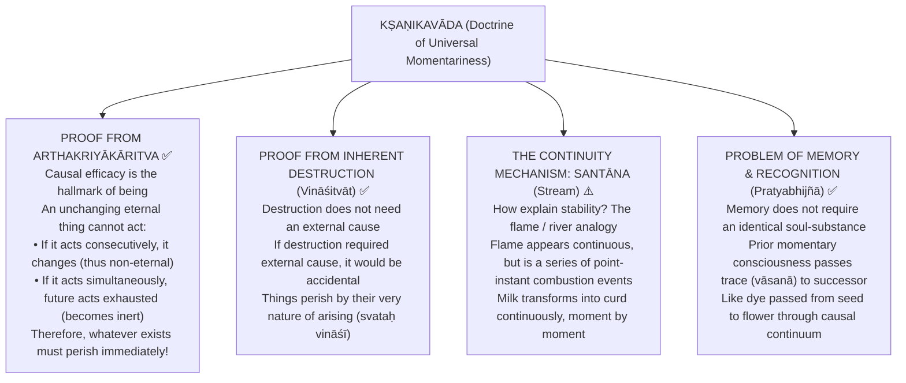

### 4C. No-Self (*Nairātmyavāda*) & The Five Aggregates (*Pañcaskandha*)

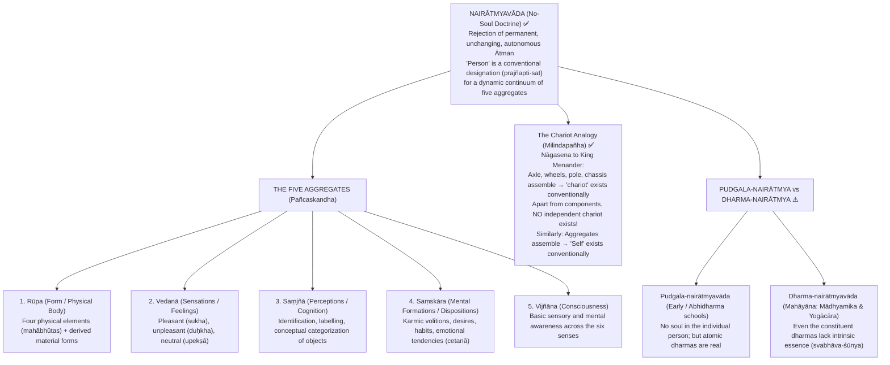

---

## 5. REJECTION / AFFIRMATION OF TRANSCENDENT REALITIES

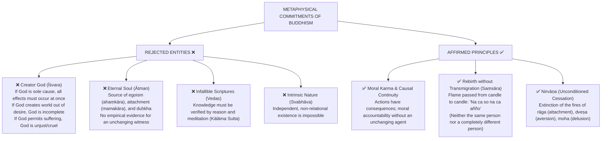

---

## 6. EXPLANATORY & CAUSAL PRINCIPLES

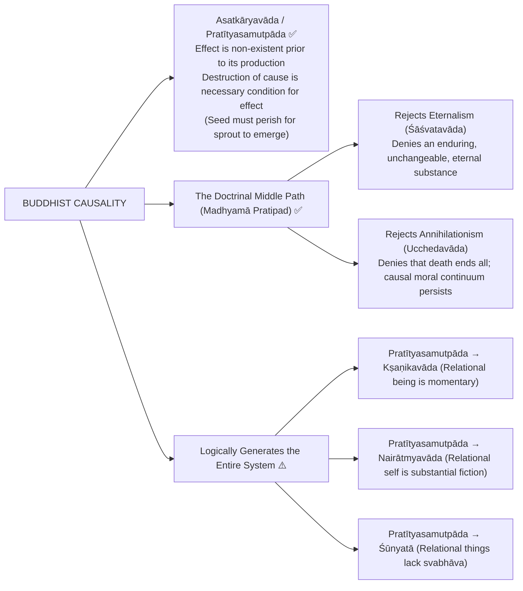

---

## 7. ETHICS & SOTERIOLOGY (The Path to Nirvāṇa)

### 7A. The Four Noble Truths (*Cattāri Ariyasaccāni*)

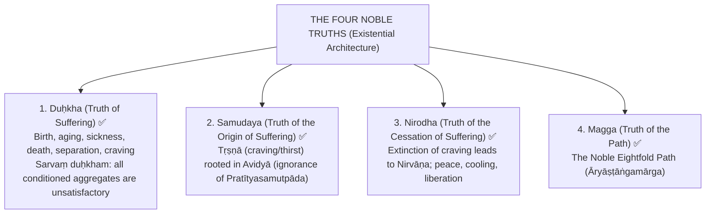

### 7B. The Noble Eightfold Path (*Āryāṣṭāṅgamārga*)

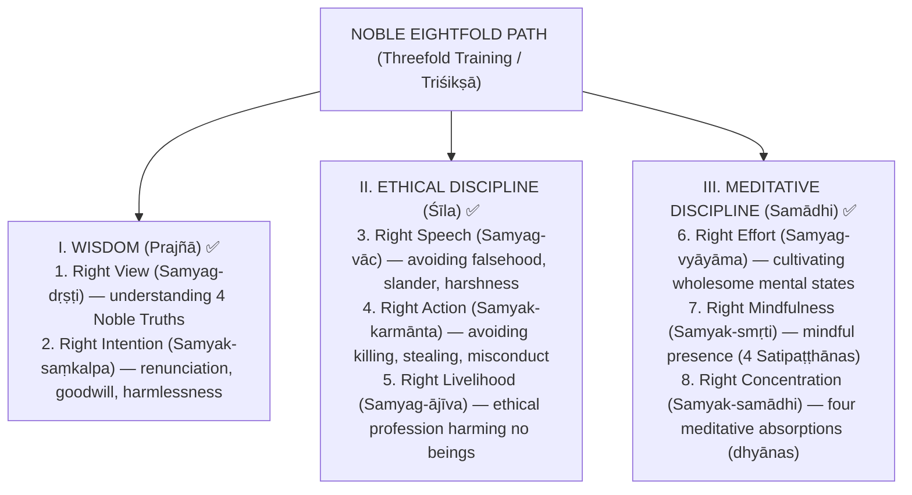

### 7C. Nature of Nirvāṇa & Rebirth

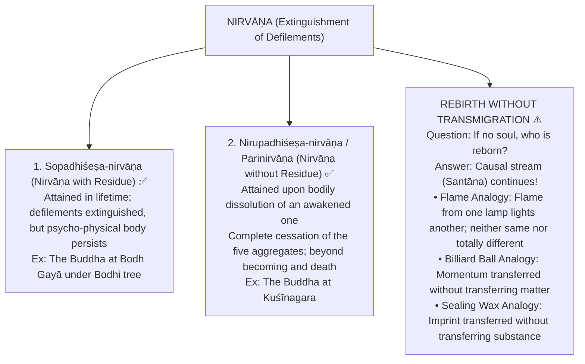

---

## 8. INTER-SCHOOL COMPARATIVE MATRICES

### Comprehensive Philosophical Comparison

| Philosophical Dimension | Buddhism | Cārvāka | Jainism | Nyāya-Vaiśeṣika | Advaita Vedānta | Sāṃkhya |
| :--- | :--- | :--- | :--- | :--- | :--- | :--- |
| **Accepted Means of Knowledge (*Pramāṇas*)** | Perception + Inference (2 only) | Perception only (1) | Direct + Indirect (Mati, Śruta, Avadhi, Kevala) | Perception, Inference, Comparison, Testimony (4) | 6 Pramāṇas in empirical realm | Perception, Inference, Testimony (3) |
| **Status of Self (*Ātman*)** | ❌ No eternal self (*Nairātmyavāda*); bundle of 5 skandhas | Body IS self (*Dehātmavāda*) | Plural real, eternal, body-sized souls (*Jīva*) | Plural eternal substances; quality-less in release | Non-dual universal Self (*Brahman*); jīva is illusory appearance | Plural eternal detached spectator consciousnesses (*Puruṣa*) |
| **Ontology of Reality** | Universal momentariness (*Kṣaṇikavāda*); empty of *svabhāva* | Four physical elements only; no ākāśa | Dynamic identity-in-difference (*utpāda-vyaya-dhrauvya*) | Atomistic pluralism; distinct substances (*asatkāryavāda*) | Changeless non-dual Being (*Sat*); modal change is illusion (*vivarta*) | Dualism of unmoving Puruṣa and transforming Prakṛti |
| **Theory of Causation** | Dependent Origination (*Pratītyasamutpāda*); causal chain | Own-nature (*Svabhāvavāda*) or Chance (*Yadṛcchā*) | Transformation (*Pariṇāmavāda*); dual cause | New beginning (*Asatkāryavāda* / *Ārambhavāda*) | Apparent transformation (*Vivartavāda*) | Real transformation of Prakṛti (*Satkāryavāda*) |
| **Karma & Rebirth** | Causal continuum (*santāna*) without permanent soul | ❌ Totally rejected | Subtle physical matter (*pudgala*) adhering to soul | Moral unseen force (*adṛṣṭa*) guided by God | Belongs to empirical realm (*vyāvahārika-sat*) | Transmitted through subtle body (*liṅga-śarīra*) |
| **Liberation Ideal** | Nirvāṇa (extinguishment of craving & ego-delusion) | ❌ Bodily death is end (*maraṇam eva apavargaḥ*) | Mokṣa at Siddha-śilā (*Ananta-catuṣṭaya*) | Apavarga: freedom from pain, devoid of consciousness | Mokṣa: realization of non-difference from Brahman | Kaivalya: absolute isolation of Puruṣa from Prakṛti |

### 8A. Buddhism vs Advaita Vedānta on Self and Illusion

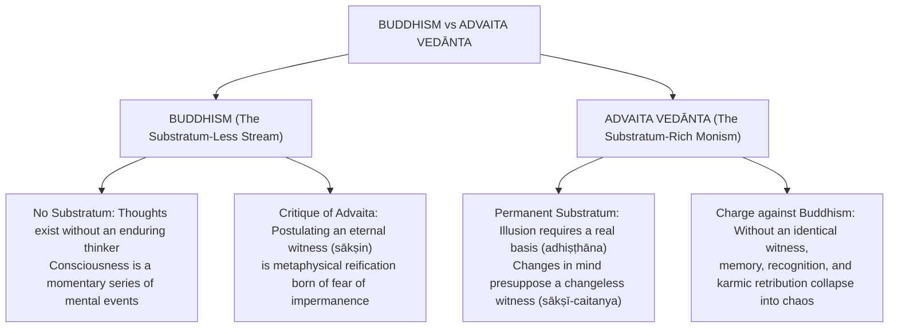

---

## 9. CRITICISMS & RECONSTRUCTED REPLIES

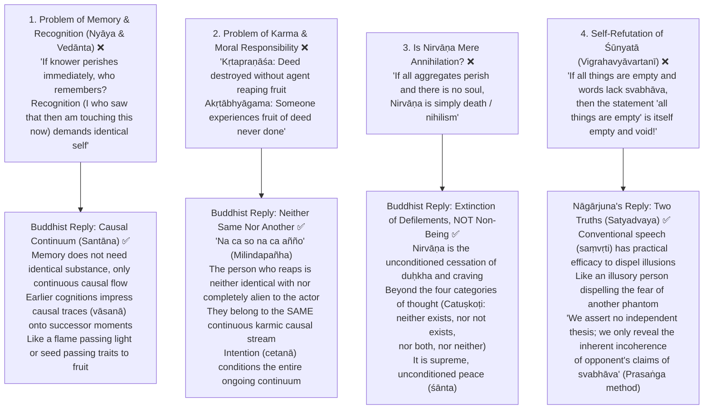

---

## 10. CONTROLLED WESTERN COMPARISONS

| Western Thinker / School | Contact Point | Decisive Disanalogy & Guardrail |
| :--- | :--- | :--- |
| **David Hume** | Bundle theory of self; rejection of soul substance; mind as a theater of fleeting perceptions; causality as succession | **Decisive Disanalogies:** Hume lacks any doctrine of rebirth, karma, or spiritual liberation (*nirvāṇa*). Hume admitted he was puzzled by how perceptions unite; Buddhism supplies a rigorous causal continuum (*santāna*) governed by dependent origination. |
| **Heraclitus** | Doctrine of universal flux (*panta rhei*); "you cannot step twice into the same river"; change as cosmic principle | **Decisive Disanalogies:** Heraclitus grounds cosmic flux in an overarching divine Reason (*Logos*) and physical Fire as primordial element. Buddhism grounds flux in *Pratītyasamutpāda* purely for existential diagnosis and cessation of *duḥkha*. |
| **George Berkeley / Kant** | Idealism; rejection of material substratum; objects dependent on perception (Berkeley); mind structures experience (Kant) | **Decisive Disanalogies:** Berkeley relies on an external God to guarantee perception; Yogācāra rejects God. Kant posits an unknowable thing-in-itself (*Ding-an-sich*); Yogācāra consciousness-only (*vijñaptimātratā*) is a soteriological method to dissolve subject-object duality. |
| **Jacques Derrida** | Deconstruction of foundational essences; différance; refusal of fixed metaphysical centers | **Guardrail Alert ⚠️:** Derrida's deconstruction remains an endless textual play. Nāgārjuna's *Śūnyatā* is strictly soteriological—it aims at stopping the mental proliferation (*prapañcopaśama*) that causes existential suffering. |

---

## 11. DIAGNOSTIC DEEP-DIVES FOR HIGH-FREQUENCY THEMES

### Deep Dive 1: How Pratītyasamutpāda Generates Kṣaṇikavāda and Nairātmyavāda (2019 Q7c, 2020 Q6a)

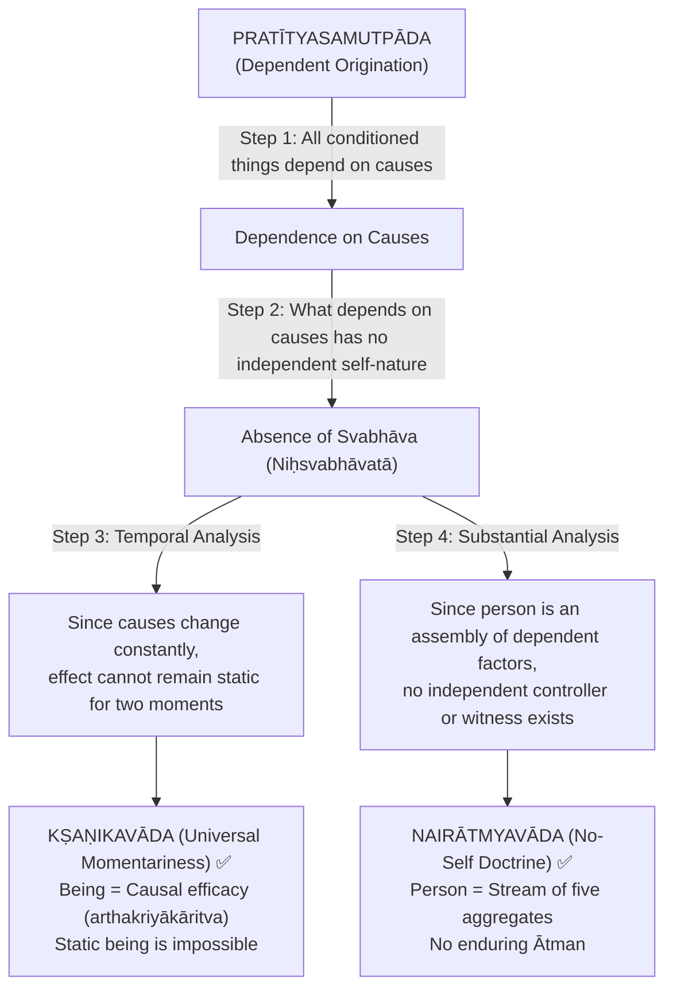

### Deep Dive 2: The 2024 Paradox — "Everything is Real" vs "Everything is Void" (2024 Q6(b))

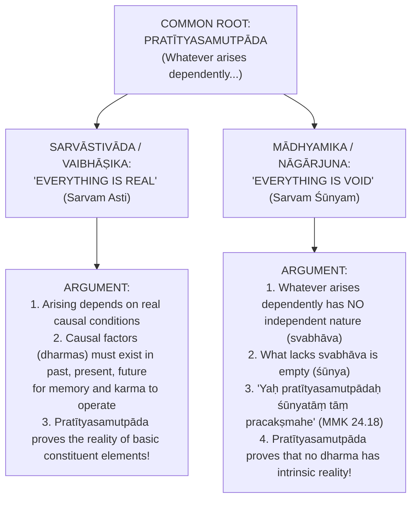

### Deep Dive 3: Pudgala-Nairātmyavāda vs Dharma-Nairātmyavāda (2021 Q5(d))

```mermaid
flowchart LR
    subgraph PUDGALA ["PUDGALA-NAIRĀTMYA (No-Self of Persons)"]
        direction TB
        P1["Accepted by ALL Buddhist schools"]
        P2["Denies an enduring soul in living beings"]
        P3["Deconstructs person into 5 constituent skandhas"]
        P4["Cures emotional attachment (rāga) & personal egoism"]
    end

    subgraph DHARMA ["DHARMA-NAIRĀTMYA (No-Self of Elements)"]
        direction TB
        D1["Accepted ONLY by Mahāyāna (Mādhyamika & Yogācāra)"]
        D2["Denies intrinsic nature even in the constituent skandhas / atoms"]
        D3["Deconstructs the reality of the building blocks themselves"]
        D4["Cures intellectual clinging (dṛṣṭi) & metaphysical dogmatism"]
    end

    PUDGALA -->|"Deeper ontological progression"| DHARMA
```

---

## 12. PYQ ROUTING LEDGER (2018–2026)

| Year | Question # | Marks | Exact Syllabus Demand & Core Routing Strategy |
| :---: | :---: | :---: | :--- |
| **2018** | Q5(b) | 10 | **How Mādhyamika applies Pratītyasamutpāda to establish Śūnyatā:** Cite MMK 24.18 (*Yaḥ pratītyasamutpādaḥ śūnyatāṃ tāṃ pracakṣmahe*); dependent arising implies absence of independent *svabhāva*; non-relational entity is a myth. |
| **2018** | Q6(b) | 15 | **Is admitting Nairātmyavāda and Nirvāṇa simultaneously consistent?** Yes: Nirvāṇa is the extinguishment of craving (*tṛṣṇā-kṣaya*) in the causal stream, not the annihilation of a soul; without *nairātmyavāda*, *nirvāṇa* would be impossible (eternal soul cannot change). |
| **2019** | Q5(b) | 10 | **How Yogācāra denies external world:** Dream argument (*svapnopama*); impossibility of part-whole relation in physical atoms; consciousness (*vijñāna*) alone manifests as subject (*grāhaka*) and object (*grāhya*). |
| **2019** | Q7(c) | 15 | **What is Pratītyasamutpāda? How proves everything is momentary?** Define causal interdependence; derive *Kṣaṇikavāda* via *arthakriyākāritva*: whatever depends on changing causes cannot endure identical across two moments. |
| **2020** | Q6(a) | 20 | **How Kṣaṇikavāda is logical derivative of Pratītyasamutpāda:** Systematic step-by-step deduction: Relational origin $\to$ Lack of self-subsistent duration $\to$ Inherent destruction (*vināśitvāt*) $\to$ Dynamic point-instants. |
| **2020** | Q7(b) | 15 | **Self in terms of Pañcaskandhas & Liberation without Soul:** Deconstruct chariot analogy (*Milindapañha*); explain 5 aggregates; Nirvāṇa is the unconditioned cessation of defilements in the causal stream. |
| **2021** | Q5(d) | 10 | **Pudgala-nairātmyavāda vs Dharma-nairātmyavāda:** Contrast Hīnayāna/Abhidharma deconstruction of person with Mahāyāna deconstruction of ultimate dharmas/atoms. |
| **2021** | Q7(b) | 15 | **Memory and personal identity under Momentariness:** Causal continuum (*santāna*) model; dynamic impression of traces (*vāsanā*); contrast with static substance identity. |
| **2022** | Q6(a) | 20 | **Compatibility of Momentariness with Karma & Opponents' objections:** Address *kṛtapraṇāśa* and *akṛtābhyāgama*; Buddhist reply via *na ca so na ca añño*; intention (*cetanā*) structuring the causal continuum. |
| **2022** | Q7(b) | 15 | **Triratna and consistency with Nairātmyavāda:** Three Jewels (Buddha, Dharma, Saṅgha); show Buddha is an awakened continuum of wisdom, Dharma is the law of dependent arising, Saṅgha is the path-community—none require a static soul. |
| **2023** | Q8(a) | 20 | **"Ignorance of dependent origination is suffering; knowledge is cessation":** Analyze 12 *nidānas*; *avidyā* as root of *saṃsāra* (*anuloma*); *vidyā* / wisdom as cessation (*pratiloma*); soteriological heart of Buddhism. |
| **2024** | Q6(b) | 15 | **Two schools arriving at "Everything is void" vs "Everything is real" from Pratītyasamutpāda:** Vaibhāṣika (*Sarvāstivāda*) asserts reality of causal conditions; Mādhyamika (*Śūnyavāda*) asserts absence of *svabhāva* in dependent things. |
| **2025** | Q8(c) | 15 | **Nirvāṇa in consonance with Kṣaṇikavāda and Nairātmyavāda:** Synthesize triad: Momentariness ensures bondage is not permanent; No-self ensures no static possessor; Nirvāṇa is the peaceful cessation of the turbulent continuum. |
| **2026** | Q5(b) | 10 | **How Momentariness problematizes human action and responsibility:** Examine opponent's charge of moral chaos; Buddhist solution via causal transmission of moral momentum (*karmic santāna*). |

---

## 13. TOP 10 UPSC EXAM TRAPS 🚨

```mermaid
flowchart TD
    T["TOP 10 EXAM TRAPS IN BUDDHISM"] --> T1["❌ Equating Śūnyatā with Nihilism or Blank Void\n✅ FATAL ERROR: Śūnyatā = Niḥsvabhāvatā (Emptiness of intrinsic nature)\nIt is the very condition that makes dependent transformation possible!"]
    T --> T2["❌ Claiming Buddhism is Pessimistic\n✅ Diagnostic Realism: Starts with Duḥkha (illness),\nidentifies cause (etiology), guarantees cessation (cure), provides path (therapy)"]
    T --> T3["❌ Equating Theravāda with the Polemical 'Hīnayāna' Label\n✅ Historically inaccurate: Hīnayāna is a Mahāyāna polemical category;\nTheravāda is an ancient surviving school with its own canonical integrity"]
    T --> T4["❌ Confusing Pudgala-nairātmya with Dharma-nairātmya\n✅ Pudgala = no soul in persons (All schools);\nDharma = no intrinsic reality even in constituent elements (Mahāyāna only)"]
    T --> T5["❌ Asserting that Buddhist Momentariness Denies All Rebirth\n✅ Denies transmigration of an unchanging soul, but affirms\ncontinuation of the karmic causal stream (Flame analogy)"]
    T --> T6["❌ Calling Pratītyasamutpāda a Purely Cosmological Theory\n✅ It is primarily an existential soteriology: the structural formula\nof the Four Noble Truths for ending duḥkha"]
    T --> T7["❌ Overlooking the Two Truths in Mādhyamika\n✅ Without Saṃvṛti-satya (conventional truth), everyday life and path collapse;\nParamārtha-satya (ultimate truth) is realization of Śūnyatā"]
    T --> T8["❌ Saying Yogācāra Denies Reality of Mind\n✅ Denies external physical world, but explicitly affirms\nthat Consciousness (Vijñāna / Citta) is real!"]
    T --> T9["❌ Describing Nirvāṇa as Physical Death\n✅ Sopadhiśeṣa-nirvāṇa is attained while living;\nNirvāṇa is the psychological extinguishment of rāga, dveṣa, moha"]
    T --> T10["❌ Stating that Buddhism Rejects All Inferences\n✅ Rejects transcendental Vedic inference, but Diṅnāga and Dharmakīrti\nmake inference one of the two foundational pramāṇas"]
```

---

## 14. TECHNICAL VOCABULARY & IAST BANK

| Term | Sanskrit / Pali | Precise English Philosophical Gloss | Status |
| :--- | :--- | :--- | :---: |
| **Dependent Origination** | *Pratītyasamutpāda* / *Paṭiccasamuppāda* | Interdependent, conditioned co-arising of all phenomena | ✅ |
| **Universal Momentariness**| *Kṣaṇikavāda* | Doctrine that all conditioned causal entities perish instantly | ✅ |
| **No-Self / Non-Ego** | *Nairātmyavāda* / *Anattavāda* | Denial of an enduring, autonomous, immaterial soul substance | ✅ |
| **Causal Power** | *Arthakriyākāritva* | The capacity to produce practical causal effects; test of the real | ✅ |
| **Unique Particular** | *Svalakṣaṇa* | Momentary, unextended, real object of direct perception | ✅ |
| **Universal Concept** | *Sāmānyalakṣaṇa* | Constructed conceptual universal; object of inference | ✅ |
| **Exclusion Theory** | *Apohavāda* | Nominalist doctrine: words mean "exclusion of others" (*atad-vyāvṛtti*) | ✅ |
| **Causal Continuum** | *Santāna* | Dynamic serial stream of momentary psycho-physical events | ✅ |
| **Karmic Imprint** | *Vāsanā* / *Saṃskāra* | Latent mental impressions transferred along the causal stream | ✅ |
| **Five Aggregates** | *Pañcaskandha* / *Pañcakkhandha* | Rūpa, vedanā, saṃjñā, saṃskāra, vijñāna | ✅ |
| **Intrinsic Nature** | *Svabhāva* | Independent, self-subsistent, unchanging essence (denied by Buddhism) | ✅ |
| **Emptiness** | *Śūnyatā* | Absence of independent intrinsic nature in all conditioned things | ✅ |
| **Conventional Truth** | *Saṃvṛti-satya* | Empirical, pragmatic, transactional reality | ✅ |
| **Ultimate Truth** | *Paramārtha-satya* | The true nature of things: unconditioned emptiness / nirvāṇa | ✅ |
| **Consciousness-Only** | *Vijñaptimātratā* | Doctrine that external matter is an illusion; consciousness alone exists | ✅ |
| **Storehouse Mind** | *Ālayavijñāna* | Subliminal reservoir of karmic seeds in Yogācāra | ✅ |
| **Dialectical Method** | *Prasaṅga* | Reductio ad absurdum method exposing opponents' contradictions | ✅ |
| **Liberated Saint** | *Arhat* / *Arahant* | Disciple who has extinguished defilements and escaped saṃsāra | ✅ |
| **Awakening Being** | *Bodhisattva* | Spiritual practitioner seeking complete Buddhahood for all beings | ✅ |
| **Great Compassion** | *Mahākaruṇā* | Boundless compassion driving the Mahāyāna bodhisattva path | ✅ |
| **Four Noble Truths** | *Cattāri Ariyasaccāni* | Duḥkha, Samudaya, Nirodha, Magga | ✅ |
| **Noble Eightfold Path** | *Āryāṣṭāṅgamārga* | The eight-step practical training in Prajñā, Śīla, Samādhi | ✅ |
| **Middle Path** | *Madhyamā Pratipad* | Practical & metaphysical avoidance of destructive extremes | ✅ |
| **Extinguishment** | *Nirvāṇa* / *Nibbāna* | Unconditioned cessation of passion, hatred, and delusion | ✅ |

---

## 15. GRADED VERDICT & ANSWER ARCHITECTURES

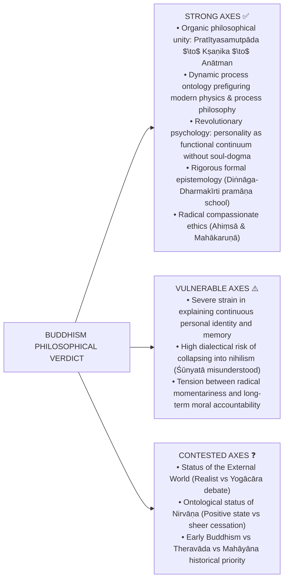

### Ready Exam Verdicts:
- **10 Marks:** *Buddhist philosophy is fundamentally an existential soteriology: Pratītyasamutpāda is the diagnostic formula proving that because suffering is conditionally produced, it can be conditionally extinguished through the Noble Eightfold Path.*
- **15 Marks:** *Momentariness (Kṣaṇikavāda) and No-Soul (Nairātmyavāda) are not isolated doctrines; they are the necessary logical expressions of Dependent Origination in the temporal and substantial dimensions, resolving identity into dynamic causal continuity (santāna).*
- **20 Marks:** *From Nāgārjuna's dialectic of Śūnyatā to Dharmakīrti's epistemological realism, Buddhism provides the most rigorous non-substantialist metaphysics in global thought—demonstrating that moral responsibility, spiritual transformation, and ultimate liberation require not an unchanging soul, but a dynamic, self-correcting continuum.*

---

### 10-Mark Answer Blueprint (Focus: Core Doctrinal Deduction)

```
1. Master Thesis: Pratītyasamutpāda is the single ontological foundation of all Buddhist philosophy.
2. The Deduction:
   - What arises dependently lacks independent essence (svabhāva).
   - In time: it cannot endure static for two moments → Universal Momentariness (Kṣaṇikavāda).
   - In substance: it contains no immutable core → No-Self (Nairātmyavāda).
3. Concrete Analogy: The flame or chariot analogy from Milindapañha.
4. Concluding Sentence: Relate the metaphysics directly to the cessation of duḥkha.
```

> *"Pratītyasamutpāda is the master key of Buddhism: it simultaneously dismantles the eternalist illusion of an unchanging soul and the annihilationist despair of moral meaninglessness."*

---

### 15-Mark Answer Blueprint (Focus: Memory, Karma & Momentariness)

```
1. The Problem / Pūrvapakṣa:
   - The opponent's dilemma: If consciousness perishes instantly, who remembers?
   - Charges of kṛtapraṇāśa (loss of deed) and akṛtābhyāgama (unearned retribution).
2. The Buddhist Mechanism:
   - Dynamic continuum (santāna) rather than static substance.
   - Transmission of causal impressions (vāsanā-saṃkrānti) from moment to moment.
   - Milindapañha formula: "Na ca so na ca añño" (Neither identical nor different).
3. Ethical Validation:
   - Volition (cetanā) configures the ongoing stream; karma operates as an immanent law.
4. Critical Assessment:
   - Causal stream provides a functional account of agency without metaphysical reification.
```

> *"Buddhism resolves the paradox of karma without a soul by redefining personal identity: the agent and the reaper are neither identical substances nor unconnected individuals, but consecutive links in a single unbroken causal stream."*

---

### 20-Mark Answer Blueprint (Focus: Schools, Emptiness & Soteriology)

```
1. Foundational Frame:
   - The Four Noble Truths as diagnostic frame; Pratītyasamutpāda as the causal spine.
2. The Evolution of the Four Schools:
   - Realist Base: Vaibhāṣika (direct realism) & Sautrāntika (representationalism).
   - Idealist Pivot: Yogācāra (consciousness-only / vijñaptimātratā & ālayavijñāna).
   - Dialectical Culmination: Mādhyamika (Śūnyatā as the ultimate meaning of Pratītyasamutpāda).
3. Resolving the 2024 Paradox:
   - How Sarvāstivāda derives "all is real" (dharmas endure in 3 times).
   - How Mādhyamika derives "all is void" (relational things lack svabhāva).
4. Soteriological Synthesis:
   - Nirvāṇa as the unconditioned cessation of defilements; compatibility with momentariness and no-self.
   - The Middle Path avoiding both Eternalism and Nihilism.
5. Final Evaluation:
   - Graded verdict: The immense power of process ontology over static substance metaphysics.
```

> *"For Nāgārjuna, Śūnyatā is not the negation of reality, but the negation of absolute essence: Pratītyasamutpāda and Śūnyatā are identical expressions of the Middle Path, showing that reality is relational, dynamic, and free from metaphysical grasping."*

---

*Source: [`Buddhism.md`](../upsc-ai-kit/knowledge/Philosophy/paper-1/indian/Buddhism.md) — UPSC AI Kit canonical knowledge base*
