# 🧠 Cārvāka (Lokāyata) — Philosophy Mindmap

> [!IMPORTANT]
> **UPSC Paper I · Section B · Syllabus Item 12** — Theory of Knowledge; Rejection of Transcendent Entities.
> High strike-rate across **9 primary-owned question-parts (2018–2025)**.

---

## 🗺️ MASTER OVERVIEW

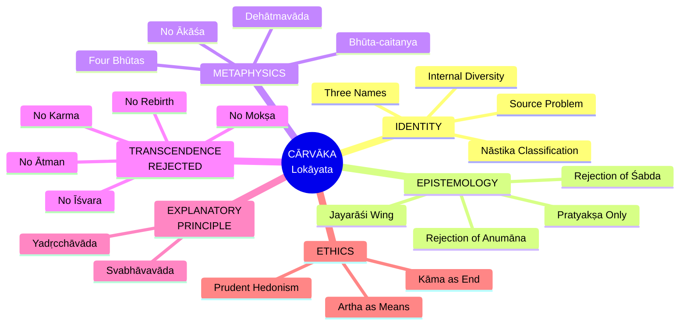

---

## 1. IDENTITY & HISTORICAL LOCATION

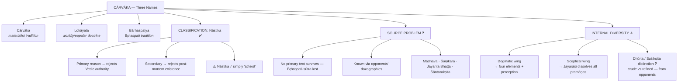

---

## 2. THEORY OF KNOWLEDGE (Epistemology)

### 2A. Core Thesis — Pratyakṣa Alone

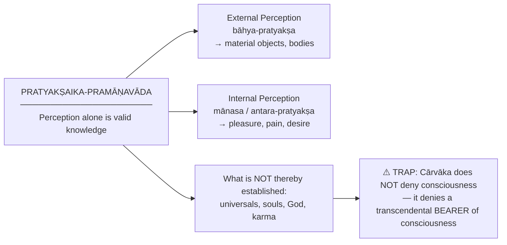

### 2B. Rejection of Anumāna (Inference)

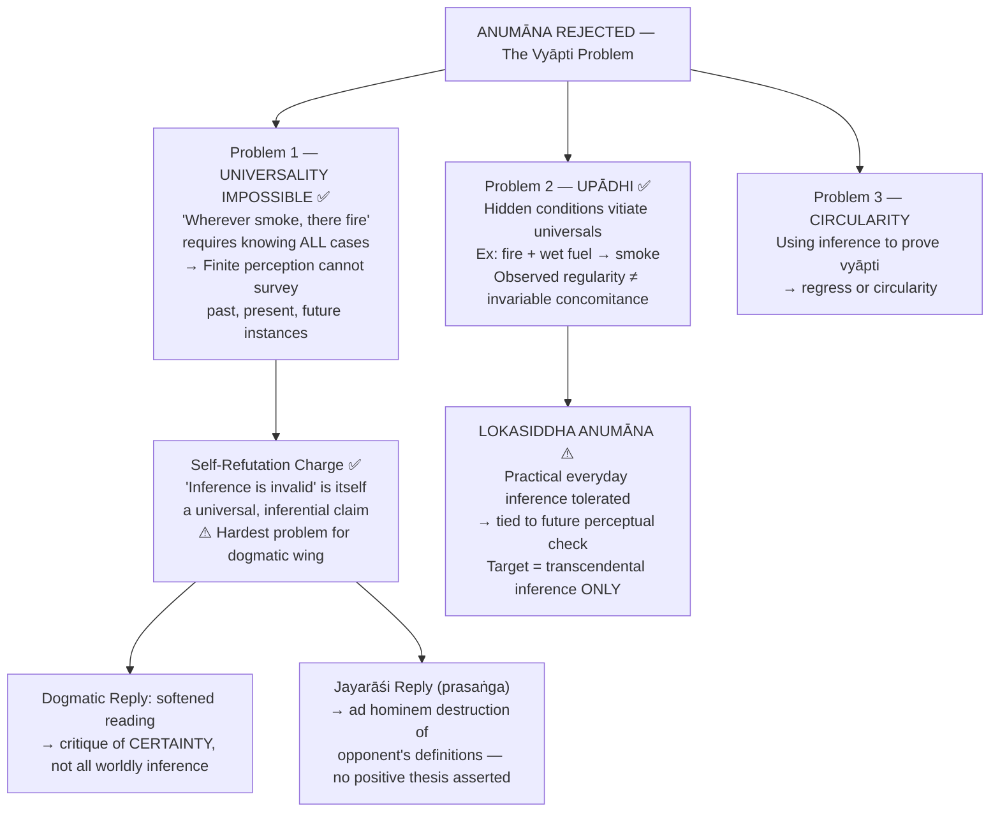

### 2C. Rejection of Śabda (Testimony)

| Step | Argument |
|------|----------|
| 1 | Testimony = someone uttered something |
| 2 | Truth requires assuming speaker competence & honesty |
| 3 | That assumption is itself **inferred** → inherits inference's problem |
| 4 | Vedic authority is not perceptually given |
| 5 | Therefore śabda ≠ independent pramāṇa |

> [!TIP]
> **Other rejected pramāṇas:** Upamāna (comparison), Arthāpatti (postulation), Anupalabdhi (non-cognition) — all either reduce to perception or inherit the unproved universal move.

---

## 3. JAYARĀŚI BHAṬṬA — Sceptical Wing

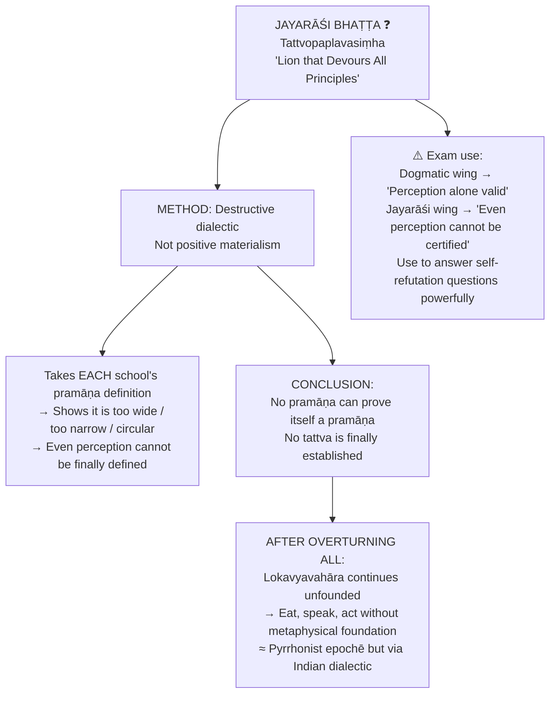

---

## 4. REJECTION OF TRANSCENDENT ENTITIES (Metaphysics)

### 4A. Four Bhūtas — The Material Base

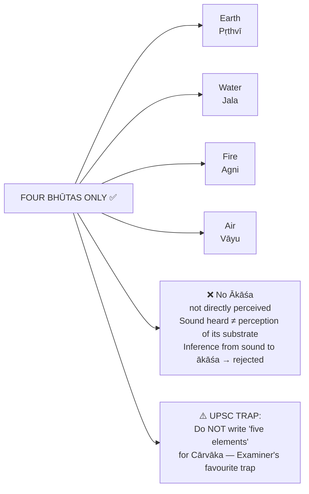

### 4B. Dehātmavāda — Body as Self

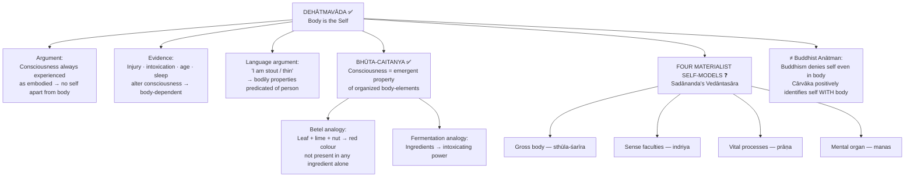

### 4C. What is Rejected

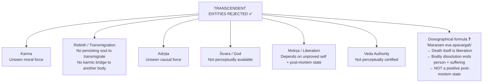

---

## 5. EXPLANATORY PRINCIPLE

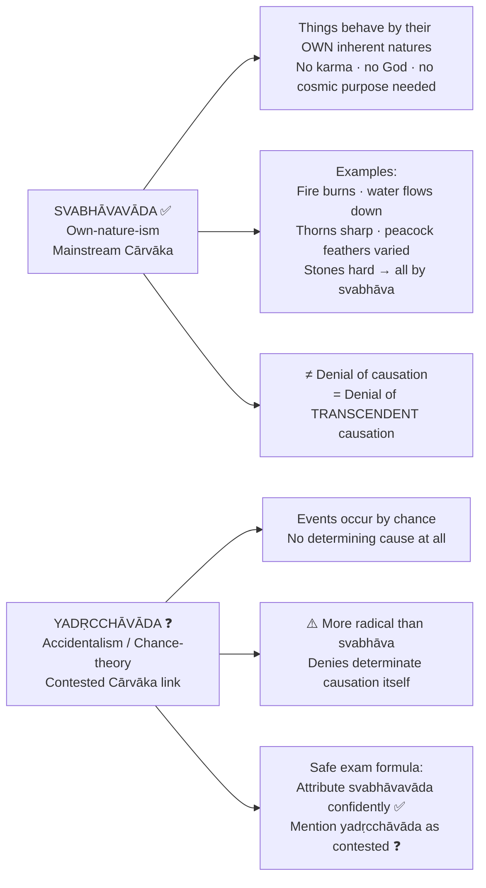

---

## 6. ETHICS

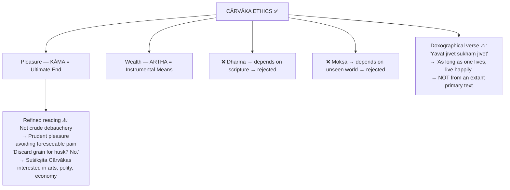

---

## 7. INTER-SCHOOL DEBATES

### Key Comparisons

| Axis | Cārvāka | Nyāya | Buddhism | Jainism |
|------|---------|-------|----------|---------|
| **Pramāṇas** | Pratyakṣa only | 4: perception, inference, comparison, testimony | Perception + inference | Multiple + standpoint theory |
| **Self** | Body IS self (dehātmavāda) | Enduring ātman-substance | No enduring ātman (anātman) | Plural jīvas |
| **Consciousness** | Emergent from bhūtas | Quality of self | Stream of momentary states | Intrinsic to jīva |
| **Karma/Rebirth** | ❌ Rejected | ✅ Accepted | ✅ Without eternal self | ✅ Karmic matter |
| **Vyāpti** | Cannot be established | Established via observation + tarka | Trairūpya method | Standpoint-qualified |
| **Liberation** | ❌ No mokṣa | Apavarga | Nirvāṇa | Mokṣa of jīva |

### 7A. Cārvāka vs Nyāya on Inference

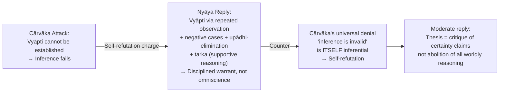

### 7B. Cārvāka vs Buddhism on Self

| | Cārvāka | Buddhism |
|--|---------|----------|
| **Core thesis** | Body = self (dehātmavāda) | No enduring self-substance (anātman) |
| **What is denied** | Transcendental, immaterial ātman | Substantial self — even in body |
| **Consciousness** | Emergent from bodily elements | Stream of momentary psycho-physical states |
| **Rebirth** | ❌ Rejected | ✅ Accepted without eternal soul |
| **Karma** | ❌ Rejected | ✅ Causal-moral continuity |
| **Liberation** | ❌ No mokṣa | Nirvāṇa (cessation of craving) |

> **⚠️ Do NOT write:** "Both Cārvāka and Buddhism deny self in the same way." They deny different things for different reasons. Cārvāka collapses personhood into matter; Buddhism denies substantial self even there.

---

## 8. CRITICISMS & REPLIES

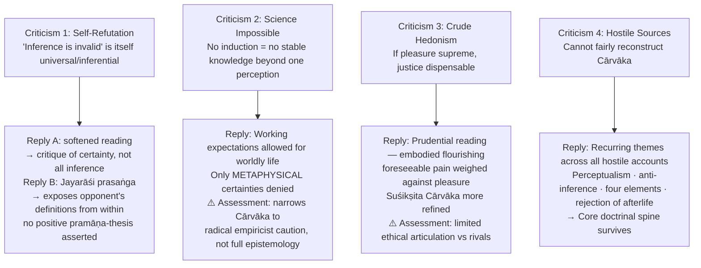

---

## 9. WESTERN PARALLELS

| Western Thinker | Contact Point | Decisive Disanalogy |
|----------------|---------------|-------------------|
| **Hume** | Both question universals outrunning impressions/perception; both skeptical of soul & God | Hume doesn't deny we should reason inductively; Cārvāka draws the stronger normative conclusion. Hume's bundle-self ≠ Cārvāka's body-self |
| **A.J. Ayer / Logical Positivism** | Both reject unverifiable metaphysics | Ayer's claim is **semantic** (meaninglessness); Cārvāka's is **epistemic/ontological** (not known = not admitted). Ayer preserves scientific inference; Cārvāka attacks inference itself |
| **Epicurus** | Materialism, rejection of fear-based religion, this-worldly pleasure | Epicurean pleasure = ascetic tranquillity (ataraxia); Cārvāka = embodied enjoyment |
| **Pyrrhonism / Jayarāśi** | Ordinary life continues after collapse of foundations | Pyrrhonism seeks epochē; Jayarāśi works via pramāṇa-definition destruction |

> ⚠️ Western parallels are **illustrative only**. Use in at most 1–2 lines **after** the Cārvāka case is complete. Never write "Cārvāka is the Indian Hume" without stating the disanalogies.

---

## 10. POSITIVISM QUESTION (2024)

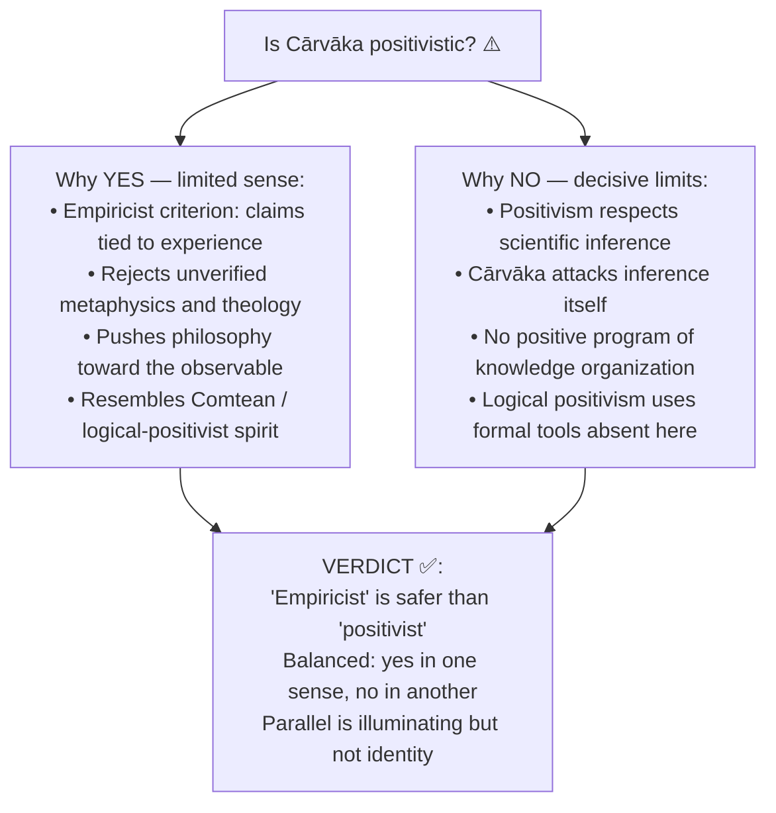

---

## 11. PYQ ROUTING (2018–2025)

| Year | Marks | Question Focus |
|------|-------|---------------|
| **2018** Q8(b) | 15 | Is Cārvāka rejection of inference acceptable to other Indian systems? Are rivals justified? |
| **2019** Q5(c) | 10 | Are Cārvākas consistent in holding inference is not a source of knowledge? |
| **2019** Q6(c) | 15 | What is wrong with "All men are mortal; Socrates is a man; therefore Socrates is mortal"? |
| **2020** Q6(b) | 15 | Critically evaluate rejection of Ākāśa and criticism of transmigration of soul |
| **2020** Q7(c) | 15 | Differences in conception of Reality between Cārvāka and Jainism |
| **2021** Q5(e) | 10 | Comment on the bearing of Cārvāka epistemology on rejection of transcendental entities |
| **2024** Q5(a) | 10 | Is Cārvāka philosophy positivistic in nature? |
| **2024** Q6(a) | 20 | Differentiate Cārvāka's refutation of self from Buddhist rejection of ātmā |
| **2025** Q5(a) | 10 | Explain ground on which Cārvāka rejects inference as a valid source of knowledge |

---

## 12. UPSC EXAM TRAPS 🚨

```mermaid
flowchart TD
    T["TOP 10 TRAPS"] --> T1["❌ 5 elements for Cārvāka\n✅ ONLY FOUR — no ākāśa"]
    T --> T2["❌ Quote Bṛhaspati-sūtra as surviving text\n✅ Lost — doxographical only"]
    T --> T3["❌ Cārvāka denies ALL practical inference\n✅ Rejects transcendental; tolerates lokasiddha"]
    T --> T4["❌ Cārvāka = Buddhist anātman\n✅ Cārvāka = body IS self; Buddhism = no self even in body"]
    T --> T5["❌ Call it straightforward positivism\n✅ Similar spirit, dissimilar in treatment of scientific inference"]
    T --> T6["❌ Cārvāka denies consciousness\n✅ Denies immaterial BEARER — not consciousness itself"]
    T --> T7["❌ Svabhāvavāda = Yadṛcchāvāda\n✅ Svabhāva keeps natural regularity; Yadṛcchā denies determinate causation"]
    T --> T8["❌ Ignore Jayarāśi\n✅ He shows sceptical wing — best answer to self-refutation"]
    T --> T9["❌ Dhūrta/Suśikṣita as two documented schools\n✅ Doxographical distinction; use cautiously"]
    T --> T10["❌ Reduce Cārvāka to crude hedonism\n✅ Present as serious epistemological pūrvapakṣa"]
```

---

## 13. KEY TERMINOLOGY BANK

| Term | Sanskrit | Meaning | Status |
|------|----------|---------|--------|
| Perception-alone doctrine | Pratyakṣaika-pramāṇavāda | Only perception is valid pramāṇa | ✅ |
| Invariable concomitance | Vyāpti | Presupposed by inference | ✅ |
| Hidden condition | Upādhi | Vitiates hasty universalization | ✅ |
| Practical inference | Lokasiddha anumāna | Tolerated; not transcendence-proving | ⚠️ |
| Body-is-self | Dehātmavāda | Body = self | ✅ |
| Emergent consciousness | Bhūta-caitanya | Consciousness from body-elements | ✅ |
| Own-nature-ism | Svabhāvavāda | Natural regularity without God/karma | ✅ |
| Accidentalism | Yadṛcchāvāda | Chance-causation; Cārvāka link contested | ❓ |
| Crude vs refined | Dhūrta / Suśikṣita | Internal distinction via opponents | ❓ |
| Sceptical Lion text | Tattvopaplavasiṃha | Jayarāśi's work | ❓ |
| Worldly / popular | Lokāyata | Alternative school name | ✅ |
| Bṛhaspati tradition | Bārhaspatya | Traditional founder; text lost | ❓ |
| Unorthodox | Nāstika | Rejects Vedic authority primarily | ✅ |
| Death = liberation | Maraṇam eva apavargaḥ | Opponent-preserved formula | ❓ |

---

## 14. GRADED VERDICT

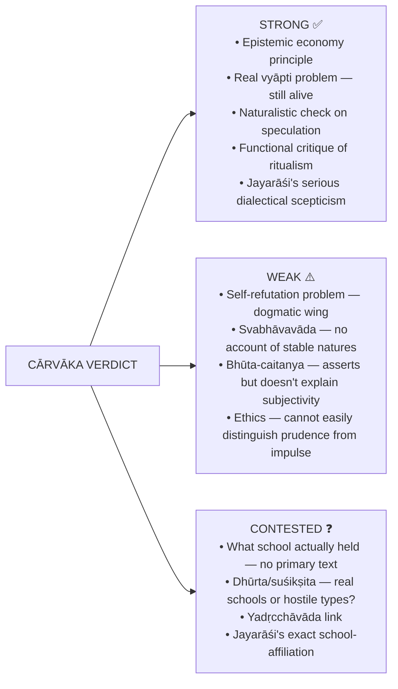

> **Ready exam verdicts:**
> - **10 marks:** Strongest as epistemological protest against unverifiable metaphysics; weakest when rejection of inference becomes absolute.
> - **15 marks:** Pratyakṣa-only explains denial of ātman, karma, Īśvara, mokṣa; but Nyāya's self-refutation and vyāpti replies show why it cannot stand as a complete theory.
> - **20 marks:** Dogmatic wing is vulnerable; refined wing is coherent empiricist restriction; Jayarāśi's wing is serious prasaṅga-scepticism — not crude materialism.

---

## 15. ANSWER ARCHITECTURE

### 10-Mark Structure

1. **Thesis:** Perception alone is pramāṇa
2. **Vyāpti problem** in 3 steps: not by perception → not by inference → not by testimony
3. **One sharp line** on upādhi or self-refutation
4. **Conclude:** link epistemology to anti-metaphysics

> *"Cārvāka's rejection of suprasensible entities is not an independent metaphysical whim; it is the ontological consequence of restricting valid knowledge to perception."*

---

### 15-Mark Structure

1. **Frame:** Cārvāka = radical empiricist challenge within Indian philosophy
2. **Body A:** Pratyakṣa as sole pramāṇa
3. **Body B:** Detailed objection to anumāna via vyāpti and upādhi
4. **Body C:** Nyāya reply or self-refutation criticism
5. **Close:** Philosophically powerful as critique, unstable as total theory

> *"The Achilles' heel of Cārvāka is that the denial of inference seems itself inferential unless the thesis is softened into a critique of certainty rather than of all worldly reasoning."*

---

### 20-Mark Structure

1. **Frame:** Epistemology generates metaphysics
2. **Section 1:** Theory of knowledge — full anti-inference argument
3. **Section 2:** How that yields denial of ātman, karma, rebirth, God, mokṣa, Veda
4. **Section 3:** Compare with Buddhism or Nyāya (per question)
5. **Section 4:** Balanced evaluation — anti-dogmatic force vs self-referential difficulty
6. **Conclude:** Qualified verdict — never caricature

> *"Jayarāśi transforms the Cārvāka challenge from dogmatic perceptualism into a prasaṅga-style dissolution of all pramāṇa-definitions."*

---

*Source: [`Carvaka.md`](../upsc-ai-kit/knowledge/Philosophy/paper-1/indian/Carvaka.md) — UPSC AI Kit canonical knowledge base*
