# CĀRVĀKA (Lokāyata) — Examiner-Grade Mindmap

> **Syllabus (verbatim):** Carvaka : Theory of Knowlegde; Rejection of Transcendent Entities.
> **Catalogue key:** `philosophy-paper-i-indian-philosophy-01` · Paper I · Indian Philosophy
> **Sources used:** `paper-1/indian/Carvaka.md` (canonical owner) · `_advanced/Indian-Philosophy-Dossier.md` §1 (optional depth) · `paper-1/_PYQ-Indian-Philosophy-2018-2025.md` · `paper-1/_PYQ-Indian-Philosophy-2026.md` (Cārvāka: 0 parts).
> **Evidence key:** ✅ canonical doctrine · ⚠️ analytical synthesis · ❓ contested / uncertain

> [!IMPORTANT]
> **Core thesis.** Cārvāka's rejection of suprasensible entities is not an independent metaphysical whim; it is the ontological consequence of restricting valid knowledge to perception. Epistemology drives metaphysics. ⚠️

---

## 0. Master Overview

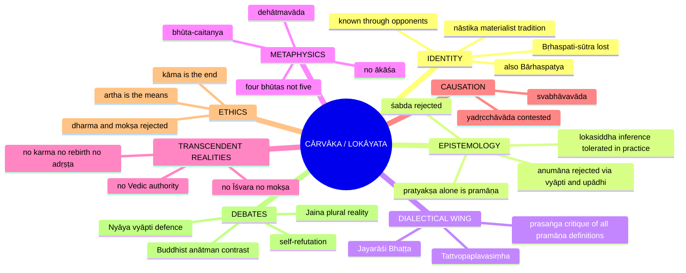

---

## 1. Identity, Lineage & Doxography

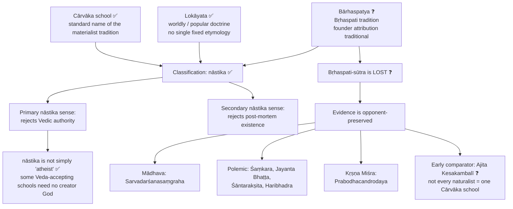

| Name | Sanskrit | Safe use |
|---|---|---|
| Cārvāka school | Cārvāka | Standard name. Derivations "to chew" / "pleasant speech" are doxographical etymologies, not settled history ❓ |
| Worldly / popular doctrine | Lokāyata | Alternative name; do not infer a fixed etymology |
| Bṛhaspati tradition | Bārhaspatya | Founder legends are not independent historical proof, since the attributed *Bṛhaspati-sūtra* is lost |

**Source problem ❓.** Mādhava's *Sarvadarśanasaṃgraha* preserves the famous Cārvāka chapter, but it is an opponent's presentation. Opponents may preserve real doctrines while selecting the crudest or most refutable version. Reconstruction must rest on convergent themes: perceptualism, anti-inferentialism, anti-scripturalism, four-element theory, rejection of afterlife.

**Ritual-ridicule fragments ❓.** Surviving fragments (śrāddha, sacrifice; "if an animal slain in sacrifice goes to heaven, the sacrificer should slay his own father") are polemical fragments, not a systematic treatise. The priestly-livelihood accusation is supplementary to the epistemological argument.

> [!TIP]
> **Opening line.** "Cārvāka, also called Lokāyata or Bārhaspatya, is the nāstika materialist tradition," then immediately qualify that its positive system is reconstructed mainly from opponents.

---

## 2. Theory of Knowledge (Epistemology)

### 2.1 Overall chain

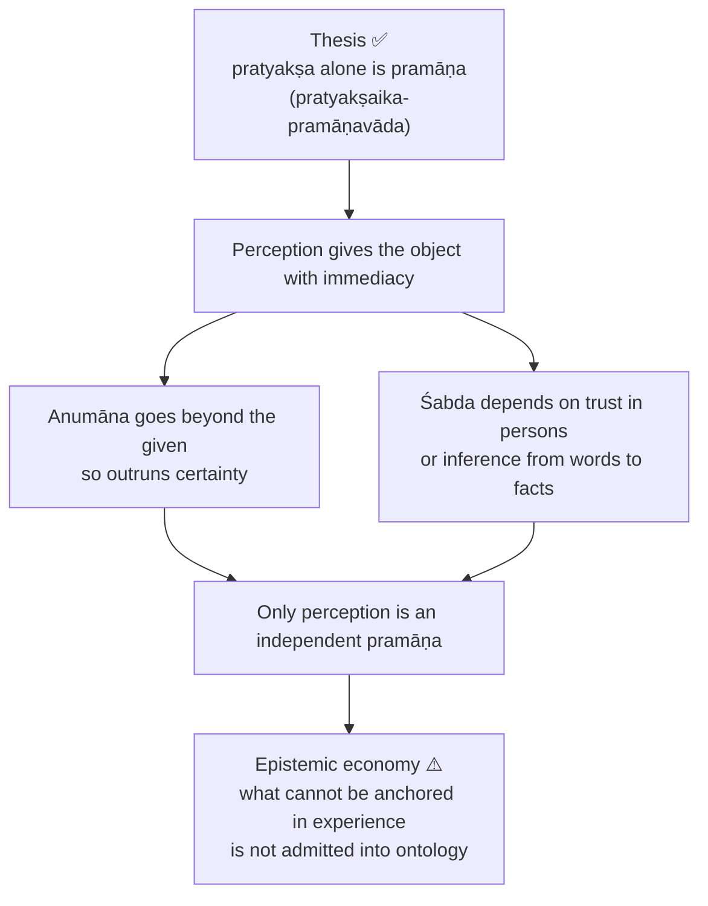

**Stronger than 'primary'.** Nyāya also values perception highly but admits inference, comparison and testimony. Cārvāka admits perception **alone**.

### 2.2 External and internal perception ✅

| Mode | Term | Immediately given | Not thereby established |
|---|---|---|---|
| External | **bāhya-pratyakṣa** | Colours, sounds, tastes, smells, touches, bodies, material processes | Unseen universals, karmic forces, creator |
| Internal / mental | **mānasa / antara-pratyakṣa** | Pleasure, pain, desire, conscious states | A consciousness-bearing soul apart from the living body |

> [!WARNING]
> "Cārvāka denies consciousness" is **false**. It denies a transcendental self, not the perceived occurrence of awareness.

### 2.3 Why anumāna fails: the vyāpti problem ✅

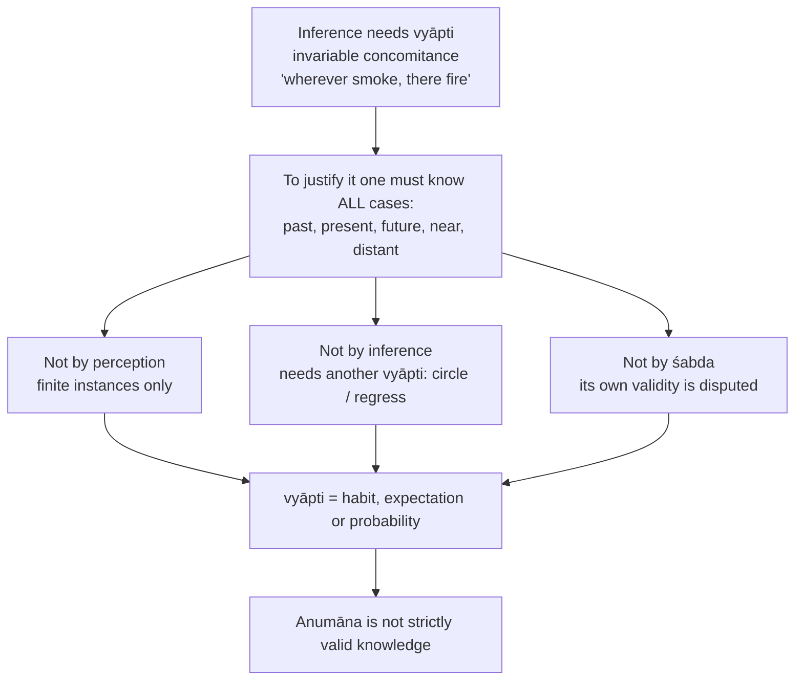

- **Presupposition ⚠️:** universality must be certain; probabilistic success is not enough.
- **Distinction ✅:** the Cārvāka does not deny that people move from sign to signified; he denies this yields **necessary and exceptionless** knowledge.
- **Reply to 'practice relies on inference':** "Often" is not "always"; a single defeating case destroys a universal. Practical confidence is not philosophical certainty.

### 2.4 The upādhi problem ✅

| Step | Content |
|---|---|
| 1 | Observe fire repeatedly accompanied by smoke |
| 2 | Hasty universal: wherever fire, there smoke |
| 3 | Smoke may need **wet fuel** (conditioning factor / upādhi), so fire alone does not establish smoke |
| 4 | This qualifies **fire → smoke**, NOT **smoke → fire** |
| 5 | For smoke → fire the broader Cārvāka question: have all hidden exceptions to a purported universal been excluded? The wet-fuel case is not a counterexample to that inference |

> [!WARNING]
> Do not present wet fuel as a counterexample to smoke → fire. It qualifies fire → smoke.

### 2.5 Why śabda fails ✅

1. Testimony tells only that someone uttered something.
2. Moving from utterance to truth needs the speaker's competence and honesty.
3. That is inferred, not given in the words, and inference is insecure.
4. For the Veda, authorlessness or infallibility is not perceptually available.
5. So scriptural testimony cannot establish unseen entities.

*Traveller example:* "there is water beyond the grove" may be followed pragmatically, but lacks certainty until the water is perceived. Rejecting śabda is not rejecting all communication; language guides action only insofar as it is later tied to perception.

### 2.6 Other claimed pramāṇas ⚠️

| Claimed means | Term | Cārvāka reduction |
|---|---|---|
| Comparison | **upamāna** | Resemblance perceived; moving to a stable word-kind relation needs generalization |
| Postulation | **arthāpatti** | Postulated fact unperceived; necessity depends on a universal excluding alternatives |
| Non-cognition | **anupalabdhi** | "If it existed here it would be perceived" is itself a universal conditional |

*Scope caution:* standard accounts directly stress rejection of inference and testimony; this table is systematic reconstruction, not a claim that one surviving text refutes each category.

### 2.7 Lokasiddha inference ⚠️

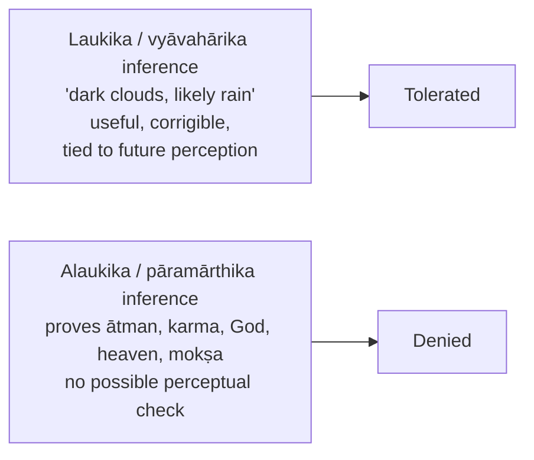

- **Accidental truth ✅:** successful inference does not prove inference a pramāṇa; truth is an accidental, separable feature of inferential practice.
- Example: infer food is cooking and act; refuse to infer unseen merit producing heaven from ritual.

### 2.8 Nyāya rejoinder ✅

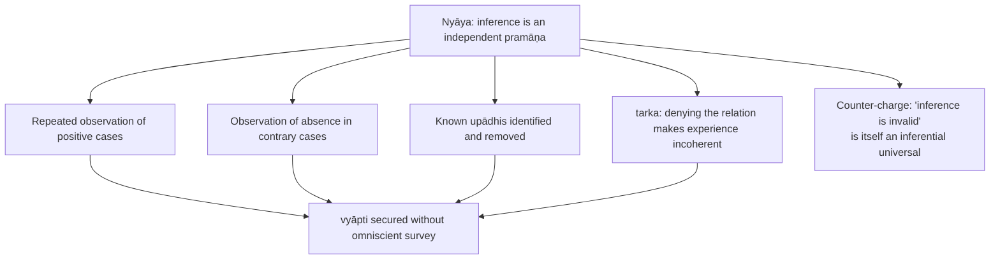

Nyāya's strongest systematic defence also uses *sāmānyalakṣaṇa-pratyakṣa* (ledger §6B of the owner file). Residual burden on Nyāya: how does it exclude every unobserved exception?

### 2.9 Is rejection of inference acceptable to other systems? (2018 Q8(b)) ✅/⚠️

| Rival | Why it rejects the restriction | Still requires defence |
|---|---|---|
| Nyāya–Vaiśeṣika | Inference is a distinct pramāṇa: hetu, vyāpti, positive and negative cases, upādhi removal, tarka | Infallibility of the universal |
| Buddhist epistemology | Dignāga/Dharmakīrti accept inference with *trairūpya*; causal or identity relations | Inferred universals are conceptually constructed; extrapolation to karma beyond life disputed |
| Jain epistemology | Indirect cognition (*parokṣa*) includes inference; standpoint stated | Conditionality cannot excuse a defective sign |
| Sāṃkhya/Yoga | Perception alone cannot disclose prakṛti and puruṣa; inference from effects constructive | Are the posited principles uniquely required? |
| Mīmāṃsā and Vedānta | Inference admitted in suitable domains; Vedic/Upaniṣadic testimony has separate claimed scope | Text authority and bounds of inference disputed |

**Two verdicts:** (a) not acceptable to rivals, who cannot defend inferential and scriptural commitments if all cognition beyond perception is disqualified; (b) rivals better explain prediction, corrigible error and intersubjective reasoning, yet none is made justified merely by prevailing in debate. Do not give all five systems an identical Nyāya theory of vyāpti.

---

## 3. Dialectical Wings & Sceptical Refinements

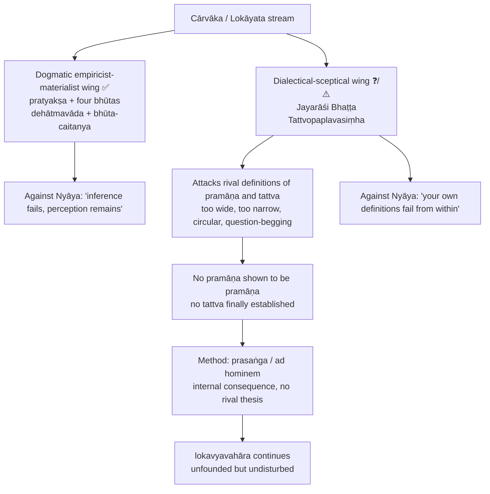

- *Tattvopaplavasiṃha* = "The Lion that Devours / Overturns All Principles / Categories"; the only surviving text usually classified with the stream, but a text of radical scepticism, not positive materialism ❓.
- **Jayarāśi Bhaṭṭa** (not "Bhāṭṭa", which names Kumārila's Mīmāṃsā school).
- Perception tu quoque: if occasional error disqualifies inference, illusion disqualifies perception by the same standard.
- Parallels flagged: Madhyamaka "no thesis" stance (Nāgārjuna); Pyrrhonism's continuation of everyday life. Resemblance, not identity.
- Residual worry: even a purely destructive dialectic may covertly assume destructive reasoning is reliable.
- Affiliation dispute (advanced): continuity reading (radicalises anti-pramāṇa pressure) vs discontinuity reading (exceeds normal Cārvāka). Use him as evidence of a sceptical wing or allied tendency; **never** to state Cārvāka epistemology ⚠️.

### 3.1 Dhūrta and suśikṣita Cārvāka ❓/⚠️

| Type | Meaning | Position |
|---|---|---|
| **Dhūrta** | cunning / rogue (crude, caricatured) | Denies everything beyond four elements; consciousness = body |
| **Suśikṣita** | well-educated (refined) | May admit lokasiddha anumāna; denies inference to supersensible; some reports allow a self distinct from the gross body yet no survival after death |

> [!WARNING]
> Labels are indirect and inconsistent across doxographies. Do not write as if two attested institutions with extant texts. The refined position supplies the strongest reply to self-refutation. This is **not** the same as the fourfold self-taxonomy in §4.4.

---

## 4. Metaphysics & Ontology

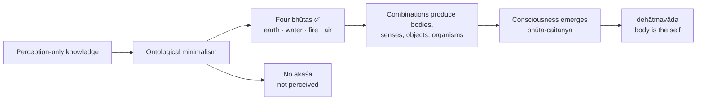

### 4.1 Four bhūtas, not five ✅

- Earth, water, fire, air are perceptually grounded; ākāśa is not directly perceived.
- Naiyāyika infers ākāśa as the substratum of sound; Cārvāka rejects that inference as an unnecessary metaphysical multiplication.
- In the standard account the elements are eternal material bases; their combinations produce and dissolve particular bodies.

### 4.2 Self: dehātmavāda ✅

- Experienced conscious life is always embodied; no self is perceived apart from bodily states.
- Evidence: injury, intoxication, age, sleep and disease visibly alter awareness.
- **Identity-language argument:** "I am stout / I am thin" predicates bodily properties of the person. Opponent: "my body" separates possessor and possessed. Reply: possessive grammar does not by itself prove a separable substance.
- Memory objection → continuity is bodily-psychological continuity, not proof of a soul.

### 4.3 Consciousness as emergent ✅

| Analogy | Content |
|---|---|
| **Betel** | Leaf, lime and areca nut together produce red colour absent in each |
| **Fermentation** | Yeast / fermenting conditions generate intoxicating power absent in ingredients |

Not identity with any one element; a property of the **organized** body. Objection (Jaina, Advaita): emergence is asserted more than explained, and an emergent property needs a bearer. Cārvāka reply: positing an immaterial soul merely renames the unexplained.

### 4.4 Four materialist identifications of the self ❓/⚠️ (Sadānanda, *Vedāntasāra*)

| Variant | Self identified with | Term |
|---|---|---|
| Body theory | Gross body | **sthūla-śarīra** |
| Sense theory | Sense faculties | **indriya** |
| Vital-process theory | Vital breaths | **prāṇa** |
| Mind theory | Mental organ | **manas** |

Shared core: no immortal self independent of embodied organization.

---

## 5. Rejection of Transcendent Realities

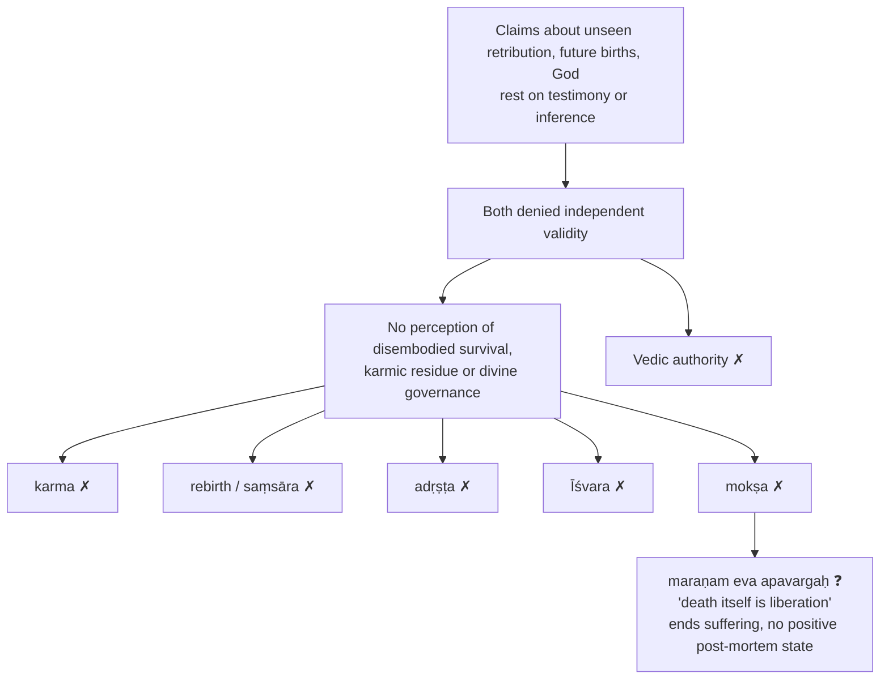

- Not merely a challenge to one proof of God; it undercuts the whole class of suprasensible postulates.
- Ritual example: ghee visibly consumed in fire; production of heaven unperceived.
- *maraṇam eva apavargaḥ* is an opponent-preserved formula, **not** a quotation from an extant Cārvāka scripture.
- Moral-order objection → reply: pain, pleasure, prudence and social consequences suffice for practical conduct.

### 5.1 Ākāśa **and** transmigration (2020 Q6(b)) ✅/⚠️

| Demand | Cārvāka | Rival reply | Assessment |
|---|---|---|---|
| **Ākāśa** | Four perceptible elements; hearing sound ≠ perceiving ākāśa; ākāśa is inferred | Nyāya–Vaiśeṣika: a ground of sound or spatial accommodation must be posited | Absence of perception alone does not prove non-existence if indirect knowledge is possible, the rival's disputed premise |
| **Transmigration** | Needs a persisting soul and causal continuity (often karma), neither given in embodied perception; dehātmavāda and bhūta-caitanya undercut the soul; denial of karma blocks the bridge | Jaina / Vedāntin: continuity, memory, testimony; **Buddhism** gives rebirth without eternal ātman | Refuting a **soul's** migration does not refute **every** rebirth theory |

Verdict: one epistemic rule, two targets (imperceptible physical substratum; imperceptible persisting agent and moral continuity). Strongest objection: Cārvāka itself relies on unperceived combinations; moderate reply separates hypotheses tied to possible perceptual checks from claims permanently beyond them.

---

## 6. Explanatory & Causal Principles

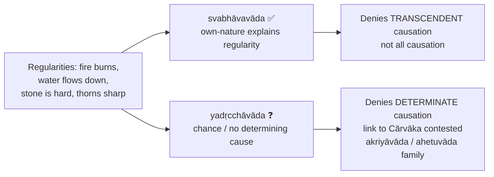

- Standard svabhāva illustrations: thorn sharpness, variegated peacock colours, fire's burning, water's downward flow, stone's hardness.
- **Safe exam formula:** attribute **svabhāvavāda** to Cārvāka; mention **yadṛcchāvāda** as a related option sometimes associated with the school, marked contested ❓.
- Objection: "by its nature" is a placeholder. Reply: every explanation terminates in brute natures; God's will is also terminal and less economical. Residual force: Cārvāka gives no developed account of why natures are stable, which Nyāya's vyāpti machinery and karma-theories try to supply.
- Advanced: positive-naturalist reading vs deflationary reading (mainly a polemical refusal of adṛṣṭa / Īśvara). Its safe value is negative.

---

## 7. Ethics & Human Goals (Puruṣārthas)

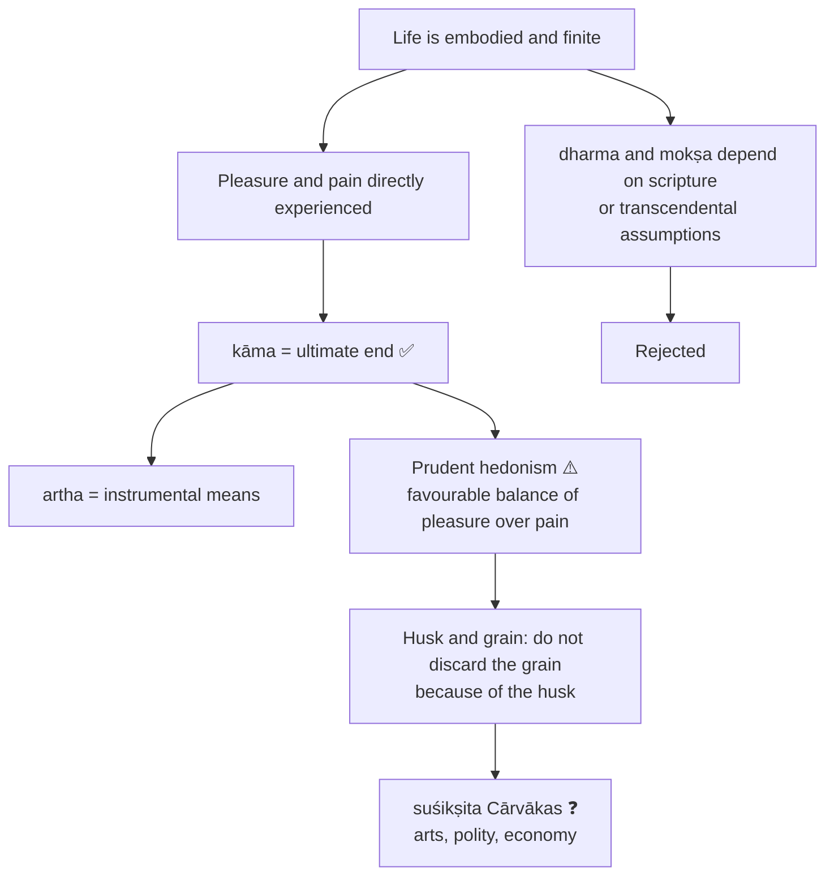

- Verse "yāvat jīvet sukhaṃ jīvet" ("as long as one lives, let one live happily") is a doxographical verse associated with the image, not a securely locatable line from an extant primary text.
- Pleasure and wealth are **not** co-equal ends: pleasure the end, wealth the means.
- Objection: crude hedonism ignores long-term harm and public obligation. Reply: a refined prudential reading. Residual weakness: still struggles to derive impartial moral obligation from pleasure alone.

---

## 8. Inter-School Comparative Matrices

| School | Pramāṇas | Self | Consciousness | Karma / rebirth | Scripture | God | Puruṣārthas | Liberation |
|---|---|---|---|---|---|---|---|---|
| **Cārvāka** | Pratyakṣa alone (strict); lokasiddha inference as practical habit ⚠️ | Body-self | Emergent bhūta-caitanya | Rejected | Rejected | Rejected | Kāma, artha | Rejected |
| **Nyāya–Vaiśeṣika** | Perception, inference, comparison, testimony | Enduring ātman | Quality of self | Accepted | Accepted as reliable testimony | Generally affirmed in later Nyāya | All four | Apavarga |
| **Buddhism** | Varies; perception and inference central | No enduring ātman | Stream of momentary states | Accepted without eternal self | Buddhist teaching within its framework | Creator-God denied | Path-oriented revaluation | Nirvāṇa |
| **Jainism** | Multiple pramāṇas with standpoint theory | Plural jīvas | Intrinsic to jīva, obscured by karma | Accepted | Jaina teaching | Creator-God denied | Ethical-spiritual discipline | Mokṣa of jīva |
| **Sāṃkhya–Yoga** | Perception, inference, testimony | Puruṣa ≠ prakṛti | Puruṣa as pure consciousness | Accepted | Accepted | Sāṃkhya non-theistic; Yoga admits Īśvara | All four subordinated to release | Kaivalya |
| **Mīmāṃsā** | Six pramāṇas incl. arthāpatti, anupalabdhi, śabda | Enduring self | Attribute tied to self | Accepted | Veda intrinsically authoritative | Creator-God not central | Dharma central | Often secondary; varies |
| **Advaita Vedānta** | Six; śruti decisive for Brahman | Ātman = Brahman | Self-luminous consciousness | Empirical-level acceptance | Upaniṣadic śruti decisive | Īśvara at empirical level | Mokṣa supreme | Liberation through knowledge |

### 8.1 Cārvāka vs Nyāya on inference ⚠️

| Axis | Cārvāka | Nyāya |
|---|---|---|
| Inference | Denied as strictly valid | Independent pramāṇa |
| Vyāpti | Cannot be certainly established | Repeated observation, absence cases, upādhi-elimination, tarka |
| Upādhi | Permanent threat | Known upādhis identified and excluded |
| Practical success | Habitual, probable | Indicates real legitimacy |
| Self-refutation | Acute for strict denial | Used as main critique |

### 8.2 Cārvāka vs Jainism on Reality (2020 Q7(c)) ✅/⚠️

| Axis | Cārvāka | Jainism |
|---|---|---|
| Entities | Four elements: earth, water, fire, air | **Six dravyas:** jīva, pudgala, dharma (medium of motion), adharma (medium of rest), ākāśa (space), kāla (time) |
| Space | Imperceptible ākāśa not established | Space is a **substance** accommodating others; dharma/adharma here are media, **not** moral merit/demerit |
| Self | Body-self; consciousness depends on organized matter | Plural conscious jīvas distinct from pudgala, obscured by karmic matter |
| Persistence | Bodily compounds arise and perish | Substances persist through changing modes (paryāya) |
| Knowledge | Strict: perception alone | Several kinds incl. indirect inference and direct knowledge; anekāntavāda |
| Consequence | Karma, rebirth, liberation rejected | Material karmic bondage, rebirth, release of jīva central |

> [!WARNING]
> Anekāntavāda does **not** assert that four-element and six-substance ontologies are both literally true in the same respect. Name all six substances; do not write "spiritual".

### 8.3 Cārvāka vs Buddhism on self (2024 Q6(a)) ✅/⚠️

| Axis | Cārvāka | Buddhism |
|---|---|---|
| Thesis | **Dehātmavāda**: body is the self | **Anātman / nairātmyavāda**: no enduring self-substance, even in the body |
| Argument | No disembodied bearer perceived; awareness depends on bodily conditions; emergence analogies | Examines any proposed "I" among changing aggregates; rejects appropriation as owner |
| Ontology | Materialist | Processual, varies by school |
| Consciousness | Emergent property of elements | Stream of momentary states |
| Rebirth / karma | Rejected | Accepted without eternal self |
| Liberation | No mokṣa | Nirvāṇa, cessation of craving |

Mutual objections: Cārvāka says post-mortem continuity is unobserved; the Buddhist says equating person with body neither explains continuity of a stream nor makes craving cease. Buddhist must answer "who is liberated?" via causal continuity; Cārvāka must explain subjectivity via organized matter.

**Structural role.** Cārvāka is the standing **pūrvapakṣa** of Indian philosophy: Nyāya clarifies vyāpti by answering it; Mīmāṃsā sharpens Vedic authority against it; Buddhism and Jainism defend karma without crude eternalism; Vedānta defends self-luminosity against body-materialism.

---

## 9. Criticisms & Reconstructed Replies

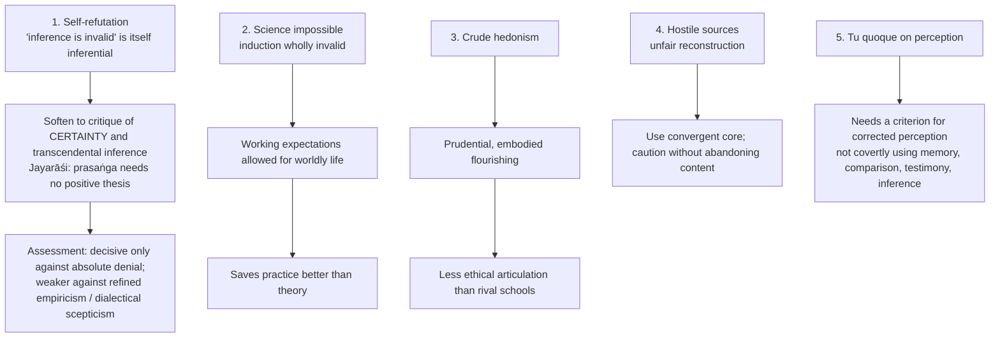

### 9.1 Pūrvapakṣa–siddhānta ledger ⚠️

| Objector | Objection | Cārvāka reply | Residual force |
|---|---|---|---|
| Nyāya | Self-refutation; vyāpti via upādhi-elimination, tarka, sāmānyalakṣaṇa-pratyakṣa; self proved because desire, aversion, effort, pleasure, pain, cognition inhere in a substance | Dogmatic: vyāpti never certain. Sceptical: opponent's definitions fail from within | Strongest systematic defence of inference |
| Buddhism | Karma and rebirth without eternal ātman; momentariness ≠ materialism; inference valid | Rebirth and karma still outrun perception; momentary streams as unseen as souls | Subtler opponent than theism |
| Jainism | Elements lack consciousness; emergent property needs a bearer | Combinations may show novel properties; jīva adds an unperceived substance | Emergence asserted more than explained |
| Advaita / Vedānta | Consciousness is self-luminous; body is known **by** consciousness | Self-luminosity describes experienced awareness, not proof of disembodied ātman | Subject-object problem hard for emergence |
| Mīmāṃsā | Veda's authority intrinsic; ridicule is no argument against apauruṣeyatva or dharma | Intrinsic authority not perceived; ritual results unseen | Sophisticated theory of language; satire insufficient |
| Yoga / Sāṃkhya | Puruṣa distinct from prakṛti; experience, agency, liberation need a consciousness-principle beyond matter | Puruṣa not perceived apart from embodied awareness | Struggles to explain witness-consciousness |

### 9.2 Presupposition ledger ⚠️

| Doctrine | Presupposition | What collapses if denied |
|---|---|---|
| Perception sole pramāṇa | Immediate presentation is the only secure mark | Anti-inference and anti-scripture programme |
| Vyāpti critique | Universality must be certain | Anumāna rehabilitated as disciplined fallible knowledge |
| Upādhi | Hidden conditions always possible | Nyāya upādhi-elimination secures universals |
| Rejection of śabda | Words need independent proof of speaker competence | Veda and testimony regain status |
| Four bhūtas | Only perceptibly grounded elements admissible | Fifth element inferred from sound |
| Bhūta-caitanya | Consciousness can arise from organized matter | Non-material self needed |
| No karma/rebirth | No unseen moral continuity established | Dharma, rebirth, liberation regain force |
| Svabhāvavāda | Observable natures suffice | Divine will, adṛṣṭa, teleology invoked |
| Hedonist ethics | Value anchored in embodied experience | Dharma and mokṣa override kāma and artha |
| Rejection of mokṣa | Bondage and liberation need unproved self | Whole puruṣārtha scheme defensible |

---

## 10. Controlled Western Comparisons

| Comparator | Point of contact | Decisive disanalogy |
|---|---|---|
| **Hume** | Doubts observed conjunction yields necessary universal connection; suspicious of substance, soul, God beyond impressions | Hume keeps inductive reasoning, treating custom as guide; Cārvāka concludes inference is not a pramāṇa. Hume targets necessary connexion through impressions; Cārvāka targets vyāpti via regress and upādhi. Bundle view ≠ positive dehātmavāda; Hume has developed moral psychology |
| **Ayer / logical positivism** | Anti-metaphysics on experiential grounds | Ayer's claim is semantic (meaningless); Cārvāka's is epistemic/ontological (not known, not admitted). Ayer preserves scientific theory; strict Cārvāka threatens science. Verification principle also charged with self-refutation |
| **Epicurus / Lucretius** | Materialism, anti-fear religion, pleasure | Epicurean pleasure ascetic and calculative, aiming at ataraxia |
| **Pyrrhonism** | Ordinary life continues after suspension / collapse of foundations | Pyrrhonism seeks tranquillity through epochē; Jayarāśi destroys pramāṇa-definitions within Indian debate |
| **Feuerbach / Marx** | Ritual as priestly livelihood anticipates a functional critique of religion | They build projection / alienation / ideology theories; Cārvāka offers polemic only |
| **Locke / empiricism** | Knowledge tied to experience | Locke accepts abstraction, probability, testimony, science-friendly inference |

> [!WARNING]
> Never write "Cārvāka is the Indian Hume" without the disanalogies. These are analogies, not historical influences; place in one or two lines **after** the Cārvāka case.

---

## 11. Diagnostic Deep-Dives for High-Frequency Themes

### 11.1 Is Cārvāka positivistic? (2024 Q5(a)) ⚠️

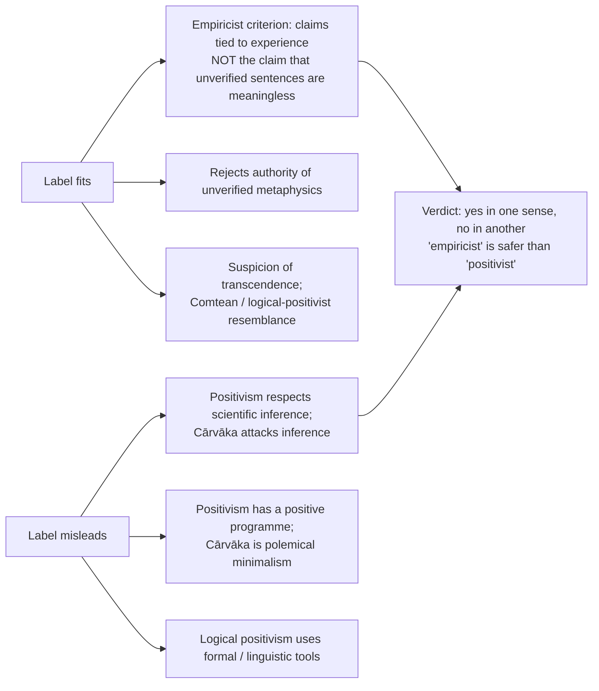

### 11.2 'All men are mortal; Socrates is a man…' (2019 Q6(c)) ⚠️

| Step | Content |
|---|---|
| 1 | Formal validity: the conclusion **does follow** in classical syllogistic logic |
| 2 | Defect is epistemic warrant: the universal major premise is not perceived or established by a valid pramāṇa |
| 3 | Perception shows particular deaths; cannot survey all persons, including those not yet dead |
| 4 | Inferring the universal presupposes inductive warrant: regress / circularity; scripture shifts the issue to śabda |
| 5 | Minor premise secure if Socrates' humanity is directly known; testimony-only access adds a warrant question |
| 6 | If premises granted, valid conditional derivation; strict view denies guaranteed new knowledge; moderate view allows useful expectation |
| 7 | Nyāya reply: positive/negative observation, upādhi search, tarka; no need for exhaustive observation; sceptic still asks about unobserved exceptions |

> [!WARNING]
> Do **not** say "Socrates is not mortal" and do not present a hidden upādhi as a demonstrated exception to mortality.

### 11.3 Self-refutation (2019 Q5(c), 2025 Q5(a)) ⚠️

1. Cārvāka: no inference is valid. 2. That is a universal, not one present perception. 3. Universals are not perceptually given. 4. So he must infer, generalize or reason to maintain it. 5. Doing so uses what he rejects; refusing leaves the thesis undefended.

Escape routes: (a) soften to critique of certainty and transcendental inference; (b) Jayarāśi prasaṅga, no positive thesis. The charge bites hardest against the **dogmatic** wing asserting "perception alone" and "four elements alone".

---

## 12. PYQ Routing Ledger (2018–2025)

> Corpus signal: 9 primary-owned parts out of 112; no primary-owned part in 2022 or 2023. 2026 supplement: Cārvāka absent (0 parts).

| Year | Q | Marks | Exact demand | Map to |
|---|---|---:|---|---|
| 2018 | Q8(b) | 15 | Is Cārvāka rejection of inference acceptable to the other systems of Indian philosophy? If not, why? Do you think the views of other systems to be justified? Give reasons for your answer. | §2.9 |
| 2019 | Q5(c) | 10 | Are the Cārvākas consistent when they hold that inference is not a source of knowledge? Discuss. | §11.3, §3 |
| 2019 | Q6(c) | 15 | What is wrong according to the Cārvākas with the following argument? All men are mortal. Socrates is a man. Therefore, Socrates is mortal. Justify your answer with arguments. | §11.2 |
| 2020 | Q6(b) | 15 | Critically evaluate Cārvākas' rejection of Ākāśa as one of the elements of reality and examine their criticism of transmigration of Soul. | §5.1 |
| 2020 | Q7(c) | 15 | Explain the differences of conception of Reality between Cārvāka and Jainism. | §8.2 |
| 2021 | Q5(e) | 10 | Comment on the bearing of Cārvāka epistemology on the rejection of transcendental entities by them. | §1–§5 chain |
| 2024 | Q5(a) | 10 | Do you think Cārvāka's philosophy is positivistic in nature? Give reasons and justifications for your answer. | §11.1 |
| 2024 | Q6(a) | 20 | Differentiate between the Cārvākas' refutation of self as a transcendental category and the Buddhist rejection of ātmā. | §8.3 |
| 2025 | Q5(a) | 10 | Explain the ground on which Cārvāka rejects inference as a valid source of knowledge. | §2.3 |

Cross-link (owned by Nyāya–Vaiśeṣika, 2022 Q7(c), 15 marks): *How do Naiyāyikas respond to Cārvāka's objections against inference and establish inference as an independent means of knowledge? Critically discuss.* → §2.8.

---

## 13. Top 10 UPSC Exam Traps

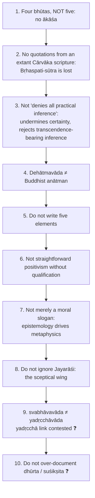

Extra pitfalls recorded in the sources: wet fuel qualifies fire → smoke, not smoke → fire (§2.4); "Cārvāka denies consciousness" is false (§2.2); "Socrates is not mortal" is wrong (§11.2); nāstika ≠ atheist (§1); do not give all rival systems an identical Nyāya theory of vyāpti (§2.9); *maraṇam eva apavargaḥ* and *yāvat jīvet sukhaṃ jīvet* are doxographical, not extant-text quotations; Jayarāśi **Bhaṭṭa**, not "Bhāṭṭa".

---

## 14. Technical Vocabulary & IAST Bank

| English gloss | IAST | Meaning | Status |
|---|---|---|---|
| Perception-alone doctrine | pratyakṣaika-pramāṇavāda | Perception alone is the pramāṇa | ✅ |
| Means of valid knowledge | pramāṇa | | ✅ |
| Invariable concomitance | vyāpti | Presupposed by inference | ✅ |
| Hidden / conditioning factor | upādhi | Vitiates hasty universalization | ✅ |
| Worldly-established inference | lokasiddha anumāna | Practical, perception-grounded | ⚠️ |
| Body-self doctrine | dehātmavāda | Body is the self | ✅ |
| Consciousness from elements | bhūta-caitanya | | ✅ |
| Own-nature doctrine | svabhāvavāda | Not denial of causation; denial of transcendent causation | ✅ |
| Chance doctrine | yadṛcchāvāda | Denial of determinate causation | ❓ |
| Crude / refined Cārvāka | dhūrta / suśikṣita | Doxographical | ❓ |
| Unorthodox | nāstika | Primarily rejects Vedic authority | ✅ |
| Unseen force | adṛṣṭa | Rejected | ✅ |
| Liberation | mokṣa | Rejected | ✅ |
| Creator God | Īśvara | Rejected | ✅ |
| Inference / testimony / perception | anumāna / śabda / pratyakṣa | | ✅ |
| Comparison / postulation / non-cognition | upamāna / arthāpatti / anupalabdhi | | ⚠️ |
| Supportive reasoning | tarka | Nyāya | ✅ |
| Internal consequence | prasaṅga | Jayarāśi's method | ⚠️ |
| Everyday transaction | lokavyavahāra | Continues unfounded | ⚠️ |
| Gross body / senses / vital breath / mind | sthūla-śarīra / indriya / prāṇa / manas | Four self-models | ❓/⚠️ |
| Substances | dravya | Jaina: six | ✅ |
| Matter / media of motion and rest / space / time | pudgala / dharma / adharma / ākāśa / kāla | | ✅ |
| Mode | paryāya | Jaina | ✅ |
| Death itself is liberation | maraṇam eva apavargaḥ | Opponent-preserved formula | ❓ |
| Pleasure / wealth | kāma / artha | End / means | ✅ |
| Adversary's position | pūrvapakṣa | Cārvāka is the standing one | ⚠️ |

---

## 15. Graded Verdict & Answer Architectures

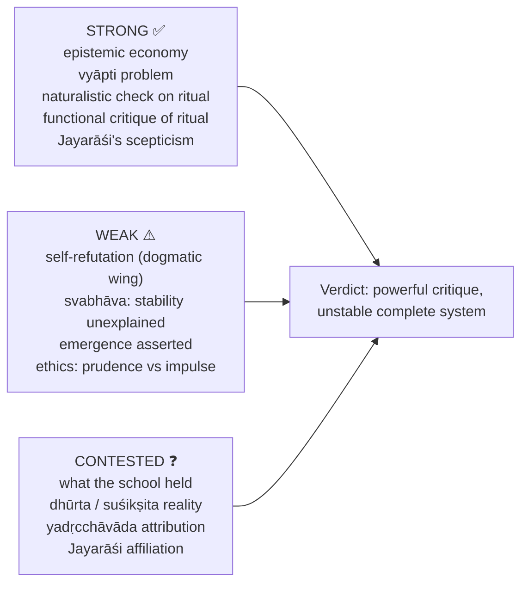

### 15.1 10-mark

```text
Thesis: perception alone is pramāṇa.
Vyāpti in 3 steps: not by perception, not by inference, not by testimony.
One sharp line on upādhi or self-refutation.
Conclude: epistemology → anti-metaphysics.
```
**Anchor:** "Cārvāka is strongest as an epistemological protest against unverifiable metaphysics, but weakest when its rejection of inference becomes absolute."

### 15.2 15-mark

```text
Frame: radical empiricist challenge within Indian philosophy.
A: pratyakṣa as sole pramāṇa.   B: anumāna via vyāpti and upādhi.
C: Nyāya reply or self-refutation.
Close: powerful as critique, unstable as total theory.
```
**Anchor:** "Its pratyakṣa-only principle powerfully explains the rejection of ātman, karma, Īśvara and mokṣa; yet Nyāya's self-refutation and vyāpti replies show why it cannot stand as a complete theory of knowledge."

### 15.3 20-mark

```text
Frame: epistemology generating metaphysics.
1: theory of knowledge, full anti-inference argument.
2: denial of ātman, karma, rebirth, God, mokṣa, Veda.
3: compare with Buddhism or Nyāya as asked.
4: balanced evaluation: anti-dogmatic force vs self-referential difficulty.
Conclude with a qualified verdict, not caricature.
```
**Anchor:** "The best verdict is graded: dogmatic Cārvāka is vulnerable, refined Cārvāka is a coherent empiricist restriction on supersensible inference, and Jayarāśi's wing is serious prasaṅga-style scepticism rather than crude materialism."

### 15.4 Directive decoder ⚠️

| Directive | Move | Closing verdict |
|---|---|---|
| Discuss | Doctrine → pramāṇa basis → metaphysical consequences → one criticism | "Cārvāka is best read as radical epistemic economy, not mere denial." |
| Examine | Trace pratyakṣa-only → anti-inference → anti-transcendence | "The conclusion follows if its strict perceptual premise is accepted." |
| Critically examine | Argument, then Nyāya / Vedānta / Mīmāṃsā objections and replies | "Powerful as critique, unstable as complete system." |
| Analyse | Pramāṇa, vyāpti, upādhi, śabda, ontology, ethics | "Its metaphysics is generated by epistemology." |
| Evaluate | Weigh strengths, weaknesses, contested history | "Valuable negative philosophy; limited positive account." |
| Compare / Distinguish | Fixed axes: pramāṇa, self, consciousness, karma, liberation | "Similarity at one point must not hide doctrinal difference." |
| Do you agree? | Qualified verdict after exposition | "Agree with its critique of unwarranted transcendence, not with its total pramāṇa restriction." |

> [!TIP]
> **Exam sentences.** (1) "The Achilles' heel of Cārvāka is that the denial of inference seems itself inferential unless the thesis is softened into a critique of certainty rather than of all worldly reasoning." (2) "Jayarāśi transforms the Cārvāka challenge from dogmatic perceptualism into a prasaṅga-style dissolution of all pramāṇa-definitions."

> [!NOTE]
> **Anti-caricature.** Present Cārvāka as a serious epistemological position and standing pūrvapakṣa, not as mere hedonism.

---

## Sources

Chatterjee & Datta, *An Introduction to Indian Philosophy*; C.D. Sharma, *A Critical Survey of Indian Philosophy*; S. Radhakrishnan, *Indian Philosophy* Vol. I; Jayarāśi Bhaṭṭa, *Tattvopaplavasiṃha* (cautiously); Mādhava, *Sarvadarśanasaṃgraha* (cautiously); polemics in Śaṃkara, Jayanta Bhaṭṭa, Śāntarakṣita, Haribhadra, Kṛṣṇa Miśra; D. Chattopadhyaya, *Lokāyata* (advanced dossier trail).
