# JAINISM — Examiner-Grade Mindmap

> **Syllabus (verbatim):** Jainism : Theory of Reality; Saptabhanginaya; Bondage and Liberation.
> **Catalogue key:** `philosophy-paper-i-indian-philosophy-02` · Paper I · Indian Philosophy
> **Sources used:** `paper-1/indian/Jainism.md` (canonical owner, read in full) · `_advanced/Indian-Philosophy-Dossier.md` §2 (optional depth) · `paper-1/_PYQ-Indian-Philosophy-2018-2025.md` · `paper-1/_PYQ-Indian-Philosophy-2026.md`.
> **Evidence key:** ✅ canonical doctrine · ⚠️ analytical synthesis · ❓ contested / uncertain

> [!IMPORTANT]
> **Core thesis.** Jaina realism is qualified not because reality is doubtful, but because finite judgement reaches the real only under conditioned standpoints. The chain is: many-sided reality (*anekānta*) → partial finite cognition (*naya*) → qualified predication (*syāt*, *saptabhaṅgī*) → karmic obscuration and its removal (*bandha* → *mokṣa*). ⚠️

---

## 0. Master Overview

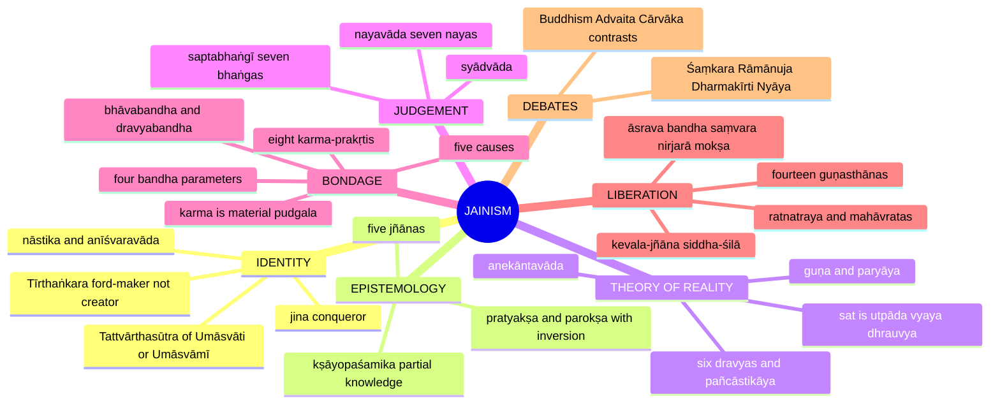

---

## 1. Identity, Lineage & Doxography

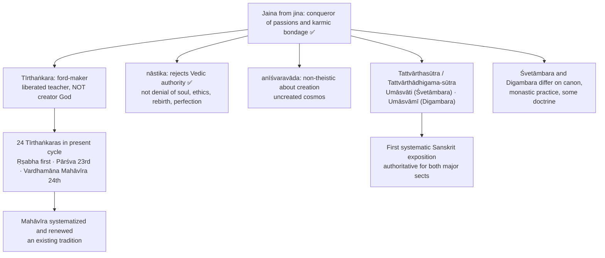

| Name | Associated with | Status |
|---|---|---|
| **Umāsvāti / Umāsvāmī** | *Tattvārthasūtra*: ratna-traya, tattvas, dravyas, jñāna, liberation | ✅ |
| **Kundakunda** | Digambara thinker; *Samayasāra*; **niścaya-naya / vyavahāra-naya** distinction | ✅ |
| **Siddhasena Divākara**, **Samantabhadra** | Early logic of anekānta and syādvāda | ✅ |
| **Akalaṅka**, **Māṇikyanandi**, **Hemacandra**, **Yaśovijaya** | Mature pramāṇa tradition | ✅ |

> [!NOTE]
> **Historical caution ❓.** Mahāvīra and Pārśva are historical anchors, but precise dates and claims about the earliest Tīrthaṅkaras need source-specific qualification. The sources give the framework, not legendary chronology. Do not invent sūtra numbers. Historical dating of several Jaina thinkers should not be asserted unless separately verified.

> [!TIP]
> Present Jainism as a systematic darśana, not a loose collection of ascetic practices. Exam formula: a religion of self-effort within an uncreated moral cosmos; non-theistic about creation, but neither materialist nor spiritually negative. ⚠️

---

## 2. Theory of Knowledge (Epistemology)

### 2.1 Pratyakṣa and parokṣa: the Jaina inversion ✅

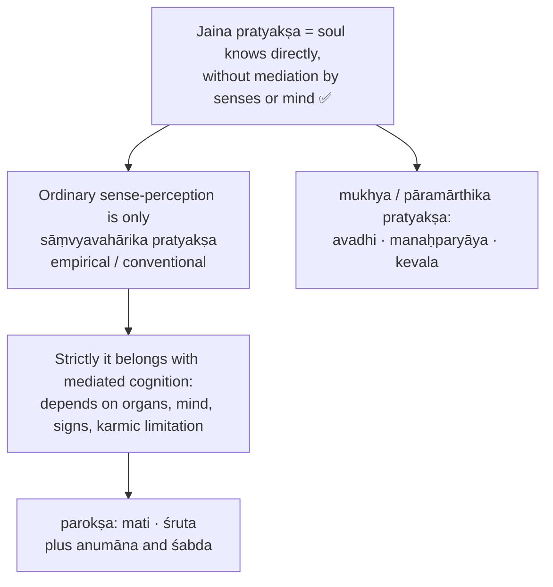

> [!WARNING]
> **Inverted pratyakṣa.** Do not map Jaina pratyakṣa mechanically onto Nyāya pratyakṣa. Seeing a pot is conventionally direct; **kevala-jñāna** is direct in the strict spiritual sense. Directness is measured by freedom from mediation and karmic obstruction, not sensory vividness.

### 2.2 Five jñānas ✅

| Jñāna | Status | Meaning | Trap |
|---|---|---|---|
| **Mati** | Parokṣa / conventional | Sense-and-mind cognition | Ordinary perception is not strict pratyakṣa |
| **Śruta** | Parokṣa | Scriptural, verbal, sign-mediated, derived from mati | Not blind faith |
| **Avadhi** | Mukhya / pāramārthika pratyakṣa | Limited clairvoyant direct knowledge of material things | Direct but limited |
| **Manaḥparyāya** | Mukhya / pāramārthika pratyakṣa | Direct knowledge of others' mental modes | Higher than avadhi, not omniscience |
| **Kevala** | Mukhya / pāramārthika pratyakṣa | Unlimited, unmediated omniscience | Full overcoming of cognitive obstruction |

- The five jñānas are **not** five independent pramāṇas in the Nyāya sense; they map graded release from karmic veiling.
- Do not confuse five jñānas, seven nayas and seven bhaṅgas.

### 2.3 Wrong cognition: ajñāna under mithyā-darśana ✅

| Term | Meaning |
|---|---|
| **Mati-ajñāna / kumati** | Misoriented sensory-mental cognition |
| **Śruta-ajñāna / kuśruta** | Misoriented verbal or scriptural cognition |
| **Vibhaṅga-jñāna** | Perverted avadhi |

Error here is not only logical; it can be a karmically conditioned mode of seeing. Example: a learned person quotes doctrine for pride, sectarian contempt or violence, so the verbal cognition functions as kuśruta. Objection (Nyāya): this confuses truth with moral psychology. Reply: bondage affects the knower as a whole.

### 2.4 Later Jaina logic ⚠️

- Anumāna and śabda sit within parokṣa; śabda is mediated knowledge, **not** a creator-God's revelation.
- Later logicians (Akalaṅka, Māṇikyanandi, Hemacandra, Yaśovijaya) accept **smṛti** (recollection), **pratyabhijñā** (recognition), **tarka / ūha** (reasoning grasping pervasion or vyāpti) and **anumāna** as valid indirect knowledge.
- Contrast ✅: Nyāya does not treat memory as an independent pramāṇa; the Jaina reply is that recollection and recognition can be valid when they connect present awareness to a real object or past experience.

### 2.5 The critical link: pramāṇa → naya → syāt ✅

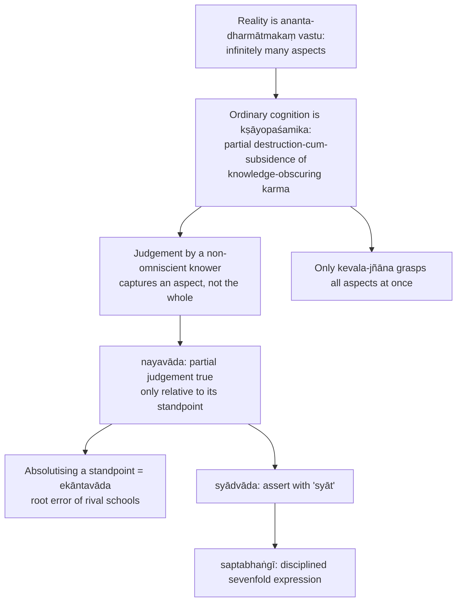

**Not subjectivism ✅:** aspects are really in the object; finite knowers access them partially. Partial is not false; it becomes false when it claims unconditioned finality. Reflexive reply to Śaṃkara: syādvāda too is asserted *syāt*.

---

## 3. Dialectical Wings & Sceptical Refinements

> The owner file does not name a radical-sceptical wing inside Jainism. Its dialectical content is the internal tension of non-absolutism and the optional-depth readings below; nothing is added beyond these.

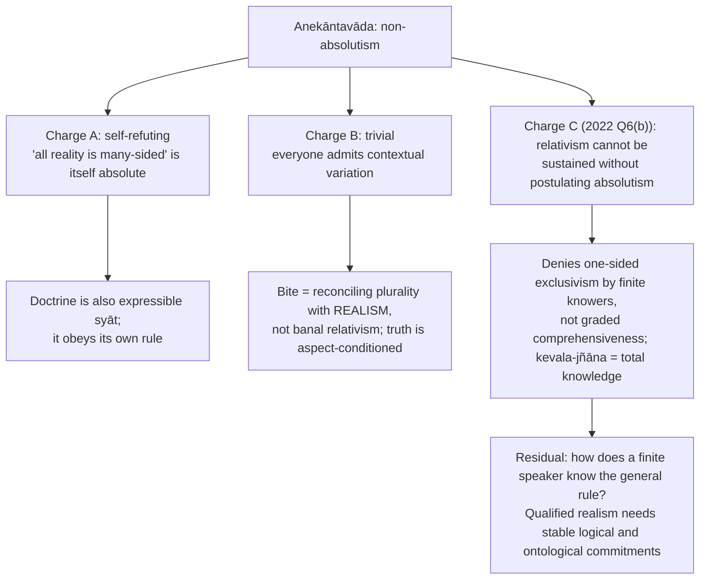

### 3.1 Optional advanced depth (dossier §2) ⚠️

| Module | Issue | Readings | Objection → reply |
|---|---|---|---|
| **Syādvāda as logic or disciplined predication** | Many-valued logic, modal logic, or context-indexed qualified assertion? | Modern formalising reading (proto-many-valued / modal) vs classical reading (standpoint-conditioned speech disciplined by ontological many-sidedness) | **Obj.** seven predications collapse into contradiction. **Reply:** predications differ by standpoint, time, respect or mode; not brute simultaneous contradictories |
| **Jīva's expansion and contraction** | How can an immaterial conscious substance fit bodies of different size and remain numerically the same? | Literal ontological reading vs restrained reading (marks embodiment-capacity without materialising the soul) | **Obj.** non-material reality should not have size. **Reply:** extension is a mode of embodied individuality, not gross physical magnitude in the Cārvāka sense |
| **Anekāntavāda vs Madhyamaka anti-essentialism** | Does Jain non-absolutism resemble Buddhist emptiness, or is it distinct realist pluralism? | Jaina: real dravyas persist through modes; Madhyamaka foil: all dharmas empty of svabhāva | **Obj.** Jainism secretly needs an absolute standpoint. **Reply:** concede an ontological real while denying finite judgements exhaust it unconditionally |

Source trail (dossier): Umāsvāti, *Tattvārtha-sūtra*; Padmanabh Jaini, *The Jaina Path of Purification*; Kundakunda, *Pañcāstikāyasāra*; Nāgārjuna, *Mūlamadhyamakakārikā*; Chatterjee & Datta; Radhakrishnan. **Do not over-study:** full naya sub-classification trees, cosmographic enumerations, sectarian numerology.

---

## 4. Metaphysics & Ontology (Theory of Reality)

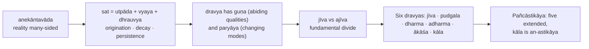

### 4.1 Anekāntavāda ✅

Five-step argument: real things endure through change and show multiple aspects → cognition grasps one aspect at a time → dogmatic one-sided claims distort → sound metaphysics must allow plurality of aspects in one real → reality is anekānta. **Not indecision;** a metaphysical claim, not yet the logical form of predication. Jar example: permanent as substance across a stretch, changing in modes, describable by shape, use, material, time.

### 4.2 Sat = utpāda-vyaya-dhrauvya ✅

- Pure permanence cannot explain transformation; pure flux cannot explain identity.
- **Gold ornament:** bracelet to ring; modes originate and cease, substance persists.
- Differs from Buddhist momentariness (primacy to flux) and strict monisms (change as appearance).
- Objection: how can opposites belong to one thing? Reply: **permanence as dravya, change as paryāya**.

### 4.3 Six dravyas and astikāya ✅

| Dravya | Sense | Astikāya? | Extension / role |
|---|---|---|---|
| **Jīva** | conscious substance; experiencer, knower, bearer of bondage and liberation | Yes | Has pradeśas; embodied: co-extensive with body |
| **Pudgala** | matter: corporeality, karmic matter, bodies, sense-objects | Yes | Extended and aggregative |
| **Dharma** | medium of motion | Yes | Co-extensive with lokākāśa |
| **Adharma** | medium of rest | Yes | Co-extensive with lokākāśa |
| **Ākāśa** | space; accommodation | Yes | Lokākāśa and alokākāśa |
| **Kāla** | time; succession, duration | **No (an-astikāya)** | A dravya, but lacks spatial extension across many pradeśas |

> [!WARNING]
> Six dravyas, only **five** astikāyas. Dharma and adharma here are media of motion and rest, **not** moral merit and demerit. Fish-and-water analogy: dharma-dravya is the cosmic condition enabling movement, not motion itself.

❓ **Sectarian nuance:** Digambara authors characteristically affirm real **kāla-aṇus** (time-atoms) with the space-points of lokākāśa; some Śvetāmbara discussions treat kāla's substantial independence as disputed or conventional.

### 4.4 Guṇa and paryāya ✅

Guṇa = abiding characteristic; paryāya = changing state. Consciousness defines jīva; pleasure, pain, delusion, liberated omniscience are modes. Buddhist nominalist objection (why not just changing qualities?) → reply: changing qualities presuppose something whose changes they are.

### 4.5 Nature of jīva ✅

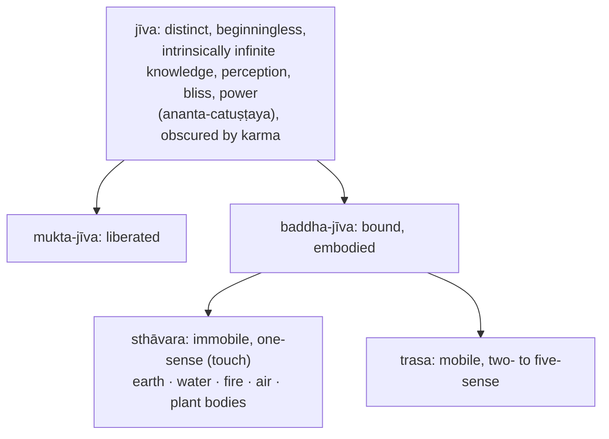

- **Spatiality:** pradeśas; co-extensive with body like a lamp lighting its room; ant-body vs elephant-body without becoming material.
- Plural, not one universal self; differs from Nyāya (consciousness by conjunction with mind): in Jainism consciousness is intrinsic.
- Objection (Sāṃkhya/Vedānta): if naturally omniscient, why ignorance? Reply: karma as obscuring matter.

### 4.6 Pudgala and atomic structure ✅

- Only dravya with **rūpa** (form); divisible and aggregative. Includes atoms, bodies, sense-objects, **karmic matter**.
- **Paramāṇu** (indivisible atom) → **skandha** (aggregates). Colour, taste, smell, touch; sound is a material modification.
- Jaina atoms are **not** permanently different elemental kinds as in Nyāya–Vaiśeṣika; elemental differentiation belongs to developed modes.
- Body, sense-organs, speech, breath, mind as embodied instrument, and karmic matter are material configurations. Etymology ⚠️: *pūraṇa* (filling) + *galana* (disintegrating).

### 4.7 Causation: sadasatkāryavāda ✅/⚠️

| Position | Claim |
|---|---|
| Sāṃkhya satkāryavāda | Effect pre-exists in cause |
| Nyāya asatkāryavāda | Effect newly produced |
| **Jaina sadasatkāryavāda** | Effect exists in cause as enduring substance; does not yet exist as new mode |

Clay jar: clay persists, jar-form is genuinely new. Objection (contradiction) → existence and non-existence are indexed to substance and mode.

---

## 5. Rejection / Affirmation of Transcendent Realities

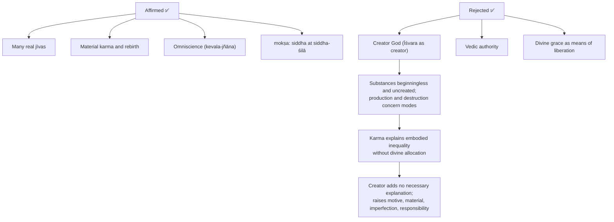

**Honorific divinity:** a Jina, siddha or Tīrthaṅkara is reverenced for achieved perfection, not for creating or governing the universe. **Liberation depends on self-purification, not grace.**

---

## 6. Explanatory & Causal Principles

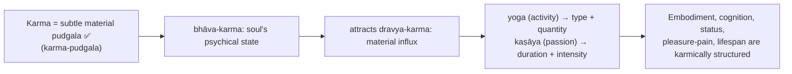

### 6.1 Karma: not adṛṣṭa ✅

Karma is **material** in Jainism, unlike Nyāya **adṛṣṭa**, Mīmāṃsā **apūrva**, Sāṃkhya **saṃskāra**, Buddhist **vāsanā**. Analogy: passions attract karmic particles as a sticky surface gathers dust (oil / wet clay). Moral-psychical states determine depth and duration, so this is **not crude physicalism**.

### 6.2 Five causes of bondage ✅

| Cause | Term | Role |
|---|---|---|
| Wrong vision | **mithyātva / mithyā-darśana** | Misapprehends soul, reality, path |
| Non-restraint | **avirati** | Leaves conduct exposed |
| Carelessness | **pramāda** | Weakens vigilance |
| Passions | **kaṣāya** | Anger, pride, deceit/delusion, greed; deep and durable adhesion |
| Activity | **yoga** | Body, speech, mind: opens influx channel |

**Causal order ⚠️:** wrong vision sustains passions; activity supplies the influx channel; passion supplies the stickiness.

### 6.3 Bhāvabandha and dravyabandha (2024) ✅

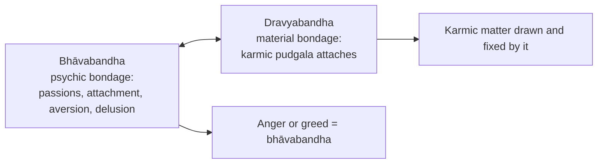

Distinct yet interlinked, **not** a one-time chronology with a first passion before all karmic matter; beginningless earlier karma conditions present passions.

### 6.4 Four parameters of bandha ✅

| Parameter | Meaning | Determinant |
|---|---|---|
| **Prakṛti** | type of karma | **Yoga** |
| **Sthiti** | duration | **Kaṣāya** |
| **Anubhāga / rasa** | intensity | **Kaṣāya** |
| **Pradeśa** | quantity of karmic matter | **Yoga** |

**īryāpathika bandha** = momentary bondage from activity without passion; **sāmparāyika bandha** = durable bondage from passion-coloured activity. Monk's careful walking vs angry act.

### 6.5 Eight karma-prakṛtis ✅

| Class | Prakṛti | Obscures / determines |
|---|---|---|
| **Ghātiyā** | Jñānāvaraṇīya | Knowledge |
| **Ghātiyā** | Darśanāvaraṇīya | Perception |
| **Ghātiyā** | **Mohanīya** | Right vision and conduct; most dangerous; divided into darśana-mohanīya and cāritra-mohanīya |
| **Ghātiyā** | Antarāya | Energy, power |
| **Aghātiyā** | Vedanīya | Pleasure and pain |
| **Aghātiyā** | Nāma | Body, form, embodiment |
| **Aghātiyā** | Gotra | Status |
| **Aghātiyā** | Āyus | Lifespan |

---

## 7. Ethics & Human Goals (Puruṣārthas)

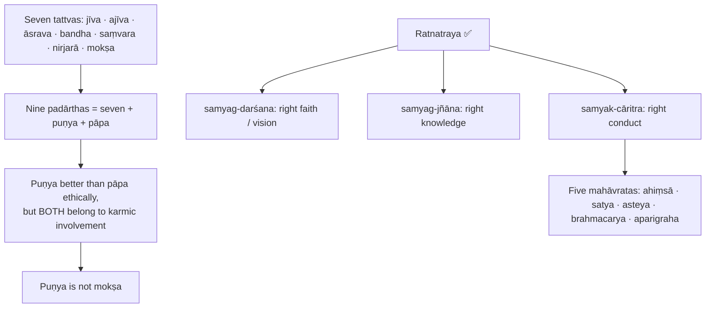

### 7.1 Sequence of liberation ✅

```text
jīva + ajīva
   ▼
āsrava (influx)  →  bandha (adhesion: yoga + kaṣāya)
   ├──► saṃvara (stops new influx)
   ▼
nirjarā (wears away accumulated karma)  →  mokṣa (all karma gone; ananta-catuṣṭaya manifest)
```

**Saṃvara ≠ nirjarā.** Muddy stream closed into a tank = saṃvara; cleaning deposited sediment = nirjarā. Liberation is **subtraction, not acquisition**: sooted lamp cleaned does not create light.

### 7.2 Complete discipline ✅

| Discipline | Term | Function |
|---|---|---|
| Restraint of body, speech, mind | **gupti** | Controls channels of activity |
| Carefulness | **samiti** | Prevents negligent injury |
| Ten virtues | **dharma** | Forgiveness, humility, truthfulness, purity, restraint, austerity, renunciation, non-attachment, celibacy |
| Contemplation | **anuprekṣā / bhāvanā** | Weakens attachment |
| Conquest of afflictions | **pariṣaha-jaya** | Pain, hunger, heat, cold, insult |
| Right conduct | **cāritra** | Integrates vision, knowledge, vows |
| Austerity | **tapas** | Stops passion, accelerates shedding |

Two forms of shedding: natural fruition vs disciplined austerity; external vs internal austerities (repentance, humility, service, study, detachment, meditation, abandonment of bodily identification).

### 7.3 Ahiṃsā and the householder ✅

Ahiṃsā is a central soteriological technology (injury binds karma deeply); care for even one-sense beings follows from plural jīvas. **Full vows for ascetics, limited observances for householders.**

### 7.4 Sallekhanā / santhārā ✅/❓

Voluntary, gradual, ritually regulated relinquishment of food and passions when death is unavoidable or decline incurable. Distinct from **ātma-ghāta** (suicide: passion-driven, sudden, violent, often concealed). Must be free from desire for death, desire to live, attachment to friends, recollection of pleasures, hope of reward; otherwise an **aticāra**. ❓ Legal-ethical controversy exists in India; specific case names, holdings, dates and statutory details must **not** be asserted unless separately verified.

---

## 8. Inter-School Comparative Matrices

| School | Pramāṇas | Self | Permanence / change | Causation | Creator God | Liberation |
|---|---|---|---|---|---|---|
| **Jainism** | Pratyakṣa and parokṣa; later anumāna, śabda, smṛti, pratyabhijñā, tarka | Many permanent jīvas | Dravya permanent, paryāya changing | Sadasatkāryavāda | Anīśvaravāda | Individual siddha freed from all karma |
| **Buddhism** | Usually perception and inference ⚠️ | No permanent ātman | Momentariness in many schools | Dependent origination ⚠️ | No creator | Nirvāṇa without eternal soul |
| **Nyāya–Vaiśeṣika** | Perception, inference, comparison, testimony | Many eternal selves | Substances endure; qualities change | Asatkāryavāda | Theistic in later Nyāya | Self freed from suffering |
| **Sāṃkhya–Yoga** | Perception, inference, testimony | Many puruṣas | Puruṣa changeless; prakṛti evolves | Satkāryavāda | Sāṃkhya non-theistic; Yoga admits Īśvara | Kaivalya |
| **Mīmāṃsā** | Multiple incl. śabda | Enduring self | World and Veda real | Apūrva ⚠️ | No creator required for Vedic authority | Varies ⚠️ |
| **Advaita** | Six pramāṇas | Ultimately one ātman-Brahman | Brahman changeless; world mithyā | Vivarta-style ⚠️ | Īśvara empirical-soteriological | Realization of non-duality |
| **Cārvāka** | Perception primarily | Body-based consciousness | Material change only | Material regularity ⚠️ | Rejects creator | Rejects mokṣa |

### 8.1 Jainism vs Buddhism ✅

| Axis | Jainism | Buddhism |
|---|---|---|
| Self | Many enduring jīvas | Anātman |
| Reality | Substance with permanence-in-change | Momentariness in many schools |
| Karma | Material karma-pudgala | Volitional / moral-causal continuity |
| Liberation | Distinct soul freed from karma | Nirvāṇa without eternal self |

Shared: both śramaṇa traditions, challenge Vedic ritual supremacy, reject a creator God. Jaina ahiṃsā is far more radical because even minute beings are jīvas. Historically close, metaphysically opposed.

### 8.2 Jainism vs Advaita ✅

| Axis | Jainism | Advaita |
|---|---|---|
| Ultimate reality | Pluralistic | Non-dual Brahman |
| World | Real | Empirically real, ultimately mithyā |
| Souls | Many | Ultimately one |
| Bondage | Karmic material obscuration | Avidyā / adhyāsa |
| Liberation | Distinct siddhas | Realization of non-duality |

### 8.3 Jainism vs Cārvāka ✅

| Axis | Jainism | Cārvāka |
|---|---|---|
| Ontology | Pluralist realism with soul and karma | Materialist minimalism |
| Karma | Material and real | Rejected |
| Logic | Conditional predication | Suspicion of inference and testimony |
| Ethics | Austerity and ahiṃsā | This-worldly pleasure and prudence |

Cross-link (2020 Q7(c), owned by Cārvāka): the Cārvāka four-element ontology versus the six dravyas; anekāntavāda does **not** assert both ontologies true in the same respect.

### 8.4 Pluralistic and realistic? (2025 Q7(c)) ⚠️

| Pluralistic ✅ | Realistic ✅ |
|---|---|
| Many real souls | Dravyas, qualities, modes objectively real |
| Multiple irreducible dravyas | External world not illusion |
| Rejects monistic reduction | Knowledge aims at real objects, under standpoints |
| Liberation of many individual souls | Realism is **qualified**, not unreal |

Separates ontological realism from epistemic non-absolutism.

---

## 9. Criticisms & Reconstructed Replies

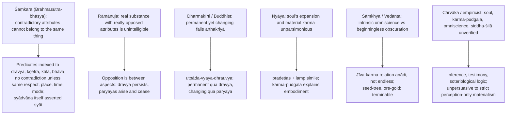

| Objector | Residual force ⚠️ |
|---|---|
| Śaṃkara | Reflexively qualified doctrine may lose assertoric force |
| Rāmānuja | Reply depends on accepting aspect-realism |
| Dharmakīrti | Strong if substance-mode distinction denied |
| Nyāya | Consciousness-matter interaction remains difficult |
| Sāṃkhya / Vedānta | No first-origin explanation; puzzle why beginningless bondage is possible for an intrinsically perfect soul |
| Cārvāka | External critique only; do not let it replace the named classical objections |

### 9.1 Presupposition ledger ⚠️

| Doctrine | Presupposition | What collapses if denied |
|---|---|---|
| Anekāntavāda | Reality has many real aspects, not merely many subjective descriptions | Becomes scepticism or loose tolerance |
| Nayavāda | Finite cognition grasps objects through partial standpoints | Partial truths become falsehoods or dogmatic absolutes |
| Syādvāda / saptabhaṅgī | Language must register standpoint, time, place, substance, mode | Looks like contradiction or indecision |
| Utpāda-vyaya-dhrauvya | Permanence and change both real in different respects | Collapse into Buddhist flux or static monism |
| Five/six substances and astikāya | Substance ≠ spatial extension | Kāla confused with the five astikāyas |
| Material karma | Moral-psychical states can attract subtle matter | Bondage becomes metaphorical |
| Guṇasthāna progression | Development is gradual, karmically measurable | Liberation becomes abrupt insight |
| Kevala-jñāna | Intrinsic infinite knowledge, obscured | Mokṣa becomes acquisition |
| Ahiṃsā | All living jīvas morally significant | Ethics loses its metaphysical foundation |

### 9.2 Guṇasthānas and jīvanmukti ✅

| # | Guṇasthāna | Gloss |
|---:|---|---|
| 1 | Mithyā-dṛṣṭi | False vision |
| 2 | Sāsvādana / sāsādana | Falling, lingering taste of right vision |
| 3 | Miśra / samyag-mithyā-dṛṣṭi | Mixed |
| 4 | Avirata samyag-dṛṣṭi | Right vision, no full restraint |
| 5 | Deśavirata | Partial restraint, lay vows |
| 6 | Pramatta-saṃyata | Full restraint with negligence |
| 7 | Apramatta-saṃyata | Full restraint without negligence |
| 8 | Apūrva-karaṇa / nivṛtti-bādara | Unprecedented purification |
| 9 | Anivṛtti-bādara | Further purification of gross passions |
| 10 | Sūkṣma-samparāya | Only subtle greed remains |
| 11 | Upaśānta-moha | Delusion **suppressed**, not destroyed |
| 12 | Kṣīṇa-moha | Delusion **destroyed** |
| 13 | Sayoga-kevalī | Omniscient embodied arhat, activity present |
| 14 | Ayoga-kevalī | Activity ceases; momentary, before siddhatva |

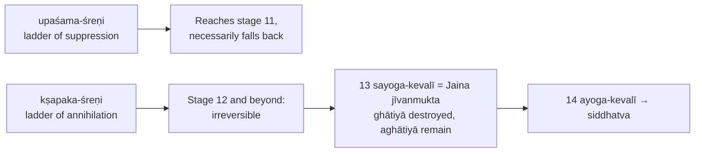

Stage 4 is a breakthrough in right vision, not yet complete conduct.

---

## 10. Controlled Western Comparisons

| Comparison | Point of contact | Decisive disanalogy |
|---|---|---|
| **Anekāntavāda and Nietzschean perspectivism** ⚠️ | Both deny a simple "view from nowhere" for ordinary knowers | Jainism is realist: aspects are in the object; perspectivism often read as anti-realist |
| **Syādvāda and many-valued / paraconsistent logic** ⚠️ | Seven bhaṅgas resemble non-classical evaluation | *Syāt* is a standpoint-operator, not a third truth-value; *avaktavya* is inexpressibility in one unqualified utterance, not a truth-value gap |
| **Anekānta and Hegelian dialectic** ⚠️ | Opposites within the real | Hegelian opposites are sublated into synthesis; Jaina aspects coexist without sublation |
| **Ahiṃsā and Schweitzer's reverence for life** ⚠️ | Moral concern widened toward life | Jaina ahiṃsā grounded in jīva, karma, liberation |
| **Jaina souls and Leibnizian monads** ⚠️ | Plural centres carrying own history | Jaina souls interact with karmic matter and vary in extension; monads do not interact materially in that way |
| **Material karma and mechanistic psychology** ⚠️ | Causal explanation for conduct | Jaina karma is subtle moral matter tied to liberation, not value-neutral brain mechanism |

> [!WARNING]
> Western parallels are illustrative only; use at most one or two lines **after** the Jaina case is complete. Do not claim historical influence.

---

## 11. Diagnostic Deep-Dives for High-Frequency Themes

### 11.1 Saptabhaṅgī: the seven predications, in order ✅

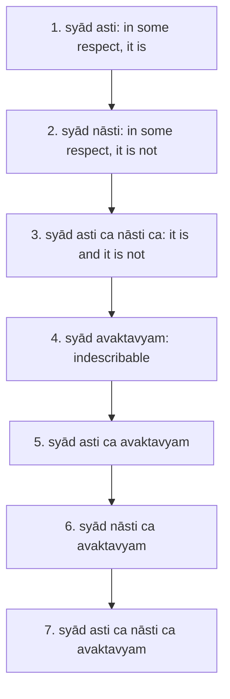

> [!WARNING]
> **Syāt is not 'perhaps'.** Not probability, doubt, agnosticism or scepticism: it marks a definite assertion restricted by standpoint, substance, place, time, mode. **Avaktavya** is not mystical silence; it means one simultaneous, unqualified affirmation-and-negation is not expressible.
> **Contradiction arises only if** affirmation and negation are made in the same respect at the same time in the same sense.

**Applied jar sequence (2026 Q7(b)) ⚠️** (single subject: *this clay jar*):

| Bhaṅga | Application |
|---|---|
| 1 asti | Exists here and now as this jar |
| 2 nāsti | Does not exist elsewhere or before its formation |
| 3 asti ca nāsti ca | Both hold **successively across distinct respects**, never in the identical respect |
| 4 avaktavyam | Opposed qualified aspects not jointly expressible by one simultaneous unqualified predicate |
| 5 asti ca avaktavyam | Affirmation plus the limitation of one exhaustive statement |
| 6 nāsti ca avaktavyam | Negation plus that limitation |
| 7 asti ca nāsti ca avaktavyam | Qualified affirmation and negation plus inexpressibility of their unqualified simultaneous combination |

Logic: many real aspects → finite standpoint → qualified assertion → seven forms. **Non-absolutism, not seven objective truth-values** and not a licence for same-respect contradiction.

### 11.2 The seven nayas ✅

| Naya | Meaning |
|---|---|
| **Naigama** | common / teleological; mixed practical view |
| **Saṃgraha** | generic; class-character |
| **Vyavahāra** | practical / particular |
| **Ṛjusūtra** | momentary, present state |
| **Śabda** | verbal standpoint |
| **Samabhirūḍha** | etymological, strictly differentiated verbal |
| **Evambhūta** | term applies only when the function is being performed (singer example) |

> [!WARNING]
> Nayas (standpoints) ≠ bhaṅgas (predications) ≠ five jñānas. **2021 Q7(c) printed-wording safeguard:** the paper calls saptabhaṅgī "Naya". State the seven bhaṅgas in order, explain each is made from an appropriate naya; do **not** substitute the seven named nayas, and do not erase the naya-judgement link.

**Blind men and the elephant:** pedagogical, not probative. Partial correctness wrongly elevated to exclusive completeness.

### 11.3 Is relativism sustainable without absolutism? (2022 Q6(b)) ⚠️

1. Strongest critic form: "every assertion is relative" unqualified contradicts itself; if only relative, why must a rival obey it?
2. Valid indexing of substance/place/time/mode and a stable same object seem to commit Jainism to invariant rules.
3. Jaina concession: **determinate, context-invariant conditions for a valid conditional judgement**, without an exhaustive one-sided proposition about every object; *syāt* restricts **scope**, not truth within that scope.
4. Kevala-jñāna **alone** does not show how a finite speaker knows the general rule.
5. Conclude: qualified realism needs some stable logical and ontological commitments, **not** collapse into the one-sided absolutism it opposes.

### 11.4 'All human knowledge is empirical and therefore relative' (2023 Q5(a)) ⚠️

| Step | Content |
|---|---|
| Premise 1 | Ordinary embodied people rely on mati and śruta, limited by karmic obstruction |
| Correction | Jainism also admits avadhi, manaḥparyāya and **kevala-jñāna** (unmediated omniscience, by an embodied kevalin): "all human knowledge is empirical" is **not** Jaina doctrine |
| Premise 2 | Finite cognition is partial because of a **many-sided object and limited, karmically conditioned knower**, not simply because it is empirical |
| Apply | Objective conditional predication, not scepticism |
| 10-mark verdict | Accept limited empirical cognition as a common starting point; reject both "all" and the bare "therefore"; many-sided reality plus finite cognition, not empiricism alone, motivates saptabhaṅgī |

### 11.5 Bondage, bound vs liberated soul (2018 Q6(c)) ✅

| | Bound soul | Liberated soul |
|---|---|---|
| State | Embodied; knowledge and perception obscured; pleasure/pain; birth and death; cannot fully manifest powers | **This numerically distinct jīva** with all eight karmas exhausted: no further birth, body, passions, dependence on matter; unobstructed knowledge, perception, power, bliss |
| Locus | Saṃsāra | **Siddha** at **siddha-śilā** |
| Not | | Merger with Brahman, annihilation, new creator deity |

Embodied kevalin (⚠️): four ghātiyā destroyed, omniscience while aghātiyā sustain a body; only their exhaustion brings final disembodied liberation. Critical issue: how can a spatially located liberated soul be changelessly perfect, and how did subtle matter touch a conscious jīva? Jaina answer via substance/mode and pradeśa doctrines; does not dissolve every cross-school objection.

### 11.6 Karma and soteriology (2020 Q5(a), 2022 Q5(d)) ✅

Map: influx (yoga) → adhesion (kaṣāya) → stoppage (saṃvara: vows, gupti, samiti, anuprekṣā) → shedding (nirjarā: tapas) → mokṣa. Do not reduce liberation to moral improvement; map influx, bondage, stoppage, shedding and the persistence of a perfected individual jīva.

---

## 12. PYQ Routing Ledger (2018–2026)

> Corpus signal: **9** primary-owned parts out of 112 in 2018–2025 (every year has at least one; 2022 has two), plus **1** in the separately banked 2026 paper = **10 verified parts**.

| Year | Q | Marks | Exact demand | Map to |
|---|---|---:|---|---|
| 2018 | Q6(c) | 15 | How do the Jaina philosophers explain 'bondage'? What, according to them, is the distinction between 'liberated soul' and 'bound soul'? What do the Jainas think about the condition of the 'liberated soul'? Discuss. | §6, §11.5 |
| 2019 | Q6(a) | 20 | How is reality defined by the Jainas? How is this theory of reality reflected in their view on judgements? Discuss. | §4, §2.5, §11.1–11.2 |
| 2020 | Q5(a) | 10 | Examine the concept of Karma according to Jainism. How does it bear upon their conception of Liberation? | §6.1–6.2, §7.1, §11.6 |
| 2021 | Q7(c) | 15 | Explain the Jaina view of seven-fold (sapta-bhaṅgī) 'Naya'. | §11.1–11.2 |
| 2022 | Q5(d) | 10 | How does Jaina view of Karma bear upon their soteriology? Critically discuss. | §6, §7.2, §11.6 |
| 2022 | Q6(b) | 15 | 'The doctrine of Relativism of Jain Philosophy cannot be logically sustained without postulating 'Absolutism'.' Critically examine this view and give reasons in the favour of your answer. | §3, §9, §11.3 |
| 2023 | Q5(a) | 10 | "All human knowledge is empirical and therefore relative." Critically examine Jaina theory of sevenfold judgement (saptabhaṅgīnaya) in the light of above statement. | §2, §11.4 |
| 2024 | Q6(c) | 15 | What is the distinction between Bhāvabandha and Dravyabandha, according to the Jainas? Discuss. | §6.3–6.5 |
| 2025 | Q7(c) | 15 | Is Jaina philosophy pluralistic and realistic? Critically discuss. | §4.1–4.5, §8.4 |
| 2026 | Q7(b) | 15 | Explain the meaning of seven steps of judgement (Saptabhanginaya) and its application in Jaina's Syadvada for advocating a philosophy of non-absolutism (Anekantavada). | §11.1 applied jar sequence |

**Cross-owned (not Jainism-owned):** 2020 Q7(c), 15 marks, owned by Cārvāka: *Explain the differences of conception of Reality between Cārvāka and Jainism.* → §8.3 and §4.3. Note the 2026 supplement states Jainism and Buddhism appear once each in 2026.

---

## 13. Top Exam Traps

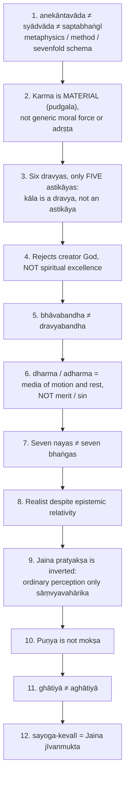

Further pitfalls from the sources: *syāt* is not "perhaps"; avaktavya is not mystical silence; do not write "all human knowledge is empirical" as Jaina doctrine; suppression (stage 11) falls back, destruction (stage 12) is final; the liberated soul is not merged into Brahman; do not cite sallekhanā case names without verification; do not assert kāla-aṇu as common ground between sects.

---

## 14. Technical Vocabulary & IAST Bank

| English gloss | IAST | Meaning | Status |
|---|---|---|---|
| Doctrine of many-sided reality | anekāntavāda | Metaphysical thesis | ✅ |
| Standpoint-theory | nayavāda | Partial standpoints | ✅ |
| Conditional predication | syādvāda | Assertion with *syāt* | ✅ |
| Sevenfold judgement | saptabhaṅgī | Seven bhaṅgas | ✅ |
| One-sidedness | ekāntavāda | Absolutising a standpoint | ✅ |
| Reality | sat | utpāda + vyaya + dhrauvya | ✅ |
| Substance / quality / mode | dravya / guṇa / paryāya | | ✅ |
| Conscious / non-conscious | jīva / ajīva | | ✅ |
| Extended substances | astikāya (pañcāstikāya); kāla = an-astikāya | | ✅ |
| Space-points | pradeśa | | ✅ |
| Matter / atom / aggregate | pudgala / paramāṇu / skandha | | ✅ |
| Material karma / psychic state | karma-pudgala / bhāva-karma, dravya-karma | | ✅ |
| Psychic / material bondage | bhāvabandha / dravyabandha | | ✅ |
| Knowledge kinds | mati / śruta / avadhi / manaḥparyāya / kevala | | ✅ |
| Conventional direct knowledge | sāṃvyavahārika pratyakṣa | | ✅ |
| Partial-subsidence-conditioned | kṣāyopaśamika | | ✅ |
| Wrong cognition | kumati / kuśruta / vibhaṅga-jñāna | | ✅ |
| Influx / bondage / stoppage / shedding / release | āsrava / bandha / saṃvara / nirjarā / mokṣa | | ✅ |
| Three jewels | ratnatraya (samyag-darśana, -jñāna, samyak-cāritra) | | ✅ |
| Great vows | mahāvrata: ahiṃsā, satya, asteya, brahmacarya, aparigraha | | ✅ |
| Obscuring / non-obscuring karmas | ghātiyā / aghātiyā | | ✅ |
| Stages | guṇasthāna; upaśama-śreṇi / kṣapaka-śreṇi | | ✅ |
| Infinite fourfold | ananta-catuṣṭaya | Knowledge, perception, bliss, power | ✅ |
| Liberated soul / locus | siddha / siddha-śilā | | ✅ |
| Passion-free vs passionate bondage | īryāpathika / sāmparāyika bandha | | ✅ |
| Voluntary fast-to-death vs suicide | sallekhanā (santhārā) / ātma-ghāta | | ✅/❓ |
| Beginningless | anādi | Jīva-karma relation | ✅ |
| Causal efficacy | arthakriyā | Dharmakīrti's test | ✅ |
| Both-existence-and-non-existence of effect | sadasatkāryavāda | | ⚠️ |
| Indexing dimensions | dravya, kṣetra, kāla, bhāva | Substance, place, time, mode | ✅ |
| Creatorless | anīśvaravāda | | ✅ |

---

## 15. Graded Verdict & Answer Architectures

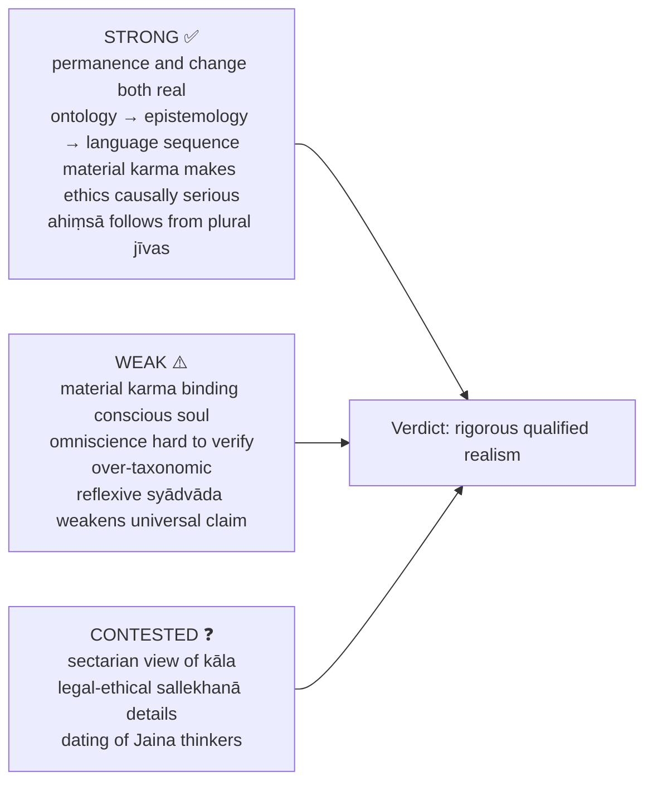

### 15.1 10-mark

```text
Define the key term precisely: anekāntavāda, syādvāda, karma, or bhāvabandha.
Doctrinal core in 3-4 compact points.
One distinction that prevents confusion (anekāntavāda vs syādvāda).
Close with one evaluative line.
```
**Anchor:** "Jainism is a pluralistic realism that avoids both pure permanence and pure flux by making every real a unity of dravya and paryāya."

### 15.2 15-mark

```text
Frame: Jainism balances realism with non-absolutism.
A: explain the doctrine requested (reality / sevenfold judgement / bondage).
B: structure: tables, ordered seven predicates, or bondage sequence.
C: one criticism and one reply.
Conclude with a philosophical verdict, not summary.
```
**Anchor:** "Its genius lies in connecting many-sided reality with conditional judgement, but its material karma and omniscience doctrines remain philosophically contestable."

### 15.3 20-mark

```text
Open: many-sided reality requires qualified predication.
1: reality via dravya, guṇa, paryāya, utpāda-vyaya-dhrauvya.
2: reflection in nayavāda, syādvāda, saptabhaṅgī.
3: if asked, soul, karma, liberation.
4: critically assess pluralism, realism, self-refutation.
End: realism without dogmatism.
```
**Anchor:** "Jainism is best evaluated as a rigorous qualified realism: internally systematic, ethically powerful, and logically subtle, though vulnerable to external critiques of contradiction, soul-matter interaction, and unverifiable higher knowledge."

### 15.4 Directive decoder ⚠️

| Directive | Move | Closing verdict |
|---|---|---|
| Discuss | Doctrine → mechanics → one debate | "Jainism offers a coherent pluralist realism, though its metaphysical costs remain." |
| Examine | dravya, naya, syāt, karma, mokṣa | "The doctrine is intelligible when its presuppositions are made explicit." |
| Critically examine | Śaṃkara / Nyāya / Buddhist objections and replies | "The reply is strong internally but not neutral across all schools." |
| Analyse | Metaphysics → epistemology → language → liberation | "Its strength lies in systematic interconnection." |
| Evaluate | Strengths, weaknesses, residual contestation | "Persuasive as qualified realism; vulnerable on material karma and omniscience." |
| Compare | Self, causation, pramāṇa, karma, mokṣa | "Jainism as a middle path between flux and static permanence." |
| Distinguish | Tables: anekānta / syādvāda / saptabhaṅgī; bhāva / dravya bandha | "The distinction prevents common UPSC conflations." |
| Do you agree? | Doctrine → objections → qualified verdict | "Agree within Jaina presuppositions; qualify from rival standpoints." |

> [!TIP]
> **Exam sentences.** (1) "Jaina realism is qualified not because reality is doubtful, but because finite judgement reaches the real only under conditioned standpoints." (2) "The originality of Jaina soteriology lies in treating karma not merely as moral record but as subtle material bondage requiring both stoppage and shedding."

---

## Sources

*Tattvārthasūtra* / *Tattvārthādhigama-sūtra* (no invented sūtra numbers); Chatterjee & Datta, *An Introduction to Indian Philosophy*; C.D. Sharma, *A Critical Survey of Indian Philosophy*; S. Radhakrishnan, *Indian Philosophy* Vol. I; advanced-dossier trail: Padmanabh Jaini, *The Jaina Path of Purification*; Kundakunda, *Pañcāstikāyasāra*; Nāgārjuna, *Mūlamadhyamakakārikā*.
