# SCHOOLS OF BUDDHISM — Examiner-Grade Mindmap

> **Syllabus (verbatim):** Schools of Buddhism : Prat Ityasamutpada; Ksanikavada, Nairatmyavada.
> **Catalogue key:** `philosophy-paper-i-indian-philosophy-03` · Paper I · Indian Philosophy
> **Sources used:** `paper-1/indian/Buddhism.md` (canonical owner, read in full) · `_advanced/Indian-Philosophy-Dossier.md` §3 (optional depth) · `paper-1/_PYQ-Indian-Philosophy-2018-2025.md` · `paper-1/_PYQ-Indian-Philosophy-2026.md`.
> **Evidence key:** ✅ canonical doctrine · ⚠️ analytical synthesis · ❓ contested / uncertain

> [!IMPORTANT]
> **Core thesis.** The three syllabus terms are not separate islands. Dependent origination yields impermanence; impermanence undermines substantial selfhood; no-self reshapes karma, rebirth and nirvāṇa. The Middle Path (practical: Noble Eightfold Path; doctrinal: between eternalism and annihilationism) is the bridge. ⚠️

---

## 0. Master Overview

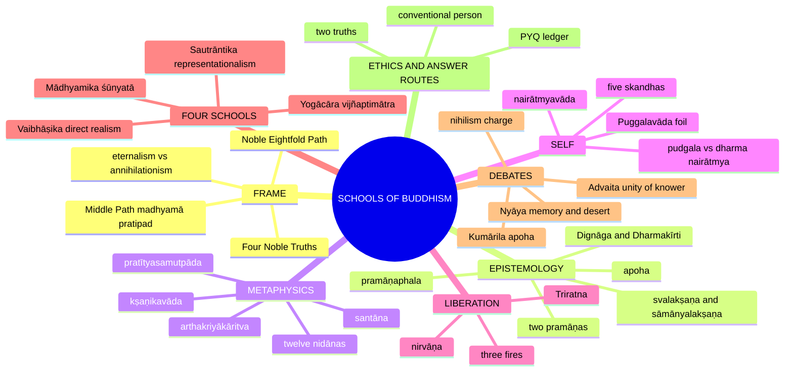

---

## 1. Identity, Lineage & Doxography

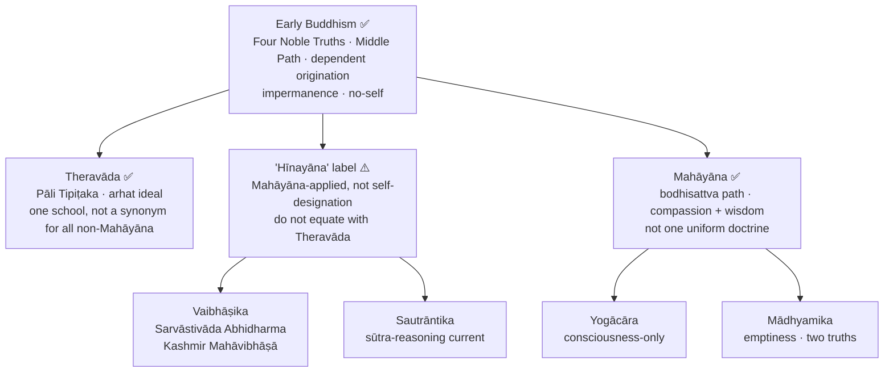

| Category | Careful description | Exam-safe caution |
|---|---|---|
| **Early Buddhism** | Earliest recoverable discourse and discipline traditions; common diagnostic core | Do not equate with any one later school; discourses survive in Pāli Nikāyas and Chinese Āgamas plus fragments |
| **Theravāda** | "Teaching of the Elders"; Pāli Tipiṭaka (Vinaya, Sutta, Abhidhamma Piṭakas); arhat (Pali: arahant) ideal | One historical school, not the name for every non-Mahāyāna school |
| **"Lesser Vehicle" (Hīnayāna)** | Mahāyāna-origin, often polemical label; old textbooks keep it as doxographic category | Avoid, or quote and explain; never equate with Theravāda |
| **Mahāyāna** | "Great Vehicle" family; bodhisattva path to complete Buddhahood | Do not caricature arhat as "selfish"; bodhisattva does not simply "postpone nirvāṇa" |

**Canon and language (minimum) ✅.** Theravāda: Pāli Tipiṭaka. Early discourse is not reducible to "Pāli Buddhism" (Chinese Āgamas, Sanskrit fragments). Sarvāstivāda, Vaibhāṣika and Sautrāntika materials survive through Sanskrit, Chinese and Tibetan histories; Mahāyāna sūtras through Sanskrit/Buddhist Hybrid Sanskrit and Chinese/Tibetan translation. "Mahāyāna equals Sanskrit" is only a broad orientation.

**Exam-safe mapping ⚠️.** Vaibhāṣika and Sautrāntika are non-Mahāyāna scholastic positions in the Sarvāstivāda world; Yogācāra and Mādhyamika are Mahāyāna philosophical traditions. The fourfold scheme is a philosophical teaching matrix, not a complete institutional history. Neither Vaibhāṣika nor Sautrāntika is Theravāda.

**Four ideals ✅/⚠️.** Arhat: extinguishes causes of rebirth and suffering. Bodhisattva: cultivates wisdom and compassion toward complete Buddhahood for all beings. Theravāda knows the bodhisatta career; Mahāyāna texts know the arhat category.

---

## 2. Theory of Knowledge (Epistemology)

*Core supporting depth: Buddhist epistemology translates nairātmyavāda and kṣaṇikavāda into a theory of knowledge, language and debate.*

### 2.1 Two pramāṇas ✅

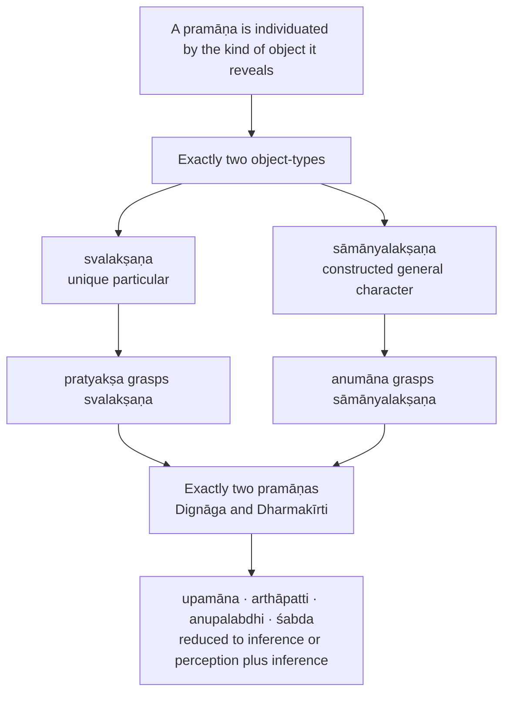

| Issue | Buddhist pramāṇa school | Nyāya |
|---|---|---|
| Number | Two: perception, inference | Four: perception, inference, comparison, testimony |
| Testimony | Reducible to inference from reliable signs / speaker-function | Independent pramāṇa |
| Universals | Conceptual constructions | Real universals inhering in particulars |

### 2.2 Svalakṣaṇa vs sāmānyalakṣaṇa ✅

| Feature | **Svalakṣaṇa** | **Sāmānyalakṣaṇa** |
|---|---|---|
| Status | paramārtha-sat (ultimately real) | saṃvṛti-sat (conventionally real) |
| Time | momentary | enduring only as a construct ⚠️ |
| Cognition | non-conceptual perception | conceptual inference / judgment |
| Language | ineffable as unique particular | expressible, shareable |
| Causal role | causally efficient | causally inert as universal construct ⚠️ |

Realism about momentary particulars coexists with nominalism about universals ⚠️.

### 2.3 Perception ✅

- Dignāga: **kalpanāpoḍha** (free from conceptual construction). Dharmakīrti adds **abhrānta** (non-erroneous). Mere vivid presentation is not enough; examples: double moon, circle from a whirling firebrand.

| Type | Meaning |
|---|---|
| **indriya-pratyakṣa** | sense perception |
| **mānasa-pratyakṣa** | mental perception following sensory presentation |
| **svasaṃvedana** | self-awareness of cognition (links to Yogācāra; Nyāya attacks it as collapsing object, cognition, knower) ❓ |
| **yogi-pratyakṣa** | yogic direct insight |

### 2.4 Apoha (exclusion theory) ✅

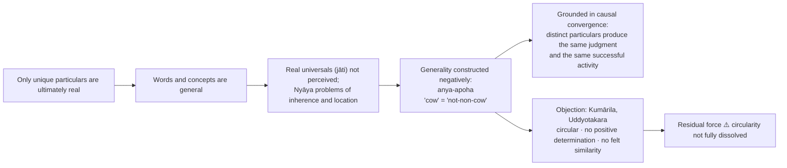

### 2.5 Pramāṇa and pramāṇaphala ✅

Dignāga: instrument (**pramāṇa**) and result (**pramāṇaphala**) are not ultimately different; the resultant cognition (determination of object and self-awareness) is non-different from the cognitive event. The karaṇa/phala analysis is a conceptual overlay on one momentary event — epistemology is driven by anātman and kṣaṇikavāda.

| Factor | Nyāya | Buddhist pramāṇa school |
|---|---|---|
| pramātṛ (knower) | real enduring subject | constructed stream ⚠️ |
| pramāṇa | distinct means | non-different from cognition as event |
| prameya | independently knowable object | ultimately svalakṣaṇa; conventionally constructed |
| pramiti / pramāṇaphala | distinct result | not ultimately separate |

### 2.6 Arthakriyākāritva: the bridge to ontology ✅/⚠️

**sat = arthakriyā-samartha**: the real is what can produce an effect. It ranks svalakṣaṇa as real and sāmānyalakṣaṇa as conventional, and grounds **yat sat tat kṣaṇikam** (see §4.3).

> [!NOTE]
> **Cross-link (Nyāya-owned PYQs).** 2018 Q5(d): how Buddhists and Naiyāyikas explain knowledge of "the absence of the jar on the table" (10 marks). 2025 Q5(b): debate between Naiyāyikas and Buddhists on pramāṇa and pramāṇaphala (10 marks). Both route here via §2.1–2.5.

---

## 3. Dialectical Wings & Sceptical Refinements

### 3.1 Avyākata / avyākṛta: pragmatic silence ✅

```text
AVYĀKṚTA CLUSTER
World: eternal? not eternal? finite? infinite?
Self/body: jīva same as body? different from body?
Tathāgata after death: exists? does not exist? both? neither?
```

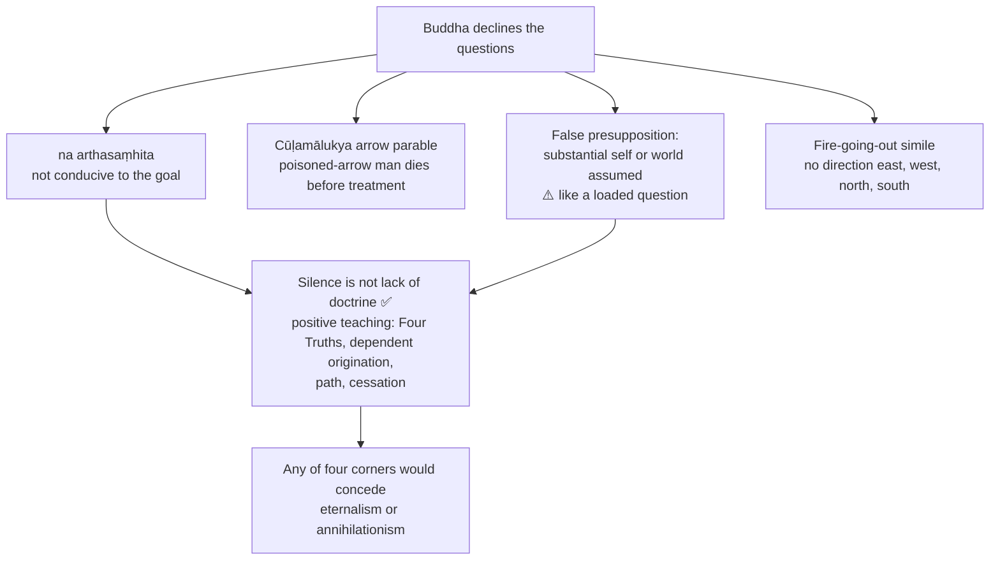

| Reading of the silence | Claim | Verdict |
|---|---|---|
| ❓ Agnostic | Buddha did not know / unknowable | Fits poorly with strong positive diagnosis |
| ✅ Pragmatic-therapeutic | Questions useless for liberation | Best fits arrow parable |
| ⚠️ Logical-semantic | Malformed; presupposition fails | Best fits anātman and dependent origination |

UPSC use: combine the second and third readings. The fire simile does not imply a hidden self travelling elsewhere ⚠️.

### 3.2 Catuṣkoṭi and non-implicative negation ✅

| Corner | Sanskrit | Claim |
|---|---|---|
| 1 | **asti** | It is |
| 2 | **nāsti** | It is not |
| 3 | **asti ca nāsti ca** | Both |
| 4 | **naivāsti naiva nāsti** | Neither |

- **Early / Nikāya use:** the four alternatives of the avyākata questions are all set aside — therapeutic and soteriological.
- **Madhyamaka use:** Nāgārjuna negates all four when applied to things imagined to have svabhāva — also logical-ontological.
- **prasajya-pratiṣedha** (non-implicative negation) not **paryudāsa-pratiṣedha** (implicative): no fifth positive thesis installed; hence, in the spirit of the *Vigrahavyāvartanī*, no independent **pratijñā**.

### 3.3 Nāgārjuna's self-defence ✅/⚠️

- "My words are empty too": magically created person (**nirmitaka**) counteracts another; arguments are medicine, not a new metaphysical substance.
- Warning: emptiness wrongly grasped destroys the dull-witted, like a snake wrongly seized.
- ⚠️ Whether the reply fully succeeds is debated. ❓ **Prāsaṅgika / Svātantrika:** Candrakīrti uses reductio (prasaṅga) without independent syllogisms; Bhāvaviveka allows independent (svatantra) inferences.

### 3.4 Advanced-dossier disputes (optional depth, ⚠️)

| Module | Issue | Readings | Objection → reply |
|---|---|---|---|
| Mādhyamika interpretation | Quietist / dialectical only, or anti-essentialist with robust conventional realism? | Prāsaṅgika stress on reductio and anti-thesis vs more assertive readings | Obj: emptiness destroys all assertion. Reply: emptiness of svabhāva, not abolition of dependent conventional discourse; "emptiness of emptiness" blocks reification |
| Yogācāra "idealism" | Does vijñaptimātratā deny external objects metaphysically or expose mind-structured experience? | Strong idealist vs phenomenological / epistemic reading | Obj: mind-only makes intersubjective experience mysterious. Reply: beginningless vāsanā / ālaya-vijñāna and shared karmic conditioning |
| Pudgalavāda | Can continuity be saved by a "person" theory? | Orthodox rejection vs pudgala neither identical with nor wholly different from aggregates | Obj: smuggles the soul back. Reply: neither identical nor different; orthodox schools treat this as too concessive |
| Two truths and ethics | What secures moral seriousness if ultimate analysis dissolves self? | Minimalist (convention merely practical) vs stronger Mahāyāna (compassion and karma intelligible at saṃvṛti level) | Obj: ultimate truth empties ethics. Reply: liberation and compassion operate within dependent conventional life |

Sources named in the dossier trail: Nāgārjuna *Mūlamadhyamakakārikā*; Candrakīrti *Prasannapadā*; Vasubandhu *Viṃśatikā* and *Triṃśikā*; *Milindapañha*; Kathāvatthu tradition; *Majjhima Nikāya*. **Do not over-study:** full scholastic taxonomies, all Abhidharma lists, or the Prāsaṅgika/Svātantrika divide as a compulsory sub-question.

---

## 4. Metaphysics & Ontology

### 4.1 Dependent origination (pratītyasamutpāda) ✅

- Whatever arises, arises depending on causes and conditions; whatever ceases, ceases when conditions cease.
- **Formula (in substance):** "imasmiṃ sati idaṃ hoti; imass' uppādā idaṃ uppajjati; imasmiṃ asati idaṃ na hoti; imassa nirodhā idaṃ nirujjhati" — this being, that becomes; from the arising of this, that arises; this not being, that is not; from the cessation of this, that ceases.
- Not merely cosmological: it is the key to the arising of duḥkha and therefore to its cessation.

```mermaid
flowchart LR
  F1["1 avidyā<br/>ignorance"] --> F2["2 saṃskāra<br/>formations"] --> F3["3 vijñāna<br/>consciousness"] --> F4["4 nāma-rūpa<br/>name-and-form"] --> F5["5 ṣaḍāyatana<br/>six sense-bases"] --> F6["6 sparśa<br/>contact"]
  F6 --> F7["7 vedanā<br/>feeling"] --> F8["8 tṛṣṇā<br/>craving"] --> F9["9 upādāna<br/>clinging"] --> F10["10 bhava<br/>becoming"] --> F11["11 jāti<br/>birth"] --> F12["12 jarā-maraṇa<br/>old age and death"]
```

Visual pedagogy: **bhava-cakra** (wheel of becoming).

| Reading of the twelve links | How it reads the chain | Caution |
|---|---|---|
| **Three-life pedagogic** | Past causes: ignorance, formations; present results: consciousness through feeling; present causes: craving, clinging, becoming; future results: birth, ageing, death | Not the only legitimate reading; explains rebirth |
| **Present-process / psychological** | Ignorance conditions habitual construction; consciousness and name-and-form organize experience; contact, feeling; craving turns feeling into appropriation | "Psychological" ≠ merely imaginary |
| **Structural / soteriological** | Conditions that maintain suffering; read forward = arising, reverse = cessation; a pattern, not an absolutely first cause | Early formulations vary in order and number |

**Argument ✅:** (1) experienced things are not self-grounding; (2) a self-existent thing would not depend on conditions; (3) all conditioned phenomena arise and cease in dependence; (4) therefore neither eternal substances nor sheer nothingness — dependent processes; (5) suffering too is a process, not fate, hence removable ⚠️.
**Presupposition ⚠️:** explanation via conditional relations, not static substratum (ātman, Brahman) or an external creator; what matters is the structure maintaining bondage here and now.
**Example ⚠️:** flame persists only while wick, oil, oxygen, ignition are coordinated. **Objection ❓:** infinite regress? **Reply ✅:** no unconditioned substance needed; soteriological aim; not a failed search for a first cause.

### 4.2 The three marks (trilakṣaṇa) ✅

| Mark | Meaning | Relation |
|---|---|---|
| **anitya** (Pali: anicca) | Conditioned formations arise, alter, cease | Foundation radicalized into kṣaṇikavāda |
| **duḥkha** (dukkha) | What is impermanent and appropriated as "mine" cannot satisfy | First Noble Truth; craving |
| **anātman** (anattā) | No permanent independent owner in changing aggregates | Prepares nairātmyavāda |

⚠️ Impermanence is the early teaching; the universal one-moment thesis is a stronger later scholastic development. Impermanence and suffering apply to **conditioned** formations; not-self is wider. Nirvāṇa, classified as unconditioned in important traditions, is not just another momentary conditioned event.

### 4.3 Momentariness (kṣaṇikavāda) ✅

- **Statement:** whatever is real is momentary (*sattve satyeva kṣaṇikatvam*; **yat sat tat kṣaṇikam**). Reality is evental, not substantial; not "nothing exists" ⚠️.

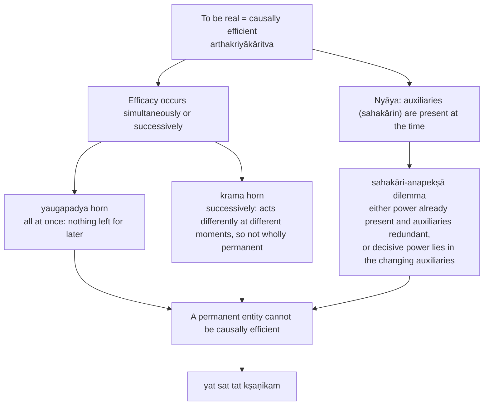

- **Argument from destruction (kṣaṇabhaṅga line) ✅:** destruction needs no separate outside destroyer; arising already contains ceasing; transience belongs to what the conditioned is.
- **Apparent continuity:** **santāna** — causal series; each moment gives rise to the next sufficiently similar one. Illustrations: flame, stream.
- **Seed example ⚠️:** seed is real because it can issue in a sprout; the phase that exercised that capacity is no longer the same causal phase.

| Issue | Buddhist logician | Nyāya–Vaiśeṣika |
|---|---|---|
| Test of reality | causal efficacy | substance, quality, action, universal, inherence, absence |
| Enduring thing | conventional series only | real substance enduring through changing qualities |
| Effect at different times | momentary causal phases | auxiliary conditions on an enduring substance |

> [!WARNING]
> **Hidden premise (2019 Q7(c) / 2020 Q6(a)).** Dependence and eventual cessation show only that a conditioned object is **not eternal**; they do not specify a one-moment lifetime. To derive kṣaṇikavāda add the causal-efficacy argument. Verdict: a powerful scholastic development of dependent origination, not a theorem from the bare dependence formula, and not a claim that early impermanence meant one-moment duration.

### 4.4 Memory, identity, karma under momentariness ✅/⚠️

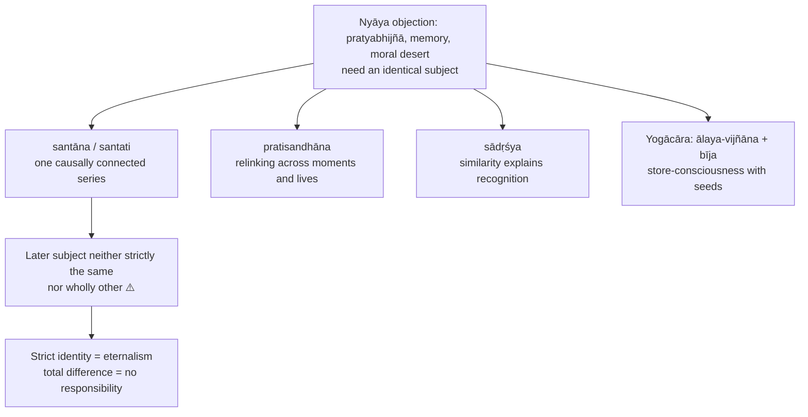

- **2021 Q7(b) distinction ⚠️:** memory is a later cognition conditioned by a trace from the earlier experience within one causally connected series — not recall by an unchanged witness; mere resemblance between unrelated people would not suffice. The ālaya is one school's detailed seed mechanism, **not** common to every Buddhist tradition.
- **Lamp lighting lamp ⚠️:** second flame not numerically the first, yet causally connected.
- **2022 karma:** the stream receives the fruit of what the earlier stream-stage performed; relation neither identity nor utter difference.
- **2026 Q5(b) action and responsibility ⚠️:** (1) agency problem — vanishing agent, intention and act; (2) causal answer — intentional action (**cetanā**) is karma, conditions subsequent dispositions within a santāna; (3) moral, not only mechanical — conventional designation permits reasons, restraint, remorse, right action and livelihood; caused outcome does **not automatically establish** desert; (4) verdict — practical responsibility grounded in intention and connected consequences without a permanent self, provided continuity is not mistaken for identity.
- **Residual force:** Nyāya — a series seems unable to own memories unless something owns the series.

### 4.5 The four philosophical schools ✅

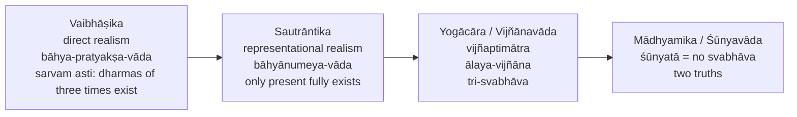

| Issue | Vaibhāṣika | Sautrāntika |
|---|---|---|
| External object | real | real |
| How known | directly perceived | inferentially, via representation |
| Temporal ontology | past-present-future dharmas exist (present has distinctive efficacy) | only present dharmas fully exist |

- **Yogācāra arguments against external realism ✅:** (1) **dream argument** — objecthood without a corresponding external object; (2) **atom critique** — partless atoms cannot combine spatially; atoms with parts are not ultimate.
- **Three natures:** **parikalpita** (imagined subject/object duality) · **paratantra** (causally dependent flow of representations and seeds) · **pariniṣpanna** (insight into absence of the imagined duality). Not each person's arbitrary wish ⚠️.
- **2019 Q5(b) ⚠️:** dreams defeat "appearance guarantees exteriority" but do not by themselves prove **no** waking external object; Yogācāra asks how consciousness accesses an object defined as outside its presentations; Sautrāntika replies that representations can be **caused by** real external objects. Distinguish conventional usefulness of tables from denial of ultimately independent externals. ālaya is a conditioned, transforming stream, not ātman in disguise ⚠️.
- **Mādhyamika:** identifies dependent origination and emptiness; dependently arisen = empty of independent essence.

---

## 5. Rejection / Affirmation of Transcendent Realities

### 5.1 Four Noble Truths and Middle Path ✅

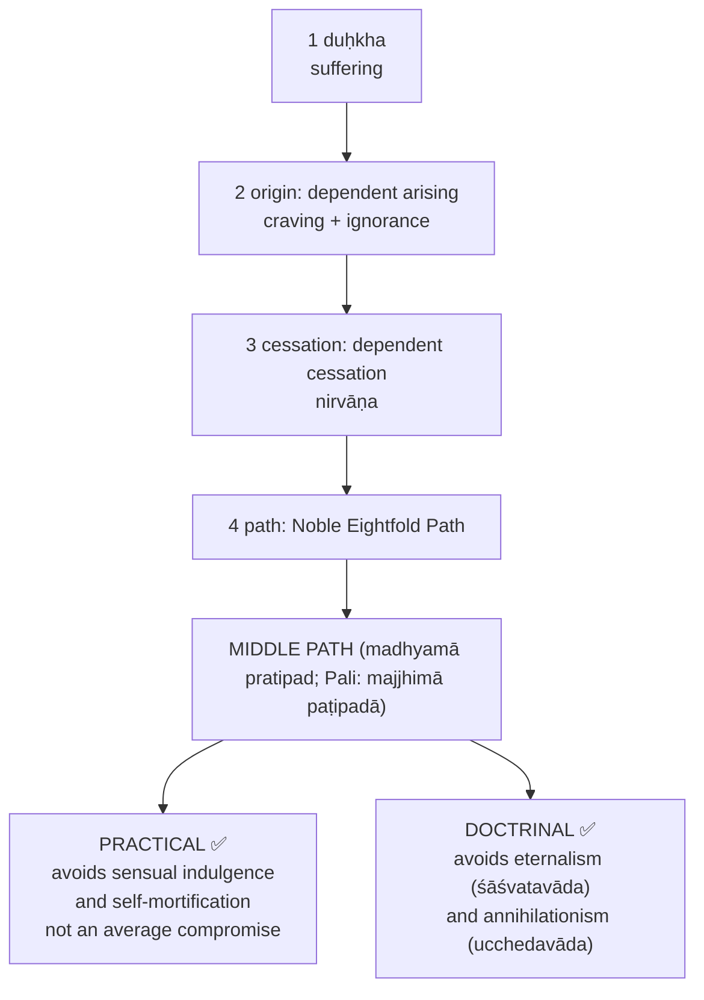

| Training | Eightfold Path factors |
|---|---|
| Wisdom (prajñā) | right view (samyag-dṛṣṭi); right intention (samyak-saṃkalpa) |
| Ethical discipline (śīla) | right speech (samyag-vāc); right action (samyak-karmānta); right livelihood (samyag-ājīva) |
| Meditative discipline (samādhi) | right effort (samyag-vyāyāma); right mindfulness (samyak-smṛti); right concentration (samyak-samādhi) |

- Dependent origination is the **philosophical grammar** of the Four Truths: first states suffering, second its dependent arising, third its dependent cessation, fourth the discipline that breaks the chain ⚠️.
- **Why a middle doctrinally ⚠️:** denies permanent substance, yet denies that phenomena are sheer nothing; what exists does so dependently. Conditioned continuity lets Buddhism reject permanence without rejecting causation, responsibility or release.
- **Middle Path ≠ mere moderation** — examinable content is the Eightfold Path plus avoidance of eternalism and annihilationism ❌.

### 5.2 No-self and liberation ✅

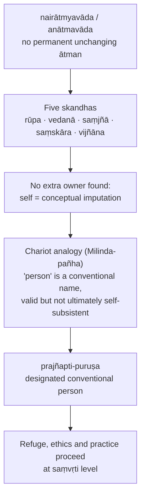

| Thesis | What is denied | Who stresses it |
|---|---|---|
| **Pudgala-nairātmya** | enduring person / self | shared across Buddhist traditions (minimum thesis) |
| **Dharma-nairātmya** | intrinsic nature of dharmas | developed emphatically in Mahāyāna, especially Mādhyamika; several realist Abhidharma schools treat dharmas as ultimately real |

- **Puggalavāda foil ✅:** Vātsīputrīyas proposed a **pudgala** neither the same as nor different from the skandhas; mainstream criticized it as a relapse toward self-theory. Shows pressure to preserve moral continuity was real.
- **Triratna and no-self (2022 Q7(b)) ⚠️:** Buddha (awakened teacher, exemplar) → Dharma (teaching and its practice) → Saṅgha (practitioner community that embodies, tests, transmits). Dependence is pedagogical and soteriological, not three everlasting substances. Reply: the refuge-taker is the conventional person. Anātman does not abolish discipline; it purifies it of ego-metaphysics. Saying "all three are empty" does not explain how they function; desert question stays open.
- **Nirvāṇa ✅:** extinguishes the three fires — **rāga**, **dveṣa**, **moha**; not a place or eternal self-state; cessation of the process producing bondage.

### 5.3 Nirvāṇa vs no-self vs momentariness (2018 Q6(b), 2025 Q8(c)) ⚠️

- "Who attains?" assumes the very self Buddhism rejects; nirvāṇa is not an entity possessed by a soul; it is cessation of craving, ignorance and the suffering-series. No-self removes the false claimant; momentariness explains why the chain can in fact cease.
- **2018** tests mainly no-self vs attainment. **2025** adds momentariness: do not say nirvāṇa is a momentary conditioned thing that perishes, nor that an eternal self experiences it. In important Theravāda/Abhidharma accounts nibbāna is **unconditioned**; one-moment thesis applies to conditioned causally efficient dharmas.
- An arhat may attain cessation of greed and delusion **while alive** with remaining aggregates; final passing involves no renewed conditioned aggregates; neither needs a migrating owner. Mādhyamika denies an independently existing nirvāṇa as well as saṃsāra; the contrast is cessation of reifying grasping under two truths.
- Open objection ⚠️: does cessation without a persisting beneficiary deserve the name "liberation"?
- **2023 Q8(a) soteriological route ⚠️:** avidyā misconstrues aggregates as "I/mine" → at contact→feeling→craving→grasping→becoming, experience becomes appropriation; right view of dependent origination and three marks halts craving; reverse order (tṛṣṇā → upādāna → bhava → jāti, ageing-and-death cease); Eightfold Path supplies wisdom, ethics, meditation; conceptual assent alone does not extinguish conditioned desire.

### 5.4 Optional: Buddhist arguments against a creator God ⚠️

Eternal unchanging God cannot genuinely create (willing involves change); creation from desire suggests lack; suffering sits uneasily with omnipotent benevolence; dependent origination makes a creator unnecessary — a refusal of explanatory surplus. Positive proofs and philosophy-of-religion treatment belong to Paper II owners.

---

## 6. Explanatory & Causal Principles

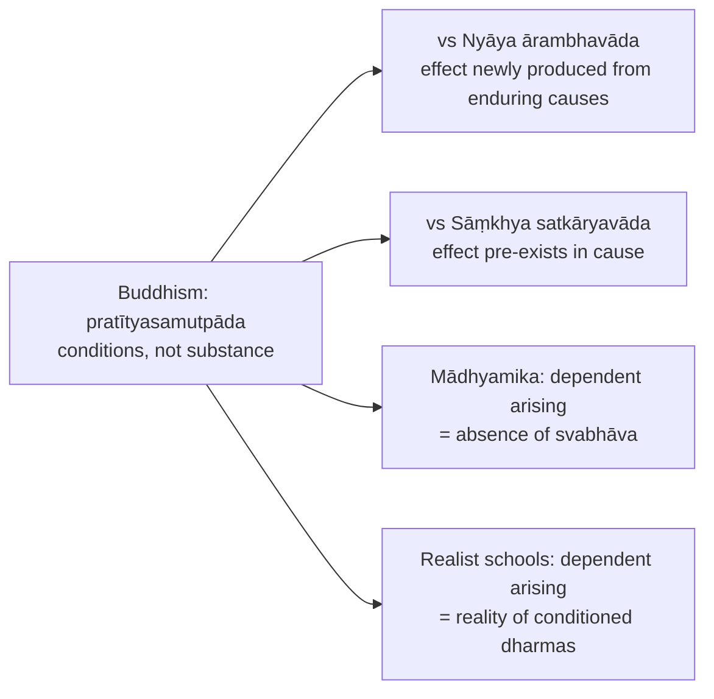

### 6.1 One doctrine, two opposed conclusions (2024 Q6(b)) ⚠️

| School move | What is denied | What is affirmed |
|---|---|---|
| **Mādhyamika** | intrinsic nature (svabhāva) | conventional dependent existence |
| **Vaibhāṣika / Sautrāntika** | eternal substance and self | reality of conditioned dharmas |

Spine: identify "void" (Mādhyamika: empty of **svabhāva**) and "real" (realist Buddhist position, especially Vaibhāṣika; Sautrāntika defends a differently accessed external reality). Vaibhāṣika: a conditioned event produces an effect, so real dharmas produce; present dharmas have special efficacy even in the three-time ontology. Mādhyamika: if dharmas had independent essence they would not need conditions; hence empty of that essence yet functional at conventional truth. These are **not** direct opposites in the same sense. Realist objection: universal emptiness undermines causal agents; reply: dependence is possible **because** causes and effects lack fixed own-being. Do not call Yogācāra "the everything-real school"; do not equate Vaibhāṣika realism with eternal selfhood.

**2018 Q5(b) route:** Nāgārjuna: what arises dependently cannot possess svabhāva, so all dharmas are **śūnya**; emptiness is not sheer non-being. **Two truths:** **saṃvṛti-satya** (language, persons, karma, compassion, practice function dependently) and **paramārtha-satya** (no dharma possesses svabhāva); conventional truth is not mere falsehood.

---

## 7. Ethics & Human Goals

*The Buddhist owner file frames ethics inside soteriology rather than as a separate puruṣārtha scheme; no separate hierarchy of kāma/artha/dharma/mokṣa is stated there for Buddhism. The material below is the source's ethical-soteriological content.*

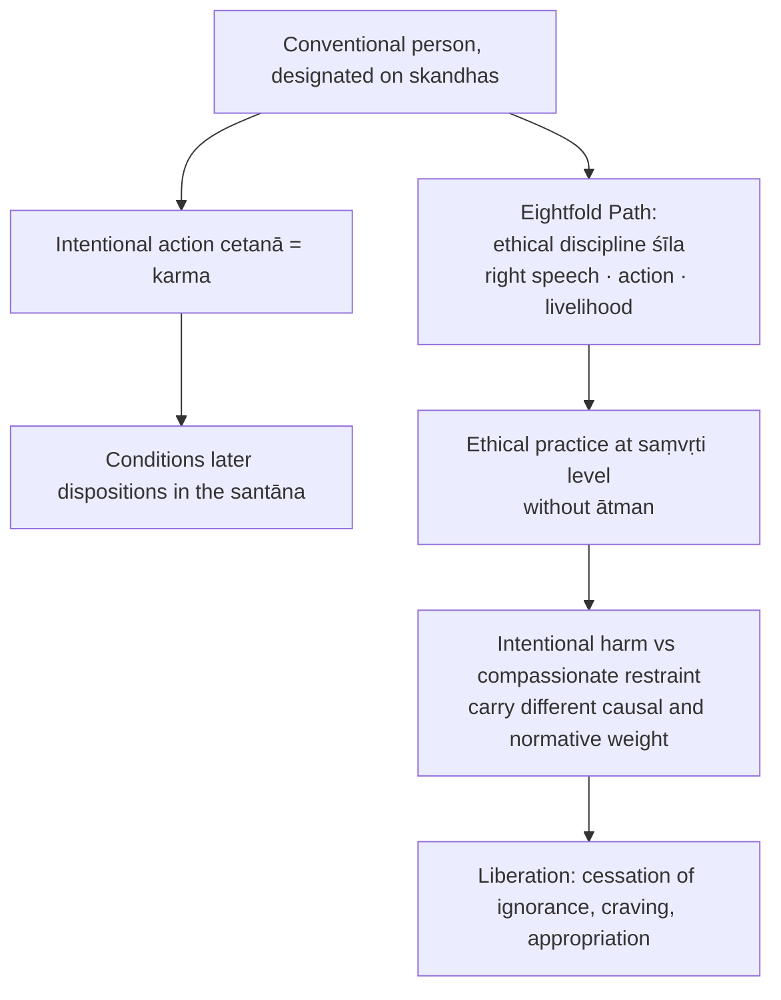

- Arhat ideal (Theravāda) vs bodhisattva path (Mahāyāna): do not caricature either.
- Nāgārjuna's radical language: **saṃsāra and nirvāṇa are not two independent realms**; difference lies in how dependent reality is grasped.
- **Two truths and ethics** (advanced, ⚠️): compassion and karma are intelligible at the saṃvṛti level; the Buddhist reply is that liberation and compassion operate within dependent conventional life.
- Residual: whether causal continuity alone suffices for **desert**, not merely causal explanation ⚠️.

---

## 8. Inter-School Comparative Matrices

| School | Pramāṇas | Ontology of self | Permanence / change | Causation | Universals | Scripture | Liberation |
|---|---|---|---|---|---|---|---|
| **Buddhism** | Dignāga–Dharmakīrti: perception and inference | no permanent ātman; aggregate / stream | conditioned reals momentary | dependent origination | apoha; no real jāti | Buddha-word valued, not Vedic infallibility | cessation of ignorance, craving, duḥkha-process |
| **Nyāya–Vaiśeṣika** | usually four | enduring self-substance | substances endure through changing qualities | ārambhavāda-style; theistic order in later Nyāya | real universals | testimony; Veda accepted | true knowledge of self and categories |
| **Sāṃkhya–Yoga** | perception, inference, reliable testimony | many puruṣas | puruṣa permanent; prakṛti transforms | satkāryavāda / pariṇāma | less central ⚠️ | scripture with reasoning | kaivalya |
| **Jainism** | multiple pramāṇa / naya | real jīva, intrinsically conscious | substance persists with changing modes | anekāntavāda, pariṇāmic change | real common features | Jaina āgama | release of jīva from karmic matter |
| **Mīmāṃsā** | expanded; Kumārila accepts several incl. arthāpatti, anupalabdhi | enduring self as agent/enjoyer | enduring subject, real ritual order | ritual efficacy, apūrva | real universals | Veda intrinsically authoritative | dharma, varies |
| **Cārvāka** | perception alone | body-self | material elements persist; no rebirth-continuity | material causation only | rejects metaphysical universals ⚠️ | rejects Veda | no mokṣa beyond worldly well-being |
| **Advaita Vedānta** | six in developed Advaita | ātman = Brahman, self-luminous | Brahman permanent; world ultimately mithyā | vivarta | empirical universals within māyā ⚠️ | Upaniṣadic revelation | knowledge of Brahman |

### 8.1 Internal escalation: pūrvapakṣa chain ✅/⚠️

| Stage | Siddhānta | Becomes pūrvapakṣa for | Next reply |
|---|---|---|---|
| Vaibhāṣika / Sarvāstivāda | Dharmas real, existing across three times | Sautrāntika: weakens momentariness, overpopulates ontology | Only present fully operative; externals inferred through representations |
| Sautrāntika | External objects exist but inferred | Yogācāra: inferred external object unnecessary; only cognition given | vijñaptimātra |
| Yogācāra | Consciousness-only explains appearance, karma, continuity via ālaya-vijñāna | Madhyamaka: consciousness reified as subtle substance | Even consciousness lacks svabhāva |
| Madhyamaka | Śūnyatā prevents every reification, including of emptiness | Nyāya, Mīmāṃsā, Advaita: nihilism / self-refutation | Two truths |

**Exam payoff ⚠️:** present the four schools as an argumentative escalation (realism of dharmas → presentist representationalism → idealist consciousness-only → anti-essentialist emptiness), not a mechanical list.

### 8.2 Buddhism vs Jainism ✅

Both non-Vedic śramaṇa traditions, both reject a creator God as necessary for liberation. Jainism: anekāntavāda, substance permanent while modes change, real **jīva**. Buddhism denies substance: persistence is a conditioned series without underlying dravya. ⚠️ Do not say both deny the soul — Buddhism denies ātman; Jainism affirms jīva.

### 8.3 Buddhism vs Advaita (avoid the "crypto-Advaita" trap) ✅

Both deny ordinary world-experience is ultimately real in the naive-realist sense. Advaita's ultimate is positive self-luminous Brahman/ātman; Madhyamaka śūnyatā is absence of svabhāva, not a hidden substrate. Advaita is absolute-substantialist; Buddhism anti-substantialist.

### 8.4 Buddhism vs Cārvāka on self (2024 Q6(a), Cārvāka-owned) ✅

Cārvāka denies self beyond body and tends toward materialist reduction. Buddhism denies permanent self but does not reduce personhood to gross body; analyses into skandhas, preserves karmic continuity without substance. Both reject an eternal ātman for very different reasons with different consequences. Cārvāka objection: karmic continuity is not directly perceived. Full treatment in the Cārvāka mindmap §8.3.

---

## 9. Criticisms & Reconstructed Replies

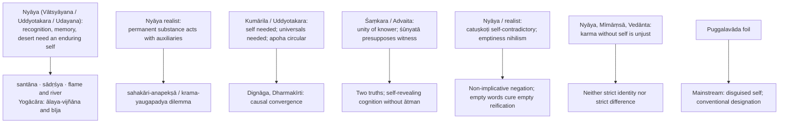

### 9.1 Pūrvapakṣa–siddhānta ledger ⚠️

| Objector | Objection | Buddhist reply | Residual force |
|---|---|---|---|
| Nyāya | Recognition, memory, desert need an enduring self | Santāna, sādṛśya, flame/river; ālaya + bīja | A series may not "own" memories unless something owns the series |
| Nyāya realist | Permanent substance acts when auxiliaries are present | Dharmakīrti: sahakāri-anapekṣā / kramayaugapadya; changing conditions do the work | Substance-quality model intuitively powerful |
| Kumārila Bhaṭṭa | Self needed for duty, memory, pramāṇa; universals for word-meaning | Momentary cognitions plus apoha explain self and generality conventionally | Apoha's positive-determination problem |
| Uddyotakara | Apoha circular | Exclusion grounded in causal convergence and successful activity | Circularity not fully dissolved |
| Śaṃkara / Advaita | Momentariness makes bondage/liberation and knower's unity unintelligible; śūnyatā presupposes witness | Two truths; self-revealing cognition without ātman | Unity of experience is the strongest Advaitic pressure point |
| Nyāya / modern realist | Catuṣkoṭi denial self-contradictory or says nothing | Non-implicative negation; empty words; no independent thesis | Prāsaṅgika vs Svātantrika shows internal unease |
| Puggalavāda / Vātsīputrīya | A person neither identical with nor different from skandhas needed | Risks a disguised self; continuity is designation on aggregates | Pressure to preserve agency explains why the foil arose |
| Cārvāka | Reject self beyond body, deny post-mortem continuity | Rejects permanent self but preserves karmic continuity | Requires accepting causal continuity not reducible to perception |

### 9.2 Presupposition ledger ⚠️

| Doctrine | Presupposition | What collapses if denied |
|---|---|---|
| Pratītyasamutpāda | Explanation through conditions, not a static first substance | Four Noble Truths lose causal grammar; suffering becomes fate |
| Kṣaṇikavāda | Conditioned causally efficient things cannot remain numerically permanent | Critique of substance weakens; Nyāya endurance possible |
| Nairātmyavāda | Exhaustive analysis finds aggregates, not an owner | Karma and nirvāṇa must be reinterpreted through an ātman |
| Arthakriyākāritva | Reality = effect-producing capacity | Momentariness loses its strongest bridge |
| Apoha | Generality by exclusion and causal convergence | Nyāya–Mīmāṃsā universals regain force |
| Two truths | Convention and ultimate analysis answer different questions | Madhyamaka appears nihilist or secretly realist |
| Śūnyatā | Whatever is dependently arisen lacks svabhāva | Dependent origination stays a mere causal theory |
| Nirvāṇa | Bondage is a conditioned process; cessation possible without soul-substance | No-self and liberation appear inconsistent |

---

## 10. Controlled Western Comparisons

| Comparison | Point of contact | Disanalogy |
|---|---|---|
| Hume's bundle theory vs anātman | Both deny substantial self on broadly empiricist grounds | Hume: no karmic continuity, no nirvāṇa-soteriology, self as imagination's fiction; Buddhism has a morally weighted causal series |
| Heraclitus' flux vs kṣaṇikavāda | Universal change | Heraclitus retains **logos**; Buddhist momentariness tied to dependent origination and causal efficacy |
| Whitehead's process thought vs momentary dharmas | Event/process over inert substance | Not the no-self path; no apoha or nirvāṇa framework |
| Nāgārjuna's catuṣkoṭi vs Kant's antinomies | Reason generating opposed metaphysical conclusions | Kant preserves the phenomenal object; Nāgārjuna targets svabhāva itself |
| Wittgenstein's therapy vs Buddha's silence | Dissolve misleading questions | Buddha's therapy is soteriological, rooted in duḥkha, karma, liberation |
| Ockham's nominalism vs apoha | Deny real universals | Apoha's exclusion mechanism has no Ockhamite counterpart; Ockham retains enduring individuals |

> [!WARNING]
> Western parallels are illustrative only; at most one or two lines after the Buddhist case is complete.

---

## 11. Diagnostic Deep-Dives for High-Frequency Themes

### 11.1 Dependent origination → kṣaṇikavāda → nairātmya chain

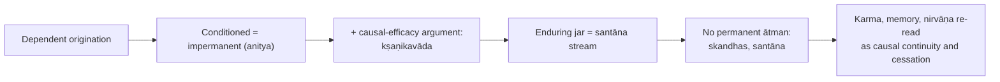

### 11.2 Question-specific routes (owner section pointers)

| Question | Owner route | Key move |
|---|---|---|
| 2018 Q5(b) Mādhyamika śūnyatā from pratītyasamutpāda | §6.1 | dependent = empty of svabhāva; not sheer non-being; two truths |
| 2018 Q6(b) nairātmya and nirvāṇa | §5.3 | "who attains?" assumes the rejected self |
| 2019 Q5(b) Yogācāra and the external world | §4.5 | dream and atom arguments; limits of the inference; Sautrāntika reply |
| 2019 Q7(c) / 2020 Q6(a) momentariness | §4.3 | hidden extra premise (causal efficacy) |
| 2020 Q7(b) pañcaskandha and liberation | §5.2 | no extra owner; cessation of ignorance, craving, appropriation |
| 2021 Q5(d) pudgala vs dharma nairātmya | §5.2 | personal vs phenomenon no-self |
| 2021 Q7(b) memory and identity | §4.4 | santāna, pratisandhāna, ālaya |
| 2022 Q6(a) momentariness and karma | §4.4 | neither identity nor difference |
| 2022 Q7(b) Triratna | §5.2 | conventional person; pedagogical dependence |
| 2023 Q8(a) soteriology | §5.3 | forward and reverse twelve links |
| 2024 Q6(b) void vs real | §6.1 | two schools, one doctrine |
| 2025 Q8(c) nirvāṇa, kṣaṇikavāda, nairātmya | §5.3 | unconditioned vs conditioned |
| 2026 Q5(b) action and responsibility | §4.4 | cetanā, santāna, desert remains open |

### 11.3 Śūnyatā is not nihilism

Emptiness = lack of **svabhāva**, not absence in every sense; conventional truth remains operative so compassion, karma and the path are not denied; emptiness undercuts metaphysical grasping, not dependent functioning ✅.

---

## 12. PYQ Routing Ledger (2018–2026)

> Corpus signal: 13 primary-owned parts out of 112 in 2018–2025 (every year), plus 1 in the 2026 supplement = **14**. Cross-links do not create duplicate ownership.

| Year | Q | Marks | Exact demand | Map to |
|---|---|---:|---|---|
| 2018 | Q5(b) | 10 | How do the Mādhyamika Buddhists apply the notion of Pratītyasamutpāda to establish their doctrine of Śūnyatā? Discuss. | §6.1 |
| 2018 | Q6(b) | 15 | Is it consistent for the Buddhists to admit the theory of Nairātmyavāda and the doctrine of Nirvāṇa simultaneously? Give reasons in favour of your answer. | §5.3 |
| 2019 | Q5(b) | 10 | How do the Yogācāra Buddhists deny the existence of the external world? Discuss. | §4.5 |
| 2019 | Q7(c) | 15 | What is Pratītyasamutpāda? How do the Buddhists apply this concept to prove that everything is momentary? | §4.1, §4.3 |
| 2020 | Q6(a) | 20 | How is Kṣaṇikavāda a logical derivative of Pratītyasamutpāda in Buddhism? Explain. | §4.3 |
| 2020 | Q7(b) | 15 | How does Buddhism explain Self in terms of Pañcaskandhas? What is Liberation for Buddhism if there is no Soul? | §5.2 |
| 2021 | Q5(d) | 10 | Distinguish between pudgala-nairātmyavāda and dharma-nairātmyavāda with reference to Buddhist Philosophy. | §5.2 |
| 2021 | Q7(b) | 15 | If everything is momentary then how do the Buddhists explain the problem of memory and personal identity? Critically discuss. | §4.4 |
| 2022 | Q6(a) | 20 | How compatible is Buddhist theory of momentariness with their theory of Karma? In this regard how do Buddhists respond to objections raised by their opponents? Critically discuss. | §4.4 |
| 2022 | Q7(b) | 15 | Explain Buddhist concept of Triratna and their internal relation. Critically examine the consistency of Triratnas with the Buddhist concept of No-soul (Nairātmyavāda). | §5.2 |
| 2023 | Q8(a) | 20 | "Ignorance of dependent origination is suffering while its knowledge is cessation of suffering." Present an account of Buddhist soteriology in the light of above statement. | §5.3 |
| 2024 | Q6(b) | 15 | How do the two schools of Buddhism arrive at two opposed conclusions, namely "everything is void" and "everything is real" from the same doctrine of Pratītyasamutpāda? Answer with arguments. | §6.1 |
| 2025 | Q8(c) | 15 | Is Buddhist notion of Nirvāṇa in consonance with their conception of Kṣaṇikavāda (momentariness) and Nairātmyavāda (no-soul theory)? Critically discuss. | §5.3 |
| 2026 | Q5(b) | 10 | How does the Buddhist theory of momentariness problematize the issue of human action and responsibility? Critically discuss. | §4.4 |

**Cross-owned parts (not counted):** 2018 Q5(d) (Nyāya, 10 marks): how the Buddhists and Naiyāyikas explain knowledge of "the absence of the jar on the table"; 2024 Q6(a) (Cārvāka, 20 marks): Cārvāka refutation of transcendental self vs Buddhist rejection of ātmā; 2025 Q5(b) (Nyāya, 10 marks): Naiyāyika–Buddhist debate on pramāṇa and pramāṇaphala; 2022 Q7(c) (Nyāya, 15 marks): Naiyāyikas on Cārvāka's inference objections (context only).

---

## 13. Top 10 UPSC Exam Traps

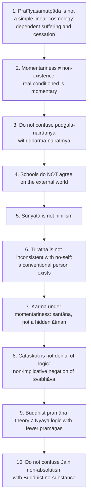

Further pitfalls recorded: the Middle Path is not mere moderation ❌; Hīnayāna ≠ Theravāda; Vaibhāṣika and Sautrāntika are not Theravāda; "bodhisattva simply postpones nirvāṇa" is oversimplified; dependence alone does not yield one-moment duration; nirvāṇa is not a momentary conditioned event nor an eternal self-state; do not call Yogācāra the "everything real" school; ālaya is not an eternal ātman and not common to all schools; dreams do not alone prove no external object; "Buddhist emptiness is Advaita Brahman" is the crypto-Advaita trap.

---

## 14. Technical Vocabulary & IAST Bank

| English gloss | IAST (Pali) | Meaning | Status |
|---|---|---|---|
| Dependent origination | pratītyasamutpāda (paṭicca-samuppāda) | This being, that becomes | ✅ |
| Twelve links | dvādaśa-nidāna | Chain of conditioned becoming | ✅ |
| Wheel of becoming | bhava-cakra | Visual form of the chain | ✅ |
| Middle Path | madhyamā pratipad (majjhimā paṭipadā) | Avoids indulgence and mortification; avoids eternalism and annihilationism | ✅ |
| Noble Eightfold Path | āryāṣṭāṅgamārga | Wisdom, ethics, meditation | ✅ |
| Eternalism / annihilationism | śāśvatavāda / ucchedavāda | The two metaphysical extremes | ✅ |
| Three marks | trilakṣaṇa (tilakkhaṇa) | anitya, duḥkha, anātman | ✅ |
| Momentariness | kṣaṇikavāda | Whatever is real is momentary | ✅ |
| Causal efficacy | arthakriyākāritva | sat = arthakriyā-samartha | ✅ |
| Causal continuum | santāna / santati | Stream explaining continuity | ✅ |
| Relinking | pratisandhāna | Continuity across moments and lives | ✅ |
| Similarity | sādṛśya | Explains recognition | ✅ |
| No-self | nairātmyavāda / anātmavāda | No permanent ātman | ✅ |
| Five aggregates | skandha: rūpa, vedanā, saṃjñā, saṃskāra, vijñāna | Analysis of the person | ✅ |
| Personal / phenomenon no-self | pudgala-nairātmya / dharma-nairātmya | Person lacks self / dharmas lack self-nature | ✅ |
| Designated person | prajñapti-puruṣa | Conventional refuge-taker | ✅ |
| Person-theory | Puggalavāda / Vātsīputrīya | pudgala neither same as nor different from skandhas | ✅ foil |
| Cessation | nirvāṇa (nibbāna) | Extinguishes rāga, dveṣa, moha | ✅ |
| Three fires | rāga, dveṣa, moha | Attachment, aversion, delusion | ✅ |
| Three Jewels | Triratna: Buddha, Dharma, Saṅgha | Refuge formula | ✅ |
| Liberated saint / awakening being | arhat (arahant) / bodhisattva | Dominant ideals | ✅ |
| Consciousness-only | vijñaptimātra | Yogācāra | ✅ |
| Store-consciousness / seeds | ālaya-vijñāna / bīja | Carries karmic and mnemonic potential | ✅ (one school's device) |
| Three natures | parikalpita, paratantra, pariniṣpanna | Imagined, dependent, perfected | ✅ |
| Emptiness / own-being | śūnyatā / svabhāva | Absence of intrinsic nature | ✅ |
| Two truths | saṃvṛti-satya / paramārtha-satya | Conventional / ultimate | ✅ |
| Four-cornered analysis | catuṣkoṭi | asti, nāsti, both, neither | ✅ |
| Non-implicative / implicative negation | prasajya-pratiṣedha / paryudāsa-pratiṣedha | Commitment-free vs positive-implying | ✅ |
| Thesis | pratijñā | Nāgārjuna claims none independent | ✅ |
| Reductio / independent inference | prasaṅga / svatantra | Prāsaṅgika / Svātantrika | ❓ |
| Undeclared | avyākata / avyākṛta | Questions set aside | ✅ |
| Unique particular / general character | svalakṣaṇa / sāmānyalakṣaṇa | Objects of perception / inference | ✅ |
| Non-conceptual / non-erroneous | kalpanāpoḍha / abhrānta | Dignāga / Dharmakīrti | ✅ |
| Sense / mental / self-awareness / yogic perception | indriya-, mānasa-, svasaṃvedana, yogi-pratyakṣa | Fourfold perception | ✅ (svasaṃvedana ❓) |
| Exclusion | apoha / anya-apoha | "cow" = "not-non-cow" | ✅ |
| Instrument / result | karaṇa / phala; pramāṇa / pramāṇaphala | Non-different on Dignāga | ✅ |
| Auxiliary condition | sahakārin | Nyāya device; sahakāri-anapekṣā dilemma | ✅ |
| Simultaneity / succession | yaugapadya / krama | Two horns | ✅ |
| Recognition | pratyabhijñā | Nyāya argument for identity | ✅ |
| Direct realism / representational realism | bāhya-pratyakṣa-vāda / bāhyānumeya-vāda | Vaibhāṣika / Sautrāntika | ✅ |
| All exists | sarvam asti | Sarvāstivāda three-time thesis | ✅ |
| Volition | cetanā | Intentional action = karma | ✅ |
| Doxographical jewel | Hīnayāna | Mahāyāna-applied label | ⚠️ |

---

## 15. Graded Verdict & Answer Architectures

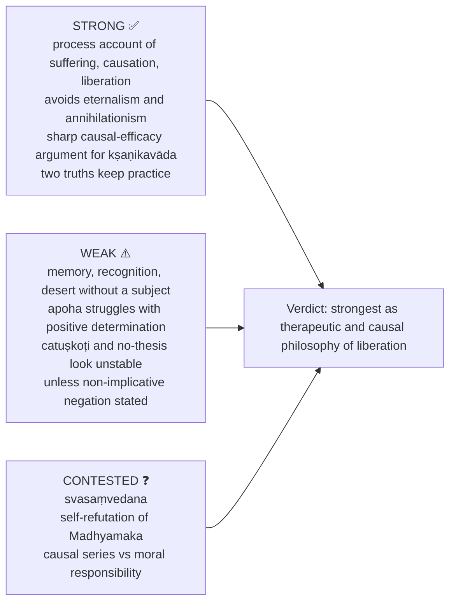

### 15.1 10-mark

```text
Define the doctrine in one line.
State the core argument in 3-4 crisp steps.
Add one distinction (pudgala vs dharma nairātmya; realism vs emptiness).
Close with one line of significance.
```
**Anchor:** "Buddhism replaces substance with conditioned process: this makes suffering removable, but raises the problem of continuity without self."

### 15.2 15-mark

```text
Intro: locate the issue in Buddhist soteriology.
Body A: doctrine stated precisely.
Body B: argument with one example.
Body C: objection and Buddhist reply.
Conclusion: why the doctrine matters for duḥkha / nirvāṇa.
```
**Anchor:** "Its doctrines of dependent origination, momentariness and no-self form a coherent anti-substantialist system, though Nyāya and Vedānta press hard on memory, agency and liberation."

### 15.3 20-mark

```text
Frame: connect the question to the Four Noble Truths.
Exposition: full doctrine with technical vocabulary.
Analysis: derive the linked claim (momentariness from dependent origination).
Debate: contrast two schools or answer a major objection.
Verdict: balanced philosophical assessment.
```
**Anchor:** "Buddhism is strongest as a therapeutic and causal philosophy of liberation; its deepest unresolved issue is whether causal continuity and two truths can fully replace the metaphysical work done by self, substance and universals in rival systems."

### 15.4 Directive decoder ⚠️

| Directive | Structural move | Closing verdict |
|---|---|---|
| Discuss | define → argument → school nuance → conclude | "Thus the doctrine is central because…" |
| Examine | thesis → reasoning → presupposition | "It stands if its presupposition about … is accepted." |
| Critically examine | doctrine → named objection → reply → residual force | "Strong as soteriology, debated as metaphysics." |
| Analyse | causation, self, moment, liberation, epistemology | "The components converge on anti-substantialism." |
| Evaluate | strengths → weaknesses → contested → verdict | "Adequate for …, weaker against …" |
| Compare | table, then one decisive contrast | "Similarity is formal; difference is doctrinal." |
| Distinguish | two-column definitions, criteria, example | "Confusing them causes the standard UPSC trap." |
| Bring out | show link: pratītyasamutpāda → kṣaṇikavāda → nairātmya | "The relation is logical, not merely historical." |
| Do you agree? | partial agreement → objection → defended verdict | "I agree in the conventional/ultimate sense specified above." |

> [!TIP]
> **Quick examinable statements.** "Ignorance of dependent origination is bondage because it converts process into substance and thereby fuels craving." · "Buddhist momentariness is not chaos but ordered succession." · "The person is neither an illusion in the trivial sense nor an ultimate self; it is a valid conventional designation." · "Śūnyatā denies intrinsic being, not dependent functioning."

---

## Sources

*Majjhima Nikāya* and related early formulations (used in substance); Nāgārjuna, *Mūlamadhyamakakārikā* and *Vigrahavyāvartanī*; Chatterjee & Datta; C.D. Sharma; Radhakrishnan, *Indian Philosophy* Vols I–II; *Milinda-pañha* (chariot analogy, paraphrased); Dignāga and Dharmakīrti (paraphrased, no verse numbers); early avyākata discussions and the Cūḷamālukya arrow parable; Candrakīrti, *Prasannapadā*; Vasubandhu, *Viṃśatikā* and *Triṃśikā*; *Encyclopaedia Britannica*, "Hīnayāna" (as cited in the owner file).
