# NYĀYA–VAIŚEṢIKA — Examiner-Grade Mindmap

> **Syllabus (verbatim):** Nyaya—Vaiesesika : Theory of Categories; Theory of Appearance; Theory of Pramana; Self, Liberation; God; Proofs for the Existence of God; Theory of Causation; Atomistic Theory of Creation.
> **Catalogue key:** `philosophy-paper-i-indian-philosophy-04` · Paper I · Indian Philosophy
> **Sources used:** `paper-1/indian/Nyaya-Vaisesika.md` (canonical owner, read in full) · `_advanced/Indian-Philosophy-Dossier.md` §4 (optional depth) · `paper-1/_PYQ-Indian-Philosophy-2018-2025.md` · `paper-1/_PYQ-Indian-Philosophy-2026.md`.
> **Evidence key:** ✅ canonical doctrine · ⚠️ analytical synthesis · ❓ contested / uncertain

> [!IMPORTANT]
> **Core thesis.** Nyāya–Vaiśeṣika is best mastered as a system: padārtha gives ontology, pramāṇa gives epistemology, anyathākhyāti handles error, ātman secures continuity, God secures cosmic and moral order, and asatkāryavāda plus atomism explain production. It is the heaviest-scoring realist school in Paper I (22 of 112 primary-owned parts in 2018–2025, the largest Indian owner; 4 more primary-owned in 2026). ⚠️

---

## 0. Master Overview

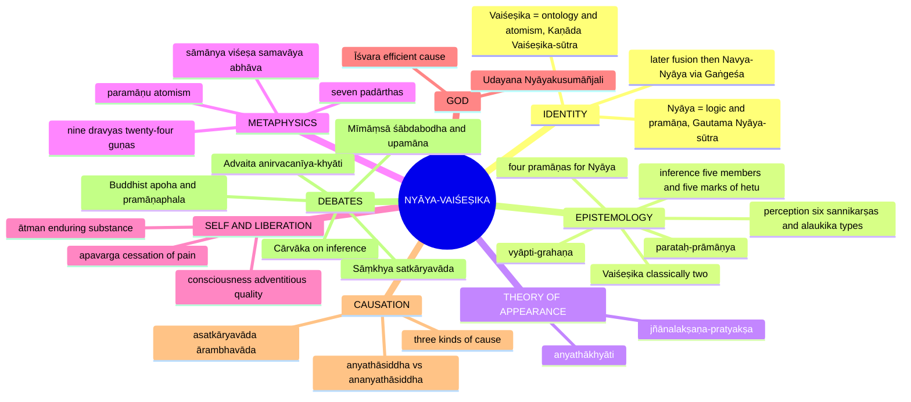

---

## 1. Identity, Lineage & Doxography

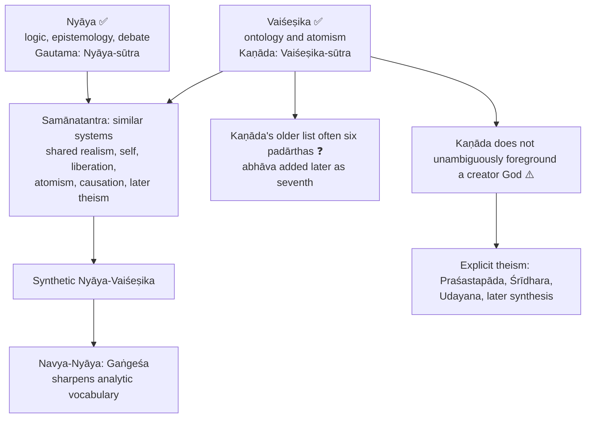

| School | Primary classical organisation | Distinctive owner content |
|---|---|---|
| **Nyāya** | Sixteen topics of inquiry and proof | means of valid knowledge, inference, debate, fallacy analysis, theory of error, natural theology |
| **Vaiśeṣika** | Seven ontological categories | substances, qualities, motions, universals, particularity, inherence, absence, atomism |

- Classical Nyāya accepts **four** independent pramāṇas; classical Vaiśeṣika accepts perception and inference and commonly reduces comparison and testimony to inference; the later synthesis uses fuller Nyāya epistemology ✅.
- **One system or two?** Historically two allied systems, doctrinally fused in later Nyāya–Vaiśeṣika, with distinguishable emphases ✅.
- **Division of labour:** Nyāya supplies pramāṇa and dialectic; Vaiśeṣika supplies categories, atomism and viśeṣa–samavāya ontology; Navya-Nyāya refines both into a highly technical idiom ⚠️.

> [!WARNING]
> Attribute the developed efficient-cause and God-proof system to later Nyāya–Vaiśeṣika, not mechanically to every stratum of early Vaiśeṣika.

### 1.1 Two category systems: do not flatten

> [!NOTE]
> The sixteen Nyāya categories are topics of rational inquiry, proof and debate; the seven Vaiśeṣika categories are kinds of being. They answer different questions.

| # | Nyāya topic (ṣoḍaśa-padārtha) | Function |
|---:|---|---|
| 1 | means of valid knowledge (**pramāṇa**) | instruments of true cognition |
| 2 | objects of valid knowledge (**prameya**) | liberation-relevant knowables |
| 3 | doubt (**saṃśaya**) | positive uncertainty between alternatives |
| 4 | purpose (**prayojana**) | motivating gain or avoided loss |
| 5 | accepted example (**dṛṣṭānta**) | undisputed illustrative case |
| 6 | established doctrine (**siddhānta**) | conclusion accepted by a system, all systems, or the present argument |
| 7 | members of demonstration (**avayava**) | five propositions of inference for another |
| 8 | hypothetical reasoning (**tarka**) | exposes unacceptable consequence; aids pramāṇa |
| 9 | ascertainment (**nirṇaya**) | settled cognition after weighing reasons |
| 10 | truth-directed debate (**vāda**) | rule-governed, aims at truth |
| 11 | victory-directed wrangling (**jalpa**) | aims at winning, incl. illegitimate devices |
| 12 | destructive cavil (**vitaṇḍā**) | attacks without establishing own thesis |
| 13 | fallacious reason (**hetvābhāsa**) | apparent middle term that fails |
| 14 | quibble (**chala**) | distorts opponent's intended meaning |
| 15 | futile rejoinder (**jāti**) | specious counter on irrelevant similarity/dissimilarity |
| 16 | ground of defeat (**nigrahasthāna**) | point where disputant is defeated |

> [!WARNING]
> **Futile rejoinder (jāti)** is a debate fault; it is **not** the universal (jāti / sāmānya) of Vaiśeṣika ontology.

**Twelve prameyas** (soteriological sequence, not exhaustive ontology ✅): self (ātman) · body (śarīra) · senses (indriya) · sense-objects (artha) · cognition (buddhi/jñāna) · sensory mind (manas) · activity (pravṛtti) · defects: attachment, aversion, delusion (doṣa) · rebirth (pretyabhāva) · experienced fruit (phala) · suffering (duḥkha) · release (apavarga).

---

## 2. Theory of Knowledge (Epistemology): Theory of Pramāṇa

### 2.1 Overview

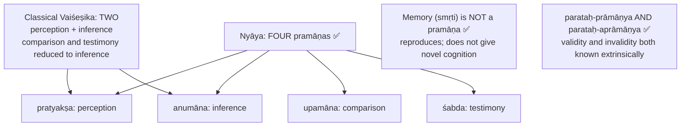

> [!WARNING]
> Never write "Nyāya–Vaiśeṣika accepts four pramāṇas" without the Vaiśeṣika qualification. Nyāya is parataḥ for **both** validity and invalidity; Mīmāṃsā is generally svataḥ for validity.

### 2.2 Perception: Gautama's definition (2025 Q6(a)) ✅

*indriyārtha-sannikarṣa-utpannaṃ jñānam avyapadeśyam avyabhicāri vyavasāyātmakam pratyakṣam*

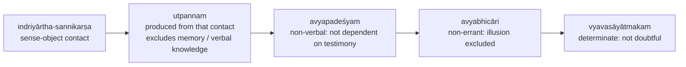

- **Nirvikalpaka** = indeterminate, pre-predicative awareness; **savikalpaka** = determinate, nameable ("this is a blue pot"). The nirvikalpaka phase explains how raw awareness grounds judgement ⚠️.
- **Internal tension ⚠️:** *avyapadeśyam* rules out cognition caused **merely by words**, not every perception later expressed in words; the determinacy clause excludes **doubt**; whether indeterminate cognition counts as valid perception is a genuine interpretive question.

**Six sannikarṣas** ✅

| Contact | Perceived | Why the intermediate step |
|---|---|---|
| **saṃyoga** | Pot (eye–pot conjoined) | Contact with the substance |
| **saṃyukta-samavāya** | Pot's **colour** | Colour inheres in the conjoined pot |
| **saṃyukta-samaveta-samavāya** | **Colour-universal** | Universal inheres in the quality |
| **samavāya** | **Sound** (ear, auditory organ) | Sound inheres in its ether substratum |
| **samaveta-samavāya** | **Sound-universal** | Universal inheres in sound |
| **viśeṣaṇa-viśeṣya-bhāva** | **Jar-absence** qualifying the table | Negation apprehended as qualification of a locus |

**Extraordinary (alaukika) perception** (2023 Q6(c), 2019 Q6(b)) ✅

| Type | Meaning | Role |
|---|---|---|
| **sāmānyalakṣaṇa-pratyakṣa** | perception through the universal; all instances presented in a distinctive way | supports realism: universals are **perceived**; Nyāya's move against induction |
| **jñānalakṣaṇa-pratyakṣa** | prior cognition mediates present perception (e.g. "seeing" sandalwood as fragrant) | crucial for theory of error |
| **yogaja-pratyakṣa** | yogic perception of subtle, distant, past, future objects | |

> A critic may say universal- or cognition-mediated perception stretches "contact" too far; reply: the earlier cognitive contact or universal supplies a distinctive perceptual relation, not independent testimony ⚠️. Whether sāmānyalakṣaṇa is genuine perception or an ad hoc device for induction is contested ❓.

### 2.3 Inference (anumāna) ✅

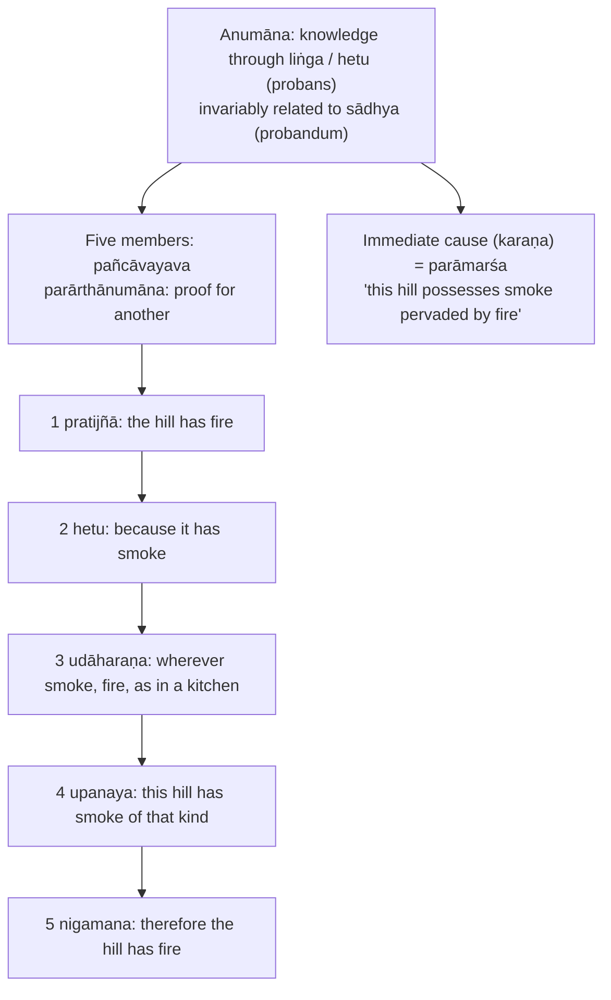

**Three classification grids** ✅

| Basis | Types | Distinction |
|---|---|---|
| Purpose | **svārthānumāna** (for oneself) · **parārthānumāna** (for another, five members) | own conclusion vs communicated proof |
| Direction / uniformity | **pūrvavat** (cause → effect) · **śeṣavat** (effect → cause) · **sāmānyatodṛṣṭa** (non-causal uniformity) | dark clouds → rain; swollen muddy river → past rain; celestial position → motion |
| Concomitance | **kevalānvayi** · **kevalavyatireki** · **anvayavyatireki** | positive-only, negative-only, both |

State which classification is in use; **pariśeṣa** (residual inference) is another textbook reading of śeṣavat ⚠️.

**Five characteristics of a valid hetu** (2026 Q5(a)) ✅

| # | Mark | Meaning |
|---:|---|---|
| 1 | **pakṣadharmatā** | hetu present in the subject |
| 2 | **sapakṣa-sattva** | present in similar positive instances |
| 3 | **vipakṣa-asattva** | absent in dissimilar negative instances |
| 4 | **abādhita** | sādhya not contradicted by stronger knowledge |
| 5 | **asatpratipakṣa** | not opposed by an equally strong counter-reason |

### 2.4 Vyāpti-grahaṇa: the reply to Cārvāka scepticism ✅

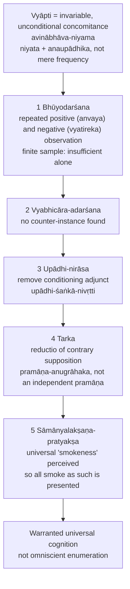

- **Samavyāpti** = equal extension (convertible); **viṣama/asamavyāpti** = unequal (all smoke pervaded by fire, not all fire by smoke) ✅.
- **Upādhi** = *sādhya-vyāpakatve sati sādhana-avyāpakaḥ*: pervades the sādhya but not the hetu. Example: in the bad inference "the hill has smoke because it has fire", **wet fuel (ārdra-indhana)** is the upādhi ✅.
- **Tarka forms** ⚠️: ātmāśraya (self-dependence), anyonyāśraya (mutual dependence), cakraka (circularity), anavasthā (infinite regress), pratyakṣa/anumāna-virodha.
- **Replies to Cārvāka (2022 Q7(c))** ✅: certainty demanded is misplaced; tarka is not an independent proof so it is not circular; sāmānyalakṣaṇa is not ad hoc in a realist ontology; the denial of all inference is itself a universal claim → **svavacana-virodha**.
- **Residual force ⚠️:** strongest only if realism about universals is accepted; if jāti is denied the induction solution is contested. Humean parallel: observed regularity does not entail necessity.

### 2.5 Fallacies: hetvābhāsa as the negative test (2023 Q7(a)) ✅

| Hetvābhāsa | What fails | Subtypes / examples |
|---|---|---|
| **savyabhicāra / anaikāntika** (irregular) | not invariably tied to sādhya | **sādhāraṇa** (in both sapakṣa and vipakṣa) · **asādhāraṇa** (only in pakṣa) · **anupasaṃhārin** (too wide for contrast) |
| **viruddha** (contradictory) | proves the opposite | reason meant to prove permanence proves impermanence |
| **satpratipakṣa / prakaraṇasama** (counterbalanced) | equal counter-hetu | balanced debate |
| **asiddha / sādhyasama** (unproved) | hetu itself not established | **āśrayāsiddha** (pakṣa unreal) · **svarūpāsiddha** (hetu absent in pakṣa) · **vyāpyatvāsiddha** (pervasion unproved, often via upādhi) |
| **bādhita / kālātīta** (stultified) | conclusion contradicted by stronger pramāṇa | fire inferred as cold |

> [!WARNING]
> The five-marks mapping must be **subtype-aware**; it is not a rigid one-to-one bijection. Sādhāraṇa violates vipakṣa-asattva; asādhāraṇa cannot establish sapakṣa-sattva; anupasaṃhārin leaves no negative comparator; svarūpāsiddha fails pakṣadharmatā but āśrayāsiddha lacks a subject and vyāpyatvāsiddha lacks pervasion; bādhita fails abādhita; satpratipakṣa fails asatpratipakṣa; viruddha supports the opposite sādhya. In a negative-only inference sapakṣa-sattva cannot mean an observed positive instance.

### 2.6 Comparison (upamāna): Nyāya vs Mīmāṃsā (2026 Q8(a), 20 marks) ✅

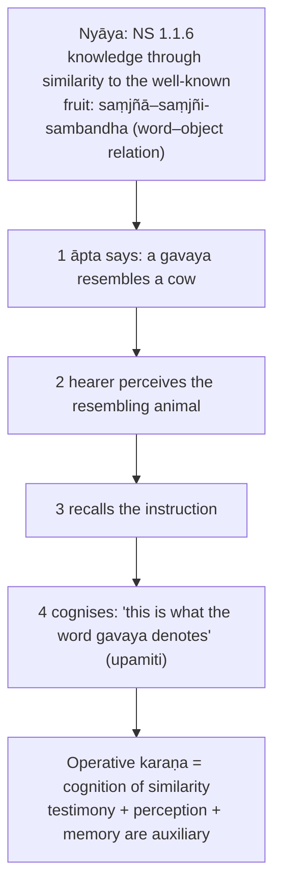

| Axis | **Nyāya** | **Mīmāṃsā** |
|---|---|---|
| Pramāṇas | four | six (Bhāṭṭa); Prābhākara five (no anupalabdhi) |
| Result | **word–object relation** | **similarity in the absent, remembered cow**: "the cow resembles this gavaya" |
| Testimony needed? | **Yes** | **No** |
| Direction | familiar (cow) → unfamiliar (gavaya) | present (gavaya) → absent familiar (cow) |
| Newly known | semantic fact | real relation (similarity) qualifying an unperceived object |
| Chief vulnerability | decomposes into testimony + perception + memory | informs us about what we already knew |

**Irreducibility grid (Nyāya):** not perception (cannot establish a word denotes it); not testimony (sentence gave general resemblance, not **this** referent); not inference (no vyāpti, no liṅga); not memory (reproduces the instruction only).
**Mutual objections:** Mīmāṃsā: decomposes without remainder; Nyāya reply: only when perceived similarity activates the remembered sentence does the relation arise. Nyāya: Mīmāṃsā result tells us nothing new, can be memory, resemblance is symmetric so inferable; Mīmāṃsā: memory cannot reproduce a relation never cognised; perception gives only gavaya→cow direction; inference presupposes the similarity-cognition.
❓ "The Mīmāṃsā view" is not uniform: Kumārila (Bhāṭṭa) = similarity as shared qualities; Prabhākara = similarity a distinct category.
**Traps ❌:** writing the Nyāya story as the Mīmāṃsā definition; saying Mīmāṃsā rejects upamāna; treating it as Western analogy; omitting the irreducibility argument; ignoring Vaiśeṣika's two-pramāṇa list.

### 2.7 Testimony (śabda) (2021 Q5(b)) ✅

- **Śabda** = valid verbal knowledge from reliable instruction (**āptopadeśa / āptavākya**); an **āpta** knows the matter correctly, intends to communicate truthfully and is competent; mere status or confidence does not create authority.
- Argument: many things cannot be directly perceived; life depends on reliable communication → independent pramāṇa when from a trustworthy source.
- Classes: perceptible (**dṛṣṭārtha**) / imperceptible (**adṛṣṭārtha**); secular (**laukika**) / Vedic (**vaidika**). Veda accepted as valid testimony; in later Nyāya its authority is connected with God as omniscient author.
- Four conditions of an intelligible sentence: **ākāṅkṣā** (expectancy) · **yogyatā** (fitness) · **sannidhi / āsatti** (proximity) · **tātparya** (intention).
- ⚠️ 2021 answer must connect speaker reliability, sentence comprehension and the cognition of the word–object relation.

### 2.8 Śābdabodha: Naiyāyikas vs Prābhākara Mīmāṃsakas (2026 Q6(c)) ✅

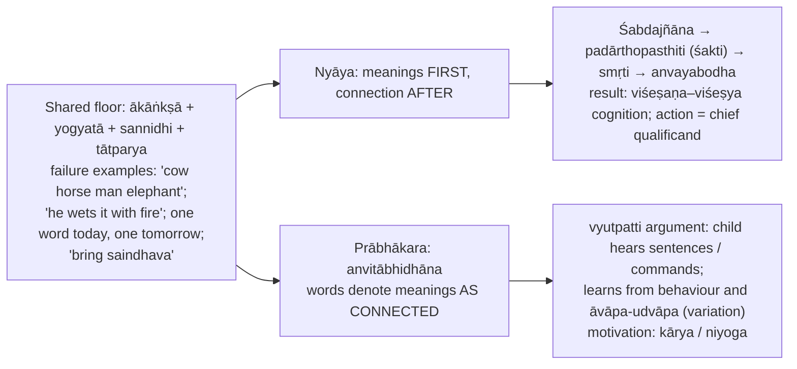

| Axis | Naiyāyika | Prābhākara |
|---|---|---|
| Word denotes | own meaning in isolation | meaning as connected |
| Memory | essential | not needed for connection |
| Source of connectedness | the four conditions on remembered meanings | denotation itself |
| Paradigm sentence | any assertion; action as chief qualificand | injunction (kārya/niyoga) |
| Learning | word-meanings + combination rules | behaviour following whole sentences |
| Novel sentences | easy | harder |
| Isolated word | intelligible | abstraction |

- **Nyāya against Prābhākara ❌:** circularity/regress; novel sentences; lexical stability; single-word utterances work. **Replies ✅:** learning is holistic; what is learned is a recombinable function; isolated word understood via elliptical context ("Fire!").
- **Prābhākara against Nyāya:** extra unevidenced step; isolated word as primitive. **Nyāya reply:** steps are causal, not introspectable; confirmed where ākāṅkṣā or yogyatā fails.
- ❓ Nyāya is "abhihitānvaya-**type**", but not Bhāṭṭa: Nyāya uses ordinary syntactic/causal conditions, Bhāṭṭas a further power (tātparya-śakti / lakṣaṇā). **Prābhākara ≠ Bhartṛhari** (sphoṭa, indivisible sentence). Prābhākara denies **isolated** word-meanings, not word-meanings altogether.
- **Close:** "Nyāya explains language-use from language-structure; Prabhākara explains language-structure from language-learning."
- Bhāṭṭa vs Prābhākara (*abhihitānvaya* vs *anvitābhidhāna*) is owned by `Mimamsa.md` §8.

### 2.9 Pramāṇa and pramāṇaphala: Naiyāyikas vs Buddhists (2025 Q5(b)) ✅/⚠️

| | Nyāya | Dignāga-style Buddhism |
|---|---|---|
| Factors | pramātṛ, pramāṇa, prameya, pramā/pramiti (pramāṇaphala) analytically distinct | one cognitive event with object-aspect (grāhyākāra) and subject-aspect (grāhakākāra) |
| Pramāṇa vs phala | operative instrument / causal complex vs new true cognition | presenting the object = pramāṇa; resultant awareness = phala; aspects of one momentary cognition |
| Metaphysics | instrumentally realist; enduring knower; independent object | cognition-centred; no substantial knower |

Objections: Nyāya asks how one event can be both producer and produced; Buddhist replies functions/aspects, not temporal self-production. Residual: can functional non-difference explain genuine epistemic success without the realist object's independent role? Do not call every Buddhist an external-world denier (see `Buddhism.md` §9A.6).

---

## 3. Dialectical Wings & Sceptical Refinements

> [!NOTE]
> The owner file contains **no distinct sceptical wing** inside Nyāya–Vaiśeṣika. This module therefore records the school's **refinement** (Navya-Nyāya) and the **sceptical/dialectical pressure applied to it** by rivals, exactly as sourced.

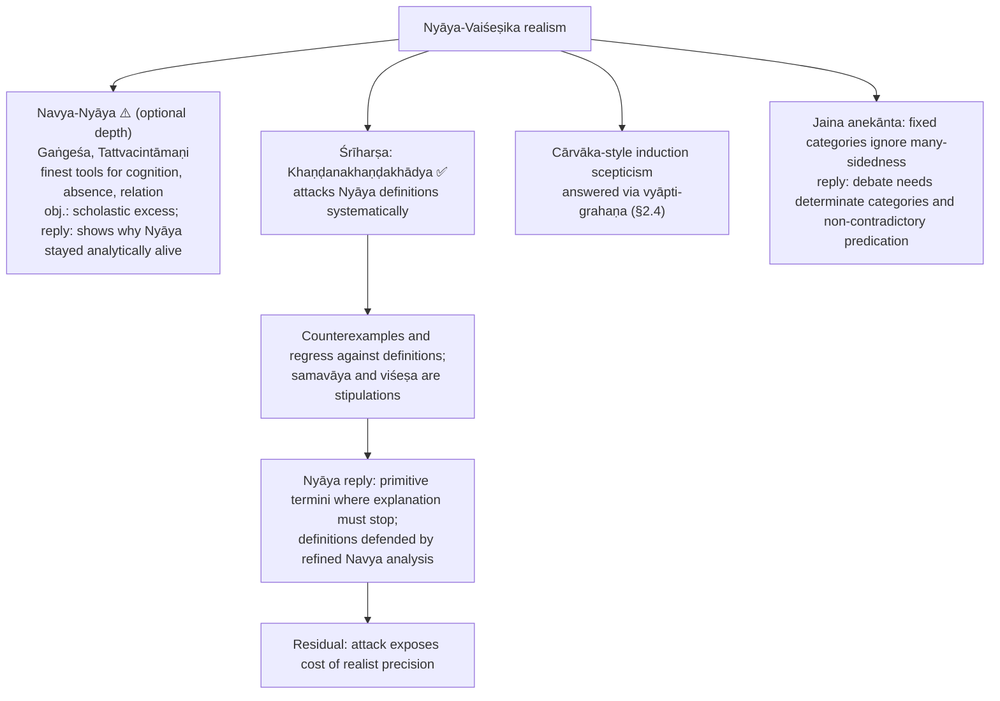

- **Avoid over-study ⚠️:** full Navya symbolising, endless later sub-fallacies, every later theistic proof variant.
- Promotion trigger for Navya-Nyāya depth: only if a PYQ asks Navya-Nyāya, presses the regress against samavāya/viśeṣa, or asks whether Nyāya theism is cumulative.

---

## 4. Metaphysics & Ontology: Theory of Categories and Atomism

### 4.1 The seven padārthas

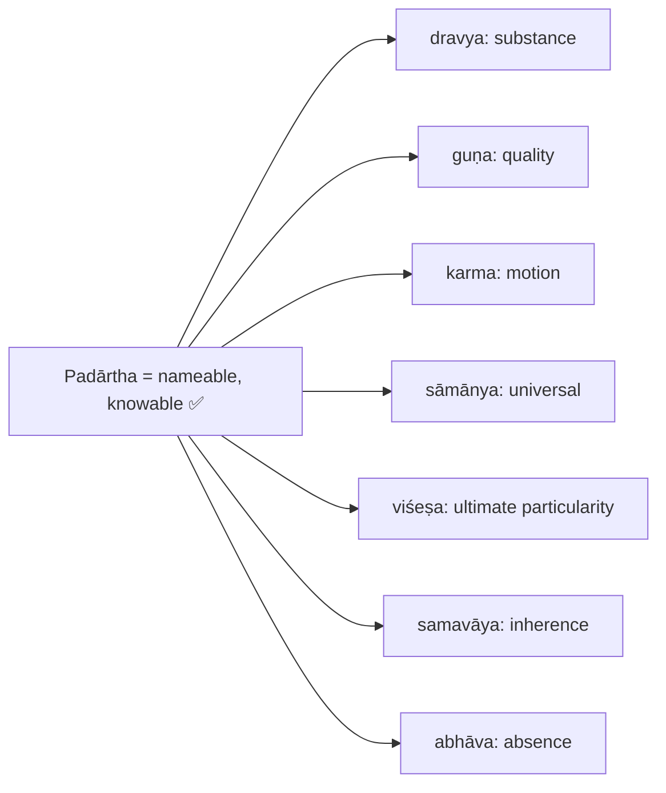

**Nine dravyas** ✅: pṛthivī (earth) · ap (water) · tejas (fire) · vāyu (air) · ākāśa (ether) · kāla (time) · dik (space/direction) · ātman (self) · manas (mind). ⚠️ Trap: ākāśa, kāla, dik are **substances**; there are nine, not seven.

**Twenty-four guṇas** ✅: rūpa, rasa, gandha, sparśa, saṃkhyā, parimāṇa, pṛthaktva, saṃyoga, vibhāga, paratva, aparatva, buddhi, sukha, duḥkha, icchā, dveṣa, prayatna, gurutva, dravatva, sneha, saṃskāra, dharma, adharma, śabda. ⚠️ Cognition, desire, pleasure are **qualities**, not the essence of self.

**Karma (motion, not moral karma)** ✅: five kinds: upward, downward, contraction, expansion, locomotion; generates conjunction and disjunction.

### 4.2 Universal (sāmānya) (2022 Q5(b)) ✅

1. We classify many individuals under one concept (cow, pot, substance). 2. Resemblance alone is insufficient without objective commonness. 3. So the universal is real. One-in-many, eternal, para/apara ordering. Presupposition: realist semantics ⚠️.
- Objection: how can one be wholly present in many? Reply: not spatially divided; one eternal entity instantiated through **samavāya**.
- Opposed to Buddhist **apoha** (exclusion). Example: cow-ness.

**Six jāti-bādhakas** (obstructors of universalhood) ✅ — a blocked jāti is an imposed property / limiting condition (**upādhi**), not a new padārtha

| Bādhaka | Rule | Example |
|---|---|---|
| **vyakter abhedaḥ** | cannot have only one instance | ākāśatva (one ākāśa) |
| **tulyatvam** | no two exactly co-extensive universals | ghaṭatva / kalaśatva |
| **saṅkaraḥ** | no partial overlap: must be nested or disjoint | bhūtatva / mūrtatva |
| **anavasthā** | universalhood cannot be a universal of universals | jātitva |
| **rūpahāniḥ** | blocked where it destroys the entity's form/function | universal in viśeṣas defeats individuation |
| **asambandhaḥ** | samavāya has no further samavāya to link it | samavāyatva |

Buddhist objection: universals unperceived, causally inert, cannot be wholly in many places. Nyāya reply: perceived in savikalpaka perception ("this is a cow"); present by samavāya; apoha is circular (exclusion of non-cows presupposes a stable class).

### 4.3 Viśeṣa (2020 Q8(b)) ✅

- Ultimate individuator residing only in **eternal** substances: paramāṇus of earth, water, fire, air, and the eternal instances of ākāśa, kāla, dik, ātman, manas. Gives the school its name.
- Function: two earth atoms alike in all universals and qualities would collapse into one without viśeṣa (identity of indiscernibles).
- Regress objection (what differentiates one viśeṣa from another?) → **svato-vyāvartaka** (self-differentiating). Residual: names the stopping point rather than proving it ⚠️.
- "Imperceptible IOU" objection → framed inferentially (plurality of exactly similar eternals is otherwise inexplicable); arthāpatti reduced to inference.
- Jaina, Buddhist and Advaita critiques target viśeṣa and samavāya as the weakest joints ⚠️.

### 4.4 Inherence (samavāya) (2018 Q5(a), 2021 Q5(c), 2026 Q5(d)) ✅

| Relation | Status | Relata | Example |
|---|---|---|---|
| **samavāya** | eternal, single, inferred inseparable relation (**ayutasiddha-sambandha**) | ayutasiddha | colour in cloth; whole in parts |
| **saṃyoga** | a guṇa; produced and destructible | separable | book on table; two pots in contact |

- Five pairs: part–whole, substance–quality, substance–motion, universal–particular, eternal substance–its viśeṣa.
- **2018:** brown colour of the table = samavāya; book on the table = saṃyoga ❌ spatial closeness is not the criterion of inherence.
- **2021 Q5(c):** ayuta-siddhatva is **necessary** but ⚠️ **not sufficient** alone: a glued book stays two independent substances; one must specify the relata's ontological types and asymmetric dependence, not empirical non-separability.
- **Relation-regress** objection → samavāya is **svarūpa-sambandha** (self-linking). Residual: stipulated terminus, while regress is used against opponents. Bradley's regress is a comparison for after the Indian argument ⚠️.
- One or many? One and eternal (parsimony); relata determine where it operates.

### 4.5 Absence (abhāva) (2018 Q5(d), 2019 Q5(a), 2023 Q5(d), 2023 Q8(b), 2024 Q5(c)) ✅

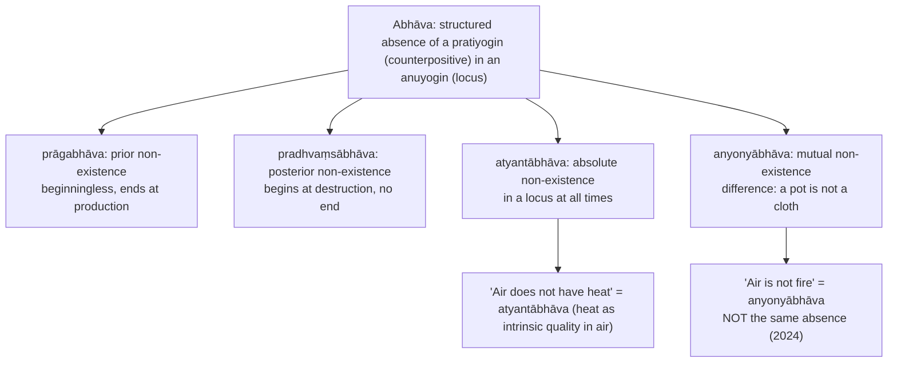

- **2023 Q5(d):** do not deny atyantābhāva (one of four admitted). The impossible thing is a **free-floating, unqualified negation** with no counterpositive and locus. Hare's-horn issue: grasping the meaning of a term ≠ admitting a corresponding instantiated thing.
- **How absence is known (2018):** Nyāya: perceived through viśeṣaṇa-viśeṣya-bhāva as a real qualifier of the table, given available locus, competent senses, no obstruction (no separate anupalabdhi pramāṇa); inferential absences inferable. Buddhist reconstruction: no additional negative entity; judgement "no jar here" by exclusion, non-apprehension, or negative inference. Both need visibility conditions ✅/⚠️. Bhāṭṭa Mīmāṃsā owns anupalabdhi as independent pramāṇa; do not attribute it to either disputant.
- **Prāgabhāva vs Sāṃkhya (2023 Q8(b))** → §7.

### 4.6 Atomism (paramāṇuvāda) ✅

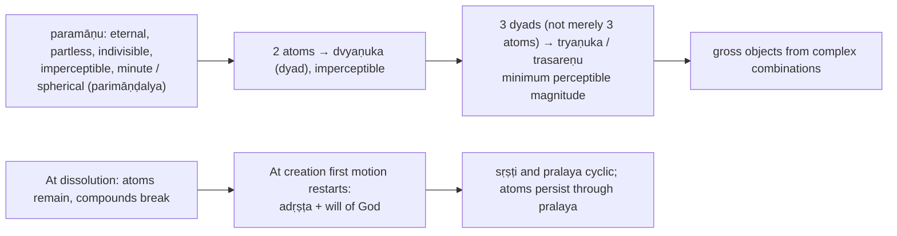

Why partless and eternal: infinite division would leave no ultimate unit; mustard-seed / mountain absurdity ⚠️.

---

## 5. Rejection / Affirmation of Transcendent Realities

### 5.1 Theory of appearance: anyathākhyāti (2019 Q6(b)) ✅

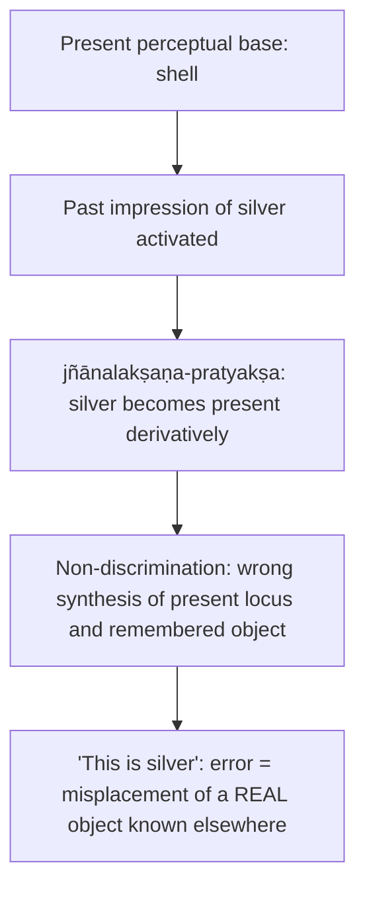

| Theory | School | Error as |
|---|---|---|
| **anyathākhyāti** | Nyāya | real object known elsewhere, mislocated here |
| **ātmakhyāti** | Yogācāra | internal cognition projected outward |
| **asatkhyāti** | Mādhyamika (standard doxography) | apprehension of the non-existent |
| **akhyāti** | Prābhākara Mīmāṃsā | failure to discriminate two valid cognitions |
| **anirvacanīya-khyāti** | Advaita | error-object neither real nor unreal |

Presupposition: Nyāya preserves realism even in illusion ⚠️. **2021:** Nyāya objects the Advaitin's "neither real nor unreal" is obscure and violates logical alternatives; no third ontological status needed. 2026 Q7(a) (cross-owned; Akhyātivādins vs Anyathākhyātivādins) uses §4.1–4.4 of the owner file.

### 5.2 Self (ātman) (2024 Q5(b)) ✅

- Real, enduring substance distinct from body, senses, mind; consciousness an **adventitious quality** arising under proper conditions (not its essence).
- **Six marks (Gautama):** *icchā-dveṣa-prayatna-sukha-duḥkha-jñānāny ātmano liṅgam* — desire, aversion, effort, pleasure, pain, cognition (a quality requiring a substance). Cumulative: episodic qualities appropriated as "I desire / suffer / know".
- ⚠️ Memory/recognition and the instrument-user inference are **supplementary, not part of the six**.
- **Manas:** atomic internal organ mediating self and senses; being atomic, one cognition at a time.
- Contrast: Nyāya consciousness a quality of self; Advaita consciousness the very nature of self. Self can exist without manifest cognition (deep sleep, liberation).

### 5.3 Liberation (apavarga) ✅


- Self remains as pure substance without pleasure, pain, desire, aversion or ordinary cognition; consciousness ceases as conjunction ceases.
- **Stone-like objection** → aim is freedom from suffering, not bliss; bliss may be relational and breed attachment. Residual force remains ⚠️. Knowledge matters because it removes error, not because it reveals identity with Brahman.

### 5.4 God (Īśvara) ✅

- Eternal, omniscient, supremely powerful; **nimitta-kāraṇa** (efficient cause), **not** material cause (atoms are). A special self never bound by karma; orders atoms at creation, dispenses karmic fruits, and in later Nyāya is the Veda's author.
- Not Advaita's non-dual Brahman and not Sāṃkhya's rejected superfluity ⚠️.

### 5.5 Proofs for God (2018 Q6(a), 2019 Q7(a)) ✅

| Proof | Pakṣa | Hetu | Sādhya | Dṛṣṭānta |
|---|---|---|---|---|
| **kāryāt** (from effect) | the world | an effect, composite, ordered | intelligent maker | pot and potter |
| **āyojanāt** (from combination) | primordial atomic conjunction | unconscious atoms and adṛṣṭa cannot initiate ordered first motion | intelligent impeller | ordered arrangement by an agent |
| **dhṛtyādeḥ** (from support, sustenance, destruction) | the ordered cosmos | sustained, regulated, dissolved | governing intelligence | maintained artefact / polity |
| **padāt / śruteḥ / vākyāt** (words, Veda, sentences) | Vedic and meaningful sentences | require competent authorship; Vedic scope exceeds ordinary knowledge | omniscient source of the Veda | competent speaker's instruction |
| ⚠️ adṛṣṭa / karma-administration | karmic distribution | unconscious adṛṣṭa cannot allot fruits with moral precision | intelligent administrator | just allocation needs a conscious allocator |

Additional commonly cited: **padāt**, **pratyayataḥ**, **vākyāt**, **saṅkhyāviśeṣāt** ✅. ❓ Count and labels vary: write "commonly enumerated as", not a fixed count.
**Cumulative structure ⚠️:** Udayana's *Nyāyakusumāñjali* answers successive objections (no unseen cause; unseen cause needs no controller; Veda stands without author; karma/atoms function without governance). Explanatory hypothesis: Īśvara conjoins atoms through volition operating with souls' adṛṣṭa; dispenses fruits; is the āpta source of the Veda.

| Opponent | Objection | Nyāya reply | Residual force ⚠️ |
|---|---|---|---|
| Mīmāṃsā / Kumārila | Veda authorless; apūrva links action to fruit | authoritative sentences and moral dispensation point to an omniscient āpta | if authorlessness is granted, śruteḥ loses force |
| Sāṃkhya | prakṛti's teleology suffices; perfect God lacks motive | unconscious prakṛti cannot allocate karma or initiate atomic motion; God's action follows adṛṣṭa | motive problem if over-anthropomorphic |
| Buddhist (Dharmakīrti / Śāntarakṣita-style) | world not observed as effect; pot–potter fails (vaiṣamya) | composite ordered wholes are inferable effects; embodiment not essential to agency | analogy strained |
| Cārvāka | God never perceived; inference unreliable | first defend vyāpti | works only for those granting Nyāya pramāṇa |
| Advaita | Īśvara only vyāvahārika | rejects two-level downgrade | incompatible starting points |
| Problem of evil | why suffering? | God dispenses fruits by beginningless karma | saves goodness at cost of independence |

### 5.6 Nyāya vs Yoga on God (2018 Q6(a)) ✅

| Issue | Nyāya | Classical Yoga |
|---|---|---|
| Characterisation | omniscient efficient cause, atom-arranger, karmic governor, source of testimony | special conscious witness (**puruṣa-viśeṣa**) untouched by afflictions, actions, fruits, latent deposits |
| Role | inferred via effect, combination, sustenance, moral administration, scripture | beginningless teacher; support of meditation |
| World | efficient, not material, cause | *Yoga-sūtra* does not build Udayana's atomic creator inference |
| Practice | knowledge supports explanation and liberation | **Īśvara-praṇidhāna** aids absorption |

Verdict: both accept God, but sameness of name ≠ sameness of demonstration or function.

---

## 6. Explanatory & Causal Principles

### 6.1 Asatkāryavāda / ārambhavāda (2025 Q5(e), 2021 Q5(a)) ✅

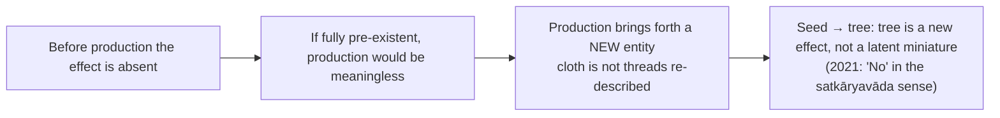

Asatkāryavāda does **not** deny causation; it denies a pre-existent effect. Contrast Sāṃkhya satkāryavāda; Advaita vivartavāda.

### 6.2 Definition of cause (2020 Q6(c)) ✅

- Cause = unconditional invariable antecedent: **pūrvavṛtti**, **niyata-pūrvavṛtti**, **ananyathāsiddha**. Complete cause = **kāraṇa-sāmagrī** incl. **pratibandhakābhāva** (absence of blocker). **Anyathāsiddha** = accidental / remote / co-effect / redundant antecedent, excluded.

| Excluded antecedent (pot) | Why |
|---|---|
| colour of the potter's staff | quality of an instrument, irrelevant |
| potter's father | remote cause of the potter |
| sound made by the staff | co-effect of the operation |
| all-pervading space | ever-present background |
| potter's donkey | accidental companion |

**Three kinds of cause:** **samavāyi** (inherent / material: threads) · **asamavāyi** (non-inherent: qualities/conjunctions in the material cause) · **nimitta** (efficient: weaver).

### 6.3 Prāgabhāva against Sāṃkhya (2023 Q8(b)) ⚠️

- Prior absence shows the effect is genuinely absent before production; ends when the effect arises. ⚠️ Do not reduce to a proof by definition.
- Sāṃkhya: absence of **manifest form** is compatible with latent existence. Nyāya: new identity, structure, capacities — "manifestation" under-explains production. Sāṃkhya reverse worry: ex nihilo cannot explain why this effect from this cause. Nyāya rejoinder: **not** ex nihilo; material, non-inherent, efficient causes remain indispensable. The outcome depends on the cause–effect identity criterion.

---

## 7. Ethics & Human Goals (Puruṣārthas)

> [!NOTE]
> The owner file gives **no separate kāma–artha–dharma–mokṣa analysis** for Nyāya–Vaiśeṣika. The ethical-soteriological content it does supply is the following, and nothing more is added.

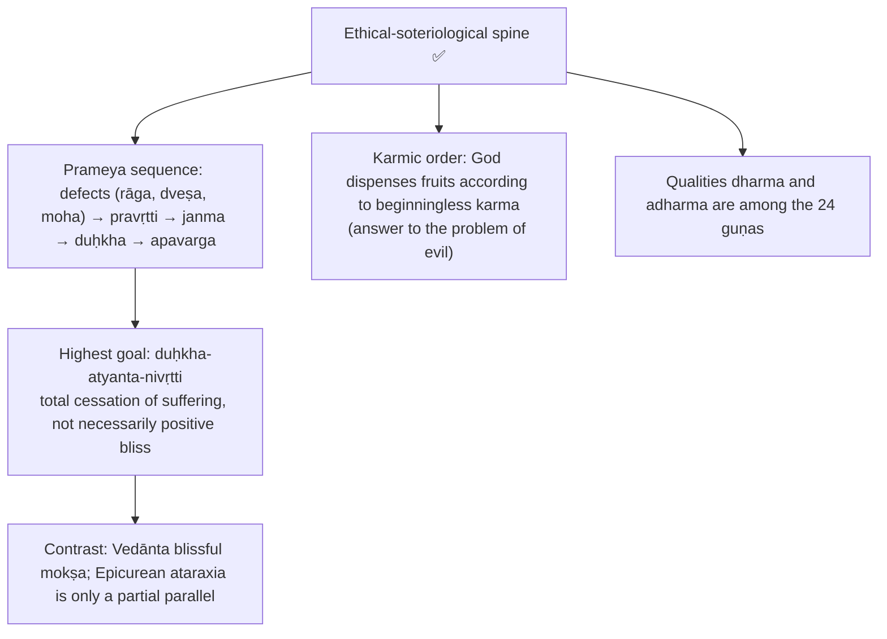

---

## 8. Inter-School Comparative Matrices

| School | Pramāṇas | Validity | Error | Universals | Causation / atomism | God | Self and liberation |
|---|---|---|---|---|---|---|---|
| **Nyāya–Vaiśeṣika** | Four (Nyāya) | parataḥ for both | anyathākhyāti | real jāti, disciplined by jāti-bādhaka | asatkāryavāda, ārambhavāda, eternal atoms | Īśvara efficient cause, karmic governor | enduring ātman; apavarga = cessation of suffering |
| **Sāṃkhya–Yoga** | usually three | not Nyāya-parataḥ ⚠️ | misidentification of puruṣa and prakṛti ⚠️ | less central | satkāryavāda; no atomism | Sāṃkhya none; Yoga special puruṣa | many puruṣas; kaivalya |
| **Mīmāṃsā** | expansive (arthāpatti, anupalabdhi) | svataḥ for validity | Prābhākara akhyāti | realist re word-meaning | apūrva ritual potency | no divine author of Veda | self accepted; liberation varies |
| **Advaita** | six | within vyavahāra | anirvacanīya-khyāti | empirical universals not ultimately real ⚠️ | vivarta-style | Īśvara vyāvahārika | ātman = Brahman |
| **Viśiṣṭādvaita** | perception, inference, scripture | theistic-realist ⚠️ | no indefinable object ⚠️ | real plurality as modes | real transformation ⚠️ | Nārāyaṇa material + efficient cause | selves real modes; service retained |
| **Buddhism** | two (Dignāga–Dharmakīrti) | cognition-centred ⚠️ | ātmakhyāti / asatkhyāti labels vary | apoha | momentariness; no permanent atoms/self | no creator | no eternal ātman; nirvāṇa |
| **Jainism** | multiple, naya-based | standpoint-conditioned ⚠️ | partial absolutisation ⚠️ | realism filtered by anekānta ⚠️ | atomism in a different framework ⚠️ | no creator in Nyāya sense | many jīvas; perfected consciousness |
| **Cārvāka** | perception alone | tied to perceptibility | exposes unreliability beyond perception ⚠️ | rejected | materialism | rejected | rejects non-material self and mokṣa |

**Inter-school debate axes** ✅

| Axis | Nyāya–Vaiśeṣika | Rival |
|---|---|---|
| Universals | real sāmānya | Buddhist apoha / nominalist tendency |
| Error | anyathākhyāti | Advaita anirvacanīya-khyāti; Prābhākara akhyāti |
| Validity | parataḥ for truth and falsity | Mīmāṃsā svataḥ for validity |
| Self | enduring substance; consciousness quality | Buddhism no-self; Advaita self as consciousness |
| Liberation | cessation of pain | Vedānta blissful mokṣa |
| Causation | asatkāryavāda | Sāṃkhya satkāryavāda |
| God | efficient creator and governor | Buddhism / Mīmāṃsā / Sāṃkhya critiques |

**Words signify universals or particulars? (2023)** ✅/⚠️: Nyāya leans to words signifying objects through universals and qualificative structures, not bare particulars; Mīmāṃsā gives stronger independent weight to word-meaning relations in sentence use.

---

## 9. Criticisms & Reconstructed Replies

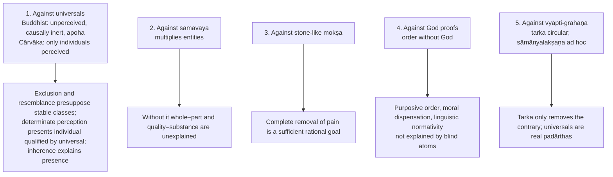

⚠️ **Mīmāṃsā caution:** major Mīmāṃsā thinkers are also realists about universals; their disagreement concerns word-meaning, sentence-meaning, pramāṇa, and whether Nyāya's theistic/relational apparatus is needed.

**Pūrvapakṣa–siddhānta ledger** ✅

| Objector | Objection | Reply | Residual ⚠️ |
|---|---|---|---|
| Cārvāka | finite observation proves no universal; upādhis may remain | bhūyodarśana, vyabhicāra-adarśana, upādhi-nirāsa, tarka, sāmānyalakṣaṇa | depends on real universals and extraordinary perception |
| Buddhist (apoha) | universals unperceived, inert | perceived in savikalpaka cognition; apoha presupposes stable classes | nominalism remains powerful |
| Buddhist (momentariness, no-self) | only momentary cognitions | memory, recognition, agency, responsibility need enduring ātman | why does a permanent self have episodic consciousness? |
| Buddhist (avayavin) | whole is identical with, or different from, parts and unintelligible | real whole inferred from practical cognition and new properties of wholes | leans on samavāya |
| Advaita / Śrīharṣa | definitions invite counterexamples and regress | primitive termini; refined Navya analysis | exposes cost of realist precision |
| Advaita (mokṣa) | liberation without consciousness or bliss worthless | cessation of suffering intrinsically desirable | stone-like objection forceful |
| Sāṃkhya | satkāryavāda explains causation | prāgabhāva: effect absent before production | continuity without latent pre-existence |
| Mīmāṃsā | svataḥ validity; Veda needs no author | external checks; testimony points to a competent āpta | authorless Veda weakens God-proof |
| Jaina anekānta | rigid categories | debate and inference need determinate categories | contextual limits of fixed classifications |

**Presupposition ledger** ⚠️

| Doctrine | Presupposition | What collapses if denied |
|---|---|---|
| Padārtha scheme | reality classifiable into stable kinds | Vaiśeṣika map of seven categories |
| Pramāṇa realism / parataḥ | cognitions about real objects; validity externally ascertained | realist distinction of valid cognition from appearance |
| Vyāpti and induction | universal concomitance warranted via observation, upādhi-elimination, tarka, universal-mediated perception | anumāna falls to Cārvāka |
| Sāmānya | common predication grounded in real universals | classification, word-meaning, sāmānyalakṣaṇa, vyāpti-grahaṇa |
| Samavāya | inseparable relations need a sui generis relation | whole–part, quality–substance, universal–particular unexplained |
| Viśeṣa | exactly similar eternals need individuators | atoms and selves collapse into one |
| Asatkāryavāda | production can generate a new effect | cannot oppose satkāryavāda or use prāgabhāva |
| Paramāṇuvāda | gross objects need eternal partless atoms | atomistic creation / dissolution |
| Self | cognition a quality needing an enduring locus | memory, agency, liberation of the same subject |
| Apavarga | goal is total cessation of suffering | Nyāya soteriology absorbed into Vedānta / Buddhism |
| Īśvara | order, atomic initiation, karmic dispensation, Vedic authority require governance | later natural theology loses its centre |

---

## 10. Controlled Western Comparisons

| Point of contact | Similarity | Disanalogy |
|---|---|---|
| **Vyāpti and Hume's problem of induction** | observed regularity does not entail universal necessity | Hume: habit of imagination; Nyāya claims warranted universal cognition via upādhi-elimination, tarka, sāmānyalakṣaṇa, because universals are real |
| **Samavāya and Bradley's regress** | relations may need further relations | Bradley moves toward unreality of relations in an Absolute; Nyāya stops via self-linking svarūpa-sambandha |
| **Pañcāvayava and Aristotelian syllogism** | patterns of valid reasoning | Nyāya includes udāharaṇa as an essential empirical example; parārthānumāna is a schema of proof to another, not a purely formal calculus |
| **Nyāya universals and Platonic Forms** | universals real and shareable | jāti inheres in particulars by samavāya; no separate transcendent realm (no chorismos) |
| **Udayana and design / cosmological arguments, Aquinas' Five Ways** | inference of intelligent cause from effects and order | Nyāya God is efficient cause only; atoms and souls eternal; works with karma, not creation ex nihilo |
| **Apavarga and Epicurean ataraxia** | goal as absence of disturbance or suffering | apavarga may involve absence of ordinary consciousness; Western eudaimonism generally does not accept that |

> [!WARNING]
> Illustrative only, never a substitute for the Indian argument; at most one or two lines **after** the Nyāya case is complete.

---

## 11. Diagnostic Deep-Dives for High-Frequency Themes

### 11.1 Cārvāka's attack on inference and Nyāya's reply (2022 Q7(c)) → §2.4

Nyāya's reply is a **disciplined justificatory practice, not infallibilism**: ordinary and scientific life depend on inferential regularities established by observation, upādhi-elimination and tarka.

### 11.2 Samavāya vs saṃyoga (2018 Q5(a), 2021 Q5(c), 2026 Q5(d)) → §4.4

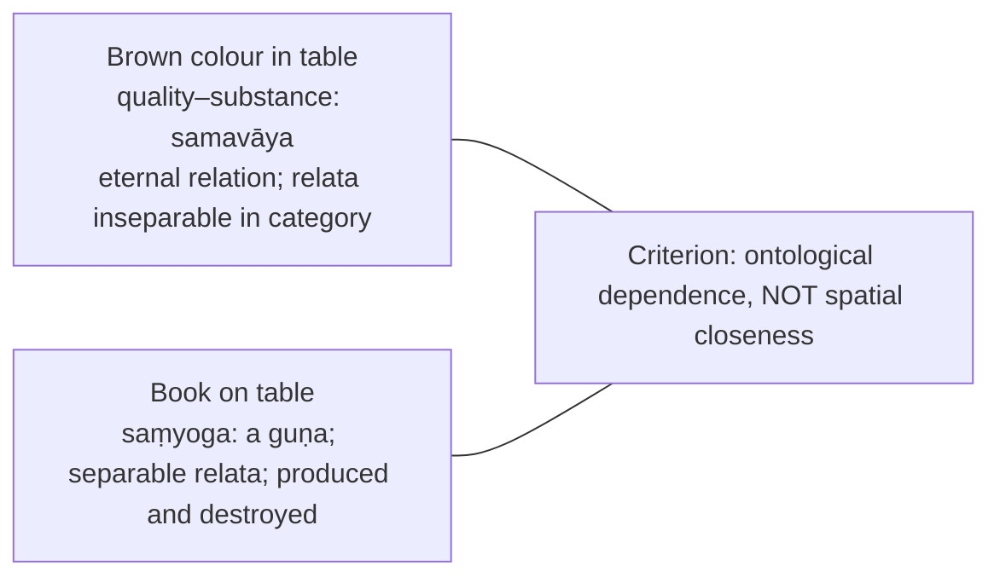

### 11.3 Which absence? (2024 Q5(c), 2023 Q5(d), 2019 Q5(a)) → §4.5

"Air does not have heat" = atyantābhāva; "Air is not fire" = anyonyābhāva. Every absence is of something (pratiyogin).

### 11.4 Causation and the seed (2020 Q6(c), 2021 Q5(a), 2023 Q8(b), 2025 Q5(e)) → §6

### 11.5 Error and extraordinary perception (2019 Q6(b), 2023 Q6(c)) → §2.2, §5.1

Role of jñānalakṣaṇa-pratyakṣa in anyathākhyāti: it explains how silver, absent in place, is experientially present in the "this is silver" cognition while preserving realism. The 2023 justification question ("are they justified in accepting universals are perceived?") turns on sāmānyalakṣaṇa; its force depends on realism about universals.

### 11.6 Sentence-meaning and comparison with Mīmāṃsā (2026 Q6(c), 2026 Q8(a)) → §2.6, §2.8

---

## 12. PYQ Routing Ledger (2018–2026)

> Corpus signal: **22** primary-owned parts out of 112 in 2018–2025 (largest Indian owner). 2026 supplement: **4** primary-owned (Q5(a), Q5(d), Q6(c), Q8(a)) plus Q7(a) cross-owned (Mīmāṃsā owns the pairing; Nyāya's anyathākhyāti stated here). Total primary-owned: **26**.

| Year | Q | Marks | Exact demand | Map to |
|---|---|---:|---|---|
| 2018 | Q5(a) | 10 | How do the Vaiśeṣika philosophers explain the difference of the relationships in the two cases—(i) the brown colour of the table and (ii) the book on the table? Discuss. | §4.4 |
| 2018 | Q5(d) | 10 | How do the Buddhists and the Nyāya philosophers explain our knowledge of 'the absence of the jar on the table'? Answer in detail. | §4.5 |
| 2018 | Q6(a) | 20 | How do the Naiyāyikas prove the existence of God? Do the Yoga philosophers prove God in the same way? If yes, how? And if no, why? Give reasons for your answer. | §5.5, §5.6 |
| 2019 | Q5(a) | 10 | Justify the status of Abhāva as a category in Vaiśeṣika philosophy. | §4.5 |
| 2019 | Q6(b) | 15 | What is the role of Jñānalakṣaṇa-pratyakṣa in explaining Anyathākhyāti? | §2.2, §5.1 |
| 2019 | Q7(a) | 20 | How does Udayana prove the existence of God through Kāryāt, Āyojanāt, Dhṛtyādeḥ and Śruteḥ? Discuss. | §5.5 |
| 2020 | Q6(c) | 15 | Explain the concepts of 'Anyathāsiddha' and 'Ananyathāsiddha' in the context of Asatkāryavāda. | §6.2 |
| 2020 | Q8(b) | 15 | Critically evaluate the logical and metaphysical status of Viśeṣa in the context of Vaiśeṣika Philosophy. | §4.3 |
| 2021 | Q5(a) | 10 | Does the seed contain the tree? Discuss with reference to Nyāya-Vaiśeṣika Philosophy. | §6.1 |
| 2021 | Q5(b) | 10 | Explain with reference to Nyāya Philosophy, the nature of śabda as the advice of āpta (a reliable person). | §2.7 |
| 2021 | Q5(c) | 10 | Is 'inseparability' (ayuta-siddhatva) a necessary condition or a sufficient condition for defining characteristics (lakṣaṇa) of samavāya (inherence)? Explain with reference to Vaiśeṣika Philosophy. | §4.4 |
| 2022 | Q5(b) | 10 | What is the ontological status of Sāmānya, according to Vaiśeṣika Philosophy? Critically examine. | §4.2 |
| 2022 | Q7(c) | 15 | How do Naiyāyikas respond to Cārvāka's objections against inference (anumāna) and establish inference as an independent means of knowledge? Critically discuss. | §2.4 |
| 2023 | Q5(d) | 10 | Present an account of Vaiśeṣika's view of negation in the light of their statement — "Negation always has a counterpositive and absolute negation is an impossibility." | §4.5 |
| 2023 | Q6(c) | 15 | Elucidate Naiyāyikas view of ordinary and extraordinary perception. Are they justified in accepting that universals are perceived? Discuss. | §2.2 |
| 2023 | Q7(a) | 20 | Elucidate Naiyāyikas account of fallacies of the middle term in relation to five characteristics of valid middle term. | §2.3, §2.5 |
| 2023 | Q8(b) | 15 | Write a note on Nyāya notion of Prāgabhāva (prior non-existence). How does this notion help Naiyāyikas in defending their position on causation against the Sāṃkhya view of causation? Critically discuss. | §6.3 |
| 2024 | Q5(b) | 10 | Explain the six reasons offered by the Naiyāyikas to prove the existence of the self. | §5.2 |
| 2024 | Q5(c) | 10 | Do these two sentences "Air does not have heat" and "Air is not fire" refer to the same type of absence or abhāva, according to the Vaiśeṣikas? Discuss. | §4.5 |
| 2025 | Q5(b) | 10 | Present an exposition of the debate between Naiyāyikas and Buddhists with reference to the notion of Pramāṇa and Pramāṇaphala. | §2.9 |
| 2025 | Q5(e) | 10 | Present an exposition of Nyāya-Vaiśeṣika's theory of causation. | §6 |
| 2025 | Q6(a) | 20 | Present a detailed account of Gautama's definition of Perception. | §2.2 |
| 2026 | Q5(a) | 10 | According to Nyaya view of inference (Anumana), what are the characteristics that ascertain the validity of inferential sign (Hetu)? Discuss. *(printed "Anumdna")* | §2.3 |
| 2026 | Q5(d) | 10 | Critically explain the nature of Samavaya (inherence) as propounded in Vaisesika philosophy. | §4.4 |
| 2026 | Q6(c) | 15 | Bring out the main points of contestation between Naiyayikas and Prabhakara Mimamsakas with reference to knowledge through words (Sabdabodha). | §2.8 |
| 2026 | Q8(a) | 20 | Present an account of Upamana as an instrument of knowledge (Pramana). How is Nyaya view of Upamana different from Mimamsa view? Discuss. | §2.6 |
| 2026 | Q7(a) | 20 | *(cross-owned; Mīmāṃsā owns)* Critically explain the arguments presented by the Akhyativadins for erroneous cognition; evaluate the Anyathakhyativadins' arguments against them. | §5.1 |

Also cross-linked (owned elsewhere): 2018 Cārvāka Q8(b) shares the inference theme; Sāṃkhya 2026 Q6(a) (mango tree, satkāryavāda against asatkāryavāda and vivartavāda) → §6.

---

## 13. Top 10 UPSC Exam Traps

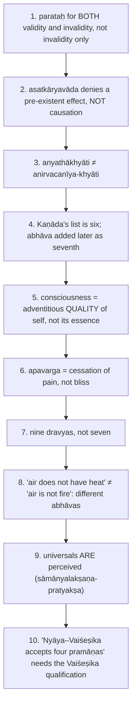

Other pitfalls recorded in the owner file: sixteen Nyāya topics ≠ seven Vaiśeṣika categories; jāti (debate fault) ≠ jāti (universal); memory is not a pramāṇa; Gautama's six marks of the self are exactly desire, aversion, effort, pleasure, pain, cognition (do not substitute memory/recognition); do not credit Nyāya with Bhāṭṭa's anupalabdhi or write Nyāya story as the Mīmāṃsā definition of upamāna; Nyāya ≠ Bhāṭṭa on sentence-meaning and Prābhākara ≠ Bhartṛhari; fire does not pervade smoke (wet fuel is the upādhi in fire → smoke); do not treat Yoga's Īśvara as established by the full Nyāya creator inference; do not attribute the God-system to Kaṇāda mechanically; do not fix a count of Udayana's proofs; three dyads, not three atoms, make a triad; do not treat spatial closeness as inherence; five-marks/fallacy mapping is not one-to-one.

---

## 14. Technical Vocabulary & IAST Bank

| English gloss | IAST | Meaning | Status |
|---|---|---|---|
| category | padārtha | nameable/knowable | ✅ |
| substance / quality / motion | dravya / guṇa / karma | | ✅ |
| universal | sāmānya / jāti | one-in-many | ✅ |
| ultimate particularity | viśeṣa | self-differentiating | ✅ |
| inherence | samavāya (ayutasiddha-sambandha, svarūpa-sambandha) | | ✅ |
| conjunction | saṃyoga | a guṇa | ✅ |
| absence | abhāva: prāgabhāva, pradhvaṃsābhāva, atyantābhāva, anyonyābhāva | | ✅ |
| counterpositive / locus | pratiyogin / anuyogin | | ✅ |
| means of knowledge | pramāṇa, prameya, pramā, pramāṇaphala, pramātṛ | | ✅ |
| perception types | pratyakṣa, nirvikalpaka, savikalpaka | | ✅ |
| extraordinary perception | sāmānyalakṣaṇa, jñānalakṣaṇa, yogaja | | ✅ |
| contact modes | saṃyoga … viśeṣaṇa-viśeṣya-bhāva | six sannikarṣas | ✅ |
| inference / members | anumāna; pratijñā, hetu, udāharaṇa, upanaya, nigamana | | ✅ |
| probans / probandum | hetu (liṅga) / sādhya | | ✅ |
| invariable concomitance | vyāpti | niyata + anaupādhika | ✅ |
| conditioning adjunct | upādhi | sādhya-vyāpakatve sati sādhana-avyāpakaḥ | ✅ |
| hypothetical reasoning | tarka | pramāṇa-anugrāhaka | ✅ |
| subsumptive reflection | parāmarśa | karaṇa of inference | ✅ |
| fallacy | hetvābhāsa | savyabhicāra, viruddha, satpratipakṣa, asiddha, bādhita | ✅ |
| comparison | upamāna / upamiti | | ✅ |
| testimony; reliable person | śabda; āpta | | ✅ |
| sentence conditions | ākāṅkṣā, yogyatā, sannidhi, tātparya | | ✅ |
| sentence-cognition | śābdabodha; anvitābhidhāna; abhihitānvaya | | ✅/❓ |
| validity theory | parataḥ-prāmāṇya / svataḥ | | ✅ |
| theory of error | anyathākhyāti, ātmakhyāti, asatkhyāti, akhyāti, anirvacanīya-khyāti | | ✅ |
| self / mind | ātman / manas | | ✅ |
| liberation | apavarga; duḥkha-atyanta-nivṛtti | | ✅ |
| God; efficient cause | Īśvara; nimitta-kāraṇa | | ✅ |
| proofs | kāryāt, āyojanāt, dhṛtyādeḥ, śruteḥ (+ padāt, pratyayataḥ, vākyāt, saṅkhyāviśeṣāt) | | ✅/❓ |
| unseen force | adṛṣṭa | | ✅ |
| atom / dyad / triad | paramāṇu / dvyaṇuka / tryaṇuka (trasareṇu) | | ✅ |
| causation | asatkāryavāda, ārambhavāda | | ✅ |
| causes | samavāyi, asamavāyi, nimitta; kāraṇa-sāmagrī; pratibandhakābhāva | | ✅ |
| antecedents | ananyathāsiddha / anyathāsiddha | | ✅ |
| creation / dissolution | sṛṣṭi / pralaya | | ✅ |
| Navya-Nyāya | Gaṅgeśa, Tattvacintāmaṇi | | ⚠️ |

---

## 15. Graded Verdict & Answer Architectures

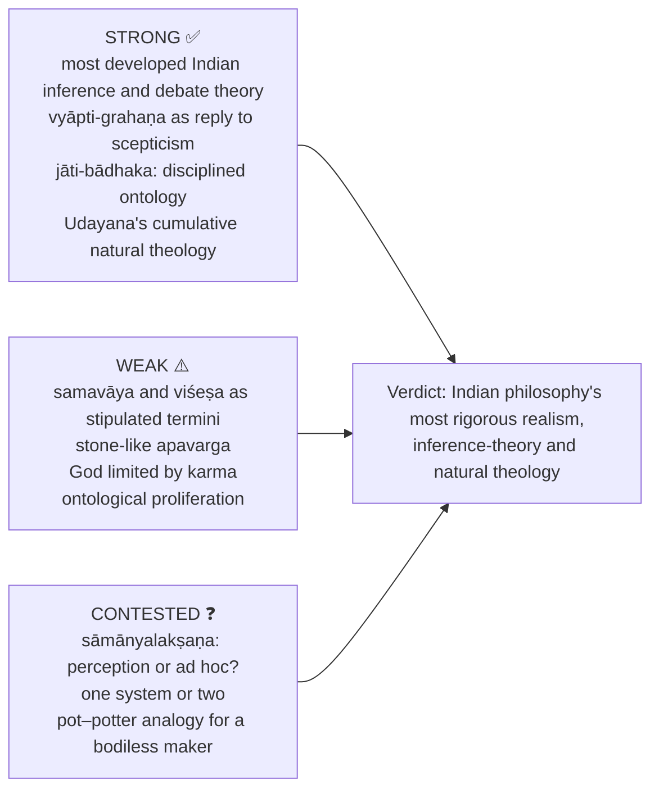

### 15.1 10-mark
```text
Define the term technically.
List its parts / classification.
Add one contrast or one objection.
Close with one line of significance.
```
**Anchor:** "Nyāya–Vaiśeṣika is strongest as a realist logic-ontology, but its primitive relations and particularizers remain vulnerable."

### 15.2 15-mark
```text
Intro: the problem Nyāya–Vaiśeṣika solves.
Body A: doctrine with technical vocabulary.
Body B: argument or classification.
Body C: one objection and reply / one comparison.
Conclusion: precise evaluative line.
```
**Anchor:** "Its achievement is systematic: pramāṇa secures knowledge, padārtha secures being and Īśvara secures order; its weakness is that samavāya, viśeṣa and unconscious mokṣa are asserted as much as proved."

### 15.3 20-mark
```text
Frame: locate the doctrine in the system.
Exposition: full statement with subdivisions.
Analysis: argument structure and presuppositions.
Debate: rival view plus criticism and response.
Verdict: what remains strong and where difficulty persists.
```
**Anchor:** "A fair verdict is graded: Nyāya–Vaiśeṣika gives Indian philosophy its most rigorous realism, inference-theory and natural theology, yet the very devices that make the system complete—samavāya, viśeṣa, sāmānyalakṣaṇa and karma-bound Īśvara—are also its deepest contested points."

### 15.4 Topic-specific spines (from the owner file)

- **2026 Q8(a), 20 marks (upamāna):** Frame (each pramāṇa is individuated by the novel cognition it alone produces) → Nyāya NS 1.1.6 + gavaya + irreducibility grid → Mīmāṃsā same case, different fruit → comparison table → reciprocal objections → Bhāṭṭa/Prābhākara and Vaiśeṣika qualifications. Close: "Both defend an independent upamāna; they differ over whether it teaches us a NAME or a RESEMBLANCE."
- **2026 Q6(c), 15 marks (śābdabodha):** Frame (one sentence, many words, ONE content) → shared four conditions → Nyāya chain → Prābhākara anvitābhidhāna + vyutpatti + kārya/niyoga → comparison table → two objections each way.
- **Directive decoder ⚠️**

| Directive | Move | Closing verdict |
|---|---|---|
| Discuss | Define, give parts, add one rival and reply | "Thus the doctrine is central because…, though it presupposes…" |
| Examine | Thesis, inferential structure, presupposition ledger | "The argument works if its realist presupposition is granted." |
| Critically examine | Nyāya, named pūrvapakṣa, reply, residual force | "Nyāya answers X, but Y remains the pressure point." |
| Analyse | Break into padārtha / pramāṇa / khyāti / causal components | "The strength lies in systematic linkage, not isolated claims." |
| Evaluate | Strengths, weaknesses, graded judgement | "On balance, it is strong as…, weaker as…" |
| Compare | Two-column school comparison with exact Sanskrit terms | "The overlap is limited because the metaphysical bases differ." |
| Distinguish | Define each term, locus, relation, example | "Therefore the two are not interchangeable because…" |
| Elucidate | Statement, mechanism, example, exam trap | "This clarifies why Nyāya needs the doctrine in the system." |
| Comment | Decode the claim, accept its core, qualify | "The comment is justified in X sense, not in Y sense." |
| Bring out | Function: the problem solved | "Its significance is explanatory rather than merely classificatory." |
| Do you agree? | Qualified agreement, evidence, objection, reply | "I agree only to the extent that…, because…" |

> [!TIP]
> **Exam statements.** (1) "Nyāya realism extends even to error: illusion is not contact with nothing, but misrelation among reals." (2) "Vaiśeṣika multiplies categories only where explanatory need demands them." (3) "Nyāya self is enduring, but consciousness in it is episodic and conditioned." (4) "Asatkāryavāda protects novelty in production."

---

## Sources

Gautama, *Nyāya-sūtra*; Kaṇāda, *Vaiśeṣika-sūtra*; Udayana, *Nyāyakusumāñjali* (as transmitted in surveys); Gaṅgeśa, *Tattvacintāmaṇi* (optional depth); Chatterjee & Datta, *An Introduction to Indian Philosophy*; C.D. Sharma, *A Critical Survey of Indian Philosophy*; S. Radhakrishnan, *Indian Philosophy*; S.C. Chatterjee, *The Nyāya Theory of Knowledge* and IEP *Nyāya* (anchors for upamāna and śabda blocks in the owner file); B.K. Matilal, *Perception*; Karl Potter, *Encyclopedia of Indian Philosophies* (dossier source trail).
