# SĀṂKHYA — Examiner-Grade Mindmap

> **Syllabus (verbatim):** Samkhya; Prakrit; Purusa; Causation; Liberation.
> **Catalogue key:** `philosophy-paper-i-indian-philosophy-05` · Paper I · Indian Philosophy
> **Sources used:** `paper-1/indian/Samkhya.md` (canonical owner, read in full) · `_advanced/Indian-Philosophy-Dossier.md` §5 (optional depth) · `paper-1/_PYQ-Indian-Philosophy-2018-2025.md` · `paper-1/_PYQ-Indian-Philosophy-2026.md` · `paper-1/_themes/Causation-across-schools.md`, `Self-and-liberation-across-schools.md`, `Pramana-across-schools.md` (Sāṃkhya rows only).
> **Evidence key:** ✅ canonical doctrine · ⚠️ analytical synthesis · ❓ contested / uncertain

> [!IMPORTANT]
> **Fast memory line.** One Prakṛti, many Puruṣas, real evolution, no God, liberation by discrimination. Sāṃkhya = radical dualism + realist evolutionism + nirīśvara soteriology. ⚠️

---

## 0. Master Overview

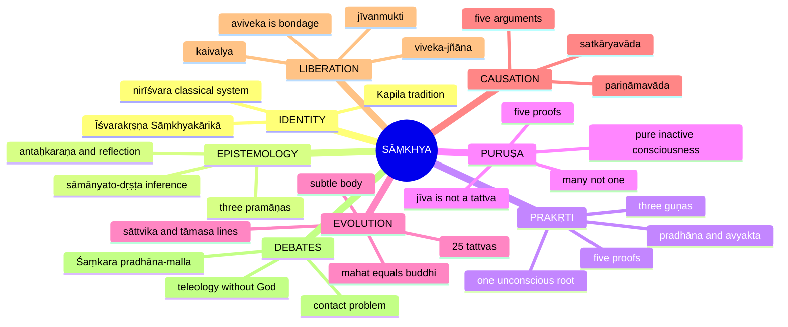

---

## 1. Identity, Lineage & Doxography

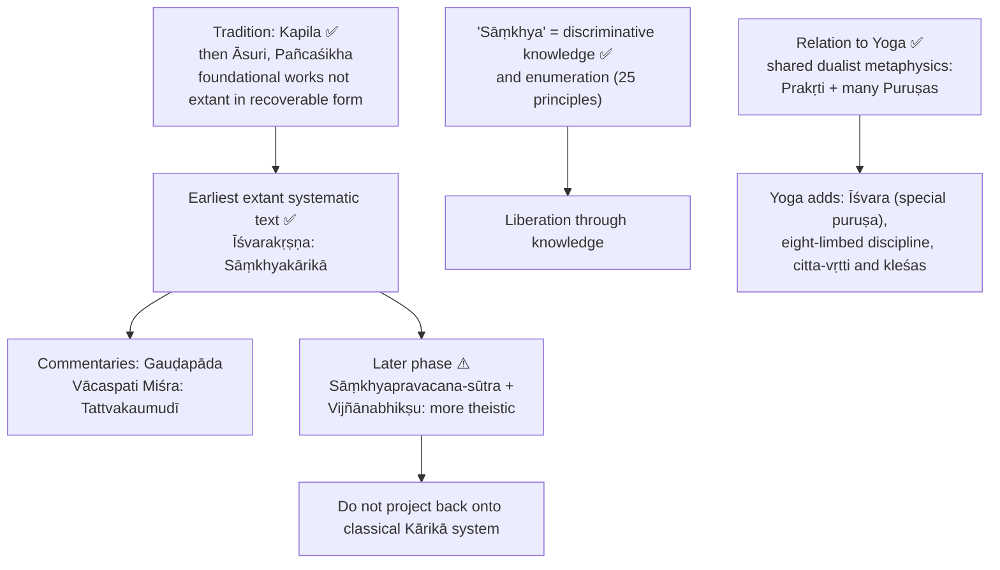

- Classification: Paper I Section B, syllabus item 16. Āstika, non-theistic in the classical system.
- Use Yoga **only** as a bounded comparison: Sāṃkhya is the theoretical discriminative framework; Yoga owns the discipline and theistic-practical additions ⚠️.
- **Marks-essential:** primordial material nature, conscious witness, qualities, all proofs, 25 principles, pre-existence of effect, real transformation, subtle body and transmigration, threefold suffering, discriminative liberation, non-theism, contact problem, all routed PYQs.
- **Optional enrichment:** later commentarial theism, exhaustive disposition cosmology, specialist textual chronology, full Yoga practice taxonomies.

---

## 2. Theory of Knowledge (Epistemology)

### 2.1 Three pramāṇas ✅

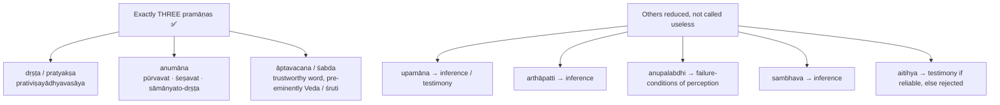

| Anumāna type | Meaning | Example |
|---|---|---|
| **pūrvavat** | From antecedent cause / sign to later effect | Clouds → likely rain |
| **śeṣavat** | From effect / residue to cause or wider ground | One drop of seawater tasted → seawater is salty |
| **sāmānyato-dṛṣṭa** | From general correlation where the link itself is not directly perceived | Sun seen in different positions → the sun moves |

### 2.2 Why sāmānyato-dṛṣṭa is decisive ⚠️


**Standard causes of non-perception ✅:** excessive distance; excessive proximity; defect of organ; inattention of mind; subtlety; obstruction by an intervening object; being overpowered by something else; admixture with like things.

**Exam line ⚠️:** "Sāṃkhya first restricts pramāṇas to three, then uses sāmānyato-dṛṣṭa inference to justify the two entities perception cannot give: Prakṛti and Puruṣa."

**Presupposition ⚠️:** inference from general correlation can legitimately reach an entity never itself observed as a sense-object.

| Objector | Objection | Sāṃkhya reply |
|---|---|---|
| Cārvāka ❓ | vyāpti cannot be secured for a never-perceived term | Strict perceptualism cannot explain ordinary causal reasoning either; manifest, dependent, purposive, objectifiable experience demands an unmanifest material ground and a conscious witness |
| Nyāya ❓ | Sāmānyato-dṛṣṭa is legitimate but over-used; atoms + intelligent Īśvara more economical | Cause-effect continuity, guṇa-character of experience and determinacy of production are better explained by one material Prakṛti; Īśvara does not explain the material continuity |

### 2.3 Cognition: antaḥkaraṇa and reflection ✅

| Instrument | Function |
|---|---|
| **buddhi** | Final ascertainment (**adhyavasāya**), judgement, discrimination |
| **ahaṃkāra** | Appropriation as "I" and "mine" |
| **manas** | Coordination, attention, synthesis of sense-data |
| 5 **buddhīndriyas** | Cognitive access to sound, touch, form, taste, smell |
| 5 **karmendriyas** | Speech, grasping, movement, excretion, reproduction |

- **Trayodaśa-karaṇa** (thirteen-fold) = 3 internal + 5 cognitive + 5 action capacities.
- External faculties are **dvāra** (doors); the inner organ is **dvārin** (doorkeeper).
- Buddhi is sattva-predominant, transparent: reflects Puruṣa through **puruṣa-cchāyā-āpatti / buddhi-pratibimba**. Buddhi is **jaḍa** (insentient) yet cognition seems conscious.
- Reflection yields **abhimāna** ("I am the doer / knower / enjoyer"): the psychological root of bondage.
- Two-way appearance: the unconscious instrument appears conscious; inactive Puruṣa appears an agent. Agency belongs to Prakṛti's evolutes; witnessing to Puruṣa.

> [!TIP]
> The mind does not know by itself and Puruṣa does not act by itself; empirical knowing is a reflected-consciousness event in buddhi.

---

## 3. Dialectical Wings & Sceptical Refinements

> The sources record **no sceptical or radical wing** inside Sāṃkhya. This module therefore maps only the internal interpretive splits and the main external dialectical pressures the sources give.

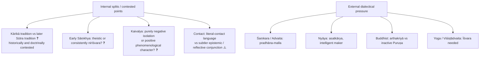

- Classical position: better described as **non-theistic or God-unproved** than as a proof that no divine being can exist ✅.
- Advanced note ⚠️: Sāṃkhya does not claim an observed headcount of imperceptible roots; it offers a strong unity-of-material-ground argument (see §4.4).

---

## 4. Metaphysics & Ontology

### 4.1 Prakṛti ✅

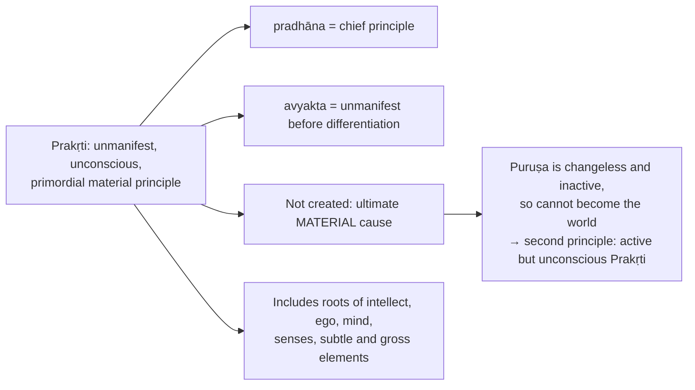

Safe definition ⚠️: **Prakṛti is the avyakta pradhāna, the unmanifest chief material principle constituted by the three guṇas.**

### 4.2 Five proofs of Prakṛti ✅

| # | Proof | Core |
|---|---|---|
| 1 | **bhedānāṃ parimāṇāt** | Finite, determinate, measurable things point to a subtler ground |
| 2 | **samanvayāt** | Uniformity / homogeneity running through effects: common matrix |
| 3 | **śaktitaḥ pravṛtteś ca** | Operation from causal power (*śakti*). *Sāṃkhyakārikā* 15 reads thus, **not** *kāryataḥ pravṛtteḥ*; not conscious purposive planning |
| 4 | **kāraṇa-kārya-vibhāgāt** | Cause and effect distinguishable stages: unmanifest source vs manifest product; not unrelated |
| 5 | **avibhāgāt vaiśvarūpyasya** | Diversified cosmos points to an undivided source |

### 4.3 Which proof shows only ONE Prakṛti? (2019 Q8(c)) ✅/⚠️

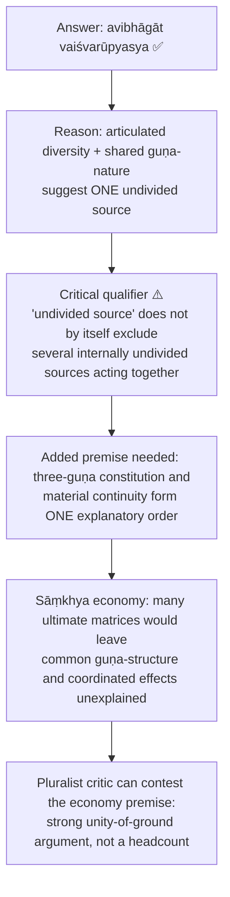

> [!WARNING]
> One **Prakṛti** ≠ one Puruṣa. Do not confuse "one Prakṛti" with "many Puruṣas".

### 4.4 Three guṇas ✅ (2021 Q6(b))

| Guṇa | Character | Affective tone | Function |
|---|---|---|---|
| **sattva** | lightness, illumination, buoyancy | pleasure | revelation, clarity, knowledge |
| **rajas** | activity, restlessness, propulsion | pain | energy, movement, mediation |
| **tamas** | heaviness, obstruction, inertia | delusion | concealment, resistance, density |

- Guṇas are not three separable substances but three inseparable constitutive tendencies of one Prakṛti ⚠️.
- **Sāmyāvasthā:** equilibrium before manifestation; Prakṛti is avyakta.
- Disturbance in Puruṣa's presence starts evolution; not mechanical collision but functional activation in proximity ⚠️.

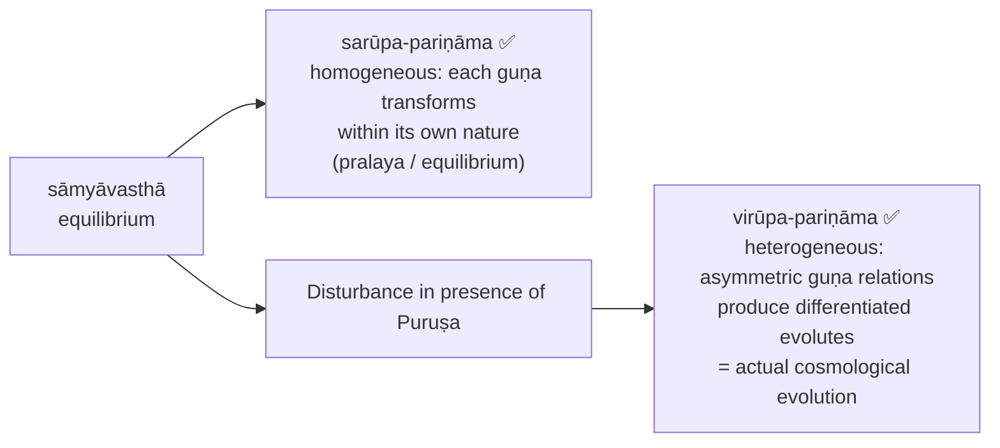

### 4.5 Puruṣa ✅

| Feature | Position |
|---|---|
| Consciousness | Essence, not quality |
| Activity | Inactive, non-productive |
| Change | Changeless |
| Relation to guṇas | Entirely beyond them |
| Status | Witness, seer, experiencer; self-luminous |

### 4.6 Five proofs of Puruṣa ✅ (2022 Q5(a))

| # | Proof | Chain |
|---|---|---|
| 1 | **saṅghāta-parārthatvāt** | Body, senses, mind, buddhi are aggregates; aggregates serve another → conscious Puruṣa |
| 2 | **triguṇādi-viparyayāt** | Guṇas are objective, mutable (pleasure, pain, delusion); the knower cannot be reducible to them → non-guṇic principle |
| 3 | **adhiṣṭhānāt** | Organized experience requires a presiding locus; not a God-proof; presiding witness of lived order |
| 4 | **bhoktṛ-bhāvāt** | Pleasure, pain, delusion are experienced → a **bhoktṛ** distinct from them |
| 5 | **kaivalyārthaṃ pravṛtteḥ** | Striving for release presupposes a liberable witness |

Evaluation ⚠️: the proofs are cumulative, of the form sāmānyato-dṛṣṭa: from the structure of objectifiable experience to a witness never itself an object.

### 4.7 Plurality of Puruṣas (2018 Q5(e); 2026 Q5(c)) ✅/❓

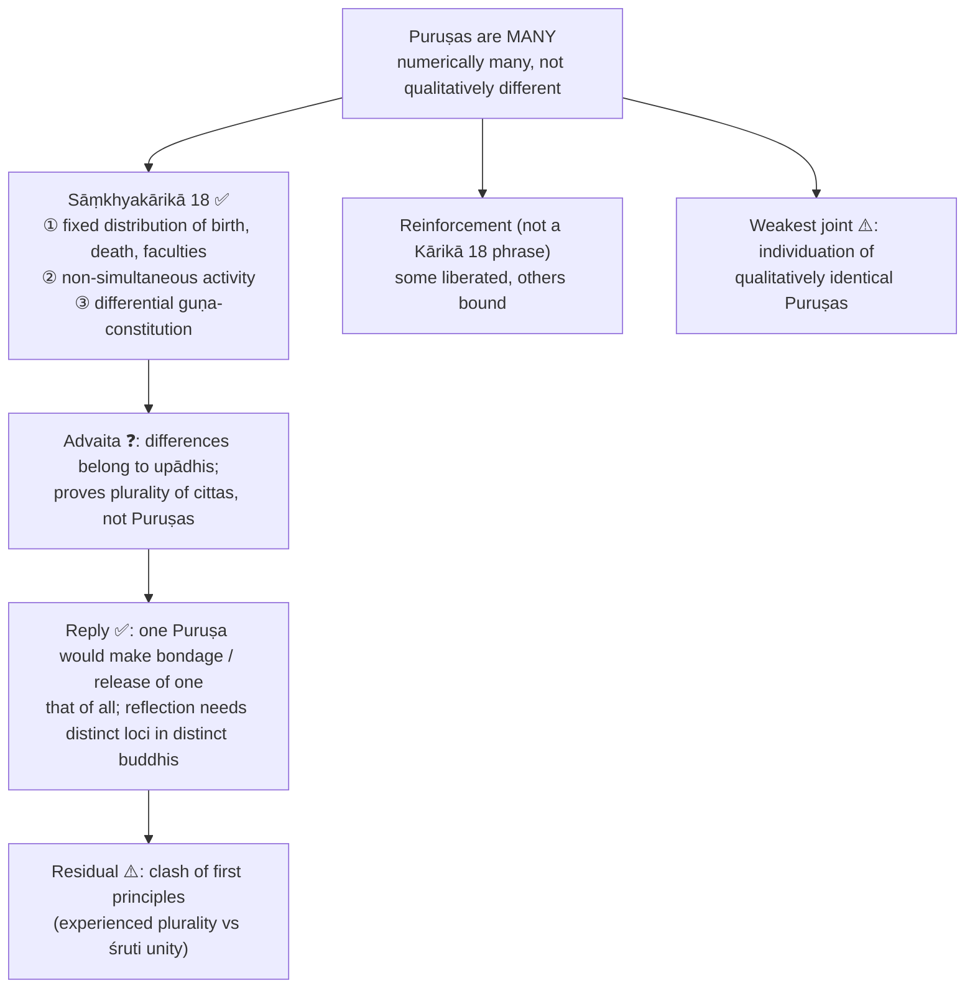

| Presupposition | Why it matters |
|---|---|
| Empirical individuation transfers upward | Differences in bodies and streams license inference to distinct Puruṣas |
| Puruṣa is genuinely bhoktṛ | Otherwise "whose pleasure or pain?" loses force |
| Liberation is particular | Attributable to a particular Puruṣa's stream |
| Numerical plurality of attributeless consciousness is intelligible | Numerical difference without qualitative difference |

Exam use ⚠️: present the three Kārikā arguments first; add non-simultaneous liberation only as reinforcement.

### 4.8 Jīva vs Puruṣa (2019 Q5(d)) ✅

- **Puruṣa**: metaphysical reality; pure, inactive, changeless consciousness.
- **Jīva**: **not a separate tattva**; Puruṣa as empirically appearing through identification with buddhi, ahaṃkāra, mind, body, karmic stream.
- Formula ⚠️: **jīva is Puruṣa as empirically conditioned through buddhi; Puruṣa is the metaphysical reality behind that appearance.**

### 4.9 The 25 tattvas ✅ (2024 Q7(a))

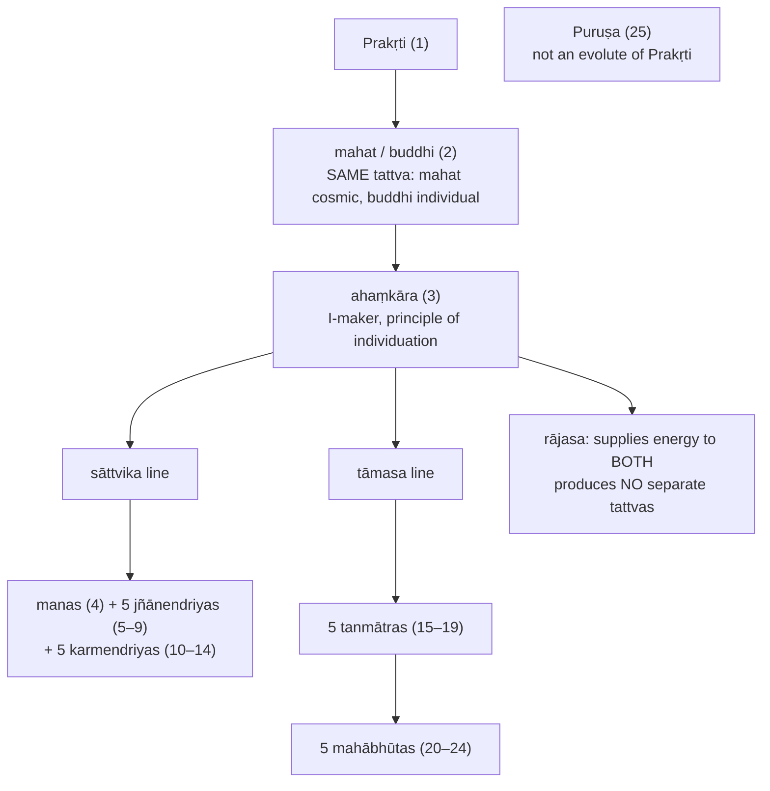

| Family | Members |
|---|---|
| Jñānendriyas | hearing (śrotra), touch (tvak), sight (cakṣus), taste (rasanā), smell (ghrāṇa) |
| Karmendriyas | speech (vāk), grasping (pāṇi), locomotion (pāda), excretion (pāyu), reproduction (upastha) |
| Tanmātras | sound (śabda), touch (sparśa), form (rūpa), taste (rasa), smell (gandha) |
| Mahābhūtas | ether (ākāśa), air (vāyu), fire (tejas), water (ap), earth (pṛthivī) |

Correspondence: sound → ether, touch → air, form → fire, taste → water, smell → earth. Do **not** import Advaita's pañcīkaraṇa ⚠️.

| Status | Principles |
|---|---|
| Cause, not effect (prakṛti) | Prakṛti alone |
| Both cause and effect (prakṛti-vikṛti) | mahat/buddhi, ahaṃkāra, five tanmātras (seven) |
| Effects only (vikāra) | manas, 5 + 5 capacities, 5 mahābhūtas (sixteen) |
| Neither | Puruṣa |

**Buddhi / mahat / ahaṃkāra distinction:** manas coordinates, ahaṃkāra appropriates, buddhi determines.

### 4.10 Subtle body and transmigration ✅

- **Liṅga-śarīra / sūkṣma-śarīra**: continuing psychophysical vehicle between embodiments; commonly eighteen principles: mahat/buddhi, ahaṃkāra, eleven capacities incl. mind, five tanmātras.
- Conditioned by dispositions and eight tendencies of intellect: merit/demerit, knowledge/ignorance, detachment/non-detachment, power/powerlessness.
- At death the gross body from parental material falls away; the subtle body carries dispositions and karmic tendencies on.
- Puruṣa neither acts nor migrates. ⚠️ Pressure point: moral ownership must be explained through stable association of one subtle stream with one numerically distinct witness.

---

## 5. Rejection / Affirmation of Transcendent Realities

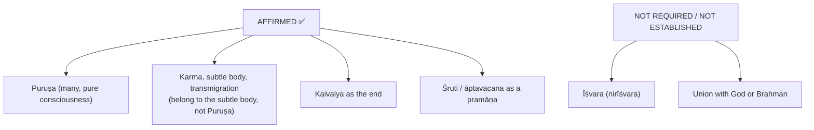

### 5.1 Nirīśvara character ✅

Five anti-theistic arguments recorded in the owner file:
1. If God acts from desire or selfish motive, God is not perfect or free.
2. If God is eternally fulfilled, no motive to create a painful world.
3. If God distributes results under karma, divine independence is limited; if arbitrary, justice fails.
4. An immutable conscious God cannot be the material source of a changing unconscious world under cause-effect continuity.
5. Eternal Puruṣas and primordial nature already explain consciousness and evolution without a creator hypothesis.

> [!WARNING]
> Vijñānabhikṣu's theistic reading is later; do not project it back onto Īśvarakṛṣṇa. Yoga, not Sāṃkhya, adds Īśvara.

### 5.2 Threefold suffering (duḥkha-traya) ✅

| Kind | Term | Content |
|---|---|---|
| Internal | **ādhyātmika** | Bodily disease, mental affliction |
| From other beings / natural agents | **ādhibhautika** | Injury from humans, animals, surroundings |
| Cosmic / unseen | **ādhidaivika** | Environmental or supernormal affliction |

Ordinary and ritual remedies give incomplete or temporary relief; discriminative knowledge aims at final, non-returning cessation.

---

## 6. Explanatory & Causal Principles

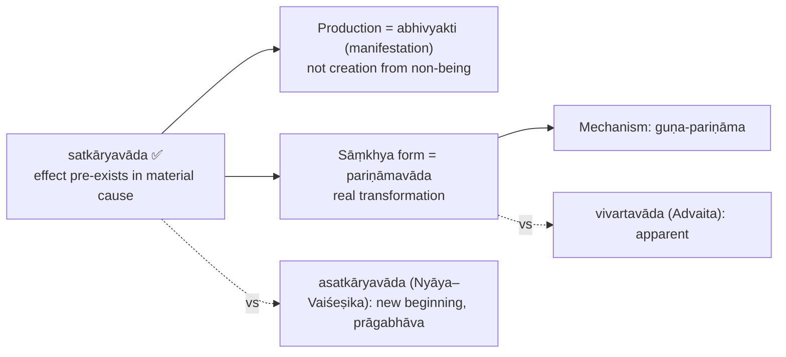

### 6.1 Five arguments for satkāryavāda ✅

| # | Argument | Core | Nyāya objection → Sāṃkhya reply |
|---|---|---|---|
| 1 | **asadakaraṇāt** | What does not exist cannot be produced (hare's horn; oil from sand) | Nyāya: equivocates between absolutely non-existent and not-yet-existent → "not-yet-existent" must still be something in the cause, else no determinate terminus |
| 2 | **upādāna-grahaṇāt** | Specific effect needs specific material (milk for curd, threads for cloth, mango seed not sand) | Capacity may explain restriction → determinate capacity just is latent presence of that effect |
| 3 | **sarvasambhavābhāvāt** | Else everything could arise from everything | Restriction from constitution of causes → constitution capable of only X is latent X-potential |
| 4 | **śaktasya śakya-karaṇāt** | Efficient cause produces only what it is capable of producing | Potency is a relational property → mere relational potency cannot explain determinate production |
| 5 | **kāraṇa-bhāvāt** | Effect is non-different from cause in substance (ornament and gold) | Nyāya: whole (avayavin) is a new substance (cloth covers, threads do not) → new properties are new **saṃsthāna** (configurations) |

### 6.2 Internal objections and replies ✅

| Objection | Reply |
|---|---|
| If the effect exists, causal effort is pointless | Production is abhivyakti; effort removes obstruction, supplies conditions |
| Abolishes cause-effect distinction | They differ by **avasthā** (state): latent vs patent |
| World was always as it is now | Only determinate effect-form/capacity exists latently; gross effect not already manifest |

### 6.3 Mango-seed answer (2020 Q7(a); 2026 Q6(a)) ⚠️

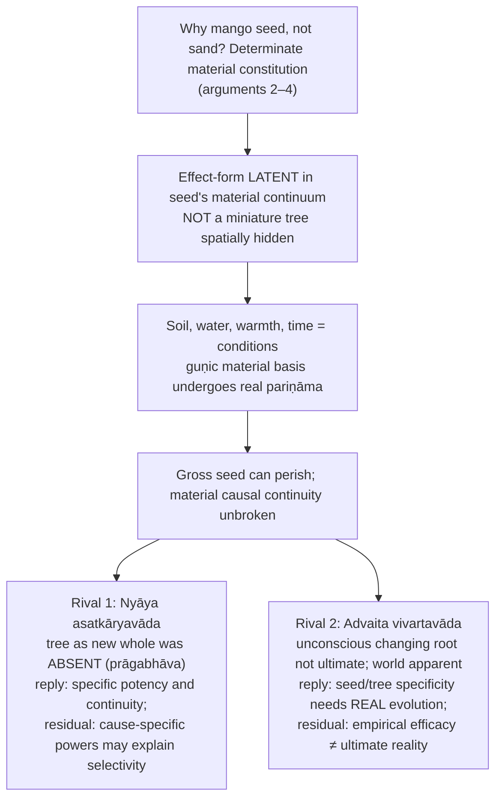

> [!WARNING]
> Do not say the fully formed gross tree is spatially hidden inside the seed. Reconstruct latent effect + material continuity + real transformation.

### 6.4 Causation contrasts

| Issue | Sāṃkhya | Advaita | Nyāya |
|---|---|---|---|
| Effect before production | Pre-existent | (satkārya orientation) | Absent as effect (prāgabhāva) |
| Transformation | Real, **pariṇāma** | Apparent, **vivarta** | New beginning, ārambha |
| Cause | Prakṛti | Brahman | Atoms etc. + Īśvara |
| World | Real evolute | Ultimately appearance | Fresh product |

- Causation grid: Sāṃkhya = satkārya + pariṇāmavāda; milk → curd; one real Prakṛti unfolding.
- Buddhism: dependent origination vs transformation of an enduring Prakṛti ✅.
- Jaina (from the causation theme file): *sadasatkāryavāda* indexes "exists" to dravya and "does not exist" to paryāya, dissolving the dispute; Śaṃkara's counter: indexing is a verbal manoeuvre; Jaina reply: grounded in a real two-aspect structure ⚠️.
- Satkāryavāda is **not unique** to Sāṃkhya (Advaita also holds it) ✅.
- *"nāsato vidyate bhāvo…"* is **Bhagavad-gītā 2.16**, a scriptural echo; **not** a verse of the Sāṃkhyakārikā and not itself an argument. Let weight rest on the five proofs.
- Karmic causation compared: Jaina material karma-pudgala · Nyāya adṛṣṭa + Īśvara · Mīmāṃsā apūrva · **Sāṃkhya–Yoga saṃskāra / karmāśaya** · Buddhist vāsanā / bīja.

---

## 7. Ethics & Human Goals (Puruṣārthas)

> The Sāṃkhya sources give no separate kāma/artha/dharma/mokṣa analysis. Only the soteriological ethics is source-backed.

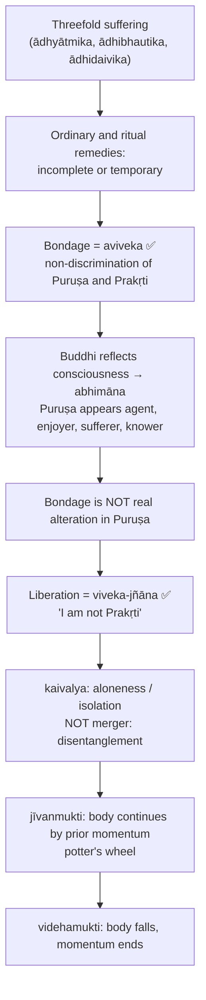

**Analogies ✅:**
- **Lame and blind:** Puruṣa sees but cannot act; Prakṛti acts but cannot see; complementarity without collapse.
- **Dancer:** Prakṛti retires after being seen; binding display ends for that Puruṣa.
- **Milk flowing for the calf:** unconscious yet purposive.
- **Modest woman:** withdraws on being seen.
- **Potter's wheel:** jīvanmukti.

Strict nuance ✅: Puruṣa is never really bound, liberated or transmigrating; these belong to Prakṛti and the subtle body. Kaivalya is isolation of consciousness, not union with God ⚠️.

**Teleology:** Prakṛti acts for **puruṣārtha** (the sake of Puruṣa): experience, then possibility of discriminative release.

---

## 8. Inter-School Comparative Matrices

| School | Pramāṇas | Self | Plurality | Causation | God | Bondage | Liberation | Jīvanmukti |
|---|---|---|---|---|---|---|---|---|
| **Sāṃkhya** | Three | Puruṣa, inactive consciousness | Many | Satkārya + pariṇāma | Nirīśvara | Aviveka, abhimāna | Kaivalya by viveka-jñāna | Accepted (momentum) ⚠️ |
| **Yoga** | Three textual + yogi-pratyakṣa | Puruṣa | Many + special Puruṣa | Sāṃkhya-like pariṇāma | Seśvara | Citta-vṛtti, kleśas | Kaivalya via aṣṭāṅga-yoga | Strong practical |
| **Nyāya–Vaiśeṣika** | Four | Ātman, substance with adventitious qualities | Many | Asatkārya / ārambha | Īśvara as maker | False knowledge, doṣa, karma | Apavarga | Not central ⚠️ |
| **Buddhism** | Two (epistemological schools) | No permanent self | No eternal ātman | Dependent origination | No creator | Ignorance, craving, clinging | Nirvāṇa | Varies |
| **Jainism** | Two broad classes | Jīva | Many jīvas | Realism with modification | No creator | Karmic matter binds jīva | Kevala-jñāna, release | Discussed |
| **Mīmāṃsā** | Five or six | Enduring agent/enjoyer | Many | Realism; no creation from nothing | Not required | Karma, ritual obligation | Via dharma | Not central ⚠️ |
| **Advaita** | Six | Ātman = Brahman | Ultimately one | Satkārya as vivarta | Īśvara empirical | Avidyā, superimposition | Mokṣa = Brahman-realization | Central |
| **Viśiṣṭādvaita** | Three | Selves as modes of Brahman | Many within Brahman | Real transformation under Brahman | Nārāyaṇa | Karma, ignorance of dependence | Service; no identity-collapse | Accepted (qualified) |

| Debate axis | Sāṃkhya | Rival | Contrast |
|---|---|---|---|
| Self | Many Puruṣas | Advaita | One Ātman vs many witnesses |
| Causation | Satkārya + pariṇāma | Nyāya | Pre-existent vs prāgabhāva |
| World-process | Rooted in Prakṛti | Buddhism | Enduring root vs dependent origination |
| God | Nirīśvara | Yoga / Nyāya / Vedānta | None needed vs Īśvara / Brahman |
| Liberation | Kaivalya | Advaita / Nyāya | Isolation vs identity vs cessation of suffering |

**Ladder of "self" ✅:** Body (Cārvāka) → No-self (Buddhism) → Substance (Nyāya) → Omniscient jīva (Jaina) → Witness (Sāṃkhya) → Brahman (Advaita).

> [!WARNING]
> **Kaivalya ≠ mokṣa (Advaita) ≠ apavarga (Nyāya):** isolation of Puruṣa vs identity with Brahman vs cessation of suffering.

**Yoga vs Sāṃkhya:** Yoga is a friendly amendment: retains Prakṛti, guṇas, many Puruṣas; adds Īśvara, Īśvara-praṇidhāna and yogi-pratyakṣa. Sāṃkhya is nirīśvara and theoretical; Yoga seśvara and practical ⚠️.

---

## 9. Criticisms & Reconstructed Replies

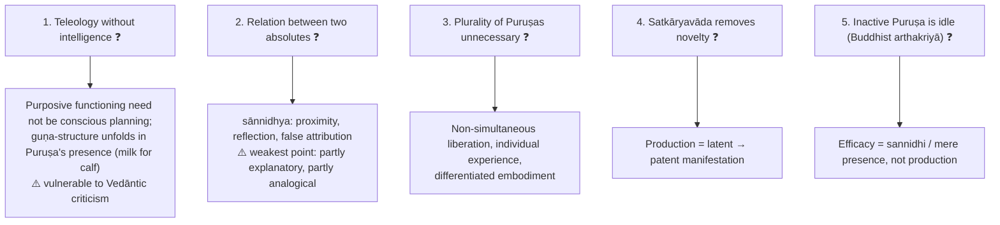

### 9.1 The contact problem and Śaṃkara's critique (2023 Q5(b)) ✅

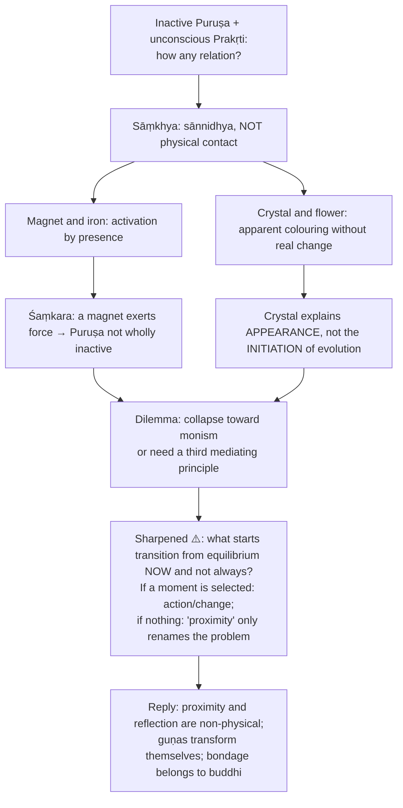

Advanced readings ⚠️ (dossier): literal-contact language vs epistemic/reflective conjunction; Sāṃkhya relies on presence-for-the-sake-of-experience, not mechanical interaction; critics still find the relation under-explained. Source trail: Īśvarakṛṣṇa; Vācaspati Miśra, *Tattvakaumudī*; Gerald J. Larson, *Classical Sāṃkhya*.

### 9.2 Pūrvapakṣa–siddhānta ledger ⚠️

| Objector | Objection | Sāṃkhya reply | Residual force |
|---|---|---|---|
| Advaita / Śaṃkara ❓ | Unconscious Prakṛti cannot act purposively, cause an ordered world, or relate to inactive Puruṣa | Guṇa-structure evolves in Puruṣa's presence for experience and release; sānnidhya | Purposiveness of a jaḍa cause; relation of two absolutes |
| Nyāya ❓ | Asatkāryavāda preferable; agent-less self otiose; world needs an intelligent maker | Determinate material continuity; agency in buddhi; Īśvara unnecessary | Demand for an intelligent orderer vs unconscious teleology |
| Buddhist ❓ | No permanent substance; inactive Puruṣa fails arthakriyā | Momentary streams cannot explain a stable witness; efficacy = presence-for-experience | Non-productive efficacy may not be real efficacy |
| Mīmāṃsā ❓ | Self must be a real agent for injunctions and ritual responsibility | Injunction-following located in buddhi / ahaṃkāra; Puruṣa untouched | Moral subject becomes empirical rather than ultimate |
| Yoga ❓ | Practice benefits from Īśvara | Discipline can be accepted without Īśvara being metaphysically necessary | Yoga more religiously complete |
| Viśiṣṭādvaita ❓ | Matter and selves cannot be independent of Brahman | Independent Prakṛti + plural Puruṣas suffice | Theistic Vedānta stronger on unity, value, order |

### 9.3 Presupposition ledger ⚠️

| Doctrine | Presupposition | What collapses if denied |
|---|---|---|
| Three-pramāṇa scheme | Perception, inference, testimony jointly sufficient | Must multiply pramāṇas or leave Prakṛti/Puruṣa under-justified |
| Sāmānyato-dṛṣṭa to Prakṛti | General correlation justifies an imperceptible root | Five proofs become analogical guesses |
| Guṇa theory | Qualitative variety from proportions of sattva, rajas, tamas | Loses economical account of pleasure, pain, delusion, diversity |
| Satkārya / pariṇāma | Effect pre-exists latently; production real transformation | Cause-effect continuity breaks; Nyāya stronger |
| Plurality of Puruṣas | Individual experience, bondage, liberation imply distinct witnesses | Liberation of one = of all; slide toward Advaita |
| Puruṣa's inactivity | Agency belongs to Prakṛti's evolutes | Bondage a real modification of Puruṣa; kaivalya impossible |
| Reflection model | Insentient buddhi appears conscious by reflection | Cannot explain why cognition seems conscious |
| Kaivalya | Liberation is discriminative isolation | Collapses into Yoga or Vedānta |
| Nirīśvaravāda | Prakṛti and Puruṣa suffice | Objections that an intelligent principle is required become decisive |

---

## 10. Controlled Western Comparisons

| Comparison | Point of contact | Disanalogy |
|---|---|---|
| Descartes' dualism | Two irreducible principles | Descartes' mind thinks, acts and interacts with body; Puruṣa is inactive; relation is proximity/reflection, not causal interaction |
| Guṇas and elemental/field principles | Qualitative variety from proportions of few factors | Guṇas are ontological, psychological and ethical at once; no exact analogue |
| Aristotle's potentiality / actuality | Both deny creation ex nihilo; change as actualisation | Aristotle's matter is indeterminate potentiality needing form/finality; Prakṛti contains determinate effects and unfolds without an external agent |
| Schopenhauer's Will ❓ | Unconscious purposive striving; Schopenhauer read Indian materials | Will is one drive; Sāṃkhya has one Prakṛti but many Puruṣas; liberation is discriminative separation |
| Darwinian evolution | The word "evolution" | **UPSC trap:** Sāṃkhya evolution is tattva-unfolding from a material cause, not descent with modification by natural selection |
| Stoic apatheia | Release from passion and misidentification | Stoic sage remains an agent in a rational cosmos; Puruṣa is inactive and isolated |
| Cartesian cogito (self theme) | Pure subject | The cogito's self thinks, wills, acts; puruṣa is wholly inactive; all agency belongs to Prakṛti |

> [!WARNING]
> Western parallels are illustrative only, in one or two lines **after** the Sāṃkhya case is complete. Never write "Puruṣa = Cartesian mind" or "Sāṃkhya evolution = Darwin".

---

## 11. Diagnostic Deep-Dives for High-Frequency Themes

### 11.1 Why Śaṃkara calls Sāṃkhya *pradhāna-malla* (2025 Q7(a)) ✅/⚠️

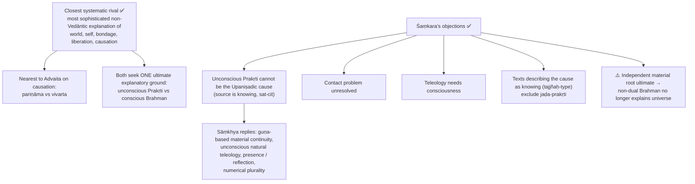

Verdict ⚠️: Śaṃkara's critique is strongest against an unexplained link and the Vedāntic requirement of a conscious ultimate, which is not a premise Sāṃkhya grants. Weigh each reply; do not list four criticisms as already decisive.

### 11.2 Advaita's reaction to prakṛti-pariṇāma and Sāṃkhya's defence (2018 Q7(b)) ⚠️

| Step | Content |
|---|---|
| Advaita 1 | An **independent unconscious** pradhāna is not the cause taught by texts on a knowing or willing source; Brahman is conscious |
| Advaita 2 | If reality itself transforms into changing products, the ultimate becomes mutable; the inactive-witness link stays unexplained |
| Advaita 3 | Distinguishes empirical validity of seed→tree transformation from ultimate analysis as vivarta (name-form dependent on Brahman) |
| Sāṃkhya | Posits a **different**, unconscious *material* cause, not a mutable conscious Puruṣa; material continuity and effect-specific power warrant real guṇa-pariṇāma; distinguishing prakṛti from pure awareness preserves the witness's changelessness |
| Counter | Empirical efficacy need not confer independent ultimate reality; proximity still needs an intelligible relation |

> [!WARNING]
> Do not answer with a bare two-column "real / apparent" label.

### 11.3 Dilemma on plurality (advanced) ⚠️

Are the arguments for many Puruṣas decisive, or partly introduced to preserve individual bondage and liberation? Classical defence: diversity of births, deaths, moral trajectories. Advaita pressure: one consciousness may appear many through upādhis. Reply: moral individuality and non-simultaneous liberation become unintelligible on strict one-self models.

---

## 12. PYQ Routing Ledger (2018–2026)

> Corpus signal: **10** primary-owned parts out of 112 in the 2018–2025 Paper I corpus (every year), plus **2** in the 2026 supplement = **12**. Year headings verified from the ledger file.

| Year | Q | Marks | Exact demand | Map to |
|---|---|---:|---|---|
| 2018 | Q5(e) | 10 | Is Puruṣa one or many? Explain the Sāṃkhya position in this regard and give arguments in support of your answer. | §4.7 |
| 2018 | Q7(b) | 15 | How do the Advaita Vedāntins react to the Prakṛtipariṇāmavāda of the Sāṃkhya philosophy? How do the Sāṃkhyas defend their own position in this regard? Discuss. | §11.2, §6 |
| 2019 | Q5(d) | 10 | Critically discuss the metaphysical status of a Jīva and a Puruṣa according to Sāṃkhya philosophy. | §4.8 |
| 2019 | Q8(c) | 15 | Which Sāṃkhya proof for the existence of Prakṛti actually shows that there can be only one Prakṛti? Justify your answer. | §4.3 |
| 2020 | Q7(a) | 20 | "A mango tree is grown out of a mango seed." How will Sāṃkhya system explain this process through their theory of causation by rejecting their rival perspectives? | §6.3 |
| 2021 | Q6(b) | 15 | Explain the Sāṃkhya view on three guṇas (guṇa-traya) and their modifications. | §4.4 |
| 2022 | Q5(a) | 10 | Examine and evaluate the proofs given by Sāṃkhya philosophy to prove the existence of Puruṣa. | §4.6 |
| 2023 | Q5(b) | 10 | "If Puruṣa and Prakṛti are two completely independent realities, then no relation between the two is possible." In the light of this statement make a brief presentation of Śaṅkara's criticism of Sāṃkhya dualism. | §9.1 |
| 2024 | Q7(a) | 20 (10+10) | Present an account of evolution of Prakṛti as propounded in Sāṃkhyakārikā. In this context, also explain the difference between buddhi, mahat and ahaṃkāra. | §4.9 |
| 2025 | Q7(a) | 20 | Why does Śaṅkara consider Sāṃkhya Philosophy as his chief opponent (pradhāna malla)? Examine his arguments against Sāṃkhya Philosophy. | §11.1 |
| 2026 | Q5(c) | 10 | Is Purusa one or many? Explain and examine the Sankhya position in this context. (printed "Sarnkhya") | §4.7 |
| 2026 | Q6(a) | 20 | "A mango tree is grown out of a mango seed." How do the Sankhya philosophers explain this process through their theory of causation by rejecting their rival perspectives? | §6.3 |

Cross-owned (not counted): **2023 Q8(b), 15 marks, Nyāya–Vaiśeṣika:** Nyāya notion of Prāgabhāva and how it helps Naiyāyikas defend their causation position against the Sāṃkhya view → §6.1, §6.4.

---

## 13. Top 10 UPSC Exam Traps

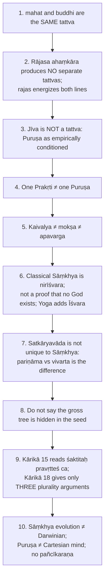

Further source-recorded cautions: "nāsato vidyate bhāvo…" is Bhagavad-gītā 2.16, not a Kārikā verse; do not read Vijñānabhikṣu's theism back into the Kārikā; mahat is cosmic, buddhi individual, but count them as one principle (Prakṛti + 23 evolutes + Puruṣa = 25 in all); magnet illustrates activation imperfectly, crystal illustrates only apparent attribution.

---

## 14. Technical Vocabulary & IAST Bank

| English gloss | IAST | Meaning | Status |
|---|---|---|---|
| Primordial material nature | prakṛti / mūla-prakṛti | Root material cause | ✅ |
| Chief principle / unmanifest | pradhāna / avyakta | Names of Prakṛti | ✅ |
| Quality-strand | guṇa: sattva, rajas, tamas | | ✅ |
| Equilibrium | sāmyāvasthā | Pre-manifest state | ✅ |
| Homogeneous / heterogeneous transformation | sarūpa- / virūpa-pariṇāma | | ✅ |
| Pure consciousness | puruṣa | Witness, many, inactive | ✅ |
| Great principle / intellect | mahat / buddhi | Same tattva | ✅ |
| I-maker | ahaṃkāra | Individuation | ✅ |
| Mind | manas | Coordinator | ✅ |
| Inner instrument | antaḥkaraṇa | buddhi, ahaṃkāra, manas | ✅ |
| Thirteen-fold instrument | trayodaśa-karaṇa | | ✅ |
| Subtle elements / gross elements | tanmātra / mahābhūta | | ✅ |
| Perception / inference / testimony | pratyakṣa (dṛṣṭa) / anumāna / āptavacana (śabda) | | ✅ |
| General-correlation inference | sāmānyato-dṛṣṭa | Reaches imperceptibles | ✅ |
| Beyond the senses / subtlety | atīndriya / saukṣmya | | ✅ |
| Pre-existent effect doctrine | satkāryavāda | | ✅ |
| Real transformation / apparent | pariṇāmavāda / vivartavāda | | ✅ |
| Manifestation | abhivyakti | | ✅ |
| State | avasthā | Latent vs patent | ✅ |
| Configuration | saṃsthāna | New arrangement, not substance | ✅ |
| Non-discrimination | aviveka | Bondage | ✅ |
| Discriminative knowledge | viveka-jñāna | Liberation | ✅ |
| Isolation | kaivalya | | ✅ |
| False appropriation | abhimāna | | ✅ |
| Reflection of Puruṣa in buddhi | puruṣa-cchāyā-āpatti / buddhi-pratibimba | | ✅ |
| Mere presence | sānnidhya / sannidhi | Contact-problem answer | ✅ |
| Non-theistic | nirīśvara | | ✅ |
| Threefold suffering | duḥkha-traya | | ✅ |
| Subtle body | liṅga-śarīra / sūkṣma-śarīra | | ✅ |
| Living / disembodied liberation | jīvanmukti / videhamukti | | ✅ |
| Chief wrestler (opponent) | pradhāna-malla | Śaṃkara's epithet | ✅ |
| Habitual trace / action-residue | saṃskāra / karmāśaya | Sāṃkhya–Yoga karmic causation | ✅ |

---

## 15. Graded Verdict & Answer Architectures

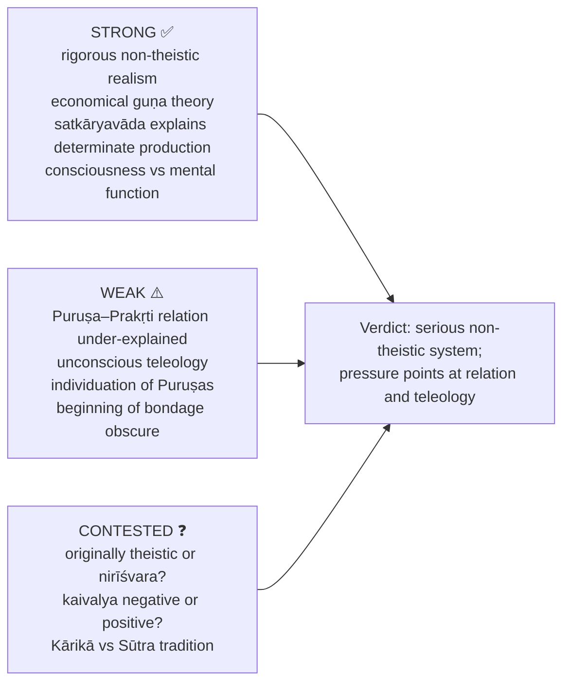

### 15.1 10-mark
```text
Technical thesis in one line.
Numbered proof / sequence / distinction directly.
One contrast or objection.
End with a verdict tied to the directive word.
```
**Anchor:** "Sāṃkhya is strongest as a concise dualist realism: one Prakṛti explains the world, many Puruṣas explain experience, and viveka explains liberation."

### 15.2 15-mark
```text
Frame the doctrinal problem in 2–3 lines.
Expose the doctrine in ordered points.
Add the distinction, comparison or criticism demanded.
One reasoned verdict.
```
**Anchor:** "Sāṃkhya's power lies in the mutual fit of pramāṇa, satkāryavāda, guṇa theory and kaivalya, though its contact problem invites Vedāntic criticism."

### 15.3 20-mark
```text
Frame Sāṃkhya as a full metaphysical system.
Body A: full doctrine in sequence.
Body B: strongest rival or criticism.
Body C: reply and evaluation.
Philosophical conclusion, not a slogan.
```
**Anchor:** "Sāṃkhya is a philosophically serious non-theistic system whose causal realism and psychology of reflection are impressive, but whose unconscious teleology and plurality of attributeless Puruṣas remain unresolved pressure points."

### 15.4 Ready skeletons
```text
PROOFS FOR PURUṢA : define Puruṣa → list five proofs → evaluate cumulative force → experience and liberation presuppose a witness.
EVOLUTION         : guṇa-equilibrium in avyakta → Prakṛti → mahat/buddhi → ahaṃkāra → sāttvika / tāmasa lines, rajas energizes both → mahat = buddhi → psychological-cosmological unity.
ŚAṂKARA AS CRITIC : state dualism → contact problem → unconscious pradhāna cannot be the Upaniṣadic cause → chief but rejected rival.
```

### 15.5 Directive decoder ⚠️

| Directive | Move | Closing verdict |
|---|---|---|
| Discuss | Thesis → doctrine → one debate | "Sāṃkhya offers a coherent realist account, though its relation problem remains." |
| Examine | Reasons and presuppositions | "The doctrine stands if its inferential presupposition is granted." |
| Critically examine | Exposition → named pūrvapakṣa → reply → residual weakness | "Strong as system-internal realism, vulnerable at the puruṣa–prakṛti relation." |
| Analyse | Prakṛti, Puruṣa, guṇas, causation, liberation | "The strength lies in how the parts mutually support one another." |
| Evaluate | Explanatory gain vs objections | "More persuasive as phenomenology of consciousness than as final metaphysics." |
| Compare / Distinguish | Table: causation, self, God, liberation | "The decisive difference is …" |
| Comment / Bring out / Elucidate | Claim → support → qualify; define → example → link | "Substantially correct, but incomplete without …" |
| Do you agree? | Yes / no / partly, both sides | "I agree only to the extent that …" |

---

## Sources

Īśvarakṛṣṇa, *Sāṃkhya-kārikā* (GRETIL text, Kārikās 1–68, esp. 15 and the subtle-body verses); S. Chatterjee & D. Datta, *An Introduction to Indian Philosophy*; C.D. Sharma, *A Critical Survey of Indian Philosophy*; S. Radhakrishnan, *Indian Philosophy* vol. 2; Vācaspati Miśra, *Sāṃkhya-tattva-kaumudī*; Gerald J. Larson, *Classical Sāṃkhya* (advanced dossier trail); Gauḍapāda's commentary (named in the owner file).
