# YOGA (Pātañjala Yoga / seśvara-sāṃkhya) — Examiner-Grade Mindmap

> **Syllabus (verbatim):** Yoga; Citta; Cittavrtti; Klesas; Samadhi; Kaivalya.
> **Catalogue key:** `philosophy-paper-i-indian-philosophy-06` · Paper I · Indian Philosophy
> **Sources used:** `paper-1/indian/Yoga.md` (canonical owner, read in full) · `_advanced/Indian-Philosophy-Dossier.md` §6 (optional depth) · `paper-1/_PYQ-Indian-Philosophy-2018-2025.md` · `paper-1/_PYQ-Indian-Philosophy-2026.md`.
> **Evidence key:** ✅ canonical doctrine · ⚠️ analytical synthesis · ❓ contested / uncertain

> [!IMPORTANT]
> **Core thesis.** Sāṃkhya supplies the metaphysical grammar; Yoga turns it into a disciplined technology of liberation, with Īśvara as a privileged contemplative aid. Yoga is not posture-discipline and not union with Brahman or God: it is restraint of citta-modifications so the seer abides in its own nature, ending in kaivalya (isolation). ⚠️

---

## 0. Master Overview

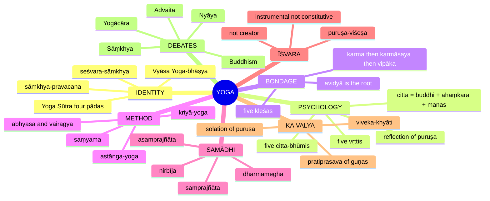

---

## 1. Identity, Lineage & Doxography

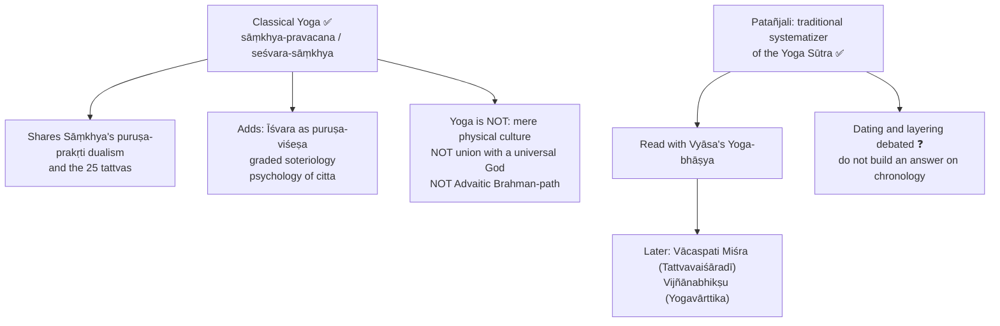

| Pāda (chapter) | Orientation |
|---|---|
| **Samādhi-pāda** (absorption) | Definition of Yoga, mental modifications, practice/dispassion, Īśvara, object-supported and seedless absorption |
| **Sādhana-pāda** (practice) | Afflictions, karma, eight-limbed discipline, discriminative removal of conjunction |
| **Vibhūti-pāda** (powers) | Concentration–meditation–absorption combined, transformations, extraordinary powers |
| **Kaivalya-pāda** (isolation) | Mind/object realism, latent tendencies, discriminative knowledge, cloud-of-dharma absorption, isolation |

- **Source caution ⚠️:** the five citta-bhūmis are standard in Vyāsa's commentarial exposition, not a five-item sūtra list stated by Patañjali himself.
- **Ownership:** Sāṃkhya owns primordial nature, witness, qualities, 25 principles, real transformation; Yoga restates only enough to explain psychology and path. Optional enrichment: exhaustive power catalogues, specialist commentarial disputes, uncertain chronology, modern wellness claims.

> [!TIP]
> **Opening line.** "Yoga is seśvara-sāṃkhya: it keeps Sāṃkhya's metaphysics but is defined as restraint of the modifications of citta (*yogaś-citta-vṛtti-nirodhaḥ*), leading to kaivalya."

---

## 2. Theory of Knowledge (Epistemology)

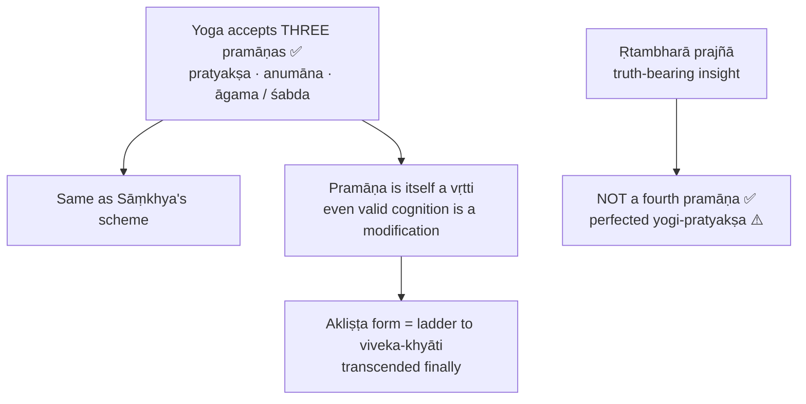

### 2.1 The five vṛttis ✅

| Vṛtti | Definition | Example | Note |
|---|---|---|---|
| **Pramāṇa** | valid cognition | seeing smoke, inferring fire | even true knowledge is a modification |
| **Viparyaya** | error | nacre taken for silver | distorts conduct |
| **Vikalpa** | verbal construction without real object | "the horn of a hare" | language moves without referent |
| **Nidrā** | sleep as a positive mental mode | "I slept" recalled later | quiescence ≠ liberation |
| **Smṛti** | memory | recollection of past pain/pleasure | feeds attachment, fear, self-narration |

Each vṛtti is **kliṣṭa** (afflicted; coloured by avidyā and kleśas, productive of bondage) or **akliṣṭa** (purified, redirected to discrimination/detachment). Kliṣṭa/akliṣṭa qualify **vṛttis, not kleśas**.

### 2.2 Ṛtambharā prajñā ✅/⚠️

1. Linked to **adhyātma-prasāda**, inward clarity after perfected **nirvicārā** samāpatti (nirvicāra-vaiśāradya; YS 1.47–1.48).
2. Differs from **śruta** and **anumāna**: those reach universals; ṛtambharā has a **viśeṣa-artha** (particular object) as field.
3. Its saṃskāra blocks other saṃskāras; when even it ceases, **nirbīja** (YS 1.51) is possible.
4. Objection: still a vṛtti, so how does it liberate? Reply: akliṣṭa vṛttis cancel kliṣṭa ones, then it ceases; a ladder left behind.
5. Caution: do not equate with Aurobindo's "knowledge by identity" or "supermind" (thematic resemblance only).

### 2.3 Realism of the Kaivalya-pāda ✅/⚠️

| Argument | Content |
|---|---|
| **Ekacitta-tantra / vastu-sāmya** | An object is not dependent on one mind; if it were, it would vanish when that mind ceased to cognise it |
| **Mind's knownness** | Citta is not self-illuminating (*na tat svābhāsam*); it is **dṛśya** (seen) for puruṣa; mind-only struggles with regress |
| **No simultaneous self-cognition** | Mind cannot apprehend itself and its object in one act as lamp and illuminated; object, modification and witness are distinct |
| **Uparāga** | Object known when citta is coloured (*uparakta*) by it; knownness depends on colouring, so object ≠ cognition |

Three-term realism: **viṣaya** (object), **citta-vṛtti** (modification), **puruṣa** (witness).

---

## 3. Dialectical Wings & Sceptical Refinements

> [!NOTE]
> The owner file records **no internal sceptical wing** within Yoga. This module therefore carries only the source-backed external dialectic and optional interpretive disputes.

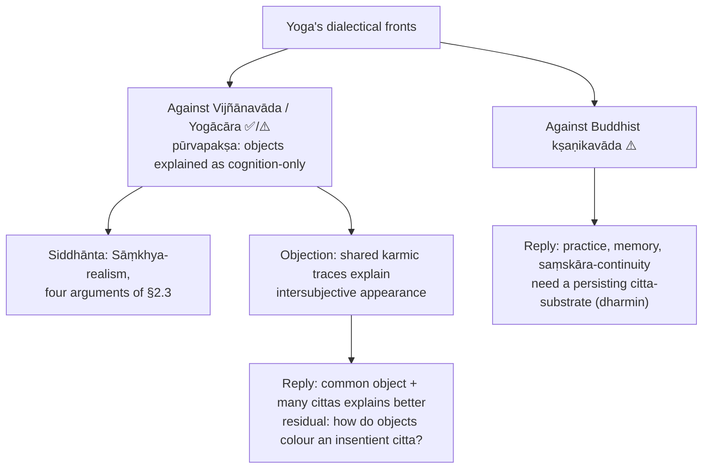

**Optional advanced disputes ⚠️ (Dossier §6):**

| Module | Issue | Readings | Objection → reply |
|---|---|---|---|
| Is Īśvara necessary? | Does Yoga need Īśvara or only a practical aid? | Theistic reading: central to Yoga's distinctiveness; pragmatic: ontology Sāṃkhyan, Īśvara aids concentration | If liberation rests on viveka-khyāti, Īśvara is dispensable → instrumental not constitutive, yet uniquely powerful |
| Asamprajñāta vs dharmamegha | Is asamprajñāta simply nirbīja cessation? | Some compress upper stages; others keep distinctions between seedless cessation, residual saṃskāra, final cloud-of-dharma | Refinements are scholastic overgrowth → optional for UPSC, but explain why "seedless" is not flatly "final" |
| Knowledge vs absorption | What liberates: samādhi or viveka-khyāti? | Absorption-heavy vs cognition-heavy reading | If knowledge liberates, Yoga collapses into Sāṃkhya → Yoga's psychology explains how such knowledge is stabilised and efficacious |

Sources trail: Patañjali; Vyāsa; Vācaspati Miśra (*Tattvavaiśāradī*); Edwin Bryant; Chatterjee & Datta. Do not over-study full commentarial enumerations of samādhi sub-levels, every siddhi passage, or sectarian devotional overlays.

---

## 4. Metaphysics & Ontology

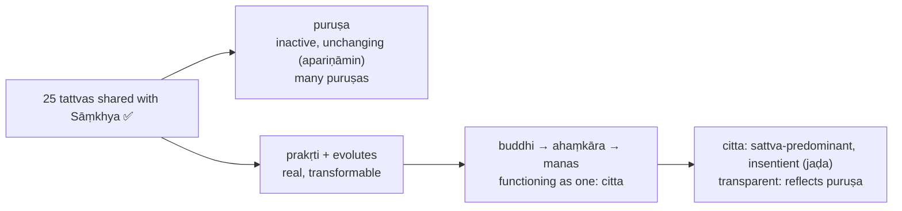

### 4.1 Constitution of citta ✅

| Component | Role |
|---|---|
| **Buddhi** | determinative intellect, ascertainment, discrimination, resolve |
| **Ahaṃkāra** | ego-principle; ownership of states, doership |
| **Manas** | sensory coordination, doubt, oscillation |

Material basis: intellect evolves first, ego-maker from intellect, mind from the sattva-predominant side of ego-maker. Only manas arises directly from sattva-predominant ahaṃkāra; do **not** say intellect, ego and mind all do. Citta as a whole is sattva-predominant.

### 4.2 Reflection model (pratibimba / chāyā) ✅

- Puruṣa **apariṇāmin**; citta **jaḍa** but transparent; crystal (**sphaṭika**) near a flower; magnet and iron (**sannidhi**) ⚠️.
- Bondage = confusion of **asmitā** and **sva-svāmi-śakti** (power of owned and owner).
- Reply to "how can inactive puruṣa be reflected?": **sannidhi-mātra** (mere proximity); all transformation is on the citta side. Residual: Advaita and Nyāya press how two disjoint principles explain one experience.
- Craft the key statement: *so long as citta is modified, the self is reflected therein and, lacking discriminative knowledge, identifies itself with the modifications* (2024 Q7(b)).

### 4.3 Citta-pariṇāma ✅/⚠️

| Transformation | Meaning |
|---|---|
| **Nirodha-pariṇāma** | impressions of restraint increasingly overpower impressions of emergence |
| **Samādhi-pariṇāma** | many-pointedness to unified absorption |
| **Ekāgratā-pariṇāma** | unbroken stream of similar cognitive moments toward one object |
| General threefold | **dharma-**, **lakṣaṇa-**, **avasthā-pariṇāma**; presuppose a persisting **dharmin** |

Inherits Sāṃkhya **pariṇāmavāda**. vs Buddhist kṣaṇikavāda: Yoga needs a substrate for saṃskāra and graded discipline. vs Advaita vivartavāda: change in citta/prakṛti is real, not apparent.

### 4.4 Citta-bhūmis ✅ (Vyāsa's exposition)


Only **ekāgra** and **niruddha** are fully fit for authentic yoga. The vikṣipta → ekāgra transition is decisive. Niruddha is not unconscious blankness.

---

## 5. Rejection / Affirmation of Transcendent Realities

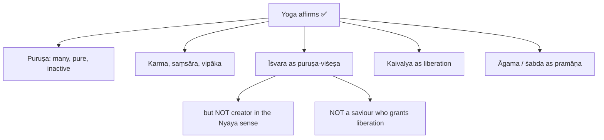

### 5.1 Īśvara in Yoga ✅

- **Definition:** a **puruṣa-viśeṣa**, untouched by **kleśa, karma, vipāka, āśaya**.
- Unsurpassed seed of omniscience; teacher of the ancients, not limited by time; denoted by **praṇava (OṂ)**.
- **Not** creator: prakṛti is the material basis of evolution; contrast Nyāya God as **nimitta-kāraṇa**.
- **Not** a Vaiṣṇava-style saviour: liberation depends on the yogin's own viveka-khyāti.
- Patañjali's own grounds are internal to practice and definition; the later creator/administrator proof-set is **not** Patañjali's ⚠️.

| Role | Explanation |
|---|---|
| Object of meditation | one-pointed devotion stabilizes citta |
| Īśvara-praṇidhāna | surrender reduces egoity and attachment |
| Remover of obstacles | counters antarāyas |
| Perfect model | untouched, unsurpassed status |
| Teacher principle | anchor of timeless transmission |

**Formula:** *Īśvara is instrumental, not constitutive, in liberation.* Why seśvara-sāṃkhya: preserves Sāṃkhya's dualism and adds Īśvara; the theism is genuine but limited.

### 5.2 Nine obstacles (antarāyas) and symptoms ✅

disease (**vyādhi**), mental stagnation (**styāna**), doubt (**saṃśaya**), carelessness (**pramāda**), laziness (**ālasya**), sensual non-restraint (**avirati**), false vision (**bhrānti-darśana**), failure to attain a stage (**alabdha-bhūmikatva**), instability in an attained stage (**anavasthitatva**). Symptoms: suffering (**duḥkha**), dejection (**daurmanasya**), bodily tremor (**aṅgamejayatva**), disturbed breathing (**śvāsa-praśvāsa**). Remedies include Īśvara-praṇidhāna, practice of one principle, friendliness/compassion/joy/equanimity, breath regulation, suitable supports.

### 5.3 Siddhis ✅/⚠️

YS 3.37: powers are attainments in the outward-turned state but **obstacles to absorption** (*samādhāv upasargāḥ*) when appropriated; they can reactivate egoity, attachment, pride.

---

## 6. Explanatory & Causal Principles

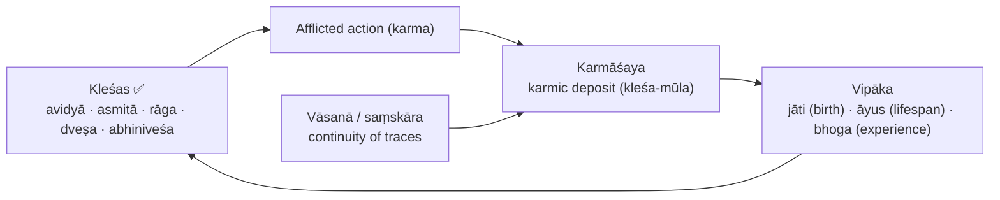

### 6.1 The five kleśas ✅

| Kleśa | Meaning | Why it binds |
|---|---|---|
| **Avidyā** | ignorance: non-eternal as eternal, impure as pure, painful as pleasant, non-self as self | root of the others |
| **Asmitā** | confusing puruṣa with buddhi | "I think, I act, I suffer" |
| **Rāga** | attachment from remembered pleasure | repetition, possession |
| **Dveṣa** | aversion from remembered pain | hostility, flight |
| **Abhiniveśa** | clinging to life / fear of death | present **even in the learned** |

### 6.2 Four states of kleśas ✅

| State | Meaning |
|---|---|
| **Prasupta** | dormant (seed-like; can reactivate) |
| **Tanu** | attenuated by discipline |
| **Vicchinna** | interrupted (e.g. attachment overridden by stronger fear) |
| **Udāra** | active, behaviour-shaping |

Gross kleśas weakened by kriyā-yoga; subtle (**sūkṣma**) forms burned by **dhyāna** and higher absorption.

### 6.3 Karma and vipāka ✅

- Karma classes: **śukla** (white), **kṛṣṇa** (black), **śukla-kṛṣṇa** (mixed), **aśukla-akṛṣṇa** (neither; the yogin).
- Targets: **tanū-karaṇa** (thinning) and **pratiprasava** (reabsorption into the cause), not temporary calm.
- **Dagdha-bīja** (burnt seed) image; potter's wheel image for residual embodiment (prārabdha-type) ⚠️.
- Objection: unsurveyable karmāśaya postpones release → liberating knowledge and samādhi burn the seeds of future bondage.

### 6.4 Why removal of kleśas leads to kaivalya (2021 Q6(a)) ✅

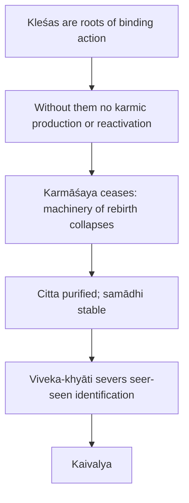

Qualify: suppressed (vicchinna/prasupta) ≠ exhausted seeds; the guṇas cease serving **this** puruṣa; not destruction of consciousness; not the pure puruṣa literally bound.

---

## 7. Ethics & Human Goals (Puruṣārthas)

> [!NOTE]
> The owner file gives **no separate kāma/artha/dharma/mokṣa analysis** for Yoga. This module carries only its ethical-disciplinary content.

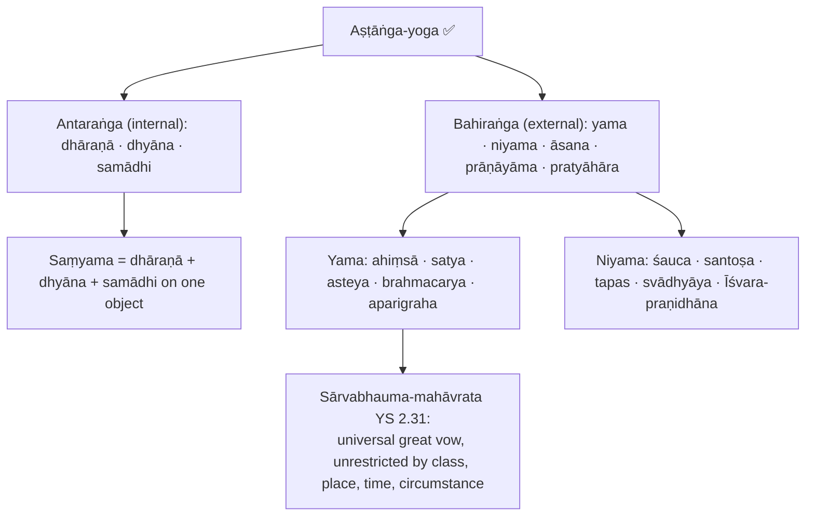

| Limb | Meaning | Significance |
|---|---|---|
| **Yama** | restraints | social-ethical purification |
| **Niyama** | observances | positive self-cultivation |
| **Āsana** | steady and comfortable posture | freedom from bodily distraction |
| **Prāṇāyāma** | breath regulation | calms psycho-physical disturbance; hinge of body and citta |
| **Pratyāhāra** | withdrawal of senses | release from compulsive extroversion |
| **Dhāraṇā** | concentration | first sign of ekāgratā |
| **Dhyāna** | meditation | uninterrupted flow; burns subtle kleśas |
| **Samādhi** | absorption | object alone shines |

**Kriyā-yoga ✅:** tapas, svādhyāya, Īśvara-praṇidhāna; purpose: attenuate kleśas and prepare for samādhi.

**Practice and dispassion (YS 1.12–1.16) ✅/⚠️:**

| Discipline | Meaning |
|---|---|
| **Abhyāsa** | sustained effort; firmly grounded when long, uninterrupted, devoted |
| **Apara-vairāgya (vaśīkāra)** | mastery: no thirst for seen and scripturally promised objects (YS 1.15) |
| **Para-vairāgya** | no thirst even for the guṇas, from discernment of the witness (YS 1.16) |

Four lower stages (**yatamāna, vyatireka, ekendriya, vaśīkāra**) are commentarial elaboration ⚠️.

> [!WARNING]
> Meditative power without yama–niyama can coexist with affliction and egoity: dhyāna is not sufficient without ethics.

---

## 8. Inter-School Comparative Matrices

| School | Pramāṇas | Self | God | Causation | Liberation | Jīvanmukti |
|---|---|---|---|---|---|---|
| **Yoga** | 3: pratyakṣa, anumāna, āgama | many puruṣas, pure inactive | Īśvara as puruṣa-viśeṣa | satkāryavāda / pariṇāmavāda | kaivalya | ⚠️ qualified residual-embodiment language |
| **Sāṃkhya** | 3 | many puruṣas | classical nirīśvara tendency | satkāryavāda / pariṇāmavāda | kaivalya via viveka | ⚠️ broadly compatible |
| **Nyāya–Vaiśeṣika** | 4 | enduring substance with qualities | creator / efficient cause in later Nyāya | ārambhavāda / asatkāryavāda | apavarga (cessation of suffering) | ⚠️ not central |
| **Buddhism** | ⚠️ often 2 in epistemological schools | no permanent self | no creator | dependent origination, often kṣaṇikavāda | nirvāṇa | ✅ nirvāṇa-with-remainder in some frameworks |
| **Jainism** | ⚠️ direct/indirect with subdivisions | many jīvas | no creator; perfected siddhas | substance with modes, anekāntavāda | kevala-jñāna, siddhahood | ✅ embodied kevalin |
| **Mīmāṃsā** | ❓ commonly 5 or 6 | enduring self | creator not necessary | ritual action produces apūrva | cessation of bondage linked to dharma | ⚠️ not central |
| **Advaita Vedānta** | commonly 6 | one non-dual ātman-Brahman | Īśvara as saguṇa Brahman at empirical level | vivartavāda at the highest level | mokṣa as Brahman-realization | ✅ strongly admitted |

### 8.1 Yoga vs Sāṃkhya, Nyāya, Advaita, Buddhism ✅

| Issue | Sāṃkhya | Yoga |
|---|---|---|
| Base | puruṣa-prakṛti; 25 tattvas | same |
| God | nirīśvara | seśvara |
| Stress | explanatory metaphysics, viveka-jñāna | practical psychology, samādhi |

| Issue | Yoga | Nyāya–Vaiśeṣika |
|---|---|---|
| Internal organ | citta (broad) | atomic manas plus self-substance |
| God | special puruṣa, aid | creator / moral governor |
| Liberation | kaivalya | apavarga |
| Pramāṇas | 3 | 4 |

| Issue | Yoga | Advaita Vedānta |
|---|---|---|
| Reality | many puruṣas + prakṛti | non-dual Brahman |
| Bondage | puruṣa confused with citta | avidyā / adhyāsa |
| Liberation | isolation (disentanglement) | identity-realization |
| God | meditative aid, special puruṣa | saguṇa Brahman, vyāvahārika |

| Issue | Yoga | Buddhism |
|---|---|---|
| Self | enduring puruṣa | nairātmyavāda |
| Affliction | kleśas rooted in avidyā | kleśa / tṛṣṇā / avidyā nexus |
| Meditation | samādhi for puruṣa-prakṛti discrimination | insight into impermanence, non-self, dependent origination |
| Liberation | kaivalya | nirvāṇa |

**Kleśa/error across schools ✅:** Buddhism avidyā + tṛṣṇā; Sāṃkhya aviveka; Advaita avidyā/adhyāsa; Nyāya mithyājñāna; Yoga adds affective affliction and meditative remedy.

### 8.2 Kaivalya vs Advaita mokṣa vs Nyāya apavarga ⚠️

| Yoga kaivalya | Nyāya apavarga |
|---|---|
| positive isolation of pure consciousness in its own nature | often described as cessation of pain and bondage |
| rooted in puruṣa-prakṛti discrimination | rooted in true knowledge of categories and self |

Kaivalya = **disentanglement**, not identity. UPSC-safe line: *Nyāya emphasizes cessation of suffering; Yoga emphasizes the isolation and self-abidance of puruṣa.*

**Precise Sāṃkhya–Yoga difference:** (i) Īśvara-praṇidhāna, (ii) elaborate psychology of citta-vṛtti-nirodha, (iii) samādhi-methodology and yogi-pratyakṣa, (iv) systematic path from kleśa-attenuation to kaivalya.

---

## 9. Criticisms & Reconstructed Replies

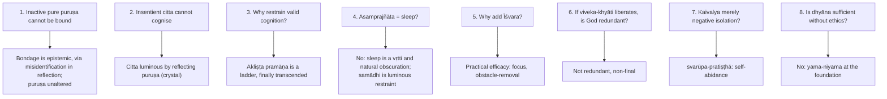

### 9.1 Pūrvapakṣa–siddhānta ledger ⚠️

| Objector | Objection | Yoga's reply | Residual force |
|---|---|---|---|
| Buddhist kṣaṇikavāda | No persisting citta needed | citta as continuing substrate bearing saṃskāras | causal series can still explain continuity |
| Yogācāra | external objects unnecessary | Kaivalya-pāda realism | shared karmic appearance a sophisticated counter |
| Advaita | why many puruṣas; why Īśvara only a special puruṣa | experience-plurality, Sāṃkhyan realism | Advaita presses unity of consciousness |
| Nyāya | self a substance with adventitious consciousness; why cease vṛttis | consciousness cannot be accidental to the seer; nirodha reveals not destroys | Nyāya's commonsense realism attractive |
| Cārvāka | puruṣa, karma, rebirth, kaivalya unverifiable | disciplined yogi-pratyakṣa, pragmatic transformation | public verification difficult |
| Mīmāṃsā | non-creator Īśvara otiose; ritual secures dharma | ritual cannot remove avidyā/asmitā; Īśvara-praṇidhāna stabilizes citta | Yoga's proof of Īśvara weaker than Nyāya's |

### 9.2 Presupposition ledger ⚠️

| Doctrine | Presupposition | What collapses |
|---|---|---|
| Citta-vṛtti-nirodha | citta takes forms, can be restrained, distinct from puruṣa | nirodha becomes mere quietism |
| Kleśa theory | avidyā and derivatives colour cognition, action, rebirth | moral advice only |
| Reflection / asmitā | puruṣa inactive; citta transparent but insentient | bondage of pure puruṣa inexplicable |
| Aṣṭāṅga | body, conduct, breath, senses, attention condition purity | samādhi detached from ethics |
| Samādhi | attention can become object-transparent, then seedless | trance without soteriological force |
| Karma-vipāka | actions leave deposits rooted in kleśas | therapeutic psychology only |
| Īśvara | a special puruṣa is possible and useful | collapses toward nirīśvara Sāṃkhya |
| Kaivalya | puruṣa distinct from prakṛti | isolation unintelligible; Advaita or Buddhism more plausible |

---

## 10. Controlled Western Comparisons

| Parallel | Point of contact | Disanalogy |
|---|---|---|
| **Husserl's epoché** vs nirodha | suspension of natural attitude | epoché methodological and retains constituting ego; nirodha soteriological, ceases binding modifications |
| **Descartes' cogito** vs puruṣa | consciousness indubitable | cogito is a thinking substance that acts; puruṣa inactive witness |
| **Kant's apperception** vs asmitā | an "I think" accompanies representations | Kant: condition of objectivity; Yoga: affliction to dissolve |
| **Spinoza's third kind of knowledge** vs ṛtambharā | non-discursive, above inference | Spinoza: knowledge of God/Nature; ṛtambharā object-specific and must cease |
| **Aristotle's habituation** vs abhyāsa–vairāgya | character through repeated discipline | Aristotle: flourishing in polis; Yoga: disentangling puruṣa |
| **Freud's unconscious** vs saṃskāra / vāsanā | latent dispositions shape conduct | saṃskāras karmically indexed, metaphysically real, in a rebirth framework |

> [!WARNING]
> Western parallels are illustrative garnish only; at most one or two lines, after the Yoga case is complete.

---

## 11. Diagnostic Deep-Dives for High-Frequency Themes

### 11.1 Samādhi map (2020 Q5(b), 2022 Q5(c), 2026 Q5(e)) ✅

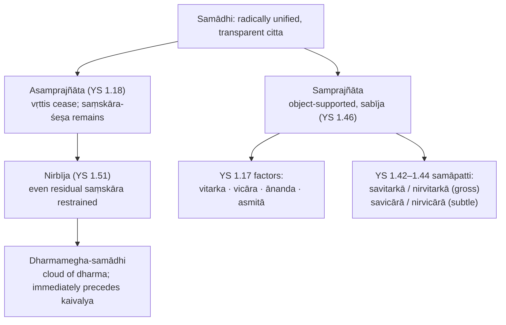

| YS 1.17 factor | Tone |
|---|---|
| **Vitarka** | gross object-level engagement |
| **Vicāra** | subtle object-level reflection |
| **Ānanda** | refined sattvic joy (not ordinary pleasure) |
| **Asmitā** | bare I-am-ness (not binding kleśa-asmitā) |

| Samāpatti | Range | Overlay |
|---|---|---|
| **Savitarkā** | gross (sthūla) | mixed with śabda-artha-jñāna-vikalpa |
| **Nirvitarkā** | gross | memory and verbal construction purified |
| **Savicārā** | subtle (sūkṣma) | subtle reflection remains |
| **Nirvicārā** | subtle | even that stilled; YS 1.47 adhyātma-prasāda; YS 1.48 ṛtambharā |

- YS 1.45 extends the subtle domain to **aliṅga**; YS 1.46: these remain **sabīja**.
- Two senses of "seed": *sabīja* = with object-support (YS 1.46); *bīja* denied in nirbīja = residual saṃskāra (YS 1.51).
- Two routes (YS 1.19–1.20): **bhava-pratyaya** (videha / prakṛti-laya) vs **upāya-pratyaya** (śraddhā-vīrya-smṛti-samādhi-prajñā). Do not make a third main classification.
- Reconciliation ❓: commentators map the two grids; whether ānanda and asmitā are independent samāpattis, supervening aspects, or higher refinements is disputed.
- Neither samprajñāta nor asamprajñāta is automatically kaivalya.

> [!WARNING]
> **Trap.** Do not write that Patañjali's four types of samprajñāta are savitarka, nirvitarka, savicāra, nirvicāra. YS 1.17 = vitarka + vicāra + ānanda + asmitā; YS 1.42–1.44 = samāpatti-bhedas. Do not flatly equate asamprajñāta with nirbīja, or with sleep.

### 11.2 2019 Q7(b): scientist, devotee, yogi ⚠️

| Person | State | Bhūmi (qualified) |
|---|---|---|
| Scientist | intense but intermittent focus, worldly attachment | vikṣipta (technical expertise alone does not prove it; research focus is not liberation-oriented ekāgra) |
| God-realized devotee | steady object-supported contemplation of Īśvara | ekāgra; if all vṛttis actually restrained, niruddha |
| Self-realized yogi | citta-vṛttis fully restrained | niruddha (puruṣa itself does not change levels) |

Reason from a **state**, give bhūmi and guṇa pattern, then qualify; do not equate scientific work, devotion and liberation with three immutable ranks.

### 11.3 2024 Q7(b): soteriology appraisal ⚠️

Changing citta is prakṛtic; its transparency reflects an unchanging puruṣa → in avidyā/asmitā the empirical "I" attributes thinking and suffering to the witness → vṛttis and kleśas generate karma → practice and dispassion restrain, samādhi matures viveka-khyāti → **Appraisal:** unifies therapy with liberation; reflection/proximity may not explain association of independent puruṣa and citta; akliṣṭa cognition must arise before its cessation. Conclude: kaivalya = cessation of mistaken attribution, not a new property.

### 11.4 2025 Q7(b): God and kaivalya ✅

Four points: (1) special puruṣa; (2) untouched by kleśa-karma-vipāka-āśaya; (3) aids concentration, removes obstacles, object of praṇava-mediated devotion; (4) does not create the world in Nyāya's sense nor bestow kaivalya independently of viveka-khyāti.

### 11.5 The path to kaivalya ✅

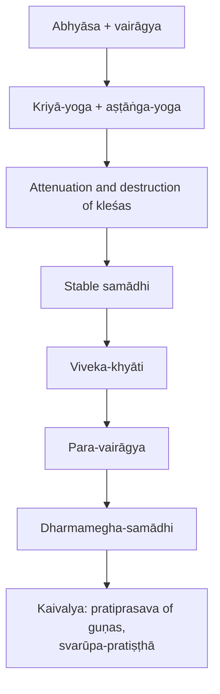

- **Kaivalya** = aloneness / isolation of puruṣa from prakṛti. Puruṣa already pure: liberation ends misidentification, produces no new essence.
- **Farmer image (kṣetrika):** breach the embankment; water flows by its own nature. Discipline removes obstructions.
- **Not:** union with God, identity with Brahman, annihilation of consciousness, mere painlessness, destruction of mind as substance.
- **Jīvanmukti ⚠️:** language of residual embodiment: potter's wheel.
- **Yoga's foundational sūtras:** *yogaś-citta-vṛtti-nirodhaḥ*; *tadā draṣṭuḥ svarūpe'vasthānam*. Nirodha is revelatory, not destructive (clear pool).

---

## 12. PYQ Routing Ledger (2018–2026)

> Corpus signal: 7 primary-owned parts out of 112 (2018–2025; 2018 is the only year without an owned part) plus 1 in the 2026 supplement = **8**. The 2018 Nyāya-versus-Yoga God-proof question remains Nyāya-owned.

| Year | Q | Marks | Exact demand | Map to |
|---|---|---:|---|---|
| 2019 | Q7(b) | 15 | How would Yoga philosophy comprehend the Citta-levels of a Scientist, a God-realized Devotee and a Self-realized Yogi? Justify your answer. | §4.4, §11.2 |
| 2020 | Q5(b) | 10 | Explain the difference between Samprajñāta Samādhi and Asamprajñāta Samādhi. | §11.1 |
| 2021 | Q6(a) | 20 | Explain with reference to Yoga Philosophy, the nature of kleśas. How does the removal of these lead to kaivalya? | §6.1–§6.4 |
| 2022 | Q5(c) | 10 | Discuss the nature and different stages of Samādhi as per Pātañjala yoga and examine the role of Īśvara in it. | §11.1, §5.1 |
| 2023 | Q7(c) | 15 | Explain Citta and its modifications in the philosophy of Yoga. Why does Yoga philosophy prescribe cessation of modifications of Citta? Give reasons in support of your answer. | §2.1, §4.1–4.2 |
| 2024 | Q7(b) | 15 | "So long as there are changes and modifications in citta, the self is reflected therein, and, in the absence of discriminative knowledge, identifies itself with them." Present an appraisal of Yoga Soteriology in the light of the above statement. | §4.2, §11.3 |
| 2025 | Q7(b) | 15 | Explain the nature of God and its role in Kaivalya in yoga philosophy. | §5.1, §11.4 |
| 2026 | Q5(e) | 10 | Explain, as per Yoga philosophy, the nature of Samadhi with special reference to the difference between Samprajnata Samadhi and Asamprajnata Samadhi. | §11.1 |

Note: the 2026 Paper I Aurobindo item (Q6(b), Integral Yoga) is Aurobindo-owned and not counted here. 2026 execution: open with the nature of absorption, contrast object-supported samprajñāta with asamprajñāta (saṃskāra-śeṣa), keep YS 1.17 and YS 1.42–1.44 separate, distinguish YS 1.18 from YS 1.51.

---

## 13. Top 10 UPSC Exam Traps

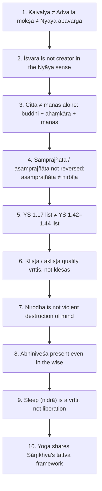

Plus: Īśvara helps but does not grant kaivalya from outside (liberation follows viveka-khyāti); citta-bhūmis are Vyāsa's exposition, not a Patañjali sūtra list; only one component of citta (manas) arises directly from sattva-predominant ahaṃkāra; do not attribute the later creator/administrator proof-set to Patañjali.

---

## 14. Technical Vocabulary & IAST Bank

| English gloss | IAST | Meaning | Status |
|---|---|---|---|
| Mind-complex | citta | buddhi + ahaṃkāra + manas | ✅ |
| Modification of citta | cittavṛtti | five kinds | ✅ |
| Restraint | nirodha | revelatory, not destructive | ✅ |
| Seer | draṣṭṛ | puruṣa | ✅ |
| Abiding in own nature | svarūpe'vasthānam / svarūpa-pratiṣṭhā | | ✅ |
| Affliction | kleśa | five | ✅ |
| Ignorance | avidyā | root kleśa | ✅ |
| Egoity | asmitā | | ✅ |
| Attachment / aversion | rāga / dveṣa | | ✅ |
| Clinging to life | abhiniveśa | | ✅ |
| Dormant / attenuated / interrupted / active | prasupta / tanu / vicchinna / udāra | | ✅ |
| Karmic deposit / ripening | karmāśaya / vipāka | jāti, āyus, bhoga | ✅ |
| Latent tendency / impression | vāsanā / saṃskāra | | ✅ |
| Burnt seed | dagdha-bīja | | ✅ |
| Practice / dispassion | abhyāsa / vairāgya | apara and para | ✅ |
| Action-yoga | kriyā-yoga | tapas, svādhyāya, Īśvara-praṇidhāna | ✅ |
| Eight limbs | aṣṭāṅga | external bahiraṅga, internal antaraṅga | ✅ |
| Combined discipline | saṃyama | | ✅ |
| Object-supported / non-cognitive / seedless | samprajñāta / asamprajñāta / nirbīja | | ✅ |
| Coalescence | samāpatti | savitarkā, nirvitarkā, savicārā, nirvicārā | ✅ |
| Truth-bearing insight | ṛtambharā prajñā | yogi-pratyakṣa ⚠️ | ✅/⚠️ |
| Cloud-of-dharma absorption | dharmamegha-samādhi | | ✅ |
| Residual impression | saṃskāra-śeṣa | YS 1.18 | ✅ |
| Discriminative discernment | viveka-khyāti | | ✅ |
| Reabsorption of guṇas | pratiprasava | | ✅ |
| Isolation | kaivalya | | ✅ |
| Special puruṣa | puruṣa-viśeṣa | Īśvara | ✅ |
| Sacred syllable | praṇava (OṂ) | | ✅ |
| Obstacles | antarāya | nine | ✅ |
| Reflection / mere proximity | pratibimba / sannidhi-mātra | | ✅/⚠️ |
| Real transformation | pariṇāmavāda | | ✅ |
| Persisting substrate | dharmin | | ✅ |
| Liberation while living | jīvanmukti | | ⚠️ |

---

## 15. Graded Verdict & Answer Architectures

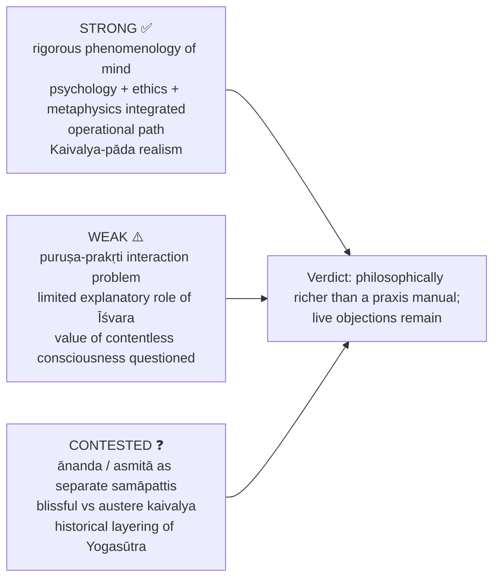

### 15.1 10-mark

```text
Open with the exact doctrinal definition.
Name the canonical list / stages.
One causal or soteriological explanation.
One inter-school distinction or trap-avoidance line.
Close by answering the directive directly.
```
**Anchor:** "Yoga is best read as a disciplined psychology of citta-nirodha grounded in Sāṃkhya dualism and completed in kaivalya."

### 15.2 15-mark

```text
Frame: Yoga as psychology of liberation within Sāṃkhya metaphysics.
Define the central term.
List and explain canonical sub-types or stages.
Show why it matters for bondage / liberation.
Contrast with one rival school or common confusion.
One evaluative sentence.
```
**Anchor:** "Its strength lies in linking mental discipline, moral causation and liberation; its vulnerability lies in the unexplained proximity of inactive puruṣa and active prakṛti."

### 15.3 20-mark

```text
Intro: Yoga as seśvara-sāṃkhya.
Exposition: define and classify fully.
Mechanism: avidyā → kleśa → bondage.
Therapy: kriyā-yoga / aṣṭāṅga / samādhi / viveka-khyāti.
Comparison: Sāṃkhya, Advaita or Nyāya.
Critique and reply: at least one live objection.
Conclusion: kaivalya as the final soteriological meaning.
```
**Anchor:** "Yoga is philosophically richer than a praxis manual: it offers a realist metaphysics, a subtle moral psychology and a graded meditative epistemology, though its dualism and limited Īśvara leave live objections for Advaita, Nyāya and Buddhist critics."

### 15.4 Directive decoder ⚠️

| Directive | Move | Closing |
|---|---|---|
| Explain | definition, list / stages, brief mechanism | "Thus X functions as Y in Yoga's path to kaivalya." |
| Discuss | doctrine → significance → interpretive spread → trap | "central, though not exhaustive" |
| Examine | claim, premises, consequence | "On its own presuppositions, the doctrine coherently explains…" |
| Critically examine | doctrine → named objection → reply → residual | "Strong as phenomenology / practice, weaker at metaphysical interaction." |
| Analyse | avidyā → asmitā → vṛtti/karma → vipāka → nirodha | "a causal psychology of liberation" |
| Evaluate | merits, limits, graded assessment | "strong in X, vulnerable in Y" |
| Compare / Distinguish | axes: self, God, causation, liberation, pramāṇa | "A must not be reduced to B" |
| Elucidate / Comment / Bring out | translate, define, illustrate | "The statement means…, not…" |
| Do you agree? | qualified position | "I agree insofar as…, but not if it means…" |

> [!TIP]
> **Statement bank.** *Yogaś-citta-vṛtti-nirodhaḥ* · *tadā draṣṭuḥ svarūpe'vasthānam* · "Kaivalya is isolation, not union." · "Citta is a reflective instrument: it borrows consciousness from puruṣa and colour from objects." · "Akliṣṭa vṛttis are therapeutic ladders; even they are ultimately transcended." · "Yoga is Sāṃkhya made practical and theistic."

---

## Sources

Patañjali, *Yoga-sūtra*; GRETIL electronic text (chapter structure and readings); Vyāsa, *Yoga-bhāṣya*; Vācaspati Miśra, *Tattvavaiśāradī*; Vijñānabhikṣu, *Yogavārttika*; S. Chatterjee and D. Datta, *An Introduction to Indian Philosophy*; C.D. Sharma, *A Critical Survey of Indian Philosophy*; S. Radhakrishnan, *Indian Philosophy* Vol. II; Edwin Bryant, *The Yoga Sūtras of Patañjali* (advanced dossier trail).
