# MĪMĀṂSĀ (Pūrva-Mīmāṃsā) — Examiner-Grade Mindmap

> **Syllabus (verbatim):** Mimamsa: Theory of Knowlegde.
> **Catalogue key:** `philosophy-paper-i-indian-philosophy-07` · Paper I · Indian Philosophy
> **Sources used:** `paper-1/indian/Mimamsa.md` (canonical owner, read in full) · `_advanced/Indian-Philosophy-Dossier.md` §7 (optional depth) · `paper-1/_PYQ-Indian-Philosophy-2018-2025.md` · `paper-1/_PYQ-Indian-Philosophy-2026.md`.
> **Evidence key:** ✅ canonical doctrine · ⚠️ analytical synthesis · ❓ contested / uncertain

> [!IMPORTANT]
> **Core thesis.** Pūrva-Mīmāṃsā is a system built to secure *dharma* without dependence on God. Its pramāṇa theory, error theory, philosophy of language and defence of Vedic authority interlock: intrinsic validity (svataḥ-prāmāṇya) protects ordinary and Vedic cognition; the Veda is self-valid because authorless (apauruṣeya); dharma is known through injunction (codanā). Always state that **default validity is not infallibility**. ✅

---

## 0. Master Overview

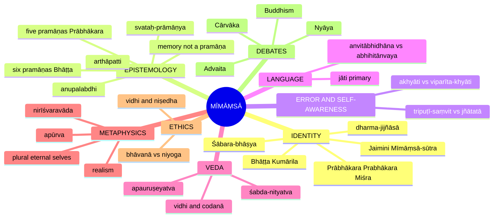

---

## 1. Identity, Lineage & Doxography

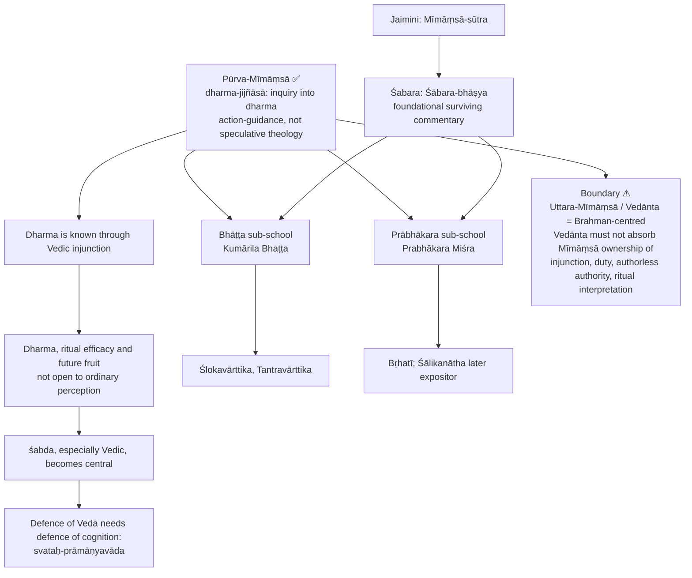

| Sub-school | Principal thinker | Profile | Recurrent UPSC focus |
|---|---|---|---|
| **Bhāṭṭa** | Kumārila Bhaṭṭa | 6 pramāṇas incl. anupalabdhi; viparīta-khyāti; jñātatā | anupalabdhi, abhāva, arthāpatti, jñātatā |
| **Prābhākara** | Prabhākara Miśra | 5 pramāṇas; rejects separate anupalabdhi; akhyāti / vivekākhyāti; tripuṭī-saṃvit | error, self-luminosity, sentence meaning |

- UPSC repeatedly asks **Bhāṭṭa vs Prābhākara**, not generic Mīmāṃsā; show unity-in-difference (shared Vedic authority, realism, ritual efficacy, intrinsic validity, irreducibility of certain cognitions).
- Bhāṭṭa is often more willing to multiply entities / instruments where irreducible phenomena demand; Prābhākara is often more economical.
- ⚠️ Textual chronology and attribution can be debated; doctrinal ownership is what UPSC requires.

**Minimum commitments ✅.** Realism about world; plurality of selves (agent, knower, enjoyer); no creator God needed; reliance on **apūrva** and self-valid Veda; error is exceptional, not constitutive; language is action-guiding; normative content is objective enough to be known.

---

## 2. Theory of Knowledge (Epistemology)

### 2.1 Svataḥ-prāmāṇyavāda ✅

| Aspect | Mīmāṃsā thesis | Meaning |
|---|---|---|
| **Utpatti** of prāmāṇya | Intrinsic | Same conditions that generate cognition generate its validity |
| **Jñapti** of prāmāṇya | Intrinsic | Cognition presents itself as trustworthy without a further validating cognition |
| **Utpatti** of aprāmāṇya | Extrinsic | Falsity arises from defect, obstruction, mislocation |
| **Jñapti** of aprāmāṇya | Extrinsic | Known through contradiction, failure, correction, later defect-awareness |

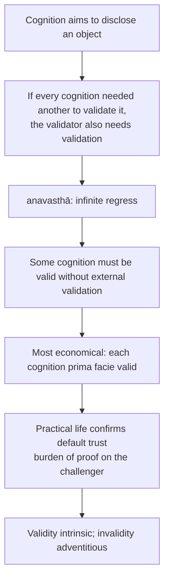

- **Presupposition:** realism; normal causes tend toward truth.
- **Distinction ✅:** not infallibilism. What is intrinsic is default validity, not guaranteed incorrigibility. Most common exam trap.
- **Example:** seeing a pot; move around it, pick it up; revoke only on poor light, hallucination, contradiction.
- **Objection → reply:** "error should be impossible" → error arises from extrinsic defect.

**Nyāya's parataḥ-prāmāṇyavāda ✅.** Verification via **pravṛtti-sāmarthya** (practical success) and **saṃvādi-pratyakṣa** (later confirming perception); example: water in the distance, approach, drink. Mīmāṃsā criticism: acting presupposes prior trust; a validating cognition needs another (regress); later success can confirm or disclose validity, not generate it; distinguishes validity itself from reflective ascertainment.

| Rival | Validity | Invalidity | Mīmāṃsā response |
|---|---|---|---|
| Sāṃkhya | Intrinsic | Intrinsic | Agrees on validity; refuses intrinsic invalidity: falsity does not self-announce at birth |
| Buddhist (survey presentation) | Extrinsic (causal efficacy) | Intrinsic | If falsity were intrinsic, illusion would reveal itself at once; it deceives because it does not |
| Nyāya | Extrinsic | Extrinsic | Regress; action presupposes trust |

**Dream and mirage objection.** Nyāya: dreams and mirages feel normal yet are false. Reply: they involve extrinsic defect (exhaustion, sleep-state, internal disturbance; heated air and optical distortion), hence not fully normal conditions.

**Distinctions ✅.** Validity ≠ certainty; intrinsic validity ≠ incorrigibility; later confirmation is not the source of truth.

### 2.2 The pramāṇa list ✅

| School | Accepted pramāṇas |
|---|---|
| Sāṃkhya | pratyakṣa, anumāna, śabda |
| Nyāya | pratyakṣa, anumāna, upamāna, śabda |
| **Prābhākara** | pratyakṣa, anumāna, upamāna, śabda, **arthāpatti** (5) |
| **Bhāṭṭa** | + **anupalabdhi** (6) |

| Pramāṇa | One-line definition |
|---|---|
| Pratyakṣa | Immediate knowledge from sense-object contact |
| Anumāna | Mediate knowledge from a sign through known concomitance |
| Upamāna | Fresh knowledge that a previously known, now absent object is similar to a presently perceived one |
| Śabda | Valid verbal testimony, especially Vedic regarding dharma |
| Arthāpatti | Necessary postulation of an unseen fact to reconcile incompatible known facts |
| Anupalabdhi | Knowledge of absence through non-apprehension of what would be apprehended if present |

- A pramāṇa is admitted only where a knowledge-type is irreducible; not "casual counting" and not psychological faculties but **logical structures of knowing**.
- **Pramāṇa / pramā (pramiti)** distinction: the operative source / the true cognition produced. Successful action (pravṛtti-sāmarthya) may confirm correspondence but does not manufacture validity.
- **Perception:** both accept; Prābhākara: self-luminous within tripuṭī; Bhāṭṭa: object perceived, cognition inferred from jñātatā. **Nirvikalpaka** (ālocana-jñāna: first non-verbal awareness) vs **savikalpaka** ("this is a white moving cow"); determinate stage interprets what was implicitly available, supporting realism against the Buddhist non-conceptual-particular view ⚠️.
- **Inference:** accepted in standard form; Mīmāṃsā opposes **reductionism about anumāna**, not anumāna.
- **Upamāna (Mīmāṃsā account):** cow seen earlier; gavaya perceived; new cognition "the previously seen cow is similar to this gavaya". Not perception (absent cow), not memory (similarity not known before), not inference (no universal concomitance). ⚠️ Nyāya's account (word–object relation through "a gavaya is like a cow") must **not** be written as Mīmāṃsā's definition. ❓ Śabara sometimes read as allowing wider analogy (own self → other selves); similarity-cognition is the safe default.
- **Śabda:** pauruṣeya (human, speaker-defect) vs apauruṣeya (Vedic); siddhārtha-vākya (states a fact) vs vidhāyaka-vākya (enjoins).

### 2.3 Memory is not a pramāṇa ✅ (2020 Q5(c), 2024 Q8(c))

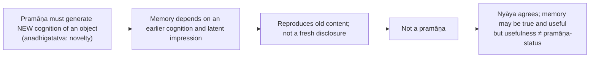

Example: seeing a temple now = perception; recalling yesterday's visit = memory, not new knowledge of the temple.

### 2.4 Arthāpatti ✅

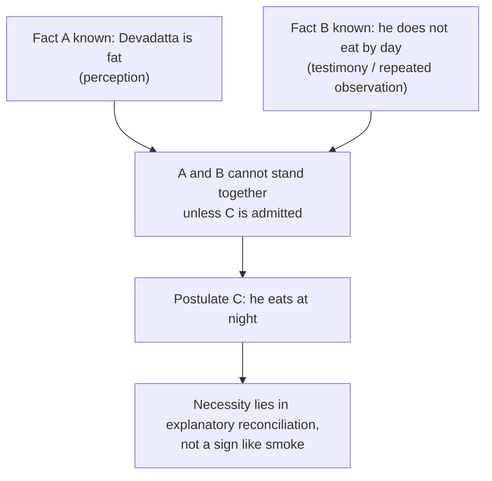

- Types: **dṛṣṭārthāpatti** (from perceived facts) and **śrutārthāpatti** (from heard words, ellipsis, contextual completion).
- **Three arguments against reduction to anumāna:** (1) no independently established vyāpti ("all fat non-day-eaters eat at night" is not known beforehand); (2) direction differs: sign → signified vs tension → reconciling postulate; (3) no pakṣa / hetu / sādhya structure.
- **Nyāya reduction answered as circular:** the vyāpti "whoever is fat eats" is not independently known; if said to be known, it already relies on arthāpatti-like reasoning.
- Resembles inference to the best explanation but stronger: the postulate without which known facts remain untenable. Not a guess or probabilistic hunch.
- Example bank: Devadatta; candidate not studying by day yet topping; person never seen leaving home yet at office daily.

> [!WARNING]
> 2024 Q8(b) candidate case: "not seen studying during the day" ≠ "does not study during the day". Neither Bhāṭṭa postulation nor Nyāya inference licenses the definite claim "studied at night"; at most posit **unobserved preparation**, stating the background assumption first. Compare the **warrants**, not a fabricated nighttime schedule. A Naiyāyika can still frame a conditional inference; Bhāṭṭa disputes the independently known vyāpti.

### 2.5 Anupalabdhi and abhāva ✅

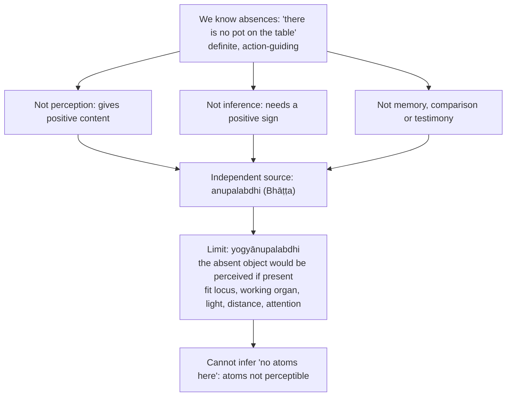

| Position | Pramāṇa for absence | Ontology of abhāva |
|---|---|---|
| **Bhāṭṭa** | Independent **anupalabdhi** | Abhāva real, with a **pratiyogin** (counterpositive); not a mere linguistic shadow |
| **Prābhākara** | Rejects separate pramāṇa; perceive the bare locus, which already carries the negative differentiation | No separate absence-entity over and above the positively given locus |
| **Nyāya** | Rejects independent anupalabdhi | Accepts abhāva as a distinct real category, **directly perceived** ("pot-absence-on-the-floor") |

- Anupalabdhi is not simple ignorance ("I failed to notice"); it is determinate cognition of absence.
- Bhāṭṭa denies reduction to inference: why would not-seeing have evidentiary force? That already presupposes the relevance of non-apprehension under fit conditions.
- Objection: reality is overcrowded with negatives → Bhāṭṭa accepts the ontological cost. Objection: non-perception is subjective → only yogyānupalabdhi counts.
- ⚠️ Do not label all three positions "absence is unreal"; do not collapse reality of absence into pramāṇa count. 2021 Q6(c): add the overpopulation concern and fit-conditions reply; 2025 Q6(c): present both internal Mīmāṃsā sides before Nyāya.

### 2.6 Theories of error ✅ — see §4A for the shell-silver comparison

### 2.7 Knowing cognition: tripuṭī-saṃvit vs jñātatā vs anuvyavasāya ✅

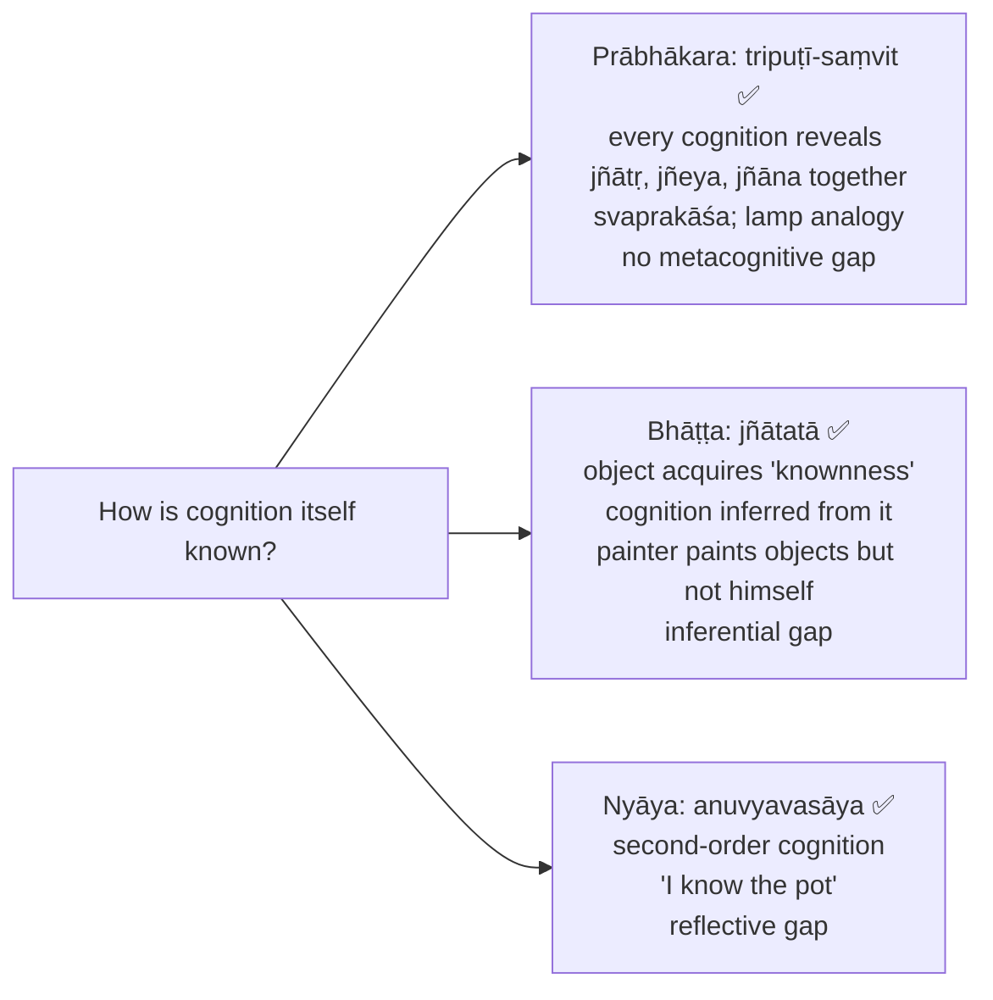

| School | How cognition is known | Self-luminous? | Mechanism |
|---|---|---|---|
| Prābhākara | Simultaneously revealed | Yes | Tripuṭī-saṃvit |
| Bhāṭṭa | Inferred after the fact | No | Jñātatā → inference |
| Nyāya | Second-order cognition | No | Anuvyavasāya |

- Prābhākara regress argument: a second cognition would need a third. Reflection ("I know that I know") is later conceptual articulation of what was pre-reflectively manifest. Replies: simultaneous disclosure ≠ ontological collapse; for Bhāṭṭa, immediacy in experience need not mean non-inferential structure.

---

## 3. Dialectical Wings & Sceptical Refinements

> The owner file and advanced dossier record **no internal sceptical wing** of Mīmāṃsā. This module therefore records only the anti-sceptical posture and the sceptical pressures that Mīmāṃsā answers or faces.

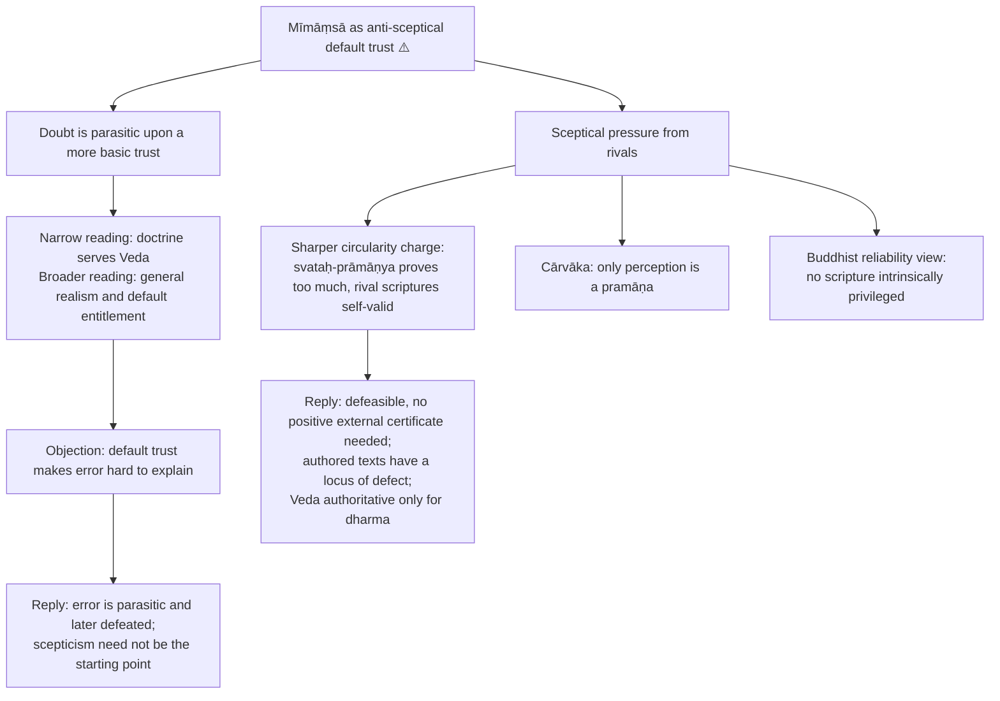

- ❓ Whether svataḥ-prāmāṇya fully avoids circularity or merely relocates the burden to "defect" and "defeater."
- Cārvāka-facing reply: testimony transmits otherwise inaccessible facts, postulation resolves explanatory conflict, non-cognition discloses qualified absence. ⚠️ This establishes the intelligibility of non-perceptual knowledge more readily than it proves every particular Vedic ritual claim.

---

## 4. Metaphysics & Ontology

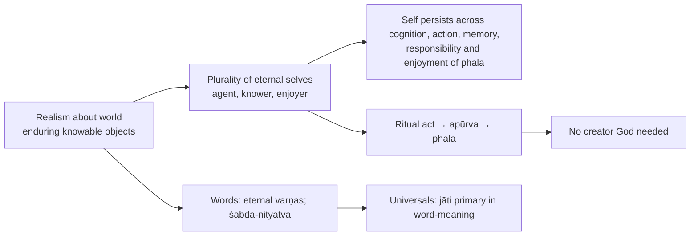

### 4.1 Self and liberation ✅/❓

- Enduring ātman required: ritual duty, merit, demerit, future fruit presuppose one subject who acts and later experiences. If the self were momentary, the sacrificer would not be the enjoyer.
- Plural eternal selves, not Advaitic universal subject; body, senses and inner organ mediate each embodied stream.
- Cognition is episodic, not an uninterrupted essence manifest in dreamless sleep and liberation.
- ❓ **Mokṣa** is more explicit in later Mīmāṃsā. In standard presentation: not Advaitic identity with Brahman but release from embodied suffering and the karmic chain: stop fresh merit/demerit, exhaust prior forces, no new body, sense-mediated cognition or pain.
- ⚠️ Do not convert it into Advaita's realization of Brahman or Nyāya's creator-dependence.

### 4.2 Word, sentence, universal ✅

**Shared conditions of sentence-unity (ekavākyatā):** **ākāṅkṣā** (mutual expectancy), **yogyatā** (semantic fitness), **sannidhi / āsatti** (proximity). Naiyāyikas add **tātparya** (speaker's purport); ⚠️ Mīmāṃsā cannot ground Vedic meaning in intention because the Veda is authorless, so purport is textual force, contextual unity and injunctional function.

| Condition | Failure case |
|---|---|
| Ākāṅkṣā | "Bring..." leaves expectation of what |
| Yogyatā | "Sprinkle with fire" in ordinary usage |
| Sannidhi | Words separated by unrelated discourse |

| Axis | Bhāṭṭa **Abhihitānvayavāda** | Prābhākara **Anvitābhidhānavāda** |
|---|---|---|
| Meaning | Connection of the already denoted | Denotation of the connected |
| Mechanism | Each word first denotes isolated **padārtha** via **abhidhā**; then connection via lakṣaṇā / tātparya-śakti | Words denote meanings only as already connected |
| Primary unit | Word; sentence meaning derivative | Sentence; word meaning grasped in context |
| Key argument | Stable repeatable lexical meanings; compositional | **Vyutpatti**: child sees elder command "bring the cow" and a younger person comply |
| Cross-objection | No observed isolated-word stage; extra lakṣaṇā | Same word would mean differently in every sentence; single-word commands "Cow!" |
| Reply | Distinction is explanatory, not introspective | Recurrent connected uses yield stable competence; single words are elliptical sentences |

- Two-stage claim is **logical**, not a temporal pause.
- **Universal vs particular ✅:** Mīmāṃsā words primarily denote **jāti**; Nyāya gives primacy to **vyakti** qualified by universal and form. Both reach both; difference is semantic priority. Objection (a universal cannot be milked) → universal primary for meaning; action reaches the individual via context. **Buddhist apoha** objection → pure exclusion cannot explain positive recognition; a shared class-character is needed.
- **Sphoṭa-vāda ⚠️:** Bhartṛhari and the Grammarians posit an indivisible vākya-sphoṭa; both Mīmāṃsā schools reject it: eternal varṇas plus memory of the ordered series plus ākāṅkṣā, yogyatā, sannidhi suffice.
- Warnings: **Nyāya ≠ Bhāṭṭa**; **Prābhākara ≠ Bhartṛhari's sphoṭa**.

---

## 5. Affirmation / Rejection of Transcendent Realities

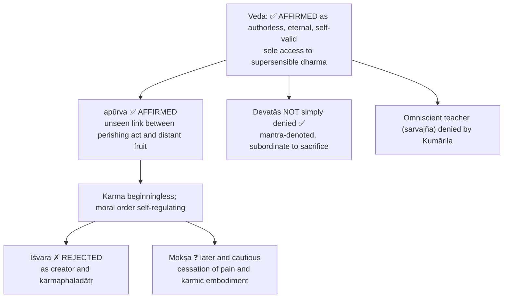

### 5.1 Authority of the Veda ✅ (2019 Q5(e))

1. Apauruṣeyatva: not composed by any human or divine person; an authorless text has no locus of ignorance, deceit, partiality or forgetfulness.
2. No author remembered; the word–meaning relation is **autpattika** (natural), not convention.
3. For Bhāṭṭa, **śabda-nityatva**: utterance manifests, does not produce, the word (varṇas, not sphoṭa).
4. Transmission through disciplined recitation; no event of composition located.
5. Authoritative only for **dharma**, where no rival pramāṇa operates.
6. Distinction: reciting/teaching/arranging branches ≠ original authorship; **Kaṭha** and **Kauṣītaki** may mark schools or transmitters.

**Circularity charge and six replies ✅.** (1) Supported by ordinary reasoning plus no remembered author; (2) arthāpatti-like best explanation; (3) svataḥ-prāmāṇya is defeasible, invalidity known via **doṣa** or **bādhaka**; (4) rival scriptures with claimed human authors have a locus of defect; (5) domain restricted to dharma; (6) a divine author is worse, as a person needs proof of omniscience and freedom from self-interest.

⚠️ Residual force: weight rests on "no remembered author" and the natural word–meaning relation. Nyāya (Jayanta, Udayana): **saṅketa** (convention), grounded in Īśvara, Veda as **āpta** testimony. Buddhist (Dharmakīrti line): how can an eternal changeless word cause a timed cognition? Mīmāṃsā: the word is manifested under auditory conditions, not created.

### 5.2 Vidhi, codanā and sentence taxonomy ✅

Formula: **Codanā-lakṣaṇo'rtho dharmaḥ**: dharma is what Vedic injunction reveals.

| Sentence function | Role |
|---|---|
| **Vidhi** (injunction) | Enjoins a duty or rite not otherwise known |
| **Niṣedha** (prohibition) | Forbids; grounds avoidance |
| **Mantra** | Recalls deities, materials, ritual details |
| **Nāmadheya** (name) | Names a rite, substance, component |
| **Arthavāda** | Praises, condemns, narrates, explains in support of an injunction |

- Mantra, name and arthavāda are not meaningless; they gain Vedic relevance by **eka-vākyatā** with a vidhi.
- Injunction types: **apūrva-vidhi** (novel), **niyama-vidhi** (restrictive), **parisaṃkhyā-vidhi** (exclusionary). ⚠️ Fourfold grid **utpatti, viniyoga, prayoga, adhikāra** only for coordination of a complex rite; do not conflate with the threefold classification.
- **Vedānta seam:** Mīmāṃsā: Vedic purposiveness unintelligible unless scriptural sentences are action-guiding. Advaita: **siddha-vastu** statements (e.g. "tat tvam asi") reveal an accomplished reality; knowledge is not an action; Upaniṣads need not be subordinated to ritual vidhi.

### 5.3 Nirīśvaravāda ✅

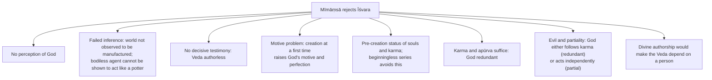

- **Consistency:** the Veda is authoritative because impersonal, not because God-authored. Atheism here means denial of creator and fruit-dispenser, **not** of the Veda or of ritual devatās.
- Nyāya/Vedānta objection: karma is unconscious and cannot allot fruits; need **karmaphaladātṛ**. Reply: beginningless series; apūrva; God would be redundant or unjust. ⚠️ Residual: critics find unconscious apūrva less intelligible than a conscious Īśvara.
- Devatās: largely mantra-denoted; the fruit comes from act plus apūrva, not the deity's pleasure; example: offering to Agni. ❓ Later traditions sometimes soften the anti-theistic edge.

---

## 6. Explanatory & Causal Principles

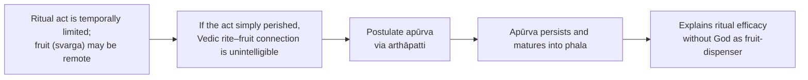

- Beginningless karmic series; moral order self-regulating through action, merit, demerit and apūrva.
- Objection: apūrva is ad hoc and unverifiable → postulated by arthāpatti as the necessary link; less burdensome than an omniscient divine manager. Advanced ⚠️: stronger reading (real unseen potency) vs restrained reading (names the normative-causal continuity required by Vedic action).
- Compare causation across schools in `_themes/Causation-across-schools.md` (linked by the owner).

### 6.1 Error theories (shell-silver) ✅ — 2022 Q7(a), 2026 Q7(a)

| Theory | School | Shell-silver explained | Status of "silver" |
|---|---|---|---|
| **Akhyāti / Vivekākhyāti** | Prābhākara | Two valid cognitions not discriminated | No false silver at all |
| **Viparīta-khyāti** | Bhāṭṭa | Shell positively miscognised as silver | Really wrong identification |
| **Anyathākhyāti** | Nyāya | Real silver elsewhere presented wrongly here | Real but displaced |
| **Anirvacanīya-khyāti** | Advaita | Neither real nor unreal | Indescribable |

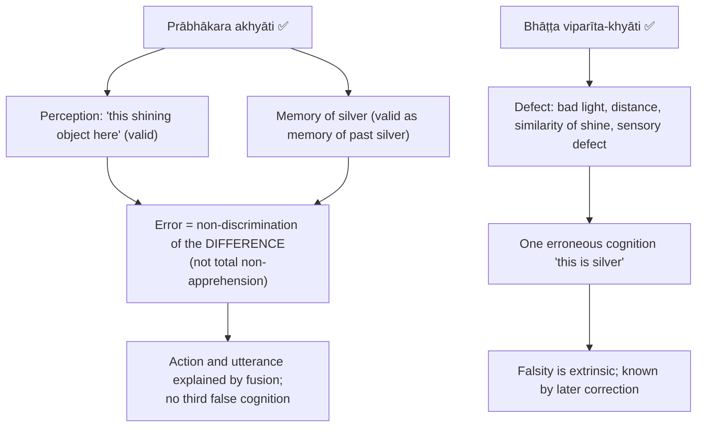

- Both preserve svataḥ-prāmāṇya: Prābhākara protects every constituent cognition; Bhāṭṭa protects the principle governing normal cognition.
- ⚠️ "Valid memory" = accurately preserves past silver; not a pramāṇa for silver here and now.
- **2026 Q7(a) — Nyāya anyathākhyāti attack:** the person judges "this is silver" and reaches for it; how can two valid episodes plus missing discrimination cause an assertoric false attribution without admitting the erroneous synthesis? Nyāya: real silver known elsewhere presented here via memory-mediated extraordinary perception (**jñānalakṣaṇa**). Prābhākara reply: failure to mark memory as memory. ⚠️ Residual: can non-discrimination alone bear the force of "this is silver"? Distinguish Bhāṭṭa's viparīta-khyāti from Nyāya's displaced real silver.

---

## 7. Ethics & Human Goals (Puruṣārthas)

> The owner file gives **no kāma / artha / dharma / mokṣa hierarchy** for Mīmāṃsā; it supplies "minimum context" on duty, injunction and motivation, recorded here. Dharma is central.

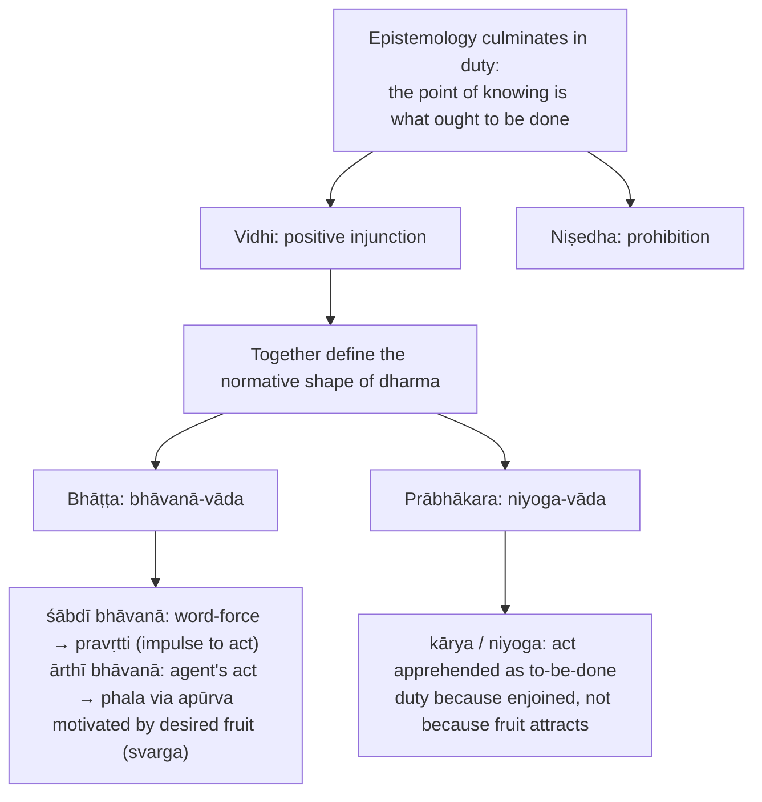

| Bhāvanā | Sādhya / bhāvya (*kim?*) | Karaṇa (*kena?*) | Itikartavyatā (*katham?*) |
|---|---|---|---|
| **Ārthī** in "svargakāmo yajeta" | Svarga | Yāga (sacrifice) | Procedure, materials, sequence, subsidiaries |
| **Śābdī** in the same injunction | Agent's pravṛtti | Injunctive suffix and knowledge of the injunction | Arthavāda and eulogistic supports |

- **Aṃśa-traya** = sādhya/bhāvya, karaṇa/sādhana, itikartavyatā: every bhāvanā requires all three.
- Bhāvanā = efficient force of bringing something into being, expressed by the verbal ending; imperative force carried by the **liṅ / vidhi** form, autpattika relation, so obligation is impersonal.
- **Adhikārin** = qualified agent. Prābhākara reply to "why act without fruit-desire": cognition of the act as enjoined is itself action-guiding.
- ⚠️ **Western flag:** niyoga compared cautiously with Kant's categorical imperative (duty apart from consequences), but niyoga rests on an impersonal eternal Veda and ritually qualified agents; Bhāṭṭa/Prābhākara contrast anticipates deontology vs consequentialism.
- Objection: without God there is no moral authority → vidhi and apūrva secure binding duty and future fruit; vidhi is the lawgiving structure.

---

## 8. Inter-School Comparative Matrices

### 8.1 Bhāṭṭa vs Prābhākara master table ✅

| Issue | Bhāṭṭa | Prābhākara |
|---|---|---|
| Pramāṇas | Six (incl. anupalabdhi) | Five |
| Absence | Abhāva real; anupalabdhi | Perception of bare locus; no separate pramāṇa |
| Error | Viparīta-khyāti | Akhyāti / vivekākhyāti |
| Self-luminosity of cognition | Denied; jñātatā → inference | Affirmed; tripuṭī-saṃvit |
| Self | Enduring; cognition known mediately | Enduring; disclosed with object and cognition in each awareness |
| Sentence meaning | Abhihitānvayavāda | Anvitābhidhānavāda |
| Injunction | Bhāvanā-vāda (śābdī / ārthī) | Niyoga-vāda |
| Arthavāda | Subordinate to vidhi by eka-vākyatā | Also subordinate, stronger direct obligation |
| Motivation | Desire for fruit (svarga) | Command itself |
| Liberation ❓ | Cessation of suffering / karmic embodiment, ritual-epistemic framework | Less central than epistemology and duty |

### 8.2 Self-luminosity and intrinsic validity (2018 Q8(a)) ✅/⚠️

| School | Self-luminous? | Validity intrinsic? | Consequence |
|---|---|---|---|
| Nyāya | No (anuvyavasāya) | No (parataḥ) | Accepts neither |
| Prābhākara | Yes | Yes | Connects both |
| Bhāṭṭa | No (jñātatā) | Yes | Counterexample to **validity → luminosity** |
| Advaita | Yes, of consciousness itself | Prima facie until sublated | Connects within wider non-dual theory |

> [!WARNING]
> Kumārila's combination disproves only "intrinsic validity **requires** self-luminosity" (the converse). For the direction actually asked, **luminosity → validity**, argue logical non-entailment: self-manifestation reports that awareness **occurs**, not that its object **is as presented**; an erroneous presentation can be conscious without being true. Nyāya's position is **not** "self-luminous but extrinsically valid"; it denies self-luminosity. Do not claim a historical school that affirms luminosity and denies intrinsic validity.

### 8.3 Inter-school positioning ✅

| School | Pramāṇas | Validity | Error | Veda | God | Efficacy | Liberation |
|---|---|---|---|---|---|---|---|
| **Mīmāṃsā** | 5 / 6 | Intrinsic; invalidity extrinsic | Akhyāti / viparīta-khyāti | Apauruṣeya, self-valid for dharma | Rejects creator / fruit-dispenser | Apūrva; beginningless karma | ❓ Cessation of pain / embodiment |
| Nyāya–Vaiśeṣika | Usually 4 | Generally extrinsic | Anyathākhyāti | Valid through reliable āpta, often Īśvara | Theistic in developed Nyāya | God orders atoms and karma | Cessation of pain through true knowledge |
| Sāṃkhya–Yoga | Typically 3 | Often intrinsic validity and invalidity | ⚠️ Misidentification of puruṣa and prakṛti | Testimony accepted, ritualism not central | Sāṃkhya non-theistic; Yoga admits Īśvara | Satkāryavāda | Kaivalya |
| Advaita | Usually 6 | ⚠️ Valid until sublated | Anirvacanīya-khyāti | Upaniṣads reveal Brahman as siddha-vastu | Īśvara at empirical level | Vivarta | Mokṣa through Brahman-knowledge |
| Viśiṣṭādvaita | Commonly perception, inference, scripture | Scripture and reason harmonised | ⚠️ Without radical indefinability | Divine revelation, theistically read | Nārāyaṇa / Brahman | Real transformation / body–soul relation | Release by grace plus knowledge / devotion |
| Buddhism | Often 2 | ⚠️ Linked to causal efficacy | Varied; apoha, momentariness | ❌ Rejects Vedic authority | ❌ | Dependent origination | Nirvāṇa |
| Jainism | Multiple, direct / indirect | ⚠️ Fallibilist pluralism | ⚠️ Partial standpoint absolutised | ❌ | ❌ | Karma as subtle matter | Purification and omniscience |
| Cārvāka | Perception alone | Empirical verification only | ⚠️ Exposes unreliability beyond perception | ❌ Human fabrication | ❌ | Material causation only | ❌ |

### 8.4 Mīmāṃsā vs Nyāya, Advaita, Buddhism/Sāṃkhya ✅

- **vs Nyāya:** intrinsic vs extrinsic validity (largest); independent arthāpatti vs reduction; independent anupalabdhi (Bhāṭṭa) vs denial; authorless Veda vs God's omniscience; jāti vs vyakti; anuvyavasāya.
- **vs Advaita:** injunction-centred vs liberation-centred; realist error vs anirvacanīya.
- **vs Buddhism:** resists validity derived from pragmatic success; illusion does not present itself as false. **vs Sāṃkhya:** shares intrinsic authority, but makes invalidity extrinsic and embeds epistemology in ritual hermeneutics.
- **vs Cārvāka:** see Module 3 and Module 9.

---

## 9. Criticisms & Reconstructed Replies

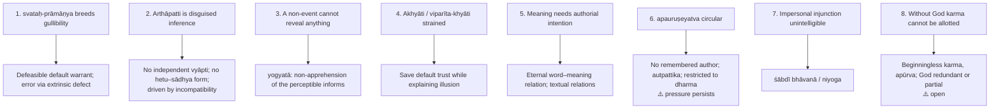

### 9.1 Pūrvapakṣa–siddhānta ledger ⚠️

| Objector | Objection | Mīmāṃsā reply | Residual force |
|---|---|---|---|
| Nyāya (parataḥ) | Validity needs external certification | Action presupposes prior trust; regress | How to distinguish default trust from gullibility |
| Nyāya (convention) | Word–meaning is saṅketa; God institutes it | Convention needs an institutor to be proved; autpattika explains stability | Naturalness of word-meaning contested |
| Nyāya (God as āpta) | Veda reliable because Īśvara is omniscient author | A personal author is a locus of defect; proving omniscience harder | Authorlessness may be less intelligible than a perfect speaker |
| Buddhist (Dharmakīrti) | Eternal word cannot cause timed cognition | Utterance manifests; timed cognition depends on manifestation and hearer | Causal status of "manifestation" |
| Buddhist (apoha) | Words function by exclusion | Stable instruction needs real universals | Challenges realist semantics |
| Buddhist (reliability) | No scripture intrinsically privileged | Veda self-valid for dharma, undefeated | Restriction of dharma to Vedic access disputed |
| Advaita | Siddha-vastu Upaniṣadic statements not subordinate to injunction | Vedic purposiveness is action-guiding | Seam between Pūrva and Uttara |
| Advaita (mokṣa) | Action cannot yield mokṣa | Central domain is dharma; liberation as cessation of pain | ❓ Historical development debated |
| Cārvāka | Apūrva, svarga, Veda unverifiable; Veda attacked as work of "knaves and buffoons" | Perception is not the only pramāṇa; supersensible dharma needs Vedic śabda | Empiricist challenge persists |
| Jaina / Bauddha | Omniscient teacher possible by purification | Kumārila: no sarvajña established by pramāṇa | Omniscience spiritually attained, not empirically ordinary |
| Vedāntic metaphysical charge | Eternity of language needs a ground | śabda-nityatva, autpattika relation | Names rather than proves |

### 9.2 Presupposition ledger ⚠️

| Doctrine | Presupposition | What collapses if denied |
|---|---|---|
| Svataḥ-prāmāṇya | Cognition normally discloses its object | Default trust, anti-regress, Vedic authority depend on an external validator |
| Parataḥ-aprāmāṇya | Error from detectable doṣa or bādhaka | Illusion indistinguishable from knowledge at birth |
| Pramāṇa list | Irreducibility | Arthāpatti, anupalabdhi collapse into inference / perception |
| Arthāpatti | Accepted facts can force a postulate | Devadatta reasoning and apūrva become conjecture |
| Anupalabdhi | Absence is a genuine object | Bhāṭṭa cannot explain determinate absence-cognition |
| Akhyāti | Perception and memory operate without discrimination | Prābhākara loses his way to keep svataḥ-prāmāṇya |
| Viparīta-khyāti | False cognition from extrinsic defect | Cannot explain assertive force of "this is silver" |
| Apauruṣeyatva | Authorless meaningful text possible | Veda depends on a fallible author |
| Śabda-nityatva | Words manifested, not created | Veda becomes a temporal composition |
| Bhāvanā / niyoga | Vedic meaning primarily action-guiding | Loses account of dharma through codanā |
| Apūrva | Unseen potency links act and remote fruit | Rite–svarga connection unintelligible |
| Nirīśvaravāda | Karma, apūrva, beginningless order suffice | Must import theism, compromise apauruṣeyatva |
| Eternal self | Same self acts and enjoys | Ritual responsibility collapses |
| Liberation | Bondage = embodiment, karma, suffering | ❓ Mīmāṃsā remains ritual-felicific only |

---

## 10. Controlled Western Comparisons

| Indian point | Western contact | Disanalogy |
|---|---|---|
| Prābhākara **niyoga** | Kant's categorical imperative separates duty from desired consequences | Kant: rational autonomy, universalisability; niyoga: heteronomous, from an impersonal eternal Veda, limited to the qualified adhikārin |
| **Svataḥ-prāmāṇya** | Epistemic conservatism, default entitlement, Reid's principle of credulity | Mīmāṃsā: thesis about the intrinsic validity-conferring character of cognition, not a mere practical trust policy |
| **Apauruṣeyatva** | Scriptural-inspiration doctrines | Western route often via a divine author; Mīmāṃsā excludes every author |
| **Abhihitānvaya / anvitābhidhāna** | Compositionality vs contextualism; Frege's context principle partly resembles anvitābhidhāna | Indian debate driven by Vedic exegesis, language learning, injunction |
| **Hermeneutic canons** (śruti–liṅga–vākya–prakaraṇa–sthāna–samākhyā; utsarga–apavāda) | Rule-governed legal interpretation | Presupposes an infallible authorless text; no amendment by legislative intention |
| **Mīmāṃsā atheism** | Non-theistic religion or impersonal normativity | Not secular humanism: defends Veda, ritual, apūrva, supersensible dharma |
| **Arthāpatti** | Resembles inference to the best explanation | Classical formulation is stronger: necessary, not merely best among options |

> [!WARNING]
> Western parallels are illustrative only; use one or two lines **after** the Mīmāṃsā case is complete.

---

## 11. Diagnostic Deep-Dives for High-Frequency Themes

### 11.1 "How do I know that I know?" (2024 Q8(a)) ✅

Name the problem → three theories (tripuṭī-saṃvit / jñātatā / anuvyavasāya; §2.7) → show how each avoids regress: Prābhākara by self-luminosity, Bhāṭṭa by inference from knownness, Nyāya by a single sufficient higher-order awareness.

### 11.2 Sentence meaning, 2024 Q5(d) and 2026 Q6(c) cross-link ✅

- 2024: Bhāṭṭa vs Prābhākara: begin with **ekavākyatā**, state shared conditions, contrast word-priority vs sentence-priority, add vyutpatti argument, abhidhā → connection structure, tātparya problem for an authorless Veda, rejection of sphoṭa. Conclusion: Bhāṭṭa secures stable lexical meaning; Prābhākara secures contextual action-guidance.
- 2026 Q6(c) asks **Naiyāyika vs Prābhākara** on śābdabodha: comparison owned by `Nyaya-Vaisesika.md` §3.6A; the Prābhākara half comes from Mīmāṃsā §8.2, §8.4.

### 11.3 Upamāna, 2026 Q8(a) cross-link ✅

Mīmāṃsā half from §3.7 (gavaya, similarity-cognition); comparison owned by `Nyaya-Vaisesika.md` §3.5A. Do not write Nyāya's word–object mechanism as the Mīmāṃsā definition.

### 11.4 Is Mīmāṃsā atheistic yet pro-Veda? ✅

Yes, if atheism means denial of a creator and fruit-dispenser. Principle: **the Veda is authoritative because it is impersonal, not because it is God-authored.** Nyāya secures the Veda through Īśvara; Mīmāṃsā by excluding any author. Qualify: ritual devatās remain within the sacrificial structure.

---

## 12. PYQ Routing Ledger (2018–2026)

> Corpus signal: **14** primary-owned parts of 112 in 2018–2025, present in every year; plus **1** primary part in the 2026 supplement (Q7(a)). 2026 Q6(c) and Q8(a) are Nyāya-owned cross-links, not Mīmāṃsā-primary.

| Year | Q | Marks | Exact demand | Map to |
|---|---|---:|---|---|
| 2018 | Q8(a) | 20 | Does the admission of Svayaṃprakāśavāda necessarily lead to the admission of Svataḥprāmāṇyavāda? Discuss after the Naiyāyikas, the Mīmāṃsakas and the Advaita Vedāntins. | §8.2 |
| 2019 | Q5(e) | 10 | How does Mīmāṃsā establish the authority of Vedic knowledge? | §5.1 |
| 2020 | Q5(c) | 10 | Why is memory not a valid knowledge according to Mīmāṃsā? | §2.3 |
| 2021 | Q6(c) | 15 | What, according to Mīmāṃsakas, is the ontological status of abhāva (absence) and how does one know it? Explain and examine. | §2.5 |
| 2022 | Q6(c) | 15 | How do Mīmāṃsakas refute the Nyāya view that Implication (arthāpatti) is reducible to Inference (anumāna) and establish Implication as an independent means of valid knowledge (pramāṇa)? Critically discuss. | §2.4 |
| 2022 | Q7(a) | 20 | Inspite of accepting the intrinsic validity of knowledge, why and how Prabhākara and Kumārila differ in their interpretation of erroneous cognition? Discuss. | §6.1 |
| 2023 | Q6(b) | 15 | Present Bhaṭṭa's view of anupalabdhi (non-cognition) as a valid means of knowledge. | §2.5 |
| 2023 | Q8(c) | 15 | Do words refer to universals or particulars or both? Present an exposition of Nyāya and Mīmāṃsā position with regard to above question along with suitable examples. | §4.2 |
| 2024 | Q5(d) | 10 | How does Bhaṭṭa's view of nature of word-meaning and sentential-meaning differ from Prabhākara's view? Critically discuss. | §4.2, §11.2 |
| 2024 | Q8(a) | 20 | How do I know that I know? Answer this question with reference to the Naiyāyikas, the Bhaṭṭa Mīmāṃsakas and the Prābhākaras. | §2.7, §11.1 |
| 2024 | Q8(b) | 15 | "A candidate who is never seen to be studying during the day time secures a high position in a competitive exam." How would the Bhaṭṭa Mīmāṃsakas and the Naiyāyikas explain the success of this candidate? Discuss. | §2.4 |
| 2024 | Q8(c) | 15 | On what grounds do the Prābhākaras and the Naiyāyikas reject memory as a source of knowledge? Discuss. | §2.3 |
| 2025 | Q5(c) | 10 | Delineate the main points of difference between the theory of intrinsic validation (svataḥ prāmāṇyavāda) and theory of extrinsic validation (parataḥ prāmāṇyavāda) in classical Indian philosophy. | §2.1 |
| 2025 | Q6(c) | 15 | Discuss the debate between the Bhaṭṭa and the Prabhākara mīmāṃsakas with reference to the nature of Non-existence (Abhāva) and its knowledge. | §2.5 |
| 2026 | Q7(a) | 20 | Critically explain the arguments presented by the Akhyativadins for explaining erroneous cognition. Evaluate the arguments against Akhyativadins by the Anyathakhyativadins. | §6.1 (primary) |
| 2026 | Q6(c) | 15 | How is the Naiyayikas' view on Sabdabodha different from that of the Prabhakara Mimamsakas? Discuss. | cross-owned (§4.2, §11.2) |
| 2026 | Q8(a) | 20 | Present an account of Upamana as an instrument of knowledge. How is the Nyaya view different from the Mimamsa view? | cross-owned (§2.2, §11.3) |

Ownership count: 14 (2018–2025) + 1 (2026) = **15 primary**; 2 cross-owned.

---

## 13. Top 10 UPSC Exam Traps

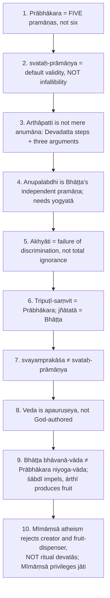

The owner file's full list also warns: Nyāya is the chief opponent on prāmāṇya; viparīta-khyāti allows false cognition but ties falsity to defect; apūrva is the unseen link between ritual and fruit; arthavāda, mantra and nāmadheya gain relevance through vidhi; apauruṣeyatva is defended by reasoning plus absence of remembered author, not by inventing a hidden author.

---

## 14. Technical Vocabulary & IAST Bank

| English gloss | IAST | Meaning | Status |
|---|---|---|---|
| Inquiry into dharma | dharma-jijñāsā | Governing orientation | ✅ |
| Injunction / command | codanā / vidhi | Reveals dharma | ✅ |
| Intrinsic validity | svataḥ-prāmāṇya | Default validity, not infallibility | ✅ |
| Extrinsic validity | parataḥ-prāmāṇya | Nyāya | ✅ |
| Practical success; confirming perception | pravṛtti-sāmarthya; saṃvādi-pratyakṣa | Nyāya verification | ✅ |
| Postulation; incompatibility | arthāpatti; anupapatti | Independent pramāṇa | ✅ |
| Non-cognition; fit non-cognition | anupalabdhi; yogyānupalabdhi | Bhāṭṭa | ✅ |
| Absence; counterpositive | abhāva; pratiyogin | | ✅ |
| Non-discrimination | akhyāti / vivekākhyāti | Prābhākara error | ✅ |
| Contrary apprehension | viparīta-khyāti | Bhāṭṭa error | ✅ |
| Self-luminosity | svaprakāśa / svayaṃprakāśa | | ✅ |
| Triple awareness | tripuṭī-saṃvit | Knower, known, knowing | ✅ |
| Knownness | jñātatā | Bhāṭṭa | ✅ |
| Second-order cognition | anuvyavasāya | Nyāya | ✅ |
| Connection of the already denoted | abhihitānvayavāda | Bhāṭṭa | ✅ |
| Denotation of the connected | anvitābhidhānavāda | Prābhākara | ✅ |
| Expectancy; fitness; proximity | ākāṅkṣā; yogyatā; sannidhi | Sentence conditions | ✅ |
| Universal; individual | jāti; vyakti | | ✅ |
| Authorlessness | apauruṣeyatva | | ✅ |
| Eternality of word | śabda-nityatva | | ✅ |
| Natural (word–meaning) | autpattika | vs saṅketa (convention) | ✅ |
| Unseen potency | apūrva | Rite → fruit | ✅ |
| Obligation | niyoga; kārya | Prābhākara | ✅ |
| Productive force | bhāvanā; śābdī / ārthī | Bhāṭṭa | ✅ |
| Three factors | aṃśa-traya: sādhya/bhāvya, karaṇa/sādhana, itikartavyatā | | ✅ |
| Unity of sentence-function | eka-vākyatā | Arthavāda subordinate | ✅ |
| Explanatory passage | arthavāda | | ✅ |
| Non-theism | nirīśvaravāda | | ✅ |
| Giver of karmic fruits | karmaphaladātṛ | Rejected | ✅ |
| Accomplished fact | siddha-vastu | Advaita | ✅ |
| Trustworthy authority | āpta | Nyāya | ✅ |
| Omniscient | sarvajña | Denied by Kumārila | ✅ |
| Qualified agent | adhikārin | | ✅ |
| Defect; sublater | doṣa; bādhaka | | ✅ |
| Indivisible sentence-meaning | vākya-sphoṭa | Grammarian; rejected | ⚠️ |
| Novelty | anadhigatatva | Memory lacks it | ✅ |
| Liberation | mokṣa | Later, cautious | ❓ |

---

## 15. Graded Verdict & Answer Architectures

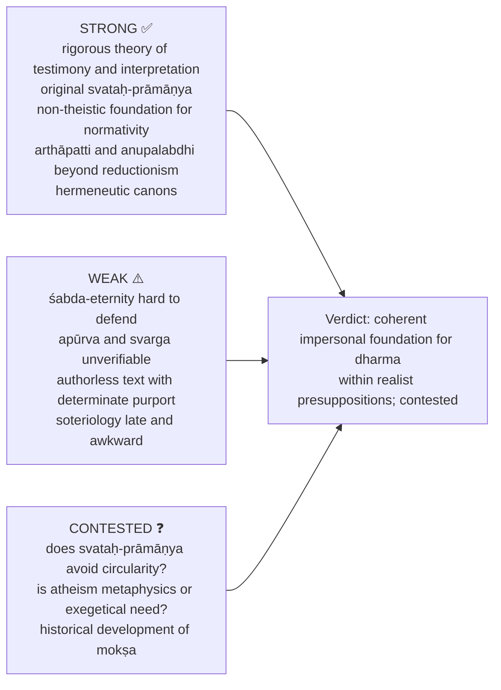

### 15.1 10-mark / 15-mark / 20-mark

```text
10: Define the doctrine. State its structure in 3–4 points. Add one contrast. Close with one evaluative line.
15: Frame the problem. Definition + argument structure. Objection and reply.
    Contrast with one rival. Conclude with Mīmāṃsā's distinctiveness.
20: Frame the issue. Full exposition. State presuppositions. Rival view.
    Objections and replies. End with a graded verdict.
```

**Anchors ✅.**
- **10 marks:** "Mīmāṃsā is strongest as a theory of intrinsic validity and Vedic testimony, but it must be stated as defeasible default validity, not infallibility."
- **15 marks:** "Mīmāṃsā's originality lies in linking epistemology, hermeneutics and duty; its weakness lies in the contested assumptions of eternal language and apūrva."
- **20 marks:** "A balanced verdict is that Mīmāṃsā gives a coherent impersonal foundation for dharma and testimony within its realist presuppositions, but Nyāya, Buddhist and Vedāntic objections keep its language-eternity, authorlessness and ritual causality philosophically contested."

### 15.2 Directive decoder ⚠️

| Directive | Move | Closing verdict |
|---|---|---|
| Discuss | Doctrine, arguments, rival and reply | "Thus the doctrine is defensible within Mīmāṃsā's assumptions, though contested by..." |
| Examine | Statement, premises, example, objection | "Its force depends on accepting..." |
| Critically examine | Mīmāṃsā, then Nyāya / Buddhist / Advaita challenge, then residual force | "The reply works partly, but the pressure remains at..." |
| Analyse | Tables: pramāṇa structure, aṃśa-traya, sentence conditions | "The analysis shows that..." |
| Evaluate | Strengths, weaknesses, weighed verdict | "Stronger as epistemology / hermeneutics than as metaphysics of..." |
| Compare / Distinguish | Bhāṭṭa vs Prābhākara or Mīmāṃsā vs Nyāya columns; define terms first | "The shared problem is..., the decisive difference is..." |
| Elucidate | Definition, unpack the Sanskrit term, use Devadatta / shell-silver / svarga | "This elucidates the doctrine as..." |
| Do you agree? | Agree partly with doctrine, qualify with objections | "I agree within the Mīmāṃsā framework, but not as a neutral proof against all rivals." |

### 15.3 Specific spines recorded in the sources

- **Error (20):** state shell-silver, then say exactly how each school preserves svataḥ-prāmāṇya.
- **Sentence meaning (20):** ekavākyatā → shared conditions → word-priority vs sentence-priority → vyutpatti and abhidhā → tātparya problem → sphoṭa → conclusion.
- **Arthāpatti:** Devadatta steps + three arguments against reduction + one Nyāya reduction with circularity reply.
- **Anupalabdhi:** decisive phrase: "non-perception of what would be perceived if present"; always contrast with Prābhākara and Nyāya.
- **Bhāvanā:** connect vidhi, aṃśa-traya, arthavāda-subordination, apūrva and the Vedānta dispute.

> [!NOTE]
> **Advanced optional depth (dossier §7).** Apūrva as non-theistic bridge; injunction-centred language (Veda authoritative mainly because it issues uniquely action-guiding injunctions); Mīmāṃsā as anti-sceptical default trust. Use only in the final evaluative paragraph. Do not over-study exhaustive vidhi/arthavāda taxonomies or ritual minutiae. Source trail: Jaimini, Śabara, Kumārila, Prabhākara; K. Kunhan Raja; J.N. Mohanty.

---

## Sources

Jaimini, *Mīmāṃsā-sūtra*; Śabara, *Śābara-bhāṣya*; Kumārila Bhaṭṭa, *Ślokavārttika* (and *Tantravārttika*); Prabhākara Miśra, *Bṛhatī*; S. Chatterjee and D. Datta, *An Introduction to Indian Philosophy*; C.D. Sharma, *A Critical Survey of Indian Philosophy*; S. Radhakrishnan, *Indian Philosophy* Vol. II; K. Kunhan Raja and J.N. Mohanty (advanced dossier trail).
