# SCHOOLS OF VEDĀNTA — Examiner-Grade Mindmap

> **Syllabus (verbatim):** Schools of Vedanta : Brahman; Isvara; Atman; Jiva; Jagat; Maya; Avida; Adhyasa; Moksa; Aprthaksiddhi; Pancavidhabheda.
> **Catalogue key:** `philosophy-paper-i-indian-philosophy-08` · Paper I · Indian Philosophy
> **Sources used:** `paper-1/indian/Vedanta.md` (canonical owner) · `_advanced/Indian-Philosophy-Dossier.md` §8 (optional depth) · `paper-1/_PYQ-Indian-Philosophy-2018-2025.md` · `paper-1/_PYQ-Indian-Philosophy-2026.md`.
> **Evidence key:** ✅ canonical doctrine · ⚠️ analytical synthesis · ❓ contested / uncertain

> [!IMPORTANT]
> **Core thesis.** Every Vedāntic dispute turns on whether difference is appearance, qualification or ultimate fact. Advaita resolves plurality by sublation, Viśiṣṭādvaita by inseparability, Dvaita by eternal difference. Identify the school the question names and answer its demand first; the three-school grid is a guide, not a replacement for a Nimbārka or four-school question. ⚠️

---

## 0. Master Overview

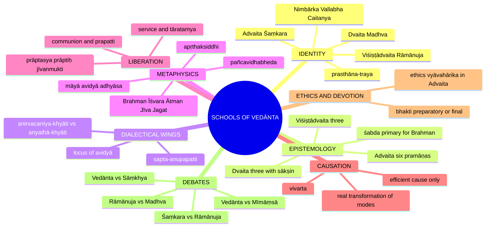

### 0.1 One-screen map ✅

```text
VEDĀNTA CORE QUESTION: How are Brahman, Īśvara, Ātman, Jīva and Jagat related?

┌──────────────────────┬────────────────────────────────┬────────────────────────────┐
│ ADVAITA (Śaṃkara)    │ VIŚIṢṬĀDVAITA (Rāmānuja)       │ DVAITA (Madhva)            │
├──────────────────────┼────────────────────────────────┼────────────────────────────┤
│ Brahman alone        │ Brahman qualified by cit       │ Viṣṇu alone independent    │
│ pāramārthika real    │ and acit                       │ (svatantra)                │
│ Nirguṇa ultimate     │ Saguṇa only, no level above    │ Saguṇa only                │
│ Īśvara = māyā-       │ Īśvara = Brahman with infinite │ Īśvara = supreme Viṣṇu,    │
│ conditioned Brahman  │ auspicious qualities           │ distinct from souls, matter│
│ Ātman = Brahman      │ Ātman real, aṇu, inseparable   │ Ātman real, dependent,     │
│ in essence           │ mode                           │ eternally different        │
│ Jagat = vivarta,     │ Jagat real, Brahman's body,    │ Jagat real, distinct       │
│ mithyā not tuccha    │ pariṇāma of prakṛti            │ from God                   │
│ Mokṣa = jñāna,       │ Mokṣa = bhakti/prapatti,       │ Mokṣa = grace, service,    │
│ jīvanmukti           │ communion not identity         │ tāratamya                  │
└──────────────────────┴────────────────────────────────┴────────────────────────────┘
```

---

## 1. Identity, Lineage & Doxography

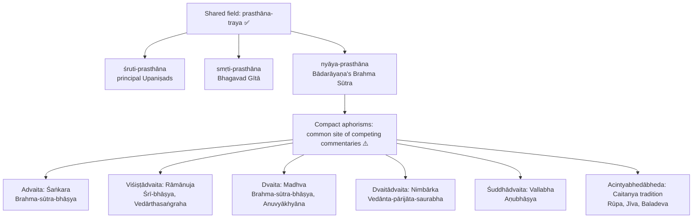

| School | Foundational teacher and texts | Root relation |
|---|---|---|
| Non-dualism (**Advaita**) | Śaṅkara's *Brahma-sūtra-bhāṣya*, Upaniṣad/Gītā commentaries | identity; difference is ignorance-conditioned appearance |
| Qualified non-dualism (**Viśiṣṭādvaita**) | Rāmānuja's *Śrī-bhāṣya*, *Vedārthasaṅgraha*, Gītā commentary | real selves/world inseparably qualify Brahman |
| Dualism (**Dvaita**) | Madhva's *Brahma-sūtra-bhāṣya*, *Anuvyākhyāna*, Gītā commentary | God, selves, matter really different; only God independent |
| Dualistic non-dualism (**Dvaitādvaita**) | Nimbārka's *Vedānta-pārijāta-saurabha* | real difference and non-difference through dependence |
| Pure non-dualism (**Śuddhādvaita**) | Vallabha's *Aṇubhāṣya*, Bhāgavata-centred works | world is a real unchanged manifestation of Brahman |
| Inconceivable difference–non-difference (**Acintyabhedābheda**) | Caitanya tradition: Rūpa, Jīva, Baladeva | real difference and non-difference through divine powers |

- ⚠️ The printed clause names doctrines, not a closed list of philosophers, yet verified PYQs require Nimbārka, Vallabha and the Caitanya tradition. The "big three" are the comparative spine, **not** the whole examinable taxonomy.
- ✅ **Pūrva-Mīmāṃsā** owns the injunction-centred reading of the earlier Veda; **Vedānta** owns the Brahman-centred reading of the Upaniṣads.
- ⚠️ Brahma Sūtra does not contain every later school-formulation ready-made.
- ❓ Other doctrinal positions appearing in the owner file: **Bhāskara (bhedābheda)** — world is a real transformation of Brahman, māyā unnecessary, knowledge integrated with action stressed (see §8).

---

## 2. Theory of Knowledge (Epistemology)

### 2.1 Advaita's six pramāṇas ✅

| Pramāṇa | Definition | Example |
|---|---|---|
| **Pratyakṣa** (perception) | Immediate cognition from sense-contact with a present object | "This pot is blue." |
| **Anumāna** (inference) | Knowledge of unperceived fact via mark (**liṅga**) and **vyāpti** | Smoke on hill → fire |
| **Upamāna** (comparison) | Fresh cognition of an absent familiar object's similarity to a perceived one (Bhāṭṭa account) | Gavaya seen as cow-like → remembered cow similar to it |
| **Śabda** (verbal testimony) | Valid cognition from reliable words, supremely the **apauruṣeya** Veda | Upaniṣadic mahāvākya teaches Ātman–Brahman identity |
| **Arthāpatti** (postulation) | Presuming an unseen fact to reconcile known incompatibles | Fat Devadatta who does not eat by day eats at night |
| **Anupalabdhi** (non-apprehension) | Cognition of absence by non-perception under proper conditions | "No pot on the floor" |

### 2.2 Two-level qualification ✅/⚠️

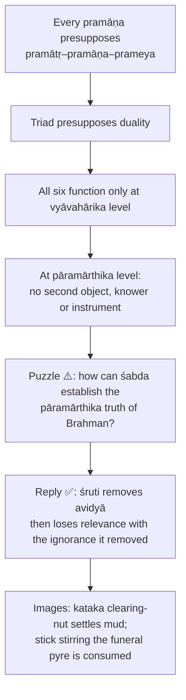

### 2.3 Why śabda is primary for Brahman ✅

- **Pratyakṣa** cannot reach Brahman: nirguṇa, non-objectifiable.
- **Anumāna** needs a perceived vyāpti and present liṅga: no perceived instance of Brahman and no mark uniquely co-present. Inference would make Brahman an inferred *prameya*, contradicting its status as the non-objective ground of all knowing ⚠️.
- Hence Śaṃkara treats Brahman as **śāstra-yoni / śāstra-pramāṇaka**.
- **Upamāna, arthāpatti, anupalabdhi** are derivative or empirically parasitic.
- Only śabda, specifically the mahāvākyas **tat tvam asi, ahaṃ brahmāsmi, prajñānaṃ brahma, ayam ātmā brahma**, generates the liberating knowledge.

### 2.4 Mahāvākya semantics (2023 Q5(c)) ✅

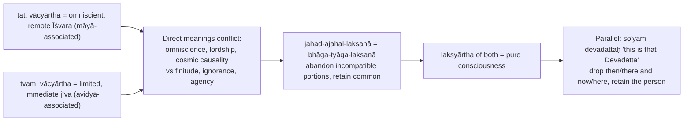

- Identity at the level of **essence**, not crude sameness of empirical conditions.
- Viśiṣṭādvaita and Dvaita reject this identity-reading: mahāvākyas indicate dependence, participation or special relation. ⚠️
- **Textual caution:** "Brahma satyam jaganmithyā, Jīvo Brahmaiva nāparaḥ" is a traditional Advaita summary used in the 2022 PYQ, not one of the four standard Upaniṣadic mahāvākyas.

### 2.5 Fault-line with Pūrva-Mīmāṃsā ✅

| Pūrva-Mīmāṃsā | Advaita |
|---|---|
| Vedic authority is primarily for **vidhi** (injunction) concerning dharma; accomplished-fact statements subordinate to ritual action | Upaniṣadic **siddha-vastu** (accomplished reality) statements are independently and supremely valid |
| Objection: if Veda is for action, how can a statement of identity liberate? | Reply: bondage is ignorance, not absence of ritual; jñāna is not **kārya** (action) but cognition of what already is |

### 2.6 Three-school contrast on pramāṇa ✅/❓

| School | Count | Pramāṇas | Consequence |
|---|---:|---|---|
| **Advaita** | 6 | pratyakṣa, anumāna, upamāna, śabda, arthāpatti, anupalabdhi | Wide empirical epistemology; śabda alone reveals non-objective Brahman then is sublated |
| **Viśiṣṭādvaita** | 3 | pratyakṣa, anumāna, śabda | Accepts **nirvikalpaka** pratyakṣa but reinterprets it: first cognition of an individual already apprehended with structure (**saṃsthāna**); savikalpaka is later cognition recognising the recurring generic character. Rejects cognition of a **wholly qualifierless (nirviśeṣa) object**: *sarvaṃ vijñānaṃ saviśeṣam* |
| **Dvaita** | 3 | pratyakṣa, anumāna, āgama | Special weight to āgama; **kevala-pramāṇa / anu-pramāṇa** distinction ❓ (expositions vary); **sākṣin** as ultimate internal validator |

> [!TIP]
> A school's pramāṇa count tracks its metaphysics: Advaita needs śabda for the non-objective absolute; Viśiṣṭādvaita's qualified realism requires all cognition to be qualified; Dvaita's realist theism requires pramāṇas to secure real difference.

### 2.7 Error theories (khyāti) ✅

| Theory | School | Content |
|---|---|---|
| **Anirvacanīya-khyāti** | Advaita | Presented silver is neither real nor unreal; indescribable |
| **Satkhyāti** | Rāmānuja | Cognition is always of the real; error mistakes one real for another; via pañcīkaraṇa / trivṛtkaraṇa every object has a portion of every element, so a real silver-element in the shell is misapprehended |
| **Anyathā-khyāti** | Nyāya (rival) | Real silver elsewhere is apprehended in the wrong locus |
| **Asat-khyāti** | Buddhist (rival) | Rejected by Advaita because illusory silver appears, though later sublated |
| **Abhinava-anyathā-khyāti** | Madhva | A third route, tied to pañcavidhabheda (named in the owner file; no further detail given) |

---

## 3. Dialectical Wings & Sceptical Refinements

### 3.1 Rāmānuja's sapta-anupapatti against māyāvāda (2025 Q5(d), 2018 Q7(c)) ✅

> ❓ Exact names and sequence vary slightly across presentations; this is the standard exam list.

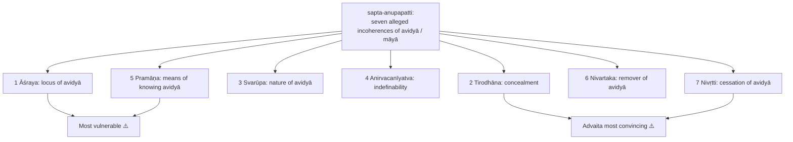

| # | Objection | Advaita reply | Residual force ⚠️ |
|---|---|---|---|
| 1 **Āśraya** | If in Brahman, Brahman is no longer pure consciousness; if in jīva, jīva is itself a product of avidyā: **anyonyāśraya** (mutual dependence) | **Vivaraṇa:** Brahman is āśraya without modification. **Bhāmatī:** avidyā in the jīva, with beginninglessness (**anāditva**); seed–sprout dependence is not vicious regress | Two sub-school strategies give Rāmānuja a strong opening |
| 2 **Tirodhāna** | Brahman is **svayaṃ-prakāśa**; to conceal it destroys its nature | Avidyā conceals Brahman as recognised by the jīva, not Brahman-as-such. Cloud does not extinguish the sun, it obstructs the viewer | How can any obstruction arise when Brahman alone is ultimately real? |
| 3 **Svarūpa** | Neither real nor unreal is incoherent | sat/asat/anirvacanīya: experienced so not asat; sublated so not sat | Works only if sublatability is accepted as criterion of degrees of reality; realists deny it |
| 4 **Anirvacanīyatva** | Whatever exists is real or unreal; a third category is refusal to answer | Contrast is between ontological grades measured by sublatability. Tu quoque: Rāmānuja's real-but-dependent **acit** is also neither independent nor non-being | Rāmānuja and Madhva call it verbal unless independently grounded by pramāṇa |
| 5 **Pramāṇa** | Perception gives an object, not positive ignorance; inference lacks a mark; scripture does not teach a positive indefinable entity | **Sākṣi-pratyakṣa** ("I do not know"), **arthāpatti** (if knowledge removes bondage, something positive is removed), śruti on māyā/avidyā | "I do not know" reports absence of knowledge, not a mysterious positive entity |
| 6 **Nivartaka** | Nirguṇa knowledge is contentless; determinate knowledge is itself within avidyā | **Akhaṇḍākāra-vṛtti** (undivided-form mental mode) from the mahāvākya sublates limiting adjuncts, then subsides like the stick consumed in the fire it stirs | How can a mode within vyavahāra terminate vyavahāra? |
| 7 **Nivṛtti** | If avidyā is real it cannot be removed; if unreal nothing to remove; status of cessation obscure | Nivṛtti is not a fifth entity: it is Brahman remaining as it always was. Where did the snake go when the rope was recognised? | Elegant if adhyāsa is accepted; question-begging otherwise |

**Philosophical force ⚠️.** Seven objections attack three levels: **status** of avidyā, **possibility** of concealment and projection, **coherence** of liberation as removal of ignorance. They are a systematic attack on the explanatory cost of making the world anirvacanīya.

### 3.2 Locus of avidyā and Advaita internal models (advanced) ⚠️

| Optional module | Issue | Readings | Objection → reply |
|---|---|---|---|
| Locus of avidyā | Does avidyā belong to jīva, to Brahman in a qualified sense, or neither? | **Bhāmatī** (Vācaspati Miśra): jīva-locus. **Vivaraṇa** (Prakāśātman, *Pañcapādikā-vivaraṇa*): Brahman-associated | If Brahman is pure consciousness ignorance cannot belong to it; if jīva is ignorance-produced it cannot ground ignorance. Later Advaitins treat it as a post-experiential explanatory problem |
| Beyond one jīva-model | Pratibimba vs avaccheda vs ābhāsa | Each preserves non-duality while explaining individuality | Multiple models show instability? Read as pedagogic metaphors |
| Madhva's hierarchy | Pañcabheda alone, or graded ontology of souls plus differentiated liberation? | Minimal reading: pañcabheda; fuller: tāratamya | Graded souls compromise moral universality; sharpest normative difficulty in Dvaita |
| Later Vedānta | Appendices or live alternatives? | Nimbārka, Vallabha, Caitanya as options on world-status and mokṣa | Mention only when a PYQ opens the door |

**Śrīharṣa ✅.** In the *Khaṇḍanakhaṇḍakhādya* his strategy is dialectical, not constructive: he refuses to supply a positive definition of the real and shows that the opponent's definitions of "real" fail. (This is the owner file's only mention of Śrīharṣa.)

**Pracchanna-bauddha charge ⚠️.** Advaita is accused of crypto-Buddhism for denying ultimate reality of the world. Reply: Brahman is positive self-luminous reality, unlike śūnyatā as absence of svabhāva, and Advaita accepts śruti.

---

## 4. Metaphysics & Ontology

### 4.1 Brahman ✅

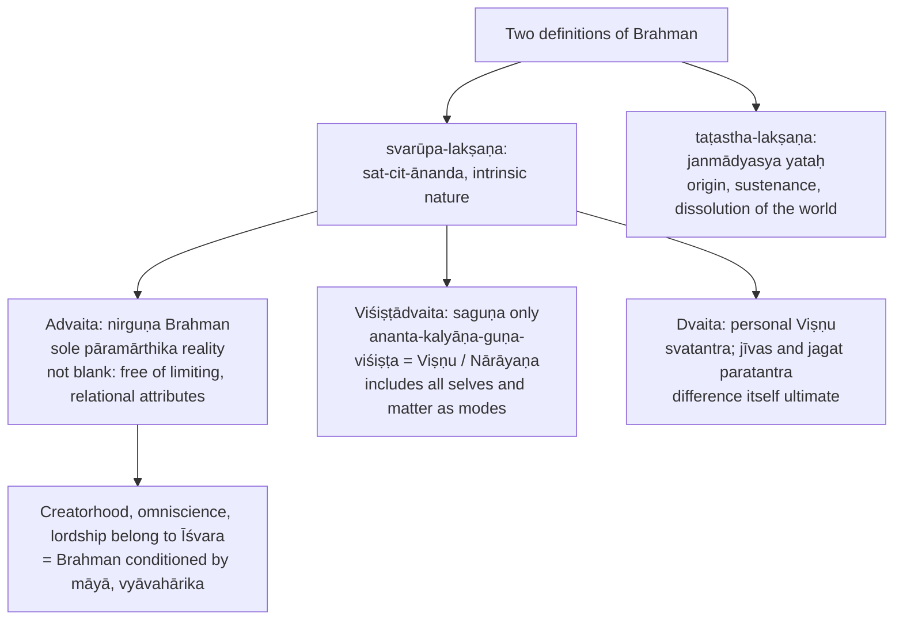

> [!WARNING]
> Do not write "Rāmānuja accepts both nirguṇa and saguṇa Brahman." Nirguṇa ≠ blank nothingness: sat-cit-ānanda is Brahman's svarūpa, not accidental predicates.

### 4.2 Brahman as nimitta- and upādāna-kāraṇa (2025 Q6(b)) ✅/⚠️

| School | Efficient cause | Material cause | Nature of causation |
|---|---|---|---|
| **Advaita** | Brahman as Īśvara (māyā-conditioned), intelligent orderer of names and forms | Brahman as **non-separable substratum**; later Advaita calls māyā the dependent changing seed/material, not a second independent ultimate | **Vivarta**: no real change in Brahman. Spider/web = intelligence and non-separateness, **not** literal extraction of real thread; rope–snake = unmodified substratum and sublatable appearance, **not** an intelligent maker |
| **Viśiṣṭādvaita** | Brahman | Brahman, through real modes (subtle → gross) | **Real** causation; change belongs to dependent non-conscious mode, not God's essential auspicious nature |
| **Dvaita** | God only | Dependent primordial **prakṛti**, energized and governed by God | God, souls, matter eternally different |

⚠️ A realist can object that a substratum of appearance is not "material cause" in the ordinary sense: do not hide this by citing only the spider.

**Contrast with other systems ✅.** Sāṃkhya: prakṛti is material cause, no efficient God. Nyāya: God efficient, eternal atoms material. Advaita and Viśiṣṭādvaita unite both roles in Brahman in different senses; Madhva keeps dependent matter as material cause.

### 4.3 Īśvara ✅

| School | Īśvara |
|---|---|
| Advaita | **māyā-upahita / māyā-viśiṣṭa Brahman**: omniscient, omnipotent, moral governor, creator; fully real at vyāvahāra; sublated into nirguṇa Brahman at pāramārtha |
| Viśiṣṭādvaita | Īśvara **is** Brahman, Viṣṇu/Nārāyaṇa; no nirguṇa level above; immanent (world and souls his body), transcendent (exceeds them) |
| Dvaita | Viṣṇu absolutely supreme, alone independent; all jīvas and jagat depend on him ontologically, morally, soteriologically; difference never erased even in liberation |

### 4.4 Bimba-pratibimba-vāda and rivals (2025 Q8(a)) ✅/❓

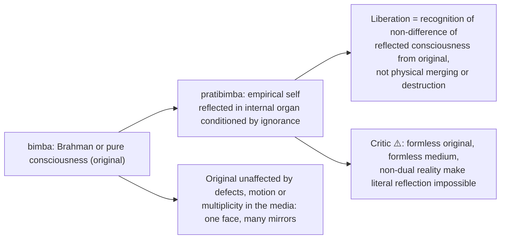

- Some later formulations: reflection in total cosmic appearance = Īśvara; reflections in individual ignorance/internal organs = jīvas. ❓ Others treat Īśvara as original relative to the jīva or prefer limitation/appearance models; not one uniform proposition attributable to Śaṅkara.
- Do not write that Īśvara is simultaneously "the original" and "consciousness reflected in māyā" without naming the model.

| Model | Associated with | Content |
|---|---|---|
| **Avacchedavāda** | **Vācaspati Miśra** | Brahman delimited by avidyā / adjuncts; space in a pot (**ghaṭākāśa**); not a real fragment |
| **Pratibimbavāda** | **Padmapāda**, **Vivaraṇa** line | Reflection of consciousness in avidyā; explains dependence and phenomenological individuality |
| **Ābhāsavāda** | (no thinker named in owner file) | Jīva is mere semblance (**ābhāsa**); pushes derivative status furthest |

### 4.5 Ātman, sākṣī, jīva ✅

| School | Ātman | Jīva |
|---|---|---|
| Advaita | Identical with Brahman; self-luminous; **sākṣī** (witness-consciousness) illuminates mental states, unaltered by them | Brahman appearing finite through avidyā (avaccheda / pratibimba / ābhāsa) |
| Viśiṣṭādvaita | Real, eternal, conscious, **aṇu** (atomic) self-luminous knower; **dharma-bhūta-jñāna** (attributive consciousness) contracts under karmic obstruction, expands in liberation; **prakāra** of Brahman | Real conscious mode; **śarīra-śarīrī** relation: supported, controlled, existing for Brahman |
| Dvaita | Real, eternal, dependent; difference from God fundamental, never becomes God | Distinct dependent substance; **nitya** (eternally free), **mukta** (liberated), **baddha** (bound); bound: **mukti-yogya**, **nitya-saṃsārin**, **tamo-yogya** |

- **Ontological hierarchy in Advaita (2022 Q8(a)):** Īśvara = Brahman reflected/conditioned by māyā; Jīva = Brahman reflected/limited by avidyā; Sākṣī = pure witness closest to pāramārthika standpoint. ⚠️
- **Ātman vs jīva ✅:** ātman = essential nature; jīva = embodied, empirical, bound. Making this distinction improves answers immediately.
- **Three states ✅:** jāgrat, svapna, suṣupti; "I slept peacefully; I knew nothing" presupposes continuity (witness); **turīya** is the non-dual consciousness underlying all three. ⚠️ An argument within Advaita; Rāmānuja and Nyāya keep an enduring self but reject identity with Brahman. In deep sleep for Rāmānuja the self persists, object-manifesting cognition unexpressed.
- **Jīva and Jīva-sākṣī (2020 Q8(c)):** jīva = consciousness reflected/conditioned by internal organ and avidyā; sākṣī = unaffected witness illuminating mental states; apparent relation due to limiting adjuncts, not between two ultimately separate selves. ✅

### 4.6 Jagat and three grades of reality ✅

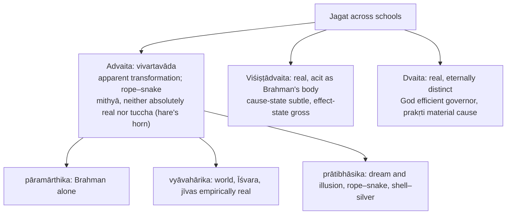

- **Criterion of reality:** **bādha** (sublation). **Sat** = never sublated (**trikālābādhita**); **asat** = never presented (hare's horn, square circle); **anirvacanīya** = presented then sublated. Without bādha the three-tier scheme collapses into realism or nihilism. ✅
- **Vivarta as development of pariṇāma? (2022 Q5(e))** ✅/❌ Sāṃkhya pariṇāma = effect is real transformation of the cause. If Brahman admits no real modification the effect cannot be real transformation, so transformation is apparent. Milk → curd (real altered effect) vs rope → snake (substrate unchanged). **Graded conclusion:** vivarta develops the search for an effect dependent on its cause but abandons pariṇāma's commitment to real transformation: agreement structural, not ontological.
- **Śaṃkara vs Rāmānuja on the world (2021 Q8(b)):**

| Issue | Śaṃkara | Rāmānuja |
|---|---|---|
| Reality | mithyā, dependent appearance | real manifestation |
| Change in absolute | denied | accepted in qualified sense through modes |
| Soteriology | world sublated in knowledge | world meaningful in devotion |
| God–world | empirical | intrinsic body–soul |

- **Madhva on jīva and jagat (2021 Q8(c)):** both real, distinct from God; difference metaphysical, not practical; prepares pañcavidhabheda.

### 4.7 Māyā, avidyā, adhyāsa ✅/❓

| Term | Content |
|---|---|
| **Māyā** | Cosmic power through which plurality appears; beginningless; dependent on Brahman; neither sat nor asat but **anirvacanīya**; not pure nothingness |
| **Two powers** | **Āvaraṇa-śakti** (conceals) and **vikṣepa-śakti** (projects names and forms) |
| **Māyā vs avidyā** ❓ | Sources not fully uniform. Safer formula: in many formulations māyā is cosmic and associated with Īśvara, avidyā individual and associated with jīva; both anirvacanīya; some texts use them interchangeably |
| **Avidyā in Advaita** | **Anādi** (beginningless) but **sānta** (terminable by knowledge); **bhāva-rūpa** (positive in form) because a mere absence could not conceal or project |
| **Avidyā in Viśiṣṭādvaita** | Real ignorance of God's nature and dependence; tied to karma; removed by knowledge integrated with bhakti and **prapatti** |
| **Avidyā in Dvaita** | Real ignorance, not a veil over identity; overcome by knowledge, devotion, grace |
| **Adhyāsa** | Śaṃkara: mutual superimposition of subject and object, **atasmin tad-buddhiḥ**; **naisargika** (natural) and **anādi**; two components āvaraṇa and vikṣepa; root of all vyavahāra ("I am tall, I am happy, I act, I know"); examples rope–snake, shell–silver, desert–mirage |
| **Adhyāsa vs khyāti** | Adhyāsa is the dynamic process; anirvacanīya-khyāti explains the erroneous object's status: connect, do not confuse |

**Two indescribabilities (2018 Q5(c)) ✅/❌.** Brahman's **anirvacanīyatā**: non-dual, non-objectifiable reality exceeds subject–predicate description; it is **not** uncertain reality. Māyā's **anirvacanīyatā**: appearance cannot be classified as ultimately real (sublated) nor sheer non-being (experienced). Brahman = unsublated reality because of which description and experience are possible; māyā = dependent, sublatable explanatory principle. Not identical. ⚠️ Realist schools accept Brahman's transcendence more readily than the third ontological status of māyā.

**Dvaita on māyā ✅.** Does not accept māyā as ontological illusion; world real, ignorance real; Madhva's critique sharper than Rāmānuja's since it makes real difference fundamental.

### 4.8 Apṛthaksiddhi and pañcavidhabheda ✅

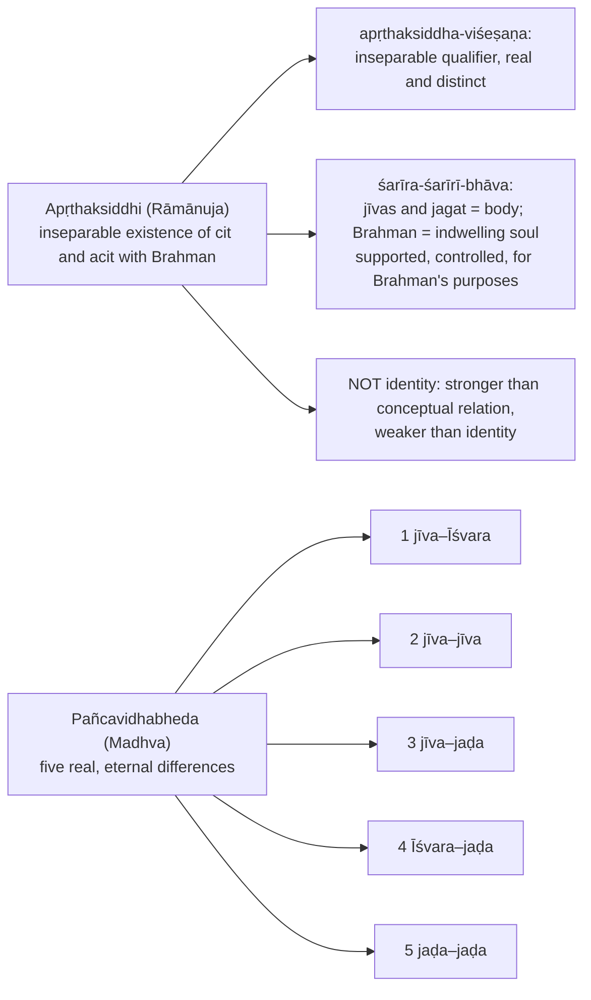

- **Apṛthaksiddhi preserves:** non-duality (one substantive whole), real difference (genuine modes), devotion (meaningful relation).
- **Formula:** Advaita = identity without real plurality; Viśiṣṭādvaita = inseparable plurality within unity; Dvaita = eternal plurality with dependence.
- **Pañcavidhabheda consequences:** devotion never transcended; hierarchy among souls possible; plural world ontologically robust. It rejects Advaita's identity **and** Rāmānuja's qualified inseparability.
- ❓ **Viśeṣa in Dvaita:** a unique differentiator securing real distinctions without infinite regress; Dvaita faces the regress problem.
- **Madhva's illusion argument ✅:** illusion cannot occur unless a real self, object and difference already exist.

### 4.9 Nimbārka's matter (2020 Q5(e), 2026 Q7(c)) ✅/⚠️

| Element | Content |
|---|---|
| Relation | God, selves, matter real; selves/matter **different** (limited) yet **non-different** (no independent existence) |
| **Acit** | **Prākṛta** (mutable, guṇa-constituted material domain), **aprākṛta** (non-prakritic divine substance, not Śaṃkara's māyā), **kāla** (time, real non-conscious condition) |
| Creation | Real transformation of Brahman's dependent powers |
| Liberation | Knowledge enabled by devotion and grace, individuality preserved |
| Analogy | Sun–rays: dependent unity with persistent distinction; not proof that souls are physical parts of God |
| Objection → reply | Difference + non-difference contradictory? Predicates hold in **different respects** (distinct natures vs inseparable dependence). Advaita or Dvaita can still dispute that dependence amounts to **real non-difference** |

❓ Expositions vary in enumerating kāla and distinguishing aprākṛta; declare the classification used. "Do you agree?" requires a qualified verdict on the relation.

---

## 5. Rejection / Affirmation of Transcendent Realities

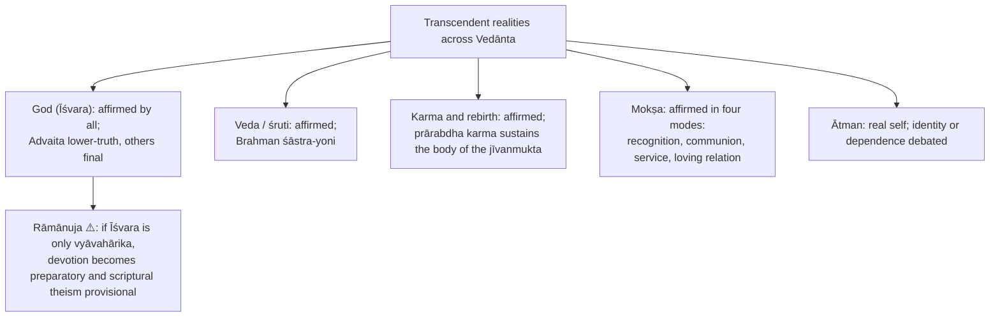

- Vedānta is **affirmative** on transcendent realities; the question is their ontological **status** (see §2.7–2.8 of the owner file on each school).
- **Rāmānuja's critique of nirguṇa Brahman (2023 Q6(a)) ✅:** an attribute-less entity cannot be known; if indeterminate it cannot be the referent of scriptural description; with no internal intelligibility it cannot cause a richly qualified world; scriptural negations deny limiting predicates, not all qualities. Result: unknowable emptiness or an abstraction too thin to ground religion, devotion, causality or ethics. ⚠️ Advaita reply: Brahman is not known as an object with predicates; it is self-revealed as the ground of all knowing (§9).
- **Rāmānuja's critique of Advaita's Īśvara ✅:** devotion merely preparatory; scriptural descriptions lower truth; religious life subordinated to impersonal absolutism.

---

## 6. Explanatory & Causal Principles

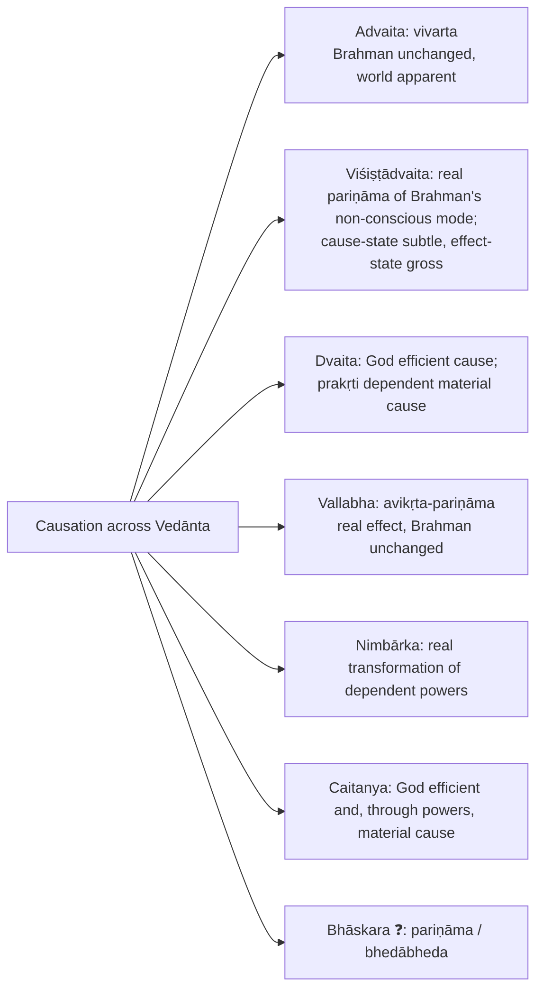

**Śaṃkara as pradhāna-malla against Sāṃkhya (2025) ✅.** Sāṃkhya is the nearest rival: accepts **satkāryavāda**, posits one material principle (prakṛti/pradhāna).

| Argument | Content |
|---|---|
| 1. Conscious cause | Upaniṣads describe the cause as **sat**, knowing, willing, purposive; unconscious pradhāna fails scriptural descriptions |
| 2. Teleology | Purposive order needs intelligence; guṇa-equilibrium and disturbance do not explain it |
| 3. Puruṣa–prakṛti relation | If puruṣa is inactive witness and prakṛti unconscious activity, contact is unintelligible |
| 4. Scripture | Upaniṣads present one cause; Sāṃkhya's dual ontology lacks full scriptural support |

Cross-link: 2026 Q6(a) (Sāṃkhya-owned) cross-links Advaita causation (§4.2, §4.6 here).

---

## 7. Ethics & Human Goals (Puruṣārthas)

> The owner file gives **no separate kāma / artha / dharma / mokṣa hierarchy** for Vedānta. This module therefore carries only source-backed ethics and soteriology.

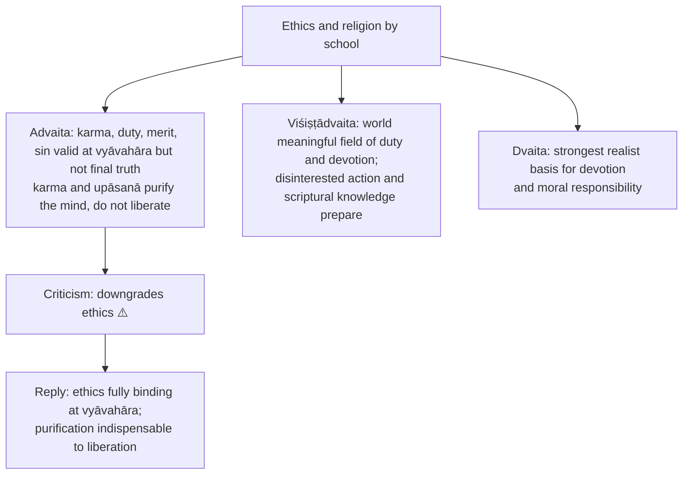

**Sādhana-catuṣṭaya ✅:** **viveka** (discrimination eternal/non-eternal), **vairāgya** (detachment), **ṣaṭ-sampatti** (sixfold discipline), **mumukṣutva** (desire for liberation). Then **śravaṇa** (hearing), **manana** (reflection), **nididhyāsana** (contemplation). **Adhyāropa-apavāda** (superimposition and rescission) is standard pedagogy ⚠️. Śaṃkara rejects **jñāna-karma-samuccayavāda**. ⚠️ Do not attribute **akhaṇḍākāra-vṛtti** verbatim to Śaṅkara; it is a later systematic explanation.

### 7.1 Mokṣa across schools ✅

| School | Direct path | Liberated condition |
|---|---|---|
| **Advaita** | Jñāna alone removes avidyā | **Prāptasya prāptiḥ** ("attainment of what is already attained"); necklace on one's own neck; **jīvanmukti** while embodied; body continues through **prārabdha karma** (like a released arrow); **videhamukti** at death, no new liberation produced; no new binding karma as doership is dissolved |
| **Viśiṣṭādvaita** | Karma and knowledge prepare; contemplation matures as **bhakti**; **prapatti / śaraṇāgati** inclusive route; grace (**prasāda**) indispensable | Unobstructed knowledge and bliss; likeness to God; eternal loving communion/service, **no identity**; no Advaitic jīvanmukti |
| **Dvaita** | Right knowledge of Viṣṇu's supremacy, devotion, grace | Eternal blissful service in **Vaikuṇṭha**; difference never abolished; **tāratamya** (gradation among liberated souls) |
| **Śuddhādvaita** (Vallabha) | Grace-nourished loving devotion; **puṣṭi-mārga** | Participation in Kṛṣṇa's bliss and loving service; world not sublated |
| **Acintyabhedābheda** | Loving devotion (**bhakti / prema**) as sole direct path | Eternal loving relation and service; individuality remains |
| **Dvaitādvaita** (Nimbārka) | Knowledge enabled by devotion and grace | Individuality preserved, communion without identity-erasure |

**Madhva vs Rāmānuja on mokṣa (2022 Q8(c)):**

| Issue | Rāmānuja | Madhva |
|---|---|---|
| Shared ground | real God, soul, world; devotion and grace | same |
| God–self | inseparable mode/body | distinct dependent substance, not God's body |
| Individuality | retained in communion and service | retained in eternal difference and service |
| Knowledge and bliss | karmic obstruction removed; attributive knowledge unrestricted | degree follows real hierarchy |
| Equality | alike in essential type; no Madhva-style gradation | **tāratamya** retained |
| Causal background | Brahman efficient and material through modes | God efficient; prakṛti material |

**Four-school liberation (2018 Q7(a))** is the table above for Viśiṣṭādvaita, Dvaita, Śuddhādvaita, Acintyabhedābheda. Common ground: theistic devotion and grace; decisive difference: soul as inseparable mode, eternally distinct dependent, real unchanged manifestation, or inconceivably different–non-different power.

**Mokṣa as ontology in soteriological form ⚠️:** non-dual → recognition; qualified non-dual → communion; dualist → service.

---

## 8. Inter-School Comparative Matrices

### 8.1 Vedānta master comparison ✅/❓

| School | Pramāṇas | Brahman / Īśvara | Jīva | World and khyāti | Causation | Mokṣa | Jīvanmukti |
|---|---|---|---|---|---|---|---|
| **Advaita** | Six; śabda primary for Brahman | Nirguṇa ultimate; Īśvara = māyā-upahita Brahman | Ultimately Brahman; avaccheda / pratibimba / ābhāsa | Mithyā; anirvacanīya-khyāti | Vivarta | Jñāna; identity-recognition | Central |
| **Viśiṣṭādvaita** | pratyakṣa, anumāna, śabda | Saguṇa Nārāyaṇa; no higher nirguṇa | Real aṇu, inseparable mode | Real acit as body; satkhyāti | Real manifestation via modes | Bhakti, prapatti; communion | Not accepted in Advaita sense |
| **Dvaita** | pratyakṣa, anumāna, āgama | Viṣṇu independent | Real dependent, eternally different | Real; pañcavidha; error without mithyātva | God efficient; prakṛti material | Bhakti, knowledge, grace; service with tāratamya | Not accepted as identity |
| **Bhāskara / Bhedābheda** ⚠️ | ❓ realist Vedic epistemology | Brahman one and really transformed into plurality | Different and non-different | Real, not māyā illusion | Pariṇāma / bhedābheda | Knowledge with action/devotion | ❓ |
| **Nimbārka** | ❓ scripture, perception, inference | Brahman/Kṛṣṇa ground of real cit, acit | Different and non-different via dependence | Matter real, dependent | Real difference-and-non-difference | Bhakti and grace, communion | ❓ |
| **Vallabha** | ❓ śruti-centred | Pure non-dual Kṛṣṇa | Real manifestations dependent | Real manifestation | **Avikṛta-pariṇāma** | Grace, devotion, participation | ❓ |
| **Caitanya** | ❓ Bhāgavata-centred | Kṛṣṇa with real powers | Atomic, dependent, individuality retained | Real manifestation of external power | God efficient; through powers material | Loving service | ❓ |

### 8.2 Advaita vs non-Vedāntic schools ✅/⚠️

| School | Self | Causation | Liberation | Advaita contrast |
|---|---|---|---|---|
| **Sāṃkhya** | Many puruṣas, inactive | Prakṛti, pariṇāma | Kaivalya | Rejects unconscious ultimate cause, plural puruṣas |
| **Nyāya–Vaiśeṣika** | Many real selves | God efficient; atoms material | Cessation of suffering | Rejects atomism, anyathā-khyāti |
| **Buddhism** ⚠️ | No permanent ātman | Dependent origination | Nirvāṇa | Affirms self-luminous Brahman and śruti |
| **Mīmāṃsā** | Real self, ritual agency | Ritual → unseen potency | Dharma-centred | Redirects Veda from vidhi to siddha-vastu |
| **Jainism** | Many jīvas | Pluralist realism, karma as subtle matter | Release of jīva | Rejects plural souls, realist karma-matter |

### 8.3 Inter-thinker debates ⚠️

| Pair | Contrast |
|---|---|
| Śaṃkara vs Rāmānuja on Brahman | Absolute must be nirguṇa, else finite and relational vs attribute-less absolute is unintelligible, religiously sterile, causally ineffective |
| Śaṃkara vs Rāmānuja on world | Mithyā to preserve changelessness vs real to preserve scripture, devotion, causality |
| Śaṃkara vs Madhva on selfhood | Difference is ignorance-born appearance vs eternal structure |
| Rāmānuja vs Madhva | Unity + plurality via inseparability vs uncompromising difference |
| Vedānta vs Sāṃkhya | Conscious ultimate cause vs unconscious prakṛti and many puruṣas |
| Vedānta vs Nyāya–Vaiśeṣika | Collapses efficient and material in Brahman vs God efficient, atoms material |
| Vedānta and Mīmāṃsā | Redirects scripture from ritual duty to metaphysical knowledge and liberation |

> **Statement bank ⚠️.** Śaṃkara protects absoluteness of Brahman by lowering the world's status; Rāmānuja protects the world's reality by qualifying the unity of Brahman; Madhva radicalises theism by making difference itself ultimate.

### 8.4 Presupposition ledger ⚠️

| Doctrine | Presupposition | What collapses if denied |
|---|---|---|
| Nirguṇa Brahman | Ultimate reality can be self-luminous, non-objectifiable without being blank | Becomes qualified theism or emptiness |
| Māyā/avidyā bhāva-rūpa, anirvacanīya | Ignorance positive enough to project, sublatable enough not to be real | World becomes real pariṇāma or sheer non-being |
| Adhyāsa | Empirical life rests on mutual superimposition | Bondage becomes real change or episodic error |
| Three levels of reality | Sublation (bādha) grades reality | Cannot keep empirical validity while denying ultimate reality |
| Vivartavāda | Effect can depend on cause without real transformation | Brahman undergoes pariṇāma |
| Avaccheda route | One consciousness appears many through adjuncts (ghaṭākāśa) | Individuality becomes fragmentation or inexplicable |
| Pratibimba route | Consciousness appears as reflected individuality | Jīva's dependence loses explanatory imagery |
| Primacy of śabda | Non-objective Brahman revealed only by self-sublating mahāvākya | Brahman unknowable or sensory/inferential object |
| Jīvanmukti | Liberation = removal of ignorance, not post-mortem state | Mokṣa becomes event in time |
| Apṛthaksiddhi | Real difference can be inseparable from unity | Cannot avoid Advaitic identity or Dvaitic plurality |
| Pañcavidhabheda | Difference is eternal structure | Madhva's bhakti-realism loses its base |
| ❓ Viśeṣa | Unique differentiator avoids regress | Regress problem |

---

## 9. Criticisms & Reconstructed Replies

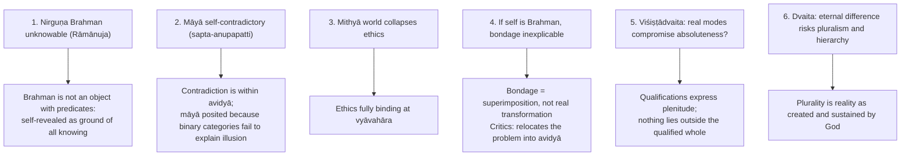

### 9.1 Pūrvapakṣa–siddhānta ledger ⚠️

| Objector | Objection | Advaita reply | Residual force |
|---|---|---|---|
| Rāmānuja: āśraya | Locus untenable | Vivaraṇa / Bhāmatī | Two answers expose pressure |
| Rāmānuja: tirodhāna | Self-luminous cannot be concealed | Concealment apparent to jīva | Analogy assumes the standpoint |
| Rāmānuja: svarūpa/anirvacanīya | Neither real nor unreal incoherent | Grade of experienced-yet-sublated | Needs bādha as criterion |
| Rāmānuja: pramāṇa | No means for positive avidyā | Sākṣi-pratyakṣa, arthāpatti, śruti | Reducible to absence of knowledge |
| Rāmānuja: nivartaka/nivṛtti | No coherent remover or cessation | Akhaṇḍākāra-vṛtti; Brahman remains | Weaker for external realists |
| Rāmānuja: nirvikalpaka | Redefines it as first cognition of qualified individual; denies qualifierless object | Brahman revealed by śabda as self-luminous consciousness | Deep epistemological fault-line |
| Madhva: pañcavidhabheda | Differences real and eternal | Difference vyāvahārika, sublatable | Dvaita refuses sublation criterion |
| Madhva: illusion needs real perceiver | Real self, object, difference presupposed | Empirical reality granted | Risks borrowing realism |
| Madhva: sākṣin | Witness validates difference | Sākṣī = non-dual consciousness | Same term, opposed metaphysics |
| Bhāskara | If world is a real transformation, māyā unnecessary | Real transformation compromises changelessness | Presses the cost of mithyā |
| Nyāya: anyathā-khyāti | Memory-mediated elsewhere-silver misattributed here; correction negates only the attribution | How is extraordinary presentation warranted? Experienced, sublated here-silver needs account of dependent appearance | Nyāya reads sublation as corrected mislocation (see §11) |
| Mīmāṃsā | Veda enjoins dharma; mahāvākya cannot liberate | Upaniṣads reveal siddha-vastu | Core Pūrva/Uttara divide |
| Buddhist | Crypto-Buddhism | Brahman positive vs śūnyatā; śruti accepted | Similarity in world-negation |
| Sāṃkhya | Prakṛti suffices | Ultimate cause must be conscious and scriptural | Challenges need for conscious absolute |

---

## 10. Controlled Western Comparisons

| Advaita theme | Point of contact | Decisive disanalogy |
|---|---|---|
| Degrees of reality | Bradley's *Appearance and Reality* grades appearance and finds relations unstable | Bradley's Absolute includes and harmonises appearance; Brahman sublates appearance as mithyā |
| Nirguṇa Brahman | Negative theology, Plotinus' One deny ordinary predicates of the ultimate | Plotinus' One emanates real hypostases; Advaita denies real production |
| Adhyāsa | Kant's transcendental illusion: systematic error | Kantian phenomena remain empirically real and are not sublated by higher knowledge |
| Māyā | Berkeley: matter's independent status questioned | Advaita is **not** subjective idealism: world is not "my idea", has vyāvahārika objectivity and intersubjectivity; Śaṃkara refutes Vijñānavāda in *Brahma-sūtra-bhāṣya* |
| Jīva–Brahman identity | Spinoza: finite not independent of substance | Spinoza's modes are real modifications, nearer pariṇāma and thus to Rāmānuja than to Śaṃkara's vivarta |
| Mahāvākya semantics | Frege's sense/reference explains informative identity | Bhāga-tyāga-lakṣaṇā discards incompatible portions of primary meaning: no exact Fregean counterpart |

> [!WARNING]
> Western parallels are illustrative only, never a substitute for the Vedāntic argument; use at most one or two lines after the Indian case is complete.

---

## 11. Diagnostic Deep-Dives for High-Frequency Themes

### 11.1 Anirvacanīya-khyāti vs Nyāya (2021 Q7(a)) ✅/⚠️

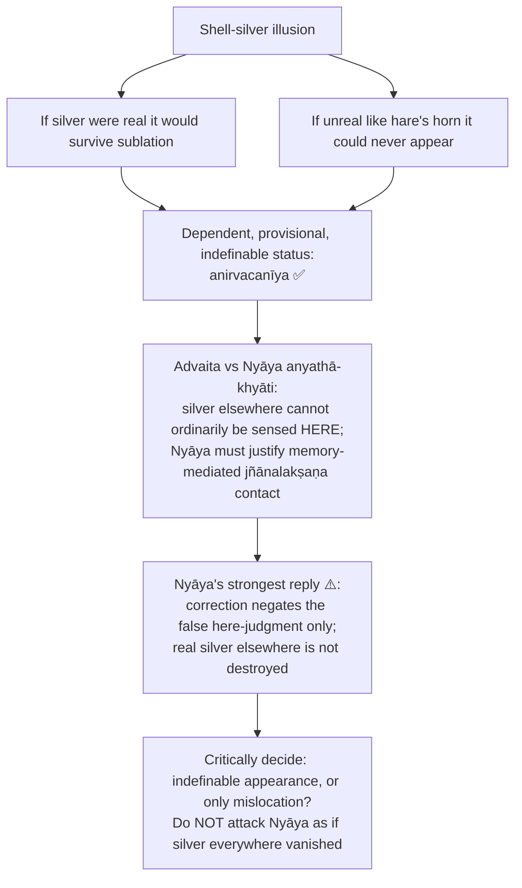

- Preferred over Buddhist **asat-khyāti**: illusory silver appears, though later sublated.
- Avidyā product; erroneous object empirically momentary; "What shell-silver is to shell, jagat is to Brahman."
- **Objection:** "indescribable as real or unreal" seems to violate excluded middle. **Reply:** the trichotomy is about grades of sublatability; the claim is that māyā cannot be categorised under either ultimate head, not that it lacks a determinate nature. Rāmānuja and Madhva: verbal manoeuvre unless the third grade is independently established.

### 11.2 Logical consequences of Advaitic absolutism (2019 Q8(a)) ✅/⚠️

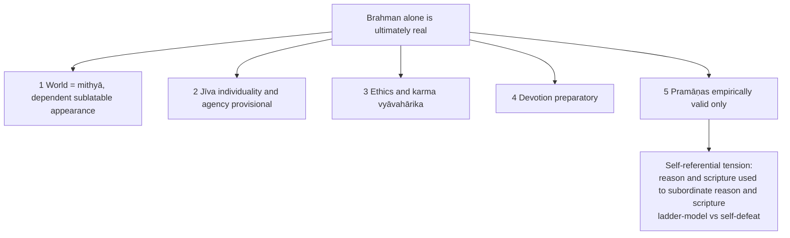

**Balanced assessment ⚠️:** metaphysical purity purchased at the cost of reclassifying ordinary life as lower truth; admirers call it the highest wisdom, critics call it ontological austerity purchased by practical instability.

### 11.3 Rāmānuja's Brahman and cit–acit (2026 Q8(b)) ⚠️

- Cit: conscious, many, able to act; acit: non-conscious, mutable; both real dependent modes, not detachable substances. Brahman = one qualified whole, efficient and material cause through their states.
- **Objection 1:** does the divine indweller undergo the body's changes and imperfections? **Reply:** changes belong to dependent modes, especially acit, not to Brahman's essential auspicious nature; the analogy is of dependence, not that God has flesh or suffers.
- **Objection 2:** calling souls God's "body" erases freedom and responsibility. **Reply:** capacities and actions real though sustained and governed by God; dependence ≠ numerical identity or mechanical compulsion.
- **Remaining pressure:** how genuine creaturely agency and modal change fit an unqualifiedly perfect, absolutely controlling Brahman. A 15-marker must test **both cit and acit**.

### 11.4 Madhva: why difference constitutes the nature of things (2026 Q8(c)) ⚠️

- *Bheda* is not the mind comparing otherwise identical objects: real distinguishability belongs to entities (**svarūpa-bheda**).
- Without God–soul difference a dependent knower could be the independent Lord; without soul–soul difference karmic histories and gradation lose subjects; soul–matter difference safeguards consciousness; God–matter safeguards divine sovereignty; matter–matter safeguards determinate objects and causal roles.
- "Separate" means irreducibly distinct **identities**, not autonomous creators: all non-divine entities depend on Viṣṇu. Remaining objection: eternal differences and graded souls vs moral equality (see §9).

### 11.5 The 2018 Q7(c) printed anomaly ❓

The paper asks why Māyā is "needed" by **both** Rāmānuja and Śaṅkara. Do **not** correct the quotation or attribute Śaṅkara's anirvacanīya illusion to Rāmānuja. First present Rāmānuja's seven objections, then Śaṅkara's replies. Śaṅkara needs dependent māyā/avidyā to explain experienced plurality, bondage and an unchanged Brahman without a second independent reality. Rāmānuja needs an account of the real differentiated world (acit/prakṛti as dependent body, its transformations, jīva's karmic ignorance) but **not** Advaitic māyā as indefinable illusion. If "Māyā" means God's creative power, distinguish that from Śaṅkara's technical thesis. State both costs.

---

## 12. PYQ Routing Ledger (2018–2026)

> Corpus signal: **20** primary-owned parts out of 112 (2018–2025) **plus 3** in the 2026 supplement = **23** primary-owned Vedānta parts. The 2026 supplement notes Vedānta's three parts are all on **non-Advaita** ācāryas (Nimbārka, Rāmānuja, Madhva): no Śaṅkara part.

| Year | Q | Marks | Exact demand | Map to |
|---|---|---:|---|---|
| 2018 | Q5(c) | 10 | What is the difference between the indescribability (Anirvacanīyatā) of Brahman and the indescribability (Anirvacanīyatā) of Māyā in the Advaita Vedānta system? Discuss. | §4.7 |
| 2018 | Q7(a) | 20 | Give a comparative exposition of the concept of Mokṣa as found in the systems of Viśiṣṭādvaita, Dvaita, Śuddhādvaita and Acintyabhedābheda. | §7.1 |
| 2018 | Q7(c) | 15 | How does Rāmānuja refute the doctrine of Māyā as propounded by Śaṅkara? Why is Māyā needed by both Rāmānuja and Śaṅkara to establish their doctrines? Discuss. ❓ (second sentence printed this way and retained) | §3.1, §11.5 |
| 2019 | Q8(a) | 20 | Explain the logical consequences of the metaphysical absolutism of Advaitism. | §11.2 |
| 2020 | Q5(d) | 10 | Point out the significance of the five-fold differences in the Dualistic School of Vedānta. | §4.8 |
| 2020 | Q5(e) | 10 | Discuss the nature and types of matter according to Nimbārka. | §4.9 |
| 2020 | Q8(c) | 15 | Discuss the nature and relationship of Jīva and Jīva-sākṣī according to non-dualism. | §4.5 |
| 2021 | Q7(a) | 20 | How do the advocates of anirvacanīya-khyāti refute the position of the Naiyāyikas and establish the position of Advaitins regarding the problem of error? Critically discuss. | §11.1 |
| 2021 | Q8(b) | 15 | Compare and contrast the views of Śaṅkara and Rāmānuja regarding the status of the world. | §4.6 |
| 2021 | Q8(c) | 15 | Explain the status of jīva and jagat in the philosophy of Madhvācārya. | §4.5, §4.6 |
| 2022 | Q5(e) | 10 | Do you agree with the view that 'Vivartavāda is the logical development of Pariṇāmavāda'? Give reasons in support of your answer. | §4.6 |
| 2022 | Q8(a) | 20 | 'Brahma satyam jaganmithyā, Jīvo Brahmaiva nāparaḥ'. In the light of this statement explain the ontological status of Īśvara, Jīva and Sākṣī as elucidated in Advaita Vedānta. | §4.5 |
| 2022 | Q8(c) | 15 | How does the concept of Liberation (Mokṣa) of Madhvācārya differ from that of Rāmānujācārya? Explain. | §7.1 |
| 2023 | Q5(c) | 10 | What is Advaitin interpretation of the great sentence (mahāvākya) 'Thou art that' (tat tvam asi)? Briefly discuss. | §2.4 |
| 2023 | Q6(a) | 20 | Discuss Rāmānuja's criticism of Śaṅkara's conception of Brahman and Īśvara (God). | §5 |
| 2023 | Q7(b) | 15 | Liberation is defined by Advaita Vedāntins as 'attainment of that which is already attained'. How does Śaṅkara illustrate this statement? Discuss with your own comments. | §7.1 |
| 2024 | Q5(e) | 10 | "In Viśiṣṭādvaita philosophy, the relationship between God and the world is parallel to that between an individual self and its body." Critically discuss. | §4.8, §11.3 |
| 2025 | Q5(d) | 10 | Examine Rāmānuja's seven objections against Māyāvāda of Advaita. | §3.1 |
| 2025 | Q6(b) | 15 | How is Brahman conceptualised in Advaita philosophy as both Nimitta and Upādāna Kāraṇa of the World? Discuss with suitable examples. | §4.2 |
| 2025 | Q8(a) | 20 | Discuss the idea of Bimba-pratibimbavāda as presented in Vedānta philosophy along with its soteriological significance. | §4.4 |
| 2026 | Q7(c) | 15 | Do you agree with Nimbarka's explanation of the nature of God, Souls and Matter? Justify your answer. | §4.9 |
| 2026 | Q8(b) | 15 | Critically explain Ramanuja's conception of Brahman with special reference to the difficulties in explaining the relation of Brahman to Spirit (Cit) and Matter (Acit). | §11.3 |
| 2026 | Q8(c) | 15 | Why does the Dualistic School of Vedanta consider that differences (Bhedas) have separate existence and constitute the unique nature of things? Answer with reference to the theory of five-fold difference (Pancavidhabheda). | §11.4 |

Cross-links (not counted): 2026 Q6(a), Sāṃkhya-owned (mango seed; *satkāryavāda* vs *vivartavāda*) → §6.
Annual distribution of primary-owned parts 2018–2025 (from the PYQ bank): 3, 1, 3, 3, 3, 3, 1, 3 = **20**.

---

## 13. Top 10 UPSC Exam Traps

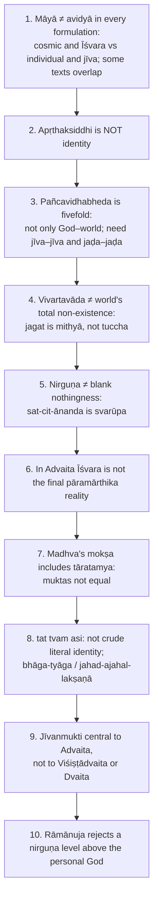

Extra pitfalls recorded in the sources: do not flatten Vedānta into the big three when the question names Nimbārka or a four-school list; two indescribabilities (Brahman vs māyā) are not identical; do not say the Nyāya theory claims silver everywhere vanishes on correction; "Brahma satyam…" is a traditional summary, not a mahāvākya; do not attribute **akhaṇḍākāra-vṛtti** verbatim to Śaṅkara; Rāmānuja **accepts** nirvikalpaka perception in a reinterpreted sense, he rejects cognition of a qualifierless object; do not give "Brahman as both causes" to every school (Madhva: efficient only); Advaita is not subjective idealism; do not rationalise the 2018 Q7(c) anomaly.

---

## 14. Technical Vocabulary & IAST Bank

| English gloss | IAST | Meaning | Status |
|---|---|---|---|
| Threefold canon | prasthāna-traya | Upaniṣads, Gītā, Brahma Sūtra | ✅ |
| Intrinsic definition of Brahman | svarūpa-lakṣaṇa | sat-cit-ānanda | ✅ |
| Relational definition | taṭastha-lakṣaṇa | janmādyasya yataḥ | ✅ |
| Without / with attributes | nirguṇa / saguṇa | | ✅ |
| Efficient / material cause | nimitta-kāraṇa / upādāna-kāraṇa | | ✅ |
| Māyā-conditioned Brahman | māyā-upahita Brahman | Īśvara in Advaita | ✅ |
| Witness-consciousness | sākṣī | | ✅ |
| Limitation / reflection / semblance models | avacchedavāda / pratibimbavāda / ābhāsavāda | Jīva theories | ✅ |
| Apparent / real transformation | vivarta / pariṇāma | | ✅ |
| Concealment / projection | āvaraṇa / vikṣepa | | ✅ |
| Indescribable | anirvacanīya | Neither sat nor asat | ✅ |
| Superimposition | adhyāsa | atasmin tad-buddhiḥ | ✅ |
| Sublation | bādha | Criterion of reality | ✅ |
| Three grades | pāramārthika / vyāvahārika / prātibhāsika | | ✅ |
| Unreal like a hare's horn | tuccha | | ✅ |
| Dependent appearance | mithyā | | ✅ |
| Attainment of the already attained | prāptasya prāptiḥ | Advaita mokṣa | ✅ |
| Living liberation / bodiless liberation | jīvanmukti / videhamukti | | ✅ |
| Karma already begun | prārabdha karma | | ✅ |
| Inseparable existence | apṛthaksiddhi | | ✅ |
| Body–soul relation | śarīra-śarīrī-bhāva | | ✅ |
| Fivefold difference | pañcavidhabheda | | ✅ |
| Gradation of liberated souls | tāratamya | Madhva | ✅ |
| Uniquely differentiating factor | viśeṣa | Dvaita regress issue | ❓ |
| Seven incoherences | sapta-anupapatti | Rāmānuja against māyāvāda | ✅ |
| Undivided-form mental mode | akhaṇḍākāra-vṛtti | Later explanation, not verbatim Śaṅkara | ⚠️ |
| Abandoning-and-retaining implication | jahad-ajahal-lakṣaṇā / bhāga-tyāga-lakṣaṇā | Reading of tat tvam asi | ✅ |
| Direct / implied meaning | vācyārtha / lakṣyārtha | | ✅ |
| Authorless / accomplished reality / action | apauruṣeya / siddha-vastu / kārya | | ✅ |
| Real error theory / indescribable error theory | satkhyāti / anirvacanīya-khyāti | | ✅ |
| Unchanged real manifestation | avikṛta-pariṇāma | Vallabha | ✅ |
| Inconceivable difference–non-difference | acintyabhedābheda | Caitanya | ✅ |
| Dualistic non-dualism | dvaitādvaita | Nimbārka | ✅ |
| Types of matter | prākṛta / aprākṛta / kāla | Nimbārka | ✅/❓ |
| Atomic self / attributive consciousness | aṇu / dharma-bhūta-jñāna | Rāmānuja | ✅ |
| Surrender | prapatti / śaraṇāgati | | ✅ |
| Independent / dependent | svatantra / paratantra | Madhva | ✅ |
| Fourth state | turīya | | ✅ |

---

## 15. Graded Verdict & Answer Architectures

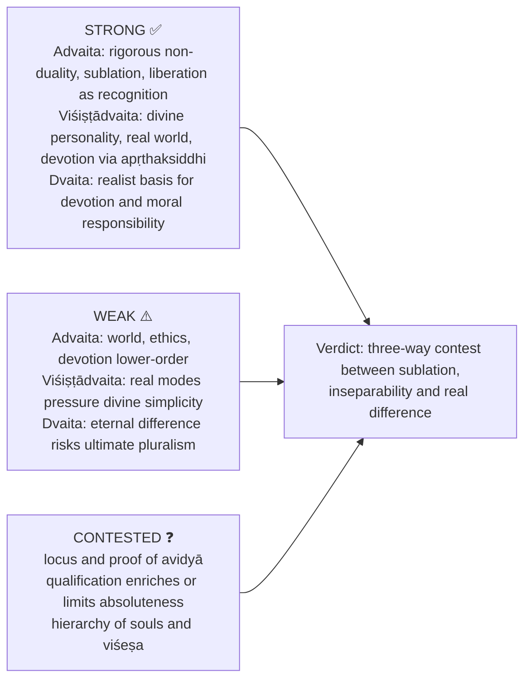

### 15.1 10-mark

```text
1. Define the concept in one crisp sentence.
2. Give school placement (Advaita / Viśiṣṭādvaita / Dvaita).
3. State 3–5 doctrinal points with one Sanskrit keyword.
4. Add one contrast line with a rival school.
5. End with one evaluative conclusion.
```
**Anchors:** "For Śaṃkara, māyā is the anirvacanīya power of projection and concealment through which the non-dual Brahman appears as plural world." / "Rāmānuja's apṛthaksiddhi means inseparable existence of cit and acit in Brahman without reducing them to identity."
**Verdict:** "Advaita sublates plurality, Viśiṣṭādvaita qualifies unity, and Dvaita absolutises difference."

### 15.2 15-mark

```text
Intro      : define the issue and name the school(s).
Body I     : doctrine in the primary thinker.
Body II    : conceptual mechanism (bhāga-tyāga-lakṣaṇā, vivarta, apṛthaksiddhi ...).
Body III   : contrast with one rival school.
Assessment : philosophical strength / criticism.
Conclusion : return to syllabus term.
```
**Pattern:** paragraph 1 doctrinal statement; 2 mechanism and example; 3 objection and reply; 4 comparative conclusion.
**Verdict:** "Śaṃkara is strongest on metaphysical unity, Rāmānuja on religious realism, and Madhva on devotional difference; the best answer judges them by their different criteria of reality."

### 15.3 20-mark

```text
Intro        : frame the central metaphysical issue.
Section I    : primary doctrine in conceptual detail.
Section II   : internal distinctions / models.
Section III  : criticism from rival school.
Section IV   : reply / evaluative defence.
Section V    : broader implications for world, self, God, liberation.
Conclusion   : balanced judgement with one comparative line.
```
**Verdict:** "The Vedānta debate is not merely one school versus another but a three-way contest between sublation, inseparability and real difference as rival ways of preserving Brahman, world, self and liberation."

### 15.4 Directive decoder ⚠️

| Directive | Move | Closing verdict |
|---|---|---|
| Discuss | Define, mechanism, example, one rival contrast | Balanced significance, not yes/no |
| Examine | Thesis, presuppositions, internal logic | Coherent within its system? |
| Critically examine | Siddhānta, named pūrvapakṣa and reply | Graded verdict with residual weakness |
| Analyse | Brahman, jīva, jagat, pramāṇa, mokṣa implications | Parts follow from root metaphysics |
| Evaluate | Explanatory gain vs unresolved tension | "Strong in…, weak in…" |
| Compare | Table or paired paragraphs across the three schools | Identity / qualification / difference formula |
| Distinguish | Definition, locus, example, consequence | One-line trap avoided |
| Elucidate | Rope–snake, shell–silver, pot-space, mirror, self–body | Link example to liberation |
| Comment | Doctrine, one objection, one defence | Sharp judgement |
| Bring out | Derive consequences for world, self, God, ethics | "Therefore" language |
| Do you agree? | Partial agreement, reasons, qualify via rival | "Agree only within…" |
| Discuss X in Advaita and examine Rāmānuja's critique | Advaita mechanism, then sapta-anupapatti or qualified-realism objection, then reply | Dispute turns on sublation vs qualified realism as criterion of reality |

> [!TIP]
> **Score-extra rules.** Insert one Sanskrit term; give one example (rope–snake, shell–silver, pot-space, mirror, self–body); contrast with at least one rival school even in single-school answers; in critical answers use one tension-line rather than one-sided praise. **Stock endings:** "Advaita resolves plurality by sublation, Viśiṣṭādvaita by inseparability, and Dvaita by eternal difference." / "The Vedānta debate is finally a debate over whether relation to the absolute is identity, qualification or difference."

> [!NOTE]
> **Promotion trigger (advanced dossier).** Promote locus-of-avidyā, avacchedavāda/ābhāsavāda, or Madhva's hierarchy/tāratamya if a future PYQ asks them directly. Do not over-study exhaustive sub-commentarial taxonomies or later bhakti-Vedānta genealogies once present PYQs and named terms are fully covered.

---

## Sources

Principal Upaniṣads and *Bhagavad Gītā*; Bādarāyaṇa, *Brahma Sūtra*; Śaṃkara, *Brahma-sūtra-bhāṣya* and *Adhyāsa-bhāṣya*; Rāmānuja, *Śrī-bhāṣya* and *Vedārthasaṅgraha*; Madhva, *Brahma-sūtra-bhāṣya* and *Anuvyākhyāna*; Nimbārka, *Vedānta-pārijāta-saurabha*; Vallabha, *Aṇubhāṣya*; Jīva Gosvāmin, *Ṣaṭ-sandarbha*; Vācaspati Miśra, *Bhāmatī*; Prakāśātman, *Pañcapādikā-vivaraṇa*; Chatterjee & Datta; C.D. Sharma; Radhakrishnan, *Indian Philosophy* Vol. II; T.M.P. Mahadevan, *Outlines of Hinduism*; Haridas Chaudhuri (advanced trail).
