# AUROBINDO — Examiner-Grade Mindmap

> **Syllabus (verbatim):** Aurobindo: Evolution, Involution; Integral Yoga.
> **Catalogue key:** `philosophy-paper-i-indian-philosophy-09` · Paper I · Indian Philosophy · final modern-Indian thinker (Section B).
> **Sources used:** `paper-1/indian/Aurobindo.md` (canonical owner, read in full) · `_advanced/Indian-Philosophy-Dossier.md` §9 (optional depth) · `paper-1/_PYQ-Indian-Philosophy-2018-2025.md` · `paper-1/_PYQ-Indian-Philosophy-2026.md` · themes the owner links (`Self-and-liberation-across-schools.md`, `Critiques-of-metaphysics.md`) are cited by the owner only as cross-use pointers.
> **Evidence key:** ✅ canonical doctrine · ⚠️ analytical synthesis · ❓ contested / uncertain

> [!IMPORTANT]
> **Core thesis.** Aurobindo accepts the Vedāntic Absolute as Saccidānanda but rejects Śaṃkara's illusionism: the world is not māyā but the real, dynamic self-manifestation of the Divine. His originality lies in using **Supermind** to explain how the One becomes the Many *without* reducing the world to illusion. Involution logically precedes evolution: what evolves out must already be involved in. ✅/⚠️

---

## 0. Master Overview

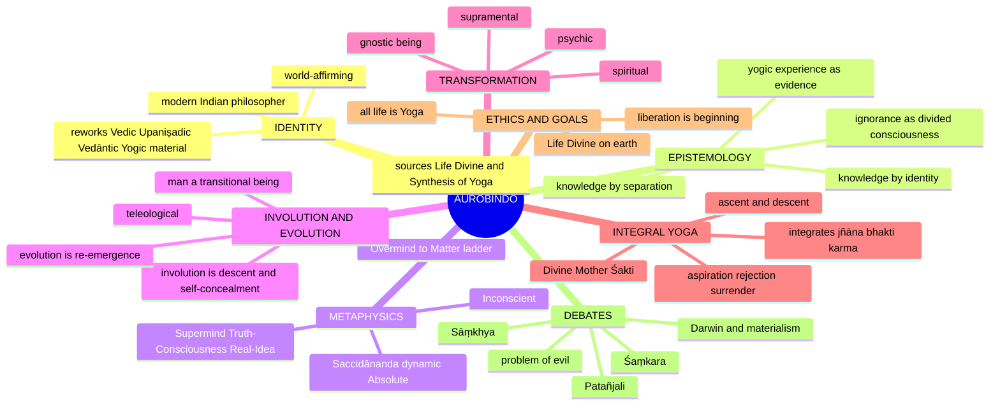

---

## 1. Identity, Lineage & Doxography

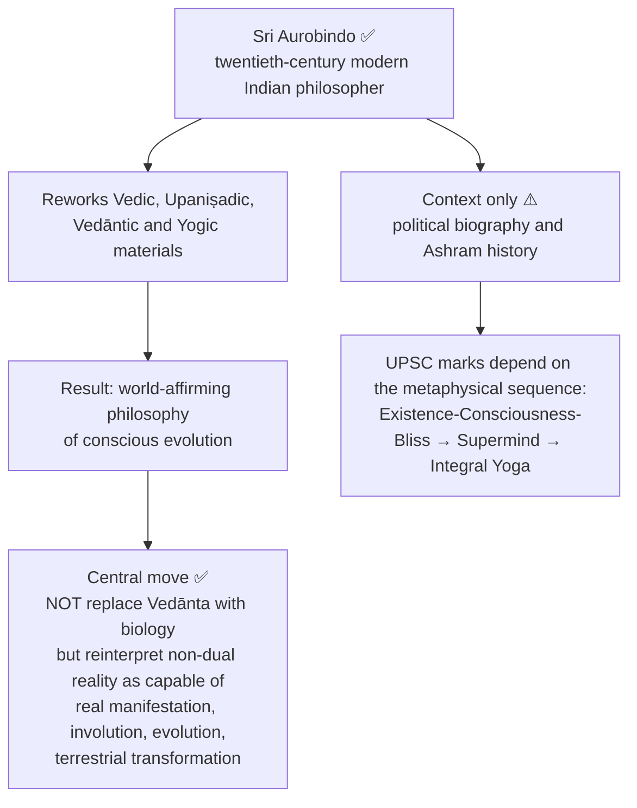

### 1.1 Primary-source map

| Source | Marks-essential ownership | Source caution |
|---|---|---|
| *The Life Divine* | Existence–Consciousness–Bliss, Supermind, involution, evolution, ignorance, gnostic being, divine life | Primary metaphysical source |
| *The Synthesis of Yoga* | Integral Yoga; synthesis of knowledge, devotion, works; transformation of nature | Primary practical-philosophical source |
| *Letters on Yoga* | Distinctions among planes, psychic being, ascent, descent, transformation | Expository correspondence compiled by topic; use for clarification, not fabricated verbatim quotations |
| *Essays on the Gita* | Spiritual action; integration of knowledge, devotion and works | Comparative bridge |
| *The Human Cycle*, *The Ideal of Human Unity* | Social and collective evolution | Use only to bound the collective horizon of divine life |
| *Savitri*, *The Mother* | Poetic/symbolic and practical corroboration | Never the sole proof of a technical doctrine |

- ⚠️ Local Chatterjee–Datta supplies no substantive Aurobindo chapter; C.D. Sharma gives a compact survey; the repository's primary-source-based dossiers carry the finer distinctions. Radhakrishnan (*Indian Philosophy*, Vol. II) and Haridas Chaudhuri (*The Philosophy of Integralism*) are also listed.
- ⚠️ Distinguish exact quotations from exam-safe paraphrases. Where edition/page verification is unavailable, state the doctrine without quotation marks and name the work-family.
- ❓ **Exegesis or reconstruction?** Critics say Aurobindo reads his own system into the Veda, Upaniṣads and Gītā. Reply: philosophical reconstruction using tradition creatively to express a yogic vision, not mere antiquarian exegesis. Genuinely contested.
- *The source file gives no āstika/nāstika or founder-lineage classification for Aurobindo.* His placement is as the final modern-Indian thinker of the syllabus.

---

## 2. Theory of Knowledge (Epistemology)

### 2.1 Knowledge by identity vs knowledge by separation ✅

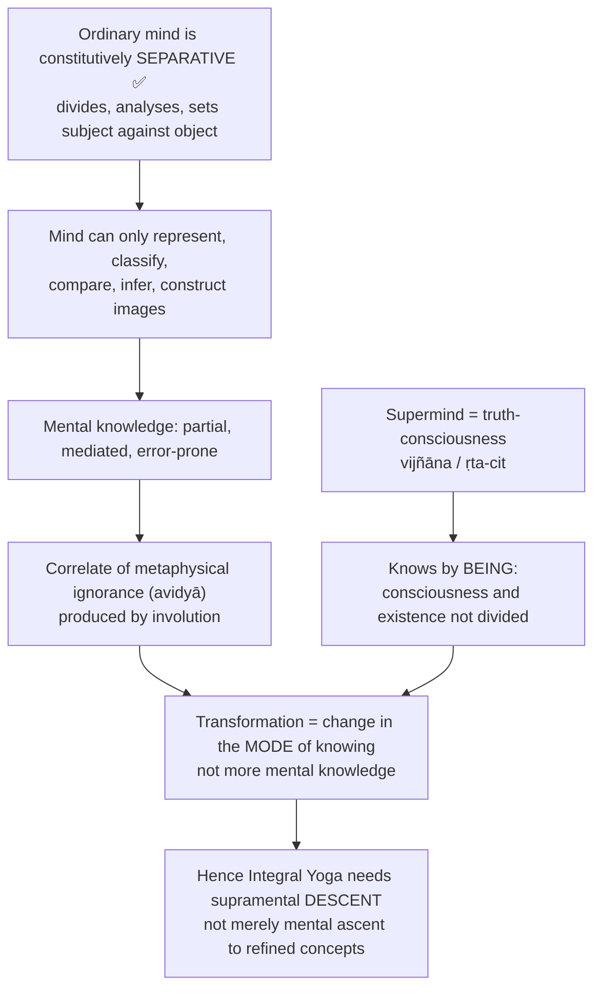

### 2.2 Graded scheme of knowledge ⚠️

> ⚠️ Aurobindo's enumeration and naming vary across presentations. Present as a **graded scheme**, not a rigid canonical fourfold list.

| Grade | Meaning | Level / example |
|---|---|---|
| 1. Knowledge by identity | Knower and known are one; Spirit knows itself without subject-object separation | Native to Saccidānanda and Supermind ✅ |
| 2. Knowledge by intimate direct contact | Separation present but bridged; the knower inwardly touches the object | Higher spiritual / intuitive contact ⚠️ |
| 3. Knowledge by separative direct contact | Direct contact but from outside, through separation | Sense-perception ⚠️ |
| 4. Wholly separative indirect knowledge | Signs, symbols, images, inference, concepts; represents but does not possess | Discursive intellect, empirical representation ✅ |

- **Not blank ineffability ⚠️:** knowledge by identity is self-luminous, determinate and comprehensive; it knows the many **as** the One and the One **as** the many. Mind either stresses unity by suppressing multiplicity or multiplicity by losing unity. This is why Aurobindo can affirm the world rather than dissolve it.

### 2.3 Ignorance as divided consciousness ✅/⚠️/❓

- Ignorance is not sheer non-being or total absence of consciousness; it is consciousness narrowed, self-limited and divided from its larger truth ✅.
- Integral truth is native to Supermind; Overmind distributes one truth into multiple powers; separative mind treats partial standpoints as self-sufficient wholes ✅.
- The ordinary ego knows itself as isolated because it loses awareness of transcendent source, cosmic unity, subliminal depths, temporal continuity ✅.
- Inconscience is the extreme term of self-concealment; mental ignorance is its active divided mode in thought, desire and action ✅.
- Ignorance is real in its evolutionary effects but not an independent anti-divine substance; capable of reintegration ⚠️.
- ❓ Cost: "concealed consciousness" can sound verbally protected from disproof; Aurobindo answers through graded experience and evolutionary continuity, but public verification is incomplete.

### 2.4 Epistemic objections → replies ⚠️

| Objection | Aurobindo's reply | Residual force |
|---|---|---|
| If knower and known are identical, knowledge collapses into mere being | Saccidānanda contains **cit-śakti**: consciousness is inherently self-aware force; the mind's assumption that knowledge needs duality is a limitation of the mental mode ✅ | Classic difficulty of self-luminous consciousness, faced also by Advaita's *svayaṃ-prakāśa* ⚠️ |
| Empiricist / positivist: unverifiable by any public method | Yoga is a repeatable inner discipline, not dogma ⚠️ | Relocates rather than removes verification, since the method is not public in the ordinary scientific sense ⚠️ |
| Supermind, truth-consciousness sound metaphorical | Terms name modes of experience and being within the systematic metaphysics ⚠️ | Hard to translate into analytic criteria of truth ⚠️ |
| Philosophy or spiritual autobiography? (§6.2 of owner) | Much Indian philosophy accepts **yogic pratyakṣa**; the system can also be assessed by coherence, explanatory power, integrative range ⚠️ | Not experimentally public in the ordinary sense |

### 2.5 Supermind vs ṛtambharā prajñā: echo, not identity ⚠️

> [!WARNING]
> Use "ṛtambharā" for Aurobindo only as an illustrative echo, **never** as an identification. Do not write that Aurobindo "adopts Patañjali's ṛtambharā."

| Axis | Patañjali's ṛtambharā prajñā | Aurobindo's supramental knowledge |
|---|---|---|
| Ontological status | A purified **citta-vṛtti**, a modification of mental substance at highest clarity | Not a mental modification; a distinct plane above mind ✅ |
| Yogic location | Arises with **nirvicāra-vaiśāradya**, leads toward **nirbīja samādhi** | Must descend and be established in mind, life, body ✅ |
| Final destiny | Must itself cease, as kaivalya requires cessation of all vṛtti | Not transcended but embodied as truth-consciousness ✅ |
| Goal | Kaivalya | Divine life on earth ✅ |
| Metaphysics | Dualist: many puruṣas, prakṛti | Integrally non-dual: one Saccidānanda, Matter and Spirit as poles ✅ |

---

## 3. Dialectical Wings & Sceptical Refinements

> The owner file records **no internal sceptical wing** within Aurobindo's system. This module therefore carries (a) the rival "denials" he sets himself against, and (b) the source-given interpretive disputes from the advanced dossier. Nothing is invented.

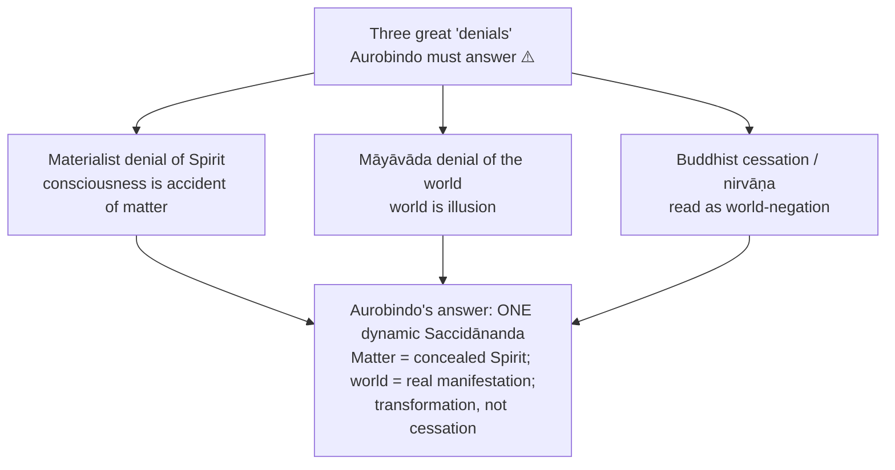

### 3.1 Optional-depth modules from the advanced dossier ⚠️ (second-order enrichment)

| Issue | Readings | Strongest extra objection → reply |
|---|---|---|
| **Overmind vs Supermind** | Loose popular readings blur them; stricter Aurobindonian reading distinguishes supramental integral truth from overmental plurality | *Obj.:* the ladder becomes unverifiable layering. *Reply:* an explanatory structure for unity-in-multiplicity and spiritual phenomenology, not a laboratory taxonomy |
| **Psychic being vs jīvātman / puruṣa** | Owner-safe: evolving soul-principle; rival confusion identifies it with Sāṃkhya puruṣa or a static ātman | *Obj.:* multiplying inner selves obscures. *Reply:* distinguishes surface ego, psychic being, transcendent self to map layers of growth |
| **Teleological evolution vs modern critique** | Sympathetic: metaphysical deepening of evolution; critical: speculative teleology without testability | *Obj.:* not empirically demonstrable. *Reply:* not a substitute for biology, but a metaphysical account of why consciousness-development is intelligible |
| **Individual liberation vs collective transformation** | Conservative: liberation remains central; stronger integral: liberation is preliminary to transformation of life and collectivity | *Obj.:* utopian. *Reply:* possibility and inevitability are cosmic tendencies, not guarantees of quick historical arrival |

- *What not to over-study (dossier):* long plane-by-plane catalogues, Ashram history, every later interpreter's vocabulary.
- *Promotion trigger (dossier):* promote if a PYQ directly asks Overmind, psychic being vs self, Aurobindo's relation to Darwin/science, or whether transformation outruns liberation. One optional insight is usually enough in a 15/20-marker; two is the ceiling.

---

## 4. Metaphysics & Ontology

### 4.1 The Absolute: Saccidānanda ✅

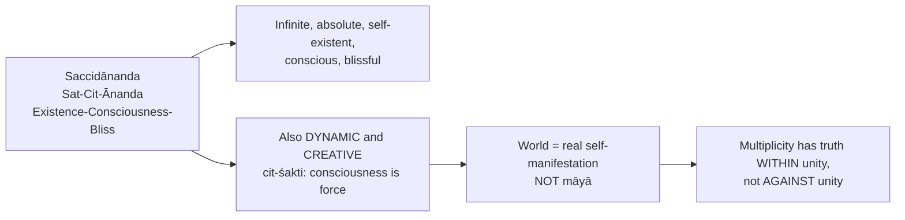

| Axis | Śaṃkara's Advaita | Aurobindo |
|---|---|---|
| Ultimate reality | Nirguṇa Brahman | Saccidānanda |
| Character of Absolute | Often read as static, non-relational, world-transcending | Dynamic, creative, self-manifesting |
| World | ultimately māyā / mithyā | real manifestation of the Divine |
| Liberation | knowledge of unreality of separateness | knowledge plus transformation of life |
| Relation to cosmos | empirical concession | ontological self-expression |

- ⚠️ He does not deny transcendence; he denies that transcendence must cancel immanence. If the world were illusion, the drama of evolution would be pointless.
- **Presuppositions ⚠️:** Absolute rich enough to ground unity and differentiation; consciousness ontologically basic, not derived from matter ✅; finite arises from Infinite without rupture or illusion.
- A static Absolute could explain liberation **from** the world; a dynamic Absolute explains transformation **of** the world.

### 4.2 Supermind (vijñāna / Truth-Consciousness / Real-Idea) ✅

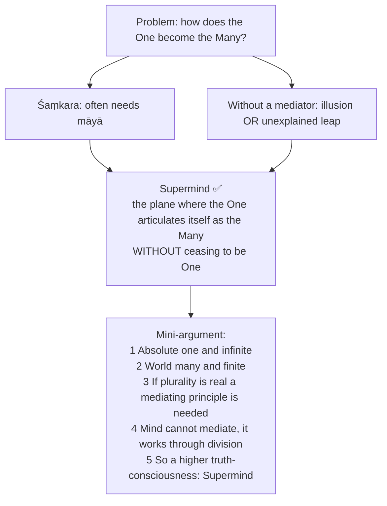

| Feature | Mind | Supermind |
|---|---|---|
| Mode of knowledge | indirect, analytical, divisive | direct, integral, truth-bearing |
| Unity and plurality | splits and opposes | holds both simultaneously |
| Error | possible and common | truth-native |
| Concept | abstract representation | Real-Idea / creative truth |
| Status | lower plane | supramental principle |

- **Not the Absolute itself:** the first creative determinative poise of Saccidānanda; self-ordering truth-power through which the cosmos is manifested ⚠️. **Not a superior human intellect** ✅.
- Asked directly in **2019** and **2023**.

#### Three poises of the Supermind ⚠️ (naming and numbering vary; preserve the substance)

| Poise | What it does | Significance |
|---|---|---|
| 1. Comprehending / transcendent | Holds all things in undivided unity; many present but not yet stationed as separate centres | The Divine aware of itself as sole existence containing all ✅ |
| 2. Apprehending / creative | Subject-object distinction projected **within** unity; Divine stands back as knower, puts forth cosmos as known | Poise of cosmic Puruṣa / Īśvara; distinction without loss of unity ⚠️ |
| 3. Projecting / individualising | Consciousness stands **in** each individual centre and knows from there | Individuality real; separateness arises only in the descent below Supermind into Overmind and Mind ⚠️ |

*Payoff:* multiplicity is a real self-modification of consciousness, not a false appearance and not a diminution.

### 4.3 The gradation of planes ✅

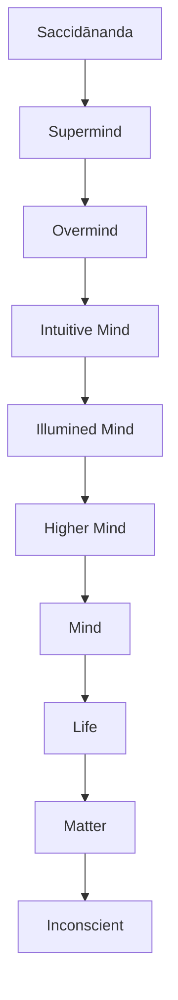

| Plane | Status | Caution |
|---|---|---|
| Saccidānanda | Absolute Existence-Consciousness-Bliss | Not a finite plane among planes ✅ |
| Supermind | Undivided Truth-Consciousness | Alone possesses integral truth; not mind at maximum ✅ |
| Overmind | Cosmic gods, vast powers, separated divine aspects | Unity first breaks into independently self-existent powers; last plane before ignorance becomes possible ✅ |
| Intuitive Mind | Direct flashes of truth above discursive reason | Below supramental totality ⚠️ |
| Illumined Mind | Luminous spiritual seeing and inspiration | Integral truth not yet native ⚠️ |
| Higher Mind | Large ideative spiritual consciousness | Still works through broad ideas ⚠️ |
| Mind | Separative, analytical, representational | Source of ordinary ignorance and error ✅ |
| Life | Vital force, desire, dynamism | Consciousness more veiled ✅ |
| Matter | Densest self-concealment of Spirit | Spirit in self-oblivion, not anti-spiritual ✅ |
| Inconscient | Bottom term of concealment | Consciousness hidden, not absent ✅ |

- **Overmind** is the highest level normally reachable before Supermind; it distributes truth into plural powers, Supermind integrates them in indivisible truth ✅. Previous attainments may reach liberation or Overmind-like universality but not the supramental transformation of terrestrial nature ⚠️.

### 4.4 Involution ✅

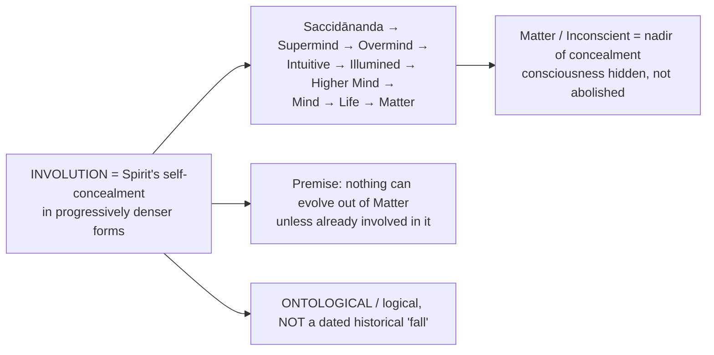

- Matter is not an enemy of Spirit but Spirit at its most densely self-hidden point, containing the whole divine potential in latent form; hence matter can be transformed rather than escaped ✅/⚠️.

| Issue | Materialism | Aurobindo |
|---|---|---|
| Matter | basic reality | last term of self-concealed Spirit |
| Consciousness | product of matter | latent in matter through involution |
| Teleology | absent or secondary | built into existence |
| Evolution | mechanical emergence | unveiling of what is already involved |

- **Against Sāṃkhya:** matter is not an independent unconscious prakṛti but concealed consciousness. **Against Advaita:** the lower world is a real field of manifestation, not an illusory appearance to be sublated ⚠️.

### 4.5 Evolution ✅

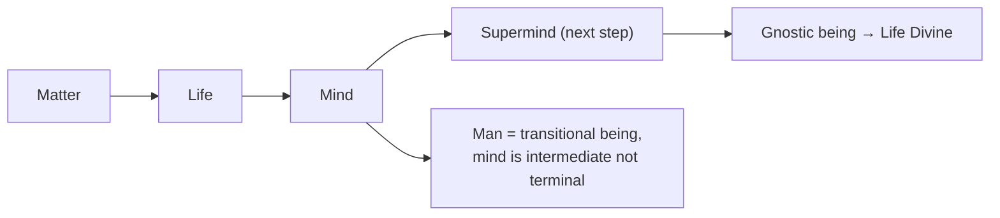

- Evolution is the progressive re-emergence of the Spirit involved in Matter; the reverse disclosure of involution ✅. Teleological: motive force is the involved Divine pressing to manifest ✅.
- **"Already involved" ≠ preformed miniature species** ✅: what is involved is the power or principle of consciousness; later forms are genuinely new organisation. Continuity of ontological potential with novelty of form ⚠️. ❓ An emergentist can deny that novelty requires involution; that is the exact dispute.
- In man evolution becomes capable of becoming **conscious**; yoga is the means ✅.

### 4.6 The psychic being and the self-family ✅

| Term | Status | Evolves? | Function | Not to be confused with |
|---|---|---:|---|---|
| **Ātman / Self** | Eternal, unborn, immutable Spirit identical with Saccidānanda | No | Universal Self, never bound or altered ✅ | Surface personality, ego |
| **Jīvātman / central being** | Individual Self, centre or portion of the Divine above manifestation | No | Presides over the line of births without itself changing ⚠️ | The evolving psychic being |
| **Caitya puruṣa / psychic being** | Evolving soul-personality formed around the divine spark (caitya) | **Yes** | Gathers the essence of experience across lives; comes forward in **psychicisation**; turns being toward the Divine ✅ | Sāṃkhya puruṣa, ego |
| **Ego / surface personality** | Functional construction of mind-life-body | Changes, not the true being | Practical identity through desire, memory, habit ⚠️ | A real spiritual individual |
| **Inner Puruṣa and Prakṛti** | Witness consciousness and nature-force | Puruṣa witnesses; Prakṛti acts | Sāṃkhya instrument redeployed psychologically, no ultimate dualism ⚠️ | Final metaphysical dualism |

- The psychic being is the delegate of the jīvātman in the evolution ⚠️. Without the distinction an evolving soul would contradict an immutable Self.
- *Objection:* multiplies entities. *Reply:* immutable witness, unevolving individual centre and evolving experiential soul cannot be discharged by one term without contradiction. *Residual:* looks stipulative unless yogic psychology is accepted as evidence.

---

## 5. Rejection / Affirmation of Transcendent Realities

> Aurobindo **affirms** the transcendent while refusing world-negation. The owner file does not set out a Cārvāka-style list of accepted/rejected items (karma, adṛṣṭa, Veda authority), so only what it states appears here.

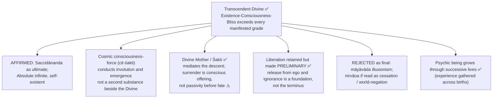

- Dimensions table (owner §4.7A): **Transcendent Divine** (grounds all, not exhausted by evolution) · **Cosmic consciousness-force** · **Individual evolution** (cosmic direction does not guarantee automatic individual attainment) · **Collective transformation** (no timetable, political blueprint or guaranteed species-event).
- ❓ The status of claims about bodily transformation and supramental future is genuinely contested.

---

## 6. Explanatory & Causal Principles

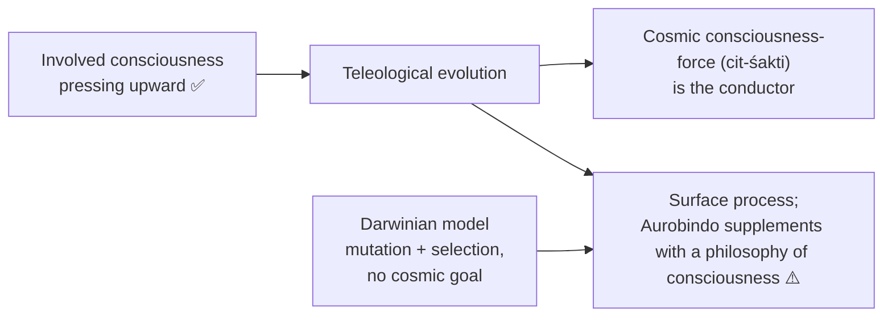

| Axis | Darwinian model | Aurobindonian model |
|---|---|---|
| Main explanatory level | biological process | spiritual-metaphysical process |
| Direction | no intrinsic cosmic goal | teleological unfolding |
| Cause of higher emergence | mutation + selection | involved consciousness pressing upward |
| Human status | evolved animal | transitional being |
| End-point | none built into theory | supramental / gnostic being |

- ⚠️ Safe line: Aurobindo does **not mainly refute biology**; he supplements it with a philosophy of consciousness.
- **Presuppositions of involution-evolution (owner §4A):**

| # | Presupposition | What collapses if denied |
|---:|---|---|
| 1 | Reality is one and is Saccidānanda | Nothing single to involve itself; pluralism or materialism ⚠️ |
| 2 | Nothing can emerge that was not already involved | Brute accident or unexplained miracle ⚠️ |
| 3 | Consciousness is not produced by matter | Collapse into emergent materialism ⚠️ |
| 4 | The Absolute is dynamic (cit inseparable from cit-śakti) | Static Absolute could neither involve nor evolve ⚠️ |
| 5 | Involution is ontological, not chronological | Degenerates into mythic history ⚠️ |
| 6 | The world-process is teleological | Process blind; Matter→Supermind loses necessity ⚠️ |
| 7 | Terrestrial life is fit for divine manifestation | Integral Yoga becomes another path of escape ⚠️ |

---

## 7. Ethics & Human Goals (Puruṣārthas)

> The owner file gives **no kāma / artha / dharma / mokṣa hierarchy** for Aurobindo. This module carries only his source-stated goal-structure: liberation, transformation, divine life, and the practical ethic of the method.

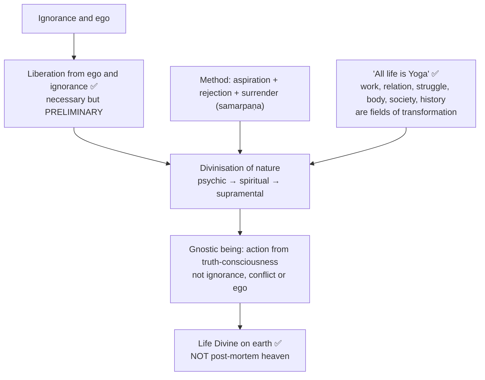

- **Why 'integral' (three senses) ✅:** (a) integration of paths (jñāna, bhakti, karma); (b) integration of the being (mind, life, body); (c) integration of individual and collective destiny.
- **Method:** Aspiration (upward call) · Rejection (of lower impulses, ego, falsehood, desire, obscurity) · Surrender (self-giving to Divine Mother / Śakti). These are psychological-spiritual conditions, not merely moral disciplines ⚠️.
- **Gītā bridge ✅/⚠️:** Aurobindo reads the Gītā as scriptural warrant for spirituality in action; he radicalises its action-without-egoic-desire into an evolutionary yoga of terrestrial divinisation.
- **Elitism objection:** a "gnostic race" could legitimate spiritual hierarchy. Reply: gnostic consciousness is defined by ego-transcendence, unity and service, not social privilege. Residual: private experience gives weak public safeguards against charismatic abuse. Collective transformation is **not** rule by a self-certified elite ⚠️.

---

## 8. Inter-School Comparative Matrices

### 8.1 Master matrix ✅

| Axis | Aurobindo | Advaita Vedānta | Viśiṣṭādvaita | Sāṃkhya–Yoga | Buddhism | Vedic tradition |
|---|---|---|---|---|---|---|
| World | Real manifestation of Saccidānanda | māyā / mithyā in strong illusionist reading | Real body of God | Real prakṛti distinct from puruṣa | Conditioned process of suffering and impermanence | Cosmic order and divine manifestation |
| Absolute | Dynamic Saccidānanda, Supermind as truth-power | Nirguṇa Brahman final | Qualified Brahman / personal God | No single Absolute: puruṣa and prakṛti | No permanent self or creator Absolute | ṛta, gods and powers |
| Individual | Ātman, jīvātman, evolving psychic being | Ultimately Brahman | Real dependent self | Many puruṣas | No permanent self | Participates in cosmic-divine order |
| Bondage | Separative consciousness from involution and Inconscience | Avidyā superimposes world and individuality | Karma and ignorance of dependence on God | Misidentification of puruṣa with prakṛti | Ignorance, craving, clinging | Disorder from losing truth/order |
| Goal | Divine life on earth through supramental transformation | Jīvanmukti / videhamukti | Loving union / service | Kaivalya | Nirvāṇa / cessation | Re-establishment in truth/order |
| Means | Integral Yoga: jñāna-bhakti-karma, aspiration-rejection-surrender, descent | Jñāna | Bhakti and prapatti | Aṣṭāṅga-yoga and discrimination | Eightfold path / insight | Sacrifice, mantra, knowledge of ṛta |
| Escape or transformation? | **Transformation** | Primarily escape / sublation | Communion | Escape / isolation | Cessation / release | Ambiguous; Aurobindo reads it as world-affirming truth-symbolism |

### 8.2 Pairwise contrasts ✅/⚠️

| vs | Their position | Aurobindo | Compact line |
|---|---|---|---|
| **Patañjali** | Sāṃkhya-Yoga dualism; kaivalya = isolation of puruṣa; citta-vṛtti-nirodha, aṣṭāṅga; withdrawal; end-state cessation and separation | Dynamic non-dualism; transformation of prakṛti by supramental descent; aspiration-rejection-surrender; divinisation of life; truth-conscious participation in divine life | Patañjali aims at release **from** prakṛti; Aurobindo at transformation **of** prakṛti |
| **Śaṃkara** | Brahman; world māyā/mithyā; māyā/avidyā mediates One and Many; liberation through jñāna; sublation | Saccidānanda; real manifestation; Supermind mediates; liberation plus transformation; divinisation | Preserves non-duality while rejecting illusionism |
| **Sāṃkhya** | Two ultimate realities; independent prakṛti; liberation = discrimination; prakṛti evolves for puruṣa's experience and release | One Divine reality in graded manifestation; matter concealed Spirit; transformation of nature; evolution is Divine's self-manifestation | |
| **Rāmānuja** | World = real body of God; individual real mode of Brahman; loving service | Real manifestation and Divine becoming; individual real centre with evolutionary destiny; divine life through supramental transformation | Both reject illusionism; for Rāmānuja world is God's body eternally, for Aurobindo a Divine becoming with a supramental future |
| **Buddhism** | Denies permanent surface self; nirvāṇa as cessation of ignorance and craving; release from suffering | Accepts critique of ego but affirms Self, jīvātman, psychic being; rejects nirvāṇa as final word if cessation / world-negation | Buddhism and Māyāvāda are two great "denials" his philosophy must answer, alongside the materialist denial of Spirit |
| **Darwin** | Empirical science; variation and selection; no final telos | Metaphysical-spiritual; involved consciousness; supramental telos | Register differs; supplement, not rival |
| **Materialism** | Consciousness a derivative accident of matter | Matter a derivative poise of concealed consciousness | Sustained critique of reductionism |
| **Religious mysticism** | Often culminates in transcendence beyond world and action | Accepts transcendence but insists on return, descent, terrestrial manifestation | Evolutionary, this-world-affirming mysticism |

---

## 9. Criticisms & Reconstructed Replies

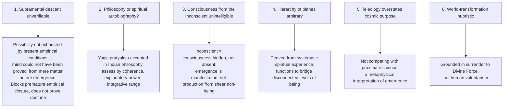

### 9.1 Further objections ⚠️

| Objection | Best reply | Residual force |
|---|---|---|
| Determinism: if Supermind is inevitable, freedom and Yoga redundant | Cosmic direction does not fix each individual's timetable; aspiration, rejection, surrender make evolution participatory | Relation between divine inevitability and genuine refusal remains difficult |
| Category confusion: biological, psychological, metaphysical treated as one process | Distinguishes proximate mechanism from philosophical account of consciousness and meaning | Transitions need argument, not inference from biological data |
| Unfalsifiability: every failure explained as delayed descent | Coherence, transformative experience, cumulative phenomenology as non-laboratory evidence | Without shared criteria and possible defeaters, risks insulation |
| Involution is question-begging (emergentist denies it) | Emergence from wholly inconscient matter restates the mystery; involution more economical if evolution directional | A naturalist can deny directionality |
| A dynamic Absolute compromises transcendence | Dynamism need not mean limitation; exceeds the world while freely manifesting | Real manifestation may introduce change into the Absolute |
| If the end is assured, individual effort irrelevant | Cosmic evolution has direction; conscious participation determines readiness and pace | Balance of inevitability and freedom difficult |

### 9.2 Pūrvapakṣa–siddhānta ledger ⚠️

| Objector | Objection | Aurobindo's reply | Residual |
|---|---|---|---|
| Advaita / Māyāvāda | If nirguṇa and world māyā, dynamism superfluous; a real world compromises non-duality | Non-duality need not mean world-negation; māyā can be read as Divine creative power; Supermind explains real multiplicity within unity ✅ | Real manifestation may introduce change into Brahman |
| Buddhist | Permanent Saccidānanda, Self, jīvātman unestablished; ego-lessness should lead to cessation | Accepts critique of ego, distinguishes ego from Self and psychic being; cessation is partial realisation ⚠️ | Buddhist can deny a positive Absolute is needed |
| Sāṃkhya-Yoga | Goal is isolation; transforming prakṛti confuses liberation with bondage-field | Puruṣa-Prakṛti useful psychologically, not ultimate dualism ✅ | Classical Yoga may call this abandoning kaivalya |
| Materialist / naturalist | Evolution needs no involution; consciousness emergent; descent unfalsifiable | Mechanisms do not explain why consciousness appears; involution accounts for directionality ⚠️ | If directionality denied, argument loses force |
| Analytic / positivist | Supermind, descent, knowledge by identity not truth-apt or public | Disciplined yogic verification and systematic coherence ⚠️ | Non-public verification |
| Moral critic | Theodicy instrumentalises suffering | Evil transformed, not celebrated; Divine participates in the adventure ⚠️ | Suffering of innocents troubling |
| Historical-critical | Reads own system into Veda, Upaniṣads, Gītā ❓ | Philosophical reconstruction ⚠️ | Exegesis vs reconstruction contested ❓ |

### 9.3 Problem of evil in Aurobindo ⚠️ (bridge to Paper II)

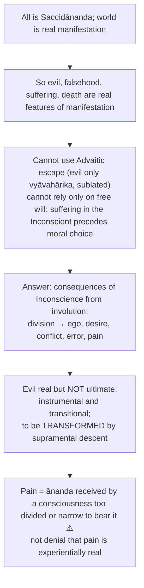

- Objections: instrumentalises suffering; justification deferred to an unverifiable future; if the Divine chose involution the Divine authored evil (reply: Inconscient is self-concealment for manifestation, the individual is the Divine undergoing the adventure; residual: blurs responsibility); "pain is disguised ānanda" denies suffering (reply: real at its level, not ultimate in essence; dangerous unless suffering's reality is acknowledged).
- **Safe verdict:** do not write that the problem is fully solved; write that it is *integrated* into the involution-evolution metaphysics.

---

## 10. Controlled Western Comparisons

| Thinker | Point of contact | Decisive disanalogy |
|---|---|---|
| **Bergson** | Rejects mechanistic and purely Darwinian accounts; creative, directional evolution; intuition over analytic intellect | Élan vital is impersonal, no prior involution, open-ended; Aurobindo's evolution is teleologically closed by recovery of Saccidānanda. Bergson's intuition is duration-consciousness, not a supramental plane; no divine descent or bodily transformation |
| **Hegel** | Dynamic Absolute; finite not mere illusion; finite a moment of the Infinite's self-realisation | Hegel: dialectical, conceptual, Aufhebung toward Absolute Knowing as self-conscious thought. Aurobindo: supramental, experiential, divine life in matter and body. Hegel lacks knowledge by identity, yogic method, doctrine of descent |
| **Teilhard de Chardin** | Closest structural parallel: cosmogenesis, complexity-consciousness, noosphere, Omega Point ~ evolution toward Supermind | Teilhard Christological and personalist; Omega convergence at the end of the world-process. Aurobindo's Supermind descends into and transforms terrestrial life including the body; no involution as prior self-concealment, no yogic method. Parallel development, not influence |
| **Nietzsche** | Human as transitional; self-overcoming | Übermensch naturalistic, anti-metaphysical, no Divine descent; supramental being arises from Truth-Consciousness |
| **Whitehead** | Process-friendly; rejects static world-negating metaphysics | God and actual occasions do not map onto planes of consciousness, involution, descent, bodily transformation |
| **Plotinus** | Procession from the One and return resembles involution and evolution | Plotinian return is ascent away from matter, the dimmest emanation; Aurobindo's completion is descent into Matter and its transformation |

> [!WARNING]
> Western parallels are illustrative only; always add the disanalogy; at most one or two lines after the Aurobindo case. "Aurobindo is the Indian Bergson / Hegel / Teilhard" without the disanalogy is a marked weakness. Do not assert historical influence.

---

## 11. Diagnostic Deep-Dives for High-Frequency Themes

### 11.1 Triple transformation (2018, 2022, 2026) ✅

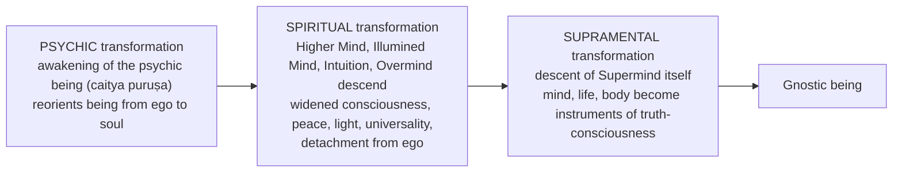

- **Why psychic first (5 steps ✅):** (1) ordinary person governed by surface mind, desire, habit, ego; (2) these are unstable and divisive; (3) psychic being gives an inner soul-based discernment and sincerity; (4) only on this basis can higher spiritual influx be safely assimilated; (5) so its awakening is the first step in conscious evolution (2021).
- **2026 Q6(b) causal route ⚠️:** Integral Yoga integrates knowledge, devotion, works and acts on mind, vital nature, body; operative discipline = aspiration, rejection, surrender to the Divine Śakti. **Psychicisation** brings the evolving soul forward to guide ego-bound nature; **spiritualisation** opens to peace, light, universal consciousness, but an illumination of mind is **not yet** Supermind; **supramentalisation** requires descent of truth-consciousness into the whole nature, not an inward state alone. Ascending contact and descending force work together; individual effort prepares and consents but cannot manufacture the descent. Triple transformation is the **means and process**, not three separate completed liberations. Whether the final descent occurs as claimed remains an open verification objection.

### 11.2 Double movement of ascent and descent (2024) ✅

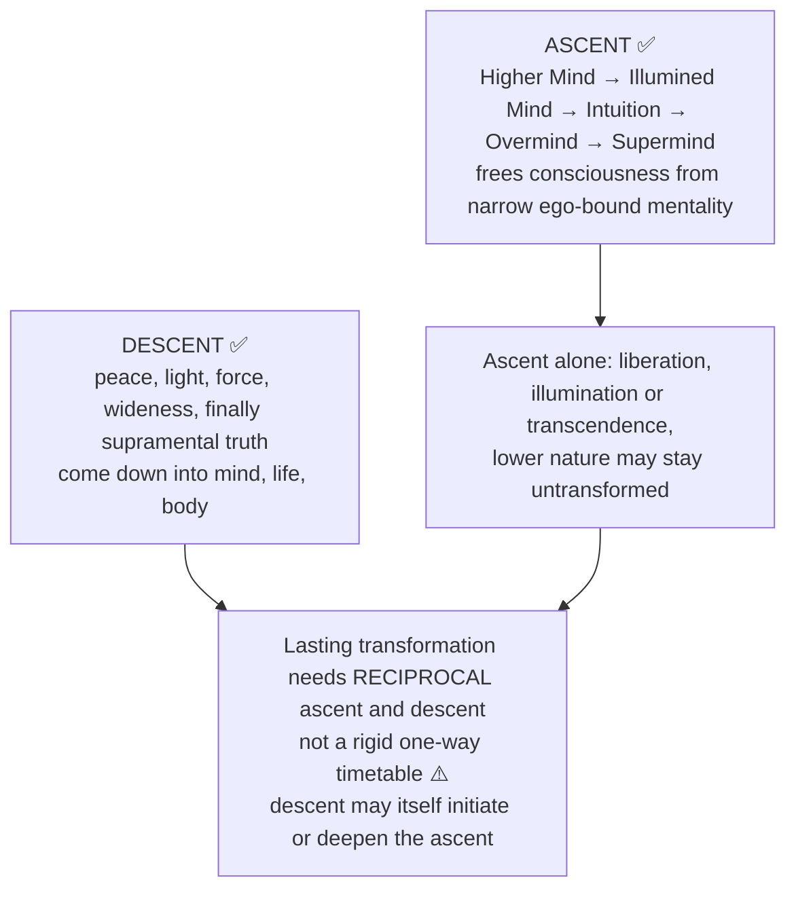

### 11.3 'Both ascetic and materialist are partial' (2025) ⚠️

| Pole | Strength | Cost (for Aurobindo) |
|---|---|---|
| Ascetic negation | Recognises Spirit and transcendence; refuses to reduce consciousness to physical processes | Treats material life as obstacle or lesser reality; makes embodied transformation unintelligible. *Not every spiritual path literally denies matter exists* |
| Materialist negation | Takes bodily reality and empirical explanation seriously | Treats consciousness as effect of matter alone; leaves inward consciousness and spiritual experience unexplained. A naturalist may reply emergence needs no involution |

- Aurobindo's alternative: one dynamic Saccidānanda → Matter as self-concealment → life and mind as disclosure of involved consciousness → Supermind holds plurality within unity → Integral Yoga makes ascended insight descend → **divine life on earth**. The argument depends on involution and supramental knowledge, neither independently demonstrated to a materialist; the two denials are incomplete *within his system*, not refuted by naming integration.

### 11.4 'Life divine' as possibility and inevitability (2020) ⚠️

| Aspect | Content |
|---|---|
| Meaning ✅ | Embodied earthly existence governed increasingly by supramental truth-consciousness rather than ego, division, ignorance. **Not** post-mortem heaven, private mystical release, political utopia, or perfection of the ordinary intellect |
| Why possible | (1) Matter is involved Spirit; (2) life and mind already emerged from apparently inconscient Matter; (3) Supermind coordinates unity and multiplicity and is not foreign to manifestation; (4) psychic and spiritual transformation prepare mind, life, body; (5) the gnostic being names the individual form |
| What 'inevitable' means ✅ | Inner direction of cosmic evolution: mind is transitional, involved truth-consciousness presses toward manifestation |
| What it does NOT mean ❌ | Every individual must become supramental; history follows a fixed timetable; human effort mechanically produces the result |
| Verdict ⚠️ | Possible if involution is accepted; inevitable as cosmic tendency; not automatically inevitable for each person or demonstrable as a completed empirical event |
| ❓ | Speculative: no publicly established supramental collectivity yet confirms it |

### 11.5 The gnostic being (2018 Q8(c)) ✅

- Supramental being produced by the highest transformation; knowledge direct and integral; action from truth-consciousness; healing of inner/outer and individual/cosmic division ⚠️.
- **Nature not label ⚠️:** individuality persists as a conscious expression of the Divine, no longer an isolated ego; truth-knowing and truth-willing work together; life and body are fields of spiritual expression. **Not** a perfected ordinary intellect, a disembodied liberated self, or an empirically established new species. Connect back to all three transformations.

### 11.6 Overmind vs Supermind (traps) ✅

Overmind = many truths and powers, plurality of cosmic gods and aspects; Supermind = indivisible integral truth. Illumination of mind or overmental universality is not supramental transformation.

---

## 12. PYQ Routing Ledger (2018–2026)

> Corpus signal: 8 primary-owned parts out of 112 in 2018–2025 (exactly one in every year); the 2026 supplement adds 1 more (Aurobindo 2026: 1 part, 15 marks, Q6(b)). **Total 9 verified parts.**

| Year | Q | Marks | Exact demand | Map to |
|---|---|---:|---|---|
| 2018 | Q8(c) | 15 | What is Evolution according to Sri Aurobindo? Describe the process of triple transformation and the nature of gnostic being in his philosophy. | §4.5, §11.1, §11.5 |
| 2019 | Q8(b) | 15 | Explain the unique position of the Supermind in the metaphysical scheme of Aurobindo's philosophy. | §4.2, §4.3 |
| 2020 | Q8(a) | 20 | What does Aurobindo mean by 'life divine' as a possibility and inevitability? | §11.4 |
| 2021 | Q8(a) | 20 | According to Sri Aurobindo, 'the awakening of the psychic being and its gradual prominence over all other parts of the being is the first step in the conscious evolution of man'. Explain and examine. | §4.6, §11.1 |
| 2022 | Q8(b) | 15 | Explain and evaluate the role of integral yoga in the process of triple transformation for individual evolution as expounded by Sri Aurobindo. | §7, §11.1 |
| 2023 | Q5(e) | 10 | Explain the nature and role of Supermind in evolution as per Aurobindo's philosophy. | §4.2, §4.5 |
| 2024 | Q7(c) | 15 | "Our Yoga is a double movement of ascent and descent." Discuss the above statement in the context of Sri Aurobindo's conception of Integral Yoga. | §11.2 |
| 2025 | Q8(b) | 15 | 'Both Ascetic and materialist are partial in their negation of each other'. Explain Sri Aurobindo's integral philosophy in the light of the above statement. | §11.3 |
| 2026 | Q6(b) | 15 | Explain the basic characteristics of Sri Aurobindo's Integral Yoga for the realization of supramental consciousness through triple transformation. | §11.1 (2026 route), §7 |

Quotation caution: retain "Our Yoga is a double movement of ascent and descent" and "Both Ascetic and materialist are partial in their negation of each other" as verified PYQ wording; check edition-level wording before independent quotation.

---

## 13. Top Exam Traps (owner lists 15; top 10 first)

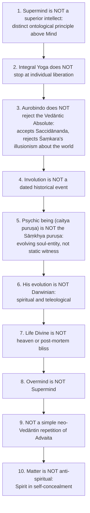

Remaining owner-listed traps: **11.** Knowledge by identity is not ordinary intuition. **12.** Do not identify supramental knowledge with Patañjali's ṛtambharā prajñā. **13.** Jīvātman and psychic being are not the same. **14.** Evil is real but not ultimate; do not say mere illusion, do not say the theodicy is problem-free. **15.** Western comparisons illustrative only; add the disanalogy before naming him the Indian Bergson, Hegel or Teilhard.

Further cautions: "inevitable" ≠ automatic individual attainment (2018–2025 depth delta); "already involved" ≠ preformed miniature species (§4.5); do not claim the three-poise or four-grade naming is rigid (§2.2, §4.2).

---

## 14. Technical Vocabulary & IAST Bank

| English gloss | IAST | Meaning | Status |
|---|---|---|---|
| Existence-Consciousness-Bliss | saccidānanda (sat-cit-ānanda) | Ultimate dynamic Absolute | ✅ |
| Truth-Consciousness | vijñāna / ṛta-cit | Supermind's mode: knowing by being | ✅ |
| Real-Idea | — | Power in which knowledge and creative force are one | ✅ |
| Consciousness-force | cit-śakti | Consciousness as self-aware force | ✅ |
| Unity-in-multiplicity | — | Ordered differentiation within a prior unity | ✅ |
| Involution | — | Spirit's self-concealment through graded planes | ✅ |
| Inconscient | — | Extreme term of concealment | ✅ |
| Teleological evolution | — | Re-emergence of involved Spirit toward Supermind | ✅ |
| Psychic being | caitya puruṣa | Evolving soul-personality | ✅ |
| Individual central self | jīvātman | Unevolving individual Self above manifestation | ⚠️ |
| Universal Self | ātman | Eternal immutable Spirit | ✅ |
| Psychic emergence | psychicisation | Psychic being comes to the front | ✅ |
| Triple transformation | — | Psychic, spiritual, supramental | ✅ |
| Integral Yoga | pūrṇa yoga | Synthesis of jñāna, bhakti, karma; transformation of whole nature | ✅ |
| Knowledge / devotion / works | jñāna / bhakti / karma | The three integrated limbs | ✅ |
| Divine Mother / Divine Power | Śakti | Mediates descent | ✅ |
| Surrender | samarpaṇa | Self-giving to the Divine | ✅ |
| Gnostic being | — | Supramental being | ✅ |
| Life Divine | — | Divinised terrestrial existence | ✅ |
| Ignorance | avidyā | Divided consciousness; correlate of separative mind | ⚠️ |
| Illusionism | māyāvāda | Rejected as final truth about the world | ✅ |
| Self-luminosity | svayaṃ-prakāśa | Advaita doctrine; Aurobindo faces a similar difficulty | ⚠️ |
| Yogic perception | yogic pratyakṣa | Spiritual experience as a mode of insight | ⚠️ |
| Truth-bearing insight | ṛtambharā prajñā | Patañjali's purified citta-vṛtti; echo only | ⚠️ |
| Isolation | kaivalya | Patañjali's goal | ✅ |
| Mental modification / its suppression | citta-vṛtti / nirodha | Yoga | ✅ |
| Practical / empirical level | vyāvahārika | Advaitic level where evil is sublated | ⚠️ |
| Cosmic truth / order | ṛta | Vedic term used for truth-bearing consciousness | ✅ |
| Overmind / Higher Mind / Illumined Mind / Intuitive Mind | — | Planes between Supermind and Mind | ✅ / ⚠️ |

---

## 15. Graded Verdict & Answer Architectures

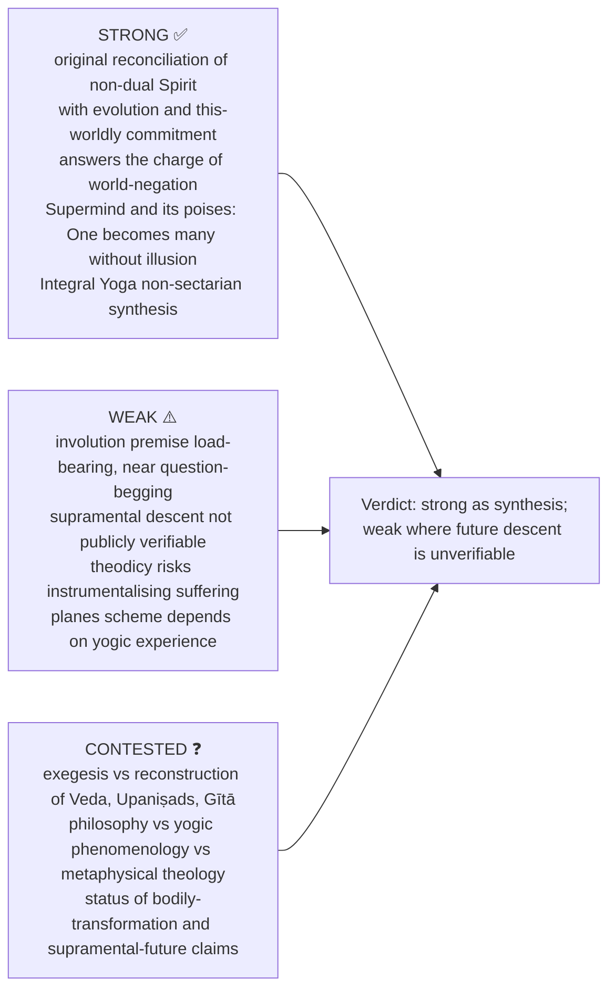

### 15.1 10-mark (~150 words)

```text
Line 1   : Define the exact term asked — Supermind / Involution / Integral Yoga.
Lines 2-4: State the doctrinal structure in 2-3 technical points.
Lines 5-6: Add the key contrast — vs Advaita / Darwin / Patañjali.
Line 7   : Close with one evaluative line answering the directive.
```
**Verdict line:** "Aurobindo's strength is his world-affirming Vedānta; the caveat is that its supramental future remains difficult to verify."

### 15.2 15-mark (~250 words)

```text
Frame  : State the problem Aurobindo is addressing.
Body A : Define the doctrine precisely.
Body B : Explain the inner logic or stages.
Body C : Contrast with the nearest rival.
Assess : One criticism and one reply.
Close  : Mention Life Divine / transformation if relevant.
```
**Verdict line:** "His system is a powerful synthesis of Saccidānanda, evolution and yoga, but it depends on the controversial premise that what evolves must first be involved."

### 15.3 20-mark (~350 words)

```text
Frame  : Locate Aurobindo in modern Indian philosophy; identify the central issue.
Body A : Full exposition (psychic being / Supermind / evolution).
Body B : Connect to involution and Integral Yoga.
Body C : Contrast with Śaṃkara, Darwin or Patañjali.
Assess : Criticism and reply.
Close  : Significance of transformation of life on earth.
```
**Verdict line:** "Aurobindo is most original in reconciling non-dual Spirit with real multiplicity and terrestrial transformation; yet the involution premise, theodicy and supramental descent remain philosophically contested."

### 15.4 Micro-skeletons by likely question

| Question | Skeleton |
|---|---|
| Unique position of the Supermind | Define Truth-Consciousness / Real-Idea → locate between Saccidānanda and lower creation → unity-in-multiplicity; avoids māyā and unexplained leap → not Absolute, not Mind → key to metaphysical originality |
| Psychic being in conscious evolution | Define evolving soul-entity behind surface personality → first awakening, reorients being to the Divine → enables psychic → spiritual → supramental transformation → not Sāṃkhya puruṣa, not ego → first indispensable step |
| Ascent and descent | Ascent: Higher Mind → Illumined → Intuition → Overmind → Supermind → Descent: higher consciousness into mind-life-body → ascent without descent gives liberation, not transformation; the owner's skeleton says descent without ascent is impossible, but §5.5 qualifies this as **reciprocal** (descent may itself initiate or deepen the ascent), so write "reciprocal, not a one-way timetable" → both define Integral Yoga |
| Ascetic and materialist partial | Ascetic affirms Spirit, denies Matter → materialist affirms Matter, denies Spirit → Spirit is truth of Matter, Matter expression of Spirit → neither renunciation nor reductionism final → Life Divine on earth |

### 15.5 Directive decoder ⚠️

| Directive | Move | Closing verdict |
|---|---|---|
| Discuss | Define doctrine → stages → significance → one contrast | "Thus the doctrine is central because…" |
| Examine | Claim → expose assumptions → objection/reply | "It is coherent if its presuppositions are granted." |
| Critically examine | Exposition → strongest objection → reply → residual weakness | "Original but not free from the verification/presupposition problem." |
| Analyse | Decompose: Saccidānanda, Supermind, involution, evolution, yoga | "The parts form an integral metaphysical chain." |
| Evaluate | Strengths and weaknesses, weighed | "Strong as synthesis; weak where future descent is unverifiable." |
| Compare | Table; at least one decisive disanalogy | "The comparison clarifies Aurobindo but does not reduce him." |
| Distinguish | Define each term, contrast line, payoff | "Confusing these terms destroys the doctrine." |
| Explain and examine a quoted line | Identify source-theme without inventing citation → explain terms → link to system → examine presupposition/objection | "The quote is defensible as integral philosophy, though…" |

> [!TIP]
> **Opening lines (from the source).** "Sri Aurobindo transforms Vedānta from a philosophy of release into a philosophy of divine manifestation and terrestrial transformation." · "The keystone of Aurobindo's metaphysics is the Supermind, which bridges the gulf between absolute unity and finite plurality." · "For Aurobindo, evolution is intelligible only because Spirit has first involved itself in Matter."
> **Closing lines.** "Aurobindo's importance lies in reconciling the claims of Spirit and Matter without sacrificing either transcendence or world-affirmation." · "His philosophy replaces the binary of renunciation versus materialism with the ideal of a transformed life divine on earth."

> [!NOTE]
> **Link-outs named by the owner:** Sāṃkhya, Yoga, Schools of Vedānta (contrast transformation with kaivalya; real manifestation with māyā-vāda); Paper II: Notions of God, Religious Experience (yogic experience as pramāṇa-like evidence), problem of evil bridge (§9.3).

---

## Sources

Sri Aurobindo, *The Life Divine*; *The Synthesis of Yoga*; *Letters on Yoga*; *Essays on the Gita*; *The Human Cycle* and *The Ideal of Human Unity*; *Savitri* and *The Mother* (corroborative, not sole technical source); S. Chatterjee and D. Datta, *An Introduction to Indian Philosophy* (comparative background; no substantive Aurobindo chapter in the local scan); C.D. Sharma, *A Critical Survey of Indian Philosophy*; S. Radhakrishnan, *Indian Philosophy*, Vol. II; Haridas Chaudhuri, *The Philosophy of Integralism*.
