# 🧠 Jainism — Philosophy Mindmap

> [!IMPORTANT]
> **UPSC Paper I · Section B · Syllabus Item 13** — Jainism: Theory of Reality; Saptabhaṅgīnaya; Bondage and Liberation.
> High strike-rate across **10 verified primary-owned question-parts (2018–2026)**.

---

## 🗺️ MASTER OVERVIEW

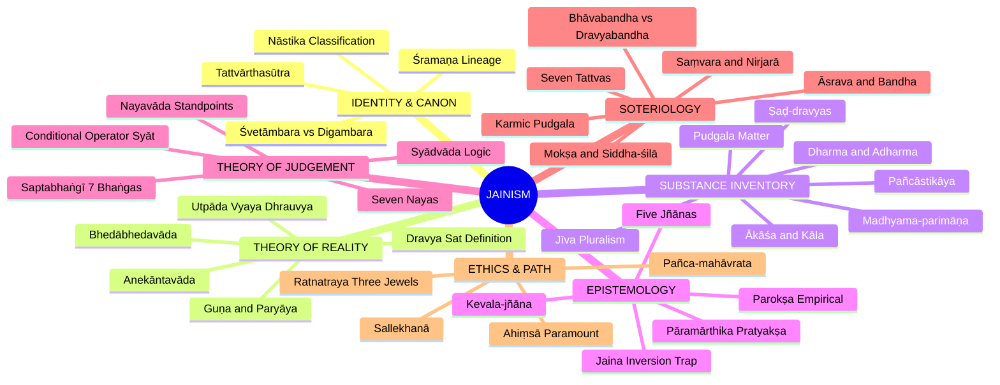

---

## 1. IDENTITY, LINEAGE & DOXOGRAPHY

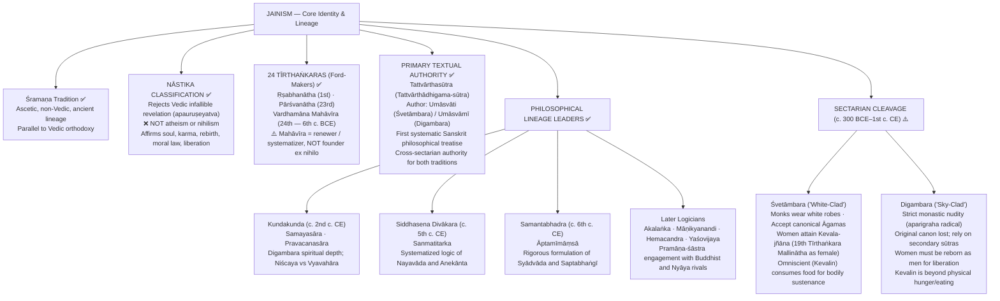

---

## 2. THEORY OF KNOWLEDGE (Epistemology)

### 2A. The Jaina Epistemological Inversion Trap 🚨

> [!WARNING]
> **The Jaina Epistemic Inversion:** In almost all Indian schools (Nyāya, Buddhism, Vedānta), *pratyakṣa* means sensory perception and *parokṣa* means mediated/indirect knowledge (inference, testimony).
> **Jainism inverts this in classical taxonomy:** Direct knowledge (*pratyakṣa*) strictly means knowledge directly obtained by the soul **without** the intervention of sense-organs (*indriyas*) or the physical mind (*manas*). Sensory perception is mediated, dependent, and therefore strictly **indirect** (*parokṣa*)!

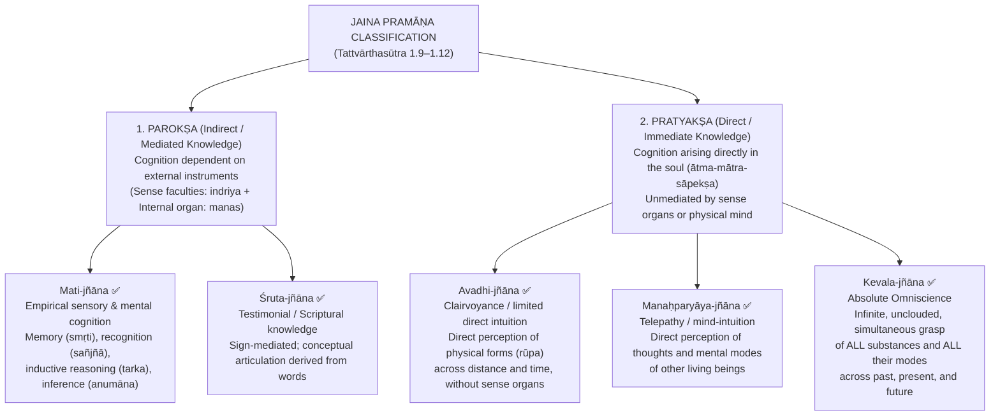

### 2B. Empirical Reality vs Absolute Cognition

| Dimension | Human Empirical Cognition (*Kṣāyopaśamika*) | Omniscient Intuition (*Kevala-jñāna*) |
|-----------|--------------------------------------------|---------------------------------------|
| **Instrument** | Senses (*indriyas*) + Mind (*manas*) | Direct luminosity of pure Soul (*ātman*) |
| **Karmic Status** | Obscured by *jñānāvaraṇīya-karma* | Complete destruction of 4 *ghātiyā-karmas* |
| **Grasp of Reality** | Fragmentary, partial, perspectival (*naya*) | Comprehensive, simultaneous, total (*pramāṇa*) |
| **Linguistic Mode** | Conditional assertion (*syādvāda*) | Beyond modal qualification (pure realization) |
| **Epistemic Necessity**| Mandates tolerance & multi-aspect logic | Validates objective ground of *anekānta* |

---

## 3. THEORY OF JUDGEMENT (Nayavāda, Syādvāda & Saptabhaṅgī)

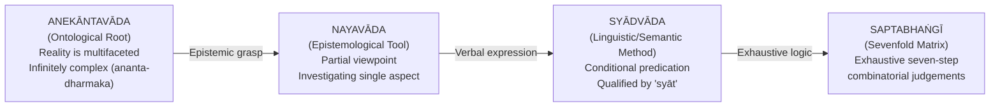

### 3A. The Seven Standpoints (Sapta-naya)

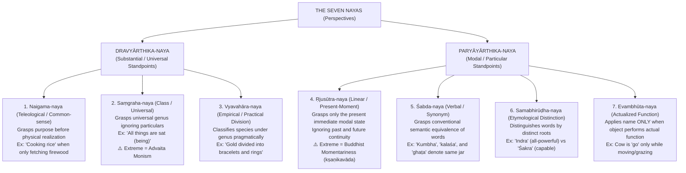

### 3B. Saptabhaṅgī: The Seven Steps of Judgement

> [!IMPORTANT]
> **The Determinative Matrix:** Every predication is qualified by:
> 1. **Sva-catuṣṭaya** (Self-quadruple): Own-substance (*dravya*), own-place (*kṣetra*), own-time (*kāla*), own-nature (*bhāva*).
> 2. **Para-catuṣṭaya** (Other-quadruple): Foreign substance, place, time, and nature.
> 3. **Syāt** = "In a certain respect / conditionally" (NOT "perhaps" or "maybe").
> 4. **Eva** = Restrictive particle ensuring non-absolutism (averting dogmatic exclusivism).

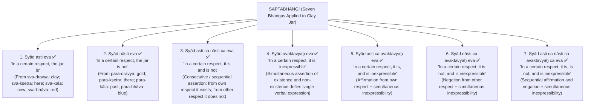

---

## 4. METAPHYSICS & ONTOLOGY (Theory of Reality)

### 4A. Substance (*Dravya*) as Dynamic Permanence

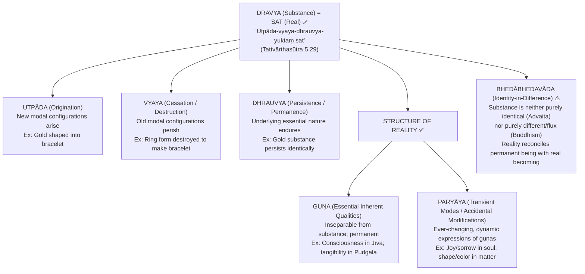

### 4B. The Inventory of Six Substances (Ṣaḍ-dravya)

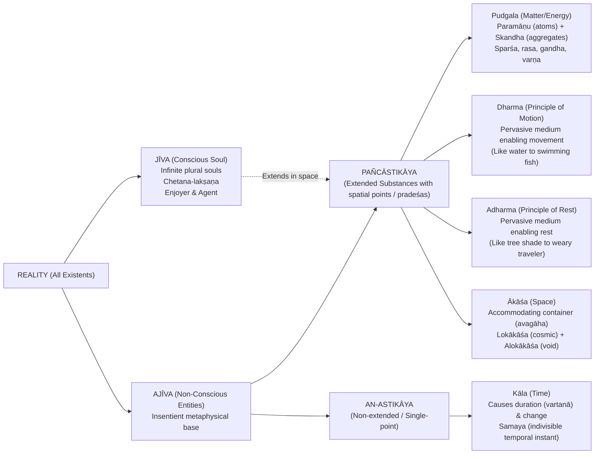

### 4C. Nature of Jīva (The Soul)

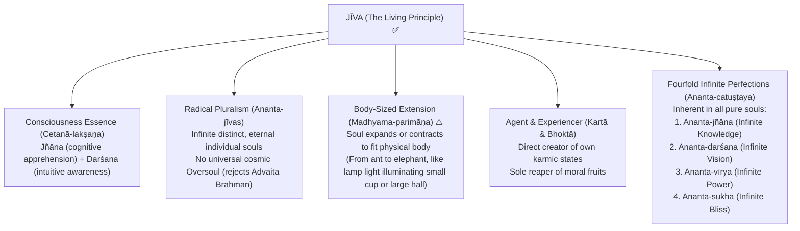

---

## 5. REJECTION / AFFIRMATION OF TRANSCENDENT ENTITIES

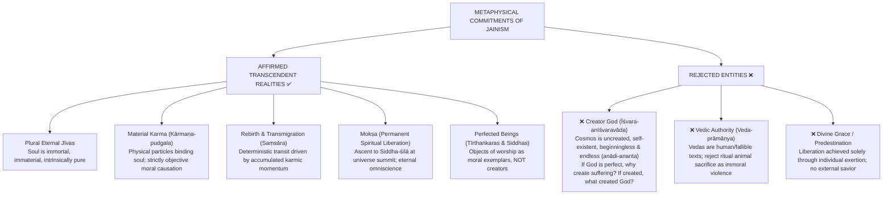

---

## 6. EXPLANATORY & CAUSAL PRINCIPLES

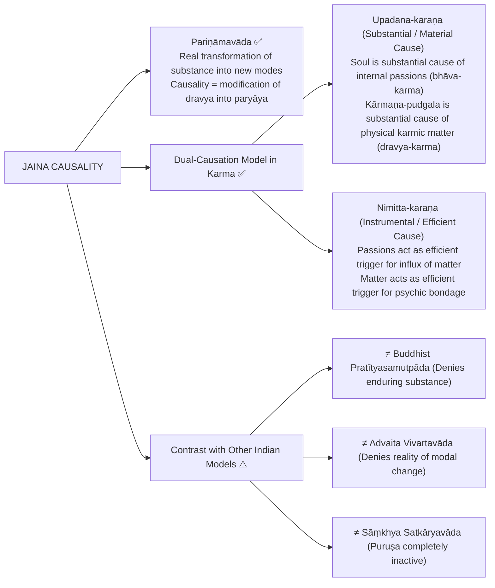

---

## 7. ETHICS & SOTERIOLOGY (Bondage & Liberation)

### 7A. The Seven Tattvas (Ontological-Soteriological Matrix)

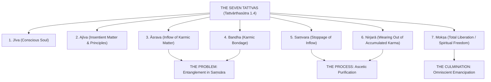

### 7B. Mechanism of Bondage: Yoga, Kaṣāya & The 4 Parameters

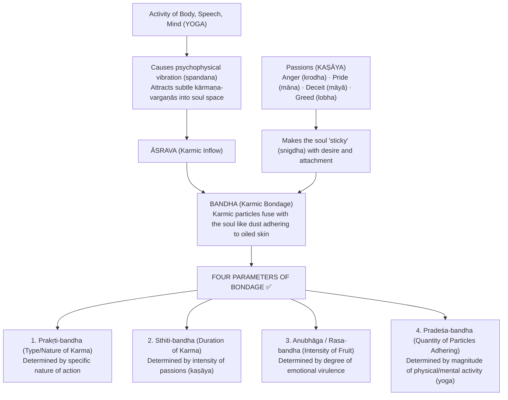

### 7C. The Eight Karmic Prakṛtis

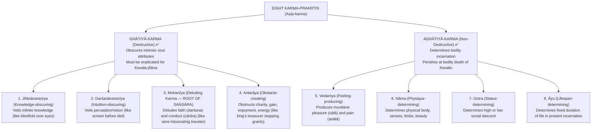

### 7D. The Path: Ratnatraya, Saṃvara, Nirjarā & Mokṣa

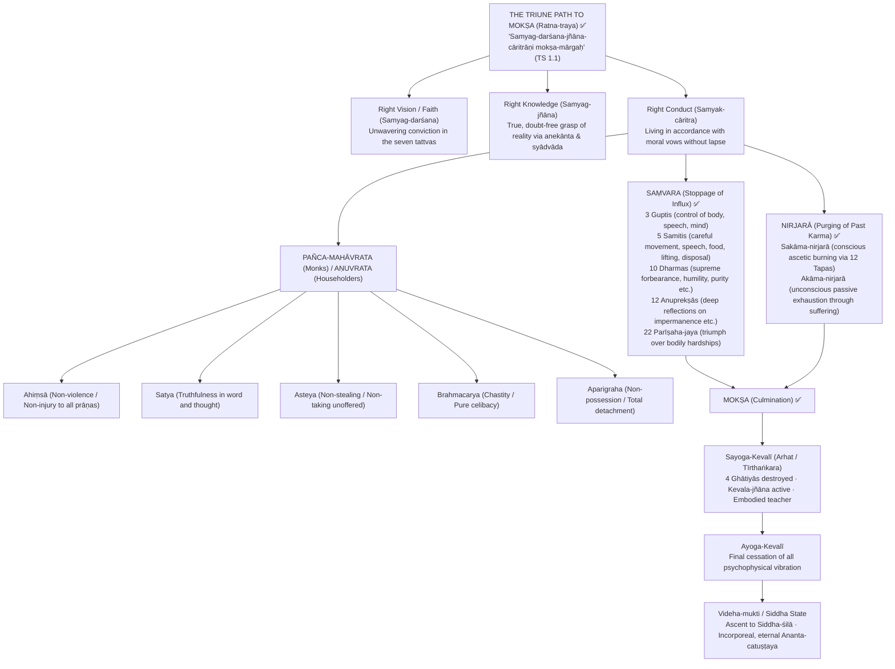

---

## 8. INTER-SCHOOL COMPARATIVE MATRICES

### Comprehensive Philosophical Comparison

| Philosophical Axis | Jainism | Cārvāka | Buddhism | Nyāya-Vaiśeṣika | Advaita Vedānta | Sāṃkhya |
| :--- | :--- | :--- | :--- | :--- | :--- | :--- |
| **Accepted Pramāṇas** | Parokṣa (mati, śruta) + Pratyakṣa (avadhi, manaḥparyāya, kevala) | Perception (*pratyakṣa*) only | Perception + Inference | 4: Perception, Inference, Comparison, Testimony | 6 pramāṇas (Māyā realm) | 3: Perception, Inference, Testimony |
| **Ontological Status of Self** | Plural, eternal, body-sized (*jīva*) | Body IS self (*dehātmavāda*) | No enduring self (*anātman*); bundle of skandhas | Plural eternal substances (*ātman*); quality-less in mokṣa | Single non-dual reality (*Nirguṇa Brahman*); jīva is illusory | Plural eternal transcendental consciousnesses (*puruṣa*) |
| **Nature of Consciousness** | Inherent essence of soul (*cetanā-lakṣaṇa*) | Epiphenomenon emergent from elements (*bhūta-caitanya*) | Stream of momentary mental events (*vijñāna-santāna*) | Accidental quality (*guṇa*) arising from contact with manas | Pure Self-luminous substrate of all (*svaprakāśa*) | Pure passive witness consciousness (*sākṣin*) |
| **Theory of Reality** | Dynamic identity-in-difference (*utpāda-vyaya-dhrauvya*) | Four physical elements only; no ākāśa | Momentary flux (*kṣaṇikavāda*); empty of svabhāva | Plural eternal atoms and substances (*asatkāryavāda*) | Undifferentiated, changeless non-dual Being (*vivartavāda*) | Dualism of unmoving Puruṣa and transforming Prakṛti |
| **Karma & Rebirth** | Karma is physical matter (*pudgala*) binding soul | ❌ Totally rejected | Karmic continuity without enduring soul substance | Moral unseen force (*adṛṣṭa*) supervised by God | Karmic law belongs to empirical order (*vyāvahārika*) | Imprints in buddhi/internal organ (*antaḥkaraṇa*) |
| **Cosmic Creator (God)** | ❌ Anīśvaravāda; universe is uncreated & eternal | ❌ Totally rejected | ❌ Rejected as unwarranted speculation | ✅ Īśvara is efficient cause and moral supervisor | Īśvara is qualified appearance of Brahman (*saguṇa*) | ❌ Classical Sāṃkhya is non-theistic (*nirīśvara*) |
| **Nature of Liberation** | Soul ascends to Siddha-śilā in infinite bliss/knowledge | ❌ Death is end (*maraṇam eva apavargaḥ*) | Nirvāṇa: extinguishing of craving and identity | Apavarga: cessation of all qualities and pain (stone-like) | Mokṣa: realization of identity with Brahman (*ahaṃ brahmāsmi*) | Kaivalya: absolute isolation of Puruṣa from Prakṛti |

### 8A. Jainism vs Buddhism on Reality & Self

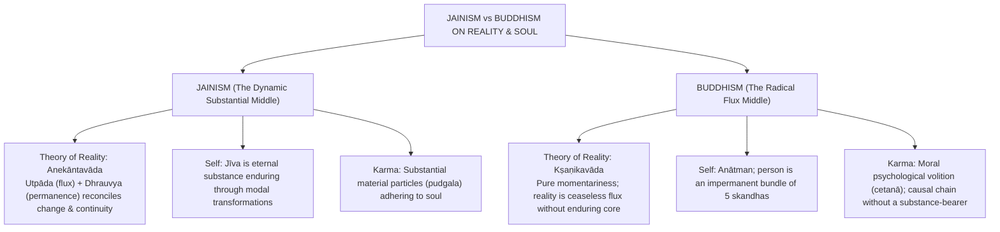

---

## 9. CRITICISMS & RECONSTRUCTED REPLIES

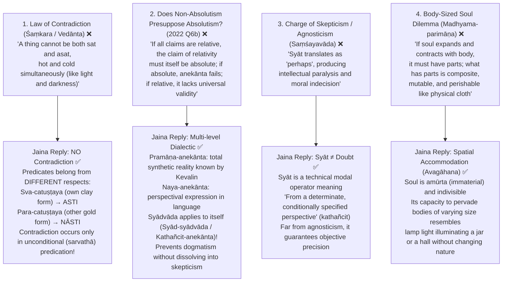

---

## 10. CONTROLLED WESTERN COMPARISONS

| Western Thinker / School | Contact Point | Decisive Disanalogy & Guardrail |
| :--- | :--- | :--- |
| **G.W. Leibniz (Monadology)** | Plurality of immaterial, spiritual individual entities (*monads* vs *jīvas*); internal perspective reflecting reality | **Decisive Disanalogy:** Leibnizian monads are "windowless" (no physical interaction; pre-established harmony). Jaina *jīvas* directly interact with physical matter (*pudgala*) and possess spatial bodily extension (*madhyama-parimāṇa*). |
| **G.W.F. Hegel (Dialectic)** | Synthesis of opposing determinations; reality contains contradictory moments overcome in higher unity | **Decisive Disanalogy:** Hegel's dialectic is temporal, historical, and teleological (thesis-antithesis sublated into synthesis). Jaina *Anekāntavāda* views opposing facets as **simultaneously co-present** in the eternal nature of substance, without dissolving them. |
| **William James (Pragmatism / Pluralism)** | "A Pluralistic Universe"; rejection of monistic absolutism; reality as multifaceted and unfinished | **Decisive Disanalogy:** James's pluralism is radical empiricism tending toward nominalism. Jainism remains an ontological **realism** with eternal substances, objective universals, and transcendent liberation. |
| **Postmodern Perspectivism (Nietzsche / Derrida)** | Rejection of single absolute meta-narrative; all truth claims situated within perspectives | **Guardrail Alert ⚠️:** Postmodernism collapses into subjective relativism ("no facts, only interpretations"). Jainism is **Objective Perspectivism**: reality objectively possesses infinite attributes, and the Kevalin knows them completely and objectively! |

> [!WARNING]
> **Guardrail Callout:** Never equate *Anekāntavāda* with subjective relativism or skepticism. Jaina philosophy insists that each *naya* grasps a **real, objective aspect** of an independently existing substance.

---

## 11. DIAGNOSTIC DEEP-DIVES FOR HIGH-FREQUENCY THEMES

### Deep Dive 1: Bhāvabandha vs Dravyabandha (2024 Q6(c))

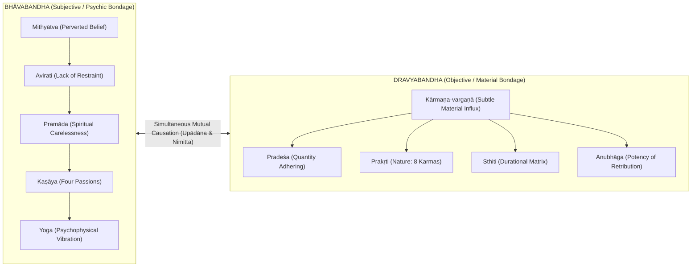

### Deep Dive 2: Does Relativism Presuppose Absolutism? (2022 Q6(b))

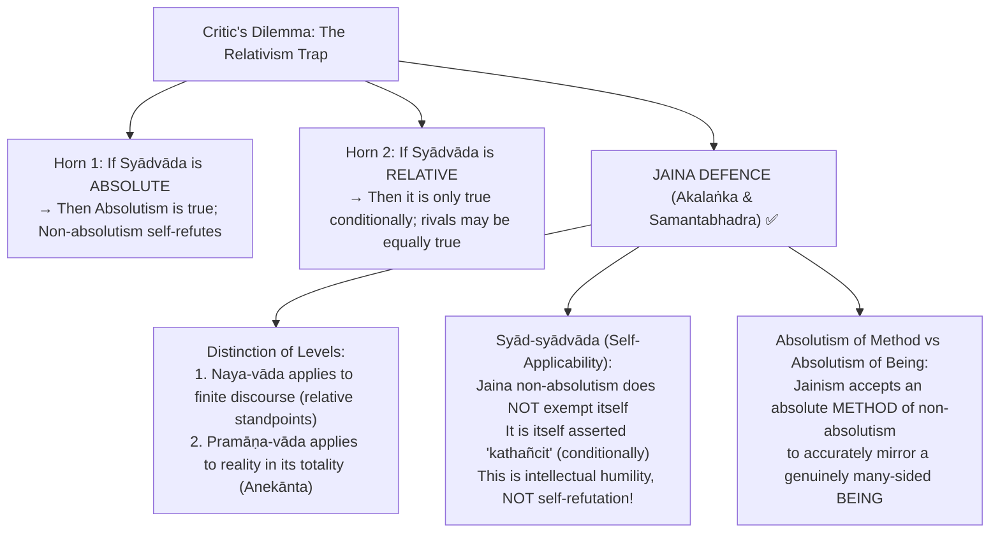

---

## 12. PYQ ROUTING LEDGER (2018–2026)

| Year | Question # | Marks | Exact Syllabus Demand & Core Routing Strategy |
| :---: | :---: | :---: | :--- |
| **2018** | Q6(c) | 15 | **Explain 'bondage' & distinction between 'liberated souls' and 'bound souls':** Route via *yoga* + *kaṣāya*, *bhāvabandha* vs *dravyabandha*, and *saṃsārī-jīva* (encased in *kārmaṇa-śarīra*) vs *mukta-jīva* (ascended to *Siddha-śilā*, possessing *ananta-catuṣṭaya*). |
| **2019** | Q6(a) | 20 | **How is reality defined? How reflected in judgements?** Define *sat* as *utpāda-vyaya-dhrauvya*; trace organic causal line from *Anekāntavāda* (metaphysics) → *Nayavāda* (epistemic grasp) → *Syādvāda* & *Saptabhaṅgī* (judgement). |
| **2020** | Q5(a) | 10 | **Concept of Karma and bearing upon Liberation:** Karma as subtle *pudgala*; 4 *ghātiyā* + 4 *aghātiyā*; route through *āsrava* → *bandha* → *saṃvara* → *nirjarā* → *mokṣa*. |
| **2021** | Q7(c) | 15 | **Seven-fold (sapta-bhaṅgī) 'Naya':** Safeguard against paper's terminology; enumerate all 7 *bhaṅgas* with *sva-catuṣṭaya* / *para-catuṣṭaya* matrix on a single object (clay jar); explain role of *syāt* and *eva*. |
| **2022** | Q5(d) | 10 | **Karma view bearing upon soteriology:** Mechanical material nature of karma eliminates need for divine grace; liberation strictly demands ascetic *tapas* (*nirjarā*) and ethical *cāritra*. |
| **2022** | Q6(b) | 15 | **'Relativism cannot be sustained without Absolutism':** Address Śaṃkara's and modern critics' charge; articulate Jaina reply via *pramāṇa-anekānta* vs *naya-anekānta* and self-applicable *syād-syādvāda*. |
| **2023** | Q5(a) | 10 | **'All human knowledge is empirical and therefore relative':** Connect *kṣāyopaśamika* nature of *mati* and *śruta* jñāna to partial standpoints (*nayas*); explain why empirical limit necessitates *saptabhaṅgī*. |
| **2024** | Q6(c) | 15 | **Distinction between Bhāvabandha and Dravyabandha:** Internal subjective defilement (*mithyātva*, *kaṣāya*) vs physical adherence of *kārmaṇa-pudgala*; explain mutual causal interaction (*upādāna* and *nimitta kāraṇa*). |
| **2025** | Q7(c) | 15 | **Is Jaina philosophy pluralistic and realistic?** Pluralistic (*ananta-jīvas* + physical atoms); Realistic (external world is objectively real, enduring, independent of knowing mind; *sat* possesses intrinsic reality). |
| **2026** | Q7(b) | 15 | **Meaning of seven steps (Saptabhanginaya) & application in Syadvada for advancing knowledge:** Systematic deduction of 7 steps (+, -, +/-, 0, +/0, -/0, +/-/0); application in resolving inter-school dogmatic clashes (*ekāntavāda*). |

---

## 13. TOP 10 UPSC EXAM TRAPS 🚨

```mermaid
flowchart TD
    T["TOP 10 EXAM TRAPS IN JAINISM"] --> T1["❌ Treating Pratyakṣa as Sensory Perception\n✅ INVERSION: In classical Jainism, Pratyakṣa = direct to soul without senses;\nMati/Śruta (sensory/mental) is PAROKṢA!"]
    T --> T2["❌ Translating Syāt as 'Perhaps' or 'Maybe'\n✅ FATAL ERROR: Syāt is a precise conditional operator:\n'In a determinate, specified conditional respect' (kathañcit)"]
    T --> T3["❌ Equating Anekāntavāda with Postmodern Relativism\n✅ Jainism is staunch REALISM: reality objectively has infinite aspects;\nKevalin knows them all objectively"]
    T --> T4["❌ Confusing Bhāvabandha with Dravyabandha\n✅ Bhāvabandha = psychic disposition (kaṣāya);\nDravyabandha = physical fusion of karmic pudgala with jīva"]
    T --> T5["❌ Counting Kāla as an Astikāya substance\n✅ Kāla is AN-ASTIKĀYA: it has no spatial extension (apradeśī)"]
    T --> T6["❌ Claiming Mahāvīra founded Jainism\n✅ 24th Tīrthaṅkara: systematizer/renewer of an ancient Śramaṇa lineage"]
    T --> T7["❌ Believing Jīva is dimensionless or omnipresent\n✅ Jīva has MADHYAMA-PARIMĀṆA: expands/contracts to fit the physical body"]
    T --> T8["❌ Saying Jainism denies all Permanence\n✅ Rejects Buddhist flux: Dravya is SAT = Utpāda + Vyaya + DHRAUVYA (Permanence)"]
    T --> T9["❌ Describing Sallekhanā as Suicide\n✅ Suicide is driven by passion/despair (rāga/dveṣa);\nSallekhanā is passionless, mindful spiritual termination of bodily vehicle"]
    T --> T10["❌ Stating that Tīrthaṅkaras grant forgiveness of sins\n✅ Strict Anīśvaravāda: Karma is purely mechanical; no divine grace can cancel karma"]
```

---

## 14. TECHNICAL VOCABULARY & IAST BANK

| Term | Sanskrit / IAST | Precise English Philosophical Gloss | Status |
| :--- | :--- | :--- | :---: |
| **Many-sidedness** | *Anekāntavāda* | Ontological doctrine that reality is infinitely multifaceted | ✅ |
| **Conditional Predication**| *Syādvāda* | Epistemological-linguistic method of contextual statement | ✅ |
| **Standpoint Theory** | *Nayavāda* | Theory of partial viewpoints apprehending one aspect | ✅ |
| **Sevenfold Judgement** | *Saptabhaṅgī* | Combinatorial logic exhausting seven forms of predication | ✅ |
| **Substance** | *Dravya* | That which possesses origination, decay, and permanence | ✅ |
| **Being / Existent** | *Sat* | Characterized by *utpāda-vyaya-dhrauvya* | ✅ |
| **Origination-Decay-Permanence**| *Utpāda-vyaya-dhrauvya* | Dynamic triadic definition of metaphysical reality | ✅ |
| **Essential Quality** | *Guṇa* | Inherent, unchanging attribute of a substance | ✅ |
| **Modal Modification** | *Paryāya* | Changing modes, states, or manifestations of a substance | ✅ |
| **Conscious Soul** | *Jīva* | Immaterial, plural, eternal conscious reality | ✅ |
| **Insentient Matter** | *Pudgala* | Physical substance with touch, taste, smell, color | ✅ |
| **Extended Substance** | *Astikāya* | Substances occupying spatial points (*pradeśas*) | ✅ |
| **Non-Extended Substance**| *An-astikāya* | Non-spatial substance (Time / *Kāla*) | ✅ |
| **Medium of Motion** | *Dharma* | Pervasive passive condition enabling movement | ✅ |
| **Medium of Rest** | *Adharma* | Pervasive passive condition enabling rest | ✅ |
| **Space** | *Ākāśa* | All-accommodating matrix (*lokākāśa* + *alokākāśa*) | ✅ |
| **Psychic Inflow** | *Bhāvāsrava* | Inner passions causing karmic attraction | ✅ |
| **Material Influx** | *Dravyāsrava* | Actual entry of physical karmic particles into soul | ✅ |
| **Psychic Bondage** | *Bhāvabandha* | Inner state of defilement/attachment of the soul | ✅ |
| **Material Bondage** | *Dravyabandha* | Concrete interpenetration of soul and karmic matter | ✅ |
| **Stoppage of Karma** | *Saṃvara* | Blocking of fresh karmic particle influx | ✅ |
| **Purging of Karma** | *Nirjarā* | Wearing out / burning of accumulated karmas | ✅ |
| **Complete Liberation** | *Mokṣa* | Absolute release and realization of *Ananta-catuṣṭaya* | ✅ |
| **Omniscience** | *Kevala-jñāna* | Unmediated, infinite, simultaneous knowledge of all | ✅ |
| **Body-Sized Extension**| *Madhyama-parimāṇa* | Capacity of soul to contract/expand to fit body | ⚠️ |
| **Three Jewels** | *Ratnatraya* | Samyag-darśana, Samyag-jñāna, Samyak-cāritra | ✅ |
| **Religious Death** | *Sallekhanā* | Voluntary, passionless ascetic fasting unto death | ✅ |

---

## 15. GRADED VERDICT & ANSWER ARCHITECTURES

```mermaid
flowchart LR
    V["JAINISM METAPHYSICAL VERDICT"] --> S & W & C

    S["STRONG AXES ✅\n• Organic synthesis of permanence and change\n• Epistemic intellectual tolerance (anti-dogmatism)\n• Rigorous multi-valued logic prefiguring modern modal systems\n• Radical non-violence (Ahiṃsā) ethics\n• Deep psychological insight into Bhāva/Dravya karma"]

    W["VULNERABLE AXES ⚠️\n• Madhyama-parimāṇa (body-sized soul) invites charges of mutability\n• Extreme asceticism and literal physicalization of karma\n• Apparent paradox of non-absolutist absolutism"]

    C["CONTESTED AXES ❓\n• Nature of Kevalin's physical body & eating (Śvetāmbara vs Digambara)\n• Women's direct eligibility for Kevala-jñāna in present life\n• Historical dating of earliest Tīrthaṅkaras"]
```

### Ready Exam Verdicts:
- **10 Marks:** *Jaina epistemology is neither skepticism nor indecision; Syādvāda is the logical correlate of an infinitely multifaceted ontology (Anekāntavāda), preserving objective realism while rejecting dogmatic absolutism.*
- **15 Marks:** *By defining Reality as identity-in-difference (utpāda-vyaya-dhrauvya), Jainism avoids both the static monism of the Upaniṣads and the radical momentariness of Buddhism, providing a coherent foundation for moral responsibility and karma.*
- **20 Marks:** *The Jaina worldview represents a seamless continuum from metaphysics to ethics: Anekāntavāda generates the epistemic humility of Syādvāda, which translates into the logical rigor of Saptabhaṅgī, culminating in the ethical imperative of universal Ahiṃsā and the ascetic purification of the soul.*

---

### 10-Mark Answer Blueprint (Focus: Epistemology / Saptabhaṅgī)

```
1. Core Thesis: Syādvāda is the linguistic expression of Anekāntavāda (reality has infinite aspects).
2. The Inversion & Need: Human cognition (kṣāyopaśamika) is partial (naya); dogmatic absolutism (ekāntavāda) distorts reality.
3. The Mechanism: Syāt = "in a certain respect"; Sva-catuṣṭaya (own substance/place/time/nature) vs Para-catuṣṭaya.
4. The 7 Steps: Briefly lay out the 7 bhaṅgas applied to a single object (e.g., clay jar).
5. Concluding Punchline: Syādvāda is not agnosticism or skepticism, but the rigorous formalization of objective perspectival realism.
```

> *"Syādvāda does not signify hesitation or doubt; it is the semantic recognition that truth is contextual, and that an unqualified absolute statement about a multifaceted real is inevitably false."*

---

### 15-Mark Answer Blueprint (Focus: Bondage & Soteriology)

```
1. Conceptual Framework: Mechanical-material soteriology rooted in Anīśvaravāda (no creator, no divine grace).
2. Mechanics of Bondage:
   - Inflow (Āsrava) via psychophysical vibration (Yoga).
   - Binding (Bandha) via emotional passions (Kaṣāya) making soul sticky.
   - Crucial Distinction: Bhāvabandha (psychic defilement) vs Dravyabandha (physical karmic influx).
   - 4 Parameters: Prakṛti, Sthiti, Anubhāga, Pradeśa.
3. Path to Liberation:
   - Triune foundation: Ratnatraya (Samyag-darśana, jñāna, cāritra functioning simultaneously).
   - Saṃvara (stoppage of influx via vows, guptis, samitis).
   - Nirjarā (purging of past accumulated karma via internal/external tapas).
4. Culmination:
   - Sayoga-kevalī (Arhat with Kevala-jñāna) → Ayoga-kevalī → Siddha state at Siddha-śilā with Ananta-catuṣṭaya.
5. Critical Evaluation: Pure self-reliance; contrast with theistic models of grace and Buddhist anātman.
```

> *"In Jainism, bondage is not a metaphysical illusion to be dispelled by mere intellectual gnosis, but a physical entanglement of the spiritual soul with material karmic particles, demanding rigorous moral restraint and ascetic purgation."*

---

### 20-Mark Answer Blueprint (Focus: Comprehensive Theory of Reality & Judgements)

```
1. Philosophical Orientation: Jaina Realistic Pluralism positioned between Vedāntic Absolutism and Buddhist Momentariness.
2. Definition of Reality (Sat):
   - "Utpāda-vyaya-dhrauvya-yuktaṃ sat" (Tattvārthasūtra 5.29).
   - Substance (Dravya), essential qualities (Guṇa), dynamic modes (Paryāya).
   - Bhedābhedavāda: Reconciling persistence through transformation.
3. The Six Substances (Ṣaḍ-dravya):
   - Jīva (plural, conscious, madhyama-parimāṇa) + Ajīva (Pudgala, Dharma, Adharma, Ākāśa, Kāla).
   - Pañcāstikāya vs An-astikāya distinction.
4. Epistemological Architecture:
   - Classical Inversion: Pāramārthika Pratyakṣa (unmediated Kevala-jñāna) vs Parokṣa (Mati & Śruta).
   - Nayavāda: The seven standpoints (Dravyārthika vs Paryāyārthika).
5. Logic of Predication (Syādvāda & Saptabhaṅgī):
   - Deduction of the seven steps from affirmation (+), negation (-), and simultaneous inexpressibility (0).
   - Resolution of the Contradiction Charge (Śaṃkara) via Sva-catuṣṭaya / Para-catuṣṭaya.
6. Evaluation & Contemporary Relevance:
   - Epistemological pluralism as a conceptual antidote to intellectual fanaticism and violence (Anekānta as intellectual Ahiṃsā).
   - Conclude with balanced assessment: high systematic coherence, despite the madhyama-parimāṇa vulnerability.
```

> *"Anekāntavāda is intellectual ahiṃsā: just as ethical ahiṃsā forbids physical violence against other living beings, metaphysical anekānta forbids ideological violence against rival philosophical standpoints."*

---

*Source: [`Jainism.md`](../upsc-ai-kit/knowledge/Philosophy/paper-1/indian/Jainism.md) — UPSC AI Kit canonical knowledge base*
