# 🧠 Nyāya-Vaiśeṣika — Philosophy Mindmap

> [!IMPORTANT]
> **UPSC Paper I · Section B · Syllabus Item 15** — Nyāya-Vaiśeṣika: Theory of Categories; Theory of Appearance; Theory of Pramāṇa; Self, Liberation; God; Proofs for the Existence of God; Theory of Causation; Atomistic Theory of Creation.
> Heaviest-scoring realist system with **26 verified primary-owned question-parts (2018–2026)**.

---

## 🗺️ MASTER OVERVIEW

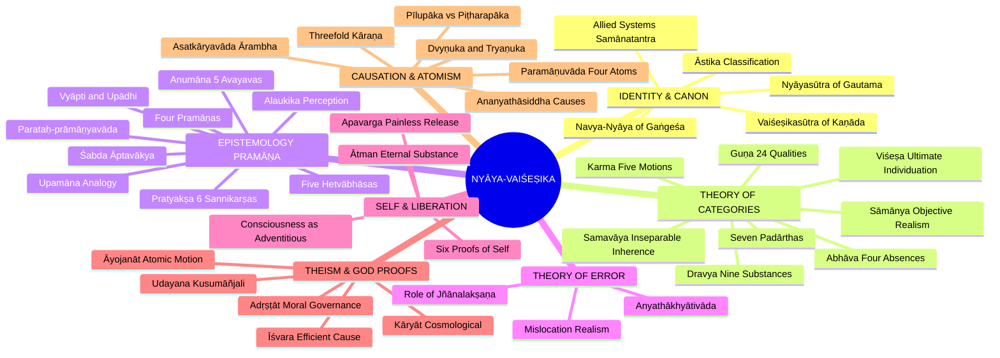

---

## 1. IDENTITY, LINEAGE & HISTORICAL DOXOGRAPHY

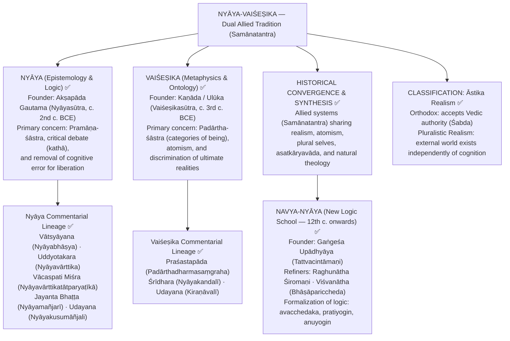

### 1A. Division of Labour: Two Category Systems

> [!IMPORTANT]
> **Examiner Guardrail:** Do NOT confuse the **16 Nyāya Topics of Inquiry** with the **7 Vaiśeṣika Ontological Categories**.
> - **Nyāya's 16 Topics (*Ṣoḍaśa-padārtha*):** Methodological tools of epistemology, proof, and debate (*pramāṇa*, *prameya*, *saṃśaya*, *prayojana*, *dṛṣṭānta*, *siddhānta*, *avayava*, *tarka*, *nirṇaya*, *vāda*, *jalpa*, *vitaṇḍā*, *hetvābhāsa*, *chala*, *jāti*, *nigrahasthāna*).
> - **Vaiśeṣika's 7 Categories (*Sapta-padārtha*):** Classes of real existence (*dravya*, *guṇa*, *karma*, *sāmānya*, *viśeṣa*, *samavāya*, *abhāva*).

---

## 2. THEORY OF CATEGORIES (Vaiśeṣika Padārtha-Śāstra)

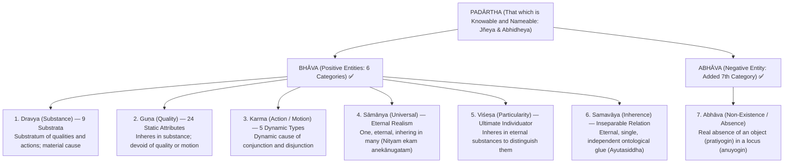

### 2A. The Nine Substances (*Nava-Dravya*)

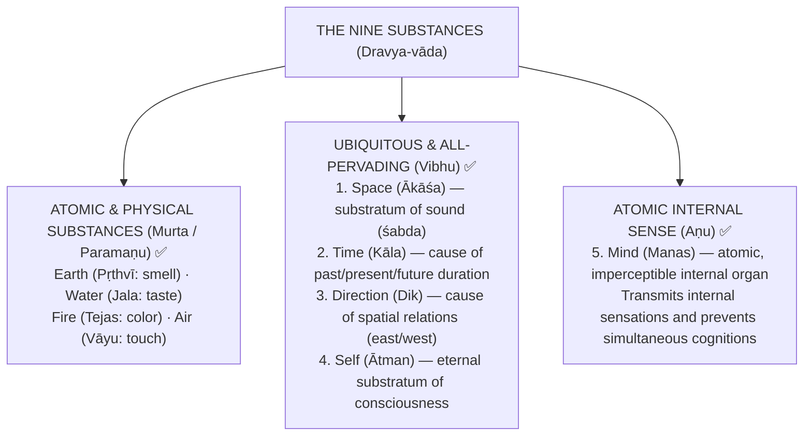

### 2B. Universal (*Sāmānya*), Particularity (*Viśeṣa*) & Inherence (*Samavāya*)

| Category | Classical Definition & Nature | Ontological Role & Key Distinction |
| :--- | :--- | :--- |
| **Sāmānya (Universal)** | *Nityam ekam anekānugatam* (Eternal, single, inhering in many particulars). Two kinds: *Para* (highest: *Sattā* / Pure Being) and *Apara* (lower: *gotva*, *ghaṭatva*). | **Objective Realism:** Real entity existing independent of mind. Denies Buddhist nominalism (*apoha*). Blocked by 6 *jātibādhakas* (e.g. single instance like ākāśa, cross-division like *saṅkara*). |
| **Viśeṣa (Particularity)** | *Nityadravyavṛttayo vyāvartakā viśeṣāḥ* (Residing in eternal substances, enabling ultimate differentiation). | **Ultimate Individuator:** Distinguishes two identical eternal atoms of earth or two liberated souls when all qualities and spatial positions are identical. |
| **Samavāya (Inherence)** | *Ayutasiddhānām ādhāryādhārabhūtaḥ sambandhaḥ* (Inseparable, eternal, single relation between locus and contents). | **Inseparable Relation:** Binds substance-quality, substance-action, universal-individual, cause-effect, and atom-viśeṣa. Inferred, eternal, single (unlike temporary *saṃyoga*). |

### 2C. The Four Types of Non-Existence (*Abhāva*)

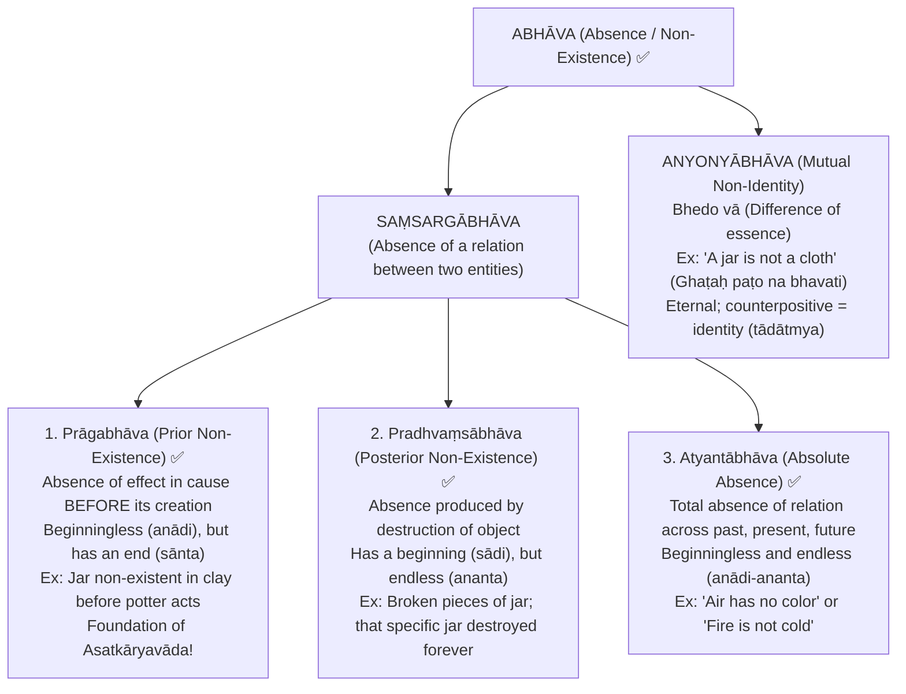

---

## 3. THEORY OF KNOWLEDGE (Nyāya Pramāṇa-Śāstra)

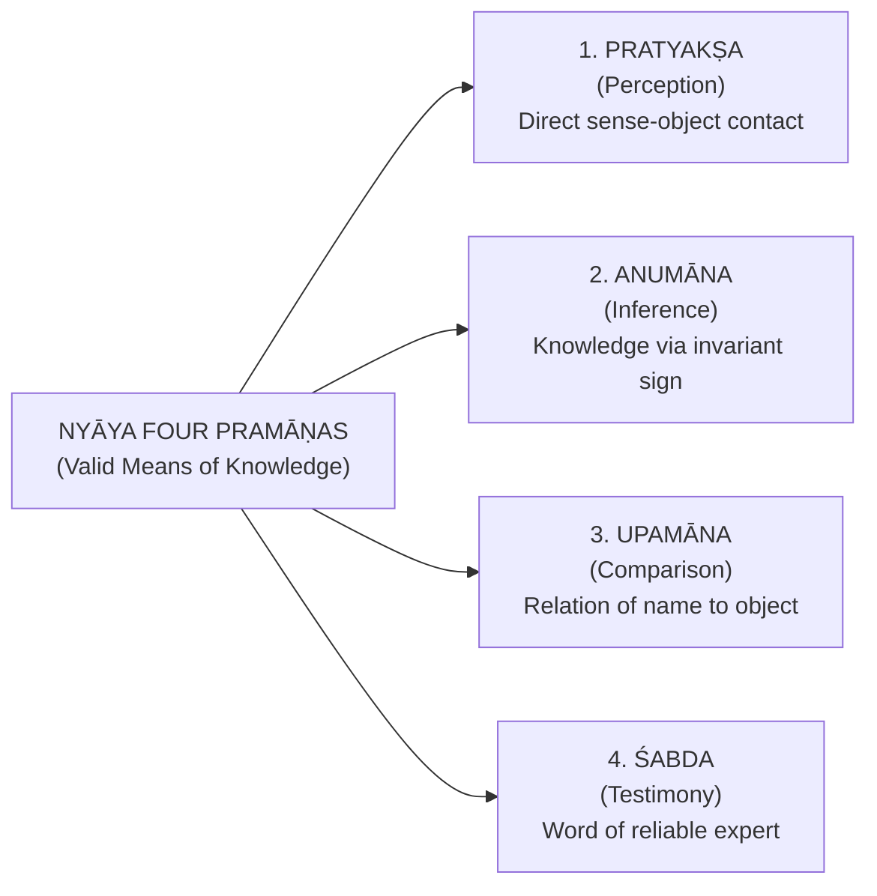

### 3A. Perception (*Pratyakṣa*): Taxonomy & Extraordinary Modes

> [!NOTE]
> **Gautama's Sūtra Definition (NS 1.1.4):**
> *Indriyārtha-sannikarṣotpannaṃ jñānam avyapadeśyam avyabhicāri vyavasāyātmakam*
> Cognition produced by sense-object contact, non-verbal (*avyapadeśya* = indeterminate), non-erroneous (*avyabhicāri*), and determinate (*vyavasāyātmakam*).

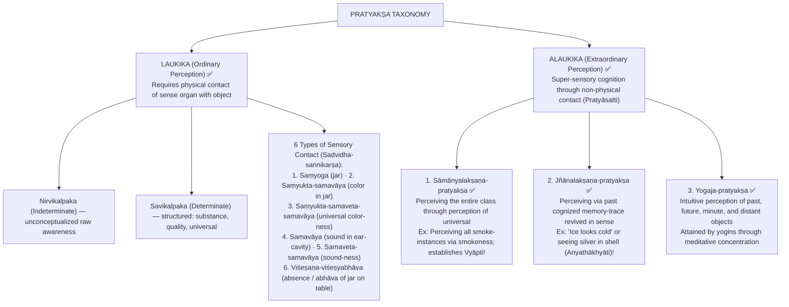

### 3B. Inference (*Anumāna*): Syllogism, Vyāpti & Hetvābhāsas

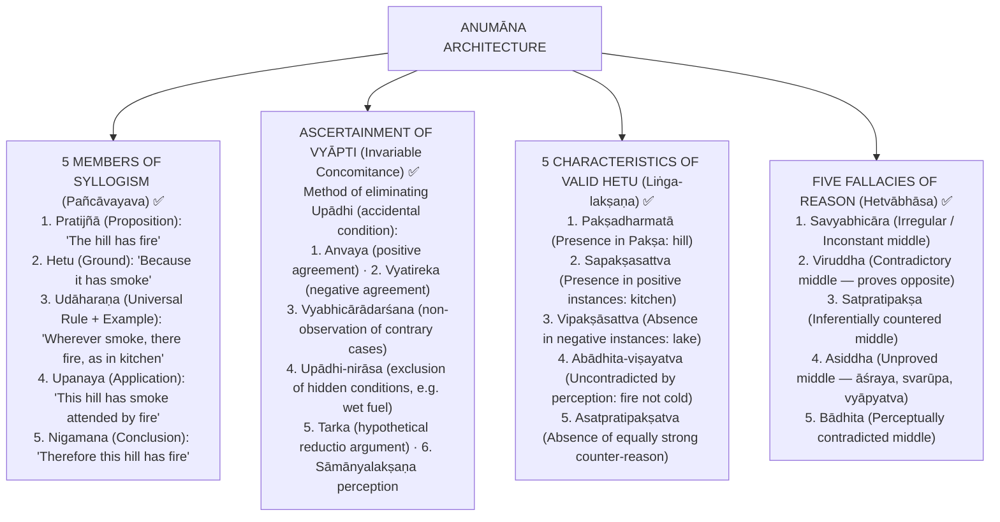

### 3C. Comparison (*Upamāna*) & Testimony (*Śabda*)

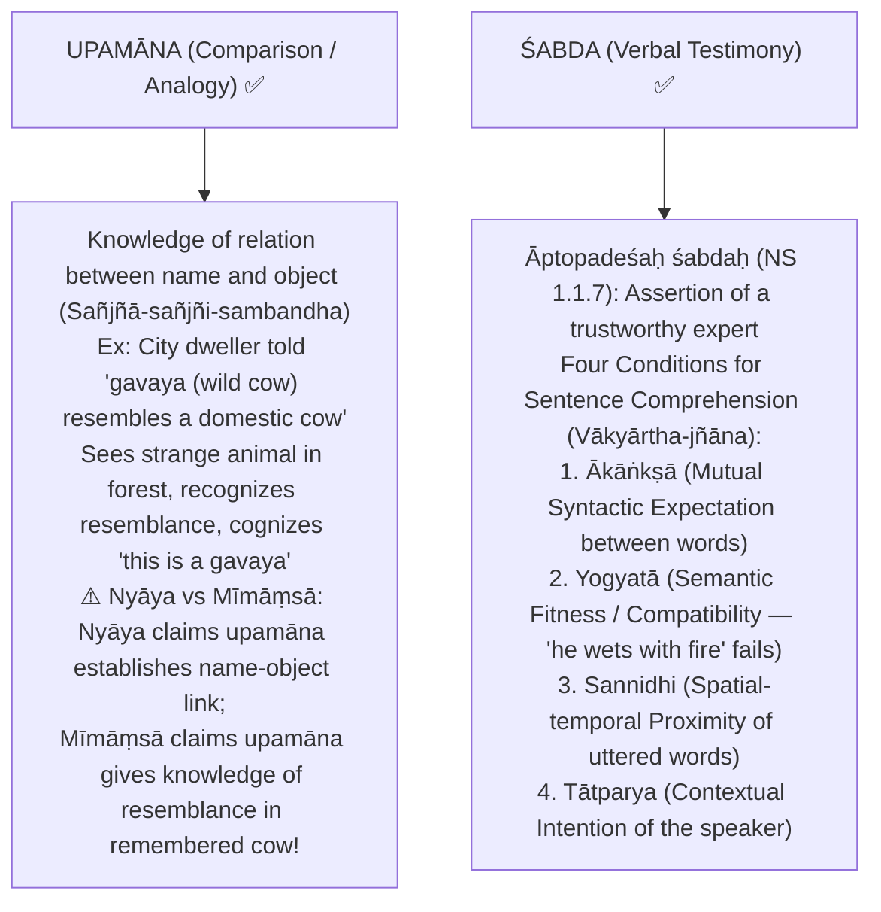

### 3D. Theory of Truth: Extrinsic Validity (*Parataḥ-Prāmāṇyavāda*)

| Doctrine | Origin of Truth (*Utpatti*) | Ascertainment of Truth (*Jñapti*) | Philosophical Assessment |
| :--- | :--- | :--- | :--- |
| **Nyāya Parataḥ-prāmāṇya** | **Extrinsic:** Produced by positive causal excellences (*guṇas*) of instruments. | **Extrinsic:** Tested and confirmed through successful fruitful action (*saṃvādi-pravṛtti-sāmarthya*). | Avoids dogmatism; distinguishes truth from mere belief; answers skepticism via practical coherence. |
| **Mīmāṃsā Svataḥ-prāmāṇya** | **Intrinsic:** Produced by the ordinary causal apparatus of knowledge itself. | **Intrinsic:** Known self-evidently without requiring separate confirmation; error is extrinsic (*doṣa*). | Defends unquestioned, self-evident authority of Vedic revelation (*apauruṣeyatva*). |

---

## 4. THEORY OF ERROR: ANYATHĀKHYĀTIVĀDA

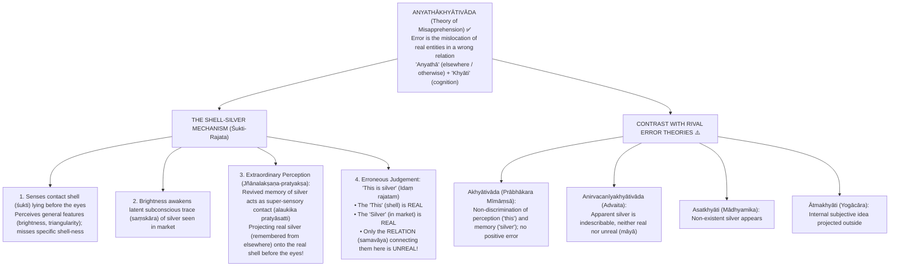

---

## 5. METAPHYSICS OF SELF (Ātman) & LIBERATION (Apavarga)

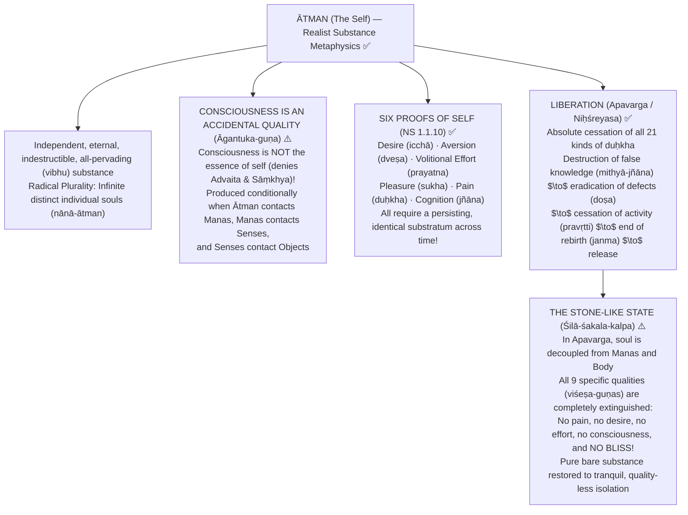

---

## 6. THEOLOGY & PROOFS FOR THE EXISTENCE OF GOD

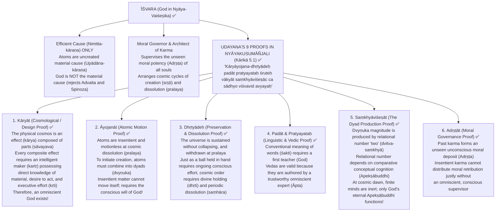

---

## 7. THEORY OF CAUSATION: ASATKĀRYAVĀDA (Ārambhavāda)

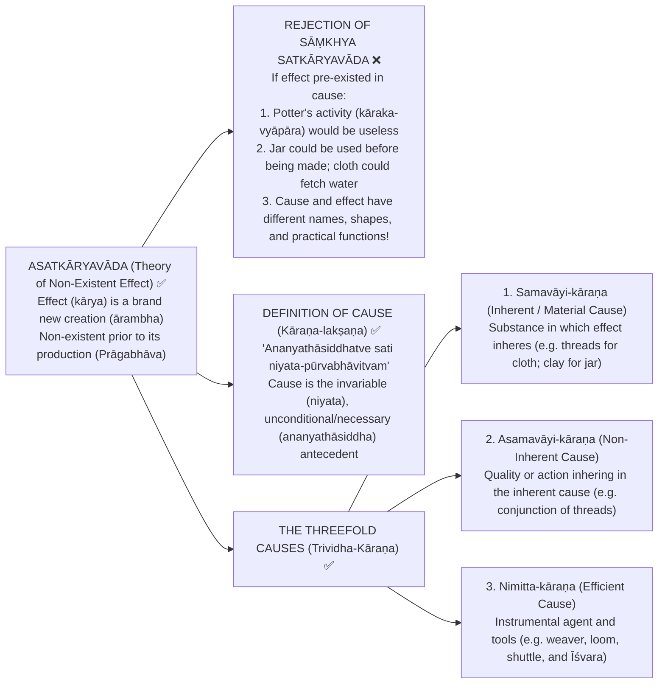

### 7A. Ananyathāsiddha vs Anyathāsiddha (Superfluous Antecedents)

| Antecedent Category | Technical Definition | Concrete Nyāya Examples | Doctrinal Status |
| :--- | :--- | :--- | :---: |
| **Ananyathāsiddha** | Invariable antecedent that is strictly **necessary** and cannot be dispensed with in producing the effect. | Clay and potter for jar; threads and weaver for cloth. | ✅ True Cause (*Kāraṇa*) |
| **Anyathāsiddha 1** | Quality of the cause that merely accompanies it. | The color of the potter's stick; smell of clay. | ❌ Superfluous |
| **Anyathāsiddha 2** | Preceding condition that produces the cause, not the effect. | The potter's father; the vehicle that carried clay. | ❌ Superfluous |
| **Anyathāsiddha 3** | Remote or universal conditions irrelevant to specific effect. | Space (*ākāśa*); time in general. | ❌ Superfluous |
| **Anyathāsiddha 4** | Condition known only along with the effect. | The donkey that carried the clay to the pottery. | ❌ Superfluous |

---

## 8. ATOMISTIC THEORY OF CREATION (Paramāṇuvāda)

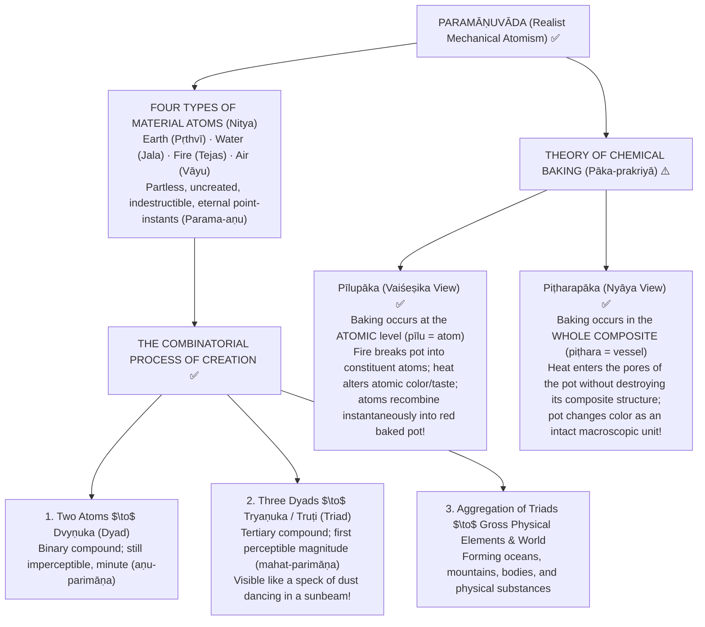

---

## 9. INTER-SCHOOL COMPARATIVE MATRICES

### Comprehensive Multi-Axis Matrix

| Philosophical Dimension | Nyāya-Vaiśeṣika | Cārvāka | Buddhism | Advaita Vedānta | Sāṃkhya |
| :--- | :--- | :--- | :--- | :--- | :--- |
| **Means of Knowledge (*Pramāṇas*)** | 4: Perception, Inference, Comparison, Testimony | Perception only (1) | Perception & Inference (2) | 6 Pramāṇas (Māyā realm) | 3: Perception, Inference, Testimony |
| **Ontological Status of Self** | Plural eternal substances; consciousness is accidental quality | Body IS self (*dehātmavāda*) | ❌ No enduring self (*nairātmya*); stream of skandhas | Single non-dual *Brahman*; individual jīva is illusory | Plural eternal unattached witness consciousnesses (*puruṣa*) |
| **Nature of Consciousness** | Adventitious (*āgantuka*); produced by sense-manas-soul contact | Epiphenomenon emergent from four physical elements | Continuous stream of momentary cognitions (*vijñāna*) | Pure eternal substrate, self-luminous essence (*svaprakāśa*) | Inherent essence of Puruṣa; reflected in Buddhi |
| **Theory of Causation** | *Asatkāryavāda* / *Ārambhavāda* (Effect is a brand new creation) | *Svabhāvavāda* (Naturalism) or *Yadṛcchā* (Chance) | *Pratītyasamutpāda* (Conditioned dependent co-arising) | *Vivartavāda* (Apparent unreal modification of Brahman) | *Satkāryavāda* / *Pariṇāmavāda* (Real transformation of Prakṛti) |
| **Status of Universals (*Sāmānya*)** | Real, eternal, objective entities (*Nityam ekam*) | ❌ Fiction; practical resemblance only | ❌ Conceptual fiction; exclusion of others (*Apoha*) | ❌ Belongs to empirical names and forms (*nāmarūpa*) | Objective real configurations (*saṃsthāna*) of Prakṛti |
| **Nature of God (*Īśvara*)** | Efficient cause (*nimitta-kāraṇa*) & moral supervisor of karma | ❌ Totally rejected | ❌ Rejected as unwarranted speculation | Phenomenal qualified appearance (*Saguṇa Brahman*) | ❌ Classical system is non-theistic (*nirīśvara*) |
| **Liberation State (*Mokṣa*)** | *Apavarga*: painless stone-like state, devoid of consciousness & bliss | ❌ Bodily death is end (*maraṇam eva apavargaḥ*) | *Nirvāṇa*: cessation of craving and ego-delusion | *Mokṣa*: absolute identity with non-dual bliss-consciousness | *Kaivalya*: absolute isolation of Puruṣa from matter |

---

## 10. CRITICISMS & RECONSTRUCTED REPLIES

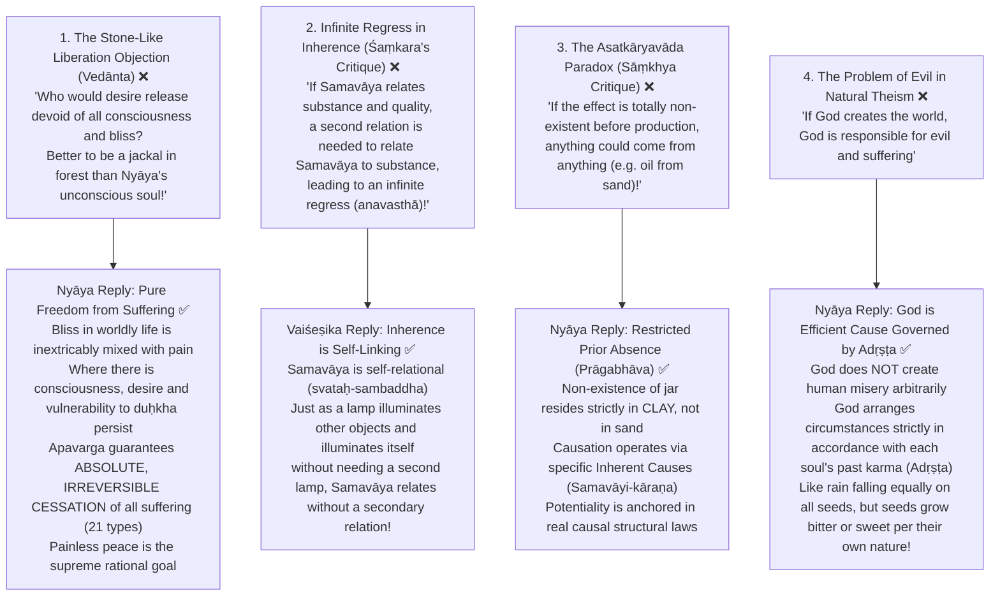

---

## 11. CONTROLLED WESTERN COMPARISONS

| Western Thinker / Tradition | Contact Point | Decisive Disanalogy & Guardrail |
| :--- | :--- | :--- |
| **Aristotle** | Category ontology (substances, qualities, relations); 4 causes; logic and syllogistic demonstration. | **Decisive Disanalogies:** Aristotle's syllogism has 3 members and is purely deductive/formal. Nyāya's syllogism has **5 members** (*pañcāvayava*) and integrates **deduction and induction** via the empirical example (*udāharaṇa*). |
| **Thomas Aquinas (Natural Theology)** | Cosmological argument (*kāryāt*), argument from motion (*āyojanāt*), teleological design, God as First Efficient Cause. | **Decisive Disanalogies:** Aquinas posits creation *ex nihilo* (out of nothing); God is absolute creator of matter. Nyāya-Vaiśeṣika God works upon **pre-existing, uncreated eternal atoms** and uncreated souls; God is strictly the efficient architect, not creator of matter. |
| **Democritus / Classical Atomism** | Plurality of indivisible physical atoms forming composite macroscopic bodies through mechanical conjunction. | **Decisive Disanalogies:** Democritean atoms move randomly by mechanical necessity in a void; differ only in shape and size. Vaiśeṣika atoms possess **qualitative distinctions** (*caturvidha*), are guided by **God's will**, and move to fulfill the **moral karma (*adṛṣṭa*)** of conscious souls. |
| **John Locke / Realist Epistemology** | Realist epistemology; rejection of innate ideas; qualities inhering in physical substances; distinction between primary and secondary qualities. | **Decisive Disanalogies:** Locke's representative realism relegates secondary qualities to subjective ideas. Vaiśeṣika is **Direct Realism**: color, taste, touch, and smell are all **objectively real qualities (*guṇas*)** inhering in physical substances! |

---

## 12. DIAGNOSTIC DEEP-DIVES FOR HIGH-FREQUENCY THEMES

### Deep Dive 1: Gautama's Definition of Perception (2025 Q6(a))

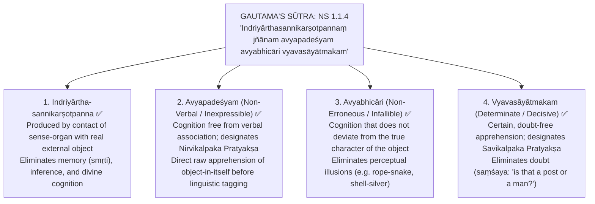

### Deep Dive 2: Udayana's Four Cardinal God Proofs (2018 Q6a, 2019 Q7a)

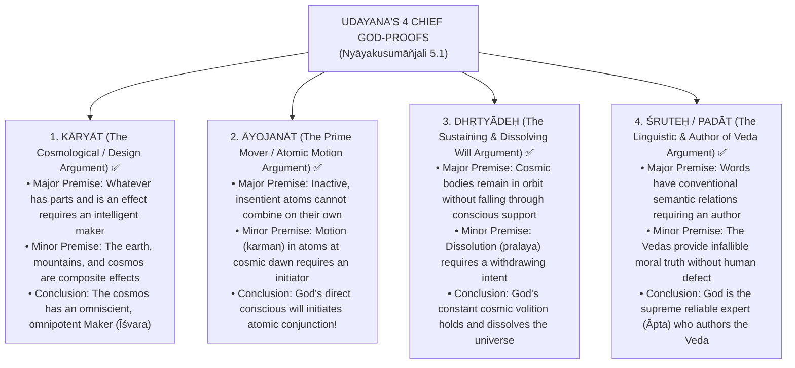

---

## 13. PYQ ROUTING LEDGER (2018–2026)

| Year | Question # | Marks | Exact Syllabus Demand & Core Routing Strategy |
| :---: | :---: | :---: | :--- |
| **2018** | Q5(a) | 10 | **Difference between (i) brown table and (ii) book on table:** Route via *Samavāya* (inseparable, eternal inherence between substance and quality) vs *Saṃyoga* (separable, temporary conjunction between two independent substances). |
| **2018** | Q5(d) | 10 | **Absence of jar on table (Nyāya vs Buddhism):** Nyāya: *Abhāva* is an objective category perceived via *Viśeṣaṇa-viśeṣyabhāva-sannikarṣa*; Buddhism: *Abhāva* is mere perception of the bare locus (*dṛśyānupalabdhi*), not an independent category. |
| **2018** | Q6(a) | 20 | **Naiyāyikas prove God vs Yoga proving God:** Nyāya: God as efficient cause of physical world via *Kāryāt*, *Āyojanāt*, *Adṛṣṭāt*; Yoga: God as special Puruṣa (*Īśvara-praṇidhāna*), omniscient seed via maximum degree of knowledge (*sarvajña-bījam*); not a cosmic creator! |
| **2019** | Q5(a) | 10 | **Status of Abhāva as a category in Vaiśeṣika:** Realist necessity: knowledge of reality is incomplete without knowing what is absent; 4 types (*prāga-*, *pradhvaṃsa-*, *atyanta-*, *anyonyābhāva*); every absence has a real locus (*anuyogin*) and counterpositive (*pratiyogin*). |
| **2019** | Q6(b) | 15 | **Role of Jñānalakṣaṇa-pratyakṣa in Anyathākhyāti:** Explains how silver seen elsewhere (*market*) is perceptually projected onto shell (*śukti*); memory trace acts as super-sensory contact (*alaukika-pratyāsatti*), making the error a genuine perceptual mislocation. |
| **2019** | Q7(a) | 20 | **Udayana's proofs: Kāryāt, Āyojanāt, Dhṛtyādeḥ, Śruteḥ:** Detailed exposition of the 4 arguments from *Kusumāñjali 5.1*; syllogistic formulations, refutation of Cārvāka naturalism and Mīmāṃsā eternalism. |
| **2020** | Q6(c) | 15 | **Anyathāsiddha and Ananyathāsiddha in Asatkāryavāda:** Definition of cause as *ananyathāsiddha-niyata-pūrvabhāvin*; detail the 5 types of superfluous conditions (*anyathāsiddha*); contrast with pre-existing effect theories. |
| **2020** | Q8(b) | 15 | **Logical and metaphysical status of Viśeṣa:** Inheres in eternal substances (atoms, ākāśa, ātman); metaphysical need for ultimate differentiation when all qualities and spaces are identical; prevents collapse of atomistic pluralism. |
| **2021** | Q5(a) | 10 | **Does seed contain the tree? (Nyāya-Vaiśeṣika):** NO: *Asatkāryavāda* holds the tree is a brand new creation (*ārambha*) non-existent in the seed prior to production; seed is only the material cause. |
| **2021** | Q5(b) | 10 | **Śabda as advice of Āpta:** *Āptopadeśaḥ śabdaḥ*; definition of *Āpta* (direct perceiver of truth, benevolence, desire to communicate accurately); four conditions of sentence comprehension (*ākāṅkṣā*, *yogyatā*, *sannidhi*, *tātparya*). |
| **2021** | Q5(c) | 10 | **Inseparability (Ayuta-siddhatva) in Samavāya:** Is it necessary or sufficient? Necessary: terms cannot exist separately; but must be qualified by *ādhāryādhārabhāva* (container-contained relation) to avoid circularity. |
| **2022** | Q5(b) | 10 | **Ontological status of Sāmānya:** Objective, eternal reality (*Nityam ekam anekānugatam*); *Para* vs *Apara*; 6 *jātibādhakas*; defense against Buddhist nominalism (*Apoha*). |
| **2022** | Q7(c) | 15 | **Naiyāyikas response to Cārvāka on Anumāna:** Cārvāka's self-refutation; establishing *Vyāpti* via *anvaya*, *vyatireka*, *upādhi-nirāsa*, *tarka*, and *sāmānyalakṣaṇa-pratyakṣa*. |
| **2023** | Q5(d) | 10 | **Vaiśeṣika view of negation (counterpositive & absolute negation):** Every negation (*abhāva*) necessarily refers to a positive entity negated (*pratiyogin*); absolute negation without a counterpositive is an impossible fiction (*alīka*). |
| **2023** | Q6(c) | 15 | **Ordinary and Extraordinary Perception & Universals:** 6 *Laukika-sannikarṣas*; 3 *Alaukika* modes; justification of perceiving universals via *Sāmānyalakṣaṇa* to ground induction without omniscience. |
| **2023** | Q7(a) | 20 | **Fallacies of middle term (Hetvābhāsa) vs 5 characteristics:** Map each of the 5 fallacies (*savyabhicāra*, *viruddha*, *satpratipakṣa*, *asiddha*, *bādhita*) directly to the violation of one of the 5 valid *liṅga-lakṣaṇas*. |
| **2023** | Q8(b) | 15 | **Prāgabhāva helping defend Asatkāryavāda against Sāṃkhya:** Prior non-existence (*anādi sānta*) guarantees that the effect is genuinely new, while anchoring production specifically in its inherent cause. |
| **2024** | Q5(b) | 10 | **Six reasons for existence of Self:** Gautama's NS 1.1.10: desire (*icchā*), aversion (*dveṣa*), effort (*prayatna*), pleasure (*sukha*), pain (*duḥkha*), cognition (*jñāna*); synthetic unity of apperception. |
| **2024** | Q5(c) | 10 | **"Air does not have heat" vs "Air is not fire":** Distinguish *Atyantābhāva* (absolute relational absence of heat quality in air substance) from *Anyonyābhāva* (mutual difference of essence between air substance and fire substance). |
| **2025** | Q5(b) | 10 | **Debate on Pramāṇa and Pramāṇaphala (Nyāya vs Buddhism):** Nyāya separates instrument (*pramāṇa*) from resultant true cognition (*pramāṇaphala*); Buddhism (Diṅnāga) equates instrument and result in self-cognition (*svasaṃvedana*). |
| **2025** | Q5(e) | 10 | **Exposition of Nyāya-Vaiśeṣika Theory of Causation:** Master synthesis: *Asatkāryavāda*, *ananyathāsiddha* definition, 3 causes (*samavāyi*, *asamavāyi*, *nimitta*), rejection of *pariṇāma* and *vivarta*. |
| **2025** | Q6(a) | 20 | **Detailed account of Gautama's definition of Perception:** Deconstruct NS 1.1.4 into its 4 cardinal components; establish the realistic, non-verbal, non-erroneous, and determinate criteria. |
| **2026** | Q5(a) | 10 | **Characteristics ascertaining validity of inferential sign (Hetu):** The fivefold test: *pakṣadharmatā*, *sapakṣasattva*, *vipakṣāsattva*, *abādhita-viṣayatva*, *asatpratipakṣatva*. |
| **2026** | Q5(d) | 10 | **Nature of Samavāya as propounded in Vaiśeṣika:** Eternal, single, inferred inseparable relation; *ayutasiddhatva*; defense against Śaṃkara's infinite regress objection via self-linking nature. |
| **2026** | Q6(c) | 15 | **Naiyāyikas vs Prābhākara Mīmāṃsakas on Śābdabodha:** *Abhihitānvayavāda* (words express isolated meanings first, combined subsequently via syntax) vs *Anvitābhidhānavāda* (words express meanings only as connected in sentence context). |
| **2026** | Q8(a) | 20 | **Upamāna in Nyāya vs Mīmāṃsā:** Nyāya: gives knowledge of name-object relation (*sañjñā-sañjñi*); Mīmāṃsā: gives knowledge of resemblance (*sādṛśya*) residing in remembered domestic cow. |

---

## 14. TOP 10 UPSC EXAM TRAPS 🚨

```mermaid
flowchart TD
    T["TOP 10 EXAM TRAPS IN NYĀYA-VAIŚEṢIKA"] --> T1["❌ Claiming Liberation (Apavarga) is a State of Bliss\n✅ FATAL ERROR: In Nyāya release, ALL 9 specific qualities are extinguished;\nSoul is devoid of consciousness AND bliss (stone-like: śilā-vat)!"]
    T --> T2["❌ Confusing 16 Nyāya Topics with 7 Vaiśeṣika Categories\n✅ Nyāya's 16 = epistemological/debate topics (pramāṇa, vāda...);\nVaiśeṣika's 7 = ontological kinds of being (dravya, guṇa...)"]
    T --> T3["❌ Saying God is the Material Cause of the World\n✅ God is EXCLUSIVELY the EFFICIENT cause (Nimitta-kāraṇa);\nEternal physical atoms (paramāṇu) are the uncreated material cause!"]
    T --> T4["❌ Confusing Samavāya (Inherence) with Saṃyoga (Conjunction)\n✅ Saṃyoga = separable, temporary contact between 2 substances (book on table);\nSamavāya = inseparable, eternal relation (brown color in table)"]
    T --> T5["❌ Believing Consciousness is the Essential Nature of Self\n✅ In Nyāya, consciousness is an ACCIDENTAL quality (āgantuka-guṇa);\nSoul is intrinsically unconscious (jaḍa) when decoupled from manas"]
    T --> T6["❌ Equating Air has no heat with Air is not fire\n✅ 'Air has no heat' = Atyantābhāva (relational absolute absence);\n'Air is not fire' = Anyonyābhāva (mutual non-identity / difference of essence)"]
    T --> T7["❌ Attributing Natural Theology to Early Vaiśeṣika\n✅ Kaṇāda's sūtras do not develop God proofs;\nDeveloped natural theology belongs to Udayana and later Nyāya synthesis"]
    T --> T8["❌ Saying Asatkāryavāda means production from nothing\n✅ Effect is non-existent before creation, but arises FROM an inherent cause;\nIt is de novo origination (ārambha), NOT creatio ex nihilo"]
    T --> T9["❌ Confusing Nyāya Upamāna with Mīmāṃsā Upamāna\n✅ Nyāya: knows name-object link in wild cow (gavaya);\nMīmāṃsā: knows resemblance residing in the absent domestic cow"]
    T --> T10["❌ Treating Sāmānya as a subjective mental idea\n✅ Staunch Realism: Universals are objectively real, eternal entities\ninhering in particulars; fiercely opposes Buddhist Apohavāda!"]
```

---

## 15. TECHNICAL VOCABULARY & IAST BANK

| Term | Sanskrit / IAST | Precise English Philosophical Gloss | Status |
| :--- | :--- | :--- | :---: |
| **Category of Being** | *Padārtha* | Ontological reality that is knowable (*jñeya*) and nameable (*abhidheya*) | ✅ |
| **Inherence** | *Samavāya* | Eternal, single, inseparable relation (*ayutasiddha-sambandha*) | ✅ |
| **Conjunction** | *Saṃyoga* | Separable, temporary physical contact between substances | ✅ |
| **Particularity** | *Viśeṣa* | Ultimate differentiator inhering in eternal substances | ✅ |
| **Universal** | *Sāmānya* / *Jāti* | Real, eternal, single entity inhering in many particulars | ✅ |
| **Non-Existence / Absence**| *Abhāva* | Negative ontological category; absence of a *pratiyogin* | ✅ |
| **Prior Non-Existence** | *Prāgabhāva* | Beginningless but terminable absence of effect before creation | ✅ |
| **Theory of De Novo Creation**| *Asatkāryavāda* / *Ārambhavāda* | Doctrine that effect is non-existent prior to production | ✅ |
| **Unconditional Antecedent**| *Ananyathāsiddha* | Necessary antecedent condition free from superfluity; true cause | ✅ |
| **Superfluous Antecedent** | *Anyathāsiddha* | Accompanying or irrelevant condition disqualified from being a cause | ✅ |
| **Inherent Cause** | *Samavāyi-kāraṇa* | Material substrate in which the effect inheres (e.g. clay, threads) | ✅ |
| **Non-Inherent Cause** | *Asamavāyi-kāraṇa* | Quality or motion inhering in inherent cause (e.g. thread conjunction) | ✅ |
| **Efficient Cause** | *Nimitta-kāraṇa* | Instrumental agent, tools, and divine supervisor of creation | ✅ |
| **Atom** | *Paramāṇu* | Indivisible, eternal, qualitative point-instant of physical matter | ✅ |
| **Dyad / Triad** | *Dvyṇuka* / *Tryaṇuka* | Binary atomic compound (imperceptible) / Tertiary compound (visible) | ✅ |
| **Atomic vs Whole Baking**| *Pīlupāka* / *Piṭharapāka* | Vaiśeṣika baking of atoms vs Nyāya baking of intact composite pot | ✅ |
| **Theory of Misapprehension**| *Anyathākhyātivāda* | Error as perceptual mislocation of real objects in a wrong relation | ✅ |
| **Cognitive Contact** | *Jñānalakṣaṇa-pratyāsatti* | Extraordinary sensory contact mediated by revived memory-trace | ✅ |
| **Universal Contact** | *Sāmānyalakṣaṇa-pratyāsatti* | Extraordinary perception of all class-instances via perceived universal | ✅ |
| **Invariable Concomitance** | *Vyāpti* | Universal, unconditioned relation between middle (*hetu*) and major (*sādhya*) | ✅ |
| **Extrinsic Validity** | *Parataḥ-prāmāṇyavāda* | Truth produced and confirmed extrinsically through practical fruits | ✅ |
| **Fallacy of Reason** | *Hetvābhāsa* | Defective middle term appearing as a valid reason | ✅ |
| **Trustworthy Person** | *Āpta* | Reliable expert who perceives truth and speaks without defect | ✅ |
| **Release / Liberation** | *Apavarga* / *Niḥśreyasa* | Total cessation of all 21 pains; tranquil, quality-less state of self | ✅ |
| **Unseen Karmic Force** | *Adṛṣṭa* | Accumulated moral merit/demerit supervised by God | ✅ |

---

## 16. GRADED VERDICT & ANSWER ARCHITECTURES

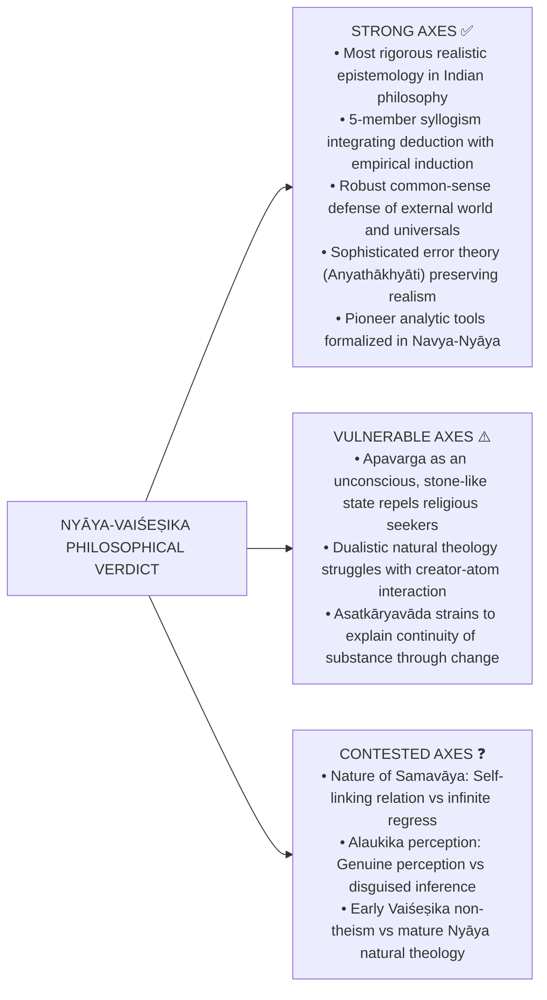

### Ready Exam Verdicts:
- **10 Marks:** *Nyāya-Vaiśeṣika represents the high-water mark of Indian common-sense realism: its fourfold Pramāṇa-śāstra and sevenfold Padārtha ontology demonstrate that human knowledge faithfully apprehends an objectively real, pluralistic universe.*
- **15 Marks:** *By formulating Asatkāryavāda and Anyathākhyātivāda, Nyāya avoids both the nihilistic flux of Buddhism and the illusionism of Advaita Vedānta—anchoring causation in dynamic new beginnings and explaining error as the mislocation of genuinely real entities.*
- **20 Marks:** *From Gautama's definition of perception to Udayana's natural theology, Nyāya-Vaiśeṣika synthesizes epistemology, atomism, and moral governance into a unified metaphysical fortress: God functions not as a magician creating ex nihilo, but as the supreme rational architect harmonizing eternal atoms with the moral law of Adṛṣṭa.*

---

### 10-Mark Answer Blueprint (Focus: Categories / Padārtha / Causation)

```
1. Master Thesis: State the realistic foundation: Padārtha as knowable and nameable (jñeya and abhidheya).
2. The Core Distinction:
   - Bhāva (6 positive categories: dravya, guṇa, karma, sāmānya, viśeṣa, samavāya).
   - Abhāva (real negative category: 4 types, especially Prāgabhāva for Asatkāryavāda).
3. The Mechanism / Link: Explain Samavāya (inseparable inherence) vs Saṃyoga (conjunction) with concrete examples.
4. Concluding Sentence: Relate the category system to common-sense realism and liberation.
```

> *"For the Vaiśeṣikas, categories are not mere mental concepts (as in Kant), but objective ontological structures of the real world that exist independently of the knowing mind."*

---

### 15-Mark Answer Blueprint (Focus: Epistemology / Anyathākhyāti / God Proofs)

```
1. Context & Pūrvapakṣa:
   - Identify the opponent's challenge (e.g. Cārvāka denial of inference, or rival error theories like Akhyāti).
2. The System's Argumentation:
   - In Anyathākhyāti: Step-by-step mechanism of shell-silver; role of Jñānalakṣaṇa-pratyāsatti.
   - In God Proofs: Udayana's syllogism for Kāryāt or Āyojanāt; refutation of unguided naturalism (svabhāvavāda).
3. Critical Distinction:
   - Parataḥ-prāmāṇya (validity tested extrinsically via fruitful action) avoiding dogmatism.
4. Balanced Assessment:
   - Powerful defense of objective truth, despite the formal complexity of extraordinary perception.
```

> *"Anyathākhyātivāda is the brilliant epistemological shield of realism: it explains cognitive error without conceding an inch to subjective idealism, proving that error lies in a mistaken relation, never in the non-existence of the terms."*

---

### 20-Mark Answer Blueprint (Focus: Comprehensive Systemic Architecture)

```
1. Philosophical Orientation:
   - Nyāya-Vaiśeṣika as Samānatantra: Nyāya supplies logic/epistemology; Vaiśeṣika supplies ontology/atomism.
2. The Ontological-Causal Spine:
   - Asatkāryavāda (de novo production) supported by Prāgabhāva.
   - The Threefold Cause (Samavāyi, Asamavāyi, Nimitta).
   - Paramāṇuvāda: Creation through dyads (dvyṇuka) and triads (tryaṇuka); Pīlupāka vs Piṭharapāka.
3. The Epistemological Validation:
   - Four Pramāṇas; Gautama's definition of Perception (NS 1.1.4); Vyāpti acquisition.
   - 5-member syllogism combining empirical induction and rational deduction.
4. Theism & Soteriological Culmination:
   - God (Īśvara) as efficient architect activating atoms and dispensing Adṛṣṭa.
   - Self (Ātman) as eternal substance; consciousness as adventitious quality.
   - Liberation (Apavarga) as absolute cessation of duḥkha; critical evaluation of the stone-like state.
5. Final Evaluation:
   - Synthesis: The enduring legacy of Nyāya realism and Navya-Nyāya analytic precision in global thought.
```

> *"Nyāya-Vaiśeṣika achieves an extraordinary synthesis in Indian thought: an ontology of plural eternal atoms and souls, an epistemology of disciplined empirical verification, and a natural theology where God acts as the tireless moral architect of an uncreated cosmos."*

---

*Source: [`Nyaya-Vaisesika.md`](../upsc-ai-kit/knowledge/Philosophy/paper-1/indian/Nyaya-Vaisesika.md) — UPSC AI Kit canonical knowledge base*
