# NOTIONS OF GOD — Examiner-Grade Mindmap

> **Syllabus (verbatim):** Notions of God : Attributes; Relation to Man and the World. (Indian and Western).
> **Catalogue key:** `philosophy-paper-ii-philosophy-of-religion-01` · Paper II · Philosophy of Religion
> **Sources used:** `paper-2/philosophy-of-religion/Notions-of-God.md` (canonical owner) · `_advanced/Philosophy-of-Religion-Dossier.md` §1 (optional depth) · `paper-2/_PYQ-PhilosophyOfReligion-2018-2025.md` · `paper-2/_PYQ-PhilosophyOfReligion-2026-Supplement.md` · `paper-1/_themes/` files that mention this topic: `Substance-across-western.md`, `Self-and-liberation-across-schools.md`, `Causation-across-schools.md`, `Critiques-of-metaphysics.md`, `Pramana-across-schools.md`, `A-priori-a-posteriori-knowledge.md`.
> **Evidence key:** ✅ canonical doctrine / fact · ⚠️ analytical synthesis for exam use · ❓ contested / uncertain

> [!IMPORTANT]
> **Core thesis.** The God-concept is a package of attributes whose coherence must be argued, not assumed. The deepest Indian and Western divide runs along two axes: **personal vs impersonal** and **transcendent vs immanent**. These are comparison axes, not equations. ⚠️

> [!NOTE]
> **Adaptation.** The 15-module blueprint is written for Indian schools. For this topic, Module 1 maps taxonomy and ownership boundaries; Module 2 maps how the God-concept is *spoken of and known*; Module 5 maps roles and non-creator profiles; Module 7 maps moral governance, devotion and liberation relations. The sources contain no āstika/nāstika classification of "God", and no *puruṣārtha* hierarchy for this topic; those modules say so rather than invent content.

---

## 0. Master Overview

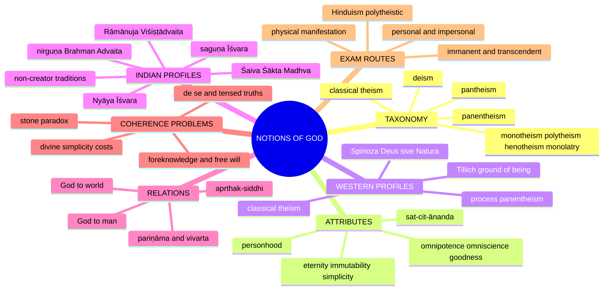

---

## 1. Identity, Classification & Boundaries

### 1.1 What the clause owns, and what it does not ✅

| Owned here | Boundary (routed elsewhere) |
|---|---|
| Classification of God / ultimate-reality concepts | Existence arguments → *Proofs for God* |
| Definition and mutual coherence of divine attributes | Full evidential challenge from suffering → *Problem of Evil* |
| God–world and God–human relation | Immortality / liberation → *Soul*; experience → *Religious Experience* |
| Creator and non-creator Indian profiles | Full case for religion without a creator → *Religion without God* |
| Minimal controls on anthropomorphism, analogy, symbol, gendered language | Full semantic theories → *Religious Language* |
| Plurality of deity-concepts inside a tradition | Conflicting religious truth-claims → *Religious Pluralism* |

### 1.2 Western taxonomy ✅

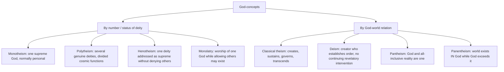

| Notion | Number / status | God–world relation | Personality |
|---|---|---|---|
| Monotheism | one supreme God | usually creator and sustainer distinct from creation | normally personal |
| Polytheism | several genuine deities | divided or overlapping cosmic functions | personal plurality |
| Henotheism | one deity as supreme, others not denied | contextual supremacy | personal |
| Monolatry | exclusive worship of one | exclusive worship, not necessarily one ontology | personal |
| Classical theism | one necessary, perfect God | creates, sustains, governs while transcending | personal but non-corporeal |
| Deism | one creator | establishes world / order without continuing revelatory intervention | personal source, religiously remote |
| Pantheism | God and all-inclusive reality one | world not outside God | commonly impersonal / non-volitional |
| Panentheism | world in God, God exceeds it | inclusion-with-excess, deep immanence | personal or process-relational variants |

> [!WARNING]
> Pantheism must not be reduced to "God equals the aggregate of physical objects". In Spinoza finite things are modes of one infinite substance; God/Nature includes intelligible reality under infinitely many attributes, not matter alone. ⚠️

### 1.3 Role-profiles: what "God" is doing in the concept ⚠️

| Role | Core claim | Main pressure |
|---|---|---|
| Creator | all creaturely being depends on God, not merely arrangement of prior matter | free vs necessary creation |
| Sustainer | dependence continues every moment; divine causation need not compete with finite causes | continuous action vs timelessness / immutability |
| Ruler / providence | world-history and natural order under divine governance | freedom, contingency, hiddenness |
| Moral governor | action and moral order answerable to divine justice | autonomy; problem of suffering |
| Ground of being | non-dependent source of actuality, not one being alongside others | personality and worship harder to state |
| Absolute | self-sufficient, non-relative, ontologically basic | an impersonal absolute may cease to resemble a personal God |

Tillich's "ground of being" / "Being-itself" is a **revisionary profile**, not a proof and not a synonym for every classical-theist use of "God". Creator, sustainer, moral governor, ground and absolute are **not synonyms**.

### 1.4 Indian spectrum ⚠️ (do not flatten it)

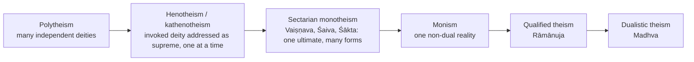

Distinctions to hold apart ✅: polytheism ≠ henotheism ≠ kathenotheism ≠ monolatry ≠ monism ≠ monotheism ≠ panentheism. **Monism** denies plurality of *reality*; **monotheism** denies plurality of *deity*; **henotheism** denies neither but ranks contextually.

> [!TIP]
> **Opening sentence.** "The God-concept is classified by number of deities, by God–world relation, by personality, and by attribute package; I will compare Indian and Western profiles on these axes."

---

## 2. How the God-concept is Spoken of and Known

*(Adapted from "Theory of Knowledge": the owner file does not set out a pramāṇa theory of God; it gives language-limits and a terminological correction. Existence proofs are routed to Proofs for God.)*

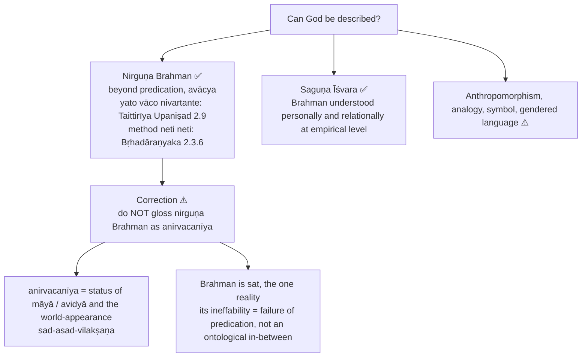

- **Svarūpa-lakṣaṇa vs taṭastha-lakṣaṇa ✅.** *Sat-cit-ānanda* are **svarūpa-lakṣaṇa**, essential nature-defining marks, not qualities inhering in a substrate; the definition of Brahman as world-cause (*janmādy asya yataḥ*) is **taṭastha-lakṣaṇa**, accidental / relational. This is the Indian functional analogue of divine simplicity.
- **Advaita's authority for Brahman ✅.** Śruti is a valid means for what perception and inference cannot disclose (presupposition of the Advaita profile). All pramāṇas are *vyāvahārika*; at the *pāramārthika* level pramāṇa is transcended in Brahman-realisation (Pramāṇa theme).
- **Nyāya ✅.** God's nature is owned here as a **notion**; the **inference** establishing God belongs to Proofs. Pramāṇa theme: Nyāya uses *anumāna* to prove Īśvara; the 1-pramāṇa Cārvāka cannot reach God.
- **Language controls ⚠️:**

| Device | Control |
|---|---|
| Anthropomorphism | bodily images orient devotion but mislead if projected literally onto a non-corporeal ultimate |
| Analogy | "knows", "loves", "acts" may signify a real perfection without meaning exactly what they mean of finite persons |
| Symbol | creator, ruler, father/mother, indwelling presence disclose a relation without literal physical description |
| Gendered language | does not establish biological sex in a non-corporeal God; exclusive use can shape authority and whose experience appears normative |

Personhood means intelligence, will, knowledge, love and addressability, **not** human embodiment or male gender. A full theory belongs to *Religious Language*.

- **Western epistemic bridge (theme files) ⚠️.** Hume: metaphysical notions including God have no corresponding impression. Kant: reason applied beyond experience produces illusion; the proofs for God are demolished. Positivism: "God exists" is meaningless. These are bounded cross-links to Proofs / Religious Language, not owned here.

---

## 3. Dialectical Wings & Sceptical Refinements

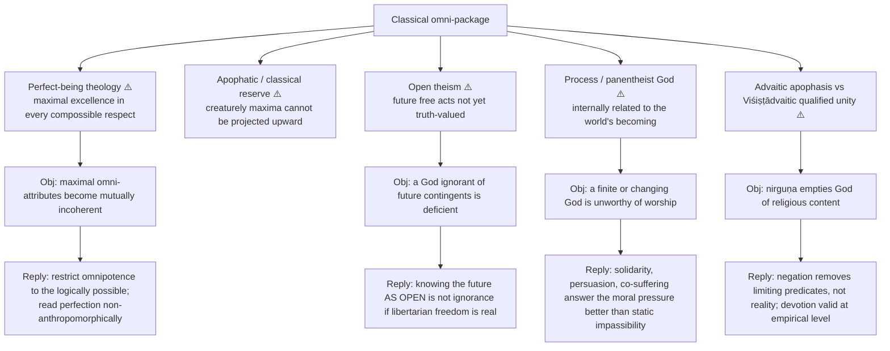

- Use rule (dossier) ⚠️: add **one** advanced move to a 15-marker, **one to two** to a 20-marker; never let it replace the owner's classical-theism frame.
- Safe line after listing attributes: "The coherence problem is what drives some modern philosophers from simple maximality to more apophatic construals of perfection."
- Open theism is useful only in freedom-vs-omniscience answers. Process / panentheism is a contrast sentence for immanence, transcendence and evil-pressure; do not expand it into a replacement syllabus.
- *What not to over-study (dossier):* full analytic-theology literature on simplicity, modal logic about omniscience, dense Whiteheadian terminology.
- *Promotion trigger (dossier):* a future PYQ directly asking divine simplicity, open theism or panentheism. Divine simplicity (§8.6) and omnipotence / foreknowledge (§8.7, §8.7A) are already in the owner file.
- *Dossier source trail:* Aquinas, *Summa Theologiae* I; Spinoza, *Ethics*; Pinnock et al., *The Openness of God*; Hartshorne, *The Divine Relativity*; Śaṅkara, *Brahma-Sūtra-Bhāṣya*; Rāmānuja, *Śrī-Bhāṣya* / *Vedārthasaṅgraha*.

---

## 4. Metaphysics & Ontology: Attributes and Profiles

### 4.1 Classical theism ✅

- God = personal, transcendent Creator, distinct from the world, with the "omni" attributes: **omnipotent, omniscient, omnibenevolent, eternal, immutable, simple, necessary**; immanent (present / active in world) *and* transcendent.
- **Argument ⚠️ (cumulative profile, not one proof):** (1) contingent reality requires a non-contingent ground; (2) ordered dependence requires an intelligent source; (3) the ultimate ground cannot derive actuality from another; (4) the source is therefore construed as necessary and perfect.
- **Presupposition ⚠️:** explanatory dependence cannot terminate in an unexplained contingent item; maximal perfection is coherent.
- **Creation ≠ manufacture ✅:** dependence of the *whole being* of creatures on God, not rearrangement of prior material.
- **Example ✅:** Aquinas' primary / secondary causation lets God sustain natural causes without competing with them; Nyāya treats Īśvara as efficient cause while atoms stay material causes.
- **Immanent AND transcendent (2023 Q6(b)) ⚠️:** transcendent = beyond, self-sufficient, creator; immanent = sustaining, present in creation. Transcendence is not spatial distance; immanence is not physical embodiment.

### 4.2 The attribute package and its coherence costs ✅/⚠️

| Attribute | Exact notion | Coherence pressure | Controlled reply |
|---|---|---|---|
| Omnipotence | power to realise every absolutely possible state of affairs | stone paradox; inability to sin / lie | contradictions are not possible objects; impeccability is perfection |
| Omniscience | knowledge of every truth | future freedom; indexical / temporal knowledge | timeless knowledge, soft facts, middle knowledge, or revised future truth |
| Perfect goodness | unsurpassable moral perfection | evil; is goodness independent of divine will? | goodness belongs necessarily to divine nature; theodicy → Problem of Evil |
| Eternity | timeless possession of life **or** everlasting existence | timeless being seems unable to act before / after or respond | one timeless act grounds temporal effects; critics question relation and responsiveness |
| Immutability | no intrinsic change or loss of perfection | knowledge, love, response seem personal only if relationally changing | distinguish intrinsic change from new temporal effects / relations; still contested |
| Simplicity | no real composition; essence / existence and attributes one | modal collapse; property / person objection | analogical identity or truthmaker readings, each with a cost |
| Personhood | intelligence, will, knowledge, love, addressability without bodily limit | anthropomorphism; gender projection | personal predicates analogical, not univocally human |

**Timeless-action dilemma ⚠️:** if God timelessly wills one complete order, creation and response can be effects of that act; yet if no alternative divine act is possible, contingency is threatened. **Immutability / personality verdict ⚠️:** constancy of character need not mean emotional inertness, but a notion removing every real relation or response preserves metaphysical perfection by weakening religious personality.

### 4.3 Spinoza: *Deus sive Natura* ✅ (2022 Q5(a), 2024 Q6(b))

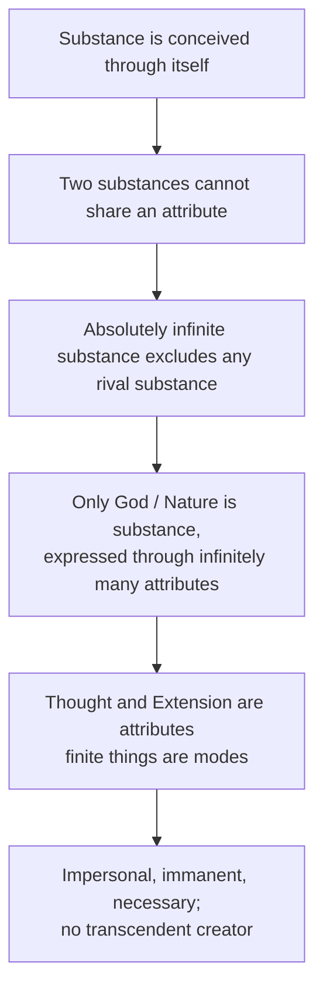

- Distinction ✅: Spinozistic pantheism is **not deism**: God neither withdraws from nature nor chooses to create it; nature follows necessarily from divine essence.
- Example ✅: a human mind is a finite mode under Thought; its body the corresponding mode under Extension.
- Objection → reply ⚠️: erases personality, providence, freedom → Spinoza redefines divine freedom as action from the necessity of one's own nature, not arbitrary choice.
- *Substance theme:* Descartes had three substances (God, mind, matter); Spinoza applied the definition rigorously → one. "Spinoza's monism is Descartes made consistent." **Hegel** accepts the monism and charges **acosmism**; his corrective is the Absolute grasped "not only as Substance, but equally as Subject".
- Citation discipline ✅: *Deus sive Natura* — *Ethics* IV, Preface; "Whatever is, is in God" — *Eth.* I, P15. Cite by Part / Proposition.

### 4.4 Advaita: nirguṇa Brahman and saguṇa Īśvara ✅ (2022 Q8(c))

- Nirguṇa Brahman = non-dual reality beyond limiting predicates; saguṇa Īśvara = Brahman understood through *māyā* at the empirical (*vyāvahārika*) level; nirguṇa is *pāramārthika*.
- Argument ✅: (1) changing objects are dependent, cannot be ultimate; (2) consciousness is the presupposition of every known object; (3) Upaniṣadic instruction removes superimposed difference; (4) ātman is recognised as Brahman.
- Attributes: **sat-cit-ānanda**; **antaryāmin** (inner controller, immanent) yet transcendent.
- Distinction ✅: nirguṇa is not a bare non-entity; it denies limiting empirical qualities while affirming non-dual reality.
- Example ✅: rope–snake: the world is dependently experienced through superimposition.
- World = **vivarta** (apparent modification); ātman **is** Brahman (*Tat tvam asi*, Chāndogya 6.8.7).
- Objection (Rāmānuja): a quality-less absolute is unintelligible. Reply: negation removes finite predicates rather than cancelling reality.
- *Room for theism? (2022 Q8(c)):* Śaṃkara's Brahman leaves room at the *vyāvahārika* level via saguṇa Īśvara; not as a second independent absolute.

### 4.5 Viśiṣṭādvaita: God, selves and world ✅ (2020 Q7(a), 2022 Q6(b))

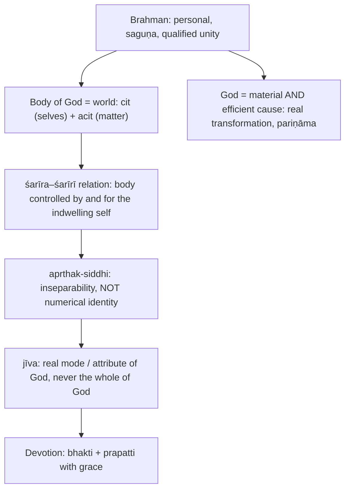

- Objection: if the world is God's body, defect infects God. Reply: distinguish the controller's perfection from the changing condition of the controlled body. Dossier verdict ❓: the analogy is strained.
- Māyā in Rāmānuja denotes God's real creative power, not an indeterminable illusion (Causation theme).
- Hold apart ⚠️: Rāmānuja does **not** identify jīva and Brahman.

### 4.6 Nyāya: God (Īśvara) as a notion, not a proof ✅ (2021 Q5(a))

| Attribute / relation | Nyāya position |
|---|---|
| Ontological status | one eternal, incorporeal self distinct from finite selves |
| Knowledge | omniscient; not limited by ordinary perception, inference, or error |
| Causation | efficient / ordering cause; eternal atoms remain material causes |
| Moral governance | supervisor of karma connecting *adṛṣṭa* with appropriate fruits |
| Scripture / language | authoritative teacher / speaker in the theistic Nyāya profile |
| Human relation | moral governor and teacher; finite selves keep agency and karmic responsibility |

Coherence control ⚠️: karmic administrator ≠ author of each choice. Full inference and Mīmāṃsā / Buddhist objections → Proofs for God.

### 4.7 Śaiva, Śākta and Mādhva God-concepts ✅ (pick ONE for "any one of the religions in India", 2019 Q8(c))

- **Śaiva Siddhānta** (dualistic-theistic): triad **pati–paśu–pāśa**; bonds *āṇava*, *karma*, *māyā*; Śiva efficient cause, māyā material cause; **pañca-kṛtya** (creation, maintenance, dissolution, concealment *tirodhāna*, grace *anugraha*); liberation *śiva-sāyujya* / *śiva-tulya*, never Śiva; grace = *śakti-nipāta*.
- **Kashmir (Pratyabhijñā / Trika) Śaivism** (Utpaladeva, Abhinavagupta): non-dual but realist about the world; Śiva = **prakāśa** + **vimarśa** (= Śakti); world = free self-manifestation (**ābhāsa**) through **svātantrya**; liberation = **pratyabhijñā**, recognition.
- **Śākta:** ultimate = Devī / Mahādevī; *Devī-Māhātmya* (in the Mārkaṇḍeya Purāṇa); Śakti is not an attribute added to God but the divine in its dynamic aspect; contrast Advaita's māyā (dependent, sublatable) and Sāṃkhya's prakṛti (unconscious).
- **Madhva's Dvaita:** axiom **svatantra–paratantra** (Viṣṇu alone independent); **pañca-bheda**; **bimba–pratibimba** (dependence, not identity); **taratamya** with threefold classification (*mukti-yogya*, *nitya-saṃsārin*, *tamo-yogya*); liberation = graded bliss as service (*dāsya*); device **viśeṣa** lets Viṣṇu have attributes without composition.

---

## 5. Roles, God–World–Man Relations and Non-Creator Profiles

*(Adapted from "Rejection / Affirmation of Transcendent Realities": here, the question is who counts as creator, and how God relates to world and man.)*

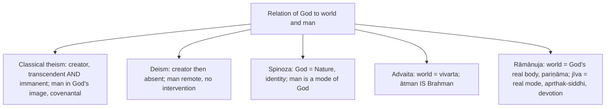

### 5.1 Theistic and non-creator Indian profiles ✅

| School / profile | Divine or ultimate notion | Creator status |
|---|---|---|
| Nyāya | omniscient personal God (Īśvara), efficient cause, moral governor | creator / arranger, not material cause |
| Classical Yoga | special self (*puruṣa-viśeṣa*), untouched by affliction and karma, archetypal teacher | not the creator of nature's evolution |
| Mīmāṃsā | eternal Veda, ritual order, unseen potency without necessary divine author | no required creator |
| Sāṃkhya | conscious selves and primordial nature as independent principles | no creator God required |
| Buddhism / Jainism | paths and cosmologies without an omnipotent creator | non-creator traditions |
| Advaita | quality-transcending Brahman ultimate; Īśvara at empirical level | creator language belongs to empirical dependence |

⚠️ "Non-theistic" does not mean irreligious, morally empty, or atheistic in one uniform sense. Full case → *Religion without God*.

*Causation theme ⚠️:* Mīmāṃsā's **apūrva** is impersonal and self-executing (no God needed → *nirīśvaravāda*); Nyāya's **adṛṣṭa** requires Īśvara to administer it.

### 5.2 "Must God have physical manifestation to be ultimate cause?" (2024 Q8(b)) ⚠️

Classical theism and Advaita say **no** (God / Brahman is non-physical, spiritual). Pantheism identifies God with nature. Rāmānuja gives God a "body" (the world) but not an anthropomorphic physical form. Ultimacy requires **non-dependence**, which a physical form would compromise. Distinguish incarnation, embodiment, material causation and metaphysical dependence.

---

## 6. Explanatory & Causal Principles

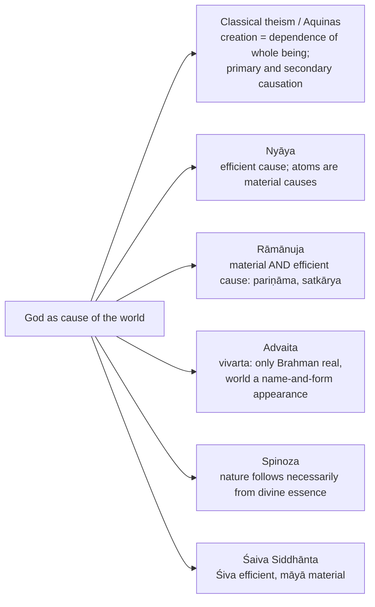

*Causation theme:* Advaita = vivarta (rope–snake, silver on shell); Rāmānuja = satkārya, Brahma-pariṇāma, real modification. The causation doctrine carries theological consequences.

### 6.1 Omnipotence, foreknowledge and free will (2020 Q5(d)) ✅

- **Stone paradox / Mackie ✅:** (1) an omnipotent being can create any object; (2) so it can create what it cannot control; (3) either it cannot create it or cannot control it; (4) either way something is beyond it. Mackie: **first-order** (power over things) vs **second-order** (power to determine what powers exist).
- **Replies:** Aquinas, power extends to the *absolutely possible*, a contradiction is not a thing (*ST* I q.25 a.3); Descartes' **universal possibilism** (eternal truths depend on God's will) at the price of contingent logic; "cannot lie / sin" = perfection, not deficit.
- **Foreknowledge dilemma ✅:** (1) God infallibly believed at t₁ that S will do A at t₂; (2) the past is fixed (accidental necessity); (3) infallible belief cannot be false; (4) so S cannot refrain from A; (5) so S is not free in the libertarian sense.

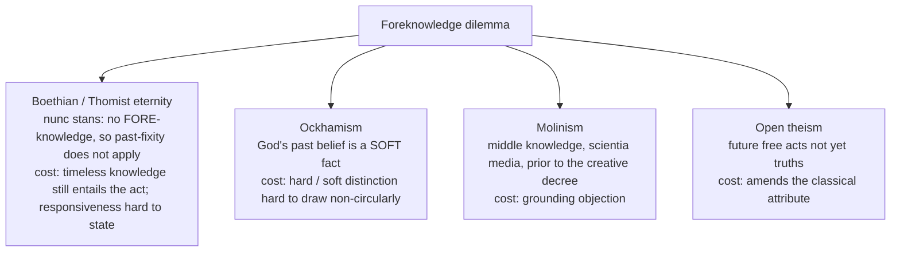

- **Indian parity ✅:** Nyāya — Īśvara is *karmādhyakṣa*, allots fruit **according to** *adṛṣṭa*; administering, not choosing, cause; *puruṣakāra* preserved against *daiva*. **Gītā 18.61** (Lord in the heart of all beings, revolving them as though mounted on a *yantra*) held with **18.63** (*yathecchasi tathā kuru*, "act as you wish"): canonical crux, not a solved proof. **Advaita** dissolves rather than answers (agency belongs to the jīva under *upādhis*). **Rāmānuja** uses divine *anumati*.
- **Verdict ⚠️:** "The attributes survive the paradoxes only if each is specified... costs are unequally distributed."

### 6.2 Omniscience under criticism (2026 Q8(c)) ✅/⚠️

| Criticism | Steps | Qualified response | What remains open |
|---|---|---|---|
| **First-person / de se (Kretzmann)** | someone may know "I am in danger" without recognising a described person as herself; omniscience as *every way of knowing* would require her own self-locating knowledge **as she has it**; God is not she | God knows completely **that** she has the "I" belief with its subject / time index; perspective-indexed account | whether perfect knowledge must include the subjective *mode of grasp* |
| **Present-time / tensed (Brentano, Kretzmann)** | "it is raining **now**" true now, false later; God must change beliefs, against immutability / timelessness | tenseless knowledge of "raining at t" and the value of "now" at each index; or accept a temporal God | irreducibly tensed awareness of what time it is **now** |

Test omniscience and omnipotence **separately**; the stone reply is not a theodicy, and these two criticisms are not answered by it.

---

## 7. Moral Governance, Devotion and Liberation Relations

*(Adapted from "Ethics & Human Goals": the owner file gives no kāma / artha / dharma / mokṣa hierarchy for this topic. It does give moral governor, karma administration, devotion and the God–man relation.)*

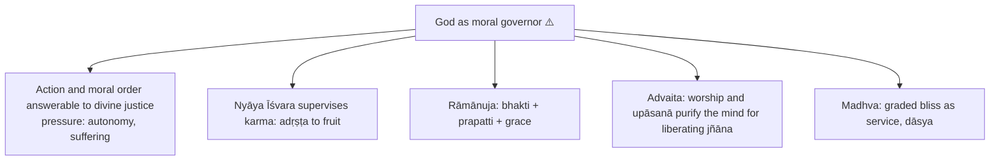

### 7.1 Personal and impersonal God in the context of devotion (2026 Q7(b)) ✅/⚠️

A *personal* God is a knowing and willing subject capable of reciprocal relation, grace and address; "personal" need not mean a human body. *Nirguṇa* does not simply mean "no worship": ask whether the *ultimate as ultimate*, rather than a religiously accessible manifestation, is the addressee of devotion.

| Position | Addressee | What devotion does | Pressure |
|---|---|---|---|
| **Advaita (Śaṃkara)** | nirguṇa Brahman ultimate; saguṇa Īśvara valid in *vyavahāra*, not a second absolute | worship and *upāsanā* purify and concentrate the mind for *jñāna*; not dismissed | ultimate realisation dissolves subject–object duality; interpersonal devotion is not the final relation |
| **Viśiṣṭādvaita (Rāmānuja)** | Brahman / Nārāyaṇa ultimately personal | *bhakti* or *prapatti* retains a real divine addressee; grace | transcendence and personhood must coexist without reducing God to a finite human agent |
| **Dvaita (Madhva)** | Viṣṇu and finite selves ultimately distinct | knowledge-grounded *bhakti*, *prasāda*; enduring worshipper–worshipped relation | distinction protects address but invites hierarchy / dependence questions |
| **Spinoza (bounded)** | God / Nature, not a deciding interlocutor | intellectual love is understanding necessity | cannot model answered prayer without reinterpretation |
| **Tillich (bounded)** | ground of being, not one being among others | ultimate concern without a human-like object | symbolic address does not supply a literal "Thou" |

Argument → objection → reply → remainder ⚠️: addressing, trusting, surrendering seem to need a responsive personal addressee (Rāmānuja supplies it); an impersonal absolute seems unable to know devotees or extend grace. Advaita: worship of saguṇa Īśvara is coherent empirically and prepares for non-dual knowledge. **Residual:** this does not preserve reciprocal devotion as the *final* relation. Conversely, personal theism must explain how an infinite God relates without human limitation.

### 7.2 Liberation parity grid ✅

| System | Ultimate | World's status | Soul in liberation | Distinctive device |
|---|---|---|---|---|
| Advaita | Nirguṇa Brahman | *Vivarta*, sublatable | individuality sublated | *Adhyāsa*, two levels of truth |
| Viśiṣṭādvaita | Saguṇa Brahman (Viṣṇu) | real body of God | eternal jīva in communion | *Apṛthaksiddhi*, śarīra–śarīrī |
| Śaiva Siddhānta | Śiva as pati | real, from māyā | *Śiva-tulya*, never Śiva | *Pañca-kṛtya*, *āṇava-mala* |
| Kashmir Śaivism | Śiva = prakāśa + vimarśa | real self-manifestation | recognition of identity | *Ābhāsa*, *svātantrya* |
| Śākta | Devī / Śakti | real emanation of Śakti | union with the Goddess | Śakti as the dynamic divine |
| Dvaita | Viṣṇu, *svatantra* | real, eternally distinct | graded bliss, service | *Pañca-bheda*, *bimba–pratibimba* |

Objection → reply ⚠️: "sectarian theology, not philosophy" → each states an explicit causal doctrine, bondage-analysis and liberation-criterion, assessable for coherence.

---

## 8. Inter-School Comparative Matrices

| Axis | Classical theism | Spinoza | Advaita | Viśiṣṭādvaita |
|---|---|---|---|---|
| Personal? | Yes | No, not in a volitional sense | Īśvara empirically; Brahman beyond personality | Supremely personal |
| World relation | created and sustained, distinct | modes of one substance | dependent appearance (*vivarta*) | real body of Brahman |
| Human relation | creature–creator | finite mode–substance | ātman is Brahman | jīva distinct but inseparable |
| Freedom | providential agency | necessity of divine nature | freedom as knowledge of non-duality | grace, *bhakti*, *prapatti* |
| Main pressure ⚠️ | evil and attribute coherence | loss of personality | status of world / devotion | divine embodiment and defect |

| System | God–World | God–Man |
|---|---|---|
| Classical theism | creator, transcendent + immanent | personal, covenantal; man in God's image |
| Deism | creator then absent | remote, no intervention |
| Spinoza | God = Nature (identity) | man is a mode of God |
| Advaita (Nirguṇa) | world = vivarta | ātman IS Brahman |
| Rāmānuja (Saguṇa) | world = God's real body (pariṇāma) | jīva = real mode (aprthak-siddhi), devotion |

**Divine simplicity (§8.6 of owner) ✅/⚠️.** Denies every composition in God (matter / form, substance / accident, genus / difference, essence / existence); attributes are one reality diversely signified (Aquinas, *ST* I qq.3–13; anticipated by Augustine; paralleled in Maimonides). **Aseity** = God exists from himself. Hold apart: simplicity (composition), aseity (derivation), immutability (change), impassibility (being acted upon), eternity, necessity.
- Objections: **modal collapse**; **Plantinga** (*Does God Have a Nature?*): if God is identical with his properties, God is a property; **religious adequacy** of an impassible God.
- Indian parity: Advaita's svarūpa-lakṣaṇa; Rāmānuja attacks it (a determinationless entity is neither knowable, nameable nor worshippable; Brahman is *saviśeṣa*); Madhva's **viśeṣa**.

---

## 9. Criticisms & Reconstructed Replies

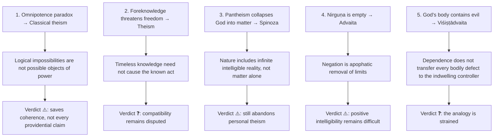

Further objection set (owner §8): modal collapse and Plantinga's property objection against simplicity; the "religious adequacy" objection against impassibility; the "sectarian theology" objection against §7.2.

---

## 10. Controlled Western Comparisons

| Indian / Western pairing | Point of contact | Decisive disanalogy / limit |
|---|---|---|
| Advaita nirguṇa Brahman ↔ Spinoza's substance | both non-personal, non-dual-leaning ultimates | Spinoza's modes are *real* modifications (pariṇāma, not vivarta), nearer to **Rāmānuja** than Śaṃkara (Self-and-liberation theme) |
| Advaita Ātman = Brahman ↔ Plotinus' One | ultimate unity | Plotinian reversion is an ascent through *really emanated* hypostases (theme) |
| Rāmānuja's personal Brahman ↔ classical personal theism | personal, creator, immanent and transcendent | Rāmānuja makes selves and world God's *body*; classical theism keeps creator–creature distinction; **non-interchangeability rule** ⚠️ |
| Non-dual Brahman ↔ classical personal creator | — | Advaita ultimately denies creator–creature duality; classical theism retains it; compare personality, dependence, world-relation explicitly |
| Nyāya Īśvara ↔ Aquinas' primary causation | God as cause without competing with natural causes (owner §8.1) | Nyāya Īśvara is efficient cause only; atoms and souls eternal |
| Spinoza's *Deus sive Natura* ↔ Descartes | — | Descartes' three substances (God, mind, matter); only God strictly qualifies by his own definition (Substance theme) |
| Spinoza ↔ Hegel | Hegel accepts the monism | Hegel's charge of **acosmism**; Absolute as Substance *and* Subject (Substance theme) |
| Tillich's ground of being ↔ classical theism | revisionary profile | not a proof, not a synonym for classical "God" |

> [!WARNING]
> Compare personality, dependence and world-relation explicitly. The sources give **no** East–West table beyond the pairings above; do not add historical-influence claims.

---

## 11. Diagnostic Deep-Dives for High-Frequency Themes

### 11.1 "Is Hinduism poly-theistic?" (2018 Q5(e), 10 marks) ✅/⚠️

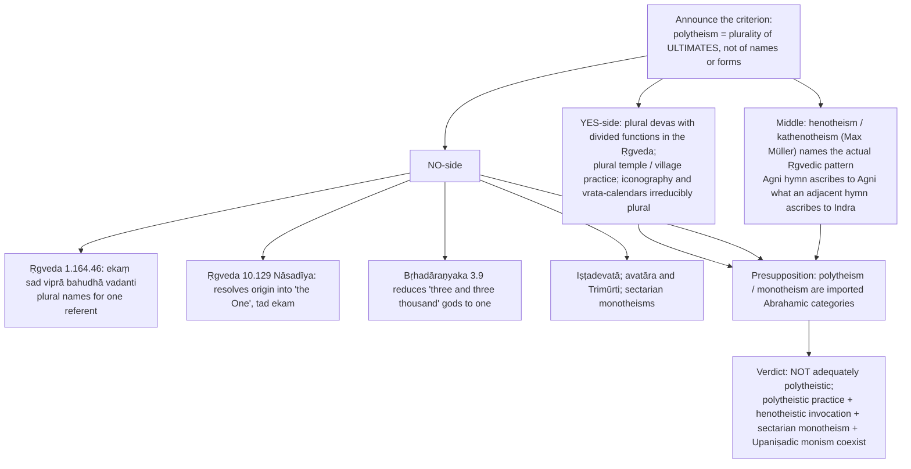

Objection → reply ⚠️: "one being, many names" is a modern apologetic overlay → the verse is genuinely Ṛgvedic and Nāsadīya independently resists plural ultimacy; but its extension into a theory of **inter-religious pluralism** is 19th–20th century and must be argued (→ *Religious Pluralism*). Attribution ✅: Müller coined the *terms*; the *pattern* belongs to the hymns.

### 11.2 Personalistic and impersonalistic aspects of God (2019 Q8(b), 2023 Q5(a), 2026 Q7(b)) ⚠️

```text
Intro : the deepest divide: personal (with qualities) vs impersonal (beyond).
Body  : Western: theism (personal creator) vs Spinoza's impersonal pantheism;
        Indian: saguṇa Īśvara (Rāmānuja, bhakti) vs nirguṇa Brahman (Advaita, neti neti).
Assess: Advaita reconciles: saguṇa (vyāvahārika) and nirguṇa (pāramārthika) as two levels of ONE.
Concl : the two aspects answer different needs: devotion vs metaphysical ultimacy.
```
For 2026 Q7(b) add the *devotion* qualifier (§7.1): do not substitute a generic attributes table, nor the full jñāna–karma–bhakti soteriology (that belongs to *Soul*).

### 11.3 Relation of God and Self in Rāmānuja (2022 Q6(b), 15 marks) ⚠️

```text
Intro : Viśiṣṭādvaita, qualified non-dualism; a personal saguṇa Brahman.
Body  : jīva a real mode / attribute of God; world + souls = God's body (śarīra–śarīrī);
        aprthak-siddhi; real transformation (pariṇāma); bhakti + prapatti.
Contrast: Advaita's ātman = Brahman identity.
Concl : self is really distinct-yet-inseparable from a personal God, which grounds devotion.
```

### 11.4 Freedom of will and an omnipotent God (2020 Q5(d), 10 marks) ⚠️

State the incompatibility in numbered premises; give the four exits with prices (Boethian eternity, Ockhamism, Molinism, open theism); add omnipotence proper (Aquinas, Mackie); Indian parity (Nyāya adṛṣṭa, Gītā 18.61 with 18.63). Conclude: compatible only on a specified reading of each term, naming which premise you deny.

### 11.5 Criticisms of omniscience and omnipotence (2026 Q8(c), 15 marks) ⚠️

Organise by **objection**, not attribute-definition: briefly define both; stone / higher-order power paradox and its possible-act reply; *de se* premises with perspective-indexed reply; tensed-truth / immutability argument with tenseless or temporal reply; if space permits note foreknowledge / freedom and the evil pressure (one bounded paragraph → *Problem of Evil*). Conclude by naming **which tension survives** each account.

---

## 12. PYQ Routing Ledger

> Corpus signal ⚠️: **13 primary-owned parts** of 112 religion parts in the 2018–2025 corpus (none in 2025) plus **2 primary-owned 2026 parts** in the separate supplement = **15** counted. The bank's per-year row is 1 / 2 / 2 / 1 / 3 / 2 / 2 / 0 = 13.

| Year | Q | Marks | Exact demand | Map to |
|---|---|---:|---|---|
| 2018 | Q5(e) | 10 | Is Hinduism poly-theistic? Give reasons for your answer. | §11.1 |
| 2019 | Q8(b) | 15 | State and evaluate the personalistic and impersonalistic aspects of God. | §11.2 |
| 2019 | Q8(c) | 15 | Discuss the relationship between man and God according to any one of the religions in India. | §4.7, §7 |
| 2020 | Q5(d) | 10 | Is there any compatibility between 'Freedom of Will' and 'Omnipotent God'? Discuss. | §6.1, §11.4 |
| 2020 | Q7(a) | 20 | Discuss the nature of God in Hinduism with special reference to Vishishtadvaita (Qualified non-dualism). | §4.5 |
| 2021 | Q5(a) | 10 | Discuss the nature of God as propounded in Nyāya philosophy. | §4.6 |
| 2022 | Q5(a) | 10 | Write an essay on Spinoza's notion of God and His attributes. | §4.3 |
| 2022 | Q6(b) | 15 | Explain the relation between the God and the Self according to Rāmānujācārya. | §4.5, §11.3 |
| 2022 | Q8(c) | 15 | Critically examine the idea of Brahman in Advaita philosophy of Śaṃkara. Does Śaṃkara's conception of Brahman leave room for theism? Discuss. | §4.4 |
| 2023 | Q5(a) | 10 | Elucidate the personalistic and impersonalistic aspects of God. | §11.2 |
| 2023 | Q6(b) | 15 | In what sense is God both immanent and transcendent in theism? Discuss. | §4.1 |
| 2024 | Q6(b) | 15 | How does the notion of God in Spinoza's philosophy embedded in his metaphysics of substance and attributes? Critically discuss. | §4.3 |
| 2024 | Q8(b) | 15 | "In order to be conceived as the ultimate cause of the world, God must necessarily have some form of physical manifestation." Do you agree with this view? Give reasons and justifications for your answer. | §5.2 |
| 2026 | Q7(b) | 15 | Discuss the difference between personalistic and impersonalistic notions of God in the context of devotion. | §7.1 |
| 2026 | Q8(c) | 15 | Present an account of criticisms against omniscience and omnipotence as attributes of God. | §6.2, §11.5 |

**Cross-owned / boundary notes (listed, not counted):**
- 2026 Q8(a), 20 marks, owned by *Religion and Morality*: Gandhi's shift from "God is Truth" to "Truth is God". The 2026 supplement boundary note assigns the **Truth-as-*sat* metaphysics** side to *Notions of God* and the equal-respect thesis to *Religious Pluralism*; the question itself is not counted here.
- 2026 Q8(b), 15 marks, owned by *Proofs for God*: Madhvacharya's arguments for the existence of God. Madhva's *svatantra–paratantra* and *pañca-bheda* ontology (§4.7) is the shared background.
- 2025 Q7(b), 15 marks (per Pramāṇa theme), owned by *Proofs for God*: proofs Nyāya offers for God. Nyāya's **notion** of God (2021 Q5(a)) is owned here.

See the [Philosophy of Religion PYQ Bank, 2018–2025](../../upsc-ai-kit/knowledge/Philosophy/paper-2/_PYQ-PhilosophyOfReligion-2018-2025.md) and [2026 Supplement](../../upsc-ai-kit/knowledge/Philosophy/paper-2/_PYQ-PhilosophyOfReligion-2026-Supplement.md).

---

## 13. Top 10 UPSC Exam Traps

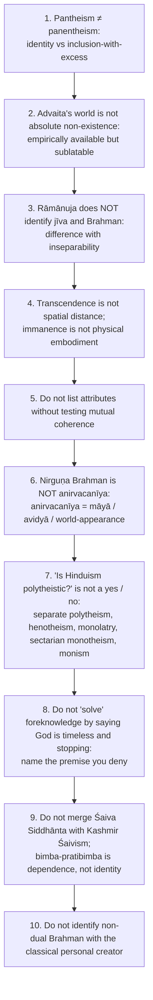

Remaining owner traps ⚠️: 'physical manifestation' needs incarnation / embodiment / material causation / dependence separated; divine simplicity is a denial of composition, not "uncomplicated"; do not equate monotheism with all of classical theism; creator, sustainer, moral governor, ground and absolute are not synonyms; answer the Nyāya nature question with attributes, not proofs alone; timelessness is not the absence of a problem; do not infer bodily or male gender from divine personhood; do not expand process / finite / open God-concepts into a replacement syllabus.

---

## 14. Technical Vocabulary & IAST Bank

| English gloss | Term | Meaning | Status |
|---|---|---|---|
| Personal God with qualities | saguṇa Īśvara | Brahman understood personally, empirically (Advaita); always determinate (qualified / dualistic Vedānta) | ✅ |
| Quality-transcending Brahman | nirguṇa Brahman | beyond predication | ✅ |
| Being–Consciousness–Bliss | sat-cit-ānanda | svarūpa-lakṣaṇa; not a single Upaniṣadic verse | ✅ |
| Inner controller | antaryāmin | immanent yet transcendent | ✅ |
| Ineffable | avācya | failure of objectifying predication | ✅ |
| Indeterminable | anirvacanīya | status of māyā / world, NOT Brahman | ✅ |
| Essential / accidental definition | svarūpa-lakṣaṇa / taṭastha-lakṣaṇa | | ✅ |
| Apparent modification | vivarta | Advaita | ✅ |
| Real transformation | pariṇāma | Rāmānuja | ✅ |
| Body–self relation | śarīra–śarīrī | | ✅ |
| Inseparability | aprthak-siddhi | not identity | ✅ |
| Matter / selves | acit / cit | | ✅ |
| Empirical / ultimate standpoint | vyāvahārika / pāramārthika | | ✅ |
| Surrender | prapatti | | ✅ |
| Devotion | bhakti | | ✅ |
| Worship / meditation | upāsanā | | ⚠️ |
| Lord, soul, bond | pati–paśu–pāśa | Śaiva Siddhānta | ✅ |
| Five acts | pañca-kṛtya | | ✅ |
| Self-luminosity / self-awareness | prakāśa / vimarśa | Kashmir Śaivism | ✅ |
| Self-manifestation / freedom | ābhāsa / svātantrya | | ✅ |
| Independent / dependent | svatantra / paratantra | Madhva | ✅ |
| Five differences | pañca-bheda | | ✅ |
| Reflection / original | bimba–pratibimba | | ✅ |
| Gradation | taratamya | | ✅ |
| Distinguisher | viśeṣa | | ✅ |
| Karma supervisor | karmādhyakṣa | Nyāya Īśvara | ✅ |
| Unseen potency | adṛṣṭa | | ✅ |
| Human effort / fate | puruṣakāra / daiva | | ✅ |
| Divine permission | anumati | Rāmānuja | ✅ |
| One-god-at-a-time | kathenotheism | Müller's term | ✅ |
| Chosen deity | iṣṭadevatā | | ✅ |
| God or Nature | *Deus sive Natura* | Spinoza | ✅ |
| Middle knowledge | *scientia media* | Molina | ✅ |
| Eternal present | *nunc stans* | Boethian eternity | ✅ |

Quotation discipline ✅: *Ekaṃ sad viprā bahudhā vadanti* = Ṛgveda 1.164.46 (pluralist *application* is a modern extension); *Tat tvam asi* = Chāndogya 6.8.7; *Neti neti* = Bṛhadāraṇyaka 2.3.6; *Yato vāco nivartante* = Taittirīya 2.9; translated one-liners of Śaṃkara / Rāmānuja ❓ are translation-dependent, paraphrase.

---

## 15. Graded Verdict & Answer Architectures

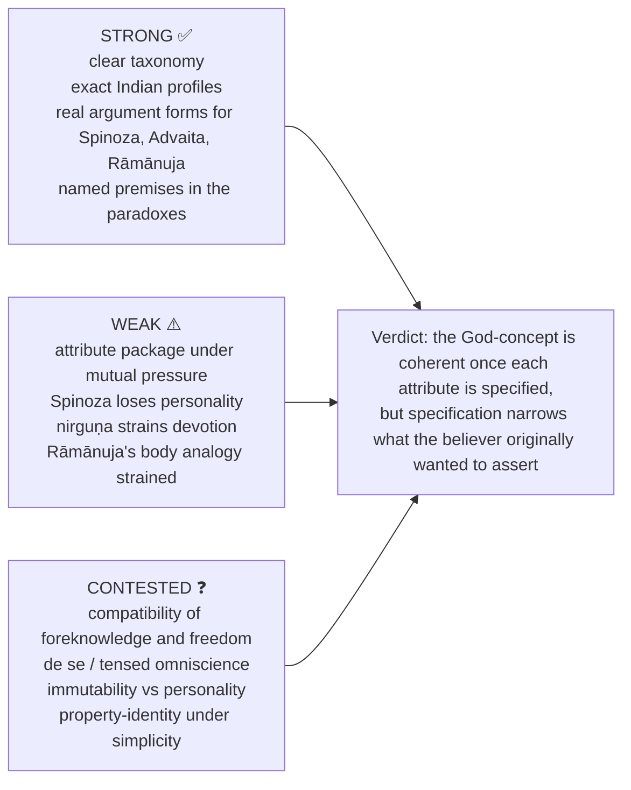

### 15.1 10-mark
```text
Define the contrast → give one Western and one Indian formulation →
one discriminating distinction → one objection → verdict answering the exact term in the question.
```
### 15.2 15-mark
```text
Frame the attribute / relation problem → reconstruct the doctrine and presupposition →
use the canonical example → contrast the nearest rival → objection and reply → graded verdict.
```
### 15.3 20-mark
```text
Classify the God-concept → full metaphysical argument → God–world and God–human relations →
Indian–Western comparison → two objections with replies → assess what notion of ultimacy survives.
```

> [!TIP]
> **Rule.** The verdict sentence must reuse the question's own operative term ("compatible", "ultimate cause", "personalistic", "poly-theistic"). Examiners mark the answered *term*, not the topic.

### 15.4 Directive decoder ⚠️

| Directive | Buying | Structure | Example |
|---|---|---|---|
| Elucidate | clarification of a distinction | two-column contrast + reconciling device | 2023 Q5(a) → Advaita's two levels |
| Discuss | balanced exposition + stated position | thesis → both sides → verdict | 2019 Q8(c) → pick ONE school and finish it |
| Critically examine | reconstruction + evaluation | doctrine → presupposition → objection → reply → graded verdict | 2022 Q8(c) |
| Is there any compatibility…? | yes / no thesis naming the disputed premise | numbered premises, deny one, pay the cost | 2020 Q5(d) |
| Do you agree… give reasons | explicit first-person verdict | position in intro, reasons ranked | 2024 Q8(b) |
| Write an essay on | coverage with architecture | classify → expound → contrast → assess | 2022 Q5(a) |
| How does X embedded in…? Critically discuss | systemic dependence, then test | locate concept in system's machinery first | 2024 Q6(b) |
| Give reasons for your answer | named criterion, then application | announce the criterion first | 2018 Q5(e) |

### 15.5 Self-scoring ladder ⚠️

| Band | Contains | Typical fault |
|---|---|---|
| Weak ≈40% | lists attributes and schools; narrates Advaita and Rāmānuja | no premises, objection, verdict |
| Average ≈50% | one tradition done properly | Indian **or** Western only; verdict is a summary |
| Good ≈60% | both traditions; one reconstructed argument; one objection with reply | objection unanswered; parity decorative |
| Strong ≈65–70% | numbered reconstruction + named presupposition + objection / reply + graded verdict conceding a cost | occasionally over-claims a quotation |
| Top ≈70%+ | all above + a discriminating distinction (henotheism vs monism; soft vs hard fact; svarūpa- vs taṭastha-lakṣaṇa; *apṛthaksiddhi* ≠ identity) + what would refute the position | — |

**Graded-verdict templates ⚠️:** *Compatibility:* "compatible only on reading X of omnipotence and Y of freedom; on the libertarian-plus-temporal reading they are not, and the theist pays with timeless eternity, soft facts, middle knowledge or amended omniscience." *Classification:* "Neither label fits without remainder; the tradition is best described as ___, provided we distinguish plurality of ultimates from plurality of names and forms." *Attribute:* "coherent once specified, but its specification narrows what the believer originally wanted to assert; that narrowing is the real cost."

**Safe formulations ⚠️:** "Advaita reconciles religious personality and metaphysical absoluteness by levels of truth; Viśiṣṭādvaita rejects that hierarchy." · "Plurality of names and forms is not plurality of ultimates, but it is not nothing either." · "Foreknowledge questions are won by naming the premise you deny, not by asserting timelessness."

---

## Sources

John Hick, *Philosophy of Religion*; W. J. Wainwright (ed.), *The Oxford Handbook of Philosophy of Religion*; S. C. Chatterjee & D. M. Datta, *An Introduction to Indian Philosophy*; Spinoza, *Ethics* Part I; Aquinas, *Summa Theologiae* I qq.2–26; Wierenga, "Omniscience", *SEP* §§4.1–4.2; Plantinga, *Does God Have a Nature?*; Molina, *On Divine Foreknowledge*; Zagzebski, *The Dilemma of Freedom and Foreknowledge*; F. Max Müller on henotheism / kathenotheism; Radhakrishnan, *Indian Philosophy* Vol. II; C. D. Sharma, *A Critical Survey of Indian Philosophy*; dossier trail: Pinnock et al., Hartshorne, Śaṅkara, Rāmānuja.
