# PROOFS FOR THE EXISTENCE OF GOD AND THEIR CRITIQUE — Examiner-Grade Mindmap

> **Syllabus (verbatim):** Proofs for the Existence of God and their Critique (Indian and Western).
> **Catalogue key:** `philosophy-paper-ii-philosophy-of-religion-02` · Paper II · Philosophy of Religion
> **Sources used:** `paper-2/philosophy-of-religion/Proofs-for-God.md` (canonical owner, read in full) · `_advanced/Philosophy-of-Religion-Dossier.md` §2 (optional depth; promotion ledger and §1 read for boundaries) · `paper-2/_PYQ-PhilosophyOfReligion-2018-2025.md` · `paper-2/_PYQ-PhilosophyOfReligion-2026-Supplement.md` · `paper-1/_themes/` passages that bear on this topic: `Pramana-across-schools.md` (§6.2 Nyāya proofs; Cārvāka/Nyāya vyāpti rows), `Causation-across-schools.md` (apūrva vs adṛṣṭa), `A-priori-a-posteriori-knowledge.md` (Kant bridge), `Critiques-of-metaphysics.md` (Kant's demolition of the proofs). `Substance-across-western.md` and `Self-and-liberation-across-schools.md` are not cited for this topic.
> **Evidence key:** ✅ canonical doctrine / fact · ⚠️ analytical synthesis for exam use · ❓ contested / uncertain

> [!IMPORTANT]
> **Core thesis.** For every proof ask three separate questions: is it **valid**? are its premises **true** (sound)? does its conclusion reach the **God of religion**? Most scripts answer only the first. Individually the proofs fail as demonstrations; cumulatively they can at most establish a probability, and even then they underdetermine the personal, morally perfect God of worship. That gap between the God of the arguments and the God of religion is the standing conclusion of the whole clause. ⚠️

> [!NOTE]
> **Adaptation.** The 15-module blueprint is written for Indian schools. For this topic Module 1 maps ownership boundaries and proof-families; Module 2 maps what *kind of knowing* each proof claims (a priori, a posteriori, pramāṇa-based, practical); Module 3 maps the sceptical and anti-creator wings; Module 4 holds the proofs themselves; Module 5 holds the Indian and Western stands for and against a creator; Module 7 holds the moral strands. The sources contain no āstika/nāstika classification of the proofs themselves and no *puruṣārtha* hierarchy for this topic; where a module has no such material it says so.

---

## 0. Master Overview

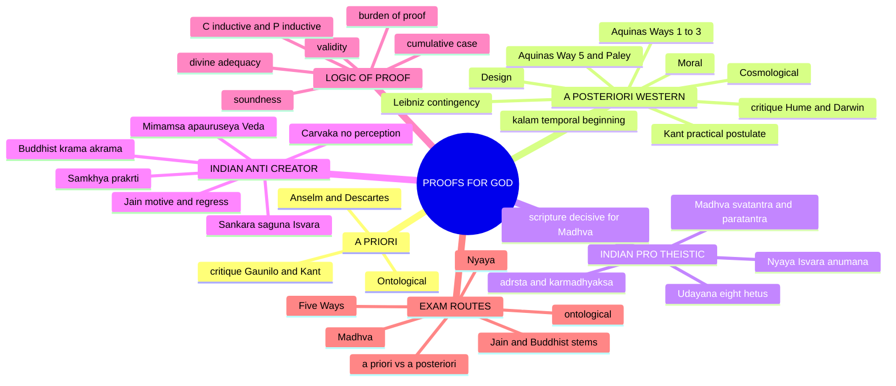

---

## 1. Identity, Classification & Boundaries

### 1.1 What the clause owns, and what it does not ✅

| Owned here | Boundary (routed elsewhere) |
|---|---|
| Ontological, cosmological, design and moral arguments | Attributes and God–world relation presupposed by an argument → *Notions of God* |
| Nyāya–Udayana arguments and Indian anti-creator objections | Full positive case for religious life without a creator → *Religion without God* |
| **Madhvācārya's epistemic case for God**: the *svatantra*/*paratantra* dependence argument, the three *pramāṇas*, his reservation about the design argument (2026 Q8(b)) | Nature and attributes of Viṣṇu-as-Brahman → *Notions of God*; *tāratamya*, *svarūpa-bheda*, Dvaita liberation → *Soul, Immortality, Rebirth and Liberation* |
| Suffering only when it is counter-evidence to a proof's conclusion | Full logical, evidential and theodicy debate → *Problem of Evil* |
| Religious experience only as one bounded strand of a cumulative case | Phenomenology, object and veridicality → *Religious Experience* |
| Rational warrant and burden attached to an argument | Revelation, faith, properly basic belief → *Reason, Revelation and Faith* |
| Pragmatic proposals only to classify their force | Pascal's wager and Jamesian permission are **not** existence-proofs and cannot substitute for argument |

The 2026 supplement adds one boundary: the argument **from** religious experience as a proof of God belongs here and should be **a single bounded line**; the veridicality debate (Swinburne's principles of credulity/testimony, Katz's constructivism) belongs to *Religious Experience*.

> [!WARNING]
> "Proof" in the syllabus does not guarantee mathematical certainty. An argument may be valid without being sound, sound without reaching a personal or perfect God, or rationally suggestive without being demonstrative. ⚠️

### 1.2 Family tree of proofs ✅/⚠️

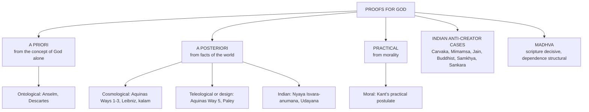

**Mnemonic ✅/⚠️ — "OCTM + Nyāya":** **O**ntological, **C**osmological, **T**eleological, **M**oral are the four Western proofs; Nyāya's inference is the Indian. Each answer = *state the proof, then the standard critique.*

### 1.3 Aquinas, Leibniz and kalām must be separated ✅

| Form | Starting point | Explanatory terminus | Characteristic pressure |
|---|---|---|---|
| **Aquinas, Ways 1–3** | present change, ordered efficient causation, contingency | unmoved actualiser, first efficient cause, necessary being | needs an essentially ordered dependence-series; "first" is explanatory, not necessarily temporal |
| **Leibnizian contingency argument** | the contingent totality and the principle of sufficient reason | a necessary sufficient reason outside the contingent series | the principle may be denied; a critic may allow a brute fact or ask why God terminates explanation |
| **Temporal-beginning argument (kalām)** | whatever begins has a cause; the universe began | a cause of the universe's beginning | the beginning premise and the move from a cause to a personal God need separate defence |

Aquinas did not need to prove a first moment of the universe. Leibniz asks why there is a contingent world at all, even if its history is beginningless. Only the temporal-beginning argument makes a temporal origin its explicit premise. Conflating them makes the regress objection imprecise.

### 1.4 Proof-force, burden and explanatory termination ⚠️

| Test | Question | Typical result |
|---|---|---|
| Validity | If the premises are granted, does the conclusion follow? | Ontological forms claim deduction; many world-based arguments need defeasible inference |
| Soundness | Are the premises true: possibility of maximal greatness, causal principle, sufficient reason, design-likeness? | Where most canonical critics attack |
| Divine adequacy | Does the conclusion establish one necessary, personal, perfectly good, worship-worthy God? | Most single arguments underdetermine the rich God of religion |
| Deductive force | Is denial of the conclusion inconsistent with the premises? | Claimed by Anselm and some cosmological reconstructions |
| Inductive / abductive force | Does the evidence raise probability, or make God the best explanation? | Design, fine-tuning, cumulative cases normally claim this weaker force |
| Practical force | Is belief required for coherent moral commitment rather than theoretical knowledge? | Kant's postulate of practical reason |

**Burden-of-proof rule ⚠️.** The proponent must defend the starting premise, the inference and the theological identification **separately**. Naming a "necessary being" does not show why explanatory demand terminates there rather than in an infinite regress, a brute contingent totality or another ultimate principle. Conversely, allowing the universe to be brute fact rejects the principle of sufficient reason; it does not demonstrate that every cosmological argument is invalid. A finite explanatory gap is not itself evidence for God: a responsible argument identifies a positive explanatory feature and compares live rivals; it does not infer "science has not explained X, therefore God."

---

## 2. Theory of Knowledge: What Kind of Knowing Does Each Proof Claim?

### 2.1 A priori vs a posteriori (2022 Q8(a)) ⚠️

| | A priori | A posteriori |
|---|---|---|
| Basis | concept of God alone | facts of the world |
| Example | Ontological | Cosmological, teleological, Nyāya |
| Strength | if valid, gives a necessary God | connects to observable reality |
| Weakness | Kant: existence is not a predicate | at best a probable / finite designer |

> [!TIP]
> **Which to prefer?** A posteriori arguments are more persuasive (rooted in experience) but yield only a *probable, finite* God; the ontological, if it worked, would give a *necessary* God but commits the existence-predicate fallacy. Most philosophers find **none demonstrative**, hence the turn to faith and experience. *Name the criterion before choosing, then state exactly what you lose.*

**Bridge from Paper I ✅.** Kant's antinomies and his critique of the proofs for God flow from the phenomena/noumena limit (themes `A-priori-a-posteriori-knowledge.md` and `Critiques-of-metaphysics.md`: the "demolition of the proofs for God's existence — ontological, cosmological, teleological" is a symptom of reason overstepping its limits).

### 2.2 Types of argumentative force ⚠️

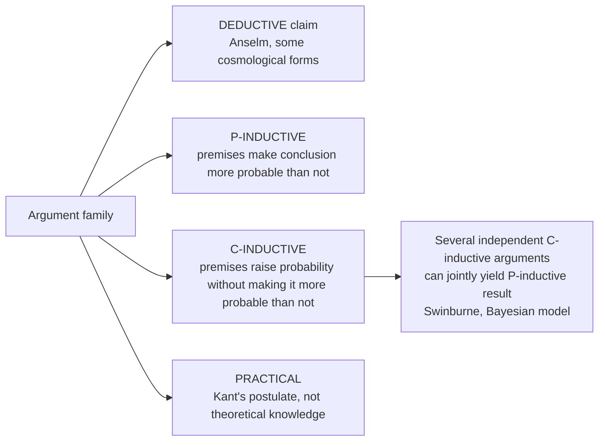

### 2.3 Pramāṇa grounding of the Indian proofs ✅/⚠️

| School | Pramāṇa route | Consequence for proof of God |
|---|---|---|
| **Nyāya** | *anumāna* (inference) is one of its four pramāṇas; the proofs *kāryāt*, *āyojanāt* and the scripture-grounds rest on inference and testimony | A four-pramāṇa realist **can** reach God by inference, whereas one-pramāṇa Cārvāka cannot (theme `Pramana-across-schools.md` §6.2) |
| **Cārvāka** | perception alone; vyāpti cannot be established | undercuts every *anumāna*-based proof (owner link-out: "the attack on inference that undercuts every anumāna-based proof") |
| **Mīmāṃsā** | *apauruṣeya* Veda, self-validating | no divine author required |
| **Madhva** | exactly three: *pratyakṣa*, *anumāna*, *śabda/āgama* | perception and inference innately valid (transcendental argument, §4.9); scripture decisive for God's identity |

**Nyāya vyāpti machinery (theme file, ⚠️).** Nyāya's solution to vyāpti uses upādhi-elimination, tarka and sāmānyalakṣaṇa-pratyakṣa, and depends on real universals being perceived. The Nyāya proofs inherit whatever force that machinery has against the Cārvāka attack.

---

## 3. Dialectical Wings & Sceptical Refinements

```mermaid
flowchart TD
  P0["Every theistic proof"] --> W1["WESTERN CRITICAL WING"]
  P0 --> W2["INDIAN ANTI-CREATOR WING"]
  P0 --> W3["MODERN REPAIR AND COUNTER-REPAIR<br/>advanced dossier"]
  W1 --> W11["Gaunilo: perfect island parody"]
  W1 --> W12["Kant: existence is not a real predicate;<br/>cosmological hides ontological"]
  W1 --> W13["Hume: weak analogy, finite and imperfect designer,<br/>one God or many, evil, infinite series or brute fact"]
  W1 --> W14["Darwin: natural selection for biological adaptation"]
  W2 --> W21["Carvaka: no perception of God, inference unreliable"]
  W2 --> W22["Mimamsa: Veda authorless, karma self-operating via apurva"]
  W2 --> W23["Jain: motive, regress, instrument, moral, redundancy, svabhava"]
  W2 --> W24["Buddhist: krama-akrama dilemma, vyapti only for artifacts, pratityasamutpada"]
  W2 --> W25["Samkhya: prakrti explains material order"]
  W2 --> W26["Sankara: only saguna Isvara, atomistic proof weak"]
  W3 --> W31["Modal ontological vs possibility premise and parody"]
  W3 --> W32["PSR vs brute-fact universe"]
  W3 --> W33["Fine-tuning and Bayesian cumulative case vs underdetermination"]
  W3 --> W34["Udayana cumulative Nyaya vs Mimamsa and Buddhist lines"]
```

### 3.1 Advanced dossier §2 — second-order debate ⚠️ (optional depth; one move in a 15-marker, one to two in a 20-marker)

| Optional debate | Competing positions | Strongest extra objection → reply | Safe use |
|---|---|---|---|
| Modal ontological argument vs Kantian / parody critique | Modal defenders: if a maximally great being is possible, it exists necessarily; Kantian critics deny that conceptual analysis can secure existence; parody critics attack the form | **Obj.:** the possibility premise assumes what it must prove. **Reply:** the debate shifts from bare existence to the coherence of maximal greatness | One line after Anselm/Descartes, never instead of the core ontological structure |
| Principle of sufficient reason vs brute-fact universe | Rationalists and Thomists deny contingent reality can be explanatorily ultimate; Humean / anti-PSR critics allow brute fact or infinite regress | **Obj.:** the total universe may simply be there. **Reply:** a contingent totality still lacks self-explanation; enlarging the set does not remove the demand | Evaluative conclusion of cosmological arguments |
| Fine-tuning / Bayesian cumulative case vs underdetermination | Probabilistic design via fine-tuning and cumulative evidence; critics appeal to multiverse hypotheses or underdetermination | **Obj.:** too weak, rivals remain. **Reply:** an inference-to-best-explanation supplement, not a knock-down proof | Mention only as a modern extension of teleology; never replace Paley, Aquinas or Hume |
| Udayana-style cumulative Nyāya theism vs Mīmāṃsā / Buddhist anti-creator lines | Udayana multiplies inferential routes; Mīmāṃsā, Buddhism, anti-creator schools resist the divine allocator or author | **Obj.:** karma, Veda and order can function without a creator. **Reply:** unconscious *adṛṣṭa* and authorless linguistic normativity cannot by themselves explain ordered allocation and intelligibility | Strong optional finish in Nyāya answers |

*What not to over-study:* modal notation, probability equations, every listed proof in the *Nyāyakusumāñjali*. *Promotion trigger:* a PYQ asking modal versions, cumulative-case reasoning or specialist Nyāya-Udayana reconstruction directly. (Note: cumulative-case logic §6.4 and Udayana's eight-fold list §4.7 are already Core in the owner file.)

---

## 4. Metaphysics & Ontology: The Proofs Themselves

### 4.1 Ontological argument (2018 Q6(c), 2020 Q6(a), 2024 Q7(c)) ✅

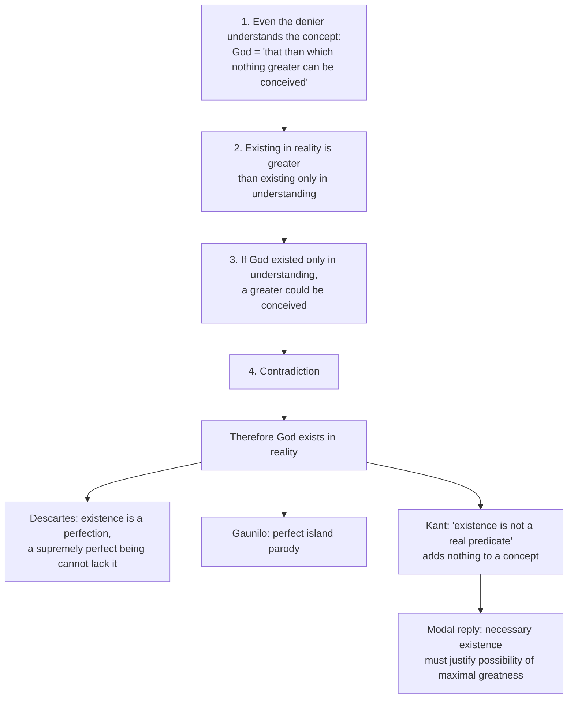

- **Presupposition ⚠️:** existence can function in the greatness/perfection ordering, and the concept of a maximally great being is coherent.
- **Distinction ✅:** an a priori proof does not infer from observed effects; it analyses what is supposedly contained in the God-concept.
- **Quote discipline ✅:** "that than which nothing greater can be conceived" is Anselm, *Proslogion* 2; give the reductio form after quoting. "Existence is not a real predicate" is Kant, *Critique of Pure Reason*, A598/B626 region.
- **Answer rule ✅:** answer *validity* and *soundness* separately (2020 Q6(a)); for 2018 Q6(c) "does the concept entail existence?", Kant's premise must be **stated**, not just named; for 2024 Q7(c) (10+5) obey the split: exposition (10) then criticism (5).

### 4.2 Cosmological: Aquinas' Five Ways (2022 Q6(a), 2026 Q5(b)) ✅

Aquinas, *Summa Theologiae* I, q.2, a.3 gives **five distinct a posteriori Ways**; they are **not** five names for a temporal first-cause argument. Each Way's text gives an initial description ("this we call God"); divine unity, personality and goodness need further argument. Ways 1–3 concern explanatory dependence rather than a proof that the universe began in time.

| Way | Datum | Premises and route | Immediate conclusion | Objection → controlled reply and cost |
|---|---|---|---|---|
| **1 — change** | things change | potentiality → actuality; nothing is potential and actual **in the same respect**; in a presently dependent order of actualisers, derivative actualisers need a non-derivative source | an unmoved actualiser, not merely the oldest moving object | A critic denies every change needs a simultaneously operating distinct actualiser, or challenges rejecting infinite dependence. Thomist: a self-changing thing has distinct actual and potential respects; an indefinitely long chain of *derivative* power still lacks a source of that power. Whether the chain must terminate is contested |
| **2 — efficient causation** | ordered efficient causes | nothing is its own efficient cause in the same respect; remove the first cause in an *essentially ordered* series and the intermediates lack causal power | a first efficient cause, not necessarily a first event | Humean: permits infinite or brute series. Thomist: accidentally ordered historical sequence vs essentially ordered dependency (hand → stick → moving stone). Succeeds only if actual causes really have derivative power |
| **3 — possibility / necessity** | things are generated and perish | if everything could fail to be, at some time nothing would have existed; nothing begins from absolute absence; yet things exist; so something necessary exists; a derived necessity chain terminates in one necessary **through itself** (*per se*), not **through another** (*per aliud*) | an underived necessary being | "each contingent thing can fail" does not entail "there was a time when **all** failed" (overlapping generations is a countermodel). A necessary ground does not automatically prove one personal God. Sympathetic reconstruction: contingent beings remain dependent even if something has always existed, but this reformulates rather than establishes Aquinas' printed step |
| **4 — degrees** | things are more or less good, true, noble | degrees relate to a maximum; the maximum is the source of the perfection in other things | a maximal source of being and perfections | Scales can contain degrees without a greatest instance; a maximum need not *cause* lesser ones. Defender must argue the degrees are participated perfections dependent on a source: precisely the disputed premise |
| **5 — governance / finality** | non-rational natural things act toward determinate outcomes | end-directed action of the unintelligent depends on intelligence, as an arrow is directed by an archer | an intelligent director of nature | Stable laws, self-organisation, natural selection challenge the inference. Thomist distinguishes natural directedness from Paley's watch analogy; does not itself establish a unique, omnipotent or perfectly good director |

**Third Way — the contested step ⚠️.** Printed route: (1) generation and corruption → contingent beings; (2) "if everything can fail to be, at some time nothing was"; (3) from nothing existing, nothing could subsequently originate without an already existing cause; (4) existence now → not everything is merely contingent; (5) derived necessary beings require an underived necessary being. **Quantifier shift:** "for every contingent being there is some time at which it does not exist" does **not** entail "there is some time at which no being exists." Even granting the conclusion, why the terminus must be a single knowing, willing God is an extra burden.

**"Who caused God?" ⚠️** does not refute the argument by itself: the proposed terminus is precisely *underived*. The critic must challenge the termination rule or ask why the universe or an impersonal ground cannot be underived. Do not substitute Leibniz or kalām for Aquinas' Third Way.

### 4.3 Teleological / design (2025 Q6(a)) ✅

- **Paley's analogical form:** watches show means–end adjustment and have designers; organisms show complex adjustment; therefore organismic order points to design. **Watch → watchmaker is Paley (*Natural Theology*, 1802, ch. 1), never Aquinas.**
- **Aquinas' Fifth Way** is not identical: it concerns regular directedness of non-conscious nature.
- **Presupposition ⚠️:** the relevant natural order is improbable or explanatorily deficient under non-intentional processes.
- **Indian analogue ✅:** Nyāya's potter–pot inference.

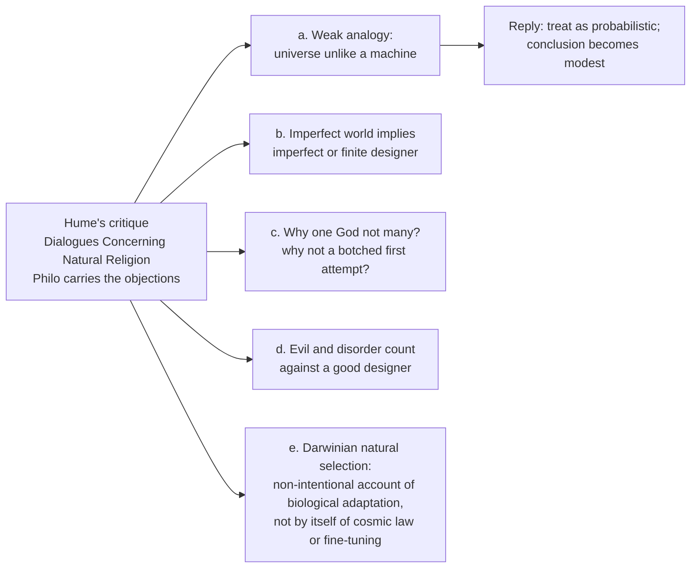

### 4.4 Moral argument (2021 Q7(b)) ✅

Kant demolishes the theoretical proofs but reinstates God as a **postulate of practical reason**: the *summum bonum* (virtue and happiness united) requires God and immortality as postulates. Stepwise: (1) the moral law obligates pursuit of the highest good; (2) finite agents cannot secure harmony of virtue and happiness; (3) practical rational hope postulates conditions under which it is possible; (4) God and immortality are practical postulates. Presupposition ⚠️: "ought implies can" applies to the highest good and moral rationality licenses postulation. See Module 7 for the three routes and objections.

### 4.5 Nyāya–Udayana inference to Īśvara (2018 Q8(a), 2023 Q7(a), 2025 Q7(b)) ✅

- **Core:** the world is an **effect (kārya)**, a composite arrangement of atoms; every effect needs an **intelligent efficient cause** who knows and combines the atoms → **Īśvara**. (A cosmological–teleological hybrid.)
- **Further grounds:** the Veda needs an author; the law of karma needs an intelligent dispenser (*karmādhyakṣa*).
- **God in Nyāya–Vaiśeṣika:** eternal, omniscient, the **efficient (never material)** cause; atoms (*paramāṇu*), space, time, ether and selves are eternal and uncreated. God arranges; He does not manufacture *ex nihilo*. Combines eternal atoms per adṛṣṭa/karma.
- **Classical locus:** Udayana's *Nyāyakusumāñjali* (5th *stabaka*), supported by *Ātmatattvaviveka*; earlier statements in Vātsyāyana, Uddyotakara and Jayanta's *Nyāyamañjarī*.

### 4.6 Udayana's mnemonic verse: eight *hetus* ✅ (glosses vary ❓ — give the Sanskrit term plus one clause of content)

| # | Hetu | Inference offered | Status |
|---:|---|---|---|
| 1 | **kāryāt** | The composite world is an *effect*; every effect presupposes an intelligent maker who knows its material, means and purpose | ✅ Core |
| 2 | **āyojanāt** | Inert atoms cannot combine themselves; the initial conjunction (*saṃyoga*) needs a conscious agent's volition | ✅ Core |
| 3 | **dhṛtyādeḥ** | Support, sustenance and periodic dissolution of the cosmos require a governing will (*ādi* carries the maintenance/destruction pair) | ✅ Core |
| 4 | **padāt** | Transmission of language, arts and crafts presupposes an original competent teacher | ✅ |
| 5 | **pratyayataḥ** | The validity (*prāmāṇya*) of the Veda requires a trustworthy (*āpta*) author | ✅ |
| 6 | **śruteḥ** | The Veda's own testimony to Īśvara counts as evidence within the system | ✅ |
| 7 | **vākyāt** | The Veda consists of sentences, which are of the kind produced by persons: a personal author | ✅ |
| 8 | **saṃkhyāviśeṣāt** | The "special number": the dyad (*dvyaṇuka*) that begins creation requires the numerical cognition (*apekṣā-buddhi*) of a conscious being present at the start | ❓ Technically hardest; state it only if you can state it correctly |

**The adṛṣṭa argument ⚠️** runs beneath all of these: unconscious merit and demerit cannot select who receives which fruit, so an intelligent superintendent (*karmādhyakṣa*) is required; usually treated as the philosophical core of (3).

**Verdict formula ⚠️.** Udayana's is the most systematic Indian natural theology: a **cumulative** case, not a single demonstration, inheriting the Humean liabilities of the Western design argument plus one of its own — that the artifact analogy does more work in (1)–(2) than the atomism can bear.

### 4.7 Madhvācārya: ontology the argument is about (2026 Q8(b)) ✅

- Reality divides exhaustively into ***svatantra-tattva*** (independent: **Brahman/Viṣṇu alone**) and ***paratantra-tattva*** (dependent: *jīvas* and *jaḍa*).
- Dependent realities are **real, not illusory**; hence the school's name ***tattvavāda*** ("realist viewpoint"), not merely "dualism".
- Dependence **constitutes difference**: souls and matter would not exist apart from Brahman's will, hence are permanently distinct from Him.
- ***Pañca-bheda*** (five differences): (1) Viṣṇu–*jīva*, (2) Viṣṇu–*jaḍa*, (3) *jīva*–*jaḍa*, (4) *jīva*–*jīva*, (5) *jaḍa*–*jaḍa*. It is a **classification of real distinctions, not five proofs**.
- "Creation" = **ontological dependence and divinely controlled manifestation**; souls and primordial matter may be **beginningless** yet *paratantra*. Do **not** import *creatio ex nihilo*.

### 4.8 Madhva's four strands, graded ⚠️

| # | Strand | Reconstructed argument | Can establish | Madhva's weight |
|---|---|---|---|---|
| **A** | **Scriptural (*śabda/āgama*)** | Brahman's identity as Viṣṇu, with a specific collocation of perfections, is disclosed by Vedānta texts as valid testimony | the **content** of theology | ✅ **Decisive**; Britannica: "In Madhva's system the existence of God cannot be proved; it can be learned only from the scriptures" |
| **B** | **Metaphysical dependence** | (1) world, souls and powers are real; (2) finite, not controlling their own existence; (3) dependent being presupposes an independent ground; (4) only Brahman is *svatantra*; (5) all else exists and acts under Brahman | an **independent ground** (ontological, not temporal) | ⚠️ **Structurally central**, but a reconstruction of his ontology |
| **C** | **Order / design** | the ordered world implies an intelligent arranger | at most a **supreme architect or demiurge** | ❌ **Under-weighted:** Sharma (ch. XXXVII, pp. 230–31): "not very much enamoured" of it; order yields an arranger, not a being on whom all things are **metaphysically dependent** |
| **D** | **"Epistemological" / perfection** | God is the highest perfection conceivable by human intelligence (Sharma compares *id quo maius cogitari non potest*) | the **concept and attributes** | ❓ **Not an Anselmian existence-proof** (Sharma ch. XXXVIII, pp. 235–45) |

**Mnemonic 🔑 — "S-D-O-P, and only S closes it."** **S**cripture supplies theology, **D**ependence supplies metaphysical structure, **O**rder is deliberately demoted, **P**erfection concerns the concept.

### 4.9 Madhva's three pramāṇas and the transcendental argument ✅

1. The Advaitin holds the plurality presented in ordinary cognition is finally unreal.
2. But scripture is accessible only through perception (hearing/reading) and inference (construing meaning).
3. If perception and inference were not innately valid, scripture's content could not be known either.
4. So perception and inference **must** be innately valid, and the plurality they present must be real.
5. Hence scripture must be read **in consonance with everyday experience** and cannot teach the non-difference of *ātman* and *brahman*.

- Emblematic (idiosyncratic) hermeneutic move: *tat tvam asi* ("you are that") re-read as ***atat tvam asi*** ("you are **not** that").
- On inference Madhva requires *vyāpti* and does **not** insist on Nyāya's fixed five-membered syllogism (Sharma, chs. XIV–XV, pp. 82–92).

**Correct statement of the reason–scripture relation ✅:** perception establishes the reality of plurality and difference; inference organises and defends that realism and can reach an independent ground; scripture alone discloses the supersensible identity and full attributes of that ground as Viṣṇu; reason then tests interpretations for consistency with experience but cannot generate revealed content. ❌ "Madhva proves God by inference" is wrong. ❌ "Perception and inference are invalid for Madhva" is also wrong.

**Historiographic ledger ✅ — who actually said it**

| Claim | Madhva | Jayatīrtha (1356–1388) | Vyāsatīrtha / Vyāsarāya (1478–1589) |
|---|---|---|---|
| *Svatantra/paratantra* ontology, *pañca-bheda* | ✅ | elaborated | defended polemically |
| Intrinsic validity of perception and inference | ✅ | systematised | deployed against Advaita |
| Formal syllogistic proofs and pramāṇa theory in technical form | ⚠️ compressed, often implicit | ✅ *Nyāyasudhā*, *Pramāṇapaddhati* | ✅ further Dvaita dialectic |
| Sustained refutation of rival schools | partial | ✅ | ✅ |

Madhva's dates ❓: IEP gives 1238–1317; Britannica gives "born 1199?" — write "traditionally 13th century".

---

## 5. Affirmation and Rejection of a Creator: Indian and Western Stands

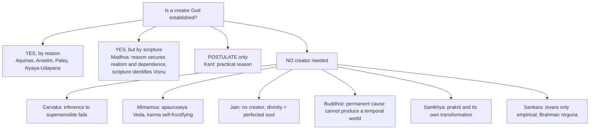

### 5.1 Jainism: no proof of a creator (2019 Q5(e), 10 marks) ✅

> [!WARNING]
> **Read the stem exactly.** Jainism offers **no proof of a creator God**. It offers (a) arguments *against* a creator and (b) a positive doctrine of divinity as the **perfected soul**. Inventing Jain theistic proofs loses the paper; saying only "Jainism is atheistic" loses half the marks. **Line 1 of the answer must say so.**

- **Doctrine:** non-theistic but not irreligious; the universe (*loka*) is uncreated, beginningless, eternal, running by its six *dravyas* (jīva, pudgala, dharma, adharma, ākāśa, kāla) and the karmic mechanism; no creator, sustainer or destroyer. Divinity is an **achieved state of the soul**.
- **Arguments against a creator** (assembled in Jinasena's *Mahāpurāṇa*, Hemacandra; also Haribhadra, Akalaṅka, Vidyānandi):

| # | Argument | Content |
|---|---|---|
| 1 | **Motive** (strongest) | A perfect being lacks desire, deficiency, need; creation is an action; every action presupposes a want. Either God is perfect with no motive, or has a motive and is not perfect |
| 2 | **Regress** | If everything needs a maker, so does the maker; if the maker can be uncaused so can the world |
| 3 | **Instrument / material** | Before creation: no matter, space, body, instrument |
| 4 | **Moral (theodicy in reverse)** | A compassionate creator would not produce suffering, inequality, predation; without compassion, not good. Karma explains distribution without impugning goodness |
| 5 | **Redundancy (*lāghava*, parsimony)** | Karmic matter, the six substances and causal laws already explain order, bondage, release |
| 6 | **Nature (*svabhāva*)** | Things act by their own nature: fire burns, water flows |

- **Positive doctrine:** **Arihanta/Kevalin** (destroyed the four *ghātiyā* karmas; *kevala-jñāna* while embodied) → **Tīrthaṅkara** (special arihanta who re-establishes the *tīrtha*, the fourfold order of monks, nuns, laymen, laywomen; **24 per half-cycle**; Mahāvīra the 24th of the present) → **Siddha** (also shed the four *aghātiyā* karmas at death; disembodied; at *siddhaśilā*; *ananta-catuṣṭaya*: infinite knowledge, perception, bliss, energy). Every Tīrthaṅkara becomes a Siddha, not vice versa; **neither** creates, sustains, judges or answers prayer. Worship of the Tīrthaṅkara (*vītarāga*) is commemorative and aspirational. The *Namokāra* mantra salutes qualities and stages (arihanta, siddha, ācārya, upādhyāya, sādhu), not a deity.
- **Objection → reply ✅:** Nyāya: unconscious karmic matter cannot allot determinate fruits; an intelligent *adhyakṣa* is needed. Jain: karmic influx and maturation are law-like properties of the jīva–pudgala relation, as poison acts without a supervising poisoner. ⚠️ **Counter:** "no motive" assumes creation is motivated like human action; classical theist: creation is free, non-needy expression of goodness (*bonum diffusivum sui*) — "the highest-yield paragraph".
- **Verdict ⚠️:** powerful against an anthropomorphic creator, weaker against a classical theism that denies creation is need-driven.

### 5.2 Buddhist case against a creator (2018 Q8(b), 15 marks) ✅

Three independent fronts. Buddhism is **non-theistic**, not merely atheistic: it rejects a *creator* (*Īśvara-kāraṇa-vāda*), not every divine being; *devas* are long-lived but impermanent beings in saṃsāra.

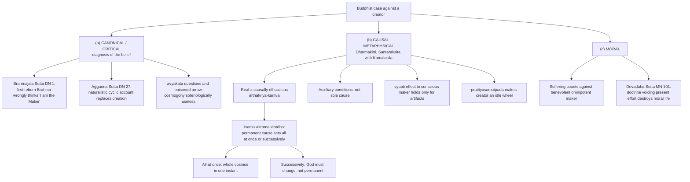

- ⚠️ **Honest limit:** stratum (a) gives *diagnoses* of the belief, not refutations of the proposition. Do not reduce the case to "the Buddha was silent."
- **Objection → reply:** Nyāya: God's willing is eternal while its *effects* are timed by the readiness of adṛṣṭa (no change in God), and demanding perception of God begs the question against inference. Buddhist rejoinder: an eternal will whose efficacy is timed by something else is not the sole sufficient cause. Second objection (who carries karma without self or creator?) is routed to *Soul, Immortality, Rebirth and Liberation*.
- **Verdict ⚠️:** strongest as metaphysics (permanence/production dilemma bites any *unchanging* creator), weakest as genealogy — explaining a belief is not refuting it. The *Bhūridatta Jātaka* anti-creator verses are ❓ translation-dependent: paraphrase only.

### 5.3 Mīmāṃsā, Cārvāka, Sāṃkhya, Śaṃkara ✅

| School | Stand on proofs of God |
|---|---|
| **Cārvāka** | No perception of God; inference unreliable; only this world |
| **Mīmāṃsā** | The Vedas are **eternal and authorless (*apauruṣeya*)**, so no God needed to author them; karma is self-operating via *apūrva* (impersonal, self-executing, whereas adṛṣṭa requires Īśvara to administer it — theme `Causation-across-schools.md`) |
| **Sāṃkhya** | Primordial *prakṛti* and its own transformation explain material order; Nyāya replies unconscious nature does not explain purposive coordination |
| **Śaṃkara (Advaita)** | Nyāya's God is a *saguṇa* Īśvara at the empirical level, not the absolute *nirguṇa* Brahman; the atomistic proof is logically weak |
| **Madhva (Dvaita)** | Existence of God "cannot be proved; learned only from scriptures"; the Veda is *apauruṣeya* and intrinsically valid |

---

## 6. Explanatory & Causal Principles

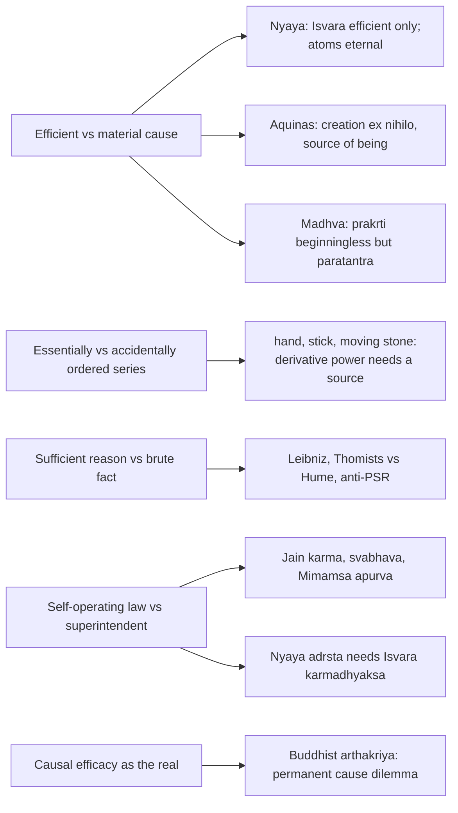

### 6.1 Karmic causation — four-way comparison ✅ (theme file)

Jaina material karma-pudgala · Nyāya adṛṣṭa + Īśvara · Mīmāṃsā apūrva without God · Sāṃkhya–Yoga saṃskāra/karmāśaya · Buddhist vāsanā/bīja in the santāna. The Mīmāṃsā–Nyāya contrast is "the causation-side of the Mīmāṃsā atheism question": **a theory of causation carries theological consequences.**

### 6.2 "Which cause?" table ⚠️

| Proof | Cause invoked | Relation | What it does *not* give |
|---|---|---|---|
| Aquinas Way 1 | unmoved actualiser | actualisation | personhood or goodness without further argument |
| Aquinas Way 2 | first efficient cause | essentially ordered dependence | first temporal event |
| Aquinas Way 3 | necessary being per se | contingency to necessity | a single personal God |
| Leibniz | sufficient reason outside contingent series | PSR | acceptance by those who allow brute facts |
| Kalām | cause of beginning | temporal beginning | personal God, without separate argument |
| Design | intelligent designer | analogy / directedness | one, perfect, good God |
| Nyāya | intelligent efficient cause of atoms | kārya → kartā | creation of atoms *ex nihilo* |
| Madhva | independent ground | svatantra / paratantra | by itself, Viṣṇu — scripture supplies identity |

### 6.3 Contingency vs cosmological regress — essentially vs accidentally ordered ⚠️

Aquinas Way 2 turns on an **essentially ordered** series (hand → stick → moving stone: each member has only derivative power now). An **accidentally ordered** historical sequence (parent → child) can be infinite without contradiction. Hume's infinite-series reply fails against the former only if actual causes really have derivative power; otherwise it succeeds. Name this distinction to reach the top band.

### 6.4 Cumulative-case logic (Swinburne, Mitchell, Flew) ✅

1. Distinguish **P-inductive** (premises make the conclusion more probable than not) from **C-inductive** (premises *raise* probability without making it more probable than not).
2. Cosmological, teleological, consciousness, providence, religious-experience and moral arguments are each C-inductive at best.
3. On a Bayesian confirmation model, several independent C-inductive arguments can jointly yield a P-inductive result, provided the prior probability of theism is not vanishingly small and the evidence-items are genuinely independent.
4. Swinburne adds a high prior for theism on **simplicity**: a personal explanation citing one agent with infinite (hence non-arbitrary) power, knowledge, freedom is simpler than any finite alternative.

- A cumulative case is a **rope or legal brief** (many strands), not a **chain**; also distinct from inference to the best explanation, which compares rival total hypotheses. Basil Mitchell's jury analogy; Udayana's *Nyāyakusumāñjali* is structurally the same move in the eleventh century.
- **Flew's "ten leaky buckets"** (*God and Philosophy*): stacked leaking buckets hold no more water. **Reply:** a C-inductive argument has *some* force, so the right image is rope strands or Bayesian updating. **Second objection:** the same method would confirm rival hypotheses (a finite designer, a committee of gods, an axiarchic principle); reply: simplicity is supposed to select the infinite single agent, critics say "simplicity" does contested metaphysical work. **Third:** evil is evidence on the other side, so the case must run as a **net balance** → *Problem of Evil*.
- **Verdict ⚠️:** individually the proofs fail as demonstrations; cumulatively they at most establish a probability and still underdetermine the God of worship.

---

## 7. Ethics & Human Goals: The Moral Strands

The sources give **no kāma/artha/dharma/mokṣa hierarchy** for this topic. The ethical content is: the moral argument (Kant and two other routes), the *karmādhyakṣa* strand of Nyāya, and the moral stratum of the Jain and Buddhist anti-creator cases.

### 7.1 Three moral-argument routes — do not merge them ⚠️

| Route | Argument | Main objection | Controlled verdict |
|---|---|---|---|
| Moral law / conscience | binding duty or conscience points to a personal lawgiver or judge | moral psychology and social life may explain conscience without God | an inference to agency, not a demonstration |
| Objective value and duty | stance-independent moral truths require a transcendent ground | moral realism need not be theistic; Euthyphro pressures divine grounding | at most an abductive grounding argument |
| Kant's highest good | practical reason requires hope that virtue and happiness can be proportioned; God and immortality are postulated | projection, autonomy, denial that the highest good requires cosmic completion | a practical postulate, explicitly not theoretical knowledge |

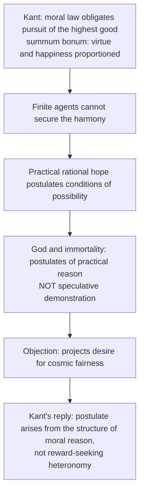

> [!WARNING]
> Do not say Kant *proves* God through morality; he **postulates** God for practical reason. In Kant, autonomous moral law already obligates and God enters only as a condition for the highest good's possibility; in lawgiver/value-ground routes, God grounds obligation itself.

### 7.2 Indian moral strands ✅

- **Nyāya:** Īśvara as *karmādhyakṣa*, the intelligent dispenser who allots fruits of karma; objection: karma can operate without God (Mīmāṃsā *apūrva*, Jain karma-pudgala).
- **Jain moral argument:** a compassionate creator would not make this world; karma explains the distribution of fortune without impugning anyone's goodness (§5.1 #4).
- **Buddhist moral stratum:** the quantum of suffering counts against a benevolent omnipotent maker; *Devadaha Sutta* (MN 101): any doctrine voiding present effort destroys the moral life (§5.2).
- **Parallel ✅:** Kant's postulate ↔ Indian *karmādhyakṣa*; "from moral order" row of the parity bench (Module 8).

---

## 8. Inter-School Comparative Matrices

### 8.1 Indian–Western parity bench (use whenever the stem says "critically" or "compare") ⚠️

| Function | Western | Indian pro-theistic | Indian anti-theistic |
|---|---|---|---|
| From effect to maker | Aquinas Way 2; Paley | Nyāya *kāryāt*, *āyojanāt* | Buddhist attack on the *vyāpti*; Jain regress |
| From order / governance | Aquinas Way 5 | Udayana *dhṛtyādeḥ* | Jain *svabhāva*; Sāṃkhya's unconscious prakṛti |
| From scripture's authority | Revealed theology | Udayana *pratyayataḥ*, *śruteḥ*, *vākyāt* | Mīmāṃsā's *apauruṣeya* Veda — authority without author |
| From moral order | Kant's postulate | Īśvara as *karmādhyakṣa* | Karma / *apūrva* as self-fructifying |
| From concept alone | Anselm, Descartes | ⚠️ No close classical analogue | — |
| From dependence of all finite being | Aquinas Way 3 (contingency) | **Madhva's *svatantra*/*paratantra*** — dependence constitutes difference | Mīmāṃsā: the world-order needs no independent controller |
| From order, but distrusted | Hume's "cause proportioned to effect" | **Madhva's reservation** — order yields an architect, not an ontological ground | — |
| Aggregation | Swinburne's cumulative case | Udayana's eight-fold *stabaka* | Flew-type "leaky buckets" objection applies to both |

### 8.2 Proof-by-proof debate table ✅

| Proof | Starting point | Conclusion claimed | Indian parallel | Main critic |
|---|---|---|---|---|
| Ontological | Concept of maximal being | Necessary existence | ⚠️ No exact classical analogue | Gaunilo, Kant |
| Cosmological | Motion / causation / contingency | First / necessary cause | Nyāya *kāryāt* | Hume, Kant |
| Design | Order / purpose | Intelligent designer | Nyāya *āyojanāt* | Hume, Darwin |
| Moral | Moral law / highest good | Practical postulate | Karma-dispenser in theistic schools | Autonomy / Euthyphro |
| Mīmāṃsā critique | Eternal Veda and self-operating dharma | No creator required | — | Nyāya |
| Jain critique | Perfection excludes motive; karma self-operating | No creator; divinity = perfected soul | — | Nyāya (adṛṣṭa needs an allocator) |
| Buddhist critique | Causal efficacy; *krama-akrama* dilemma | A permanent cause cannot produce a temporal world | — | Nyāya (eternal will, timed effects) |
| Cumulative case | Several C-inductive arguments | Probable theism | Udayana's eight-fold *stabaka* | Flew's leaky buckets |
| **Madhva's dependence argument** | Every finite being is *paratantra* | One *svatantra* ground, identified as Viṣṇu **by scripture** | Aquinas' Third Way is closest Western analogue | Mīmāṃsā (no controller needed); Advaita (difference not ultimate) |
| **Madhva on design** | Order in the world | ⚠️ Deliberately **not** pressed | Converges with Hume's proportioning complaint | — |

### 8.3 Madhva against the other Vedāntins on the epistemic route to God ⚠️

| | **Śaṃkara (Advaita)** | **Rāmānuja (Viśiṣṭādvaita)** | **Madhva (Dvaita)** |
|---|---|---|---|
| Ultimate | *nirguṇa* Brahman; Īśvara empirical | *saguṇa* Brahman = Viṣṇu, souls and matter as His body | *saguṇa* Brahman = Viṣṇu, ontologically **separate** from souls and matter |
| World | *vyāvahārika*; *māyā* neither real nor unreal | real, a mode (*prakāra*) of Brahman | **fully real and permanently different** (*tattvavāda*) |
| Soul–God | identity (*tat tvam asi*) | inseparable qualification; souls share Brahman's essential nature | ***atat tvam asi***; permanent modal difference; unilateral dependence |
| Route to God | *śruti* + *manana*; reason cannot prove Brahman | *śruti*, with experience defended against Advaita | *śruti*, **read in consonance with valid perception and inference** |
| Rational proof | rejected as independently probative | subordinate to scripture | ✅ likewise subordinate |
| Liberation | knowledge dissolving ignorance | *bhakti* and *prapatti*, by grace | *bhakti* and grace; *tāratamya* persists in liberation |

### 8.4 Madhva vs Nyāya vs Aquinas ⚠️

| Feature | **Nyāya–Udayana** | **Aquinas** | **Madhva** |
|---|---|---|---|
| Primary instrument | *anumāna* — the world as *kārya* needs an intelligent maker | demonstrative a posteriori reasoning from motion, cause, contingency, gradation, order | ***śabda***, on a realist base of perception and inference |
| Does reason alone reach God? | ✅ claimed | ✅ claimed for the *preambula fidei* | ❌ denied for the supersensible nature |
| Core relation | efficient causation of a composite | actualisation, causation, necessity | **dependence** (*svatantra*/*paratantra*) |
| Design/order | ✅ central (*āyojanāt*, *dhṛtyādeḥ*) | ✅ the Fifth Way | ⚠️ present but **deliberately demoted** |
| Scripture's role | one ground among eight | revealed theology *beyond* the preambles | **indispensable and decisive** |
| Matter | eternal atoms; God efficient cause only | creation *ex nihilo* | *prakṛti* beginningless yet *paratantra* |
| Nearest Western analogue | Paley / Aquinas Way 5 | — | the argument from radical contingency/dependence, closer to Aquinas' Third Way than to Paley |

---

## 9. Criticisms & Reconstructed Replies

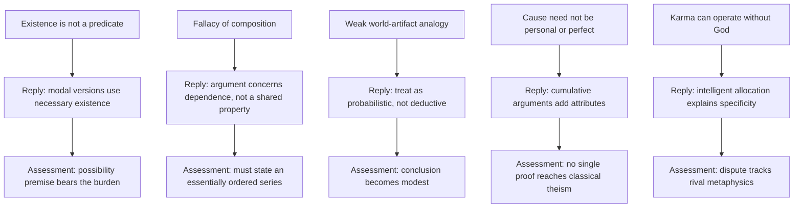

| Objection | Proof affected | Reply | Assessment |
|---|---|---|---|
| "Existence is not a predicate" | Ontological | Modal versions use necessary existence | ⚠️ Possibility premise bears the burden |
| Fallacy of composition | Cosmological | Argument concerns dependence, not shared property | ⚠️ Must state an essentially ordered series |
| Weak world–artifact analogy | Design / Nyāya | Treat as probabilistic, not deductive | ⚠️ Conclusion becomes modest |
| Cause need not be personal / perfect | Cosmological / design | Cumulative arguments add attributes | ⚠️ No single proof reaches classical theism |
| Karma can operate without God | Nyāya | Intelligent allocation explains specificity | ❓ Dispute tracks rival metaphysics |
| Scripture-based theism is circular | Madhva | Vedic testimony is *apauruṣeya* and intrinsically valid | ⚠️ Shifts the burden to the Veda's authority, which non-Vedic schools reject outright |
| An independent ground need not be *this* God | Madhva | Conceded — inference reaches dependence, scripture supplies the identity | ✅ Madhva's own position; not an oversight |

### 9.1 Madhva: objections → replies → residue ⚠️

| # | Objection | Dvaita reply | Residue for an "examine" answer |
|---|---|---|---|
| 1 | **Circularity** — scripture proves God and God guarantees scripture | Vedic testimony is *apauruṣeya* and intrinsically valid as an independent pramāṇa (Sharma pp. 89–92) | Transfers burden to the Veda's authority, which Cārvāka or Buddhist denies |
| 2 | **Dependence under-determines the deity** | Precisely why scripture is indispensable | The theism is **revelation-dependent**, which is Madhva's own position |
| 3 | **Eternal souls and matter rival God** | Beginninglessness ≠ independence; all remain *paratantra* | A **modal** dependence claim; needs the svatantra/paratantra asymmetry to be more than stipulation |
| 4 | **Design gives only a demiurge** | ✅ Madhva's own reservation | A genuine *strength*: he anticipates Hume |
| 5 | **Predestined hierarchy of souls morally objectionable** | Innate propensity explains specific destinies karma alone leaves unexplained | ❓ Uneasy with ordinary karma theory — say so |
| 6 | **Mīmāṃsā's counter** | The Veda is authorless and dharma self-fructifying | Madhva must argue Vedānta texts *speak of* an independent being: a hermeneutic claim, not an inference |

### 9.2 Core reconstructed replies ⚠️

- **Ontological:** valid on reading X but premise 2 is exactly what the critic denies; even if sound it delivers only ___, and the distance to the God of worship needs a separate argument.
- **Cosmological:** "Who caused God?" is not a refutation; challenge the termination rule or the PSR instead.
- **Design:** at most probable, never demonstrative; retains intuitive/cumulative force.
- **Nyāya:** a genuine cosmological–teleological proof; shares the a posteriori limits (Hume-type); rationally suggestive, not conclusive.

---

## 10. Controlled Western Comparisons

The sources give no stand-alone East–West table for this topic; they argue the comparison inside the proofs themselves. The pairings the sources themselves make, each with its disanalogy:

| Pairing | Point of contact | Decisive disanalogy |
|---|---|---|
| **Aquinas Ways ↔ Nyāya** (2018 Q8(a), 20 marks) | Both are cumulative inferences from the world's dependence and order | Aquinas' God is the source of *being* (creation *ex nihilo*); Udayana's God is the arranger of *eternal* atoms and the allocator of karma — efficient, never material, cause |
| **Paley / Aquinas Way 5 ↔ Nyāya *kāryāt*, *āyojanāt*** | Inference from order/effect to intelligent maker; potter–pot ↔ watch | Nyāya's Īśvara is an efficient cause only, since atoms and souls are eternal; Hume-type liabilities apply to both |
| **Kant's practical postulate ↔ *karmādhyakṣa*** | Both link moral order to God | Kant's is a postulate of practical reason, not a theoretical proof; Nyāya's is an inference |
| **Aquinas Way 3 ↔ Madhva's dependence argument** | Dependence of finite being on an independent ground | Madhva's theism is revelation-dependent and does not claim a demonstrative proof; creation is not *ex nihilo* |
| **Hume's "cause proportioned to effect" ↔ Madhva's design reservation** | Order yields an architect, not an ontological ground | Madhva states it as his own reservation about design within a scripture-first system |
| **Swinburne's cumulative case ↔ Udayana's eight-fold *stabaka*** | Many strands, none sufficient alone | Udayana (11th century) works within atomism and Vedic authority; Swinburne uses Bayesian simplicity |

> [!WARNING]
> These are conceptual parallels, not historical influences. Keep each Western line short and place it **after** the Indian argument is complete (theme file's rule: "only if space remains, one controlled Western line"). Do not call Madhva a natural theologian, do not equate Udayana's list with a Western syllogism, and do not use *Id quo maius cogitari non potest* as if Madhva ran it as his own proof (❓ Sharma's comparison only).

---

## 11. Diagnostic Deep-Dives for High-Frequency Themes

### 11.1 "Does the concept of God entail the existence of God?" (2018 Q6(c), 15 marks) ⚠️

State the Anselmian reductio in four steps → state Kant's premise (existence is not a real predicate: it adds nothing to a concept; you cannot define a thing into existence) → Gaunilo's parody → modal reply and its burden (possibility of maximal greatness) → verdict: *the concept entails existence only if existence can be a perfection in the greatness ordering and maximal greatness is coherent; both are exactly what is disputed.*

### 11.2 "Is Anselm's proof logical?" (2020 Q6(a), 20 marks) ⚠️

Answer **validity** and **soundness** separately. Valid on its own reading (reductio form); soundness fails if existence is not a real predicate or if the concept is incoherent. Then a priori vs a posteriori verdict (§2.1).

### 11.3 Aquinas — "Which Way is most interesting?" (2022 Q6(a)) and "contingency" (2026 Q5(b)) ⚠️

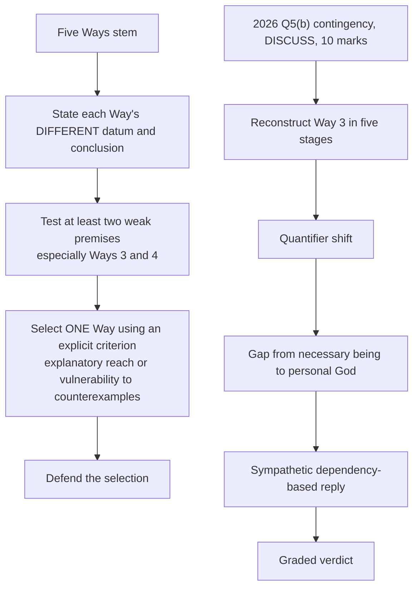

A list of five labels without premise-to-conclusion reasoning does not meet "critical exposition". Neither a general summary of all Five Ways nor a story about a first temporal event answers 2026 Q5(b).

### 11.4 Nyāya stems (2018 Q8(a), 2023 Q7(a), 2025 Q7(b)) ⚠️

- **"What proofs do Nyāya philosophers offer? Discuss" (15):** enumeration **with premises** — one line of content per named *hetu*; ground each proof in its pramāṇa.
- **"Critically examine Nyāya's arguments" (20):** world = effect → intelligent efficient cause; Veda needs author; karma needs dispenser → critiques: Cārvāka, Buddhism/Jainism, Mīmāṃsā, Advaita → assess: a genuine cosmological–teleological proof sharing a posteriori limits → conclude: rationally suggestive, not conclusive.
- **"Compare Aquinas' Five Ways with Nyāya" (20):** announce the axes first (§8.1/§10), then run both down each axis; both are cumulative cases.

### 11.5 Jain stem (2019 Q5(e), 10) and Buddhist stem (2018 Q8(b), 15) ⚠️ — see §5.1 and §5.2

*Jain skeleton:* line 1 corrects the stem → six arguments (motive, regress, no material/instrument, moral, redundancy, svabhāva) → positive: arihanta → tīrthaṅkara → siddha; vītarāga worship → Nyāya objection and classical-theist counter → verdict. *Buddhist skeleton:* three strata → Nyāya reply and Buddhist rejoinder → verdict "strongest as metaphysics, weakest as genealogy".

### 11.6 Madhva stem (2026 Q8(b), 15 marks — "Explain **and examine**") ⚠️

```text
EXPLAIN (about 60%):
  ontology: svatantra (Viṣṇu alone) vs paratantra (jīvas, jaḍa);
  dependence constitutes difference → pañca-bheda (a classification, not proofs) →
  three pramāṇas; transcendental argument for intrinsic validity of perception and inference →
  four strands graded: A scripture (decisive) · B dependence (structural) ·
    C design (demoted by Madhva himself) · D perfection (about the concept) →
  settled position: supersensible nature of God known from scripture; reason secures realism.
EXAMINE (about 40%):
  circularity → apauruṣeya reply; under-determination → why revelation is required;
  beginningless souls → beginninglessness is not independence;
  design gives a demiurge → Madhva's OWN point, so a strength;
  historiographic caution: Jayatīrtha and Vyāsatīrtha supply the formal dialectic.
Verdict: epistemically modest and metaphysically strong — he declines to make God the
  conclusion of an independent proof and instead makes divine independence the condition
  of everything any proof would have to start from.
```

*10 marks:* ontology in two lines → three pramāṇas → scripture decisive (Britannica line) → dependence in five steps → design reservation → one objection with reply → verdict. *20 marks:* add §8.4 in full, the Vedānta triad §8.3, objections 1–5, the historiographic ledger; close on the gap between the God of the arguments and the God of religion — for Madhva closed by *śabda* and *bhakti*, not inference.

**Reworded-variant routes ✅:** "Compare Madhva and Nyāya on the proof of God" → §8.4; "Is scripture a valid means of knowing God?" → §4.9 (+ *Reason, Revelation and Faith*); "Explain Madhva's conception of God" → route **out** to *Notions of God*, keep only strand A here; "Dvaita on the God–soul relation" → §4.7 + *Soul, Immortality, Rebirth and Liberation*.

### 11.7 Design + Hume (2025 Q6(a), 20 marks "Present an account … along with its criticism") ⚠️

```text
Intro : teleological proof — order/purpose → intelligent designer (Paley's watch; Aquinas 5th).
Body  : analogy from artefacts to universe.
Crit  : Hume — weak analogy; imperfect world → imperfect/finite/plural designer; evil;
        Darwinian natural selection removes the need for design (biological adaptation).
Assess: at most probable, never demonstrative; retains cumulative force.
Concl : design points beyond itself but cannot compel — faith supplements reason.
```
Split the page: exposition first, then critique; do not let critique eat exposition.

---

## 12. PYQ Routing Ledger (2018–2026)

> Corpus signal ⚠️: **12 primary-owned parts** of 112 in the 2018–2025 bank (per-year row: 2018 3 · 2019 1 · 2020 1 · 2021 1 · 2022 2 · 2023 1 · 2024 1 · 2025 2 = 12) plus **2 primary-owned 2026 parts** in the supplement = **14** counted. The owner file states "14 of 126".

| Year | Q | Marks | Exact demand | Map to |
|---|---|---:|---|---|
| 2018 | Q6(c) | 15 | Does the concept of God entail the existence of God? Examine from the perspective of ontological argument. | §4.1, §11.1 |
| 2018 | Q8(a) | 20 | Compare St. Thomas Aquinas' five ways of knowing God with the arguments of the Nyāya School of Indian Philosophy for the existence of God. | §4.2, §4.5–4.6, §8.1, §10, §11.4 |
| 2018 | Q8(b) | 15 | Critically evaluate the Buddhistic arguments against the existence of God as the creator of the world. | §5.2, §11.5 |
| 2019 | Q5(e) | 10 | State and evaluate the proofs for the existence of God as propounded in Jainism. | §5.1, §11.5 |
| 2020 | Q6(a) | 20 | Is the ontological proof for the existence of God by St. Anselm logical? Discuss. | §4.1, §11.2 |
| 2021 | Q7(b) | 15 | Give a critical account of moral argument to prove the existence of God. | §4.4, §7 |
| 2022 | Q6(a) | 20 | Present a critical exposition of different arguments offered by St. Thomas Aquinas to prove the existence of God also known as 'Five Ways'. Which one of them do you find philosophically most interesting? Give reasons in support of your answer. | §4.2, §11.3 |
| 2022 | Q8(a) | 20 | Discuss the main points of distinction between a priori and a posteriori arguments for the existence of God. Which one according to you should be preferred over the other? Give reasons and justifications for your answer. | §2.1 |
| 2023 | Q7(a) | 20 | Critically examine the arguments of Nyāya for the existence of God. | §4.5–4.6, §11.4 |
| 2024 | Q7(c) | 15 (10+5) | Present an exposition of ontological proof for the existence of God along with its criticism. | §4.1 |
| 2025 | Q6(a) | 20 | Present an account of Design argument to prove the existence of God along with its criticism by David Hume. | §4.3, §11.7 |
| 2025 | Q7(b) | 15 | What proofs do Nyāya philosophers offer for the existence of God? Discuss. | §4.5–4.6, §11.4 |
| **2026** | **Q5(b)** | **10** | Discuss Aquinas' argument from the contingency of the world to prove the existence of God. | §4.2, §11.3 |
| **2026** | **Q8(b)** | **15** | Explain and examine Madhvacharya's arguments for the existence of God. | §4.7–4.9, §11.6 |

**Cross-owned / boundary notes (listed, not counted):**
- 2026 Q5 boundary (religious-experience part): the veridicality debate belongs to *Religious Experience*; the argument **from** religious experience as a proof of God is a single bounded line here.
- Pre-2018 PYQs: the owner file has no pre-2018 table.

See the [Philosophy of Religion PYQ Bank, 2018–2025](../../upsc-ai-kit/knowledge/Philosophy/paper-2/_PYQ-PhilosophyOfReligion-2018-2025.md) and [2026 Supplement](../../upsc-ai-kit/knowledge/Philosophy/paper-2/_PYQ-PhilosophyOfReligion-2026-Supplement.md).

---

## 13. Top 10 UPSC Exam Traps

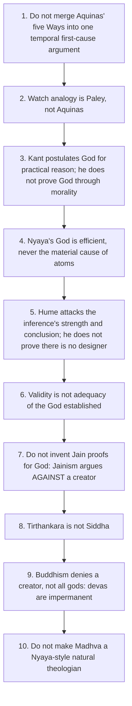

**Remaining traps from the owner file (§11, source numbers 10–18; source number 13 is already trap 10 above), none skipped:**
- Source 10. Do not reduce the Buddhist case to "the Buddha was silent"; the examinable argument is Dharmakīrti/Śāntarakṣita's *krama-akrama* dilemma.
- 11. Do not present Udayana's list as a fixed canonical eight without noting that glosses of *padāt/pratyayataḥ/vākyāt/saṃkhyāviśeṣāt* differ; give the Sanskrit term plus one clause.
- 12. A cumulative case is not a chain of deductions; it is Bayesian/rope-like. Standing objection Flew's leaky buckets; standing reply C-inductive arguments are not zero-valued.
- 13. Britannica's headline for Madhva: "the existence of God cannot be proved; it can be learned only from the scriptures".
- 14. *Pañca-bheda* is five real differences, not five proofs of God.
- 15. Madhva does not press the design argument (Sharma: "not very much enamoured").
- 16. Madhva's discussion of divine perfection is not an Anselmian ontological proof.
- 17. Do not infer from Madhva's scripturalism that perception and inference are invalid for him.
- 18. Do not attribute formal Dvaita syllogistics to Madhva; name Jayatīrtha (1356–1388) and Vyāsatīrtha/Vyāsarāya (1478–1589).

Extra pitfalls: Aquinas' Way 5 is about regular directedness, not Paley's artifact analogy; Way 3's "at some time nothing was" is the quantifier shift; Leibniz/kalām are not substitutes for Way 3; "who caused God?" alone is not a refutation; Madhva's dates ❓.

---

## 14. Technical Vocabulary & IAST Bank

| English gloss | Term | Meaning | Status |
|---|---|---|---|
| a priori / a posteriori | — | from concept alone / from facts of the world | ✅ |
| ontological argument | — | Anselm: that than which nothing greater can be conceived; Descartes: existence a perfection | ✅ |
| real predicate | — | Kant: existence adds nothing to a concept | ✅ |
| essentially ordered series | — | members have only derivative present power | ✅ |
| contingency / necessity | per se / per aliud | necessary through itself / through another | ✅ |
| principle of sufficient reason | PSR | Leibniz; opposed by brute-fact views | ✅/⚠️ |
| practical postulate; highest good | summum bonum | virtue and happiness proportioned | ✅ |
| C-inductive / P-inductive | — | Swinburne's terms: raises / makes more probable than not | ✅ |
| effect; maker | kārya; kartā | world as effect needs an intelligent maker | ✅ |
| inference to God | Īśvara-anumāna | Nyāya | ✅ |
| Udayana's grounds | kāryāt · āyojanāt · dhṛtyādeḥ · padāt · pratyayataḥ · śruteḥ · vākyāt · saṃkhyāviśeṣāt | eight *hetus* (glosses vary) | ✅/❓ |
| conjunction of atoms | saṃyoga | initial combination of atoms | ✅ |
| dyad; numerical cognition | dvyaṇuka; apekṣā-buddhi | for *saṃkhyāviśeṣāt* | ❓ |
| unseen merit/demerit | adṛṣṭa | cannot allot fruits itself | ✅ |
| superintendent of karma | karmādhyakṣa | Īśvara as dispenser | ✅ |
| authorless | apauruṣeya | Veda; Mīmāṃsā | ✅ |
| unseen potency | apūrva | Mīmāṃsā: impersonal, self-fructifying | ✅ |
| causal efficacy | arthakriyā-kāritva | Buddhist criterion of the real | ✅ |
| successive/simultaneous dilemma | krama-akrama-virodha | permanent creator cannot produce a temporal world | ✅ |
| dependent origination | pratītyasamutpāda | makes a creator an idle wheel | ✅ |
| undeclared questions | avyākata | cosmogony set aside | ✅ |
| passion-free | vītarāga | Jain worship commemorative | ✅ |
| parsimony | lāghava | Jain redundancy argument | ✅ |
| own-nature | svabhāva | things act by their own nature | ✅ |
| arihanta/kevalin → tīrthaṅkara → siddha | — | Jain ladder of divinity as perfected soul | ✅ |
| fourfold infinitude | ananta-catuṣṭaya | knowledge, perception, bliss, energy | ✅ |
| independent / dependent reality | svatantra / paratantra | Madhva | ✅ |
| realist viewpoint | tattvavāda | Madhva's school's self-description | ✅ |
| fivefold difference | pañca-bheda | classification, not proofs | ✅ |
| gradation of souls | tāratamya | owned by *Soul* topic | ✅ |
| "you are not that" | atat tvam asi | Madhva's re-reading of *tat tvam asi* | ✅ |
| scripture / perception / inference | śabda (āgama) / pratyakṣa / anumāna | Madhva's three pramāṇas | ✅ |
| invariable concomitance | vyāpti | required by Madhva; attacked by Cārvāka/Buddhists for the creator inference | ✅ |
| good diffusing itself | bonum diffusivum sui | classical-theist reply to the Jain motive argument | ⚠️ |

---

## 15. Graded Verdict & Answer Architectures

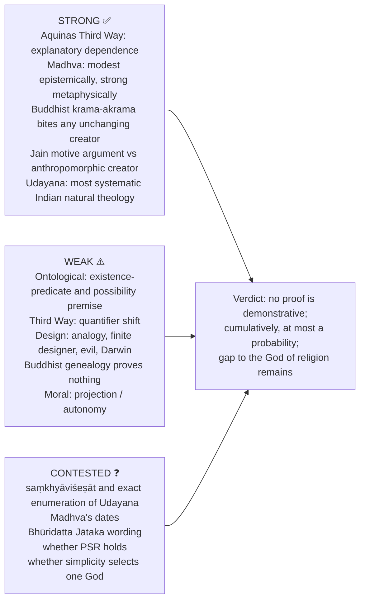

### 15.1 10-mark

```text
Name and classify the proof → state premises in sequence → identify one presupposition →
give the canonical objection → one-sentence verdict on what the proof actually establishes.
```
**Anchor:** "The argument is valid on reading X but its second premise is exactly what the critic denies; even if sound it delivers only ___, and the distance from that to the God of worship must be crossed by a separate argument."

### 15.2 15-mark

```text
Frame the explanatory question → reconstruct argument → canonical example →
critic's strongest objection → proponent's reply → assess validity and conclusion separately.
```

### 15.3 20-mark

```text
Classify the family of proofs → full internal steps → contrast Indian/Western analogue →
two objections and replies → underdetermination of divine attributes → graded conclusion.
```
**Anchor (comparison stem):** "Aquinas and Udayana converge in form — both are cumulative inferences from the world's dependence and order — and diverge in content: Aquinas' God is the source of *being*, Udayana's the arranger of *eternal* atoms and the allocator of karma."
**Anchor (anti-theistic stem):** "The school's negative case succeeds against the creator it targets — an anthropomorphic, motivated, changing maker — and leaves untouched the classical theist's non-needy, timeless creator; whether that surviving concept is intelligible is a different question."
**Anchor (Madhva):** "Madhva relocates the question from proof to dependence: God is not the conclusion of an inference but the condition of everything an inference starts from."

### 15.4 Directive decoder ⚠️

| Directive | Examiner is buying | Structural consequence | Live example |
|---|---|---|---|
| Present an account of… along with its criticism | Two balanced halves, explicitly signposted | Split the page: exposition first, then critique | 2025 Q6(a); 2024 Q7(c) (10+5) |
| Critically examine / evaluate | Reconstruction **and** verdict on validity *and* soundness | Premises → presupposition → objection → reply → graded verdict | 2023 Q7(a); 2018 Q8(b) |
| Compare X with Y | A stated *tertium comparationis* | Announce axes first, then run both down each axis | 2018 Q8(a) → §8.1 |
| Which do you find most interesting? Give reasons | A defended personal selection with a criterion | Name the criterion before choosing | 2022 Q6(a) |
| Does the concept entail the existence? | Engagement with the predicate question | Kant's premise must be stated, not just named | 2018 Q6(c) |
| Which should be preferred? Give reasons | Ranking with a cost accounting | Prefer one, then state what you lose | 2022 Q8(a) |
| State and evaluate the proofs propounded in [school] | Fidelity to what the school actually holds | If the school holds none, say so in line 1 and supply what it does hold | 2019 Q5(e) |
| What proofs do X offer? Discuss | Enumeration **with premises**, not labels | One line of content per named hetu | 2025 Q7(b) |
| Explain and examine | Explanation (about 60%) then evaluation (about 40%) | Separate the two halves | 2026 Q8(b) |
| Discuss (10) | Reconstruction of one specific argument | Not a general summary | 2026 Q5(b) |

### 15.5 Graded verdict ladder ⚠️

| Band | Script contains | Typical fault |
|---|---|---|
| Weak ≈40% | Names the four Western proofs and "Nyāya's inference"; narrates the watch | No premises; critique reduced to "Kant disagreed" |
| Average ≈50% | One proof reconstructed; standard critique attached | Indian side one sentence; validity not separated from soundness |
| Good ≈60% | Premises numbered; presupposition named; one objection answered | Conclusion-gap (from "first cause" to "God") not noticed |
| Strong ≈65–70% | Validity / soundness / adequacy separated; Indian parallel argued; reply to the objection | Cumulative logic still treated as a chain |
| Top ≈70%+ | All above + a discriminating distinction (essentially vs accidentally ordered series; C- vs P-inductive; Tīrthaṅkara vs Siddha; *krama-akrama*) + what evidence would change the verdict | — |

**Safe formulations ⚠️:** "Most proofs underdetermine the rich God of religion." · "Nyāya and Western natural theology converge in inference from order, but diverge over material causation and karma." · "Jainism and Buddhism do not merely lack a proof of God; they supply arguments that a creator is either unmotivated or causally impossible." · "A cumulative case can raise probability; it cannot by itself select the God of worship." · "Within Dvaita, reason secures realism and scripture supplies theology; the division of labour is deliberate, not evasive."

> [!TIP]
> **Exam sentence.** "Individually the proofs fail as demonstrations; cumulatively they can at most establish a probability, and even then they underdetermine the personal, morally perfect God of worship. That gap — between the God of the arguments and the God of religion — is the standing conclusion of the entire clause."

---

## Sources

Anselm, *Proslogion*; Aquinas, *Summa Theologiae* I q.2 a.3 (newadvent.org/summa/1002.htm#article3); Paley, *Natural Theology*; Hume, *Dialogues Concerning Natural Religion* (Parts II, V, VII, XI); Kant, *Critique of Pure Reason* and *Critique of Practical Reason*; Swinburne, *The Existence of God*; Mitchell, *The Justification of Religious Belief*; Flew, *God and Philosophy*; Udayana, *Nyāyakusumāñjali* (5th *stabaka*); Śāntarakṣita, *Tattvasaṃgraha* with Kamalaśīla's *Pañjikā*; Dharmakīrti; Jinasena's *Mahāpurāṇa* and Hemacandra (Jain anti-creator arguments); Hick, *Philosophy of Religion*; Stoker, "Madhva", *IEP*; *Encyclopaedia Britannica*, "Indian philosophy — Madhva"; B. N. K. Sharma, *Philosophy of Sri Madhvacharya*; Chatterjee & Datta; C. D. Sharma; Radhakrishnan Vol. I; advanced-dossier trail: Matilal on Nyāya reasoning. Theme files cited: `Pramana-across-schools.md`, `Causation-across-schools.md`, `A-priori-a-posteriori-knowledge.md`, `Critiques-of-metaphysics.md`.
