# PROBLEM OF EVIL — Examiner-Grade Mindmap

> **Syllabus (verbatim):** Problem of Evil.
> **Catalogue key:** `philosophy-paper-ii-philosophy-of-religion-03` · Paper II · Philosophy of Religion
> **Sources used:** `paper-2/philosophy-of-religion/Problem-of-Evil.md` (canonical owner, read in full) · `_advanced/Philosophy-of-Religion-Dossier.md` §3 (optional depth; promotion ledger and §§1–2 read for boundaries) · `paper-2/_PYQ-PhilosophyOfReligion-2018-2025.md` · `paper-2/_PYQ-PhilosophyOfReligion-2026-Supplement.md` · `paper-1/_themes/` passages that bear on this topic: `Causation-across-schools.md` (four-way karmic causation; apūrva vs adṛṣṭa), `Self-and-liberation-across-schools.md` (§2 bondage table). `Pramana-across-schools.md`, `A-priori-a-posteriori-knowledge.md`, `Critiques-of-metaphysics.md` and `Substance-across-western.md` have no content on this topic and are not cited.
> **Evidence key:** ✅ canonical doctrine / fact · ⚠️ analytical synthesis for exam use · ❓ contested / uncertain

> [!IMPORTANT]
> **Core thesis.** The printed clause owns the logical, evidential, existential and moral challenge from evil, together with defences, theodicies, revised God-concepts, Indian responses and the cost of each reply. Always state **which version** of the problem is being answered (logical / evidential / horrendous / animal / distribution) in the first two lines: theodicies are version-specific, and a mismatched theodicy scores as an error. Changing the God-concept can remove a specific contradiction without removing suffering. ⚠️

> [!NOTE]
> **Adaptation.** The 15-module blueprint is written for Indian schools. For this topic Module 1 maps ownership boundaries and the families of response; Module 2 maps what must be *shown* (logical, evidential, existential burdens) and the epistemic move of skeptical theism; Module 3 maps the sceptical and revisionary wings; Module 4 holds the divine profile and the theodicies themselves; Module 5 holds the Indian karma response and the stand of non-creator traditions; Module 7 holds the moral and existential dimension (desert, compassion, defeat). The sources give no āstika/nāstika classification of the theodicies and no *puruṣārtha* hierarchy for this topic; where a module has no such material it says so.

---

## 0. Master Overview

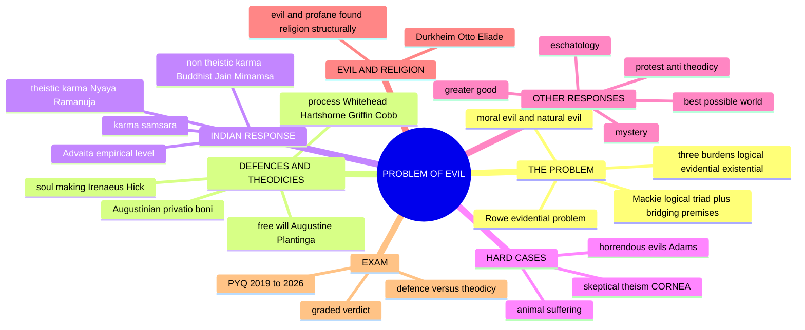

---

## 1. Identity, Classification & Boundaries

### 1.1 What the clause owns, and what it does not ✅

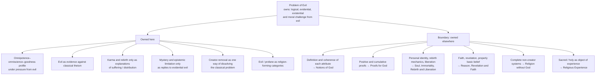

> [!WARNING]
> A **defence** proposes a possible compatibility story and defeats strict contradiction; a **theodicy** claims to identify God's actual morally sufficient reason. Neither should be mistaken for pastoral permission to explain a sufferer's experience to them. ⚠️

### 1.2 Families of response — mnemonic **F-S-P-A-K** ⚠️

| Letter | Response | Core idea | Representative names |
|---|---|---|---|
| **F** | Free-will | Evil from misused free will | Augustine, Plantinga |
| **S** | Soul-making | Evil needed for growth / soul-building | Irenaeus, Hick |
| **P** | Process | God not omnipotent; persuasive, not coercive | Whitehead, Hartshorne, Griffin, Cobb |
| **A** | Augustinian | Evil as privation of good; sin and punishment; Fall | Augustine |
| **K** | Karma | Evil = fruit of one's own past deeds; creator optional | Indian traditions |

Non-theistic karma removes the creator, whereas theistic karma retains a divine dispenser and a responsibility question. ✅

### 1.3 Two axes that cut across every response ✅

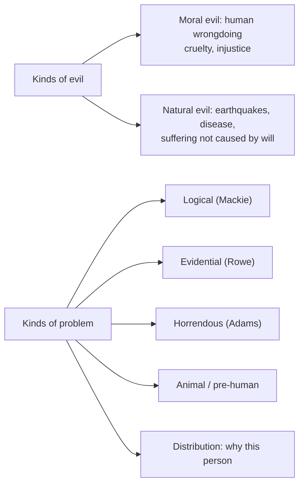

### 1.4 Quotation and attribution discipline ✅/❓

| Item | Status | Safe use |
|---|---|---|
| "If God is willing but not able…" dilemma | ❓ Traditionally ascribed to **Epicurus** but transmitted through **Lactantius**, *De Ira Dei* 13; no surviving Epicurean text contains it | Write "the dilemma transmitted by Lactantius and traditionally ascribed to Epicurus" |
| "Evil and Omnipotence" | ✅ J. L. Mackie, *Mind* (1955) | "Adequate solutions / fallacious solutions" framing and the paradox of omnipotence |
| Transworld depravity | ✅ Alvin Plantinga, *God, Freedom, and Evil* (1974) | Establishes *possibility*, never actuality |
| *Privatio boni* / "all evil is either sin or punishment for sin" | ✅ Augustinian doctrine; sentence is the printed 2023 stem | Treat the stem as the object of analysis, not as a verified verbatim translation ❓ |
| **"Vale of Soul-making"** | ✅ **John Keats**, letter to George and Georgiana Keats, spring 1819 | Keats coined it; Hick adopted it; Irenaeus supplies the image/likeness theology |
| *Evil and the God of Love* | ✅ John Hick (1966) | "Epistemic distance"; Irenaean/Augustinian typology |
| "Fellow-sufferer who understands" | ✅ A. N. Whitehead, *Process and Reality*, final chapter | Canonical process anchor |
| Omnipotence is incoherent | ✅ Charles Hartshorne, *Omnipotence and Other Theological Mistakes* | Distinguish from Griffin's metaphysical-necessity version |
| *God, Power, and Evil: A Process Theodicy* | ✅ David Ray Griffin (1976) | Fullest process treatment of evil |
| Rowe's fawn | ✅ William Rowe, "The Problem of Evil and Some Varieties of Atheism" (1979) | Evidential, not logical |
| CORNEA | ✅ Stephen Wykstra (1984) | Spell it out; do not gesture at "mystery" |
| Horrendous evils | ✅ Marilyn McCord Adams (1999) | Technical definition in sense, paraphrased in words |
| Sacred/profane dichotomy | ✅ Émile Durkheim, *The Elementary Forms of Religious Life* (1912) | Profane ≠ evil |
| Hierophany, sacred space/time | ✅ Mircea Eliade, *The Sacred and the Profane* (1957) | — |

> [!TIP]
> **Phrase attribution.** "Vale of soul-making" is **Keats's**; Hick **borrowed** it as a title-idea; **Irenaeus** supplies the *theology* (humans made in God's *image* must grow into his *likeness*). Do not attribute the phrase to Irenaeus, or present it as Hick's coinage. ✅

---

## 2. Theory of Knowledge: What Must Be Shown, and What Can Be Known

### 2.1 Logical problem and bridging premises (2020 Q6(b)) ✅

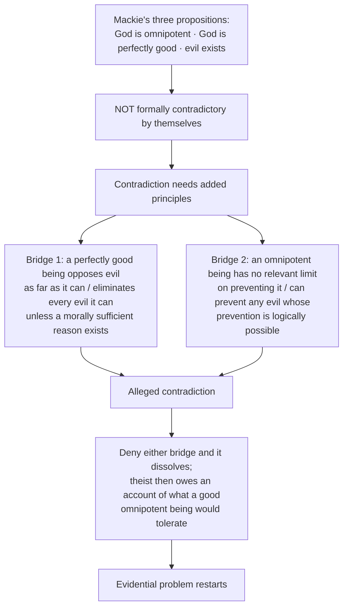

**Full classical profile.** Adds **omniscience**: God knows every evil and every available prevention. It is not a separate member of Mackie's familiar triad, but it blocks the reply that evil escaped divine notice. ✅

```text
G is omnipotent + G is omniscient + G is perfectly good + evil exists
        + good prevents every evil it can unless a morally sufficient reason exists
        + unlimited power can prevent any evil whose prevention is logically possible
        -> alleged contradiction
```

### 2.2 Evidential problem (Rowe) ✅

- Even if not a strict contradiction, the **amount and distribution** of pointless suffering makes God's existence **improbable**. Evidential form begins from intense suffering for which no justifying good is visible.
- **Rowe's suffering fawn** — severe apparently unobserved suffering after a natural fire — is an evidential case, not a deductive contradiction.
- Presupposition ⚠️: the bridging principles admit no morally sufficient reason, or the observed distribution of suffering is evidentially representative.

### 2.3 Three burdens ✅

| Burden | What must be shown |
|---|---|
| **Logical** | The set is inconsistent, or a possible morally sufficient reason restores compatibility |
| **Evidential** | The observed amount, kinds or distribution of suffering lowers (or does not lower) the probability of God |
| **Existential / moral** | A response respects lament, agency and the sufferer rather than merely balancing a world-total |

⚠️ Plantinga's defence addresses the first burden only. It does not explain the actual quantity of suffering or make the divine reason probable.

### 2.4 Skeptical theism and CORNEA ✅ (now Core, §9.9 of the owner)

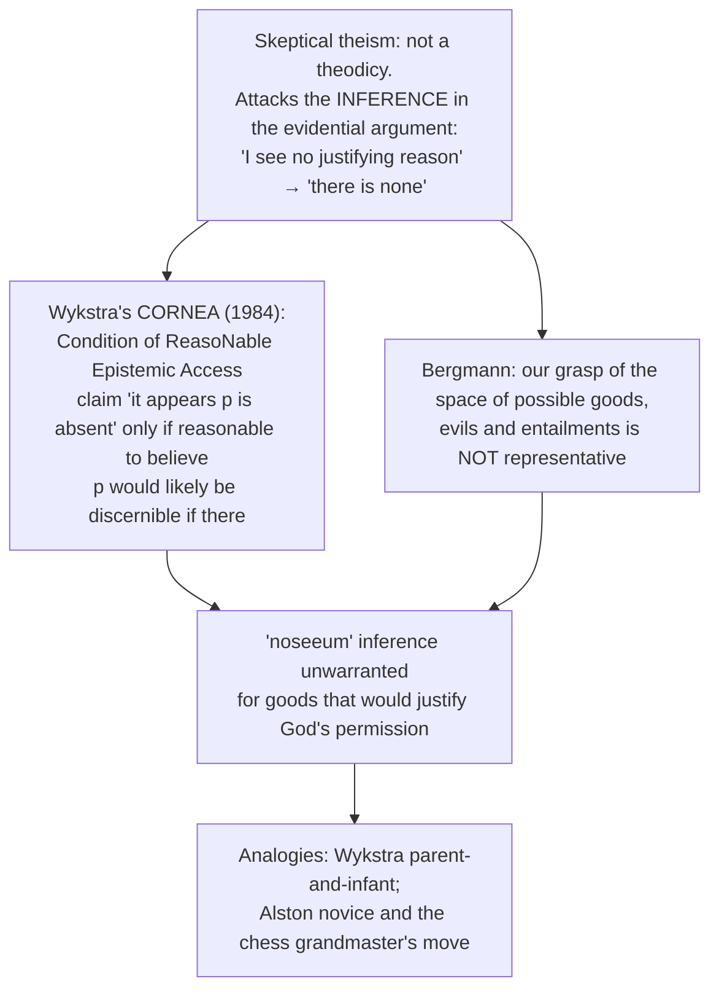

Proponents: Stephen Wykstra, William Alston, Michael Bergmann, Daniel Howard-Snyder. It is a **defence**, not a theodicy; it targets the **evidential**, not the **logical**, problem; it can coexist with a positive theodicy, though they sit awkwardly together.

| Objection | Reply |
|---|---|
| **Moral-scepticism** (Almeida, Russell, Wielenberg): if we cannot judge an evil gratuitous, we cannot judge we should *prevent* it; threatens ordinary moral reasoning and the duty to rescue | Obligation is fixed by what we *know*, not by unknown all-things-considered value; critics find this unstable |
| **Divine-deception / parity**: same scepticism undercuts confidence in divine promises, revelation, God's goodness | Restrict scepticism to the value-entailment domain; the restriction looks *ad hoc* |
| **Bracketing**: no empirical evidence could ever count against theism | Unfalsifiability charge stands |

> [!WARNING]
> Do not present skeptical theism as a theodicy. Do not let "God's ways are mysterious" stand in for it: state CORNEA or Bergmann's representativeness theses, or do not use the position. ⚠️

### 2.5 Omnipotence paradox in the presence of evil (2021 Q5(e), 10 marks) ✅/⚠️

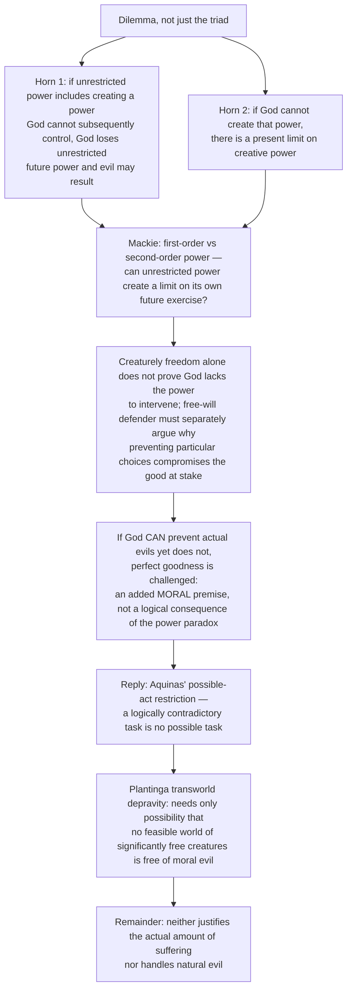

**10-mark route:** both horns → logical impossibility versus moral unwillingness → qualified reply → natural-evil remainder. ⚠️

---

## 3. Dialectical Wings & Sceptical Refinements

The sources hold no internal "sceptical wing" of the problem in the Indian-school sense. The nearest dialectical structure is the set of **revisionary and second-order positions** that change what is being defended, plus the advanced-dossier residues.

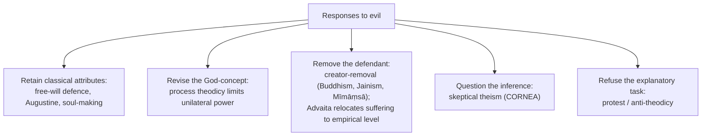

### 3.1 Concept-dependence (2024 Q6(c)) ✅/⚠️

"The problem of evil is a direct offshoot of how God is conceptualised in a system."

| God-concept | What happens to the charge | What remains |
|---|---|---|
| Classical theism (omnipotent, perfectly good, knowing, creator) | **Sharpest** inconsistency charge | Defences (free will, soul-making) seek to retain classical attributes |
| Finite process God | Removes *that precise* inconsistency by denying unilateral power | Whether divine persuasion does enough: "why not persuade more effectively?" |
| Advaita | Evil at empirical level; ultimate Brahman untouched | Empirical suffering persists; risk of minimising it |
| Impersonal absolute / no creator (Buddhism, Jainism, Mīmāṃsā) | Removes the defendant, not the reality of suffering | Suffering and the ethical demand to answer it remain |
| Theistic karma (Nyāya, Rāmānuja) | God dispenses fruit per deeds | Divine responsibility for sustaining the system |

### 3.2 Advanced dossier §3 — second-order debate ⚠️ (optional depth; one move in a 15-marker, one to two in a 20-marker)

| Module | Position | Strongest extra objection → counter-reply | Safe use |
|---|---|---|---|
| ✅ **Sceptical theism vs Rowe-style evidential atheism — now Core (§9.9)** | Wykstra's CORNEA; Bergmann's representativeness theses vs apparently pointless suffering as evidence | Objection: scepticism also weakens everyday moral reasoning → Reply: restrict to divine-governance inferences | Promoted 15 Aug 2026. Optional residue: a defence and a positive theodicy sit awkwardly together, so do not deploy both in one paragraph |
| ✅ **Horrendous evils vs ordinary soul-making — now Core** | Adams: some evils so devastating that simple growth language is inadequate; Hick emphasises development and eschatological fulfilment | Objection: some suffering destroys persons instead of building them → Reply: only defeat, redemption or ultimate integration can answer such cases | Promoted 15 Aug 2026 with balancing-off vs defeat and goodness-to-persons. Optional residue: is "defeat within the life of the sufferer" a theodicy at all, or an admission that no general theodicy succeeds? |
| ⚠️ Free will, natural law, natural evil | One line explains moral evil through freedom; harder line connects natural evil to law-governed order or finite creation | Objection: stable-law answers leave animal suffering and disaster intensity unexplained → Reply: defenders admit incompleteness and combine free will with soul-making or non-classical theism | Fairness check: "Plantinga is strongest on moral evil, weaker on natural evil" |
| ⚠️ Karma, desert, victim-blaming | Karma explains distribution across lives; critics worry karmic desert naturalises social indifference | Objection: karma becomes an excuse for blaming victims → Reply: classical Indian ethics still makes compassion obligatory | Very useful in Indian comparison |

- **What not to over-study:** full analytic debates on modal logic, possible worlds, or every horrendous-evil case study.
- **Promotion trigger:** skeptical theism, gratuitous-evil pressure and horrendous evils fired and were promoted 15 Aug 2026. Still to promote if a PYQ asks it directly: victim-blaming critiques of karma as a standalone demand. ✅

---

## 4. Metaphysics & Ontology: The Theodicies Themselves

### 4.1 Free-will defence ✅

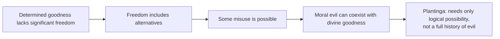

- Presupposition ⚠️: libertarian freedom is coherent and sufficiently valuable.
- Strongest for **moral** evil; natural evil needs an additional account.
- Example: a world of programmed beneficence lacks the moral authorship of a world containing genuinely responsible agents.
- Objection → reply: why not free agents who always freely choose good? → possible **transworld depravity**, though its actuality is not demonstrated.

### 4.2 Absolute creator and human responsibility (2022 Q6(c), 15 marks) ✅/⚠️

"If God is the Absolute Creator, then the responsibility of the evil cannot belong to the human agent. Critically examine."

**Disambiguate "responsibility" first:**

| Sense | Question |
|---|---|
| (i) Causal dependence | Could this agent act at all without creation? |
| (ii) Moral authorship | Who formed the culpable intention? |
| (iii) Permission | Who knowingly allowed the risk? |
| (iv) System-design responsibility | Who chose to create this world rather than another? |

"God causes the creature's existence" does not entail "God wills the evil intention"; conversely "the agent intended it" does not settle the creator's responsibility for permitting predictable harm.

| Position | Application | Best objection and bounded reply |
|---|---|---|
| **Determinist / strong author** | If God determines every choice, ascribing ultimate responsibility only to the creature looks incoherent; foreknowledge of the whole world intensifies it | Compatibilists tie accountability to the agent's own desires; yet a perfectly good author who selects those desires still owes an explanation |
| **Libertarian free-will defence** | Creating capacities and a situation ≠ producing a freely chosen evil intention | Could God create free agents who always choose well? Transworld depravity blocks "God *must* be able" but does not show no such world exists or explain why these victims suffer |
| **Indian theist (Nyāya / Rāmānuja)** | God administers karmic results or permits the *jīva*'s action while the *jīva* retains authorship | Divine maintenance of the order and unequal pain still raise permission and justice; prior karma is not independent evidence that a victim deserves harm |

**Verdict ⚠️.** The thesis overstates if it means *any* absolute creator logically cancels human culpability. It has force against exhaustive divine determination and against the claim that human fault completely removes divine permission/design responsibility. Even a satisfactory free-will defence answers principally **moral** evil; natural evil remains. Assess creator and agent separately.

### 4.3 Augustinian privation ✅

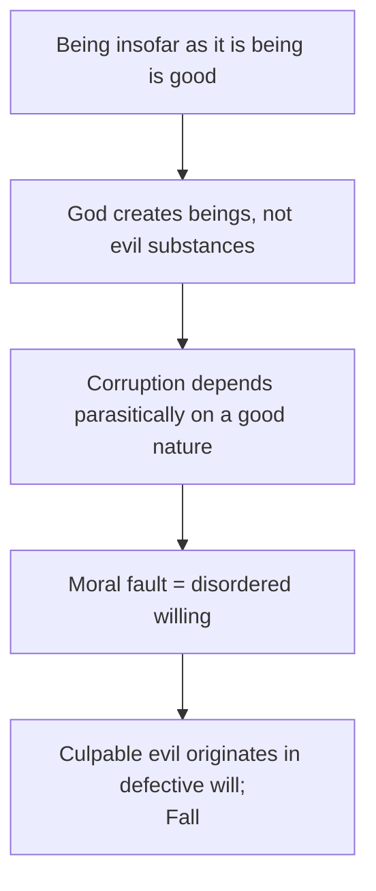

- Evil is not a created substance but privation or disorder of a due good (*privatio boni*). Presupposition ⚠️: goodness and being are convertible.
- **Distinction ✅:** calling blindness a privation does not call it unreal; it is a real lack in a subject that ought to possess sight. Example: rot is not a rival substance to wood but the loss of its proper integrity.
- **Inherited-guilt control ⚠️:** personal guilt for an ancestor's act is harder to defend than inheriting a damaged condition or disordered social-natural order; the second reduces the objection but still owes an account of why a good creator permits the condition and its unequal effects.
- Objection → reply: innocent and animal suffering resist punishment-for-sin explanations; Augustinian accounts appeal to fallen order; critics find the burden unresolved. Privation explains evil's metaphysical dependence on good, not why this deprivation was permitted.

### 4.4 Augustine's sin-or-punishment dichotomy (2023 Q8(a); 2026 Q6(a)) ✅/⚠️

"All evil is either sin or punishment for sin." — St. Augustine (2023, 20 marks). 2026: "In what sense does St. Augustine's identification of all evil as either sin or as the punishment of sin succeed or fail in providing a coherent account of both moral and natural evil? Evaluate." (20 marks)

**Textual basis and two stages ✅** (Augustine, *Enchiridion*): ch. IV §§12–15 — all created natures are good yet *mutable*; evil is a *privation* of a due good in an existing nature, not a second substance. Ch. VIII §§23–27 — the will of a mutable rational creature first defects (angels, then humans); bodily death, ignorance and misery follow the human Fall; descendants inherit sin and its penalties. The dichotomy divides **evil of fault** (culpable sin) from **evil of punishment** (harm consequent on fault). Privation says *what evil is*; sin/punishment says *why distinct evils occur*.

| Evil-type | Augustine's route | Why it has force | What remains hard |
|---|---|---|---|
| **Moral evil** | A created but changeable good will freely turns toward a lesser good; defect belongs to its willing | Preserves a real finite moral author; refuses an independently created evil substance | **Schleiermacher / Hick challenge:** why would a wholly good creature or angel turn away? Naming mutability does not explain the first defection or release the knowing creator from permission/design responsibility (§4.2) |
| **Natural evil** | Human vulnerability and disordered conditions as penalties of the Fall; angelic sin for wider cosmic disorder | Unifying narrative in which God does not create evil as a substance; includes bodily death among penalties | No independent link between an earthquake, pre-human predation or a child's illness and antecedent voluntary wrongdoing; punishing descendants and fallen-angel explanations add contested premises |

**Objection → charitable reply → verdict ⚠️.** Schleiermacher's challenge is *conditional*: *if* original goodness rules out a fall, sin is inexplicable; *if* fallibility was built into creation, the divine choice to create fallible agents and a vulnerable order reopens responsibility. Augustinian reply: a finite, mutable creature is good without being incapable of defect; foreknowledge does not cause the creature's act. This protects culpability but does not justify the scale of natural/innocent suffering. **Hick's Irenaean contrast** starts with immature persons and sees stable-law hardship as a growth environment, not retribution; it avoids dependence on a historical Fall but faces disproportionate suffering and animal pain.

**20-mark spine:** privation **and** sin/punishment as different claims → originating will and inherited consequences with textual care → moral evil and natural evil in **separate paragraphs** → finite-mutable reply and Hick's alternative → **qualified success for moral fault, contested extension to natural evil**. Do not say Augustine thinks a child or an animal personally committed the wrong behind its suffering.

### 4.5 Hick's Irenaean soul-making ✅

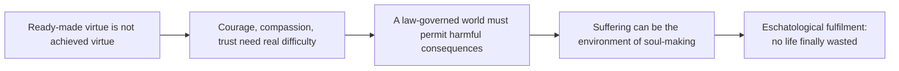

- Humans created **immature**, at **epistemic distance**, in a stable world containing danger; they grow from image to likeness. Not retributive; the rationale is developmental.
- Example: courage requires danger, compassion requires another's need; a "hedonistic paradise" would block these virtues.
- Objection → reply: horrendous and animal suffering seems disproportionate; Hick's universal eschatological fulfilment depends on contested afterlife commitments.
- **Trap ⚠️:** do not reduce Hick to "suffering makes us stronger"; include epistemic distance, freedom and law-governed order.

### 4.6 Process theodicy (2025 Q6(b), 15 marks) ✅

"Explain the main tenets of the Process Theodicy as an explanation of the problem of evil."

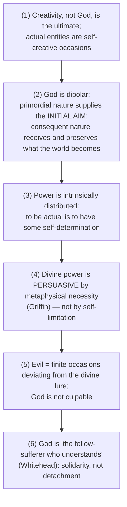

| Thinker | Work | Contribution |
|---|---|---|
| **Alfred North Whitehead** | *Process and Reality* (1929) | Creativity ultimate; dipolar God; initial aim; consequent nature; "fellow-sufferer who understands" |
| **Charles Hartshorne** | *The Divine Relativity* (1948); *Omnipotence and Other Theological Mistakes* (1984) | Classical omnipotence is **incoherent**: all the power leaves none for anything else; surrelativism / panentheism — God supremely *related* |
| **David Ray Griffin** | *God, Power, and Evil: A Process Theodicy* (1976); *Evil Revisited* (1991) | Persuasion is a **metaphysical necessity, not a self-limitation**: God *cannot* coerce |
| **John B. Cobb Jr.** | *A Christian Natural Theology* | Theological systematisation |

- **Distinction ✅:** a **theodicy**, not a defence; it differs from the free-will defence in *modality* — Griffin's God *cannot* coerce, Plantinga's God *chooses* not to.
- **Cost ⚠️:** purchases God's innocence at the price of God's sovereignty. A God who cannot guarantee victory over evil may be unworthy of worship; the metaphysics is contested; classical theists deny that actuality entails self-determination. Replies stress solidarity, objective immortality of achieved value in the consequent nature and non-retrospective compassion.
- **Traps:** do not say the process God is simply powerless; do not write "process theodicy (Whitehead)" and stop — name the layer (Whitehead / Hartshorne / Griffin); do not say it ends suffering.

### 4.7 Other responses and their costs ⚠️

| Response | Precise claim | Main cost |
|---|---|---|
| Greater-good / stable-order | Some goods — freedom, reliable agency, courage, compassion — require risk, regular law and possible loss | Explains the kind of world, not the amount or distribution |
| Leibnizian best possible world | A perfect God chooses the best total compossible order | There may be no unique best world; world-total optimisation neglects goodness to particular persons |
| Eschatological fulfilment | No finite suffering is final; later fulfilment prevents a life being finally wasted | Compensation after suffering is not justification for permitting it |
| Divine mystery | Finite minds may fail to grasp providential reasons | Without an access principle it is unfalsifiable; skeptical theism is the disciplined evidential version |
| Protest / anti-theodicy | Refusing to justify suffering protects truthfulness, lament and the priority of resistance | Diagnoses the ethics of explanation but does not settle the logical or evidential argument |

⚠️ **Compensation is not defeat.** A later good can compensate for loss while leaving the evil externally balanced.

### 4.8 Horrendous evils — Marilyn McCord Adams ✅/⚠️

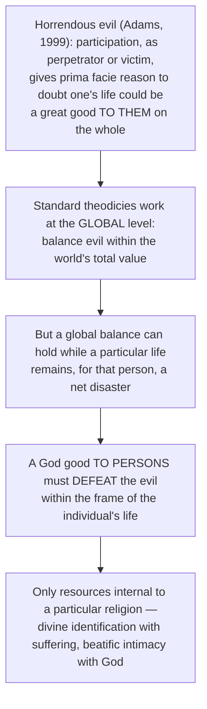

- **Balancing off** (outweighing in a sum) vs **defeat** (Chisholm: the evil becomes an organic part of a whole whose value it contributes to); **global** vs **personal** defeat.
- Objection → reply: purely eschatological and unverifiable, and seems instrumental → Adams denies instrumentality: the evil need not be *required*, only *defeated*. Second objection: religion-specific resources abandon the neutral arena → the atheological argument targets a *particular* theism.
- **Indian parity:** karma explains the **distribution** (why this person) but not that the life is a great good *to them*; Advaita's sublation and Buddhist liberation dissolve the standpoint from which the life is evaluated — "evasive" to critics, "therapeutic" to defenders. This is the highest-value paragraph in a 20-mark answer.
- **Trap ⚠️:** do not use "horrendous evil" loosely for "very bad evil".

### 4.9 Animal suffering and the pre-human problem ✅/⚠️

- No free-will defence and no soul-making rationale plainly applies to a creature that neither chooses nor grows morally. Rowe's fawn is the evidential case.
- Do not answer animal suffering with the free-will defence: saying so is a mark-earning move.

| Reply | Cost |
|---|---|
| Neo-Cartesian (animals lack higher-order awareness; Murray, *Nature Red in Tooth and Claw*, 2008) | Premise philosophically and empirically contested |
| Nomic regularity (stable law-governed world entails predation and pain) | Explains the *type*, not the *quantity* |
| Soul-making extended (danger enables courage, compassion, stewardship, including toward animals) | Uses animals instrumentally |
| Eschatological (animal fulfilment) | Unverifiable, undeveloped |
| Fallen-order (cosmic fall prior to human history) | ❓ Historically and scientifically strained |

**Indian parity ✅:** karma extends moral causation to animal births (*tiryak-yoni*); Jainism ascribes graded sense-capacity to living selves and grounds *ahiṃsā*; Buddhism places animals in the field of *dukkha* and extends *karuṇā* to sentient beings. Cost: unverifiable, and must not be used to infer present suffering is deserved.

**Verdict ⚠️:** animal suffering is where free-will and soul-making theodicies both run out; only nomic regularity survives on the Western side; karma answers distribution at the price of an unverifiable trans-life mechanism.

---

## 5. Affirmation / Rejection of the Divine Defendant: The Indian Response

### 5.1 Karma as a response to suffering ✅/⚠️

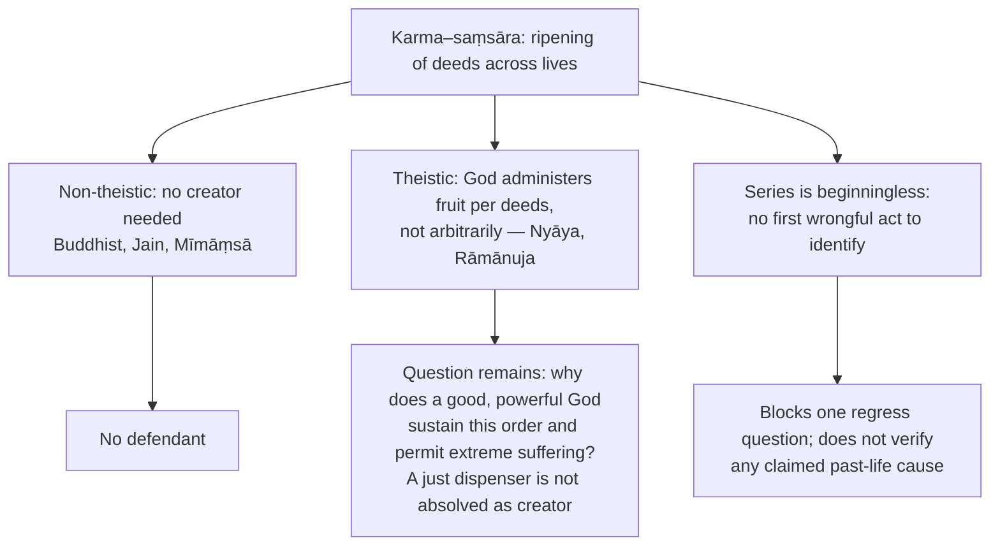

- **Explanatory advantage:** an account of **distribution** across lives that the standard free-will defence lacks. **Limits:** the specific past deed, the justice of the arrangement, suffering of animals or bystanders; natural suffering, collective harms and unequal starting conditions.
- ⚠️ **Moral caution:** the inference "this person suffers" → "deserves it for a specific past act" is unavailable to ordinary observers; so used, karma becomes victim-blaming. Karma does not cancel present duties of compassion, protection and relief.
- **Do not present karma as a single theistic doctrine across Indian schools.**

### 5.2 Four-way comparison on karmic causation (theme file) ✅

| School | Mediating link between action and distant fruit |
|---|---|
| Jaina | Material karma-pudgala |
| Nyāya | *adṛṣṭa* + Īśvara |
| Mīmāṃsā | *apūrva* without God |
| Sāṃkhya–Yoga | *saṃskāra* / *karmāśaya* |
| Buddhism | *vāsanā* / *bīja* in the *santāna* |

Sharpest contrast: *apūrva* is impersonal and self-executing; *adṛṣṭa* requires Īśvara to administer it.

### 5.3 What binds? (theme file §2) ✅

| School | Bondage is… | Root cause |
|---|---|---|
| Buddhism | wheel of *duḥkha* / rebirth | *avidyā* → *tṛṣṇā* |
| Jaina | karmic **matter** clogging the *jīva* | *mithyā-darśana* + *kaṣāya* |
| Nyāya | stream of pain-laden births | *mithyā-jñāna* |
| Sāṃkhya–Yoga | puruṣa's mis-identification with prakṛti/citta | *aviveka* / *avidyā* |
| Advaita | jīva's apparent limitation | *avidyā* / *adhyāsa* |
| Viśiṣṭādvaita / Dvaita | separation from God, karma | karma + ignorance of dependence on God |

### 5.4 Indian–Western parity bench ⚠️

| Examiner's real question | Western resource | Indian resource | Where they diverge |
|---|---|---|---|
| Why is there evil at all? | Free will; privation; soul-making | *Avidyā*; *āsrava*; craving (*taṇhā*) | West asks about *permission*; India about *origination of bondage* |
| Why **this** person? | ⚠️ weak point — no standard answer | Karma across lives | Distribution is India's structural advantage |
| Why so **much**? | Nomic regularity; skeptical theism | Beginningless saṃsāra | West must justify a quantity; India denies the frame |
| Is God culpable? | Theodicies; process denial of coercive power | Nyāya: God allots *per* karma; non-theistic schools: no defendant | India can drop the defendant; the West cannot |
| What defeats evil for the sufferer? | Adams' beatific intimacy; eschatology | Mokṣa / nirvāṇa / kaivalya ending the standpoint of suffering | Defeat *within* the life vs *exit from* the life-series |
| Animal suffering | Nomic regularity, neo-Cartesian | Karma in *tiryak-yoni*; Jain graded *jīva*; *ahiṃsā* | India moralises it; the West mostly brackets it |

### 5.5 Skeptical-theist parallels in Indian thought ⚠️

Nyāya/Vedāntic appeal that *adṛṣṭa* is *atīndriya* (beyond the senses), known only through *śabda*; Buddhist treatment of the precise ripening of karma as one of the **acinteyya** (imponderables). Genuine parallel, same objection: a mechanism placed permanently beyond checking cannot be evidence for or against.

---

## 6. Explanatory & Causal Principles

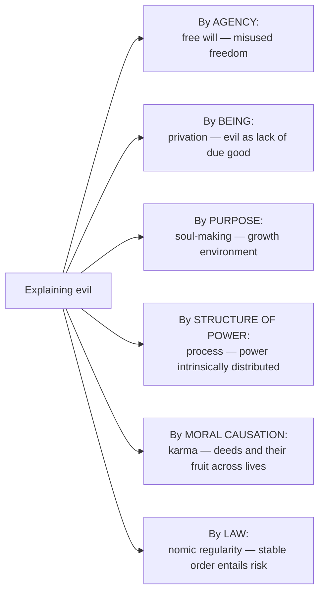

### 6.1 Assessment grid ⚠️

| Theodicy | Evil explained | Attribute preserved | Weakness |
|---|---|---|---|
| Free-will | moral | omnipotence + goodness | natural evil left over |
| Augustinian privation | moral fault; natural suffering via Fall / punishment (contested) | classical creator goodness | first fall and innocent / animal suffering |
| Soul-making (Hick) | moral + natural | goodness (purpose) | scale / animal suffering; universalism |
| Process | finite agencies and natural processes | goodness (revises omnipotence) | cannot guarantee prevention or ultimate victory |
| Karma | proposed distribution across lives | creator optional; divine justice disputed if retained | unverified past causes; victim-blaming |

### 6.2 Inter-school debate table ✅/⚠️

| Approach | Moral evil | Natural evil | Divine attribute changed / preserved | Cost |
|---|---|---|---|---|
| Free will | ✅ Strong | ⚠️ Weak without supplement | Preserves omni-attributes | Libertarian assumptions |
| Augustine | ✅ Privation and fault | ⚠️ Fallen order | Preserves creator goodness | Punishment / innocence problem |
| Hick | ✅ Growth through freedom | ✅ Environment of growth | Preserves purposive goodness | Proportionality and afterlife |
| Process | ✅ Finite agency | ✅ Finite causal powers | Revises omnipotence | Non-classical God |
| Karma | ✅ Moral causation | ⚠️ Extends explanation across lives | Creator optional | Verification and victim-blaming |
| Advaita | ⚠️ Evil at empirical level | ⚠️ Sublatable under knowledge | Ultimate Brahman untouched | Empirical suffering persists; risk of minimising it |

---

## 7. Ethics & Human Goals: Desert, Compassion and the Sufferer

The sources give **no kāma/artha/dharma/mokṣa hierarchy** for this topic. Module 7 carries the moral and existential dimension that the sources do give.

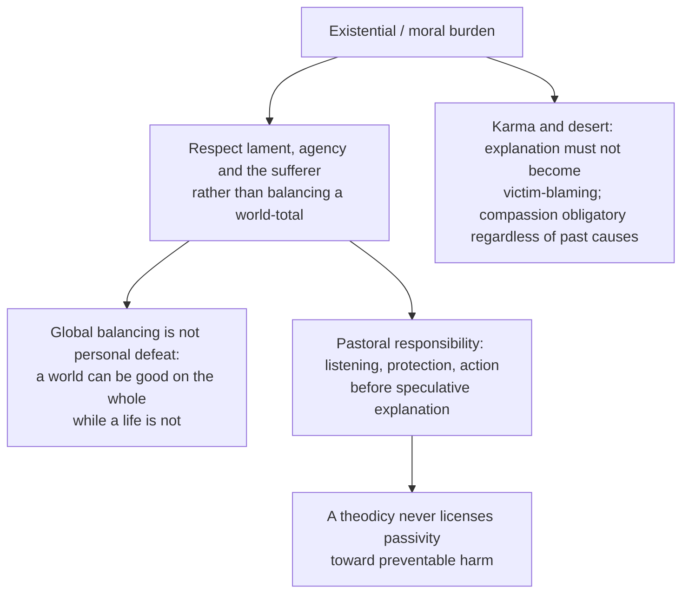

### 7.1 Evil, the profane and the sacred as religion-forming categories (2019 Q6(b), 15 marks) ✅/⚠️

"What role do the concepts of evil and profane play to provide a firm foundation to religion?"

> [!WARNING]
> **Ownership rule.** The **evil / profane** pole is owned here (2019 Q6(b)). The **sacred / holy as object of religion** pole is owned by Religious Experience §9.6 (2018 Q7(a)). The questions differ: here the category is **religion-founding**; there it is **object-identifying**. **Profane ≠ evil**: Durkheim's profane is the ordinary, not the wicked. Evil (moral/natural harm), profane (ordinary, non-consecrated), impure (ritually polluting) and demonic (actively anti-sacred) are four distinct categories.

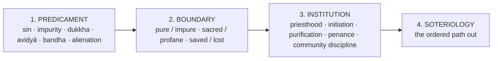

| Theorist | Work | Claim |
|---|---|---|
| **Émile Durkheim** | *The Elementary Forms of Religious Life* (1912) | All known religious beliefs presuppose a classification into two classes, **profane** and **sacred**; religion = unified system of beliefs and practices relative to sacred things, uniting adherents into a moral community (a **church**); deliberately God-free |
| **Rudolf Otto** | *The Idea of the Holy* (1917) | Sacred as an *a priori* category of response: the **numinous**, *mysterium tremendum et fascinans*; object-side |
| **Mircea Eliade** | *The Sacred and the Profane* (1957) | **Hierophany**; sacred **space** (fixed centre, *axis mundi*) and sacred **time** (recoverable, repeatable) against profane homogeneity and irreversible duration |

**Indian parity ✅:** *śuddhi/aśuddhi* and *śauca* organise ritual practice; *maṅgala/amaṅgala*; *pāpa/puṇya*; the Buddhist **First Noble Truth** makes *dukkha* the explicit foundation — the clearest world case of evil as religion-founding; Jain *āsrava/bandha* name the predicament and *saṃvara/nirjarā* the exit; Mīmāṃsā purity codes; Advaita's *avidyā*. **Rider:** the Indian founding category is more often **ignorance or bondage** than **moral evil**, giving diagnosis-and-insight rather than sin-and-forgiveness.

| Objection | Reply |
|---|---|
| The binary is a Durkheimian imposition; many traditions grade; Eliade's "archaic ontology" is unfalsifiable | Treat the pair as an *ideal type* organising comparison, not a law |
| Founding religion on evil makes it parasitic on suffering | Worship, wonder and gratitude are independent roots; the sacred is not exhausted by the negative pole → route to Religious Experience |

**Verdict ⚠️:** "Evil and the profane found religion structurally rather than doctrinally… But they found *religion*, not *theism* — which is why the same analysis covers Buddhism and Jainism, and why it leaves the theistic problem of evil entirely untouched."

---

## 8. Inter-School Comparative Matrices

### 8.1 Multi-axis matrix: how each response treats the problem ⚠️

| Axis | Free will | Augustine | Soul-making | Process | Karma (non-theistic) | Karma (theistic) | Advaita |
|---|---|---|---|---|---|---|---|
| **God defended?** | Yes, classical | Yes, classical | Yes, purposive | Revised (finite, persuasive) | No defendant | Yes, as dispenser | Ultimate Brahman untouched |
| **Moral evil** | Strong | Fault / privation | Growth through freedom | Finite agency | Moral causation | Moral causation | Empirical level |
| **Natural evil** | Weak alone | Fallen order | Growth environment | Finite causal powers | Extends across lives | Extends across lives | Sublatable |
| **Defence or theodicy?** | Defence (Plantinga) | Theodicy | Theodicy | Theodicy | Explanation of distribution | Explanation of distribution | Relocation |
| **Cost** | Natural evil; libertarian assumption | Innocent / animal suffering | Proportionality; afterlife | Cannot guarantee victory; sovereignty | Unverified; victim-blaming | Divine permission / design | Minimising empirical suffering |

### 8.2 Augustine vs Hick ✅

| Axis | Augustinian | Irenaean (Hick) |
|---|---|---|
| Starting point | Created good, mutable; Fall | Immature persons at epistemic distance |
| Evil's rationale | Sin and its punishment | Developmental, not retributive |
| Natural evil | Penal / disordered by the Fall | Environment of growth in a law-governed world |
| Historical Fall needed? | Yes | No |
| Remaining difficulty | Innocent, animal, pre-human suffering | Disproportionate suffering; animal pain; afterlife dependence |

### 8.3 Free-will defence vs process theodicy (modality) ✅

| | Free-will defence | Process theodicy |
|---|---|---|
| Kind | Defence | Theodicy |
| God's power | God *chooses* not to intervene | God *cannot* coerce (metaphysical necessity) |
| Omnipotence | Retained | Revised / dismissed as incoherent |

### 8.4 Defence vs theodicy vs skeptical theism ✅

| | Aim | Example | Targets |
|---|---|---|---|
| **Defence** | Possible compatibility; defeats strict contradiction | Plantinga's free-will defence | Logical problem |
| **Theodicy** | Identify God's actual morally sufficient reason | Augustine, Hick, process | Logical / evidential |
| **Skeptical theism** | Denies the atheist's inference; claims the atheist's evidence fails | Wykstra, Alston, Bergmann | Evidential |

---

## 9. Criticisms & Reconstructed Replies

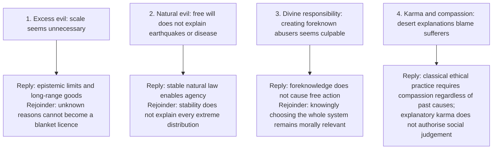

### 9.1 Objection ledger by response ⚠️

| Response | Strongest objection | Bounded reply | Residual |
|---|---|---|---|
| Free will | Why not free agents who always choose good? | Possible transworld depravity | Possibility ≠ actuality; natural evil untouched |
| Augustine | Innocent and animal suffering; first defection of a good will | Fallen order; finite mutable creature; foreknowledge does not cause the act | Scale of natural / innocent suffering unjustified |
| Hick | Horrendous and animal suffering disproportionate | Universal eschatological fulfilment | Depends on contested afterlife |
| Process | God unworthy of worship; no guaranteed victory | Solidarity; objective immortality of achieved value | Sovereignty surrendered |
| Skeptical theism | Undermines ordinary moral reasoning; unfalsifiable | Obligation fixed by what we know | Concession that moral structure is opaque |
| Karma | Unverifiable; victim-blaming; natural / collective harms | Compassion obligatory; beginningless series | Does not show the life is a great good *to the sufferer* |
| Adams (defeat) | Eschatological, unverifiable; religion-specific | Evil need be defeated, not required | Whether it is a theodicy at all |

### 9.2 Skeptical-theism verdict ⚠️

"The strongest available *defensive* reply to the evidential argument and the most corrosive one: it neutralises the atheist's inference only by conceding that the moral structure of the universe is opaque to us, and that concession costs the theist much of the moral confidence religion is usually taken to supply."

---

## 10. Controlled Western Comparisons

The sources give **no stand-alone East–West comparison table** for this topic beyond the internal Indian–Western parity bench (§5.4). The Western/Indian pairings they supply:

| Pairing | Point of contact | Decisive difference |
|---|---|---|
| Free-will defence vs karma | Both locate responsibility in agents | West asks about divine *permission*; India about *origination of bondage* and distribution across lives |
| Process God vs theistic karma dispenser | Both qualify a simple omnipotent controller | Process God cannot coerce; Nyāya God allots *per* karma yet remains responsible for sustaining the system |
| Adams' defeat vs Advaita / Buddhist exit | Both address the sufferer's standpoint | Defeat *within* the life vs *exit from* the life-series |
| Skeptical theism vs *atīndriya* adṛṣṭa / *acinteyya* karma-ripening | A mechanism placed beyond ordinary checking | Both inherit the unfalsifiability objection |
| Durkheim / Eliade on the profane vs Buddhist *dukkha* | Predicament founds religion | Indian founding defect is more often ignorance / bondage than moral evil |

> [!WARNING]
> Pairings are analogies for answer-building, not claims of historical influence. Place Indian comparison where the stem invites it (distribution, culpability, defeat), not as decoration.

---

## 11. Diagnostic Deep-Dives for High-Frequency Themes

### 11.1 Version-matching decision tree ⚠️

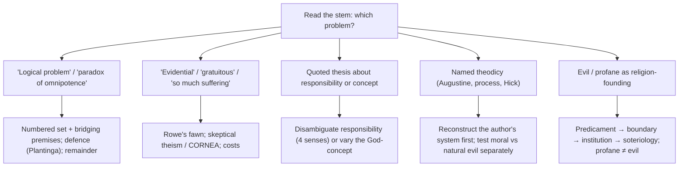

### 11.2 Directive decoder ⚠️

| Directive | Examiner is buying | Structural consequence | PYQ |
|---|---|---|---|
| What is the logical problem of evil? Discuss | The *set* and its **bridging premises**, not a lament | Numbered propositions; show why not formally contradictory without the bridges | 2020 Q6(b) |
| Discuss the paradox of… | Paradox stated as a dilemma with both horns | Horn 1 → cost; Horn 2 → cost; then the restriction that dissolves it | 2021 Q5(e) |
| Critically examine [quoted thesis] | Fidelity to the quotation's *scope* before evaluation | Ask first: does the claim cover moral evil only, or natural too? | 2022 Q6(c) |
| "Quotation." — Critically discuss | Reconstruct the author's system, then test it | Give Augustine's privation metaphysics before objecting | 2023 Q8(a) |
| "Direct offshoot of how God is conceptualised." Critically discuss | Show the *dependence* by varying the God-concept | Run the triad against four God-concepts; track which charge changes and which suffering remains | 2024 Q6(c) |
| Explain the main tenets of X | Enumerated doctrine, correctly attributed | Number the tenets; name Whitehead / Hartshorne / Griffin separately | 2025 Q6(b) |
| What role do A and B play to provide a firm foundation to… | A *functional* account | Predicament → boundary → institution → soteriology | 2019 Q6(b) |
| In what sense does X succeed or fail … both A and B? Evaluate | Test each named explanandum independently | Privation → moral evil → punitive account → natural evil → split verdict | 2026 Q6(a) |

---

## 12. PYQ Routing Ledger (2018–2026)

> Corpus signal: **7 primary-owned parts** of 112 in 2018–2025 (absent in 2018, then every year 2019–2025) plus **1** primary-owned part in the 2026 supplement = **8 verified primary-owned parts**. The owner file has no pre-2018 table. Cross-links do not create duplicate ownership.

| Year | Q | Marks | Exact demand | Map to |
|---|---|---:|---|---|
| 2019 | Q6(b) | 15 | What role do the concepts of evil and profane play to provide a firm foundation to religion? | §7.1 |
| 2020 | Q6(b) | 15 | What is the logical problem of evil? Discuss. | §2.1 |
| 2021 | Q5(e) | 10 | Discuss the paradox of omnipotence of God in the context of the existence of evil. | §2.5 |
| 2022 | Q6(c) | 15 | If God is the Absolute Creator, then the responsibility of the evil cannot belong to the human agent. Critically examine. | §4.2 |
| 2023 | Q8(a) | 20 | "All evil is either sin or punishment for sin." — St. Augustine. Critically discuss. | §4.3–4.4 |
| 2024 | Q6(c) | 15 | "The problem of evil is a direct offshoot of how God is conceptualised in a system." Critically discuss. | §3.1 |
| 2025 | Q6(b) | 15 | Explain the main tenets of the Process Theodicy as an explanation of the problem of evil. | §4.6 |
| 2026 | Q6(a) | 20 | In what sense does St. Augustine's identification of all evil as either sin or as the punishment of sin succeed or fail in providing a coherent account of both moral and natural evil? Evaluate. | §4.4 |

**Cross-owned (listed, not counted):**

| Year | Q | Marks | Owner | Link to this topic |
|---|---|---:|---|---|
| 2026 | Q8(c) | 15 | Notions of God | "Present an account of criticisms against omniscience and omnipotence as attributes of God." Evil-based objection developed here; use **one bounded paragraph** there (§2.1, §2.5) |
| 2019 | Q8(a) | 20 | Soul, Immortality, Rebirth and Liberation | "State and explain the doctrines of Karma, Rebirth and Reincarnation in Hinduism." Karma as explanation of suffering: §5 |
| 2021 | Q8(b) | 15 | Soul, Immortality, Rebirth and Liberation | "Discuss and evaluate the doctrine of Karma as an essential postulate of Hinduism." §5 |
| 2023 | Q7(b) | 15 | Soul, Immortality, Rebirth and Liberation | "Examine the significance of the concept of rebirth in the theory of Karma." §5 |

Sources: [Philosophy of Religion PYQ Bank, 2018–2025] and [2026 supplement] (controlling wording).

---

## 13. Top 10 UPSC Exam Traps

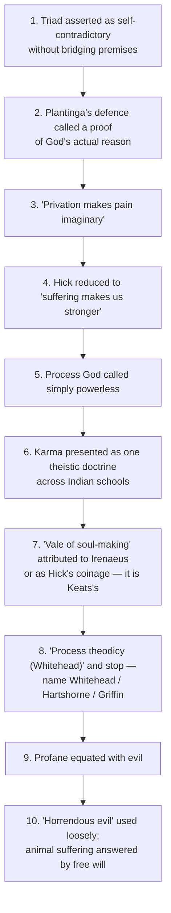

**Further traps recorded in the owner file:** skeptical theism presented as a theodicy (#12); "God's ways are mysterious" standing in for it (#13); saying process theodicy **ends suffering** or that karma automatically exonerates a God posited by Nyāya (#14); for the 2026 Augustine stem, confusing privation's *status* of evil with the proposed *cause* of moral faults and the disputed penal explanation of natural evils (#15). Do not say Augustine holds that a child or animal committed the wrong behind its suffering.

---

## 14. Technical Vocabulary & IAST Bank

| English gloss | Term | Meaning | Status |
|---|---|---|---|
| Inconsistent triad | Mackie's triad | Omnipotent + perfectly good + evil exists | ✅ |
| Bridging premise | — | Added principle needed for contradiction | ✅ |
| Logical / evidential problem | — | Inconsistency vs improbability | ✅ |
| Moral / natural evil | — | Human wrongdoing vs non-willed suffering | ✅ |
| Gratuitous evil | — | Pointless suffering | ✅ |
| Defence / theodicy | — | Possible compatibility vs actual reason | ✅ |
| *noseeum* inference | — | "No seeum, so none there" | ✅ |
| CORNEA | — | Wykstra's condition of reasonable epistemic access | ✅ |
| Libertarian freedom | — | Freedom with real alternatives | ✅ |
| Transworld depravity | — | Plantinga's possibility claim | ✅ |
| Privation of the good | *privatio boni* | Evil as lack of due good | ✅ |
| Fall | — | Original defection of the will | ✅ |
| Epistemic distance | — | Hick: God's apparent remoteness enabling free growth | ✅ |
| Image / likeness | — | Irenaeus: made in image, growing into likeness | ✅ |
| Horrendous evil | — | Adams' technical term | ✅ |
| Balancing off vs defeat | — | Outweighing vs organic incorporation | ✅ |
| Dipolar God / initial aim | primordial / consequent nature | Whitehead | ✅ |
| Fellow-sufferer | — | Whitehead's anchor phrase | ✅ |
| Karma | *karman* | Deed and its fruit | ✅ |
| Unseen force | *adṛṣṭa* | Nyāya mediating potency | ✅ |
| Apūrva | *apūrva* | Mīmāṃsā impersonal potency | ✅ |
| Overseer of karma | *karmādhyakṣa* | Nyāya divine dispenser | ✅ |
| Animal birth | *tiryak-yoni* | Karma extended to animals | ✅ |
| Imponderable | *acinteyya* | Buddhist: precise karmic ripening | ✅ |
| Beyond the senses | *atīndriya* | Nyāya/Vedānta on adṛṣṭa | ✅ |
| Suffering | *dukkha* (Pali) / *duḥkha* | First Noble Truth | ✅ |
| Ignorance | *avidyā* | Root of bondage in several schools | ✅ |
| Influx / bondage | *āsrava* / *bandha* | Jain | ✅ |
| Stoppage / shedding | *saṃvara* / *nirjarā* | Jain | ✅ |
| Purity / impurity | *śuddhi* / *aśuddhi* | Ritual boundary | ✅ |
| Merit / demerit | *puṇya* / *pāpa* | — | ✅ |
| Non-injury | *ahiṃsā* | Jain / Buddhist | ✅ |
| Compassion | *karuṇā* | Buddhist | ✅ |
| Sacred / profane | — | Durkheim | ✅ |
| Hierophany; *axis mundi* | — | Eliade | ✅ |
| Numinous | *mysterium tremendum et fascinans* | Otto | ✅ |

---

## 15. Graded Verdict & Answer Architectures

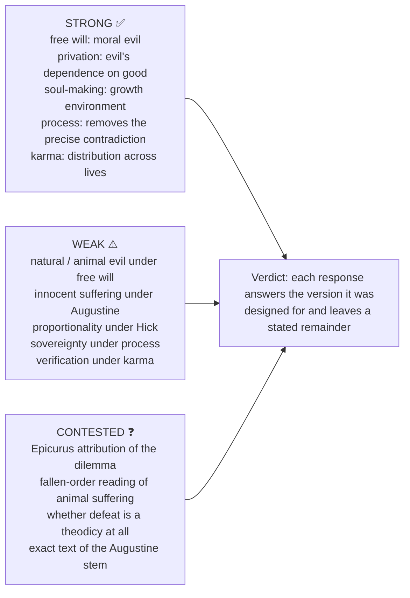

### 15.1 10-mark

```text
State exact problem → identify God-concept → one response with presupposition →
one objection → verdict on compatibility, not a devotional conclusion.
```
**Anchor:** "A successful defence defeats contradiction; it need not make suffering morally transparent." ⚠️

### 15.2 15-mark

```text
Logical/evidential frame → doctrine's argument → canonical example →
objection and reply → Indian comparator → assess explanatory cost.
```
**Anchor:** "The classical contradiction targets one God-concept, not religion in general. Limit unilateral power (process), distinguish empirical worship from ultimate nondual Brahman (Advaita), or remove the creator (Buddhism / Jainism / Mīmāṃsā), and the target changes — while suffering and the ethical demand to answer it remain." ⚠️

### 15.3 20-mark

```text
Define evil and inconsistent set → strongest theodicy in full → rival theodicy/Indian view →
two objections and replies → distinguish defence from theodicy → graded verdict.
```
**Anchor:** "The theodicy answers the version of the problem it was designed for and leaves ___ untouched; its cost is ___, and a theodicy is not refuted by its cost but is measured by it." ⚠️

### 15.4 Model-answer skeletons for each PYQ ⚠️

**2024 Q6(c) — concept-dependence (15m)**
```text
Intro : inconsistent triad (omnipotent + good + evil).
Body  : bridge about prevention and morally sufficient reason; classical theism sharpest;
        process limits unilateral power; Advaita relocates suffering to empirical reality;
        non-creator traditions remove divine permission, not suffering itself.
Assess: a finite God can still be asked why it did not persuade more effectively;
        theistic karma still faces divine responsibility for the system.
Concl : the problem changes with the God-concept; no change of definition alone
        explains or alleviates the sufferer's actual pain.
```

**2023 Q8(a) / 2026 Q6(a) — Augustine (20m)**
```text
Intro : Augustine's free-will + privation theodicy.
Body  : privatio boni (not created by God); moral evil from misused free will;
        suffering as just punishment for sin (original and actual).
Crit  : natural evil and innocent/animal suffering fit poorly; 'privation' strained;
        Schleiermacher/Hick challenge on first defection; Hick's developmental contrast.
Concl : qualified success for moral fault; contested extension to natural evil.
```

**2019 Q6(b) — evil and profane (15m)**
```text
Intro : FUNCTIONAL question — how negative categories constitute religion.
B1    : Durkheim sacred/profane (warn: profane = ordinary, NOT evil).
B2    : Otto numinous; Eliade hierophany, sacred space and time.
B3    : predicament → boundary → institution → soteriology.
Indian: First Noble Truth; Jain āsrava/bandha; Advaita avidyā; śuddhi/aśuddhi; pāpa/puṇya.
Crit  : binary is an ideal type; wonder and gratitude also found religion → Religious Experience.
Concl : evil and profane found religion structurally — but religion, not theism.
```

**2025 Q6(b) — process theodicy (15m):** number the six tenets (§4.6); name Whitehead, Hartshorne, Griffin, Cobb separately; cost: God's innocence bought at the price of sovereignty.

**2020 Q6(b) — logical problem (15m):** numbered set → show non-contradiction without bridges → state both bridges → defence (Plantinga) → remainder (evidential problem restarts).

**2021 Q5(e) — omnipotence paradox (10m):** both horns → Aquinas' restriction → free-will / transworld-depravity reply → natural-evil remainder (§2.5).

**2022 Q6(c) — absolute creator (15m):** four senses of responsibility → determinist vs libertarian vs Indian theist → verdict that the thesis overstates (§4.2).

### 15.5 Graded verdict ladder ⚠️

| Band | Script contains | Typical fault |
|---|---|---|
| Weak (≈40%) | "God is good but evil exists"; lists free will and karma | Triad without bridging premises; no version identified |
| Average (≈50%) | Logical/evidential distinction; two theodicies | Defence and theodicy used interchangeably |
| Good (≈60%) | Bridging premises; one theodicy fully reconstructed; Indian comparator | Natural / animal evil unaddressed |
| Strong (≈65–70%) | Version-matched theodicy; objection with reply; distribution question; cost of each move | Horrendous / skeptical-theist layer absent |
| Top (≈70%+) | All above + defeat-vs-balancing-off, or CORNEA, or the animal-suffering gap + what the theist has *given up* to survive | — |

> [!TIP]
> **Safe formulations.** "The problem's force varies with the God-concept." · "Global balancing is not personal defeat: a world can be good on the whole while a life is not." · "Evil and the profane found religion structurally, not doctrinally — they supply the predicament without which soteriology is idle." · Logical-problem verdict: "The set is inconsistent only with the bridging premises; deny either and the contradiction dissolves — but the theist then owes an account of what a good omnipotent being *would* tolerate, which is where the evidential problem restarts."

---

## Link-outs

Notions of God (omnipotence, attribute package under stress) · Religious Experience (owner of the sacred/holy-as-object pole) · Soul, Immortality, Rebirth and Liberation (karma, rebirth, liberation and the sufferer's standpoint) · Religion and Morality (desert, victim-blaming, ethics of theodicy) · Religion without God (dropping the defendant) · Proofs for God (evil as counter-evidence in a cumulative case) · Paper I: Buddhism, Jainism, Vedānta · Philosophy of Religion PYQ Bank 2018–2025.

## Sources

John Hick, *Evil and the God of Love*; J. L. Mackie, "Evil and Omnipotence"; Alvin Plantinga, *God, Freedom, and Evil*; Augustine, *Enchiridion* (ch. IV §§12–15; ch. VIII §§23–27) and *City of God*; A. N. Whitehead, *Process and Reality*; Charles Hartshorne, *Omnipotence and Other Theological Mistakes*; David Ray Griffin, *God, Power, and Evil: A Process Theodicy*; Marilyn McCord Adams, *Horrendous Evils and the Goodness of God*; William Rowe, "The Problem of Evil and Some Varieties of Atheism"; Stephen Wykstra on CORNEA; Michael Bergmann and Daniel Howard-Snyder on skeptical theism; Michael Murray, *Nature Red in Tooth and Claw*; Émile Durkheim, *The Elementary Forms of Religious Life*; Mircea Eliade, *The Sacred and the Profane*; Rudolf Otto, *The Idea of the Holy*; karma discussions in S. C. Chatterjee & D. M. Datta and C. D. Sharma; local searchable John Hick, *Philosophy of Religion*, and *Oxford Handbook of Philosophy of Religion* (as cited in the owner file).
