# SOUL: IMMORTALITY, REBIRTH AND LIBERATION — Examiner-Grade Mindmap

> **Syllabus (verbatim):** Soul : Immortality; Rebirth and Liberation.
> **Catalogue key:** `philosophy-paper-ii-philosophy-of-religion-04` · Paper II · Philosophy of Religion
> **Sources used:** `paper-2/philosophy-of-religion/Soul-Immortality-Rebirth.md` (canonical owner, read in full) · `_advanced/Philosophy-of-Religion-Dossier.md` §4 (optional depth; promotion ledger read for boundaries) · `paper-2/_PYQ-PhilosophyOfReligion-2018-2025.md` · `paper-2/_PYQ-PhilosophyOfReligion-2026-Supplement.md` · `paper-1/_themes/Self-and-liberation-across-schools.md` (read in full; the owner links it). The owner's other Paper I links (Buddhism, Jainism, Vedānta, Nyāya–Vaiśeṣika, Sāṃkhya, Yoga) are treated as boundary notes only; the owner states that full Indian-school self-metaphysics remains with those Paper I owners.
> **Evidence key:** ✅ canonical doctrine / fact · ⚠️ analytical synthesis for exam use · ❓ contested / uncertain

> [!IMPORTANT]
> **Core thesis.** Immortality, rebirth and liberation are three different claims, and each school pairs them differently. "Immortality → rebirth → liberation" (mnemonic **I→R→L**) is a question to test, not a chain to assume: Buddhism is the great counter-example (rebirth **without** an immortal soul), and a one-life resurrection model tests whether rebirth is needed at all. The printed clause owns soul/self/person concepts only insofar as they control immortality, rebirth and liberation. ⚠️

> [!NOTE]
> **Adaptation.** The 15-module blueprint is written for single Indian schools. For this topic Module 1 holds the ownership firewall, the soul/self/person models and the personal-identity criteria; Module 2 holds what each survival argument must show and what it fails to show; Module 3 holds the revisionary wings (Buddhist no-self, Sāṃkhya's "no puruṣa is bound") and the advanced second-order debates; Module 4 holds the continuity-bearer metaphysics school by school; Module 5 holds the stance on transcendent realities (karma, saṃsāra, God's role, the resurrection alternative); Module 6 holds the causal mechanisms (karma, causal stream, production vs removal of liberation); Module 7 holds moral desert and the paths to liberation. The sources give no āstika/nāstika classification for this topic; Module 1 says so rather than inventing one. The owner states that no empirical or neuroscientific claim in it is presented as scientific proof of survival.

---

## 0. Master Overview

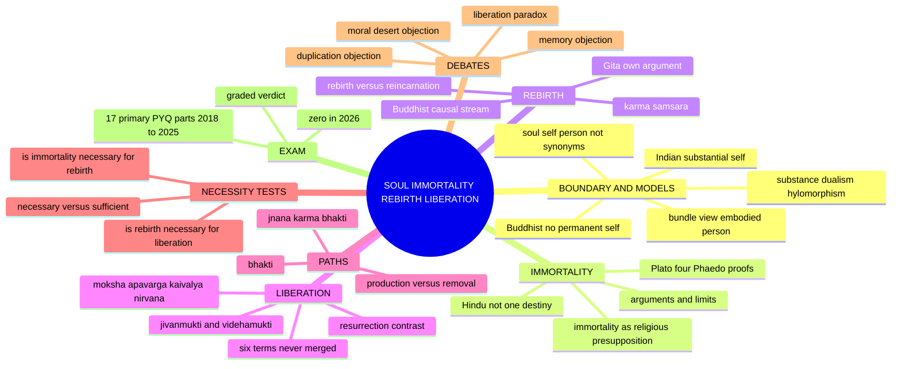

---

## 1. Identity, Lineage & Doxography: Ownership, Models and Identity Criteria

### 1.1 What the clause owns, and the firewall ✅

| Owned here | Boundary (stays with another owner) |
|---|---|
| Comparative soul, self and person models needed for survival | Full Indian-school self metaphysics → the Paper I canonical owners |
| Arguments and objections concerning post-mortem survival | Revelation and faith-based warrant → Reason, Revelation and Faith |
| Religious experience only as a bounded survival argument | Phenomenology and veridicality → Religious Experience |
| Karma only as continuity, rebirth and liberation mechanism | Karma as an answer to suffering → Problem of Evil |
| Buddhist/Jain liberation and non-creator implications | The full case for religion without a creator → Religion without God |
| Resurrection, replica and duplication only as identity tests | Detailed doctrinal eschatology and intermediate-state speculation are not independently required by the PYQ corpus |

> [!WARNING]
> Soul, self, person, immortality, resurrection, rebirth, reincarnation and liberation are **not synonyms**. ⚠️

**Classification note.** The sources give no āstika/nāstika scheme for this topic; the classification question is handled in the Paper I owners (Cārvāka, Jainism, Buddhism etc.). Here the sorting axes are *bearer of continuity*, *number of lives* and *terminus*.

### 1.2 Soul, self, person and continuity-bearer ⚠️

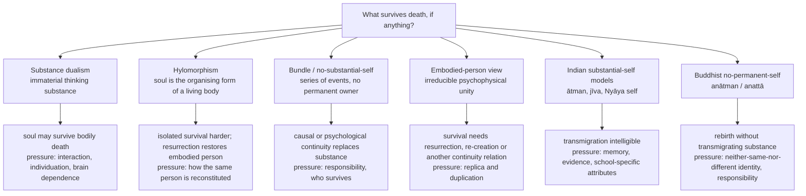

| Model | What the person/self is | Survival implication | Main pressure |
|---|---|---|---|
| Substance dualism | An immaterial thinking substance distinct from body | Soul may survive bodily death | Interaction, individuation, dependence on brain/body |
| Hylomorphism | Soul as organising form of a living body | Isolated disembodied survival harder; resurrection restores the embodied person | How the same person is reconstituted |
| Bundle / no-substantial-self | Series or bundle of physical/mental events | Causal or psychological continuity may replace substance survival | Responsibility and "who" survives |
| Embodied-person view | Irreducibly embodied psychophysical unity | Survival requires resurrection, re-creation or another continuity relation | Replica and duplication problems |
| Indian substantial-self models | Enduring self (*ātman*), individual soul (*jīva*) or Nyāya self | Transmigration/reincarnation intelligible | Memory, evidence, school-specific attributes |
| Buddhist no-permanent-self | Dependently arisen aggregates and causal continuity | Rebirth needs no transmigrating substance | Neither-same-nor-different identity; moral responsibility |

### 1.3 Personal-identity criteria ✅/⚠️

- **Four criteria answer different questions:** bodily continuity · memory/psychological continuity · soul-substance · causal continuity.
- **Hick's replica thought experiment** tests whether a unique psychophysical duplicate with memory and character is survival; the possibility of **two** replicas exposes the difference between **qualitative similarity** and **numerical identity**.
- Advanced dossier warning: do not get lost in modern thought experiments about teleportation, brain splits or fringe reincarnation case literature.

### 1.4 The self ladder (theme file) ⚠️

> 🔑 **Mnemonic:** Body (Cārvāka) → No-self (Buddhism) → Substance (Nyāya) → Omniscient jīva (Jaina) → Witness (Sāṃkhya) → Brahman (Advaita).

| School | Self is… | Consciousness |
|---|---|---|
| Cārvāka | The living body | Emergent by-product of matter (bhūta-caitanya) |
| Buddhism | No permanent self; stream of five skandhas | Momentary vijñāna, no owner |
| Nyāya–Vaiśeṣika | Eternal substance (dravya), one per body | *Adventitious* quality arising only with body-mind |
| Jaina | Jīva, intrinsically omniscient and blissful, size of the body | Essential; obscured by karmic matter |
| Sāṃkhya / Yoga | Puruṣa: pure consciousness, inactive witness, many | *Is* consciousness itself (inactive) |
| Mīmāṃsā | Eternal substance, real agent and enjoyer | Bhāṭṭa: potential consciousness; Prābhākara: self revealed in cognition |
| Advaita | Ātman = Brahman, non-dual sat-cit-ānanda | Pure consciousness (svayaṃ-prakāśa) |
| Viśiṣṭādvaita | Real, atomic, distinct jīva, a mode of God | Essential attribute |
| Dvaita | Real, eternally distinct jīva (graded) | Essential |
| Aurobindo | Psychic being, a portion of the Divine, **evolving** | Spirit unfolding through matter |

**The great fault-line:** Buddhism (anātman) vs everyone else (some real self). Second split: self as pure consciousness (Sāṃkhya, Advaita) vs self as substance with adventitious consciousness (Nyāya).

---

## 2. Theory of Knowledge: What Each Survival Argument Must Show

### 2.1 Plato's four *Phaedo* proofs ✅ (2023 Q6(a), 20 marks)

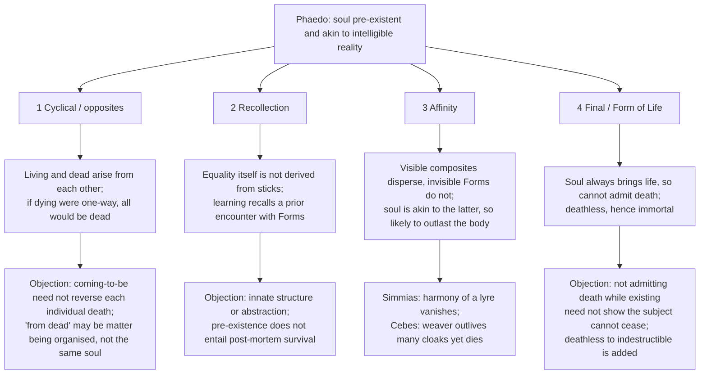

| Proof | Premises → limited result | Distinct objection → reply and residual problem |
|---|---|---|
| **Cyclical / opposites** | Opposites come from opposites; dead must give rise to the living, suggesting survival/rebirth | Biological coming-to-be need not reverse individual death; "from dead" could mean matter becoming organised, not **the same soul** returning. Mechanism and identity criterion not independently demonstrated |
| **Recollection** | We judge imperfectly equal instances by Equality itself; learning recalls a prior encounter with Forms → the knower's soul pre-existed | Innate cognitive structure or abstraction may explain the judgement; even granted **pre-existence**, no **post-mortem survival**. Plato combines it with the cyclical argument, which inherits that argument's burden |
| **Affinity** | Visible composites disperse; invisible unchanging Forms do not; the reasoning soul is more akin to the latter → soul *likely* to outlast the body | **Simmias:** invisible harmony of a lyre disappears when strings break; Plato replies by prior existence and the soul's governance of impulses, both contestable. **Cebes:** a weaver outlives many cloaks yet eventually dies. Affinity yields likeness or probability, not identity with a Form |
| **Final / Life** | What invariably brings a character cannot admit its contrary (fire/heat, odd/three); soul always brings **life**, so cannot admit **death**; with added claim that deathlessness cannot be destroyed, immortal | Not admitting death *while existing* does not show the subject cannot cease altogether; Plato must defend the move from **deathless** to **indestructible** and his Forms-based account of soul as life-bringer |

- **Presupposition ⚠️:** learning is recollection; likeness to the simple supports indestructibility; essential predicates exclude contraries.
- **Distinction ✅:** pre-existence by itself does not prove post-mortem survival; each argument must bridge both directions.
- **Canonical example ✅:** equal sticks never perfectly instantiate Equality, yet we judge their deficiency by a standard not derived from them alone.
- **Sourcing note:** the owner cites the *Internet Encyclopedia of Philosophy* entry on the *Phaedo* for the dialogue outline.

> [!WARNING]
> Do not replace a *Phaedo* proof with Kant's separate critique of rational psychology (paralogism). The owner's one-line critique: the affinity/simplicity claims are assumptions; for Kant the soul is not a knowable substance.

**20-mark spine ⚠️:** state four distinct premises/results → put Simmias and Cebes in their *different* argumentative roles → judge whether the final proof repairs the earlier limited results → graded verdict, not "all four prove immortality".

### 2.2 Arguments for immortality and their limits ⚠️

| Argument family | Core reasoning | Main objection |
|---|---|---|
| Simplicity / indivisibility | Immaterial simple soul has no parts into which to decompose | Simplicity not established; a simple subject could cease or depend on embodiment |
| Identity / continuity | Stable agency, responsibility or first-person unity needs a persisting subject | Psychological or causal continuity may explain persistence without an immortal substance |
| Moral order | Complete justice or the highest good requires survival beyond one life | Postulation expresses moral hope, not theoretical demonstration |
| Desire / fulfilment | A deep natural desire for unending fulfilment points to a possible object | Desires can be frustrated or socially formed; existence does not follow from longing |
| Religious experience / testimony | Experiences interpreted as contact with the dead or an eternal self support survival | Interpretation, diversity and alternative explanations prevent demonstrative force |

**Body/brain objection ⚠️:** systematic dependence of memory, personality and agency on bodily conditions pressures separable-soul theories. It does not deductively prove that no subject can survive, but shifts the burden to an account of interaction, identity and evidence.

### 2.3 Is immortality a presupposition of religion? (2020 Q5(b), 10 marks) ✅/⚠️

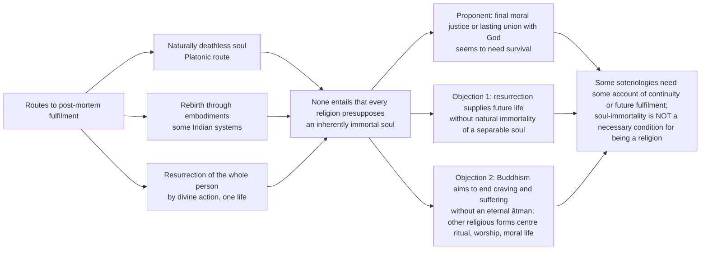

A 10-mark answer must **define "immortality"** before granting or denying its presupposed status.

### 2.4 Epistemic status of the textual anchors ✅

| Item | Safe use |
|---|---|
| *Bhagavad Gītā* 2.13, 2.20, 2.22, 2.23, 15.8, 9.21, 18.66 | Textual anchors for the named arguments; translations vary, so paraphrase or quote a named translation; none of these verses alone is empirical proof of rebirth |
| Gītā 5.4–5 (*bālāḥ*, not *paṇḍitāḥ*) | The single best warrant for the convergence reading |
| Flame-to-flame / milk-to-curd | Illustration, never proof (e.g. *Milindapañha* uses the lamp) |
| Hick's replica theory | A thought-experiment defence; give the duplication objection |
| *Vivekacūḍāmaṇi* definition of bhakti | ❓ ascription to Śaṃkara disputed; say "the Advaita tradition" |

---

## 3. Dialectical Wings & Sceptical Refinements

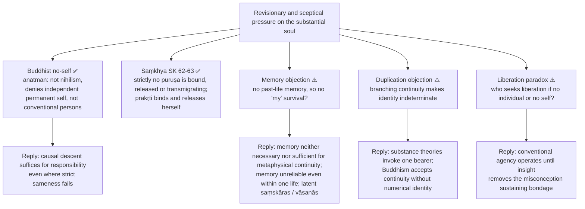

### 3.1 Advanced dossier §4 — second-order debates ⚠️ (one move in a 15-marker, one to two in a 20-marker)

| Optional debate | Competing positions | Strongest extra objection → counter-reply | Safe use |
|---|---|---|---|
| Substance-self vs psychological continuity vs Buddhist causal continuity | Substance theorists need an enduring self; psychological views stress memory/character; Buddhism allows karmic succession without a permanent owner | Without identity, responsibility collapses → causal descent is enough for responsibility even when strict sameness fails | Excellent evaluative line in "is immortality necessary for rebirth?" answers |
| Memory objection to rebirth | No past-life memory means no real personal continuity; defenders separate memory from metaphysical persistence | What cannot be remembered can scarcely count as "my" survival → memory is unreliable even within one life and cannot be the sole identity criterion | One careful sentence; do not turn a philosophy answer into paranormal reportage |
| Positive perfection vs mere cessation | Advaita and Jainism portray fulfilment-rich liberation; Nyāya stresses cessation of pain; Buddhism resists both crude annihilation and hedonistic fulfilment models | Cessation-only liberation seems empty → Nyāya values final freedom from suffering, not experiential luxury | Compare Indian schools without flattening them into "mokṣa = bliss" |
| Jīvanmukti and the prārabdha problem | Knowledge ends ignorance now, yet embodiment continues by already-fructifying karma | If ignorance is gone, why does the empirical person remain active? → distinguish destruction of bondage from residual momentum | Strong in Advaita 10/15 markers; keep brief and subordinate |

- **Promotion trigger (dossier):** promote if UPSC directly asks memory/identity criteria, or if Nyāya/Buddhist continuity needs stronger Core clarification. **What not to over-study:** teleportation, brain splits, fringe reincarnation case literature.
- The dossier promotion ledger (15 Aug 2026) records four promotions elsewhere (skeptical theism, horrendous evils, reformed epistemology, religious naturalism); **none touches this topic**, and the §4 module above stays second-order.

---

## 4. Metaphysics & Ontology: The Continuity-Bearer, School by School

### 4.1 Hindu immortality is not one uniform destiny (2021 Q6(a), 20 marks) ✅

| Source or school | What persists when the body dies | What immortality does *not* mean here |
|---|---|---|
| *Bhagavad Gītā* 2.13, 2.20, 2.22–23 | The unborn, indestructible *dehin* continues through bodily change and enters another body; 15.8 describes the departing embodied self carrying mind/sense capacities onward | A new body is **not** guaranteed by indestructibility alone; karmic conditions govern rebirth until release |
| Advaita | *Ātman* is unchanging Brahman; at the empirical level a *jīva* associated with ignorance and subtle dispositions transmigrates | The absolutely real self does not literally travel or acquire fresh parts; liberation discloses what it always was |
| Viśiṣṭādvaita / Dvaita | The dependent but real individual *jīva* endures; bondage and liberation differ by relation to God, karma, grace | Liberation is **not** absorption eliminating the individual's reality; eternal individuality need not mean everlasting rebirth |
| Nyāya–Vaiśeṣika / Jainism | Distinct eternal selves persist; Nyāya treats consciousness as contingent on embodiment, Jain *jīva* is intrinsically conscious | Both affirm enduring subjects but disagree on the attributes of the soul in release |
| Buddhist counterexample | No permanent *ātman* transmigrates: a conditioned stream continues while causes remain | Rebirth is not proof that **every** Indian religion affirms an immortal soul |

**Gītā 2.23:** the embodied self cannot be destroyed by weapons, fire, water or wind; translations vary ✅.

**Argument route (2021, 20 marks) ⚠️:** begin from the Gītā's imperishable-self assertions → distinguish eternal self from *jīva*'s changing embodiments → compare **at least two incompatible Hindu accounts** of what survives and what liberation ends → raise memory objection, bodily dependence and the Buddhist causal-continuity alternative → reply that memory and personality may vary while an identity-bearer persists, but concede that scripture and metaphysical argument do not publicly verify any particular previous life → conclude that Hindu traditions commonly affirm enduring selves, **not** a single theory of immortality, consciousness or final identity. Do not substitute a generic Plato answer for the printed "special reference to Hindu tradition".

### 4.2 Vedāntic ātman, rebirth and mokṣa ✅

- **Doctrine.** The enduring self bears karmic continuity through embodiments until liberating knowledge or God-centred realisation ends bondage.
- **Argument.** Identity across changing states points to a witness; karmic responsibility requires continuity; *śruti* discloses the self's deeper nature. Advaita locates bondage in ignorance; Viśiṣṭādvaita in dependence and karma overcome through knowledge, devotion and grace.
- **Presupposition ⚠️.** Personal continuity requires more than causal succession; scriptural testimony is valid on supersensible matters.
- **Distinction.** Advaita mokṣa is not annihilation of an individual entity but sublation of mistaken individuality; Viśiṣṭādvaita preserves the jīva eternally.
- **Example.** Gītā: embodiment as changing garments, a canonical illustration, not an independent demonstration.
- **Objection → reply ⚠️.** No memory of prior lives weakens identity; reply distinguishes memory from continuity and invokes latent dispositions, though empirical warrant is contested.

### 4.3 The Gītā's **own** immortality/rebirth argument (2025 Q7(c), 15 marks) ✅

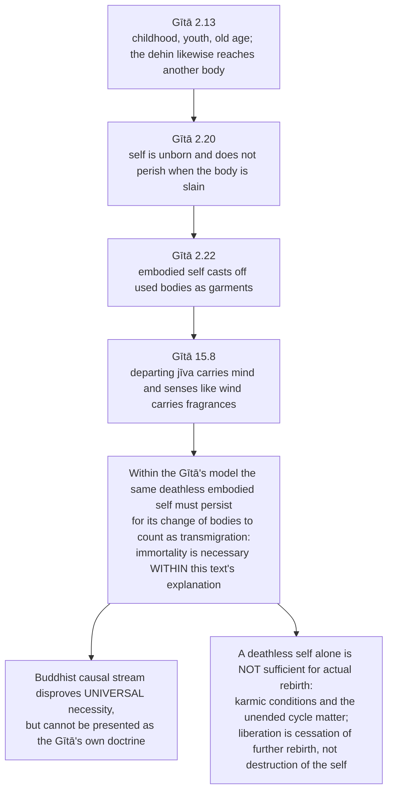

| Text | Claim | What it does **not** establish alone |
|---|---|---|
| 2.13 | Embodied existence passes through childhood, youth, old age; the *dehin* reaches another body | Persistence in one body is not independent empirical proof of a next body |
| 2.20 | Self unborn, does not perish when body is slain | Eternal existence alone does **not** force a soul to take another body |
| 2.22 | Embodied self casts off used bodies, takes new ones, like garments | The simile illustrates; it does not establish truth independently |
| 15.8 | Departing jīva carries mind/sense capacities | Intra-textual account of continuity, not a verified physical mechanism |

A 15-mark answer reconstructs the Gītā **first**, then uses the Buddhist comparison as a limited counterexample and delivers the **within-the-Gītā versus across-traditions** verdict.

### 4.4 Buddhist rebirth without an immortal soul ✅

- **Doctrine.** Rebirth is causal continuity of dependently arisen aggregates, not transmigration of a numerically identical substance.
- **Argument.** (1) All conditioned factors are impermanent; (2) no aggregate is self; (3) craving and karmic formations condition future consciousness; (4) continuity therefore occurs without an unchanging owner.
- **Presupposition ⚠️.** Moral responsibility needs causal connectedness, not substance identity.
- **Distinction.** *Anātman* is not nihilism: Buddhism denies an independent permanent self, not conventional persons or causal consequences.
- **Example.** Flame-to-flame (candle to candle) and milk-to-curd illustrate neither strict identity nor total difference; *pratītyasamutpāda*.
- **Objection → reply ⚠️.** If no same agent persists, who receives karmic fruit? The later stream is causally descended: neither the same nor wholly other.
- **Tilakkhaṇa (theme file) ✅:** *sabbe saṅkhārā aniccā*, *sabbe saṅkhārā dukkhā*, *sabbe dhammā anattā*. ⚠️ The deliberate shift from *saṅkhārā* to *dhammā* in the third: the first two are stated of conditioned things only; the third extends the denial of self to **everything without exception**. Do not render it as "that which is without self — all dharmas"; it is a predication.

### 4.5 Why non-creator religions' **different** rebirth theories matter (2018 Q5(b), 10 marks) ✅/⚠️

| Tradition | Rebirth model | Key point |
|---|---|---|
| **Buddhism** | *Anātman*, dependent arising and karma maintain a causally continuous stream without a permanent soul; craving and becoming condition renewed birth; nirvāṇa ends the processes leading to rebirth | No substantial survivor |
| **Jainism** | No creator orders the cycle, but each eternal, individual conscious *jīva* accrues karmic matter through passions and activities, then sheds it through restraint and austerity | Substantial survivor retained |
| **Sāṃkhya** (philosophical school, not an extra "religion") | *Prakṛti*'s subtle continuity transmigrates; *puruṣa* itself does not travel | Further non-creator case |

The printed stem says "anti-theistic religions": analyse it as **no creator God required**, not "all deny souls or sacred beings". **Spine:** define "anti-theistic" modestly → contrast Buddhist causal continuity with Jain substantial *jīva* → explain the philosophical gain (rebirth need not entail a creator, nor in every case an immortal *soul*) → raise moral-identity and unverifiable-desert objections → concede neither theory is empirically established merely by avoiding theism. **Do not use Buddhism alone as if it represented Jain metaphysics.**

### 4.6 Jain *jīva* and bondage (2022 Q8(b), 15 marks) ✅

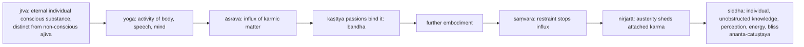

- Dust adhering to an oily body illustrates karmic matter attaching through passions.
- **Distinction:** Jain liberation perfects individuality; it is neither Advaitic identity nor Buddhist cessation without self.
- **Objection ⚠️:** interaction between non-material consciousness and karmic matter is obscure; Jainism treats extension and embodiment as modes of jīva during bondage.
- An account of only "karma is dust" omits why the conscious self is bound and what survives release. Theme-file formula: *utpāda-vyaya-dhrauvya-yuktaṃ sat* — the jīva persists as substance while modes change.

### 4.7 Sāṃkhya and Yoga: *kaivalya* ✅

- **Sāṃkhya.** Two principles: *puruṣa* (plural, inactive, attributeless pure consciousness, witness (*sākṣin*), by nature already isolated (*kevala*)) and *prakṛti* (one, unconscious, active, constituted by three *guṇas*). Bondage is not a real bond but ***aviveka***: failure to discriminate puruṣa from *buddhi*.
- **Argument.** (1) *Sāṃkhya-kārikā* opens from threefold suffering: *ādhyātmika*, *ādhibhautika*, *ādhidaivika*. (2) Effects pre-exist in cause (*satkāryavāda*). (3) Consciousness cannot be a product of the unconscious, so puruṣa is distinct. (4) Liberation is ***viveka-khyāti***. (5) Result: ***kaivalya***, aloneness.
- **SK 62–63 (highest-value item):** strictly, **no puruṣa is bound, released or transmigrating**; *prakṛti* binds herself, transmigrates and releases herself. Liberation corrects a **misattribution**, not an event in consciousness.
- **Jīvanmukti in Sāṃkhya:** SK 67 potter's wheel continues spinning after the hand is withdrawn; SK 68 *videha-kaivalya* at the fall of the body. Parallel with Advaita's *prārabdha* image; difference: Advaita's residue is karmic, Sāṃkhya's is the guṇas' momentum.
- **Yoga.** Accepts Sāṃkhya's metaphysics, adds practical psychology and an Īśvara. *YS* 1.2 *citta-vṛtti-nirodha*; 1.3 seer abides in own nature; five *kleśas* (2.3): *avidyā, asmitā, rāga, dveṣa, abhiniveśa* with *avidyā* as field of the rest; eightfold path (*yama, niyama, āsana, prāṇāyāma, pratyāhāra, dhāraṇā, dhyāna, samādhi*) from *saṃprajñāta* to *asaṃprajñāta samādhi* through *dharma-megha-samādhi* (4.29); *YS* 4.34 defines kaivalya as *pratiprasava* of the guṇas, or *citi-śakti* established in own nature.
- **Yoga's Īśvara is not a creator:** *YS* 1.24, a **special puruṣa** untouched by *kleśa, karma, vipāka, āśaya*; object of *Īśvara-praṇidhāna*, one optional means. Route to Religion without God.

### 4.8 Nyāya apavarga and Advaita jīvanmukti ✅

- **Nyāya chain:** false knowledge → defects (attachment/aversion) → action → birth → pain; true knowledge reverses it. Consciousness is adventitious to self.
- **Advaita:** knowledge destroys ignorance immediately; *prārabdha* karma accounts for the residual body. Karma cannot survive liberating knowledge except in already-fructifying form.
- Potter's wheel continues briefly after the push ceases: bodily momentum after ignorance is destroyed.
- *Jīvanmukti* ≠ *videhamukti*; apavarga ≠ positive heavenly pleasure.
- **2024 Q5(c), 10 marks (Nyāya apavarga):** self is an eternal distinct substance; during embodiment consciousness, pleasure, pain and desire arise as contingent qualities under bodily/mind conditions. Right knowledge removes false knowledge → defects and karmically productive activity cease → no new birth → no pain. In liberation the **self remains**, but with **neither pain nor positive experienced pleasure/consciousness** on the standard classical account. ⚠️ Objection: why seek a state without felt happiness? Reply: unconditioned **cessation of suffering** is the goal, not a further pleasure requiring conditions. Do not infer the self is annihilated when its contingent qualities cease.

---

## 5. Rejection / Affirmation of Transcendent Realities: Karma, Saṃsāra, God's Role and the Resurrection Alternative

### 5.1 Rebirth: the karma–saṃsāra doctrine ✅

- **Doctrine.** Karmically conditioned continuity extends across lives until liberation. Vedānta, Nyāya and Jainism assign continuity to an enduring self or soul; Buddhism explains renewed becoming through causal continuity without a permanent self.
- **Rebirth in karma theory (2023 Q7(b), 15 marks):** rebirth widens the temporal field in which karmic consequences can mature beyond one life. "Debt" is only an analogy and must not replace each school's own causal account.
- **Gītā (2025):** the imperishable soul "casts off worn-out bodies and enters new ones": rebirth presupposes the deathless self.
- **Buddhist challenge (2022, 2024):** rebirth **without** an immortal soul.
- **Necessity tests (2022, 2025) ⚠️:**
  - *Substantialist systems (Vedānta/Nyāya/Jain):* YES — a persisting soul is what transmigrates.
  - *Buddhism:* NO — continuity of a causal stream suffices.
  - A persistent soul is **not sufficient** for actual rebirth: an unended *saṃsāra* and conditioning karma are also required. For 2025, establish the Gītā's *own* necessity claim before invoking the Buddhist counterexample.

### 5.2 Karma as a Hindu postulate and rebirth's explanatory role (2021 Q8(b), 15 marks; 2023 Q7(b), 15 marks) ✅/⚠️

**Causal link reconstructed ✅:** an intentional **act** (*karma*) conditions a latent potency (*adṛṣṭa* in Nyāya; *apūrva* in Mīmāṃsā) whose result (*phala*) need not ripen in this embodiment. Where a substantial self and dispositions (*saṃskāras*) are posited, the subtle body provides a school-specific account of how tendencies accompany embodiment; **rebirth** opens a further field for delayed effects. *Saṃcita* = accumulated unfructified karma; *prārabdha* = already fruiting; *āgāmi* = new action producing further consequences. These Vedāntic pedagogical categories must not be imposed unchanged on every Hindu school.

| "Essential postulate" test | Why it appeals | Counterpressure and bounded reply |
|---|---|---|
| Moral agency and differentiated results | Actions bear consequences even when delayed; karmic continuity connects choice to a later life | Later outcomes cannot be reliably traced to a named past act. Theistic Nyāya needs a just divine administrator; non-theistic Mīmāṃsā invokes *apūrva*. Neither supplies publicly checkable evidence |
| Distribution across lives | Rebirth extends moral accountability beyond an apparently unjust single life | Treating a present victim as deservedly suffering without evidence is a moral non sequitur; the ethical reply stresses *puruṣakāra* (current effort), not fatalism |
| Bondage and cessation | Desire-driven action prolongs *saṃsāra*; disciplined action without appropriation of fruits prepares for knowledge or devotion | If an immortal self continues, why must it ever be reborn? **Immortality alone does not initiate rebirth**: karma, a rebirth-capable order and persisting tendencies are added conditions |

**Evaluation route ⚠️:** for 2021 Q8(b) say what "essential" means — widely structurally important across Hindu paths, not a thesis every school formulates identically. For 2023 Q7(b) answer the **significance of rebirth within karma**: delayed fruition, responsibility across lives, possibility of ending *saṃsāra*, with the epistemic and victim-blaming objections. These are **explanatory postulates**, not established empirical histories of particular sufferers.

### 5.3 Resurrection versus rebirth — and rebirth versus reincarnation ✅/⚠️

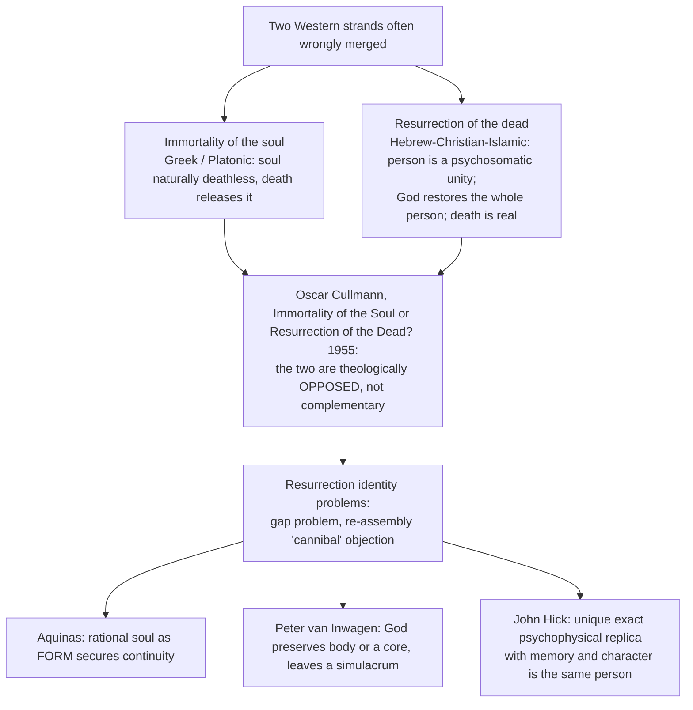

| Axis | Resurrection | Rebirth (Indian) |
|---|---|---|
| Number of lives | One earthly life | Beginningless series |
| Mechanism | Divine act at end of history | *Karma* maturing through *saṃsāra* |
| Judge | God, in a final judgement | Karma structures results; in Nyāya/Rāmānuja God administers them per karma |
| Telos | Restored embodied life in communion with God | **Exit** from the series: mokṣa, nirvāṇa, kaivalya, apavarga |
| Identity-bearer | Person re-constituted by God (soul as form, or replica) | Ātman/jīva — or, in Buddhism, a causal stream |
| Body | Essential; "spiritual body" still a body | Discarded like clothing (Gītā 2.22); subtle body (*sūkṣma-śarīra*) carries dispositions |
| Time | Linear, eschatological | Cyclical, with a linear exit |
| Moral function | Accountability before a personal God | Self-regulating desert without an external prosecutor |

- **Rebirth vs reincarnation (2019 Q8(a)) ⚠️:** **reincarnation** (*re-enfleshing*) presupposes a **substantial soul** re-entering a new body — apt for Vedānta, Nyāya, Jainism. **Rebirth** is the wider, neutral term and the only correct one for **Buddhism** (*punarbhava*, re-becoming without a transmigrating substance). Sanskrit registers the range: *punarjanma* (rebirth), *punarāvṛtti* (return), *saṃsāra* (the wandering itself). Gītā 9.21 (*pitṛyāna*): those who exhaust merit "return to the world of mortals" — even heaven is a within-saṃsāra stage, not resurrection.
- **Objections → replies ⚠️:** replica = duplicate, not survivor, and if God could make one replica he could make two → Hick restricts to a *unique* replica; critics say possible duplication shows the criterion is not identity. Rebirth is empirically untestable and morally hazardous → untestability is shared with resurrection; explanatory karma does not license social judgement of the sufferer.
- **Verdict ⚠️:** resurrection asks how a person can survive when essentially embodied; rebirth asks how moral desert can be discharged when a single life is too short. Neither is a version of the other; the identity problem is unresolved on both sides, for opposite reasons.

### 5.4 Karma, rebirth and reincarnation in Hinduism (2019 Q8(a), 20 marks) ⚠️ skeleton

```text
Intro : three linked but non-identical concepts — define each before expounding.
B1    : Karma — act + unseen potency (adṛṣṭa/apūrva); sañcita / prārabdha / āgāmi;
        moral causation, not fatalism (puruṣakāra vs daiva).
B2    : Rebirth — punarjanma within beginningless saṃsāra; subtle body carries saṃskāras;
        Gītā 2.22 (garments) and 9.21 (return from heaven when merit exhausted).
B3    : Reincarnation vs rebirth — reincarnation presupposes a SUBSTANTIAL soul
        (Vedānta, Nyāya, Jainism); rebirth is the wider term, only correct one for
        Buddhism's punarbhava.
Contrast: resurrection — one life, divine re-constitution, final judgement (Cullmann).
Crit  : memory objection; unverifiability; victim-blaming risk — and the replies.
Concl : karma supplies the mechanism, rebirth the field, "reincarnation" a
        school-specific substantialist reading that Buddhism refuses.
```

---

## 6. Explanatory & Causal Principles

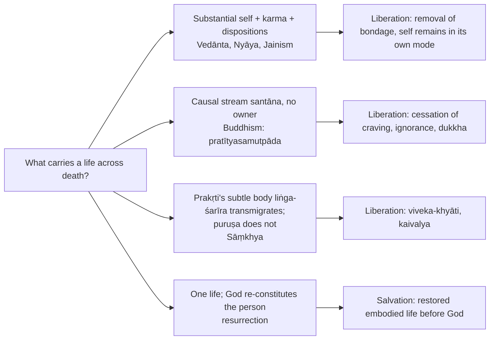

### 6.1 Bondage: what binds, and by what ✅ (theme file §2)

| School | Bondage is… | Root cause |
|---|---|---|
| Buddhism | Wheel of duḥkha / rebirth | avidyā → tṛṣṇā (craving) |
| Jaina | Karmic **matter** clogging the jīva | mithyā-darśana + passions (kaṣāya) |
| Nyāya | Stream of pain-laden births | mithyā-jñāna (false knowledge) |
| Sāṃkhya / Yoga | Puruṣa's mis-identification with prakṛti / citta | aviveka / avidyā (kleśas) |
| Advaita | The jīva's apparent limitation | avidyā / adhyāsa (superimposition) |
| Viśiṣṭādvaita / Dvaita | Separation from God, karma | Karma + ignorance of dependence on God |

> 🔑 The recurring root is **avidyā / ignorance** (Buddhism, Nyāya, Sāṃkhya, Advaita): bondage is overwhelmingly *epistemic*, so liberation is by knowledge.

### 6.2 Production vs removal model ⚠️

- If mokṣa is a *result to be produced*, action can produce it; if it is the *removal of an error*, only knowledge can remove it. Śaṃkara's case rests on the second.
- Agent question (2022 Q7(b)) ties in: in Advaita liberation **sublates** agency, in Viśiṣṭādvaita it **fulfils** it (§7.3).

### 6.3 Necessity logic: A, B and the sufficiency trap ⚠️

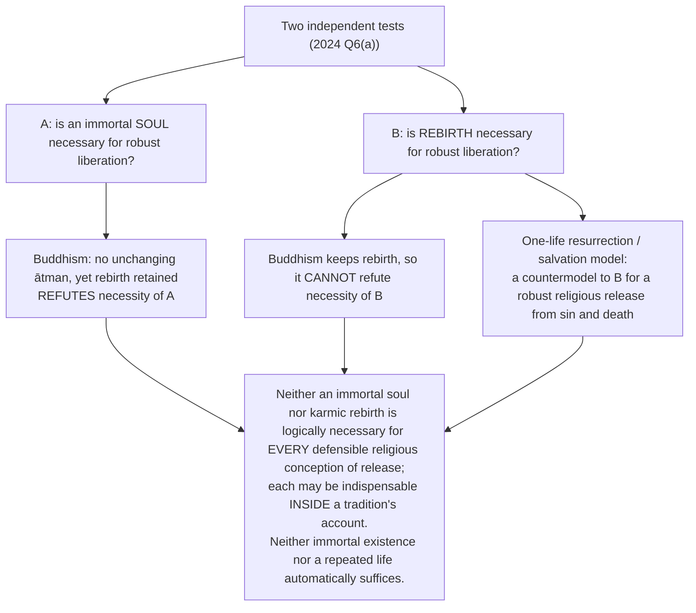

---

## 7. Ethics & Human Goals: Moral Desert and the Paths to Liberation

### 7.1 Moral desert, compassion and the sufferer ⚠️

- **Moral-desert objection:** rebirth can assign suffering to unverifiable past fault. Reply: karmic explanation need not legitimise social punishment; compassion remains obligatory.
- *Puruṣakāra* (current effort) vs *daiva*; moral causation is not fatalism.
- *Niṣkāma-karma* — action without appropriation of the fruit — is not liberating by *producing* mokṣa but by dismantling the agency-sense that sustains bondage (reply to "if karma cannot liberate, why does the Gītā command action?").
- The sources give no kāma/artha/dharma/mokṣa hierarchy for this topic; the goal-structure is carried by the liberation table in §8.

### 7.2 Bhakti as a pathway to liberation (2018 Q7(c), 15 marks) ✅/⚠️

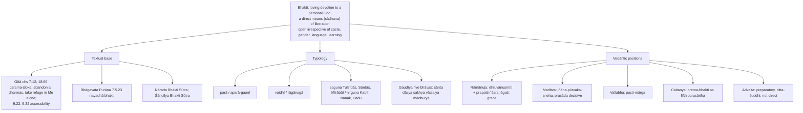

- **Nine limbs (*navadhā bhakti*, BhP 7.5.23), in order:** *śravaṇa* (hearing), *kīrtana* (praising), *smaraṇa* (remembering), *pāda-sevana* (service at the feet), *arcana* (ritual worship), *vandana* (salutation), *dāsya* (servitude), *sakhya* (friendship), *ātma-nivedana* (self-offering).
- **Grace–effort split among Śrīvaiṣṇavas ✅:** ***mārjāra-nyāya*** (cat carries kitten — grace alone, Teṅkalai) vs ***markaṭa-nyāya*** (young monkey must cling — grace plus effort, Vaḍakalai).
- **Arguments for bhakti ⚠️:** accessibility (Āḻvārs and Nāyanārs, Basavaṇṇa's Vīraśaiva, Kabīr, Nānak, Mīrā, Tukārām); whole-person engagement; the **incapacity argument** (a beginninglessly bound jīva cannot lift itself; bhakti is the posture in which grace is received); textual warrant (Gītā 18.66).
- **Objections → replies ⚠️:** (a) love presupposes duality → Advaita agrees, so it classifies bhakti as means not end; (b) emotionalism → *vaidhī* discipline, scriptural regulation, *jñāna-pūrvaka* (Madhva); (c) if grace decides, effort is otiose → the cat/monkey dispute is the tradition's own recognition; (d) presupposes a saguṇa God, unavailable to Buddhism, Jainism, Mīmāṃsā → nirguṇa bhakti shows the need is a *personal focus*, not an iconic form; the objection stands against strictly non-theistic systems.
- **Verdict ⚠️:** bhakti is a complete path in the theistic Vedāntas and a preparatory discipline in Advaita; its significance is structural: it **relocates liberation from achievement to reception**. ❓ *Vivekacūḍāmaṇi*'s *svasvarūpānusandhānam* ascription to Śaṃkara is disputed — attribute to the Advaita tradition.

### 7.3 Jñāna, karma and bhakti: how the three means relate (2020 Q8(c), 15 marks) ✅/⚠️

| School | Position |
|---|---|
| **Pūrva-Mīmāṃsā** | **Karma alone**; the Veda is essentially injunctive, knowledge-passages subordinate to ritual (the *pūrvapakṣa* Śaṃkara argues against) |
| **Śaṃkara (Advaita)** | ***Jñāna* alone liberates**; mokṣa is eternally accomplished (*siddha*), not a producible effect (*sādhya*); ignorance destroyed only by knowledge as darkness by light; **rejects *jñāna-karma-samuccaya-vāda***; karma and *upāsanā* only prepare (*citta-śuddhi*, *sādhana-catuṣṭaya*: *viveka*, *vairāgya*, six inner accomplishments, *mumukṣutva*); knowledge matures through *śravaṇa–manana–nididhyāsana* |
| **Rāmānuja** | **Sequential culmination:** *karma-yoga* purifies, *jñāna-yoga* discloses self as mode of God, both flow into *bhakti-yoga*, the direct means; *prapatti* accessible alternative; a form of *samuccaya* Śaṃkara denies |
| **Madhva** | Knowledge of the Lord's supremacy is prior; ripened bhakti is the means; *prasāda* decisive |
| **Gītā 5.4–5** | Only the immature (*bālāḥ*) call Sāṃkhya (knowledge) and Yoga (action) different → supports convergence; hence Śaṃkara (*jñāna*), Rāmānuja (*bhakti*), Tilak (*Gītā-Rahasya*, *karma*) could each claim it |
| **Vivekananda** | Four yogas (*jñāna, bhakti, karma, rāja*) matched to temperament: psychological, not metaphysical, pluralism |

- **Tools ⚠️:** direct means (*sākṣāt-sādhana*) vs auxiliary aid (*ārād-upakāraka*); means vs qualification (*adhikāra*); production vs removal model.
- **Verdict ⚠️:** they converge in *function* (removal of egoic self-appropriation), diverge in *terminus* (identity vs communion); do not harmonise. "Karma qualifies, bhakti receives, jñāna removes. Whether they combine or exclude one another is settled by a prior question — is liberation *produced* or *uncovered*?"

### 7.4 Liberation without a real agent: Advaita vs Viśiṣṭādvaita (2022 Q7(b), 15 marks) ✅/⚠️

| Step | Advaita (Śaṃkara) | Viśiṣṭādvaita (Rāmānuja) |
|---|---|---|
| Who is bound and practises? | *Jīva* identified with body/mind through *avidyā* acts in *vyavahāra*; agency and responsibility valid there, not an independently real second absolute | Each *jīva* is a real, enduring, conscious individual, inseparable from and dependent on Brahman |
| What is removed, by whom? | Knowledge removes false attribution of limited individuality; no new free Brahman is **produced**; ultimate Brahman is not a doer | Karma and ignorance bind; action/knowledge prepare, devotion or surrender and God's grace release that **same** individual |
| What survives? | *Jīvanmukti*: bodily life continues by *prārabdha*; ultimately separate agency and duality are sublated | Individuality and relation to God remain real; communion/service, not identity |
| Objection → reply | "Who is freed?" → mistaking two levels; like waking ends a dream without creating a new dream-agent; critic: how an unreal-seeming error affects a real self is debated | "Is the soul a genuine agent if God sustains every act?" → dependence and divine permission do not erase a finite person's willing; critic: grace and divine power still pressure independent moral authorship |

**2022 verdict ⚠️:** a **self-sufficient substantial agent** is not necessary for coherent liberation; the difference lies in whether liberation **sublates** or **fulfils** agency. "Real" must be disambiguated: *empirically responsible* vs *ultimately independently existing*.

---

## 8. Inter-School Comparative Matrices

### 8.1 Liberation by school ✅

| School | Term | Nature | Soul in mokṣa |
|---|---|---|---|
| Advaita | mokṣa (jīvanmukti / videhamukti) | Ātman realises identity with Brahman; avidyā ends | Pure Brahman-consciousness (bliss) |
| Viśiṣṭādvaita | mokṣa | Jīva reaches God, serves in bliss, never becomes God | Individual soul persists in communion |
| Nyāya–Vaiśeṣika | apavarga | Absolute cessation of pain; soul freed of all qualities incl. consciousness | Soul exists **without consciousness/bliss** |
| Sāṃkhya–Yoga | kaivalya | Puruṣa isolated from prakṛti | Pure isolated consciousness |
| Jainism | mokṣa / siddhahood | Jīva sheds all karmic matter; *kevala-jñāna* manifested before final disembodied release | Perfected, omniscient individual |
| Buddhism | nirvāṇa | Cessation of craving, ignorance, suffering; *parinirvāṇa* not described as survival or annihilation of a self | No permanent self; conventional and causal continuity until liberation |
| Plato / Western | — | Soul returns to the realm of Forms / the divine | Immortal soul contemplating truth |

### 8.2 Liberation parity bench — the terms must never be merged ⚠️

| Term | School | Literal sense | What ends | What remains | Consciousness in the state |
|---|---|---|---|---|---|
| *Mokṣa* | Advaita | Release | *Avidyā* | Brahman alone | ✅ self-luminous, non-dual |
| *Mokṣa* | Viśiṣṭādvaita | Release | Karmic bondage | Eternal jīva with God | ✅ personal, in communion |
| *Apavarga* | Nyāya–Vaiśeṣika | Cessation | Pain **and** its conditions | The self-substance | ❌ no consciousness or bliss |
| *Kaivalya* | Sāṃkhya–Yoga | Aloneness | *Aviveka* | Puruṣa, isolated | ✅ pure, contentless |
| Liberation (*mokṣa/siddhahood*) | Jainism | Release/perfection | Karmic matter | Perfected omniscient jīva | ✅ four infinitudes (*ananta-catuṣṭaya*) |
| Liberation (*nirvāṇa*) | Buddhism | Extinguishing craving | Craving, ignorance, *dukkha* | ❓ not stated as a self | ⚠️ "object" or annihilation language misleads |
| Resurrection | Semitic | Raising | Death | The embodied person | ✅ embodied, before God |

> [!WARNING]
> **Same syllable, opposite content:** *kaivalya* in Sāṃkhya–Yoga = isolation of contentless consciousness; Jain *kevala/kaivalya* = omniscience (*kevala-jñāna*). Do not treat *kaivalya* as a synonym for mokṣa.

### 8.3 Continuity matrix (owner §9) ✅

| School | Bearer of continuity | Rebirth | Liberation | Personal identity after liberation |
|---|---|---|---|---|
| Plato | Simple/rational soul | ⚠️ includes transmigration themes | Purification/contemplation | Persists |
| Advaita | Empirical subtle-body continuity; ultimately ātman | Yes | Knowledge of Brahman | Separate individuality sublated |
| Viśiṣṭādvaita | Enduring jīva | Yes | Communion/service to God | Persists |
| Nyāya | Eternal self-substance | Yes | Cessation of pain/qualities | Persists |
| Jainism | Eternal jīva | Yes | Karmic matter removed | Perfected individuality |
| Buddhism | Causal stream, no substance | Yes | Cessation of craving/dukkha | No permanent self |
| Sāṃkhya–Yoga | Puruṣa (witness); prakṛti carries *liṅga-śarīra* | Yes — strictly *prakṛti* transmigrates (SK 62–63) | *Kaivalya* | Puruṣa persists, contentless, plural |
| Semitic resurrection | Psychosomatic person re-constituted by God | ❌ No — one life | Resurrection and judgement | Persists, embodied |

### 8.4 Jīvanmukti (2025 Q5(d), 10 marks) and the means ✅

- **Jīvanmukti:** liberation **while living**; the knower of Brahman is free now; body continues by *prārabdha* (momentum of a spun wheel) until it drops (*videhamukti*). Liberation is a cognitive-existential transformation, not a post-mortem reward.
- *Jīvanmukti* means liberation while embodied life continues; Nyāya apavarga is final cessation of suffering and of the qualities sustaining embodied experience.
- Theme file: debated in Nyāya (mostly videha); yes for Sāṃkhya, Yoga, Advaita, Buddhism (arhat), Jaina (kevalin); limited in Viśiṣṭādvaita; no in Dvaita. **Aurobindo:** divine life on earth, supramental transformation by Integral Yoga: transformation, not escape.

### 8.5 Key debates (theme file) ⚠️

1. **Blissful or merely painless?** Advaita (ānanda) and Jaina (infinite bliss) vs Nyāya ("stone-like" apavarga).
2. **Liberation *with* a self or *without*?** Buddhism vs Advaita vs Viśiṣṭādvaita/Dvaita.
3. **Escape vs transformation:** all classical schools = release from saṃsāra; Aurobindo = divinise the world.
4. **Rebirth without a soul?** nairātmyavāda vs the "immortality-necessary-for-rebirth" thesis (2022); continuity via *santāna*.
5. **Means — jñāna vs bhakti:** knowledge-schools (Sāṃkhya, Advaita, Nyāya) vs devotion-schools (Viśiṣṭādvaita, Dvaita).

---

## 9. Criticisms & Reconstructed Replies

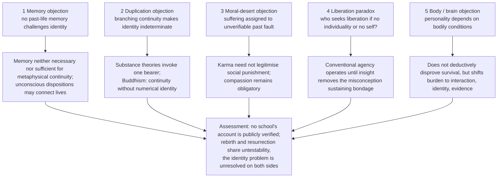

### 9.1 Further objection/reply pairs by module ⚠️

| Target | Objection | Reply |
|---|---|---|
| Sāṃkhya plurality of puruṣas | If each puruṣa is attributeless and inactive, nothing distinguishes them; pluralism collapses into Advaita's one | Difference is established by observed difference of birth, death and experience — a reply Advaitins find question-begging |
| Sāṃkhya prakṛti's action | Why does prakṛti act at all? | She acts "for the sake of puruṣa", like milk flowing for the calf; Nyāya objects to purpose in the unconscious |
| Sāṃkhya kaivalya | Is a contentless liberation desirable? | It is the *ending* of threefold suffering; offering more would be dishonest |
| Nyāya apavarga | Why seek a state without felt happiness? | Goal is unconditioned cessation of suffering |
| Jain interaction | Non-material consciousness and karmic matter: how interact? | Extension and embodiment are modes of jīva during bondage |
| Advaita jīvanmukti | If knowledge destroys karma, why does embodiment remain? | Accumulated and future karma destroyed; already-fructifying *prārabdha* continues |
| Resurrection | Replica is a duplicate | Hick: unique replica; critics: duplication possibility shows criterion is not identity |

---

## 10. Controlled Western Comparisons

| Indian position | Western point of contact | Disanalogy that must be stated |
|---|---|---|
| Buddhist **anattā** | **Hume's** bundle theory: no impression of a persisting "I" | Hume has no karmic continuity, rebirth or soteriology; the self is a fiction of the imagination. Buddhism has a functionally real causal series (*santāna*) that carries moral weight and can be liberated |
| Advaita **Ātman = Brahman** | **Plotinus'** One; **Spinoza's** substance and modes | Plotinian reversion is an ascent through really emanated hypostases; Spinoza's modes are real modifications (*pariṇāma*, not *vivarta*), nearer to Rāmānuja than to Śaṃkara |
| Nyāya **apavarga** | **Epicurean** ataraxia; purely negative conceptions of the good | Apavarga entails absence of *consciousness itself*, not merely of disturbance; no Western eudaimonism accepts a goal with no experience at all |
| Sāṃkhya **puruṣa** | **Cartesian** thinking substance; pure subject | The cogito's self thinks, wills, acts; puruṣa is wholly inactive, all agency belongs to prakṛti — the commonest comparative error |
| Aurobindo's **divine life** | **Teilhard's** Omega Point; **Hegel's** Absolute | Teilhard's convergence is Christological and terminal; Hegel's is conceptual, realised in Spirit's history; Aurobindo's Supermind descends into matter and body within manifestation |
| Jaina **kaivalya** by karmic shedding | Purification/ascetic traditions | Jaina karma is literally material; omniscience is revealed, not acquired |
| Platonic immortality | Hebrew–Christian resurrection | Cullmann: opposed structures (§5.3) |

> [!WARNING]
> **Rubric:** a self-and-liberation question is answered from Indian materials school by school, with the argument. A Western parallel earns marks only as one or two closing lines that sharpen the Indian position by contrast. A bare equation ("Buddhism is Hume") without the disanalogy is a marked weakness.

---

## 11. Diagnostic Deep-Dives for High-Frequency Themes

### 11.1 Necessity decision tree ⚠️

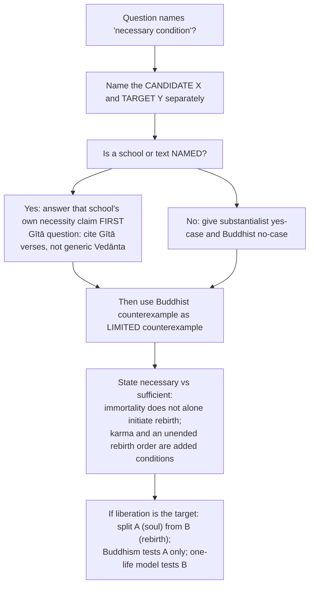

### 11.2 Directive decoder ⚠️

| Directive | Examiner is buying | Structural consequence | Live example |
|---|---|---|---|
| Is X a necessary condition for Y? | A modal verdict — necessary / sufficient / neither, each candidate separately | Answer the **named** school/text first; Buddhism challenges universal soul necessity but not rebirth's necessity | 2022 Q5(c); 2025 Q7(c); 2024 Q6(a) |
| Discuss with reference to [named text/school] | Fidelity to *that* source | Gītā question must cite Gītā verses | 2025 Q7(c) |
| Critically examine [thinker]'s proofs | Each argument separately assessed | Four Platonic arguments = four mini-assessments | 2023 Q6(a) |
| Elucidate… and explain the role of… | Two obligations | Half on the concept, half on the specified role | 2021 Q6(b) |
| Do you accept that…? Discuss | Explicit acceptance/rejection with reasons | Position, evidence, strongest contrary case | 2020 Q8(c) |
| Evaluate the concept of X as a pathway | Assessment of *efficacy* | State criterion of "pathway": accessibility, sufficiency, terminus | 2018 Q7(c) |
| State and explain the doctrines of A, B and C | Three defined doctrines and their *relations* | Define each, then show how they interlock | 2019 Q8(a) |
| Discuss the nature of A and B according to [school] | Two nouns, both delivered | Jain "soul **and** bondage" needs *jīva* metaphysics **and** *āsrava/bandha* | 2022 Q8(b) |

> 🔑 **Rule:** the moment a question names a **term of liberation** (mokṣa/apavarga/kaivalya/nirvāṇa/jīvanmukti), fix that term against the §8.2 parity bench first. Half the marks in this clause are lost to term-merging.

### 11.3 Model skeletons for PYQs ⚠️

**2022 Q5(c), 10 marks — immortality necessary for rebirth? (Buddhism)**
```text
Intro : substantialist assumption — a soul must persist to transmigrate.
Body  : Vedānta/Nyāya/Jain — YES; Buddhism — NO: anātman; causal stream
        (pratītyasamutpāda), flame-to-flame, not a soul.
Assess: rebirth needs a causal continuity relation, not necessarily an unchanging soul.
Concl : an immortal soul is not logically necessary; mere immortality is also not
        sufficient without karma and a rebirth order.
```
**2025 Q5(d), 10 marks — jīvanmukti**
```text
Intro : Advaita — mokṣa is realising ātman = Brahman; ends avidyā.
Body  : jīvanmukti = liberated WHILE living; jñāna destroys ignorance now;
        body persists by prārabdha (spun wheel) → videhamukti at death.
Assess: cognitive-existential transformation, not a post-mortem reward.
Concl : freedom is present realisation, not a future place.
```
**2018 Q7(c), 15 marks — bhakti** and **2020 Q8(c), 15 marks — three means** follow §7.2 and §7.3; **2019 Q8(a), 20 marks** follows §5.4.

---

## 12. PYQ Routing Ledger (2018–2026)

> Corpus signal: **17 primary-owned parts** of 112 in 2018–2025 (the largest Religion owner), per-year 2/1/2/3/3/2/2/2. The **2026 supplement assigns zero primary parts** to this owner. The owner file has no pre-2018 table. Cross-links do not create duplicate ownership.

| Year | Q | Marks | Exact demand | Map to |
|---|---|---:|---|---|
| 2018 | Q5(b) | 10 | How far is it plausible to argue that the anti-theistic religions' stand on the concept of rebirth is philosophically significant? | §4.5 |
| 2018 | Q7(c) | 15 | Evaluate the concept of Bhakti (Devotion) as a pathway to attain liberation. | §7.2 |
| 2019 | Q8(a) | 20 | State and explain the doctrines of Karma, Rebirth and Reincarnation in Hinduism. | §5.3–5.4 |
| 2020 | Q5(b) | 10 | The concept of 'Immortality' is a basic presupposition of religion. Elaborate your answer. | §2.3 |
| 2020 | Q8(c) | 15 | Do you accept that Knowledge, Action and Devotion are the means to attain liberation in Indian tradition? Discuss. | §7.3 |
| 2021 | Q6(a) | 20 | Discuss the concept of immortality of soul with special reference to Hindu tradition. | §4.1 |
| 2021 | Q6(b) | 15 | Elucidate the concept of liberation according to Advaita Vedānta. Explain the role of knowledge in the attainment of liberation. | §8.1, §8.4 |
| 2021 | Q8(b) | 15 | Discuss and evaluate the doctrine of Karma as an essential postulate of Hinduism. | §5.2 |
| 2022 | Q5(c) | 10 | "Immortality of Soul is a necessary postulate for rebirth." Critically examine with reference to Buddhism. | §5.1, §11.3 |
| 2022 | Q7(b) | 15 | Is it possible to have an idea of Liberation without the conception of a real agent? In this context, discuss the difference between Advaita and Viśiṣṭādvaita systems of thought. | §7.4 |
| 2022 | Q8(b) | 15 | Discuss the nature of Soul and Bondage according to Jainism. | §4.6 |
| 2023 | Q6(a) | 20 | Critically examine Plato's apriori proofs for the immortality of the soul. | §2.1 |
| 2023 | Q7(b) | 15 | Examine the significance of the concept of rebirth in the theory of Karma. | §5.1–5.2 |
| 2024 | Q5(c) | 10 | Discuss the concept of liberation (Apavarga) according to Nyāya-Vaiśeṣika. | §4.8 |
| 2024 | Q6(a) | 20 | Is it necessary to adhere to the notions of immortality of soul and rebirth in order to have a robust conception of liberation? Give reasons and justifications for your answer. | §6.3 |
| 2025 | Q5(d) | 10 | Discuss the nature of embodied liberation (jīvanmukti) with reference to Advaita Vedānta. | §8.4 |
| 2025 | Q7(c) | 15 | Is the concept of immortality of soul a necessary condition for Rebirth? Discuss with reference to the Bhagavad Gītā. | §4.3 |

**Cross-owned (listed, not counted):**

| Year | Q | Marks | Owner | Link to this topic |
|---|---|---:|---|---|
| 2026 | Q7(b) | 15 | Notions of God | "Discuss the difference between personalistic and impersonalistic notions of God in the context of devotion." The supplement's cross-link points here for *bhakti* as a path; keep to a **bounded paragraph** (§7.2) |

Sources: [Philosophy of Religion PYQ Bank, 2018–2025] and [2026 supplement] (controlling wording).

---

## 13. Top 10 UPSC Exam Traps

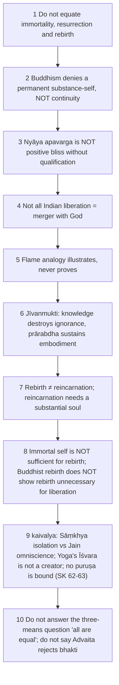

Other owner-recorded traps: do not treat bhakti as mere emotion (§7.2); do not say Advaita rejects bhakti (it is preparatory); name the disagreement among Śaṃkara, Rāmānuja and Mīmāṃsā (§7.3); do not present resurrection as rebirth in heaven; do not substitute a generic Plato answer for "special reference to Hindu tradition"; for 2018 "anti-theistic" — no creator does not mean no eternal soul (Jainism keeps *jīva*); do not use Buddhism alone as Jain metaphysics; do not treat the Nārada/Śāṇḍilya sūtras with a date or author-identification ❓; the 2024 necessity trap (Buddhism answers only the soul-necessity half).

---

## 14. Technical Vocabulary & IAST Bank

| English gloss | IAST | Meaning / status |
|---|---|---|
| Soul / self | ātman | Eternal in Vedānta, Nyāya ✅ |
| Individual soul | jīva | Eternal conscious substance in Jainism; real dependent individual in Viśiṣṭādvaita/Dvaita ✅ |
| Embodied self | dehin | Gītā term ✅ |
| Pure consciousness / witness | puruṣa / sākṣin | Sāṃkhya ✅ |
| Nature / matter | prakṛti | Sāṃkhya; carries the subtle body ✅ |
| Subtle body | sūkṣma-śarīra / liṅga-śarīra | Carries dispositions ✅ |
| No-self | anātman / anattā | Buddhist ✅ |
| Dependent origination | pratītyasamutpāda | Causal continuity ✅ |
| Stream | santāna | Buddhist causal series ✅ |
| Rebirth / re-becoming | punarjanma / punarbhava | Wider term / Buddhist term ✅ |
| Return | punarāvṛtti | Gītā 9.21 context ✅ |
| Cycle of wandering | saṃsāra | ✅ |
| Action / unseen potency | karma / adṛṣṭa / apūrva | Nyāya / Mīmāṃsā ✅ |
| Accumulated / fruiting / new karma | saṃcita / prārabdha / āgāmi | Vedāntic pedagogy ✅ |
| Dispositions | saṃskāra / vāsanā | ✅ |
| Current effort vs fate | puruṣakāra / daiva | ✅ |
| Liberation | mokṣa | ✅ |
| Cessation (Nyāya) | apavarga | Painless, no consciousness ✅ |
| Aloneness | kaivalya | Sāṃkhya–Yoga isolation ✅ |
| Omniscience | kevala-jñāna | Jain ✅ |
| Extinguishing | nirvāṇa / parinirvāṇa | Buddhist ✅ |
| Liberation while living / on disembodiment | jīvanmukti / videhamukti / videha-kaivalya | ✅ |
| Influx / bondage / stoppage / shedding | āsrava / bandha / saṃvara / nirjarā | Jain ✅ |
| Four infinitudes | ananta-catuṣṭaya | Jain siddha ✅ |
| Ignorance | avidyā | ✅ |
| Non-discrimination / discriminative knowledge | aviveka / viveka-khyāti | Sāṃkhya ✅ |
| Pre-existence of effect | satkāryavāda | ✅ |
| Devotion | bhakti | ✅ |
| Nine-fold devotion | navadhā bhakti | BhP 7.5.23 ✅ |
| Devotion types | parā / aparā; vaidhī / rāgānugā; saguṇa / nirguṇa | ✅ |
| Surrender | prapatti / śaraṇāgati | Rāmānuja ✅ |
| Cat / monkey analogies | mārjāra-nyāya / markaṭa-nyāya | Teṅkalai / Vaḍakalai ✅ |
| Grace path / love as fifth goal | puṣṭi-mārga / prema-bhakti | Vallabha / Caitanya ✅ |
| Mind-purification | citta-śuddhi | ✅ |
| Combination of knowledge and ritual | jñāna-karma-samuccaya | Rejected by Śaṃkara ✅ |
| Direct / auxiliary means | sākṣāt-sādhana / ārād-upakāraka | ✅ |
| Action without fruit-appropriation | niṣkāma-karma | ✅ |
| Four qualifications | sādhana-catuṣṭaya | ✅ |
| Hearing, reflection, contemplation | śravaṇa-manana-nididhyāsana | ✅ |
| Restraint of mind's modifications | citta-vṛtti-nirodha | Yoga ✅ |
| Afflictions | kleśa | ✅ |
| Counter-flow | pratiprasava | ✅ |
| Resurrection / replica | — | Hick, Cullmann, van Inwagen ✅ |
| Śaṃkara's bhakti definition | svasvarūpānusandhānam | ❓ attribution disputed |

---

## 15. Graded Verdict & Answer Architectures

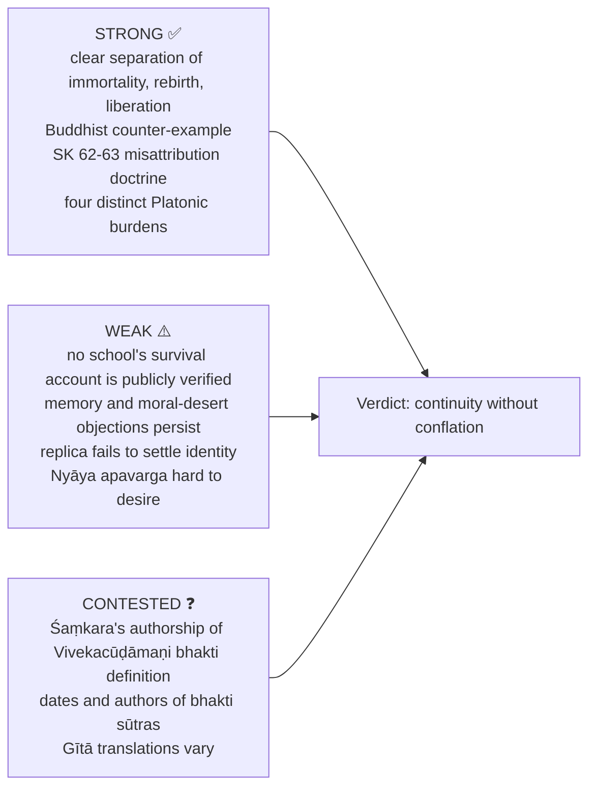

### 15.1 10-mark
```text
Define the disputed necessity → give substantialist position →
Buddhist/Jain/Nyāya discriminator as required → objection →
precise verdict on necessary vs sufficient.
```
### 15.2 15-mark
```text
State doctrine and continuity-bearer → causal sequence → canonical example →
nearest school contrast → objection/reply → identify exact conception of liberation.
```
### 15.3 20-mark
```text
Separate immortality, rebirth and liberation → reconstruct two rival models →
personal-identity and moral-responsibility objections → school replies →
graded conclusion on continuity without conflation.
```

### 15.4 Graded-verdict templates ⚠️

> [!TIP]
> - **Necessity stem:** "An immortal substantial soul is **not universally necessary** for rebirth: Buddhism secures re-becoming through causal continuity. Nor is immortality **sufficient** to cause rebirth on its own; karma and an unended rebirth order are additional conditions. Separately, rebirth itself is not a premise of every coherent religious liberation."
> - **Means stem:** "All three are means of different kinds. Which is the *direct* means is settled by a prior metaphysical question — whether liberation is produced or uncovered."
> - **Liberation-concept stem:** "The term names a family, not a state. Once *apavarga*, *kaivalya*, *mokṣa* and *nirvāṇa* are separated, the apparent Indian consensus turns out to be a shared vocabulary covering four incompatible destinations."
> - **Safe formulation:** "Rebirth requires an account of continuity, not necessarily an immortal substance."

### 15.5 Graded verdict ladder ⚠️

| Band | Script contains | Typical fault |
|---|---|---|
| Weak (≈40%) | "The soul is eternal and is reborn until liberated" | All schools merged; liberation terms used as synonyms |
| Average (≈50%) | Correct school-wise definitions | No argument reconstruction; Buddhism as exception, not counter-example |
| Good (≈60%) | Continuity-bearer identified per school; one objection answered | Necessary/sufficient distinction unstated |
| Strong (≈65–70%) | Modal verdict precise; parity-bench distinctions live; Western comparator used | Bhakti or three-means dispute reduced to a list |
| Top (≈70%+) | All above + a discriminating distinction (production vs removal; *sākṣāt* vs *ārād-upakāraka*; SK 62–63; replica theory) + a statement of what would falsify the position | — |

---

## Link-outs

Notions of God · Problem of Evil (karma as answer to suffering) · Religion without God (Yoga's non-creator Īśvara; Jain and Buddhist soteriology) · Religious Experience (*aparokṣānubhūti* as the cognitive event of liberation) · Reason, Revelation and Faith · Paper I: Sāṃkhya, Yoga, Buddhism, Jainism, Vedānta, Nyāya–Vaiśeṣika · `paper-1/_themes/Self-and-liberation-across-schools.md` · Philosophy of Religion PYQ Bank 2018–2025 and 2026 supplement.

## Sources

Plato, *Phaedo* (with the *Internet Encyclopedia of Philosophy* entry on the dialogue); *Bhagavad Gītā* chs. 2, 5, 9, 18; *Bhāgavata Purāṇa* 7.5; *Sāṃkhya-kārikā*; Patañjali, *Yoga-sūtra*; John Hick, *Philosophy of Religion* and *Death and Eternal Life*; Oscar Cullmann, *Immortality of the Soul or Resurrection of the Dead?* (1955); Peter van Inwagen on resurrection; S. C. Chatterjee & D. M. Datta, *An Introduction to Indian Philosophy*; C. D. Sharma, *A Critical Survey of Indian Philosophy*; S. Radhakrishnan, *Indian Philosophy* Vols. I–II; local searchable Hick (print pp. 120–143), *Oxford Handbook of Philosophy of Religion* ("Death and the Afterlife", print p. 366) and Chatterjee–Datta, as cited in the owner file.
