# REASON, REVELATION AND FAITH — Examiner-Grade Mindmap

> **Syllabus (verbatim):** Reason, Revelation and Faith.
> **Catalogue key:** `philosophy-paper-ii-philosophy-of-religion-05` · Paper II · Philosophy of Religion
> **Sources used:** `paper-2/philosophy-of-religion/Reason-Revelation-Faith.md` (canonical owner, read in full) · `_advanced/Philosophy-of-Religion-Dossier.md` §5 and the promotion ledger (optional depth) · `paper-2/_PYQ-PhilosophyOfReligion-2018-2025.md` · `paper-2/_PYQ-PhilosophyOfReligion-2026-Supplement.md` · `paper-1/_themes/Pramana-across-schools.md` (testimony, *svataḥ/parataḥ-prāmāṇya*, controlled Western comparison; only the passages bearing on this topic).
> **Evidence key:** ✅ canonical doctrine / fact · ⚠️ analytical synthesis for exam use · ❓ contested / uncertain

> [!IMPORTANT]
> **Core thesis.** *Reason argues, revelation discloses, faith trusts* (mnemonic **RRF**). The clause owns the **epistemic roles and relations** of the three, not detailed proofs of God, the phenomenology of experience, religious-language meaning or full pluralist theories. The clause punishes binaries: every distinction becomes a **three-term** one once the middle category is added (supra-rational, dialogue, defeasible basicality). ⚠️

> [!NOTE]
> **Adaptation.** The 15-module blueprint is written for single Indian schools. For this topic: Module 1 holds the ownership firewall, the three concepts and the four stances; Module 2 holds reason's epistemic work, authentication of revelation, justification standards and miracle-testimony; Module 3 holds the fideist, pragmatic and voluntarist wings plus the advanced second-order debates; Module 4 holds the conceptual inventory (revelation models, faith, belief); Module 5 holds the stance on what reason can reach and what exceeds it (natural vs revealed theology, science, experience); Module 6 holds how the three relate (occurrence vs reception, reconciliation mechanism); Module 7 holds the ethics of belief. The sources give **no** āstika/nāstika classification, **no** sceptical wing inside this topic and **no** kāma/artha/dharma/mokṣa scheme; those modules say so rather than invent one. Tillich's *symbol* theory belongs to Religious Language and appears here only as one line.

---

## 0. Master Overview

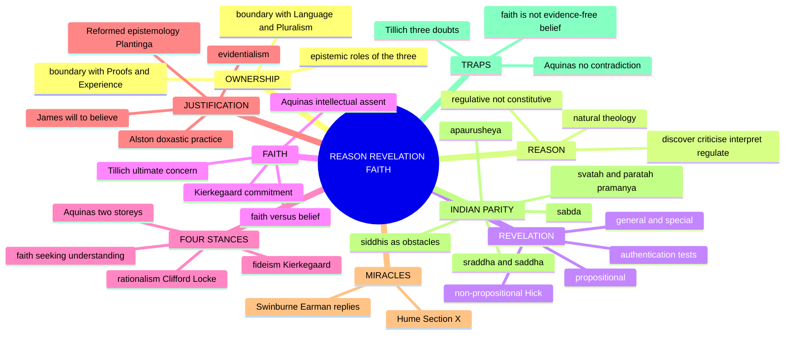

---

## 1. Identity, Lineage & Doxography: Ownership, Concepts and Stances

### 1.1 What the clause owns, and the firewall ✅

```mermaid
flowchart TD
  OWN["Owned here ✅<br/>epistemic roles and relations of<br/>reason, revelation and faith"] --> O1["Reason: discovery, criticism,<br/>interpretation, regulation"]
  OWN --> O2["Revelation: proposition, event,<br/>self-disclosure, general / special"]
  OWN --> O3["Faith: assent, trust, commitment,<br/>way of life"]
  OWN --> O4["Competing revelations as an<br/>authentication / diversity defeater"]
  OWN --> O5["Miracles and testimony only as<br/>support for revelation-claims"]
  OWN --> O6["Tillich: faith as ultimate concern,<br/>doubt and reason (2026 Q5(c))"]
  B1["Proofs for God"] -.-> X1["detailed arguments for God's existence"]
  B2["Religious Experience"] -.-> X2["phenomenology and object of experience"]
  B3["Religious Language"] -.-> X3["meaning, falsification debates,<br/>Tillich's theory of symbols"]
  B4["Religious Pluralism"] -.-> X4["complete pluralist theories,<br/>absolute-truth debate"]
  B5["Paper I owners"] -.-> X5["complete Mīmāṃsā, Nyāya, Vedānta,<br/>Buddhist epistemologies"]
```

> [!WARNING]
> Faith is not simply belief without evidence; revelation is not any intense experience; reason includes probabilistic, interpretive, critical and regulative activity, not only deductive proof. ⚠️

### 1.2 Three concepts, three epistemic jobs ⚠️

| Concept | Core role | Forms | Characteristic danger |
|---|---|---|---|
| **Reason** | Discover, infer, test coherence, interpret and regulate belief | Deductive, inductive / abductive, critical and hermeneutic | Rationalism that permits only what reason can independently prove |
| **Revelation** | Alleged divine self-disclosure unavailable or insecure through unaided reason | General / special; propositional / non-propositional | Circular authentication, rival revelations, projection |
| **Faith** | Receive, assent, trust, commit and inhabit a religious way of life | Belief-that, belief-in, trust, hope, fidelity | Credulity, voluntarism, fanaticism, immunity from correction |

### 1.3 Two different axes of revelation ⚠️

| Axis | Distinguishes | Terms |
|---|---|---|
| **Scope and medium** | How widely / through what medium | **General** revelation (nature, conscience, universal human history) vs **special** revelation (particular events, persons, scriptures, communities) |
| **What revelation is** | Truth-content vs event | **Propositional** (truth-apt content) vs **non-propositional** (divine self-disclosure / event) |

Inspiration (divine–human authorship), revelation (disclosure) and infallibility (freedom from error) are **not** interchangeable ✅.

### 1.4 The four stances ✅/⚠️

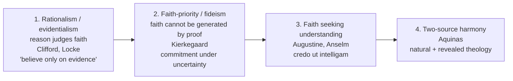

> [!TIP]
> **Aquinas is the balanced default** for any "reconcile reason and faith" question: reason and revelation cannot conflict (both from God); reason proves the *preambles*, revelation supplies the *mysteries*; faith is intellectual assent under grace.

**Doxographical status.** Source anchors and their safe use are in §14 (vocabulary) and the quotation discipline table in §13.

---

## 2. Theory of Knowledge: How Each Claim Is Warranted

### 2.1 Reason in religion ✅ (2024 Q5(d); 2021 Q7(a))

| Role of reason | Content |
|---|---|
| (a) Constructs **natural theology** | Proofs for God |
| (b) Tests **coherence** of doctrines | Contradiction is a defeater |
| (c) **Interprets** scripture | Linguistic and historical context |
| (d) Defends faith | Apologetics |

- **Rationalism:** religious beliefs must meet the bar of evidence; Clifford: "it is wrong always, everywhere, and for anyone, to believe anything upon insufficient evidence."
- **Limits ⚠️:** proofs are inconclusive; the transcendent may exceed reason, leaving space for revelation and faith.
- **Natural theology vs philosophy of religion ✅:** the former argues *toward* theological conclusions; the latter also analyses language, experience and warrant.
- **Presupposition ⚠️:** reality is intelligible and reason is not wholly corrupted or confined to empirical objects.
- **Canonical examples ✅:** Aquinas' preambles of faith; Nyāya inference to Īśvara.
- **Kant objection → reply ⚠️:** Kant restricts speculative reason beyond possible experience; natural theologians reply that metaphysical inference concerns conditions of experience, not another observed object.

### 2.2 How reason **regulates** religious belief (2021 Q7(a), 20 marks) ✅

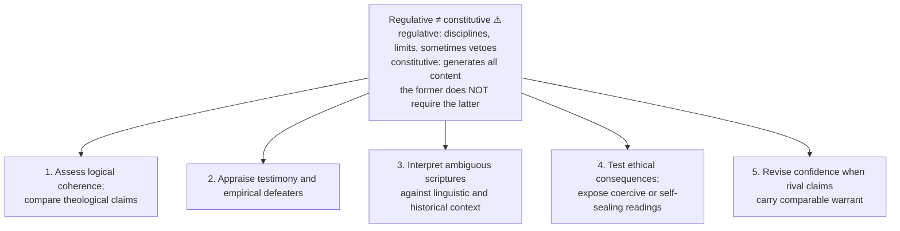

| In a 20-mark answer | Application and pressure |
|---|---|
| **Aquinas** | Reason argues for preambles and shows faith and demonstrated truths cannot conflict; mysteries depend on revelation. "Beyond demonstration" ≠ "immune to contradiction". Reason cannot by itself verify that a text was divinely disclosed |
| **Indian parity** | *Manana* tests the meaning of what *śruti* teaches; Nyāya's *tarka* detects defects in inferences and witness-claims. Mīmāṃsā treats the Veda as authorless; reason interprets its sentences but does not confer *apauruṣeya* authority. Different models, **not** one Indian consensus |
| **Evidence and limits** | Reason rejects internally inconsistent literal readings, compares independent witnesses, asks whether compassion survives the reading. A purely experiential claim can stay meaningful even if public inference cannot demonstrate its object; yet "revelation says reason is wrong" cannot authenticate itself |

**Objection and verdict ⚠️.** Evidentialist (Clifford): unproven belief is irresponsible. Strict fideist: external tests distort faith. James's limited permission and Aquinas' preambles/mysteries are intermediate. Reason can **regulate** even belief it cannot **generate** or fully prove; it is fallible and culturally situated, and must not declare all rival scriptures false on the authority of its own favoured scripture. For 2021 Q7(a): discuss *both* reason and faith first, then execute the *regulative* claim through an example and a serious objection.

### 2.3 Authority, tradition and authentication of revelation ✅/⚠️

| Test | Question | Limit |
|---|---|---|
| **Source / testimony** | Is the witness competent, sincere, suitably placed, independently supported? | Testimony transmits error as well as truth |
| **Coherence** | Does the claim contradict itself or secure knowledge? | Coherence does not establish divine origin |
| **Moral-spiritual fruit** | Does reception produce truthfulness, compassion, transformation? | Useful effects can occur under false beliefs |
| **Tradition / community** | Has interpretation been publicly transmitted, criticised, corrected? | Endurance may preserve power or bias |
| **Experience and miracle-sign** | Is there an event resistant to ordinary explanation, appropriately connected to the message? | Unusual occurrence does not authenticate one interpretation |
| **Cross-revelation comparison** | How does the claim answer rival disclosures and the diversity defeater? | Criteria are rarely neutral between traditions |

⚠️ Scripture requires interpretation; authority does not eliminate hermeneutics. Using a scripture's own claim to prove its unique authority is circular unless independent testimony, coherence or other defeasible support is supplied.

### 2.4 Epistemic justification of revelation-claims (2024 Q7(b), 15 marks, "with your own comments") ✅/⚠️

**Target:** that an event or proposition was **disclosed by the divine**, not merely that a prophet sincerely believes it or its moral teaching is true.

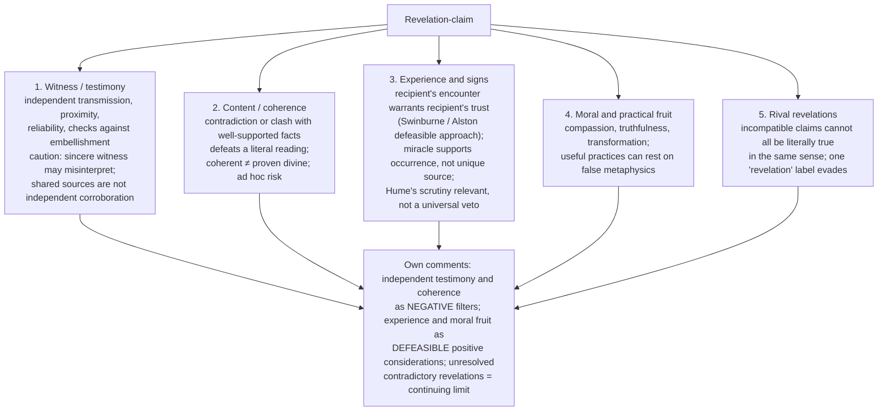

- **Objection → reply → limits ⚠️:** "Every criterion is tradition-dependent, so the test is circular." Reply: use publicly contestable witnesses and consequences plus declared interpretive assumptions; this reduces but does not erase circularity. A critic may still favour the simpler non-divine explanation.
- Reject the vicious circle "true because the source says it is divine"; neither a single transformation nor cumulative compatibility alone proves a unique divine author.

### 2.5 Evidentialism and Reformed epistemology (2023 Q5(b), 10 marks) ✅/⚠️

**The question:** not whether God exists, but **what standard** a religious belief must meet to be rationally held.

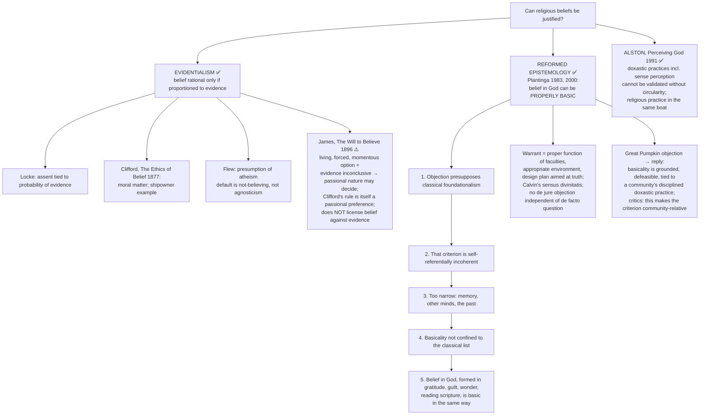

- **Objection → reply ⚠️:** "Properly basic religious belief is immune to criticism." Plantinga: it is **defeasible**; the problem of evil, projection theories and cognitive-science explanations are potential defeaters that must be met. Second objection: diversity makes incompatible beliefs all "properly basic" → diversity is a defeater to be answered, not an automatic refutation, though no one holds it easily answered.
- **Verdict formula ⚠️:** religious beliefs may have publicly assessable evidence, defeasible basic grounds or warrant within a practice; no one route guarantees truth. Rival religious claims and evidential insufficiency remain **two** live tests.
- **Indian structural comparison ✅/⚠️:** Cārvāka is the strict evidentialist limit; Nyāya accepts inference and reliable testimony (*āpta-vākya*). Mīmāṃsā *svataḥ-prāmāṇya* (validity prima facie intrinsic until defeated) partly resembles defeasible basicality; Nyāya *parataḥ-prāmāṇya* (validity needs further grounding) partly resembles further-evidence requirements. But Plantinga additionally needs a warrant / proper-function account, and Nyāya's extrinsic validity is **not** Clifford's moral rule. Use the analogy and state where it breaks.

### 2.6 Miracles: Hume's argument and its critics ✅/⚠️

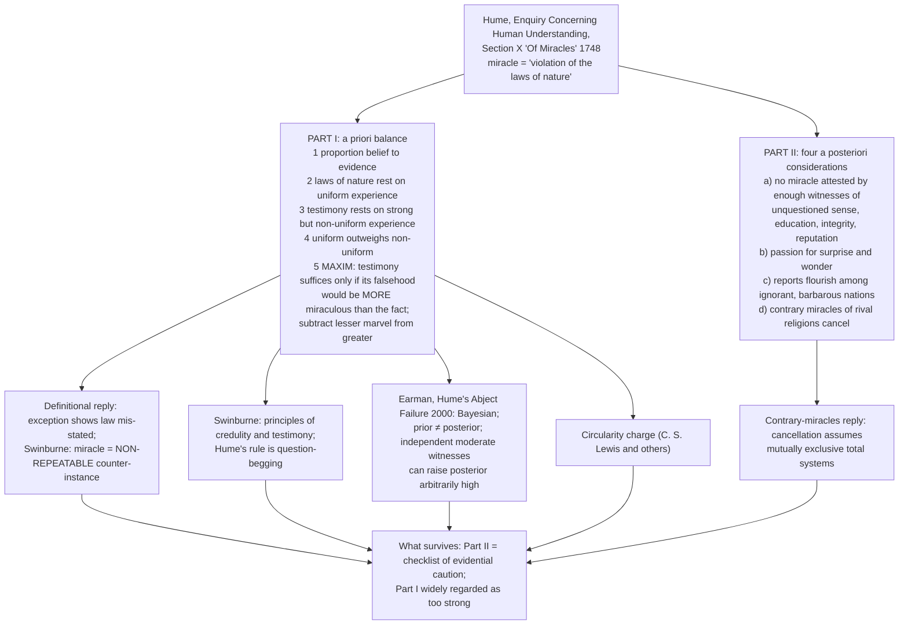

> [!WARNING]
> Do **not** attribute to Hume the claim that miracles are impossible. His claim concerns the **evidential force of testimony**, stated as a demanding conditional test; and his definition of a miracle is itself contested.

**Verdict formula ⚠️.** Hume shows miracle-testimony faces an unusually heavy evidential burden, not that it is in principle unmeetable. Identifying an unusual event **as divine revelation by a specific source** adds interpretive work beyond establishing that it occurred.

### 2.7 Epistemic status of the textual anchors ✅/❓

| Item | Status | Safe use |
|---|---|---|
| *Credo ut intelligam* | ✅ Anselmian formula (*Proslogion* 1), in the Augustinian tradition | Attribute to the Augustinian–Anselmian tradition |
| *Credo quia absurdum* | ❓ **Not** a verified verbatim Tertullian sentence | Call it "a later slogan for extreme fideism" |
| Aquinas on faith as a mean between knowledge and opinion | ✅ *ST* II-II q.1–q.4 | Paraphrase; no fabricated English quotation |
| Gītā 17.2–3; *Kālāma Sutta* (AN 3.65); *Kevaddha Sutta* (DN 11); *Yoga-sūtra* 3.37 | ✅ verified references | Paraphrase; do not quote a translation as canonical |

---

## 3. Dialectical Wings & Sceptical Refinements

> The sources record **no sceptical wing inside this topic** (no school of religious scepticism is assigned to it). This module therefore carries the fideist and pragmatic wings, the critical-rationalist middle, and the advanced dossier's second-order debates. Strongest sceptical pressure appears as the evidentialist and diversity objections (Modules 2 and 9).

### 3.1 Fideism, pragmatic and permissive proposals ⚠️

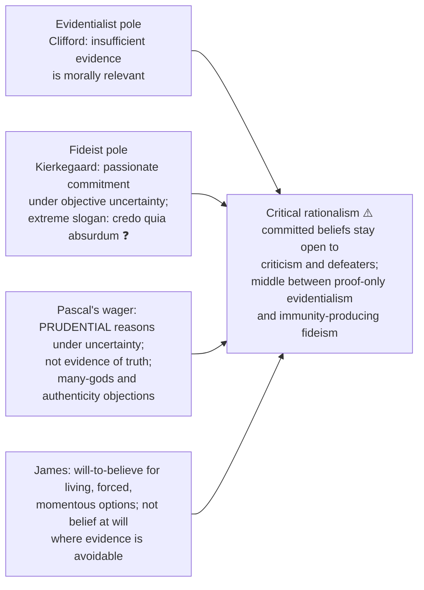

### 3.2 Advanced dossier §5 — second-order debates ⚠️ (one move in a 15-marker, one to two in a 20-marker)

| Optional debate | Competing positions | Strongest extra objection → reply | Safe use |
|---|---|---|---|
| ✅ **Reformed epistemology vs evidentialism** (promoted to Core 15 Aug 2026, owner §9.9) | Properly basic belief under suitable conditions vs proportioned evidence | Objection: makes almost any worldview basic. Reply: basicality is constrained by defeaters, mature practices, conditions of functioning | Optional residue: the full warrant / proper-function machinery; whether the *Great Pumpkin* objection is answered or merely deflected |
| ⚠️ Public testimony vs private revelation | Communal testimony, history, credibility signs vs first-person disclosure and interpretive faith | Objection: competing revelations cancel. Reply: warrant is defeasible and cumulative, so rivals force comparative assessment, not immediate collapse | One evaluative sentence in revelation-justification questions |
| ⚠️ Doxastic voluntarism vs involuntarism | Will-governed role in faith vs belief cannot be chosen at will | Objection: one cannot simply decide to believe. Reply: traditions mean indirect control through attention, trust, practices, consent to inquiry | With Aquinas on will and intellect, subordinate to the Thomist frame |
| ⚠️ Creator-centred revelation vs Mīmāṃsā / Advaita *śabda* | Abrahamic divine self-disclosure vs scriptural testimony not creator-speech in the same way | Objection: authorless or non-personal scripture lacks revelatory force. Reply: Indian schools distinguish supersensible disclosure from divine dictation and require internal verification through reasoning and practice | Indian balance in an otherwise Western answer |

- **What not to over-study:** the whole analytic epistemology of warrant, basicality or testimony in a short answer.
- **Promotion trigger still open ✅:** specialist testimony theory, or the status of *apauruṣeya* as revelation in its own right.

---

## 4. Metaphysics & Ontology: The Conceptual Inventory — Revelation, Faith and Belief

### 4.1 Revelation models ✅

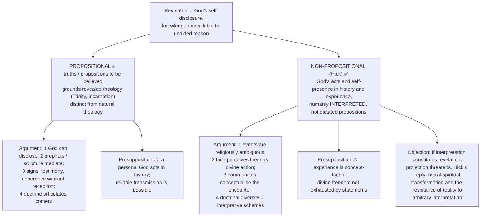

- Canonical example (non-propositional): the same historical event may be described in secular causal terms or received as providential. An event is not automatically revelation for every observer; "revelatory event" names an **experienced-as** structure.
- Propositional objection → reply: rival revelations and circular authentication weaken certainty; replies appeal to cumulative criteria (coherence, moral fruit, testimony, transformative power) without pretending neutrality.

### 4.2 Faith: Aquinas, Kierkegaard, *śraddhā* ✅

| Thinker / concept | Account of faith | Notes |
|---|---|---|
| **Aquinas** (2025 Q5(e)) | Act of the **intellect assenting** to revealed truth, **commanded by the will** moved by **grace**; a **mean** between knowledge (proof / sight) and opinion (fear of error): firmness of knowledge without the vision | Reason proves preambles (God exists); faith accepts mysteries (Trinity) that exceed but do not contradict reason. Objection: will-governed belief risks voluntarism → reply: motives of credibility and rational preambles make assent reasonable though not demonstrative. Faith is not opinion (firm) and not demonstrative knowledge (unseen object) |
| **Kierkegaard** | **Passionate, subjective commitment** under objective uncertainty; Abraham dramatises the paradox and the teleological suspension of the ethical | Attacks the claim that an objective system can replace existential decision; must not be flattened into "contradiction, irresponsibility or every evidence-free belief is licensed" |
| **Indian *śraddhā*** | Disciplined trust enabling inquiry and practice, not blind credulity. *Śravaṇa–manana–nididhyāsana*: hearing → reasoning → assimilation | Gītā 17.2–3 grades *śraddhā* as *sāttvika*, *rājasa*, *tāmasa*: "as is one's *śraddhā*, so is one" |

Presupposition ⚠️: transformative truths require participation, not observation alone. Distinction ✅: **supra-rational is not irrational**. Objection → reply: unchecked commitment can sanctify fanaticism; authentic faith remains answerable to coherence, ethical fruit and self-critical interpretation.

### 4.3 Faith and belief — the five axes (2020 Q7(c), 15 marks) ✅/⚠️

| Axis | Belief | Faith |
|---|---|---|
| Object | A proposition | A person, reality or ultimate |
| Grammar | *Believe that* | *Believe in* / trust |
| Mode | Cognitive assent | Assent **plus** trust, commitment, risk |
| Voluntariness | Largely involuntary | Involves the will; faith can be *given* |
| Failure-mode | Falsehood | Betrayal, infidelity, apostasy |
| Degrees | Degrees of confidence | Degrees of fidelity and depth |

**Supports ✅.** Aquinas: *fides quae creditur* (the faith **which** is believed: content, creed) and *fides qua creditur* (the faith **by which** one believes: act, disposition). Wilfred Cantwell Smith, *Faith and Belief* (1979): faith as a universal human orientation to transcendence; modern propositional "belief" is a recent narrowing ("hold dear", *by-lieve*, cognate with *lief*). Tillich: faith as being grasped by an **ultimate concern**; idolatry is faith's characteristic failure, not unbelief. Buber: *I–Thou* is not reducible to *I–It* propositions.

**Basic tenets of faith — an analytical scheme, not a universal creed ⚠️:** (1) an **object** held ultimate; (2) **assent** to some content; (3) **trust** exceeding available evidence; (4) **commitment** of will, with risk; (5) **hope**; (6) **community** and tradition; (7) **fruits**. Weight and applicability vary by tradition and adherent.

**Indian parity ✅.** *Śraddhā* is the faith-side (Gītā 17.2–3). In Advaita pedagogy it is one of the six inner accomplishments and is the trust that makes inquiry possible, to be *replaced* by realisation, not preserved as belief. Buddhist *saddhā* is provisional and verification-directed (*Kālāma Sutta*, AN 3.65: do not accept a teaching merely on report, lineage, scripture, logic or the teacher's authority; test it in experience). ⚠️ Indian trust **initiates** verification; Western "faith" often must defend itself as trust that **replaces** it.

**Objection → reply ⚠️.** (a) "Believing in" reduces to "believing that X exists and is trustworthy" → the reduction loses the performative, relational act of entrusting. (b) Volitional faith is doxastically irresponsible → the will operates only where evidence is genuinely non-coercive (Aquinas; James's genuine option).

**Verdict formula ⚠️.** Faith is not a weaker belief; it is a different act. Belief is the cognitive component *within* faith, and the two can come apart in both directions.

### 4.4 Rational, supra-rational and irrational faith (2023 Q6(c), 15 marks) ⚠️

| Aspect | What is claimed | Illustration | Objection → limited response |
|---|---|---|---|
| **Rational** | Faith is answerable to coherence, public reasons where applicable, accountable testimony and effects of an interpretation | Aquinas' preambles and scrutiny of revelation; Advaita's *manana* after scriptural hearing | Inconclusive evidence cannot compel assent; do not pretend every mystery is a theorem |
| **Supra-rational / non-demonstrative** | Trust, encounter, committed participation **exceed** what argument establishes without negating demonstrable truths | Aquinas' mysteries; *śraddhā* initiates inquiry; Kierkegaard: objective account does not replace appropriation | Different people commit to incompatible claims; defeaters, comparison and ethical criticism still apply; "beyond proof" is not a certificate of truth |
| **Irrational (failure, not virtue by definition)** | Assent **despite** decisive contradiction, fabrication or seriously damaging counter-evidence, or demanding immunity from criticism | A revelation authenticated only by itself while threatening questioners; a miracle claimed despite well-established fraudulent reporting | A defender may challenge whether the evidence is decisive; calling objections "faithlessness" is no answer |

**Route:** distinguish faith's *rational grounds* from the *extra-rational act of entrusting* and from *irrational insulation*. Do **not** label every leap irrational or canonise irrationality as religion's essence. Criterion: transcending proof differs from contradicting well-established reasons.

---

## 5. Rejection / Affirmation of Transcendent Realities: What Reason Can Reach and What Exceeds It

> **Stance in the sources:** this topic does not reject or affirm karma, rebirth or mokṣa; it asks how transcendent claims are *known*. The sources' answer: reason reaches some preambles and tests all claims; revelation and faith carry what exceeds demonstration; neither is a certificate of truth.

### 5.1 Natural vs revealed theology on the propositional view (2025 Q6(c), 15 marks) ✅/⚠️

| Axis | Natural theology | Revealed theology (propositional view) |
|---|---|---|
| **Starting warrant** | Publicly discussable observation and argument (contingent beings, perceived order); no specific scripture needed | A proposition claimed divinely communicated through scripture / prophecy; authority depends on authenticating that revelation |
| **What it can seek** | A cause / necessary ground and some attributes within reason's reach; underdetermination of any one creed | Particular doctrines and obligations not inferable from unaided observation; can be organised rationally though not demonstrated from public premises |
| **Aquinas' relation** | Preambles of faith may be accessible to reason, not to every person or equally easily | Mysteries (Trinity) exceed demonstration; faith assents to divine testimony; reason checks compatibility. "Beyond" ≠ "contradicts" |
| **Distinct objection** | Inference to God may be invalid, underdetermining or challenged by Kant | Competing scriptures, interpretation, circular "true because it says so" |

**Keep three things apart:** natural theology; revealed theology (reasons **from** accepted revealed propositions); general revelation (alleged disclosure in nature / conscience, not just another label for a successful proof). **Judgment:** theologies differ in *starting warrant and available content*, not in whether they use thought. A Hick-style non-propositional view begins with an encountered event; substituting it for the printed model misses the demand. Indian parity: Nyāya inference is a bounded natural-theology comparison; Mīmāṃsā's authorless Veda shows authoritative propositions need not be a personal deity's speech; **not** a claim that Mīmāṃsā is Aquinas' revealed theology.

### 5.2 Science and religion: Barbour's four models (2020 Q5(a), 10 marks) ✅/⚠️

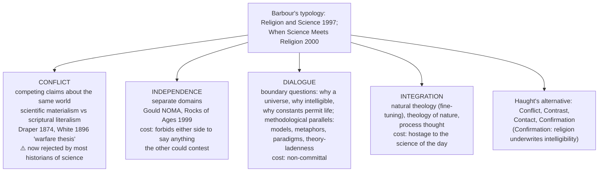

- **Indian parity ✅:** Vivekananda: Vedānta as experience-grounded and science-compatible ("science of the soul", report as a claim, not endorsement); Radhakrishnan: levels of one integral experience; Aurobindo: evolutionary integration. Classical root: is *śabda* an independent *pramāṇa*? Cārvāka no; Nyāya and Mīmāṃsā yes.
- **Presupposition ⚠️:** "science" and "religion" name two stable comparable things (the historicist critique denies this).
- **Objection → reply ⚠️:** typology is descriptive, not normative → argue model by model; the defensible position is a **domain-sensitive mixture**.
- **Verdict ⚠️:** dialogue at the boundary questions, with local conflict only where a religious claim is genuinely empirical. Technology settles what we *can* do, not what we *should*, nor what a life is for.

### 5.3 Reason alone and the missing experiential account (2026 Q5(e), 10 marks) ⚠️

| Rational resource retained | Experiential dimension it cannot alone replace | Qualified counterpoint |
|---|---|---|
| Natural theology and critical consistency | Schleiermacher's feeling of **absolute dependence** | Feeling alone does not certify a divine source |
| Ethical reason and public norms | Otto's **numinous** | An overwhelming feeling can be genuine without establishing its theological object |
| Concepts and arguments about God | James's **noetic** quality; fruits assessed | Authority is for the experiencer, not every outsider; conflicting interpretations need rational comparison |
| Indian *manana* after scriptural hearing | *Śraddhā* and disciplined *anubhava* | Traditions disagree about what is realised |

**Verdict:** qualified agreement. Reason alone cannot supply or substitute for a first-person account of religious life, yet experience alone cannot authenticate its object or settle conflicting interpretations. A rational / moral religion (a Deist's creator; Kant's religion within the bounds of reason) is conceptually possible; the stem is persuasive as a critique of a **reduction of religion to reason**. Full theory of experience belongs to Religious Experience.

### 5.4 Indian stance on revelation and miracle ✅/⚠️

| Topic | Indian position |
|---|---|
| Whose speech is scripture? | Mīmāṃsā: *apauruṣeya*, **no** author, human or divine |
| Authentication by miracle | *Siddhis* declared **obstacles** to *samādhi* (*Yoga-sūtra* 3.37); the Buddha rejects displays of power (*Kevaddha Sutta*, DN 11), preferring the "miracle of instruction"; Mīmāṃsā's *apauruṣeya* Veda needs **no** miraculous authentication |
| Verdict | Where Western apologetics uses miracles to authenticate revelation, Indian systems mostly **decline** the strategy: a contrast, not a parallel |

---

## 6. Explanatory & Causal Principles: How the Three Relate

> The sources give no causal-metaphysical principle for this topic. This module holds the **relational mechanisms**: occurrence vs reception, and the reconciliation structure.

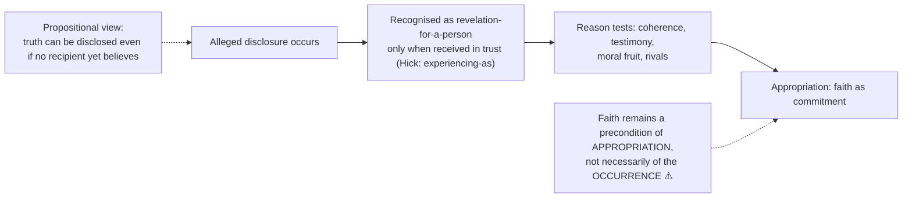

### 6.1 Is faith indispensable for revelation? (2022 Q5(d), 10 marks) ⚠️
- Revelation must be **received to be recognised** as such; for Hick an event becomes revelation *for someone* through faith's interpretation.
- Propositional objection: truths are disclosed objectively regardless of reception. Concession: faith is the indispensable **subjective condition of reception**, not of occurrence.

### 6.2 What is instrumental to self-revelation: faith or reason? (2019 Q5(a), 10 marks) ⚠️
- Define which "self" is disclosed: God's self to a human recipient (the natural reading inside this clause), not merely introspection.
- Choose: faith is primary for recognition and appropriation; reason is regulative. Verdict: **faith receives; reason disciplines.** If "self-revelation" instead means human self-knowledge, reasoned self-examination has a stronger claim; state the ambiguity rather than silently changing the question.

### 6.3 Aquinas' reconciliation mechanism (2025 Q5(e)) ✅

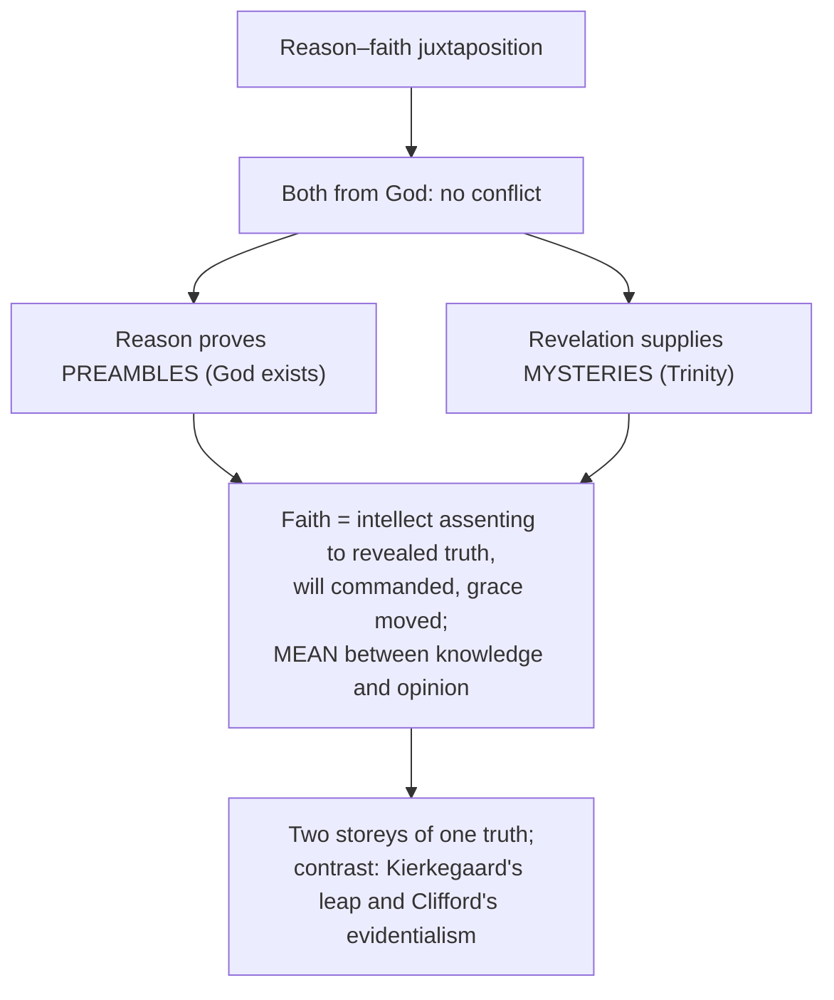

---

## 7. Ethics & Human Goals: The Ethics of Belief

> The sources give **no** kāma/artha/dharma/mokṣa scheme for this topic. The ethical dimension is the **ethics of belief** and the moral test of revelation.

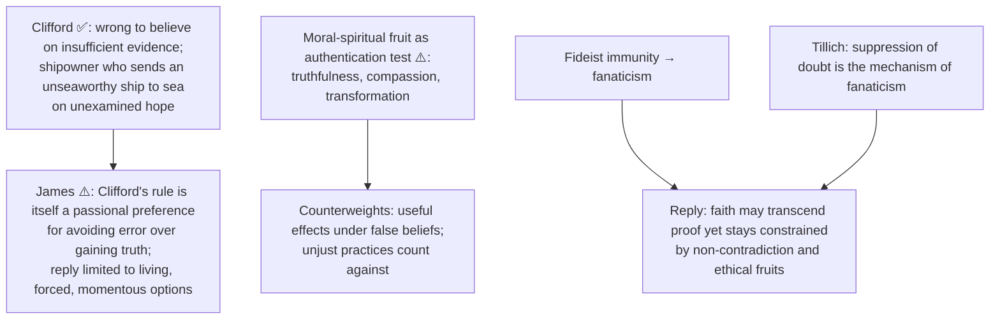

- Reason tests ethical consequences and exposes coercive or self-sealing readings (§2.2).
- Strict evidentialism, applied consistently, disqualifies far more than religion (memory, other minds) ⚠️.

---

## 8. Inter-School Comparative Matrices

### 8.1 Inter-thinker / inter-school debates (owner §10) ✅/⚠️

| Position | Reason | Revelation | Faith | Main risk |
|---|---|---|---|---|
| Rationalism / evidentialism | ✅ Judge of belief | Must be evidenced | Proportioned to evidence | Reduction of commitment |
| Aquinas | ✅ Preambles and coherence | Mysteries beyond reason | Firm intellectual assent | Two-tier tension |
| Fideism | ⚠️ Limited or irrelevant | Authoritative | Primary leap / trust | Arbitrariness |
| Hick | ✅ Interprets experience critically | Event / self-disclosure | Experiencing-as | Projection |
| Mīmāṃsā | ✅ Interprets injunction / testimony | *Apauruṣeya* Veda, not creator speech | Trust in Vedic authority | Cross-tradition warrant |
| Advaita | ✅ *Manana* removes doubt | *Śruti* discloses Brahman | *Śraddhā* enables inquiry | Scriptural circularity |
| Evidentialism (Locke, Clifford, Flew) | ✅ Sole arbiter | Must be independently evidenced | Rational only if evidenced | Self-application; over-strict criterion |
| Reformed epistemology (Plantinga) | ⚠️ Not sole arbiter | May be received basically | Properly basic, warranted, **defeasible** | Religious diversity as defeater |
| Alston | ✅ Critical, non-foundationalist | Mediated in practice | Rational participation in a doxastic practice | Circularity shared with sense perception |
| Barbour's typology | ✅ Model-dependent | Model-dependent | Model-dependent | Descriptive, not normative |
| Tillich | ✅ Ontological reason is faith's **precondition** | A revelatory event renewing faith and reason | State of being **ultimately concerned**; existential doubt intrinsic | Breadth of the definition; symbolic content leaves truth underdetermined |

### 8.2 Indian–Western parity bench ⚠️

| Issue | Western | Indian | Note |
|---|---|---|---|
| Is testimony an independent source? | Locke and Hume: reducible to experience | Nyāya and Mīmāṃsā: *śabda* an independent *pramāṇa*; Cārvāka denies it | The Indian debate is explicitly epistemological |
| Intrinsic or extrinsic validity? | Reformed proper basicality vs evidentialist demand for further grounds | Mīmāṃsā *svataḥ-prāmāṇya* vs Nyāya *parataḥ-prāmāṇya* | Partial structural analogy only |
| Whose speech is scripture? | God's word (propositional) | Mīmāṃsā: *apauruṣeya* | A scriptural authority with no revealer |
| Faith as trust | *Fides qua*; Tillich's ultimate concern | *Śraddhā* (Gītā 17.2–3); Buddhist *saddhā* | Indian trust is verification-directed (*Kālāma Sutta*) |
| Reason's role | Preambles, coherence, apologetics | *Manana*; *tarka* auxiliary, never independently probative in Vedānta | Both subordinate reason without eliminating it |
| Miracles as authentication | Central to Western apologetics | *Siddhis* obstacles (*YS* 3.37); Buddha rejects displays | India largely **declines**: contrast, not parallel |

### 8.3 Testimony across Indian schools (theme file) ✅

| School | Status of *śabda* |
|---|---|
| Cārvāka | Rejected |
| Buddhism (Dignāga / Dharmakīrti) | Reduces to inference |
| Vaiśeṣika | Reduces to inference |
| Sāṃkhya–Yoga | Added as a third *pramāṇa* (needed for imperceptible *prakṛti* / *puruṣa* via authoritative scripture plus inference) |
| Nyāya | Independent *pramāṇa* (reliable word of a trustworthy authority, *āpta*) |
| Mīmāṃsā | Independent; whole system defends self-validity and eternal authority of the Veda |
| Advaita | *Śabda* (Upaniṣads) decisive for Brahman-knowledge |

The theme file's master fault-line: *empiricist minimisers* (Cārvāka, Buddhism) vs *scripture-defending maximisers* (Mīmāṃsā, Advaita), with Nyāya the realist middle.

### 8.4 Tillich against the four stances (chart B) ⚠️

| Thinker | What faith is | Reason's status | Doubt's status | Failure mode guarded against |
|---|---|---|---|---|
| **Aquinas** | Intellectual assent to revealed truth, commanded by will under grace | Establishes preambles; cannot reach mysteries | A defect; "firmness without vision" | Rationalism and fideism both |
| **Kierkegaard** | Passionate inward appropriation under objective uncertainty | Cannot generate or replace the decision | Uncertainty is the medium of the leap | Speculative complacency |
| **Clifford** | Assent proportioned to evidence | Sole arbiter | Correct default when evidence is short | Credulity |
| **Plantinga** | Properly basic belief, warranted by proper function | Not sole arbiter; classical foundationalism self-refuting | A **defeater** to be met | Evidentialist over-reach |
| **Tillich** | State of being ultimately concerned: a centred, ecstatic act | **Precondition**; faith is reason in ecstasy | **Intrinsic**, carried by courage | Fanaticism and rationalist reduction at once |

---

## 9. Criticisms & Reconstructed Replies

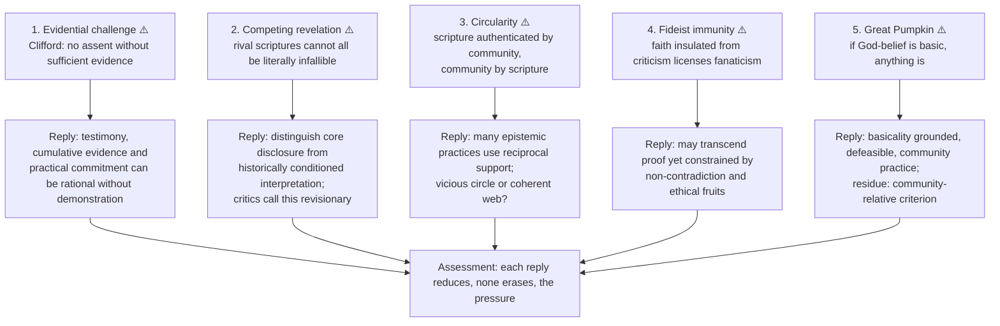

### 9.1 Objections to Tillich → replies (owner §9.10) ⚠️

| # | Objection | Reply | Residue an examiner rewards |
|---|---|---|---|
| 1 | **Definition too broad**: nationalism and success would count as faith | Ultimate concern needs **unconditional** surrender, **total** fulfilment, and **centring** of the whole personality; breadth exposes secular idolatries | Structural criterion cannot rule out idolatrous content in advance (hence step 4 of §11.1) |
| 2 | **Relativism**: every content symbolic and doubtful | Separate **certainty of ultimacy** from **fallibility of the concrete symbol**; symbols judged by whether they stay transparent to the ultimate | Tillich supplies a criterion of *idolatry*, not of *which* revelation is true |
| 3 | **Insulation from science** | Faith may not dictate scientific facts; science becomes quasi-religious when methodological naturalism is inflated | Historical religious claims cannot always be cleanly separated from empirical evidence |
| 4 | **Doubt as virtue dissolves commitment** | Doubt is *structural*, not occurrent; accepted by courage, coexisting with "restful affirmative confidence" | Theory describes a structure, not a state of mind |
| 5 | **Is this still theism?** | Unconditionality is affirmed; denied is that any finite image exhausts it | Critics from both traditional theists and naturalists read it as non-theistic |

---

## 10. Controlled Western Comparisons

> The topic is itself largely Western; the sources' guardrail concerns **Indian–Western** pairings. Each must carry its disanalogy.

| Pairing | Point of contact | Decisive disanalogy ⚠️ |
|---|---|---|
| Mīmāṃsā *svataḥ-prāmāṇya* ↔ **Reid's** principle of credulity (theme file) | Default epistemic entitlement | Mīmāṃsā's is a thesis about the intrinsic validity-conferring character of the knowledge-producing process, not a defeasible practical policy; its purpose is to secure an **authorless** scripture |
| Mīmāṃsā *svataḥ* / Nyāya *parataḥ* ↔ Plantinga / Clifford | Defeasible basicality vs further-ground demands | Plantinga adds a warrant / proper-function account; Nyāya's extrinsic validity is not Clifford's moral rule |
| *Śraddhā* ↔ Tillich's ultimate concern | Faith as what a person *is*, a constitutive disposition | Close parallel; but Indian traditions expect doubt to be *resolved* by realisation, whereas Tillich says it is never removed for a finite believer |
| *Manana* / *tarka* ↔ Tillich's reason as precondition | Both subordinate reason without eliminating it | Tillich's ontological reason is faith's precondition; *tarka* is auxiliary and never independently probative in Vedānta |
| *Nirguṇa* Brahman, *neti neti* (Bṛhadāraṇyaka 2.3.6) ↔ "God is the symbol for God" | Finitude of every image of the ultimate | Tillich argues from **existential analysis**, Advaita from **scriptural exegesis and non-dual inquiry**; *anirvacanīya* characterises *māyā*, not *nirguṇa* Brahman |
| Cārvāka / Buddha / Kabīr / Nānak ↔ Tillich's idolatry critique | Critique of ritual or absolutised finite | Indian critiques are mostly of **practice**; Tillich's is a **structural** critique of any absolutised finite |
| Indian *śabda* debate ↔ Western testimony (Locke, Hume) | Is testimony independent? | Indian debate is explicitly epistemological, with a *pramāṇa* count |
| Kierkegaard ↔ Tillich | Both reject propositional reduction | Kierkegaard's leap is **against** objective reason; Tillich's ecstasy is reason's **fulfilment** |

> [!WARNING]
> Parallels never replace the argument. No equation without its disanalogy; none of these is a claim of historical influence.

---

## 11. Diagnostic Deep-Dives for High-Frequency Themes

### 11.1 Tillich: faith as ultimate concern — faith, doubt and reason (2026 Q5(c), 10 marks, "Evaluate") ✅/⚠️

> **Ownership.** This file is the primary owner of the **faith / doubt / reason** triad; the *symbol* theory stays with Religious Language and enters only to explain why every concrete content of faith is fallible. Text base: Paul Tillich, *Dynamics of Faith* (1957).

```mermaid
flowchart TD
  T0["DEFINITION ✅ ch. I §1<br/>'Faith is the state of being ultimately concerned'"] --> T1["1. Ultimate concern: unconditional demand;<br/>subordination of every other concern;<br/>promise of total fulfilment;<br/>threat of exclusion<br/>(Deuteronomy 6:5)"]
  T1 --> T2["2. Centred act: intellect, will, emotion,<br/>unconscious all participate;<br/>not the product of any one faculty"]
  T2 --> T3["3. Subject and object united: fides qua + fides quae;<br/>ecstatic, yet the person remains a person"]
  T3 --> T4["4. Structure does not guarantee true content:<br/>nationalism, success can occupy the place;<br/>IDOLATROUS faith → existential disappointment,<br/>disruption of the personality"]
  T4 --> T5["5. Doubt intrinsic, but only one kind:<br/>faith as belief-that: doubt incompatible;<br/>faith as ultimate concern: doubt necessary;<br/>'A god disappears; divinity remains'"]
  T5 --> T6["6. Carried by courage, not suppressed:<br/>doubt structural, not occurrent;<br/>'serious doubt is confirmation of faith';<br/>suppression = fanaticism"]
  T6 --> T7["7. Two senses of reason:<br/>TECHNICAL (means, not ends) vs<br/>ONTOLOGICAL / creative (humanity of man)"]
  T7 --> T8["8. Reason is the precondition of faith;<br/>faith is the act in which reason reaches ecstatically beyond itself;<br/>'reason in ecstasy'; ecstasy fulfils, not denies, rationality"]
  T8 --> T9["9. Anti-fideist limit: 'A faith which destroys reason<br/>destroys itself and the humanity of man';<br/>conflict is between DISTORTED reason and IDOLATROUS faith"]
  T9 --> T10["10. Three reductions rejected (ch. II):<br/>weak knowledge · act of will · mere feeling"]
  T10 --> T11["11. Content must be symbolic (ch. III):<br/>symbols point beyond, participate, open levels,<br/>are born and die; 'God is the symbol for God'"]
  T11 --> T12["12. Life of faith keeps both poles (ch. VI):<br/>participation → certainty;<br/>separation as finite being → doubt"]
```

**Chart A — the three doubts (the discriminator) ✅**

| Doubt | Targets | Belongs | Relation to faith |
|---|---|---|---|
| **Methodological** (scientific) | Particular propositions, theories, conclusions | Empirical inquiry and logical deduction; "the lifeblood of scientific research" | Legitimate and permanent, but **not** the doubt intrinsic to faith |
| **Sceptical** | Possibility of any certainty; an *attitude*, not an assertion | A stance that "cannot be refuted logically" | Tends to despair or cynicism; "the serious skeptic is not without faith" |
| **Existential** | Whether *my* concrete ultimate concern is truly ultimate | Inside the act of faith | **Intrinsic**; accepted by courage; "poles of the same reality" |

> [!TIP]
> **Mnemonic "M-S-E: only E is inside."** Methodological and Sceptical doubt stand *outside* faith; only **E**xistential doubt is a structural element *of* it. "Tillich says all doubt is part of faith" loses the question.

**Presuppositions to name when evaluating ⚠️:** (i) every person has *some* ultimate concern; (ii) the ultimate is **not one being among beings**; (iii) ontological reason is self-transcending; (iv) religious cognition works by **symbolic participation**, not literal reference.

**Chart C — Indian parity ⚠️**

| Issue | Tillich | Indian analogue | Relation |
|---|---|---|---|
| Faith as orientation of the whole person | Ultimate concern; centred act | *Śraddhā* (Gītā 17.2–3) | ✅ Close parallel |
| Doubt inside commitment | Existential doubt structural | *Saddhā* verification-directed (*Kālāma Sutta*); *vicikicchā* a fetter only as paralysis | ⚠️ Near, not identical |
| Reason's role | Precondition; faith its ecstatic fulfilment | Advaita *manana* between *śravaṇa* and *nididhyāsana* | ✅ Both subordinate reason |
| Finitude of every image | "God is the symbol for God" | *Nirguṇa* Brahman; *neti neti* | ⚠️ Limited comparison |
| Idolatry critique | Absolutised finite → existential disappointment | Cārvāka on priestcraft; Buddha; Kabīr; Nānak | ⚠️ Practice vs structure |

**Answer spines ⚠️** — *10 marks:* define faith as ultimate concern → structure → three doubts (only existential intrinsic; courage; "serious doubt is confirmation of faith") → reason (technical vs ontological; precondition; "a faith which destroys reason destroys itself") → two-sided evaluation (internal critique of fanaticism and idolatry; cost: breadth and symbolic content leave truth underdetermined) → verdict. *15 marks:* add centred act, *fides qua / quae*, true/idolatrous distinction, three rejected reductions, symbol theory as reason for content-fallibility, one Indian row, two objections. *20 marks:* four parts: definition and structure; doubt; reason (two senses, anti-authoritarian limit, faith and science on different dimensions); assessment against Aquinas, Kierkegaard, Clifford and Plantinga (chart B), objections, Indian bench, qualified verdict.

**Reworded-variant routes ✅:** "Is doubt compatible with faith?" → steps 5–6 + chart A. "Is faith irrational?" → steps 7–9 + chart B. "Can faith be defined without God?" → steps 1–4 + trap 1, link to Religion without God. "Explain religious symbols in Tillich" → route **out** to Religious Language.

**Verdict ⚠️.** Tillich resolves the triad by refusing its usual terms: faith is not a belief competing with reason for the same evidential territory, so doubt is its structural companion and reason its precondition. The cost: every concrete content of faith, including "God", becomes a fallible symbol, leaving the truth of any particular faith undetermined.

### 11.2 PYQ-mapped answer skeletons ⚠️

| PYQ | Skeleton |
|---|---|
| **2019 Q5(a)** faith or reason for self-revelation | Define which self → choose (faith primary for recognition; reason regulative) → argue (non-propositional disclosure ambiguous until received in trust) → objection (propositional content objectively true) → reply (occurrence vs revelation-for-a-person) → verdict (faith receives, reason disciplines; state the ambiguity) |
| **2020 Q5(a)** religion vs science and technology | Models, not a single verdict: Barbour's four; Indian parity (Vivekananda, Radhakrishnan, Aurobindo; *śabda* as *pramāṇa*) → religion's significance is normative and existential → dialogue at boundary questions |
| **2020 Q7(c)** tenets of faith; faith vs belief | Two deliverables in order: tenets (7-part scheme) then distinction (5 axes); *fides quae / qua*, Smith, Tillich, Buber; Gītā 17.2–3, *saddhā*; reductionist objection and reply; faith is a different act |
| **2021 Q7(a)** role of reason and faith; regulative? | Both reason and faith; regulative ≠ constitutive; Aquinas, Indian parity, evidence and limits; evidentialist vs fideist; verdict |
| **2022 Q5(d)** faith indispensable for revelation? | Revelation must be received; Hick's experiencing-as; propositional critique; faith the indispensable subjective condition of reception |
| **2023 Q5(b)** can religious beliefs be justified? | Name the standard; evidentialism; James; Plantinga; Alston; Indian comparison with stated non-equivalence; defeasible standards |
| **2023 Q6(c)** rational and irrational aspects of faith | Rational / supra-rational / irrational; transcending proof ≠ contradicting reasons |
| **2024 Q5(d)** role of reason | Four roles (natural theology, coherence, interpretation, apologetics); limits |
| **2024 Q7(b)** epistemic justification of revelation, own comments | Five criteria, ranked: negative filters vs defeasible positives; unresolved contradiction as limit |
| **2025 Q5(e)** Aquinas' faith as intellectual assent | Mean between knowledge and opinion; preambles / mysteries; contrast fideism and rationalism; two storeys |
| **2025 Q6(c)** natural vs revealed theology (propositional view) | §5.1 table; keep the printed qualifier |
| **2026 Q5(c)** Tillich | §11.1 |
| **2026 Q5(e)** reason alone and experience | §5.3 |

### 11.3 Directive decoder ⚠️

| Directive | Examiner is buying | Structural consequence | Live example |
|---|---|---|---|
| What is instrumental to X: A or B? Justify your position | A **choice**, defended | Choose, give the strongest case, concede what the loser explains better | 2019 Q5(a) |
| Discuss the significance of X vis-à-vis Y | A relation, modelled | Use a typology (Barbour), not a narrative | 2020 Q5(a) |
| Basic tenets of X? Distinguish X and Y | Two separate deliverables | Enumerate tenets, then a differentia table | 2020 Q7(c) |
| Can A be a regulative force in B? | The precise sense of "regulative" | Regulative ≠ constitutive | 2021 Q7(a) |
| Critically comment | Short evaluative verdict (10m) | One distinction, one objection, one verdict | 2022 Q5(d) |
| Can X be justified? Discuss | The **standard** of justification | Name the epistemology first | 2023 Q5(b) |
| Rational and irrational aspects of X | Three categories | Rational / **supra-rational** / irrational | 2023 Q6(c) |
| Epistemic justifications … with your own comments | Typology **plus** first-person assessment | List criteria, then rank | 2024 Q7(b) |
| How does X reconcile A and B? | The mechanism, stated as structure | Name the two storeys and the hinge | 2025 Q5(e) |
| Distinguish A and B in the context of C | A three-term answer; C not decorative | Natural vs revealed theology **as seen from** the propositional model | 2025 Q6(c) |
| How does ultimate concern address A, B, C? Evaluate | Mechanism **and** assessed limit | Centred concern, existential doubt, reason-in-ecstasy; then test a critic | 2026 Q5(c) |
| If reason alone, would X lack experience? Agree with reasons | A qualified judgment on a conditional | What reason retains, what first-person accounts add, why experience still needs criticism | 2026 Q5(e) |

> [!TIP]
> **Rule:** the clause punishes binaries. Reason/faith, rational/irrational, science/religion and evidence/basicality are all three-term distinctions once the middle category is added.

---

## 12. PYQ Routing Ledger (2018–2026)

> Corpus signal: **11** primary-owned parts out of 112 across 2018–2025 (2018 has none), plus **2** in 2026 (13 of 126). The 2018–2025 bank's own frequency row for this topic reads 0 / 1 / 2 / 1 / 1 / 2 / 2 / 2 = 11; the 2026 supplement assigns it 2 (Q5(c), Q5(e)). Cross-links do not create duplicate ownership.

| Year | Q | Marks | Exact demand | Map to |
|---|---|---:|---|---|
| 2019 | Q5(a) | 10 | What is instrumental to self-revelation: Faith or Reason? Justify your position. | §6.2 |
| 2020 | Q5(a) | 10 | Discuss the significance of 'Religion' vis-à-vis the present scientific and technological development. | §5.2 |
| 2020 | Q7(c) | 15 | What are the basic tenets of faith? Distinguish between faith and belief. | §4.3 |
| 2021 | Q7(a) | 20 | Discuss the role of reason and faith in religion. Can reason be a regulative force in the formulation of religious beliefs? Explain. | §2.2 |
| 2022 | Q5(d) | 10 | Is the notion of faith indispensable for the idea of revelation? Critically comment. | §6.1 |
| 2023 | Q5(b) | 10 | Can religious beliefs be justified? Discuss. | §2.5 |
| 2023 | Q6(c) | 15 | Explain the rational and irrational aspects of faith in the discourse of religion. | §4.4 |
| 2024 | Q5(d) | 10 | Discuss the role of reason in religion. | §2.1 |
| 2024 | Q7(b) | 15 | What kind of epistemic justifications are possible with regard to claims to revelation? Discuss with your own comments. | §2.4 |
| 2025 | Q5(e) | 10 | How does Aquinas' account of Faith as "an intellectual assent" reconcile the juxtaposition between Reason and Faith? Discuss. | §6.3 |
| 2025 | Q6(c) | 15 | Distinguish between Natural Theology and Revealed Theology in the context of the Propositional view of Revelation. | §5.1 |
| **2026** | **Q5(c)** | **10** | How does Paul Tillich's idea of faith as ultimate concern address the relation between faith, doubt and reason? Evaluate. | §11.1 |
| **2026** | **Q5(e)** | **10** | "If religion were a subject of reason alone, it would have lacked an experiential account." Do you agree with this statement? Give reasons in support of your answer. | §5.3 |

**Primary count: 13** (11 from 2018–2025 + 2 from 2026), matching the owner file and both PYQ banks.

**Cross-owned, listed but not counted:**

| Year | Q | Owner | Demand (short) |
|---|---|---|---|
| 2021 | Q8(c) | Religious Language | Symbolic nature of religious language with special reference to Paul Tillich (15) |
| 2023 | Q7(c) | Religious Language | Symbolic nature of religious language according to Tillich (15) |
| 2025 | Q5(b) | Religious Language | Is religious language symbolic? (10) — named by the owner as the third Tillich-symbol part |
| 2023 | Q8(c) | Religious Experience | Relation between mystical experience and revelation and their significance in religious life (15) |

No pre-2018 PYQ table is given in the owner file.

---

## 13. Top 10 UPSC Exam Traps

The owner file lists 18; the ten highest-yield are drawn first, the rest follow.

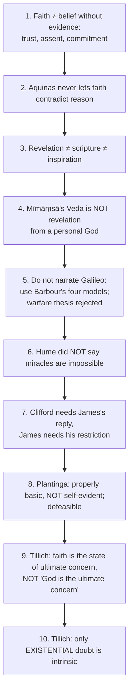

Remaining traps recorded in the owner file ⚠️:
11. *Credo quia absurdum* is not a verified verbatim Tertullian quotation.
12. In "faith indispensable for revelation", separate objective disclosure from subjective reception.
13. Do not treat NOMA as the obvious solution; state its cost.
14. *Svataḥ-* and *parataḥ-prāmāṇya* are validity doctrines; compare structurally, never equate with Plantinga or Clifford.
15. Do not present Tillich as a fideist: "a faith which destroys reason destroys itself".
16. "Ultimate concern" is structural, not praise: nationalism and success-worship satisfy it.
17. Do not answer a Tillich *faith* question with his *symbol* theory.
18. Do not assimilate Tillich to Kierkegaard; ecstasy is reason's fulfilment, the leap is against objective reason.
19. Do not quote Tillich in invented wording; only the verified verbatim lines (§14).
20. Do not equate revelation with private feeling.

---

## 14. Technical Vocabulary & IAST Bank

| English gloss | Term | Meaning | Status |
|---|---|---|---|
| Natural theology | — | Reasoning toward theological conclusions from public premises | ✅ |
| Revealed theology | — | Reasoning from accepted revealed propositions | ✅ |
| Preambles of faith / mystery | — | Aquinas: reason-accessible truths / truths beyond demonstration | ✅ |
| Propositional / non-propositional revelation | — | Truth-content / event-encounter (Hick) | ✅ |
| General / special revelation | — | Scope and medium | ✅ |
| *Faith which is believed* / *by which one believes* | *fides quae creditur* / *fides qua creditur* | Content / act | ✅ |
| Credo that I may understand | *credo ut intelligam* | Augustinian–Anselmian | ✅ |
| Creed because absurd | *credo quia absurdum* | Later slogan; not verbatim Tertullian | ❓ |
| Testimony | *śabda* | Verbal testimony as *pramāṇa* | ✅ |
| Authorless | *apauruṣeya* | Mīmāṃsā's Veda | ✅ |
| Intrinsic validity | *svataḥ-prāmāṇya* | Mīmāṃsā (Advaita) | ✅ |
| Extrinsic validity | *parataḥ-prāmāṇya* | Nyāya | ✅ |
| Trusted authority | *āpta* | Reliable speaker | ✅ |
| Faith / trust | *śraddhā* | Gītā 17.2–3; Advaita inner accomplishment | ✅ |
| Buddhist trust | *saddhā* | Provisional, verification-directed | ✅ |
| Doubt | *vicikicchā* | A fetter only as paralysis | ✅ |
| Hearing / reasoning / assimilation | *śravaṇa* / *manana* / *nididhyāsana* | Advaita pedagogy | ✅ |
| Supportive reasoning | *tarka* | Nyāya; auxiliary in Vedānta | ✅ |
| Perception / inference | *pratyakṣa* / *anumāna* | | ✅ |
| Powers | *siddhi* / *vibhūti* | Obstacles to *samādhi* (*YS* 3.37) | ✅ |
| Qualityless Brahman | *nirguṇa* Brahman; *neti neti* | Bṛhadāraṇyaka 2.3.6 | ✅ |
| Evidentialism / ethics of belief | — | Clifford, Locke, Flew | ✅ |
| Living / forced / momentous option | — | James | ✅ |
| Properly basic belief | — | Plantinga | ✅ |
| *Sensus divinitatis* | — | Calvin; warrant if functioning properly | ✅ |
| Doxastic practice | — | Alston | ✅ |
| Experiencing-as | — | Hick | ✅ |
| Ultimate concern; centred act; idolatrous faith | — | Tillich | ✅ |
| Technical vs ontological reason | — | Tillich; "reason in ecstasy" | ✅ |
| Regulative vs constitutive reason | — | Constrain / generate | ⚠️ |
| Non-repeatable counter-instance | — | Swinburne's miracle | ✅ |
| NOMA | — | Gould | ✅ |

---

## 15. Graded Verdict & Answer Architectures

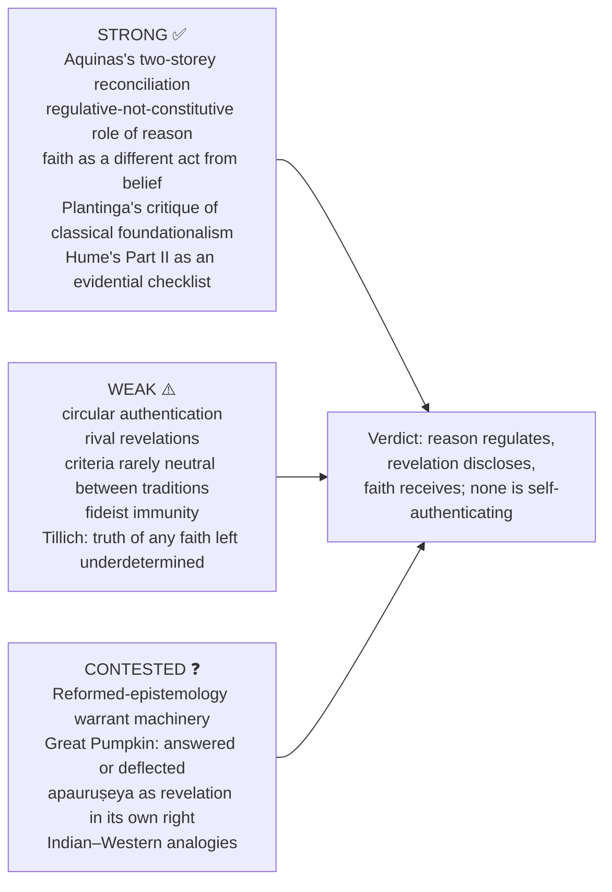

### 15.1 10-mark
```text
Define the term asked (reason / revelation / faith) → doctrine's internal relation →
one distinction → one objection → direct verdict.
```
**Anchor:** "Faith may go beyond coercive proof without going against reason."

### 15.2 15-mark
```text
Frame the warrant problem → propositional or encounter model in steps →
criteria of justification → rival model / Indian comparison → objection and reply.
```
**Anchor:** "Faith is not a weaker belief; it is a different act, of which belief is one component."

### 15.3 20-mark
```text
Map the three concepts → strongest harmony and conflict models → presuppositions →
competing-revelation and evidential objections → Indian–Western comparison →
defended synthesis.
```
**Anchor:** "Reason is regulative but not constitutive of religious belief: it can veto incoherence, discipline interpretation and assess evidence, but it does not generate the content that faith receives."

### 15.4 Graded-verdict templates ⚠️
- *Justification stem:* "Religious beliefs can be justified, but the standard cannot be the strict evidentialist one, which disqualifies memory and other minds as well. Once justification is located inside a doxastic practice, the live objection changes from *insufficient evidence* to *incompatible practices*."
- *Revelation stem:* "A revelation-claim is warranted, if at all, by a **convergence** of internal coherence, moral fruits, the recipient's experience, communal transmission and congruence with reason, none decisive and none neutral between traditions."
- *Miracle stem:* "Hume raised the evidential bar for miracles; he did not show it unclearable."
- *Tillich stem:* "Conflict arises between distorted reason and idolatrous faith, not between faith and reason as such."

### 15.5 Graded verdict ladder ⚠️

| Band | Script contains | Typical fault |
|---|---|---|
| Weak (≈40%) | "Reason argues, faith trusts"; Aquinas and Kierkegaard named | No epistemology; faith defined as evidence-free belief |
| Average (≈50%) | Four stances; propositional / non-propositional revelation | Indian material limited to one sentence on *śraddhā* |
| Good (≈60%) | One position reconstructed with premises; one objection answered | Middle category missing |
| Strong (≈65–70%) | Justification standard named; Indian *pramāṇa* parity; competing-revelation problem | Verdict summarises rather than decides |
| Top (≈70%+) | All above + a discriminating distinction (*fides qua / quae*; *svataḥ / parataḥ*; regulative vs constitutive; violation vs non-repeatable counter-instance) + a statement of the defeater that would change the verdict | — |

### 15.6 Verified verbatim Tillich lines ✅ (*Dynamics of Faith*)

| Line | Locus |
|---|---|
| "Faith is the state of being ultimately concerned" | ch. I §1 |
| "If faith is understood as being ultimately concerned, doubt is a necessary element in it" (pair with the preceding belief-that clause) | ch. I §5 |
| "A god disappears; divinity remains" / "serious doubt is confirmation of faith" | ch. I §5 |
| "Reason is the precondition of faith; faith is the act in which reason reaches ecstatically beyond itself" | ch. V §1 |
| "A faith which destroys reason destroys itself and the humanity of man" | ch. V §1 |

---

## Link-outs

- Proofs for God · Religious Experience · Religious Language · Religious Pluralism · Religion without God (owner links, boundary notes only)
- Paper I: Mīmāṃsā, Nyāya–Vaiśeṣika, Cārvāka, Existentialism (Kierkegaard's leap), Kant (limits of speculative reason)
- Philosophy of Religion PYQ Bank 2018–2025 · 2026 Paper II Section B Supplement

## Sources

Aquinas, *Summa Theologiae* II-II qq.1–7; Kierkegaard, *Fear and Trembling* and *Concluding Unscientific Postscript*; Hume, *Enquiry*, Section X, and Earman, *Hume's Abject Failure*; Clifford, "The Ethics of Belief"; James, *The Will to Believe*; Plantinga, "Reason and Belief in God" and *Warranted Christian Belief*; Alston, *Perceiving God*; Barbour, *Religion and Science*; Gould, *Rocks of Ages*; Haught, *Science and Religion*; W. C. Smith, *Faith and Belief*; Tillich, *Dynamics of Faith*; Hick, *Philosophy of Religion*; Chatterjee & Datta and C. D. Sharma on Mīmāṃsā, Nyāya and Vedānta; *Pramāṇa-across-schools* theme file (testimony and comparison passages).
